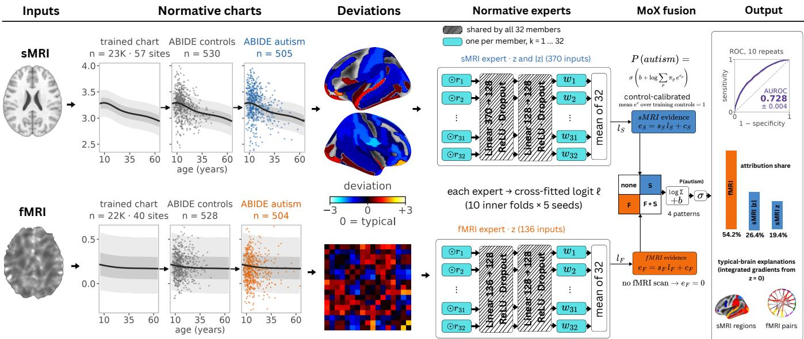
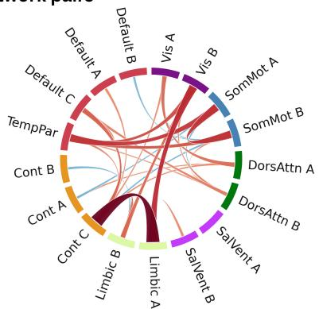
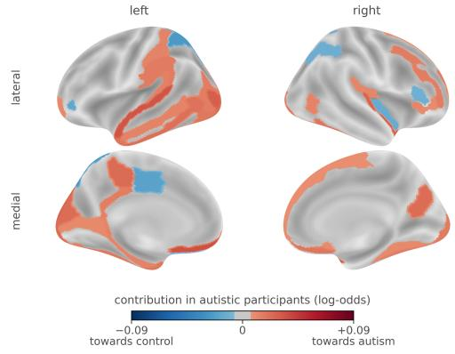
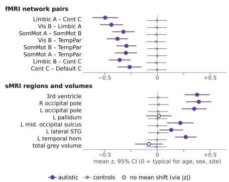
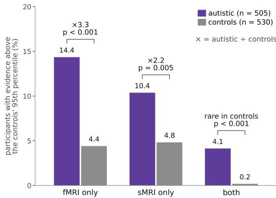

# NORMMOX: A NORMATIVE MIXTURE OF EXPERTS FOR EXPLAINABLE AUTISMCLASSIFICATION FROM STRUCTURAL AND FUNCTIONAL MRI

Muhammad Hasan Masrur1,2, Fani Deligianni1

1,2 School of Computing Science, 2 James Watt School of Engineering, University of Glasgow, UK

## ABSTRACT

While structural and functional magnetic resonance imaging (sMRI, fMRI) offer profound potential for researching autism spectrum disorder (ASD) and understanding individual neurodivergence, current classifiers lack the explanatory power needed for scientific study, clinical use and personallevel insights. Most models learn from imaging features that also vary with age, sex, scanner site and head motion. They fuse the two modalities without a common reference and explain decisions against arbitrary reference inputs rather than a typical brain. We present NormMoX, a normative mixture of experts that makes the typical brain the shared reference for prediction, fusion and explanation. Normative models trained on large healthy cohorts give the value each brain measure is expected to take for a person’s age and sex. NormMoX learns from each person’s deviations from these expected values. For each modality, a neural network expert turns the deviations into a score of evidence for ASD. A fusion head, MoX, compares each score with those of typical controls before combining them. It therefore needs no imputation when a modality is missing and shows in which modality each person is atypical. On 1,035 participants of ABIDE I, NormMoX reached an AUROC of 0.728 ± 0.004 in repeated cross-validation, above linear, single-modality and deep fusion baselines. NormMoX thus shows not only whether a person is likely to have ASD, but where, and in which modality, their brain departs from typical. The implementation is available at https://github.com/Novelex/NormMox.

Index Terms— autism spectrum disorder,normative modelling, multimodal fusion, explainable AI

## 1. INTRODUCTION

Many MRI classifiers have been proposed for ASD, yet none has reached clinical use [1]. However, a prediction alone gives a clinician little to act on. The model must also highlight which brain regions are atypical, in which modality and by how much [2]. This is challenging in ASD and other heterogeneous neurodevelopmental conditions, whose brain differences vary from one person to the next [3].

By relying on raw measures, most classifiers risk capturing age, sex, scanner site and head motion effects rather than

ASD [4]. Normative modelling avoids this [5] by expressing each measure as a deviation from what is expected for the person’s age, sex and site in a healthy population. In ASD, however, norms are mostly estimated from a few hundred controls of the same study [3, 6] in one modality [7]. Lifespan models pretrained on large external healthy datasets now provide baselines for both structural and functional MRI [8, 9]. Multimodal models add two further challenges: their fusion does not show in which modality a person is atypical, and their explanations measure each input’s effect against an arbitrary reference input rather than a typical brain [10, 11].

We present NormMoX (Fig. 1), a normative mixture of experts that classifies ASD from structural MRI (thickness and volume) and functional MRI (connectivity) and explains each decision relative to the typical brain. To our knowledge, it is the first ASD classifier built on lifespan-model deviations of both modalities. We make four contributions: (i) We formulate multimodal classification in a normative reference frame where lifespan models of healthy brains define the typical brain, providing NormMoX with a shared reference for learning, fusing and explaining data. (ii) Normative experts for each modality use an ensemble of multilayer perceptrons with shared weights to score how strongly deviations from age and sex norms indicate ASD. Averaging the predictions of these perceptrons keeps the score stable on small multisite cohorts. (iii) We introduce MoX, a fusion head that first measures each expert’s score against typical controls and then combines the two. Unlike learned gating [12], it makes the modalities comparable, needs no imputation for a missing modality and shows in which modality each person is atypical. (iv) We anchor explanations to the typical brain (typicalbrain attribution) rather than arbitrary reference inputs [13]. Integrated gradients reveal exactly which regions and connections drive NormMox decision and in which modality. On 1,035 participants from 20 ABIDE sites, NormMoX reached an AUROC of 0.728, outperforming linear, single-modality and deep fusion baselines, and retained 0.711 on unseen sites.

## 2. METHOD

Fig. 1 outlines the NormMoX framework. Normative models first map brain measurements into deviations from expected values (Sec. 2.1). Modality-specific experts then evaluate these deviations as evidence for ASD (Sec. 2.2). Finally, MoX compares these scores against typical controls and fuses both modalities (Sec. 2.3), while integrated gradients provide explainability for each prediction (Sec. 2.4).

  
Fig. 1: Overview of NormMoX. Normative models turn sMRI and fMRI measures into deviations from typical brain. One expert per modality scores the deviations, MoX fuses the scores relative to typical controls, and integrated gradients from the typical brain explain predictions.

## 2.1. Normative modelling

We quantify individual deviations from healthy lifespan norms in cortical thickness, brain volumes [8] and functional connectivity [9]. The normative models were fitted to external healthy reference datasets [8, 9]. Application to new acquisition sites in the Autism Brain Imaging Data Exchange (ABIDE I) dataset is achieved by calibrating site-specific mean and variance using local reference controls.

Warped Bayesian linear regression [14] is adopted to predict the expected value $\mu _ { j }$ of each measurement $y _ { j }$ (a thickness, volume or connectivity value). Measurements are first transformed to an approximately Gaussian scale via a sinharcsinh function $\phi _ { j }$ . B-splines of age capture complex, nonmonotonic lifespan trajectories. Additional covariates include sex, site and, for fMRI, head motion. Residuals are computed as $u _ { j } = \phi _ { j } ( y _ { j } ) - \mu _ { j }$ . To adjust for site-specific baseline differences, $u _ { j }$ is centered and scaled relative to site reference controls: $z _ { j } = ( u _ { j } - \bar { u } _ { j } ) / d _ { j }$ where $\bar { u } _ { j }$ and $d _ { j }$ are the mean and standard deviation of the control residuals. The resulting $z _ { j }$ measures site-calibrated deviation from the normative baseline $( z = 0 )$ in standard deviation units.

## 2.2. Normative experts

Each modality $m \in \{ F , S \}$ (fMRI, sMRI) is processed by a dedicated ensemble of multi-layer perceptrons (MLPs), or normative expert, which maps input z-scores (Sec. 2.1) to a modality-specific ASD evidence score. Decoupling these scores enables weighted multi-modal fusion (Sec. 2.3), while isolating their individual contributions for modality-specific attribution (Sec. 2.4). The fMRI expert receives the connectivity deviations, $x _ { F } = z _ { F }$ . To capture bidirectional structural alterations in ASD [3], the sMRI expert receives both signed deviations and their absolute values, $x _ { S } = ( z _ { S } , | z _ { S } | )$ . This provides an explicit inductive bias, allowing the network to evaluate deviation magnitude independently of direction.

Hidden layers enable each expert to combine deviations non-linearly. To address limited training data, each expert ensembles K members, reducing sensitivity to random initialisation [15]. These members share hidden layers with dropout, $g _ { m }$ , keeping the ensemble comparable in size to a single network [16]. Each member k adds only its own input scaling $r _ { k }$ , output weights $w _ { k }$ and bias $\beta _ { k }$

$$
p _ { m } = \frac { 1 } { K } \sum _ { k = 1 } ^ { K } \sigma \big ( w _ { k } ^ { \top } g _ { m } ( r _ { k } \odot x _ { m } ) + \beta _ { k } \big ) ,\tag{1}
$$

where $\sigma$ is the sigmoid function, ⊙ is element-wise multiplication and $p _ { m }$ is the members’ average predicted probability of ASD. Each member is trained with binary cross-entropy on its own prediction, so the members stay different and their average varies less than any single member. The expert’s score is $\ell _ { m } = \log \left( p _ { m } / ( 1 - p _ { m } ) \right)$ , positive when $p _ { m } > 0 . 5$ and negative otherwise.

## 2.3. Reference-calibrated mixture (MoX)

MoX fuses the two expert scores, $\ell _ { F }$ and $\ell _ { S }$ (Sec. 2.2), into one score $f$ in two steps. First, because the two experts score on different scales, MoX makes them comparable by rescaling each with a learned positive factor $s _ { m }$ and shifting it by a control reference $c _ { m }$ , computed from the training controls C:

$$
e _ { m } = s _ { m } \ell _ { m } + c _ { m } , \qquad c _ { m } = - \log \frac { 1 } { | \mathcal { C } | } \sum _ { i \in \mathcal { C } } e ^ { s _ { m } \ell _ { m , i } } .\tag{2}
$$

Since $e ^ { e _ { m } }$ averages to one over controls, $e _ { m }$ acts as log-scale evidence for ASD against the controls. The evidence $e _ { m }$ is zero at the control reference and positive when the participant scores above it, towards ASD.

Second, a participant may show evidence in fMRI, in sMRI, in both or in neither, and MoX gives each case its own term:

$$
f = b + \log \left( \pi _ { 0 } + \pi _ { F } e ^ { e _ { F } } + \pi _ { S } e ^ { e _ { S } } + \pi _ { B } e ^ { e _ { F } + e _ { S } } \right) ,\tag{3}
$$

where b is a bias and the learned weights $\pi _ { 0 } , \pi _ { F } , \pi _ { S }$ and $\pi _ { B }$ are positive, sum to 1 and correspond to no evidence, fMRI only, sMRI only and both. Because each modality has its own term, strong evidence in one modality raises f even when the other shows little. The prediction is $\sigma ( f )$ . A participant without fMRI receives $e _ { F } = 0$ and is classified from the sMRI evidence alone.

## 2.4. Attribution from the typical brain

To explain each prediction, we measure how much each deviation moves the MoX score $f$ away from its value for the typical brain, $x ^ { 0 } = 0$ . We use integrated gradients [11], which gradually change the input from $x ^ { \mathrm { { 0 } } }$ to the participant’s deviations x and accumulate the gradient of f along it:

$$
A _ { j } ( x ) = x _ { j } \int _ { 0 } ^ { 1 } { \frac { \partial f ( \alpha x ) } { \partial x _ { j } } } d \alpha .\tag{4}
$$

A positive $A _ { j }$ moves the prediction towards ASD, and a negative $A _ { j }$ towards control. By completeness, the attributions sum to ${ \bf { \bar { f } } } ( x ) - f ( 0 )$ , the participant’s total departure from the typical brain. Averaged over ASD participants, they map the deviations that drive the predictions (Fig. 2).

## 3. EXPERIMENTS

We used all 1,035 ABIDE I participants (505 with ASD, 530 controls, 20 site samples) [17]. Each participant has 185 FreeSurfer 5.1 structural measures (Destrieux thicknesses [18] and volumes) and 136 functional correlations between the 17 Yeo networks [19] (C-PAC, no band-pass filtering or global signal regression). Each expert has $K = 3 2$ members sharing two hidden layers of 128 ReLU units (dropout 0.1). Performance was estimated with ten repeats of 10-fold cross-validation, stratified by diagnosis and site, and every step was fitted on training data only. Each site was calibrated by its training controls, cross-fitted so that no control was its own reference, and MoX was fitted on out-of-fold expert scores (10 inner folds, five seeds). Leave-one-site-out evaluation, with each held-out site calibrated by its own controls, tests transfer to new sites. NormMoX rests on three design choices: normative deviations as inputs, fusion of two modality experts, and a fusion head on trained experts. We assess each against baselines on the same splits.

We ablated the representation of the brain measurements by training logistic regression on the same structural features and functional connectivity in three ways: as raw values, as values normed within ABIDE by each site’s training controls (ABIDE-normed), or as normative deviations. We also ablated the modality by evaluating each expert alone. We compared NormMoX with two deep fusion baselines that replace the sMRI expert with a transformer under the MoX head. In the first, the experts are trained separately and frozen while only the head is fitted, which assesses the transformer as an expert. In the second, experts and head are trained together end to end (Table 1).

Finally, we evaluated the explanations on four criteria (Table 2). Faithfulness is measured by the drop in AUROC when inputs are reset to the typical brain $( z = 0 )$ , stability by the agreement of attribution maps across folds, specificity by the attribution left when labels are shuffled within site [20], and calibration by the flag rate in controls, which should match its 5% target. AUROC differences were tested with the corrected resampled t-test of Nadeau and Bengio [21], which accounts for overlapping training sets, with Holm correction.

## 4. RESULTS

Classification. NormMoX achieved the best AUROC (0.728± 0.004), AUPRC, balanced accuracy, specificity and F1 (Table 1). The ablation experiments demonstrated that normative deviations outperformed raw and ABIDE-normed inputs, while fusion bested single modalities. NormMoX also outperformed both deep fusion baselines. Its gains over the single experts and over raw and ABIDE-normed inputs were significant after Holm correction. On unseen sites, Norm-MoX kept an AUROC of 0.711, above both experts (fMRI 0.690, sMRI 0.633).

Table 1: Classification on ABIDE I over 10 repeats of 10-fold crossvalidation (AUROC ± SD over repeats).
<table><tr><td>Model</td><td>AUROC</td><td>AUPRC BAcc</td><td></td><td>Sens</td><td>Spec</td><td>F1</td></tr><tr><td colspan="7">Input ablation: logistic regression</td></tr><tr><td>Raw features</td><td> $0 . 6 8 2 \pm 0 . 0 0 5$ </td><td>0.675</td><td></td><td></td><td></td><td>0.632 0.6070.657 0.616</td></tr><tr><td>ABIDE-normed</td><td> $0 . 6 8 5 \pm 0 . 0 0 7$ </td><td>0.678</td><td></td><td></td><td></td><td>0.6340.6140.6540.620</td></tr><tr><td>Normative deviations</td><td> $0 . 6 9 1 \pm 0 . 0 0 8$ </td><td>0.688</td><td></td><td></td><td></td><td>0.6370.6190.6540.624</td></tr><tr><td colspan="7">Modality ablation: single expert</td></tr><tr><td>sMRI (z, |z|)</td><td>0.652 ± 0.005</td><td>0.651</td><td></td><td></td><td></td><td>0.602 0.517 0.686 0.559</td></tr><tr><td>fMRI (z)</td><td>0.699 ± 0.005</td><td>0.697</td><td></td><td></td><td></td><td>0.643 0.6050.681 0.623</td></tr><tr><td colspan="7">Deep fusion baselines</td></tr><tr><td>Experts frozen</td><td>0.708 ± 0.007</td><td>0.714</td><td></td><td></td><td></td><td>0.6440.5830.7040.615</td></tr><tr><td>Jointly fine-tuned</td><td> $0 . 7 1 1 \pm 0 . 0 0 7$ </td><td>0.717</td><td>0.645</td><td></td><td></td><td>0.5860.7030.617</td></tr><tr><td>NormMoX</td><td> $\mathbf { 0 . 7 2 8 \pm 0 . 0 0 4 }$ </td><td>0.730</td><td>0.658</td><td></td><td>0.6040.7120.633</td><td></td></tr></table>

(a) fMRI: network pairs

  
(b) sMRI: cortical thickness

  
Fig. 2: Mean contribution to the fused prediction in autistic test participants, where consistent across folds $( | \mathrm { m e a n } | \ge 2 \ : \mathrm { S D } )$ . Red: towards ASD; blue: towards control. (a) Ribbon width: contribution of each network pair. (b) sMRI: cortical thickness on inflated surfaces.

Interpretability. NormMoX’s explanations were faithful, stable, specific and calibrated (Table 2). Functional evidence was focal (Fig. 2a). The leading network pairs, headed by Limbic A–Control C, were all hypoconnected in ASD (Fig. 3a), in line with earlier ABIDE findings [17]. Structural evidence was distributed (Fig. 2b), with enlarged ventricles and thicker occipital cortex [22] but mostly deviations in both directions that cancel out in group averages [23]. Most flagged participants with ASD had evidence in only one modality, so either modality alone would miss a third to a half of them (Fig. 3b).

Table 2: Explanation checks (100 folds); $^ { * } p < 0 . 0 5 , ^ { * * * } p < 0 . 0 0 1$
<table><tr><td></td><td>fMRI (136) sMRI (370)</td><td></td><td>All (506)</td></tr><tr><td>Faithful: AUROC (full model 0.728)</td><td></td><td></td><td>0.499***</td></tr><tr><td>All inputs reset to typical Extra drop, top-30 vs random-30</td><td>0.651*** 0.063***</td><td>0.699*** 0.014*</td><td>0.064***</td></tr><tr><td>Stable across folds Spearman ρ of maps</td><td></td><td></td><td></td></tr><tr><td>Top-10 overlap / same sign</td><td>0.71 0.79 / 1.00</td><td>0.76 0.69 / 1.00</td><td>0.75 0.71 / 1.00</td></tr><tr><td>Specific: shuffled labels (2 folds) Attribution left</td><td>6-7%</td><td>&lt;0.02%</td><td>3-4%</td></tr><tr><td colspan="4">Evidence flags (All: either modality)</td></tr><tr><td></td><td>4.6% (5%)</td><td></td><td></td></tr><tr><td>Controls flagged (target) Autistic flagged (Fisher test)</td><td>18.5%* ***</td><td>5.0% (5%) 14.5%***</td><td>9.4% (9.75%) 28.9%***</td></tr></table>

  
(b) Atypical evidence per person

  
Fig. 3: (a) Mean z (95% CI) of the most separating features; open circles: no significant mean shift (contribution through |z|). (b) Participants flagged in fMRI only, sMRI only or both (10-repeat mean).

## 5. CONCLUSION

We presented NormMoX, which uses the typical brain as one common reference for classifying ASD from structural and functional MRI, fusing the two modalities and explaining each decision. NormMoX outperformed linear, singlemodality and deep fusion baselines, transferred to unseen sites and showed where, and in which modality, each person departs from typical. Because the normative models stay fixed, a new site needs only its own controls. NormMoX can also be extended to other neurodevelopmental disorders.

## 6. COMPLIANCE WITH ETHICAL STANDARDS

This study was conducted retrospectively using open-access human data from ABIDE [17]. Ethical approval was not required, as confirmed by the licence attached to the data.

## 7. ACKNOWLEDGMENTS

This work was funded by the Engineering and Physical Sciences Research Council (EP/W524359/1). The authors declare no conflicts of interest.

## 8. REFERENCES

[1] Chandrakanta S. Hiremath et al., “Emerging behavioral and neuroimaging biomarkers for early and accurate characterization of autism spectrum disorders: a systematic review,” Translational Psychiatry, vol. 11, no. 1, pp. 42, 2021.

[2] Bas H. M. Van der Velden, Hugo J. Kuijf, Kenneth G. A. Gilhuijs, and Max A. Viergever, “Explainable artificial intelligence (XAI) in deep learning-based medical image analysis,” Medical Image Analysis, vol. 79, pp. 102470, 2022.

[3] M. Zabihi, M. Oldehinkel, T. Wolfers, V. Frouin, D. Goyard, E. Loth, T. Charman, J. Tillmann, T. Banaschewski, G. Dumas, R. Holt, et al., “Dissecting the heterogeneous cortical anatomy of autism spectrum disorder using normative models,” Biological Psychiatry: Cognitive Neuroscience and Neuroimaging, vol. 4, no. 6, pp. 567–578, 2019.

[4] Oswaldo Artiles, Zeina Al Masry, and Fahad Saeed, “Confounding effects on the performance of machine learning analysis of static functional connectivity computed from rs-fmri multi-site data,” Neuroinformatics, vol. 21, no. 4, pp. 651–668, 2023.

[5] Saige Rutherford et al., “The normative modeling framework for computational psychiatry,” Nature Protocols, vol. 17, no. 7, pp. 1711–1734, 2022.

[6] Yeajin Shon, Eunsong Kang, Da-Woon Heo, and Heung-Il Suk, “Explainable normative modeling for brain disorder identification in resting-state fmri,” IEEE Transactions on Medical Imaging, 2025.

[7] Walter H. L. Pinaya, Andrea Mechelli, and Joao R. Sato, “Us-˜ ing deep autoencoders to identify abnormal brain structural patterns in neuropsychiatric disorders: A large-scale multisample study,” Human Brain Mapping, vol. 40, no. 3, pp. 944– 954, 2019.

[8] Saige Rutherford, Charlotte Fraza, Richard Dinga, Seyed Mostafa Kia, Thomas Wolfers, Mariam Zabihi, Pierre Berthet, et al., “Charting brain growth and aging at high spatial precision,” eLife, vol. 11, pp. e72904, 2022.

[9] Saige Rutherford, Pieter Barkema, Ivy F. Tso, Chandra Sripada, Christian F. Beckmann, Henricus G. Ruhe, and Andre F. Marquand, “Evidence for embracing normative modeling,” eLife, vol. 12, pp. e85082, 2023.

[10] Lukai Pang, Xiaoke Zhao, Lulu Zhao, Jianqing Li, Fengyi Kuo, Hongxing Wang, and Chengyu Liu, “Multi-modal data analysis for autism spectrum disorder in children: State of the art and trends,” EngMedicine, vol. 3, no. 1, pp. 100117, 2026.

[11] Mukund Sundararajan, Ankur Taly, and Qiqi Yan, “Axiomatic attribution for deep networks,” in International Conference on Machine Learning. PMLR, 2017, pp. 3319–3328.

[12] Robert A. Jacobs, Michael I. Jordan, Steven J. Nowlan, and Geoffrey E. Hinton, “Adaptive mixtures of local experts,” Neural Computation, vol. 3, no. 1, pp. 79–87, 1991.

[13] Pascal Sturmfels, Scott Lundberg, and Su-In Lee, “Visualizing the impact of feature attribution baselines,” Distill, vol. 5, no. 1, pp. e22, 2020.

[14] Charlotte J. Fraza, Richard Dinga, Christian F. Beckmann, and Andre F. Marquand, “Warped bayesian linear regression for normative modelling of big data,” NeuroImage, vol. 245, pp. 118715, 2021.

[15] Balaji Lakshminarayanan, Alexander Pritzel, and Charles Blundell, “Simple and scalable predictive uncertainty estimation using deep ensembles,” in Advances in Neural Information Processing Systems, 2017, vol. 30.

[16] Yury Gorishniy, Akim Kotelnikov, and Artem Babenko, “Tabm: Advancing tabular deep learning with parameterefficient ensembling,” arXiv preprint arXiv:2410.24210, 2025.

[17] Adriana Di Martino, Chao-Gan Yan, Qingyang Li, Erin Denio, Francisco X. Castellanos, Kaat Alaerts, Jeffrey S. Anderson, et al., “The autism brain imaging data exchange: towards a large-scale evaluation of the intrinsic brain architecture in autism,” Molecular Psychiatry, vol. 19, no. 6, pp. 659–667, 2014.

[18] Christophe Destrieux, Bruce Fischl, Anders Dale, and Eric Halgren, “Automatic parcellation of human cortical gyri and sulci using standard anatomical nomenclature,” NeuroImage, vol. 53, no. 1, pp. 1–15, 2010.

[19] B. T. Thomas Yeo, Fenna M. Krienen, Jorge Sepulcre, Mert R. Sabuncu, Danial Lashkari, et al., “The organization of the human cerebral cortex estimated by intrinsic functional connectivity,” Journal of Neurophysiology, 2011.

[20] Meike Nauta et al., “From anecdotal evidence to quantitative evaluation methods: A systematic review on evaluating explainable AI,” ACM Computing Surveys, vol. 55, no. 13s, pp. 1–42, 2023.

[21] Claude Nadeau and Yoshua Bengio, “Inference for the generalization error,” in Advances in Neural Information Processing Systems, 1999, vol. 12.

[22] Saashi A. Bedford et al., “Brain-charting autism and attentiondeficit/hyperactivity disorder reveals distinct and overlapping neurobiology,” Biological Psychiatry, vol. 97, no. 5, pp. 517– 530, 2025.

[23] Xue-Ru Fan, Ye He, Yin-Shan Wang, Lei Li, Xujun Duan, and Xi-Nian Zuo, “Profiling brain morphology for autism spectrum disorder with two cross-culture large-scale consortia,” Communications Biology, vol. 8, no. 1, pp. 1157, 2025.