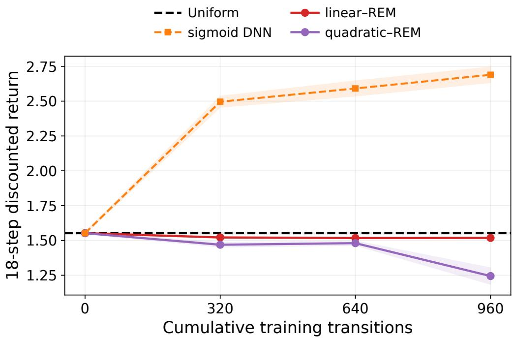
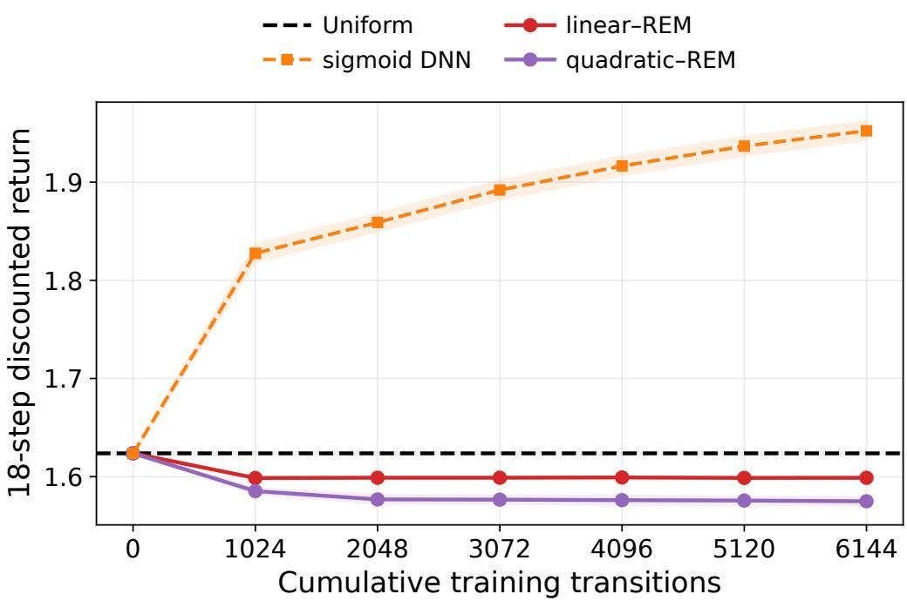
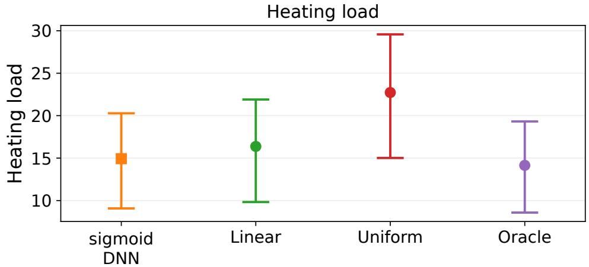
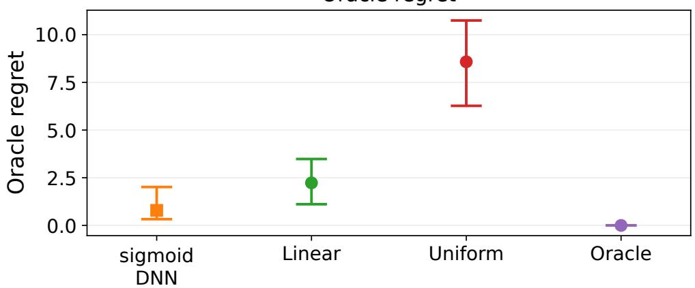

# Neural Actor–Critic Learning with Minimax Critics and Reflected Langevin Sampling

Kunqi Huang Lican Kang ∗ Hongrui Shu Jincheng Ying

## Abstract

Actor–critic methods rely on critic gradients to improve continuous-action policies, yet finite-sample guarantees must control both value and gradient errors and their propagation through the actor. We develop a neural actor–critic procedure that combines a regularized minimax Bellman estimator over sigmoid networks with a finite reflected Langevin sampler driven by the fitted critic gradient. Under uniform Bellman regularity and covered reset sampling, a positive high-order action-derivative penalty yields value and action-gradient risk bounds with classical nonparametric minimax exponents up to logarithmic factors. We propagate estimation, mixing, discretization, temperature, and policy-iteration errors to obtain return guarantees, with refinements for bounded multimodal potentials and strongly concave regimes. Empirical studies across controlled simulations, logged continuous-control data, and a simulated decision task show favorable performance relative to the considered baselines.

Keywords: action-gradient estimation, actor–critic learning, minimax Bellman estimation, reflected Langevin sampling

∗Institute for Math and AI, Hubei Key Laboratory of Computational Science, and School of Artificial Intelligence, Wuhan University, Wuhan, 430072, China. Email: kanglican@whu.edu.cn

## 1 Introduction

Actor–critic methods are a central approach to reinforcement learning (RL) in continuousstate and continuous-action Markov decision processes (MDPs). They alternate between policy evaluation and improvement: the critic estimates expected discounted returns, and the actor uses these estimates to select actions. Classical actor–critic theory studies the coupled updates through two-time-scale stochastic approximation and compatible function approximation (Konda and Tsitsiklis, 2000; Bhatnagar et al., 2009). Deterministic policy gradients make the action derivative of the critic an explicit component of policy improvement (Silver et al., 2014). Policy performance therefore depends on both critic accuracy and how the actor uses the fitted value function. A restrictive actor family can limit this improvement when several separated actions have high value. Gibbs policies ofer an alternative: they assign probability across the action space according to an exponential transform of the value function. This construction is central to entropy-regularized control and soft actor–critic (Haarnoja et al., 2018; Geist et al., 2019). For continuous state and action spaces, let $\mathcal { G } _ { \tau } ( Q )$ denote the conditional law with density proportional to $\exp \{ Q ( s , a ) / \tau \}$ , where Q is an actionvalue function and $\tau > 0$ is a temperature. The action gradient of its log density is $\tau ^ { - 1 } \nabla _ { a } Q$ Thus a Langevin sampler can use the critic gradient to generate actions without computing the normalizing integral. Q-score matching and direct Langevin Q-learning exploit related connections between value gradients and expressive policies (Psenka et al., 2024; Ki et al., 2026).

The central question is how this sampling construction performs when its critic is estimated from finitely many observations. Small prediction error alone does not guarantee that the fitted gradient is an accurate sampling drift. This derivative-estimation problem difers from controlling perturbations of the invariant Gibbs law: these perturbations can also be bounded using value error alone. Moreover, the next policy is the output law of a finite numerical procedure, not its invariant Gibbs law. Errors in this output afect both the next critic fit and subsequent policy improvement. For fixed-policy evaluation, Chen and Qi (2022) establish nonparametric rates for both the action-value function and its derivatives. Deep Sobolev regression provides guarantees for neural function and derivative estimation without derivative responses (Ding et al., 2025), while constrained Langevin theory controls mixing and discretization, including for nonconvex potentials (Lamperski, 2021; Zheng and Lamperski, 2022). Connecting these results requires compatible error measures and regularity conditions throughout the changing critic–actor sequence. Temperature introduces a further interaction. Our objective is the ordinary discounted return $J ,$ and $\pi ^ { \star }$ denotes a stationary Markov policy maximizing this return. The Gibbs map approximates greedy improvement; it does not introduce trajectory-level entropy regularization into policy evaluation. Reducing $\tau$ decreases the approximation bias of the greedy step, but also increases sensitivity to critic errors and can impede movement between action modes. Consequently, a fixed-temperature sampling guarantee does not by itself establish convergence to an ordinary-return optimum. The temperature, critic accuracy, sampling efort, and number of policy updates must be calibrated jointly.

We address this problem by combining a regularized minimax Bellman critic with a finite reflected Langevin actor. At update k, a block of transition observations and next-action draws from the current policy $\widehat { \pi } _ { k }$ is used to estimate $Q ^ { \widehat { \pi } _ { k } }$ by $\widehat { Q } _ { k + 1 }$ . Its action gradient drives a finite reflected sampling scheme whose output law is $\widehat { \pi } _ { k + 1 }$ . The fitted Gibbs law $\mathcal { G } _ { \tau } ( \widehat { Q } _ { k + 1 } )$ is an analytical target for this scheme, not a density that must be estimated or evaluated. Both function classes in the sample minimax criterion are sigmoid deep neural networks (DNNs), with bounded parameters and outputs but no hard H¨older constraint. A strictly positive penalty on high-order action derivatives is evaluated at independent uniform points. These points require neither new transition observations nor derivative labels. The analysis links regularized Bellman estimation to finite sampling and policy improvement. A localized empirical-process bound retains the high-order penalty, so Bellman stability and interpolation yield function and gradient risk bounds. Gibbs density and state-occupancy bounds transfer these bounds to actor and return errors, while coupling and entropy smoothing control the projection scheme uniformly in sampling time. Explicit dependence on temperature and the learned drift permits joint error calibration for multimodal policies and sharper bounds under strong concavity. We evaluate the first-order implementation in two controlled Markov environments and compare prediction and fixed-critic policy extraction on six logged continuous-control datasets. A supplementary study in Appendix H.2 assesses finite-action decisions on simulated building-energy data. A detailed discussion of related work is provided in Appendix A.

## 1.1 Contributions

The contributions are as follows.

(i) A sampled Bellman–Langevin actor–critic method. We combine a subtractive squared-loss Bellman criterion, a positive action-derivative penalty, and a reflected Langevin actor. Next-action observations come from the current finite sampler, so critic estimation and return analysis concern the same policy. The covered reset design specifies how each transition block is generated; neither derivative labels nor policydensity evaluation are required.

(ii) A statistical-risk-to-return guarantee. Under the stated regularity and coverage conditions, with network depth of order log n and size of order $n ^ { d / ( 2 \beta + d ) }$ log n, we balance a positive high-order penalty against approximation and empirical-process errors to prove

$$
\begin{array} { r l } & { \qquad \mathbb { E } _ { k } \| \widehat { Q } _ { k + 1 } - Q ^ { \widehat { \pi } _ { k } } \| _ { L ^ { 2 } ( \mu _ { k } ) } ^ { 2 } \lesssim n ^ { - 2 \beta / ( 2 \beta + d ) } ( \log n ) ^ { 3 } , } \\ & { \qquad \mathbb { E } _ { k } \| \nabla _ { a } \widehat { Q } _ { k + 1 } - \nabla _ { a } Q ^ { \widehat { \pi } _ { k } } \| _ { L ^ { 2 } ( \lambda _ { d } ) } ^ { 2 } \lesssim n ^ { - 2 ( \beta - 1 ) / ( 2 \beta + d ) } ( \log n ) ^ { 3 ( \beta - 1 ) / \beta } , } \end{array}
$$

where n is the common sample size per update, $\beta > 2$ is the H¨older smoothness, $d = d _ { s } + d _ { a }$ is the sum of the state and action dimensions, $\mu _ { k }$ is the conditional state– action law in the covered reset experiment, $\lambda _ { d }$ is the uniform probability measure on the joint cube, and $\mathbb { E } _ { k }$ denotes expectation conditional on the history preceding update k.

The value and action-gradient risk bounds have the classical nonparametric minimax exponents up to logarithmic factors (Stone, 1982; Chen and Qi, 2022). For bounded multimodal potentials, logarithmic cooling gives consistency with a quasipolynomial worst-case sampling budget in n. This multimodal guarantee uses the value-risk branch of the regularized critic analysis, without invoking the statistical gradient-risk bound. Under the additional strong-concavity conditions, direct control of the policy-improvement error by the squared value and gradient risks gives

$$
\mathbb { E } \{ J ( \pi ^ { \star } ) - J ( \widehat { \pi } _ { K } ) \} \lesssim \frac { 1 } { ( 1 - \gamma ) ^ { 2 } } \operatorname* { m i n } \biggr \{ n ^ { - \frac { 2 \beta } { ( 2 \beta + d ) ( d _ { a } + 2 ) } } \bigl ( \log n \bigr ) ^ { \frac { 3 } { d _ { a } + 2 } } , ~ n ^ { - \frac { 2 ( \beta - 1 ) } { ( 2 \beta + d ) ( d _ { a } + 1 ) } } \bigl ( \log n \bigr ) ^ { \frac { 3 ( \beta - 1 ) } { \beta ( d _ { a } + 1 ) } } \biggr \} .
$$

(iii) Empirical assessment. Across 100 replications per controlled environment, the firstorder implementation has higher mean final returns than uniform and polynomial-critic controls. On six logged datasets, the sigmoid DNN has lower displayed mean prediction errors than Linear; comparisons with Quadratic and policy rankings under training-target standardized discounted return depend on the dataset. On simulated building-energy data, neural-critic decisions have lower mean heating load and regret than Linear and Uniform.

## 1.2 Paper Organization

Section 2 introduces the MDP, neural function classes, and sampling preliminaries. Section 3 presents the critic estimator and the executable actor update, with pseudocode in Appendix B. Section 4 establishes the critic, sampling, and return guarantees, including temperature calibrations for multimodal and strongly concave potentials. Section 5 reports the interactive actor–critic experiments and the six-dataset continuous-control study. The appendices provide the related-work discussion (Appendix A), the actor–critic pseudocode (Appendix B), complete proofs and supporting analytical results, and supplementary experimental details (Appendix H).

## 2 Preliminaries

Throughout, n denotes the sample size per update, E and P denote expectation and probability, and $\mathbb { E } _ { k } ( \cdot ) = \mathbb { E } ( \cdot \mid \mathcal { F } _ { k } )$ , where $\mathcal { F } _ { k }$ is the information available before update $k ,$ including the transition blocks and penalty integration points from all earlier updates. The conditional expectation $\mathbb { E } _ { k }$ averages over the transition block and integration points generated at the current update. The Euclidean norm and inner product are $\| \cdot \| _ { 2 }$ and $\langle \cdot , \cdot \rangle$ . For a probability measure ν and $1 \leq p < \infty$ , write $\begin{array} { r } { \| f \| _ { L ^ { p } ( \nu ) } = ( \int \| f \| _ { 2 } ^ { p } \mathrm { d } \nu ) ^ { 1 / p } } \end{array}$ , with absolute value for scalar f, and $\| f \| _ { \infty } = \operatorname* { s u p } _ { z } \| f ( z ) \| _ { 2 }$

Let $\lambda _ { S } , \lambda _ { A }$ , and $\lambda _ { d } = \lambda _ { S } \otimes \lambda _ { A }$ be normalized Lebesgue measures on the state, action, and joint cubes, respectively. At update k, the queried pair $Z _ { k , i } = ( S _ { k , i } , A _ { k , i } )$ has conditional design law

$$
\mu _ { k } ( B ) : = \mathbb { P } \{ Z _ { k , i } \in B \mid \mathcal { F } _ { k } \} , \qquad B \in \mathcal { B } ( \mathcal { S } \times \mathcal { A } ) ,
$$

where $B ( E )$ denotes the Borel sigma-field of E. Assumption 4.2 constructs this joint law by geometric resetting. The critic’s value risk is measured in $L ^ { 2 } ( \mu _ { k } )$ and its action-gradient risk in $L ^ { 2 } ( \lambda _ { d } )$ . Neither measure is the conditional actor law. Unless stated otherwise, action integrals use $\lambda _ { \mathcal { A } }$ . The operators $\nabla _ { a }$ and $\nabla _ { a } ^ { 2 }$ are the action gradient and Hessian. For a matrix-valued function H, let $\begin{array} { r } { \| H \| _ { \mathrm { o p } , \infty } = \operatorname* { s u p } _ { z } \| H ( z ) \| _ { \mathrm { o p } } } \end{array}$ . We write oscf = ess sup f −ess inf f and use Var for variance. The relation $x \lesssim y$ means $x \leq C y$ for a constant depending only on fixed structural parameters, including the H¨older radii; $x \asymp y$ means x ≲ y and $y \lesssim x$ For symmetric matrices, $A \succeq B$ means that $A - B$ is positive semidefinite.

## 2.1 Continuous-state/action MDP and actor–critic objective

Consider the discounted MDP $( S , \mathcal { A } , P , \mathcal { R } , \gamma , \rho _ { 0 } )$ with bounded rectangular state and action domains. After afine rescaling, we take $S = [ 0 , 1 ] ^ { d _ { s } }$ and $\mathcal { A } = [ 0 , 1 ] ^ { d _ { a } }$ without loss of generality, with joint dimension $d = d _ { s } + d _ { a }$ . Here $\textstyle P ( \cdot \mid s , a )$ and $\mathcal { R } ( \cdot \mid s , a )$ are the next-state and reward distributions of the environment’s fixed Markov transition mechanism. The reward distribution is supported on $[ - R _ { \mathrm { m a x } } , R _ { \mathrm { m a x } } ]$ for a fixed $R _ { \mathrm { m a x } } > 0 , \gamma \in [ 0 , 1 )$ is the discount factor, and $\rho _ { 0 }$ is the initial-state distribution. Starting from $S _ { 0 } \sim \rho _ { 0 }$ , the policy generates $A _ { t }$ and, conditional on the history through $( S _ { t } , A _ { t } )$ , the environment generates the reward and next state:

$$
R _ { t } \sim { \mathcal { R } } ( \cdot \ | \ S _ { t } , A _ { t } ) , \qquad S _ { t + 1 } \sim P ( \cdot \ | \ S _ { t } , A _ { t } ) , \qquad | R _ { t } | \leq R _ { \operatorname* { m a x } } \quad { \mathrm { a l m o s t ~ s u r e l y } } .
$$

Each critic observation also includes one next action sampled from the current actor.

A policy $\pi$ is a Markov kernel from S to A. The method accesses policy samples through $A \sim \pi ( \cdot \mid s )$ , without an explicit density or a policy-score oracle. The policy’s discounted return, state-value function, and action-value function are

$$
\begin{array} { r l } & { J ( \pi ) : = \mathbb { E } _ { \rho _ { 0 } , \pi , P , \mathcal { R } } \left[ \displaystyle \sum _ { t = 0 } ^ { \infty } \gamma ^ { t } R _ { t } \right] , } \\ & { V ^ { \pi } ( s ) : = \mathbb { E } _ { \pi , P , \mathcal { R } } \left[ \displaystyle \sum _ { t = 0 } ^ { \infty } \gamma ^ { t } R _ { t } \Bigg | S _ { 0 } = s \right] , } \\ & { Q ^ { \pi } ( s , a ) : = \mathbb { E } _ { \pi , P , \mathcal { R } } \left[ \displaystyle \sum _ { t = 0 } ^ { \infty } \gamma ^ { t } R _ { t } \Bigg | S _ { 0 } = s , A _ { 0 } = a \right] . } \end{array}
$$

The value functions satisfy $\begin{array} { r } { V ^ { \pi } ( s ) = \int _ { \mathcal { A } } Q ^ { \pi } ( s , a ) \pi ( \mathrm { d } a \mid s ) } \end{array}$ and $\left\| V ^ { \pi } \right\| _ { \infty } \vee \left\| Q ^ { \pi } \right\| _ { \infty } \le B _ { Q } : =$ $R _ { \operatorname* { m a x } } / ( 1 - \gamma )$

The target is a policy maximizing the ordinary discounted return:

$$
\pi ^ { \star } \in \arg \operatorname* { m a x } _ { \pi } J ( \pi ) ,
$$

where the maximum is over stationary Markov policies. Section 4.3 establishes attainment under primitive continuity conditions; $\pi ^ { \star }$ need not have a density.

For a policy $\pi ,$ , its normalized discounted state-occupancy measure is

$$
d _ { \pi } ^ { \rho _ { 0 } } ( B ) : = ( 1 - \gamma ) \sum _ { t = 0 } ^ { \infty } \gamma ^ { t } \mathbb { P } _ { \rho _ { 0 } , \pi , P } ( S _ { t } \in B ) , \qquad B \subseteq { \mathcal { S } } { \mathrm { ~ B o r e l } } .
$$

This is a probability measure. For any two policies π and $\pi ^ { \prime }$ , the performance-diference identity gives

$$
J ( \pi ^ { \prime } ) - J ( \pi ) = { \frac { 1 } { 1 - \gamma } } \int _ { S } d _ { \pi ^ { \prime } } ^ { \rho _ { 0 } } ( \mathrm { d } s ) \left\{ \int _ { A } Q ^ { \pi } ( s , a ) \pi ^ { \prime } ( \mathrm { d } a \mid s ) - \int _ { A } Q ^ { \pi } ( s , a ) \pi ( \mathrm { d } a \mid s ) \right\} .\tag{1}
$$

Equation (1) expresses return improvement as an occupancy-weighted action-value diference.

For a bounded function $Q : S \times A  \mathbb { R }$ , define the policy-evaluation Markov operator and Bellman operator by

$$
\begin{array} { r l } & { ( P ^ { \pi } Q ) ( s , a ) : = \mathbb { E } _ { S ^ { \prime } \sim P ( \cdot \mid s , a ) , A ^ { \prime } \sim \pi ( \cdot \mid S ^ { \prime } ) } Q ( S ^ { \prime } , A ^ { \prime } ) , } \\ & { ( \mathcal { T } ^ { \pi } Q ) ( s , a ) : = \mathbb { E } _ { \pi , P , \mathcal { R } } \{ R _ { t } + \gamma Q ( S _ { t + 1 } , A _ { t + 1 } ) \mid S _ { t } = s , A _ { t } = a \} . } \end{array}
$$

The operator $\mathcal { T } ^ { \pi }$ is a γ-contraction in the supremum norm, and $Q ^ { \pi }$ is its unique bounded fixed point. The temperature $\tau > 0$ enters only the actor map below.

For a bounded measurable state function $V ,$ define the state-level policy and optimality operators by

$$
( { \mathcal T } _ { V } ^ { \pi } V ) ( s ) : = \int _ { \mathcal A } \mathbb E _ { P , \mathcal R } \{ R _ { t } + \gamma V ( S _ { t + 1 } ) \mid S _ { t } = s , A _ { t } = a \} { \pi } ( \mathrm { d } a \mid s ) ,
$$

$$
( { \mathcal { T } } _ { V } ^ { \star } V ) ( s ) : = \operatorname* { s u p } _ { a \in { \mathcal { A } } } \mathbb { E } _ { P , { \mathcal { R } } } \{ R _ { t } + { \gamma } V ( S _ { t + 1 } ) \mid S _ { t } = s , A _ { t } = a \} .
$$

The subscript V distinguishes the state-value operators from the state–action operator $\tau ^ { \pi }$ In particular, $V ^ { \pi } = \mathcal { T } _ { V } ^ { \pi } V ^ { \pi }$ , and $V ^ { \star }$ is the fixed point of $\mathcal { T } _ { V } ^ { \star }$

## 2.2 Gibbs policies and entropy divergences

Definition 2.1 (Gibbs improvement map). For bounded measurable $Q$ , define

$$
[ \mathcal { G } _ { \tau } ( Q ) ] ( \mathrm { d } a \ | \ s ) : = \frac { \exp \{ Q ( s , a ) / \tau \} } { Z _ { Q } ( s ) } \mathrm { d } a , \qquad Z _ { Q } ( s ) : = \int _ { A } \exp \{ Q ( s , u ) / \tau \} \mathrm { d } u .
$$

Definition 2.2 (Relative entropy and relative Fisher information). For probability measures $\mu$ and ν on A with $\mu \ll \nu ,$ meaning that $\mu$ is absolutely continuous with respect to $\nu ,$ the Kullback–Leibler (KL) divergence, also called relative entropy, is

$$
\mathrm { K L } ( \mu \| \nu ) : = \int _ { \mathcal { A } } \log \left( \frac { \mathrm { d } \mu } { \mathrm { d } \nu } \right) \mathrm { d } \mu .
$$

$I f \ \mu$ and ν admit positive weakly diferentiable Lebesgue densities $p _ { \mu }$ and $p _ { \nu }$ and $\nabla _ { a } \log ( p _ { \mu } / p _ { \nu } ) \in L ^ { 2 } ( \mu )$ , their relative Fisher information is

$$
I ( \mu | | \nu ) : = \int _ { A } \| \nabla _ { a } \log ( p _ { \mu } / p _ { \nu } ) \| _ { 2 } ^ { 2 } \mathrm { d } \mu ( a ) .
$$

Definition 2.3 (Log-Sobolev inequality). A probability measure ν on $A$ with a positive Lebesgue density satisfies a log-Sobolev inequality (LSI) with constant $\alpha > 0 \ i f \ I ( \mu | | \nu ) \geq$ $2 \alpha \mathrm { K L } ( \mu \| \nu )$ for every probability measure $\mu$ with a suficiently regular density.

For Langevin dynamics with invariant law $\nu ,$ an LSI turns entropy dissipation into exponential convergence in relative entropy.

For arbitrary probability measures $\mu$ and $\nu ,$ let $p _ { \mu } = \mathrm { d } \mu / \mathrm { d } \lambda$ and $p _ { \nu } = \left. \mathrm { d } \nu / \mathrm { d } \lambda \right.$ for any common dominating measure $\lambda$ (for example, $\mu + \nu )$ . The total variation (TV) distance is

$$
\mathrm { T V } ( \mu , \nu ) : = \frac 1 2 \int | p _ { \mu } - p _ { \nu } | \mathrm { d } \lambda .
$$

This definition is independent of the dominating measure and also applies to policy kernels with boundary mass.

For probability measures $\mu$ and $\nu$ on the compact action cube, define the Wasserstein–1 distance

$$
W _ { 1 } ( \mu , \nu ) : = \operatorname* { i n f } _ { \Gamma \in \Pi ( \mu , \nu ) } \int _ { A \times A } \| a - a ^ { \prime } \| _ { 2 } \Gamma ( \mathrm { d } a , \mathrm { d } a ^ { \prime } ) ,
$$

where $\Pi ( \mu , \nu )$ is the set of couplings of $\mu$ and ν. Its state-integrated counterpart is

$$
{ \bf w } _ { 1 } ( \pi , \pi ^ { \prime } ) : = \int _ { S } W _ { 1 } \{ \pi ( \cdot \mid s ) , \pi ^ { \prime } ( \cdot \mid s ) \} \lambda _ { S } ( \mathrm { d } s ) .
$$

The distance $\mathsf { w } _ { 1 }$ controls both Lipschitz policy-improvement residuals and projection-mesh error, without a convexity requirement on the Gibbs potential.

## 2.3 Regularity classes, sigmoid DNNs, and entropy quantities

Definition 2.4 (H¨older class). Write $z = ( s , a ) \in [ 0 , 1 ] ^ { d }$ . For a multi-index α, let |α| be its total order and $D ^ { \alpha }$ the corresponding mixed derivative. For a smoothness index $\beta > 0$ , write $\beta = r _ { \beta } + \nu$ , where $r _ { \beta } = \lceil \beta \rceil - 1$ is the integer derivative order and $\nu \in ( 0 , 1 ]$ is the H¨older exponent. Define

$$
\| f \| _ { \mathcal H ^ { \beta } } : = \operatorname* { m a x } _ { | \alpha | \leq r _ { \beta } } \| D ^ { \alpha } f \| _ { \infty } + \operatorname* { m a x } _ { | \alpha | = r _ { \beta } } \operatorname* { s u p } _ { z \neq z ^ { \prime } } \frac { | D ^ { \alpha } f ( z ) - D ^ { \alpha } f ( z ^ { \prime } ) | } { \| z - z ^ { \prime } \| _ { 2 } ^ { \nu } } .
$$

For a fixed radius $L > 0$ , the H¨older class is

$$
\mathcal { H } ^ { \beta } ( L ) : = \{ f : [ 0 , 1 ] ^ { d } \to \mathbb { R } : \| f \| _ { \mathcal { H } ^ { \beta } } \leq L \} .
$$

Definition 2.5 (Sigmoid deep neural network). The logistic sigmoid activation is $\sigma _ { \mathrm { s i g } } ( u ) =$ ${ \frac { 1 } { 1 + e ^ { - u } } } . \ A$ feed-forward sigmoid DNN with input dimension $p _ { 0 } = d$ and hidden-layer dimensions $p _ { 1 } , \ldots , p _ { \cal D }$ is defined recursively by

$$
h _ { 0 } ( z ) = z , \qquad h _ { \ell } ( z ) = \sigma _ { \operatorname* { s i g } } \{ W _ { \ell } h _ { \ell - 1 } ( z ) + b _ { \ell } \} , \quad \ell = 1 , \ldots , \mathcal { D } , \qquad f _ { \theta } ( z ) = w ^ { \top } h _ { \mathcal { D } } ( z ) + b ,
$$

where $W _ { \ell }$ and $b _ { \ell }$ are the hidden-layer weights and biases, w and b are the output weight vector and bias, and θ collects all network parameters. Define the width, depth, and nonzero-

parameter size by

$$
\mathcal { W } ( f _ { \theta } ) : = \operatorname* { m a x } _ { 1 \leq \ell \leq D } p _ { \ell } , \qquad \mathcal { D } ( f _ { \theta } ) : = \mathcal { D } , \qquad \mathcal { M } ( f _ { \theta } ) : = \| \theta \| _ { 0 } ,
$$

where $\left\| \theta \right\| _ { 0 }$ counts the nonzero parameters of this representation. A parameter bound $B > 0$ means $\begin{array} { r } { \left\| \theta \right\| _ { \infty } \le B } \end{array}$ . The activation acts coordinatewise. A uniform bound B on function values means $\| f _ { \theta } \| _ { \infty } \leq B$

Definition 2.6 (Trainable sigmoid critic and auxiliary classes). Fix a smoothness index $\beta > 2$ and let $m = \lceil \beta \rceil$ be the integer order of the action-derivative penalty. For architecture bounds $( \mathcal { W } _ { n } , \mathcal { D } _ { n } , \mathcal { M } _ { n } )$ and parameter bound $B _ { n }$ , let $\Theta _ { n }$ be the finite union, over all feed-forward sparsity patterns satisfying the width and depth bounds, of parameter cubes with at most $\mathcal { M } _ { n }$ nonzero entries and $\| \theta \| _ { \infty } \leq B _ { n }$ . The associated networks have at most $\mathcal { D } _ { n }$ hidden layers and at most $\mathcal { W } _ { n }$ neurons per hidden layer. Define

$$
\mathcal { F } _ { n } ^ { \mathrm { s i g } } : = \{ f _ { \theta } : \theta \in \Theta _ { n } , \ \| | f _ { \theta } | | _ { \infty } \leq 2 B _ { Q } \} , \qquad \mathcal { G } _ { n } ^ { \mathrm { s i g } } : = \{ g _ { \theta } : \vartheta \in \Theta _ { n } , \ \| g _ { \vartheta } \| _ { \infty } \leq 2 B _ { Q } \} .
$$

For Gibbs potentials on the cube, the following profile collects the constants used in the sampling bounds.

Definition 2.7 (Conditional sampling profile). Fix a temperature $\tau \in ( 0 , 1 ]$ and a family $\mathcal { P } _ { F }$ of action potentials on A. A triple $( \alpha _ { \tau } , \chi _ { \tau } , D _ { \tau } )$ is a sampling profile for $\mathcal { P } _ { F }$ if, for every $F \in { \mathcal { P } } _ { F } ,$ , the Gibbs law $\pi _ { F } ( \mathrm { d } a ) \propto e ^ { F ( a ) / \tau }$ da satisfies

$$
I ( \nu \| \pi _ { F } ) \geq 2 \alpha _ { \tau } \mathrm { K L } ( \nu \| \pi _ { F } ) , \qquad W _ { 1 } ^ { 2 } ( \nu , \pi _ { F } ) \leq 2 \chi _ { \tau } \mathrm { K L } ( \nu \| \pi _ { F } ) , \qquad \left\| \frac { \mathrm { d } \pi _ { F } } { \mathrm { d } \lambda _ { A } } \right\| _ { \infty } \leq D _ { \tau }
$$

for every admissible probability law $\nu .$

Two regimes yield explicit profiles. For a continuously diferentiable potential satisfying $\| \boldsymbol { F } \| _ { \infty } \le B _ { F }$ , with no restriction on its number of modes, bounded perturbation of the

uniform law, Pinsker’s inequality, and the Gibbs normalizer give

$$
\alpha _ { \tau } = \widetilde { \alpha } e ^ { - 2 B _ { F } / \tau } , \qquad \chi _ { \tau } = d _ { a } / 4 , \qquad D _ { \tau } = e ^ { 2 B _ { F } / \tau } ,\tag{2}
$$

where $\widetilde { \alpha } > 0$ is the LSI constant of normalized Lebesgue measure on the cube. If every potential is also ρ-strongly concave, where $\rho > 0$ is a fixed curvature parameter, the convexdomain Bakry–Emery criterion and its Herbst transport consequence give the faster profile

$$
\alpha _ { \tau } = \rho / \tau , \qquad \chi _ { \tau } = \tau / \rho , \qquad D _ { \tau } \lesssim \tau ^ { - d _ { a } } .\tag{3}
$$

Here, the constant in the density bound depends only on $B _ { F }$ and $d _ { a }$ : concavity provides a homothetic neighborhood of a maximizer on which the potential is nearly maximal. Lemma E.2 establishes both profiles, including the case of boundary maximizers. The profiles describe the target distributions; separate, architecture-dependent drift bounds control numerical discretization.

## 2.4 Reflected Langevin dynamics on the action cube

Let $F : S \times A  \mathbb { R }$ be jointly measurable and continuously diferentiable in the action argument, with $a \mapsto \nabla _ { a } F ( s , a )$ Lipschitz uniformly in s. For a fixed state s, the normally reflected overdamped Langevin difusion associated with F is the solution of the Skorokhod stochastic diferential equation (SDE)

$$
\mathrm { d } A _ { t } = \nabla _ { a } F ( s , A _ { t } ) \mathrm { d } t + \sqrt { 2 \tau } \mathrm { d } B _ { t } + \mathrm { d } K _ { t } , \qquad A _ { t } \in \mathcal { A } .\tag{4}
$$

Here, $B _ { t }$ is standard $d _ { a }$ -dimensional Brownian motion and $K _ { t }$ is the boundary regulator

$$
\mathrm { d } K _ { t } = \sum _ { j = 1 } ^ { d _ { a } } e _ { j } \ \mathrm { d } L _ { t } ^ { j , 0 } - \sum _ { j = 1 } ^ { d _ { a } } e _ { j } \ \mathrm { d } L _ { t } ^ { j , 1 } .\tag{5}
$$

The vector $e _ { j }$ is the jth coordinate vector, and $L _ { t } ^ { j , 0 }$ and $L _ { t } ^ { j , 1 }$ are nondecreasing boundary local times supported on $\left\{ A _ { t , j } = 0 \right\}$ and $\left\{ A _ { t , j } = 1 \right\}$ , respectively. The regulator keeps the path in the cube and acts only in inward normal directions. Lemma G.4 gives existence and uniqueness.

For a twice continuously diferentiable test function $\varphi _ { ; }$ , the interior generator is

$$
\begin{array} { r } { \mathcal { L } _ { F , s } \varphi ( a ) = \langle \nabla _ { a } F ( s , a ) , \nabla _ { a } \varphi ( a ) \rangle + \tau \Delta _ { a } \varphi ( a ) , } \end{array}
$$

where $\Delta _ { a }$ is the action-coordinate Laplacian. The generator is equipped with the reflecting (Neumann) boundary condition. If $\rho _ { t }$ denotes the density of $A _ { t } ,$ its probability flux is

$$
\begin{array} { r } { j _ { t } ( a ) = \rho _ { t } ( a ) \nabla _ { a } F ( s , a ) - \tau \nabla _ { a } \rho _ { t } ( a ) , \qquad j _ { t } \cdot n _ { \mathrm { o u t } } = 0 \quad \mathrm { o n ~ e a c h ~ f a c e ~ o f ~ } \partial \mathcal { A } , } \end{array}
$$

where $n _ { \mathrm { o u t } }$ is the outward unit normal to that face; no single normal vector is assigned to edges or corners. The Gibbs density $\pi _ { F } ( \cdot \mid s ) : = { \mathcal G } _ { \tau } ( F ) ( \cdot \mid s )$ is invariant because $\tau \nabla _ { a } \pi _ { F } = \pi _ { F } \nabla _ { a } F$ makes the flux identically zero.

## 3 Methodology

The proposed method alternates between regularized critic estimation and conditional Langevin sampling. Its population counterpart is temperature-smoothed policy iteration initialized at $\pi _ { 0 }$ , with exact policy evaluation followed by Gibbs improvement:

$$
\pi _ { k + 1 } ( \mathrm { d } a \mid s ) = \frac { \exp \{ Q ^ { \pi _ { k } } ( s , a ) / \tau \} } { \int _ { A } \exp \{ Q ^ { \pi _ { k } } ( s , u ) / \tau \} \mathrm { d } u } \mathrm { d } a = \mathcal { G } _ { \tau } ( Q ^ { \pi _ { k } } ) ( \mathrm { d } a \mid s ) , \quad k \geq 0 .
$$

The first two population updates are

$$
\pi _ { 0 } \longrightarrow Q ^ { \pi _ { 0 } } \longrightarrow \pi _ { 1 } = \mathcal { G } _ { \tau } ( Q ^ { \pi _ { 0 } } ) \longrightarrow Q ^ { \pi _ { 1 } } \longrightarrow \pi _ { 2 } = \mathcal { G } _ { \tau } ( Q ^ { \pi _ { 1 } } ) .
$$

For each $k _ { : }$ , the reflected Langevin SDE with drift $\nabla _ { a } Q ^ { \pi _ { k } }$ has invariant conditional law $\pi _ { k + 1 }$ The sample-based method approximates this recursion with K outer actor–critic iterations, indexed by $k = 0 , \ldots , K - 1$

At iteration k, a fresh covered transition block $\mathcal { D } _ { k }$ with state–action design law $\mu _ { k }$ is used to estimate $Q ^ { \widehat { \pi } _ { k } }$ as $\widehat { Q } _ { k + 1 } ;$ the current finite-chain policy $\widehat { \pi } _ { k }$ supplies the next-action draw in each Bellman target. Initialize $\widehat { \pi } _ { 0 } = \pi _ { 0 }$ . The fitted Gibbs law

$$
\widetilde { \pi } _ { k + 1 } : = \mathcal { G } _ { \tau } ( \widehat { Q } _ { k + 1 } )
$$

is the invariant law of the fitted reflected difusion, while $\widehat { \pi } _ { k + 1 }$ is the terminal law after M frozen-drift macrosteps, each evaluated on a polygonal Brownian microgrid of mesh $\delta > 0$ The implemented policy $\widehat { \pi } _ { k + 1 }$ supplies next-action draws at iteration $k + 1 ; \widetilde { \pi } _ { k + 1 }$ serves as its analytical sampling target. The resulting recursion is

$$
\begin{array} { r l } { \widehat { \pi } _ { k } } & { \xrightarrow [ ] { \mathrm { g e n e r a t e ~ o n e - s t e p ~ b l o c k } } \mathcal { D } _ { k } \xrightarrow [ ] { \mathrm { r e g u l a r i z e d ~ m i n i m a x ~ f i t } } ( \widehat { Q } _ { k + 1 } , \nabla _ { a } \widehat { Q } _ { k + 1 } ) } \\ & { \widehat { Q } _ { k + 1 } \xrightarrow [ ] { \nabla _ { a } \widehat { Q } _ { k + 1 } \mathrm { d r i v e s ~ } M \mathrm { ~ r e f e c t e d ~ m a c r o s t e p s } } \widehat { \pi } _ { k + 1 } . } \end{array}\tag{6}
$$

Each update in (6) uses the same block size n, network architecture $( \mathbb { W } _ { n } , \mathbb { D } _ { n } , \mathbb { M } _ { n } )$ , penalty coeficient $\lambda _ { n } \ > \ 0$ , derivative order $m = \lceil \beta \rceil$ , number of uniform integration points $\ell _ { n } .$ temperature $\tau ,$ , and sampler settings $( M , \eta , \delta )$ . Algorithm 1 in Appendix B summarizes this recursion. The critic estimator and actor sampler are specified below.

## 3.1 Critic: regularized minimax Bellman estimation

Conditional on the pre-update history $\mathcal { F } _ { k }$ , the policy $\widehat { \pi } _ { k }$ and covered design law $\mu _ { k }$ are fixed. Write $Z = ( S , A ) \sim \mu _ { k } , R \sim { \mathcal { R } } ( \cdot \mid S , A )$ , and $Z ^ { \prime } = ( S ^ { \prime } , A ^ { \prime } )$ , where $S ^ { \prime } \sim P ( \cdot \mid S , A )$ and an independent actor call gives $A ^ { \prime } \sim \widehat \pi _ { k } ( \cdot \mid S ^ { \prime } )$ $\mathrm { A t } ~ k = 0$ , the next-action call uses the supplied sampler $\pi _ { 0 } ;$ for $k \geq 1$ , it reruns the reflected Euler–Maruyama (REM) projection microgrid with fresh randomness. The action-value function satisfies the Bellman equation

$$
Q ^ { \widehat { \pi } _ { k } } \big ( s , a \big ) = \big ( T ^ { \widehat { \pi } _ { k } } Q ^ { \widehat { \pi } _ { k } } \big ) \big ( s , a \big ) = \mathbb { E } _ { k } \left[ R + \gamma Q ^ { \widehat { \pi } _ { k } } ( Z ^ { \prime } ) \mid Z = ( s , a ) \right] .
$$

The population criterion uses the critic and auxiliary H¨older classes $\mathcal { H } ^ { \beta } ( L )$ and $\mathcal { H } ^ { \beta } ( L _ { \mathcal { T } } )$ respectively, with the fixed auxiliary radius enlarged as in Lemma D.4. This population comparison uses the architecture sequence calibrated in Theorem 4.3; the fitted class itself has no fixed H¨older constraint. For bounded measurable f and $g \in { \mathcal { H } } ^ { \beta } ( L _ { \mathcal { T } } )$ , let $Y _ { k } ( f ) : =$ $R + \gamma f ( Z ^ { \prime } )$ and define

$$
\begin{array} { r } { \mathcal { L } _ { k } ( f , g ) : = \mathbb { E } _ { k } \big [ \{ f ( Z ) - Y _ { k } ( f ) \} ^ { 2 } - \{ g ( Z ) - Y _ { k } ( f ) \} ^ { 2 } \big ] . } \end{array}\tag{7}
$$

Because $\mathbb { E } _ { k } \left[ Y _ { k } ( f ) \mid Z \right] = ( T ^ { \widehat { \pi } _ { k } } f ) ( Z )$ , the conditional-mean Pythagorean identity gives

$$
\mathcal { L } _ { k } ( f , g ) = \left\| f - \mathcal { T } ^ { \widehat { \pi } _ { k } } f \right\| _ { L ^ { 2 } ( \mu _ { k } ) } ^ { 2 } - \left\| g - \mathcal { T } ^ { \widehat { \pi } _ { k } } f \right\| _ { L ^ { 2 } ( \mu _ { k } ) } ^ { 2 } .\tag{8}
$$

The design law $\mu _ { k }$ need not be the state–action law induced by $\widehat { \pi } _ { k }$ . Assumption 4.1 places $\mathcal T ^ { \widehat { \pi } _ { k } } f$ in the auxiliary class for $f \in \mathcal { F } _ { n } ^ { \mathrm { s i g } }$ ; Lemma D.4 extends this property to $f \in { \mathcal { H } } ^ { \beta } ( L )$ by approximation, closedness, and the afine Bellman identity. Therefore, on the union of these two critic classes, (8) gives

$$
\operatorname* { s u p } _ { g \in \mathcal { H } ^ { \beta } ( L _ { \mathcal { T } } ) } \mathcal { L } _ { k } ( f , g ) = \big \| f - \mathcal { T } ^ { \widehat { \pi } _ { k } } f \big \| _ { L ^ { 2 } ( \mu _ { k } ) } ^ { 2 } .
$$

Under the coverage condition in Assumption 4.2, it follows that

$$
Q ^ { \widehat { \pi } _ { k } } = \underset { f \in \mathcal { H } ^ { \beta } ( L ) } { \arg \operatorname* { m i n } } \quad \underset { g \in \mathcal { H } ^ { \beta } ( L \mathcal { T } ) } { \operatorname* { s u p } } \mathcal { L } _ { k } ( f , g ) .
$$

Indeed, $Q ^ { \widehat { \pi } _ { k } }$ belongs to the outer class, and a zero $L ^ { 2 } ( \mu _ { k } )$ residual vanishes everywhere by continuity and $\mu _ { k } \geq ( 1 - \gamma ) \lambda _ { d }$ . Uniqueness then follows from Bellman contraction. The subtraction in (7) cancels the common conditional target variance and avoids the doublesampling bias of a directly squared empirical Bellman residual (Antos et al., 2008; Chen and Jiang, 2019). Moment-based minimax Q-learning is related but uses a diferent adversarial criterion (Uehara et al., 2020).

At the sample level, the complete observation block is

$$
\begin{array} { r l } & { \mathcal { D } _ { k } : = \{ ( Z _ { k , i } , R _ { k , i } , S _ { k , i } ^ { \prime } , A _ { k , i } ^ { \prime } ) : i = 1 , . . . , n \} , } \\ & { } \\ & { Z _ { k , i } \sim \mu _ { k } , \qquad S _ { k , i } ^ { \prime } \sim P ( \cdot \mid Z _ { k , i } ) , \qquad A _ { k , i } ^ { \prime } \sim \widehat { \pi } _ { k } ( \cdot \mid S _ { k , i } ^ { \prime } ) . } \end{array}\tag{9}
$$

Each next action is drawn once and held fixed during fitting. For $f \in \mathcal { F } _ { n } ^ { \mathrm { s i g } }$ , set

$$
Y _ { k , i } ( f ) : = R _ { k , i } + \gamma f ( S _ { k , i } ^ { \prime } , A _ { k , i } ^ { \prime } )
$$

and, for $g \in { \mathcal { G } } _ { n } ^ { \mathrm { s i g } }$ , define

$$
\widehat { \mathcal { L } } _ { k } ( f , g ) : = \frac { 1 } { n } \sum _ { i = 1 } ^ { n } \left[ \{ f ( Z _ { k , i } ) - Y _ { k , i } ( f ) \} ^ { 2 } - \{ g ( Z _ { k , i } ) - Y _ { k , i } ( f ) \} ^ { 2 } \right] .
$$

To control the action-gradient error, we penalize high-order action derivatives. Independently of $\mathcal { D } _ { k }$ , draw $\ell _ { n }$ independent uniform integration points $U _ { k , r } \sim \lambda _ { d } , r = 1 , . . . , \ell _ { n }$ . Write $\mathcal { U } _ { k } = \{ U _ { k , r } : r = 1 , \ldots , \ell _ { n } \}$ for this collection. These points require neither rewards nor simulator transitions. For $m = \left\lceil \beta \right\rceil$ , define the action roughness functional

$$
\mathcal { P } _ { m } ( f ) : = \sum _ { j = 1 } ^ { d _ { a } } \int _ { [ 0 , 1 ] ^ { d } } | \partial _ { a _ { j } } ^ { m } f ( z ) | ^ { 2 } \lambda _ { d } ( \mathrm { d } z ) .
$$

Only pure derivatives in the action coordinates are penalized. Replacing the population function classes by sigmoid DNN classes and the penalty integral by its empirical average gives

$$
\widehat { Q } _ { k + 1 } \in \underset { f \in \mathcal { F } _ { n } ^ { \mathrm { s i g } } } { \arg \operatorname* { m i n } } \left\{ \underset { g \in \mathcal { G } _ { n } ^ { \mathrm { s i g } } } { \operatorname* { s u p } } \widehat { \mathcal { L } } _ { k } ( f , g ) + \frac { \lambda _ { n } } { \ell _ { n } } \sum _ { r = 1 } ^ { \ell _ { n } } \sum _ { j = 1 } ^ { d _ { a } } | \partial _ { a _ { j } } ^ { m } f ( U _ { k , r } ) | ^ { 2 } \right\} .\tag{10}
$$

The corresponding action-gradient estimate is the analytical derivative $\nabla _ { a } \widehat { Q } _ { k + 1 }$ . Derivative regularization also appears in deep Sobolev regression (Ding et al., 2025). Here the order $m = \lceil \beta \rceil$ allows a finite-diference argument to control first-derivative error through Bellman value error and the penalized roughness. Neither derivative labels nor boundary conditions on the unknown value function are required.

The number of integration points is calibrated uniformly over the trainable class. For a suficiently large fixed constant $C _ { m }$ depending only on m, set

$$
A _ { m , n } : = d _ { a } \{ C _ { m } ( { \mathcal { W } } _ { n } + d + 1 ) ( { \mathcal { B } } _ { n } + 1 ) \} ^ { 2 ( m { \mathcal { D } } _ { n } + 1 ) } .
$$

The chain rule bounds $\textstyle \sum _ { j } | \partial _ { a _ { j } } ^ { m } f ( z ) | ^ { 2 }$ $A _ { m , n }$ for every admissible network and every z. Lemma D.6 establishes this uniform derivative bound and controls the uniform integration error. Theorem 4.3 specifies $\lambda _ { n } > 0$ and $\ell _ { n }$ so that this error is no larger than the critic’s approximation and statistical errors.

## 3.2 Actor: reflected conditional Langevin sampling

Fix a queried state s. Substituting $F = \widehat { Q } _ { k + 1 }$ into (4) gives the fitted reflected difusion on $\mathcal { A } = [ 0 , 1 ] ^ { d _ { a } }$

$$
\mathrm { d } A _ { k , t } ^ { s } = \nabla _ { a } \widehat { Q } _ { k + 1 } ( s , A _ { k , t } ^ { s } ) \mathrm { d } t + \sqrt { 2 \tau } \mathrm { d } B _ { t } + \mathrm { d } K _ { k , t } ^ { s } .
$$

The regulator $K _ { k , t } ^ { s }$ is defined in (5). By the no-flux calculation in Section 2.4, the difusion’s invariant law is $\widetilde { \pi } _ { k + 1 } = \mathcal { G } _ { \tau } ( \widehat { Q } _ { k + 1 } )$ . The density of this fitted Gibbs target satisfies

$$
\nabla _ { a } \log \widetilde { \pi } _ { k + 1 } ( a \mid s ) = \tau ^ { - 1 } \nabla _ { a } \widehat { Q } _ { k + 1 } ( s , a ) .
$$

Thus its score difers from that of $\mathcal { G } _ { \tau } ( Q ^ { \widehat { \pi } _ { k } } )$ by $\tau ^ { - 1 } ( \nabla _ { a } \widehat { Q } _ { k + 1 } - \nabla _ { a } Q ^ { \widehat { \pi } _ { k } } )$ . This identity links critic-gradient risk to sampling error through relative Fisher information. Before defining the finite sampler, we bound the temperature bias of its Gibbs target.

Lemma 3.1 (Soft-greedy gap). For every state s, bounded $Q ,$ , and policy law $\pi ( \cdot \mid s )$ with Lebesgue density $p _ { \pi } ( \cdot \mid s )$ , the following identity holds in the extended-real sense:

$$
\tau \log Z _ { Q } ( s ) - \int _ { \mathcal { A } } \left\{ Q ( s , a ) - \tau \log p _ { \pi } ( a \mid s ) \right\} \pi ( \mathrm { d } a \mid s ) = \tau \mathrm { K L } \left( \pi ( \cdot \mid s ) \| \mathcal { G } _ { \tau } ( Q ) ( \cdot \mid s ) \right) .\tag{11}
$$

$I f ,$ in addition, $Q ( s , \cdot )$ is continuously diferentiable and maxj $\| \partial _ { a _ { j } } Q ( s , \cdot ) \| _ { \infty } \leq L$ , then

$$
0 \leq \operatorname* { m a x } _ { a \in A } Q ( s , a ) - \int _ { A } Q ( s , a ) \left[ \mathcal { G } _ { \tau } ( Q ) \right] \left( \mathrm { d } a \mid s \right) \leq \tau \left[ 1 + d _ { a } \log \left( 1 + \frac { d _ { a } L } { \tau } \right) \right] .\tag{12}
$$

$I f ,$ in addition, $Q ( s , \cdot )$ is concave, this temperature error admits the sharper bound

$$
0 \leq \operatorname* { m a x } _ { a \in \mathcal { A } } Q ( s , a ) - \int _ { \mathcal { A } } Q ( s , a ) \left[ \mathcal { G } _ { \tau } ( Q ) \right] ( \mathrm { d } a \mid s ) \leq d _ { a } \tau .\tag{13}
$$

For the finite-step actor, let $\nu _ { k , 0 } ( \cdot \mid s )$ be the initialization law. Fix the macrostep size $\eta > 0$ and the number of macrosteps $M \in \mathbb { N }$ at every outer iteration; $M \eta$ is the total simulated Langevin time. Let $\Gamma _ { A }$ be the normal Skorokhod map on the cube: for a continuous driving path x with $x ( 0 ) \in \mathcal { A } , \Gamma _ { \mathcal { A } } ( x ) = x + K$ is the unique constrained path whose boundedvariation regulator K acts only in the inward normal direction at the boundary. Denote by $L _ { \Gamma }$ its fixed uniform-path Lipschitz constant. Starting from $A _ { k , 0 } ^ { s , \mathrm { p a t h } } \sim \nu _ { k , 0 } ( \cdot \mid s )$ and using independent Brownian increments $W _ { k , j } ( u ) : = B _ { j \eta + u } - B _ { j \eta } , 0 \le u \le \eta$ , the exact pathwise REM comparison process freezes the fitted drift at the beginning of each macrostep and sets

$$
\begin{array} { r l } & { X _ { k , j } ^ { s } ( u ) : = A _ { k , j } ^ { s , \mathrm { p a t h } } + u \nabla _ { a } \widehat Q _ { k + 1 } ( s , A _ { k , j } ^ { s , \mathrm { p a t h } } ) + \sqrt { 2 \tau } W _ { k , j } ( u ) , \quad 0 \leq u \leq \eta , } \\ & { A _ { k , j + 1 } ^ { s , \mathrm { p a t h } } : = \bigl [ \Gamma _ { A } ( X _ { k , j } ^ { s } ) \bigr ] ( \eta ) , \quad j = 0 , \ldots , M - 1 . } \end{array}\tag{14}
$$

In this pathwise REM step, also called an Euler–Peano step, the drift is frozen while reflection acts on the entire Brownian path. The resulting comparison process is used to establish the entropy estimate in the sampling analysis.

The executable sampler replaces each Brownian path by its polygonal interpolation.

Choose $0 < \delta \leq \eta$ such that $q _ { \delta } : = \eta / \delta \in \mathbb { N }$ . Starting from $A _ { k , 0 } ^ { s , \delta } \sim \nu _ { k , 0 } ( \cdot \mid s )$ , set $A _ { k , j , 0 } ^ { s , \delta } = A _ { k , j } ^ { s , \delta }$ and, for $\ell = 0 , \ldots , q _ { \delta } - 1$ , compute

$$
\begin{array} { r l } & { A _ { k , j , \ell + 1 } ^ { s , \delta } : = \mathrm { p r o j } _ { \cal A } \left[ A _ { k , j , \ell } ^ { s , \delta } + \delta \nabla _ { a } \widehat Q _ { k + 1 } ( s , A _ { k , j } ^ { s , \delta } ) + \sqrt { 2 \tau } \{ B _ { j \eta + ( \ell + 1 ) \delta } - B _ { j \eta + \ell \delta } \} \right] , } \\ & { A _ { k , j + 1 } ^ { s , \delta } : = A _ { k , j , q _ { \delta } } ^ { s , \delta } , \qquad j = 0 , \ldots , M - 1 , } \end{array}\tag{15}
$$

where $\mathrm { p r o j } _ { \boldsymbol { A } }$ is coordinatewise Euclidean projection onto the action cube. The fitted drift remains frozen across the $q _ { \delta }$ microincrements in a macrostep. Coordinatewise projection evaluates the Skorokhod image of the polygonal driver exactly at its knots. Thus (15) is a finite algorithm, whereas (14) is its Brownian-path limit. We use $\delta = 0$ to denote the pathwise comparison and $\delta > 0$ for the executable microgrid.

The next policy is defined directly as a probability kernel by

$$
{ \widehat { \pi } } _ { k + 1 } ( B \mid s ) : = \mathbb { P } \{ A _ { k , M } ^ { s , \delta } \in B \mid { \mathcal { F } } _ { k } , { \mathcal { D } } _ { k } , { \mathcal { U } } _ { k } \} , \qquad B \in { \mathcal { B } } ( { \mathcal { A } } ) .
$$

Independent runs of this microgrid supply next-action draws at update $k + 1$ . Because the finite output law may have boundary mass, we compare it with the Gibbs target in Wasserstein distance.

## 4 Theory

The analysis follows the method’s three components: critic estimation, conditional actor sampling, and outer policy iteration. Critic error arises from function approximation, finite transition data, and numerical integration of the high-order penalty. Actor error combines finite-time mixing and numerical approximation of the reflected difusion. We first control these errors and then propagate them through policy iteration. Under the regularity and coverage conditions stated below, Bellman policy improvement gives the decomposition

$$
\begin{array} { r l } & { \mathbb { E } \{ J ( \pi ^ { \star } ) - J ( \widehat { \pi } _ { K } ) \} \lesssim \underbrace { \frac { \gamma ^ { K } } { 1 - \gamma } } _ { \mathrm { o u t e r ~ i t e r a t i o n } } + \underbrace { \frac { b _ { \tau } } { ( 1 - \gamma ) ^ { 2 } } } _ { \mathrm { t e m p e r a t u r e ~ b i a s } } } \\ & { \quad \quad \quad + \frac { 1 } { 1 - \gamma } \underset { k = 0 } { \overset { K - 1 } { \sum } } \gamma ^ { K - 1 - k } \underset { \mathrm { s a m p i n g ~ e r o r ~ f o r ~ f o r t ~ t e d ~ t a r g e t } } { \underbrace { \mathbb { E } \mathbb { w } _ { 1 } ( \widehat { \pi } _ { k + 1 } , \widetilde { \pi } _ { k + 1 } ) } } + \underbrace { \mathbb { E } \mathbb { w } _ { 1 } \left( \widetilde { \pi } _ { k + 1 } , \mathcal { G } _ { \tau } ( Q ^ { \widehat { \pi } _ { k } } ) \right) } _ { \mathrm { c r i t i c - i n d u c e d ~ t a r g e t ~ e r r o r } } \} . } \end{array}\tag{16}
$$

Here $\begin{array} { r } { b _ { \tau } : = \tau \left[ 1 + d _ { a } \log \left( 1 + \frac { d _ { a } L } { \tau } \right) \right] } \end{array}$ is the soft-greedy bound from Lemma 3.1, where L is a uniform bound on each action partial derivative of the population value functions. The proof of Theorem 4.9 in Appendix F establishes (16). Section 4.1 derives the value and gradient risks underlying the critic-induced term. Section 4.2 combines the two critic risks with mixing and discretization bounds. Section 4.3 combines this recursion with a sharper direct value-risk bound on approximate greediness to obtain the return guarantee.

## 4.1 Joint value and action-gradient estimation

We first derive joint value and action-gradient risk bounds for the regularized neural critic. To this end, Assumption 4.1 imposes uniform H¨older regularity on population values and Bellman images of the neural class, while Assumption 4.2 specifies the covered reset-stationary sampling experiment. Under these conditions, Theorem 4.3 gives nonasymptotic bounds by calibrating the network architecture, high-order penalty weight, and integration budget to the sample size.

Assumption 4.1. There exist $\beta > 2$ and fixed constants $L _ { T } \ge L > 0$ such that, for every stationary Markov policy π, $Q ^ { \pi } \in \mathcal H ^ { \beta } ( L )$ and $\mathcal { T } ^ { \pi } f \in \mathcal { H } ^ { \beta } ( L _ { \mathcal { T } } )$ for each $f \in \mathcal { F } _ { n } ^ { \mathrm { s i g } }$

Assumption 4.2. Conditional on $\mathcal { F } _ { k }$ , the n transition tuples in (9) are independent and identically distributed. Let $P ^ { \widehat { \pi } _ { k } }$ denote their state–action transition kernel and let $\lambda _ { d }$ be normalized Lebesgue measure on $[ 0 , 1 ] ^ { d }$ . The query law is

$$
\mu _ { k } = ( 1 - \gamma ) \sum _ { j = 0 } ^ { \infty } \gamma ^ { j } \lambda _ { d } ( P ^ { \widehat { \pi } _ { k } } ) ^ { j } .
$$

Theorem 4.3. Under Assumptions $\it 4 . 1$ and $4 . 2 ,$ use the trainable classes in Definition 2.6. There are architecture bounds satisfying

$$
\mathcal D _ { n } \asymp \log n , \quad \mathcal W _ { n } \asymp n ^ { d / ( 2 \beta + d ) } , \quad \mathcal M _ { n } \asymp n ^ { d / ( 2 \beta + d ) } \log n , \quad \mathcal B _ { n } \asymp n ^ { c _ { B } } ,
$$

where $c _ { B }$ is a fixed constant depending on $( \beta , d )$ . For $m = \lceil \beta \rceil$ , there are positive tuning parameters satisfying

$$
\lambda _ { n } \asymp n ^ { - 2 m / ( 2 \beta + d ) } ( \log n ) ^ { 3 m / \beta } , \qquad \ell _ { n } \asymp \big [ A _ { m , n } { \cal M } _ { n } ( \log n ) ^ { 2 } \{ n ^ { - 2 \beta / ( 2 \beta + d ) } ( \log n ) ^ { 3 } \} ^ { m / \beta - 1 } \big ] ,
$$

for which the global regularized minimax estimator satisfies

$$
\begin{array} { r } { \mathbb { E } _ { k } \left\| \widehat { Q } _ { k + 1 } - Q ^ { \widehat { \pi } _ { k } } \right\| _ { L ^ { 2 } ( \mu _ { k } ) } ^ { 2 } \lesssim n ^ { - 2 \beta / ( 2 \beta + d ) } ( \log n ) ^ { 3 } , } \end{array}\tag{17}
$$

$$
\begin{array} { r } { \mathbb { E } _ { k } \left\| \nabla _ { a } \widehat { Q } _ { k + 1 } - \nabla _ { a } Q ^ { \widehat { \pi } _ { k } } \right\| _ { L ^ { 2 } ( \lambda _ { d } ) } ^ { 2 } \lesssim n ^ { - 2 ( \beta - 1 ) / ( 2 \beta + d ) } ( \log n ) ^ { 3 ( \beta - 1 ) / \beta } . } \end{array}\tag{18}
$$

Remark 4.4. Assumption 4.1 requires smooth true values and Bellman images of the trainable DNN class, not a fixed H¨older constraint on fitted networks. Related Bellmanimage smoothness conditions appear in Theorem 21 and Remark 22 of Feng et al. (2023) for optimality updates, and in Assumption 5.1 of Jiao et al. (2025) for policy evaluation. Here the H¨older radius is uniform over the growing sigmoid classes and the policies used by the actor. Neural approximation yields approximate Bellman completeness, not exact closure within the finite network class. Lemma D.1 verifies this regularity when $\begin{array} { r } { ( s , a ) \mapsto \int u \mathcal { R } ( \mathrm { d } u \mid s , a ) } \end{array}$ is H¨older and the transition density is H¨older in the queried state–action variables as an $L ^ { 1 }$ -valued map; no smoothness of the actor kernel is required.

The design in Assumption $4 . 2$ satisfies $\mu _ { k } \geq ( 1 - \gamma ) \lambda _ { d }$ and $\gamma \mu _ { k } P ^ { \widehat { \pi } _ { k } } \leq \mu _ { k }$ . These inequalities give coverage and Bellman coercivity, respectively; bounded rewards control empirical fluctuations. The value risk uses $\mu _ { k }$ , whereas the gradient risk and roughness integral use $\lambda _ { d } ,$ including when the actor has boundary atoms. To sample from this design, draw T with $\Pr ( T = j ) = ( 1 - \gamma ) \gamma ^ { j }$ , start from $\lambda _ { d . }$ , and run the current actor for T transitions. Independent repetitions yield the block; only the queried transitions are retained for estimation. The expected cost per query, including its successor, is $1 / ( 1 - \gamma )$

Remark 4.5. The value and action-gradient risk bounds have the classical nonparametric minimax exponents up to logarithmic factors (Stone, 1982; Chen and Qi, 2022). In Theorem 4.3, the diference between the exponents in (17) and (18) reflects the loss of one order of smoothness. With $m = \lceil \beta \rceil$ and $\lambda _ { n } > 0$ , controlling the integration error leaves $\lambda _ { n } \mathcal { P } _ { m } ( \widehat { Q } _ { k + 1 } )$ in the basic inequality. A comparison resolution of order $\lambda _ { n } ^ { - 1 / ( 2 m ) }$ makes the combined approximation and penalty cost of order $\lambda _ { n } ^ { \beta / m }$ . Using a finite-diference scale of order $\lambda _ { n } ^ { 1 / ( 2 m ) }$ , capped at a fixed cube scale, balances the terms

$$
\lambda _ { n } ^ { - 1 / m } n ^ { - 2 \beta / ( 2 \beta + d ) } ( \log n ) ^ { 3 } \quad a n d \quad \lambda _ { n } ^ { ( \beta - 1 ) / m } .
$$

Balancing these terms gives the stated $\lambda _ { n }$ and (18). The comparison network’s mth derivatives may grow with resolution; the target need not have square-integrable derivatives of that order when β is noninteger. Lemmas D.7 and D.8 give the details.

For comparison, Theorem 2 of Ding et al. (2025) gives a squared gradient risk of $O \{ n ^ { - s / ( d + 4 s ) } ( \log n ) ^ { 2 } \}$ under a first-order penalty for integer smoothness $s \geq 2$ . For a common integer smoothness $\beta = s > 2$ , the exponent in (18) is $2 ( s - 1 ) / ( 2 s + d )$ , the classical gradient benchmark. The improved exponent combines high-order bias calibration with the localized statistical bound; it does not rule out faster first-order estimators under other conditions. The penalty controls integrated derivative risk, whereas uniform drift bounds and strong concavity require separate architecture and geometric conditions. The uniform integration guarantee is worst-case over the trainable class; its derivative-evaluation budget can be quasipolynomial because $A _ { m , n } = \exp \{ O ( ( \log n ) ^ { 2 } ) \}$ .

## 4.2 Langevin sampling error with an estimated critic

The actor analysis compares the numerical sampler with the difusion associated with the fitted critic, its invariant Gibbs law, and the population Gibbs target. These comparisons separate numerical error, finite-time mixing, and critic-estimation error, all integrated over the state cube. Value and gradient perturbations provide complementary target-error bounds. Numerical discretization is controlled separately by bounds on the drift and its Lipschitz constant supplied by the network architecture. For the calibrated architecture in Theorem 4.3, set $B _ { F } = 2 B _ { Q }$ and define

$$
A _ { n } : = \mathcal { W } _ { n } \mathcal { B } _ { n } , B _ { 1 , n } : = \sqrt { d _ { a } } A _ { n } ^ { { \mathcal { D } } _ { n } + 1 } , L _ { b , n } : = d _ { a } ( { \mathcal { D } } _ { n } + 1 ) A _ { n } ^ { 2 ( { \mathcal { D } } _ { n } + 1 ) } .
$$

Lemma E.1 gives deterministic bounds on the action-gradient norm and the drift Lipschitz constant for both fitted and population potentials. For a common sampling profile, put

$$
\mathcal { C } _ { \tau , n } : = 1 + \sqrt { \frac { 1 + L _ { b , n } } { \tau } } \left[ 1 + \frac { 1 + \log \{ 1 + d _ { a } ( 1 + L _ { b , n } ) / \tau \} } { \alpha _ { \tau } \tau } \right] .
$$

This factor bounds the time-integrated Lipschitz seminorm of the exact difusion semigroup and depends polynomially on $L _ { b , n }$ . If all fitted potentials are ρ-strongly concave, the results below instead hold with $\mathcal { C } _ { \tau , n } = 1 + \rho ^ { - 1 }$ , by synchronous contraction.

Theorem 4.6. Under Assumptions 4.1 and 4.2, use the critic calibration in Theorem $4 . 3 .$ Suppose the fitted and population potentials have the common sampling profile $\left( \alpha _ { \tau } , \chi _ { \tau } , D _ { \tau } \right)$ uniformly in the queried state and iteration. Initialize from normalized Lebesgue measure and use the frozen-drift macrostep size η and the executable polygonal projection mesh size $\delta ,$ where $0 < \eta \leq 1 , 0 < \delta \leq \eta / 2$ , and $\eta / \delta \in \mathbb { N }$ . Then

$$
\begin{array} { r l } & { \mathbb { E } _ { k } \mathsf { w } _ { 1 } \left( \widehat { \pi } _ { k + 1 } , \mathcal { G } _ { \tau } ( Q ^ { \widehat { \pi } _ { k } } ) \right) \lesssim \mathcal { C } _ { \tau , n } L _ { b , n } \bigg [ B _ { 1 , n } \eta + \sqrt { \tau \{ \eta + \delta \log ( e / \delta ) \} } \bigg ] + \left( \frac { \chi _ { \tau } } { \tau } \right) ^ { 1 / 2 } e ^ { - \alpha _ { \tau } \tau M \eta } } \\ & { \qquad + \operatorname* { m i n } \Biggl \{ \left( \frac { \chi _ { \tau } \operatorname* { m i n } \{ D _ { \tau } , \tau ^ { - d _ { a } } \} } { \alpha _ { \tau } \tau ^ { 2 } } \right) ^ { 1 / 2 } n ^ { - ( \beta - 1 ) / ( 2 \beta + d ) } ( \log n ) ^ { 3 ( \beta - 1 ) / ( 2 \beta ) } , } \\ & { \qquad \left( \frac { \chi _ { \tau } } { \tau } \right) ^ { 1 / 2 } e ^ { 3 B _ { F } / ( 4 \tau ) } n ^ { - \beta / ( 2 \beta + d ) } ( \log n ) ^ { 3 / 2 } \Biggr \} . } \end{array}
$$

Remark 4.7. Smoothing and mixing replace $\exp ( L _ { b , n } M \eta )$ by $ { { \mathcal { C } } } _ { \tau , n }$ , making the numerical remainder uniform in Mη. Short-block propagation removes the reciprocal-macrostep factor from the mesh error. With fixed temperature and drift bounds, this error vanishes as $\eta \downarrow 0$ even at a fixed ratio $\delta / \eta \le 1 / 2$ . The inverse log-Sobolev constant can nevertheless grow exponentially as τ decreases, and the derivative bounds for the calibrated networks can grow as $\exp \{ O ( ( \log n ) ^ { 2 } ) \}$ }. Strong concavity gives $\mathcal { C } _ { \tau , n } = 1 + \rho ^ { - 1 }$ by synchronous contraction, but does not remove the local drift dependence. The minimum compares gradient and value perturbations of the Gibbs target. Reverse relative Fisher information weights the gradient error by the population Gibbs law, whose $O ( \tau ^ { - d _ { a } } )$ density bound follows from Lipschitz regularity, including for multimodal potentials and boundary maximizers. The value route uses relative-entropy interpolation and yields the sharper sample-size exponent under multimodal logarithmic cooling. Thus computing the fitted gradient need not entail using its statistical risk in the return bound. Both routes use integrated critic risks, not uniform-in-state estimation bounds.

## 4.3 End-to-end actor–critic error propagation

We next propagate the integrated actor error through policy improvement. For this purpose, Assumption 4.8 imposes continuity and state-density bounds that allow the error to be transferred to the state distributions in the recursion. Combined with Bellman contraction and the critic and actor bounds, these conditions yield the end-to-end return bound in Theorem 4.9.

Assumption 4.8. The map $\begin{array} { r } { ( s , a ) \mapsto \int u \mathcal { R } ( \mathrm { d } u \mid s , a ) } \end{array}$ is continuous. The transition kernel has a jointly continuous density $p ( s ^ { \prime } \mid s , a )$ with respect to $\lambda _ { \mathcal { S } }$ satisfying $p \leq \overline { { p } } < \infty$ . The initial-state law has density at most $\overline { { \rho } } < \infty$ with respect to $\lambda _ { \mathcal { S } }$

Theorem 4.9 (End-to-end bound). Suppose Assumptions $4 . 1 , \ 4 . 2 ,$ and 4.8 hold. Use the critic calibration of Theorem 4.3. Suppose the fitted and population potentials share the sampling profile $\left( \alpha _ { \tau } , \chi _ { \tau } , D _ { \tau } \right)$ uniformly in state and iteration. Use the actor settings of Theorem $4 . 6 ,$ with the same n, τ, η, M, δ in all K iterations. Then, we have

$$
\begin{array} { r l } & { \mathbb { E } \left[ J ( \pi ^ { \star } ) - J ( \widehat \pi _ { K } ) \right] } \\ & { \lesssim \frac { \gamma ^ { K } } { 1 - \gamma } + \frac { 1 } { ( 1 - \gamma ) ^ { 2 } } \Bigg [ b _ { \tau } + \mathcal { C } _ { \tau , n } L _ { b , n } \left[ B _ { 1 , n } \eta + \sqrt { \tau \{ \eta + \delta \log ( e / \delta ) \} } \right] + \left( \frac { \chi _ { \tau } } { \tau } \right) ^ { 1 / 2 } e ^ { - \alpha _ { \tau } \tau M \eta } } \\ & { + \operatorname* { m i n } \Bigg \{ \left( \frac { \chi _ { \tau } \operatorname* { m i n } \{ D _ { \tau } , \tau ^ { - d _ { \alpha } } \} } { \alpha _ { \tau } \tau ^ { 2 } } \right) ^ { 1 / 2 } n ^ { - ( \beta - 1 ) / ( 2 \beta + d ) } ( \log n ) ^ { 3 ( \beta - 1 ) / ( 2 \beta ) } , e ^ { 3 B _ { F } / ( 2 \tau ) } n ^ { - 2 \beta / ( 2 \beta + d ) } ( \log n ) ^ { 3 } \Bigg \} \Bigg ] . } \end{array}\tag{19}
$$

Remark 4.10. Theorem $\it 4 . 9$ separates outer iteration, temperature bias, numerical error, mixing, and critic estimation. For outer propagation, the additional MDP conditions are those in Assumption $ 4 . 8 \dot s$ its state-density bounds transfer integrated actor error, while the discounted Bellman operator supplies contraction. No separate contraction assumption on the Gibbs policy map is needed. The numerical term retains sampling-geometry and architecture dependence. The displayed discount factors describe outer propagation; the remaining constants treat $\gamma$ as fixed. The statistical minimum compares gradient-based transport with squared value-risk control of approximate greediness, which avoids a square-root loss. To make the temperature bias vanish, the temperature and sampling budgets must be calibrated jointly with the critic risk. Corollary 4.11 uses the bounded-potential profile to obtain logarithmic cooling for multimodal critics. Under strong concavity, improved sampling and approximate-greediness bounds permit faster cooling and the algebraic return rates in Corollary 4.12.

Corollary 4.11 (Multimodal logarithmic cooling). Under the conditions of Theorem $4 . 9 ,$ use the bounded-potential profile and choose a fixed $c _ { \tau } > 3 B _ { F } ( 2 \beta + d ) / ( 4 \beta )$ . Set $\tau _ { n } =$ min $\{ 1 , c _ { \tau } / \log n \}$ and $K \asymp$ log n, and choose

$$
M \eta \asymp \frac { \log n } { \alpha _ { \tau _ { n } } \tau _ { n } } , \qquad \eta \asymp \frac { 1 } { \mathcal { C } _ { \tau _ { n } , n } ^ { 2 } ( 1 + L _ { b , n } ) ^ { 2 } ( 1 + B _ { 1 , n } ) ^ { 2 } ( \log n ) ^ { 4 } } , \qquad \delta = \eta / 2 .
$$

Then, we have

$$
\mathbb { E } \left[ J ( \pi ^ { \star } ) - J ( \widehat { \pi } _ { K } ) \right] \lesssim \frac { 1 } { ( 1 - \gamma ) ^ { 2 } } \left[ \frac { 1 + \log ( \log n ) } { \log n } + n ^ { - 2 \beta / ( 2 \beta + d ) + 3 B _ { F } / ( 2 c _ { \tau } ) } ( \log n ) ^ { 3 } \right] .
$$

Corollary 4.12 (Strongly concave return rates). Suppose that, almost surely, the fitted critic $a \mapsto \widehat { Q } _ { k + 1 } ( s , a )$ is ρ-strongly concave and the corresponding population action-value function $a \mapsto Q ^ { \widehat { \pi } _ { k } } ( s , a )$ is 2ρ-strongly concave, uniformly in s and k, where $\rho > 0$ is fixed. Under the other conditions of Theorem $4 . 9 ,$ choose $\tau _ { n }$ of the order of the right-hand side of (20) and take

$$
\eta \asymp \frac { \tau _ { n } } { ( 1 + L _ { b , n } ) ^ { 2 } ( 1 + B _ { 1 , n } ) ^ { 2 } } , \qquad M \eta \asymp K \asymp \log n , \qquad \delta \asymp \frac { \eta } { ( \log n ) ^ { 2 } } .
$$

Choose the calibration to satisfy $\gamma ^ { K } \leq \tau _ { n } , e ^ { - \rho M \eta } \leq \tau _ { n } , \tau _ { n } \leq 1 , \eta \leq 1$ , and $\delta \leq \eta / 2$ . Then,

$$
\mathbb { E } \left[ J ( \pi ^ { \star } ) - J ( \widehat { \pi } _ { K } ) \right] \lesssim \frac { 1 } { ( 1 - \gamma ) ^ { 2 } } \operatorname* { m i n } \left\{ n ^ { - \frac { 2 \beta } { ( 2 \beta + d ) ( d _ { a } + 2 ) } } \left( \log n \right) ^ { \frac { 3 } { d _ { a } + 2 } } , \ n ^ { - \frac { 2 ( \beta - 1 ) } { ( 2 \beta + d ) ( d _ { a } + 1 ) } } \left( \log n \right) ^ { \frac { 3 ( \beta - 1 ) } { \beta ( d _ { a } + 1 ) } } \right\} .\tag{20}
$$

Remark 4.13. Corollary 4.11 allows multimodal critics. The bounded-potential profile deteriorates exponentially as the temperature decreases; logarithmic cooling accommodates this dependence while making the temperature bias vanish. Its calibration uses the value-risk branch of Theorem 4.9, leading to a logarithmic return rate up to an iterated-logarithmic factor.

Corollary 4.12 obtains algebraic rates by imposing strong concavity on both the population values and the fitted critics. Strong concavity sharpens both sampling and approximategreediness control, permitting faster cooling. The two terms in (20) follow from the value and gradient risks, respectively. The value-based rate is faster when $\beta < d _ { a } + 2$ , whereas the gradient-based rate is faster when $\beta > d _ { a } + 2$ ; the rates, including their logarithmic factors, coincide at equality. The two rates use the same critic and actor with diferent temperature calibrations; their derivation is in Appendix F.

## 5 Numerical Experiments

We examine final returns and learning progress in two controlled Markov environments and compare prediction with fixed-critic policy performance on six logged continuous-control datasets. Appendix H.2 provides a complementary study of decision quality on observed building designs. The implementation with first-order action-derivative regularization is called sigmoid DNN. The controlled simulations use trajectory blocks and Gaussian reward noise.

## 5.1 Interactive actor–critic experiments

Both interactive studies use 100 independent replications in environments with fixed reward and transition laws. For every state $s \in S$ , we set

$$
\pi _ { 0 } ( \cdot \mid s ) = \nu _ { k , 0 } ( \cdot \mid s ) = \operatorname { U n i f } ( [ 0 , 1 ] ^ { d _ { a } } ) , \qquad k = 0 , \ldots , K - 1 .
$$

The initial interaction data are collected under $\pi _ { 0 }$ . Each Langevin actor call starts from a fresh draw from $\nu _ { k , 0 } ( \cdot \mid s )$ , independent of its Brownian increments. Performance is measured by the finite-horizon discounted return

$$
J _ { 1 8 } ( \pi ) : = \mathbb { E } _ { \rho _ { 0 } , \pi , P , \mathcal { R } } \left\{ \sum _ { t = 0 } ^ { 1 7 } \gamma ^ { t } R _ { t } \right\} ,
$$

estimated on independent evaluation trajectories using conditional reward means. Methods share environment seeds and initial states, with training and evaluation trajectories kept separate. Tables report means and Monte Carlo (MC) standard errors (SEs); 95% MC intervals use the $t _ { 9 9 }$ critical value. Return means and gains are displayed to two decimals: sigmoid DNN values are truncated, linear and quadratic means are rounded upward, and uniform means are rounded to the nearest hundredth. MC SEs are multiplied by 100 and displayed with a percent sign, truncated to two decimals; $p \%$ denotes an absolute SE of $p / 1 0 0$ return units, not a relative SE. Interval endpoints are rounded outward to two decimals, and calculations use unrounded values. Boldface marks the best displayed mean among implementable methods, including ties, and does not indicate statistical significance.

Both interactive studies use $\gamma = 0 . 9$ and $\ell _ { n } \ = \ 2 n$ independent uniform integration points. The sigmoid DNN uses the first-order variant of (10), with $m = 1$ . Four independent development replications per environment select $\lambda _ { n } = 1 0 ^ { - 5 }$ from $\{ 1 0 ^ { - 5 } , 1 0 ^ { - 4 } , 1 0 ^ { - 3 } \}$ by average proportional return gain over the uniform policy across all updates and both environments. This value is fixed for all subsequent updates. The linear and quadratic critics use the minimax criterion in their polynomial spans, with a first-order penalty coeficient of $1 0 ^ { - 5 }$ and a ridge regularization coeficient of $1 0 ^ { - 8 }$

A sequential controlled Markov environment. We consider stochastic state transitions and a reward surface with two state-dependent action modes. The state is $S _ { t } = ( S _ { t , 1 } , S _ { t , 2 } ) \in$ $[ 0 , 1 ] ^ { 2 }$ and the action is $A _ { t } \in [ 0 , 1 ]$ . With $x = s _ { 1 } - 0 . 5$ and $y = s _ { 2 } - 0 . 5$ , the reward and transition laws are

$$
\ell ( s ) = 0 . 0 6 + 0 . 3 0 \sigma _ { \mathrm { s i g } } ( 5 x - 3 y + 2 x y ) ,
$$

$$
u ( s ) = 0 . 6 4 + 0 . 3 0 \sigma _ { \mathrm { s i g } } ( - 3 x + 5 y - 2 x y ) ,
$$

$$
w ( s ) = 0 . 2 5 + 0 . 5 0 \sigma _ { \mathrm { s i g } } ( 4 x + 3 y + 4 x y ) ,
$$

$$
\begin{array} { r l } & { R _ { t } = w ( S _ { t } ) e ^ { - 8 5 \{ A _ { t } - \ell ( S _ { t } ) \} ^ { 2 } } + \{ 1 - w ( S _ { t } ) \} e ^ { - 8 5 \{ A _ { t } - u ( S _ { t } ) \} ^ { 2 } } } \\ & { \qquad - \ 0 . 0 6 ( S _ { t , 1 } - 0 . 7 2 ) ^ { 2 } - 0 . 0 4 ( S _ { t , 2 } - 0 . 2 8 ) ^ { 2 } + 0 . 0 6 \xi _ { t } , } \end{array}
$$

$$
S _ { t + 1 , 1 } = \mathrm { r e f l } _ { [ 0 , 1 ] } \bigl ( 0 . 5 5 S _ { t , 1 } + 0 . 2 4 A _ { t } + 0 . 1 6 S _ { t , 2 } ^ { 2 } + 0 . 0 2 5 + 0 . 0 2 5 \epsilon _ { t , 1 } \bigr ) ,
$$

$$
S _ { t + 1 , 2 } = \mathrm { r e f l } _ { [ 0 , 1 ] } \bigl ( 0 . 6 0 S _ { t , 2 } + 0 . 1 8 S _ { t , 1 } + 0 . 1 4 ( 1 - A _ { t } ) ^ { 2 } + 0 . 0 3 5 + 0 . 0 2 5 \epsilon _ { t , 2 } \bigr ) ,
$$

where $\xi _ { t } , \epsilon _ { t , 1 } , \epsilon _ { t , 2 }$ are independent standard normal variables and refl[0,1] denotes repeated normal reflection into the unit interval. Starting from $S _ { 0 } \sim \mathrm { U n i f } ( [ 0 , 1 ] ^ { 2 } )$ , trajectories follow the specified reward and transition laws with actions from the current policy. We use $\tau = 0 . 0 5 5$ , K = 3 updates, and $n = 3 2 0$ transitions per update, collected from 32 independent trajectories of length 10. The reflected actor uses M = 48 REM macrosteps with $\eta = 0 . 0 1 6$ and projection-microgrid step size $\delta = 0 . 0 0 4$ . We compare the sigmoid DNN critic with linear and quadratic critics, all with the same REM actor. The learned methods use the same number of transitions under their respective policies. Each policy is evaluated by $J _ { 1 8 }$ on 240 independent trajectories. Table 1 and Figure 1 summarize final policy performance and learning progress, respectively. The sigmoid DNN has a higher mean final return than the uniform, linear-critic, and quadratic-critic policies. Its paired gain over Uniform is 1.13 (95% MC interval [1.08, 1.20]), and the gain from the first fitted update to the final update is 0.19 (95% MC interval [0.16, 0.23]).

Table 1: Sequential Markov-environment performance
<table><tr><td></td><td>Uniform</td><td>sigmoid DNN</td><td>linear-REM</td><td>quadratic-REM</td></tr><tr><td>Return (MC SE)</td><td>1.55 (0.27%)</td><td>2.68 (2.80%)</td><td>1.52 (0.29%)</td><td>1.25 (2.93%)</td></tr></table>

  
Figure 1: Sequential actor–critic return against cumulative training transitions, with pointwise 95% Monte Carlo bands.

A high-dimensional controlled Markov environment. We next consider a controlled MDP of joint dimension $d = 5 0 \colon d _ { s } = 3 5 , d _ { a } = 1 5 , K = 6 , n = 1 0 2 4$ . Initial states are uniform on $[ 0 , 1 ] ^ { d _ { s } }$ . For $j = 1 , \ldots , d _ { a }$ , define two action modes and their state-dependent mixing weight by

$$
\begin{array} { r l } & { \ell _ { j } ( s ) = 0 . 0 8 + 0 . 3 0 \sigma _ { \mathrm { s i g } } \{ 5 x _ { j } - 3 y _ { j } \} , } \\ & { u _ { j } ( s ) = 0 . 6 2 + 0 . 3 0 \sigma _ { \mathrm { s i g } } \{ - 3 . 5 x _ { j } + 4 y _ { j } \} , } \\ & { w _ { j } ( s ) = 0 . 3 5 + 0 . 3 0 \sigma _ { \mathrm { s i g } } \{ 6 x _ { j } + 4 y _ { j } + 5 x _ { j } y _ { j } \} , \qquad x _ { j } : = s _ { j } - 0 . 5 , \quad y _ { j } : = s _ { j + d _ { a } } - 0 . 5 . } \end{array}
$$

The observed reward is

$$
R _ { t } = \frac { 1 } { d _ { a } } \sum _ { j = 1 } ^ { d _ { a } } \left[ w _ { j } ( S _ { t } ) e ^ { - 8 5 \{ A _ { t , j } - \ell _ { j } ( S _ { t } ) \} ^ { 2 } } + \{ 1 - w _ { j } ( S _ { t } ) \} e ^ { - 8 5 \{ A _ { t , j } - u _ { j } ( S _ { t } ) \} ^ { 2 } } \right] + 0 . 0 8 \xi _ { t } .
$$

Here $\xi _ { t }$ is standard normal. For $j = 1 , \ldots , d _ { a }$ , the transition law is

$$
S _ { t + 1 , j } = \mathrm { r e f l } _ { [ 0 , 1 ] } \left( 0 . 5 5 S _ { t , j } + 0 . 2 4 A _ { t , j } + 0 . 1 6 S _ { t , j + d _ { a } } ^ { 2 } + 0 . 0 2 5 + 0 . 0 2 5 \epsilon _ { t , j } \right) ,
$$

$$
S _ { t + 1 , j + d _ { a } } = \mathrm { r e f l } _ { [ 0 , 1 ] } \left( 0 . 6 0 S _ { t , j + d _ { a } } + 0 . 1 8 S _ { t , j } + 0 . 1 4 ( 1 - A _ { t , j } ) ^ { 2 } + 0 . 0 3 5 + 0 . 0 2 5 \epsilon _ { t , j + d _ { a } } \right) .
$$

The remaining coordinates satisfy

$$
S _ { t + 1 , j } = \mathrm { r e f l } _ { [ 0 , 1 ] } \bigl ( 0 . 7 0 S _ { t , j } + 0 . 1 5 + 0 . 0 2 5 \epsilon _ { t , j } \bigr ) , \qquad j = 2 d _ { a } + 1 , \ldots , d _ { s } .
$$

The transition noises are independent standard normal variables and are independent of the reward noise. Each training block comprises 128 independent trajectories of length 8 generated by the current actor. We compare Langevin actors driven by sigmoid, linear, and structured quadratic critics, with the uniform actor as a no-learning reference. The structured quadratic includes squared action coordinates and the interactions $s _ { j } a _ { j }$ and $s _ { j + d _ { a } } a _ { j }$ . All learned actors use $\tau = 0 . 0 0 8$ , $M = 5 0$ ， $\eta = 0 . 0 4 0$ , and $\delta = 0 . 0 1 0$ . We evaluate $J _ { 1 8 }$ on 400 independent trajectories. Table 2 and Figure 2 summarize final policy performance and learning progress, respectively. The sigmoid DNN again has the highest mean final return among the four methods. Its paired gain over Uniform is 0.32 (95% MC interval [0.31, 0.34]), and the gain from the first fitted update to the final update is 0.12 (95% MC interval [0.12, 0.13]).

Table 2: Final actor–critic performance in the structured 50-dimensional environment over 100 replications.
<table><tr><td>Method</td><td>Uniform</td><td>sigmoid DNN</td><td>linear-REM</td><td>quadratic-REM</td></tr><tr><td>Return (MC SE)</td><td>1.62 (0.05%)</td><td>1.95 (0.48%)</td><td>1.60 (0.05%)</td><td>1.58 (0.22%)</td></tr></table>

  
Figure 2: Actor–critic return against cumulative training transitions in the structured highdimensional environment, with pointwise 95% Monte Carlo bands.

## 5.2 Continuous-control critic prediction and policy extraction

We use the medium-replay-v2 and medium-v2 variants of HalfCheetah, Hopper, and Walker2d from D4RL (Fu et al., 2020; Kumar et al., 2020), giving six datasets from three environments. Each dataset has 100 paired outer splits, with 80% of complete trajectories assigned to training. Model selection uses a further group-disjoint partition of the outer training data. Replay is a reanalysis of previously examined splits; Medium uses new prespecified splits. For a logged trajectory of length $T ,$ the prediction target is the observed return-to-go

$$
Y _ { t } = \sum _ { u = t } ^ { T - 1 } 0 . 9 9 ^ { u - t } R _ { u } .
$$

For $n _ { \mathrm { t e } }$ held-out observations, let $Y _ { i }$ and $\widehat { Y } _ { i }$ denote the target and fitted prediction, both standardized using training-target statistics. We report root mean squared error (RMSE)

and mean absolute error (MAE):

$$
\mathrm { R M S E } = \left\{ n _ { \mathrm { t e } } ^ { - 1 } \sum _ { i } ( \widehat { Y } _ { i } - Y _ { i } ) ^ { 2 } \right\} ^ { 1 / 2 } , \mathrm { M A E } = n _ { \mathrm { t e } } ^ { - 1 } \sum _ { i } | \widehat { Y } _ { i } - Y _ { i } | .
$$

The sigmoid DNN uses supervised squared loss with a first-order action-derivative penalty coeficient of $1 0 ^ { - 4 }$ and 512 uniform integration points. We compare it with linear and structured quadratic ridge regressions. Inner trajectory-held-out RMSE selects the neural architecture and learning rate, or the baseline ridge coeficient; the selected model is then refitted on the complete outer training sample.

Each fitted critic defines a fixed REM policy, evaluated for five episodes in the corresponding MuJoCo-v5 environment without further training. Episodes stop at termination or truncation, with at most 1,000 steps, and evaluation random streams are paired across methods. For split j and method h, define

$$
\overline { { G } } _ { j h } = \frac { 1 } { 5 } \sum _ { e = 1 } ^ { 5 } \sum _ { t = 0 } ^ { T _ { j h e } - 1 } 0 . 9 9 ^ { t } R _ { j h e t } , \qquad Z _ { j h } = \frac { \overline { { G } } _ { j h } - \mu _ { j } } { \sigma _ { j } } ,
$$

where $\mu _ { j }$ and $\sigma _ { j }$ are the outer-training target mean and standard deviation, shared by the three methods. Thus $Z _ { j h }$ standardizes the complete discounted return, not individual rewards. We use this training-target score to compare policies within each dataset; Appendix H.1 gives the evaluation, aggregation, and interpretation details.

Tables 3 and 4 report mean ± sample standard deviation over 100 paired splits. The dispersions describe partition variability and, for policy returns, simulation randomness; they are not confidence intervals. Smaller prediction errors and larger standardized discounted returns are better. Means and standard deviations are displayed to two decimal places, with sigmoid DNN entries truncated toward zero and Linear and Quadratic entries rounded toward +∞. At this displayed precision, the sigmoid DNN has lower mean RMSE and MAE than Linear on all six datasets. Against Quadratic, each prediction metric has two lower means, two ties, and two higher means. For standardized discounted return, the sigmoid DNN leads on HalfCheetah Medium and Walker2d Medium and ties with Linear on their Replay variants; Quadratic leads on both Hopper datasets. Hopper Medium therefore illustrates the diferent prediction and policy rankings: the sigmoid DNN has the lowest prediction errors, whereas Quadratic has the highest standardized return. Boldface marks the best displayed mean, including ties; these descriptive comparisons do not establish statistical significance or equality of underlying means.

Table 3: Trajectory-held-out prediction on six D4RL datasets.
<table><tr><td>Dataset</td><td>sigmoid DNN</td><td>Linear</td><td>Quadratic</td></tr><tr><td>RMSE</td><td></td><td></td><td></td></tr><tr><td>HalfCheetah Replay</td><td> ${ \bf 0 . 5 5 \pm 0 . 0 1 }$ </td><td> $0 . 5 8 \pm 0 . 0 2$ </td><td> $0 . 5 6 \pm 0 . 0 2$ </td></tr><tr><td>Hopper Replay</td><td> $0 . 7 1 \pm 0 . 0 2$ </td><td> $0 . 8 0 \pm 0 . 0 2$ </td><td> ${ \bf 0 . 6 9 \pm 0 . 0 2 }$ </td></tr><tr><td>Walker2d Replay</td><td> $0 . 6 7 \pm 0 . 0 1$ </td><td> $0 . 7 2 \pm 0 . 0 2$ </td><td> ${ \bf 0 . 6 6 \pm 0 . 0 2 }$ </td></tr><tr><td>HalfCheetah Medium</td><td> ${ \bf 0 . 9 4 \pm 0 . 0 2 }$ </td><td> $0 . 9 6 \pm 0 . 0 4$ </td><td> ${ \bf 0 . 9 4 \pm 0 . 0 3 }$ </td></tr><tr><td>Hopper Medium</td><td> ${ \bf 0 . 3 4 } \pm 0 . 0 2$ </td><td> $0 . 5 4 \pm 0 . 0 1$ </td><td> $0 . 4 1 \pm 0 . 0 1$ </td></tr><tr><td>Walker2d Medium</td><td> ${ \bf 0 . 6 2 \pm 0 . 0 1 }$ </td><td> $0 . 6 8 \pm 0 . 0 2$ </td><td> ${ \bf 0 . 6 2 \pm 0 . 0 2 }$ </td></tr><tr><td>MAE</td><td></td><td></td><td></td></tr><tr><td>HalfCheetah Replay</td><td> ${ \bf 0 . 4 1 \pm 0 . 0 1 }$ </td><td> $0 . 4 4 \pm 0 . 0 2$ </td><td> $0 . 4 2 \pm 0 . 0 2$ </td></tr><tr><td>Hopper Replay</td><td> $0 . 5 5 \pm 0 . 0 1$ </td><td> $0 . 6 5 \pm 0 . 0 2$ </td><td> $\mathbf { 0 . 5 4 \pm 0 . 0 2 }$ </td></tr><tr><td>Walker2d Replay</td><td> ${ \bf 0 . 5 3 \pm 0 . 0 1 }$ </td><td> $0 . 5 9 \pm 0 . 0 2$ </td><td> ${ \bf 0 . 5 3 \pm 0 . 0 2 }$ </td></tr><tr><td>HalfCheetah Medium</td><td> $\mathbf { 0 . 6 4 \pm 0 . 0 1 }$ </td><td> $0 . 6 6 \pm 0 . 0 2$ </td><td> ${ \bf 0 . 6 4 \pm 0 . 0 2 }$ </td></tr><tr><td>Hopper Medium</td><td> ${ \bf 0 . 2 6 \pm 0 . 0 2 }$ </td><td> $0 . 4 3 \pm 0 . 0 1$ </td><td> $0 . 3 1 \pm 0 . 0 1$ </td></tr><tr><td>Walker2d Medium</td><td> $0 . 4 1 \pm 0 . 0 0$ </td><td> $0 . 4 7 \pm 0 . 0 2$ </td><td> ${ \bf 0 . 4 0 \pm 0 . 0 1 }$ </td></tr></table>

Table 4: Training-target standardized discounted return in $\mathrm { M u J o C o - v 5 }$
<table><tr><td>Dataset</td><td>sigmoid DNN Linear</td><td></td><td>Quadratic</td></tr><tr><td>HalfCheetah Replay</td><td> $- { \bf 1 . 7 2 } \pm 0 . 0 6$ </td><td> ${ \bf - 1 . 7 2 \pm 0 . 0 8 }$ </td><td> $- 1 . 7 3 \pm 0 . 0 8$ </td></tr><tr><td>Hopper Replay</td><td> $- 1 . 7 9 \pm 0 . 0 7$ </td><td> $\cdot 1 . 8 3 \pm 0 . 0 4$ </td><td> ${ \bf \cdot 1 . 7 7 \pm 0 . 0 7 }$ </td></tr><tr><td>Walker2d Replay</td><td> $- \mathbf { 1 . 6 9 } \pm 0 . 0 3$ </td><td> $\mathbf { - 1 . 6 9 \pm 0 . 0 4 }$ </td><td> $- 1 . 7 0 \pm 0 . 0 4$ </td></tr><tr><td>HalfCheetah Medium</td><td> $- 4 . 2 6 \pm 0 . 0 9$ </td><td> $- 4 . 2 7 \pm 0 . 0 9$ </td><td> $- 4 . 2 7 \pm 0 . 1 0$ </td></tr><tr><td>Hopper Medium</td><td> $- 3 . 5 3 \pm 0 . 0 6$ </td><td> $- 3 . 5 2 \pm 0 . 0 5$ </td><td> $- 3 . 4 7 \pm 0 . 0 9$ </td></tr><tr><td>Walker2d Medium</td><td> $- 2 . 8 1 \pm 0 . 0 5$ </td><td> $- 2 . 8 4 \pm 0 . 0 6$ </td><td> $- 2 . 8 2 \pm 0 . 0 6$ </td></tr></table>

## 6 Conclusion

We develop a regularized minimax Bellman critic and a finite reflected Langevin actor for policy iteration with continuous states and actions. Under the stated regularity and coverage conditions, a positive high-order action-derivative penalty, together with Bellman stability and interpolation, controls value and gradient risks. The resulting bounds yield complementary sampling and ordinary-return bounds that separate critic estimation, finitetime mixing, discretization, temperature bias, and outer-iteration errors. Joint calibration yields consistency for bounded multimodal potentials and faster algebraic rates when both population values and fitted critics are strongly concave. The first-order implementation has higher mean final returns than the tested uniform and polynomial-critic controls in two Markov environments. In the logged-data study, the sigmoid DNN has lower displayed mean prediction errors than Linear, while comparisons with Quadratic and rankings by training-target standardized discounted return depend on the dataset. The building-energy study also shows lower mean heating load and regret for neural-critic decisions than for Linear and Uniform. Extending the analysis to dependent trajectories, linking logged-return prediction to policy evaluation under distribution shift, and reducing multimodal sampling costs remain directions for future work.

## Appendix

This appendix is organized as follows. Appendix A provides the detailed discussion of related work. Appendix B gives the pseudocode for the actor–critic recursion. Appendix C proves the Gibbs and policy-improvement identities. Appendix D establishes the joint value and action-gradient estimation bounds in Section 4.1. Appendix E proves the Langevin sampling bound with an estimated critic in Section 4.2. Appendix F proves the end-to-end actor–critic bounds and temperature calibrations in Section 4.3. Appendix G collects the supporting results from the literature and derives the transport consequence used in the sampling analysis. Appendix H collects continuous-control evaluation details and the building-energy study in Sections H.1 and H.2, respectively.

## A Related work

Actor–critic convergence and finite-sample theory. Two-time-scale actor–critic theory establishes convergence by allowing the critic to track a more slowly updated actor (Konda and Tsitsiklis, 2000); natural actor–critic uses compatible approximation and the geometry of the policy parameterization (Bhatnagar et al., 2009). Finite-sample analyses quantify the interaction between these updates with Markovian observations. Wu et al. (2020) study two-time-scale actor–critic, and Xu et al. (2020) analyze mini-batch actor–critic and natural actor–critic. Khodadadian et al. (2021) develop of-policy natural actor–critic with explicit control of estimation error. Single-loop analyses further address critic errors that evolve with the policy (Chen and Zhao, 2023; Wang et al., 2024b), while Chen and Maguluri (2025) study approximate policy improvement with of-policy temporal-diference evaluation. Neural actor– critic analyses establish last-iterate convergence on continuous state–action spaces (Gaur et al., 2024) and improve accuracy dependence using data dropping (Ganesh et al., 2025). With a linear critic, Chen and Zhao (2025) analyze single-timescale updates in continuous state–action spaces; Chen et al. (2026) study average-reward actor–critic with deep neural approximation. These works analyze specific policy-update mechanisms and observation models. We study how function and derivative estimation errors provide alternative bounds for a conditional Langevin actor and repeated approximate-greedy updates.

Neural Bellman estimation and action-gradient risk. Smooth nonparametric regression provides the basic relation between sample size, dimension, and regularity (Stone, 1982). For fixed-policy of-policy evaluation, Chen and Qi (2022) establish Bellman wellposedness and rate-optimal estimation of action-value functions and their derivatives using an instrumental-variable formulation. Their statistical exponents provide a benchmark for our critic rates; our contribution concerns the regularized neural Bellman estimator, its finitepoint derivative penalty, and propagation through successive finite-sampler policies. The covered reset design and uniform Bellman regularity used here difer from their fixed-policy ofline observation model. Neural regression theory links such statistical rates to network approximation and complexity (Schmidt-Hieber, 2020; Farrell et al., 2021). Smooth-activation approximation includes constructive rates for smooth and analytic functions (Mhaskar, 1996) and quantitative deep sigmoid constructions (Langer, 2021). Simultaneous derivative approximation is studied by Hornik et al. (1990) and, quantitatively for hyperbolic tangent networks, by De Ryck et al. (2021). For Bellman estimation, subtractive squared-loss criteria address the conditional-variance obstruction in residual minimization (Antos et al., 2008; Chen and Jiang, 2019), and minimax Q-function learning controls adversarial Bellman moments (Uehara et al., 2020). Deep Sobolev regression uses a fitted-gradient penalty and derives function and plug-in derivative rates without derivative responses (Ding et al., 2025). Its derivative-rate analysis assumes a homogeneous Neumann condition on the target (Assumption 4); the semisupervised analysis with a sampled penalty additionally imposes fixed uniform bounds on first derivatives in the fitted class (Assumption 6). Our one-sided finite-diference argument retains a high-order penalty and does not require either condition. High-order derivative penalties are classical in smoothing splines (Cox, 1984). We use a high-order action penalty in a neural Bellman game and bound its finite-point approximation error. Bellman coercivity controls the function error, while the retained penalty energy controls the derivative error; neither step assumes a fixed H¨older radius for the fitted network. In RL, model-based action-gradient estimation (MAGE) uses diferentiable dynamics (D’Oro and Ja´skowski, 2020), and first-order Sobolev RL constructs derivative supervision from diferentiated Bellman backups (Schramm et al., 2025). Critic gradients also guide direct on-policy actor updates (Gurumurthy et al., 2023). Our critic analysis handles the candidate-dependent Bellman response and both fitted sigmoid classes jointly, including noninteger target smoothness. The reset experiment then yields conditional risks for the successive learned policies; it is a simulator-based observation model, rather than a relaxation of general ofline coverage conditions.

Generative policies and conditional sampling. Generative actors expand the range of action distributions available to RL algorithms. Difusion Q-learning combines ofline behavior cloning with value maximization (Wang et al., 2023). Difusion actor–critic with entropy regulator (DACER) uses estimated entropy to regulate exploration (Wang et al., 2024a), whereas Q-weighted variational policy optimization (QVPO) constructs a valueweighted difusion objective (Ding et al., 2024). Q-score matching (QSM) connects the critic’s action gradient to of-policy policy-score estimation (Psenka et al., 2024). Reweighted score matching supports difusion policy mirror descent and soft difusion actor–critic (Ma et al., 2025). Flow Q-learning (FQL) trains a value-maximizing one-step actor regularized by distillation from a behavior-cloned flow policy (Park et al., 2025); reverse flow matching (RFM) combines value and gradient information through a posterior-mean representation (Li et al., 2026). Ki et al. (2026) propose Langevin Q-learning (LQL), which is particularly close to our actor construction and generates actions directly from critic-gradient dynamics and fits ordinary Bellman temporal-diference targets. Their noise-conditioned extension smooths the value landscape to improve multimodal exploration. This work provides an algorithmic precedent for direct critic-driven sampling. Our analysis establishes return guarantees that account for statistical error in a derivative-regularized neural critic and finite reflected sampling. Wasserstein policy gradient (WPG) analyzes entropy-regularized distributionspace updates with exact soft critics (Zhu et al., 2026a), and Wasserstein proximal policy gradient (WPPG) studies related entropy-regularized proximal updates under prescribed softcritic value and action-gradient errors (Zhu et al., 2026b). Reflected stochastic diferential equations and their Euler approximations provide the boundary framework (Lions and Sznitman, 1984; S lomi´nski, 2001); constrained Langevin analysis highlights the importance of treating projection and mixing separately (Bubeck et al., 2018). Lamperski (2021) establishes nonasymptotic $W _ { 1 }$ guarantees for nonconvex projected Langevin sampling on compact convex domains. Zheng and Lamperski (2022) obtain a time-uniform $W _ { 1 }$ algorithm-to-difusion error of order $\{ h \log ( h ^ { - 1 } ) \} ^ { 1 / 2 }$ for a step size h on polyhedral domains, under their Lipschitz, moment, and stationary L-mixing assumptions (Theorem 1 and Lemma 3). The strong-convexity condition in that work for suficiently separated points is vacuous when the separation threshold exceeds the diameter of a compact domain; its scope therefore already includes multimodal potentials on a cube. Our discretization analysis separates the sampling profile from polynomial and logarithmic dependence on the learned drift bounds. For bounded potentials, the exponential temperature dependence is determined by their amplitude; the displayed constants in Zheng and Lamperski (2022) also couple inverse temperature to the drift-Lipschitz scale. We connect this explicit profile to data-derived critic risks and ordinary return for finite-sampler policies. Their algorithm projects after each gradient step, whereas ours freezes the drift over a macrostep and uses a separate projection microgrid. Accordingly, time-uniform control is not new in itself, and the present comparison does not establish a uniformly better projection complexity.

Table 5 summarizes the closest statistical and sampling comparisons; the works difer in their observation models and policy objectives. Here, assumed means that a critic error is prescribed as an oracle condition rather than derived from data.

Table 5: Representative theoretical coverage.
<table><tr><td>Work</td><td>Critic information</td><td>Sampling and numerical layer RL guarantees</td><td></td></tr><tr><td></td><td></td><td>Finite-time actor-critic Data-derived value error; No iterative action-space</td><td>Finite-sample</td></tr><tr><td>(Wu et al., 2020; Chen</td><td>no separate</td><td>sampling layer</td><td>actor-critic convergence</td></tr><tr><td>and Maguluri, 2025;</td><td>action-gradient risk</td><td></td><td></td></tr><tr><td>Chen et al., 2026)</td><td>bound</td><td></td><td></td></tr><tr><td>Nonparametric policy</td><td></td><td>Data-derived value and No conditional action</td><td>Fixed-policy off-policy</td></tr><tr><td>evaluation (Chen and Qi, derivative rates</td><td></td><td>sampler</td><td>evaluation</td></tr><tr><td>2022)</td><td></td><td></td><td></td></tr><tr><td>LQL and</td><td>Neural</td><td>Direct Langevin actions;</td><td>Algorithmic</td></tr><tr><td>noise-conditioned LQLtemporal-difference</td><td></td><td>noise-conditioned smoothing construction and</td><td></td></tr><tr><td>(Ki et al., 2026)</td><td>critic; learned action</td><td></td><td>empirical policy</td></tr><tr><td></td><td>gradients</td><td></td><td>performance</td></tr><tr><td>WPG (Zhu et al., 2026a) Exact soft critic and its Langevin evolution with</td><td></td><td></td><td>Entropy-regularized</td></tr><tr><td></td><td>action gradient</td><td>discretization control</td><td>convergence with an</td></tr><tr><td></td><td></td><td></td><td>exact critic</td></tr><tr><td>WPPG (Zhu et al.,</td><td>Soft-critic value and</td><td>Wasserstein proximal update; Proximal-update</td><td></td></tr><tr><td>2026b)</td><td></td><td>gradient errors assumed heat-step implementation</td><td>convergence under</td></tr><tr><td></td><td></td><td></td><td>prescribed critic errors</td></tr><tr><td>Projected Langevin</td><td>Prescribed potential;</td><td>Nonconvex constrained</td><td>Sampling and</td></tr><tr><td>(Lamperski, 2021; Zheng exact or stochastic</td><td></td><td>sampling; time-uniform</td><td>optimization, not</td></tr><tr><td>and Lamperski, 2022)</td><td>gradients</td><td>control in the latter work</td><td>neural Bellman policy</td></tr><tr><td></td><td></td><td></td><td>iteration</td></tr><tr><td>Present paper</td><td>Integrated Q and  $\nabla _ { a } Q$ </td><td>Finite reflected actor; learned Ordinary-return bounds</td><td></td></tr><tr><td></td><td>risks under covered</td><td>drift and horizon-uniform</td><td>with multimodal and</td></tr><tr><td></td><td></td><td></td><td></td></tr><tr><td></td><td>resets</td><td>numerical control</td><td>strong-concavity</td></tr></table>

Empirical benchmarks and polynomial controls. D4RL provides logged datasets with difering behavior-policy quality and coverage (Fu et al., 2020; Kumar et al., 2020). We use its medium and medium-replay variants for supervised return prediction and fixed-critic policy extraction. Linear and structured quadratic ridge regressions are supervised baselines, separate from the ofline RL algorithms reviewed above. The Energy Eficiency data of Tsanas and Xifara (2012) record simulated outcomes for 64 feasible designs per shell, allowing decisions to be evaluated on that observed design set.

## B Actor–critic algorithm

Algorithm 1 summarizes the recursion in Section 3, using the notation and update definitions given there.

Algorithm 1 Regularized minimax critic with a reflected Langevin actor   
Require: Initial policy sampler $\widehat { \pi } _ { 0 } = \pi _ { 0 } ;$ number of policy updates $K ;$ transitions per   
update $n ;$ action-derivative order $m = \left\lceil \beta \right\rceil$ , penalty coeficient $\lambda _ { n } > 0$ , and number of   
uniform integration points $\ell _ { n } ;$ sampling temperature $\tau ;$ number of Langevin macrosteps   
M, macrostep size $\eta ,$ and projection-microgrid step size $\delta ;$ initial action laws $\nu _ { k , 0 } ( \cdot \mid s )$   
Ensure: Final actor sampler $\widehat { \pi } _ { K }$ and fitted critics $\textstyle \{ \widehat { Q } _ { k + 1 } \} _ { k = 0 } ^ { K - 1 }$ , with action gradients obtained   
by diferentiation.   
1: for $k = 0 , 1 , \ldots , K - 1$ do   
2: Generate $Z _ { k , i } = ( S _ { k , i } , A _ { k , i } ) \sim \mu _ { k } ;$ query $( R _ { k , i } , S _ { k , i } ^ { \prime } )$ , and independently draw $A _ { k , i } ^ { \prime } \sim$   
$\widehat { \pi } _ { k } ( \cdot \mid S _ { k , i } ^ { \prime } )$ once for each transition, as in (9).   
3: Independently generate $U _ { k , 1 } , \dots , U _ { k , \ell _ { n } } \sim \lambda _ { d }$ for the action-derivative penalty.   
4: Compute $\widehat { Q } _ { k + 1 }$ using the regularized minimax sigmoid-DNN criterion in (10).   
5: Define the fitted Gibbs target $\widetilde { \pi } _ { k + 1 } = \mathcal { G } _ { \tau } ( \widehat { Q } _ { k + 1 } )$ implicitly, diferentiate the fitted critic,   
and use $\nabla _ { a } \widehat { Q } _ { k + 1 }$ as the actor drift.   
6: for each state s at which an action is requested do   
7: Initialize $A _ { k , 0 } ^ { s , \delta } \sim \nu _ { k , 0 } ( \cdot \mid s )$ and run the projection microgrid (15) for M reflected   
macrosteps.   
8: Return $A _ { k , M } ^ { s , \delta }$ with conditional law $\widehat { \pi } _ { k + 1 } ( \cdot \ | \ s )$ ; this sampler is used at iteration   
$k + 1$   
9: end for   
10: end for

## C Proofs for the Gibbs and Policy-Iteration Results

The Bellman equation and the definition of $V ^ { \pi }$ in Section 2 give

$$
Q ^ { \pi } ( s , a ) - V ^ { \pi } ( s ) = \mathbb { E } _ { P , \mathcal { R } } \{ R _ { t } + \gamma V ^ { \pi } ( S _ { t + 1 } ) \mid S _ { t } = s , A _ { t } = a \} - V ^ { \pi } ( s ) .
$$

Taking expectations along a trajectory generated by $\pi ^ { \prime }$ and telescoping the discounted value terms yields

$$
J ( \pi ^ { \prime } ) - J ( \pi ) = \sum _ { t = 0 } ^ { \infty } \gamma ^ { t } \mathbb { E } _ { \rho _ { 0 } , \pi ^ { \prime } , P } \left[ Q ^ { \pi } ( S _ { t } , A _ { t } ) - \int _ { \mathcal { A } } Q ^ { \pi } ( S _ { t } , a ) \pi ( \mathrm { d } a \mid S _ { t } ) \right] .
$$

The definition of $d _ { \pi ^ { \prime } } ^ { \rho _ { 0 } }$ then gives (1).

Proof of Lemma 3.1. Fix s, write $p _ { \pi }$ for the Lebesgue density of $\pi ( \cdot \mid s )$ , and abbreviate $\pi _ { Q } = { \mathcal { G } } _ { \tau } ( Q ) ( \cdot \mid s )$ . Since the density of $\pi _ { Q }$ satisfies

$$
\log p _ { \pi _ { Q } } ( a ) = Q ( s , a ) / \tau - \log Z _ { Q } ( s ) ,
$$

we have

$$
\tau \mathrm { K L } ( \pi \| \pi _ { Q } ) = \tau \int p _ { \pi } ( a ) \log p _ { \pi } ( a ) \mathrm { d } a - \int Q ( s , a ) \pi ( \mathrm { d } a \mid s ) + \tau \log Z _ { Q } ( s ) ,
$$

which proves (11).

For the general temperature bound, let $m = \operatorname* { m a x } _ { a } Q ( s , a )$ and choose a maximizer $a _ { \star }$ Since the action cube has unit volume, the diferential entropy of $\pi _ { Q }$ is at most zero; the Gibbs variational identity therefore gives $\begin{array} { r } { \int Q \ \mathrm { d } \pi _ { Q } \geq \tau \log Z _ { Q } ( s ) } \end{array}$ . Put $r = \operatorname* { m i n } \{ 1 , \tau / ( d _ { a } L ) \}$ , with $r = 1$ when $L = 0$ . The intersection of the $\ell _ { \infty } { \mathrm { - b a l l } }$ of radius r about $a _ { \star }$ with $[ 0 , 1 ] ^ { d _ { a } }$ has volume at least $r ^ { d _ { a } }$ , and every point in it satisfies $Q ( s , a ) \geq m - d _ { a } L r$ . Consequently,

$$
Z _ { { \cal Q } } ( s ) \ge r ^ { d _ { a } } \exp \{ ( m - d _ { a } L r ) / \tau \} ,
$$

and hence

$$
m - \int Q \mathrm { d } \pi _ { Q } \leq d _ { a } L r + \tau d _ { a } \log ( 1 / r ) \leq \tau \left[ 1 + d _ { a } \log \left( 1 + \frac { d _ { a } L } { \tau } \right) \right] .
$$

This proves (12).

For concave $Q ,$ put $U ( a ) = m - Q ( s , a )$ , so $U$ is convex and nonnegative and has a minimizer $a _ { \star }$ with $U ( a _ { \star } ) = 0$ . Convexity gives

$$
U ( a ) \leq \left. \nabla U ( a ) , a - a _ { \star } \right. .
$$

Let $\begin{array} { r } { q _ { \tau } ( a ) = e ^ { - U ( a ) / \tau } / \int _ { A } e ^ { - U ( u ) / \tau } } \end{array}$ du. Integration by parts on the cube gives

$$
\begin{array} { r l } & { \displaystyle \int _ { A } \left. \nabla U ( a ) , a - a _ { \star } \right. q _ { \tau } ( a ) \mathrm { d } a = d _ { a } \tau - \tau \displaystyle \int _ { \partial A } \left. a - a _ { \star } , n _ { \mathrm { o u t } } ( a ) \right. q _ { \tau } ( a ) \mathrm { d } \sigma ( a ) } \\ & { \quad \quad \quad \quad \quad \leq d _ { a } \tau . } \end{array}
$$

Here dσ denotes surface measure. The boundary integral is nonnegative because the cube is convex and $a _ { \star } \in { \mathcal { A } }$ . Since $q _ { \tau }$ is also the density of $\mathcal { G } _ { \tau } ( Q )$ , the last display proves (13).

## D Proofs for Joint Value and Action-Gradient Estimation

Lemma D.1. Write $\beta = r _ { \beta } + \nu$ with $r _ { \beta } = \lceil \beta \rceil - 1$ and $0 < \nu \leq 1$ . Suppose $\begin{array} { r } { z \mapsto \int u \mathcal { R } ( \mathrm { d } u \mid z ) } \end{array}$ belongs to $\mathcal { H } ^ { \beta } ( L _ { R } )$ and $P ( \mathrm { d } s ^ { \prime } \mid z ) = p ( s ^ { \prime } \mid z ) \zeta ( \mathrm { d } s ^ { \prime } )$ for a fixed measure $\zeta .$ . Assume the map $z \mapsto p ( \cdot \mid z )$ is $r _ { \beta }$ times continuously diferentiable as a map into $L ^ { 1 } ( \zeta )$ and satisfies

$$
\operatorname* { m a x } _ { | \alpha | \leq r _ { \beta } } \operatorname* { s u p } _ { z } \| D _ { z } ^ { \alpha } p ( \cdot  { | \ z \rangle } \| _ { L ^ { 1 } ( \zeta ) } + \operatorname* { m a x } _ { | \alpha | = r _ { \beta } } \operatorname* { s u p } _ { z \neq y } \frac { \| D _ { z } ^ { \alpha } p ( \cdot  { | \ z \rangle } - D _ { z } ^ { \alpha } p ( \cdot  { | \ y \rangle } \| _ { L ^ { 1 } ( \zeta ) } } { \| z - y \| _ { 2 } ^ { \nu } } \leq L _ { P } .
$$

Then, for every measurable stationary actor $\pi _ { . }$

$$
\| Q ^ { \pi } \| _ { \mathcal H ^ { \beta } } \leq L _ { R } + \gamma B _ { Q } L _ { P } , \qquad \| T ^ { \pi } f \| _ { \mathcal H ^ { \beta } } \leq L _ { R } + 2 \gamma B _ { Q } L _ { P } \quad ( \| f \| _ { \infty } \leq 2 B _ { Q } ) .
$$

In particular, Assumption 4.1 holds with radii independent of the actor, the architecture, and its fitted parameters.

Proof. For bounded measurable $f ,$ define $\begin{array} { r } { m _ { f } ( s ^ { \prime } ) = \int f ( s ^ { \prime } , a ^ { \prime } ) \pi ( \mathrm { d } a ^ { \prime } \mid s ^ { \prime } ) } \end{array}$ . It is measurable and satisfies $\| m _ { f } \| _ { \infty } \leq \| f \| _ { \infty }$ , including when π has atoms. Integration against $m _ { f }$ is a bounded linear functional on $L ^ { 1 } ( \zeta )$ and commutes with the assumed derivatives:

$$
D _ { z } ^ { \alpha } ( P ^ { \pi } f ) ( z ) = \int D _ { z } ^ { \alpha } p ( s ^ { \prime } \mid z ) m _ { f } ( s ^ { \prime } ) \zeta ( \mathrm { d } s ^ { \prime } ) , \qquad | \alpha | \leq r _ { \beta } .
$$

Taking absolute values bounds each derivative by the corresponding $L ^ { 1 } ( \zeta )$ norm times $\| f \| _ { \infty }$ Subtracting the expressions at z, y gives the corresponding bound for the top-order H¨older seminorm. Hence $\| P ^ { \pi } f \| _ { \mathcal H ^ { \beta } } \leq L _ { P } \| f \| _ { \infty }$ . Using

$$
( { \mathcal { T } } ^ { \pi } f ) ( z ) = \int u { \mathcal { R } } ( \mathrm { d } u \mid z ) + { \gamma } ( P ^ { \pi } f ) ( z )
$$

gives $\left\| T ^ { \pi } f \right\| _ { \mathcal { H } ^ { \beta } } \leq L _ { R } + \gamma L _ { P } \left\| f \right\| _ { \infty }$ . Apply this inequality first to $f = Q ^ { \pi } = \tau ^ { \pi } Q ^ { \pi }$ and then to functions satisfying $\| f \| _ { \infty } \leq 2 B _ { Q }$ to obtain both assertions. □

## D.1 Simultaneous approximation by trainable sigmoid DNN classes

We construct simultaneous value and derivative approximants using logistic partitions, Taylor polynomials, and sigmoid arithmetic, with controlled roughness and polynomially bounded parameters. Related polynomial constructions appear in Langer (2021); De Ryck et al. (2021).

For a function on a fixed compact interval or cube, use $\| u \| _ { C ^ { m } } : = \operatorname* { m a x } _ { | \alpha | \leq m } \| D ^ { \alpha } u \| _ { \infty }$ where the maximum ranges over all multi-indices of order at most m.

Lemma D.2. Fix an integer $m \geq 1$ and a bounded input interval. For every $0 < \epsilon \leq 1$ sigmoid networks with a fixed number of units implement approximations to the identity and multiplication whose $C ^ { m }$ errors are at most Cϵ and whose weights are bounded by a fixed power of $\epsilon ^ { - 1 }$ . The constants depend only on m and the input interval.

Proof. Write $\sigma = \sigma _ { \mathrm { s i g } }$ and take the input interval to be $[ - R , R ]$ , where $R \geq 1$ is fixed. Since $\sigma ^ { \prime } = \sigma ( 1 - \sigma )$ and $\sigma ^ { \prime \prime } = \sigma ( 1 - \sigma ) ( 1 - 2 \sigma )$ , the point $t _ { 0 } = 1$ satisfies $\sigma ^ { \prime } ( t _ { 0 } ) \sigma ^ { \prime \prime } ( t _ { 0 } ) \ne 0$ . For

$0 < u \leq 1$ , define

$$
{ \cal I } _ { u } ( x ) = \frac { \sigma ( t _ { 0 } + u x ) - \sigma ( t _ { 0 } ) } { u \sigma ^ { \prime } ( t _ { 0 } ) } , \qquad S _ { u } ( x ) = \frac { \sigma ( t _ { 0 } + u x ) + \sigma ( t _ { 0 } - u x ) - 2 \sigma ( t _ { 0 } ) } { u ^ { 2 } \sigma ^ { \prime \prime } ( t _ { 0 } ) } .
$$

All derivatives of $\sigma$ needed below are bounded on $[ t _ { 0 } - 2 R , t _ { 0 } + 2 R ]$ . Taylor’s formula gives $| I _ { u } ( x ) - x | \lesssim u$ and $| I _ { u } ^ { \prime } ( x ) - 1 | \lesssim u$ , uniformly on $[ - 2 R , 2 R ]$ . For $j \geq 2$ , the exact identity

$$
I _ { u } ^ { ( j ) } ( x ) = \frac { u ^ { j - 1 } \sigma ^ { ( j ) } ( t _ { 0 } + u x ) } { \sigma ^ { \prime } ( t _ { 0 } ) }
$$

gives $| I _ { u } ^ { ( j ) } ( x ) | \lesssim u$ . Consequently, $\| I _ { u } - \mathrm { i d } \| _ { C ^ { m } ( [ - 2 R , 2 R ] ) } \lesssim u$

For the square gate, cancellation of the odd Taylor terms gives $| S _ { u } ( x ) - x ^ { 2 } | \lesssim u ^ { 2 }$ . The first two derivatives are

$$
S _ { u } ^ { \prime } ( x ) = \frac { \sigma ^ { \prime } ( t _ { 0 } + u x ) - \sigma ^ { \prime } ( t _ { 0 } - u x ) } { u \sigma ^ { \prime \prime } ( t _ { 0 } ) } , \qquad S _ { u } ^ { \prime \prime } ( x ) = \frac { \sigma ^ { \prime \prime } ( t _ { 0 } + u x ) + \sigma ^ { \prime \prime } ( t _ { 0 } - u x ) } { \sigma ^ { \prime \prime } ( t _ { 0 } ) } .
$$

Expanding the numerators about $t _ { 0 }$ therefore gives $| S _ { u } ^ { \prime } ( x ) - 2 x | + | S _ { u } ^ { \prime \prime } ( x ) - 2 | \lesssim u ^ { 2 }$ . For $j \geq 3$

$$
S _ { u } ^ { ( j ) } ( x ) = \frac { u ^ { j - 2 } } { \sigma ^ { \prime \prime } ( t _ { 0 } ) } \{ \sigma ^ { ( j ) } ( t _ { 0 } + u x ) + ( - 1 ) ^ { j } \sigma ^ { ( j ) } ( t _ { 0 } - u x ) \} .
$$

$\mathrm { ~ I f ~ } j = 3$ , the diference in braces is $O ( u )$ by the mean-value theorem; if $j \geq 4$ , the factor $u ^ { j - 2 }$ is at most $u ^ { 2 }$ . These estimates prove $\| S _ { u } - ( x \mapsto x ^ { 2 } ) \| _ { C ^ { m } ( [ - 2 R , 2 R ] ) } \lesssim u ^ { 2 }$

Define the two-input gate

$$
\begin{array} { r } { P _ { u } ( x , y ) = \frac 1 4 \{ S _ { u } ( x + y ) - S _ { u } ( x - y ) \} . } \end{array}
$$

The polarization identity $\{ ( x + y ) ^ { 2 } - ( x - y ) ^ { 2 } \} / 4 = x y$ and diferentiation of these afine arguments give $\| P _ { u } - ( ( x , y ) \mapsto x y ) \| _ { C ^ { m } ( [ - R , R ] ^ { 2 } ) } \lesssim u ^ { 2 }$ . The identity gate uses one sigmoid unit, and the multiplication gate uses four; both have an afine output. Choose $u = c \epsilon$ , with a fixed suficiently small $c > 0$ , to make both $C ^ { m }$ errors at most ϵ. Their weights and biases

are bounded by $C \epsilon ^ { - 2 }$

For an afine readout $v = a ^ { \top } h + b$ of a sigmoid hidden layer, a unit in the next gate has the form $\sigma ( t + \omega v ) = \sigma ( \omega a ^ { \top } h + t + \omega b )$ . Thus afine readouts are absorbed into the next preactivation, and $I _ { u }$ transports signals to later layers with its stated error. □

Lemma D.3. Let $\beta = r + \nu > 2$ , where $r = \lceil \beta \rceil - 1$ and $0 < \nu \leq 1$ . For $q \in { \mathcal { H } } ^ { \beta } ( L )$ and every integer $J \ge 2$ , there is a sigmoid DNN $q _ { J }$ such that, for $0 \le j \le r$

$$
\operatorname* { m a x } _ { | { \boldsymbol { \alpha } } | = j } \| D ^ { { \boldsymbol { \alpha } } } ( q _ { J } - q ) \| _ { \infty } \lesssim J ^ { - ( \beta - j ) } , \qquad \| q _ { J } \| _ { \mathcal { H } ^ { \beta } } \lesssim L .\tag{21}
$$

It has width at most $C J ^ { d }$ , any prescribed depth ${ \mathcal { D } } \geq D _ { 0 } ( \beta , d )$ , size at most $C J ^ { d } \mathcal { D }$ , and parameter magnitudes at most $C \{ J ( \mathcal { D } + 1 ) \} ^ { c _ { 0 } }$ for fixed $C , c _ { 0 }$ $I f \left\| q \right\| _ { \infty } \leq 2 B _ { Q }$ , the approximant may also be chosen with $\| q _ { J } \| _ { \infty } \leq 2 B _ { Q }$ . The constants depend only on the displayed structural radii and dimensions. In particular,

$$
\begin{array} { r } { \left\| \nabla _ { a } ^ { 2 } q _ { J } - \nabla _ { a } ^ { 2 } q \right\| _ { \mathrm { o p , \infty } } \lesssim J ^ { - ( \beta - 2 ) } . } \end{array}
$$

For $m = \lceil \beta \rceil$ the same network satisfies

$$
\operatorname* { m a x } _ { | { \boldsymbol { \alpha } } | = m } \| D ^ { \boldsymbol { \alpha } } q _ { J } \| _ { \infty } \lesssim J ^ { m - \beta } , \qquad \mathcal { P } _ { m } ( q _ { J } ) \lesssim J ^ { 2 ( m - \beta ) } .
$$

Proof. If $L = 0$ , the zero network proves the assertion. Otherwise, construct an approximant for $q / L$ and multiply its final afine output by L. We may therefore work with $L = 1$ until the last step. Constants in Steps 1–5 depend only on $( \beta , d )$ , not on $q , J ,$ or the prescribed depth. Put $h = J ^ { - 1 }$ and $m = r + 1$

Step 1: an exact smooth partition and its derivative moments. Write $\sigma = \sigma _ { \mathrm { s i g } }$ and $c _ { j } = ( j + 1 / 2 ) h$ . On [0, 1], set

$$
\begin{array} { r l } & { w _ { 0 } ( x ) = 1 - \sigma \big ( ( x - h ) / h \big ) , } \\ & { } \\ & { w _ { j } ( x ) = \sigma \big ( ( x - j h ) / h \big ) - \sigma \big ( ( x - ( j + 1 ) h ) / h \big ) , \qquad \quad 1 \le j \le J - 2 , } \\ & { } \\ & { w _ { J - 1 } ( x ) = \sigma \big ( ( x - ( J - 1 ) h ) / h \big ) . } \end{array}
$$

The middle family is empty when $J = 2$ . Monotonicity of $\sigma$ gives $w _ { j } \geq 0$ , and telescoping gives $\textstyle \sum _ { j = 0 } ^ { J - 1 } w _ { j } = 1$ exactly. For localization and derivative bounds, use

$$
\sigma ( t ) \le e ^ { t } \ ( t \le 0 ) , \qquad 1 - \sigma ( t ) \le e ^ { - t } \ ( t \ge 0 ) , \qquad \sigma ^ { ( l ) } ( t ) = \sigma ( t ) \{ 1 - \sigma ( t ) \} p _ { l } ( \sigma ( t ) ) , \quad l \ge 1 ,
$$

where $p _ { l }$ is a polynomial depending only on l. The last identity follows by induction using $\sigma ^ { \prime } = \sigma ( 1 { - } \sigma ) $ and gives $| \sigma ^ { ( l ) } ( t ) | \lesssim e ^ { - | t | }$ . For an interior $w _ { j }$ and $l = 0$ , use $w _ { j } ( x ) \leq \sigma ( ( x - j h ) / h )$ to the left of its cell and $w _ { j } ( x ) \leq 1 - \sigma ( ( x - ( j + 1 ) h ) / h )$ to the right. Inside the cell, $w _ { j } \leq 1$ and $| x - c _ { j } | \le h / 2$ . For $l \geq 1$ , diferentiate the two sigmoid terms and use

$$
\left| \frac { x - j h } { h } \right| , \left| \frac { x - ( j + 1 ) h } { h } \right| \geq \frac { | x - c _ { j } | } { h } - \frac { 1 } { 2 } .
$$

The same argument applies to the endpoint weights on $[ 0 , 1 ]$ : their nondecaying tails lie outside this interval. It follows that

$$
| w _ { j } ^ { ( l ) } ( x ) | \lesssim h ^ { - l } e ^ { - | x - c _ { j } | / h } , \qquad 0 \leq l \leq m , \quad x \in [ 0 , 1 ] .
$$

For $v \in \{ 0 , \ldots , J - 1 \} ^ { d }$ , define $c _ { v } = ( c _ { v _ { 1 } } , . . . , c _ { v _ { d } } )$ and $\begin{array} { r } { w _ { v } ( x ) \ = \ \prod _ { i = 1 } ^ { d } w _ { v _ { i } } ( x _ { i } ) } \end{array}$ . Then $\textstyle \sum _ { v } w _ { v } = 1$ and

$$
| D ^ { \alpha } w _ { v } ( x ) | \lesssim h ^ { - | \alpha | } e ^ { - \| x - c _ { v } \| _ { 1 } / h } .
$$

Here $\| \cdot \| _ { 1 }$ is the sum of the absolute values of the coordinates. For $t \geq 0$ , divide the centers

into shells $l \leq \| x - c _ { v } \| _ { 1 } / h < l + 1 , l = 0 , 1 , \ldots .$ . Each shell contains at most $C _ { d } ( l + 2 ) ^ { d }$ centers, as can be seen by counting the grid points in the enclosing coordinate box. Hence

$$
\sum _ { v } | D ^ { \alpha } w _ { v } ( x ) | \left\| x - c _ { v } \right\| _ { 2 } ^ { t } \lesssim h ^ { t - | \alpha | } \sum _ { l = 0 } ^ { \infty } ( l + 2 ) ^ { d + t } e ^ { - l } \lesssim h ^ { t - | \alpha | } , \qquad | \alpha | \leq m .\tag{22}
$$

Step 2: simultaneous Taylor approximation. For a center ${ \mathit { c } } ,$ let

$$
T _ { c } ( x ) = \sum _ { | \rho | \leq r } { \frac { D ^ { \rho } q ( c ) } { \rho ! } } ( x - c ) ^ { \rho } , \qquad q _ { h } ( x ) = \sum _ { v } w _ { v } ( x ) T _ { c _ { v } } ( x ) .
$$

Here $\begin{array} { r } { \rho ! = \prod _ { i } \rho _ { i } ! } \end{array}$ and $\begin{array} { r } { ( x - c ) ^ { \rho } = \prod _ { i } ( x _ { i } - c _ { i } ) ^ { \rho _ { i } } } \end{array}$ . Fix $| \zeta | \le r$ , put $p = r - | \zeta |$ , and let $g = D ^ { \zeta } q$ When $p \geq 1$ , the integral Taylor formula along the segment from c to x gives

$$
D ^ { \zeta } ( q - T _ { c } ) ( x ) = p \sum _ { | \rho | = p } { \frac { ( x - c ) ^ { \rho } } { \rho ! } } \int _ { 0 } ^ { 1 } ( 1 - t ) ^ { p - 1 } \times \{ D ^ { \rho } g ( c + t ( x - c ) ) - D ^ { \rho } g ( c ) \} \mathrm { d } t .
$$

The segment remains in the cube, where the order-r derivatives are ν-H¨older. Hence

$$
| D ^ { \zeta } ( q - T _ { c } ) ( x ) | \overset { < } { \sim } \| x - c \| _ { 2 } ^ { p + \nu } = \| x - c \| _ { 2 } ^ { \beta - | \zeta | } .
$$

When $p = 0$ , this is exactly the H¨older condition on $D ^ { \zeta } q$

Using $\textstyle \sum _ { v } w _ { v } = 1$ , the product rule now gives, for $| { \boldsymbol { \alpha } } | \leq r ,$

$$
\begin{array} { r l } & { | D ^ { \alpha } ( q _ { h } - q ) ( x ) | \le \displaystyle \sum _ { \zeta \le \alpha } \binom { \alpha } { \zeta } \displaystyle \sum _ { v } | D ^ { \alpha - \zeta } w _ { v } ( x ) | | D ^ { \zeta } ( T _ { c _ { v } } - q ) ( x ) | } \\ & { \qquad \lesssim \displaystyle \sum _ { \zeta \le \alpha } h ^ { \beta - | \zeta | - | \alpha - \zeta | } \lesssim h ^ { \beta - | \alpha | } . } \end{array}
$$

The second inequality follows from (22) with $t = \beta - | \zeta |$

Step 3: highest-order derivative control. The penalty uses derivatives of order $m = r { + } 1$ which the target need not possess. To bound these derivatives of the comparison function, fix

$x _ { 0 }$ and regard $T _ { x _ { 0 } } ( y )$ as a polynomial in y with its coeficients held fixed. Since

$$
q _ { h } ( y ) - T _ { x _ { 0 } } ( y ) = \sum _ { v } w _ { v } ( y ) \{ T _ { c _ { v } } ( y ) - T _ { x _ { 0 } } ( y ) \} ,
$$

diferentiation to order $| \alpha | = r + 1$ at $y = x _ { 0 }$ gives

$$
D ^ { \alpha } q _ { h } ( x _ { 0 } ) = \sum _ { v } \sum _ { \zeta \leq \alpha \atop | \zeta | \leq r } { \binom { \alpha } { \zeta } } D ^ { \alpha - \zeta } w _ { v } ( x _ { 0 } ) \{ D ^ { \zeta } T _ { c _ { v } } ( x _ { 0 } ) - D ^ { \zeta } q ( x _ { 0 } ) \} .
$$

Derivatives of order $r + 1$ of both Taylor polynomials vanish. Step 2 and (22) imply

$$
\operatorname* { m a x } _ { | { \boldsymbol { \alpha } } | = r + 1 } \| { \boldsymbol { D } } ^ { \boldsymbol { \alpha } } q _ { h } \| _ { \infty } \lesssim h ^ { \beta - r - 1 } = h ^ { \nu - 1 } .
$$

For $| { \boldsymbol { \alpha } } | = r ,$ , write $\rho _ { 0 } = \| x - y \| _ { 2 }$ . If $\rho _ { 0 } \leq h$ , the mean-value theorem on the segment in the cube gives

$$
| D ^ { \alpha } q _ { h } ( x ) - D ^ { \alpha } q _ { h } ( y ) | \lesssim h ^ { \nu - 1 } \rho _ { 0 } \leq \rho _ { 0 } ^ { \nu } .
$$

If $\rho _ { 0 } > h$ , insert $D ^ { \alpha } q$ at the two endpoints and use Step 2:

$$
| D ^ { \alpha } q _ { h } ( x ) - D ^ { \alpha } q _ { h } ( y ) | \lesssim h ^ { \nu } + \rho _ { 0 } ^ { \nu } \lesssim \rho _ { 0 } ^ { \nu } .
$$

Lower-order derivatives are bounded by Step 2 and $\| q \| _ { \mathcal { H } ^ { \beta } } \leq 1$ . Consequently, $\| q _ { h } \| _ { \mathcal { H } ^ { \beta } } \lesssim 1$

Step 4: a pure sigmoid realization and its error budget. To realize $q _ { h }$ with sigmoid gates, expand

$$
q _ { h } ( x ) = \sum _ { v } \sum _ { | \rho | \leq r } { \frac { D ^ { \rho } q ( c _ { v } ) } { \rho ! } } \left\{ \prod _ { i = 1 } ^ { d } w _ { v _ { i } } ( x _ { i } ) \right\} \left\{ \prod _ { i = 1 } ^ { d } ( x _ { i } - c _ { v _ { i } } ) ^ { \rho _ { i } } \right\} .
$$

There are $\textstyle { \binom { r + d } { d } }$ monomials per center, a number independent of J. Each summand is a product of at most $d + r$ factors, all in $[ - 1 , 1 ]$ , times a coeficient bounded by one. Append constant factors equal to one to give each branch exactly $d + r$ factors.

The layered implementation begins with a hidden layer that computes the sigmoid terms defining each $w _ { v _ { i } }$ and identity approximations to the coordinates $x _ { i } ;$ subtracting $c _ { v _ { i } }$ is an afine readout. Subsequent layers successively multiply the accumulated product by the next factor. Every unused factor is transported to the next layer by an approximate identity. The four-unit multiplication and one-unit identity gates are those of Lemma D.2, each with $C ^ { m }$ error at most $\epsilon \mathrm { { ~ o n } }$ a fixed enlarged input interval. This uses $D _ { 0 } = d + r$ hidden layers: one initial layer and $d + r - 1$ multiplication layers. The final afine output sums the monomial branches; intermediate afine readouts are absorbed as in Lemma D.2.

For the $C ^ { m }$ implementation error, every exact live signal is a factor, a partial product of at most $d + r$ factors, or a bounded afine combination of such signals. The product rule and Step 1 show

$$
\operatorname* { m a x } _ { \mathrm { \substack { e x a c t } \operatorname* { l i v e } \operatorname { s i g n a l s } { \boldsymbol u } } } \| { \boldsymbol u } \| _ { C ^ { m } } \lesssim h ^ { - m } .
$$

Indeed, each term diferentiates the factors to a total order at most $m _ { : }$ so the powers of $h ^ { - 1 }$ multiply to at most ${ h ^ { - m } }$

The product and chain rules give

$$
\| u v \| _ { C ^ { m } } \lesssim \| u \| _ { C ^ { m } } \| v \| _ { C ^ { m } } ,
$$

$$
\| E ( u _ { 1 } , \dots , u _ { b } ) \| _ { C ^ { m } } \lesssim \| E \| _ { C ^ { m } } ( 1 + \operatorname* { m a x } _ { i } \| u _ { i } \| _ { C ^ { m } } ) ^ { m } ,
$$

where $b$ is fixed and the values of the $u _ { i }$ lie in the domain of $E$ . For the second inequality, a derivative of order $1 \leq | \alpha | \leq$ m is a finite sum of terms

$$
( \partial _ { i _ { 1 } } \cdot \cdot \cdot \partial _ { i _ { j } } E ) ( u ) \prod _ { \ell = 1 } ^ { j } D ^ { \alpha _ { \ell } } u _ { i _ { \ell } } , \quad \sum _ { \ell = 1 } ^ { j } \alpha _ { \ell } = \alpha , \quad | \alpha _ { \ell } | \geq 1 , \quad j \leq | \alpha | ;
$$

the order-zero term is bounded by $\| E \| _ { \infty }$

Let $e _ { \ell }$ be the largest $C ^ { m }$ error of a live signal after hidden layer ℓ, taking the maximum

over all branches. At the first layer, $e _ { 1 } \lesssim \epsilon$ . As long as $e _ { \ell } \leq 1$ , approximate signals have $C ^ { m }$ norm at most $C h ^ { - m }$ and their values remain in a fixed enlargement of $[ - 1 , 1 ]$ . For a multiplication, write $\widetilde { u } , \widetilde { v }$ for the approximate inputs and $P _ { \epsilon }$ for the chosen gate. The identity

$$
P _ { \epsilon } ( \widetilde u , \widetilde v ) - u v = ( P _ { \epsilon } - \mathrm { m u l t } ) ( \widetilde u , \widetilde v ) + ( \widetilde u - u ) \widetilde v + u ( \widetilde v - v ) , \qquad \mathrm { m u l t } ( x , y ) = x y ,
$$

gives

$$
e _ { \ell + 1 } \leq C h ^ { - m } e _ { \ell } + C \epsilon h ^ { - m ^ { 2 } } .
$$

Identity transports satisfy the same bound by writing $I _ { \epsilon } ( \widetilde u ) - u = ( I _ { \epsilon } - \mathrm { i d } ) ( \widetilde u ) + \widetilde u - u$ Iterating the displayed recurrence for at most $D _ { 0 }$ layers yields

$$
e _ { \ell } \lesssim \epsilon h ^ { - m ^ { 2 } - m D _ { 0 } } , \qquad 1 \leq \ell \leq D _ { 0 } .
$$

Set

$$
\epsilon = c h ^ { \beta + d + m ^ { 2 } + m D _ { 0 } + 2 } ,
$$

with a suficiently small fixed $c > 0$ . This choice closes the induction. Summing the $J ^ { d } { \left( \begin{array} { l } { r { + } d } \\ { d } \end{array} \right) }$ branches produces a base network $q _ { J } ^ { ( 0 ) }$ with

$$
\| q _ { J } ^ { ( 0 ) } - q _ { h } \| _ { C ^ { m } } \lesssim J ^ { d } \epsilon h ^ { - m ^ { 2 } - m D _ { 0 } } \lesssim h ^ { \beta + 2 } .
$$

Each branch uses a fixed number of live signals and sigmoid units per layer, with zero cross-connections between distinct branches. The resulting sparse feed-forward network has width and nonzero-parameter size at most $C J ^ { d }$ and depth $D _ { 0 }$ . Partition weights and biases are bounded by $C J ;$ arithmetic-gate parameters are bounded by $C \epsilon ^ { - 2 }$ . Absorbing afine readouts only multiplies coeficients from two adjacent gates, while summing branch biases contributes at most a factor $C J ^ { d }$ . For an explicit bound, set $a _ { 0 } = \beta + d + m ^ { 2 } + m D _ { 0 } + 2$ , the exponent in the chosen gate accuracy. Then all base-network parameters are bounded by $C J ^ { d + 1 + 4 a _ { 0 } }$ ; the factor J covers the partition preactivations.

Step 5: prescribed depth with controlled transport error. If $\mathcal { D } = D _ { 0 }$ , use the base network. Otherwise let $p = \mathcal { D } - D _ { 0 }$ and append p one-unit identity gates to its scalar output.

Choose a fixed interval $[ - R , R ]$ containing the range of $q _ { J } ^ { ( 0 ) }$ with a margin of two; such an R exists by Steps 2 and 4. Let I be a gate satisfying $\| I - \mathrm { i d } \| _ { C ^ { m } ( [ - R , R ] ) } \le \epsilon _ { I } . \mathrm { O n } [ - R + 1 , R - 1 ]$ 2 set $F _ { 0 } = \mathrm { i d }$ and $F _ { \ell + 1 } = I \circ F _ { \ell } . \mathrm { ~ I f ~ } \| F _ { \ell } - \mathrm { i d } \| _ { C ^ { m } } \leq 1 / 2$ , its range is inside $[ - R , R ]$ and its $C ^ { m }$ norm is bounded by a fixed constant. The chain-rule estimate in Step 4 then gives

$$
\| F _ { \ell + 1 } - F _ { \ell } \| _ { C ^ { m } } = \| ( I - \mathrm { i d } ) \circ F _ { \ell } \| _ { C ^ { m } } \leq C \epsilon _ { I } .
$$

Induction and summation show $\| F _ { p } - \mathrm { i d } \| _ { C ^ { m } } \leq C p \epsilon _ { I }$ whenever $C p \epsilon _ { I } \leq 1 / 2$

The base network satisfies $\| q _ { J } ^ { ( 0 ) } \| _ { C ^ { m } } \lesssim h ^ { - m }$ by Steps 3 and 4. Another application of the chain rule gives

$$
\| F _ { p } \circ q _ { J } ^ { ( 0 ) } - q _ { J } ^ { ( 0 ) } \| _ { C ^ { m } } \lesssim p \epsilon _ { I } h ^ { - m ^ { 2 } } .
$$

Take $\begin{array} { r } { \epsilon _ { I } = \frac { c h ^ { \beta + m ^ { 2 } + 2 } } { ( { \cal D } + 1 ) ^ { 2 } } } \end{array}$ with c suficiently small. This choice satisfies the induction condition and gives a transport error at most $C h ^ { \beta + 2 }$ for every prescribed $\mathcal { D } \geq D _ { 0 }$ . The resulting network has exactly D hidden layers, width at most $C J ^ { d }$ , and size at most $C ( J ^ { d } + \mathcal { D } ) \le C J ^ { d } \mathcal { D }$ . Its gate parameters are bounded by a fixed power of $J ( \mathcal { D } + 1 )$ . In the layered representation, each additional identity combines only adjacent afine coeficients, rather than multiplying their bounds through all D layers. In particular, the base-network bound and the gate bound give the admissible upper bound

$$
C J ^ { d + 1 + 4 a _ { 0 } } \epsilon _ { I } ^ { - 4 } \lesssim J ^ { d + 1 + 4 a _ { 0 } + 4 ( \beta + m ^ { 2 } + 2 ) } ( { \mathscr D } + 1 ) ^ { 8 } \leq C \{ J ( { \mathscr D } + 1 ) \} ^ { c _ { 0 } } ,
$$

where one may take $c _ { 0 } = d + 9 + 4 a _ { 0 } + 4 ( \beta + m ^ { 2 } + 2 ) \quad$

Step 6: derivative, H¨older, and output bounds. Denote the network after Step 5 by $q _ { J }$ . Steps 2, 4, and 5 give

$$
\| D ^ { \alpha } ( q _ { J } - q ) \| _ { \infty } \leq \| q _ { J } - q _ { h } \| _ { C ^ { m } } + \| D ^ { \alpha } ( q _ { h } - q ) \| _ { \infty } \lesssim h ^ { \beta - | \alpha | } , \qquad | \alpha | \leq r .
$$

For a $C ^ { r + 1 }$ function u on the cube, the mean-value theorem gives

$$
\operatorname* { s u p } _ { x \neq y } \frac { | D ^ { \alpha } u ( x ) - D ^ { \alpha } u ( y ) | } { \| x - y \| _ { 2 } ^ { \nu } } \leq \sqrt { d } ( \sqrt { d } ) ^ { 1 - \nu } \operatorname* { m a x } _ { | \zeta | = r + 1 } \| D ^ { \zeta } u \| _ { \infty } , \qquad | \alpha | = r .
$$

It follows that $\| u \| _ { \mathcal { H } ^ { \beta } } \lesssim \| u \| _ { C ^ { r + 1 } }$ . Apply this to $u = q _ { J } - q _ { h }$ , whose $C ^ { r + 1 }$ norm is $O ( h ^ { \beta + 2 } )$ , and combine it with Step 3. Restoring the factor L proves $\| q _ { J } \| _ { \mathcal { H } ^ { \beta } } \lesssim L$ and (21). The derivative bound needed for the penalty follows from Steps 3–5:

$$
\operatorname* { m a x } _ { | { \boldsymbol { \alpha } } | = m } \| { \boldsymbol { D } } ^ { \boldsymbol { \alpha } } q _ { J } \| _ { \infty } \leq \operatorname* { m a x } _ { | { \boldsymbol { \alpha } } | = m } \| { \boldsymbol { D } } ^ { \boldsymbol { \alpha } } q _ { h } \| _ { \infty } + \| q _ { J } - q _ { h } \| _ { C ^ { m } } \lesssim h ^ { \beta - m } .
$$

Finally, suppose $\| q \| _ { \infty } \leq B$ , where $B = 2 B _ { Q } > 0$ . If necessary, rescale the afine output by $a = \operatorname* { m i n } \{ 1 , B / \| q _ { J } \| _ { \infty } \}$ , with $a = 1$ when the network is zero. If $a < 1$ , then

$$
1 - a = \frac { \| q _ { J } \| _ { \infty } - B } { \| q _ { J } \| _ { \infty } } \leq \frac { \| q _ { J } - q \| _ { \infty } } { B } .
$$

For every $| \alpha | = j \leq r$

$$
\begin{array} { r l } & { \| D ^ { \alpha } ( a q _ { J } - q ) \| _ { \infty } \leq \| D ^ { \alpha } ( q _ { J } - q ) \| _ { \infty } + ( 1 - a ) \| D ^ { \alpha } q _ { J } \| _ { \infty } } \\ & { \qquad \lesssim h ^ { \beta - j } + h ^ { \beta } \lesssim h ^ { \beta - j } . } \end{array}
$$

Replace $q _ { J }$ by the rescaled network. This enforces the output bound and decreases its H¨older norm, output-parameter magnitudes, and mth derivative norms. Since $\lambda _ { d }$ is a probability measure, the preceding bound proves $\begin{array} { r } { \mathcal { P } _ { m } ( q _ { J } ) \leq d _ { a } \operatorname* { m a x } _ { j } \| \partial _ { a _ { j } } ^ { m } q _ { J } \| _ { \infty } ^ { 2 } \lesssim h ^ { 2 ( \beta - m ) } } \end{array}$ . For the action

Hessian, each entry has error at most $C h ^ { \beta - 2 }$ , so

$$
\| \nabla _ { a } ^ { 2 } q _ { J } - \nabla _ { a } ^ { 2 } q \| _ { \mathrm { o p , \infty } } \leq d _ { a } \operatorname* { m a x } _ { i , j } \| \partial _ { a _ { i } } \partial _ { a _ { j } } ( q _ { J } - q ) \| _ { \infty } \lesssim h ^ { \beta - 2 } .
$$

## D.2 Network complexity and population excess risk

We combine parameter covering and penalty-integration bounds with Bellman coercivity and a finite-diference inequality.

Lemma D.4. Under Assumption 4.1 and the architecture calibration of Theorem $4 . 3 ,$ the fixed auxiliary radius LT may be enlarged so that $\mathcal { T } ^ { \pi } f \in \mathcal { H } ^ { \beta } ( L _ { \mathcal { T } } )$ for every $f \in { \mathcal { H } } ^ { \beta } ( L )$ and every stationary policy $\pi$

Proof. Fix f and $\pi _ { : }$ and set $c = \operatorname* { m i n } \{ 1 , 2 B _ { Q } / L \}$ , so that $\| c f \| _ { \infty } \leq 2 B _ { Q }$ . Apply Lemma D.3 to $c f ;$ the lemma is independent of Assumption 4.1. Take $J _ { n } = \left\lfloor \log n \right\rfloor $ and prescribed depth $\mathcal { D } _ { n }$ . For every suficiently large n, the resulting width, size, and parameter bounds are respectively $O ( ( \log n ) ^ { d } ) , O ( ( \log n ) ^ { d + 1 } )$ , and $O ( ( \log n ) ^ { 2 c _ { 0 } } )$ , and therefore satisfy the calibrated bounds. The version of the lemma that preserves the output bound gives $f _ { n } \in \mathcal { F } _ { n } ^ { \mathrm { s i g } }$ with $\left\| f _ { n } - c f \right\| _ { \infty } \lesssim J _ { n } ^ { - \beta } \to 0$ . Consequently, $\Vert T ^ { \pi } f _ { n } - T ^ { \pi } ( c f ) \Vert _ { \infty } \leq \gamma \Vert f _ { n } - c f \Vert _ { \infty } \to 0$ , while all ${ \mathcal { T } } ^ { \pi } f _ { n }$ lie in the same radius- $L _ { T }$ H¨older ball. To see that this ball is closed under uniform limits, write $\beta = r _ { \beta } + \nu$ . The derivatives of its elements through order $r _ { \beta }$ are uniformly bounded and equicontinuous, so a common Arzel\`a–Ascoli subsequence converges uniformly at every derivative order. The fundamental theorem of calculus along coordinate segments identifies these limits as the derivatives of the limiting function. The derivative sup norms pass to the limit, and the top-order H¨older seminorm is lower semicontinuous, preserving the bound $L _ { T }$ , including when $\nu = 1$ . Thus the uniform limit $\tau ^ { \pi } ( c f )$ belongs to $\mathcal { H } ^ { \beta } ( L _ { \mathcal { T } } )$ . Since the zero network is admissible, the same bound holds for $\tau { } ^ { \pi } 0$ . The afine structure of the

Bellman operator gives

$$
\begin{array} { r } { T ^ { \pi } f = c ^ { - 1 } T ^ { \pi } ( c f ) + ( 1 - c ^ { - 1 } ) T ^ { \pi } 0 , \qquad \| T ^ { \pi } f \| _ { \mathcal H ^ { \beta } } \leq ( 2 / c - 1 ) L _ { \mathcal T } . } \end{array}
$$

Enlarge $L _ { T }$ by this fixed factor and retain the same notation.

Lemma D.5. For either class in Definition 2.6, let $\mathcal { N } _ { \infty } ( \epsilon )$ be its uniform-norm covering number. For $0 < \epsilon < 1$ , with architecture bounds at least two,

$$
\begin{array} { r l } & { \log \mathcal { N } _ { \infty } ( \epsilon ) \lesssim \mathcal { M } \Big [ ( \mathcal { D } + 1 ) \log \{ ( \mathcal { W } + 1 ) ( \mathcal { B } + 1 ) \} } \\ & { \qquad + \log \{ ( \mathcal { D } + 1 ) / \epsilon \} + \log \{ ( \mathcal { D } + 1 ) ( \mathcal { W } + d + 1 ) ^ { 2 } \} \Big ] . } \end{array}
$$

Under the calibration in Theorem $4 . 3 ,$ this is at most $C \mathcal M _ { n } ( \log n ) ^ { 2 }$ at $\epsilon = n ^ { - 3 }$

Proof. Write $\sigma = \sigma _ { \mathrm { s i g } }$ . For counting purposes, embed the parameter locations of all admissible architectures in a common array. The number of possible locations is at most $P = C ( \mathcal { D } +$ $1 ) ( \mathcal { W } + d + 1 ) ^ { 2 }$ ; summing over supports of size at most M contributes at most exp $\{ C { \mathrm { ~ } } M \log ( P + { }$ 1)}. Fix one support and two parameter vectors at distance u in the maximum norm. Because $0 < \sigma < 1$ and $\| \sigma ^ { \prime } \| _ { \infty } \leq 1 / 4$ , the maximum hidden-coordinate discrepancy $e _ { l }$ obeys

$$
\begin{array} { r } { e _ { l } \le \frac 1 4 \mathcal { W } B e _ { l - 1 } + \frac 1 4 ( \mathcal { W } + d + 1 ) u , \qquad e _ { 0 } = 0 . } \end{array}
$$

The output discrepancy is at most $\mathscr { W B e } _ { \mathscr D } + ( \mathscr { W } + 1 ) \mathscr { u }$ . Consequently, the parameter-to-function map is uniformly Lipschitz with constant at most

$$
{ \cal L } _ { \Theta } = C ( { \mathcal { D } } + 1 ) ( { \mathcal { W } } + d + 1 ) \{ ( { \mathcal { W } } + d + 1 ) ( { \mathcal { B } } + 1 ) \} ^ { { \mathcal { D } } + 1 } .
$$

Cover the support’s parameter cube by a grid of mesh $\epsilon / ( 2 L _ { \Theta } )$ . For each grid box meeting the constrained parameter set, choose one point from that intersection. The selected networks belong to the constrained class and form an ϵ-net with at most $( 1 + 4 B L _ { \Theta } / \epsilon ) ^ { \mathcal { M } }$ elements.

Combining this count with the support count proves the claim. Shallower architectures contribute an additional finite architecture factor covered by $P .$ □

Lemma D.6. For the classes in Definition ${ \it 2 . 6 , }$ the constant $C _ { m }$ in $A _ { m , n }$ can be chosen depending only on m so that

$$
\sum _ { j = 1 } ^ { d _ { a } } | \partial _ { a _ { j } } ^ { m } f ( z ) | ^ { 2 } \leq A _ { m , n }
$$

for every candidate network and every z. For ℓ independent uniform points, there is a nonnegative measurable random variable $Z _ { k , \ell } ^ { \mathrm { p e n } }$ such that, simultaneously for all candidates,

$$
\mathcal { P } _ { m } ( f ) \leq \frac { 2 } { \ell } \sum _ { r = 1 } ^ { \ell } \sum _ { j = 1 } ^ { d _ { a } } | \partial _ { a _ { j } } ^ { m } f ( U _ { k , r } ) | ^ { 2 } + Z _ { k , \ell } ^ { \mathrm { p e n } } ,
$$

and

$$
\mathbb { E } _ { k } Z _ { k , \ell } ^ { \mathrm { p e n } } \lesssim \frac { A _ { m , n } \mathcal { M } _ { n } } { \ell } \Big [ ( D _ { n } + 1 ) \log \{ ( \mathcal { W } _ { n } + d + 1 ) ( \mathcal { B } _ { n } + 1 ) \} + \log ( \ell + 1 ) \Big ] .
$$

Proof. Abbreviate the architecture bounds by $( \mathcal { W } , \mathcal { D } , \mathcal { M } , B )$ , put $K = ( \mathcal { W } + d + 1 ) ( \mathcal { B } + 1 )$ 2 and set $T = C _ { m } K$ . All sigmoid derivatives through order $m + 1$ are bounded: this follows inductively from $\sigma ^ { \prime } = \sigma ( 1 - \sigma )$ and $0 < \sigma < 1$

For a hidden coordinate in layer l, induction gives

$$
\operatorname* { m a x } _ { | { \boldsymbol { \alpha } } | = j } \| D _ { a } ^ { \alpha } h _ { l } \| _ { \infty } \leq T ^ { j l } , \qquad 1 \leq j \leq m .
$$

For the induction step, note that a derivative of order $j$ of $\sigma ( v )$ is a sum over partitions of the $j$ diferentiations. A partition with p blocks contributes a bounded sigmoid derivative times $p$ derivatives of the preactivation, whose orders sum to $j .$ Each preactivation derivative is bounded by K times the corresponding preceding-layer derivative. The contribution is therefore bounded by $K ^ { p } T ^ { j ( l - }$ −1). The finite number of terms depends only on $j ,$ , and $p \leq j ;$ choosing $C _ { m }$ larger than their coeficient sums for $j \le m + 1$ bounds their sum by $T ^ { j l }$ . The input coordinates start the induction with first derivatives at most one and higher derivatives

zero. The final afine layer gives

$$
\operatorname* { m a x } _ { | { \boldsymbol { \alpha } } | = j } \| D _ { a } ^ { \alpha } f \| _ { \infty } \leq T ^ { j \mathcal { D } + 1 } .
$$

In particular, with $\begin{array} { r } { S = T ^ { m \mathcal { D } + 1 } , p _ { f } ( z ) : = \sum _ { i } | \partial _ { a _ { i } } ^ { m } f ( z ) | ^ { 2 } } \end{array}$ is bounded by $d _ { a } S ^ { 2 } = A _ { m , n }$

To construct a parameter cover of $p _ { f } .$ , consider the line segment joining two vectors on a fixed sparsity pattern at maximum-norm distance u. Diferentiate once along this segment and at most $j \le m$ times in the action coordinates. Induction using the same partition formula gives

$$
\operatorname* { m a x } _ { | { \boldsymbol { \alpha } } | = j } \| \partial _ { t } D _ { a } ^ { \boldsymbol { \alpha } } h _ { l } \| _ { \infty } \leq u l T ^ { ( j + 1 ) l } , \qquad 0 \leq j \leq m .
$$

Indeed, diferentiating a preactivation also produces the term from the derivative of its weights. Its bound is $K u T ^ { j ( l - 1 ) }$ , while the inherited term is bounded by $K u ( l - 1 ) T ^ { ( j + 1 ) ( l - 1 ) }$ In a diferentiated composition, one partition block contains the segment derivative, and the others contain only action derivatives. Their combined order is $j + 1$ and their number is at most $j + 1$ , so the preceding bounds and the choice of $C _ { m }$ close the induction. The afine output and integration over the segment imply

$$
\operatorname* { m a x } _ { j } \| \partial _ { a _ { j } } ^ { m } f _ { \theta } - \partial _ { a _ { j } } ^ { m } f _ { \theta ^ { \prime } } \| _ { \infty } \leq u ( \mathcal { D } + 1 ) T ^ { ( m + 1 ) ( \mathcal { D } + 1 ) } .
$$

Denote the coeficient of u by $L _ { m }$ . Consequently, $p _ { f }$ is Lipschitz in the parameters with constant $2 d _ { a } S L _ { m }$ . Counting supports as in Lemma D.5 and selecting actual class members from parameter grid boxes give

$$
\log \mathcal { N } _ { \infty } ( \epsilon , \{ p _ { f } \} ) \lesssim \mathcal { M } \log \big [ \{ ( \mathcal { D } + 1 ) ( \mathcal { W } + d + 1 ) ^ { 2 } + 1 \} \{ 1 + 8 \mathcal { B } d _ { a } S L _ { m } / \epsilon \} \big ] .
$$

At $\epsilon = A _ { m , n } / \ell$ , the right-hand side is bounded by the bracketed architecture expression in the lemma times CM. Indeed, $d _ { a } S L _ { m } / A _ { m , n } = L _ { m } / S$ and $L _ { m } / S = ( \mathcal { D } + 1 ) T ^ { \mathcal { D } + m }$

Write P for uniform integration and $P _ { \ell }$ for the empirical average. Each fixed nonnegative

$p _ { f } \le A _ { m , n }$ satisfies $\operatorname { V a r } ( p _ { f } ( U ) ) \leq A _ { m , n } P p _ { f }$ . Its centered moments of order $q \geq 2$ are bounded by $2 ^ { q } A _ { m , n } ^ { q - 1 } { \cal P } p _ { f }$ . Expanding the exponential series and applying Chernof’s inequality therefore gives, for $t > 0$

$$
\begin{array} { r } { P p _ { f } - P _ { \ell } p _ { f } \leq C \sqrt { A _ { m , n } P p _ { f } t / \ell } + C A _ { m , n } t / \ell \leq \frac { 1 } { 2 } P p _ { f } + C A _ { m , n } t / \ell } \end{array}
$$

outside an event of probability at most $e ^ { - t }$ . Apply this inequality to an ϵ-net with logarithmic cardinality H and use a union bound with $t + H$ . Passing from the net to the full class changes $P p - 2 P _ { \ell } p$ by at most $3 \epsilon$ . Thus

$$
\operatorname* { P r } _ { k } \biggr \{ \operatorname* { s u p } _ { f } [ P p _ { f } - 2 P _ { \ell } p _ { f } ] _ { + } > C A _ { m , n } ( H + t + 1 ) / \ell \biggr \} \leq e ^ { - t } .
$$

Define the displayed supremum as $Z _ { k , \ell } ^ { \mathrm { p e n } }$ and integrate the tail bound to obtain the result.

In the remaining risk arguments, condition on $\mathcal { F } _ { k }$ . For every bounded measurable $f _ { ; }$ define the population Bellman risk by

$$
\mathcal { E } _ { k } ( f ) : = \| f - \mathcal { T } ^ { \widehat { \pi } _ { k } } f \| _ { L ^ { 2 } ( \mu _ { k } ) } ^ { 2 } .
$$

For $f \in \mathcal { F } _ { n } ^ { \mathrm { s i g } } \cup \mathcal { H } ^ { \beta } ( L )$ , Assumption 4.1 and Lemma D.4 place $\mathcal T ^ { \widehat { \pi } _ { k } } f$ in the population auxiliary class. On this domain, (8) therefore gives

$$
\mathcal { E } _ { k } ( f ) = \operatorname* { s u p } _ { g \in \mathcal { H } ^ { \beta } ( L \tau ) } \mathcal { L } _ { k } ( f , g ) .
$$

In particular, $Q ^ { \widehat { \pi } _ { k } }$ belongs to this domain and the population minimum is zero there, so $\mathcal { E } _ { k }$ is the corresponding excess risk. The residual definition, not a profiling identity for arbitrary bounded functions, is used in the quadratic identities below.

Lemma D.7. Under Assumptions 4.1 and $4 . 2 ,$ for every $f \in \mathcal { F } _ { n } ^ { \mathrm { s i g } }$

$$
\begin{array} { r } { \left\| f - Q ^ { \widehat \pi _ { k } } \right\| _ { L ^ { 2 } ( \mu _ { k } ) } ^ { 2 } \leq ( 1 - \sqrt \gamma ) ^ { - 2 } \mathcal { E } _ { k } ( f ) , } \end{array}\tag{23}
$$

$$
\begin{array} { r } { \left\| \nabla _ { a } f - \nabla _ { a } Q ^ { \widehat { \pi } _ { k } } \right\| _ { L ^ { 2 } ( \lambda _ { d } ) } ^ { 2 } \lesssim t ^ { - 2 } \mathcal { E } _ { k } ( f ) + t ^ { 2 m - 2 } \mathcal { P } _ { m } ( f ) + t ^ { 2 \beta - 2 } , } \end{array}\tag{24}
$$

where the second inequality holds for every $0 < t \leq 1 / \{ 2 ( m - 1 ) \}$

Proof. Condition on $\mathcal { F } _ { k }$ and write $\pi = { \widehat { \pi } } _ { k } , \mu = \mu _ { k }$ , and $u = f - Q ^ { \pi }$ . The design identity $\mu = ( 1 - \gamma ) \lambda _ { d } + \gamma \mu P ^ { \pi }$ and Jensen’s inequality give

$$
\gamma \Vert P ^ { \pi } u \Vert _ { L ^ { 2 } ( \mu ) } ^ { 2 } \leq \gamma \int P ^ { \pi } ( u ^ { 2 } ) \mathrm { d } \mu \leq \Vert u \Vert _ { L ^ { 2 } ( \mu ) } ^ { 2 } .
$$

For $\gamma = 0$ the assertion below is immediate; otherwise the reverse triangle inequality gives

$$
\begin{array} { r } { \| ( I - \gamma P ^ { \pi } ) u \| _ { L ^ { 2 } ( \mu ) } \geq ( 1 - \sqrt { \gamma } ) \| u \| _ { L ^ { 2 } ( \mu ) } . } \end{array}
$$

The square of the left-hand side is the Bellman risk, proving (23). More generally, for two functions $f , g$ in the population critic class and $0 \leq t \leq 1$ , the quadratic identity gives

$$
\begin{array} { r l r } & { } & { \mathcal { E } _ { k } ( t f + ( 1 - t ) g ) = t \mathcal { E } _ { k } ( f ) + ( 1 - t ) \mathcal { E } _ { k } ( g ) - t ( 1 - t ) \left\| ( I - \gamma P ^ { \pi } ) ( f - g ) \right\| _ { L ^ { 2 } ( \mu ) } ^ { 2 } } \\ & { } & \\ & { } & { \qquad \leq t \mathcal { E } _ { k } ( f ) + ( 1 - t ) \mathcal { E } _ { k } ( g ) - ( 1 - \sqrt { \gamma } ) ^ { 2 } t ( 1 - t ) \left\| f - g \right\| _ { L ^ { 2 } ( \mu ) } ^ { 2 } . } \end{array}
$$

Thus the population risk has quadratic curvature in function space, not necessarily in network parameters.

For the derivative bound, choose coeficients $c _ { 0 } , \ldots , c _ { m - 1 }$ satisfying $\begin{array} { r } { \sum _ { l = 0 } ^ { m - 1 } c _ { l } l ^ { q } = \mathbf { 1 } \{ q = 1 \} } \end{array}$ for $0 \leq q \leq m - 1$ ; the Vandermonde matrix is invertible. Fix an action coordinate i. Use the forward stencil on $\{ a _ { i } \le 1 / 2 \}$ and the backward stencil on $\{ a _ { i } > 1 / 2 \}$ , with step

$t \leq 1 / \{ 2 ( m - 1 ) \}$ , and write

$$
D _ { i , t } v ( z ) = \frac { \pm 1 } { t } \sum _ { l = 0 } ^ { m - 1 } c _ { l } v ( z \pm l t e _ { d _ { s } + i } ) .
$$

The sign is chosen on each half-cube to keep all stencil points in the domain. Translation of a half-cube into the cube and the triangle inequality give $\| D _ { i , t } v \| _ { L ^ { 2 } ( \lambda _ { d } ) } \lesssim t ^ { - 1 } \| v \| _ { L ^ { 2 } ( \lambda _ { d } ) }$

For the smooth network f, the integral Taylor remainder in the coordinate $a _ { i }$ is

$$
f ( z \pm l t e _ { d _ { s } + i } ) = \sum _ { q = 0 } ^ { m - 1 } \frac { ( \pm l t ) ^ { q } } { q ! } \partial _ { a _ { i } } ^ { q } f ( z ) + \frac { ( \pm l t ) ^ { m } } { ( m - 1 ) ! } \int _ { 0 } ^ { 1 } ( 1 - v ) ^ { m - 1 } \partial _ { a _ { i } } ^ { m } f ( z \pm v l t e _ { d _ { s } + i } ) \ \mathrm { d } v .
$$

The stencil cancels every displayed polynomial term except the term corresponding to the first derivative. Minkowski’s inequality, followed by translation on each half-cube, therefore gives

$$
\| \partial _ { a _ { i } } f - D _ { i , t } f \| _ { L ^ { 2 } ( \lambda _ { d } ) } \lesssim t ^ { m - 1 } \| \partial _ { a _ { i } } ^ { m } f \| _ { L ^ { 2 } ( \lambda _ { d } ) } .
$$

For the target, the H¨older Taylor remainder of order $m - 1$ instead gives $\| \partial _ { a _ { i } } Q ^ { \pi } - D _ { i , t } Q ^ { \pi } \| _ { \infty } \lesssim$ $t ^ { \beta - 1 }$ . Combining the preceding bounds, squaring, and summing over action coordinates yields

$$
\| \nabla _ { a } ( f - Q ^ { \pi } ) \| _ { L ^ { 2 } ( \lambda _ { d } ) } ^ { 2 } \lesssim t ^ { - 2 } \| f - Q ^ { \pi } \| _ { L ^ { 2 } ( \lambda _ { d } ) } ^ { 2 } + t ^ { 2 m - 2 } \mathcal { P } _ { m } ( f ) + t ^ { 2 \beta - 2 } .
$$

Use $\mu \geq ( 1 - \gamma ) \lambda _ { d }$ and (23) to finish the proof.

The next lemma bounds Bellman risk and fitted roughness jointly.

Lemma D.8. Under the assumptions and architecture calibration of Theorem $4 . 3 ,$ let $q _ { 0 } \in \mathcal { F } _ { n } ^ { \mathrm { s i g } }$ be any comparator fixed conditional on $\mathcal { F } _ { k }$ . For any $\lambda _ { n } > 0$ and positive integer $\ell _ { n } ,$ the

estimator in (10) satisfies

$$
\begin{array} { r l } & { \mathbb { E } _ { k } \mathcal { E } _ { k } ( \widehat { Q } _ { k + 1 } ) + \lambda _ { n } \mathbb { E } _ { k } \mathcal { P } _ { m } ( \widehat { Q } _ { k + 1 } ) \lesssim \big \| q _ { 0 } - Q ^ { \widehat { \pi } _ { k } } \big \| _ { \infty } ^ { 2 } + \underset { f \in \mathcal { F } _ { n } ^ { \mathrm { s i g } } } { \operatorname* { s u p } } \underset { g \in \mathcal { G } _ { n } ^ { \mathrm { s i g } } } { \operatorname* { i n f } } \big \| _ { L ^ { 2 } ( \mu _ { k } ) } } \\ & { \qquad + \lambda _ { n } \mathcal { P } _ { m } ( q _ { 0 } ) + \frac { \mathcal { M } _ { n } ( \log n ) ^ { 2 } } { n } } \\ & { \qquad + \frac { \lambda _ { n } A _ { m , n } \mathcal { M } _ { n } } { \ell _ { n } } \{ ( \log n ) ^ { 2 } + \log ( \ell _ { n } + 1 ) \} . } \end{array}\tag{25}
$$

Proof. Condition on $\mathcal { F } _ { k }$ and write $\pi = \widehat { \pi } _ { k }$ and $\mu = \mu _ { k }$ . Abbreviate the auxiliary approximation term by $\begin{array} { r } { a _ { G } ^ { 2 } = \operatorname* { s u p } _ { f \in \mathcal { F } _ { n } ^ { \mathrm { s i g } } } \operatorname* { i n f } _ { g \in \mathcal { G } _ { n } ^ { \mathrm { s i g } } } \| g - \mathcal { T } ^ { \widehat { \pi } _ { k } } f \| _ { L ^ { 2 } ( \mu _ { k } ) } ^ { 2 } } \end{array}$ . For a single tuple, define

$$
\ell _ { f , g } = ( f ( Z ) - g ( Z ) ) \{ f ( Z ) + g ( Z ) - 2 R - 2 \gamma f ( Z ^ { \prime } ) \} .
$$

Let $T = \mathcal { T } ^ { \pi }$ and $Q = Q ^ { \pi }$ . The population cancellation identity is

$$
\begin{array} { r } { P \ell _ { f , g } = \mathcal { E } _ { k } ( f ) - \| g - T f \| _ { L ^ { 2 } ( \mu ) } ^ { 2 } . } \end{array}
$$

Here P denotes expectation and $P _ { n }$ the corresponding empirical average. The identity follows from $\mathbb { E } ( R + \gamma f ( Z ^ { \prime } ) \mid Z ) = T f ( Z )$

For the localized fluctuation bound, the bound $| R | \leq R _ { \mathrm { m a x } }$ and the uniform bounds on function values give

$$
| \ell _ { f , g } | \lesssim | f ( Z ) - g ( Z ) | .
$$

Since $f - g$ also has a fixed uniform bound, integration gives constants $v , b$ depending only on the structural bounds such that, for every integer $q \geq 2$

$$
{ \mathbb E } | \ell _ { f , g } - P \ell _ { f , g } | ^ { q } \le \frac { q ! } { 2 } { v b ^ { q - 2 } } \left\| f - g \right\| _ { L ^ { 2 } ( \mu ) } ^ { 2 } .
$$

Jensen’s inequality with an independent copy gives the centered bound after $2 ^ { q }$ is absorbed

into $v , b .$ . The exponential series then gives

$$
\operatorname* { P r } \Big \{ | ( P _ { n } - P ) \ell _ { f , g } | > C \| f - g \| _ { L ^ { 2 } ( \mu ) } \sqrt { t / n } + C t / n \Big \} \leq 2 e ^ { - t } .
$$

Moreover, $\begin{array} { r } { \| f - g \| _ { L ^ { 2 } ( \mu ) } ^ { 2 } \le 2 \mathcal { E } _ { k } ( f ) + 2 \left\| g - T f \right\| _ { L ^ { 2 } ( \mu ) } ^ { 2 } } \end{array}$ . Young’s inequality therefore implies, for each fixed $0 < \theta < 1$

$$
| ( P _ { n } - P ) \ell _ { f , g } | \leq \theta \{ \mathcal { E } _ { k } ( f ) + \| g - T f \| _ { L ^ { 2 } ( \mu ) } ^ { 2 } \} + C _ { \theta } t / n
$$

outside an event of probability at most $2 e ^ { - t }$

Take uniform ϵ-nets of both network classes with $\epsilon = n ^ { - 3 }$ and let H be the logarithm of their combined cardinality. Lemma D.5 gives $H \leq C \mathcal M _ { n } ( \log n ) ^ { 2 }$ . A union bound with $t + H + \log 2$ gives the preceding inequality for every net pair. If $( f _ { 0 } , g _ { 0 } )$ is a net approximation to $( f , g )$ , direct expansion of ℓ gives

$$
| \ell _ { f , g } - \ell _ { f _ { 0 } , g _ { 0 } } | \le C \epsilon .
$$

Also, $\| T f - T f _ { 0 } \| _ { \infty } \leq \gamma \epsilon$ , so the localization term changes by at most $C \epsilon$ . Consequently, for the measurable random supremum

$$
Z _ { n } = \operatorname* { s u p } _ { \substack { f \in { \mathcal { F } _ { n } ^ { \mathrm { s i g } } } , g \in { \mathcal { G } _ { n } ^ { \mathrm { s i g } } } } } \left[ | ( P _ { n } - P ) \ell _ { f , g } | - \theta \{ { \mathcal { E } _ { k } ( f ) + \| g - T f \| _ { L ^ { 2 } ( \mu ) } ^ { 2 } } \} \right] _ { + } ,
$$

integrating the tail bound yields

$$
\begin{array} { r } { \mathbb { E } Z _ { n } \le C _ { \theta } ( H + 1 ) / n + C \epsilon \le C _ { \theta } \mathcal { M } _ { n } ( \log n ) ^ { 2 } / n . } \end{array}\tag{26}
$$

The cancellation identity and the definition of $Z _ { n } { \mathrm { ~ g i v e } } ,$ for every $f _ { ; }$

$$
\operatorname* { s u p } _ { g } P _ { n } \ell _ { f , g } \ge ( 1 - \theta ) \mathcal { E } _ { k } ( f ) - ( 1 + \theta ) a _ { G } ^ { 2 } - Z _ { n } , \qquad \operatorname* { s u p } _ { g } P _ { n } \ell _ { q _ { 0 } , g } \le ( 1 + \theta ) \mathcal { E } _ { k } ( q _ { 0 } ) + Z _ { n } .
$$

The second inequality holds because the coeficient of $\left. { g - T q _ { 0 } } \right. _ { L ^ { 2 } ( \mu ) } ^ { 2 } \mathrm { i s } - ( 1 - \theta )$ . Compare the penalized minimizer with $q _ { 0 }$ . Write $\begin{array} { r } { \widehat { \mathcal { P } } _ { m , k } ( f ) = \ell _ { n } ^ { - 1 } \sum _ { r = 1 } ^ { \ell _ { n } } \sum _ { j } | \partial _ { a _ { j } } ^ { m } f ( U _ { k , r } ) | ^ { 2 } } \end{array}$ for the numerical integral in the criterion. With $\theta = 1 / 4$

$$
\begin{array} { r } { \frac { 3 } { 4 } \mathcal { E } _ { k } ( \widehat { Q } _ { k + 1 } ) + \lambda _ { n } \widehat { \mathcal { P } } _ { m , k } ( \widehat { Q } _ { k + 1 } ) \leq \frac { 5 } { 4 } \mathcal { E } _ { k } ( q _ { 0 } ) + \frac { 5 } { 4 } a _ { G } ^ { 2 } + 2 Z _ { n } + \lambda _ { n } \widehat { \mathcal { P } } _ { m , k } ( q _ { 0 } ) . } \end{array}
$$

Lemma D.6 bounds the penalty on the left-hand side from below by $\{ \mathcal { P } _ { m } ( \widehat { Q } _ { k + 1 } ) - Z _ { k , \ell _ { n } } ^ { \mathrm { p e n } } \} / 2$ uniformly over the fitted parameters. Since $q _ { 0 }$ is fixed conditional on the history and the integration points are independent and uniform, $\mathbb { E } _ { k } \widehat { \mathcal { P } } _ { m , k } ( q _ { 0 } ) = \mathcal { P } _ { m } ( q _ { 0 } )$ . Taking expectations yields

$$
\begin{array} { r } { \frac { 3 } { 4 } \mathbb { E } _ { k } \mathcal { E } _ { k } ( \widehat { Q } _ { k + 1 } ) + \frac { \lambda _ { n } } { 2 } \mathbb { E } _ { k } \mathcal { P } _ { m } ( \widehat { Q } _ { k + 1 } ) \leq \frac { 5 } { 4 } \mathcal { E } _ { k } ( q _ { 0 } ) + \frac { 5 } { 4 } a _ { G } ^ { 2 } + 2 \mathbb { E } _ { k } Z _ { n } + \lambda _ { n } \mathcal { P } _ { m } ( q _ { 0 } ) + \frac { \lambda _ { n } } { 2 } \mathbb { E } _ { k } Z _ { k , \ell _ { n } } ^ { \mathrm { p e n } } . } \end{array}
$$

Use $\mathcal { E } _ { k } ( q _ { 0 } ) \leq ( 1 + \gamma ) ^ { 2 } \| q _ { 0 } - Q \| _ { \infty } ^ { 2 }$ , (26), and Lemma D.6. Under the network calibration, $( D _ { n } + 1 ) \log \{ ( \mathcal { W } _ { n } + d + 1 ) ( B _ { n } + 1 ) \} \lesssim ( \log n ) ^ { 2 }$ , proving (25).

Proof of Theorem $4 . 3 .$ Condition on $\mathcal { F } _ { k }$ and set $\pi = \widehat { \pi } _ { k }$ . Write $\delta _ { n } = n ^ { - 2 \beta / ( 2 \beta + d ) } ( \log n ) ^ { 3 }$ . First suppose $\delta _ { n } < 1$ . Choose $J _ { n } = \lceil c _ { 0 } ^ { \prime } \delta _ { n } ^ { - 1 / ( 2 \beta ) } \rceil$ , where $c _ { 0 } ^ { \prime } \geq 2$ is fixed, and a depth $\mathcal { D } _ { n } \asymp \log n$ whose fixed multiplier ensures $\mathcal { D } _ { n } \geq D _ { 0 }$ . Lemma D.3 requires the following architecture bounds:

$$
\mathcal { W } _ { n } \geq C J _ { n } ^ { d } , \qquad \mathcal { M } _ { n } \geq C J _ { n } ^ { d } \mathcal { D } _ { n } , \qquad \mathcal { B } _ { n } \geq C \{ J _ { n } ( \mathcal { D } _ { n } + 1 ) \} ^ { c _ { 0 } } .
$$

The width and size orders in the theorem meet the first two inequalities with suficiently large fixed multipliers. Since $J _ { n } \lesssim n ^ { 1 / ( 2 \beta + d ) }$ and $\mathcal { D } _ { n } + 1 \lesssim \log n \lesssim n$ , the third follows by taking, for example, $c _ { B } > c _ { 0 } \{ 1 + ( 2 \beta + d ) ^ { - 1 } \}$ and a suficiently large fixed multiplier in $B _ { n }$

Apply the lemma first to $Q ^ { \pi } \in \mathcal H ^ { \beta } ( L )$ and then to $\mathcal { T } ^ { \pi } f \in \mathcal { H } ^ { \beta } ( L _ { \mathcal { T } } )$ , uniformly over $f \in \mathcal { F } _ { n } ^ { \mathrm { s i g } }$ The latter satisfies

$$
\begin{array} { r } { \| T ^ { \pi } f \| _ { \infty } \leq R _ { \operatorname* { m a x } } + 2 \gamma B _ { Q } = ( 1 + \gamma ) B _ { Q } \leq 2 B _ { Q } . } \end{array}
$$

Output rescaling in the lemma yields a feasible $q _ { 0 } \in \mathcal { F } _ { n } ^ { \mathrm { s i g } }$ satisfying

$$
\begin{array} { c } { { \| q _ { 0 } - Q ^ { \pi } \| _ { \infty } ^ { 2 } \lesssim J _ { n } ^ { - 2 \beta } , } } \\ { { \| \nabla _ { a } q _ { 0 } - \nabla _ { a } Q ^ { \pi } \| _ { L ^ { 2 } ( \lambda _ { d } ) } ^ { 2 } \lesssim J _ { n } ^ { - 2 ( \beta - 1 ) } , } } \\ { { \mathcal { P } _ { m } ( q _ { 0 } ) \lesssim J _ { n } ^ { 2 ( m - \beta ) } , } } \\ { { \displaystyle \operatorname* { s u p } _ { f \in \mathcal { F } _ { n } ^ { \mathrm { s i g } } } \operatorname* { i n f } _ { g \in \mathcal { G } _ { n } ^ { \mathrm { s i g } } } \| g - \mathcal { T } ^ { \pi } f \| _ { L ^ { 2 } ( \mu _ { k } ) } ^ { 2 } \lesssim J _ { n } ^ { - 2 \beta } . } } \end{array}
$$

The last inequality follows from uniform approximation of $\tau ^ { \pi } f$ and the fact that $\mu _ { k }$ is a probability measure.

The architecture gives log $A _ { m , n } \lesssim ( \log n ) ^ { 2 }$ . The specified integration budget consequently satisfies log $\ ( \ell _ { n } + 1 ) \lesssim ( \log n ) ^ { 2 }$ , since its remaining factors have logarithms of order at most log n. Thus

$$
\frac { \lambda _ { n } A _ { m , n } \mathcal { M } _ { n } } { \ell _ { n } } \{ ( \log n ) ^ { 2 } + \log ( \ell _ { n } + 1 ) \} \lesssim \delta _ { n } .
$$

Also, $J _ { n } ^ { - 2 \beta } \lesssim \delta _ { n } , \mathcal { M } _ { n } ( \log n ) ^ { 2 } / n \lesssim \delta _ { n }$ , and

$$
\lambda _ { n } \mathcal { P } _ { m } ( q _ { 0 } ) \lesssim \delta _ { n } ^ { m / \beta } \delta _ { n } ^ { 1 - m / \beta } = \delta _ { n } .
$$

Lemma D.8 now gives

$$
\mathbb { E } _ { k } \mathcal { E } _ { k } ( \widehat { Q } _ { k + 1 } ) + \lambda _ { n } \mathbb { E } _ { k } \mathcal { P } _ { m } ( \widehat { Q } _ { k + 1 } ) \lesssim \delta _ { n } .
$$

Bellman coercivity in Lemma D.7 gives the value bound. For the gradient bound, apply (24) with $t = c \delta _ { n } ^ { 1 / ( 2 \beta ) }$ , where $0 < c \leq 1 / \{ 2 ( m - 1 ) \}$ . Since $\lambda _ { n } \asymp \delta _ { n } ^ { m / \beta }$ , the three terms in that inequality are bounded in expectation by

$$
t ^ { - 2 } \delta _ { n } + t ^ { 2 m - 2 } \delta _ { n } / \lambda _ { n } + t ^ { 2 \beta - 2 } \lesssim \delta _ { n } ^ { ( \beta - 1 ) / \beta } .
$$

This proves (18) with the stated logarithmic power.

It remains to consider $\delta _ { n } \ \geq \ 1$ . Use the zero network as a comparator; its penalty is zero and its Bellman risk is bounded. Taking the zero auxiliary network also bounds the auxiliary approximation term by a structural constant. The same integration-budget calculation and oracle inequality give $\mathbb { E } _ { k } \mathcal { E } _ { k } ( \widehat { Q } _ { k + 1 } ) + \lambda _ { n } \mathbb { E } _ { k } \mathcal { P } _ { m } ( \widehat { Q } _ { k + 1 } ) \lesssim \delta _ { n }$ . Because $m \geq \beta ,$ $\mathbb { E } _ { k } \mathcal { P } _ { m } ( \widehat { Q } _ { k + 1 } ) \ \lesssim \ \delta _ { n } ^ { 1 - m / \beta } \ \leq \ C$ . The uniform bound on function values controls $\mathcal { E } _ { k } ( \widehat { Q } _ { k + 1 } )$ deterministically by a structural constant. Use a fixed admissible t in (24) to bound the expected derivative risk by a constant, which is at most $C \delta _ { n } ^ { ( \beta - 1 ) / \beta }$ □

## E Proofs for Langevin Sampling Error with an Estimated Critic

The drift bounds and sampling profiles yield frozen-step entropy decay, exact-difusion mixing, and a time-uniform numerical comparison. Combining these results with the value and gradient risks gives the actor bound in Section 4.2.

Lemma E.1. For the calibrated architecture bounds of Theorem $4 . 3 ,$ every critic in Definition 2.6 and every population action-value function satisfying Assumption $\it 4 . 1$ obeys

$$
\operatorname* { s u p } _ { s , a } \| \nabla _ { a } F ( s , a ) \| _ { 2 } \leq B _ { 1 , n } , \qquad \operatorname* { s u p } _ { s } \mathrm { L i p } \{ \nabla _ { a } F ( s , \cdot ) \} \leq L _ { b , n } ,
$$

with the deterministic bounds in Section 4.2. $I f \mathcal { W } _ { n } , B _ { n }$ are polynomial in n and $\mathcal { D } _ { n } \asymp \log n$ then log $( 1 + B _ { 1 , n } + L _ { b , n } ) = O ( ( \log n ) ^ { 2 } )$

Proof. The sigmoid satisfies $| \sigma _ { \mathrm { s i g } } ^ { \prime } | \leq 1$ and $| \sigma _ { \mathrm { s i g } } ^ { \prime \prime } | \leq 1$ . Let $J _ { j }$ and $H _ { j }$ be the largest absolute first and second coordinate derivatives, respectively, among the units in hidden layer $j$ . The input layer has $J _ { 0 } = 1 , H _ { 0 } = 0$ . The architecture calibration includes $\mathcal { W } _ { n } \geq d + 2 , B _ { n } \geq 1$ and $A _ { n } ^ { \mathcal { D } _ { n } + 1 } \geq L$ . These conditions afect only the fixed architecture factors. The sum of the absolute coeficients in each linear row is at most $A _ { n }$ . The chain rule therefore gives

$$
J _ { j } \le A _ { n } J _ { j - 1 } , \qquad H _ { j } \le A _ { n } ^ { 2 } J _ { j - 1 } ^ { 2 } + A _ { n } H _ { j - 1 } .
$$

Induction yields $J _ { j } \ \leq \ A _ { n } ^ { j }$ and $H _ { j } \ \le \ j A _ { n } ^ { 2 j }$ . The afine output has first-order coordinate derivatives bounded by $A _ { n } ^ { \mathcal { D } _ { n } + 1 }$ and second-order coordinate derivatives bounded by $( \mathcal { D } _ { n } \mathrm { ~ + ~ }$ $1 ) A _ { n } ^ { 2 ( \mathcal { D } _ { n } + 1 ) }$ ; these bounds also cover networks with fewer hidden layers. Passing to the gradient and Hessian norms introduces factors $\sqrt { d _ { a } }$ and $d _ { a } ,$ respectively. The population derivatives are bounded by L under Assumption 4.1; the mean-value theorem gives the drift Lipschitz bound. Finally, log $A _ { n } = O ( \log n )$ and ${ \mathcal { D } } _ { n } = O ( \log n )$ prove the last assertion. □

## Lemma E.2. The bounded-potential and strongly concave profiles in (2) and (3) are valid.

Proof. For $\| { \cal F } \| _ { \infty } \leq B _ { \cal F }$ , Lemma E.5 gives $\alpha _ { \tau } = \widetilde { \alpha } e ^ { - 2 B _ { F } / \tau }$ . On the action cube, $W _ { 1 } ( \mu , \nu ) \leq$ $\sqrt { d _ { a } } \mathrm { T V } ( \mu , \nu )$ ; Pinsker’s inequality in Lemma G.3 therefore gives $W _ { 1 } ^ { 2 } ( \mu , \nu ) \leq ( d _ { a } / 2 ) \mathrm { K L } ( \mu | | \nu )$ corresponding to the profile coordinate $\chi _ { \tau } = d _ { a } / 4$

The unit-volume action cube and the uniform bound on function values give $\frac { e ^ { F ( a ) / \tau } } { \int _ { A } e ^ { F ( u ) / \tau } \mathrm { d } u } \le$ $e ^ { 2 B _ { F } / \tau }$ . This proves (2) without a derivative constraint.

For a concave potential, continuity and compactness give a maximizer $a _ { F } .$ , possibly on the boundary. Put $t = \tau / ( 1 + 2 B _ { F } ) \leq 1$ and consider the homothetic copy $a _ { F } + t ( \cal { A } - a _ { F } )$ of the cube. It lies in $A$ , has volume $t ^ { d _ { a } }$ , and concavity implies, for $a \in { \mathcal { A } }$

$$
F \{ a _ { F } + t ( a - a _ { F } ) \} \geq ( 1 - t ) F ( a _ { F } ) + t F ( a ) \geq F ( a _ { F } ) - 2 B _ { F } t \geq F ( a _ { F } ) - \tau .
$$

Consequently, the normalizer is at least $t ^ { d _ { a } } e ^ { { \cal F } ( a _ { \cal F } ) / \tau - 1 }$ and

$$
\left\| \frac { \mathrm { d } \pi _ { F } } { \mathrm { d } \lambda _ { \cal A } } \right\| _ { \infty } \leq e ( 1 + 2 B _ { F } ) ^ { d _ { a } } \tau ^ { - d _ { a } } .
$$

This density bound uses only concavity and the uniform bound on function values. If F is ρ-strongly concave, Lemma G.2 and the Herbst argument following it give $\alpha _ { \tau } = \rho / \tau$ and $W _ { 1 } ^ { 2 } \le 2 ( \tau / \rho ) \mathrm { K L }$ , proving (3). □

Lemma E.3. Let $F , Q$ be continuously diferentiable action potentials with $\| F \| _ { \infty } \leq B _ { F } =$ $2 B _ { Q } , \ \| Q \| _ { \infty } \leq B _ { Q }$ , and maxj $\| \partial _ { a _ { j } } Q \| _ { \infty } \leq L$ . Suppose their Gibbs laws $\pi _ { F } , \pi _ { Q }$ have the

common profile $( \alpha _ { \tau } , \chi _ { \tau } , D _ { \tau } )$ . For $0 < \tau \leq 1$ 2

$$
W _ { 1 } ^ { 2 } ( \pi _ { F } , \pi _ { Q } ) \lesssim \operatorname* { m i n } \Bigl \{ \frac { \chi _ { \tau } \operatorname* { m i n } \{ D _ { \tau } , \tau ^ { - d _ { a } } \} } { \alpha _ { \tau } \tau ^ { 2 } } \| \nabla F - \nabla Q \| _ { L ^ { 2 } ( \lambda _ { A } ) } ^ { 2 } , \frac { \chi _ { \tau } } { \tau } e ^ { 3 B _ { F } / ( 2 \tau ) } \| F - Q \| _ { L ^ { 2 } ( \lambda _ { A } ) } ^ { 2 } \Bigr \} .
$$

Moreover,

$$
\int _ { A } \{ \operatorname* { m a x } Q - Q ( a ) \} \pi _ { F } ( \mathrm { d } a ) \lesssim b _ { \tau } + e ^ { 3 B _ { F } / ( 2 \tau ) } \| F - Q \| _ { L ^ { 2 } ( \lambda _ { A } ) } ^ { 2 } .
$$

Proof. Choose $a ^ { \star } \in \arg \operatorname* { m a x } _ { A } Q$ and put $h = \tau / ( \tau + d _ { a } L ) \leq 1$ . The set $a ^ { \star } + h ( \lrcorner - a ^ { \star } )$ lies in the cube, has volume $h ^ { d _ { a } }$ , and on this set $Q \geq Q ( a ^ { \star } ) - d _ { a } L h \geq Q ( a ^ { \star } ) - \tau$ . Thus, without a concavity or interior-maximizer assumption,

$$
\left. \frac { \mathrm { d } \pi _ { Q } } { \mathrm { d } \lambda _ { \mathcal { A } } } \right. _ { \infty } \leq e ( 1 + d _ { a } L / \tau ) ^ { d _ { a } } \lesssim \tau ^ { - d _ { a } } .
$$

Use the transport inequality and LSI for $\pi _ { F }$ , in that order:

$$
\begin{array} { r l } & { W _ { 1 } ^ { 2 } ( \pi _ { Q } , \pi _ { F } ) \leq 2 \chi _ { \tau } \mathrm { K L } ( \pi _ { Q } \| \pi _ { F } ) } \\ & { \qquad \leq \frac { \chi _ { \tau } } { \alpha _ { \tau } \tau ^ { 2 } } \displaystyle \int _ { A } \| \nabla Q - \nabla F \| _ { 2 } ^ { 2 } \ \mathrm { d } \pi _ { Q } } \\ & { \qquad \lesssim \frac { \chi _ { \tau } \operatorname* { m i n } \{ D _ { \tau } , \tau ^ { - d _ { a } } \} } { \alpha _ { \tau } \tau ^ { 2 } } \| \nabla Q - \nabla F \| _ { L ^ { 2 } ( \lambda _ { A } ) } ^ { 2 } . } \end{array}
$$

This proves the gradient route.

For the value route, set $H = F - Q , F _ { t } = Q + t H$ , and $\begin{array} { r } { \psi ( t ) = \log \int _ { A } e ^ { F _ { t } / \tau } } \end{array}$ da for $0 \leq t \leq 1$ Diferentiating under the integral gives $\begin{array} { r } { \psi ^ { \prime } ( t ) = \tau ^ { - 1 } \int H \mathrm { d } \pi _ { F _ { t } } } \end{array}$ and $\psi ^ { \prime \prime } ( t ) = \tau ^ { - 2 } \operatorname { V a r } _ { \pi _ { F _ { t } } } ( H )$ Hence

$$
\mathrm { K L } ( \pi _ { F } \| \pi _ { Q } ) = \psi ^ { \prime } ( 1 ) - \psi ( 1 ) + \psi ( 0 ) = { \frac { 1 } { \tau ^ { 2 } } } \int _ { 0 } ^ { 1 } t \mathrm { V a r } _ { \pi _ { F _ { t } } } ( H ) \ \mathrm { d } t .\tag{27}
$$

Put $\epsilon = \| H \| _ { L ^ { 2 } ( \lambda _ { A } ) }$ . If $\epsilon \leq \tau$ , Jensen’s inequality and the cube’s unit volume give

$$
\int _ { \cal A } e ^ { F _ { t } / \tau } \mathrm { d } a \geq \exp \Biggl \{ \tau ^ { - 1 } \int _ { \cal A } ( Q + t H ) \mathrm { d } a \Biggr \} \geq e ^ { ( - B _ { Q } - t \epsilon ) / \tau } .
$$

Since sup $F _ { t } \le B _ { Q } ( 1 + t )$ , the interpolated Gibbs density is at most $e \exp \{ ( 2 + t ) B _ { Q } / \tau \}$ Therefore

$$
\mathrm { K L } ( \pi _ { F } \| \pi _ { Q } ) \le \frac { e \epsilon ^ { 2 } } { \tau ^ { 2 } } \int _ { 0 } ^ { 1 } t e ^ { ( 2 + t ) B _ { Q } / \tau } \mathrm { d } t \le \frac { e e ^ { 3 B _ { Q } / \tau } } { B _ { Q } \tau } \epsilon ^ { 2 } .
$$

If $\epsilon > \tau$ , the bound $\| H \| _ { \infty } \leq 3 B _ { Q }$ instead gives

$$
\mathrm { K L } ( \pi _ { F } \| \pi _ { Q } ) \le 6 B _ { Q } / \tau \lesssim \tau ^ { - 1 } e ^ { 3 B _ { Q } / \tau } \epsilon ^ { 2 } ,
$$

because $\mathrm { s u p } _ { 0 < v \leq 1 } v ^ { - 2 } e ^ { - 3 B _ { Q } / v } < \infty$ . Both cases give the same bound, with $3 B _ { Q } = 3 B _ { F } / 2$ The case of a zero bound on function values is immediate. The transport inequality for $\pi _ { Q }$ proves the value route. The interpolation potentials need not belong to the neural class.

Finally, write $U = Q ( a ^ { \star } ) - Q \geq 0$ and $\begin{array} { r } { Z _ { U } ( v ) = \int _ { A } e ^ { - U / v } \mathrm { d } a } \end{array}$ . The same homothetic cube gives $Z _ { U } ( \tau ) \geq e ^ { - 1 } h ^ { d _ { a } }$ , while $Z _ { U } ( 2 \tau ) \leq 1$ . Jensen’s inequality yields

$$
\frac { 1 } { 2 \tau } \int _ { \mathcal { A } } U \mathrm { ~ d } \pi _ { F } - \mathrm { K L } ( \pi _ { F } \| \pi _ { Q } ) \leq \log \int _ { \mathcal { A } } e ^ { U / ( 2 \tau ) } \mathrm { ~ d } \pi _ { Q } = \log \frac { Z _ { U } ( 2 \tau ) } { Z _ { U } ( \tau ) } .\tag{28}
$$

The last logarithm is at most $1 + d _ { a } \log ( 1 + d _ { a } L / \tau ) = b _ { \tau } / \tau$ . Combining this with the value-based bound on relative entropy proves the greediness assertion. □

Lemma E.4. $I f \left\| F \right\| _ { \infty } \leq B _ { F }$ , then normalized Lebesgue initialization on the action cube satisfies $\mathrm { K L } ( \lambda _ { A } | | \pi _ { F } ) \leq 2 B _ { F } / \tau$

Proof. Since the action cube has unit volume,

$$
\mathrm { K L } ( \lambda _ { A } \| \pi _ { F } ) = - \tau ^ { - 1 } \int _ { A } F ( a ) \mathrm { d } a + \log \int _ { A } e ^ { F ( a ) / \tau } \mathrm { d } a \leq 2 B _ { F } / \tau .
$$

Lemma E.5. $I f \left\| F \right\| _ { \infty } \leq B _ { F }$ , then $\pi _ { F }$ satisfies an LSI with constant at least

$$
\alpha _ { \mathrm { L S I } } : = \widetilde { \alpha } \exp ( - 2 B _ { F } / \tau ) > 0 ,\tag{29}
$$

where αe is the LSI constant of normalized Lebesgue measure on $[ 0 , 1 ] ^ { d _ { a } }$

Proof. For a smooth nonnegative u on the unit interval with $\begin{array} { r } { \int _ { 0 } ^ { 1 } u ^ { 2 } = 1 } \end{array}$ , put $\begin{array} { r } { E = \int _ { 0 } ^ { 1 } | u ^ { \prime } | ^ { 2 } } \end{array}$ and $\textstyle \operatorname { E n t } ( u ^ { 2 } ) = \int _ { 0 } ^ { 1 } u ^ { 2 } \log u ^ { 2 }$ . The fundamental theorem of calculus and the Cauchy–Schwarz inequality give $\| u \| _ { \infty } \leq 1 + { \sqrt { E } }$ and $\operatorname { V a r } ( u ) \leq E . { \mathrm { ~ I f ~ } } E \leq 1$ , the inequality log $x \leq x - 1$ and the variance identity for two independent copies give

$$
\operatorname { E n t } ( u ^ { 2 } ) \leq \operatorname { V a r } ( u ^ { 2 } ) \leq 4 \| u \| _ { \infty } ^ { 2 } \operatorname { V a r } ( u ) \leq 1 6 E .
$$

If $E > 1$ , then Ent $( u ^ { 2 } ) \leq 2 \log ( 1 + \sqrt { E } ) \leq 2 E$ . Approximation extends the inequality to nonnegative absolutely continuous u with a square-integrable derivative. For a density $p = u ^ { 2 }$ $I ( p \| 1 ) = 4 E$ , so the interval LSI holds with $\alpha = 1 / 8$ . Tensorization in Lemma G.1 therefore gives a fixed constant $\widetilde { \alpha } > 0$ for $\lambda _ { \mathcal { A } }$ . Writing $\pi _ { F } ( a )$ for the Gibbs density with respect to $\lambda _ { \mathcal { A } }$

$$
\pi _ { F } ( a ) = \frac { e ^ { F ( a ) / \tau } } { \int e ^ { F ( u ) / \tau } \mathrm { d } u } , \qquad \frac { \operatorname* { s u p } _ { a } \pi _ { F } ( a ) } { \operatorname* { i n f } _ { a } \pi _ { F } ( a ) } \leq e ^ { \mathrm { o s c } ( F ) / \tau } \leq e ^ { 2 B _ { F } / \tau } .
$$

Lemma G.1 multiplies the Lebesgue LSI constant by at least $e ^ { - \mathrm { o s c } ( F ) / \tau }$ , proving (29) uniformly in $s , k .$ , and the fitted potential $F = \widehat { Q } _ { k + 1 }$ □

## E.1 Frozen-step entropy on the cube

Positive-time regularity and facewise flux identities justify entropy dissipation for the frozen drift.

Lemma E.6. Let $b : \mathcal { A }  \mathbb { R } ^ { d _ { a } }$ satisfy $\| b \| _ { \infty } \leq B _ { 1 , n }$ and $\mathrm { L i p } ( b ) \leq L _ { b , n }$ . For an initial law $X _ { 0 } \sim \nu ,$ conditional on $X _ { 0 } = x _ { . }$ , let $X _ { t } = \Gamma _ { A } \{ x + t b ( x ) + \sqrt { 2 \tau } B _ { t } \}$ . For every initial probability law, the law of $X _ { t }$ has a density $\rho _ { t }$ that is strictly positive and smooth in the spatial variable on the closed cube for $t > 0$ . For every $\epsilon > 0$ , the density and its spatial and temporal derivatives are bounded on compact time intervals in $[ \epsilon , \infty )$ . Put

$$
J _ { t } ( y ) : = \int b ( x ) p _ { t } ^ { b ( x ) } ( x , y ) \nu ( \mathrm { d } x ) , \qquad \bar { b } _ { t } ( y ) : = J _ { t } ( y ) / \rho _ { t } ( y ) .
$$

Then, we have

$$
\begin{array} { r } { \partial _ { t } \rho _ { t } = \tau \Delta \rho _ { t } - \nabla \cdot J _ { t } , \qquad ( \tau \nabla \rho _ { t } - J _ { t } ) \cdot n _ { \mathrm { o u t } } = 0 } \end{array}
$$

on each face of the cube. Moreover,

$$
\int \big | \big | \bar { b } _ { t } ( y ) - b ( y ) \big | \big | _ { 2 } ^ { 2 } \rho _ { t } ( y ) \mathrm { d } y \lesssim L _ { b , n } ^ { 2 } ( d _ { a } \tau t + B _ { 1 , n } ^ { 2 } t ^ { 2 } ) .
$$

Proof. Let $\lambda _ { 1 }$ denote the uniform probability measure on $[ 0 , 1 ]$ . Conditional on the starting point, the constant-drift kernel factors coordinatewise. For a scalar drift $c ,$ write $a = c / ( 2 \tau )$ and let

$$
\begin{array} { l l l } { \phi _ { 0 } ^ { a } ( u ) : = \displaystyle \frac { e ^ { a u } } { \{ \int _ { 0 } ^ { 1 } e ^ { 2 a v } \mathrm { d } v \} ^ { 1 / 2 } } , } & { \lambda _ { 0 } ^ { a } : = - a ^ { 2 } , } \\ { \phi _ { j } ^ { a } ( u ) : = \displaystyle \left\{ \frac { 2 } { 1 + \big ( a / ( j \pi ) \big ) ^ { 2 } } \right\} ^ { 1 / 2 } \left\{ \cos ( j \pi u ) + \displaystyle \frac { a } { j \pi } \sin ( j \pi u ) \right\} , } & { \lambda _ { j } ^ { a } : = j ^ { 2 } \pi ^ { 2 } , } & { j \ge 1 . } \end{array}
$$

These functions solve $- \phi ^ { \prime \prime } = \lambda \phi$ with $\phi ^ { \prime } ( 0 ) = a \phi ( 0 )$ and $\phi ^ { \prime } ( 1 ) = a \phi ( 1 )$ . Integration by parts gives orthogonality; the normalization factors give unit $L ^ { 2 } ( \lambda _ { 1 } )$ norms. If $h \in L ^ { 2 } ( \lambda _ { 1 } )$ is orthogonal to this family, then

$$
\int _ { 0 } ^ { 1 } h ( u ) \{ v ^ { \prime } ( u ) + a v ( u ) \} \mathrm { d } u = 0
$$

for every finite sine polynomial $v ,$ and hence for every $v \in H _ { 0 } ^ { 1 } ( [ 0 , 1 ] )$ by the density of sine polynomials. Here this Sobolev space consists of $L ^ { 2 } ( \lambda _ { 1 } )$ functions with a weak derivative in $L ^ { 2 } ( \lambda _ { 1 } )$ and zero endpoint traces. Thus $h ^ { \prime } = a h$ in distributions, so $h = C e ^ { a u }$ almost everywhere. Orthogonality to $\phi _ { 0 } ^ { a }$ forces $C = 0$ , proving completeness. The forward kernel is

$$
p _ { t } ^ { c } ( x , y ) = e ^ { a ( y - x ) - \tau a ^ { 2 } t } \sum _ { j = 0 } ^ { \infty } e ^ { - \tau \lambda _ { j } ^ { a } t } \phi _ { j } ^ { a } ( x ) \phi _ { j } ^ { a } ( y ) .
$$

Direct substitution verifies $\partial _ { t } p = \tau \partial _ { y y } p - c \partial _ { y } p$ and $\partial _ { y } p = ( c / \tau ) p$ at both endpoints. Completeness gives the initial Dirac mass, and parabolic uniqueness identifies the reflected kernel.

The maximum principle gives positivity in the interior; a zero endpoint value and the Robin condition would contradict the boundary point lemma.

For $t \geq \epsilon > 0$ and $| c | \leq B _ { 1 , n } .$ , each fixed-order derivative of the series is dominated by a constant times $\begin{array} { r } { \sum _ { j \ge 1 } ( 1 + j ) ^ { r } e ^ { - \tau \epsilon j ^ { 2 } \pi ^ { 2 } } } \end{array}$ for some finite r. This summable bound is uniform in $x , y ,$ c on their compact ranges. Taking products gives the cube kernel, and the uniform bounds justify diferentiation under the integral against $\nu ( \mathrm { d } x )$ . Integrating the conditional equations yields $\begin{array} { r } { \rho _ { t } ( y ) = \int p _ { t } ^ { b ( x ) } ( x , y ) \nu ( \mathrm { d } x ) } \end{array}$ and the asserted equation and facewise flux identities for $J _ { t }$ in the classical sense at positive times. Positivity and compactness give a positive lower bound for $\rho _ { t }$ on each compact positive-time interval.

Finally, conditional Jensen’s inequality and Lipschitz continuity give

$$
\int \left\| \bar { b } _ { t } - b \right\| _ { 2 } ^ { 2 } \rho _ { t } \leq L _ { b , n } ^ { 2 } \mathbb { E } \left\| X _ { t } - X _ { 0 } \right\| _ { 2 } ^ { 2 } .
$$

Apply the Lipschitz property of $\Gamma _ { A }$ to the driven path and the constant path $X _ { 0 }$ . The Brownian maximal second-moment bound yields $\mathbb { E } \left\| X _ { t } - X _ { 0 } \right\| _ { 2 } ^ { 2 } \lesssim B _ { 1 , n } ^ { 2 } t ^ { 2 } + d _ { a } \tau t$ , proving the claim. □

Lemma E.7. For a fitted potential F in the DNN critic class of Theorem $4 . 3 ,$ suppose its Gibbs law satisfies an LSI with constant $\alpha > 0$ . Write $P _ { \eta , F } ^ { \mathrm { r e f } }$ for the Brownian-path frozen-drift transition in (14). For $0 < \eta \leq \operatorname* { m i n } \{ 1 , ( \alpha \tau ) ^ { - 1 } \} , \ M \geq 1$ , and every initial law $\nu _ { 0 }$ with finite relative entropy,

$$
\mathrm { K L } \left( \nu _ { 0 } ( P _ { \eta , F } ^ { \mathrm { r e f } } ) ^ { M } \big \vert \big \vert \pi _ { F } \right) \lesssim e ^ { - \alpha \tau M \eta } \mathrm { K L } ( \nu _ { 0 } \| \pi _ { F } ) + \frac { d _ { a } L _ { b , n } ^ { 2 } \eta } { \alpha \tau } + \frac { L _ { b , n } ^ { 2 } B _ { 1 , n } ^ { 2 } \eta ^ { 2 } } { \alpha \tau ^ { 2 } } .
$$

Proof. Fix the state and the fitted potential, and write $b = \nabla _ { a } F$ and $\pi = \pi _ { F }$ . The preceding positive-time regularity and flux identities justify diferentiation of $H _ { t } = \mathrm { K L } ( \rho _ { t } \| \pi )$ . With

$\begin{array} { r } { I _ { t } = \int \left. \nabla \log ( \rho _ { t } / \pi ) \right. _ { 2 } ^ { 2 } \rho _ { t } } \end{array}$ , integration by parts gives

$$
\begin{array} { r l } & { H _ { t } ^ { \prime } = - \tau I _ { t } + \displaystyle \int \langle \bar { b } _ { t } - b , \nabla \log ( \rho _ { t } / \pi ) \rangle \rho _ { t } } \\ & { \quad \leq - \displaystyle \frac { \tau } { 2 } I _ { t } + \displaystyle \frac { 1 } { 2 \tau } \int \left\| \bar { b } _ { t } - b \right\| _ { 2 } ^ { 2 } \rho _ { t } } \\ & { \quad \leq - \alpha \tau H _ { t } + C L _ { b , n } ^ { 2 } \{ d _ { a } t + B _ { 1 , n } ^ { 2 } t ^ { 2 } / \tau \} . } \end{array}
$$

The fundamental theorem of calculus and Fubini’s theorem justify coordinatewise integration by parts; the facewise flux identities cancel the endpoint terms. No smooth normal field at edges or corners is needed. The constant C depends only on the cube Skorokhod constant; all dependence on the bounds on the drift and its Lipschitz constant is displayed.

To establish entropy continuity at zero for an arbitrary initial law with finite entropy, compare the frozen process with the exact reflected difusion $\mathrm { d } Y _ { t } = b ( Y _ { t } ) \mathrm { d } t + \sqrt { 2 \tau } \mathrm { d } B _ { t } + \mathrm { d } K _ { t }$ started from π. Change its initial distribution to ν and its adapted drift to $b ( X _ { 0 } )$ . Boundedness of b ensures Novikov’s condition. Girsanov’s theorem on the driving probability space, followed by data processing for the time-t marginal, gives

$$
\mathrm { K L } ( \rho _ { t } \| \pi ) \leq \mathrm { K L } ( \nu \| \pi ) + \frac { 1 } { 4 \tau } \int _ { 0 } ^ { t } \mathbb { E } \| b ( X _ { 0 } ) - b ( X _ { u } ) \| _ { 2 } ^ { 2 } \mathrm { d } u .
$$

The reference marginal remains π. The preceding displacement bound makes the additional term $O \{ L _ { b , n } ^ { 2 } ( d _ { a } t ^ { 2 } + B _ { 1 , n } ^ { 2 } t ^ { 3 } / \tau ) \}$ for each fixed n and $\tau > 0$ . Moreover, $X _ { t }  X _ { 0 }$ in probability, so lower semicontinuity of relative entropy gives the matching lower limit. Thus $\begin{array} { r } { H _ { t } \to \operatorname { K L } ( \nu \| \pi ) } \end{array}$ as $t \downarrow 0$

Integrate the diferential inequality from ϵ to η and let $\epsilon \downarrow 0$ . This yields

$$
H _ { \eta } \le e ^ { - \alpha \tau \eta } H _ { 0 } + C L _ { b , n } ^ { 2 } \{ d _ { a } \eta ^ { 2 } + B _ { 1 , n } ^ { 2 } \eta ^ { 3 } / \tau \} .
$$

Iterate this recursion, retaining its exact factor $e ^ { - \alpha \tau \eta }$ . For $\alpha \tau \eta \leq 1 , 1 - e ^ { - \alpha \tau \eta } \geq \alpha \tau \eta / 2$ , and

therefore

$$
\mathrm { K L } \{ \nu _ { 0 } ( P _ { \eta , F } ^ { \mathrm { r e f } } ) ^ { M } \| \pi _ { F } \} \le e ^ { - \alpha \tau M \eta } \mathrm { K L } ( \nu _ { 0 } \| \pi _ { F } ) + C \left\{ \frac { d _ { a } L _ { b , n } ^ { 2 } \eta } { \alpha \tau } + \frac { L _ { b , n } ^ { 2 } B _ { 1 , n } ^ { 2 } \eta ^ { 2 } } { \alpha \tau ^ { 2 } } \right\} .
$$

Lemma E.8. Let $P _ { t }$ be the exact reflected difusion semigroup for a fitted potential $F _ { ; }$ , and suppose $\pi _ { F }$ satisfies an LSI with constant $\alpha _ { \tau } > 0$ . For every initial law ν with finite relative entropy,

$$
\begin{array} { r } { \mathrm { K L } ( \nu P _ { t } \| \pi _ { F } ) \leq e ^ { - 2 \alpha _ { \tau } \tau t } \mathrm { K L } ( \nu \| \pi _ { F } ) , \qquad t \geq 0 . } \end{array}
$$

Proof. The Gibbs density has zero flux because $\tau \nabla \pi _ { F } = ( \nabla F ) \pi _ { F }$ , and is invariant for the exact normally reflected difusion. Fix $n , \tau$ and a finite time $T .$ Retain a Young parameter $0 < \varepsilon < 1$ in the entropy calculation of Lemma E.7, using the notation $H _ { t } , I _ { t } , { \bar { b } } _ { t }$ from that lemma. The score–drift cross term is at most ετ $\cdot I _ { t } + ( 4 \varepsilon \tau ) ^ { - 1 } \int \| \bar { b } _ { t } - b \| _ { 2 } ^ { 2 } \rho _ { t }$ . Thus the entropy dissipation is $- 2 ( 1 - \varepsilon ) \alpha _ { \tau } \tau H _ { t }$ , with the same displacement remainder multiplied by a constant depending on ε. For $h = T / j$ , iteration therefore gives

$$
\mathrm { K L } \{ \nu ( P _ { h , F } ^ { \mathrm { r e f l } } ) ^ { j } \| \pi _ { F } \} \leq e ^ { - 2 ( 1 - \varepsilon ) \alpha _ { \tau } \tau T } \mathrm { K L } ( \nu \| \pi _ { F } ) + C _ { \varepsilon } \left\{ \frac { d _ { a } L _ { b , n } ^ { 2 } h } { \alpha _ { \tau } \tau } + \frac { L _ { b , n } ^ { 2 } B _ { 1 , n } ^ { 2 } h ^ { 2 } } { \alpha _ { \tau } \tau ^ { 2 } } \right\} .
$$

The final recursion in that lemma preserves the unit coeficient on the initial-entropy term.

Couple the continuous frozen path $X ^ { h }$ and the exact path X using the same initial point and Brownian motion. The Skorokhod-map inequality and the Lipschitz drift imply

$$
\mathbb { E } \operatorname* { s u p } _ { u \leq t } \left\| X _ { u } - X _ { u } ^ { h } \right\| _ { 2 } \lesssim L _ { b , n } \int _ { 0 } ^ { t } \left\{ \mathbb { E } \operatorname* { s u p } _ { v \leq u } \left\| X _ { v } - X _ { v } ^ { h } \right\| _ { 2 } + B _ { 1 , n } h + \sqrt { d _ { a } \tau h } \right\} \mathrm { d } u , \qquad t \leq T .
$$

Here each within-step displacement of $X ^ { h }$ is bounded using the restart property of the cube Skorokhod map and the Brownian maximal inequality. Gronwall’s inequality gives convergence to zero as $h \downarrow 0$ for fixed $n , \tau , T$ . This argument is used only for convergence on a fixed interval, not as a numerical error bound uniform in T. Lower semicontinuity of relative entropy first gives the bound with exponent − $- 2 ( 1 - \varepsilon ) \alpha _ { \tau } \tau T$ . Letting $\varepsilon \downarrow 0$ proves the assertion. □

## E.2 Time-uniform numerical comparison and the actor bound

Short-time smoothing and entropy mixing yield summable exact-semigroup bounds, which propagate local numerical errors uniformly in time.

Lemma E.9. Let $P _ { t }$ be the exact reflected difusion semigroup with drift $b = \nabla F$ 2 $\mathrm { L i p } ( b ) \leq$ $L _ { b , n }$ , and invariant law $\pi _ { F }$ satisfying the LSI with constant $\alpha _ { \tau }$ . For $t > 0$ and x, $y \in { \mathcal { A } }$

$$
\mathrm { K L } \{ P _ { t } ( x , \cdot ) \| P _ { t } ( y , \cdot ) \} \le \frac { L _ { b , n } | x - y | ^ { 2 } } { 2 \tau ( 1 - e ^ { - 2 L _ { b , n } t } ) } .
$$

For every 1-Lipschitz function $\phi$ and $0 < \eta \leq 1$ , the general choice of $ { { \mathcal { C } } } _ { \tau , n }$ in Section $4 . 2$ satisfies

$$
\int _ { 0 } ^ { \infty } \mathrm { L i p } ( P _ { t } \phi ) \mathrm { d } t \lesssim \mathcal { C } _ { \tau , n } , \qquad \sum _ { j = 0 } ^ { \infty } \mathrm { L i p } ( P _ { j \eta } \phi ) \lesssim 1 + \frac { \mathcal { C } _ { \tau , n } } { \eta } .
$$

If $F$ is ρ-strongly concave, the latter two bounds also hold with $\mathcal { C } _ { \tau , n } = 1 + \rho ^ { - 1 }$

Proof. Write $L = L _ { b , n }$ and fix a target time $t > 0$ and initial points $x , y$ . We adapt the changeof-measure coupling of Wang (2011) to coordinatewise reflection on the cube. Let X start from x with its uncontrolled drift and Brownian motion. Drive a second process Y , initially at $y ,$ by the same Brownian motion and add, until they meet, the drift $u _ { s } ( X _ { s } - Y _ { s } ) / | X _ { s } - Y _ { s } |$ where

$$
u _ { s } : = { \frac { | x - y | e ^ { - L s } } { \int _ { 0 } ^ { t } e ^ { - 2 L v } \mathrm { d } v } } , \qquad 0 \leq s \leq t .
$$

The case $x = y$ is immediate. For $x \neq y ,$ construct the coupled equation on the product cube stopped at distance $\epsilon$ from the diagonal. Its coeficients admit bounded Lipschitz extensions, so the Lipschitz Skorokhod map gives existence and uniqueness by Picard iteration. The stopped solutions agree as ϵ decreases. Their bounded drift integrals and common continuous Brownian driver, together with continuity of the Skorokhod map, extend both paths to the limiting meeting time. Thereafter set $Y = X$ and remove the control. Before meeting, $R _ { s } = | X _ { s } - Y _ { s } |$ has no martingale part. Convexity gives $\langle X _ { s } - Y _ { s } , \mathrm { d } K _ { s } ^ { X } - \mathrm { d } K _ { s } ^ { Y } \rangle \leq 0$ , hence

$$
\mathrm { d } R _ { s } \leq L R _ { s } \mathrm { d } s - u _ { s } \mathrm { d } s , \qquad e ^ { - L s } R _ { s } \leq | x - y | - \int _ { 0 } ^ { s } e ^ { - L v } u _ { v } \mathrm { d } v .
$$

Thus the meeting time is at most t. The control energy satisfies

$$
\int _ { 0 } ^ { t } u _ { s } ^ { 2 } \mathrm { d } s = \frac { | x - y | ^ { 2 } } { \int _ { 0 } ^ { t } e ^ { - 2 L v } \mathrm { d } v } = \frac { 2 L | x - y | ^ { 2 } } { 1 - e ^ { - 2 L t } } .
$$

Put $v _ { s } = u _ { s } ( X _ { s } - Y _ { s } ) / ( \sqrt { 2 \tau } | X _ { s } - Y _ { s } | )$ before meeting and $v _ { s } = 0$ afterward. Its energy has a deterministic bound, so the stochastic exponential

$$
Z _ { t } = \exp \left\{ - \int _ { 0 } ^ { t } \langle v _ { s } , \mathrm { d } B _ { s } \rangle - \frac { 1 } { 2 } \int _ { 0 } ^ { t } | v _ { s } | ^ { 2 } \mathrm { d } s \right\}
$$

is a martingale by Novikov’s condition. Under the measure with density $\begin{array} { r } { Z _ { t } , \ B _ { s } + \int _ { 0 } ^ { s } v _ { u } } \end{array}$ du is a Brownian motion and Y has its uncontrolled reflected law from $y .$ Since $X _ { t } = Y _ { t }$ pathwise, the entropy variational inequality gives, for every bounded $f \geq 1$

$$
\begin{array} { r l } { P _ { t } \log f ( y ) = \mathbb { E } \{ Z _ { t } \log f ( X _ { t } ) \} } \\ { \quad } & { \leq \log P _ { t } f ( x ) + \mathbb { E } ( Z _ { t } \log Z _ { t } ) } \\ { \quad } & { \leq \log P _ { t } f ( x ) + c _ { t } \vert x - y \vert ^ { 2 } , \qquad c _ { t } : = \cfrac { L } { 2 \tau ( 1 - e ^ { - 2 L t } ) } . } \end{array}
$$

Taking the variational supremum and exchanging x, y proves the relative-entropy statement in either direction. When $L = 0$ , the same argument gives $c _ { t } = 1 / ( 4 \tau t )$ by continuity.

Pinsker’s inequality now gives, for every bounded measurable $^ { g , }$

$$
\mathrm { L i p } ( P _ { t } g ) \leq \mathrm { o s c } ( g ) \sqrt { c _ { t } / 2 } , \qquad c _ { t } \lesssim ( L + t ^ { - 1 } ) / \tau .
$$

Let $D = \sqrt { d _ { a } }$ and $H = c _ { 1 } D ^ { 2 }$ . Invariance and convexity of relative entropy in its second

argument yield

$$
\mathrm { K L } \{ P _ { 1 } ( x , \cdot ) \| \pi _ { F } \} \leq \int _ { \mathcal { A } } \mathrm { K L } \{ P _ { 1 } ( x , \cdot ) \| P _ { 1 } ( y , \cdot ) \} \pi _ { F } ( \mathrm { d } y ) \leq H .
$$

Lemma E.8 and Pinsker’s inequality therefore imply, uniformly in $x , y$ and $u \geq 1$

$$
\mathrm { T V } \{ P _ { u } ( x , \cdot ) , P _ { u } ( y , \cdot ) \} \leq \operatorname* { m i n } \{ 1 , \sqrt { 2 H } e ^ { - \alpha _ { \tau } \tau ( u - 1 ) } \} .
$$

For a 1-Lipschitz function $\phi , \sec ( \phi ) \leq D$ . At times $0 < t \leq 2$ , smoothing gives

$$
\mathrm { L i p } ( P _ { t } \phi ) \lesssim D \tau ^ { - 1 / 2 } ( \sqrt { L } + t ^ { - 1 / 2 } ) .
$$

For $t \geq 2$ , apply the time-one smoothing inequality to $P _ { t - 1 } \phi$ and then use the preceding total-variation bound:

$$
\mathrm { L i p } ( P _ { t } \phi ) \lesssim D \sqrt { \frac { 1 + L } { \tau } } \operatorname* { m i n } \{ 1 , \sqrt { 2 H } e ^ { - \alpha _ { \tau } \tau ( t - 2 ) } \} .
$$

The short-time singularity is integrable. Moreover, for $A , a > 0$

$$
\int _ { 0 } ^ { \infty } \operatorname* { m i n } \{ 1 , A e ^ { - a u } \} \mathrm { d } u \leq \frac { 1 + \log _ { + } A } { a } , \qquad \log _ { + } A : = \operatorname* { m a x } \{ 0 , \log A \} .
$$

Together with $H \lesssim d _ { a } ( 1 + L ) / \tau$ , this proves the integrated Lipschitz bound.

For the discrete sum, retain the term $j = 0$ as $\mathrm { L i p } ( \phi ) \leq 1$ . The positive short-time terms satisfy

$$
\sum _ { 1 \le j \le 2 / \eta } ( j \eta ) ^ { - 1 / 2 } \le 2 \eta ^ { - 1 / 2 } \sqrt { 2 / \eta } \lesssim \eta ^ { - 1 } .
$$

The term containing the constant $\sqrt { L }$ has at most $2 / \eta$ summands. For $j \eta > 2$ , the sum of the nonincreasing exponential upper bounds is at most the corresponding integral plus the first term. This proves $\begin{array} { r } { \sum _ { j \ge 0 } \mathrm { L i p } ( P _ { j \eta } \phi ) \lesssim 1 + \mathcal { C } _ { \tau , n } / \eta } \end{array}$ without an additional $\eta ^ { - 1 / 2 }$ factor.

Finally, under ρ-strong concavity, synchronous noise and convex reflection give $\mathrm { d } | X _ { t }$

$Y _ { t } | ^ { 2 } \le - 2 \rho | X _ { t } - Y _ { t } | ^ { 2 } \mathrm { d } t$ . Thus $\mathrm { L i p } ( P _ { t } \phi ) \leq e ^ { - \rho t }$ . Its integral is $\rho ^ { - 1 }$ , and its discrete sum is $( 1 - e ^ { - \rho \eta } ) ^ { - 1 } \leq 1 + ( \rho \eta ) ^ { - 1 }$ □

Lemma E.10. Let $P _ { t }$ be the exact reflected semigroup for a fitted potential with the bounds on the drift and its Lipschitz constant in Lemma E.1 and the common sampling profile. Let $Q _ { \eta , \delta }$ be one executable frozen-drift projection macrostep, where $0 < \eta \leq 1 , 0 < \delta \leq \eta / 2$ , and $\eta / \delta \in \mathbb { N }$ . For every probability law ν and $M \geq 1$ 2

$$
\begin{array} { r } { W _ { 1 } \left( \nu Q _ { \eta , \delta } ^ { M } , \nu P _ { M \eta } \right) \lesssim \mathcal { C } _ { \tau , n } \left\{ L _ { b , n } B _ { 1 , n } \eta + L _ { b , n } \sqrt { d _ { a } \tau \eta } + ( 1 + L _ { b , n } ) \sqrt { d _ { a } \tau \delta \log ( e / \delta ) } \right\} . } \end{array}
$$

The general and strongly concave choices of $\mathcal { C } _ { \tau , n }$ are both valid under their respective conditions.

Proof. Write $L = L _ { b , n } , B _ { 1 } = B _ { 1 , n } , b = \nabla F$ , and $Q = Q _ { \eta , \delta }$ . Take the cube Skorokhod constant $L _ { \Gamma } \geq 1$ . We compare whole blocks of macrosteps before propagating their errors. Set

$$
h _ { 0 } = \{ 2 L _ { \Gamma } ( 1 + L ) \} ^ { - 1 } , \qquad q = \operatorname* { m a x } \{ 1 , \lfloor h _ { 0 } / \eta \rfloor \} , \qquad h = q \eta .
$$

Then $0 < h \leq 1 , h \geq \eta$ , and $h ^ { - 1 } \leq 2 h _ { 0 } ^ { - 1 } = 4 L _ { \Gamma } ( 1 + L )$ . Indeed, if $\eta \leq h _ { 0 }$ , then $h _ { 0 } / 2 \leq h \leq h _ { 0 } ;$ otherwise $q = 1$ and $h = \eta > h _ { 0 }$

For a block starting at $x ,$ let $B ^ { \delta }$ be the piecewise linear interpolation of a Brownian path at its microgrid knots. Put $\kappa ( u ) = \eta \lfloor u / \eta \rfloor$ and couple

$$
\begin{array} { r l r l } & { X _ { t } = \Gamma _ { \mathcal { A } } \left[ x + \displaystyle \int _ { 0 } ^ { \cdot } b ( X _ { u } ) \mathrm { d } u + \sqrt { 2 \tau } B \right] ( t ) , } & & { } \\ & { Z _ { t } = \Gamma _ { \mathcal { A } } \left[ x + \displaystyle \int _ { 0 } ^ { \cdot } b ( Z _ { \kappa ( u ) } ) \mathrm { d } u + \sqrt { 2 \tau } B ^ { \delta } \right] ( t ) , } & & { 0 \le t \le h . } \end{array}
$$

The macrogrid is contained in the microgrid. Thus the drift integral in the driving path of $Z$ is already linear on every microinterval. Coordinatewise reflection of this linear driver equals the recursive projection update at its knots, so $Z _ { h }$ has law $Q ^ { q } ( x , \cdot )$

The restart property of the Skorokhod map, the uniform bound on the drift, and the

Brownian maximal inequality give, uniformly for $0 \leq u \leq h$ 2

$$
\begin{array} { r } { \mathbb { E } \| X _ { u } - X _ { \kappa ( u ) } \| _ { 2 } \lesssim B _ { 1 } \eta + \sqrt { { d _ { a } } \tau \eta } = : a _ { \eta } . } \end{array}
$$

For a positive integer multiple v of η with $v \leq h$ , the Brownian interpolation error satisfies

$$
\mathbb { E } \operatorname* { s u p } _ { u \leq v } \| B _ { u } - B _ { u } ^ { \delta } \| _ { 2 } \lesssim \sqrt { d _ { a } \delta \log ( e v / \delta ) } .
$$

To see this, each scalar bridge on a microinterval has a Gaussian supremum tail with variance scale δ. A union bound over the $v / \delta$ intervals and tail integration bound its squared maximum by $C \delta \log ( e v / \delta )$ ; summing over coordinates and applying Cauchy–Schwarz proves the displayed estimate.

First, suppose $\eta \leq h _ { 0 }$ , so $h \leq h _ { 0 }$ . For $\begin{array} { r } { E _ { v } = \mathbb E \operatorname* { s u p } _ { u \leq v } \| X _ { u } - Z _ { u } \| _ { 2 } } \end{array}$ , the path Lipschitz inequality and $\| b ( X _ { u } ) - b ( Z _ { \kappa ( u ) } ) \| _ { 2 } \le L \{ \| X _ { u } - X _ { \kappa ( u ) } \| _ { 2 } + \| X _ { \kappa ( u ) } - Z _ { \kappa ( u ) } \| _ { 2 } \}$ give

$$
E _ { v } \leq L _ { \Gamma } L v E _ { v } + C L v a _ { \eta } + C \sqrt { d _ { a } \tau \delta \log ( e v / \delta ) } .
$$

Since $L _ { \Gamma } L v \le L _ { \Gamma } L h _ { 0 } \le 1 / 2$ , the first term is absorbed into the left-hand side. If instead $\eta > h _ { 0 }$ , then $q = 1$ and $v = h = \eta$ . In this case $Z _ { \kappa ( u ) } = x$ for almost every $u \in [ 0 , h ]$ ; the same path comparison uses only $\mathbb { E } \| X _ { u } - x \| _ { 2 } \lesssim a _ { \eta }$ and has no $E _ { v }$ term. Consequently, in both cases,

$$
\operatorname* { s u p } _ { x } W _ { 1 } \{ Q ^ { q } ( x , \cdot ) , P _ { h } ( x , \cdot ) \} \leq \varepsilon _ { h } , \qquad \varepsilon _ { h } = C \{ L h a _ { \eta } + \sqrt { d _ { a } \tau \delta \log ( e h / \delta ) } \} .
$$

When $0 < r < q$ , the first case applies to $v = r \eta$ and also gives $\begin{array} { r } { \operatorname* { s u p } _ { x } W _ { 1 } \{ Q ^ { r } ( x , \cdot ) , P _ { r \eta } ( x , \cdot ) \} \le } \end{array}$ $\varepsilon _ { h }$ . For $r = 0$ this error is zero.

Write $M = N q + r { \mathrm { ~ w i t h ~ } } 0 \leq r < q .$ , and let $R = Q ^ { q }$ . The block operators satisfy the exact

identity

$$
Q ^ { M } - P _ { M \eta } = R ^ { N } ( Q ^ { r } - P _ { r \eta } ) + \sum _ { i = 0 } ^ { N - 1 } R ^ { i } ( R - P _ { h } ) P _ { ( N - 1 - i ) h + r \eta } .
$$

For a 1-Lipschitz function $\phi ,$ put $\psi = P _ { r \eta } \phi$ . Synchronous coupling and convex reflection give $\mathrm { L i p } ( P _ { t } \phi ) \leq e ^ { L t }$ . If $r > 0$ , then $q > 1$ , so $r \eta \leq h _ { 0 }$ and $\mathrm { L i p } ( \psi ) \leq e ^ { L h _ { 0 } } \leq e ^ { 1 / 2 } ; \mathrm { i f } r = 0 .$ , its Lipschitz seminorm is at most one. Apply the preceding local bounds and Lemma E.9 with spacing h to the block identity. Since all iterates of R preserve probability,

$$
\left| ( \nu Q ^ { M } - \nu P _ { M \eta } ) \phi \right| \lesssim \varepsilon _ { h } \left\{ 1 + \sum _ { j = 0 } ^ { N - 1 } \mathrm { L i p } ( P _ { j h } \psi ) \right\} \lesssim \varepsilon _ { h } \left( 1 + \frac { \mathcal { C } _ { \tau , n } } { h } \right) .
$$

This also covers $N = 0$ by the shorter-block bound. Finally, $h \leq 1 , \mathcal { C } _ { \tau , n } \geq 1 , h ^ { - 1 } \lesssim 1 + L$ and $\log ( e h / \delta ) \leq \log ( e / \delta )$ . Taking the supremum over $\phi$ proves the result. The Brownian interpolation error is accumulated once per block of duration comparable to $( 1 + L )$ −1 when η is small, rather than once per macrostep. □

Proof of Theorem $4 . 6 .$ Condition on the past and the fitted critic, including the Bellman sample and the independent points used for its Sobolev penalty. Lemma E.10 gives a numerical error bound uniformly in the state and the conditioning variables, using Lemma E.1. For the exact difusion, Lemmas E.8 and E.4, followed by the profile transport inequality, give

$$
W _ { 1 } ^ { 2 } ( \lambda _ { \cal A } P _ { M \eta } , \pi _ { \cal F } ) \leq \frac { 4 \chi _ { \tau } B _ { \cal F } } { \tau } e ^ { - 2 \alpha _ { \tau } \tau M \eta } .
$$

For the critic-induced Gibbs-target error, put $F = \widehat { Q } _ { k + 1 }$ and $Q = Q ^ { \widehat { \pi } _ { k } }$ . Apply both bounds in Lemma E.3 at each fixed state. Integrate over $\lambda _ { \mathcal { S } }$ and use Cauchy–Schwarz, then take $\mathbb { E } _ { k }$ over the current data and penalty points and use Jensen’s inequality. The gradient route uses (18). For the value route, coverage gives

$$
\| F - Q \| _ { L ^ { 2 } ( \lambda _ { d } ) } ^ { 2 } \le ( 1 - \gamma ) ^ { - 1 } \| F - Q \| _ { L ^ { 2 } ( \mu _ { k } ) } ^ { 2 } ,
$$

and (17) applies. Both comparisons hold for the same fitted critic, so their minimum is also an upper bound. The triangle inequality links the executable actor law, the exact finite-time difusion law, the fitted Gibbs target, and the population Gibbs target. Combining the two square-root numerical terms by Cauchy–Schwarz and using $1 + L _ { b , n } \leq 2 L _ { b , n }$ gives the stated numerical remainder. □

## F Proofs for End-to-End Actor–Critic Error Propagation

The transition-density bound transfers integrated actor error to the measures in the policyimprovement recursion, yielding the return bounds and temperature calibrations in Section 4.3.

Proof of Theorem $4 . 9 .$ The state optimality operator maps $C ( S )$ , the space of continuous functions on the state space, into itself by Assumption 4.8, compactness of the action cube, and dominated convergence. It is a γ-contraction, and its fixed point $V ^ { \star }$ is continuous. The function R u $\begin{array} { r } { \mathcal { R } ( \mathrm { d } u \mid s , a ) + \gamma \int V ^ { \star } ( s ^ { \prime } ) p ( s ^ { \prime } \mid s , a ) } \end{array}$ ds′ is continuous; the measurable maximum theorem supplies a measurable maximizing action. The resulting stationary policy $\pi ^ { \star }$ satisfies $V ^ { \pi ^ { \star } } = V ^ { \star }$

Fix k and write $\pi = \widehat { \pi } _ { k } , \pi ^ { \prime } = \widehat { \pi } _ { k + 1 }$ . The action-Lipschitz constant of $Q ^ { \pi }$ with respect to the Euclidean norm is at most $L _ { a } = \sqrt { d _ { a } } L$ . Let $e _ { k } = { \mathcal { T } } _ { V } ^ { \star } V ^ { \pi } - { \mathcal { T } } _ { V } ^ { \pi ^ { \prime } } V ^ { \pi } \geq 0$ . For $q _ { k } = \mathcal { G } _ { \tau } ( Q ^ { \pi } )$ , Lemma 3.1 and the coupling definition of $W _ { 1 }$ imply

$$
e _ { k } ( s ) \leq b _ { \tau } + \left| \int Q ^ { \pi } ( s , a ) ( q _ { k } - \pi ^ { \prime } ) ( \mathrm { d } a \mid s ) \right| \leq b _ { \tau } + L _ { a } W _ { 1 } \left( q _ { k } ( \cdot \mid s ) , \pi ^ { \prime } ( \cdot \mid s ) \right) .
$$

To obtain the last inequality, integrate $| Q ^ { \pi } ( s , a ) - Q ^ { \pi } ( s , a ^ { \prime } ) | \ \leq \ L _ { a } \| a - a ^ { \prime } \| _ { 2 }$ against an arbitrary coupling and take the infimum. Define $\begin{array} { r } { ( P _ { \mathcal { S } } ^ { \nu } v ) ( s ) = \int \int v ( s ^ { \prime } ) P ( \mathrm { d } s ^ { \prime } \mid s , a ) \nu ( \mathrm { d } a \mid s ) } \end{array}$ Subtracting the Bellman equations for the two policies yields

$$
V ^ { \pi ^ { \prime } } - V ^ { \pi } = ( I - \gamma P _ { S } ^ { \pi ^ { \prime } } ) ^ { - 1 } ( { \mathcal T } _ { V } ^ { \pi ^ { \prime } } V ^ { \pi } - V ^ { \pi } ) .
$$

Since ${ \mathcal { T } } _ { V } ^ { \star } V ^ { \pi } \geq V ^ { \pi }$ and the inverse is a positive operator, $V ^ { \pi } - V ^ { \pi ^ { \prime } } \leq ( I - \gamma P _ { S } ^ { \pi ^ { \prime } } ) ^ { - 1 } e _ { k }$ . Adding and subtracting the optimality update now gives

$$
\begin{array} { r l } & { V ^ { \star } - V ^ { \pi ^ { \prime } } \leq \gamma P _ { S } ^ { \pi ^ { \star } } ( V ^ { \star } - V ^ { \pi } ) + e _ { k } + \gamma P _ { S } ^ { \pi ^ { \prime } } ( V ^ { \pi } - V ^ { \pi ^ { \prime } } ) } \\ & { \qquad \leq \gamma P _ { S } ^ { \pi ^ { \star } } ( V ^ { \star } - V ^ { \pi } ) + ( I - \gamma P _ { S } ^ { \pi ^ { \prime } } ) ^ { - 1 } e _ { k } . } \end{array}
$$

Iterating this inequality and expanding each positive resolvent gives

$$
V ^ { \star } - V ^ { \widehat \pi _ { K } } \leq \gamma ^ { K } ( P _ { S } ^ { \pi ^ { \star } } ) ^ { K } ( V ^ { \star } - V ^ { \widehat \pi _ { 0 } } ) + \sum _ { k = 0 } ^ { K - 1 } \sum _ { j = 0 } ^ { \infty } \gamma ^ { K - 1 - k + j } ( P _ { S } ^ { \pi ^ { \star } } ) ^ { K - 1 - k } ( P _ { S } ^ { \widehat \pi _ { k + 1 } } ) ^ { j } e _ { k } .
$$

Nonnegativity permits interchanging integration and summation of the $e _ { k }$ terms. Each measure $\rho _ { 0 } ( P _ { S } ^ { \pi ^ { \star } } ) ^ { K - 1 - k } ( P _ { S } ^ { \widehat { \pi } _ { k + 1 } } ) ^ { j }$ is either $\rho _ { 0 }$ or a state law after at least one transition. For any input state law ν and any measurable policy $\pi$

$$
\frac { \mathrm { d } ( \nu P _ { S } ^ { \pi } ) } { \mathrm { d } \lambda _ { S } } ( s ^ { \prime } ) = \int _ { S } \int _ { \mathcal { A } } p ( s ^ { \prime } \mid s , a ) \pi ( \mathrm { d } a \mid s ) \nu ( \mathrm { d } s ) \le \overline { { p } } .
$$

Each measure of integration therefore has density at most $\operatorname* { m a x } \{ \overline { { \rho } } , \overline { { p } } \}$ , pathwise for learned policies.

Apply $e _ { k } ( s ) \leq b _ { \tau } + L _ { a } W _ { 1 } \{ q _ { k } ( \cdot \mid s ) , { \widehat { \pi } } _ { k + 1 } ( \cdot \ \mid s ) \}$ before summing. The constant $b _ { \tau }$ integrates exactly under every probability measure. The two geometric sums therefore give

$$
J ( \pi ^ { \star } ) - J ( \widehat { \pi } _ { K } ) \leq 2 B _ { Q } \gamma ^ { K } + \frac { 1 - \gamma ^ { K } } { ( 1 - \gamma ) ^ { 2 } } b _ { \tau } + \frac { L _ { a } \operatorname* { m a x } \{ \overline { { \rho } } , \overline { { p } } \} } { 1 - \gamma } \sum _ { k = 0 } ^ { K - 1 } \gamma ^ { K - 1 - k } { \mathsf { w } } _ { 1 } \{ \widehat { \pi } _ { k + 1 } , \mathcal { G } _ { \tau } ( Q ^ { \widehat { \pi } _ { k } } ) \} .
$$

Insert $\widetilde { \pi } _ { k + 1 }$ into each Wasserstein comparison and apply the triangle inequality. Taking expectations gives (16). For the sharper return bound, set $F = \widehat { Q } _ { k + 1 }$ and $Q = Q ^ { \widehat { \pi } _ { k } }$ . Compare the executed policy first with $\widetilde { \pi } _ { k + 1 }$ , and apply the two Gibbs perturbation routes in Lemma E.3.

Integration over the state variable, conditional Cauchy–Schwarz, and coverage give

$$
\begin{array} { r l } & { \mathbb { E } _ { k } \displaystyle \int e _ { k } \mathrm { d } \lambda _ { S } \lesssim b _ { \tau } + \mathbb { E } _ { k } \mathsf { w } _ { 1 } ( \widehat { \pi } _ { k + 1 } , \widetilde { \pi } _ { k + 1 } ) } \\ & { \qquad + \operatorname* { m i n } \Bigg \{ \Bigg ( \frac { \chi _ { \tau } \operatorname* { m i n } \big \{ D _ { \tau } , \tau ^ { - d _ { a } } \big \} } { \alpha _ { \tau } \tau ^ { 2 } } \mathbb { E } _ { k } \big \| \nabla _ { a } F - \nabla _ { a } Q \big \| _ { L ^ { 2 } ( \lambda _ { d } ) } ^ { 2 } \Bigg ) ^ { 1 / 2 } , } \\ & { \qquad e ^ { 3 B _ { F } / ( 2 \tau ) } \mathbb { E } _ { k } \big \| F - Q \big \| _ { L ^ { 2 } ( \mu _ { k } ) } ^ { 2 } \Bigg \} . } \end{array}
$$

The fitted-target sampling error contains only the numerical and mixing terms in the proof of Theorem 4.6. Insert the two critic risks from Theorem 4.3 and apply the preceding positive-resolvent recursion, its pathwise density bound, and the tower property. Summing the geometric series proves (19), retaining the factor $( 1 - \gamma ) ^ { - 2 }$ from outer propagation.

Proof of Corollary 4.11. On the branch $\tau _ { n } = c _ { \tau } /$ log n, the sampling profile gives

$$
\begin{array} { r } { \alpha _ { \tau _ { n } } \asymp n ^ { - 2 B _ { F } / c _ { \tau } } , \quad D _ { \tau _ { n } } \leq n ^ { 2 B _ { F } / c _ { \tau } } , \quad \log \mathcal { C } _ { \tau _ { n } , n } \lesssim ( \log n ) ^ { 2 } . } \end{array}
$$

The last estimate follows from the explicit coupling constant and log $\cdot ( 1 + B _ { 1 , n } ) + \log ( 1 + L _ { b , n } ) \lesssim$ $( \log n ) ^ { 2 }$ . The two macrostep contributions obey

$$
\begin{array} { r } { \mathcal { C } _ { \tau _ { n } , n } L _ { b , n } \sqrt { \tau _ { n } \eta } \lesssim ( \log n ) ^ { - 5 / 2 } , \qquad \mathcal { C } _ { \tau _ { n } , n } L _ { b , n } B _ { 1 , n } \eta \lesssim ( \log n ) ^ { - 4 } . } \end{array}
$$

With $\delta = \eta / 2$ , the architecture bounds give log $( e / \delta ) \lesssim ( \log n ) ^ { 2 }$ and hence

$$
\mathcal { C } _ { \tau _ { n } , n } ( 1 + L _ { b , n } ) \sqrt { \tau _ { n } \delta \log ( e / \delta ) } \lesssim ( \log n ) ^ { - 3 / 2 } .
$$

The fixed multiplier in $M \eta$ makes the exact-difusion mixing term smaller than these errors,

and the multiplier in K does the same for $\gamma ^ { K }$ . Finally,

$$
\begin{array} { c } { b _ { \tau { n } } \lesssim \displaystyle \frac { 1 + \log \log { n } } { \log { n } } , } \\ { e ^ { 3 B _ { F } / ( 2 \tau _ { n } ) } n ^ { - 2 \beta / ( 2 \beta + d ) } ( \log { n } ) ^ { 3 } = n ^ { - 2 \beta / ( 2 \beta + d ) + 3 B _ { F } / ( 2 c _ { \tau } ) } ( \log { n } ) ^ { 3 } . } \end{array}
$$

The condition $c _ { \tau } > 3 B _ { F } ( 2 \beta + d ) / ( 4 \beta )$ makes the power of n strictly negative. The value route in the actor theorem also vanishes: its statistical term is bounded by $n ^ { - \beta / ( 2 \beta + d ) + 3 B _ { F } / ( 4 c _ { \tau } ) } ( \log n ) ^ { 2 }$ On the remaining finite branch $\tau _ { n } = 1$ , the return is bounded by $2 B _ { Q }$ , and the displayed positive rate function has a positive minimum; enlarging a fixed constant covers this branch. For the operation counts, $M \eta \asymp n ^ { 2 B _ { F } / c _ { \tau } } ( \log n ) ^ { 2 }$ and the schedules give log $( 1 / \eta ) + \log ( 1 / \delta ) \lesssim$ $( \log n ) ^ { 2 }$ . Multiplying by the $O \{ K n / ( 1 - \gamma ) \}$ expected number of actor calls and by $O ( \mathcal { M } _ { n } )$ per gradient evaluation preserves the $\exp \{ O ( ( \log n ) ^ { 2 } ) \}$ bound. □

Proof of Corollary 4.12. Use the estimator and calibration of Theorem 4.3. The value and action-gradient risk bounds (17) and (18) apply directly. On the common probability-one event in the hypothesis, the fitted and population action potentials satisfy the strong-concavity profile of Lemma E.2, uniformly in state and iteration.

Gradient-risk route. Condition on the fitted critic and fix $s ;$ write $Q ( a ) = Q ^ { \widehat { \pi } _ { k } } ( s , a )$ 2 $F ( a ) = \widehat { Q } _ { k + 1 } ( s , a )$ , and let $\pi _ { F }$ and $\pi _ { Q }$ be their Gibbs laws at temperature $\tau .$ Choose $a ^ { \star } \in \arg \operatorname* { m a x } _ { a \in \mathcal { A } } Q ( a )$ . The $2 \rho \cdot$ -strong concavity of $Q$ gives

$$
Q ( a ^ { \star } ) - Q ( a ) \leq \nabla Q ( a ) ^ { \top } ( a ^ { \star } - a ) - \rho \| a ^ { \star } - a \| _ { 2 } ^ { 2 } .
$$

Let $p _ { F }$ be the density of $\pi _ { F } , n _ { \mathrm { o u t } }$ the outward unit normal on each face of the cube, and dσ surface measure. Since $\nabla p _ { F } = \tau ^ { - 1 } p _ { F } \nabla F$ , integration by parts yields

$$
\begin{array} { r l } & { \displaystyle \int _ { A } \nabla F ( \boldsymbol { a } ) ^ { \top } ( \boldsymbol { a } ^ { \star } - \boldsymbol { a } ) \mathrm { d } \pi _ { F } ( \boldsymbol { a } ) = d _ { \boldsymbol { a } } \tau + \tau \int _ { \partial A } p _ { F } ( \boldsymbol { a } ) ( \boldsymbol { a } ^ { \star } - \boldsymbol { a } ) ^ { \top } n _ { \mathrm { o u t } } ( \boldsymbol { a } ) \mathrm { d } \sigma ( \boldsymbol { a } ) } \\ & { \qquad \le d _ { \boldsymbol { a } } \tau . } \end{array}
$$

The last inequality holds on each face because $( a ^ { \star } - a ) ^ { \top } n _ { \mathrm { o u t } } ( a ) \leq 0 ;$ it does not require an interior maximizer. Young’s inequality gives

$$
( \nabla Q - \nabla F ) ^ { \top } ( a ^ { \star } - a ) \leq \frac { \| \nabla Q - \nabla F \| _ { 2 } ^ { 2 } } { 4 \rho } + \rho \| a ^ { \star } - a \| _ { 2 } ^ { 2 } .
$$

Combining these inequalities with Lemma E.2 gives

$$
\begin{array} { l l r } { \displaystyle { \int _ { A } \{ Q ( \boldsymbol { a } ^ { \star } ) - Q ( \boldsymbol { a } ) \} \mathrm { d } \pi _ { F } ( \boldsymbol { a } ) \le d _ { a } \tau + \frac { 1 } { 4 \rho } \int _ { A } \| \nabla Q - \nabla F \| _ { 2 } ^ { 2 } \mathrm { d } \pi _ { F } } } \\ { \displaystyle { \lesssim \tau + \tau ^ { - d _ { a } } \| \nabla Q - \nabla F \| _ { L ^ { 2 } ( \lambda _ { A } ) } ^ { 2 } } . } \end{array}
$$

Integrate over $\lambda _ { \mathcal { S } }$ , take $\mathbb { E } _ { k }$ , and apply (18).

Value-risk route. For the same fixed state, put $h = F - Q$ and $F _ { t } = Q + t h$ for $0 \leq t \leq 1$ The identity (27) gives

$$
\begin{array} { r } { { \mathrm { K L } } ( \pi _ { F } \| \pi _ { Q } ) = \tau ^ { - 2 } \displaystyle \int _ { 0 } ^ { 1 } t \mathrm { V a r } _ { \pi _ { F _ { t } } } ( h ) \mathrm { d } t \lesssim \tau ^ { - d _ { a } - 2 } \| F - Q \| _ { L ^ { 2 } ( \lambda _ { A } ) } ^ { 2 } . } \end{array}
$$

Each $F _ { t }$ is concave and satisfies $\| F _ { t } \| _ { \infty } \leq B _ { F }$ . The homothety argument in Lemma E.2 therefore bounds its Gibbs density by a fixed multiple of $\tau ^ { - d _ { a } }$ , independently of the uniform bound on the fitted gradient; $F _ { t }$ need not belong to the DNN class. To bound the greedy $\mathrm { g a p }$ , let $U ( a ) = Q ( a ^ { \star } ) - Q ( a )$ and $\begin{array} { r } { Z _ { U } ( v ) = \int _ { A } e ^ { - U ( a ) / v } } \end{array}$ da for $v > 0$ . Concavity of $Q$ makes $U$ convex, with $U ( a ^ { \star } ) = 0$ . The afine map $a \mapsto a ^ { \star } + ( a - a ^ { \star } ) / 2$ maps the cube into itself and has Jacobian $2 ^ { - d _ { a } }$ . Thus

$$
Z _ { U } ( \tau ) \geq 2 ^ { - d _ { a } } \int _ { A } e ^ { - U ( a ^ { \star } + ( a - a ^ { \star } ) / 2 ) / \tau } \mathrm { d } a \geq 2 ^ { - d _ { a } } Z _ { U } ( 2 \tau ) .
$$

Therefore (28) bounds $\begin{array} { r } { ( 2 \tau ) ^ { - 1 } \int U \mathrm { d } \pi _ { F } - \mathrm { K L } ( \pi _ { F } | | \pi _ { Q } ) } \end{array}$ by $d _ { a }$ log 2. Consequently,

$$
\int _ { A } \{ Q ( a ^ { \star } ) - Q ( a ) \} \mathrm { d } \pi _ { F } ( a ) \lesssim \tau + \tau ^ { - d _ { a } - 1 } \| F - Q \| _ { L ^ { 2 } ( \lambda _ { A } ) } ^ { 2 } .
$$

After integration over $\lambda _ { \mathcal { S } }$ , coverage gives

$$
\Vert \widehat { Q } _ { k + 1 } - Q ^ { \widehat { \pi } _ { k } } \Vert _ { L ^ { 2 } ( \lambda _ { d } ) } ^ { 2 } \leq \frac { 1 } { 1 - \gamma } \Vert \widehat { Q } _ { k + 1 } - Q ^ { \widehat { \pi } _ { k } } \Vert _ { L ^ { 2 } ( \mu _ { k } ) } ^ { 2 } .
$$

Take $\mathbb { E } _ { k }$ and apply (17).

Executable actor and outer iteration. In state-dependent notation, for $\begin{array} { r l } { e _ { k } ( s ) } & { { } = } \end{array}$ $\begin{array} { r } { \operatorname* { m a x } _ { a } Q ^ { \widehat { \pi } _ { k } } ( s , a ) - \int Q ^ { \widehat { \pi } _ { k } } ( s , a ) \widehat { \pi } _ { k + 1 } ( \mathrm { d } a \mid s ) } \end{array}$ , the action-Lipschitz bound $L _ { a } = \sqrt { d _ { a } } L$ gives

$$
e _ { k } ( s ) \leq \int _ { \mathcal A } \{ \operatorname* { m a x } _ { u } Q ^ { \widehat { \pi } _ { k } } ( s , u ) - Q ^ { \widehat { \pi } _ { k } } ( s , a ) \} \widetilde { \pi } _ { k + 1 } ( \mathrm { d } a \mid s ) + L _ { a } W _ { 1 } \{ \widehat { \pi } _ { k + 1 } ( \cdot \mid s ) , \widetilde { \pi } _ { k + 1 } ( \cdot \mid s ) \} .
$$

Both preceding risk bounds apply to the first term. For the second, apply the numerical and mixing bounds from the proof of Theorem 4.6. The strong-concavity profile gives $\alpha _ { \tau } = \rho / \tau$ $\chi _ { \tau } = \tau / \rho$ , and $\mathcal { C } _ { \tau , n } = 1 + \rho ^ { - 1 }$ . Hence

$$
\mathbb { E } _ { k } \mathbb { w } _ { 1 } ( \widehat { \pi } _ { k + 1 } , \widetilde { \pi } _ { k + 1 } ) \lesssim L _ { b , n } \sqrt { \tau \eta } + L _ { b , n } B _ { 1 , n } \eta + ( 1 + L _ { b , n } ) \sqrt { \tau \delta \log ( e / \delta ) } + e ^ { - \rho M \eta } .
$$

The entropy comparison involves only smooth Gibbs laws, not the projection law.

Apply the positive-resolvent recursion from the proof of Theorem 4.9 to this bound on $e _ { k }$ The state-density bound holds pathwise, so state integration and the tower property give

$$
\begin{array} { r l } & { \mathbb { E } \{ J ( \pi ^ { \star } ) - J ( \widehat \pi _ { K } ) \} \lesssim \displaystyle \frac { \gamma ^ { K } } { 1 - \gamma } + \displaystyle \frac { 1 } { ( 1 - \gamma ) ^ { 2 } } \Big [ \tau + L _ { b , n } \sqrt { \tau \eta } + L _ { b , n } B _ { 1 , n } \eta } \\ & { \qquad + \displaystyle \left( 1 + L _ { b , n } \right) \sqrt { \tau \delta \log ( e / \delta ) } + e ^ { - \rho M \eta } } \\ & { \qquad + \displaystyle \operatorname* { m i n } \Big \{ \tau ^ { - d _ { a } - 1 } n ^ { - 2 \beta / ( 2 \beta + d ) } ( \log n ) ^ { 3 } , } \\ & { \qquad \quad \tau ^ { - d _ { a } } n ^ { - 2 ( \beta - 1 ) / ( 2 \beta + d ) } ( \log n ) ^ { 3 ( \beta - 1 ) / \beta } \Big \} \Big ] . } \end{array}
$$

The minimum is valid because both conditional risk bounds hold for the same fitted critic. Balancing $\tau$ with each statistical term gives the two rates in (20). Choosing $\tau _ { n }$ of the smaller order makes at least one statistical term of order $\tau _ { n }$ . With $\eta \asymp \tau _ { n } \{ ( 1 + L _ { b , n } ) ( 1 + B _ { 1 , n } ) \} ^ { - 2 }$ 2

both macrostep terms are at most a fixed multiple of $\tau _ { n }$ . The derivative bounds and the mesh choice imply $\log ( e / \delta ) \lesssim ( \log n ) ^ { 2 }$ , and hence

$$
( 1 + L _ { b , n } ) \sqrt { \tau _ { n } \delta \log ( e / \delta ) } \lesssim \tau _ { n } .
$$

The conditions $e ^ { - \rho M \eta } \leq \tau _ { n }$ and $\gamma ^ { K } \leq \tau _ { n }$ bound mixing and outer iteration by $\tau _ { n }$ . Integer rounding preserves these inequalities. This proves (20). Finally, each action uses $M \asymp$ $( \log n ) / \eta$ gradients and $M \eta / \delta \asymp ( \log n ) / \delta$ projections. Multiplying by the $O \{ K n / ( 1 - \gamma ) \}$ expected number of actor calls gives the stated sampling counts. □

## G Auxiliary Results

This appendix records the external analytic inputs and derives the required $W _ { 1 }$ -transport consequence of LSI on the cube.

Lemma G.1 (Bounded perturbation and tensorization: Proposition 5.1.6 and Proposition 5.2.7 of Bakry et al. (2014)). Suppose a probability measure µ satisfies $I ( p \| \mu ) \geq 2 \alpha \mathrm { { K L } } ( p \| \mu )$ and $\begin{array} { r } { \mathrm { d } q = e ^ { V } \mathrm { d } \mu / \int e ^ { V } } \end{array}$ dµ for a bounded function V . Then q satisfies an $L S I$ with constant at least $\alpha e ^ { - \mathrm { o s c } ( V ) }$ . Log-Sobolev inequalities tensorize over finite products.

After tensorizing the interval inequality, apply the Holley–Stroock principle (Holley and Stroock, 1987) with $V = F / \tau$ , whose oscillation is at most $2 B _ { F } / \tau$

Lemma G.2 (Theorem A1 of Schlichting (2019)). Let $\Omega \subset \mathbb { R } ^ { q }$ be convex, and let $\mathrm { d } \mu =$ $e ^ { - U } \mathrm { d } x / \int _ { \Omega } e ^ { - U }$ dx, where U is twice diferentiable and $\nabla ^ { 2 } U \succeq \alpha I _ { q }$ on Ω for some $\alpha > 0$ Then µ satisfies

$$
I ( \nu \| \mu ) \geq 2 \alpha \mathrm { K L } ( \nu \| \mu ) .
$$

On the action cube, this LSI implies the required transport bound by the following Herbst argument. For a smooth 1-Lipschitz function $f _ { ; }$ , put $\begin{array} { r } { \psi ( t ) = \log \int e ^ { t f } \mathrm { d } \mu } \end{array}$ and $\mathrm { d } \mu _ { t } = e ^ { t f - \psi ( t ) } \mathrm { d } \mu$

Applying the LSI to $\mu _ { t }$ gives

$$
t \psi ^ { \prime } ( t ) - \psi ( t ) = \mathrm { K L } ( \mu _ { t } \| \mu ) \leq \frac { t ^ { 2 } } { 2 \alpha } \int \| \nabla f \| _ { 2 } ^ { 2 } \mathrm { d } \mu _ { t } \leq \frac { t ^ { 2 } } { 2 \alpha } .
$$

Integrating $( \psi ( t ) / t ) ^ { \prime } \leq ( 2 \alpha ) ^ { - 1 }$ from zero yields $\begin{array} { r } { \psi ( t ) \le t \int f \mathrm { d } \mu + t ^ { 2 } / ( 2 \alpha ) } \end{array}$ . For any ν with finite relative entropy, nonnegativity of $\mathrm { K L } ( \nu \| \mu _ { t } )$ therefore gives, for $t > 0$

$$
\int f \mathrm { d } \nu - \int f \mathrm { d } \mu \leq { \frac { \operatorname { K L } ( \nu \| \mu ) } { t } } + { \frac { t } { 2 \alpha } } .
$$

Optimizing over t bounds the left-hand side by $\{ { 2 \mathrm { K L } ( \nu \| \mu ) } / { \alpha } \} ^ { 1 / 2 }$ . Every 1-Lipschitz function on the cube admits a 1-Lipschitz extension to $\mathbb { R } ^ { d _ { a } }$ ; convolution with a smooth probability kernel gives smooth 1-Lipschitz approximations converging uniformly on the cube. Passing to the limit and using Kantorovich duality yields

$$
W _ { 1 } ^ { 2 } ( \nu , \mu ) \leq \frac { 2 } { \alpha } \mathrm { K L } ( \nu \| \mu ) .
$$

The inequality is immediate when the relative entropy is infinite. For $\mu = \mathcal { G } _ { \tau } ( F )$ and a ρ-strongly concave $F _ { \mathbf { \Phi } }$ , take $U = - F / \tau$ and $\alpha = \rho / \tau$

Lemma G.3 (Pinsker’s inequality: Lemma 2.5 of Tsybakov (2009)). For any probability measures $\mu$ and $\nu , \mathrm { T V } ( \mu , \nu ) \leq \sqrt { \mathrm { K L } ( \mu \| \nu ) / 2 } .$

Lemma G.4 (Theorem 1.4 and Corollary 1.6 of Kruk et al. (2007)). The two-sided Skorokhod problem on [0, 1] has a unique solution for every continuous driving path. Its nonanticipating map $\Gamma _ { [ 0 , 1 ] }$ satisfies, with a constant independent of $T$

$$
\operatorname* { s u p } _ { t \leq T } | \Gamma _ { [ 0 , 1 ] } ( x ) ( t ) - \Gamma _ { [ 0 , 1 ] } ( y ) ( t ) | \lesssim \operatorname* { s u p } _ { t \leq T } | x ( t ) - y ( t ) | .
$$

Normal reflection on the cube acts coordinatewise, so the same inequality holds for $\Gamma _ { A }$ in the Euclidean uniform path norm, with Lipschitz constant $C _ { d _ { a } }$ . For a globally Lipschitz drift

b, apply Picard iteration to

$$
X = \Gamma _ { \mathit { A } } \bigg \{ X _ { 0 } + \int _ { 0 } ^ { \cdot } b ( X _ { u } ) \mathrm { d } u + \sqrt { 2 \tau } B . \bigg \} .
$$

This Picard map is a contraction on intervals satisfying $C _ { d _ { a } } \mathrm { L i p } ( b ) T < 1$ . Successive restarts give a unique adapted strong solution on every finite interval.

## H Supplementary experiments and evaluation details

## H.1 Continuous-control evaluation details

Data and comparison methods. Within each outer trajectory split, we sample at most 20,000 training and 5,000 test transitions. Inner validation holds out 20% of the trajectories represented in training. Methods share the partitions and training-based coordinate and target scaling; coordinates outside the training range are clipped to [0, 1]. Inner RMSE selects among 12 sigmoid DNN candidates combining depths {1, 2, 3}, widths {128, 256}, and learning rates {0.001, 0.003}. Each polynomial baseline selects ridge strength from $\{ 0 , 1 0 ^ { - 7 } , 1 0 ^ { - 5 } , 1 0 ^ { - 3 } , 1 0 ^ { - 1 } , 1 , 1 0 , 1 0 0 \}$ in the unnormalized squared-error objective, leaving the intercept unpenalized. Quadratic features include coordinates, their squares, and adjacentcoordinate products. Search budgets difer across model classes, and neural optimization has no certified global optimum.

Fixed-critic evaluation. The REM actor starts uniformly on the training action cube and uses $M = 2 0 , \eta = 0 . 0 1$ , four projection microsteps with $\delta = 0 . 0 0 2 5$ , and $\tau = 0 . 1 0$ in standardized target units. Actions are mapped back using training minima and ranges and clipped to simulator bounds; this may cover only part of the simulator action box. Reset states and actor random streams are paired across methods, although induced trajectories may difer. Evaluation returns do not select or retune models, and the fixed sampling budget provides no mixing certificate. The five-episode return average defined in the main text uses

observed rewards without a fitted-value tail.

Standardization and interpretation. In the score $Z _ { j h }$ defined in the main text, $\sigma _ { j } > 0$ is the root mean square deviation of split j’s training targets, using their count as the divisor. Table 4 reports

$$
\overline { { { Z } } } _ { h } = \frac { 1 } { 1 0 0 } \sum _ { j = 1 } ^ { 1 0 0 } Z _ { j h } , \qquad s _ { h } = \left\{ \frac { 1 } { 9 9 } \sum _ { j = 1 } ^ { 1 0 0 } ( Z _ { j h } - \overline { { { Z } } } _ { h } ) ^ { 2 } \right\} ^ { 1 / 2 }
$$

as mean ± sample standard deviation, retaining all 100 splits separately for each dataset. Logged targets include sampled transition positions, whereas evaluation returns start at resets. A negative $Z _ { j h }$ therefore indicates a return below the training-target mean, not below a random policy. Because $\sigma _ { j }$ varies across splits, the mean standardized-score diference between two methods weights their discounted-return diferences by $1 / \sigma _ { j }$ . Scores are not pooled across environments or dataset variants. Matching discounted random–expert references are unavailable for these MuJoCo-v5 evaluations, so the scores are not oficial D4RL benchmark scores.

Logged D4RL $\mathrm { v 2 }$ data and MuJoCo-v5 evaluations difer in simulator version, and logged returns need not equal the extracted policy’s action values. These diferences, state–action distribution shift, and finite sampling limit inference from prediction to control; their separate efects are not identified by this experiment.

## H.2 Observed building-energy decision utility

We use the Energy Eficiency data of Tsanas and Xifara (2012) from the University of California, Irvine (UCI) Machine Learning Repository.1 The 768 Ecotect simulations cover 12 building shells and 64 feasible designs per shell. Relative compactness, surface area, wall area, roof area, and overall height define the shell context; orientation, glazing area, and glazing-area distribution define the action. The task is to select designs that reduce heating

load for an unseen shell.

We use 100 outer splits shared across methods, each assigning eight complete shells (512 observations) to training and four shells (256 observations) to testing. The linear and sigmoid critics use the same training-based scaling and standardized heating-load target. The linear baseline uses ridge coeficient $1 0 ^ { - 3 }$ in the unnormalized least-squares objective, with an unpenalized intercept. The sigmoid critic uses squared prediction loss with the first-order action-derivative penalty. Two of the eight training shells form the inner validation set, which selects $\lambda _ { n } \in \{ 1 0 ^ { - 4 } , 1 0 ^ { - 3 } , 1 0 ^ { - 2 } \}$ by validation RMSE. Each neural fit uses $\ell _ { n } = 5 1 2$ independent uniform integration points; the selected critic is refitted on all eight training shells. Test coordinates outside the training range are clipped to [0, 1]. Gibbs weights are computed from the negative standardized predicted heating load at temperature $\tau = 0 . 1 0$ over the 64 observed feasible actions, using direct normalization rather than Langevin sampling. We define the reward as $- Y _ { 1 } ( c , a )$ , where $Y _ { 1 } ( c , a )$ is the observed heating load, so higher reward corresponds to lower load. For the four held-out contexts $\mathcal { C } _ { \mathrm { t e } } .$ , define

$$
\widehat { L } ( \pi ) : = \frac { 1 } { | { \mathcal { C } } _ { \mathrm { t e } } | } \sum _ { c \in { \mathcal { C } } _ { \mathrm { t e } } } \sum _ { a \in { \mathcal { A } } _ { c } } \pi ( a \mid c ) Y _ { 1 } ( c , a ) ,
$$

$$
\widehat { \mathrm { R e g } } ( \pi ) : = \widehat { L } ( \pi ) - \frac { 1 } { | \mathcal { C } _ { \mathrm { t e } } | } \sum _ { c \in \mathcal { C } _ { \mathrm { t e } } } \operatorname* { m i n } _ { a \in \mathcal { A } _ { c } } Y _ { 1 } ( c , a ) ,
$$

$$
\widehat { M } _ { 2 5 } ( \pi ) : = \frac { 1 } { | { \mathcal C } _ { \mathrm { t e } } | } \sum _ { c \in { \mathcal C } _ { \mathrm { t e } } } \sum _ { a \in { \mathcal A } _ { c } } \pi ( a \mid c ) { \bf 1 } \{ Y _ { 1 } ( c , a ) \leq q _ { . 2 5 } ( c ) \} ,
$$

where $\mathcal { A } _ { c }$ is the 64-design set for shell $c ,$ and $q _ { . 2 5 } ( c )$ is the within-shell lower quartile of heating load. Reward equals $- \widehat { L } ( \pi )$ ; lower load, lower regret, and greater eficient-quartile mass indicate better decisions. Oracle selects a minimum-load design using the observed outcomes for each test shell and serves as a reference.

Table 6 reports mean decision metrics with empirical 2.5%–97.5% split ranges in brackets; Figure 3 displays heating load and regret. These ranges describe variation across partitions of the fixed dataset; they are not confidence intervals for performance across a population of buildings. Table entries use the two-decimal convention of Section 5.1, with Oracle values rounded to the nearest hundredth and split-range endpoints rounded outward. Boldface identifies the best mean among the implementable policies, excluding Oracle. The sigmoid DNN policy has lower mean heating load and regret and greater eficient-quartile mass than Linear and Uniform. Its paired heating-load diference from the Linear policy averages −1.4423, with an empirical 2.5%–97.5% split range of [−2.6301, −0.1179].

Table 6: Observed held-out-shell decision performance over 100 context splits.
<table><tr><td colspan="2">Heating Method load</td><td colspan="2">Reward</td><td colspan="2">Oracle Efficient-quartile regret probability</td></tr><tr><td colspan="2">14.93 sigmoid DNN</td><td>-14.93 [-20.28, -9.07]</td><td></td><td>0.78 [0.32, 2.02]</td><td>0.95 [0.84, 1.00]</td></tr><tr><td colspan="2">Linear</td><td>[9.07, 20.28] 16.38 [9.82, 21.91]</td><td>-16.37 [-21.91, -9.82]</td><td>2.24 [1.11, 3.49]</td><td>0.88 [0.82, 0.93]</td></tr><tr><td colspan="2">Uniform</td><td>22.72</td><td>-22.72 [15.01, 29.58] [-29.58, -15.01]</td><td>8.58 [6.27, 10.75]</td><td>0.25 [0.25, 0.25]</td></tr><tr><td colspan="2">Oracle</td><td>14.15 [8.58, 19.32]</td><td>-14.15 [-19.32, -8.58]</td><td>0.00 [0.00, 0.00]</td><td>1.00 [1.00, 1.00]</td></tr></table>

Oracle regret  

  
Figure 3: Directly observed decision metrics on held-out building shells; error bars are empirical 2.5%–97.5% ranges over 100 context-level splits.

## References

Antos A, Szepesv´ari C, Munos R (2008) Learning near-optimal policies with bellman-residual minimization based fitted policy iteration and a single sample path. Machine Learning 71(1):89–129

Bakry D, Gentil I, Ledoux M (2014) Analysis and Geometry of Markov Difusion Operators, Grundlehren der mathematischen Wissenschaften, vol 348. Springer, Cham

Bhatnagar S, Sutton RS, Ghavamzadeh M, Lee M (2009) Natural actor–critic algorithms. Automatica 45(11):2471–2482

Bubeck S, Eldan R, Lehec J (2018) Sampling from a log-concave distribution with projected langevin monte carlo. Discrete & Computational Geometry 59(4):757–783

Chen J, Jiang N (2019) Information-theoretic considerations in batch reinforcement learning. In: Proceedings of the 36th International Conference on Machine Learning, PMLR, Proceedings of Machine Learning Research, vol 97, pp 1042–1051

Chen X, Qi Z (2022) On well-posedness and minimax optimal rates of nonparametric Qfunction estimation in of-policy evaluation. In: Proceedings of the 39th International Conference on Machine Learning, PMLR, Proceedings of Machine Learning Research, vol 162, pp 3558–3582

Chen X, Zhao L (2023) Finite-time analysis of single-timescale actor-critic. In: Advances in Neural Information Processing Systems 36, pp 7017–7049

Chen X, Zhao L (2025) On the convergence of continuous single-timescale actor–critic. In: Proceedings of the 42nd International Conference on Machine Learning, Proceedings of Machine Learning Research, vol 267, pp 9829–9859

Chen X, Zhang F, Yan K, Zhao L (2026) Finite-time analysis of actor-critic methods with deep neural network approximation. In: International Conference on Learning Representations

Chen Z, Maguluri ST (2025) An approximate policy iteration viewpoint of actor–critic algorithms. Automatica 179:112395

Cox DD (1984) Multivariate smoothing spline functions. SIAM Journal on Numerical Analysis 21(4):789–813

De Ryck T, Lanthaler S, Mishra S (2021) On the approximation of functions by tanh neural networks. Neural Networks 143:732–750

Ding S, Hu K, Zhang Z, Ren K, Zhang W, Yu J, Wang J, Shi Y (2024) Difusion-based reinforcement learning via Q-weighted variational policy optimization. In: Advances in Neural Information Processing Systems 37, pp 53945–53968

Ding Z, Duan C, Jiao Y, Yang JZ (2025) Semi-supervised deep sobolev regression: Estimation and variable selection by ReQU neural network. IEEE Transactions on Information Theory 71(4):2955–2981

D’Oro P, Ja´skowski W (2020) How to learn a useful critic? model-based action-gradientestimator policy optimization. In: Advances in Neural Information Processing Systems 33

Farrell MH, Liang T, Misra S (2021) Deep neural networks for estimation and inference. Econometrica 89(1):181–213

Feng X, Jiao Y, Kang L, Zhang B, Zhou F (2023) Over-parameterized deep nonparametric regression for dependent data with its applications to reinforcement learning. Journal of Machine Learning Research 24(383):1–40

Fu J, Kumar A, Nachum O, Tucker G, Levine S (2020) D4RL: Datasets for deep data-driven reinforcement learning. ArXiv:2004.07219

Ganesh S, Chen J, Mondal WU, Aggarwal V (2025) Order-optimal global convergence for actor-critic with general policy and neural critic parametrization. In: Proceedings of the Forty-First Conference on Uncertainty in Artificial Intelligence, Proceedings of Machine Learning Research, vol 286, pp 1358–1380

Gaur M, Bedi A, Wang D, Aggarwal V (2024) Closing the gap: Achieving global convergence (last iterate) of actor-critic under markovian sampling with neural network parametrization. In: Proceedings of the 41st International Conference on Machine Learning, Proceedings of Machine Learning Research, vol 235, pp 15153–15179

Geist M, Scherrer B, Pietquin O (2019) A theory of regularized markov decision processes. In: Proceedings of the 36th International Conference on Machine Learning, Proceedings of Machine Learning Research, vol 97, pp 2160–2169

Gurumurthy S, Manchester Z, Kolter JZ (2023) Practical critic gradient based actor critic for on-policy reinforcement learning. In: Proceedings of the 5th Annual Learning for Dynamics and Control Conference, Proceedings of Machine Learning Research, vol 211, pp 625–638

Haarnoja T, Zhou A, Abbeel P, Levine S (2018) Soft actor-critic: Of-policy maximum entropy deep reinforcement learning with a stochastic actor. In: Proceedings of the 35th International Conference on Machine Learning, Proceedings of Machine Learning Research, vol 80, pp 1861–1870

Holley R, Stroock D (1987) Logarithmic sobolev inequalities and stochastic Ising models. Journal of Statistical Physics 46(5–6):1159–1194

Hornik K, Stinchcombe M, White H (1990) Universal approximation of an unknown mapping and its derivatives using multilayer feedforward networks. Neural Networks 3(5):551–560

Jiao Y, Kang L, Liu J, Lu X, Yang JZ (2025) Deep approximate policy iteration. The Annals of Statistics 53(2):802–821

Khodadadian S, Chen Z, Maguluri ST (2021) Finite-sample analysis of of-policy natural actor–critic algorithm. In: Proceedings of the 38th International Conference on Machine Learning, Proceedings of Machine Learning Research, vol 139, pp 5420–5431

Ki D, Ahn HJ, Kim K, Lee BJ (2026) Direct soft-policy sampling via langevin dynamics. ArXiv:2602.07873

Konda VR, Tsitsiklis JN (2000) Actor-critic algorithms. In: Advances in Neural Information Processing Systems 12, MIT Press, pp 1008–1014

Kruk L, Lehoczky J, Ramanan K, Shreve S (2007) An explicit formula for the Skorokhod map on [0, a]. The Annals of Probability 35(5):1740–1768

Kumar A, Zhou A, Tucker G, Levine S (2020) Conservative Q-learning for ofline reinforcement learning. In: Advances in Neural Information Processing Systems 33, pp 1179–1191

Schlichting A (2019) Poincar´e and log–sobolev inequalities for mixtures. Entropy 21(1):89

Lamperski A (2021) Projected stochastic gradient langevin algorithms for constrained sampling and non-convex learning. In: Proceedings of Thirty Fourth Conference on Learning Theory, PMLR, Proceedings of Machine Learning Research, vol 134, pp 2891–2937

Langer S (2021) Approximating smooth functions by deep neural networks with sigmoid activation function. Journal of Multivariate Analysis 182:104696

Li Z, Tang S, Azizan N (2026) Reverse flow matching: A unified framework for online reinforcement learning with difusion and flow policies. ArXiv:2601.08136

Lions PL, Sznitman AS (1984) Stochastic diferential equations with reflecting boundary conditions. Communications on Pure and Applied Mathematics 37(4):511–537

Ma H, Chen T, Wang K, Li N, Dai B (2025) Eficient online reinforcement learning for difusion policy. In: Proceedings of the 42nd International Conference on Machine Learning, Proceedings of Machine Learning Research, vol 267, pp 41837–41853

Mhaskar HN (1996) Neural networks for optimal approximation of smooth and analytic functions. Neural Computation 8(1):164–177

Park S, Li Q, Levine S (2025) Flow Q-learning. In: Proceedings of the 42nd International Conference on Machine Learning, Proceedings of Machine Learning Research, vol 267, pp 48104–48127

Psenka M, Escontrela A, Abbeel P, Ma Y (2024) Learning a difusion model policy from rewards via Q-score matching. In: Proceedings of the 41st International Conference on Machine Learning, Proceedings of Machine Learning Research, vol 235, pp 41163–41182

Schmidt-Hieber J (2020) Nonparametric regression using deep neural networks with ReLU activation function. The Annals of Statistics 48(4):1875–1897

Schramm F, Perrin-Gilbert N, Carpentier J (2025) First-order sobolev reinforcement learning. ArXiv:2511.19165

Silver D, Lever G, Heess N, Degris T, Wierstra D, Riedmiller M (2014) Deterministic policy gradient algorithms. In: Proceedings of the 31st International Conference on Machine Learning, Proceedings of Machine Learning Research, vol 32, pp 387–395

S lomi´nski L (2001) Euler’s approximations of solutions of SDEs with reflecting boundary. Stochastic Processes and their Applications 94(2):317–337

Stone CJ (1982) Optimal global rates of convergence for nonparametric regression. The Annals of Statistics 10(4):1040–1053

Tsanas A, Xifara A (2012) Accurate quantitative estimation of energy performance of residential buildings using statistical machine learning tools. Energy and Buildings 49:560– 567

Tsybakov AB (2009) Introduction to Nonparametric Estimation. Springer Series in Statistics, Springer, New York

Uehara M, Huang J, Jiang N (2020) Minimax weight and Q-function learning for of-policy evaluation. In: Proceedings of the 37th International Conference on Machine Learning, PMLR, Proceedings of Machine Learning Research, vol 119, pp 9659–9668

Wang FY (2011) Harnack inequality for SDE with multiplicative noise and extension to neumann semigroup on nonconvex manifolds. The Annals of Probability 39(4):1449–1467

Wang Y, Wang L, Jiang Y, Zou W, Liu T, Song X, Wang W, Xiao L, Wu J, Duan J, Li SE (2024a) Difusion actor-critic with entropy regulator. In: Advances in Neural Information Processing Systems 37, pp 54183–54204

Wang Y, Wang Y, Zhou Y, Zou S (2024b) Non-asymptotic analysis for single-loop (natural) actor–critic with compatible function approximation. In: Proceedings of the 41st Interna-

tional Conference on Machine Learning, Proceedings of Machine Learning Research, vol 235, pp 51771–51824

Wang Z, Hunt JJ, Zhou M (2023) Difusion policies as an expressive policy class for ofline reinforcement learning. In: International Conference on Learning Representations

Wu YF, Zhang W, Xu P, Gu Q (2020) A finite-time analysis of two time-scale actor-critic methods. In: Advances in Neural Information Processing Systems 33, pp 17617–17628

Xu T, Wang Z, Liang Y (2020) Improving sample complexity bounds for (natural) actor–critic algorithms. In: Advances in Neural Information Processing Systems 33, pp 4358–4369

Zheng Y, Lamperski A (2022) Constrained langevin algorithms with L-mixing external random variables. In: Advances in Neural Information Processing Systems, vol 35, pp 20511–20521

Zhu Z, Gao R, Li S (2026a) Global convergence of wasserstein policy gradient for entropyregularized reinforcement learning. ArXiv:2605.26078

Zhu Z, Zhang S, Gao R, Li S (2026b) Wasserstein proximal policy gradient. ArXiv:2603.02576