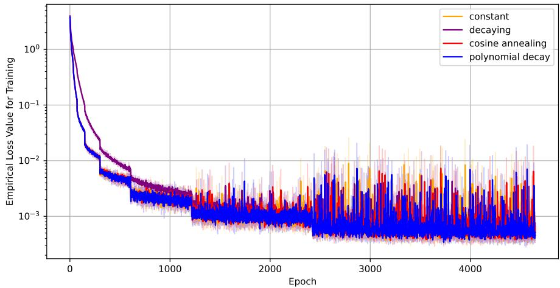
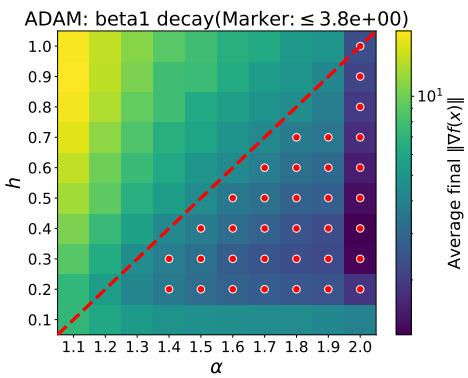
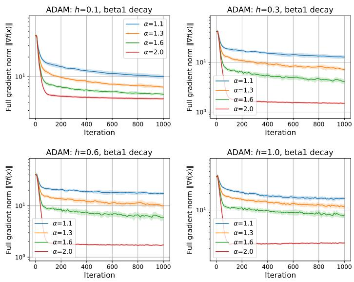
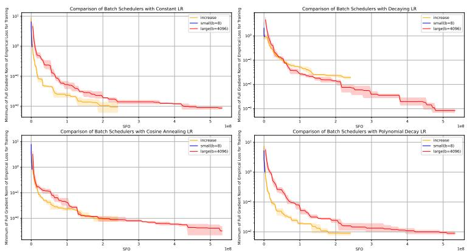
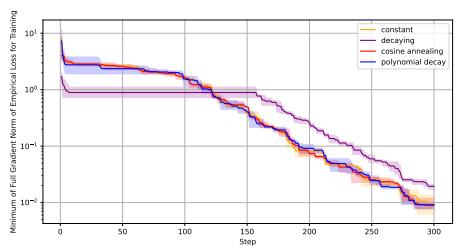
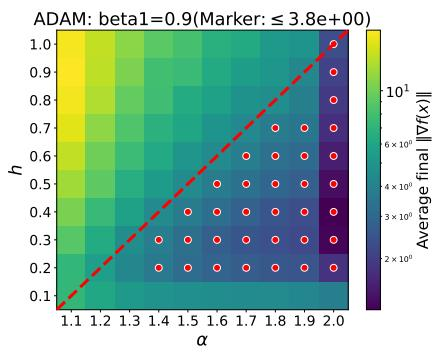
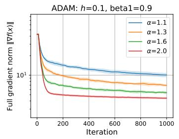
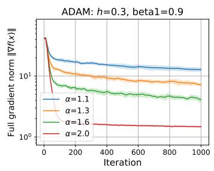
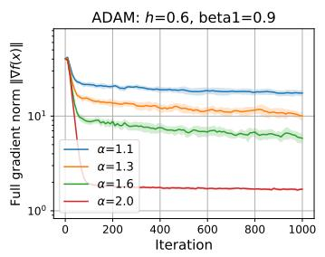
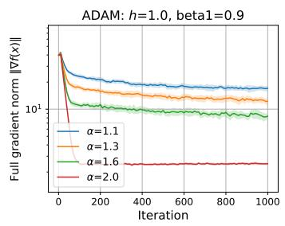

# On the Convergence of Vanilla Adam under Heavy-Tailed Noise and Index Sampling

Kanata Oowada Meiji University

Hideaki Iiduka Meiji University

kanata7527@gmail.com

iiduka@cs.meiji.ac.jp

## Abstract

Understanding how stochastic gradient noise afects the convergence of Adam is an important problem in stochastic optimization, particularly when the noise exhibits heavy-tailed behavior. In this paper, we investigate the convergence of vanilla Adam in both the expected risk and the empirical risk minimization, focusing on the efects of heavy-tailed noise and its relationship to index sampling. For the expected risk minimization, we establish convergence guarantees under Hölder smoothness and bounded p-th moment assumptions, allowing stochastic gradient noise with infinite variance. Our analysis provides explicit upper bounds on the expected squared gradient norm and shows that the iteration-dependent convergence term decays more slowly as p decreases. For the empirical risk minimization, we establish asymptotic and non-asymptotic convergence guarantees and demonstrate that heavy-tailed population noise can deteriorate convergence bounds through dataset-dependent constants as the dataset size increases. Furthermore, under Lipschitz smoothness, we formulate multistage Adam with practical learning rate schedules and demonstrate that increasing batch sizes can reduce index-sampling noise and improve convergence guarantees and SFO complexity. Numerical experiments support our theoretical findings on the efects of heavy-tailed noise and the computational benefits of increasing batch sizes.

## 1 Introduction

Stochastic gradient descent (SGD) (Robbins & Monro, 1951) and its variants are fundamental optimization methods for large-scale machine learning. Among them, Adaptive Moment Estimation (Adam) (Kingma & Ba, 2015) has become one of the most widely used optimization algorithms in deep learning, with successful applications across a broad range of tasks (Vaswani et al., 2017; Devlin et al., 2019; Kang et al., 2024). Adam combines momentum-based updates with adaptive, coordinate-wise learning rates determined by estimates of the first and second moments of stochastic gradients. Its adaptive mechanism is closely related to earlier methods such as RMSProp (Tieleman & Hinton, 2012), while its momentum component builds on ideas underlying classical methods such as the heavy-ball method (Polyak, 1964). Despite its practical success, understanding the convergence behavior of Adam remains an important topic in stochastic optimization. Reddi et al. (2018) demonstrated that Adam can fail to converge even in simple convex optimization problems and proposed AMSGrad to address this issue. Subsequent studies have established convergence guarantees under various assumptions on the objective function, stochastic gradients, and algorithmic parameters. In particular, decreasing learning rates and suitable conditions on momentum parameters play important roles in establishing convergence (Jin et al., 2025).

Nevertheless, understanding how stochastic gradient noise, particularly heavy-tailed noise, afects the convergence of Adam remains an important challenge. Although bounded variance is a common assumption (Zaheer et al., 2018; Wang et al., 2023; Jin et al., 2026) in stochastic optimization, stochastic gradients arising in deep learning have been reported to exhibit heavy-tailed behavior (Simsekli et al., 2019; Garg et al., 2021; Battash et al., 2024). Such noise can be modeled by assuming only a bounded p-th moment for some ${ \mathfrak { p } } \in ( 1 , 2 ]$ , which allows the second moment to be infinite when ${ \mathfrak { p } } < 2$ . Our expected-risk convergence analysis under Hölder smoothness requires $1 + { \mathfrak { h } } \leq { \mathfrak { p } }$ , imposing a trade-of between objective smoothness and the admissible tail heaviness. In particular, when ${ \mathfrak { h } } = 1$ , corresponding to Lipschitz smoothness, this condition requires ${ \mathfrak { p } } = 2$ , so our expected-risk result does not directly cover infinite-variance noise in this setting. Nevertheless, our empirical-risk analysis can capture the efects of heavy-tailed population noise through dataset-dependent constants, even under Lipschitz smoothness.

A key distinction arises between the expected risk and the empirical risk minimization when considering heavy-tailed stochastic gradient noise. In the expected risk minimization, stochastic gradients are computed from data sampled directly from the underlying population distribution ${ \mathcal { D } } ,$ which may give rise to infinitevariance noise. In contrast, the empirical risk minimization is based on a finite dataset sampled from D, and stochastic gradients are subsequently computed by sampling indices from the fixed dataset. Consequently, while the noise induced by index sampling has finite moments for any fixed dataset and evaluation point, the corresponding moment bounds may depend on the dataset and grow as its size increases (Brown et al., 2021; Yang et al., 2025; Shestakov et al., 2026) (see Section 2.2). Thus, although index sampling over a fixed finite dataset cannot itself produce infinite-variance noise, the heavy-tailed nature of the underlying population distribution may still afect the convergence behavior of Adam through dataset-dependent quantities. This distinction motivates analyzing the two settings separately and clarifying the relationship between their stochastic gradient noise assumptions and convergence guarantees.

Beyond understanding the efects of stochastic gradient noise, another important question is how such noise can be efectively controlled. In the empirical risk minimization, increasing the batch size provides a way to reduce the noise arising from index sampling (Smith et al., 2018; Zaheer et al., 2018; Franchini et al., 2024). However, larger batch sizes also increase the computational cost per iteration. This motivates investigating increasing batch sizes, which can reduce stochastic gradient noise as optimization progresses while avoiding the cost of using large batches throughout training. In particular, it is important to understand how batch-size scaling afects the convergence guarantees of Adam and whether it provides an efective means of mitigating index-sampling noise.

## 1.1 Related Work and Contributions

Convergence analysis of Adam. Several studies have established convergence guarantees for Adam and its variants under Lipschitz smoothness, as summarized in Table 1. Their assumptions on stochastic gradients difer in strength. Défossez et al. (2022) and Liang et al. (2025) assume almost surely bounded stochastic gradients, which is stronger than the bounded-second-moment condition employed by Zou et al. (2019). Wang et al. (2023) considers the weaker bounded-variance condition, while Jin et al. (2025) employs the more general ABC condition, which allows the second moment of stochastic gradients to depend on the objectivefunction gap and full gradient norm. The $\mathcal { O } _ { \tilde { K } }$ rates reported in Table 1 are finite horizon convergence rates, some of which are obtained using parameters that depend on the prescribed iteration horizon $\tilde { K } .$ . Although these assumptions difer in strength, they all require finite second-moment control and therefore do not directly accommodate infinite-variance stochastic gradient noise. Regarding the asymptotic big-O rates, $O ( \log { \dot { K } } / { \sqrt { K } } )$ provides a tighter upper bound than $O ( \log ^ { 2 } K / \sqrt { K } )$ ). Our rate ${ \mathcal O } ( \log \bar { K } / K ^ { \mathfrak { h } / ( 1 + \mathfrak { h } ) } )$ recovers $\mathcal { O } ( \log K / \sqrt { K } )$ when ${ \mathfrak { h } } = 1$ , corresponding to Lipschitz smoothness, while extending the convergence analysis to the broader class of Hölder-smooth objectives. In contrast, Jin et al. (2025) obtained $O ( \log ^ { 2 } K / \sqrt { K } )$ under the more restrictive Lipschitz smoothness assumption but with the weaker ABC condition on stochastic gradients.

Adam under heavy-tailed noise. Liu (2026) established finite-horizon convergence rates for vanilla Adam under heavy-tailed noise using randomly scaled learning rates and horizon-dependent momentum parameters. Their results are expressed in terms of $( \lambda , \varepsilon ) – L .$ -stationarity, a generalized stationarity criterion for nonsmooth nonconvex optimization, and do not directly provide an upper bound on the expected squared gradient norm. In contrast, under Hölder smoothness and bounded full gradients, we derive explicit convergence rates for the expected squared gradient norm of vanilla Adam. Furthermore, we also analyze the empirical risk minimization, where we investigate the efects of heavy-tailed population noise on datasetdependent convergence bounds and the reduction of index-sampling noise through increasing batch sizes.

<table><tr><td rowspan=1 colspan=1>Reference</td><td rowspan=1 colspan=1>VanillaAdam</td><td rowspan=1 colspan=1>Noise Asm.</td><td rowspan=1 colspan=1>Smoothness</td><td rowspan=1 colspan=1>LR</td><td rowspan=1 colspan=1>Beta</td><td rowspan=1 colspan=1>Rate</td></tr><tr><td rowspan=1 colspan=1>Défossez et al. (2022)</td><td rowspan=1 colspan=1>No</td><td rowspan=1 colspan=1>A.s. bounded SG</td><td rowspan=1 colspan=1>Lipschitz</td><td rowspan=1 colspan=1> $\begin{array} { r } { \alpha = \frac { 1 } { \sqrt { \tilde { K } } } } \end{array}$ </td><td rowspan=1 colspan=1> ${ \overline { { \beta _ { 1 } \in [ 0 , 1 ) } } } ,$  $\textstyle { \beta _ { 2 } = 1 - \frac { 1 } { \tilde { \kappa } } }$ </td><td rowspan=1 colspan=1> $\begin{array} { r } { \mathcal { O } _ { \tilde { K } } \left( \frac { \log \tilde { K } } { \sqrt { \tilde { K } } } \right) } \end{array}$ </td></tr><tr><td rowspan=1 colspan=1>Liang et al. (2025)</td><td rowspan=1 colspan=1>No</td><td rowspan=1 colspan=1>A.s. bounded SG</td><td rowspan=1 colspan=1>Lipschitz</td><td rowspan=1 colspan=1> $\begin{array} { r } { \alpha _ { k } = \frac { 1 } { \sqrt { k } } } \end{array}$ </td><td rowspan=1 colspan=1> $\overline { { \beta _ { 1 } \in [ 0 , \beta ) } } ,$  $\begin{array} { r } { \beta _ { 2 , k } = 1 - \frac { 1 } { k } } \end{array}$ </td><td rowspan=1 colspan=1> $O \left( { \textstyle { \frac { \log K } { \sqrt { K } } } } \right)$ </td></tr><tr><td rowspan=1 colspan=1>Zou et al. (2019)</td><td rowspan=1 colspan=1>No</td><td rowspan=1 colspan=1>Bounded 2ndmoment of SG</td><td rowspan=1 colspan=1>Lipschitz</td><td rowspan=1 colspan=1> $\begin{array} { r } { \alpha _ { k } = \frac { 1 } { \sqrt { k } } } \end{array}$ </td><td rowspan=1 colspan=1> ${ \overline { { \beta _ { 1 } \in [ 0 , \beta ) , } } }$  $\begin{array} { r } { \beta _ { 2 , k } = 1 - \frac { 1 } { k } } \end{array}$ </td><td rowspan=1 colspan=1> $O \left( { \textstyle { \frac { \log K } { \sqrt { K } } } } \right)$ </td></tr><tr><td rowspan=1 colspan=1>Wang et al. (2023)</td><td rowspan=1 colspan=1>No</td><td rowspan=1 colspan=1>Bounded variance</td><td rowspan=1 colspan=1>Lipschitz</td><td rowspan=1 colspan=1> $\begin{array} { r } { \alpha = \frac { 1 } { \sqrt { \tilde { K } } } } \end{array}$ </td><td rowspan=1 colspan=1> $\beta _ { 1 } = \sqrt { \beta _ { 2 } } ,$  $\begin{array} { r } { \beta _ { 2 } = 1 - \frac { 1 } { \tilde { K } } } \end{array}$ </td><td rowspan=1 colspan=1> $\mathcal { O } _ { \tilde { K } } \left( \textstyle \frac { \log { \tilde { K } } } { \sqrt [ 4 ] { \tilde { K } } } \right)$ </td></tr><tr><td rowspan=1 colspan=1>Jin et al. (2025)</td><td rowspan=1 colspan=1>No</td><td rowspan=1 colspan=1>ABC condition</td><td rowspan=1 colspan=1>Lipschitz</td><td rowspan=1 colspan=1> $\begin{array} { r } { \alpha _ { k } = \frac { 1 } { \sqrt { k } } } \end{array}$ </td><td rowspan=1 colspan=1> ${ \overline { { \beta _ { 1 } \in [ 0 , 1 ) , } } }$  $\begin{array} { r } { \beta _ { 2 , k } = 1 - \frac { 1 } { k } } \end{array}$ </td><td rowspan=1 colspan=1> $\overline { { O \left( \frac { \log ^ { 2 } K } { \sqrt { K } } \right) } }$ </td></tr><tr><td rowspan=1 colspan=1>Theorem 2</td><td rowspan=1 colspan=1>Yes</td><td rowspan=1 colspan=1>A.s. bounded SG</td><td rowspan=1 colspan=1>Hölder</td><td rowspan=1 colspan=1> $\begin{array} { r } { \alpha _ { k } = \frac { 1 } { k ^ { \mathfrak { h } / ( 1 + \mathfrak { h } ) } } } \end{array}$ </td><td rowspan=1 colspan=1> $\beta _ { 1 , k } \to 0 ,$  $\beta _ { 2 } = 1 - 1 / k ^ { s }$ </td><td rowspan=1 colspan=1> $O \left( \frac { \log K } { K ^ { \mathfrak { h } / ( 1 + \mathfrak { h } ) } } \right)$ </td></tr><tr><td rowspan=1 colspan=1>Liu (2026)</td><td rowspan=1 colspan=1>Yes</td><td rowspan=1 colspan=1>Boundedp-th moment</td><td rowspan=1 colspan=1>Well-behaved</td><td rowspan=1 colspan=1> $\alpha _ { k } \sim \mathrm { E x p } ( 1 )$ </td><td rowspan=1 colspan=1> $\begin{array} { r } { \overline { { \beta _ { 1 } = 1 - \frac { 1 } { \tilde { K } ^ { u } } } } , } \end{array}$  $\begin{array} { r } { \beta _ { 2 , k } = 1 - \frac { 1 } { \tilde { K } ^ { u } } } \end{array}$ </td><td rowspan=1 colspan=1> $\begin{array} { r } { \mathcal { O } _ { \tilde { K } } \left( \frac { 1 } { \tilde { K } ^ { v } } \right) } \end{array}$ </td></tr><tr><td rowspan=1 colspan=1>Theorem 1</td><td rowspan=1 colspan=1>Yes</td><td rowspan=1 colspan=1>Boundedp-th moment</td><td rowspan=1 colspan=1>Hölder</td><td rowspan=1 colspan=1> $\begin{array} { r } { \alpha _ { k } = \frac { 1 } { k ^ { \mathfrak { h } / ( 1 + \mathfrak { h } ) } } } \end{array}$ </td><td rowspan=1 colspan=1> $\beta _ { 1 , k } \to 0 ,$  $\beta _ { 2 } \in [ 0 , 1 )$ </td><td rowspan=1 colspan=1>0 $\begin{array} { r } { \left( \frac { \log ^ { \mathfrak { p } } K } { K ^ { w } } + \sigma ^ { \frac { \mathfrak { p } ^ { 2 } } { 1 + \mathfrak { p } } } \right) } \end{array}$ </td></tr></table>

Table 1: Comparison of existing convergence results with our theoretical guarantees, where $\begin{array} { r } { s > \frac { \mathfrak { h } } { 1 + \mathfrak { h } } , ~ u = } \end{array}$ $\begin{array} { r } { \frac { 8 \mathfrak { p } } { 1 9 \mathfrak { p } - 1 2 } , v = \frac { 2 ( 3 \mathfrak { p } - 4 ) } { 1 9 \mathfrak { p } - 1 2 } } \end{array}$ , and $w = \textstyle { \frac { \mathfrak { h } \mathfrak { p } } { ( 1 + \mathfrak { h } ) ( 1 + \mathfrak { p } ) } } . \mathfrak { p } \in ( 1 , 2 ]$ is the tail index. ${ \mathfrak { h } } \in ( 0 , 1 ]$ is the Hölder index. The Vanilla Adam column indicates whether bias correction is applied. Except for Liu (2026), the convergence rates are with respect to the expected squared norm. $\mathcal { O } _ { \tilde { K } }$ denotes the finite horizon rates. LR represents learning rate. The condition “Well-behaved” is defined by $\begin{array} { r } { f ( { \pmb x } ) - f ( { \pmb y } ) = \int _ { 0 } ^ { 1 } \langle \nabla f ( { \pmb y } + t ( { \pmb x } - { \pmb y } ) ) , { \pmb x } - { \pmb y } \rangle d t } \end{array}$ for any $\ b { x } , \ b { y } \in \mathbb { R } ^ { d }$

Contributions. Motivated by these considerations, we investigate the efects of stochastic gradient noise on Adam’s convergence and methods for mitigating them. The code of our numerical experiments are available at https://github.com/KanataOowada/adam\_preprint\_2026. Our main contributions are summarized as follows.

1. Convergence analysis under heavy-tailed noise. We establish convergence guarantees for vanilla Adam in the expected risk minimization under Hölder smoothness and bounded p-th moment assumptions, obtaining an upper bound of order $\begin{array} { r } { O \big ( \frac { \log ^ { 9 } K } { K ^ { 6 } ^ { 9 } ^ { 9 / \{ ( 1 + 9 ) ( 1 + 9 ) \} } } + \sigma ^ { 9 ^ { 2 } / ( 1 + 9 ) } \big ) } \end{array}$ on the expected squared gradient norm. To the best of our knowledge, this is the first result to directly quantify the convergence of vanilla Adam under heavy-tailed noise in terms of the expected squared gradient norm. In particular, the rates established in Corollary 1 shows that the convergence bound deteriorates as p decreases, theoretically demonstrating the adverse efect of heavier-tailed noise on Adam’s convergence performance. This theoretical finding is further supported by the numerical experiments in Section 3.1.

2. Convergence analysis under index sampling. We establish asymptotic and non-asymptotic convergence guarantees for vanilla Adam in the empirical risk minimization under Hölder smoothness and almost surely bounded stochastic gradients with respect to index sampling, including a convergence rate of $O \big ( \frac { \log K } { K ^ { \mathfrak { h } / ( 1 + \mathfrak { h } ) } } \big )$ . Furthermore, the bounds in Theorems 2 and 3 reveal that the convergence guarantees may deteriorate as the dataset size N increases through dataset-dependent constants.

3. Noise reduction through increasing batch sizes. To better reflect practical training, we introduce a multistage Adam framework and analyze its convergence under various learning rate schedules. We show that increasing batch sizes improve the convergence bound from $\begin{array} { r } { O ( \frac { 1 } { K } + \frac { G _ { N } ^ { 2 } } { b } ) } \end{array}$ to $O ( \textstyle { \frac { 1 } { K } } )$ by eliminating the index-sampling noise term under suitable batch-size schedules. We further establish a finite-horizon SFO complexity requirement of $\mathcal { Q } _ { \varepsilon _ { \widetilde { \mathsf { T } } } } ( \varepsilon _ { \widetilde { \mathsf { T } } } ^ { - 2 } )$ to achieve the $\varepsilon _ { \tilde { \mathsf { T } } }$ approximation in Corollary 4. Numerical experiments demonstrate that increasing batch sizes can reduce the SFO cost compared with fixed batch sizes while efectively controlling the noise arising from index sampling.

## 2 Preliminary

Let $\mathbb { R } ^ { d }$ be a d-dimensional Euclidean space with inner product $\langle \pmb { x } , \pmb { y } \rangle : = \pmb { x } ^ { \top } \pmb { y } \ ( \pmb { x } , \pmb { y } \in \mathbb { R } ^ { d } )$ inducing the norm $\| { \pmb x } \| : = \sqrt { \langle { \pmb x } , { \pmb x } \rangle }$ , let N be the set of positive integers, $\mathbb { N } _ { n } : = \{ 1 , \dots , n \}$ , and let $C ^ { 1 } ( \mathbb { R } ^ { d } )$ be the set of continuously diferentiable R-valued functions on $\mathbb { R } ^ { d } .$ . For square matrices $\bar { \boldsymbol { X } } , \boldsymbol { Y } \in \mathbb { R } ^ { d \times d }$ , we write $X \preceq Y$ if $Y - X$ is positive semidefinite. For two matrices X and Y of the same dimension, $X \odot Y$ denotes the Hadamard product. For a distribution D on a measurable space $( \Omega , \mathcal { F } ) , \mathrm { ~ a ~ } ( \Omega , \mathcal { F } )$ -valued random variable $\xi ,$ and a measurable function $f ( x ; \xi )$ whose another variable x is independent of $\xi ,$ we define $\mathbb { E } _ { \xi } [ f ( x ; \xi ) ] : =$ $\begin{array} { r } { \mathbb { E } _ { \xi \sim \mathcal { D } } [ f ( x ; \xi ) ] : = \int _ { \Omega } f ( x ; z ) \mathcal { D } ( d z ) } \end{array}$ and denote the total expectation for k steps as $\mathbb { E } : = \mathbb { E } _ { ( \xi _ { 1 } , \dots , \xi _ { k } ) \sim \mathcal { D } ^ { \otimes k } } =$ $\mathbb { E } _ { \xi _ { 1 } } \ldots \mathbb { E } _ { \xi _ { k } }$ . Let $L ^ { 1 } ( { \bar { \Omega } } )$ be the set of measurable functions on $( \Omega , { \mathcal { F } } )$ satisfying $\int _ { \Omega } | f | d \mathcal { D } < \infty$

## 2.1 Landau’s Notations and Some Order Notations for Finite Horizon Bound

For real functions $f , g$ on $( 0 , \infty )$ , and $\varepsilon > 0$ , denote $f ( \varepsilon ) = \Omega ( g ( \varepsilon ) ) { \mathrm { ~ i f ~ } } \exists c , \exists \varepsilon _ { 0 } , \forall \varepsilon > 0 { \mathrm { ~ : ~ } } \varepsilon < \varepsilon _ { 0 } \implies$ $f ( \varepsilon ) \geq c g ( \varepsilon )$ . For sequences $( x _ { k } ) _ { k \in \mathbb { N } }$ and $( y _ { k } ) _ { k \in \mathbb { N } } \subset [ 0 , \infty )$ , denote $y _ { k } = o ( x _ { k } )$ if lim $1 _ { k \to \infty } y _ { k } / x _ { k } = 0$ , i.e., $\forall c > 0 , \exists k _ { 0 } , \forall k \in \mathbb { N } : k _ { 0 } \leq k \implies y _ { k } \leq c x _ { k } ;$ denote $y _ { k } = O ( x _ { k } ) { \mathrm { ~ i f ~ } } \exists c > 0 , \exists k _ { 0 } , \forall k \in \mathbb { N } : k _ { 0 } \leq k \implies y _ { k } \leq c x _ { k } .$ Note that if lim $\iota _ { k \to \infty } x _ { k } = 0$ and $y _ { k } = O ( x _ { k } )$ , then $\scriptstyle \operatorname* { l i m } _ { k \to \infty } y _ { k } = 0$ . To motivate the introduction of the notations O and Q, we examine a standard convergence rate of stochastic gradient descent with constant learning rate α (Bottou et al., 2018) as an example; for any $K \in \mathbb N$

$$
\operatorname* { m i n } _ { 1 \leq k \leq K } \mathbb { E } [ \| \nabla f ( \pmb { x } _ { k } ) \| ^ { 2 } ] \leq \frac { C _ { 1 } } { \alpha K } + \alpha C _ { 2 } = O \left( \frac { 1 } { \alpha K } + \alpha \right) ,
$$

where $C _ { 1 }$ and $C _ { 2 }$ are constants which do not depend on K and α. At first glance, setting $\alpha = 1 / \sqrt { K }$ may seem to yield an $^ { \omega } O ( 1 / \sqrt { K } ) ^ { \prime }$ rate. Strictly speaking, however, this big-O rate is invalid, since it does not satisfy the definition of big-O and min $\begin{array} { r } { 1 \leq k \leq K \mathbb { E } [ \| \nabla f ( \pmb { x } _ { k } ) \| ^ { 2 } ] } \end{array}$ does not also converge to zero as $K  \infty$ . Indeed, since α is a constant, it is expressed as $\alpha = 1 / \sqrt { \tilde { K } }$ with a prespecified constant $\tilde { K } \in \mathbb { N }$ . Thus, for any $c > 0$ and $K _ { 0 } \in \mathbb { N } .$ there exists K such that $K _ { 0 } \le K$ and $C _ { 1 } \sqrt { \tilde { K } } / K + C _ { 2 } / \sqrt { \tilde { K } } > c / \sqrt { K } ( \Longleftrightarrow ~ C _ { 1 } \sqrt { \tilde { K } } / \sqrt { K } + C _ { 2 } \sqrt { K } / \sqrt { \tilde { K } } > c ) ;$ if $c < 2 \sqrt { C _ { 1 } C _ { 2 } }$ , the relation always holds because the $\mathrm { A M - G M }$ inequality yields $C _ { 1 } \sqrt { \tilde { K } } / \sqrt { K } + C _ { 2 } \sqrt { K } / \sqrt { \tilde { K } } \geq$ $2 { \sqrt { C _ { 1 } C _ { 2 } } } > c ; { \mathrm { ~ i f ~ } } c \geq 2 { \sqrt { C _ { 1 } C _ { 2 } } }$ , setting $K : = K _ { 0 } + \tilde { K } \{ c ^ { 2 } - 2 C _ { 1 } C _ { 2 } + c \sqrt { c ^ { 2 } - 4 C _ { 1 } C _ { 2 } } \} / ( 2 C _ { 2 } ^ { 2 } )$ yields the relations. Additionally, when $\alpha = 1 / \tilde { K }$ , the upper bound with $K  \infty$ becomes $C _ { 1 } \sqrt { \tilde { K } } / K + 1 / \sqrt { \tilde { K } }  1 / \sqrt { \tilde { K } } \neq 0 .$ Thus, using the notation ${ \dot { O } } ( 1 / { \sqrt { K } } )$ , which converges to zero, for the quantity that does not actually converge to zero is misleading and can lead to confusion. On the other hand, the invalid convergence rate ${ } ^ { \mathfrak { a } } \bar { O } ( 1 / \sqrt { K } ) ^ { \mathfrak { , } }$ obtained by setting $\alpha = 1 / \sqrt { K }$ is not entirely meaningless. Although this choice does not yield convergence, it intuitively indicates that choosing the large total number of steps K can reduce the upper bound. In addition, the total number of steps K is often finite in practice. Hence, to give a mathematically rigorous formulation of the kind of this invalid rate, we propose the O notation for an upper estimate and the Q notation for a lower estimate. In this paper, the $\mathcal { Q }$ notation is used in Section 4.2.2 to derive SFO complexities.

Definition 1. Let $( x _ { k } ) _ { k \in \mathbb { N } }$ and $( y _ { k } ) _ { k \in \mathbb { N } } \subset [ 0 , \infty )$ . For any $\tilde { k } \in \mathbb { N } .$ , we denote $y _ { k } = \mathcal { O } _ { \widetilde { k } } ( x _ { \widetilde { k } } )$ if

$$
\exists c > 0 , \exists k _ { 0 } , \forall k \in \mathbb { N } : k _ { 0 } \vee \tilde { k } \leq k \implies y _ { k } \leq c x _ { \tilde { k } } .
$$

Let f and g be real functions on $( 0 , \infty )$ . For any $\tilde { \varepsilon } > 0$ , we denote $f ( \varepsilon ) = \mathcal { Q } _ { \tilde { \varepsilon } } ( g ( \tilde { \varepsilon } ) ) \ i f$

$$
\exists c , \exists \varepsilon _ { 0 } , \forall \varepsilon > 0 : \varepsilon < \varepsilon _ { 0 } \land \tilde { \varepsilon } \implies f ( \varepsilon ) \geq c g ( \tilde { \varepsilon } ) .
$$

If $( x _ { k } ) _ { k \in \mathbb { N } }$ is monotonically decreasing and $y _ { k } = O ( x _ { k } )$ , then $y _ { k } = \mathcal { O } _ { \widetilde { k } } ( x _ { \widetilde { k } } )$ for any $\tilde { k } \in \mathbb { N }$ . It is because $k _ { 0 } \leq$ $k _ { 0 } \vee \tilde { k } .$ , and $y _ { k } \le c x _ { k } \le c x _ { \tilde { k } }$ holds for any $k _ { 0 } \vee \tilde { k } \le k .$ Furthermore, $y _ { k } = \mathcal { O } _ { \widetilde { k } } ( x _ { \widetilde { k } } )$ does not imply lim $\scriptstyle { k \to \infty } y _ { k } = 0$ since $k  \infty$ does not lead to $\tilde { k } \to \infty$ . Although $y _ { k } = \mathcal { O } _ { \widetilde { k } } ( x _ { \widetilde { k } } )$ can only imply $\begin{array} { r } { \operatorname* { l i m } _ { k \to \infty } y _ { k } \le c x _ { \tilde { k } } } \end{array}$ , this fact corresponds to the rigorous big-O rate $O ( \sqrt { \tilde { K } } / K + 1 / \sqrt { \tilde { K } } )$ with $\alpha = 1 / \sqrt { \tilde { K } }$ . Therefore, the O notation can be regarded as reflecting the motivation discussed above. Due to $y _ { k } = o ( x _ { k } ) \implies y _ { k } = O ( x _ { k } ) \implies y _ { k } = { \mathcal O } _ { \tilde { k } } ( x _ { \tilde { k } } )$ with monotonically decreasing $( x _ { k } ) _ { k \in \mathbb { N } }$ , the corresponding Landau estimates are ordered from strongest to weakest from left to right. The O notation allows us to reformulate the invalid convergence rate $^ { * } { \cal O } ( 1 \breve { / } \sqrt { K } ) ^ { * }$ as the mathematically rigorous notation ${ \mathcal O } _ { \tilde { K } } ( 1 / \sqrt { \tilde { K } } )$ because of $K _ { 0 } \vee \tilde { K } \le K \ \Longrightarrow \ C _ { 1 } / ( \alpha K ) + C _ { 2 } \alpha =$ $C _ { 1 } \sqrt { \tilde { K } } / K + C _ { 2 } / \sqrt { \tilde { K } } \leq ( C _ { 1 } + C _ { 2 } ) / \sqrt { \tilde { K } }$

## 2.2 Algorithm, Problem Setting, Assumption, and Heavy-tailed noise

Algorithm 1 Vanilla Adam (Kingma & Ba, 2015)   
Require: $\pmb { x } _ { 1 } \in \mathbb { R } ^ { d }$ (initial point), $\alpha _ { k } \in \mathbb { R }$ (learning rate), $\beta _ { 1 , k } , \beta _ { 2 , k } \in [ 0 , 1 )$ (momentum parameters), $\epsilon > 0$   
(stabilization constant).   
Ensure: x<sub>K</sub>   
for $k = 1 , \ldots , K$ do   
$\pmb { g } ( \pmb { x } _ { k } ; \xi _ { k } ) \gets \nabla F ( \pmb { x } _ { k } ; \xi _ { k } )$   
$m _ { k } \gets ( 1 - \beta _ { 1 , k } ) \pmb { g } ( \pmb { x } _ { k } ; \xi _ { k } ) + \beta _ { 1 , k } \pmb { m } _ { k - 1 }$   
$\begin{array} { r } { \hat { m } _ { k } \gets ( 1 - \prod _ { i = 1 } ^ { k } \beta _ { 1 , j } ) ^ { - 1 } m _ { k } } \end{array}$   
$\pmb { v } _ { k }  ( 1 - \beta _ { 2 , k } ) \pmb { \bar { g } } ( \pmb { x } _ { k } ; \xi _ { k } ) \odot \pmb { g } ( \pmb { x } _ { k } ; \xi _ { k } ) + \beta _ { 2 , k } \pmb { v } _ { k - 1 }$   
$\begin{array} { r } { \hat { \pmb { v } } _ { k }  ( 1 - \prod _ { j = 1 } ^ { k } \beta _ { 2 , j } ) ^ { - 1 } \pmb { v } _ { k } } \end{array}$   
$H _ { k } \gets \mathrm { d i a g } ( \sqrt { \hat { v } _ { k , i } } + \epsilon )$   
$\pmb { x } _ { k + 1 }  \pmb { x } _ { k } - \alpha _ { k } H _ { k } ^ { - 1 } \hat { \pmb { m } } _ { k }$   
end for

We consider the expected risk minimization problem:

$$
\mathrm { m i n i m i z e ~ } f ( \pmb { x } ) : = \mathbb { E } _ { \xi \sim \mathcal { D } } [ F ( \pmb { x } ; \xi ) ] \quad \mathrm { s u b j e c t ~ t o ~ } \pmb { x } \in \mathbb { R } ^ { d } ,
$$

where D is a distribution on a measurable space $( \Omega , { \mathcal { F } } )$ , and we suppose that $F ( \cdot ; \xi ) \in C ^ { 1 } ( \mathbb { R } ^ { d } )$ D-almost surely and $f < \infty ;$ for example, $F ( { \pmb x } ; \cdot ) \in L ^ { 1 } ( \Omega )$ ensures the latter condition. $f$ can be only accessed through the estimator F because the true data distribution D is unknown. To solve the problem, Kingma & Ba (2015) proposed a groundbreaking algorithm named Adam as in Algorithm 1. $\xi _ { k }$ is an i.i.d. sample from the distribution D at the k-th step, and we note that it is independent of $\{ \pmb { x } _ { t } \} _ { t = 1 } ^ { k }$ generated by Algorithm 1. Under these conditions, for measurable functions $h , \mathbb { E } _ { \xi _ { k } } [ h ( \mathbf { \Delta x } _ { k } ; \xi _ { k } ) ] = \mathbb { E } [ \bar { h } ( \mathbf { \Delta x } _ { k } ; \bar { \xi _ { k } } ) | \mathcal { F } _ { k - 1 } ]$ holds, where $\mathcal { F } _ { 1 } : = \sigma ( \xi _ { 1 } )$ and $\mathcal { F } _ { k + 1 } : = \sigma ( \sigma ( \xi _ { k + 1 } ) \cup \mathcal { F } _ { k } )$ . For the convergence analysis of Algorithm 1, we consider following conditions:

Condition 1. Let $( \pmb { x } _ { k } ) _ { k \in \mathbb { N } } \subset \mathbb { R } ^ { d }$ be a sequence generated by Algorithm 1.

(C1) The objective function has a finite lower bound: $f _ { \star } : = \operatorname* { i n f } _ { k \in \mathbb { N } } f ( \pmb { x } _ { k } ) \in \mathbb { R }$

(C2) Let ${ \mathfrak { h } } \in ( 0 , 1 ]$ . Then, the objective function is $L _ { \mathfrak { h } } { - } H \ddot { o } l d e r$ smooth: f is diferentiable and

$$
\exists L _ { \mathfrak h } , \forall x , \forall y \in \mathbb { R } ^ { d } : \| \nabla f ( \pmb x ) - \nabla f ( \pmb y ) \| \le L _ { \mathfrak h } \| \pmb x - \pmb y \| ^ { \mathfrak h } .
$$

(C3) The full gradient norm is bounded:

$$
\exists G > 0 , \forall k \in \mathbb { N } : \| \nabla f ( \mathbf { x } _ { k } ) \| \leq G .
$$

(C4) The stochastic gradient is an unbiased estimator of the full gradient with respect to $\mathcal { D } _ { \mathbf { \delta } }$

$$
\forall k \in \mathbb { N } : \mathbb { E } _ { \xi _ { k } \sim \mathcal { D } } [ \pmb { g } ( \pmb { x } _ { k } ; \xi _ { k } ) ] = \nabla f ( \pmb { x } _ { k } ) .
$$

(C5) Let ${ \mathfrak { p } } \in ( 1 , 2 ]$ . Then, the p-th moment of the stochastic gradient is bounded:

$$
\exists \sigma \geq 0 , \forall k \in \mathbb { N } : \mathbb { E } _ { \xi _ { k } \sim \mathcal { D } } [ \| g ( \pmb { x } _ { k } ; \xi _ { k } ) - \nabla f ( \pmb { x } _ { k } ) \| ^ { \mathfrak { p } } ] \leq \sigma ^ { \mathfrak { p } } .
$$

Taking the cross entropy loss as F provides an example in which f satisfies (C1) with $f _ { \star } = 0$ . Cross entropy loss is widely used for training DNNs, including large language models and models for image processing (Devlin et al., 2019; Rafel et al., 2020; Brown et al., 2020; Kaplan et al., 2020; Radford et al., 2021). Moreover, this condition is also satisfied by many other standard loss functions used in machine learning. Therefore, (C1) is consistent with the properties of loss functions commonly used in practical learning problems and constitutes a natural condition in our setting. (C2) (Hölder, 1882) generalizes Lipschitz smoothness, which is a standard condition in convergence analyses for nonconvex objectives (Zou et al., 2019; Défossez et al., 2022; Wang et al., 2023), and reduces to the Lipschitz-smooth case when ${ \mathfrak { h } } = 1 .$ . Furthermore, (C2) immediately implies that $f \in { \dot { C } } ^ { 1 } ( \mathbb { R } ^ { d } )$ . In many convergence analyses, an alternative form implied by (C2) (Ouyang & Squires, 2023) is useful: ∀x $\begin{array} { r } { , \forall y \in \mathbb { R } ^ { d } : f ( { \pmb y } ) \le f ( { \pmb x } ) + \langle \nabla f ( { \pmb x } ) , { \pmb y } - { \pmb x } \rangle + \frac { L _ { \mathfrak { h } } } { 1 + \mathfrak { h } } \| { \pmb y } - { \pmb x } \| ^ { 1 + \mathfrak { h } } } \end{array}$

  
Figure 1: Empirical loss versus number of epochs to train ResNet-18 on the CIFAR-100 dataset.

(C3) is weaker than the bounded stochastic gradient norms appearing in Zaheer et al. (2018); Défossez et al.   
(2022); Liang et al. (2025). (C3) can be reasonable in practice, as discussed below.

Proposition 1. If the objective function f satisfies (C1), (C2), and $f ^ { \star } : = \operatorname* { s u p } _ { k \in \mathbb { N } } f ( \pmb { x } _ { k } ) \in \mathbb { R }$ , then, it holds that $\forall k \in \mathbb { N } : \| \nabla f ( { \pmb x } _ { k } ) \| \leq ( ( 1 + \mathfrak { h } ) L _ { \mathfrak { h } } ^ { \frac { 1 } { \mathfrak { h } } } ( f ^ { \star } - f _ { \star } ) / \mathfrak { h } ) ^ { \mathfrak { h } / ( 1 + \mathfrak { h } ) }$

The proof can be found in Appendix H. In the context of machine learning, we have $f _ { \star } = 0$ and that the maximum training loss typically occurs around the initial point and it rarely grows without bound after that. For example, when training on CIFAR-100 with the cross-entropy loss as the objective function, suppose that, at the initial point, each class is equally likely to be output. In this case, $f _ { i } ( { \pmb x } _ { 1 } ) = - \log p _ { i } =$ $- \log 1 / 1 0 0 \approx 4 . 6 0 5 1 7$ . Therefore, the assumption that the loss has both upper and lower bounds appears to be a natural one. Figure 1 presents the empirical loss values at each epoch using various learning rate schedulers, obtained under the setup described in this paper. Figure 1 shows $f ( { \pmb x } _ { 1 } ) = f ^ { \star } \approx 4 . 0 7 . .$ . and $f ( \pmb { x } _ { k } )$ decreasing for epochs. Accordingly, the above discussion, together with (C2), leads to the finding that, for all $k \in \mathbb { N } , \ \lVert \nabla f ( { \pmb x } _ { k } ) \rVert \stackrel { < } { \sim } ( ( 1 + \mathfrak { h } ) L ^ { \frac 1 \mathfrak { h } } f ( { \pmb x } _ { 1 } ) / \mathfrak { h } ) ^ { \mathfrak { h } / ( 1 + \mathfrak { h } ) }$ . Since the exact gradient of the expected risk generally requires an expectation over the entire data distribution, it is typically unavailable in practice. We therefore use the gradient of a randomly sampled loss as a stochastic estimator of the true gradient. (C4) ensures that this stochastic gradient coincides with the true gradient on average. For example, (C1), (C2), (C3), and (C5) yield (C4); indeed, for any $\pmb { d } \in \mathbb { R } ^ { d }$ ，

$$
\begin{array} { r l } & { \langle \nabla f ( x _ { k } ) , d \rangle = \underset { h \downarrow 0 } { \operatorname* { l i m } } \frac { f ( x _ { k } + h d ) - f ( x _ { k } ) } { h } = \underset { h \downarrow 0 } { \operatorname* { l i m } } \mathbb { E } _ { \xi _ { k } } \left[ \frac { F ( x _ { k } + h d ; \xi _ { k } ) - F ( x _ { k } ; \xi _ { k } ) } { h } \right] = \mathbb { E } _ { \xi _ { k } } \left[ \underset { h \downarrow 0 } { \operatorname* { l i m } } \frac { F ( x _ { k } + h d ; \xi _ { k } ) - F ( x _ { k } ; \xi _ { k } ) } { h } \right] } \\ & { \quad \quad = \mathbb { E } _ { \xi _ { k } } [ \langle g ( x _ { k } ; \xi _ { k } ) , d \rangle ] = \langle \mathbb { E } _ { \xi _ { k } } [ g ( x _ { k } ; \xi _ { k } ) ] , d \rangle , } \end{array}
$$

where the third last equality is from the Vitali convergence theorem, and we considered that Jensen’s inequality and Cauchy-Schwartz inequality imply the uniform integrability

$$
\begin{array} { l } { \displaystyle \operatorname* { s u p } _ { h > 0 } \mathbb { E } _ { \xi _ { k } } \left[ \left\| \frac { F \left( x _ { k } + h d ; \xi _ { k } \right) - F \left( x _ { k } ; \xi _ { k } \right) } { h } \right\| \right] = \operatorname* { s u p } _ { h > 0 } \frac { 1 } { h } \mathbb { E } _ { \xi _ { k } } \left[ \left\| \int _ { 0 } ^ { 1 } \langle g ( x _ { k } + t h d ; \xi _ { k } ) , t h d \rangle d t \right\| ^ { p _ { \frac { 1 } { p } } } \right] } \\ { \displaystyle \leq \operatorname* { s u p } _ { h > 0 } \frac { 1 } { h } \mathbb { E } _ { \xi _ { k } } \left[ \left( \int _ { 0 } ^ { 1 } \| \langle g ( x _ { k } + t h d ; \xi _ { k } ) , t h d \rangle \| ^ { p } d t \right) ^ { \frac { 1 } { p } } \right] \leq \operatorname* { s u p } _ { h > 0 } C \| d \| \left( \int _ { 0 } ^ { 1 } t ^ { p } d t \right) ^ { \frac { 1 } { p } } = \frac { C \| d \| } { ( p + 1 ) ^ { 1 / p } } < \infty . } \end{array}
$$

(C5) generalizes the standard bounded variance condition, corresponding to ${ \mathfrak { p } } = 2$ (Zou et al., 2019; Wang et al., 2023), and allows for heavier-tailed stochastic gradients that have been reported to arise in DNN training (Battash et al., 2024). In particular, it covers heavy-tailed settings in which stochastic gradients may exhibit extreme outliers, including cases where $\begin{array} { r } { \operatorname* { s u p } _ { k } \mathbb { E } _ { \xi _ { k } \sim \mathcal { D } } [ \| g ( \pmb { x } _ { k } ; \xi _ { k } ) - \nabla f ( \pmb { x } _ { k } ) \| ^ { \mathfrak { p } } ] < \infty } \end{array}$ while $\begin{array} { r } { \mathbb { E } _ { \xi _ { k } \sim \mathcal { D } } [ \| \pmb { g } ( \pmb { x } _ { k } ; \xi _ { k } ) - \nabla f ( \pmb { x } _ { k } ) \| ^ { 2 } ] = \infty } \end{array}$ for some $k \in \mathbb N$ (as mentioned later).

We now formulate the empirical risk minimization and its mini-batch stochastic gradient. Let $\{ \pmb { \xi } _ { j } \} _ { j = 1 } ^ { N }$ be a dataset drawn i.i.d. from D on $( \mathbb { R } ^ { m } , B ( \mathbb { R } ^ { m } ) )$ ). The empirical distribution is defined by $\begin{array} { r } { \mathcal { D } _ { N } : = N ^ { - 1 } \sum _ { j = 1 } ^ { N } \delta _ { \pmb { \xi } _ { j } } } \end{array}$ where $\delta _ { \pmb { \xi } _ { j } }$ denotes the Dirac measure at $\xi _ { j }$ . Accordingly, the empirical risk can be expressed as $\begin{array} { r } { \mathcal { D } _ { N } \colon f _ { N } ( { \pmb x } ) = } \end{array}$ $\begin{array} { r } { N ^ { - 1 } \sum _ { i = 1 } ^ { N } \int _ { \mathbb { R } ^ { m } } F ( { \pmb x } ; { \pmb \xi } ) \delta _ { { \pmb \xi } _ { j } } ( d { \pmb \xi } ) = N ^ { - 1 } \sum _ { i = 1 } ^ { N } F ( { \pmb x } ; { \pmb \xi } _ { j } ) } \end{array}$ . For index sampling, we consider the uniform distribution U on N . At iteration k, let $\iota _ { k , 1 } , \ldots , \iota _ { k , b _ { k } }$ be i.i.d. samples from U and define $\iota _ { k } : = ( \iota _ { k , 1 } , \ldots , \iota _ { k , b _ { k } } )$ . The mini-batch stochastic gradient with batch size $b _ { k }$ is given by $\begin{array} { r } { \pmb { g } _ { B _ { k } } ( \pmb { x } _ { k } ) : = N ^ { - 1 } \sum _ { j = 1 } ^ { b _ { k } } \pmb { g } _ { \iota _ { k , j } } ( \pmb { x } _ { k } ) } \end{array}$ . By replacing $\pmb { g } ( \pmb { x } _ { k } ; \xi _ { k } )$ with ${ \pmb g } _ { B _ { k } } ( { \pmb x } _ { k } )$ in Algorithm 1, the updating rule is rewritten for the empirical risk minimization. Here, we prepare the alternative conditions for the empirical risk minimization:

Proposition 2. The stochastic gradient is an unbiased estimator of the full gradient:

$$
\forall k \in \mathbb { N } , \forall i \in \mathbb { N } _ { b _ { k } } : \mathbb { E } _ { \iota _ { k , i } \sim \mathcal { U } } [ \pmb { g } ( \pmb { x } _ { k } ; \xi _ { \iota _ { k , i } } ) ] = \nabla f _ { N } ( \pmb { x } _ { k } ) .
$$

Condition 2. (C5’) Let ${ \mathfrak { p } } \in ( 1 , 2 ]$ . Then, the p-th moment of the stochastic gradient is bounded:

$$
\exists \sigma _ { N } \geq 0 , \forall k \in \mathbb { N } , \forall i \in \mathbb { N } _ { b _ { k } } : \mathbb { E } _ { \iota _ { k , i } \sim \mathcal { U } } [ \| g ( \pmb { x } _ { k } ; \xi _ { \iota _ { k , i } } ) - \nabla f _ { N } ( \pmb { x } _ { k } ) \| ^ { \mathfrak { p } } ] \leq \sigma _ { N } ^ { \mathfrak { p } } .
$$

Proposition 2 holds because $\begin{array} { r } { \mathbb { E } _ { \iota _ { k , i } \sim \mathcal { U } } [ g _ { \iota _ { k , i } } ( \boldsymbol { x } _ { k } ) ] = \sum _ { j = 1 } ^ { N } g _ { j } ( \boldsymbol { x } _ { k } ) \mathcal { U } ( \{ j \} ) = N ^ { - 1 } \sum _ { j = 1 } ^ { N } g _ { j } ( \boldsymbol { x } _ { k } ) = \nabla f _ { N } ( \boldsymbol { x } _ { k } ) . } \end{array}$

Finally, we mention to the relation between the expected risk and the empirical risk on (C5) and (C5’). The key point is to distinguish the population distribution D from the index-sampling distribution U and to evaluate the moments of stochastic gradient noise with respect to the appropriate distribution. In the expected risk minimization, stochastic gradients are computed using data sampled directly from the population distribution D. In contrast, in the empirical risk minimization, a finite dataset is first constructed by drawing N i.i.d. samples from $\mathcal { D } .$ . Once this dataset is fixed, stochastic gradients are computed by sampling indices from the index set $\mathbb { N } _ { N }$ according to the distribution $\mathcal { U } .$ In particular, by the strong law of large numbers, under $F ( { \pmb x } ; \cdot ) \in L ^ { 1 } ( \Omega )$ , the empirical loss converges almost surely to the expected loss as $N \to \infty$ for each fixed x: namely, for $\{ \pmb { \xi } _ { j } \} _ { j = 1 } ^ { \infty }$ i.i.d. sampled from D, lim $\begin{array} { r } { { \bf \Phi } _ { N  \infty } N ^ { - 1 } \sum _ { i = 1 } ^ { N } F ( { \pmb x } ; { \pmb \xi } _ { j } ) = \mathbb { E } _ { { \pmb \xi } \sim \mathcal { D } } [ F ( { \pmb x } ; { \pmb \xi } ) ] } \end{array}$ a.s. In this sense, the expected risk can be interpreted as the population limit of the empirical risk. Here, we enumerate the primary properties and show them in order:

Proposition 3. (P1) Let $c \in ( 1 , 2 )$ . It is possible for both su $\begin{array} { r } { \mathrm { p } _ { k \in \mathbb { N } } \mathbb { E } _ { \xi _ { k } \sim \mathcal { D } } [ \| \pmb { g } ( \pmb { x } _ { k } ; \xi _ { k } ) - \nabla f ( \pmb { x } _ { k } ) \| ^ { \mathfrak { p } } ] < \infty } \end{array}$ for any ${ \mathfrak { p } } \in ( 1 , c )$ and $\begin{array} { r } { \mathbb { E } _ { \xi _ { k } \sim \mathcal { D } } [ \| \pmb { g } ( \pmb { x } _ { k } ; \xi _ { k } ) - \nabla f ( \pmb { x } _ { k } ) \| ^ { \ q } ] = \infty } \end{array}$ for some $k \in \mathbb N$ and any $\mathfrak { q } \in [ c , 2 ]$ to hold.

(P2) It is possible for both (P1) and (C3).

(P3) It is impossible for both (P1) and su $) _ { k \in \mathbb { N } } \| \pmb { g } ( \pmb { x } _ { k } ; \xi _ { k } ) \| < \infty \ D - a . s .$ to hold.

(P4) $\begin{array} { r l r } { \operatorname* { s u p } _ { k \in \mathbb { N } , i \in \mathbb { N } _ { b _ { k } } } \mathbb { E } _ { \iota _ { k , i } \sim \mathcal { U } } [ \| { \pmb g } _ { { \iota } _ { k , i } } ( { \pmb x } _ { k } ) - \nabla f _ { N } ( { \pmb x } _ { k } ) \| ^ { \mathfrak { p } } ] } & { < } & { \infty } \end{array}$ for any ${ \mathfrak { p } } \in \mathsf { \Gamma } ( 1 , 2 )$ is equivalent to k $\begin{array} { r l } & { \operatorname* { s u p } _ { k \in \mathbb { N } , i \in \mathbb { N } _ { b _ { k } } } \mathbb { E } _ { \iota _ { k , i } \sim \mathcal { U } } [ \| \pmb { g } _ { \iota _ { k , i } } ( \pmb { x } _ { k } ) - \nabla f _ { N } ( \pmb { x } _ { k } ) \| ^ { 2 } ] < \infty ; } \end{array}$ thus, the strict heavy-tailed noise with respect to the index sampling distribution does not arise.

(P5) However, increasing the number of data points N can make the upper bound of the variance diverge without diverging the $\mathfrak { p } ( \in \mathrm { ~ \tiny ~ \left( 1 , 2 \right) ) - { t h } ~ }$ moment; let $c \in ( 1 , 2 ) ; \ i t$ is possible for lim $\begin{array} { r l r } { \mathrm {  ~ \mathcal ~ N \to \infty ~ } \operatorname* { s u p } _ { k \in \mathbb { N } , i \in \mathbb { N } _ { b _ { L } } } \mathbb { E } _ { \varepsilon _ { k , i } \sim \mathcal { U } } [ \| { \pmb g } _ { \iota _ { k , i } } ( { \pmb x } _ { k } ) - \nabla f _ { N } ( { \pmb x } _ { k } ) \| ^ { \mathfrak { p } } ] } & { < } & { \infty } \end{array}$ for any ${ \mathfrak { p } } \in \mathsf { \Gamma } ( 1 , c )$ and lim $\begin{array} { r } { \cdot N \to \infty \mathbb { E } _ { \iota _ { k , i } \sim \mathcal { U } } [ \| \pmb { g } _ { \iota _ { k , i } } ( \pmb { x } _ { k } ) - \nabla f _ { N } ( \pmb { x } _ { k } ) \| ^ { \mathfrak { q } } ] = \infty } \end{array}$ for some $k \in \mathbb { N } , i \in \mathbb { N } _ { b _ { k } }$ and any $\mathfrak { q } ~ \in ~ [ c , 2 ]$ to hold.

(P6) It is possible for both (P5) and (C3’).

For example, setting $( \Omega , \mathcal { F } ) = ( \mathbb { R } , B ( \mathbb { R } ) ) , \boldsymbol { \xi } \sim \mathcal { D } : = \mathfrak { t } _ { \nu } , \boldsymbol { x } \in \mathbb { R }$ , and $F ( x ; \xi ) : = \log ( 1 + e ^ { x \xi } )$ imply those two conditions under $1 < \mathfrak { p } < \nu < 2$ , where $\mathrm { t } _ { \nu }$ is the Student’s t distribution with the degrees of freedom $\nu ;$ indeed, we have $g ( x _ { k } ; \xi _ { k } ) = \xi _ { k } e ^ { x _ { k } \xi _ { k } } / ( 1 + e ^ { x _ { k } \xi _ { k } } ) , | g ( x _ { k } ; \xi _ { k } ) | ^ { \mathfrak { p } } \le | \xi _ { k } | ^ { \mathfrak { p } }$ , and $\begin{array} { r } { | \nabla f ( x _ { k } ) | ^ { \mathfrak { p } } \leq \mathbb { E } _ { \xi _ { k } } [ | g ( x _ { k } ; \xi _ { k } ) | ^ { \mathfrak { p } } ] \leq } \end{array}$ $\mathbb { E } _ { \xi _ { k } } [ \vert \xi _ { k } \vert ^ { \mathfrak { p } } ]$ , which leads to $\begin{array} { r l r } { \operatorname* { s u p } _ { k } \mathbb { E } _ { \xi _ { k } } [ | g ( x _ { k } ; \xi _ { k } ) - \nabla f ( x _ { k } ) | ^ { \mathfrak { p } } ] } & { \leq } & { 2 ^ { \mathfrak { p } - 1 } \operatorname* { s u p } _ { k } \mathbb { E } _ { \xi _ { k } } [ | g ( x _ { k } ; \xi _ { k } ) | ^ { \mathfrak { p } } + | \nabla f ( x _ { k } ) | ^ { \mathfrak { p } } ] \le } \end{array}$ $\begin{array} { r } { 2 ^ { \flat - 1 } \operatorname* { s u p } _ { k } \bigl \{ \mathbb { E } _ { \xi _ { k } } [ | g ( x _ { k } ; \xi _ { k } ) | ^ { \flat } ] + \mathbb { E } _ { \xi _ { k } } [ | \xi _ { k } | ^ { \mathfrak { p } } ] \bigr \} \le 2 ^ { \flat } \operatorname* { s u p } _ { k } \mathbb { E } _ { \xi _ { k } } [ | \xi _ { k } | ^ { \mathfrak { p } } ] = 2 ^ { \flat } \mathbb { E } _ { \xi } [ | \xi | ^ { \mathfrak { p } } ] < \infty } \end{array}$ , where we considered that $\mathbb { E } _ { \xi \sim t _ { \nu } } [ | \xi | ^ { \mathfrak { p } } ] < \infty$ holds for $1 \leq \mathfrak { p } < \nu < 2$ . Next, since $\mathbb { E } _ { \xi \sim \mathfrak { t } _ { \nu } } [ | \xi | ^ { \mathfrak { q } } ] = \infty$ holds for $1 < \nu \leq { \mathfrak { q } } .$ the density of $\mathtt { t } _ { \nu }$ is even, and $a ^ { \mathfrak { q } } + b ^ { \mathfrak { q } } \geq ( a + b ) ^ { \mathfrak { q } } / 2 ^ { \mathfrak { q } - 1 }$ holds for $a , b \geq 0$ , we obtain

$$
\begin{array} { r l r } { \mathbb { E } _ { \xi _ { k } } [ \| g ( x _ { k } ; \xi _ { k } ) \| ^ { q } ] = \mathbb { E } _ { \xi _ { k } } \left[ \Big | \xi _ { k } \Big | ^ { q } \left( \frac { e ^ { \tau _ { k } \xi _ { k } } } { 1 + e ^ { - \tau _ { k } \xi _ { k } } } \right) ^ { q } \right] = \frac { 1 } { 2 } \left\{ \mathbb { E } _ { \xi _ { k } } \left[ \Big | \xi _ { k } \Big | ^ { q } \left( \frac { e ^ { \tau _ { k } \xi _ { k } } } { 1 + e ^ { - \tau _ { k } \xi _ { k } } } \right) ^ { q } \right] + \mathbb { E } _ { \xi _ { k } } \left[ \Big | \xi _ { k } \Big | ^ { q } \left( \frac { e ^ { - x _ { k } \xi _ { k } } } { 1 + e ^ { - \tau _ { k } \xi _ { k } } } \right) ^ { q } \right] \right\} } & { } & \\ { \geq \frac { 1 } { 2 } \mathbb { E } _ { \xi _ { k } } \left[ \Big | \xi _ { k } \Big | ^ { q } \frac { 1 } { 2 ^ { q - 1 } } \left( \frac { e ^ { \tau _ { k } \xi _ { k } } } { 1 + e ^ { \tau _ { k } \xi _ { k } } } + \frac { e ^ { - x _ { k } \xi _ { k } } } { 1 + e ^ { - x _ { k } \xi _ { k } } } \right) ^ { q } \right] = \frac { 1 } { 2 ^ { q } } \mathbb { E } _ { \xi _ { k } } [ | \xi _ { k } | ^ { q } ] = \infty , } & { ( 1 ) } & \end{array}
$$

which, together with $( a - b ) ^ { \mathfrak { q } } \geq a ^ { \mathfrak { q } } / 2 ^ { \mathfrak { q } - 1 } - b ^ { \mathfrak { q } }$ , yields $\mathbb { E } _ { \xi _ { k } } [ | g ( \pmb { x } _ { k } ; \xi _ { k } ) - \nabla f ( \pmb { x } _ { k } ) | ^ { \mathfrak { q } } ] \ge \mathbb { E } _ { \xi _ { k } } [ | g ( \pmb { x } _ { k } ; \xi _ { k } ) | ^ { \mathfrak { q } } / 2 ^ { \mathfrak { q } - 1 } - 1$ $| \nabla f ( \pmb { x } _ { k } ) | ^ { \mathfrak { q } } ] \geq 2 ^ { 1 - ^ { \mathfrak { q } } } \mathbb { E } _ { \xi _ { k } } [ | g ( \pmb { x } _ { k } ; \xi _ { k } ) | ^ { \mathfrak { q } } ] - G ^ { \mathfrak { q } } = \infty$ . Another example can be found in Section 3.1. We note that this situation is possible under (C3) but not under the D-almost surely bounded stochastic gradient condition which is, for any $k \in \mathbb { N } , \ \lVert g ( x _ { k } ; \cdot ) \rVert \leq \bar { g } \ \mathcal { D } \mathrm { { - a . s } }$ . The latter claim is obvious because sup $\underline { { \mathbb { E } } } _ { \xi _ { k } } [ \| \pmb { g } ( \pmb { x } _ { k } ; \xi _ { k } ) - \| _ { \xi _ { k } } \| _ { \pmb { g } ( \pmb { x } _ { k } ; \xi _ { k } ) }$ $\nabla f ( \pmb { x } _ { k } ) \| ^ { \mathfrak { p } } \| \leq 2 \mathbb { E } _ { \xi _ { k } } [ \| g ( \pmb { x } _ { k } ; \xi _ { k } ) \| ^ { \mathfrak { p } } + \| \nabla f ( \pmb { x } _ { k } ) \| ^ { \mathfrak { p } } ] \leq 2 ( \bar { g } ^ { \mathfrak { p } } + G ^ { \mathfrak { p } } ) < \infty$ holds for any ${ \mathfrak { p } } > 1$ The example $f$ mentioned above satisfies (C3) due to $| \nabla f ( x _ { k } ) | \le \mathbb { E } [ | g ( x _ { k } ; \xi _ { k } ) | ] \le \mathbb { E } [ | \xi _ { k } | ] < \infty$ but does not the t<sub>ν</sub>-almost surely bounded stochastic gradient condition, which gives an example for the former claim. Since the support of $\mathrm { t } _ { \nu }$ is R, $\mathrm { t } _ { \nu } ( | \xi | > c ) > 0$ holds for any $c \in \mathbb { R }$ . Moreover, $| g ( x _ { k } ; \boldsymbol { \xi } ) | + | g ( x _ { k } ; - \boldsymbol { \xi } ) | = | \xi |$ is obtained from the similar calculation in (1), which implies $\{ | \xi | > 2 c \} \subset \{ | g ( x ; \xi ) | > c \} \cup \{ | g ( x ; - \xi ) | > c \}$ . Since the density $p _ { \nu }$ of $\mathrm { t } _ { \nu }$ is even,

$$
\begin{array} { l } { \displaystyle \mathfrak { t } _ { \nu } ( | g ( x _ { k } ; \xi ) | > c ) = \mathbb { E } _ { \xi \sim \mathfrak { t } _ { \nu } } [ \mathbb { 1 } _ { \{ | g ( x _ { k } ; \xi ) | > c \} } ] = \int _ { - \infty } ^ { \infty } \mathbb { 1 } _ { \{ | g ( x _ { k } ; \xi ) | > c \} } p _ { \nu } ( \xi ) d \xi = \int _ { - \infty } ^ { \infty } \mathbb { 1 } _ { \xi | | g ( x _ { k } ; - \xi ) | > c \xi ) } p _ { \nu } ( - \xi ) d \xi } \\ { \displaystyle = \int _ { - \infty } ^ { \infty } \mathbb { 1 } _ { \{ | g ( x _ { k } ; - \xi ) | > c \} } p _ { \nu } ( \xi ) d \xi = \mathbb { E } _ { \xi \sim \mathfrak { t } _ { \nu } } [ \mathbb { 1 } _ { \{ | g ( x _ { k } ; - \xi ) | > c \xi \} } ] = \mathfrak { t } _ { \nu } ( | g ( x _ { k } ; - \xi ) | > c ) . } \end{array}
$$

Combining these facts, for any $c \in \mathbb { R }$ , we have $0 < \mathfrak { t } _ { \nu } ( | \xi | > c ) = \mathfrak { t } _ { \nu } ( \{ | g ( x _ { k } ; \xi ) | > c \} \cup \{ | g ( x _ { k } ; - \xi ) | > c \} ) \le$ $\mathtt { t } _ { \nu } ( | g ( x _ { k } ; \xi ) | > c ) + \mathtt { t } _ { \nu } ( | g ( x _ { k } ; - \xi ) | > c ) = 2 \mathtt { t } _ { \nu } ( | g ( x _ { k } ; \xi ) | > c )$ . Therefore, the stochastic gradient of $f$ is not t -almost surely bounded.

Accordingly, although (C5) and (C5’) both impose boundedness of the p-th moment of stochastic gradient noise, they difer in the distribution with respect to which the expectation is taken. In particular, since U is a distribution over a finite set, for any fixed dataset, bounded variance of stochastic gradient noise with respect to U is equivalent to boundedness of its p-th moment for ${ \mathfrak { p } } \in ( 1 , 2 )$ ; indeed,

$$
\begin{array} { r } { ( \mathbb { E } _ { \boldsymbol { \kappa } _ { k , i } \sim \mathcal { U } } [ \| g _ { t _ { k , i } } ( \boldsymbol { x } _ { k } ) - \nabla f _ { N } ( \boldsymbol { x } _ { k } ) \| ^ { p } ] ) ^ { \frac { 2 } { p } } \leq \mathbb { E } _ { \boldsymbol { \kappa } _ { k , i } \sim \mathcal { U } } [ \| g _ { t _ { k , i } } ( \boldsymbol { x } _ { k } ) - \nabla f _ { N } ( \boldsymbol { x } _ { k } ) \| ^ { 2 } ] \leq N ^ { \frac { 2 } { p } - 1 } ( \mathbb { E } _ { \boldsymbol { \kappa } _ { k , i } \sim \mathcal { U } } [ \| g _ { t _ { k , i } } ( \boldsymbol { x } _ { k } ) - \nabla f _ { N } ( \boldsymbol { x } _ { k } ) \| ^ { p } ] ) ^ { \frac { 2 } { p } } , } \end{array}
$$

where the derivation is in Appendix H. However, when ${ \mathfrak { p } } < 2 ,$ , the rightmost bound contains a coeficient that diverges as the dataset size N increases. Consequently, the equivalence of these moment conditions for each fixed dataset does not guarantee a variance bound that is uniform in N. Indeed, Shestakov et al. (2026) showed that, when the population stochastic gradients are heavy-tailed, the empirical variance can increase with the dataset size under suitable conditions. This phenomenon can also be illustrated using the example introduced in the discussions of (P1), (P2), and (P3); let $\{ \xi _ { i } \} _ { i = 1 } ^ { N }$ be a finite dataset consisting of i.i.d. samples from $\scriptstyle \mathbf { t } _ { \nu } .$ , where $1 < \mathfrak { p } < \nu < 2$ , and consider the corresponding empirical loss $\begin{array} { r } { f _ { N } ( x ) = N ^ { - 1 } \sum _ { j = 1 } ^ { N } \log ( 1 + e ^ { x \xi _ { j } } ) } \end{array}$ The strong law of large numbers, and $| g _ { \iota } ( x _ { k } ) | \leq | \xi _ { \iota } |$ yield

$$
\begin{array} { l } { \displaystyle \underset { N \to \infty } { \operatorname* { l i m } } \underset { k \in \mathbb { N } _ { k } } { \operatorname* { s u p } } \mathbb { E } _ { k _ { k } , \sim \mathcal { M } } [ \| g _ { k _ { k } } ( x _ { k } ) - \nabla f _ { N } ( x _ { k } ) \| ^ { p } ] = \underset { N \to \infty } { \operatorname* { l i m } } \underset { k } { \operatorname* { s u p } } \frac { 1 } { N } \sum _ { j = 1 } ^ { N } | g _ { j } ( x _ { k } ) - \nabla f _ { N } ( x _ { k } ) | ^ { p } } \\ { \displaystyle \leq 2 ^ { \mathbb { P } ^ { - 1 } } \underset { N \to \infty } { \operatorname* { l i m } } \underset { k } { \operatorname* { s u p } } \left\{ \frac { 1 } { N } ( \underset { j = 1 } { \overset { N } { \sum } } | g _ { j } ( x _ { k } ) | ^ { \mathbb { P } } ) + | \nabla f _ { N } ( x _ { k } ) | ^ { \mathbb { P } } \right\} \leq 2 ^ { \mathbb { P } } \underset { N \to \infty } { \operatorname* { l i m } } \underset { k } { \operatorname* { s u p } } \frac { 1 } { N } \sum _ { j = 1 } ^ { N } | g _ { j } ( x _ { k } ) | ^ { \mathbb { P } } \leq 2 ^ { \mathbb { P } } \underset { N \to \infty } { \operatorname* { l i m } } \underset { k } { \operatorname* { s u p } } \frac { 1 } { N } \sum _ { j = 1 } ^ { N } | \xi _ { j } | ^ { \mathbb { P } } } \\ { = 2 ^ { \mathbb { P } } \underset { N \to \infty } { \operatorname* { l i m } } \frac { 1 } { N } \sum _ { j = 1 } ^ { N } | \xi _ { j } | ^ { \mathbb { P } } = 2 ^ { \mathbb { P } } \mathbb { E } _ { \xi \sim \kappa _ { \nu } } [ | \xi | ^ { \mathbb { P } } ] < \infty , } \end{array}
$$

where we considered that Jensen’s inequality yields $\begin{array} { r } { | \nabla f _ { N } ( x _ { k } ) | ^ { \mathfrak { p } } = | N ^ { - 1 } \sum _ { j = 1 } ^ { N } g _ { j } ( x _ { k } ) | ^ { \mathfrak { p } } = | \mathbb { E } _ { \iota \sim \mathcal { U } } [ g _ { \iota } ( x _ { k } ) ] | ^ { \mathfrak { p } } \leq } \end{array}$ $\begin{array} { r c l } { \mathbb { E } _ { \boldsymbol \iota } [ | g _ { \boldsymbol \iota } ( \boldsymbol { x } _ { k } ) | ^ { \mathfrak { p } } ] } & { = } & { N ^ { - 1 } \sum _ { i = 1 } ^ { N } | g _ { j } ( \boldsymbol { x } _ { k } ) | ^ { \mathfrak { p } } } \end{array}$ Recall $\begin{array} { l l l l l l } { { 1 } } & { { < } } & { { \nu } } & { { \le } } & { { { \mathfrak { q } } } } \end{array}$ When $x _ { k } ~ = ~ 0 , ~ \mathbb { 1 } _ { \{ x _ { k } \xi \geq 0 \} } ~ = ~ 1$ yields $\mathbb { E } _ { \xi \sim \mathtt { t } _ { \nu } } [ | \xi | ^ { \mathfrak { q } } \mathbb { 1 } _ { \{ x _ { k } \xi \ge 0 \} } ] = \mathbb { E } _ { \xi \sim \mathtt { t } _ { \nu } } ^ { \prime } [ | \xi | ^ { \mathfrak { q } } ] = \infty ;$ when $x _ { k } \ \gtrless \ 0 , \ \mathbb { 1 } _ { \{ x _ { k } \xi \geq 0 \} } \ = \ \mathbb { 1 } _ { \{ \xi \geq 0 \} }$ yields $\mathbb { E } _ { \xi \sim \mathfrak { t } _ { \nu } } [ | \xi | ^ { q } \mathbb { 1 } _ { \{ x _ { k } \xi \geq 0 \} } ] =$ $\mathbb { E } _ { \xi \sim \mathtt { t } _ { \nu } } [ | \xi | ^ { \mathfrak { q } } \mathbb { 1 } _ { \{ \xi \geq 0 \} } ] = ( 1 / 2 ) \mathbb { E } _ { \xi \sim \mathtt { t } _ { \nu } } [ | \xi | ^ { \mathfrak { q } } ] = \infty$ , where the inequality signs are taken in the corresponding order; thus, $\mathbb { E } _ { \xi \sim \mathtt { t } _ { \nu } } [ | \xi | ^ { \mathfrak { q } } \mathbb { 1 } _ { \{ x _ { k } \xi \geq 0 \} } ] = \infty$ holds. From $| g _ { j } ( x _ { k } ) | ^ { \mathfrak { q } } \geq | g _ { j } ( x _ { k } ) | ^ { \mathfrak { q } } \mathbb { 1 } _ { \{ x _ { k } \xi _ { j } \geq 0 \} } \geq | \xi _ { j } | ^ { \mathfrak { q } } \mathbb { 1 } _ { \{ x _ { k } \xi _ { j } \geq 0 \} } / ( 1 + e ^ { - x _ { k } \xi _ { j } } ) ^ { \mathfrak { q } } \geq$ $| \xi _ { j } | ^ { \mathfrak { q } } \mathbb { 1 } _ { \{ x _ { k } \xi _ { j } \geq 0 \} } / 2 ^ { \mathfrak { q } }$ , the strong law of large numbers implies

$$
\begin{array} { r l } & { \underset { N  \infty } { \operatorname* { l i m } } \mathbb { E } _ { \varepsilon _ { k _ { k } , i \sim \mathcal { U } } [ \| g _ { k _ { k } , i } ( x _ { k } ) - \nabla f _ { N } ( x _ { k } ) \| ^ { q } ] \geq } \underset { N  \infty } { \operatorname* { l i m } } \{ \frac { 1 } { 2 ^ { q - 1 } } \mathbb { E } _ { \iota _ { k _ { k } , \sim \mathcal { U } } [ \| g _ { k _ { k } } ( x _ { k } ) \| ^ { q } ] - | \nabla f _ { N } ( x _ { k } ) | ^ { q } } \} } \\ & { = \underset { N  \infty } { \operatorname* { l i m } } \{ \frac { 1 } { 2 ^ { q - 1 } N } \sum _ { j = 1 } ^ { N } | g _ { j } ( x _ { k } ) | ^ { q } - | \frac { 1 } { N } \sum _ { j = 1 } ^ { N } | \xi _ { j } | | ^ { q } \} \Bigg \} \geq \underset { N  \infty } { \operatorname* { l i m } } \{ \frac { 1 } { 2 ^ { 2 q - 1 } N } \sum _ { j = 1 } ^ { N } | \xi _ { j } | ^ { q } \mathbb { 1 } _ { \{ x _ { k } \xi _ { j } \geq 0 \} } - | \frac { 1 } { N } \sum _ { j = 1 } ^ { N } | \xi _ { j } | | ^ { q } \} \Bigg ) } \\ & { = \frac { 1 } { 2 ^ { 2 q - 1 } } \mathbb { E } _ { \varepsilon \sim \ast _ { \nu } } [ | \xi | ^ { q } \mathbb { 1 } _ { \{ x _ { k } \xi \geq 0 \} } ] - | \mathbb { E } _ { \xi \sim \ast _ { \nu } } [ \xi ] | ^ { q } = \infty . } \end{array}
$$

This example implies that, although the variance is finite for every fixed finite dataset, it diverges almost surely as $N$ increases, while the p-th moment remains uniformly bounded. Thus, the bounded variance for a fixed dataset alone is insuficient to capture the heavy-tailed nature of stochastic gradient noise at the population level. These observations motivate convergence analyses under bounded p-th moment assumptions in both the expected risk and the empirical risk minimization. Such analyses not only accommodate infinite-variance stochastic gradient noise at the population level but also account for stochastic gradient noise whose variance may grow unboundedly with the dataset size in the empirical risk minimization. The derivation of (P6) is given in Section 4.

## 3 Analysis for Expected Risk Under Bounded p-th Moment Noise

We consider the expected risk minimization in this section. Theorem 1 is the convergence analysis of vanilla Adam 1 under the general conditions: Hölder smoothness and bounded p-th moment. The proof of Theorem 1 is in Appendix A.

Theorem 1. Set $( \beta _ { 1 , k } ) _ { k }$ and $\left( \alpha _ { k } \right) _ { k }$ satisfying $\begin{array} { r } { \bar { \beta } _ { 1 } : = \operatorname* { s u p } _ { k \in \mathbb { N } } \beta _ { 1 , k } < 1 , \alpha _ { k } \in [ 0 , \alpha _ { \operatorname* { m a x } } ] \subset [ 0 , 1 ) } \end{array}$ , and $\alpha _ { \mathrm { m a x } } > 0$ respectively. Then, under $( C 1 ) \mathrm { - } ( C 5 )$ and $1 + { \mathfrak { h } } \leq { \mathfrak { p } }$ , a sequence $( \pmb { x } _ { k } ) _ { k \in \mathbb { N } }$ generated by vanilla Adam 1 satisfies that, for any $K \in \mathbb N$

$$
\begin{array} { l } { \displaystyle \underset { 1 \leq k \leq K } { \operatorname* { m i n } } \mathbb { E } _ { ( \xi _ { 1 } , \dots , \xi _ { K } ) \sim \mathcal { D } ^ { \otimes K } } [ \| \nabla f ( { \boldsymbol x } _ { k } ) \| ^ { 2 } ] \leq \frac { 1 } { \sum _ { k = 1 } ^ { K } \alpha _ { k } } \sum _ { k = 1 } ^ { K } \alpha _ { k } \mathbb { E } _ { ( \xi _ { 1 } , \dots , \xi _ { K } ) \sim \mathcal { D } ^ { \otimes K } } [ \| \nabla f ( { \boldsymbol x } _ { k } ) \| ^ { 2 } ] } \\ { \leq { Q } _ { 1 } \left( \frac { 1 } { \sum _ { k = 1 } ^ { K } \alpha _ { k } } \right) ^ { \frac { \mathfrak { p } } { 1 + \mathfrak { p } } } + Q _ { 2 } \left( \frac { \sum _ { k = 1 } ^ { K } \beta _ { 1 , k } } { \sum _ { k = 1 } ^ { K } \alpha _ { k } } \right) ^ { \frac { \mathfrak { p } } { 1 + \mathfrak { p } } } + Q _ { 3 } \left( \frac { \sum _ { k = 1 } ^ { K } \alpha _ { k } ^ { 1 + \mathfrak { p } } } { \sum _ { k = 1 } ^ { K } \alpha _ { k } } \right) ^ { \frac { \mathfrak { p } } { 1 + \mathfrak { p } } } + Q _ { 4 } , } \end{array}
$$

where

$$
\begin{array} { r l } & { Q _ { 1 } ^ { \frac { 1 + \Phi } { p } } = \frac { \hat { Q } _ { 1 } G ^ { \frac { 2 } { 1 + \Phi } } \left( f ( x _ { 1 } ) - f _ { * } \right) } { 1 - \tilde { \beta } _ { 1 } } , \quad Q _ { 2 } ^ { \frac { 1 + \Phi } { p } } = \frac { 2 \alpha _ { \mathrm { m a x } } \epsilon ^ { - 1 } G ^ { \frac { 3 + \Phi } { 1 + \nu } } \hat { Q } _ { 1 } ( \hat { Q } _ { 2 } \epsilon + C _ { \mathrm { p } } ^ { \frac { 1 } { \Phi } } \sigma + 2 G + L _ { \mathrm { b } } \alpha _ { \mathrm { m a x } } ^ { \mathbf { b } } \hat { Q } _ { 2 } ^ { \mathbf { b } } ) } { ( 1 - \tilde { \beta } _ { 1 } ) ^ { 2 } } , } \\ & { Q _ { 3 } ^ { \frac { 1 + \Phi } { p } } = \frac { L _ { \mathrm { b } } \epsilon ^ { - ( 1 + \Phi ) } G ^ { \frac { 2 } { 1 + \nu } } \hat { Q } _ { 1 } \{ 2 ^ { 1 + \Phi } ( C _ { \mathrm { p } } ^ { \frac { 1 + \Phi } { p } } \sigma ^ { 1 + \mathbf { b } } + G ^ { 1 + \Phi } ) + G ( 1 + \mathfrak { b } ) \epsilon ^ { \mathrm { b } } \hat { Q } _ { 2 } ^ { \frac { \mathbf { b } } { 2 } } \} } { ( 1 + \mathfrak { b } ) ( 1 - \tilde { \beta } _ { 1 } ) } , \quad Q _ { 4 } ^ { \frac { 1 + \mathbf { p } } { p } } = \frac { 2 ^ { 2 - \nu } d ^ { \frac { 2 - \Phi } { 2 } } \epsilon ^ { - \nu } C _ { \mathrm { p } } \hat { Q } _ { 1 } G ^ { \frac { 3 + \mathbf { p } } { 1 + \nu } } \sigma ^ { \mathbf { p } } } { 1 - \tilde { \beta } _ { 1 } } . } \end{array}
$$

If we additionally assume $\alpha _ { k } \le \alpha _ { k - 1 }$ and $\beta _ { k } \le \beta _ { k - 1 }$ , we can replace $\Sigma _ { k = 1 } ^ { K } \beta _ { 1 , k }$ with $\textstyle \sum _ { k = 1 } ^ { K } \alpha _ { k } \beta _ { 1 , k }$

$\hat { Q } _ { 1 }$ and $\hat { Q } _ { 2 }$ are constants independent of K and appear in Lemma 1. An example of $( \beta _ { 1 , k } ) _ { k \in \mathbb { N } }$ satisfying $\textstyle \sum _ { k = 1 } ^ { \infty } \beta _ { 1 , k } < \infty$ is $\beta _ { 1 , k } : = \beta _ { 1 , \operatorname* { m a x } } \zeta ^ { \lfloor k / E \rfloor }$ , where $\beta _ { 1 , \operatorname* { m a x } } \in [ 0 , 1 ) , E \in \mathbb { N }$ , and $\zeta \in ( 0 , 1 )$ . An example of $( \alpha _ { k } ) _ { k \in \mathbb { N } }$ satisfying $\begin{array} { r } { \sum _ { k = 1 } ^ { \infty } \alpha _ { k } = \infty , } \end{array}$ and $\textstyle \sum _ { k = 1 } ^ { \infty } \alpha _ { k } ^ { 1 + \mathfrak { h } } < \infty$ is $\alpha _ { k } : = \alpha _ { \mathrm { m a x } } k ^ { - r }$ , where $r \in ( 1 / ( 1 + \mathfrak { h } ) , 1 ]$ . Applying these examples to Theorem 1, we derive the concrete convergence rates as in Corollary 1. $Q _ { 2 } ^ { \prime }$ appears in (12). The proof can be found at Appendix B.

Corollary 1. We assume $( C 1 ) \mathrm { - } ( C 5 )$ and $1 + { \mathfrak { h } } \leq { \mathfrak { p } }$ . Set $\beta _ { 1 , \mathrm { m a x } } \in [ 0 , 1 ) , E \in \mathbb { N } , \zeta \in ( 0 , 1 ) , r \in ( 0 , 1 ] , \beta _ { 1 , k } : =$ $\beta _ { 1 , \mathrm { { m a x } } } \zeta ^ { \lfloor k / E \rfloor }$ , and $\alpha _ { k } : = \alpha _ { \mathrm { m a x } } k ^ { - r }$ . Then, it holds that

$$
\operatorname* { m i n } _ { 1 \leq k \leq K } \mathbb { E } [ \| \nabla f ( x _ { k } ) \| ^ { 2 } ] = \left\{ \begin{array} { l l } { \displaystyle O \left( K ^ { - \frac { r + 1 p } { 1 + p } } + Q _ { 4 } \right) , ~ O \left( K ^ { - \frac { ( 1 - r ) p } { 1 + p } } + Q _ { 4 } \right) } & { \displaystyle i f ~ 0 < r < \frac { 1 } { 1 + \mathfrak { h } } , ~ \frac { 1 } { 1 + \mathfrak { h } } < r < 1 , } \\ { \displaystyle O \left( ( \log K ) ^ { - \frac { p } { 1 + p } } + Q _ { 4 } \right) } & { \displaystyle i f ~ r = 1 } \\ { \displaystyle O \left( \left( \frac { \log K } { K ^ { \frac { 1 } { 1 + \mathfrak { h } } } } \right) ^ { \frac { p } { 1 + p } } + Q _ { 4 } \right) } & { \displaystyle i f ~ r = \frac { 1 } { 1 + \mathfrak { h } } . } \end{array} \right.
$$

In particular, when $\beta _ { 1 , k } = \beta _ { 1 } \in [ 0 , 1 )$ , we obtain

$$
\operatorname* { m i n } _ { 1 \leq k \leq K } \mathbb { E } [ \| \nabla f ( x _ { k } ) \| ^ { 2 } ] = O \left( \left( { \frac { 1 } { \alpha K } } + \alpha ^ { \mathrm { b } } \right) ^ { \frac { \alpha } { 1 + \nu } } + Q _ { 2 } ^ { \prime } + Q _ { 4 } \right) { \mathrm { ~ } } ( i f \alpha _ { k } = \alpha ) , O \left( \left( { \frac { \log K } { K ^ { \frac { 3 } { 1 + \nu } } } } \right) ^ { \frac { \alpha } { 1 + \nu } } + Q _ { 2 } ^ { \prime } + Q _ { 4 } \right) { \mathrm { ~ } } ( i f \alpha _ { k } = \alpha k ^ { \frac { 1 } { 1 + \nu } } ) .
$$

The convergence rate for $r = 1 / ( 1 + \mathfrak { h } )$ leads to those for $r \in ( 0 , 1 ] \backslash \{ 1 / ( 1 { + } \mathfrak { h } ) \}$ , but those for $r \in ( 0 , 1 ] \backslash \{ 1 / ( 1 +$ h)} do not (see Appendix B); thus, the convergence rate for $r = 1 / ( 1 + \mathfrak { h } )$ is the best among those for $r \in ( 0 , 1 ]$ . Taking $\alpha = 1 / \tilde { K } ^ { 1 / ( 1 + \mathfrak { h } ) }$ yields a finite horizon rate $\mathcal { O } _ { \tilde { K } } ( 1 / \tilde { K } ^ { \flat \flat / \prime \{ ( 1 + \flat ) ( 1 + \mathfrak { p } ) \} } + Q _ { 2 } ^ { \prime } + Q _ { 4 } )$ . This is the best finite horizon rate among those obtained from the upper bound in the particular case of Corollary 1. Indeed, $1 / ( \alpha \tilde { K } ) + \alpha ^ { \mathfrak { h } } = 1 / \tilde { K } ^ { 1 - r } + 1 / \tilde { K } ^ { r \mathfrak { h } }$ and $r = 1 / ( 1 + \mathfrak { h } )$ is the solution of $1 - r = r \harpoonright$ . In particular, when $1 + { \mathfrak { h } } = { \mathfrak { p } }$ , the convergence rates become ${ \cal O } ( \{ ( \log K ) ^ { \dot { \mathfrak { p } } } / K ^ { \mathfrak { p } - 1 } \} ^ { 1 / ( 1 + \mathfrak { p } ) } + Q _ { 4 } )$ and $\mathcal { O } _ { \tilde { K } } ( 1 / \tilde { K } ^ { ( \mathfrak { p } - 1 ) / ( \mathfrak { p } + 1 ) } + Q _ { 2 } ^ { \prime } + Q _ { 4 } )$ Since the convergence rates are the best among ${ \mathfrak { p } } \in ( 1 , 2 ]$ when the variance is bounded, i.e., when ${ \mathfrak { p } } = 2$ Corollary 1 claims that heavy-tailed noise worsens the convergence rates of vanilla Adam. The convergence guarantees in Theorem 1 and Corollary 1 depend on the condition $1 + { \mathfrak { h } } \leq { \mathfrak { p } }$ . Since h cannot be reliably estimated in practice, verifying the condition $1 + { \mathfrak { h } } \leq { \mathfrak { p } }$ on real-world tasks would be infeasible. In Section 3.1, we therefore conduct numerical experiments on a synthetic function for which h and p can be fully controlled.

## 3.1 Numerical Experiments under Controlled Heavy-Tailed Noise

Based on Yamada et al. (2026), we conduct numerical experiments to verify $1 + { \mathfrak { h } } \leq { \mathfrak { p } }$ and support the convergence analysis. The objective function f considered in our experiments is defined as

$$
f ( \pmb { x } ) : = \mathbb { E } _ { \pmb { \xi } \sim \mathcal { D } } [ F ( \pmb { x } ; \pmb { \xi } ) ] , F ( \pmb { x } ; \pmb { \xi } ) : = \sum _ { j = 1 } ^ { d } \left\{ \int _ { 0 } ^ { x _ { j } } \mathrm { s i g n } ( s ) \operatorname* { m i n } \left\{ | s | ^ { [ 0 } , 1 \right\} d s - \frac { 1 } { 2 } \cos ( 2 \pi x _ { j } ) + \frac { 1 } { 2 } \right\} + \lambda \langle \pmb { x } , \pmb { \xi } \rangle ,\tag{2}
$$

where $\pmb { x } : = ( x _ { 1 } , \ldots , x _ { d } ) ^ { \top } \in \mathbb { R } ^ { d } ,$ d is set to 500 in all experiments, and h can be chosen arbitrarily from $( 0 , 1 ]$ Our experiment treats the two-sided Pareto distribution (Fatkhullin et al., 2025) as D: $\pmb { \xi } _ { k } = ( \xi _ { k , 1 } , \ldots , \xi _ { k , d } ) ^ { \top }$ such that $\xi _ { k , j } : = s _ { k , j } u _ { k , j } ^ { - 1 / \alpha }$ , where $s _ { k , j } \sim \mathcal { U } ( \{ \pm 1 \} ) , u _ { k , j } \sim \mathcal { U } ( 0 , 1 )$ , and $\alpha \in ( 1 , 2 )$ . For the case $\alpha = 2$ , we set $\xi _ { k }$ to standard Gaussian noise. Under this D, we can derive $\pmb { g } ( \pmb { x } ; \pmb { \xi } ) = \nabla f ( \pmb { x } ) + \lambda \pmb { \xi }$ . The p-th moment of the stochastic gradient is bounded for any ${ \mathfrak { p } } \in ( 1 , \alpha )$ , but not for any ${ \mathfrak { p } } \in [ \alpha , 2 )$ . When $\alpha = 2 ,$ the variance is bounded, namely, heavy-tailed noise does not arise. The objective function satisfies (C1), (C2), (C3), and (C4). The derivations of the properties discussed above can be found in Appendix J. λ is set to 0.1; the learning rate is set to $\alpha _ { k } : = \alpha _ { \mathrm { m a x } } k ^ { - 1 / ( 1 + \mathfrak { h } ) }$ , where $\alpha _ { \mathrm { m a x } } \in \{ 1 . 0 , 0 . 5 , 0 . 0 5 , 0 . 0 2 5 \}$ ; the momentum parameters are set to $\beta _ { 1 , k } = 0 . 9 ( 0 . 9 9 ) ^ { \left\lfloor k / E \right\rfloor } , \beta _ { 2 } = 0 . 9 9 9$ , where $E = 4 0 0$ in Figure 2, and $E = 1 0 0$ in Figures 3.



Figure 2: Convergence performance across various (h, α) pairs. The heatmaps show the average final gradient norms after 4,000 steps of vanilla Adam. The top 35 performing combinations are indicated by red markers. Below the red dotted line, the theoretical condition by our convergence analysis $1 + { \mathfrak { h } } < \alpha$ is satisfied.  
  
Figure 3: Convergence trajectories of vanilla Adam. The plots illustrate the evolution of gradient norms over 1,000 steps for the functions defined in (2). Solid lines represent the average of 20 independent trials, while the lightly shaded regions indicate the range between the minimum and maximum values.

We empirically investigate the condition $1 + { \mathfrak { h } } \leq { \mathfrak { p } }$ used to establish the convergence guarantees for vanilla Adam. To this end, we consider 100 combinations of $\mathfrak { h } \in \{ 0 . 1 , \dots , 1 . 0 \}$ and $\alpha \in \{ 1 . 1 , . . . , 2 . 0 \}$ and run vanilla Adam for 4,000 iterations for each combination. Figure 2 presents heatmaps of the results averaged over 20 independent trials, with red markers highlighting the 35 best-performing combinations. Since (C5) holds for ${ \mathfrak { p } } < \alpha .$ the condition $1 + { \mathfrak { h } } \leq { \mathfrak { p } }$ can be satisfied when $1 + { \mathfrak { h } } < \alpha$ , which corresponds to the lowerright triangular region in Figure 2. As shown in the figure, this region contains markers indicating high performance, suggesting that $1 + { \mathfrak { h } } < \alpha$ is empirically consistent with the theoretical conditions required for Adam’s convergence. Moreover, Adam exhibits degraded performance as α decreases, providing empirical evidence that heavier-tailed noise adversely afects its convergence performance. This observation is also consistent with the convergence-rate bound established in Corollary 1, which deteriorates as p decreases.

Next, we examine the convergence behavior in more detail. Figure 3 presents convergence curves for $\alpha \in$ {1.1, 1.3, 1.6, 2.0} at four fixed values of h, which increase from the upper-left to the upper-right, lower-left, and lower-right panels. As h increases, the condition $1 + { \mathfrak { h } } < \alpha$ is violated successively, first by the blue curve in the upper-right panel and subsequently by the orange curve. Compared with the upper-left panel, the convergence performance of these curves deteriorates progressively as the condition is violated. In contrast, the red curve, which satisfies $1 + { \mathfrak { h } } \leq { \mathfrak { p } }$ in all four panels, maintains its convergence performance throughout. These observations highlight the importance of the relationship between the smoothness parameter h and the tail parameter α, suggesting that considering the broader class of Hölder-smooth objectives, rather than restricting the analysis to the conventional Lipschitz smooth setting, is beneficial for understanding Adam under heavy-tailed noise.

## 4 Analysis for Empirical Risk Under Almost Surely Bounded Stochastic Gradients

Condition 3. (C3’) For a fixed dataset, the norm of the stochastic gradient is almost surely bounded with respect to the index sampling $\iota _ { k , i } \sim \mathcal { U } .$

$$
\exists G _ { N } > 0 , \forall k \in \mathbb { N } , \forall i \in \mathbb { N } _ { b _ { k } } : \| g _ { \iota _ { k , i } } ( { \pmb x } _ { k } ) \| \leq G _ { N } \quad \mathcal { U } \mathrm { - } a . s .
$$

We consider the empirical risk minimization under (C3’) in this section. (C3’) (Zaheer et al., 2018; Défossez et al., 2022; Liang et al., 2025) is tighter than (C3) for $f _ { N }$ , thereby yielding some strong properties. For example, for any ${ \mathfrak { p } } \in ( 1 , 2 ]$ , the p-th moment of the stochastic gradient is upper bounded; namely, under (C3’), (C5’) always holds for any ${ \mathfrak { p } } \in ( 1 , 2 ]$ as

$$
\begin{array} { r } { \mathbb { E } _ { \iota _ { k , i } \sim \mathcal { U } } [ \| \pmb { g } _ { \iota _ { k , i } } ( \pmb { x } _ { k } ) - \nabla f _ { N } ( \pmb { x } _ { k } ) \| ^ { \mathfrak { p } } ] \leq ( 2 G _ { N } ) ^ { \mathfrak { p } } . } \end{array}
$$

Recall the example $\begin{array} { r } { f _ { N } ( x ) = N ^ { - 1 } \sum _ { j = 1 } ^ { N } \log ( 1 + e ^ { x \xi _ { j } } ) , \xi _ { j } \sim \mathtt { t } _ { \nu } } \end{array}$ for $1 < \mathfrak { p } < \nu < 2$ satisfies (P5). Since $| g _ { j } ( \pmb { x } _ { k } ) | \leq | \xi _ { j } |$ , we can take $G _ { N } ^ { \mathfrak { p } } = \operatorname* { m a x } _ { j \in \mathbb { N } _ { N } } | \xi _ { j } | ^ { \mathfrak { p } }$ , which implies (P6). Thus, even in the empirical risk under (C3’), the heavy-tailed behavior CAN be observed by increasing the dataset size N. Note that $G _ { N }$ is random with respect to the sampling of the dataset from $\mathcal { D } _ { : }$ but deterministic with respect to the index sampling from U. The efects of heavy-tailed noise as the dataset size N increases are reflected in dataset-dependent constants of the loss function, such as $G _ { N }$ and $\boldsymbol { L } _ { \mathfrak { h } , N }$ . For instance, in the preceding example, $G _ { N }$ grows as N increases, and diverges $\mathtt { t } _ { \nu ^ { - } \mathrm { a } . \mathrm { S } }$ . The former is obvious due to $A \subset B \implies \operatorname* { m a x } _ { A } \leq \operatorname* { m a x } _ { B }$ . Since the support of $\mathtt { t } _ { \nu }$ is R, $\mathbf { t } _ { \nu } ( | \boldsymbol { \xi } | > c ) > 0$ holds for any $c \in \mathbb { R }$ . Thus, by considering what $\{ \xi _ { j } \} _ { j = 1 } ^ { N }$ is independent, for any $c \in \mathbb { R } , N \to \infty$ leads to

$$
\mathfrak { t } _ { \nu } ( G _ { N } \leq c ) = \mathfrak { t } _ { \nu } ( \operatorname* { m a x } _ { j \in \mathbb { N } _ { N } } | \xi _ { j } | \leq c ) = \mathfrak { t } _ { \nu } \left( \bigcap _ { j = 1 } ^ { N } \{ | \xi _ { j } | \leq c \} \right) = \prod _ { j = 1 } ^ { N } \mathfrak { t } _ { \nu } \left( | \xi _ { j } | \leq c \right) = \mathfrak { t } _ { \nu } \left( | \xi | \leq c \right) ^ { N } = ( 1 - \mathfrak { t } _ { \nu } \left( | \xi | > c \right) ) ^ { N } \to 0 .
$$

Since $G _ { N }$ is monotonically increasing, $\begin{array} { r } { \mathbb { 1 } _ { \{ \operatorname* { s u p } _ { N \in \mathbb { N } } G _ { N } \leq c \} } = \operatorname* { l i m } _ { N \to \infty } \mathbb { 1 } _ { \{ G _ { N } \leq c \} } } \end{array}$ holds. From these equations and the monotone convergence theorem, we have

$$
\begin{array} { r l } & { \mathbf { t } _ { \nu } ( \underset { N  \infty } { \operatorname* { l i m } } G _ { N } \leq c ) = \mathbf { t } _ { \nu } ( \underset { N \in \mathbb { N } } { \operatorname* { s u p } } G _ { N } \leq c ) = \displaystyle \int _ { \mathbb { R } } \mathbf { 1 } _ { \{ \operatorname* { s u p } _ { N \in \mathbb { N } } G _ { N } \leq c \} } ( x ) \mathbf { t } _ { \nu } ( d x ) = \int _ { \mathbb { R } } \underset { N  \infty } { \operatorname* { l i m } } \mathbf { 1 } _ { \{ G _ { N } \leq c \} } ( x ) \mathbf { t } _ { \nu } ( d x ) } \\ & { \qquad = \underset { N  \infty } { \operatorname* { l i m } } \displaystyle \int _ { \mathbb { R } } \mathbf { 1 } _ { \{ G _ { N } \leq c \} } ( x ) \mathbf { t } _ { \nu } ( d x ) = \underset { N  \infty } { \operatorname* { l i m } } \mathbf { t } _ { \nu } ( G _ { N } \leq c ) = 0 , } \end{array}
$$

which implies $\forall c \in \mathbb { R } : \operatorname* { l i m } _ { N \to \infty } G _ { N } > c \mathrm { \bf t } _ { \nu } \mathrm { - a . s }$ . Therefore, we obtain lim ${ \bf \tau } _ { N \to \infty } G _ { N } = \infty \ { \ t } _ { \nu } { \cdot } { \bf a . s }$ . The upper bounds derived in this section concern gradient norms in expectation with respect to the index sampling distribution U for a fixed dataset. As discussed above, the dataset-dependent constant $G _ { N }$ or $\boldsymbol { L } _ { \mathfrak { h } , N }$ can increase with the dataset size $N ,$ potentially worsening these upper bounds. Moreover, taking expectations on both sides of the bounds with respect to the random dataset drawn from D may yield bounds that diverge as $N \to \infty$ , due to the growth of $G _ { N }$ or $\boldsymbol { L } _ { \mathfrak { h } , N }$ . In this regard, the upper bounds established in this section are meaningful because they explicitly capture how the efects of heavy-tailed noise can manifest through dataset-dependent constants. Finally, Section 4.2 provides a way to efectively reduce the noise arising from index sampling for a fixed dataset through mini-batch scaling

Another benefit of (C3’) is that (C3’) gives $H _ { k } ^ { - 1 }$ a lower bound. Apart from the fact that p no longer needs to be considered directly, this property is the main diference from the analysis of Adam in Section 3. From Lemma 2 and the update rule of Algorithm 1, we have $\sqrt { \hat { v } _ { k , i } } = \sqrt { v _ { k , i } / ( 1 - \beta _ { 2 , k } ^ { k } ) } \le G _ { N } / \sqrt { 1 - \bar { \beta } _ { 2 } }$ , which implies

$$
\mu : = \frac { \sqrt { 1 - \bar { \beta } _ { 2 } } } { G _ { N } + \epsilon \sqrt { 1 - \bar { \beta } _ { 2 } } } \leq \frac { 1 } { \sqrt { \hat { v } _ { k , i } } + \epsilon } \leq \frac { 1 } { \epsilon } = : \nu ,
$$

where $\bar { \beta } _ { 2 } : = \operatorname* { s u p } _ { k } \beta _ { 2 , k }$ . Hence, $\mu I \preceq H _ { k } ^ { - 1 } \preceq \nu I$ holds. As mentioned in the proof of 2-(ii), one can take a $\mu$ independent of $\bar { \beta } _ { 2 }$

Proposition 4. In Algorithm 1, under (C3’), there exist $\mu , \nu > 0$ such that $\forall k \in \mathbb { N } : \mu I \preceq H _ { k } ^ { - 1 } \preceq \nu I \mathcal { U } \ – a . s .$

## 4.1 Hölder Smooth Objectives

Theorem 2. Set $( \beta _ { 1 , k } ) _ { k }$ and $\left( \alpha _ { k } \right) _ { k }$ satisfying $\begin{array} { r } { \bar { \beta } _ { 1 } : = \operatorname* { s u p } _ { k \in \mathbb { N } } \beta _ { 1 , k } < 1 , \alpha _ { k } \in [ 0 , \alpha _ { \operatorname* { m a x } } ] \subset [ 0 , 1 ) } \end{array}$ , and $\alpha _ { \mathrm { m a x } } > 0$ respectively. Let $\begin{array} { r } { S ( K ) : = \sum _ { j = 1 } ^ { K } b _ { j } } \end{array}$ . Then, under (C1) and $( C \mathcal { Q } ) ~ f o r ~ f _ { N }$ , and (C3’), a sequence $( \pmb { x } _ { k } ) _ { k \in \mathbb { N } }$ generated by vanilla Adam 1 satisfies the following properties.

2-(i) For any $K \in \mathbb { N } .$

$$
\begin{array} { l } { \displaystyle \underset { 1 \leq k \leq K } { \mathrm { m i n } } \mathbb { E } _ { ( a _ { 1 } , \dots , a _ { K } ) \sim M ^ { \otimes S ( \kappa ) } } [ \| \nabla f _ { N } ( \pmb { x } _ { k } ) \| ^ { 2 } ] \leq \frac { 1 } { \sum _ { k = 1 } ^ { K } \alpha _ { k } } \displaystyle \sum _ { k = 1 } ^ { K } \alpha _ { k } \mathbb { E } _ { ( a _ { 1 } , \dots , a _ { K } ) \sim M ^ { \otimes S ( \kappa ) } } [ \| \nabla f _ { N } ( \pmb { x } _ { k } ) \| ^ { 2 } ] } \\ { \leq { Q _ { 1 } } \frac { 1 } { \sum _ { k = 1 } ^ { K } \alpha _ { k } } + { Q _ { 2 } } \frac { \sum _ { k = 1 } ^ { K } \alpha _ { k } \beta _ { 1 , k } ^ { 2 } } { \sum _ { k = 1 } ^ { K } \alpha _ { k } } + { Q _ { 3 } } \frac { \sum _ { k = 1 } ^ { K } \alpha _ { k } / b _ { k } } { \sum _ { k = 1 } ^ { K } \alpha _ { k } } + { Q _ { 4 } } \frac { \sum _ { k = 1 } ^ { K } \alpha _ { k } ^ { 1 + \mathfrak { h } } } { \sum _ { k = 1 } ^ { K } \alpha _ { k } } , } \end{array}
$$

where Q<sub>1</sub> = 2(f(x<sub>1</sub>)−f<sub>⋆</sub>)/µ, Q<sub>2</sub> = 8νG<sup>2</sup><sub>N</sub>/µ<sup>2</sup>, Q<sub>3</sub> = 2νG<sup>2</sup><sub>N</sub>/µ<sup>2</sup>, and Q<sub>4</sub> = 2L<sub>h,N</sub> ν<sup>1+h</sup>G<sup>1+h</sup><sub>N</sub> /{(1+h)µ}.

2-(ii) For any $K \in \mathbb { N } .$

$$
\begin{array} { l } { \displaystyle \underset { 1 \leq k \leq K } { \mathrm { m i n } } \mathbb { E } _ { ( a _ { 1 } , \dots , a _ { K } ) \sim M ^ { \otimes S ( \kappa ) } } [ \| \nabla f _ { N } ( \boldsymbol { x } _ { k } ) \| ^ { 2 } ] \leq \frac { 1 } { \sum _ { k = 1 } ^ { K } \alpha _ { k } } \displaystyle \sum _ { k = 1 } ^ { K } \alpha _ { k } \mathbb { E } _ { ( a _ { 1 } , \dots , a _ { K } ) \sim M ^ { \otimes S ( \kappa ) } } [ \| \nabla f _ { N } ( \boldsymbol { x } _ { k } ) \| ^ { 2 } ] } \\ { \displaystyle \leq Q _ { 1 } \frac { 1 } { \sum _ { k = 1 } ^ { K } \alpha _ { k } } + Q _ { 2 } \frac { \sum _ { k = 1 } ^ { K } \alpha _ { k } \beta _ { 1 , k } ^ { 2 } } { \sum _ { k = 1 } ^ { K } \alpha _ { k } } + Q _ { 3 } \frac { \sum _ { k = 1 } ^ { K } \alpha _ { k } \big ( 1 - \beta _ { 2 , k } \big ) } { \sum _ { k = 1 } ^ { K } \alpha _ { k } } + Q _ { 4 } \frac { \sum _ { k = 1 } ^ { K } \alpha _ { k } ^ { 1 + 1 } } { \sum _ { k = 1 } ^ { K } \alpha _ { k } } , } \end{array}
$$

where ${ \cal Q } _ { 1 } ~ = ~ 2 \mu ^ { - 1 } ( f _ { N } ( x _ { 1 } ) - f _ { N , \star } ) , { \cal Q } _ { 2 } ~ = ~ 8 \nu { \cal G } _ { N } ^ { 2 } / \mu ^ { 2 } , { \cal Q } _ { 3 } ~ = ~ { \cal G } _ { N } ^ { 4 } / \{ \epsilon ^ { 4 } \mu ^ { 2 } ( 1 - \beta _ { 2 , 1 } ) \} ~ .$ , and $Q _ { 4 } \ =$ 2L<sub>h,N</sub> ν<sup>1+h</sup>G<sup>1+h</sup><sub>N</sub> /{(1 + h)µ}.

2-(iii) $I f \ ( \alpha _ { k } ) _ { k } , ( \beta _ { 1 , k } ) _ { k }$ and $( \beta _ { 2 , k } ) _ { k }$ satisfy $\begin{array} { r } { \sum _ { k = 1 } ^ { \infty } \alpha _ { k } \ = \ \infty , \ \sum _ { k = 1 } ^ { \infty } \alpha _ { k } ^ { 1 + \mathfrak { h } } \ < \ \infty , \ \sum _ { k = 1 } ^ { \infty } \beta _ { 1 , k } ^ { 2 } \ < \ \infty } \end{array}$ , and $\begin{array} { r } { \sum _ { k = 1 } ^ { \infty } \alpha _ { k } ( 1 - \beta _ { 2 , k } ) < \infty \ ( o r \sum _ { k = 1 } ^ { K } b _ { k } ^ { - 1 } < \infty ) , } \end{array}$ then

$$
\operatorname* { m i n } _ { 1 \leq k \leq K } \mathbb { E } [ \| \nabla f _ { N } ( { \pmb x } _ { k } ) \| ^ { 2 } ] = o \left( \frac { 1 } { \sum _ { k = 1 } ^ { K - 1 } \alpha _ { k } } \right) ,
$$

holds, which implies lim in $\mathrm { f } _ { k \to \infty } \mathbb { E } [ \| \nabla f _ { N } ( { \pmb x } _ { k } ) \| ^ { 2 } ] = 0$

The proof of Theorem 2 is in Appendix C. If $G _ { N }$ or $\boldsymbol { L } _ { \mathfrak { h } , N }$ grows by increasing N, the upper bounds in Theorem 2 worsen. Since (P5) i.e., heavy-tailed noise can arise by $N  \infty$ , heavy-tailed noise can worsen the upper bounds. An example of $( \beta _ { 1 , k } ) _ { k \in \mathbb { N } }$ satisfying $\begin{array} { r } { \sum _ { k = 1 } ^ { \infty } \beta _ { 1 , k } ^ { 2 } < \infty } \end{array}$ is $\beta _ { 1 , k } : = \dot { \beta } _ { 1 , \operatorname* { m a x } } \zeta ^ { \lfloor k / E \rfloor }$ , where $\beta _ { 1 , \mathrm { { m a x } } } \in$ $[ 0 , 1 ) , E \in \mathbb { N }$ , and $\zeta \in ( 0 , 1 )$ . Examples of $( \alpha _ { k } ) _ { k \in \mathbb { N } }$ and $( \beta _ { 2 , k } ) _ { k \in \mathbb { N } }$ satisfying $\begin{array} { r } { \sum _ { k = 1 } ^ { \infty } \alpha _ { k } = \infty , \sum _ { k = 1 } ^ { \infty } \alpha _ { k } ^ { 1 + \mathfrak { h } } < \infty } \end{array}$ and $\textstyle \sum _ { k = 1 } ^ { \infty } \alpha _ { k } \big ( 1 - \beta _ { 2 , k } \big ) < \infty$ are $\alpha _ { k } : = \alpha _ { \mathrm { m a x } } k ^ { - r }$ and $\beta _ { 2 , k } : = 1 - \tilde { \beta } _ { 2 } / k ^ { s }$ , where $r \in ( 1 / ( 1 + \mathfrak { h } ) , 1 ] , s \in ( 1 - r , \infty )$ and $\tilde { \beta } _ { 2 } \in ( 0 , 1 )$ . Since the analysis with increasing batch size is discussed in detail in Section 4.2, we focus only on the case of varying $\beta _ { 2 , k }$ in this section. Applying these examples to Theorem 2, we derive the concrete convergence rates as in Corollary 2. Combining Theorem 2 and Corollary 2 yields both asymptotic and non-asymptotic convergence results for vanilla Adam under Hölder smooth assumption. The proof can be found at Appendix D.

Corollary 2. We assume the same assumptions with Theorem 2. Set $\beta _ { 1 , \mathrm { { m a x } } } \in [ 0 , 1 ) , \tilde { \beta } _ { 2 } \in ( 0 , 1 ) , E \in \mathbb { N } , \zeta \in$ $( 0 , 1 ) , \beta _ { 1 , k } : = \beta _ { 1 , \mathrm { { m a x } } } \zeta ^ { \lfloor k / E \rfloor } , \beta _ { 2 , k } : = 1 - \tilde { \beta } _ { 2 } / \bar { k } ^ { s } , b _ { k } = b ,$ and $\alpha _ { k } : = \alpha _ { \mathrm { m a x } } k ^ { - r }$ . Then, it holds that

$$
\underset { 1 \leq k \leq K } { \operatorname* { m i n } } \mathbb { E } [ \| \nabla f _ { N } ( \pmb { x } _ { k } ) \| ^ { 2 } ] = \left\{ \begin{array} { l l } { o \left( \displaystyle \frac { 1 } { K ^ { 1 - r } } \right) } & { i f \quad \left[ r \in \left( \displaystyle \frac { 1 } { 1 + \mathfrak { h } } , 1 \right) , s \in ( 1 - r , \infty ) \right] , } \\ { o \left( \displaystyle \frac { 1 } { \log K } \right) } & { i f \quad [ r = 1 , s \in ( 0 , \infty ) ] } \\ { O \left( \displaystyle \frac { \log K } { K ^ { \frac { \mathfrak { p } } { 1 + \mathfrak { h } } } } \right) } & { i f \quad \left[ r = \displaystyle \frac { 1 } { 1 + \mathfrak { h } } , s \in \left( \displaystyle \frac { \mathfrak { h } } { 1 + \mathfrak { h } } , \infty \right) \right] . } \end{array} \right.
$$

In particular, when $\beta _ { 1 , k } = \beta _ { 1 } , \beta _ { 2 , k } = \beta _ { 2 } \in [ 0 , 1 )$ , and $\alpha _ { k } = \alpha$

$$
\operatorname* { m i n } _ { 1 \leq k \leq K } \mathbb { E } [ \| \nabla f ( \pmb { x } _ { k } ) \| ^ { 2 } ] = O \left( \frac { 1 } { \alpha K } + \alpha ^ { \mathfrak { h } } + \frac { 1 } { b } + Q \right) ,
$$

where Q is a constant independent of $K , \alpha ,$ and $b .$

When $0 < r < 1 / ( 1 + \mathfrak { h } )$ and $s \ > \ r { \mathfrak { h } }$ , we can also derive the convergence rate of $O ( 1 / K ^ { r \mathfrak { h } } )$ . For any $1 / ( 1 + \mathfrak { h } ) < r < 1 , \dot { O } ( \log K / K ^ { \mathfrak { h } / ( 1 + \mathfrak { h } ) } ) = o ( 1 / K ^ { 1 - r } )$ holds, but $o ( 1 / K ^ { 1 - r } ) \stackrel { \smile } { = } O ( \log K / K ^ { \mathfrak { h } / ( \hat { 1 } + \mathfrak { h } ) } )$ does not (see Appendix D); thus, the convergence rate $\mathrm { f o r } \ r = 1 / ( 1 + \mathfrak { h } )$ is the best among those fo $r \in [ 0 , 1 ] \backslash \{ 1 / ( 1 + \mathfrak { h } ) \}$ For suficiently small $\tau > 0$ , setting $r = \tau + 1 / ( 1 + \mathfrak { h } )$ yields the convergence rate $o \big ( 1 / K ^ { \bar { \mathfrak { h } } / ( 1 \bar { + } \bar { \mathfrak { h } } ) - \tau } \big )$ , which shows that taking a smaller τ improves this convergence rate and matches the situation. The convergence rate $O ( \log K / K ^ { \mathfrak { h } / ( 1 + \mathfrak { h } ) } )$ coincides with that of SGD under Hölder smoothness (Yamada et al., 2026). Taking $\alpha = \mathcal { O } _ { \tilde { K } } ( 1 / \tilde { K } ^ { 1 / ( 1 + \mathfrak { h } ) } )$ yields a finite horizon rate $\mathcal { O } _ { \tilde { K } } ( 1 / \tilde { K } ^ { \mathfrak { h } / ( 1 + \mathfrak { h } ) } + 1 / b + Q )$ . For the same reason as discussed in the explanation of Corollary 1, this is the best finite horizon rate among those obtained from the upper bound in the particular case of Corollary 2.

## 4.2 The Lipschitz Smooth Special Case

Condition 4. (C2’) $f _ { N }$ is $\boldsymbol { L } _ { 1 , N }$ -smooth; namely, $f _ { N }$ satisfies (C2) with h = 1. Let $L _ { N }$ be $\boldsymbol { L } _ { 1 , N }$

In this section, we give an upper bound under the tighter smooth condition (C2’). The main diference from Theorem 2 is that the summability condition $\textstyle \sum _ { k = 1 } ^ { \infty } \alpha _ { k } ^ { 1 + \mathfrak { h } } < \infty$ , which was required for convergence in that theorem, is no longer needed. This is because the remainder term in the descent lemma is now quadratic rather than of order $1 + { \mathfrak { h } }$ , allowing the term corresponding to $\alpha _ { k } ^ { 1 + \mathfrak { h } }$ in Theorem 2 to be absorbed into the squared gradient-norm term used as the convergence measure. However, this relaxation comes at the cost of imposing an upper bound on the learning rate, which was not required in Theorem 2. The replacement allows us to choose from a wider variety of learning rate schedules. The proof of Theorem 3 can be found at Appendix E.

Theorem 3. Set $( \beta _ { 1 , k } ) _ { k }$ and $\left( \alpha _ { k } \right) _ { k }$ satisfying $\bar { \beta } _ { 1 } : = \operatorname* { s u p } _ { k \in \mathbb { N } } \beta _ { 1 , k } < 1 , \alpha _ { k } \in [ 0 , \alpha _ { \operatorname* { m a x } } ] \subset [ 0 , \mu / ( 2 L _ { N } \nu ^ { 2 } ) )$ , and $\alpha _ { \mathrm { m a x } } > 0$ respectively. Then, under (C1) for f<sub>N</sub>, (C2’), and $( C \mathcal { 3 } ^ { \prime } )$ , a sequence $( \pmb { x } _ { k } ) _ { k \in \mathbb { N } }$ generated by vanilla Adam 1 satisfies the following properties.

3-(i) For any $K \in \mathbb { N } .$

$$
\begin{array} { r l } & { \underset { 1 \leq k \leq k } { \operatorname* { m i n } } \mathbb { E } [ \| \nabla f _ { N } ( \mathbf { x } _ { k } ) \| ^ { 2 } ] \leq \frac { 1 } { \sum _ { k = 1 } ^ { K } \alpha _ { k } } \displaystyle \sum _ { k = 1 } ^ { K } \alpha _ { k } \mathbb { E } [ \| \nabla f _ { N } ( \mathbf { x } _ { k } ) \| ^ { 2 } ] \leq Q _ { 1 } \frac { 1 } { \sum _ { k = 1 } ^ { K } \alpha _ { k } } + Q _ { 2 } \frac { \sum _ { k = 1 } ^ { K } \alpha _ { k } \beta _ { 1 , k } ^ { 2 } } { \sum _ { k = 1 } ^ { K } \alpha _ { k } } + Q _ { 3 } \frac { \sum _ { k = 1 } ^ { K } \alpha _ { k } / b _ { k } } { \sum _ { k = 1 } ^ { K } \alpha _ { k } } . } \\ & { u h e r e { Q } _ { 1 } = 2 ( f _ { N } ( \mathbf { x } _ { 1 } ) - f _ { N , \star } ) / ( \mu - L _ { N } \nu ^ { 2 } \alpha _ { \operatorname* { m a x } } ) , Q _ { 3 } = 2 \nu G _ { N } ^ { 2 } ( \mu ^ { - 1 } + 2 L _ { N } \nu \alpha _ { \operatorname* { m a x } } ) / ( \mu - L _ { N } \nu ^ { 2 } \alpha _ { \operatorname* { m a x } } ) , Q _ { 2 } = } \\ & { 4 Q _ { 3 } . } \end{array}
$$

3-(ii) If $( \alpha _ { k } ) , ( \beta _ { 1 , k } ) _ { k }$ , and $\left( b _ { k } \right) _ { k }$ satisfy $\begin{array} { r } { \sum _ { k = 1 } ^ { \infty } \alpha _ { k } = \infty , \ \sum _ { k = 1 } ^ { \infty } \beta _ { 1 , k } ^ { 2 } < \infty } \end{array}$ , and $\textstyle \sum _ { k = 1 } ^ { \infty } \alpha _ { k } / b _ { k } < \infty$ , then $\begin{array} { r l } & { \operatorname* { m i n } _ { 1 \leq k \leq K } \mathbb { E } [ \| \nabla f _ { N } ( \pmb { x } _ { k } ) \| ^ { 2 } ] = O ( 1 / \sum _ { k = 1 } ^ { K } \alpha _ { k } ) } \end{array}$ holds, which implies lim in $\begin{array} { r } { \ell _ { k \to \infty } \mathbb { E } [ \| \nabla f _ { N } ( { \pmb x } _ { k } ) \| ^ { 2 } ] = 0 } \end{array}$

If $G _ { N }$ or $L _ { N }$ grows by increasing N, the upper bound in Theorem 3 worsens. Since (P5) i.e., heavy-tailed noise can arise by $N  \infty$ , heavy-tailed noise can worsen the upper bound. Furthermore, heavy-tailed noise can reduce the upper bound on the admissible learning rate required for convergence. Theorem 3 achieves asymptotic convergence and asserts that, for Adam with decreasing $\beta _ { 1 , k } ,$ achieving non-asymptotic convergence requires increasing batch size. We devote the remainder of Section 4.2 to presenting concrete examples that satisfy these conditions and examining the properties of the corresponding upper bounds for Adam, with particular emphasis on how to efectively control the noise arising from index sampling.

## 4.2.1 Convergence Rates with Examples via Multistage Adam

```latex
Algorithm 2 Multistage Adam
Require: $\pmb { x } _ { 1 } \in \mathbb { R } ^ { d }$ (initial point), $\alpha _ { m } ^ { \prime } \in [ 0 , + \infty )$ (learning rate), $\beta _ { 1 , m } ^ { \prime } , \beta _ { 2 , m } ^ { \prime } \in [ 0 , 1 )$ (momentum parameters),
$b _ { m } ^ { \prime } \in \mathbb { N }$ (batch size), $\epsilon > 0$ (stabilization constant), $k = 0$ (initial step), $T \in \mathbb { N }$ (stage lengths), $M \in \mathbb { N }$
(number of stages)
Ensure: x<sub>TM</sub>
for $m = 1 , \ldots , M$ do
for $j = 1 , \dots , T$ do
$\begin{array} { r } { \pmb { g } _ { B _ { k } } ( \pmb { x } _ { k } )  \frac { 1 } { b _ { m } ^ { \prime } } \sum _ { i = 1 } ^ { b _ { m } ^ { \prime } } \pmb { g } _ { \iota _ { k , i } } ( \pmb { x } _ { k } ) } \end{array}$
$m _ { k } \gets ( 1 - \beta _ { 1 , m } ^ { \prime } ) \pmb { g } _ { B _ { k } } ( \pmb { x } _ { k } ) + \beta _ { 1 , m } ^ { \prime } \pmb { m } _ { k - 1 }$
$\begin{array} { r } { \pmb { \hat { m } _ { k } } \gets ( 1 - \prod _ { l = 1 } ^ { ( m - 1 ) E } \beta _ { ~ 1 , l } ^ { \prime T } \prod _ { l = 1 } ^ { j } \beta _ { 1 , m E } ^ { \prime l } ) ^ { - 1 } \pmb { m _ { k } } } \end{array}$
$\pmb { v } _ { k }  ( 1 - \beta _ { 2 , m } ^ { \prime } ) \pmb { g } _ { B _ { k } } ( \pmb { x } _ { k } ) \odot \pmb { g } _ { B _ { k } } ( \pmb { x } _ { k } ) + \beta _ { 2 , m } ^ { \prime } \pmb { v } _ { k - 1 }$
$\begin{array} { r } { \hat { \pmb { v } } _ { k }  ( 1 - \prod _ { l = 1 } ^ { k } \beta _ { 2 , l } ) ^ { - 1 } \pmb { v } _ { k } } \end{array}$
$H _ { k } \gets \mathrm { d i a g } ( \sqrt { \hat { v } _ { k , i } } + \epsilon )$
$\pmb { x } _ { k + 1 }  \pmb { x } _ { k } - \alpha _ { m } ^ { \prime } H _ { k } ^ { - 1 } \hat { \pmb { m } } _ { k }$
$k \gets k + 1$
end for
end for
```

To make the analysis more practically relevant, we introduce multistage Adam equipped with a stagewise scheduler. The reason for updating the scheduler per stage rather than per step is that the principle of “constant and drop” (Liu et al., 2020; Sun et al., 2021), where the learning rate is initially set large and then dropped every few epochs, is a well-known way of adjusting the learning rate. Let $M \in \mathbb { N }$ be the number of stages, let $E \in \mathbb N$ be the number of the interval stages, and let $T \in \mathbb { N }$ be the stage lengths (steps). Set M as satisfying $M / E \in \mathbb { N }$ . Since Algorithm 2 with $T = E = 1$ reduces to Algorithm 1, Algorithm 2 can be regarded as an extension of Algorithm 1, and thus the results established in this section also hold for Algorithm 1. Note that $k = T m + j$ in Algorithm 2. The batch size, the learning rate, and the momentum parameter are updated per stage, not per step. As defined below, the batch size and the momentum parameter are updated every $E$ stages $( = T E$ steps), whereas the learning rate is updated at every stage $( = T$ steps). Batch size schedulers: The batch size schedulers below are indexed by the number of stages m $\in \mathbb { N } .$

$$
\mathrm { [ C o n s t a n t ~ B S ] } ~ b _ { m } ^ { \prime } = b ,\tag{3}
$$

$$
[ \mathrm { E x p o n e n t i a l ~ B S } ] \ b _ { m } ^ { \prime } = b _ { 1 } \delta ^ { \left\lfloor \frac { m - 1 } { E } \right\rfloor } , \ \mathrm { i . e . , } \ b _ { k } = b _ { 1 } \delta ^ { \left\lfloor \frac { k } { T E } \right\rfloor }\tag{4}
$$

where $b , b _ { 1 } \in \mathbb { N }$ and $\delta > 1 . \ b _ { m } ^ { \prime }$ is related to the batch size indexed by the step k as

$$
\{ b _ { k } \} _ { k \in \mathbb { N } } = \{ \underbrace { b _ { 1 } ^ { \prime } , \dots , b _ { 1 } ^ { \prime } } _ { T E { \mathrm { ~ s t e p s } } } , \underbrace { b _ { 2 } ^ { \prime } , \dots , b _ { 2 } ^ { \prime } } _ { T E { \mathrm { ~ s t e p s } } } , \dots , \underbrace { b _ { M / E } ^ { \prime } , \dots , b _ { M / E } ^ { \prime } } _ { T E { \mathrm { ~ s t e p s } } } , \dots \} .
$$

Momentum parameters schedulers: We will examine the following schedules for the momentum parameters $\beta _ { 1 , k } ^ { \prime }$ and $\beta _ { 2 , k } ^ { \prime }$ in Algorithm 2 that are updated per stage:

$$
[ \mathrm { C o n s t a n t ~ B e t a ~ 1 } ] \ \beta _ { 1 , m } ^ { \prime } = \beta _ { 1 , \mathrm { { m a x } } } ,\tag{5}
$$

$$
\begin{array} { r } { [ \mathrm { S t e p ~ D e c a y ~ B e t a ~ 1 } ] ~ \beta _ { 1 , m } ^ { \prime } = \beta _ { 1 , \mathrm { m a x } } \zeta ^ { \lfloor \frac { m - 1 } { E } \rfloor } , ~ \mathrm { i . e . , ~ } \beta _ { 1 , k } = \beta _ { 1 , \mathrm { m a x } } \zeta ^ { \lfloor \frac { k } { T E } \rfloor } } \end{array}\tag{6}
$$

$$
\mathrm { [ C o n s t a n t ~ B e t a ~ 2 ] } ~ \beta _ { 2 , m } ^ { \prime } = \beta _ { 2 , \mathrm { m a x } } .\tag{7}
$$

Here, $\zeta \in ( 0 , 1 )$ and $\beta _ { 1 , \operatorname* { m a x } } , \beta _ { 2 , \operatorname* { m a x } } \in [ 0 , 1 ) . ~ \beta _ { 1 , m } ^ { \prime }$ and $\beta _ { 2 , m } ^ { \prime }$ are related to the momentum parameters indexed by the step k in the same way as the batch size schedules.

Learning rate schedulers: We will examine the following learning rate schedules that are updated each

stage $m \in \mathbb { N } \colon$

[Constant LR] $\alpha ^ { \prime } { _ m } = \alpha { _ { \mathrm { m a x } } } .$

(8)

$$
[ \mathrm { D e c a y i n g ~ L R } ] ~ \alpha ^ { \prime } { } _ { m } = \frac { \alpha _ { \mathrm { m a x } } } { \sqrt { m } } ,\tag{9}
$$

$$
\left[ \mathrm { C o s i n e ~ L R } \right] \alpha _ { m } ^ { \prime } = \mathbb { 1 } _ { \mathbb { N } _ { M } } ( m ) \alpha _ { \operatorname* { m i n } } + \frac { \alpha _ { \operatorname* { m a x } } - \alpha _ { \operatorname* { m i n } } } { 2 } \left( 1 + \cos \frac { \left( \mathbb { 1 } _ { \mathbb { N } _ { \widetilde { M } } } ( m ) m + \mathbb { 1 } _ { \mathbb { N } _ { \widetilde { M } } } ( m ) \widetilde { M } - 1 \right) \pi } { \widetilde { M } - 1 } \right) ,\tag{10}
$$

$$
\big [ \mathrm { P o l y n o m i a l ~ L R } \big ] \alpha _ { m } ^ { \prime } = \mathbb { 1 } _ { \mathbb { N } _ { \overline { { M } } } } ( m ) \alpha _ { \mathrm { m i n } } + \big ( \alpha _ { \mathrm { m a x } } - \alpha _ { \mathrm { m i n } } \big ) \left( 1 - \frac { \mathbb { 1 } _ { \mathbb { N } _ { \overline { { M } } } } ( m ) ( m - 1 ) + \mathbb { 1 } _ { \mathbb { N } _ { \overline { { M } } } } ( m ) \tilde { M } } { \tilde { M } } \right) ^ { p } ,\tag{11}
$$

where $p > 0 , \alpha _ { \mathrm { m a x } } > 0$ , and $0 \leq \alpha _ { \operatorname* { m i n } } \leq \alpha _ { \operatorname* { m a x } }$ . In the case of [Cosine LR (10)], $\alpha ^ { \prime } { _ m } = \alpha { _ \mathrm { m a x } }$ if $\tilde { M } = 1 . ~ \alpha _ { ~ m } ^ { \prime }$ is related to the learning rate indexed by the step k as

$$
\{ \alpha _ { k } \} _ { k \in \mathbb { N } } = \{ \underbrace { \alpha _ { 1 } ^ { \prime } , \dots , \alpha _ { 1 } ^ { \prime } } _ { T { \mathrm { ~ s t e p s } } } , \underbrace { \alpha _ { 2 } ^ { \prime } , \dots , \alpha _ { 2 } ^ { \prime } } _ { T { \mathrm { ~ s t e p s } } } , \dots , \underbrace { \alpha _ { M } ^ { \prime } , \dots , \alpha _ { M } ^ { \prime } } _ { T { \mathrm { ~ s t e p s } } } , \dots \} .
$$

Extending the domain to the whole of N by using the indicator is merely for theoretical convenience. Although the indicator is used in (10) and (11) to define $\alpha _ { \textit { m } } ^ { \prime }$ for any $m \in \mathbb { N } , \alpha _ { \ m } ^ { \prime }$ actually works only for the prespecified M<sup>˜</sup> stages. After these stages, we have $\alpha _ { \mathrm { ~ } m } ^ { \prime } = 0$ , and hence Algorithm 2 always generates the same point, which means that it is essentially stopped. In practice, (10) and (11) are always used only up to the prespecified total number of steps $\tilde { K } = T \tilde { M } < \infty ;$ namely, they are not “Schedule-Free” (Defazio et al., 2024). Thus, the upper bound obtained using (10) or (11) should be expressed in terms of $\tilde { K }$ rather than $K$ , and Corollary 3 succeeded to do it with the $\mathcal { O } _ { \tilde { K } }$ notation. Practitioners may regard [Cosine LR (10)] and [Polynomial LR (11)] as the usual definitions without the indicator and use them accordingly. For example, Corollary 3 shows that Algorithm 2 achieves non-asymptotic convergence in the case of using [Step Decay Beta 1 (6)], [Constant BS (3)], and [Decaying LR (9)]. Additionally, using [Exponential BS (4)] can improve the convergence performance compared with using [Constant BS (3)] as stated below. The detailed upper bound can be found in Appendix F.

Corollary 3. Suppose the assumptions of Theorem 3. When using [Step Decay Beta $1 ~ ( 6 ) ]$ , Algorithm 2 has the following convergence rates: in the case of using [Constant BS $( 3 ) ] ,$

$$
\underset { 1 \leq k \leq K } { \mathrm { m i n } } \mathbb { E } \left[ \| \nabla f _ { N } ( \boldsymbol { x } _ { k } ) \| ^ { 2 } \right] = \left\{ \begin{array} { l l } { O \left( \frac { 1 } { K } + \frac { G _ { N } ^ { 2 } } { b } \right) } & { [ C o n s t a n t L R ( 8 ) ] } \\ { O \left( \frac { \log K } { \sqrt { K } } + \frac { G _ { N } ^ { 2 } } { b } \right) } & { [ D e c a y i n g L R ( 9 ) ] , } \\ { O _ { \tilde { K } } \left( \frac { 1 } { \bar { K } } + \frac { G _ { N } ^ { 2 } } { b } \right) } & { [ C o s i n e L R ( 1 0 ) ] , [ P o l y n o m i a l L R ( 1 1 ) ] , } \end{array} \right.
$$

and in the case of using [Exponential BS $\textcircled { 4 } ]$

$$
\operatorname* { m i n } _ { 1 \leq k \leq K } \mathbb { E } \left[ \| \nabla f _ { N } ( \mathbf { x } _ { k } ) \| ^ { 2 } \right] = \left\{ \begin{array} { l l } { O \left( \frac { 1 } { K } \right) \ \cdots O _ { K } \left( \frac { 1 } { K } \right) } & { [ C o n s t a n t \ L R ( 8 ) ] , } \\ { O \left( \frac { 1 } { \sqrt { K } } \right) \ \cdots O _ { \bar { K } } \left( \frac { 1 } { \sqrt { \bar { K } } } \right) } & { [ D e c a y i n g \ L R ( 9 ) ] , } \\ { O _ { \bar { K } } \left( \frac { 1 } { \bar { K } } \right) } & { [ C o s i n e \ L R ( 1 0 ) ] , \ [ P o l y n o m i a l \ L R ( 1 1 ) ] . } \end{array} \right.
$$

From a theoretical perspective, Corollary 3 establishes asymptotic convergence rates of $O ( 1 / K )$ and $O ( 1 / { \sqrt { K } } )$ for [Exponential BS (4)], allowing the batch size to diverge as $K  \infty$ . However, an indefinitely increasing batch size is impractical. Instead, for a prescribed training horizon $\tilde { K }$ , we consider the batch size schedule only up to $\tilde { K }$ , yielding the finite horizon estimates ${ \mathcal O } _ { \tilde { K } } ( 1 / \tilde { K } )$ and ${ \mathcal O } _ { \tilde { K } } ( 1 / \sqrt { \tilde { K } } )$ . In contrast, [Constant BS (3)] yields $\mathcal { O } _ { \tilde { K } } ( 1 / \tilde { K } + G _ { N } ^ { 2 } / b )$ and $\mathcal { O } _ { \tilde { K } } ( \log \tilde { K } / \sqrt { \tilde { K } } + G _ { N } ^ { 2 } / b )$ , respectively. This comparison indicates that increasing batch sizes can improve the convergence bounds by reducing the index-sampling noise term, even without requiring the batch size to diverge in practice. The practical benefits of increasing batch sizes are further examined numerically in Section 4.2.3. Although choosing a constant batch size $b = \mathcal { Q } _ { \tilde { K } } ( \tilde { K } )$ also yields the finite horizon rate ${ \mathcal O } _ { \tilde { K } } ( 1 / \tilde { K } )$ , [Exponential BS (4)] ofers an advantage in terms of SFO complexity under [Constant LR (8)], [Cosine LR (10)], and [Polynomial LR (11)], as discussed in Section 4.2.2.

## 4.2.2 Benefit of an Increasing Batch Size on Practical Computational Eficiency

In this section, we investigate the computational benefits of increasing batch sizes for multistage Adam in terms of stochastic first-order oracle (SFO) complexity (Agarwal & Bottou, 2015; Shallue et al., 2019). For a sequence of iterates $( \pmb { x } _ { k } ) _ { k \in \mathbb { N } }$ and $\varepsilon > 0$ , SFO denotes the number of stochastic gradient evaluations required to achieve min $\begin{array} { r } { 1 \le k \le K \left[ \| \nabla f _ { N } ( { \pmb x } _ { k } ) \| ^ { 2 } \right] \le \varepsilon ^ { 2 } } \end{array}$ . By recalling the update procedure of [Exponential BS (4)], the number of batch size increases is $\mathsf { M } : = M / E$ , the number of algorithmic updates (steps) performed with each fixed batch-size value is $\mathsf { T } : = T E$ , and an important relation $K = T M = \mathsf { T M }$ holds, where K is the total number of steps, M is the total number of stages, E is the number of the interval stages, and T is the stage length. Since, for [Exponential BS (4)], T and M are more direct quantities than $T$ and M from the viewpoint of evaluating SFO complexity, which measures stochastic first order oracle calls, we provide SFO complexity estimates with respect to T and M. Of course, since [Constant BS (3)] does not depend on T and M, the roles of T and M in the case of using [Constant BS (3)] difer from their roles in the case of using [Exponential BS (4)] (see Remark 1). When $E = 1$ , one may consider a simpler case in which ${ \mathsf { T } } = T$ and $\mathsf { M } = M .$ . The proof can be found in Appendix G.

Corollary 4. Suppose the assumptions of Theorem ${ \mathcal { B } } ,$ let $b ^ { \star }$ be the critical batch size, and let $\varepsilon > 0$ . Let $\tilde { K } \in \mathbb { N }$ be fixed so that $\tilde { \mathsf { T } } \in \mathbb { N } \ ( r e s p . \ \tilde { \mathsf { M } } \in \mathbb { N } )$ is determined, and let $\varepsilon _ { \tilde { \mathsf { T } } } > 0$ (resp. $\varepsilon _ { \tilde { \mathsf { M } } } > 0 )$ be the corresponding accuracy, where $\varepsilon _ { \tilde { \mathsf { T } } } ~ ( r e s p . ~ \varepsilon _ { \tilde { \mathsf { M } } } )$ is monotonically decreasing with respect to $\tilde { \textsf { T } } ( r e s p . \tilde { \mathsf { M } } )$ . In the case of using [Constant LR (8)], [Cosine LR $( 1 0 ) ] _ { \mathrm { { ; } } }$ or [Polynomial LR $( 1 1 ) ]$ , we have

$$
 [ C o n s t a n t ~ B S ~ ( 3 ) ] : \{ \begin{array} { l l } { S F O _ { \varepsilon } ^ { c o n s t } ( b ^ { \star } ) = \Omega ( \varepsilon ^ { - 4 } ) , } \\ { S F O _ { \varepsilon _ { \mathtt { N } } } ^ { c o n s t } ( b ^ { \star } ) = \mathcal { Q } _ { \varepsilon _ { \mathtt { N } } } ( \varepsilon _ { \mathtt { N } } ^ { - 4 } ) , } \\ { S F O _ { \varepsilon _ { \mathtt { N } } } ^ { c o n s t } ( b ^ { \star } ) \approx \mathcal { Q } _ { \varepsilon _ { \mathtt { N } } } ( \varepsilon _ { \mathtt { N } } ^ { - 4 } ) , } \end{array}  \quad [ E x p o n e n t i a l ~ B S ~ ( 4 ) ] : \{ \begin{array} { l l } { S F O _ { \varepsilon } ^ { c a p o } = \Omega ( \delta ^ { \varepsilon ^ { - 2 } } ) , } \\ { S F O _ { \varepsilon _ { \mathtt { N } } } ^ { e x p o } = \mathcal { Q } _ { \varepsilon _ { \mathtt { N } } } ( \delta ^ { \varepsilon _ { \mathtt { N } } ^ { - 2 } } ) , } \\ { S F O _ { \varepsilon _ { \mathtt { N } } } ^ { e x p o } \approx \mathcal { Q } _ { \varepsilon _ { \mathtt { T } } } ( \varepsilon _ { \mathtt { T } } ^ { - 4 } ) , } \end{array} 
$$

where both of the first equations hold only for [Constant LR (8)]. In the case of using [Decaying LR (9)],

$$
\small \begin{array} { r l } { ( C o n s t a n t ~ B S ~ ( \mathfrak { g } ) ) / : \left\{ \begin{array} { l l } { S F O _ { \varepsilon } ^ { c o n s t } ( b ^ { \star } ) = \Omega ( \varepsilon ^ { - 6 } ) , } \\ { S F O _ { \varepsilon _ { \mathtt { M } } } ^ { c o n s t } ( b ^ { \star } ) = \mathcal { Q } _ { \varepsilon _ { \mathtt { M } } } ( \varepsilon _ { \mathtt { M } } ^ { - 6 } ) , } \end{array} \right. } & { \mathrm { \ } \left[ E x p o n e n t i a l ~ B S ~ ( \mathtt { d } ) / : \left\{ S F O _ { \varepsilon _ { \mathtt { M } } } ^ { e x p o } = \Omega ( \delta ^ { \varepsilon ^ { - 4 } } ) , \right. \right. } \end{array}
$$

Remark 1. Since T and M simply serve as parameters for updating the learning rate schedulers and $\{ \beta _ { 1 , k } \} _ { k }$ and also appear in the upper bounds, we can derive the SFO complexity with respect to T and M even for [Constant BS (3)]. In particular, since T also coincides with the number of algorithmic updates performed with each fixed value of $\beta _ { 1 , k } ,$ and M coincides with the number of decreases of $\beta _ { 1 , k }$ , this SFO complexity can also be reinterpreted as the SFO complexity along the update schedule of $\beta _ { 1 , k }$ . On the other hand, the SFO complexity along the learning rate update schedules is the one derived with respect to T and M. However, as can be seen from the proof of Corollary 4 in Appendix G, by simply replacing T and M in the SFO complexity with T and M, respectively, we obtain the same rate as in Corollary 4 for the both cases of using [Constant BS (3)] and [Exponential BS (4)]. Therefore, there is no essential theoretical diference between deriving the SFO complexity with respect to T, M and deriving it with respect to T, M; for clarity of comparison, either choice can be used consistently. In Corollary $^ { 4 , }$ since SFO complexity is a measure for evaluating stochastic oracle calls, we state the order with respect to T and M.

First, let us explain the cases except for using [Decaying LR (9)]. It is enough to focus on the case of using [Constant LR (8)] because the same argument holds for the cases of using [Cosine LR (10)] and [Polynomial LR (11)]. Since [Cosine LR (10)] and [Polynomial LR (11)] are not schedule-free methods, the big-Ω rates do not hold for them. Corollary 4 suggests that

“Increase the finite horizon $\tilde { K }$ without increasing the number of batch size increases.”

The key points are twofold: distinguishing between the finite horizon setting and the asymptotic regime, and considering whether $\tilde { \mathsf { T } }$ or M<sup>˜</sup> should be increased to increase the total number of steps $\tilde { K }$

The appropriate asymptotic regime is to let $M  \infty$ rather than $\mathsf T \to \infty$ when $K ( = \mathsf { T M } ) \to \infty$ . If $K  \infty$ were instead achieved by letting $\mathsf T \to \infty$ while keeping M fixed, then [Exponential BS (4)] would keep using the initial batch size $b _ { 1 }$ for infinitely many iterations. In this case, [Exponential BS (4)] would fail to function as intended. The case of $\mathsf { M } \to \infty$ yields the convergence rate $O ( 1 / K )$ in Corollary 3 and $\mathrm { S F O } _ { \varepsilon } ^ { \mathrm { e x p o } } = \Omega ( \delta ^ { \varepsilon ^ { - 2 } } )$ The prohibitively large SFO complexity $\Omega ( \delta ^ { \varepsilon ^ { - 2 } } )$ of [Exponential BS (4)] is not surprising, since the batch size diverges. Such a setting is inconsistent with the motivation for using stochastic gradients, namely reducing computational cost, and is infeasible in practice. From this perspective, this big-Ω rate do not have practical value. $\mathcal { Q } _ { \varepsilon _ { \tilde { \mathsf { M } } } } ( \delta ^ { \varepsilon _ { \tilde { \mathsf { M } } } ^ { - 2 } } )$ is merely the SFO complexity obtained by terminating the algorithm at a finite horizon with ${ \mathsf { M } } = { \tilde { \mathsf { M } } }$ . Therefore, it is obtained simply by replacing ε with $\varepsilon _ { \tilde { \mathsf { M } } } .$ , and, as discussed above, it is still impractical.

On the other hand, in the finite horizon setting, it is possible to increase the number of algorithmic updates performed with each fixed batch-size value $\tilde { \mathsf { T } }$ in order to increase the total horizon $\tilde { K } = \bar { \tilde { \mathsf { T } } } \mathsf { M }$ . Indeed, since $\tilde { K } < \infty ,$ , [Exponential BS (4)] uses the initial batch size $b _ { 1 }$ only for finitely many iterations, and thus the above asymptotic pathology does not arise. This case yields an SFO complexity of $\mathcal { Q } _ { \varepsilon _ { \widetilde { \mathsf { T } } } } ( \varepsilon _ { \widetilde { \mathsf { T } } } ^ { - 2 } )$ , improving upon the SFO complexity of $\mathcal { Q } _ { \varepsilon _ { \widetilde { \mathsf { T } } } } ( \varepsilon _ { \widetilde { \mathsf { T } } } ^ { - 4 } )$ obtained with [Constant BS (3)]. This shows that [Exponential BS (4)] can be used in a practical and efective manner. One need not be overly concerned with the word “exponential”; it is suficient to increase the batch size only within the range desired by practitioners. What matters is not making the batch size grow exponentially without control, but rather increasing it in a controlled manner. For example, running 300, 000 steps with [Constant BS (3)] $b = 5 1 2$ requires 153, 600, 000 stochastic gradient evaluations. In contrast, if the batch size is increased twice, from 128 to 256 and then to 512, at intervals of 100, 000 steps, then the total number of stochastic gradient evaluations is only 89, 600, 000. Moreover, Corollary 4 states that the latter strategy can achieve a smaller gradient norm. Even when running 600, 000 steps, one need not change the number of batch size increases: it sufices to increase $b _ { k }$ twice, at intervals of 200, 000 steps. This observation is supported by our numerical experiment in Section 4.2.3. The discussion on the case of using [Decaying LR (9)] is in Section 4.2.3.

Comparison with $b = \mathcal { Q } _ { \tilde { \cal K } } ( \tilde { \cal K } )$ . When using $b = \mathcal { Q } _ { \tilde { K } } ( \tilde { K } ) , \mathcal { Q } _ { \tilde { K } } ( \tilde { K } ^ { 2 } )$ stochastic gradient evaluations are required to update the algorithm for K<sup>˜</sup> steps. Furthermore, $\tilde { K } / \mathsf { T } = \tilde { \mathsf { M } } = \mathcal { Q } _ { \tilde { \mathsf { M } } } ( \varepsilon _ { \tilde { \mathsf { M } } } ^ { - 2 } )$ or ${ \tilde { K } } / { \mathsf { M } } = { \tilde { \mathsf { T } } } \approx$ $\mathcal { Q } _ { \tilde { \mathsf { T } } } ( \varepsilon _ { \tilde { \mathsf { T } } } ^ { - 2 } )$ is required to achieve an ε-approximate stationary point. Thus, the SFO complexity with $b =$ $\mathcal { Q } _ { \tilde { K } } ( \tilde { K } )$ is of $\mathcal { Q } _ { \tilde { \mathsf { M } } } ( \varepsilon _ { \tilde { \mathsf { M } } } ^ { - 4 } )$ or $\mathcal { Q } _ { \tilde { \mathsf { T } } } ( \varepsilon _ { \tilde { \mathsf { T } } } ^ { - 4 } )$ which does not improve the SFO complexity with [Constant BS (3)]. In contrast, [Exponential BS (4)] can reach the SFO complexity of $\mathcal { Q } _ { \tilde { \mathsf { T } } } ( \varepsilon _ { \tilde { \mathsf { T } } } ^ { - 2 } )$ which improves the SFO complexity with [Constant BS (3)]. Theoretically, this diference arises from the total number of stochastic gradient evaluations. Under [Constant BS (3)] with $b = K$ , the total number of evaluations over K steps is $b K =$ $K ^ { 2 } = ( \mathsf { T M } ) ^ { 2 }$ . In contrast, under [Exponential BS (4)], the total number of evaluations is $\mathsf { T } ( \gamma ^ { \mathsf { M } } - 1 ) Q .$ where Q is a constant independent of T and M. Hence, although $\tilde { \mathsf { T } } = \mathcal { Q } _ { \varepsilon _ { \tilde { \mathsf { T } } } } ( \varepsilon _ { \tilde { \mathsf { T } } } ^ { - 2 } )$ yields an SFO complexity of $\tilde { \mathsf { T } } ( \gamma ^ { \mathsf { M } } - 1 ) Q = \mathcal { Q } _ { \varepsilon _ { \tilde { \mathsf { T } } } } ( \varepsilon _ { \tilde { \mathsf { T } } } ^ { - 2 } )$ for [Exponential BS (4)], it does not yield the same SFO complexity for [Constant BS (3)]; instead, it yields the worse SFO complexity $\mathsf { \tilde { T } } ^ { 2 } \mathsf { M } ^ { 2 } = \mathcal { Q } _ { \mathsf { \varepsilon } _ { \tilde { \mathsf { T } } } } ( \varepsilon _ { \tilde { \mathsf { T } } } ^ { - 4 } )$ . Consequently, [Exponential BS (4)] has an advantage over $b = \mathcal { Q } _ { \tilde { \cal K } } ( { \tilde { \cal K } } )$ in terms of computational complexity, providing another reason why increasing the batch size is important.

## 4.2.3 Numerical Experiments for Mini-Batch Scheduling

We experimented with Multistage Adam using various learning rate schedulers to show that they benefit from using an increasing batch size. Specifically, we examined the minimum of the full gradient norm of the empirical loss in training ResNet–18 (He et al., 2015) on the CIFAR–100 dataset (Krizhevsky, 2009) by using a small batch size $( b = 2 ^ { 8 } )$ , large batch size $( b = 2 ^ { 1 2 } )$ ), and increasing batch size. Our experiments demonstrated that the scheduler with the increasing batch size is preferable, as neither the small nor large batch size proved efective. The experimental environment was an NVIDIA A100 PCIe 80GB GPU. The software environment was Python 3.11.11, Pytorch 2.2.2, and CUDA 12.2. The stopping criterion is either $\tilde { K } = \tilde { \mathsf { T M } } = 3 0 0 , 0 0 0$ or 10, 000 epochs. We set the number of batch size increases $\mathsf { M } = 1 0$ , and thus the number of algorithmic updates performed with each fixed batch-size value becomes $\tilde { \mathsf { T } } = 3 0 , 0 0 0$ . We set the interval stages to $E = 3 0$ determining the total number of stages $M = \mathsf { M } E = 3 0 0$ and the stage lengths $\tilde { T } = \tilde { \mathsf { T } } / E = 1 , 0 0 0$ , the common ratio in (6) to $\zeta = 0 . 5$ , the minimum learning rates in (10) and (11) to $\alpha _ { \mathrm { m i n } } = 0$ , and the power in (11) to $p = 2$ . The other parameters in the learning rate and momentum parameters schedulers were determined by a grid search to be $\alpha _ { \mathrm { m a x } } \in \{ 0 . 0 0 0 1 , 0 . 0 0 0 5 , 0 . 0 0 1 , 0 . 0 0 5 \}$ $\beta _ { 1 , \mathrm { { m a x } } } \in \{ 0 . 3 , 0 . 5 , 0 . 9 \}$ , and $\beta _ { 2 , \mathrm { { m a x } } } \in \{ 0 . 9 , 0 . 9 9 \}$ . For each curve, we report the results obtained using the best-performing hyperparameter combination selected independently by grid search. The numerical results reported below are the average results over three runs with diferent random seeds for the initial values. The range between the maximum and minimum values is illustrated using a shaded region. Note that we plot the performance every T updates, that is, at the point where the method transitions to the next stage.



  
Figure 4: Minimum of full gradient norm of empirical loss versus number of epochs for comparison of increasing and constant batch sizes in using Multistage Adam with various lr-schedulers and step-decay beta 1 to train ResNet-18 on the CIFAR-100 dataset.  
Figure 5: Minimum of full gradient norm of empirical loss versus number of epochs for comparison of learning rate schedulers in using Multistage Adam with increasing batch size and step-decay beta 1 to train ResNet-18 on the CIFAR-100 dataset.

First, we verified that using increasing batch sizes leads to better performance in Multistage Adam in comparison with using constant batch sizes. In the setting, the increasing batch size is doubled (i.e. $\delta = 2$ in (4)) every 30 stages from an initial batch size $b _ { 1 } = 2 ^ { 3 }$ . Figure 4 compares the increasing batch size with constant batch sizes based on the minimum of the full gradient norm when using Multistage Adam with various learning rate schedulers. In the case of a small batch size, Multistage Adam reaches the stopping criterion before it converges, although the SFO is reduced. In the case of a large batch size, it requires the SFO to be enormous, although it succeeds in reducing the full gradient norm. The increasing batch size combines the advantages of both approaches except for using [Decaying LR (9)]. These results indicate that, rather than fixing the batch size to a small or large value from the beginning, gradually increasing it from a small to a large value is beneficial in our CIFAR-100/ResNet-18 experiments. Moreover, our experiments under the eficient setting discussed in Section 4.2.2 demonstrate that a finite number of batch-size increases is indeed eficient, thereby supporting Corollary 4.

Next, we confirmed that [Decaying LR (9)] negatively afects training compared with the other learning rate schedulers. Figure 5 compares Multistage Adam with increasing batch sizes under various learning rate schedulers based on the minimum of the full gradient norm. This result indicates that the minimum of full gradient norm using [Decaying LR (9)] is worse, while [Constant LR (8)], [Cosine LR (10)], and [Polynomial LR (11)] achieved comparable performance to what is predicted by the case of using [Exponential BS (4)] in Corollary 3.

Discussion: challenges in combining [Decaying LR (9)] and [Exponential BS (4)]. Let $Q _ { 1 } , Q _ { 2 }$ and $Q _ { 3 }$ be them appearing in 3-(i); define $Q _ { 1 } ^ { \prime } : = Q _ { 1 } / \alpha _ { \mathrm { m a x } }$ and $\begin{array} { r } { \bar { Q _ { 2 } ^ { \prime } } : = \bar { \beta _ { 1 , \operatorname* { m a x } } ^ { 2 } } E Q _ { 2 } / ( 1 - \zeta ^ { 2 } ) + \bar { E } \delta Q _ { 3 } / ( b _ { 1 } ( \delta - 1 ) ) } \end{array}$ $3 \mathrm { - } ( \mathrm { i } )$ implies the upper bound $h ( \tilde { \mathsf { T } } ) : = Q _ { 1 } ^ { \prime } / ( \sqrt { \mathsf { M } } \sqrt { \tilde { \mathsf { T } } } ) + Q _ { 2 } ^ { \prime } \sqrt { \tilde { \mathsf { T } } } / \sqrt { \mathsf { M } }$ for [Decaying LR (9)]. The key diference between the upper bound of using [Decaying LR (9)] h and those of using the other learning rates is that h is not monotonically decreasing unlike the others. From the AM-GM inequality, $\begin{array} { r } { h ( \tilde { \mathsf { T } } ) \geq \operatorname* { m i n } _ { \mathsf { T } > 0 } h ( \tilde { \mathsf { T } } ) = } \end{array}$ $2 \sqrt { Q _ { 1 } ^ { \prime } Q _ { 2 } ^ { \prime } / \mathsf { M } }$ ; the minimizer is $Q _ { 1 } ^ { \prime } / Q _ { 2 } ^ { \prime } ;$ although h is not convex, its graph is roughly bowl-shaped. Thus, for $\varepsilon _ { \tilde { \mathsf { T } } } ^ { 2 } \geq 2 \sqrt { Q _ { 1 } ^ { \prime } Q _ { 2 } ^ { \prime } / \mathsf { M } }$ , the solutions of $h ( \tilde { \mathsf { T } } ) \leq \varepsilon _ { \tilde { \mathsf { T } } } ^ { 2 }$ exist, that is, there exist $\mathsf { T } _ { + } , \mathsf { T } _ { - } > 0$ satisfying ${ \sf T } _ { - } \leq \tilde { { \sf T } } \leq$ ${ \sf T } _ { + } \iff h ( \tilde { \sf { T } } ) \le \varepsilon _ { \tilde { \sf { T } } } ^ { 2 }$ ; note that $Q _ { 1 } ^ { \prime } / Q _ { 2 } ^ { \prime } \in [ \mathsf { T } _ { - } , \dot { \mathsf { T } } _ { + } ]$ . In particular, $\varepsilon _ { \tilde { \mathsf { T } } }$ is not monotonically decreasing with respect to $\top$ in contrast to the cases of using the other learning rates. Hence, from the definition of $\mathcal { Q } _ { \tilde { \mathsf { T } } }$ notation, the upper bound h can not lead to an SFO complexity with respect to $\mathcal { Q } _ { \varepsilon _ { \tilde { \mathsf { T } } } }$ notation. Additionally, since the case of using [Exponential BS (4)] imposes a lower bound on the admissible values of $\varepsilon _ { \tilde { \mathsf { T } } }$ that is absent in the case of using [Constant BS (3)], this likely explains why the gradient norm of the case of using [Exponential BS (4)] in Figure 4 does not decrease as much as that of [Constant BS (3)]. Under our numerical setting and result, we can evaluate as $\mathsf { T } _ { - } \le Q _ { 1 } ^ { \prime } / Q _ { 2 } ^ { \prime } \lesssim 1 0 ^ { - 7 } \ll 1$ . Thus, the viable range becomes $[ 1 , \mathsf { T } _ { + } ]$ due to $\widetilde { \mathsf { T } } \in \mathbb { N }$ , and the lower bound on the admissible values of $\varepsilon _ { \tilde { \mathsf { T } } }$ increases to $\varepsilon _ { \tilde { \mathsf { T } } } ^ { 2 } \geq h ( 1 ) = ( Q _ { 1 } ^ { \prime } + Q _ { 2 } ^ { \prime } ) / \sqrt { \mathsf { M } }$ . As in the formal statement of Corollary 4 in Appendix $\mathrm { G } .$ , the cases of using the other learning rates also require lower bounds on the admissible values of $\varepsilon _ { \tilde { \mathsf { T } } }$ as $\varepsilon _ { \tilde { \mathsf { T } } } ^ { 2 } \geq Q _ { 2 } ^ { \prime } / \mathsf { M } . \ Q _ { 1 } ^ { \prime }$ and $Q _ { 2 } ^ { \prime }$ of the case of using [Constant LR (8)] are the same as those of the case of using [Decaying LR (9)]. This and $Q _ { 2 } ^ { \prime } / \mathsf { M } < ( Q _ { 1 } ^ { \prime } + Q _ { 2 } ^ { \prime } ) / \sqrt { \mathsf { M } }$ suggest that combining [Constant LR (8)] and [Exponential BS (4)] is superior to combining [Decaying LR (9)] and [Exponential BS (4)], which can explain the top low of Figure 4.

## 5 Conclusion

In this paper, we investigated how heavy-tailed stochastic gradient noise afects the convergence of vanilla Adam in the expected risk and the empirical risk minimization. For the expected risk minimization, we established convergence guarantees under bounded p-th moment assumptions and showed that the iterationdependent convergence term deteriorates as the noise becomes heavier-tailed. We then analyzed the empirical risk minimization and showed that the efects of heavy-tailed population noise can appear through datasetdependent constants, potentially becoming more pronounced as the dataset size increases. In the Lipschitz smooth setting, we further formulated multistage Adam to accommodate practical learning-rate schedules and demonstrated that increasing batch sizes can reduce index-sampling noise and improve convergence guarantees. Taken together, these results clarify the relationship between the efects of heavy-tailed noise at the population and finite-dataset levels, while providing a practical approach to reducing index-sampling noise. Future work includes developing methods to reduce the noise-dependent residual term under heavytailed noise and establishing asymptotic and non-asymptotic convergence guarantees for vanilla Adam under weaker assumptions on the full gradient.

## Acknowledgment

We thank Kento Imaizumi for their assistance with some of the numerical experiments and for constructive discussions. This work was supported by the Japan Society for the Promotion of Science (JSPS) KAKENHI Grant Number 24K14846 awarded to Hideaki Iiduka.

## References

Alekh Agarwal and Leon Bottou. A lower bound for the optimization of finite sums. In Proceedings of the 32nd International Conference on Machine Learning, volume 37, pp. 78–86, 2015.

Barak Battash, Lior Wolf, and Ofir Lindenbaum. Revisiting the noise model of stochastic gradient descent. In Proceedings of The 27th International Conference on Artificial Intelligence and Statistics, volume 238, pp. 4780–4788, 2024.

Léon Bottou, Frank E. Curtis, and Jorge Nocedal. Optimization methods for large-scale machine learning. SIAM Review, 60(2):223–311, 2018.

Mark Brown, Joel E. Cohen, Chuan-Fa Tang, and Sheung Chi Phillip Yam. Taylor’s law of fluctuation scaling for semivariances and higher moments of heavy-tailed data. Proceedings of the National Academy of Sciences, 118(46):e2108031118, 2021.

Tom Brown, Benjamin Mann, Nick Ryder, Melanie Subbiah, Jared D Kaplan, Prafulla Dhariwal, Arvind Neelakantan, Pranav Shyam, Girish Sastry, Amanda Askell, Sandhini Agarwal, Ariel Herbert-Voss, Gretchen Krueger, Tom Henighan, Rewon Child, Aditya Ramesh, Daniel Ziegler, Jefrey Wu, Clemens Winter, Chris Hesse, Mark Chen, Eric Sigler, Mateusz Litwin, Scott Gray, Benjamin Chess, Jack Clark, Christopher Berner, Sam McCandlish, Alec Radford, Ilya Sutskever, and Dario Amodei. Language models are few-shot learners. In Advances in Neural Information Processing Systems, volume 33, pp. 1877–1901, 2020.

Aaron Defazio, Xingyu Alice Yang, Ahmed Khaled, Konstantin Mishchenko, Harsh Mehta, and Ashok Cutkosky. The road less scheduled. In The Thirty-eighth Annual Conference on Neural Information Processing Systems, 2024.

Alexandre Défossez, Leon Bottou, Francis Bach, and Nicolas Usunier. A simple convergence proof of adam and adagrad. Transactions on Machine Learning Research, 2022. ISSN 2835-8856.

Jacob Devlin, Ming-Wei Chang, Kenton Lee, and Kristina Toutanova. BERT: Pre-training of deep bidirectional transformers for language understanding. In Proceedings of the 2019 Conference of the North American Chapter of the Association for Computational Linguistics: Human Language Technologies, Volume 1 (Long and Short Papers), pp. 4171–4186, 2019.

Ilyas Fatkhullin, Florian Hübler, and Guanghui Lan. Can SGD handle heavy-tailed noise? In OPT 2025: Optimization for Machine Learning, 2025.

Giorgia Franchini, Federica Porta, Valeria Ruggiero, Ilaria Trombini, and Luca Zanni. A stochastic gradient method with variance control and variable learning rate for deep learning. Journal of Computational and Applied Mathematics, 451:116083, 2024.

Saurabh Garg, Joshua Zhanson, Emilio Parisotto, Adarsh Prasad, Zico Kolter, Zachary Lipton, Sivaraman Balakrishnan, Ruslan Salakhutdinov, and Pradeep Ravikumar. On proximal policy optimization’s heavytailed gradients. In Proceedings of the 38th International Conference on Machine Learning, volume 139, pp. 3610–3619, 2021.

Kaiming He, X. Zhang, Shaoqing Ren, and Jian Sun. Deep residual learning for image recognition. 2016 IEEE Conference on Computer Vision and Pattern Recognition (CVPR), pp. 770–778, 2015.

Otto Hölder. Beiträge zur Potentialtheorie. Inaugural-dissertation, Universität Tübingen, Stuttgart, 1882.

Ruinan Jin, Xiao Li, Yaoliang Yu, and Baoxiang Wang. A comprehensive framework for analyzing the convergence of adam: Bridging the gap with SGD. In Proceedings of the 42nd International Conference on Machine Learning, volume 267, pp. 27979–28030, 2025.

Ruinan Jin, Yingbin Liang, and Shaofeng Zou. Why adam can beat sgd: Second-moment normalization yields sharper tails, 2026. URL https://arxiv.org/abs/2603.03099.

Katie Kang, Amrith Setlur, Claire Tomlin, and Sergey Levine. Deep neural networks tend to extrapolate predictably. In International Conference on Learning Representations, volume 2024, pp. 9849–9877, 2024.

Jared Kaplan, Sam McCandlish, Tom Henighan, Tom B. Brown, Benjamin Chess, Rewon Child, Scott Gray, Alec Radford, Jefrey Wu, and Dario Amodei. Scaling laws for neural language models, 2020.

Diederik P. Kingma and Jimmy Ba. Adam: A method for stochastic optimization. In Proceedings of the 3rd International Conference on Learning Representations, 2015.

Alex Krizhevsky. Learning multiple layers of features from tiny images. Master’s thesis, University of Toronto, 2009. URL https://www.cs.toronto.edu/\~kriz/learning-features-2009-TR.pdf.

Yuqing Liang, Meixuan He, Jinlan Liu, and Dongpo Xu. Convergence of adam for non-convex objectives: relaxed hyperparameters and non-ergodic case. Machine Learning, 114(3), 2025.

Jun Liu and Ye Yuan. On almost sure convergence rates of stochastic gradient methods. In Proceedings of Thirty Fifth Conference on Learning Theory, volume 178, pp. 2963–2983, 2022.

Yanli Liu, Yuan Gao, and Wotao Yin. An improved analysis of stochastic gradient descent with momentum. In Advances in Neural Information Processing Systems, volume 33, pp. 18261–18271, 2020.

Zijian Liu. Adam converges in nonsmooth nonconvex optimization, 2026. URL https://arxiv.org/abs/ 2606.22326.

Yuyuan Ouyang and Trevor Squires. Universal conditional gradient sliding for convex optimization. SIAM Journal on Optimization, 33(4):2962–2987, 2023.

Iosif Pinelis. Best possible bounds of the von bahr–esseen type. Annals of Functional Analysis, 6(4):1–29, 2015.

Iosif Pinelis. Multidimensional probability inequalities via spherical symmetry, 2022. URL https://arxiv. org/abs/2210.04391.

Boris T. Polyak. Some methods of speeding up the convergence of iteration methods. USSR Computational Mathematics and Mathematical Physics, 4:1–17, 1964.

Alec Radford, Jong Wook Kim, Chris Hallacy, Aditya Ramesh, Gabriel Goh, Sandhini Agarwal, Girish Sastry, Amanda Askell, Pamela Mishkin, Jack Clark, Gretchen Krueger, and Ilya Sutskever. Learning transferable visual models from natural language supervision. In Proceedings of the 38th International Conference on Machine Learning, volume 139, pp. 8748–8763, 2021.

Colin Rafel, Noam Shazeer, Adam Roberts, Katherine Lee, Sharan Narang, Michael Matena, Yanqi Zhou, Wei Li, and Peter J. Liu. Exploring the limits of transfer learning with a unified text-to-text transformer. Journal of Machine Learning Research, 21(140):1–67, 2020.

Sashank J. Reddi, Satyen Kale, and Sanjiv Kumar. On the convergence of adam and beyond. In International Conference on Learning Representations, 2018.

Herbert Robbins and Sutton Monro. A Stochastic Approximation Method. The Annals of Mathematical Statistics, 22(3):400 – 407, 1951.

Christopher J. Shallue, Jaehoon Lee, Joseph Antognini, Jascha Sohl-Dickstein, Roy Frostig, and George E. Dahl. Measuring the efects of data parallelism on neural network training. Journal of Machine Learning Research, 20:1–49, 2019.

Aleksandr Shestakov, Martin Takáč, and Eduard Gorbunov. From optimization to generalization under heavy-tailed data: The role of gradient clipping. In Proceedings of the 43rd International Conference on Machine Learning, volume 306, pp. 111656–111690, 2026.

Umut Simsekli, Levent Sagun, and Mert Gurbuzbalaban. A tail-index analysis of stochastic gradient noise in deep neural networks. In Proceedings of the 36th International Conference on Machine Learning, volume 97, pp. 5827–5837, 2019.

Samuel L. Smith, Pieter-Jan Kindermans, and Quoc V. Le. Don’t decay the learning rate, increase the batch size. In International Conference on Learning Representations, 2018.

Jianhui Sun, Ying Yang, Guangxu Xun, and Aidong Zhang. A stagewise hyperparameter scheduler to improve generalization. In Proceedings of the 27th ACM SIGKDD Conference on Knowledge Discovery & Data Mining, pp. 1530–1540, 2021.

Tijmen Tieleman and Geofrey Hinton. RMSProp: Divide the gradient by a running average of its recent magnitude. COURSERA: Neural networks for machine learning, 4:26–31, 2012.

Ashish Vaswani, Noam Shazeer, Niki Parmar, Jakob Uszkoreit, Llion Jones, Aidan N Gomez, Ł ukasz Kaiser, and Illia Polosukhin. Attention is all you need. In Advances in Neural Information Processing Systems, volume 30. Curran Associates, Inc., 2017.

Bengt von Bahr and Carl-Gustav Esseen. Inequalities for the rth absolute moment of a sum of random variables, $1 \leq r \leq 2 .$ The Annals of Mathematical Statistics, 36(1):299–303, 1965.

Bohan Wang, Jingwen Fu, Huishuai Zhang, Nanning Zheng, and Wei Chen. Closing the gap between the upper bound and lower bound of adam’s iteration complexity. In Thirty-seventh Conference on Neural Information Processing Systems, 2023.

Ryusei Yamada, Naoki Sato, and Hideaki Iiduka. Vanilla SGD with momentum survives heavy-tailed noise: Convergence analysis without gradient clipping or normalization. In Proceedings of the 42nd Conference on Uncertainty in Artificial Intelligence, volume 337, pp. 7670–7700, 2026.

Jangho Yang, Torsten Heinrich, Julian Winkler, François Lafond, Pantelis Koutroumpis, and J. Doyne Farmer. Measuring productivity dispersion: a parametric approach using the lévy alpha-stable distribution. Industrial and Corporate Change, 34:79–117, 2025.

Manzil Zaheer, Sashank Reddi, Devendra Sachan, Satyen Kale, and Sanjiv Kumar. Adaptive methods for nonconvex optimization. In Advances in Neural Information Processing Systems, volume 31, 2018.

Fangyu Zou, Li Shen, Zequn Jie, Weizhong Zhang, and Wei Liu. A suficient condition for convergences of adam and rmsprop. In Proceedings of the IEEE/CVF Conference on Computer Vision and Pattern Recognition (CVPR), 2019.

## A Proof of Theorem 1

Lemma 1. Let $\begin{array} { r } { \bar { \beta } _ { 1 } : = \operatorname* { s u p } _ { k \in \mathbb { N } } \beta _ { 1 , k } < 1 , \ \bar { \beta } _ { 2 } : = \operatorname* { s u p } _ { k \in \mathbb { N } } \beta _ { 2 , k } < 1 , \ \mathfrak { p } \in ( 1 , 2 ] } \end{array}$ , and ${ \mathfrak { h } } \in ( 0 , 1 ]$ . Assume $\left( C \mathcal { 3 } \right)$ and (C5). Then, for any $k \in \mathbb { N } ,$ , we obtain

$$
\begin{array} { r l } & { \mathbb { E } _ { \xi _ { k } \sim \mathcal { D } } [ \| g ( { \boldsymbol x } _ { k } ; \xi _ { k } ) \| ] \le ( \mathbb { E } _ { \xi _ { k } \sim \mathcal { D } } [ \| g ( { \boldsymbol x } _ { k } ; \xi _ { k } ) \| ^ { \mathfrak { p } } ] ) ^ { \frac { 1 } { \mathfrak { p } } } \le C _ { \mathfrak { p } } ^ { \frac { 1 } { \mathfrak { p } } } \sigma + G , } \\ & { \mathbb { E } [ \| H _ { k } \| _ { o p } ^ { \mathfrak { p } } ] \le 2 ^ { \mathfrak { p } - 1 } \epsilon ^ { \mathfrak { p } } + \frac { 4 ^ { \mathfrak { p } - 1 } d ^ { \frac { 2 - \mathfrak { p } } { 2 } } ( C _ { \mathfrak { p } } \sigma ^ { \mathfrak { p } } + G ^ { \mathfrak { p } } ) } { 1 - \bar { \beta } _ { 2 } ^ { \frac { \mathfrak { p } } { 2 } } } \exp \left( \frac { \mathfrak { p } \bar { \beta } _ { 2 } } { 2 ( 1 - \bar { \beta } _ { 2 } ) ^ { 2 } } \right) = : \hat { Q } _ { 1 } , } \end{array}
$$

$$
\mathbb { E } _ { \xi _ { k } \sim \mathcal { D } } [ \| g ( x _ { k } ; \xi _ { k } ) \| ^ { \mathfrak { p } } ] \le 2 ^ { \mathfrak { p } - 1 } C _ { \mathfrak { p } } \sigma ^ { \mathfrak { p } } + 2 ^ { \mathfrak { p } - 1 } G ^ { \mathfrak { p } } , \quad \mathbb { E } [ \| \hat { m } _ { k } \| ] \le C _ { \mathfrak { p } } ^ { \frac { \mathfrak { p } } { \mathfrak { p } } } \sigma + G , \quad \mathbb { E } [ \| H _ { k } ^ { - 1 } \hat { m } _ { k } \| ] \le \hat { Q } _ { 2 } ,
$$

where

$$
\hat { Q } _ { 2 } = \left\{ \begin{array} { l l } { \epsilon ^ { - 1 } C _ { \mathfrak { p } } ^ { \frac { 1 } { \mathfrak { p } } } \sigma + \epsilon ^ { - 1 } G } & { ( G e n e r a l \ c a s e ) , } \\ { \sqrt { \frac { d } { ( 1 - \beta _ { 2 } ) ( 1 - \bar { \beta } _ { 1 } ^ { 2 } / \beta _ { 2 } ) } } } & { ( S e l e c t a b l e \ u h e n \ \beta _ { 2 , k } = \beta _ { 2 } \ a n d \ \bar { \beta } _ { 1 } ^ { 2 } < \beta _ { 2 } ) . } \end{array} \right.
$$

Additionally, under $1 + { \mathfrak { h } } \leq { \mathfrak { p } }$ , it holds for any $k \in \mathbb N$ that

$$
\mathbb { E } _ { \xi _ { k } \sim \mathcal { D } } [ \| g ( x _ { k } ; \xi _ { k } ) \| ^ { 1 + \mathfrak { h } } ] , \ \mathbb { E } [ \| \hat { m } _ { k } \| ^ { 1 + \mathfrak { h } } ] \le \left( 2 ^ { \mathfrak { p } - 1 } C _ { \mathfrak { p } } \sigma ^ { \mathfrak { p } } + 2 ^ { \mathfrak { p } - 1 } G ^ { \mathfrak { p } } \right) ^ { \frac { 1 + \mathfrak { h } } { \mathfrak { p } } } \le 2 ^ { 1 + \mathfrak { h } } C _ { \mathfrak { p } } ^ { \frac { 1 + \mathfrak { h } } { \mathfrak { p } } } \sigma ^ { 1 + \mathfrak { h } } + 2 ^ { 1 + \mathfrak { h } } G ^ { 1 + \mathfrak { h } } .
$$

Proof of Lemma 1. Jensen’s inequality, the Minkowski inequality, Lemma 3, and (C3) yield

$$
\begin{array} { r } { \mathbb { E } _ { \xi _ { k } } [ \| g ( \pmb { x } _ { k } ; \xi _ { k } ) \| ] \le ( \mathbb { E } _ { \xi _ { k } } [ \| g ( \pmb { x } _ { k } ; \xi _ { k } ) \| ^ { \mathfrak { p } } ] ) ^ { \frac { 1 } { \mathfrak { p } } } = ( \mathbb { E } _ { \xi _ { k } } [ \| \big ( g ( \pmb { x } _ { k } ; \xi _ { k } ) - \nabla f ( \pmb { x } _ { k } ) \big ) + \nabla f ( \pmb { x } _ { k } ) \| ^ { \mathfrak { p } } ] ) ^ { \frac { 1 } { \mathfrak { p } } } } \\ { \le ( \mathbb { E } _ { \xi _ { k } } [ \| g ( \pmb { x } _ { k } ; \xi _ { k } ) - \nabla f ( \pmb { x } _ { k } ) \| ^ { \mathfrak { p } } ] ) ^ { \frac { 1 } { \mathfrak { p } } } + ( \mathbb { E } _ { \xi _ { k } } [ \| \nabla f ( \pmb { x } _ { k } ) \| ^ { \mathfrak { p } } ] ) ^ { \frac { 1 } { \mathfrak { p } } } \le C _ { \mathfrak { p } } ^ { \frac { 1 } { \mathfrak { p } } } \sigma + G , } \end{array}
$$

which, together with an elementary relation $( u + v ) ^ { p } \leq 2 ^ { p - 1 } ( u ^ { p } + v ^ { p } ) \ ( \forall p \geq 1 )$ , implies

$$
\begin{array} { r } { \mathbb { E } _ { \xi _ { k } } [ \| g ( \pmb { x } _ { k } ; \xi _ { k } ) \| ^ { \mathfrak { p } } ] = ( \mathbb { E } _ { \xi _ { k } } [ \| g ( \pmb { x } _ { k } ; \xi _ { k } ) \| ^ { \mathfrak { p } } ] ) ^ { \frac { 1 } { \mathfrak { p } } \times \mathfrak { p } } \le 2 ^ { \mathfrak { p } - 1 } C _ { \mathfrak { p } } \sigma ^ { \mathfrak { p } } + 2 ^ { \mathfrak { p } - 1 } G ^ { \mathfrak { p } } . } \end{array}
$$

From the definition of ${ \pmb m } _ { k } = \beta _ { 1 , k } { \pmb m } _ { k - 1 } + ( 1 - \beta _ { 1 , k } ) { \pmb g } ( { \pmb x } _ { k } ; { \pmb \xi } _ { k } ) , { \pmb m } _ { 0 } = 0$ and $\textstyle \prod _ { j = k + 1 } ^ { k } \cdot : = 1$

$$
m _ { k } = \left( \prod _ { j = 1 } ^ { k } \beta _ { 1 , j } \right) m _ { 0 } + \sum _ { j = 1 } ^ { k } ( 1 - \beta _ { 1 , j } ) \left( \prod _ { i = j + 1 } ^ { k } \beta _ { 1 , i } \right) g ( x _ { j } ; \xi _ { j } ) = \sum _ { j = 1 } ^ { k } ( 1 - \beta _ { 1 , j } ) \left( \prod _ { i = j + 1 } ^ { k } \beta _ { 1 , i } \right) g ( x _ { j } ; \xi _ { j } ) ,
$$

which, together with $\begin{array} { r } { \sum _ { j = 1 } ^ { k } ( 1 - \beta _ { 1 , j } ) ( \prod _ { i = j + 1 } ^ { k } \beta _ { 1 , i } ) \ = \ \sum _ { j = 1 } ^ { k } ( \prod _ { i = j + 1 } ^ { k } \beta _ { 1 , i } - \prod _ { i = j } ^ { k } \beta _ { 1 , i } ) \ = \ ( \prod _ { i = k + 1 } ^ { k } \beta _ { 1 , i } - \prod _ { i = j + 1 } ^ { k } \beta _ { 1 , i } ) \ . } \end{array}$ $\begin{array} { r } { \prod _ { i = 1 } ^ { k } \beta _ { 1 , i } ) = 1 - \prod _ { i = 1 } ^ { k } \beta _ { 1 , i } } \end{array}$ by telescoping, leads to

$$
\mathbb { E } [ \| \hat { { \boldsymbol m } } _ { k } \| ] \leq \frac { 1 } { 1 - \prod _ { j = 1 } ^ { k } \beta _ { 1 , j } } \mathbb { E } [ \| { \boldsymbol m } _ { k } \| ] = \frac { 1 } { 1 - \prod _ { j = 1 } ^ { k } \beta _ { 1 , j } } \mathbb { E } \left[ \left\| \sum _ { j = 1 } ^ { k } ( 1 - \beta _ { 1 , j } ) \left( \prod _ { i = j + 1 } ^ { k } \beta _ { 1 , i } \right) g ( { \boldsymbol x } _ { j } ; \xi _ { j } ) \right\| \right]
$$

$$
\leq \frac { 1 } { 1 - \prod _ { j = 1 } ^ { k } \beta _ { 1 , j } } \sum _ { j = 1 } ^ { k } ( 1 - \beta _ { 1 , j } ) \left( \prod _ { i = j + 1 } ^ { k } \beta _ { 1 , i } \right) \mathbb { E } [ \mathbb { E } _ { \xi _ { j } } [ \| g ( { \boldsymbol x } _ { j } ; \xi _ { j } ) \| ] ]
$$

$$
\leq \frac { 1 } { 1 - \prod _ { j = 1 } ^ { k } \beta _ { 1 , j } } \sum _ { j = 1 } ^ { k } ( 1 - \beta _ { 1 , j } ) \left( \prod _ { i = j + 1 } ^ { k } \beta _ { 1 , i } \right) \left\{ C _ { \mathfrak { p } } ^ { \frac { 1 } { \mathfrak { p } } } \sigma + G \right\} = C _ { \mathfrak { p } } ^ { \frac { 1 } { \mathfrak { p } } } \sigma + G .
$$

Noting $H _ { k } \succeq \epsilon I$ which leads to $\| H _ { k } ^ { - 1 } \| _ { \mathrm { o p } } \le \epsilon ^ { - 1 }$ , we have

$$
\mathbb { E } [ \| H _ { k } ^ { - 1 } \hat { m } _ { k } \| ] \leq \mathbb { E } [ \| H _ { k } ^ { - 1 } \| _ { \mathrm { o p } } \| \hat { m } _ { k } \| ] \leq \frac { 1 } { \epsilon } \mathbb { E } [ \| \hat { m } _ { k } \| ] \leq \epsilon ^ { - 1 } C _ { \mathfrak { p } } ^ { \frac { 1 } { \mathfrak { p } } } \sigma + \epsilon ^ { - 1 } G ,
$$

where the first inequality is followed by the definition of the operator norm. On the other hand, under $\bar { \beta } _ { 1 } ^ { 2 } < \beta _ { 2 }$ , another upper bound can be obtained; from the definition of ${ \pmb v } _ { k } = \beta _ { 2 , k } { \pmb v } _ { k - 1 } + ( 1 - \beta _ { 2 , k } ) { \pmb g } ( { \pmb x } _ { k } ; { \pmb \xi } _ { k } )$ ⊙ $\pmb { g } ( \pmb { x } _ { k } ; \xi _ { k } ) , \pmb { v } _ { 0 } = 0$ , it holds that

$$
v _ { k } = \left( \prod _ { j = 1 } ^ { k } \beta _ { 2 , j } \right) v _ { 0 } + \sum _ { j = 1 } ^ { k } ( 1 - \beta _ { 2 , j } ) \left( \prod _ { i = j + 1 } ^ { k } \beta _ { 2 , i } \right) g ( x _ { j } ; \xi _ { j } ) \odot g ( x _ { j } ; \xi _ { j } ) = \sum _ { j = 1 } ^ { k } ( 1 - \beta _ { 2 , j } ) \left( \prod _ { i = j + 1 } ^ { k } \beta _ { 2 , i } \right) g ( x _ { j } ; \xi _ { j } ) \odot g ( x _ { j } ; \xi _ { j } ) .
$$

Denoting $\begin{array} { r l r l r } { g ( x _ { j } ; \xi _ { j } ) } & { = } & { ( g _ { 1 , j } , \ldots , g _ { d , j } ) ^ { \top } , m _ { k } } & { = } & { ( m _ { 1 , k } , \ldots , m _ { d , k } ) ^ { \top } , \hat { m } _ { k } } & { = } & { ( \hat { m } _ { 1 , k } , \ldots , \hat { m } _ { d , k } ) ^ { \top } , v _ { k } \quad = } & { } \end{array}$ $( v _ { 1 , k } , \ldots , v _ { d , k } ) ^ { \top }$ , and $\hat { \pmb { v } } _ { k } = ( \hat { v } _ { 1 , k } , \ldots , \hat { v } _ { d , k } ) ^ { \top }$ , from the Cauchy-Schwarz inequality, we have

$$
\begin{array} { r l } { ( \frac { | \hat { m } _ { k , k } | } { \sqrt { \hat { v } _ { i , k } } + \epsilon } ) ^ { 2 } \leq ( \frac { | \hat { m } _ { k , k } | } { \sqrt { \hat { v } _ { i , k } } } ) ^ { 2 } = \frac { \hat { m } _ { k , k } ^ { 2 } } { \hat { v } _ { i , k } } = \frac { 1 } { \hat { v } _ { i , k } } \{ \displaystyle \sum _ { j = 1 } ^ { k } ( 1 - \beta _ { 1 , j } ) ( \displaystyle \prod _ { l = j + 1 } ^ { k } \beta _ { 1 , l } ) g _ { j , k } \} ^ { 2 } } & { } \\ { = \frac { 1 } { \hat { v } _ { i , k } } \{ \displaystyle \sum _ { j = 1 } ^ { k } \frac { ( 1 - \beta _ { 1 , j } ) \prod _ { l = j + 1 } ^ { k } \beta _ { 1 , l } } { \sqrt { ( 1 - \beta _ { 2 , j } ) \prod _ { l = j + 1 } ^ { k } \beta _ { 2 , l } } } \sqrt { ( 1 - \beta _ { 2 , j } ) \prod _ { l = j + 1 } ^ { k } \beta _ { 2 , l } g _ { j , k } } \} ^ { 2 } } & { } \\ { \leq \frac { 1 } { \hat { v } _ { i , k } } \{ \displaystyle \sum _ { j = 1 } ^ { k } \frac { ( 1 - \beta _ { 1 , j } ) ^ { 2 } \prod _ { l = j + 1 } ^ { k } \beta _ { 1 , l } ^ { 2 } } { ( 1 - \beta _ { 2 , j } ) \prod _ { l = j + 1 } ^ { k } \beta _ { 2 , l } } \} \{ \displaystyle \sum _ { j = 1 } ^ { k } ( 1 - \beta _ { 2 , j } ) ( \displaystyle \prod _ { l = j + 1 } ^ { k } \beta _ { 2 , l } ) g _ { j , k } ^ { 2 } \} } & { } \\  = \displaystyle \sum _ { j = 1 } ^ { k } \frac { ( 1 - \beta _ { 1 , j } ) ^ { 2 } }  (  \end{array}
$$

When one uses $\beta _ { 2 , k } ~ = ~ \beta _ { 2 }$ , under $\bar { \beta } _ { 1 } ^ { 2 } ~ < ~ \beta _ { 2 }$ , it follows from $\begin{array} { r } { \sum _ { j = 1 } ^ { k } \prod _ { l = j + 1 } ^ { k } \bar { \beta } _ { 1 } ^ { 2 } / \beta _ { 2 } = \sum _ { j = 1 } ^ { k } ( \bar { \beta } _ { 1 } ^ { 2 } / \beta _ { 2 } ) ^ { k - j } \le } \end{array}$ $( \bar { \beta } _ { 1 } ^ { 2 } / \beta _ { 2 } ) ^ { k - 1 } / ( 1 - \bar { \beta } _ { 1 } ^ { 2 } / \beta _ { 2 } ) < 1 / ( 1 - \bar { \beta } _ { 1 } ^ { 2 } / \beta _ { 2 } )$ that

$$
\| H _ { k } ^ { - 1 } \hat { m } _ { k } \| = \sqrt { \sum _ { i = 1 } ^ { d } \left( \frac { | \hat { m } _ { i , k } | } { \sqrt { \hat { v } _ { i , k } } + \epsilon } \right) ^ { 2 } } \leq \sqrt { \frac { d } { ( 1 - \beta _ { 2 } ) ( 1 - \bar { \beta } _ { 1 } ^ { 2 } / \beta _ { 2 } ) } } .
$$

On the other hand, since $\| \pmb { x } \| _ { p } \le d ^ { 1 / p - 1 / 2 } \| \pmb { x } \| _ { 2 }$ holds for $\pmb { x } \in \mathbb { R } ^ { d } , p \in ( 1 , 2 ]$ , we have $\begin{array} { r } { \mathbb { E } [ \| \pmb { g } ( \pmb { x } _ { k } ; \xi _ { k } ) \| _ { \mathfrak { p } } ^ { \mathfrak { p } } ] \le } \end{array}$ $d ^ { 1 - { \mathfrak { p } } / 2 } \mathbb { E } [ \| g ( { \pmb x } _ { k } ; \xi _ { k } ) \| _ { 2 } ^ { \mathfrak { p } } ]$ . From this and $\begin{array} { r } { \hat { v } _ { i , k } ^ { \mathfrak { p } / 2 } = ( 1 - \prod _ { j = 1 } ^ { k } \beta _ { 2 , j } ) ^ { - \mathfrak { p } / 2 } v _ { i , k } ^ { \mathfrak { p } / 2 } \le ( 1 - \prod _ { j = 1 } ^ { k } \beta _ { 2 , j } ) ^ { - \mathfrak { p } / 2 } \{ \beta _ { 2 , k } ^ { \mathfrak { p } / 2 } v _ { i , k - 1 } ^ { \mathfrak { p } / 2 } + } \end{array}$

$( 1 - \beta _ { 2 , k } ) ^ { \mathfrak { p } / 2 } g _ { i , k } ^ { \mathfrak { p } } \}$ yields

$$
\begin{array} { r l } & { \mathbb { E } \left[ \displaystyle \frac { \partial \xi } { \partial \xi } \right] = \frac { 1 } { ( 1 - \sqrt { 2 } \omega ^ { 2 } \mu _ { \alpha } ) ^ { \frac { 3 } { 2 } } } \Bigg \{ \frac { 1 } { ( 1 - \sqrt { 2 } \omega ^ { 2 } ) \beta _ { \alpha } } \Bigg \{ \frac { \partial \xi } { \partial \omega ^ { 2 } } \Bigg [ \displaystyle \frac { \partial \xi } { \partial \omega ^ { 2 } } \Bigg [ \displaystyle \frac { \partial \xi } { \partial \omega ^ { 2 } } \Bigg [ \displaystyle \frac { \partial \xi } { \partial \omega ^ { 2 } } \Bigg ] - \xi \Bigg [ \displaystyle ( 1 - \tilde { \mathcal { E } } _ { 2 \alpha } ) \displaystyle \frac { \partial \xi } { \partial \omega ^ { 2 } } \Bigg ] \Bigg ] \Bigg \} } \\ & { \leq \frac { \displaystyle \tilde { \partial } \xi \displaystyle \frac { \partial \xi } { \partial \omega ^ { 2 } } } { ( 1 - \sqrt { 2 } \omega ^ { 2 } ) \beta _ { \alpha } } \Bigg \{ \frac { \partial \xi } { \partial \omega ^ { 2 } } \Bigg [ \displaystyle \frac { \partial \xi } { \partial \omega ^ { 2 } } \Bigg ] - \frac { \{ \{ \langle 1 - \tilde { \mathcal { E } } _ { 2 \alpha } \rangle \xi \} \xi ^ { 2 } } { ( 1 - \sqrt { 2 } \omega ^ { 2 } ) \beta _ { \alpha } } \Bigg [ \displaystyle \frac { \partial \xi } { \partial \omega ^ { 2 } } \Bigg ] \Bigg [ \langle \partial ( x _ { \alpha } ; \xi _ { \alpha } ) \Bigg | \mathrm { F } _ { \beta } ^ { \prime } } \\ &  \leq \frac { \displaystyle \tilde { \partial } \xi } { \partial \omega ^ { 2 } } \Bigg ] - \frac { \xi \Bigg [ \displaystyle \tilde { \mathcal { E } } _ { 2 \alpha } ^ { \prime } } { ( 1 - \sqrt { 2 } \omega ^ { 2 } ) \beta _ { \alpha } } \Bigg [ \displaystyle \frac { \partial \xi } { \partial \omega ^ { 2 } } \Bigg ] \Bigg [ \left( 1 - \widehat { \mathcal { E } } _ { 2 \alpha } \right) \xi \displaystyle \frac { \partial \xi } { \partial \omega ^ { 2 } } \Bigg  \end{array}
$$

where we considered

$$
\begin{array} { r l } & { \displaystyle \sum _ { j = 1 } ^ { k } \left( \prod _ { i = j + 1 } ^ { k } \frac { \beta _ { 2 , i } ^ { \frac { p } { 2 } } } { ( 1 - \prod _ { i = 1 } ^ { i } \beta _ { 2 , i } ) ^ { \frac { p } { 2 } } } \right) \left( \frac { 1 - \beta _ { 2 , j } } { 1 - \prod _ { i = 1 } ^ { j } \beta _ { 2 , i } } \right) ^ { \frac { p } { 2 } } \le \displaystyle \sum _ { j = 1 } ^ { k } \prod _ { i = j + 1 } ^ { k } \frac { \beta _ { 2 , i } ^ { \frac { p } { 2 } } } { ( 1 - \prod _ { i = 1 } ^ { i } \beta _ { 2 , i } ) ^ { \frac { p } { 2 } } } \le \sum _ { j = 1 } ^ { k } \frac { \bar { \beta } _ { 2 } ^ { \frac { p } { 2 } } ( k - j ) } { \beta _ { 2 } ^ { \frac { p } { 2 } } ( 1 - \bar { \beta } _ { 2 } ^ { i } ) } \prod _ { i = j + 1 } ^ { k } \frac { 1 } { ( 1 - \bar { \beta } _ { 2 } ^ { i } ) ^ { \frac { p } { 2 } } } } \\ &  \displaystyle \le \sum _ { j = 0 } ^ { \infty } \bar { \beta } _ { 2 } ^ { \frac { p } { 2 } } \sum _ { i = 2 } ^ { \infty } \frac { 1 } { ( 1 - \bar { \beta } _ { 2 } ^ { i } ) ^ { \frac { p } { 2 } } } = \frac { 1 } { 1 - \bar { \beta } _ { 2 } ^ { \frac { p } { 2 } } } \exp \left( - \frac { \Psi } { 2 } \sum _ { i = 2 } ^ { \infty } \log ( 1 - \bar { \beta } _ { 2 } ^ { i } ) \right) \le \frac { 1 } { 1 - \bar { \beta } _ { 2 } ^ { \frac { p } { 2 } } } \exp \left( \frac { \Psi } { 2 } \sum _ { i = 2 } ^ { \infty } \frac { \bar { \beta } _ { 2 } ^ { i } } { 1 - \bar { \beta } _ { 2 } ^ { i } } \right) \end{array}
$$

due to $\begin{array} { r } { 1 - \beta _ { 2 , j } \le 1 - \prod _ { i = 1 } ^ { j } \beta _ { 2 , i } \ \mathrm { a n d } \ - \log ( 1 - x ) \le x / ( 1 - x ) } \end{array}$ . Therefore, we obtain

$$
\begin{array} { r l } & { \mathbb { E } [ \left. H _ { k } \right. _ { \mathrm { o p } } ^ { \mathrm { p } } ] = \mathbb { E } \left[ \left( \underset { 1 \leq j \leq d } { \operatorname* { m a x } } \left\{ \sqrt { \hat { v } _ { j , k } } + \epsilon \right\} \right) ^ { \mathrm { p } } \right] \leq 2 ^ { \mathrm { p } - 1 } \left( \mathbb { E } \left[ \underset { 1 \leq j \leq d } { \operatorname* { m a x } } \hat { v } _ { j , k } ^ { \frac { \mathrm { p } } { 2 } } \right] + \epsilon ^ { \mathrm { p } } \right) \leq 2 ^ { \mathrm { p } - 1 } \left( \mathbb { E } \left[ \underset { i = 1 } { \overset { d } { \sum } } \hat { v } _ { i , k } ^ { \frac { \mathrm { p } } { 2 } } \right] + \epsilon ^ { \mathrm { p } } \right) } \\ & { \qquad \leq 2 ^ { \mathrm { p } - 1 } \epsilon ^ { \mathrm { p } } + \frac { 4 ^ { \mathrm { p } - 1 } d ^ { \frac { 2 - \mathrm { p } } { 2 } } \left( C _ { \mathrm { p } } \sigma ^ { \mathrm { p } } + G ^ { \mathrm { p } } \right) } { 1 - \tilde { \beta } _ { \mathrm { s } } ^ { \frac { \mathrm { p } } { 2 } } } \exp \left( \frac { \mathrm { p } \tilde { \beta } _ { 2 } } { 2 ( 1 - \tilde { \beta } _ { 2 } ) ^ { 2 } } \right) . } \end{array}
$$

Finally, we estimate under $1 + \mathfrak { h } \le \mathfrak { p } \colon$ since $\| \cdot \| ^ { \frac { 1 + \mathfrak { h } } { \mathfrak { p } } }$ is concave, Jensen’s inequality yields

$$
\begin{array} { r l } & { \mathbb { E } _ { \xi _ { k } } [ \| g ( { x } _ { k } ; \xi _ { k } ) \| ^ { 1 + \mathfrak { h } } ] = \mathbb { E } _ { \xi _ { k } } [ \| g ( { x } _ { k } ; \xi _ { k } ) \| ^ { \mathfrak { p } \frac { 1 + \mathfrak { h } } { \mathfrak { p } } } ] \le \mathbb { E } _ { \xi _ { k } } [ \| g ( { x } _ { k } ; \xi _ { k } ) \| ^ { \mathfrak { p } } ] ^ { \frac { 1 + \mathfrak { h } } { \mathfrak { p } } } } \\ & { \qquad \le \left( 2 ^ { \mathfrak { p } - 1 } C _ { \mathfrak { p } } \sigma ^ { \mathfrak { p } } + 2 ^ { \mathfrak { p } - 1 } G ^ { \mathfrak { p } } \right) ^ { \frac { 1 + \mathfrak { h } } { \mathfrak { p } } } \le 2 ^ { 1 + \mathfrak { h } } C _ { \mathfrak { p } } ^ { \frac { 1 + \mathfrak { h } } { \mathfrak { p } } } \sigma ^ { 1 + \mathfrak { h } } + 2 ^ { 1 + \mathfrak { h } } G ^ { 1 + \mathfrak { h } } , } \end{array}
$$

where we considered $( u + v ) ^ { r } \leq u ^ { r } + v ^ { r } \ ( r \in ( 0 , 1 ] )$ . On the other hand, we obtain

$$
\begin{array} { r l } & { ( \mathbb { E } [ \| \hat { m } _ { * } \| ] ^ { 1 + \delta } ] ) ^ { \frac { 1 } { 1 + \delta } } = \frac { 1 } { 1 - \prod _ { j = 1 } ^ { k } \beta _ { 1 , j } } ( \mathbb { E } [ \| m _ { k } \| ^ { 1 + \delta } ] ) ^ { \frac { 1 } { 1 + \delta } } } \\ & { = \frac { 1 } { 1 - \prod _ { j = 1 } ^ { k } \beta _ { 1 , j } } ( \mathbb { E } [ \| \displaystyle \sum _ { j = 1 } ^ { k } ( 1 - \beta _ { 1 , j } ) ( \displaystyle \prod _ { i = j + 1 } ^ { k } \beta _ { 1 , i } ) g ( x _ { j } ; \xi _ { i } ) \| ^ { 1 + \delta } ] ) ^ { \frac { 1 } { 1 + \delta } } } \\ & { \leq \frac { 1 } { 1 - \prod _ { j = 1 } ^ { k } \beta _ { 1 , j } } \displaystyle \sum _ { j = 1 } ^ { k } ( 1 - \beta _ { 1 , j } ) ( \displaystyle \prod _ { i = j + 1 } ^ { k } \beta _ { 1 , i } ) ( \mathbb { E } [ \mathbb { E } _ { \xi _ { i } } [ \| g ( x _ { j } ; \xi _ { i } ) \| ^ { 1 + \delta } ] ] ) ^ { \frac { 1 } { 1 + \delta } } } \\ &  \leq \frac { 1 } { 1 - \prod _ { j = 1 } ^ { k } \beta _ { 1 , j } } \displaystyle \sum _ { j = 1 } ^ { k } ( 1 - \beta _ { 1 , j } ) ( \displaystyle \prod _ { i = j + 1 } ^ { k } \beta _ { 1 , i } ) \{ 2 ^ { 1 + \delta } C _ { \mathrm { P } } ^ { \frac { 1 + \delta } { \mathrm { P } } } \sigma ^ { 1 + \delta } + 2 ^ { 1 + \delta } G ^ { 1 + \delta } \} ^ { \frac { 1 } { 1 + \delta } } = ( 2 ^ { 1 + \delta } C _ { \mathrm { P } } ^ { \frac { 1 + \delta } { \mathrm { P } } } \sigma ^ { 1 + \delta } + 2 ^  \end{array}
$$

which yields

$$
\begin{array} { r } { \mathbb { E } [ \| \hat { m } _ { k } \| ] ^ { 1 + \mathfrak { h } } ] \le 2 ^ { 1 + \mathfrak { h } } C _ { \mathfrak { p } } ^ { \frac { 1 + \mathfrak { h } } { \mathfrak { p } } } \sigma ^ { 1 + \mathfrak { h } } + 2 ^ { 1 + \mathfrak { h } } G ^ { 1 + \mathfrak { h } } . } \end{array}
$$

□

Proof of Theorem 1. (C2) leads

$$
f ( { \pmb x } _ { k + 1 } ) \leq f ( { \pmb x } _ { k } ) + \langle \nabla f ( { \pmb x } _ { k } ) , { \pmb x } _ { k + 1 } - { \pmb x } _ { k } \rangle + \frac { L _ { \mathfrak h } } { 1 + \mathfrak h } \| { \pmb x } _ { k + 1 } - { \pmb x } _ { k } \| ^ { 1 + \mathfrak h } ,
$$

which, together with the update rule of Algorithm 1, yields

$$
\begin{array} { r l } & { f ( { \boldsymbol x } _ { k + 1 } ) \leq f ( { \boldsymbol x } _ { k } ) - \alpha _ { k } \left. \nabla f ( { \boldsymbol x } _ { k } ) , H _ { k } ^ { - 1 } \hat { \boldsymbol m } _ { k } \right. + \frac { \alpha _ { k } ^ { 1 + \ b } L _ { \parallel } } { 1 + \mathbf { b } } \left\| H _ { k } ^ { - 1 } \hat { \boldsymbol m } _ { k } \right\| ^ { 1 + \ b } } \\ & { \qquad = f ( { \boldsymbol x } _ { k } ) + \underbrace { \left. \nabla f ( { \boldsymbol x } _ { k } ) , - \alpha _ { k - 1 } H _ { k - 1 } ^ { - 1 } \hat { \boldsymbol m } _ { k } \right. } _ { X _ { 1 } } + \underbrace { \left. \nabla f ( { \boldsymbol x } _ { k } ) , ( \alpha _ { k - 1 } H _ { k - 1 } ^ { - 1 } - \alpha _ { k } H _ { k } ^ { - 1 } ) \hat { \boldsymbol m } _ { k } \right. } _ { X _ { 2 } } + \frac { \alpha _ { k } ^ { 1 + \ b } L _ { \parallel } } { 1 + \mathbf { b } } \underbrace { \left\| H _ { k } ^ { - 1 } \hat { \boldsymbol m } _ { k } \right\| ^ { 1 + \mathbf { p } } } _ { X _ { 3 } } . } \end{array}
$$

$\begin{array} { r l } { \| \nabla f ( \mathbf { x } _ { k } ) \| ^ { r } = } & { \{ ( \| \nabla f ( \mathbf { x } _ { k } ) \| ^ { 2 } / \| H _ { k - 1 } \| _ { \infty } ) \} \| H _ { k - 1 } \| _ { \infty } \} ^ { r / 2 } = ( \| \nabla f ( \mathbf { x } _ { k } ) \| ^ { 2 } / \| H _ { k - 1 } \| _ { \infty } ) ^ { r / 2 } ( \| H _ { k - 1 } \| _ { \infty } ^ { r / ( 2 - r ) } ) ^ { ( 2 - r ) / 2 } } \end{array}$ holds for $r \in \mathbb { R } ,$ and $h _ { 1 } : = 2 / r$ and $h _ { 2 } : = 2 / ( 2 - r )$ satisfy $1 / h _ { 2 } + 1 / h _ { 2 } = 1$ . By setting $r = 2 { \mathfrak { p } } / ( 1 + { \mathfrak { p } } )$ for satisfying $r / ( 2 - r ) = { \mathfrak { p } } , h _ { 1 }$ and $h _ { 2 }$ become hölder conjugates due to $h _ { 1 } = 2 / r = ( 1 + { \mathfrak { p } } ) / { \mathfrak { p } } = 1 + 1 / { \mathfrak { p } } > 1$ and $h _ { 2 } = 2 / ( 2 - r ) = 1 + { \mathfrak { p } } > 1$ . Thus, Hölder’s inequality yields

$$
\begin{array} { r l } & { \mathbb { E } \left[ \left\| \nabla f ( x _ { k } ) \right\| ^ { \frac { 2 \eta } { 1 + \eta } } \right] = \mathbb { E } \left[ \left\| \nabla f ( x _ { k } ) \right\| ^ { \tau } \right] = \mathbb { E } \left[ \left( \frac { \left\| \nabla f ( x _ { k } ) \right\| ^ { 2 } } { \left\| H _ { k - 1 } \right\| _ { \mathrm { o p } } } \right) ^ { \frac { 1 } { h _ { 1 } } } \left( \left\| H _ { k - 1 } \right\| _ { \mathrm { o p } } ^ { \mathbb { P } } \right) ^ { \frac { 1 } { h _ { 2 } } } \right] \leq \mathbb { E } \left[ \frac { \left\| \nabla f ( x _ { k } ) \right\| ^ { 2 } } { \left\| H _ { k - 1 } \right\| _ { \mathrm { o p } } } \right] ^ { \frac { 1 } { h _ { 1 } } } \mathbb { E } \left[ \left\| H _ { k - 1 } \right\| _ { \mathrm { o p } } ^ { \mathbb { P } } \right] ^ { \frac { 1 } { h _ { 2 } } } } \\ & { \qquad = \mathbb { E } \left[ \frac { \left\| \nabla f ( x _ { k } ) \right\| ^ { 2 } } { \left\| H _ { k - 1 } \right\| _ { \mathrm { o p } } } \right] ^ { \frac { \eta } { 1 + \eta } } \mathbb { E } \left[ \left\| H _ { k - 1 } \right\| _ { \mathrm { o p } } ^ { \mathbb { P } } \right] ^ { \frac { 1 } { 1 + \eta } } , } \end{array}
$$

which implies $\mathbb { E } [ \| \nabla f ( \pmb { x } _ { k } ) \| ^ { 2 \mathfrak { p } / ( 1 + \mathfrak { p } ) } ] ^ { ( 1 + \mathfrak { p } ) / \mathfrak { p } } \leq \mathbb { E } [ \| \nabla f ( \pmb { x } _ { k } ) \| ^ { 2 } / \| H _ { k - 1 } \| _ { \mathrm { o p } } ] \mathbb { E } [ \| H _ { k - 1 } \| _ { \mathrm { o p } } ^ { \mathfrak { p } } ] ^ { \mathfrak { p } }$ . Thus, from Lemma 1 and $\langle \nabla f ( \pmb { x } _ { k } ) , H _ { k - 1 } ^ { - 1 } \nabla f ( \pmb { x } _ { k } ) \rangle \geq \| \nabla f ( \pmb { x } _ { k } ) \| ^ { 2 } / \| H _ { k - 1 } \| _ { \mathrm { o p } }$ due to $H _ { k - 1 } \succeq \| H _ { k - 1 } \| _ { \mathrm { o p } } I \succeq \epsilon I$ , we have

$$
\begin{array} { r l } & { \mathbb { E } [ \langle \nabla f ( { \pmb x } _ { k } ) , H _ { k - 1 } ^ { - 1 } \nabla f ( { \pmb x } _ { k } ) \rangle ] \ge \mathbb { E } \left[ \frac { \| \nabla f ( { \pmb x } _ { k } ) \| ^ { 2 } } { \| H _ { k - 1 } \| _ { \infty } } \right] \ge \frac { \mathbb { E } \left[ \| \nabla f ( { \pmb x } _ { k } ) \| ^ { \frac { 2 9 } { 1 + 9 } } \right] ^ { \frac { 1 + 9 } { 9 } } } { \mathbb { E } \left[ \| H _ { k - 1 } \| _ { \infty } ^ { 9 } \right] ^ { 9 } } \ge \frac { 1 } { \hat { Q } _ { 1 } } \mathbb { E } \left[ \| \nabla f ( { \pmb x } _ { k } ) \| ^ { \frac { 2 9 } { 1 + 9 } } \right] ^ { \frac { 1 + 9 } { 9 } } } \\ & { \qquad = \frac { 1 } { \hat { Q } _ { 1 } } \mathbb { E } \left[ \frac { \| \nabla f ( { \pmb x } _ { k } ) \| ^ { 2 } } { \| \nabla f ( { \pmb x } _ { k } ) \| ^ { \frac { 2 } { 1 + 9 } } } \right] ^ { \frac { 1 + 9 } { 9 } } \ge \frac { 1 } { \hat { Q } _ { 1 } G ^ { \frac { 2 } { 1 + 9 } } } \mathbb { E } \left[ \| \nabla f ( { \pmb x } _ { k } ) \| ^ { 2 } \right] ^ { \frac { 1 + 9 } { 9 } } . } \end{array}
$$

By taking the expectation of $X _ { 1 }$ , the above estimation and Lemma 1 yield

$$
\begin{array} { r l } & { \mathbb { E } [ X _ { 1 } ] = \cfrac { 1 - \beta _ { 1 , k } } { 1 - \prod _ { j = 1 } ^ { k } \beta _ { 1 , j } } \mathbb { E } [ \langle \nabla f ( { \boldsymbol x } _ { k } ) , - \alpha _ { k - 1 } H _ { k - 1 } ^ { - 1 } \mathbb { E } _ { \xi _ { k } } [ g ( { \boldsymbol x } _ { k } ; \xi _ { k } ) ] \rangle ] + \beta _ { 1 , k } \mathbb { E } \left[ \left. \nabla f ( { \boldsymbol x } _ { k } ) , - \alpha _ { k - 1 } H _ { k - 1 } ^ { - 1 } \frac { m _ { k - 1 } } { 1 - \prod _ { j = 1 } ^ { k } \beta _ { 1 , j } } \right. \right] } \\ & { \qquad = \cfrac { 1 - \beta _ { 1 , k } } { 1 - \prod _ { j = 1 } ^ { k } \beta _ { 1 , j } } \mathbb { E } [ \langle \nabla f ( { \boldsymbol x } _ { k } ) , - \alpha _ { k - 1 } H _ { k - 1 } ^ { - 1 } \nabla f ( { \boldsymbol x } _ { k } ) \rangle ] + \beta _ { 1 , k } \mathbb { E } [ \left. \nabla f ( { \boldsymbol x } _ { k } ) , - \alpha _ { k - 1 } H _ { k - 1 } ^ { - 1 } \hat { m } _ { k - 1 } \right. ] } \\ & { \qquad \le - \cfrac { 1 - \beta _ { 1 , k } } { 1 - \prod _ { j = 1 } ^ { k } \beta _ { 1 , j } } \frac { \alpha _ { k - 1 } } { \hat { \beta } _ { 1 , \hat { \sigma } } \hat { G } _ { 1 } G ^ { \frac { 2 } { 1 + \varphi } } } \mathbb { E } [ \| \nabla f ( { \boldsymbol x } _ { k } ) \| ^ { 2 } ] ^ { \frac { 1 + \beta } { \varphi } } + \alpha _ { k - 1 } \beta _ { 1 , k } \mathbb { E } [ \| \nabla f ( { \boldsymbol x } _ { k } ) \| \| H _ { k - 1 } ^ { - 1 } \hat { m } _ { k - 1 } \| ] } \\ &  \qquad \le - \cfrac  \left( 1 - \hat { \beta } _ { 1 } \right) \alpha  \end{array}
$$

where we considered $\begin{array} { r } { 1 - \bar { \beta } _ { 1 } \leq 1 - \beta _ { 1 , k } \leq 1 - \prod _ { j = 1 } ^ { k } \beta _ { 1 , j } \leq 1 } \end{array}$ . From Lemma 1, $H _ { k } \succeq \epsilon I ,$ and ${ \mathfrak { h } } \in ( 0 , 1 ]$ $X _ { 3 }$ can be estimated as

$$
\mathbb { E } [ X _ { 3 } ] \le \mathbb { E } [ \Vert H _ { k } ^ { - 1 } \hat { m } _ { k } \Vert ^ { 1 + \mathfrak { h } } ] \le \mathbb { E } [ \Vert H _ { k } ^ { - 1 } \Vert _ { \mathfrak { m } _ { \mathfrak { p } } } ^ { 1 + \mathfrak { h } } \Vert \hat { m } _ { k } \Vert ^ { 1 + \mathfrak { h } } ] \le \epsilon ^ { - ( 1 + \mathfrak { h } ) } \mathbb { E } [ \Vert \hat { m } _ { k } \Vert ^ { 1 + \mathfrak { h } } ] \le 2 ^ { 1 + \mathfrak { h } } \epsilon ^ { - ( 1 + \mathfrak { h } ) } C _ { \mathbb { P } } ^ { \frac { 1 + \mathfrak { h } } { \mathfrak { p } } } \sigma ^ { 1 + \mathfrak { h } } + 2 ^ { 1 + \mathfrak { h } } \epsilon ^ { - ( 1 + \mathfrak { h } ) } G ^ { 1 + \mathfrak { h } } .
$$

We proceed to estimate $\scriptstyle \sum _ { k = 1 } ^ { K } \mathbb { E } [ X _ { 2 } ] ;$ ; Lemma 1, (C2), Jensen’s inequality, and $H _ { K } ^ { - 1 } \succ O$ yield

$$
\begin{array} { l } { \displaystyle \sum _ { k = 1 } ^ { K } \mathbb { E } [ \langle \nabla f ( { \pmb x } _ { k } ) , ( \alpha _ { k - 1 } H _ { k - 1 } ^ { - 1 } - \alpha _ { k } H _ { k } ^ { - 1 } ) \nabla f ( { \pmb x } _ { k } ) \rangle ] } \\ { = \displaystyle \langle \nabla f ( { \pmb x } _ { 0 } ) , \alpha _ { 0 } H _ { 0 } ^ { - 1 } \nabla f ( { \pmb x } _ { 0 } ) \rangle + \displaystyle \sum _ { k = 1 } ^ { K - 1 } \mathbb { E } [ \langle \nabla f ( { \pmb x } _ { k } ) , \alpha _ { k } H _ { k } ^ { - 1 } \nabla f ( { \pmb x } _ { k + 1 } ) \rangle ] - \displaystyle \sum _ { k = 1 } ^ { K - 1 } \mathbb { E } [ \langle \nabla f ( { \pmb x } _ { k } ) , \alpha _ { k } H _ { k } ^ { - 1 } \nabla f ( { \pmb x } _ { k } ) \rangle ] } \\ { ~ - \langle \nabla f ( { \pmb x } _ { k } ) , \alpha _ { K } H _ { K } ^ { - 1 } \nabla f ( { \pmb x } _ { K } ) \rangle } \\ { = \displaystyle \sum _ { k = 1 } ^ { K - 1 } \alpha _ { k } \mathbb { E } [ \langle \nabla f ( { \pmb x } _ { k } ) , H _ { k } ^ { - 1 } ( \nabla f ( { \pmb x } _ { k + 1 } ) - \nabla f ( { \pmb x } _ { k } ) ) \rangle ] \leq G \sum _ { k = 1 } ^ { K - 1 } \alpha _ { k } \mathbb { E } [ \| { \pmb H } _ { k } ^ { - 1 } \| _ { \infty } \| ( \nabla f ( { \pmb x } _ { k + 1 } ) - \nabla f ( { \pmb x } _ { k } ) ) \| ] } \\  \leq \displaystyle \frac { G L _ { k } } { \epsilon } \sum _ { k = 1 } ^ { K - 1 } \alpha _ { k } \mathbb { E } [ \| { \pmb x } _ { k + 1 } - { \pmb x } _ { k } \| ^ { 8 } ] = \displaystyle \frac { G L _ { k } } { \epsilon } \sum _ { k = 1 } ^ { K - 1 } \alpha _ { k } ^  1 +  \end{array}
$$

From $\begin{array} { r } { \| \alpha _ { k - 1 } H _ { k - 1 } ^ { - 1 } - \alpha _ { k } H _ { k } ^ { - 1 } \| _ { \mathrm { o p } } \leq \alpha _ { k - 1 } \| H _ { k - 1 } ^ { - 1 } \| _ { \mathrm { o p } } + \alpha _ { k } \| H _ { k } ^ { - 1 } \| _ { \mathrm { o p } } \leq ( \alpha _ { k - 1 } + \alpha _ { k } ) / \epsilon . } \end{array}$ , the Cauchy-Schwarz inequality, Jensen’s inequality, Lemma 1, and (C2), we obtain

$$
\begin{array} { r l } & { \mathbb { E } [ \langle \nabla f ( { \boldsymbol x } _ { k } ) , ( \alpha _ { k - 1 } H _ { k - 1 } ^ { - 1 } - \alpha _ { k } H _ { k } ^ { - 1 } ) ( \hat { m } _ { k - 1 } - \nabla f ( { \boldsymbol x } _ { k } ) ) \rangle ] } \\ & { \le \frac { G ( \alpha _ { k - 1 } + \alpha _ { k } ) } { \epsilon } \{ \mathbb { E } [ \| \hat { m } _ { k - 1 } - \nabla f ( { \boldsymbol x } _ { k - 1 } ) \| ] + \mathbb { E } [ \| \nabla f ( { \boldsymbol x } _ { k } ) - \nabla f ( { \boldsymbol x } _ { k - 1 } ) \| ] \} } \\ & { \le \frac { G ( \alpha _ { k - 1 } + \alpha _ { k } ) } { \epsilon } \{ \mathbb { E } [ \| \hat { m } _ { k - 1 } \| ] + G + L _ { \mathfrak { h } } \mathbb { E } [ \| { \boldsymbol x } _ { k } - { \boldsymbol x } _ { k - 1 } \| ^ { \mathfrak { b } } ] \} = \frac { G ( \alpha _ { k - 1 } + \alpha _ { k } ) } { \epsilon } \{ \mathbb { E } [ \| \hat { m } _ { k - 1 } \| ] + G + L _ { \mathfrak { h } } \alpha _ { k - 1 } ^ { \mathfrak { b } } \mathbb { E } [ \| H _ { k - 1 } ^ { - 1 } \hat { m } _ { k - 1 } \| ^ { \mathfrak { b } } ] \} } \\ &  \le \frac { G ( \alpha _ { k - 1 } + \alpha _ { k } ) } { \epsilon } \{ C _ { \mathfrak { p } } ^ { \frac { 1 } { \mathfrak { p } } } \sigma + 2 G + L _ { \mathfrak { h } } \alpha _ { k - 1 } ^ { \mathfrak { b } } \mathbb { E } [ \| H _ { k - 1 } ^ { - 1 } \hat { m } _ { k - 1 } \| ] ^ { \mathfrak { b } } \} \le \frac  2 G \alpha _ { \operatorname* { m a x } } ( C _ { \mathfrak { p } } ^ { \frac { 1 } { \mathfrak { p } } } \sigma + 2 G + L _ { \mathfrak { h } } \hat { Q } _   \end{array}
$$

since $\xi _ { k }$ is independent of $H _ { k - 1 } ^ { - 1 }$ and $\nabla f ( \pmb { x } _ { k } )$ , (C4) yields

$$
\begin{array} { r l } & { \mathbb { E } [ \left. \nabla f ( { \boldsymbol x } _ { k } ) , \alpha _ { k - 1 } H _ { k - 1 } ^ { - 1 } ( g ( { \boldsymbol x } _ { k } ; { \boldsymbol \xi } _ { k } ) - \nabla f ( { \boldsymbol x } _ { k } ) ) \right. ] } \\ & { = \mathbb { E } \mathbb { E } _ { { \boldsymbol k } _ { k } } [ \left. \nabla f ( { \boldsymbol x } _ { k } ) , \alpha _ { k - 1 } H _ { k - 1 } ^ { - 1 } ( g ( { \boldsymbol x } _ { k } ; { \boldsymbol \xi } _ { k } ) - \nabla f ( { \boldsymbol x } _ { k } ) ) \right. ] = \mathbb { E } [ \left. \nabla f ( { \boldsymbol x } _ { k } ) , \alpha _ { k - 1 } H _ { k - 1 } ^ { - 1 } ( \mathbb { E } _ { { \boldsymbol \xi } _ { k } } [ g ( { \boldsymbol x } _ { k } ; { \boldsymbol \xi } _ { k } ) ] - \nabla f ( { \boldsymbol x } _ { k } ) ) \right. ] = 0 . } \end{array}
$$

$$
\begin{array} { r l r l r } & { \mathrm { H e r e , ~  { ~ \tau ~ } _ { \mathrm { H } } \in  { \mathcal ~ { ~ v } } _ { i , k } ( x ) } } & { : = } & { \sqrt { \{ \beta _ { 2 , k } v _ { k , i } + ( 1 - \beta _ { 2 , k } ) x ^ { 2 } \} / ( 1 - \prod _ { j = 1 } ^ { k } \beta _ { 2 , j } ) } , \nabla f ( x _ { k } ) } & { = } & { ( G _ { 1 , k } , \ldots , G _ { d , k } ) ^ { \top } , \quad \mathrm { a n d } } \\ & { } & { g ( x _ { k } ; \xi _ { k } ) = ( g _ { 1 , k } , \ldots , g _ { d , k } ) ^ { \top } . \mathrm { S i n c e } } \end{array}
$$

$$
\left| \frac { d } { d x } v _ { i , k } ( x ) \right| = \frac { \left\{ ( 1 - \beta _ { 2 , k } ) | x | \right\} \left\{ ( 1 - \prod _ { j = 1 } ^ { k } \beta _ { 2 , j } ) \right. } { \operatorname { s i n } \atop { \sqrt { \{ \beta _ { 2 , k } v _ { k , i } + ( 1 - \beta _ { 2 , k } ) x ^ { 2 } \} / ( 1 - \prod _ { j = 1 } ^ { k } \beta _ { 2 , j } ) } } }  { \sqrt { \{ ( 1 - \beta _ { 2 , k } ) x ^ { 2 } \} / ( 1 - \prod _ { j = 1 } ^ { k } \beta _ { 2 , j } ) } } = \frac { \left\{ ( 1 - \beta _ { 2 , k } ) | x | \right\} \left\{ ( 1 - \prod _ { j = 1 } ^ { k } \beta _ { 2 , j } ) \right. } { \operatorname { s i n } \atop { \sqrt { \{ ( 1 - \beta _ { 2 , k } ) x ^ { 2 } \} / ( 1 - \prod _ { j = 1 } ^ { k } \beta _ { 2 , j } ) } } }  { \sqrt { \frac { 1 - \beta _ { 2 , k } } { 1 - \prod _ { j = 1 } ^ { k } \beta _ { 2 , j } } } } \leq 1 ,
$$

the mean value theorem implies

$$
| \triangledown _ { i , k } ( g _ { i , k } ) - \triangledown _ { i , k } ( G _ { i , k } ) | \leq \left| \frac { d } { d x } \mathbf { v } _ { i , k } ( x ) \right| | g _ { i , k } - G _ { i , k } | \leq | g _ { i , k } - G _ { i , k } | ,
$$

which leads to

$$
\left| \frac { 1 } { \epsilon + \mathfrak { v } _ { i , k } ( g _ { i , k } ) } - \frac { 1 } { \epsilon + \mathfrak { v } _ { i , k } ( G _ { i , k } ) } \right| = \left| \frac { \mathfrak { v } _ { i , k } ( G _ { i , k } ) - \mathfrak { v } _ { i , k } ( g _ { i , k } ) } { ( \epsilon + \mathfrak { v } _ { i , k } ( g _ { i , k } ) ) ( \epsilon + \mathfrak { v } _ { i , k } ( G _ { i , k } ) ) } \right| \le \frac { 1 } { \epsilon ^ { 2 } } | \mathfrak { v } _ { i , k } ( G _ { i , k } ) - \mathfrak { v } _ { i , k } ( g _ { i , k } ) | \le \frac { 1 } { \epsilon ^ { 2 } } | g _ { i , k } - G _ { i , k } | .
$$

Noting that $| 1 / ( \epsilon + \mathfrak { v } _ { i , k } ( g _ { i , k } ) ) - 1 / ( \epsilon + \mathfrak { v } _ { i , k } ( G _ { i , k } ) ) | \le 1 / ( \epsilon + \mathfrak { v } _ { i , k } ( g _ { i , k } ) ) + 1 / ( \epsilon + \mathfrak { v } _ { i , k } ( G _ { i , k } ) ) \le 2 / \epsilon$ , we obtain

$$
| g _ { i , k } - G _ { i , k } | \left| \frac { 1 } { \epsilon + \mathfrak { v } _ { i , k } ( g _ { i , k } ) } - \frac { 1 } { \epsilon + \mathfrak { v } _ { i , k } ( G _ { i , k } ) } \right| \le \operatorname* { m i n } \left\{ \frac { 1 } { \epsilon ^ { 2 } } | g _ { i , k } - G _ { i , k } | ^ { 2 } , \frac { 2 } { \epsilon } | g _ { i , k } - G _ { i , k } | \right\} \le \frac { 2 ^ { 2 - p } } { \epsilon ^ { p } } | g _ { i , k } - G _ { i , k } | ^ { p } .
$$

Indeed, if $| g _ { i , k } - G _ { i , k } | ^ { 2 } / \epsilon ^ { 2 } \le 2 | g _ { i , k } - G _ { i , k } | / \epsilon$ , then $| g _ { i , k } - G _ { i , k } | ^ { 2 } / \epsilon ^ { 2 } = ( | g _ { i , k } - G _ { i , k } | ^ { 2 } / \epsilon ^ { 2 } ) ^ { r } ( | g _ { i , k } - G _ { i , k } | ^ { 2 } / \epsilon ^ { 2 } ) ^ { 1 - r } =$ $\begin{array} { r l } & { ( 2 | g _ { i , k } - G _ { i , k } | / \epsilon ) ^ { r } ( | g _ { i , k } - G _ { i , k } | ^ { 2 } / \epsilon ^ { 2 } ) ^ { 1 - r } = 2 ^ { r } | g _ { i , k } - G _ { i , k } | ^ { 2 - r } / \epsilon ^ { 2 - r } ; \mathrm { ~ i f ~ } 2 | g _ { i , k } - G _ { i , k } | / \epsilon \le | g _ { i , k } - G _ { i , k } | ^ { 2 } / \epsilon ^ { 2 } . } \end{array}$ then $2 | g _ { i , k } - G _ { i , k } | / \epsilon = ( 2 | g _ { i , k } - G _ { i , k } | / \epsilon ) ^ { r } ( 2 | g _ { i , k } - G _ { i , k } | / \epsilon ) ^ { 1 - r } = ( 2 | g _ { i , k } - G _ { i , k } | / \epsilon ) ^ { r } ( | g _ { i , k } - G _ { i , k } | ^ { 2 } / \epsilon ^ { 2 } ) ^ { 1 - r } = 0$ $2 ^ { r } | g _ { i , k } - G _ { i , k } | ^ { 2 - r } / \epsilon ^ { 2 - r }$ . Thus, taking $r = 2 - { \mathfrak { p } }$ leads to the last inequality. Next, define $V _ { k } ^ { - 1 } : = \mathrm { d i a g } ( 1 / ( \epsilon +$ $\mathsf { v } _ { 1 , k } ( G _ { 1 , k } ) ) , \hdots , 1 / ( \epsilon + \mathsf { v } _ { d , k } ( G _ { d , k } ) ) )$ and note that $H _ { k } ^ { - 1 } = \mathrm { d i a g } ( 1 / ( \epsilon + \mathrm { v } _ { 1 , k } ( g _ { 1 , k } ) ) , \dots , 1 / ( \epsilon + \overset { \cdot \cdot } { \mathrm { v } } _ { d , k } ( g _ { d , k } ) ) )$ . Since $\xi _ { k }$ is independent of $\nabla f ( \pmb { x } _ { k } )$ , it holds under (C4) that $\mathbb { E } _ { \xi _ { k } } [ V _ { k } ^ { - 1 } ( { \pmb g } ( { \pmb x } _ { k } ; \xi _ { k } ) - \nabla f ( { \pmb x } _ { k } ) ) ] = V _ { k } ^ { - 1 } \mathbb { E } _ { \xi _ { k } } [ { \pmb g } ( { \pmb x } _ { k } ; \xi _ { k } ) -$ $\nabla f ( \pmb { x } _ { k } ) ] = 0$ . From the above evaluations, (C5), and the Cauchy-Schwarz inequality implies

$$
\begin{array} { r l } & { \mathbb { E } [ \langle \nabla f ( x _ { k } ) , \cos _ { k } H _ { k } ^ { - 1 } ( g ( x _ { k } ; \xi _ { k } ) - \nabla f ( x _ { k } ) ) \rangle ] \leq - \alpha _ { k } \mathbb { E } [ \langle \nabla f ( x _ { k } ) , \mathbb { E } _ { \xi _ { k } } [ H _ { k } ^ { - 1 } ( g ( x _ { k } ; \xi _ { k } ) - \nabla f ( x _ { k } ) ) \rangle ] ] } \\ & { \leq G \alpha _ { k } \mathbb { E } [ \mathbb { E } _ { \xi _ { k } } [ H _ { k } ^ { - 1 } ( g ( x _ { k } ; \xi _ { k } ) - \nabla f ( x _ { k } ) ) ] ] \| = G \alpha _ { k } \mathbb { E } [ \| \mathbb { E } _ { \xi _ { k } } [ ( H _ { k } ^ { - 1 } - V _ { k } ^ { - 1 } ) ( g ( x _ { k } ; \xi _ { k } ) - \nabla f ( x _ { k } ) ) ] \| } \\ & { = G \alpha _ { k } \mathbb { E } _ { \xi _ { k } } [ \| G _ { k } ^ { - 1 } - V _ { k } ^ { - 1 } ) ( g ( x _ { k } ; \xi _ { k } ) - \nabla f ( x _ { k } ) ) \| } \\ & { = G \alpha _ { k } \mathbb { E } _ { \xi _ { k } } \left[ \sqrt { \displaystyle \sum _ { i = 1 } ^ { d } \left\{ \left( \frac { 1 } { \epsilon + \nabla _ { i , k } ( g _ { i , k } ) } - \frac { 1 } { \epsilon + \nabla _ { i , k } ( G _ { i , k } ) } \right) ( g _ { i , k } - G _ { i , k } ) \right\} ^ { 2 }  } } \\ & \right] \leq G \alpha _ { k } \mathbb { E } \left[ \displaystyle \sum _ { i = 1 } ^ { d } \mathbb { E } _ { \xi _ { k } } \left[ \left| \frac { 1 } { \epsilon + \nabla _ { i , k } ( g _ { i , k } ) } - \frac { 1 } { \epsilon + \nabla _ { i , k } ( G _ { i , k } ) } \right| \| \phi _ { i , k } - G _ { i , k } \| \right] \right] \leq \ \end{array}
$$

Hence, by combining the above estimations and considering

$$
\begin{array} { l } { \hat { m } _ { k } - \nabla f ( { x } _ { k } ) = \displaystyle \frac { 1 } { 1 - \prod _ { j = 1 } ^ { k } \beta _ { 1 , j } } m _ { k } - \nabla f ( { x } _ { k } ) = \displaystyle \frac { \beta _ { 1 , k } } { 1 - \prod _ { j = 1 } ^ { k } \beta _ { 1 , j } } m _ { k - 1 } + \frac { 1 - \beta _ { 1 , k } } { 1 - \prod _ { j = 1 } ^ { k } \beta _ { 1 , j } } g ( { x } _ { k } ; { \xi } _ { k } ) - \nabla f ( { x } _ { k } ) } \\ { = \displaystyle \frac { \beta _ { 1 , k } ( 1 - \prod _ { j = 1 } ^ { k - 1 } \beta _ { 1 , j } ) } { 1 - \prod _ { j = 1 } ^ { k } \beta _ { 1 , j } } \hat { m } _ { k - 1 } + \frac { 1 - \beta _ { 1 , k } } { 1 - \prod _ { j = 1 } ^ { k } \beta _ { 1 , j } } g ( { x } _ { k } ; { \xi } _ { k } ) - \nabla f ( { x } _ { k } ) } \\ { = \displaystyle \frac { \beta _ { 1 , k } ( 1 - \prod _ { j = 1 } ^ { k - 1 } \beta _ { 1 , j } ) } { 1 - \prod _ { j = 1 } ^ { k } \beta _ { 1 , j } } \hat { m } _ { k - 1 } + ( 1 - \frac { \beta _ { 1 , k } ( 1 - \prod _ { j = 1 } ^ { k - 1 } \beta _ { 1 , j } ) } { 1 - \prod _ { j = 1 } ^ { k } \beta _ { 1 , j } } ) g ( { x } _ { k } ; { \xi } _ { k } ) - \nabla f ( { x } _ { k } ) } \\  = \displaystyle \frac { \beta _ { 1 , k } ( 1 - \prod _ { j = 1 } ^ { k - 1 } \beta _ { 1 , j } ) } { 1 - \prod _ { j = 1 } ^ { k } \beta _ { 1 , j } } ( \hat { m } _ { k - 1 } - \nabla f ( { x } _ { k } ) ) + ( 1 - \frac  \beta _ { 1 , k } ( 1 - \prod _ { j = 1 } ^  k  \end{array}
$$

$\scriptstyle \sum _ { k = 1 } ^ { K } \mathbb { E } [ X _ { 2 } ]$ can be estimated as

$$
\begin{array} { r l } { \underset { \leq = } { \overset { \kappa } { \sum } } \mathbb { E } [ X _ { \xi } ] = \underset { \leq } { \overset { \kappa } { \sum } } \lambda _ { 1 } ^ { 2 } \langle \nabla f ( z _ { \xi } ) , \bigm _ { ( - 1 ) } \ m _ { ( - 1 ) } \ m _ { ( - 1 ) } \ m _ { ( - 1 ) } \ m _ { ( - 1 ) } \ m _ { ( - 1 ) } \ m _ { ( - 1 ) } \ m _ { ( - 1 ) } \ m _ { ( - 1 ) } \ m _ { ( - 1 ) } \ m _ { ( - 1 ) } \ m _ { ( - 1 ) } \ m _ { ( - 1 ) } \ m _ { ( - 1 ) } \ m _ { ( - 1 ) } \ m _ { ( - 1 ) } \ m _ { ( - 1 ) } \ m _ { ( - 1 ) } \ m _ { ( - 1 ) } \ m _ { ( - 1 ) } \ m _ { ( - 1 ) } \ m _ { ( - 1 ) } \ m _ { ( - 1 ) } \ m _ { ( - 1 ) } \ m _ { ( - 1 ) } } \\ { = \underset { \leq } { \overset { \kappa } { \sum } } \lambda _ { 1 } ^ { 2 } \langle \nabla f ( z _ { \xi } ) , \bigm _ { ( - 1 ) } \ m _ { ( - 1 ) } \ m _ { ( - 1 ) } \ m _ { ( - 1 ) } \ m _ { ( - 1 ) } \ m _ { ( - 1 ) } \ m _ { ( - 1 ) } \ m _ { ( - 1 ) } \ m _ { ( - 1 ) } \ m _ { ( - 1 ) } \ m _ { ( - 1 ) } \ m _ { ( - 1 ) } \ m _ { ( - 1 ) } \ m _ { ( - 1 ) } \ m _ { ( - 1 ) } \ m _ { ( - 1 ) } \ m _ { ( - 1 ) } \ m _ { ( - 1 ) } \ m _ { ( - 1 ) } } \\  = \underset { - 1 } { \overset { \kappa } { \sum } } \frac  \lambda _ { 1 } \bigm _ { ( - 1 ) } \bigm _ { ( - 1 ) } \bigm _ { ( - 1 ) } \bigm _ { ( - 1 ) } \bigm _ { ( - 1 ) } \bigm _ { ( - 1 ) } \bigm _  ( -  \end{array}
$$

Combining the evaluations of $X _ { 1 } , X _ { 2 }$ and $X _ { 3 }$ and taking the expectation of the both sides of the descent lemma, we have

$$
\begin{array} { r l } & { \mathbb { E } [ f ( { x } _ { k + 1 } ) ] \le \mathbb { E } [ f ( { x } _ { k } ) ] + \mathbb { E } [ { X } _ { 1 } ] + \mathbb { E } [ { X } _ { 2 } ] + \frac { \alpha _ { k } ^ { 1 + 5 } L _ { \mathfrak { h } } } { 1 + \mathfrak { h } } \mathbb { E } [ { X } _ { 3 } ] } \\ & { \le \mathbb { E } [ f ( { x } _ { k } ) ] + \Bigg ( - \frac { ( 1 - \bar { \beta } _ { 1 } ) \alpha _ { k } } { \bar { Q } _ { 1 } G ^ { \frac { 2 } { 1 + \mathfrak { p } } } } \mathbb { E } [ \| \nabla f ( { x } _ { k } ) \| ^ { 2 } ] ^ { \frac { 1 + \mathfrak { h } } { \mathfrak { p } } } + \alpha _ { \operatorname* { m a x } } G \hat { Q } _ { 2 } \beta _ { 1 , k } \Bigg ) + \mathbb { E } [ { X } _ { 2 } ] } \\ & { \quad + \frac { \alpha _ { k } ^ { 1 + \mathfrak { h } } L _ { \mathfrak { h } } } { 1 + \mathfrak { h } } \Bigg ( 2 ^ { 1 + \mathfrak { h } } \epsilon ^ { - ( 1 + \mathfrak { h } ) } C _ { \mathfrak { p } } ^ { \frac { 1 + \mathfrak { h } } { \mathfrak { p } } } \sigma ^ { 1 + \mathfrak { h } } + 2 ^ { 1 + \mathfrak { h } } \epsilon ^ { - ( 1 + \mathfrak { h } ) } G ^ { 1 + \mathfrak { h } } \Bigg ) } \\ &  \le \mathbb { E } [ f ( { x } _ { k } ) ] - \frac { ( 1 - \bar { \beta } _ { 1 } ) \alpha _ { k } } { \bar { Q } _ { 1 } G ^ { \frac { 2 } { 1 + \mathfrak { p } } } } \mathbb { E } [ \| \nabla f ( { x } _ { k } ) \| ^ { 2 } ] ^ { \frac { 1 + \mathfrak { h } } { \mathfrak { p } } } + \alpha _ { \operatorname* { m a x } } G \hat { Q } _ { 2 } \beta _ { 1 , k } + \mathbb { E } [ { X } _ { 2 } ] + \frac  2 ^ { 1 + \mathfrak { h } } \epsilon ^  - ( 1  \end{array}
$$

which, together with (C1), leads to

$$
\begin{array} { r l } & { \displaystyle \sum _ { k = 1 } ^ { K } \alpha _ { k } \mathbb { E } \| \nabla f ( x _ { k } ) \| ^ { 2 \frac { \lambda + 2 } { 2 } } } \\ & { \le \frac { \hat { Q } _ { 1 } G _ { 1 } ^ { \lambda + \varepsilon } } { 1 - \hat { \beta } _ { 1 } } \displaystyle \sum _ { k = 1 } ^ { K } ( \mathbb { E } [ f ( x _ { k } ) ] - \mathbb { E } [ f ( x _ { k + 1 } ) ] ) + \frac { \alpha _ { \operatorname* { m a x } } G _ { 1 } ^ { \lambda + 1 } } { 1 - \hat { \beta } _ { 1 } } \hat { Q } _ { 2 } \displaystyle \sum _ { k = 1 } ^ { K } \hat { \rho } _ { 1 , k } + \frac { \hat { Q } _ { 1 } G _ { 1 } ^ { \lambda + \varepsilon } } { 1 - \hat { \beta } _ { 1 } } \displaystyle \sum _ { k = 1 } ^ { K } \mathbb { E } [ X _ { 2 } ] } \\ & { \quad + \frac { 2 ^ { { \lambda + \varepsilon } } \delta _ { \varepsilon } - ( \lambda + \hat { \varepsilon } ) _ { L _ { 1 } } \hat { Q } _ { 1 } \hat { Q } _ { 1 } G _ { 1 } ^ { \lambda + \varepsilon } ( C _ { 0 } ^ { \lambda + \varepsilon } ( C _ { 0 } ^ { \lambda + \varepsilon } ) + G _ { 1 } ^ { \lambda + \varepsilon } ) } { ( 1 + \hat { \varepsilon } ) ( 1 - \hat { \beta } _ { 1 } ) } \displaystyle \sum _ { k = 1 } ^ { K } \alpha _ { k } ^ { 1 + 1 } } \\ &  \le \frac { \hat { Q } _ { 1 } G _ { 1 } ^ { \lambda + \varepsilon } \left( f ( x _ { 1 } ) - f _ { \varepsilon } \right) } { 1 - \hat { \beta } _ { 1 } } + \frac { 2 \alpha _ { \operatorname* { m a x } } \varepsilon ^ { - 1 } G _ { 1 } ^ { \lambda + \varepsilon } \hat { Q } _ { 1 } ( \hat { Q } _ { 2 } \varepsilon + C _ { 0 } ^ { \lambda } \cos \hat { Q } _ { 2 } ^ { \lambda } ) }  ( 1 - \hat { \beta } _ { 1 } ) ^   \end{array}
$$

Therefore, since $x \mapsto x ^ { ( 1 + \mathfrak { p } ) / \mathfrak { p } }$ is convex due to $( 1 + { \mathfrak { p } } ) / { \mathfrak { p } } \geq 1$ , the last estimation and Jensen’s inequality imply

$$
\begin{array} { r l } & { \biggr ( \underset { 1 \leq k \leq K } { \operatorname* { m i n } } \mathbb { R } [ \| \nabla f ( x _ { k } ) \| ^ { 2 } ] \biggr ) ^ { \frac { 1 + p } { p } } \leq \biggr ( \frac { 1 } { \sum _ { k = 1 } ^ { K } \alpha _ { k } } \sum _ { k = 1 } ^ { K } \alpha _ { k } \mathbb { R } [ \| \nabla f ( x _ { k } ) \| ^ { 2 } ] \biggr ) ^ { \frac { 1 + p } { p } } \leq \frac { 1 } { \sum _ { k = 1 } ^ { K } \alpha _ { k } } \sum _ { k = 1 } ^ { K } \alpha _ { k } \mathbb { R } [ \| \nabla f ( x _ { k } ) \| ^ { 2 } ] ^ { \frac { 1 + p } { p } } } \\ & { \leq \frac { \hat { Q } _ { 1 } G ^ { \frac { 2 } { 1 + p } } ( f ( x _ { 1 } ) - f _ { k } ) } { 1 - \hat { \beta } _ { 1 } } \frac { 1 } { \sum _ { k = 1 } ^ { K } \alpha _ { k } } + \frac { 2 \alpha _ { \operatorname* { m a x } } - 1 } { G ^ { 1 + p } \hat { Q } _ { 1 } ( \hat { Q } _ { 2 } \epsilon + C _ { p } ^ { \frac { 1 } { p } } \sigma + 2 G + L _ { \mathfrak { p } } \alpha _ { \operatorname* { m a x } } \hat { Q } _ { 2 } ^ { \mathfrak { h } } ) } \frac { \sum _ { k = 1 } ^ { K } \beta _ { 1 , k } } { \sum _ { k = 1 } ^ { K } \alpha _ { k } } } \\ &  + \frac  L _ { \mathfrak { h } } \epsilon ^ { - ( 1 + \mathfrak { h } ) } G ^ { \frac { 2 } { 1 + p } } \hat { Q } _ { 1 } \{ 2 ^ { 1 + \mathfrak { h } } ( C _ { p } ^ { \frac { 1 + \mathfrak { h } } { p } } \sigma ^ { 1 + \mathfrak { h } } + G ^ { 1 + \mathfrak { h } } ) + G ( 1 + \mathfrak { h } ) \epsilon ^ { \mathfrak { h } } \hat { Q } _ { 2 } ^ { \mathfrak { h } } \} \frac  \sum _ { k = 1 } ^ { K } \alpha  \end{array}
$$

which, together with $( u + v ) ^ { r } \leq u ^ { r } + v ^ { r } ( r \in ( 0 , 1 ] )$ , yields the upper bound. Finally, using the conditions $\alpha _ { k } \le \alpha _ { k - 1 }$ and $\beta _ { k } \le \beta _ { k - 1 }$ , we modify the upper bound. From the similar calculation, we have

$$
\mathbb { E } [ X _ { 1 } ] \le - \frac { ( 1 - \bar { \beta } _ { 1 } ) \alpha \varepsilon } { \hat { Q } _ { 1 } G ^ { \frac { 2 } { 1 + \mathtt { p } } } } \mathbb { E } [ \| \nabla f ( x _ { k } ) \| ^ { 2 } ] ^ { \frac { 1 + 1 \mathtt { p } } { \mathtt { p } } } + G \hat { Q } _ { 2 } \alpha _ { k - 1 } \beta _ { 1 , k } \le - \frac { ( 1 - \bar { \beta } _ { 1 } ) \alpha _ { k } } { \hat { Q } _ { 1 } G ^ { \frac { 2 } { 1 + \mathtt { p } } } } \mathbb { E } [ \| \nabla f ( x _ { k } ) \| ^ { 2 } ] ^ { \frac { 1 + 1 \mathtt { p } } { \mathtt { p } } } + G \hat { Q } _ { 2 } \alpha _ { k - 1 } \beta _ { 1 , k - 1 }
$$

and

$$
\begin{array} { r l } & { \displaystyle \sum _ { k = 1 } ^ { K } \frac { \beta _ { 1 , k } ( 1 - \prod _ { j = 1 } ^ { k - 1 } \beta _ { 1 , j } ) } { 1 - \prod _ { j = 1 } ^ { k } \beta _ { 1 , j } } \mathbb { E } [ \langle \nabla f ( { x } _ { k } ) , ( \alpha _ { k - 1 } H _ { k - 1 } ^ { - 1 } - \alpha _ { k } H _ { k } ^ { - 1 } ) ( \hat { m } _ { k - 1 } - \nabla f ( { x } _ { k } ) ) \rangle ] } \\ & { \leq \displaystyle \sum _ { k = 1 } ^ { K } \frac { \beta _ { 1 , k } ( 1 - \prod _ { j = 1 } ^ { k - 1 } \beta _ { 1 , j } ) } { 1 - \prod _ { j = 1 } ^ { k } \beta _ { 1 , j } } \frac { G ( \alpha _ { k - 1 } + \alpha _ { k } ) } { \epsilon } ( C _ { \mathfrak { p } } ^ { \frac { 1 } { \mathfrak { p } } } \sigma + 2 G + L _ { \mathfrak { h } } \hat { Q } _ { 2 } ^ { \mathfrak { h } } \alpha _ { k - 1 } ^ { \mathfrak { h } } ) } \\ &  \leq \displaystyle \frac { 2 G } { \epsilon ( 1 - \bar { \beta } _ { 1 } ) } \sum _ { k = 1 } ^ { K } \beta _ { 1 , k \alpha _ { k - 1 } } ( C _ { \mathfrak { p } } ^ { \frac { 1 } { \mathfrak { p } } } \sigma + 2 G + L _ { \mathfrak { h } } \hat { Q } _ { 2 } ^ { \mathfrak { h } } \alpha _ { k - 1 } ^ { \mathfrak { h } } ) \leq \frac { 2 G ( C _ { \mathfrak { p } } ^ { \frac { 1 } { \mathfrak { p } } } \sigma + 2 G ) } { \epsilon ( 1 - \bar { \beta } _ { 1 } ) } \sum _ { k = 1 } ^ { K } \beta _ { 1 , k - 1 } \alpha _ { k - 1 } + \frac { 2 G L _ { \mathfrak { h } } \hat { Q } _ { 2 } ^ { \mathfrak { h } } \bar { \beta } _ { 1 } } { \epsilon ( 1 - \bar { \beta } _ { 1 } ) } \sum _ { k = 1 } ^ { K } \alpha _  k  \end{array}
$$

and, thus,

$$
\begin{array} { r l } { \displaystyle \sum _ { k = 1 } ^ { K } \mathbb { E } [ X _ { 2 } ] \leq \frac { G L _ { \mathfrak h } \hat { Q } _ { 2 } ^ { \flat } } { \epsilon } \sum _ { k = 1 } ^ { K } \alpha _ { k } ^ { 1 + \mathfrak h } + \frac { 2 G ( C _ { \mathfrak p } ^ { \frac { 1 } { 9 } } \sigma + 2 G ) } { \epsilon ( 1 - \bar { \beta } _ { 1 } ) } \displaystyle \sum _ { k = 1 } ^ { K } \beta _ { 1 , k } \alpha _ { k } + \frac { 2 G L _ { \mathfrak h } \hat { Q } _ { 2 } ^ { \flat } \bar { \beta } _ { 1 } } { \epsilon ( 1 - \bar { \beta } _ { 1 } ) } \displaystyle \sum _ { k = 1 } ^ { K } \alpha _ { k } ^ { 1 + \mathfrak h } + \frac { 2 ^ { 2 - \mathfrak p } G d ^ { \frac { 2 - \mathfrak p } { 2 } } C _ { \mathfrak p } \sigma ^ { \flat } } { \epsilon ^ { \mathfrak p } } \displaystyle \sum _ { k = 1 } ^ { K } \frac { \alpha _ { k } } { \mathfrak { b } _ { k } ^ { \mathfrak { p } - 1 } } } & { } \\ { \leq \frac { 2 G L _ { \mathfrak h } \hat { Q } _ { 2 } ^ { \flat } } { \epsilon ( 1 - \bar { \beta } _ { 1 } ) } \displaystyle \sum _ { k = 1 } ^ { K } \alpha _ { k } ^ { 1 + \mathfrak h } + \frac { 2 G ( C _ { \mathfrak p } ^ { \frac { 1 } { 9 } } \sigma + 2 G ) } { \epsilon ( 1 - \bar { \beta } _ { 1 } ) } \displaystyle \sum _ { k = 1 } ^ { K } \beta _ { 1 , k } \alpha _ { k } + \frac { 2 ^ { 2 - \mathfrak p } G C _ { \mathfrak p } \sigma ^ { \flat } } { \epsilon ^ { \mathfrak p } } \displaystyle \sum _ { k = 1 } ^ { K } \alpha _ { k } , } & { } \end{array}
$$

which leads to

$$
\begin{array} { r l } & { \displaystyle \sum _ { k = 1 } ^ { K } \alpha _ { k } \mathbb { E } [ \| \nabla f ( x _ { k } ) \| ^ { 2 } ] ^ { \frac { 1 + \mu _ { k } } { \mu } } } \\ & { \leq \frac { \hat { \sigma } _ { 1 } ( G ^ { \top \pi } ( f ( x _ { 1 } ) - f _ { k } ) } { 1 - \hat { \tilde { \beta } } _ { 1 } } + \frac { G ^ { \top \pi k } ( \hat { Q } _ { 1 } \hat { Q } _ { 2 } } { 1 - \hat { \tilde { \beta } } _ { 1 } } \sum _ { k = 1 } ^ { K } \alpha _ { k - 1 } \hat { \tilde { \beta } } _ { 1 , k - 1 } + \frac { \hat { Q } _ { 1 } G ^ { \top \pi \frac { 2 } { \pi \beta } } } { 1 - \hat { \tilde { \beta } } _ { 1 } } \sum _ { k = 1 } ^ { K } \mathbb { E } [ X _ { 2 } ] } \\ & { \quad \quad \quad + \frac { 2 ^ { 1 + \hat { \sigma } _ { k } - ( 1 + \hat { \psi } ) } L _ { \hat { \tilde { \alpha } } } \hat { Q } _ { 1 } G _ { 2 } \hat { \Psi } ^ { \top \pi } ( \hat { \psi } _ { k } ^ { \top \beta } ) } { ( 1 + \hat { \Psi } ) ( 1 - \hat { \tilde { \beta } } _ { 1 } ) } \times \frac { K } { 6 - 1 } } \\ & { \leq \frac { \hat { Q } _ { 1 } G ^ { \top \pi } ( f ( x _ { 1 } ) - f _ { k } ) } { 1 - \hat { \tilde { \beta } } _ { 1 } } + \frac { 2 ^ { \frac { 1 + \hat { \sigma } _ { k } } { \mu } } G ^ { \top \pi } \hat { Q } _ { 1 } ( \hat { Q } _ { 2 } \hat { \psi } _ { 2 } + G \hat { \psi } ) } { ( 1 - \hat { \tilde { \beta } } _ { 1 } ) ^ { 2 } } \sum _ { k = 1 } ^ { K } \alpha _ { k } \hat { \tilde { \beta } } _ { 1 , k } } \\ &  \quad \quad + \frac  4 I _ \end{array}
$$

Hence, another result follows as

$$
\begin{array} { r l } & { \bigg ( \underset { 1 \leq k \leq K } { \operatorname* { m i n } } \mathbb { E } [ \| \nabla f ( { x } _ { k } ) \| ^ { 2 } ] \bigg ) ^ { \frac { 1 + \mathtt { p } } { \mathtt { p } } } \leq \bigg ( \frac { 1 } { \sum _ { k = 1 } ^ { K } \alpha _ { k } } \underset { k = 1 } { \overset { K } { \sum } } \alpha _ { k } \mathbb { E } [ \| \nabla f ( { x } _ { k } ) \| ^ { 2 } ] \bigg ) ^ { \frac { 1 + \mathtt { p } } { \mathtt { p } } } \leq \frac { 1 } { \sum _ { k = 1 } ^ { K } \alpha _ { k } } \underset { k = 1 } { \overset { K } { \sum } } \alpha _ { k } \mathbb { E } [ \| \nabla f ( { x } _ { k } ) \| ^ { 2 } ] ^ { \frac { 1 + \mathtt { p } } { \mathtt { p } } } } \\ & { \leq \frac { \hat { Q } _ { 1 } G ^ { \frac { 2 } { 1 + \mathtt { p } } } ( f ( { x } _ { 1 } ) - f _ { \star } ) } { 1 - \hat { \beta } _ { 1 } } \frac { 1 } { \sum _ { k = 1 } ^ { K } \alpha _ { k } } + \underbrace { \frac { 2 \epsilon ^ { - 1 } G ^ { \frac { 3 + \mathtt { p } } { 1 + \mathtt { p } } } \hat { Q } _ { 1 } ( \hat { Q } _ { 2 } \epsilon + C _ { \mathtt { p } } ^ { \frac { 1 } { \mathtt { p } } } \sigma + 2 G ) } { ( 1 - \hat { \beta } _ { 1 } ) ^ { 2 } } } _ { = \mathcal { A } _ { \tau _ { 2 } } ^ { \frac { 1 + \mathtt { p } } { 2 } } } \frac { \sum _ { k = 1 } ^ { K } \alpha _ { k } \beta _ { 1 , k } } { \sum _ { k = 1 } ^ { K } \alpha _ { k } } } \\ &  + \frac  4 L _ { \mathfrak { h } } \epsilon ^ { - ( 1 + \mathfrak { h } ) } G ^ { \frac { 2 } { \mathfrak { h } } } \{ \mathcal { C } _ { \mathfrak { p } } ^  \frac { 1 + \mathtt { h } }  \end{array}\tag{2}
$$

## B Proof of Corollary 1

Proof of Corollary 1. For any $\begin{array} { r } { r \in ( 0 , 1 ) , \sum _ { k = 1 } ^ { K } \alpha _ { k } = \alpha _ { \operatorname* { m a x } } \sum _ { k = 1 } ^ { K } k ^ { - r } \geq \alpha _ { \operatorname* { m a x } } K K ^ { - r } = \alpha _ { \operatorname* { m a x } } K ^ { 1 - r } \mathrm { ~ h o l d s } . } \end{array}$

When $\begin{array} { r } { r \in ( 0 , 1 / ( 1 + \mathfrak { h } ) ) , \sum _ { k = 1 } ^ { K } \alpha _ { k } ^ { 1 + \mathfrak { h } } \le \alpha _ { \operatorname* { m a x } } ^ { 1 + \mathfrak { h } } \int _ { 0 } ^ { K } t ^ { - r ( 1 + \mathfrak { h } ) } d t = \alpha _ { \operatorname* { m a x } } ^ { 1 + \mathfrak { h } } ( 1 - r ( 1 + \mathfrak { h } ) ) ^ { - 1 } ( K ^ { 1 - r ( 1 + \mathfrak { h } ) } - \operatorname* { l i m } _ { \omega \downarrow 0 } \omega ) = } \end{array}$ $\alpha _ { \mathrm { m a x } } ^ { 1 + \mathfrak { h } } K ^ { 1 - r ( 1 + \mathfrak { h } ) } / ( 1 - r ( 1 + \mathfrak { h } ) )$ leads to P<sup>K</sup><sub>k=1</sub> α<sup>1+h</sup><sub>k</sub> / P<sup>K</sup><sub>k=1</sub> α<sub>k</sub> = O(K<sup>1−r(1+h)−(1−r)</sup>) = O(K<sup>−rh</sup>).

When $\begin{array} { r } { r \in ( 1 / ( 1 + \mathfrak { h } ) , 1 ) , \int _ { 1 } ^ { \infty } t ^ { - r ( 1 + \mathfrak { h } ) } d t = ( 1 - r ( 1 + \mathfrak { h } ) ) ^ { - 1 } ( \operatorname* { l i m } _ { t \to \infty } 1 / t ^ { r ( 1 + \mathfrak { h } ) - 1 } - 1 ) = ( r ( 1 + \mathfrak { h } ) - 1 ) ^ { - 1 } } \end{array}$ leads to $\begin{array} { r } { \cdot \sum _ { k = 1 } ^ { K } \alpha _ { k } ^ { 1 + \mathfrak { h } } \le \alpha _ { \operatorname* { m a x } } ^ { 1 + \mathfrak { h } } ( 1 + \int _ { 1 } ^ { \infty } t ^ { - r ( 1 + \mathfrak { h } ) } d t ) = \alpha _ { \operatorname* { m a x } } ^ { 1 + \mathfrak { h } } ( 1 + \int _ { 1 } ^ { \infty } t ^ { - r ( 1 + \mathfrak { h } ) } d t ) = \alpha _ { \operatorname* { m a x } } ^ { 1 + \mathfrak { h } } ( 1 + ( r ( 1 + \mathfrak { h } ) - 1 ) ^ { - 1 } ) < \infty } \end{array}$ and $\textstyle \sum _ { k = 1 } ^ { K } \alpha _ { k } ^ { 1 + \mathfrak { h } } / \sum _ { k = 1 } ^ { K } \alpha _ { k } = O ( 1 / / \sum _ { k = 1 } ^ { K } \alpha _ { k } ) = O ( K ^ { - ( 1 - r ) } )$

When $\begin{array} { r } { r = 1 , \int _ { 1 } ^ { \infty } t ^ { - ( 1 + \mathfrak { h } ) } d t = ( - \mathfrak { h } ) ^ { - 1 } ( \operatorname* { l i m } _ { t  \infty } 1 / t ^ { \mathfrak { h } } - 1 ) = \mathfrak { h } ^ { - 1 } \mathrm { ~ a n d ~ } \sum _ { k = 1 } ^ { K - 1 } \alpha _ { k } \geq \alpha _ { \operatorname* { m a x } } \int _ { 1 } ^ { K } d t / t = \alpha _ { \operatorname* { m a x } } \log K } \end{array}$ lead to $\begin{array} { r } { \sum _ { k = 1 } ^ { K } \alpha _ { k } ^ { 1 + \mathfrak { h } } / \sum _ { k = 1 } ^ { K } \alpha _ { k } = O ( 1 / \sum _ { k = 1 } ^ { K } \alpha _ { k } ) = O ( 1 / \log K ) } \end{array}$

When $\begin{array} { r } { r = 1 / ( 1 + \mathfrak { h } ) , \ \sum _ { k = 1 } ^ { K } \alpha _ { k } ^ { 1 + \mathfrak { h } } = \alpha _ { \operatorname* { m a x } } ^ { 1 + \mathfrak { h } } \sum _ { k = 1 } ^ { K } 1 / k \ \le \alpha _ { \operatorname* { m a x } } ^ { 1 + \mathfrak { h } } ( 1 + \int _ { 1 } ^ { K } d t / t ) \ = \alpha _ { \operatorname* { m a x } } ^ { 1 + \mathfrak { h } } ( 1 + \log K ) } \end{array}$ leads to $\begin{array} { r } { \sum _ { k = 1 } ^ { K } \alpha _ { k } ^ { 1 + \mathfrak { h } } / \sum _ { k = 1 } ^ { K } \alpha _ { k } = O ( \log K / K ^ { 1 - 1 / ( 1 + \mathfrak { h } ) } ) = O ( \log K / K ^ { \mathfrak { h } / ( 1 + \mathfrak { h } ) } ) } \end{array}$

When $\beta _ { 1 , k } = \beta _ { 1 } \in [ 0 , 1 )$ and $\alpha _ { k } = \alpha _ { \mathrm { : } }$ , it holds from (12) that

$$
\operatorname* { m i n } _ { 1 \leq k \leq K } \mathbb { E } [ \| \nabla f ( \pmb { x } _ { k } ) \| ^ { 2 } ] = O \left( \left( \frac { 1 } { \alpha K } + \alpha ^ { \mathfrak { h } } \right) ^ { \frac { \mathfrak { p } } { 1 + \mathfrak { p } } } + Q _ { 2 } ^ { \prime } + Q _ { 4 } \right) .
$$

Similarly, the result under $\beta _ { 1 , k } = \beta \in [ 0 , 1 )$ and $\alpha _ { k } = \alpha / k ^ { 1 + \mathfrak { h } }$ is also obtained from (12).

Here, we compare the convergence rate for $r = 1 / ( 1 + \mathfrak { h } )$ with those for $r \in ( 0 , 1 ] \backslash \{ 1 / ( 1 + \mathfrak { h } ) \}$ . When $r \in ( 0 , 1 / ( 1 + \mathfrak { h } ) )$ , L’Hôpital’s rule yields

$$
\operatorname* { l i m } _ { K \to \infty } \left( \frac { \log K / K ^ { \frac { \mathfrak { p } } { 1 + \mathfrak { p } } } } { K ^ { - r \mathfrak { p } } } \right) ^ { \frac { \mathfrak { p } } { 1 + \mathfrak { p } } } = \left( \operatorname* { l i m } _ { K \to \infty } \frac { \log K } { K ^ { \mathfrak { p } ( \frac { 1 } { 1 + \mathfrak { p } } - r ) } } \right) ^ { \frac { \mathfrak { p } } { 1 + \mathfrak { p } } } = \left( \frac { 1 } { \mathfrak { h } ( \frac { 1 } { 1 + \mathfrak { p } } - r ) } \operatorname* { l i m } _ { K \to \infty } \frac { 1 } { K ^ { \mathfrak { h } ( \frac { 1 } { 1 + \mathfrak { p } } - r ) } } \right) ^ { \frac { \mathfrak { p } } { 1 + \mathfrak { p } } } = 0 ,
$$

which implies that there exist $c > 0$ and $K _ { 0 } \in \mathbb { N }$ such that, for any $K \in \mathbb N$

$$
K _ { 0 } \le K \implies \frac { ( \log K / K ^ { \frac { b } { 1 + b } } ) ^ { \frac { p } { 1 + p } } + Q } { ( K ^ { - r b } ) ^ { \frac { p } { 1 + p } } + Q } = \frac { ( \log K ) ^ { \frac { p } { 1 + p } } + Q K ^ { \frac { \mathrm { b p } } { 1 + b ( 1 + b ) ( 1 + p ) } } } { ( K ^ { \frac { b } { 1 + b } - r b } ) ^ { \frac { p } { 1 + p } } + Q K ^ { \frac { \mathrm { b p } } { ( 1 + b ) ( 1 + p ) } } } \le \left( \frac { \log K / K ^ { \frac { b } { 1 + b } } } { K ^ { - r + } } \right) ^ { \frac { p } { 1 + p } } + 1 \le c + 1 .
$$

Moreover, since the limit leads to lim ${ } ^ { 1 } K {  } { \infty } \big \{ K ^ { - r \mathfrak { h } }  / ( \log K / K ^ { \frac { \mathfrak { h } } { 1 + \mathfrak { h } } } ) \big \} ^ { \frac { \mathfrak { p } } { 1 + \mathfrak { p } } } = { \infty } , O ( ( K ^ { - r \mathfrak { h } } ) ^ { \frac { \mathfrak { p } } { 1 + \mathfrak { p } } } + Q )$ does not yield $O ( ( \log K / K ^ { \frac { \mathfrak { h } } { 1 + \mathfrak { h } } } ) ^ { \frac { \mathfrak { p } } { 1 + \mathfrak { p } } } + Q )$ . Thus, the convergence rate for $r = 1 / ( 1 + \mathfrak { h } )$ is better than those for $r \in ( 0 , 1 / ( 1 + \mathfrak { h } ) )$ . By the similar calculations, we can find that the convergence rate for $r = 1 / ( 1 + \mathfrak { h } )$ is also better than those for $r \in ( 1 / ( 1 + \mathfrak { h } ) , 1 ]$

## C Proof of Theorem 2

Lemma 2. Under (C3’), for all $k \in \mathbb N$ and $q \in ( 1 , 2 )$ ，

$$
\| g _ { B _ { k } } ( \pmb { x } _ { k } ) \| \leq G _ { N } , \ \| \nabla f _ { N } ( \pmb { x } _ { k } ) \| \leq G _ { N } \ u . s . , \ \mathbb { E } _ { \pmb { \imath } _ { k } } [ \| g _ { B _ { k } } ( \pmb { x } _ { k } ) - \nabla f ( \pmb { x } _ { k } ) \| ^ { q } ] \leq \frac { 2 ^ { q } C _ { q } G _ { N } ^ { q } } { b _ { k } ^ { q - 1 } } , \ \mathbb { E } [ \| \pmb { v } _ { k } \| ] \leq G _ { N } ^ { 2 } .
$$

Additionally, we have $\begin{array} { r } { \mathbb { E } _ { \boldsymbol { \imath } _ { k } } \big [ \| \boldsymbol { g } _ { B _ { k } } ( \pmb { x } _ { k } ) - \nabla f ( \pmb { x } _ { k } ) \| ^ { 2 } \big ] \leq G _ { N } ^ { 2 } / b _ { k } \ a n d \ \| \hat { \pmb { m } } _ { k } \| \leq G _ { N } \ a . s . } \end{array}$

Proof. From (C3’), the most left one holds due to

$$
\| g _ { B _ { k } } ( { \pmb x } _ { k } ) \| \leq \frac { 1 } { b _ { k } } \sum _ { i = 1 } ^ { b _ { k } } \| { \pmb g } _ { \iota _ { k , i } } ( { \pmb x } _ { k } ) \| \leq \frac { 1 } { b _ { k } } \sum _ { i = 1 } ^ { b _ { k } } G _ { N } = G _ { N } \quad \mathrm { a . s . }\tag{13}
$$

From (C3’) and Proposition 2, the second left one is followed as

$$
\| \nabla f _ { N } ( \pmb { x } _ { k } ) \| = \| \mathbb { E } _ { \iota _ { k , i } } [ g _ { \iota _ { k , i } } ( \pmb { x } _ { k } ) ] \| \leq \mathbb { E } _ { \iota _ { k , i } } [ \| g _ { \iota _ { k , i } } ( \pmb { x } _ { k } ) \| ] \leq G _ { N } .
$$

Combining these results yields the second right one:

$$
\begin{array} { r l } & { \mathbb { E } _ { \boldsymbol { \varepsilon } _ { k } } \big [ \| g _ { B _ { k } } ( \boldsymbol { x } _ { k } ) - \nabla f ( \boldsymbol { x } _ { k } ) \| ^ { q } \big ] = \mathbb { E } _ { \boldsymbol { \varepsilon } _ { k } } \left[ \left\| \displaystyle \frac { 1 } { b _ { k } } \sum _ { j = 1 } ^ { b _ { k } } g _ { \boldsymbol { \varepsilon } _ { k , j } } ( \boldsymbol { x } _ { k } ) - \nabla f ( \boldsymbol { x } _ { k } ) \right\| ^ { q } \right] = \mathbb { E } _ { \boldsymbol { \varepsilon } _ { k } } \left[ \left\| \displaystyle \frac { 1 } { b _ { k } } \sum _ { j = 1 } ^ { b _ { k } } \{ g _ { \boldsymbol { \varepsilon } _ { k , j } } ( \boldsymbol { x } _ { k } ) - \nabla f ( \boldsymbol { x } _ { k } ) \} \right\| ^ { q } \right] } \\ & { \leq \frac { C _ { q } } { b _ { k } ^ { q } } \sum _ { j = 1 } ^ { b _ { k } } \mathbb { E } _ { \boldsymbol { \varepsilon } _ { k , j } } \big [ \big \| g _ { \boldsymbol { \varepsilon } _ { k , j } } ( \boldsymbol { x } _ { k } ) - \nabla f ( \boldsymbol { x } _ { k } ) \big \| ^ { q } \big ] \leq \frac { 2 ^ { q - 1 } C _ { q } } { b _ { k } ^ { q } } \sum _ { j = 1 } ^ { b _ { k } } ( \mathbb { E } _ { \boldsymbol { \varepsilon } _ { k , j } } [ \big \| g _ { \boldsymbol { \varepsilon } _ { k , j } } ( \boldsymbol { x } _ { k } ) \big \| ^ { q } ] + \mathbb { E } _ { \boldsymbol { \varepsilon } _ { k , j } } [ \big \| \nabla f ( \boldsymbol { x } _ { k } ) \big \| ^ { q } ] ) \leq \frac { 2 ^ { q } C _ { q } G _ { N } ^ { q } } { b _ { k } ^ { q - 1 } } ; } \end{array}
$$

In particular, when $q = 2$ , we have

$$
\begin{array} { r l } & { \mathbb { E } _ { \boldsymbol { \varepsilon } _ { k } } [ \| g _ { B _ { k } } ( \boldsymbol { x } _ { k } ) - \nabla f ( \boldsymbol { x } _ { k } ) \| ^ { 2 } ] \leq \displaystyle \frac { 1 } { b _ { k } ^ { 2 } } \sum _ { j = 1 } ^ { b _ { k } } \mathbb { E } _ { \boldsymbol { \varepsilon } _ { k , j } } [ \left\| g _ { \boldsymbol { \varepsilon } _ { k , j } } ( \boldsymbol { x } _ { k } ) - \nabla f ( \boldsymbol { x } _ { k } ) \right\| ^ { 2 } ] } \\ & { = \displaystyle \frac { 1 } { b _ { k } ^ { 2 } } \sum _ { j = 1 } ^ { b _ { k } } \{ \mathbb { E } _ { \boldsymbol { \varepsilon } _ { k , j } } [ \| g _ { \boldsymbol { \varepsilon } _ { k , j } } ( \boldsymbol { x } _ { k } ) \| ^ { 2 } ] + \mathbb { E } _ { \boldsymbol { \varepsilon } _ { k , j } } [ \| \nabla f ( \boldsymbol { x } _ { k } ) \| ^ { 2 } ] - 2 \mathbb { E } _ { \boldsymbol { \varepsilon } _ { k , j } } [ \langle g _ { \boldsymbol { \varepsilon } _ { k , j } } ( \boldsymbol { x } _ { k } ) , \nabla f ( \boldsymbol { x } _ { k } ) \rangle ] \} } \\ & { = \displaystyle \frac { 1 } { b _ { k } ^ { 2 } } \sum _ { j = 1 } ^ { b _ { k } } \{ \mathbb { E } _ { \boldsymbol { \varepsilon } _ { k , j } } [ \| g _ { \boldsymbol { \varepsilon } _ { k , j } } ( \boldsymbol { x } _ { k } ) \| ^ { 2 } ] - \mathbb { E } _ { \boldsymbol { \varepsilon } _ { k , j } } [ \| \nabla f ( \boldsymbol { x } _ { k } ) \| ^ { 2 } ] \} \leq \displaystyle \frac { 1 } { b _ { k } ^ { 2 } } \sum _ { j = 1 } ^ { b _ { k } } \mathbb { E } _ { \boldsymbol { \varepsilon } _ { k , j } } [ \| g _ { \boldsymbol { \varepsilon } _ { k , j } } ( \boldsymbol { x } _ { k } ) \| ^ { 2 } ] \leq \frac { G _ { N } ^ { 2 } } { b _ { k } } . } \end{array}
$$

We will prove the most right one by induction. Note that (13) leads to $\begin{array} { r } { \mathbb { E } _ { \pmb { \mathscr { k } } _ { k } } [ \| \pmb { g } _ { B _ { k } } ( \pmb { x } _ { k } ) \odot \pmb { g } _ { B _ { k } } ( \pmb { x } _ { k } ) \| ] \le G _ { N } ^ { 2 } } \end{array}$ Therefore, in the case of $k = 1$ , Algorithm 1 and $\beta _ { 2 , 1 } \in [ 0 , 1 )$ yield

$$
\mathbb { E } [ \| \pmb { v _ { 1 } } \| ] = \mathbb { E } [ \| ( 1 - \beta _ { 2 , 1 } ) g _ { B _ { 1 } } ( \pmb { x } _ { 1 } ) \odot g _ { B _ { 1 } } ( \pmb { x } _ { 1 } ) + \beta _ { 2 , 1 } \pmb { v } _ { - 1 } \| ] \le ( 1 - \beta _ { 2 , 1 } ) G _ { N } ^ { 2 } \le G _ { N } ^ { 2 } ,
$$

where ${ \pmb v } _ { - 1 } = { \bf 0 }$ . By assuming the case of $k \in \mathbb { N } .$ the case of $k + 1$ holds due to

$$
\begin{array} { r l } & { \mathbb { E } [ \left. v _ { k + 1 } \right. ] = \mathbb { E } [ \left. ( 1 - \beta _ { 2 , k + 1 } ) g _ { B _ { k + 1 } } ( x _ { k + 1 } ) \odot g _ { B _ { k + 1 } } ( x _ { k + 1 } ) + \beta _ { 2 , k + 1 } v _ { k } \right. ] } \\ & { \qquad \leq ( 1 - \beta _ { 2 , k + 1 } ) \mathbb { E } [ \left. g _ { B _ { k + 1 } } ( x _ { k + 1 } ) \odot g _ { B _ { k + 1 } } ( x _ { k + 1 } ) \right. ] + \beta _ { 2 , k + 1 } \mathbb { E } [ \left. v _ { k } \right. ] \leq ( 1 - \beta _ { 2 , k + 1 } ) G _ { N } ^ { 2 } + \beta _ { 2 , k + 1 } G _ { N } ^ { 2 } = G _ { N } ^ { 2 } . } \end{array}
$$

From the definition of ${ \pmb m } _ { k } = \beta _ { 1 , k } { \pmb m } _ { k - 1 } + ( 1 - \beta _ { 1 , k } ) { \pmb g } _ { B _ { k } } ( { \pmb x } _ { k } ) , { \pmb m } _ { 0 } = 0$ and $\textstyle \prod _ { j = k + 1 } ^ { k } \cdot : = 1$

$$
m _ { k } = \left( \prod _ { j = 1 } ^ { k } \beta _ { 1 , j } \right) m _ { 0 } + \sum _ { j = 1 } ^ { k } ( 1 - \beta _ { 1 , j } ) \left( \prod _ { i = j + 1 } ^ { k } \beta _ { 1 , i } \right) g _ { B _ { j } } ( x _ { j } ) = \sum _ { j = 1 } ^ { k } ( 1 - \beta _ { 1 , j } ) \left( \prod _ { i = j + 1 } ^ { k } \beta _ { 1 , i } \right) g _ { B _ { j } } ( x _ { j } ) ,
$$

which, together with $\begin{array} { r } { \sum _ { j = 1 } ^ { k } ( 1 - \beta _ { 1 , j } ) ( \prod _ { i = j + 1 } ^ { k } \beta _ { 1 , i } ) \ = \ \sum _ { j = 1 } ^ { k } ( \prod _ { i = j + 1 } ^ { k } \beta _ { 1 , i } - \prod _ { i = j } ^ { k } \beta _ { 1 , i } ) \ = \ ( \prod _ { i = k + 1 } ^ { k } \beta _ { 1 , i } - \prod _ { i = j + 1 } ^ { k } \beta _ { 1 , i } ) \ . } \end{array}$ $\begin{array} { r } { \prod _ { i = 1 } ^ { k } \beta _ { 1 , i } ) = 1 - \prod _ { i = 1 } ^ { k } \beta _ { 1 , i } } \end{array}$ by telescoping, leads to

$$
\begin{array} { r l } & { \| \hat { m } _ { k } \| \leq \displaystyle \frac { 1 } { 1 - \prod _ { j = 1 } ^ { k } \beta _ { 1 , j } } \| m _ { k } \| = \displaystyle \frac { 1 } { 1 - \prod _ { j = 1 } ^ { k } \beta _ { 1 , j } } \left\| \displaystyle \sum _ { j = 1 } ^ { k } ( 1 - \beta _ { 1 , j } ) \left( \displaystyle \prod _ { i = j + 1 } ^ { k } \beta _ { 1 , i } \right) g _ { B _ { j } } ( { \pmb x } _ { j } ) \right\| } \\ & { \quad \quad \leq \displaystyle \frac { 1 } { 1 - \prod _ { j = 1 } ^ { k } \beta _ { 1 , j } } \displaystyle \sum _ { j = 1 } ^ { k } ( 1 - \beta _ { 1 , j } ) \left( \displaystyle \prod _ { i = j + 1 } ^ { k } \beta _ { 1 , i } \right) \| g _ { B _ { j } } ( { \pmb x } _ { j } ) \| } \\ & { \quad \quad \leq \displaystyle \frac { 1 } { 1 - \prod _ { j = 1 } ^ { k } \beta _ { 1 , j } } \displaystyle \sum _ { j = 1 } ^ { k } ( 1 - \beta _ { 1 , j } ) \left( \displaystyle \prod _ { i = j + 1 } ^ { k } \beta _ { 1 , i } \right) G _ { N } = G _ { N } \quad \mathrm { a . s . } } \end{array}
$$

Proof of $\it { 2 - ( i ) }$ . (C2) and the updating rule of Algorithm 1 lead to

$$
\begin{array} { l } { f _ { N } ( x _ { k + 1 } ) \leq f _ { N } ( x _ { k } ) + \langle \nabla f ( x _ { k } ) , x _ { k + 1 } - x _ { k } \rangle + \frac { L _ { \mathrm { t } , N } } { 1 + \mathrm { t } } \| x _ { k + 1 } - x _ { k } \| ^ { 1 + \mathrm { t } } } \\ { \leq f _ { N } ( x _ { k } ) - \alpha _ { k } \left. \nabla f _ { N } ( x _ { k } ) , H _ { k } ^ { - 1 } \hat { m } _ { k } \right. + \frac { \alpha _ { k } ^ { 1 + \mathrm { b } } L } { 1 + \mathrm { t } } \left\| H _ { k } ^ { - 1 } \hat { m } _ { k } \right\| ^ { 1 + \mathrm { b } } } \\ { = f _ { N } ( x _ { k } ) - \alpha _ { k } \underbrace { \left. \nabla f _ { N } ( x _ { k } ) , H _ { k } ^ { - 1 } \nabla f _ { N } ( x _ { k } ) \right. } _ { X _ { 1 } } - \alpha _ { k } \underbrace { \left. \nabla f _ { N } ( x _ { k } ) , H _ { k } ^ { - 1 } ( \hat { m } _ { k } - \nabla f _ { N } ( x _ { k } ) ) \right. } _ { X _ { 2 } } + \frac { \alpha _ { k } ^ { 1 + \mathrm { b } } L } { 1 + \mathrm { t } } \underbrace { \left\| H _ { k } ^ { - 1 } \hat { m } _ { k } \right\| ^ { 1 + \mathrm { b } } } _ { X _ { 3 } } . } \end{array}
$$

Proposition 4 gives a lower bound of $H _ { k } ^ { - 1 }$ , which yields $\mathbb { E } [ X _ { 1 } ] \ge \mu \mathbb { E } [ \| \nabla f _ { N } ( { \pmb x } _ { k } ) \| ^ { 2 } ]$ . Proposition 4 gives an upper bound of $H _ { k } ^ { - 1 }$ , which, together with Young’s inequality and Lemma 2, implies

$$
\begin{array} { l } { \mathbb { E } [ X _ { 2 } ] \geq - \mathbb { E } [ \| X _ { 2 } \| \geq - \mathbb { E } [ \| \nabla f _ { N } ( x _ { k } ) \| \| H _ { k } ^ { - 1 } \| _ { \mathrm { o p } } \| \hat { m } _ { k } - \nabla f _ { N } ( x _ { k } ) \| ] \geq - \mathbb { E } [ \| \nabla f _ { N } ( x _ { k } ) \| ( \nu \| \hat { m } _ { k } - \nabla f _ { N } ( x _ { k } ) \| ) ] } \\ { \geq - \frac { \mu } { 2 } \mathbb { E } [ \| \nabla f _ { N } ( x _ { k } ) \| ^ { 2 } ] - \frac { \nu } { 2 \mu } \mathbb { E } [ \| \hat { m } _ { k } - \nabla f _ { N } ( x _ { k } ) \| ^ { 2 } ] } \\ { \geq - \frac { \mu } { 2 } \mathbb { E } [ \| \nabla f _ { N } ( x _ { k } ) \| ^ { 2 } ] - \frac { \nu } { \mu } \mathbb { E } [ \| \hat { m } _ { k } - g _ { B _ { k } } ( x _ { k } ) \| ^ { 2 } + \| g _ { B _ { k } } ( x _ { k } ) - \nabla f _ { N } ( x _ { k } ) \| ^ { 2 } ] } \\ { \geq - \frac { \mu } { 2 } \mathbb { E } [ \| \nabla f _ { N } ( x _ { k } ) \| ^ { 2 } ] - \frac { \nu } { \mu } \mathbb { E } [ \| \hat { m } _ { k } - g _ { B _ { k } } ( x _ { k } ) \| ^ { 2 } ] - \frac { \nu G _ { N } ^ { 2 } } { \mu } \frac { 1 } { b _ { k } } . } \end{array}
$$

Considering the updating rule of $\hat { m } _ { k }$ and $\begin{array} { r } { 1 - \prod _ { j = 1 } ^ { k - 1 } \beta _ { 1 , j } \le 1 - \prod _ { j = 1 } ^ { k } \beta _ { 1 , j } } \end{array}$ , we have

$$
\begin{array} { r l } & { \mathbb { E } [ \| \hat { m } _ { k } - g _ { B _ { k } } ( \boldsymbol { x } _ { k } ) \| ^ { 2 } ] = \mathbb { E } \left[ \left\| \displaystyle \frac { 1 - \beta _ { 1 , k } } { 1 - \prod _ { j = 1 } ^ { k } \beta _ { 1 , j } } g _ { B _ { k } } ( \boldsymbol { x } _ { k } ) + \displaystyle \frac { \beta _ { 1 , k } } { 1 - \prod _ { j = 1 } ^ { k } \beta _ { 1 , j } } m _ { k - 1 } - g _ { B _ { k } } ( \boldsymbol { x } _ { k } ) \right\| ^ { 2 } \right] } \\ & { = \mathbb { E } \left[ \left\| \displaystyle \frac { - \beta _ { 1 , k } ( 1 - \prod _ { j = 1 } ^ { k - 1 } \beta _ { 1 , j } ) } { 1 - \prod _ { j = 1 } ^ { k } \beta _ { 1 , j } } g _ { B _ { k } } ( \boldsymbol { x } _ { k } ) + \displaystyle \frac { \beta _ { 1 , k } } { 1 - \prod _ { j = 1 } ^ { k } \beta _ { 1 , j } } m _ { k - 1 } \right\| ^ { 2 } \right] } \\ &  = \mathbb { E } \left[ \left\| \displaystyle \frac { - \beta _ { 1 , k } ( 1 - \prod _ { j = 1 } ^ { k - 1 } \beta _ { 1 , j } ) } { 1 - \prod _ { j = 1 } ^ { k } \beta _ { 1 , j } } g _ { B _ { k } } ( \boldsymbol { x } _ { k } ) + \displaystyle \frac { \beta _ { 1 , k } ( 1 - \prod _ { j = 1 } ^ { k - 1 } \beta _ { 1 , j } ) } { 1 - \prod _ { j = 1 } ^ { k } \beta _ { 1 , j } } \hat { m } _ { k - 1 } \right\| ^ { 2 } \right] \le \displaystyle \frac { \beta _ { 1 , k } ^ { 2 } ( 1 - \prod _ { j = 1 } ^ { k - 1 } \beta _ { 1 , j } ) ^ { 2 } } { ( 1 - \prod _ { j = 1 } ^ { k } \beta _ { 1 , j } ) ^ { 2 } } \mathbb { E } [ \| \hat { m } _ { k - 1 } - g _ { B _ { k } } (  \end{array}
$$

where the last inequality is obtained from Lemma 2. Hence, $X _ { 2 }$ is evaluated as

$$
\mathbb { E } [ X _ { 2 } ] \ge - \frac { \mu } { 2 } \mathbb { E } [ \| \nabla f _ { N } ( \mathbf { x } _ { k } ) \| ^ { 2 } ] - \frac { 4 \nu G _ { N } ^ { 2 } } { \mu } \beta _ { 1 , k } ^ { 2 } - \frac { \nu G _ { N } ^ { 2 } } { \mu } \frac { 1 } { b _ { k } }
$$

From Lemma 2 and Proposition 4, we have

$$
\begin{array} { r } { \mathbb { E } [ X _ { 3 } ] \le \mathbb { E } [ \| H _ { k } ^ { - 1 } \| _ { \mathrm { o p } } ^ { 1 + \mathfrak { h } } \| \hat { m } _ { k } \| ^ { 1 + \mathfrak { h } } ] \le \nu ^ { 1 + \mathfrak { h } } \mathbb { E } [ \| \hat { m } _ { k } \| ^ { 1 + \mathfrak { h } } ] \le \nu ^ { 1 + \mathfrak { h } } G _ { N } ^ { 1 + \mathfrak { h } } . } \end{array}
$$

Combining the estimations of $X _ { 1 } , X _ { 2 }$ and $X _ { 3 }$ and taking the total expectation, we have

$$
\begin{array} { r l } {  { 0 \leq \sum _ { k = 1 } ^ { K } ( \| \mathrm { f } _ { \mathit { T } } ( x _ { k } ) \| - \mathbb { E } [ f _ { N } ( x _ { k + 1 } ) ] ) + \displaystyle \sum _ { k = 1 } ^ { K } \mathbb { E } [ X _ { 1 } ] + \displaystyle \sum _ { k = 1 } ^ { K } \mathbb { E } [ X _ { 2 } ] + \displaystyle \sum _ { k = 1 } ^ { K } \frac { \alpha _ { k } ^ { 1 + 9 } L _ { \mathbb { P } , \mathbb { N } } } { 1 + \mathbb { I } } \mathbb { E } [ X _ { 3 } ] } } \\ & { \leq f _ { N } ( x _ { 1 } ) - f _ { N , \star } - \mu \displaystyle \sum _ { k = 1 } ^ { K } \alpha _ { k } \mathbb { E } [ \| \nabla f _ { N } ( x _ { k } ) \| ^ { 2 } ] + \displaystyle \sum _ { k = 1 } ^ { K } \alpha _ { k } ( \frac { \mu } { 2 } \mathbb { E } [ \| \nabla f _ { N } ( x _ { k } ) \| ^ { 2 } ] + \displaystyle \frac { 4 \nu G _ { N } ^ { 2 } } { \mu } \beta _ { 1 , k } ^ { 2 } + \displaystyle \frac { \nu G _ { N } ^ { 2 } } { \mu } \frac { 1 } { b _ { k } } ) } \\ & { \quad + \displaystyle \sum _ { k = 1 } ^ { K } \displaystyle \frac { \alpha _ { k } ^ { 1 + 9 } L _ { \mathbb { P } , N } } { 1 + \mathbb { I } } \nu ^ { 1 + 9 } G _ { N } ^ { 1 + 9 } } \\ &  = - \frac { \mu } { 2 } \displaystyle \sum _ { k = 1 } ^ { K } \alpha _ { k } \mathbb { E } [ \| \nabla f _ { N } ( x _ { k } ) \| ^ { 2 } ] + f _ { N } ( x _ { 1 } ) - f _ { N , \star } + \displaystyle \frac { 4 \nu G _ { N } ^ { 2 } } { \mu } \displaystyle \sum _ { k = 1 } ^ { K } \alpha _ { k } \beta _ { 1 , k } ^ { 2 } + \displaystyle \frac { \nu G _ { N } ^ { 2 } } { \mu } \sum _ { k = 1 } ^ { K } \ \end{array}
$$

which yields

$$
\begin{array} { r l } {  { \operatorname* { m i n } _ { 1 \leq k \leq K } \| \mathbb { I } \| \nabla f _ { N } ( \boldsymbol { x } _ { k } ) \| ^ { 2 } \| \leq \frac { 1 } { \sum _ { k = 1 } ^ { K } \alpha _ { k } } \sum _ { k = 1 } ^ { K } \alpha _ { k } \mathbb { E } [ \| \nabla f _ { N } ( \boldsymbol { x } _ { k } ) \| ^ { 2 } ] } } \\ & { \leq \frac { 2 \mu ^ { - 1 } ( f _ { N } ( \boldsymbol { x } _ { 1 } ) - f _ { N , \star } ) } { \sum _ { k = 1 } ^ { K } \alpha _ { k } } + \frac { 8 \nu G _ { N } ^ { 2 } } { \mu ^ { 2 } } \frac { \sum _ { k = 1 } ^ { K } \alpha _ { k } \beta _ { 1 , k } ^ { 2 } } { \sum _ { k = 1 } ^ { K } \alpha _ { k } } + \frac { 2 \nu G _ { N } ^ { 2 } } { \mu ^ { 2 } } \frac { \sum _ { k = 1 } ^ { K } \alpha _ { k } / b _ { k } } { \sum _ { k = 1 } ^ { K } \alpha _ { k } } + \frac { 2 L _ { \boldsymbol { \mathsf { b } } , N } \nu ^ { 1 + \boldsymbol { \mathsf { b } } } G _ { N } ^ { 1 + \boldsymbol { \mathsf { b } } } } { ( 1 + \boldsymbol { \mathsf { b } } ) \mu } \frac { \sum _ { k = 1 } ^ { K } \alpha _ { k } ^ { 1 + \boldsymbol { \mathsf { b } } } } { \sum _ { k = 1 } ^ { K } \alpha _ { k } } } \end{array}
$$

Proof of ${ \it 2 - } ( i i )$ . (C2) and the updating rule of Algorithm 1 lead to

$$
\begin{array} { r l } { f _ { N } ( \pmb { x } _ { k + 1 } ) \leq f _ { N } ( \pmb { x } _ { k } ) + \langle \nabla f ( \pmb { x } _ { k } ) , \pmb { x } _ { k + 1 } - \pmb { x } _ { k } \rangle + \frac { L _ { \Psi , N } } { 1 + \textbf { b } } \| \pmb { x } _ { k + 1 } - \pmb { x } _ { k } \| ^ { 1 + \mathfrak { h } } } & { } \\ { \leq f _ { N } ( \pmb { x } _ { k } ) - \alpha _ { k } \left. \nabla f _ { N } ( \pmb { x } _ { k } ) , H _ { k } ^ { - 1 } \hat { m } _ { k } \right. + \frac { \alpha _ { k } ^ { 1 + \mathfrak { h } } L } { 1 + \textbf { b } } \left\| H _ { k } ^ { - 1 } \hat { m } _ { k } \right\| ^ { 1 + \mathfrak { h } } } & { } \\ { = f _ { N } ( \pmb { x } _ { k } ) - \alpha _ { k } \underbrace { \left. \nabla f _ { N } ( \pmb { x } _ { k } ) , H _ { k } ^ { - 1 } \nabla f _ { N } ( \pmb { x } _ { k } ) \right. } _ { X _ { 1 } } - \alpha _ { k } \underbrace { \left. \nabla f _ { N } ( \pmb { x } _ { k } ) , H _ { k } ^ { - 1 } ( \hat { m } _ { k } - g _ { B _ { k } } ( \pmb { x } _ { k } ) ) \right. } _ { X _ { 2 } } } & { } \\ { - \alpha _ { k } \underbrace { \left. \nabla f _ { N } ( \pmb { x } _ { k } ) , H _ { k } ^ { - 1 } ( g _ { B _ { k } } ( \pmb { x } _ { k } ) - \nabla f _ { N } ( \pmb { x } _ { k } ) ) \right. } _ { X _ { 3 } } + \frac { \alpha _ { k } ^ { 1 + \mathfrak { h } } L } { 1 + \textbf { b } } \underbrace { \left\| H _ { k } ^ { - 1 } \hat { m } _ { k } \right\| ^ { 1 + \mathfrak { h } } } _ { X _ { 4 } } . } \end{array}
$$

For $\mathbb { E } [ X _ { 1 } ]$ and $\mathbb { E } [ X _ { 4 } ]$ , we adopt the same estimation with $2 \mathrm { - } ( \mathrm { i } )$ , where $1 / ( G _ { N } + \epsilon )$ should be used as $\mu$ in 2-(ii); indeed, the definition of $\pmb { v } _ { k } = \beta _ { 2 , k } \pmb { v } _ { k - 1 } + ( 1 - \beta _ { 2 , k } ) \pmb { g } _ { B _ { k } } ( \pmb { x } _ { k } ) \odot \pmb { g } _ { B _ { k } } ( \pmb { x } _ { k } ) , \pmb { v } _ { 0 } = 0$ and $\textstyle \sum _ { j = 1 } ^ { k } ( 1 -$ $\begin{array} { r } { \beta _ { 2 , j } ) \left( \prod _ { i = j + 1 } ^ { k } \beta _ { 2 , i } \right) = 1 - \prod _ { j = 1 } ^ { k } \beta _ { 2 , k } } \end{array}$ yield

$$
\begin{array} { l } { \displaystyle | \hat { v } _ { k } | | = \frac { 1 } { 1 - \prod _ { j = 1 } ^ { k } \beta _ { 2 , k } } \left\| \left( \prod _ { j = 1 } ^ { k } \beta _ { 2 , j } \right) v _ { 0 } + \displaystyle \sum _ { j = 1 } ^ { k } ( 1 - \beta _ { 2 , j } ) \left( \prod _ { i = j + 1 } ^ { k } \beta _ { 2 , i } \right) g _ { B _ { j } } ( { x } _ { j } ) \odot g _ { B _ { j } } ( { x } _ { j } ) \right\| } \\ { \displaystyle \quad = \frac { 1 } { 1 - \prod _ { j = 1 } ^ { k } \beta _ { 2 , k } } \left\| \sum _ { j = 1 } ^ { k } ( 1 - \beta _ { 2 , j } ) \left( \prod _ { i = j + 1 } ^ { k } \beta _ { 2 , i } \right) g _ { B _ { j } } ( { x } _ { j } ) \odot g _ { B _ { j } } ( { x } _ { j } ) \right\| } \\ { \displaystyle \quad \le \frac { G _ { N } ^ { 2 } } { 1 - \prod _ { j = 1 } ^ { k } \beta _ { 2 , k } } \sum _ { j = 1 } ^ { k } ( 1 - \beta _ { 2 , j } ) \left( \prod _ { i = j + 1 } ^ { k } \beta _ { 2 , i } \right) = G _ { N } ^ { 2 } \mathrm { a . s . } } \end{array}
$$

Furthermore, a similar calculation in the proof of 2-(i) leads to

$$
\begin{array} { l } { \displaystyle \| \hat { m } _ { k } - g _ { B _ { k } } ( x _ { k } ) \| = \left\| \frac { 1 - \beta _ { 1 , k } } { 1 - \prod _ { j = 1 } ^ { k } \beta _ { 1 , j } } g _ { B _ { k } } ( x _ { k } ) + \frac { \beta _ { 1 , k } } { 1 - \prod _ { j = 1 } ^ { k } \beta _ { 1 , j } } m _ { k - 1 } - g _ { B _ { k } } ( x _ { k } ) \right\| } \\ { = \left\| \frac { - \beta _ { 1 , k } ( 1 - \prod _ { j = 1 } ^ { k - 1 } \beta _ { 1 , j } ) } { 1 - \prod _ { j = 1 } ^ { k } \beta _ { 1 , j } } g _ { B _ { k } } ( x _ { k } ) + \frac { \beta _ { 1 , k } } { 1 - \prod _ { j = 1 } ^ { k } \beta _ { 1 , j } } m _ { k - 1 } \right\| } \\ { = \displaystyle \left\| \frac { - \beta _ { 1 , k } ( 1 - \prod _ { j = 1 } ^ { k - 1 } \beta _ { 1 , j } ) } { 1 - \prod _ { j = 1 } ^ { k } \beta _ { 1 , j } } g _ { B _ { k } } ( x _ { k } ) + \frac { \beta _ { 1 , k } ( 1 - \prod _ { j = 1 } ^ { k - 1 } \beta _ { 1 , j } ) } { 1 - \prod _ { j = 1 } ^ { k } \beta _ { 1 , j } } \hat { m } _ { k - 1 } \right\| \leq \frac { \beta _ { 1 , k } ( 1 - \prod _ { j = 1 } ^ { k - 1 } \beta _ { 1 , j } ) } { ( 1 - \prod _ { j = 1 } ^ { k } \beta _ { 1 , j } ) } \| \hat { m } _ { k - 1 } - g _ { B _ { k } } ( x _ { k } ) \| } \end{array}
$$

$$
\begin{array} { r } { \leq \beta _ { 1 , k } \| \hat { m } _ { k - 1 } - g _ { B _ { k } } ( \pmb { x } _ { k } ) \| \leq \beta _ { 1 , k } \big ( \| \hat { m } _ { k - 1 } \| + \| g _ { B _ { k } } ( \pmb { x } _ { k } ) \| \big ) \leq 2 G _ { N } \beta _ { 1 , k } \mathrm { ~ a . s . } , } \end{array}
$$

which, together with Young’s inequality $a b \le \mu a ^ { 2 } / 4 + b ^ { 2 } / 4 \mu$ and Jensen’s inequality, implies

$$
\begin{array} { r l } & { \mathbb { E } [ X _ { 2 } ] \geq - \mathbb { E } [ | X _ { 2 } | ] \geq - \mathbb { E } [ \| \nabla f _ { N } ( \mathbf { x } _ { k } ) \| \| H _ { k } ^ { - 1 } \| _ { \mathrm { o p } } \| \hat { m } _ { k } - g _ { B _ { k } } ( \mathbf { x } _ { k } ) \| ] \geq - 2 \nu G _ { N } \beta _ { 1 , k } \mathbb { E } [ \| \nabla f _ { N } ( \mathbf { x } _ { k } ) \| ] } \\ & { \qquad \geq - 4 \nu ^ { 2 } G _ { N } ^ { 2 } \beta _ { 1 , k } ^ { 2 } \frac { 1 } { \mu } - \frac { \mu } { 4 } \mathbb { E } [ \| \nabla f _ { N } ( \mathbf { x } _ { k } ) \| ] ^ { 2 } \geq - \frac { 4 \nu ^ { 2 } G _ { N } ^ { 2 } \beta _ { 1 , k } ^ { 2 } } { \mu } - \frac { \mu } { 4 } \mathbb { E } [ \| \nabla f _ { N } ( \mathbf { x } _ { k } ) \| ^ { 2 } ] . } \end{array}
$$

The component-wise definition of $\hat { v } _ { k }$ yields

$$
\begin{array} { l } { \hat { v } _ { k , i } = \displaystyle \frac { 1 - \beta _ { 2 , k } } { 1 - \prod _ { j = 1 } ^ { k } \beta _ { 2 , j } } g _ { k , i } ^ { 2 } + \frac { \beta _ { 2 , k } } { 1 - \prod _ { j = 1 } ^ { k } \beta _ { 2 , j } } v _ { k - 1 , i } = \frac { 1 - \beta _ { 2 , k } } { 1 - \prod _ { j = 1 } ^ { k } \beta _ { 2 , j } } g _ { k , i } ^ { 2 } + \frac { \beta _ { 2 , k } ( 1 - \prod _ { j = 1 } ^ { k - 1 } \beta _ { 2 , j } ) } { 1 - \prod _ { j = 1 } ^ { k } \beta _ { 2 , j } } \hat { v } _ { k - 1 , i } } \\ { = \displaystyle \frac { 1 - \beta _ { 2 , k } } { 1 - \prod _ { j = 1 } ^ { k } \beta _ { 2 , j } } g _ { k , i } ^ { 2 } + \left( 1 - \frac { 1 - \beta _ { 2 , k } } { 1 - \prod _ { j = 1 } ^ { k } \beta _ { 2 , j } } \right) \hat { v } _ { k - 1 , i } , } \end{array}
$$

which leads to

$$
| \hat { v } _ { k , i } - \hat { v } _ { k - 1 , i } | = \frac { 1 - \beta _ { 2 , k } } { 1 - \prod _ { j = 1 } ^ { k } \beta _ { 2 , j } } | g _ { k , i } ^ { 2 } - \hat { v } _ { k - 1 , i } | \leq \frac { 1 - \beta _ { 2 , k } } { 1 - \prod _ { j = 1 } ^ { k } \beta _ { 2 , j } } \| g _ { k _ { k , i } } ( x _ { k } ) \odot g _ { k _ { k , i } } ( x _ { k } ) - \hat { v } _ { k - 1 } \| \leq 2 G _ { N } ^ { 2 } \frac { 1 - \beta _ { 2 , k } } { 1 - \prod _ { j = 1 } ^ { k } \beta _ { 2 , j } } \ a \cdot 8 
$$

Noting that $\begin{array} { r } { | \sqrt { a } - \sqrt { b } | \leq \sqrt { | a - b | } \mathrm { ~ a n d ~ } | ( \sqrt { a } + \epsilon ) ^ { - 1 } - ( \sqrt { b } + \epsilon ) ^ { - 1 } | = | ( \sqrt { b } - \sqrt { a } ) / \{ ( \sqrt { a } + \epsilon ) ( \sqrt { b } + \epsilon ) \} | \leq \epsilon } \end{array}$ $| \sqrt { a } - \sqrt { b } | / \epsilon ^ { 2 }$ for $a , b \geq 0$ , we have

$$
\begin{array} { r l } & { \| H _ { k } ^ { - 1 } - H _ { k - 1 } ^ { - 1 } \| _ { \mathrm { o p } } = \operatorname* { m a x } _ { i \in \mathbb { N } _ { d } } \left| \displaystyle \frac { 1 } { \sqrt { \hat { v } _ { k , i } } + \epsilon } - \frac { 1 } { \sqrt { \hat { v } _ { k - 1 , i } } + \epsilon } \right| \leq \epsilon ^ { - 2 } \operatorname* { m a x } _ { i } \left| \sqrt { \hat { v } _ { k , i } } - \sqrt { \hat { v } _ { k - 1 , i } } \right| } \\ & { \qquad \leq \epsilon ^ { - 2 } \operatorname* { m a x } _ { i } \sqrt { | \hat { v } _ { k , i } - \hat { v } _ { k - 1 , i } | } \leq \displaystyle \frac { \sqrt { 2 } G _ { N } } { \epsilon ^ { 2 } } \sqrt { \displaystyle \frac { 1 - \beta _ { 2 , k } } { 1 - \prod _ { j = 1 } ^ { k } \beta _ { 2 , j } } } \mathrm { a . s . } } \end{array}
$$

Since $H _ { k - 1 } ^ { - 1 }$ and $\nabla f _ { N } ( { \pmb x } _ { k } )$ are independent of $\pmb { \imath } _ { k }$ , it holds that $\begin{array} { r } { \mathbb { E } _ { \pmb { \mathscr { k } } _ { k } } [ \left. \nabla f _ { N } ( \pmb { x } _ { k } ) , H _ { k - 1 } ^ { - 1 } ( \pmb { g } _ { B _ { k } } ( \pmb { x } _ { k } ) - \nabla f _ { N } ( \pmb { x } _ { k } ) ) \right. ] = } \end{array}$ $\left. \nabla f _ { N } ( \pmb { x } _ { k } ) , H _ { k - 1 } ^ { - 1 } ( \mathbb { E } _ { \pmb { \imath } _ { k } } [ \pmb { g } _ { B _ { k } } ( \pmb { x } _ { k } ] - \nabla f _ { N } ( \pmb { x } _ { k } ) ) \right. = 0$ yielding

$$
\begin{array} { r } { \mathbb { E } _ { \varepsilon _ { k } } [ X _ { 3 } ] = \mathbb { E } _ { \varepsilon _ { k } } [ \left. \nabla f _ { N } ( \mathbf { x } _ { k } ) , H _ { k } ^ { - 1 } ( g _ { B _ { k } } ( \mathbf { x } _ { k } ) - \nabla f _ { N } ( \mathbf { x } _ { k } ) ) \right. ] = \mathbb { E } _ { \varepsilon _ { k } } [ \left. \nabla f _ { N } ( \mathbf { x } _ { k } ) , ( H _ { k } ^ { - 1 } - H _ { k - 1 } ^ { - 1 } ) ( g _ { B _ { k } } ( \mathbf { x } _ { k } ) - \nabla f _ { N } ( \mathbf { x } _ { k } ) ) \right. ] . } \end{array}
$$

Therefore, the Cauchy-Schwartz inequality, Young’s inequality, and $\begin{array} { r } { 1 - \beta _ { 2 , 1 } \le 1 - \prod _ { j = 1 } ^ { k } \beta _ { 2 , j } } \end{array}$ imply

$$
\begin{array} { r l } & { \mathbb { E } _ { k _ { k } } [ X _ { 3 } ] \geq - \mathbb { E } _ { k _ { k } } [ | X _ { 3 } | ] = - \mathbb { E } _ { k _ { k } } [ | \langle \nabla f _ { N } ( { \pmb x } _ { k } ) , ( H _ { k } ^ { - 1 } - H _ { k - 1 } ^ { - 1 } ) ( g _ { B _ { k } } ( { \pmb x } _ { k } ) - \nabla f _ { N } ( { \pmb x } _ { k } ) ) \rangle | ] } \\ & { \geq - \mathbb { E } _ { k _ { k } } [ \| \nabla f _ { N } ( { \pmb x } _ { k } ) \| \| H _ { k } ^ { - 1 } - H _ { k - 1 } ^ { - 1 } \| _ { \operatorname { o p } } \| \| g _ { B _ { k } } ( { \pmb x } _ { k } ) - \nabla f _ { N } ( { \pmb x } _ { k } ) \| ] } \\ & { \geq - \mathbb { E } _ { { \pmb x } _ { k _ { k } } } \left[ \| \nabla f _ { N } ( { \pmb x } _ { k } ) \| \left( \frac { \sqrt { 2 } G _ { N } } { \epsilon ^ { 2 } } \sqrt { \frac { 1 - \beta _ { 2 , k } } { 1 - \prod _ { j = 1 } ^ { k } \beta _ { 2 , j } } } \| g _ { B _ { k } } ( { \pmb x } _ { k } ) - \nabla f _ { N } ( { \pmb x } _ { k } ) \| \right) \right] } \\ & { \geq - \frac { \mu } { 4 } \mathbb { E } _ { k _ { k } } [ \| \nabla f _ { N } ( { \pmb x } _ { k } ) \| ^ { 2 } ] - \frac { G _ { N } ^ { 2 } } { 2 \epsilon ^ { 4 } \mu } \frac { 1 - \beta _ { 2 , k } } { 1 - \prod _ { j = 1 } ^ { k } \beta _ { 2 , j } } \mathbb { E } _ { { \pmb x } _ { k } } [ \| g _ { B _ { k } } ( { \pmb x } _ { k } ) - \nabla f _ { N } ( { \pmb x } _ { k } ) \| ] } \\ &  \geq - \frac { \mu } { 4 } \mathbb { E }  \end{array}
$$

Combining the estimations of $X _ { 1 } , X _ { 2 } , X _ { 3 }$ and $X _ { 4 }$ and taking the total expectation, we have

$$
\begin{array} { l } { { 0 \leq \displaystyle \sum _ { k = 1 } ^ { K } ( \mathbb { E } [ f _ { N } ( x _ { k } ) ] - \mathbb { E } [ f _ { N } ( x _ { k + 1 } ) ] ) - \displaystyle \sum _ { k = 1 } ^ { K } \alpha _ { k } \mathbb { E } [ X _ { 1 } ] - \displaystyle \sum _ { k = 1 } ^ { K } \alpha _ { k } \mathbb { E } [ X _ { 2 } ] - \displaystyle \sum _ { k = 1 } ^ { K } \alpha _ { k } \mathbb { E } [ X _ { 3 } ] + \displaystyle \sum _ { k = 1 } ^ { K } \alpha _ { k } ^ { 1 + b } \mathbb { E } _ { B , N } } } \\ { { \leq \displaystyle f _ { N } ( x _ { 1 } ) - f _ { N , * } - \mu \sum _ { k = 1 } ^ { K } \alpha _ { k } \mathbb { E } [ \| \nabla f _ { N } ( x _ { k } ) \| ^ { 2 } ] + \displaystyle \sum _ { k = 1 } ^ { K } \alpha _ { k } \left( \frac { 4 \nu ^ { 2 } \mathcal { G } _ { N } ^ { 2 } \beta _ { 1 , k } ^ { 2 } } { \mu } + \frac { \mu } { 4 } \mathbb { E } [ \| \nabla f _ { N } ( x _ { k } ) \| ^ { 2 } ] \right) } } \\ { { \quad \ + \displaystyle \sum _ { k = 1 } ^ { K } \alpha _ { k } \left( \frac { \mu } { 4 } \mathbb { E } _ { \mathrm { e } _ { k } } [ \| \nabla f _ { N } ( x _ { k } ) \| ^ { 2 } ] + \frac { G _ { N } ^ { 4 } } { 2 \varepsilon ^ { 1 } \mu } \frac { 1 - \beta _ { 2 , k } } { 1 - \beta _ { 2 , 1 } } \right) + \displaystyle \sum _ { k = 1 } ^ { K } \alpha _ { k } ^ { 1 + b } L _ { 1 } \nu _ { k } \nu ^ { 1 + b } G _ { N } ^ { 1 + 5 } } } \\   = - \displaystyle \frac { \mu } { 2 } \sum _ { k = 1 } ^ { K } \alpha _ { k } \mathbb { E } [ \| \nabla f _ { N } ( x _ { k } ) \| ^ { 2 } ] + f _ { N } ( x _ { 1 } ) - f _ \end{array}
$$

which yields

$$
\begin{array} { r l } & { \displaystyle \operatorname* { m i n } _ { 1 \leq k \leq K } \mathbb { E } [ \| \nabla f _ { N } ( x _ { k } ) \| ^ { 2 } ] \leq \frac { 1 } { \sum _ { k = 1 } ^ { K } \alpha _ { k } } \sum _ { k = 1 } ^ { K } \alpha _ { k } \mathbb { E } [ \| \nabla f _ { N } ( x _ { k } ) \| ^ { 2 } ] } \\ & { \leq \frac { 2 \mu ^ { - 1 } ( f _ { N } ( x _ { 1 } ) - f _ { N , \star } ) } { \sum _ { k = 1 } ^ { K } \alpha _ { k } } + \frac { 8 \nu G _ { N } ^ { 2 } } { \mu ^ { 2 } } \frac { \sum _ { k = 1 } ^ { K } \alpha _ { k } \beta _ { 1 , k } ^ { 2 } } { \sum _ { k = 1 } ^ { K } \alpha _ { k } } + \frac { G _ { N } ^ { 4 } } { \epsilon ^ { 4 } \mu ^ { 2 } ( 1 - \beta _ { 2 , 1 } ) } \frac { \sum _ { k = 1 } ^ { K } \alpha _ { k } ( 1 - \beta _ { 2 , k } ) } { \sum _ { k = 1 } ^ { K } \alpha _ { k } } + \frac { 2 L _ { 0 , N } \nu ^ { 1 + \ b } G _ { N } ^ { 1 + \ b } } { ( 1 + \mathfrak { h } ) \mu } \frac { \sum _ { k = 1 } ^ { K } \alpha _ { k } ^ { 1 + b } } { \sum _ { k = 1 } ^ { K } \alpha _ { k } } } \end{array}
$$

Proof of ${ \mathcal { Q } } _ { - } ( i i i )$ . From $\begin{array} { r } { \sum _ { k = 1 } ^ { \infty } \alpha _ { k } ^ { 1 + \mathfrak { h } } < \infty , \sum _ { k = 1 } ^ { \infty } \beta _ { 1 , k } ^ { 2 } < \infty , \sum _ { k = 1 } ^ { \infty } \alpha _ { k } ( 1 - \beta _ { 2 , k } ) < \infty } \end{array}$ , and 2-(ii), we have

$$
\begin{array} { r l } { \displaystyle \sum _ { k = 1 } ^ { \infty } \alpha _ { k } \mathbb { E } [ \| \nabla f _ { N } ( \mathbf { x } _ { k } ) \| ^ { 2 } ] = \operatorname* { l i m } _ { K \to \infty } \sum _ { k = 1 } ^ { K } \alpha _ { k } \mathbb { E } [ \| \nabla f _ { N } ( \mathbf { x } _ { k } ) \| ^ { 2 } ] \leq \displaystyle \operatorname* { l i m } _ { K \to \infty } \left( Q _ { 1 } + Q _ { 2 } \alpha _ { \operatorname* { m a x } } \sum _ { k = 1 } ^ { K } \beta _ { 1 , k } ^ { 2 } + Q _ { 3 } \sum _ { k = 1 } ^ { K } \alpha _ { k } ( 1 - \beta _ { 2 , k } ) + Q _ { 1 } \sum _ { k = 1 } ^ { K } \alpha _ { k } ^ { 1 + \flat } \right) } & \\ { = Q _ { 1 } + Q _ { 2 } \alpha _ { \operatorname* { m a x } } \displaystyle \sum _ { k = 1 } ^ { \infty } \beta _ { 1 , k } ^ { 2 } + Q _ { 3 } \sum _ { k = 1 } ^ { \infty } \alpha _ { k } ( 1 - \beta _ { 2 , k } ) + Q _ { 4 } \sum _ { k = 1 } ^ { \infty } \alpha _ { k } ^ { 1 + \flat } < \infty . } & \end{array}
$$

On the other hand, $\begin{array} { r } { \sum _ { k = 1 } ^ { \infty } \alpha _ { k } ^ { 1 + \mathfrak { h } } < \infty , \sum _ { k = 1 } ^ { \infty } \beta _ { 1 , k } ^ { 2 } < \infty } \end{array}$ , and 2-(i) imply

$$
\begin{array} { l } { \displaystyle \sum _ { k = 1 } ^ { \infty } \alpha _ { k } \mathbb { E } [ \| \nabla f _ { N } ( x _ { k } ) \| ^ { 2 } ] = \operatorname* { l i m } _ { K \to \infty } \sum _ { k = 1 } ^ { K } \alpha _ { k } \mathbb { E } [ \| \nabla f _ { N } ( x _ { k } ) \| ^ { 2 } ] \leq \operatorname* { l i m } _ { K \to \infty } \left( Q _ { 1 } + Q _ { 2 } \alpha _ { \operatorname* { m a x } } \sum _ { k = 1 } ^ { K } \beta _ { 1 , k } ^ { 2 } + Q _ { 3 } \alpha _ { \operatorname* { m a x } } \sum _ { k = 1 } ^ { K } \frac { 1 } { b _ { k } } + Q _ { 4 } \sum _ { k = 1 } ^ { K } \alpha _ { k } ^ { 1 + 5 } \right) } \\ { \displaystyle \qquad = Q _ { 1 } + Q _ { 2 } \alpha _ { \operatorname* { m a x } } \sum _ { k = 1 } ^ { \infty } \beta _ { 1 , k } ^ { 2 } + Q _ { 3 } \alpha _ { \operatorname* { m a x } } \sum _ { k = 1 } ^ { \infty } \frac { 1 } { b _ { k } } + Q _ { 4 } \sum _ { k = 1 } ^ { \infty } \alpha _ { k } ^ { 1 + 6 } < \infty . } \end{array}
$$

Therefore, together with the assumption $\textstyle \sum _ { k = 1 } ^ { \infty } \alpha _ { k } \ = \ \infty$ , Proposition 6 with $a _ { k } ~ : = ~ \alpha _ { k }$ and $\begin{array} { r l } { x _ { k } } & { { } : = } \end{array}$ $\mathbb { E } [ \| \nabla f _ { N } ( { \pmb x } _ { k } ) \| ^ { 2 } ]$ implies the equation completing the proof:

$$
\operatorname* { m i n } _ { 1 \leq k \leq K } \mathbb { E } [ \| \nabla f _ { N } ( { \pmb x } _ { k } ) \| ^ { 2 } ] = o \left( \frac { 1 } { \sum _ { k = 1 } ^ { K - 1 } \alpha _ { k } } \right) .
$$

## D Proof of Corollary 2

Proof of Corollary 2. When $r \in ( 1 / ( 1 + \mathfrak { h } ) , 1 )$ and $s \in ( 1 - r , \infty )$ , from $r + s , r ( 1 + \mathfrak { h } ) > 1$ , and $0 < 1 - r .$ , we have

$$
\sum _ { k = 1 } ^ { K - 1 } \alpha _ { k } = \alpha _ { \operatorname* { m a x } } \sum _ { k = 1 } ^ { K - 1 } k ^ { - r } \geq \alpha _ { \operatorname* { m a x } } K K ^ { - r } = \alpha _ { \operatorname* { m a x } } K ^ { 1 - r }  \infty , \ \sum _ { k = 1 } ^ { K } \alpha _ { k } \beta _ { 1 , k } ^ { 2 } \leq \alpha _ { \operatorname* { m a x } } \sum _ { k = 1 } ^ { \infty } \beta _ { 1 , k } ^ { 2 } < \infty ,
$$

$$
\sum _ { k = 1 } ^ { K } \alpha _ { k } ( 1 - \beta _ { 2 , k } ) = \sum _ { k = 1 } ^ { K } k ^ { - ( r + s ) } < \infty , \sum _ { k = 1 } ^ { K } \alpha _ { k } ^ { 1 + \mathfrak { h } } = \sum _ { k = 1 } ^ { K } k ^ { - r ( 1 + \mathfrak { h } ) } < \infty ,
$$

which yields the result.

When $r = 1$ and $s > 0$ , the result is followed from $\begin{array} { r } { \sum _ { k = 1 } ^ { K - 1 } \alpha _ { k } \ge \alpha _ { \operatorname* { m a x } } \int _ { 1 } ^ { K } d t / t = \alpha _ { \operatorname* { m a x } } \log K , r + s = 1 + s > 1 } \end{array}$ and $r ( 1 + \mathfrak { h } ) = 1 + \mathfrak { h } > 1$

When $r = 1 / ( 1 + \mathfrak { h } )$ and $s \in ( \mathfrak { h } / ( 1 + \mathfrak { h } ) , \infty )$ , since $\alpha _ { k } ^ { 1 + \mathfrak { h } } = ( \alpha _ { \mathrm { m a x } } / k ^ { 1 / ( 1 + \mathfrak { h } ) } ) ^ { 1 + \mathfrak { h } } = \alpha _ { \mathrm { m a x } } ^ { 1 + \mathfrak { h } } / k$ , the result is followed from $\begin{array} { r } { \sum _ { k = 1 } ^ { K } \alpha _ { k } ^ { 1 + \mathfrak { h } } = \alpha _ { \operatorname* { m a x } } ^ { 1 + \mathfrak { h } } \sum _ { k = 1 } ^ { K } 1 / k \le \alpha _ { \operatorname* { m a x } } ^ { 1 + \mathfrak { h } } ( 1 + \int _ { 1 } ^ { K + 1 } d t / t ) = \alpha _ { \operatorname* { m a x } } ^ { 1 + \mathfrak { h } } ( 1 + \int _ { 1 } ^ { K + 1 } d t / t ) = \alpha _ { \operatorname* { m a x } } ^ { 1 + \mathfrak { h } } ( 1 + \log ( K + 1 ) ) } \end{array}$ $\begin{array} { r } { \sum _ { k = 1 } ^ { K } \alpha _ { k } \ge \alpha _ { \operatorname* { m a x } } K K ^ { - 1 / ( 1 + \mathfrak { h } ) } = \alpha _ { \operatorname* { m a x } } K ^ { \mathfrak { h } / ( 1 + \mathfrak { h } ) } } \end{array}$ , and $r + s > 1 / ( 1 + \mathfrak { h } ) + \mathfrak { h } / ( 1 + \mathfrak { h } ) = 1 .$

When $r \in ( 0 , 1 / ( 1 { + } \mathfrak { h } ) )$ and $s \in ( r \mathfrak { h } , \infty ) , r + s > r + r \mathfrak { h } = r ( 1 + \mathfrak { h } )$ implies $\alpha _ { k } ( 1 - \beta _ { 2 , k } ) \leq \alpha _ { k } ^ { 1 + \mathfrak { h } }$ . Thus, the result is followed from what $\begin{array} { r } { \sum _ { k = 1 } ^ { K } \alpha _ { k } ^ { 1 + \mathfrak { h } } \le \alpha _ { \operatorname* { m a x } } ^ { 1 + \mathfrak { h } } \int _ { 0 } ^ { K } t ^ { - r ( 1 + \mathfrak { h } ) } d t = \alpha _ { \operatorname* { m a x } } ^ { 1 + \mathfrak { h } } ( 1 - r ( 1 + \mathfrak { h } ) ) ^ { - 1 } ( K ^ { 1 - r ( 1 + \mathfrak { h } ) } - \operatorname* { l i m } _ { \omega \downarrow 0 } \omega ) = } \end{array}$ $\alpha _ { \mathrm { m a x } } ^ { 1 + \mathfrak { h } } K ^ { 1 - r ( 1 + \mathfrak { h } ) } / ( 1 - r ( 1 + \mathfrak { h } ) )$ leads to $\textstyle \sum _ { k = 1 } ^ { K } \alpha _ { k } ^ { 1 + \mathfrak h } / \sum _ { k = 1 } ^ { K } \alpha _ { k } = O ( K ^ { 1 - r ( 1 + \mathfrak h ) - ( 1 - r ) } ) = O ( K ^ { - r \mathfrak h } )$

Finally, when $\beta _ { 1 , k } = \beta _ { 1 } \in [ 0 , 1 ) , \beta _ { 2 , k } = \beta _ { 2 } \in [ 0 , 1 ) , b _ { k } = b ,$ and $\alpha _ { k } = \alpha , 2 \dash ( \mathrm { i } )$ yields

$$
\operatorname* { m i n } _ { 1 \leq k \leq K } \mathbb { E } [ \| \nabla f _ { N } ( \pmb { x } _ { k } ) \| ^ { 2 } ] \leq \frac { Q _ { 1 } } { \alpha K } + Q _ { 2 } \beta _ { 1 } ^ { 2 } + \frac { Q _ { 3 } } { b } + Q _ { 4 } \alpha ^ { \mathfrak { h } } .
$$

Let $r \in ( 1 / ( 1 + \mathfrak { h } ) , 1 )$ . If $x _ { K } = O ( \log K / K ^ { 5 / ( 1 + \mathfrak { h } ) } )$ holds, there exists $c _ { 0 } > 0$ such that for a $K _ { 0 } \in \mathbb { N } .$

$$
K _ { 0 } \leq K \implies \frac { x _ { K } } { ( 1 / K ^ { 1 - r } ) } = K ^ { 1 - r } x _ { K } \leq c _ { 0 } K ^ { 1 - r } \frac { \log K } { K ^ { \frac { 8 } { 1 + 6 } } } = c _ { 0 } \frac { \log K } { K ^ { r - \frac { 1 } { 1 + 6 } } } \to 0 \quad ( K \to \infty ) ,
$$

where we consider lim $\begin{array} { r l r } { \kappa \to \infty \log K / K ^ { r - 1 / ( 1 + \mathfrak { h } ) } } & { { } = } & { \operatorname* { l i m } _ { K \to \infty } K ^ { - 1 } / \{ ( r \mathrm { ~ - ~ } 1 / ( 1 \mathrm { ~ + ~ } \mathfrak { h } ) ) K ^ { r - 1 - 1 / ( 1 \mathrm { 1 + } \mathfrak { h } ) } \} \quad = \quad \frac { \mathrm { E q . } } { \mathrm { E q . } } \operatorname* { l i m } _ { K \to \infty } K ^ { r - 1 / ( 1 \mathrm { ~ + ~ } \mathfrak { h } ) } \mathrm { ~ E q . } } \end{array}$ lim $\ l _ { K \to \infty } 1 / \{ ( r - 1 / ( 1 + \mathfrak { h } ) ) K ^ { r - 1 / ( 1 + \mathfrak { h } ) } \} \ = 0$ by L’Hôpital’s rule. However, the converse does not hold. For example, although $x _ { K } ~ = ~ 1 / ( K ^ { 1 - r } \log K )$ is of $o ( 1 / K ^ { 1 - r } )$ due to $\{ 1 / ( K ^ { 1 - r } \log K ) \} / \{ 1 / K ^ { 1 - r } \} \ =$ $K ^ { 1 - r } / ( K ^ { 1 - r } \log K ) = 1 / \log K \to 0 ( K \to \infty )$ , it is not of ${ \cal O } ( \log { K } / { K ^ { \tilde { \mathfrak { h } } / ( 1 + \mathfrak { h } ) } } )$ due to $r > 1 / ( 1 + \mathfrak { h } )$ and $\{ 1 / ( K ^ { 1 - r } \log K ) \} / \{ \log K / K ^ { \mathfrak { h } / ( 1 + \mathfrak { h } ) } \} = K ^ { \mathfrak { h } / ( 1 + \mathfrak { h } ) + r - 1 } / ( \log K ) ^ { 2 } = K ^ { r - / ( 1 + \mathfrak { h } ) } / ( \log K ) ^ { 2 } \to \infty \ ( K \to \infty )$

## E Proof of Theorem 3

Proof. From (C2’), we start with

$$
\begin{array} { r l } { f _ { N } ( \pmb x _ { k + 1 } ) \leq f _ { N } ( \pmb x _ { k } ) + \langle \nabla f ( \pmb x _ { k } ) , \pmb x _ { k + 1 } - \pmb x _ { k } \rangle + \frac { \alpha _ { k } ^ { 2 } L _ { N } } { 2 } \| \pmb x _ { k + 1 } - \pmb x _ { k } \| ^ { 2 } } & { } \\ { \leq f _ { N } ( \pmb x _ { k } ) - \alpha _ { k } \left. \nabla f _ { N } ( \pmb x _ { k } ) , H _ { k } ^ { - 1 } \hat { m } _ { k } \right. + \frac { \alpha _ { k } ^ { 2 } L _ { N } } { 2 } \left\| H _ { k } ^ { - 1 } \hat { m } _ { k } \right\| ^ { 2 } } & { } \\ { = f _ { N } ( \pmb x _ { k } ) - \alpha _ { k } \underbrace { \left. \nabla f _ { N } ( \pmb x _ { k } ) , H _ { k } ^ { - 1 } \nabla f _ { N } ( \pmb x _ { k } ) \right. } _ { X _ { 1 } } - \alpha _ { k } \underbrace { \left. \nabla f _ { N } ( \pmb x _ { k } ) , H _ { k } ^ { - 1 } ( \hat { m } _ { k } - \nabla f _ { N } ( \pmb x _ { k } ) ) \right. } _ { X _ { 2 } } + \frac { \alpha _ { k } ^ { 2 } L _ { N } } { 2 } \underbrace { \left\| H _ { k } ^ { - 1 } \hat { m } _ { k } \right\| ^ { 2 } } _ { X _ { 3 } } . } \end{array}
$$

For $\mathbb { E } [ X _ { 1 } ]$ and $\mathbb { E } [ X _ { 2 } ]$ , we adopt the same estimations with 2-(i). (14) and Lemma 2 yield

$$
\mathbb { E } [ \| \hat { m } _ { k } - \nabla f _ { N } ( { \pmb x } _ { k } ) \| ^ { 2 } ] \le 2 \mathbb { E } [ \| \hat { m } _ { k } - g _ { B _ { k } } ( { \pmb x } _ { k } ) \| ^ { 2 } ] + 2 \mathbb { E } [ \| g _ { B _ { k } } ( { \pmb x } _ { k } ) - \nabla f _ { N } ( { \pmb x } _ { k } ) \| ^ { 2 } ] \le 8 G _ { N } ^ { 2 } \beta _ { 1 , k } ^ { 2 } + \frac { 2 G _ { N } ^ { 2 } } { b _ { k } } ,
$$

which, together with Proposition 4, leads to

$$
\begin{array} { r l } & { \mathbb { E } [ X _ { 3 } ] = \mathbb { E } [ \left\| H _ { k } ^ { - 1 } \hat { m } _ { k } \right\| ^ { 2 } ] \leq \nu ^ { 2 } \mathbb { E } [ \left\| \hat { m } _ { k } \right\| ^ { 2 } ] \leq 2 \nu ^ { 2 } \mathbb { E } [ \left\| \hat { m } _ { k } - \nabla f _ { N } ( x _ { k } ) \right\| ^ { 2 } ] + 2 \nu ^ { 2 } \mathbb { E } [ \left\| \nabla f _ { N } ( x _ { k } ) \right\| ^ { 2 } ] } \\ & { \qquad \leq 2 \nu ^ { 2 } \left( 8 G _ { N } ^ { 2 } \beta _ { 1 , k } ^ { 2 } + \frac { 2 G _ { N } ^ { 2 } } { b _ { k } } \right) + 2 \nu ^ { 2 } \mathbb { E } [ \left\| \nabla f _ { N } ( x _ { k } ) \right\| ^ { 2 } ] = 1 6 \nu ^ { 2 } G _ { N } ^ { 2 } \beta _ { 1 , k } ^ { 2 } + \frac { 4 \nu ^ { 2 } G _ { N } ^ { 2 } } { b _ { k } } + 2 \nu ^ { 2 } \mathbb { E } [ \left\| \nabla f _ { N } ( x _ { k } ) \right\| ^ { 2 } ] . } \end{array}
$$

Substituting the estimations for $X _ { 1 } , X _ { 2 } .$ , and $X _ { 3 } ,$ we obtain

$$
\begin{array} { r l } & { \displaystyle 0 \leq \sum _ { k = 1 } ^ { K } ( \mathbb { E } [ f _ { N } ( x _ { k } ) ] - \mathbb { E } [ f _ { N } ( x _ { k + 1 } ) ] ) - \sum _ { k = 1 } ^ { K } \alpha _ { k } \mathbb { E } [ X _ { 1 } ] - \sum _ { k = 1 } ^ { K } \alpha _ { k } \mathbb { E } [ X _ { 2 } ] + \sum _ { k = 1 } ^ { K } \frac { \alpha _ { k } ^ { 2 } L _ { N } } { k = 1 } \mathbb { E } [ X _ { 3 } ] } \\ & { \leq f _ { N } ( x _ { 1 } ) - f _ { N , * } - \mu \sum _ { k = 1 } ^ { K } \exp [ \| \nabla f _ { N } ( x _ { k } ) \| ^ { 2 } ] + \sum _ { k = 1 } ^ { K } \alpha _ { k } \left( \frac { \mu } { 2 } \mathbb { E } \big \| \nabla f _ { N } ( x _ { k } ) \big \| ^ { 2 } \big ] + \frac { 4 \nu G _ { N } ^ { 2 } } { \mu } \beta _ { 1 , k } ^ { 2 } + \frac { \mu G _ { N } ^ { 2 } } { \mu } \frac { 1 } { b _ { k } } \right) } \\ & { \quad + \displaystyle \sum _ { k = 1 } ^ { K } \frac { \alpha _ { k } ^ { 2 } L _ { N } } { 2 } \left( 1 6 i ^ { \nu } G _ { N } ^ { 2 } \beta _ { 1 , k } ^ { 2 } + \frac { 4 \nu ^ { 2 } G _ { N } ^ { 2 } } { b _ { k } } + 2 \nu ^ { 2 } \mathbb { E } \| \nabla f _ { N } ( x _ { k } ) \| ^ { 2 } \big ) \right) } \\ &  \leq - \left( \frac { \mu } { 2 } - L _ { N } \nu ^ { 2 } \alpha _ { \mathrm { m a x } } \right) \sum _ { k = 1 } ^ { K } \alpha _ { k } \mathbb { E } [ \| \nabla f _ { N } ( x _ { k } ) \| ^ { 2 } ] + f _ { N } ( x _ { 1 } ) - f _ { N , * } + 4 \nu G _ { N } ^ { 2 } ( \mu ^ { - 1 } + 2 L \nu \alpha  \end{array}
$$

which, together with $\alpha _ { \mathrm { m a x } } < \mu / ( 2 L \nu ^ { 2 } )$ , implies

$$
\begin{array} { r l } & { \underset { 1 \leq k \leq K } { \operatorname* { m i n } } \ \mathbb { E } [ \| \nabla f _ { N } ( x _ { k } ) \| ^ { 2 } ] \leq \frac { 1 } { \sum _ { k = 1 } ^ { K } \alpha _ { k } } \underset { k = 1 } { \overset { K } { \sum } } \alpha _ { k } \mathbb { E } [ \| \nabla f _ { N } ( x _ { k } ) \| ^ { 2 } ] } \\ & { \leq \frac { 2 ( f _ { N } ( x _ { 1 } ) - f _ { N , \star } ) } { \mu - L _ { N } \nu ^ { 2 } \alpha _ { \operatorname* { m a x } } } \frac { 1 } { \sum _ { k = 1 } ^ { K } \alpha _ { k } } + \frac { 8 \nu G _ { N } ^ { 2 } ( \mu ^ { - 1 } + 2 L \nu \alpha _ { \operatorname* { m a x } } ) } { \mu - L _ { N } \nu ^ { 2 } \alpha _ { \operatorname* { m a x } } } \frac { \sum _ { k = 1 } ^ { K } \alpha _ { k } \beta _ { 1 , k } ^ { 2 } } { \sum _ { k = 1 } ^ { K } \alpha _ { k } } + \frac { 2 \nu G _ { N } ^ { 2 } ( \mu ^ { - 1 } + 2 L \nu \alpha _ { \operatorname* { m a x } } ) } { \mu - L _ { N } \nu ^ { 2 } \alpha _ { \operatorname* { m a x } } } \frac { \sum _ { k = 1 } ^ { K } \alpha _ { k } / b _ { k } } { \sum _ { k = 1 } ^ { K } \alpha _ { k } } . } \end{array}
$$

## F Proof of Corollary 3

For convenience, in Theorem $3 , A _ { K } , B _ { K }$ , and $C _ { K }$ are set to

$$
\operatorname* { m i n } _ { 1 \le k \le K } \mathbb { E } [ \| \nabla f _ { N } ( \pmb { x } _ { k } ) \| ^ { 2 } ] \le Q _ { 1 } \underbrace { \frac { 1 } { \sum _ { k = 1 } ^ { K } \alpha _ { k } } } _ { A _ { K } } + Q _ { 2 } \underbrace { \sum _ { k = 1 } ^ { K } \alpha _ { k } \beta _ { 1 , k } ^ { 2 } } _ { B _ { K } } + Q _ { 3 } \underbrace { \sum _ { k = 1 } ^ { K } \alpha _ { k } / b _ { k } } _ { C _ { K } } .
$$

Corollary 5 (Detailed statement of Corollary 3). When using [Step Decay Beta $1 ~ ( 6 ) ]$ under the assumptions of Theorem 3, for all $K \in \mathbb N$

$$
\begin{array} { r }  A _ { K } \leq \{ \begin{array} { l l } { \frac { 1 } { \alpha _ { \operatorname* { m a x } } K } , } & { [ \frac { \beta _ { 1 } ^ { 2 } \omega _ { \operatorname* { m a x } } T E } { ( 1 - z ) ^ { 2 } K } ,  } \\ { \frac { 1 } { \alpha _ { \operatorname* { m a x } } \sqrt { K } } , } &  B _ { K } \leq \{ \begin{array} { l l } { \frac { \beta _ { 1 } ^ { 2 } \omega _ { \operatorname* { m a x } } T E } { ( 1 - z ) ^ { 2 } K } , } & { C _ { K } \leq \{ \begin{array} { l l } { \frac { T E \delta } { b _ { 1 } ( \delta - 1 ) K } , } & { [ C o n s t a n t L R ( \beta ] } \\ { \frac { ( \zeta - \zeta ) \delta } { ( 1 - \zeta ) \sqrt { K } } , } & { [ D e c a y i n g L R ( \beta ] ) } \\ { \frac { \alpha _ { \operatorname* { m a x } } \sqrt { \beta } } { ( 1 - \zeta ) ( \alpha _ { \operatorname* { m a x } } + \beta \gamma \delta ) } , } & { [ D e c a y i n g L R ( \beta ) ] } \\ { \frac { \alpha _ { \operatorname* { m a x } } \sqrt { \beta } } { ( 1 - \zeta ) ( \alpha _ { \operatorname* { m a x } } + \beta \gamma \delta ) } , } & { [ ( 1 - \zeta ) \frac { \alpha _ { \operatorname* { m a x } } T E } { ( 1 - \zeta ) ( \alpha _ { \operatorname* { m a x } } + \alpha _ { \operatorname* { m i n } } ) K } , } \end{array}  } &  C _ { K } \leq \{ \begin{array} { l l } { \frac { T E \delta } { b _ { 1 } ( \delta - 1 ) K } , } & { [ D e a y a n \ell L R ( \beta ] } \\ { \frac { \zeta } { b _ { 1 } ( \delta - 1 ) \sqrt { K } } , } & { [ D e c a y i n g L ( \beta ) ] } \\ { \frac { \zeta } { b _ { 1 } ( \delta - 1 ) ( \alpha _ { \operatorname* { m a x } } + \beta \gamma \delta ) } , } & { [ C o s i n e L R ( 1 0 ) ] } \\  \frac \end{array} \end{array} \end{array} \end{array}
$$

where the above $C _ { K }$ is of using [Exponential BS $( 4 ) ]$ . In the case of using [Constant BS $( 3 ) ] , C _ { K } = 1 / b$ holds.

Proof. Note that T and E are constants, unlike K and M. In the case of using [Constant BS (3)], $C _ { K } =$ $\alpha _ { \mathrm { m a x } } b ^ { - 1 } / \alpha _ { \mathrm { m a x } } = 1 / b$ . Throughout this proof, we will use

$$
\sum _ { k = 1 } ^ { K } \frac { 1 } { b _ { k } } = T \sum _ { m = 1 } ^ { M } \frac { 1 } { b _ { m } ^ { \prime } } = \frac { T E } { b _ { 1 } } \sum _ { m ^ { \prime } = 1 } ^ { M / E } \frac { 1 } { \delta ^ { m ^ { \prime } - 1 } } \leq \frac { T E } { b _ { 1 } } \sum _ { m ^ { \prime } = 1 } ^ { \infty } \frac { 1 } { \delta ^ { m ^ { \prime } - 1 } } = \frac { T E } { b _ { 1 } ( \delta - 1 ) }\tag{15}
$$

and

$$
\sum _ { k = 1 } ^ { K } \alpha _ { k } \beta _ { 1 , k } ^ { 2 } \le \alpha _ { \operatorname* { m a x } } T \sum _ { m = 1 } ^ { M } \beta _ { 1 , m } ^ { \prime 2 } = \alpha _ { \operatorname* { m a x } } \beta _ { 1 , \operatorname* { m a x } } ^ { 2 } T E \sum _ { m ^ { \prime } = 1 } ^ { M / E } \zeta ^ { 2 ( m ^ { \prime } - 1 ) } \le \alpha _ { \operatorname* { m a x } } \beta _ { 1 , \operatorname* { m a x } } ^ { 2 } T E \sum _ { m ^ { \prime } = 1 } ^ { \infty } \zeta ^ { 2 ( m ^ { \prime } - 1 ) } = \frac { \alpha _ { \operatorname* { m a x } } \beta _ { 1 , \operatorname* { m a x } } ^ { 2 } T E } { 1 - \zeta ^ { 2 } } .\tag{16}
$$

[Constant LR]: $\begin{array} { r } { A _ { K } ~ = ~ 1 / \sum _ { k = 1 } ^ { K } \alpha _ { k } ~ = ~ 1 / ( \alpha _ { \operatorname* { m a x } } K ) } \end{array}$ is obvious. (16) yields $B _ { K } \ \le \ \alpha _ { \mathrm { m a x } } \beta _ { 1 , \mathrm { m a x } } ^ { 2 } T E ( 1 \_$ $\zeta ^ { 2 } ) ^ { - 1 } / ( \alpha _ { \mathrm { m a x } } K )$ . In the case of using [Exponential BS (4)], (15) yields $C _ { K } \le \alpha _ { \mathrm { m a x } } T E b _ { 1 } ^ { - 1 } ( \delta - 1 ) ^ { - 1 } / ( \alpha _ { \mathrm { m a x } } K )$

[Decaying LR]: Since $\alpha _ { k } ~ = ~ \alpha _ { \mathrm { { m a x } } } / \sqrt { \lfloor k / T \rfloor } ~ \geq ~ \alpha _ { \mathrm { { m a x } } } / \sqrt { k } ~ \geq ~ \alpha _ { \mathrm { { m a x } } } / \sqrt { K }$ holds for any $k \ \leq \ K$ , we obtain $\begin{array} { r } { \sum _ { k = 1 } ^ { K } \alpha _ { k } \ge \alpha _ { \operatorname* { m a x } } K \alpha _ { K } = \alpha _ { \operatorname* { m a x } } \sqrt { K } } \end{array}$ , which, together with (16), leads to $A _ { K } \le 1 / ( \alpha _ { \operatorname* { m a x } } \sqrt { K } ) , \ B _ { K } \ \le$ $\alpha _ { \mathrm { m a x } } \beta _ { 1 , \mathrm { m a x } } ^ { 2 } T E / \{ \alpha _ { \mathrm { m a x } } ( 1 - \zeta ^ { 2 } ) \sqrt { K } \}$ . In the case of [Exponential BS (4)], $C _ { K } \leq b _ { 1 } ^ { - 1 } \alpha _ { \operatorname* { m a x } } T E \delta / \lbrace \alpha _ { \operatorname* { m a x } } ( \delta -$ $1 ) \sqrt { K } \}$

[Cosine $\mathbf { L R } ] \colon \mathrm { I f } \ \tilde { M } = 1$ , [Cosine LR] has already been defined as [Constant LR]. Additionally, since we derive the $\mathcal { O } _ { \tilde { K } }$ rate, it is enough to consider the case $\tilde { M } \geq 2$ and $K \geq { \tilde { K } }$ . Consequently, noting that

$$
\alpha ^ { \prime } { } _ { m } = \begin{array} { l l } { \alpha _ { \operatorname* { m i n } } + \frac { \alpha _ { \operatorname* { m a x } } - \alpha _ { \operatorname* { m i n } } } { 2 } \left( 1 + \cos \frac { ( m - 1 ) \pi } { \tilde { M } - 1 } \right) } & { \mathrm { i f } \ m \leq \tilde { M } , } \\ { 0 } & { \mathrm { i f } \ m > \tilde { M } , } \end{array}
$$

we have

$$
\sum _ { k = 1 } ^ { K } \alpha _ { k } = \sum _ { k = 1 } ^ { \tilde { K } } \alpha _ { k } = \alpha _ { \operatorname* { m i n } } \tilde { K } + \frac { \alpha _ { \operatorname* { m a x } } - \alpha _ { \operatorname* { m i n } } } { 2 } \tilde { K } + \frac { \alpha _ { \operatorname* { m a x } } - \alpha _ { \operatorname* { m i n } } } { 2 } T \sum _ { m = 1 } ^ { \tilde { M } } \cos { \frac { ( m - 1 ) \pi } { \tilde { M } - 1 } } .\tag{17}
$$

Here, $\begin{array} { r } { \sum _ { m = 1 } ^ { \tilde { M } } \cos \frac { ( m - 1 ) \pi } { \tilde { M } - 1 } = 0 } \end{array}$ holds. Actually, in the case of $\tilde { M } = 2 F ( \exists F \in \mathbb { N } )$ , we have that

$$
\begin{array} { l } { { \displaystyle \sum _ { m = 1 } ^ { 2 F } \cos \displaystyle \frac { ( m - 1 ) \pi } { { \tilde { M } } - 1 } = \cos 0 + \cos \displaystyle \frac { \pi } { { \tilde { M } } - 1 } + \dots + \cos \displaystyle \frac { F - 1 } { { \tilde { M } } - 1 } \pi + \cos \displaystyle \frac { F } { { \tilde { M } } - 1 } \pi + \dots + \cos \displaystyle \frac { { \tilde { M } } - 2 } { { \tilde { M } } - 1 } \pi + \cos \pi } } \\ { { \displaystyle \qquad = \sum _ { m = 1 } ^ { F } \left( \cos \displaystyle \frac { ( 2 m - 2 ) \pi } { { \tilde { M } } - 1 } + \cos \displaystyle \frac { ( { \tilde { M } } - 2 m + 1 ) \pi } { { \tilde { M } } - 1 } \right) } . } \end{array}
$$

From $\cos ( \pi - x ) = - \cos x$ and $\begin{array} { r } { \pi - ( \tilde { M } - 2 m + 1 ) \pi / ( \tilde { M } - 1 ) = \{ ( 2 m - 2 ) \pi \} / ( \tilde { M } - 1 ) , \sum _ { m = 1 } ^ { \tilde { M } } \cos { \frac { ( m - 1 ) \pi } { \tilde { M } - 1 } } = 0 } \end{array}$ holds. Next, in the case of $\tilde { M } = 2 F + 1$ , from

$$
\begin{array} { l } { \displaystyle \sum _ { m = 1 } ^ { 2 F + 1 } \cos \frac { ( m - 1 ) \pi } { { \tilde { M } } - 1 } = \cos 0 + \cos \frac { \pi } { { \tilde { M } } - 1 } + \dots + \cos \frac { F - 1 } { { \tilde { M } } - 1 } \pi + \cos \frac { F } { { \tilde { M } } - 1 } \pi + \cos \frac { F + 1 } { { \tilde { M } } - 1 } \pi + \dots + \cos \pi } \\ { \displaystyle \qquad = \cos \frac { F } { { \tilde { M } } - 1 } \pi + \sum _ { m = 1 } ^ { F } \left( \cos \frac { ( 2 m - 2 ) \pi } { { \tilde { M } } - 1 } + \cos \frac { ( { \tilde { M } } - 2 m + 1 ) \pi } { { \tilde { M } } - 1 } \right) , } \end{array}
$$

cos $\begin{array} { r } { \frac { F } { \tilde { M } - 1 } \pi = \cos { \frac { F } { 2 F } \pi } = 0 } \end{array}$ , and $\cos ( \pi - x ) = - \cos x$ , we similarly have the same result in the case $\tilde { M } = 2 F$ Hence, $\begin{array} { r } { \sum _ { m = 0 } ^ { \tilde { M } - 1 } \cos { \frac { m \pi } { \tilde { M } - 1 } } = 0 } \end{array}$ holds. Thus, (17) becomes $\begin{array} { r } { \sum _ { k = 0 } ^ { K - 1 } \alpha _ { k } = \{ ( \alpha _ { \operatorname* { m a x } } + \alpha _ { \operatorname* { m i n } } ) \tilde { K } \} / 2 . } \end{array}$ , which implies $A _ { K } = 2 / ( \alpha _ { \mathrm { m a x } } + \alpha _ { \mathrm { m i n } } ) \tilde { K }$ and $B _ { K } \ \le \ 2 \alpha _ { \mathrm { m a x } } \beta _ { 1 , \mathrm { m a x } } ^ { 2 } T E / \{ ( 1 - \zeta ^ { 2 } ) ( \alpha _ { \mathrm { m a x } } + \alpha _ { \mathrm { m i n } } ) \tilde { K } \}$ . In the case of using [Exponential BS (4)], we obtain $\begin{array} { r } { C _ { K } \leq ( \alpha _ { \operatorname* { m a x } } \sum _ { k = 1 } ^ { K } b _ { k } ^ { - 1 } ) / \sum _ { k = 1 } ^ { K } \alpha _ { k } \leq 2 \alpha _ { \operatorname* { m a x } } T E \delta / \{ b _ { 1 } ( \delta - 1 ) ( \alpha _ { \operatorname* { m a x } } + \alpha _ { \operatorname* { m i n } } ) \tilde { K } \} } \end{array}$ [Polynomial LR]: By the same reason mentioned in the case [Cosine LR], it is enough to consider the case $K \geq { \tilde { K } }$ . Since $f ( x ) = ( 1 - x ) ^ { p }$ is monotonically decreasing fo $x \in [ 0 , 1 ]$

$$
\frac { 1 } { p + 1 } = \int _ { 0 } ^ { 1 } ( 1 - x ) ^ { p } d x \leq \frac { 1 } { \tilde { M } } \sum _ { m = 1 } ^ { \tilde { M } } \left( 1 - \frac { m - 1 } { \tilde { M } } \right) ^ { p } \leq \frac { 1 } { \tilde { M } } + \int _ { 0 } ^ { 1 } ( 1 - x ) ^ { p } d x = \frac { 1 } { \tilde { M } } + \frac { 1 } { p + 1 } .
$$

holds. Noting this and

$$
\alpha ^ { \prime } { } _ { m } = \begin{array} { l l } { \alpha _ { \operatorname* { m i n } } + \left( \alpha _ { \operatorname* { m a x } } - \alpha _ { \operatorname* { m i n } } \right) \left( 1 - \frac { m - 1 } { \tilde { M } } \right) ^ { p } } & { \mathrm { i f } \ m \leq \tilde { M } , } \\ { 0 } & { \mathrm { i f } \ m > \tilde { M } , } \end{array}
$$

we obtain

$$
\sum _ { k = 1 } ^ { K } \alpha _ { k } = \sum _ { k = 1 } ^ { K } \alpha _ { k } = \alpha _ { \operatorname* { m i n } } \bar { K } + ( \alpha _ { \operatorname* { m a x } } - \alpha _ { \operatorname* { m i n } } ) T \sum _ { m = 1 } ^ { \bar { M } } \left( 1 - \frac { m - 1 } { \bar { M } } \right) ^ { p } \geq \alpha _ { \operatorname* { m i n } } \bar { K } + ( \alpha _ { \operatorname* { m a x } } - \alpha _ { \operatorname* { m i n } } ) \frac { T \bar { M } } { p + 1 } = \frac { \alpha _ { \operatorname* { m a x } } + p \alpha _ { \operatorname* { m i n } } } { p + 1 } \bar { K } ,
$$

which implies that $A _ { K } \le ( p + 1 ) / \{ ( \alpha _ { \operatorname* { m a x } } + p \alpha _ { \operatorname* { m i n } } ) \tilde { K } \}$ and $B _ { K } \leq \alpha _ { \operatorname* { m a x } } \beta _ { 1 , \operatorname* { m a x } } ^ { 2 } ( p + 1 ) T E / \{ ( \alpha _ { \operatorname* { m a x } } + p \alpha _ { \operatorname* { m i n } } ) ( 1 -$ $\zeta ^ { 2 } ) \tilde { K } \}$ . In the case of using [Exponential BS (4)], we find $\begin{array} { r } { C _ { K } \leq ( \alpha _ { \operatorname* { m a x } } \sum _ { k = 1 } ^ { K } b _ { k } ^ { - 1 } ) / \sum _ { k = 1 } ^ { K } \alpha _ { k } \leq \alpha _ { \operatorname* { m a x } } ( p + } \\ { \quad \quad \quad \quad \quad \quad \quad \quad \quad \quad \quad \quad \quad \quad } \end{array}$ $1 ) T E \delta / \{ b _ { 1 } ( \alpha _ { \mathrm { m a x } } + p \alpha _ { \mathrm { m i n } } ) ( \delta - 1 ) \tilde { K } \}$ □

## G Proof of Corollary 4

Corollary 6 (Formal). Suppose the assumptions of Theorem 3, let $b ^ { \star }$ be the critical batch size, and let $\varepsilon > 0$ . Let $\tilde { K } \in \mathbb { N }$ be fixed so that T<sup>˜</sup> ∈ N (resp. $\tilde { \mathsf { M } } \in \mathbb { N } )$ is determined, and let $\varepsilon _ { \tilde { \mathsf { T } } } > 0$ (resp. $\varepsilon _ { \tilde { \mathsf { M } } } > 0 )$ be the corresponding accuracy, where $\varepsilon _ { \tilde { \mathsf { T } } } ~ ( r e s p . ~ \varepsilon _ { \tilde { \mathsf { M } } } )$ is monotonically decreasing with respect to $\tilde { \textsf { T } } ( r e s p . \tilde { \mathsf { M } } )$ . In the case of using [Constant LR (8)], [Cosine LR (10)], or [Polynomial LR (11)], we have

$$
\begin{array}{c} \small  [ C o n s t a n t B S ( 3 ) ] \xi \{ S F O _ { \xi } ^ { c o n s t } ( b ^ { \ast } ) = \Omega ( \varepsilon ^ { - 4 } ) ,    \\ {   S F O _ { \xi } ^ { c o n s t } ( b ^ { \ast } ) = \mathcal { Q } _ { c _ { \mathrm { t } } } ( \varepsilon _ { M } ^ { - 4 } ) ,   } \\ {   S F O _ { \xi _ { \uparrow } ^ { - } } ^ { c o n s t } ( b ^ { \ast } ) = \mathcal { Q } _ { c _ { \mathrm { t } } } ( ( \xi _ { \uparrow } ^ { 2 } - \frac { \mathcal { Q } _ { \xi } ^ { \prime } } { M } ) ^ { - 2 } ) ,    } \end{array}        F E x p o n e n t i a l B S ( 4 ) ] \xi \{ S P O _ { \xi _ { \uparrow } ^ { c o p s } } ^ { ( c o p ) = \Omega } ( \delta ^ { 2 } ) ^ { - 2 } - 1 ) \} ,
$$

where both of the first equations hold only for [Constant LR (8)]. In the case of using [Decaying LR (9)],

$$
\begin{array}{c} \small \begin{array} { r l } & { [ \mathit { C o n s t a n t \ B S \ ( 3 ) } ] ; \{ \mathit { S F O _ { \varepsilon } ^ { c o n s t } } ( b ^ { \star } ) = \Omega ( \varepsilon ^ { - 6 } ) ,  } \\ & {   \mathit { S F O _ { \varepsilon _ { k } } ^ { c o n s t } } ( b ^ { \star } ) = \mathcal { Q } _ { \varepsilon _ { \tilde { \mathsf { M } } } } ( \varepsilon _ { \tilde { \mathsf { M } } } ^ { - 6 } ) ,   } \end{array} \quad  \mathit { [ E x p o n e n t i a l \ B S \ ( 4 ) ] : } \{ \mathit { S F O _ { \varepsilon _ { k } } ^ { c o p o } } = \Omega ( \delta ^ { \varepsilon ^ { - 4 } } - 1 ) ,   \end{array}
$$

Proof. In the case of [Constant BS (3)], since the stochastic gradient is evaluated b times at each step, the SFO complexity can be expressed as Kb. On the other hand, in the case of [Exponential BS (4)], at the m–th stage the stochastic gradient is queried $b _ { m } ^ { \prime }$ times at each step. Therefore, the SFO complexity can be expressed in terms of the stage lengths $T$ as $\begin{array} { r } { \sum _ { m = 1 } ^ { M } T b _ { m } ^ { \prime } = T \sum _ { m = 1 } ^ { M } b _ { 1 } \delta ^ { \left\lfloor \frac { m } { E } \right\rfloor } } \end{array}$ , where $M / E \in \mathbb { N }$ . Hence,

$$
\mathrm { S F O } ^ { \mathrm { c o n s t } } ( b ) = b K = b T M = b \mathsf { T M } , \quad \mathrm { S F O } ^ { \mathsf { i n c r } } = \left( \sum _ { m = 1 } ^ { M } b _ { 1 } \delta ^ { \lfloor \frac { m } { E } \rfloor } \right) T = b _ { 1 } E T \frac { \delta ^ { \frac { M } { E } } - 1 } { \delta - 1 } = Q _ { 0 } ^ { \prime } \mathsf { T } ( \delta ^ { \mathsf { M } } - 1 ) ,
$$

where $Q _ { 0 } ^ { \prime } : = b _ { 1 } / ( \delta - 1 )$ . We derive SFO complexities for a sequence $( \pmb { x } _ { k } ) _ { k \in \mathbb { N } }$ generated by Algorithm 2 to achieve an ε-approximate stationary point, which is

$$
\operatorname* { m i n } _ { 1 \leq k \leq K } \mathbb { E } [ \| \nabla f _ { N } ( \pmb { x } _ { k } ) \| ^ { 2 } ] \leq \varepsilon ^ { 2 } ,
$$

based on the upper bounds in Corollary 3: in the case of using [Constant BS (3)],

$$
\operatorname* { m i n } _ { 1 \leq k \leq K } \mathbb { E } [ \| \nabla f _ { N } ( \boldsymbol { x } _ { k } ) \| ^ { 2 } ] \leq \left\{ \begin{array} { l l } { \frac { Q _ { 1 } ^ { \prime } + Q _ { 2 } ^ { \prime } \mathsf { T } } { K } + \frac { Q _ { 3 } } { b } } & { [ \mathrm { C o n s t a n t ~ L R ~ ( 8 ) } ] , } \\ { \frac { Q _ { 1 } ^ { \prime } + Q _ { 2 } ^ { \prime } \mathsf { T } } { \sqrt { K } } + \frac { Q _ { 3 } } { b } } & { [ \mathrm { D e c a y i n g ~ L R ~ ( 9 ) } ] , } \\ { \frac { Q _ { 1 } ^ { \prime } + Q _ { 2 } ^ { \prime } \mathsf { T } } { K } + \frac { Q _ { 3 } } { b } } & { [ \mathrm { C o s i n e ~ L R ~ ( 1 0 ) } ] \ [ \mathrm { P o l y n o m i a l ~ L R ~ ( 1 1 ) } ] , } \end{array} \right.
$$

and in the case of [Exponential BS (4)],

$$
\operatorname* { m i n } _ { 1 \leq k \leq K } \mathbb { E } [ \| \nabla f _ { N } ( \mathbf { x } _ { k } ) \| ^ { 2 } ] \leq \left\{ \begin{array} { l l } { \frac { Q _ { 1 } ^ { \prime } + Q _ { 2 } ^ { \prime } \mathsf { T } } { K } } & { [ \mathrm { C o n s t a n t ~ L R ~ ( 8 ) } ] , } \\ { \frac { Q _ { 1 } ^ { \prime } + Q _ { 2 } ^ { \prime } \mathsf { T } } { \sqrt { K } } } & { [ \mathrm { D e c a y i n g ~ L R ~ ( 9 ) } ] , } \\ { \frac { Q _ { 1 } ^ { \prime } + Q _ { 2 } ^ { \prime } \mathsf { T } } { K } } & { [ \mathrm { C o s i n e ~ L R ~ ( 1 0 ) } ] \mathrm { ~ [ P o l y n o m i a l ~ L R ~ ( 1 1 ) } ] , } \end{array} \right.
$$

where $\log ( K + 1 ) \leq \sqrt { K }$ and $b \geq 1$ are considered. Big-Ω rates are obtained by treating T as a constant, which yields $\mathcal { Q } _ { \varepsilon _ { \tilde { \kappa } } }$ rates, where $\tilde { K } = \mathsf { T } \tilde { \mathsf { M } } . ~ \mathcal { Q } _ { \varepsilon _ { \tilde { \mathsf { T } } } }$ rates are obtained by treating M as a constant, where $\tilde { K } = \tilde { \mathsf { T } } \mathsf { M }$ [Constant $\mathbf { L R } ] \mathbf { \ddot { \mathbf { z } } }$ We start with the case of using [Constant BS (3)]. Note that $M  \infty$ and treating T as a constant are required for $K  \infty$ . Solving $( Q _ { 1 } ^ { ' \phantom { ' } } + Q _ { 2 } ^ { \prime } \mathsf { T } ) / K + \dot { Q _ { 3 } } / \bar { b } = \varepsilon ^ { 2 }$ with respect to $K .$ , we start with $K = b ( Q _ { 1 } ^ { \prime } + Q _ { 2 } ^ { \prime } \mathsf { T } ) / ( b \varepsilon ^ { 2 } - Q _ { 3 } )$ , which yields

$$
\mathrm { S F O } _ { \varepsilon } ^ { \mathrm { c o n s t } } ( b ) = b K = \frac { b ^ { 2 } ( Q _ { 1 } ^ { \prime } + Q _ { 2 } ^ { \prime } \mathsf { T } ) } { b \varepsilon ^ { 2 } - Q _ { 3 } } , \quad \frac { d } { d b } \mathrm { S F O } _ { \varepsilon } ^ { \mathrm { c o n s t } } ( b ) = \frac { b ( Q _ { 1 } ^ { \prime } + Q _ { 2 } ^ { \prime } \mathsf { T } ) ( b \varepsilon - 2 Q _ { 3 } ) } { ( b \varepsilon ^ { 2 } - Q _ { 3 } ) ^ { 2 } } .
$$

Hence, there exists a critical batch size $b ^ { \star } = 2 Q _ { 3 } / \varepsilon ^ { 2 }$ that minimizes it, which leads to

$$
\mathrm { S F O } _ { \varepsilon } ^ { \mathrm { c o n s t } } ( b ^ { \star } ) = \frac { 4 ( Q _ { 1 } ^ { \prime } + Q _ { 2 } ^ { \prime } \mathsf { T } ) Q _ { 3 } } { \varepsilon ^ { 4 } } = \Omega ( \varepsilon ^ { - 4 } ) .
$$

Next, fix $\tilde { K } \in \mathbb { N }$ arbitrarily. When $\tilde { K } = \mathsf { T } \tilde { \mathsf { M } }$ , which means that the number of algorithmic updates $\left( \mathrm { s t e p s } \right)$ performed with each fixed batch-size value T is set independently of the prespecified total number of steps, the same calculation as that for the big-Ω rate yields $\mathrm { \bar { S F O } } _ { \varepsilon _ { \tilde { \mathsf { M } } } } ^ { \mathrm { c o n s t } } ( b ^ { \star } ) = \mathcal { \bar { Q } } _ { \varepsilon _ { \tilde { \mathsf { M } } } } ( \bar { \varepsilon } _ { \tilde { \mathsf { M } } } ^ { - 4 } )$ . When $\tilde { K } = \tilde { \mathsf { T } } \mathsf { M }$ , which means that the number of batch size increases M is set independently of the prespecified total number of steps, we start with solving $( Q _ { 1 } ^ { \prime } + Q _ { 2 } ^ { \prime } \tilde { \mathsf { T } } ) / \tilde { K } + Q _ { 3 } / b = \varepsilon _ { \tilde { \mathsf { T } } } ^ { 2 }$ with respect to $\tilde { \mathsf { T } }$ . Since the solution is $\tilde { \mathsf { T } } =$ $Q _ { 1 } ^ { \prime } b / ( M b \varepsilon _ { \tilde { \tau } } ^ { 2 } - b Q _ { 2 } ^ { \prime } - M Q _ { 3 } )$ , we have

$$
\mathrm { S F O } _ { \varepsilon _ { \uparrow } } ^ { \mathrm { c o n s t } } ( b ) = b \bar { K } = b \bar { \Gamma } \mathsf { M } = \frac { b ^ { 2 } Q _ { 1 } ^ { \prime } \mathsf { M } } { b ( \mathsf { M } \varepsilon _ { \bar { T } } ^ { 2 } - Q _ { 2 } ^ { \prime } ) - \mathsf { M } Q _ { 3 } } , \quad \frac { d } { d b } \mathrm { S F O } _ { \varepsilon } ^ { \mathrm { c o n s t } } ( b ) = \frac { b Q _ { 1 } ^ { \prime } \mathsf { M } \{ b ( \mathsf { M } \varepsilon _ { \bar { T } } ^ { 2 } - Q _ { 2 } ^ { \prime } ) - 2 \mathsf { M } Q _ { 3 } \} } { ( b ( \mathsf { M } \varepsilon _ { \bar { T } } ^ { 2 } - Q _ { 2 } ^ { \prime } ) - \mathsf { M } Q _ { 3 } ) ^ { 2 } } ,
$$

where $\varepsilon _ { \tilde { \mathsf { T } } } ^ { 2 } > Q _ { 2 } ^ { \prime } / \mathsf { M }$ . Hence, there exists a critical batch size $b ^ { \star } = 2 \mathsf { M } Q _ { 3 } / ( \mathsf { M } \varepsilon _ { \widetilde { \mathsf { T } } } ^ { 2 } - Q _ { 2 } ^ { \prime } )$ , which leads to

$$
\mathrm { S F O } _ { \varepsilon _ { \intercal } } ^ { \mathrm { c o n s t } } ( b ^ { \star } ) = \frac { 4 \mathsf { M } ^ { 2 } Q _ { 1 } ^ { \prime } Q _ { 3 } } { ( \mathsf { M } \varepsilon _ { \intercal } ^ { 2 } - Q _ { 2 } ^ { \prime } ) ^ { 2 } } = \mathcal { Q } _ { \varepsilon _ { \intercal } } \left( \left( \varepsilon _ { \intercal } ^ { 2 } - \frac { Q _ { 2 } ^ { \prime } } { \mathsf { M } } \right) ^ { - 2 } \right) \approx \mathcal { Q } _ { \varepsilon _ { \intercal } } ( \varepsilon _ { \intercal } ^ { - 4 } ) .
$$

We proceed to the case of using [Exponential BS (4)]. Because $M  \infty$ and treating T as a constant are required for $K ( = \mathsf { T M } ) \to \infty .$ , by solving $( Q _ { 1 } ^ { \prime } + Q _ { 2 } ^ { \prime } \dot { \mathsf { T } } ) \big / K = \varepsilon ^ { 2 }$ with respect to M, the solution can be found as $\mathsf { M } = ( Q _ { 1 } ^ { \prime } + Q _ { 2 } ^ { \prime } \mathsf { T } ) / ( \mathsf { T } \varepsilon ^ { 2 } )$ , which yields

$$
\mathrm { S F O } _ { \varepsilon } ^ { \mathrm { e x p o } } = Q _ { 0 } ^ { \prime } \mathsf { T } ( \delta ^ { \mathsf { M } } - 1 ) = Q _ { 0 } ^ { \prime } \mathsf { T } ( \delta ^ { ( Q _ { 1 } ^ { \prime } + Q _ { 2 } ^ { \prime } \mathsf { T } ) \mathsf { T } ^ { - 1 } \varepsilon ^ { - 2 } } - 1 ) = \Omega ( \delta ^ { \varepsilon ^ { - 2 } } - 1 ) .
$$

Next, fix $\tilde { K } \in \mathbb { N }$ arbitrarily. When $\tilde { K } = \mathsf { T } \tilde { \mathsf { M } }$ , which means that that the number of algorithmic updates (steps) performed with each fixed batch-size value T is set independently of the prespecified total number of steps, the same calculation as that for the big-Ω rate yields $\mathrm { S F O } _ { \varepsilon _ { \tilde { \mathsf { M } } } } ^ { \mathrm { e x p o } } = \mathcal { Q } _ { \varepsilon _ { \tilde { \mathsf { M } } } } ( \delta ^ { \varepsilon _ { \tilde { \mathsf { M } } } ^ { - 2 } } )$ . When $\tilde { K } = \tilde { \mathsf { T } } \mathsf { M }$ , which means that the number of batch size increases M is set independently of the prespecified total number of steps, we start with solving $( Q _ { 1 } ^ { \prime } + Q _ { 2 } ^ { \prime } \tilde { \mathsf { T } } ) / \tilde { K } = \varepsilon _ { \tilde { \mathsf { T } } } { } ^ { 2 }$ with respect to T<sup>˜</sup>. The solution $\tilde { \mathsf { T } } = Q _ { 1 } ^ { \prime } / ( \mathsf { M } \varepsilon _ { \tilde { \mathsf { T } } } ^ { 2 } - Q _ { 2 } ^ { \prime } )$ leads to

$$
\mathrm { S F O } _ { \varepsilon } ^ { \mathrm { e x p o } } = Q _ { 0 } ^ { \prime } \tilde { \mathsf { T } } ( \delta ^ { \mathsf { M } } - 1 ) = \frac { Q _ { 0 } ^ { \prime } Q _ { 1 } ^ { \prime } ( \delta ^ { \mathsf { M } } - 1 ) } { \mathsf { M } \varepsilon _ { \tilde { \mathsf { T } } } ^ { 2 } - Q _ { 2 } ^ { \prime } } = Q _ { \varepsilon _ { \tilde { \mathsf { T } } } } \left( \left( \varepsilon _ { \tilde { \mathsf { T } } } ^ { 2 } - \frac { Q _ { 2 } ^ { \prime } } { \mathsf { M } } \right) ^ { - 1 } \right) \approx Q _ { \varepsilon _ { \tilde { \mathsf { T } } } } ( \varepsilon _ { \tilde { \mathsf { T } } } ^ { - 2 } ) .
$$

[Decaying LR]: When using [Constant BS (3)], solving $( Q _ { 1 } ^ { \prime } + Q _ { 2 } ^ { \prime } \mathsf { T } ) / \sqrt { K } + Q _ { 3 } / b = \varepsilon ^ { 2 }$ with respect to $K$ we have $\bar { K ^ { } } = ( \bar { Q _ { 1 } ^ { \prime } } + Q _ { 2 } ^ { \prime } \mathsf { T } ) ^ { 2 } / ( \varepsilon ^ { \bar { 2 } } - Q _ { 3 } / b ) ^ { 2 }$ , which leads to

$$
\mathrm { S F O } _ { \varepsilon } ^ { \mathrm { c o n s t } } ( b ) = \frac { b ^ { 3 } ( Q _ { 1 } ^ { \prime } + Q _ { 2 } ^ { \prime } \Gamma ) ^ { 2 } } { ( b \varepsilon ^ { 2 } - Q _ { 3 } ) ^ { 2 } } , \quad \frac { d } { d b } \mathrm { S F O } _ { \varepsilon } ^ { \mathrm { c o n s t } } ( b ) = \frac { b ^ { 2 } ( Q _ { 1 } ^ { \prime } + Q _ { 2 } ^ { \prime } \mathsf { T } ) ^ { 2 } ( b \varepsilon ^ { 2 } - 3 Q _ { 3 } ) } { ( b \varepsilon ^ { 2 } - Q _ { 3 } ) ^ { 3 } }
$$

Hence, the critical batch size is $b ^ { \star } = 3 Q _ { 3 } / \varepsilon ^ { 2 }$ and

$$
\mathrm { S F O } _ { \varepsilon } ^ { \mathrm { c o n s t } } ( b ^ { \star } ) = \frac { 2 7 ( Q _ { 1 } ^ { \prime } + Q _ { 2 } ^ { \prime } \mathsf { T } ) ^ { 2 } Q _ { 3 } } { 4 \varepsilon ^ { 6 } } = \Omega ( \varepsilon ^ { - 6 } ) ,
$$

which leads to $\mathrm { S F O } _ { \varepsilon _ { \tilde { \mathsf { M } } } } ^ { \mathrm { c o n s t } } ( b ^ { \star } ) = \mathcal { Q } _ { \varepsilon _ { \tilde { \mathsf { M } } } } ( \varepsilon _ { \tilde { M } } ^ { - 6 } )$ . When using [Exponential BS (4)], solving $( Q _ { 1 } ^ { \prime } + Q _ { 2 } ^ { \prime } \mathsf { T } ) / \sqrt { K } = \varepsilon ^ { 2 }$ with respect to M, we obtain $\mathsf { M } = ( \bar { Q _ { 1 } ^ { \prime } } + Q _ { 2 } \mathsf { T } ) ^ { 2 } / ( \mathsf { T } \varepsilon ^ { 4 } )$ , which yields

$$
\mathrm { S F O } _ { \varepsilon } ^ { \mathrm { e x p o } } = Q _ { 0 } ^ { \prime } \mathsf { T } ( \delta ^ { \mathsf { M } } - 1 ) = Q _ { 0 } ^ { \prime } \mathsf { T } ( \delta ^ { \mathsf { T } ^ { - 1 } ( Q _ { 1 } ^ { \prime } + Q _ { 2 } ^ { \prime } \mathsf { T } ) \varepsilon ^ { - 4 } } - 1 ) = \Omega ( \delta ^ { \varepsilon ^ { - 4 } } - 1 ) .
$$

By replacing M with M<sup>˜</sup> , $\mathrm { S F O } _ { \varepsilon _ { \tilde { \mathsf { M } } } } ^ { \mathrm { e x p o } } = \mathcal { Q } _ { \varepsilon _ { \tilde { \mathsf { M } } } } ( \delta ^ { \varepsilon _ { \tilde { \mathsf { M } } } ^ { - 4 } } - 1 )$ holds.

Solving $( Q _ { 1 } ^ { \prime } + Q _ { 2 } ^ { \prime } \tilde { \mathsf { T } } ) / \sqrt { \tilde { \mathsf { T } } \mathsf { M } } \leq \varepsilon _ { \tilde { \mathsf { T } } } ^ { 2 }$ , for $\varepsilon _ { \tilde { \mathsf { T } } } ^ { 2 } \geq 2 \sqrt { Q _ { 1 } ^ { \prime } Q _ { 2 } ^ { \prime } / { \mathsf { M } } } .$ , we obtain the solution $\mathsf { T } _ { - } \leq \tilde { \mathsf { T } } \leq \mathsf { T } _ { + }$ with

$$
\mathsf { T } _ { \pm } = \frac { \varepsilon _ { \mathsf { T } } ^ { \pm } \mathsf { M } - 2 Q _ { 1 } ^ { \prime } Q _ { 2 } ^ { \prime } \pm \sqrt { \varepsilon _ { \mathsf { T } } ^ { \pm } \mathsf { M } - 4 Q _ { 1 } ^ { \prime } Q _ { 2 } ^ { \prime } } } { 2 Q _ { \gamma } ^ { \prime 2 } } = \frac { 2 Q _ { 1 } ^ { \prime } Q _ { 2 } ^ { \prime } + ( \varepsilon _ { \mathsf { T } } ^ { \pm } \mathsf { M } - 4 Q _ { 1 } ^ { \prime } Q _ { 2 } ^ { \prime } ) \pm \sqrt { \varepsilon _ { \mathsf { T } } ^ { \pm } \mathsf { M } - 4 Q _ { 1 } ^ { \prime } Q _ { 2 } ^ { \prime } } } { 2 Q _ { \gamma } ^ { \prime 2 } } ,
$$

which yields $\mathsf { T } _ { - } \leq Q _ { 1 } ^ { \prime } / Q _ { 2 } ^ { \prime } \leq \mathsf { T } _ { + } \leq \varepsilon _ { \widetilde { \mathsf { T } } } ^ { 4 } \mathsf { M } / ( 2 Q _ { 2 } ^ { \prime 2 } )$ . Next, recalling examples $\nu = \epsilon ^ { - 1 } , \mu = 1 / ( G _ { N } + \epsilon )$ , and

$$
\begin{array} { r l } & { Q _ { 1 } ^ { \prime } = \cfrac { 2 \left( f _ { N } ( x _ { 1 } ) - f _ { N , \star } \right) } { \mu - L _ { N } \nu ^ { 2 } \alpha _ { \operatorname* { m a x } } } \frac { 1 } { \alpha _ { \operatorname* { m a x } } } , } \\ & { Q _ { 2 } ^ { \prime } = \left( 4 \frac { \beta _ { 1 , \operatorname* { m a x } } ^ { 2 } E } { 1 - \zeta ^ { 2 } } + \frac { E \delta } { b _ { 1 } ( \delta - 1 ) } \right) \cfrac { 2 \nu G _ { N } ^ { 2 } ( \mu ^ { - 1 } + 2 L \nu \alpha _ { \operatorname* { m a x } } ) } { \mu - L _ { N } \nu ^ { 2 } \alpha _ { \operatorname* { m a x } } } \geq \frac { 4 \beta _ { 1 , \operatorname* { m a x } } ^ { 2 } E } { 1 - \zeta ^ { 2 } } \frac { 2 \nu G _ { N } ^ { 2 } \mu ^ { - 1 } } { \mu - L _ { N } \nu ^ { 2 } \alpha _ { \operatorname* { m a x } } } , } \end{array}
$$

we have

$$
\frac { Q _ { 1 } ^ { \prime } } { Q _ { 2 } ^ { \prime } } \leq \frac { 2 ( f _ { N } ( x _ { 1 } ) - f _ { N , \star } ) } { \mu - L _ { N } \nu ^ { 2 } \alpha _ { \operatorname* { m a x } } } \frac { 1 } { \alpha _ { \operatorname* { m a x } } } \div \frac { 4 \beta _ { 1 , \operatorname* { m a x } } ^ { 2 } } { 1 - \zeta ^ { 2 } } \frac { 2 \nu G _ { N } ^ { 2 } \mu ^ { - 1 } } { \mu - L _ { N } \nu ^ { 2 } \alpha _ { \operatorname* { m a x } } } = \frac { ( f _ { N } ( x _ { 1 } ) - f _ { N , \star } ) ( 1 - \zeta ^ { 2 } ) } { 4 \beta _ { 1 , \operatorname* { m a x } } ^ { 2 } E \nu G _ { N } ^ { 2 } \mu ^ { - 1 } \alpha _ { \operatorname* { m a x } } } .
$$

$\epsilon ,$ as distinguished from $\varepsilon ,$ is the stabilization constant of Adam; the default value of ϵ in PyTorch is $1 0 ^ { - 8 }$ In one of our numerical result and settings, $\beta _ { 1 , \mathrm { m a x } } \geq 0 . 3 , \alpha _ { \mathrm { m a x } } \geq 0 . 0 0 0 1 , E \geq 1 , \zeta = 0 . 5 , f _ { N } ( { \pmb x } _ { 1 } ) - f _ { N , \star } \approx 4 _ { \mathrm { \Delta } }$ and $G _ { N } \approx 1 0$ hold, which implies

$$
\frac { Q _ { 1 } ^ { \prime } } { Q _ { 2 } ^ { \prime } } \lesssim \frac { 4 \times 3 / 4 } { 4 \times 0 . 0 9 \times 1 0 ^ { 8 } \times 1 0 0 \times ( 1 0 + 1 0 ^ { - 8 } ) \times 1 0 ^ { - 4 } } \leq \frac { 1 } { 0 . 1 2 \times 1 0 ^ { 7 } } \approx 8 . 3 \times 1 0 ^ { - 7 } \ll 1 .
$$

[Cosine LR] and [Polynomial LR]: The SFO complexities in these cases are obtained from the similar calculations in the case of using [Constant LR] without the case of $K  \infty$ □

## H Proof of Proposition 1

Proof. If $\scriptstyle { \mathbf {  { x } } } _ { k }$ is an optimal solution, then the gradient norm of the objective function $f$ equals to zero, which leads (C3). Hence, it is enough to prove under the case $\| \nabla f ( \pmb { x } _ { k } ) \| \neq 0 .$ . Let $\begin{array} { r } { \bar { \pmb { x } } _ { k } : = \pmb { x } _ { k } - \frac { \| \hat { \nabla } f ( \pmb { x } _ { k } ) \| ^ { 1 / \mathfrak { h } } } { L _ { \mathfrak { h } } ^ { 1 / \mathfrak { h } } } \frac { \nabla f ( \pmb { x } _ { k } ) } { \| \nabla f ( \pmb { x } _ { k } ) \| } , } \end{array}$ From (C2), we have

$$
\begin{array} { r l } & { f ( \bar { x } _ { k } ) \le f ( x _ { k } ) + \langle \nabla f ( x _ { k } ) , \bar { x } _ { k } - x _ { k } \rangle + \displaystyle \frac { L _ { \mathfrak h } } { 1 + \mathfrak h } \| \bar { x } _ { k } - x _ { k } \| ^ { 1 + \mathfrak h } } \\ & { \qquad \le f ( x _ { k } ) - \displaystyle \frac { \| \nabla f ( x _ { k } ) \| ^ { \frac { 1 } { \mathfrak h } } } { L _ { \mathfrak h } ^ { \frac { 1 } { \mathfrak h } } } \| \nabla f ( x _ { k } ) \| + \displaystyle \frac { L _ { \mathfrak h } } { 1 + \mathfrak h } \displaystyle \frac { \| \nabla f ( x _ { k } ) \| ^ { \frac { 1 + \mathfrak h } { \mathfrak h } } } { L ^ { \frac { 1 + \mathfrak h } { \mathfrak h } } } } \\ & { \qquad = f ( x _ { k } ) - \displaystyle \frac { 1 } { L _ { \mathfrak h } ^ { \frac { 1 } { \mathfrak h } } } \| \nabla f ( x _ { k } ) \| ^ { \frac { 1 + \mathfrak h } { \mathfrak h } } + \displaystyle \frac { 1 } { ( 1 + \mathfrak h ) L _ { \mathfrak h } ^ { \frac { 1 } { \mathfrak h } } } \| \nabla f ( x _ { k } ) \| ^ { \frac { 1 + \mathfrak h } { \mathfrak h } } = f ( x _ { k } ) - \displaystyle \frac { \mathfrak h } { ( 1 + \mathfrak h ) L _ { \mathfrak h } ^ { \frac { 1 } { \mathfrak h } } } \| \nabla f ( x _ { k } ) \| ^ { \frac { 1 + \mathfrak h } { \mathfrak h } } . } \end{array}
$$

Thus, from (C1) and $f ( \pmb { x } _ { k } ) \leq f ^ { \star }$

$$
\| \nabla f ( { x } _ { k } ) \| ^ { \frac { 1 + \mathfrak { h } } { \mathfrak { h } } } \le \frac { ( 1 + \mathfrak { h } ) L _ { \mathfrak { h } } ^ { \frac { 1 } { \mathfrak { h } } } } { \mathfrak { h } } ( f ( { x } _ { k } ) - f ( \bar { x } _ { k } ) ) \le \frac { ( 1 + \mathfrak { h } ) L _ { \mathfrak { h } } ^ { \frac { 1 } { \mathfrak { h } } } } { \mathfrak { h } } ( f ^ { \star } - f _ { \star } ) ,
$$

which completes the proof as

$$
\| \nabla f ( { \pmb x } _ { k } ) \| \leq \left( \frac { ( 1 + \mathfrak { h } ) L _ { \mathfrak { h } } ^ { \frac { 1 } { \mathfrak { h } } } } { \mathfrak { h } } ( f ^ { \star } - f _ { \star } ) \right) ^ { \frac { \mathfrak { h } } { 1 + \mathfrak { h } } } .
$$

Here, we will prove

$$
\begin{array} { r } { ( \mathbb { E } _ { \boldsymbol { \kappa } _ { k , i } \sim \mathcal { U } } [ \| g _ { t _ { k , i } } ( \boldsymbol { x } _ { k } ) - \nabla f _ { N } ( \boldsymbol { x } _ { k } ) \| ^ { p } ] ) ^ { \frac { 2 } { p } } \leq \mathbb { E } _ { \boldsymbol { \kappa } _ { k , i } \sim \mathcal { U } } [ \| g _ { t _ { k , i } } ( \boldsymbol { x } _ { k } ) - \nabla f _ { N } ( \boldsymbol { x } _ { k } ) \| ^ { 2 } ] \leq N ^ { \frac { 2 } { p } - 1 } ( \mathbb { E } _ { \boldsymbol { \kappa } _ { k , i } \sim \mathcal { U } } [ \| g _ { t _ { k , i } } ( \boldsymbol { x } _ { k } ) - \nabla f _ { N } ( \boldsymbol { x } _ { k } ) \| ^ { p } ] ) ^ { \frac { 2 } { p } } . } \end{array}
$$

Since U is the uniform distribution, this inequality is equivalent to

$$
\left( \frac { 1 } { N } \sum _ { j = 1 } ^ { N } \| g _ { j } ( x _ { k } ) - \nabla f _ { N } ( x _ { k } ) \| ^ { p } \right) ^ { \frac { 2 } { p } } \leq \frac { 1 } { N } \sum _ { j = 1 } ^ { N } \| g _ { j } ( x _ { k } ) - \nabla f _ { N } ( x _ { k } ) \| ^ { 2 } \leq N ^ { \frac { 2 } { p } - 1 } \left( \frac { 1 } { N } \sum _ { j = 1 } ^ { N } \| g _ { j } ( x _ { k } ) - \nabla f _ { N } ( x _ { k } ) \| ^ { p } \right) ^ { \frac { 2 } { p } } .
$$

Thus, it is enough to prove, for $\pmb { x } \in \mathbb { R } ^ { d }$

$$
\left( \frac { 1 } { N } \sum _ { j = 1 } ^ { N } \| { \pmb x } _ { j } \| ^ { \mathfrak p } \right) ^ { \frac { 1 } { \mathfrak p } } \le \left( \frac { 1 } { N } \sum _ { j = 1 } ^ { N } \| { \pmb x } _ { j } \| ^ { 2 } \right) ^ { \frac { 1 } { 2 } } \le N ^ { \frac { 1 } { \mathfrak p } - \frac { 1 } { 2 } } \left( \frac { 1 } { N } \sum _ { j = 1 } ^ { N } \| { \pmb x } _ { j } \| ^ { \mathfrak p } \right) ^ { \frac { 1 } { \mathfrak p } } .
$$

Since the left inequality can be rearranged as $\begin{array} { r } { ( \mathbb { E } _ { \iota \sim \mathcal { U } } [ \| \pmb { x } _ { \iota } \| ^ { \mathfrak { p } } ] ) ^ { 1 / \mathfrak { p } } \leq ( \mathbb { E } _ { \iota \sim \mathcal { U } } [ \| \pmb { x } _ { \iota } \| ^ { 2 } ] ) ^ { 1 / 2 } \mathrm { ~ i . e . , ~ } ( \mathbb { E } _ { \iota \sim \mathcal { U } } [ \| \pmb { x } _ { \iota } \| ^ { \mathfrak { p } } ] ) ^ { 2 / \mathfrak { p } } \leq } \end{array}$ $\mathbb { E } _ { \boldsymbol { \imath } \sim \mathcal { U } } [ \| \boldsymbol { x } _ { \boldsymbol { \imath } } \| ^ { 2 } ]$ , it is obtained by Jensen’s inequality, where we considered that $x \mapsto x ^ { 2 / { \mathfrak { p } } }$ is convex due to $2 / { \mathfrak { p } } \leq 1$ . We proceed to prove the right inequality rearranged as $\begin{array} { r } { ( \sum _ { j = 1 } ^ { N } \| \pmb { x } _ { j } \| ^ { 2 } ) ^ { 1 / 2 } \leq ( \sum _ { j = 1 } ^ { N } \| \pmb { x } _ { j } \| ^ { \mathfrak { p } } ) ^ { 1 / \mathfrak { p } } } \end{array}$ when $\begin{array} { r } { ( \sum _ { j = 1 } ^ { N } \| \pmb { x } _ { j } \| ^ { 2 } ) ^ { 1 / 2 } = 1 \ ( \begin{array} { l } { \Longleftrightarrow } \end{array} \sum _ { j = 1 } ^ { N } \| \pmb { x } _ { j } \| ^ { 2 } = 1 ) } \end{array}$ , from $\begin{array} { r } { \| \pmb { x } _ { i } \| = ( \| \pmb { x } _ { i } \| ^ { 2 } ) ^ { 1 / 2 } \leq ( \sum _ { i = 1 } ^ { N } \| \pmb { x } _ { j } \| ^ { 2 } ) ^ { 1 / 2 } = 1 } \end{array}$ we have $\| \pmb { x } _ { i } \| ^ { 2 } \leq \| \pmb { x } _ { i } \| ^ { \mathfrak { p } } ,$ , which yields $\begin{array} { r } { 1 \ \mathbf { \ L } = \ \sum _ { j = 1 } ^ { N } \| \pmb { x } _ { i } \| ^ { 2 } \ \leq \ \sum _ { j = 1 } ^ { N } \| \pmb { x } _ { i } \| ^ { \mathfrak { p } } . } \end{array}$ . Thus, $\begin{array} { r } { ( \sum _ { i = 1 } ^ { N } \| \pmb { x } _ { i } \| ^ { 2 } ) ^ { 1 / 2 } = 1 \leq } \end{array}$ $\begin{array} { r } { ( \sum _ { j = 1 } ^ { N } \| \pmb { x } _ { j } \| ^ { \mathfrak { p } } ) ^ { 1 / \mathfrak { p } } ; } \end{array}$ when $\begin{array} { r } { ( \sum _ { j = 1 } ^ { N } \| \pmb { x } _ { j } \| ^ { 2 } ) ^ { 1 / 2 } = 0 } \end{array}$ , the inequality is obvious; when $\begin{array} { r } { ( \sum _ { j = 1 } ^ { N } \| \pmb { x } _ { j } \| ^ { 2 } ) ^ { 1 / 2 } \neq 0 . } \end{array}$ , from $\begin{array} { r l r } & { } & { ( \sum _ { j = 1 } ^ { N } \| { \pmb x } _ { j } / ( \sum _ { i = 1 } ^ { N } \| { \pmb x } _ { i } \| ^ { 2 } ) ^ { 1 / 2 } \| ^ { 2 } ) ^ { 1 / 2 } = ( \sum _ { j = 1 } ^ { N } \| { \pmb x } _ { j } \| ^ { 2 } ) ^ { 1 / 2 } / ( \sum _ { i = 1 } ^ { N } \| { \pmb x } _ { i } \| ^ { 2 } ) ^ { 1 / 2 } = 1 } \end{array}$ , the inequality of the first case leads to

$$
1 = \left( \sum _ { j = 1 } ^ { N } \left\| \frac { \mathbf { x } _ { j } } { ( \sum _ { i = 1 } ^ { N } \| \mathbf { x } _ { i } \| ^ { 2 } ) ^ { 1 / 2 } } \right\| ^ { 2 } \right) ^ { \frac { 1 } { 2 } } \leq \left( \sum _ { j = 1 } ^ { N } \left\| \frac { \mathbf { x } _ { j } } { ( \sum _ { i = 1 } ^ { N } \| \mathbf { x } _ { i } \| ^ { 2 } ) ^ { 1 / 2 } } \right\| ^ { \mathfrak { p } } \right) ^ { 1 / \mathfrak { p } } = \frac { ( \sum _ { j = 1 } ^ { N } \| \mathbf { x } _ { j } \| ^ { \mathfrak { p } } ) ^ { 1 / \mathfrak { p } } } { ( \sum _ { j = 1 } ^ { N } \| \mathbf { x } _ { j } \| ^ { 2 } ) ^ { 1 / 2 } } ,
$$

which derives the desired right inequality.

## I Useful Property

Proposition 5 (Theorem 3.1 in Pinelis (2022)). Let $\{ X _ { i } \} _ { i = 1 } ^ { n } ( n \in \mathbb { N } )$ be $a n \mathbb { R } ^ { d }$ -valued v-martingale. For any $q \in ( 1 , 2 ]$ , there exists $C _ { q } \in [ 1 , 2 ]$ such that lim $\iota _ { q \downarrow 1 } C _ { q } = 2 , \operatorname* { l i m } _ { q \uparrow 2 } C _ { q } = 1 , C _ { q } < 2 ^ { 2 - q }$ , and

$$
\mathbb { E } \left[ \left. \sum _ { i = 1 } ^ { n } X _ { i } \right. ^ { q } \right] \leq \mathbb { E } [ \Vert X _ { 1 } \Vert ^ { q } ] + C _ { q } \sum _ { i = 2 } ^ { n } \mathbb { E } [ \Vert X _ { i } \Vert ^ { q } ] \leq C _ { q } \sum _ { i = 1 } ^ { n } \mathbb { E } [ \Vert X _ { i } \Vert ^ { q } ] .
$$

This inequality is known as the von Bahr–Esseen inequality (von Bahr & Esseen, 1965). In Appendix I.1, we prove Proposition 5 which is a particular case of Pinelis (2022) again, and revisit the explicit representation of $C _ { q }$ in Pinelis (2015). Because $\{ \xi _ { k } \}$ are i.i.d. samples drawn from D, $\{ \pmb { g } ( \pmb { x } _ { k } ; \xi _ { k } ) - \nabla f ( \pmb { x } _ { k } ) \} _ { k \in \mathbb { N } }$ is a vmartingale with respect to D under (C4). Similarly, for any $i \in \mathbb { N } _ { b _ { k } }$ , because {ι<sub>k,i</sub>}<sub>k∈N</sub> are i.i.d. samples drawn from U, $\{ { \pmb g } _ { l _ { k , i } } ( { \pmb x } _ { k } ) - \nabla f ( { \pmb x } _ { k } ) \}$ <sub>k∈N</sub> is a v-martingale with respect to U. When $q \in ( 0 , 1 ]$ , since $x \mapsto x ^ { q }$ is concave, $\begin{array} { r } { \| \sum _ { i = 1 } ^ { n } X _ { i } \| ^ { q } \leq \sum _ { i = 1 } ^ { n } \| X _ { i } \| ^ { q } } \end{array}$ holds. Based on Propositions 2 and 5, the p-th moment of mini-batch gradient norm can be bounded under (C5’):

$$
\begin{array} { r l } & { \mathbb { E } _ { \boldsymbol { k } _ { k } } \big [ \big \| g _ { B _ { k } } ( \boldsymbol { x } _ { k } ) - \nabla f _ { N } ( \boldsymbol { x } _ { k } ) \big \| ^ { \mathrm { p } } \big ] = \mathbb { E } _ { \boldsymbol { k } _ { k } } \left[ \left\| \frac { 1 } { b _ { k } } \sum _ { i = 1 } ^ { b _ { k } } g _ { \boldsymbol { k } _ { k } , i } ( \boldsymbol { x } _ { k } ) - \nabla f _ { N } ( \boldsymbol { x } _ { k } ) \right\| ^ { \mathrm { p } } \right] = \frac { 1 } { b _ { k } ^ { \mathrm { p } } } \mathbb { E } _ { \boldsymbol { k } _ { k } } \left[ \left\| \sum _ { i = 1 } ^ { b _ { k } } ( g _ { \boldsymbol { k } _ { k } , i } ( \boldsymbol { x } _ { k } ) - \nabla f _ { N } ( \boldsymbol { x } _ { k } ) ) \right\| ^ { \mathrm { p } } \right] } \\ & { \qquad \le \frac { C _ { \mathrm { p } } } { b _ { k } ^ { \mathrm { p } } } \sum _ { i = 1 } ^ { b _ { k } } \mathbb { E } _ { \boldsymbol { t } _ { k } , i } \left[ \left\| g _ { \boldsymbol { k } _ { k } , i } ( \boldsymbol { x } _ { k } ) - \nabla f _ { N } ( \boldsymbol { x } _ { k } ) \right\| ^ { \mathrm { p } } \right] \le \frac { C _ { \mathrm { p } } \sigma ^ { \mathrm { p } } } { b _ { k } ^ { \mathrm { p } - 1 } } . } \end{array}
$$

The similar result for the expected risk also holds. We states the summary of this estimation as a lemma.

Lemma 3. Let $( \boldsymbol { x } _ { k } ) _ { k }$ be a sequence generated by Algorithm 1. Under (C5), for any $k \in \mathbb { N } , \mathbb { E } _ { \xi _ { k } \sim \mathcal { D } } [ \| g ( \pmb { x } _ { k } ; \xi _ { k } ) -$ $\nabla f ( \pmb { x } _ { k } ) \| ^ { \mathfrak { p } } ] \leq C _ { \mathfrak { p } } \sigma ^ { \mathfrak { p } } .$ ; under (C5’), for any $k \in \mathbb { N } , \mathbb { E } _ { \pmb { \imath } _ { k } \sim \mathcal { U } ^ { \otimes b _ { k } } } [ \| \pmb { g } _ { B _ { k } } ( \pmb { x } _ { k } ) - \nabla f _ { N } ( \pmb { x } _ { k } ) \| ^ { \mathfrak { p } } ] \le ( C _ { \mathfrak { p } } \sigma ^ { \mathfrak { p } } ) / b _ { k } ^ { \mathfrak { p } - 1 }$ holds.

The following property is the deterministic case of Lemma 2 in Liu & Yuan (2022) and useful for deriving convergence rates. The proof is revisited in Appendix I.2.

Proposition 6. $I f \left( x _ { k } \right) _ { k }$ is a sequence of nonnegative real numbers and $( a _ { k } ) _ { k }$ is a decreasing sequence of positive real numbers such that

$$
\sum _ { k = 1 } ^ { \infty } a _ { k } x _ { k } < \infty , \quad \sum _ { k = 2 } ^ { \infty } \frac { a _ { k } } { \sum _ { j = 1 } ^ { k - 1 } a _ { j } } = \infty ,
$$

then min<sub>1≤k≤K</sub> $x _ { k } = o ( ( \sum _ { k = 1 } ^ { K - 1 } a _ { k } ) ^ { - 1 } )$ holds for any $K \in \mathbb { N } \backslash \{ 1 \}$ . Note that $\textstyle \sum _ { k = 2 } ^ { \infty } a _ { k } / \sum _ { j = 1 } ^ { k - 1 } a _ { j } \ = \ \infty$ is equivalent to $\textstyle \sum _ { k = 1 } ^ { \infty } a _ { k } = \infty$

## I.1 Proof of Proposition 5

We revisit the proof of Pinelis (2015; 2022) and trace some omitted versions of them.

Proposition 7. Let $\ell _ { q } ( x ) : = ( 1 - x ) ^ { q } - x ^ { q } + q x ^ { q - 1 } \ f o r \ x \in ( 0 , 1 ]$ . It holds that, for any $q \in ( 1 , 2 )$ ,

$$
C _ { q } : = \operatorname* { m a x } _ { 0 < x < 1 } \ell _ { q } ( x ) < 2 ^ { 2 - q } .
$$

If q = 2, then $C _ { q } = 2 ^ { 2 - q }$

Proof. The result under the case $q = 2$ is obvious due to $\ell _ { 2 } ( x ) = ( 1 - x ) ^ { 2 } - x ^ { 2 } + 2 x = 1$ . Next, we consider the case $q \in ( 1 , 2 )$ . For controlling x<sup>q</sup> and $( 1 - x ) ^ { q }$ , we introduce $y = ( 1 - x ) / x$ and have $x = 1 / ( y + 1 ) , 1 - x =$ $y / ( y + 1 )$ . When $y \ge 0 , 1 / x \ge 1 > 0$ leads to $0 \textless x \leq 1$ . The converse of it is obvious, and thus, $y \geq 0 \iff 0 < x \leq 1$ holds. By using y, $\ell _ { q }$ can be rewritten as

$$
\ell _ { q } ( x ) = \frac { y ^ { q } } { ( y + 1 ) ^ { q } } - \frac { 1 } { ( y + 1 ) ^ { q } } + q \frac { 1 } { ( y + 1 ) ^ { q - 1 } } ,
$$

which, together with $y \geq 0 \iff 0 < x \leq 1$ , yields

$$
( \forall x \in ( 0 , 1 ] : \ell _ { q } ( x ) < 2 ^ { 2 - q } ) \iff ( \forall y \geq 0 : \tilde { \ell } _ { q } ( y ) : = 2 ^ { 2 - q } ( y + 1 ) ^ { q } - y ^ { q } + 1 - q ( y + 1 ) > 0 ) .
$$

Since, for $q \in ( 1 , 2 ] , ( { \frac { y + 1 } { 2 } } ) ^ { q - 1 }$ is concave, $\textstyle { \left( { \frac { y + 1 } { 2 } } \right) } ^ { q - 1 } \geq { \frac { y ^ { q - 1 } + 1 } { 2 } }$ holds. By considering this fact, $\tilde { \ell } _ { q }$ is monotonically increasing on $[ 0 , \infty )$ because

$$
\frac { d } { d y } \bar { \ell } _ { q } ( y ) = 2 ^ { 2 - q } q ( y + 1 ) ^ { q - 1 } - q y ^ { q - 1 } - q = q \left( 2 ^ { 2 - q + q - 1 } \left( \frac { y + 1 } { 2 } \right) ^ { q - 1 } - y ^ { q - 1 } - 1 \right) \geq q \left( 2 ^ { \frac { y ^ { q - 1 } } { 2 } + 1 } - y ^ { q - 1 } - 1 \right) = 0 .
$$

For $q \in ( 1 , 2 ) , \tilde { \ell } _ { q } ( 0 ) = 2 ^ { 2 - q } - ( q - 1 ) > 0$ holds due to $2 ^ { 2 - q } > 2 ^ { 2 - 2 } = 1 = 2 - 1 > q - 1$ , which shows $\tilde { \ell } _ { q } ( y ) > 0$ for any $y \geq 0$ . As mentioned above, this is equivalent to ∀x $\epsilon _ { \mathbf { \lambda } } ( 0 , 1 ] : \ell _ { q } ( x ) < 2 ^ { 2 - q }$ , and thus, we obtain

$$
C _ { q } = \operatorname* { m a x } _ { 0 < x < 1 } \ell _ { q } ( x ) \le \operatorname* { m a x } _ { 0 < x \le 1 } \ell _ { q } ( x ) < 2 ^ { 2 - q } .
$$

Proposition 8. Let $q \in ( 1 , 2 ]$ . Then, for any $y , z \in \mathbb { R }$

$$
| z + y | ^ { q } \leq | z | ^ { q } + y q s i g n ( z ) | z | ^ { q - 1 } + C _ { q } | y | ^ { q } .
$$

Proof. For $f \in C ^ { 1 } ( \mathbb { R } )$ such that $f ( 0 ) = 0 , f \neq 0 ,$ and $f \geq 0$

$$
R _ { f } ( z , y ) : = \frac { f ( z + y ) - f ( z ) - y f ^ { \prime } ( z ) } { f ( y ) } \leq \tilde { C } _ { f } : = \operatorname* { s u p } _ { z \in \mathbb { R } , y \in \mathbb { R } \backslash \left\{ 0 \right\} } R _ { f } ( z , y )
$$

holds, which implies

$$
f ( z + y ) \leq f ( z ) + y f ^ { \prime } ( z ) + { \tilde { C } } _ { f } f ( y ) .
$$

Here, it is enough to consider the particular case $f ( x ) = g ( x ) : = | x | ^ { q }$ and denote $R : = R _ { g } , \tilde { C } _ { q } : = \tilde { C } _ { g }$ . In this case,

$$
\begin{array} { r l r } & { } & { \tilde { C } _ { q } = \underset { z \in \mathbb { R } , y \in \mathbb { R } \backslash \{ 0 \} } { \operatorname* { s u p } } \frac {  z + y  ^ { q } -  z  ^ { q } - y q \mathrm { s i g n } ( z )  z  ^ { q - 1 } } {  y  ^ { q } } = \underset { z \in \mathbb { R } , y \in \mathbb { R } \backslash \{ 0 \} } { \operatorname* { s u p } } (  \frac { z } { y } + 1  ^ { q } -  \frac { z } { y }  ^ { q } - q \frac { y } {  y  } \mathrm { s i g n } ( z )  \frac { z } { y }  ^ { q - 1 } ) } \\ & { } & { = \underset { z \in \mathbb { R } , y \in \mathbb { R } \backslash \{ 0 \} } { \operatorname* { s u p } } (  \frac { z } { y } + 1  ^ { q } -  \frac { z } { y }  ^ { q } - q \mathrm { s i g n } ( y ) \mathrm { s i g n } ( z )  \frac { z } { y }  ^ { q - 1 } ) = \underset { x \in \mathbb { R } } { \operatorname* { s u p } } ( \underset { - : \widetilde { k } ( x ) } { \operatorname* { s u p } } (  \frac { z } { y } -  x  ^ { q } - q \mathrm { s i g n } ( x )  x  ^ { q - 1 } ) ) , } \end{array}
$$

where sign $. ( y ) \mathrm { s i g n } ( z ) = \mathrm { s i g n } ( z / y ) = \mathrm { s i g n } ( x )$ . Since $q - 1 \in ( 0 , 1 ) , h ( w ) : = w ^ { q - 1 }$ is concave, which yields $h ( w ) \leq h ( a ) + h ^ { \prime } ( a ) ( w - a )$ . By setting $w = 1 + 1 / x$ and $a = 1$ , i.e., noting $( 1 + 1 / x ) ^ { q - 1 } \leq 1 + ( q - 1 ) / x ,$ it holds for any $x > 0$ that

$$
\frac { d } { d x } \bar { R } ( x ) = \frac { d } { d x } \{ ( x + 1 ) ^ { q } - x ^ { q } - q x ^ { q - 1 } \} = q ( x + 1 ) ^ { q - 1 } - q x ^ { q - 1 } - q ( q - 1 ) x ^ { q - 2 } = q x ^ { q - 1 } \left\{ \left( 1 + \frac { 1 } { x } \right) ^ { q - 1 } - 1 - \frac { q - 1 } { x } \right\} \leq 0 ,
$$

which shows $\begin{array} { r } { \tilde { R } ( x ) \leq \operatorname* { l i m } _ { x \downarrow 0 } \tilde { R } ( x ) = \tilde { R } ( 0 ) = 1 } \end{array}$ for any $x > 0 . \ \tilde { R } ( x ) \leq 1$ immediately holds for $x \geq 0$ . Next, we have $\tilde { R } { ( - 1 / 2 ) } = q / 2 ^ { q - 1 } \mathrm { ~ a n d ~ } q / 2 ^ { q - 1 } \geq 1 \iff l ( q ) : = \ln ( q ) - ( q - 1 ) \ln ( 2 ) \geq 0 .$ . Since $l ( 1 ) = l ( 2 ) = 0$ and $l ^ { \prime \prime } ( q ) = - 1 / q ^ { 2 } < 0 , l ( q )$ is strictly concave on $q \in [ 1 , 2 ]$ , which, together with the preceding relation, yields $l ( q ) \geq 0$ for $q \in ( 1 , 2 ] ( \subset [ 1 , 2 ] ) , \mathrm { i . e . , ~ } \tilde { R } ( - 1 / 2 ) \geq 1$ . Combining these results,

$$
\tilde { C } _ { q } = \operatorname* { s u p } _ { x \leq 0 } \left( | x + 1 | ^ { q } - | x | ^ { q } + q | x | ^ { q - 1 } \right) = \operatorname* { s u p } _ { 0 \leq x } \left( \underbrace { | 1 - x | ^ { q } - x ^ { q } + q x ^ { q - 1 } } _ { = \bar { R } ( x ) } \right) \stackrel { ( 3 ) } { = } \operatorname* { s u p } _ { 0 \leq x < 1 } \left( ( 1 - x ) ^ { q } - x ^ { q } + q x ^ { q - 1 } \right) = C _ { q } ,
$$

where (3) holds from the similar way. Indeed, by applying $h ( w ) \leq h ( a ) + h ^ { \prime } ( a ) ( w - a )$ with $a = - 1 , w =$ $1 / x - 1 , \mathrm { i . e . , } ( 1 / x - 1 ) ^ { q - 1 } \leq - 1 - ( q - 1 ) / x ,$ it holds for $x \geq 1$ that

$$
\frac { d } { d x } \bar { R } ( x ) = \frac { d } { d x } \{ ( x - 1 ) ^ { q } - x ^ { q } + q x ^ { q - 1 } \} = q ( x - 1 ) ^ { q - 1 } - q x ^ { q - 1 } + q ( q - 1 ) x ^ { q - 2 } = q x ^ { q - 1 } \left\{ \left( \frac { 1 } { x } - 1 \right) ^ { q - 1 } - 1 + \frac { q - 1 } { x } \right\} \leq 0 ,
$$

which leads $\bar { R } ( x ) \le \bar { R } ( 1 ) = q - 1 \le 1 \le \tilde { R } ( - 1 / 2 ) = \bar { R } ( 1 / 2 )$ . Thus, we can except the range $[ 1 , \infty )$ and consequently have (3). As a result, for any $y , z \in \mathbb { R }$

$$
| z + y | ^ { q } \leq | z | ^ { q } + y q \mathrm { s i g n } ( z ) | z | ^ { q - 1 } + C _ { q } | y | ^ { q } .
$$

Note that the case $y = 0$ is trivial.

Definition 2. Let $\{ X _ { j } \} _ { j = 1 } ^ { n }$ be random variables. $\{ X _ { j } \} _ { j = 1 } ^ { n }$ is v-martingale $i f$ it satisfies $\mathbb { E } [ | X _ { j } | ] < \infty \ ( \forall j \in$ $\{ 1 , \ldots , n \} )$ and ${ \mathbb E } [ X _ { k } | \sum _ { i = 1 } ^ { k - 1 } X _ { j } ] = 0 \ ( \forall k \in \{ 2 , \dots , n \} )$

Proposition 9. Let $\{ X _ { j } \} _ { j = 1 } ^ { n }$ be R-valued random variables and let $q \in ( 1 , 2 ] . \ I f \left\{ X _ { j } \right\} _ { k = 1 } ^ { n }$ is v-martingale, then,

$$
\mathbb { E } \left[ \left| \sum _ { j = 1 } ^ { n } X _ { j } \right| ^ { q } \right] \leq \mathbb { E } [ | X _ { 1 } | ^ { q } ] + C _ { q } \sum _ { j = 2 } ^ { n } \mathbb { E } [ | X _ { j } | ^ { q } ] .
$$

Proof. We will show by induction. The case $k = 1$ clearly holds with equality. From Proposition 8 with $z = X _ { 1 } , y = X _ { 2 } , \{ X _ { j } \} _ { j = 1 } ^ { 2 }$ being v-martingale (more directly ${ \mathbb E } [ X _ { 2 } | X _ { 1 } ] = 0 )$ , and $\mathrm { s i g n } ( X _ { 1 } ) | X _ { 1 } | ^ { q - 1 }$ being $\sigma [ X _ { 1 } ]$ ]-measurable, we start with

$$
\begin{array} { r l } & { \mathbb { E } [ | X _ { 1 } + X _ { 2 } | ^ { q } | X _ { 1 } ] \leq \mathbb { E } [ | X _ { 1 } | ^ { q } | X _ { 1 } ] + q \mathbb { E } [ X _ { 2 } \mathrm { s i g n } ( X _ { 1 } ) | X _ { 1 } | ^ { q - 1 } | X _ { 1 } ] + C _ { q } \mathbb { E } [ | X _ { 2 } | ^ { q } | X _ { 1 } ] } \\ & { \qquad = \mathbb { E } [ | X _ { 1 } | ^ { q } | X _ { 1 } ] + q \mathrm { s i g n } ( X _ { 1 } ) | X _ { 1 } | ^ { q - 1 } \mathbb { E } [ X _ { 2 } | X _ { 1 } ] + C _ { q } \mathbb { E } [ | X _ { 2 } | ^ { q } | X _ { 1 } ] } \\ & { \qquad = \mathbb { E } [ | X _ { 1 } | ^ { q } | X _ { 1 } ] + C _ { q } \mathbb { E } [ | X _ { 2 } | ^ { q } | X _ { 1 } ] \quad \mathrm { a . s . } } \end{array}
$$

Taking expectation, we have

$$
\begin{array} { r } { \mathbb { E } [ | X _ { 1 } + X _ { 2 } | ^ { q } ] \leq \mathbb { E } [ | X _ { 1 } | ^ { q } ] + C _ { q } \mathbb { E } [ | X _ { 2 } | ^ { q } ] . } \end{array}
$$

Assuming the case $k = 2 , \ldots , n$ , we will prove the case $k = n + 1$ . Under the v-martingaleness of $\{ X _ { j } \} _ { j = 1 } ^ { n + 1 }$

$$
\mathbb { E } \left[ \left| \sum _ { j = 1 } ^ { n + 1 } X _ { j } \right| ^ { q } \right] = \mathbb { E } \left[ \left| \sum _ { j = 1 } ^ { n } X _ { j } + X _ { n + 1 } \right| ^ { q } \right] \stackrel { ( 1 ) } { \leq } \mathbb { E } \left[ \left| \sum _ { j = 1 } ^ { n } X _ { j } \right| ^ { q } \right] + C _ { q } \mathbb { E } [ | X _ { n + 1 } | ^ { q } ] \stackrel { ( 2 ) } { \leq } \mathbb { E } [ | X _ { 1 } | ^ { q } ] + C _ { q } \sum _ { j = 2 } ^ { n + 1 } \mathbb { E } [ | X _ { j } | ^ { q } ] ,
$$

where (1) is from the case $k = 2$ , and (2) is from the case $k = n$ . Note that the v-martingaleness of $\{ X _ { j } \} _ { j = 1 } ^ { n + 1 }$ is used at (1) and (2). □

Let $\begin{array} { r } { \mathcal { H } ^ { d - 1 } ( A ) : = \operatorname* { l i m } _ { \delta \downarrow 0 } H _ { \delta } ( A ) ( A \in \mathcal { B } ( \mathbb { R } ^ { d } ) ) } \end{array}$ be the Hausdorf measure, where $H _ { \delta } ( A ) : = \operatorname* { i n f } \{ \pi ^ { ( d - 1 ) / 2 } \Gamma ( ( d +$ $\begin{array} { r } { 1 ) / 2 ) ^ { - 1 } \sum _ { j = 1 } ^ { \infty } ( \mathrm { d i a m } ( \dot { C } _ { j } ) / 2 ) ^ { d - 1 } ~ | ~ C _ { j } ~ \subset ~ \mathbb { R } ^ { d } } \end{array}$ , diam $( C _ { j } ) ~ \leq ~ \delta , A ~ \subset ~ \cup _ { j = 1 } ^ { \infty } C _ { j } \} ~ = :$ inf $H ( A )$ and diam $. ( C ) : =$ $\begin{array} { r } { \operatorname* { s u p } _ { \pmb { x } , \pmb { y } \in C } \| \pmb { x } - \pmb { y } \| } \end{array}$ We define the uniform distribution $\mu$ on the sphere $S ^ { d - 1 } ( \mathsf { C } \quad \mathbb { R } ^ { d } )$ as $\mu ( A ) \quad : = { }$ $\mathcal { H } ^ { d - 1 } \overset { \vartriangle } { ( A ) } / \mathcal { H } ^ { d - 1 } ( S ^ { d - 1 } )$ for any $A \in { \mathcal { B } } ( S ^ { d - 1 } ) \subset B ( \mathbb { R } ^ { d } ) )$ . For any orthogonal matrix $T$ , diam $( C _ { j } ) = \dim ( T C _ { j } )$ due to $\| x - y \| = \| T ( \pmb { x } - \pmb { y } ) \| = \| T \pmb { x } - T \pmb { y } \| ,$ this equation and $A \subset \cup _ { i = 1 } ^ { \infty } C _ { j } \iff A \subset C _ { j } ( \exists j )$ ⇐⇒ $T A \subset T C _ { j } \ ( \exists j ) \iff T A \subset \cup _ { j = 1 } ^ { \infty } T C _ { j }$ yield $H ( A ) = H ( T A )$ , which implies $\begin{array} { r } { \mathcal { H } ^ { d - 1 } ( A ) = \operatorname* { l i m } _ { \delta \downarrow 0 } H _ { \delta } ( A ) = } \end{array}$ $\operatorname* { l i m } _ { \delta \downarrow 0 }$ inf $H ( A ) = \operatorname* { l i m } _ { \delta \downarrow 0 }$ inf $H ( \dot { T } A ) = \operatorname* { l i m } _ { \delta \downarrow 0 } H _ { \delta } ( T A ) = \mathcal { H } ^ { d - 1 } ( T A )$ . Therefore, for any orthogonal transforms, we have a pushforward measure

$$
\mu ( A ) = \mathcal { H } ^ { d - 1 } ( A ) / \mathcal { H } ^ { d - 1 } ( S ^ { d - 1 } ) = \mathcal { H } ^ { d - 1 } ( T ^ { - 1 } A ) / \mathcal { H } ^ { d - 1 } ( S ^ { d - 1 } ) = \mu ( T ^ { - 1 } A ) = : T \sharp \mu ( A ) .\tag{18}
$$

Proof of Proposition 5. It is enough to consider the case $X _ { j } \neq 0$ for any $j \in \mathbb { N } _ { m }$ . Fix ${ \pmb t } = ( t ^ { ( 1 ) } , \dots , t ^ { ( d ) } ) ^ { \top } \in$ $\mathbb { R } ^ { d }$ , consider R-valued random variables $\{ \langle t , X _ { j } \rangle \} _ { j = 1 } ^ { n }$ , and denote $\begin{array} { r } { S _ { j } \ : = \ \sum _ { k = 1 } ^ { j - 1 } X _ { k } } \end{array}$ Since $\begin{array} { r l } { \{ X _ { j } } & { { } = } \end{array}$ $( X _ { j } ^ { ( 1 ) } , \ldots , X _ { j } ^ { ( d ) } ) ^ { \top } \} _ { j = 1 } ^ { n }$ is v-martingale and the tower property, $\{ \langle t , X _ { j } \rangle \} _ { j = 1 } ^ { n }$ is also v-martingale due to $\mathbb { E } [ | \langle t , X _ { j } \rangle | ] \leq \| t \| \mathbb { E } [ \| X _ { j } \| ] <$ ∞ and

$$
\begin{array} { r l } & { \mathbb { E } [ \langle t , X _ { j } \rangle | \langle t , S _ { j - 1 } \rangle ] = \mathbb { E } \left[ \displaystyle \sum _ { k = 1 } ^ { d } t ^ { ( k ) } X _ { j } ^ { ( k ) } \Bigg | \langle t , S _ { j - 1 } \rangle \right] = \displaystyle \sum _ { k = 1 } ^ { d } t ^ { ( k ) } \mathbb { E } \left[ X _ { j } ^ { ( k ) } \Big | \langle t , S _ { j - 1 } \rangle \right] = \displaystyle \sum _ { k = 1 } ^ { d } t ^ { ( k ) } \mathbb { E } \left[ \mathbb { E } [ X _ { j } ^ { ( k ) } | S _ { j - 1 } ] \Big | \langle t , S _ { j - 1 } \rangle \right] } \\ & { \qquad = \mathbb { E } [ \langle t , \mathbb { E } [ X _ { j } | S _ { j - 1 } ] \rangle | \langle t , S _ { j - 1 } \rangle ] = 0 . } \end{array}
$$

Thus, Proposition 9 yields

$$
\mathbb { E } \left[ \left| \left. t , \sum _ { j = 1 } ^ { n } X _ { j } \right. \right| ^ { q } \right] \leq \mathbb { E } [ | \langle t , X _ { 1 } \rangle | ^ { q } ] + C _ { q } \sum _ { j = 2 } ^ { n } \mathbb { E } [ | \langle t , X _ { j } \rangle | ^ { q } ] .\tag{19}
$$

Since $\pmb { t } \in S ^ { d - 1 }$ satisfies $( t ^ { ( 1 ) } ) ^ { 2 } \leq \| t \| ^ { 2 } = 1 , \mathrm { i . e . , } | t ^ { ( 1 ) } | \leq 1$

$$
r _ { q } : = \int _ { S ^ { d - 1 } } | \langle t , e _ { 1 } \rangle | ^ { q } d \mu ( t ) = \int _ { S ^ { d - 1 } } | t ^ { ( 1 ) } | ^ { q } d \mu ( t ) \leq \int _ { S ^ { d - 1 } } d \mu ( t ) = \mu ( S ^ { d - 1 } ) = 1 < \infty ,
$$

where $\pmb { e } _ { 1 } = ( 1 , 0 , \mathopen { . . . } , 0 ) ^ { \top } \in \mathbb { R } ^ { d }$ . We can take an orthogonal matrix such that for any x $\neq 0 , T \pmb { x } / \Vert \pmb { x } \Vert = \pmb { e } _ { 1 }$ Since $X _ { j } \neq 0$ , it is enough to consider $\mathbf { \boldsymbol { x } } \neq \boldsymbol { 0 }$ . If $: \neq e _ { 1 } , T : = I - 2 ( { \pmb x } / { \| { \pmb x } \| - { \pmb e } _ { 1 } } ) ( { \pmb x } / { \| { \pmb x } \| - { \pmb e } _ { 1 } } ) ^ { \top } / \| { \pmb x } / \| { \pmb x } \| - { \pmb e } _ { 1 } \| ^ { 2 }$ realizes the condition; indeed, $T = T ^ { \top }$ and $T ^ { 2 } = I$ ensures that T is orthogonal matrix, and

$$
\begin{array} { l } { { \displaystyle T \frac { \mathbf { x } } { \| \mathbf { x } \| } = \frac { \displaystyle \mathbf { x } } { \| \mathbf { x } \| } - \frac { 2 ( \boldsymbol { x } / \| \mathbf { x } \| - e _ { 1 } ) ( \boldsymbol { x } / \| \mathbf { x } \| - e _ { 1 } ) ^ { \top } } { \| \mathbf { x } / \| \boldsymbol { x } \| - e _ { 1 } \| ^ { 2 } } \frac { \displaystyle \mathbf { x } } { \| \mathbf { x } \| } = \frac { \displaystyle \mathbf { x } } { \| \mathbf { x } \| } - ( \boldsymbol { x } / \| \mathbf { x } \| - e _ { 1 } ) \frac { 2 ( 1 - \langle e _ { 1 } , \boldsymbol { x } / \| \mathbf { x } \| \rangle ) } { \| \mathbf { x } / \| \mathbf { x } \| - e _ { 1 } \| ^ { 2 } } \frac { \displaystyle \mathbf { x } } { \| \mathbf { x } \| } } } \\ { { \displaystyle \qquad = \frac { \displaystyle \mathbf { x } } { \| \mathbf { x } \| } - ( \boldsymbol { x } / \| \boldsymbol { x } \| - e _ { 1 } ) \frac { 2 - 2 \langle e _ { 1 } , \boldsymbol { x } / \| \boldsymbol { x } \| \rangle } { \displaystyle 2 - 2 \langle e _ { 1 } , \boldsymbol { x } / \| \boldsymbol { x } \| \rangle } = e _ { 1 } } . } \end{array}
$$

If ${ \pmb x } = e _ { 1 } , T = I$ obviously satisfies the desired condition. Thus, for any $q \in ( 1 , 2 ]$ , (18) yields

$$
\begin{array} { l } { \displaystyle \frac { 1 } { r _ { q } } \int _ { S ^ { d - 1 } } | \langle t , x \rangle | ^ { q } d \mu ( t ) = \frac { \| x \| ^ { q } } { r _ { q } } \int _ { S ^ { d - 1 } } \left| \left. t , \frac { \mathbf { x } } { \| x \| } \right. \right| ^ { q } d \mu ( t ) = \frac { \| x \| ^ { q } } { r _ { q } } \int _ { S ^ { d - 1 } } | \langle t , T e _ { 1 } \rangle | ^ { q } d \mu ( t ) } \\ { \displaystyle \quad = \frac { \| \mathbf { x } \| ^ { q } } { r _ { q } } \int _ { S ^ { d - 1 } } | \langle t , e _ { 1 } \rangle | ^ { q } d ( T \sharp \mu ) ( t ) = \frac { \| x \| ^ { q } } { r _ { q } } \int _ { S ^ { d - 1 } } | \langle t , e _ { 1 } \rangle | ^ { q } d \mu ( t ) = \| x \| ^ { q } } \end{array}\tag{20}
$$

holds. Hence, (19), (20), and Tonelli’s theorem imply

$$
\begin{array} { l l l } { \mathbb { E } \left[ \left\| \displaystyle \sum _ { j = 1 } ^ { m } X _ { j } \right\| ^ { q } \right] = \mathbb { E } \left[ \displaystyle \frac { 1 } { r _ { q } } \int _ { S ^ { \varepsilon } } \ \left| \left. t , \displaystyle \sum _ { j = 1 } ^ { m } X _ { j } \right. \right| ^ { q } d \mu ( t ) \right] = \displaystyle \frac { 1 } { r _ { q } } \int _ { S ^ { \varepsilon } } \ \mathbb { E } \left[ \left| \left. t , \displaystyle \sum _ { j = 1 } ^ { m } X _ { j } \right. \right| ^ { q } \right] d \mu ( t ) } \\ { \le \displaystyle \frac { 1 } { r _ { q } } \int _ { S ^ { \varepsilon } } \ \mathbb { E } [ | \langle t , X _ { 1 } \rangle | ^ { q } ] + C _ { q } \displaystyle \sum _ { j = 2 } ^ { m } \mathbb { E } \| \langle t , X _ { j } \rangle | ^ { q } d \mu ( t ) = \mathbb { E } \left[ \displaystyle \frac { 1 } { r _ { q } } \int _ { S ^ { \varepsilon } } | \langle t , X _ { 1 } \rangle | ^ { q } d \mu ( t ) \right] + C _ { q } \displaystyle \sum _ { j = 2 } ^ { m } \mathbb { E } \left[ \displaystyle \frac { 1 } { r _ { q } } \int _ { S ^ { \varepsilon } } | \langle t , X _ { j } \rangle | ^ { q } d \mu ( t ) \right] } \\ { \ } & { = \mathbb { E } \left[ \| X _ { 1 } \| ^ { q } \right] + C _ { q } \displaystyle \sum _ { j = 2 } ^ { m } \mathbb { E } \left[ \| X _ { j } \| ^ { q } \right] . } \end{array}
$$

## I.2 Proof of Proposition 6

Proof. Define $\begin{array} { r } { y _ { 2 } = x _ { 1 } , y _ { k + 1 } : = ( 1 - 2 a _ { k } / \sum _ { j = 1 } ^ { k } a _ { j } ) y _ { k } + 2 a _ { k } x _ { k } / \sum _ { j = 1 } ^ { k } a _ { j } ~ ( k \geq 2 ) } \end{array}$ and $\begin{array} { r } { S _ { k } : = y _ { k } \sum _ { j = 1 } ^ { k - 1 } a _ { j } + } \end{array}$ $2 \textstyle \sum _ { j = k } ^ { \infty } a _ { j } x _ { j }$ by noting the assumption $\textstyle u : = \sum _ { k = 1 } ^ { \infty } a _ { k } x _ { k } < \infty$ . We start with

$$
y _ { k + 1 } \sum _ { j = 1 } ^ { k } a _ { j } = \left( \sum _ { j = 1 } ^ { k } a _ { j } - 2 a _ { k } \right) y _ { k } + 2 a _ { k } x _ { k } = y _ { k } \sum _ { j = 1 } ^ { k - 1 } a _ { j } - a _ { k } y _ { k } + 2 a _ { k } x _ { k } ,
$$

which implies

$$
S _ { k + 1 } = y _ { k + 1 } \sum _ { j = 1 } ^ { k } a _ { j } + 2 \sum _ { j = k + 1 } ^ { \infty } a _ { j } x _ { j } = y _ { k } \sum _ { j = 1 } ^ { k - 1 } a _ { j } - a _ { k } y _ { k } + 2 a _ { k } x _ { k } + 2 \sum _ { j = k + 1 } ^ { \infty } a _ { j } x _ { j } = S _ { k } - a _ { k } y _ { k } \leq S _ { k } ,
$$

where

$$
a _ { k } x _ { k } + \sum _ { j = k + 1 } ^ { \infty } a _ { j } x _ { j } = a _ { k } x _ { k } + \operatorname* { l i m } _ { K \to \infty } ( \sum _ { j = 1 } ^ { K } a _ { j } x _ { j } - \sum _ { j = 1 } ^ { k } a _ { j } x _ { j } ) = a _ { k } x _ { k } + u - \sum _ { j = 1 } ^ { k } a _ { j } x _ { j } = u - \sum _ { j = 1 } ^ { k - 1 } a _ { j } x _ { j } = \sum _ { j = k } ^ { \infty } a _ { j } x _ { j }
$$

are considered. Thus, together with $S _ { k } \geq 0$ , the monotone convergence theorem leads to lim $\mathfrak { l } _ { k \to \infty } S _ { k } = s \in$ $[ 0 , \infty )$ . Thus, together with lim $\begin{array} { r } { \mathbb { 1 } _ { k \to \infty } \sum _ { j = k } ^ { \infty } a _ { j } x _ { j } = 0 } \end{array}$ from

$$
\operatorname* { l i m } _ { k \to \infty } \sum _ { j = k } ^ { \infty } a _ { j } x _ { j } = \operatorname* { l i m } _ { k \to \infty } \operatorname* { l i m } _ { K \to \infty } \left( \sum _ { j = 1 } ^ { K } a _ { j } x _ { j } - \sum _ { j = 1 } ^ { k - 1 } a _ { j } x _ { j } \right) = \operatorname* { l i m } _ { k \to \infty } \left( u - \sum _ { j = 1 } ^ { k - 1 } a _ { j } x _ { j } \right) = u - u = 0 ,
$$

we have

$$
y _ { k } \sum _ { j = 1 } ^ { k - 1 } a _ { j } = S _ { k } - 2 \sum _ { j = k } ^ { \infty } a _ { j } x _ { j } \to s - 0 = s < \infty \quad ( k \to \infty ) .
$$

Moreover, the relation $S _ { k + 1 } = S _ { k } - a _ { k } y _ { k }$ derived above yields

$$
\sum _ { k = 2 } ^ { \infty } a _ { k } y _ { k } = \sum _ { k = 2 } ^ { \infty } ( S _ { k } - S _ { k + 1 } ) = \operatorname* { l i m } _ { K \to \infty } ( S _ { 2 } - S _ { K } ) = 2 u - a _ { 1 } x _ { 1 } - s < \infty .
$$

Now, $\scriptstyle \sum _ { k = 2 } ^ { \infty } a _ { k } y _ { k } <$ ∞ and lim $\begin{array} { r } { \begin{array} { r } { 1 _ { k \to \infty } y _ { k } \sum _ { j = 1 } ^ { k - 1 } a _ { j } < \infty } \end{array} } \end{array}$ hold, thereby yielding

$$
\operatorname* { l i m } _ { k \to \infty } \frac { y _ { k } } { 1 / \sum _ { j = 1 } ^ { k - 1 } a _ { j } } = \operatorname* { l i m } _ { k \to \infty } \frac { a _ { k } y _ { k } } { a _ { k } / \sum _ { j = 1 } ^ { k - 1 } a _ { j } } = \operatorname* { l i m } _ { k \to \infty } y _ { k } \sum _ { j = 1 } ^ { k - 1 } a _ { j } = s < \infty .
$$

Under the assumption $\begin{array} { r } { \sum _ { k = 2 } ^ { \infty } ( a _ { k } / \sum _ { j = 1 } ^ { k - 1 } a _ { j } ) = \infty } \end{array}$ , this limit must equal to 0. Indeed, if $s > 0$ , there exists $k _ { 0 } \in \mathbb { N }$ such that

$$
k _ { 0 } \leq k \implies \left| \frac { a _ { k } y _ { k } } { \left( a _ { k } / \sum _ { j = 1 } ^ { k - 1 } a _ { j } \right) } - s \right| < \frac { s } { 2 } \implies \frac { a _ { k } y _ { k } } { \left( a _ { k } / \sum _ { j = 1 } ^ { k - 1 } a _ { j } \right) } > \frac { s } { 2 } \iff a _ { k } y _ { k } > \frac { s } { 2 } \frac { a _ { k } } { \sum _ { j = 1 } ^ { k - 1 } a _ { j } } ,
$$

which leads to $\begin{array} { r } { \infty \ = \ \frac { s } { 2 } \sum _ { k = 2 } ^ { \infty } a _ { k } / ( \sum _ { j = 1 } ^ { k - 1 } a _ { j } ) \ < \ \sum _ { k = 2 } ^ { \infty } a _ { k } y _ { k } } \end{array}$ contradicting with $\textstyle \sum _ { k = 2 } ^ { \infty } a _ { k } y _ { k } \ < \ \infty$ . Hence, $\begin{array} { r } { y _ { k } = o ( 1 / \sum _ { j = 1 } ^ { k - 1 } a _ { j } ) } \end{array}$ . Since $y _ { k }$ is a convex combination of $\{ x _ { j } \} _ { j = 1 } ^ { k - 1 }$ , min $\begin{array} { r } { 1 \le j \le k { - } 1 \ x _ { j } \ \le y _ { k } = o ( 1 / \sum _ { j = 1 } ^ { k - 1 } a _ { j } ) } \end{array}$ holds, which implies min $1 { \le } k { \le } K { x } _ { k } = o ( 1 / \sum _ { j = 1 } ^ { K - 1 } a _ { j } )$ . Indeed, $y _ { 2 } = x _ { 1 }$ and $y _ { 3 } = ( 1 - c _ { 2 } ) x _ { 1 } + c _ { 2 } x _ { 2 }$ , where $\begin{array} { r } { c _ { k } : = 2 a _ { k } / \sum _ { j = 1 } ^ { k } a _ { j } . \mathrm { ~ I f ~ } y _ { k } = \sum _ { j = 1 } ^ { k - 1 } w _ { k , j } x _ { j } } \end{array}$ with $\begin{array} { r } { w _ { k , j } \geq 0 , \sum _ { j = 1 } ^ { k - 1 } w _ { k , j } = 1 } \end{array}$ , then $y _ { k + 1 } = ( 1 - c _ { k } ) y _ { k } + c _ { k } x _ { k } = ( 1 -$ $\begin{array} { r } { c _ { k } ) \sum _ { j = 1 } ^ { k - 1 } w _ { k , j } x _ { j } + c _ { k } x _ { k } } \end{array}$ and $\textstyle \left( 1 - c _ { k } \right) \sum _ { i = 1 } ^ { k - 1 } w _ { k , j } + c _ { k } = 1$ hold. Finally, we check that $\textstyle \sum _ { k = 2 } ^ { \infty } a _ { k } / \sum _ { j = 1 } ^ { k - 1 } a _ { j } = \infty$ is equivalent to $\textstyle \sum _ { k = 1 } ^ { \infty } a _ { k } = \infty . { \mathrm { ~ I f ~ } } \sum _ { k = 1 } ^ { \infty } \alpha _ { k } < \infty$ holds, $\alpha _ { \mathrm { m a x } } > 0$ yields a desired contraposition

$$
\sum _ { k = 2 } ^ { \infty } \frac { \alpha _ { k } } { \sum _ { j = 1 } ^ { k - 1 } \alpha _ { k } } = \operatorname* { l i m } _ { K \to \infty } \sum _ { k = 2 } ^ { K } \frac { \alpha _ { k } } { \sum _ { j = 1 } ^ { k - 1 } \alpha _ { k } } \leq \operatorname* { l i m } _ { K \to \infty } \sum _ { k = 2 } ^ { K } \frac { \alpha _ { k } } { \alpha _ { \operatorname* { m a x } } ( k - 1 ) } \leq \frac { 1 } { \alpha _ { \operatorname* { m a x } } } \operatorname* { l i m } _ { K \to \infty } \sum _ { k = 2 } ^ { K } \alpha _ { k } = \frac { 1 } { \alpha _ { \operatorname* { m a x } } } \sum _ { k = 2 } ^ { \infty } \alpha _ { k } < \infty .
$$

If $\textstyle \sum _ { k = 1 } ^ { \infty } \alpha _ { k } = \infty$ , then $\begin{array} { r } { \sum _ { j = 1 } ^ { k } a _ { j } = ( \sum _ { j = 1 } ^ { k - 1 } a _ { j } ) ( 1 + a _ { k } / \sum _ { j = 1 } ^ { k - 1 } a _ { j } ) } \end{array}$ leads to

$$
\log \sum _ { j = 1 } ^ { k } a _ { j } - \log \sum _ { j = 1 } ^ { k - 1 } a _ { j } = \log \left( 1 + { \frac { a _ { k } } { \sum _ { j = 1 } ^ { k - 1 } a _ { j } } } \right) \leq { \frac { a _ { k } } { \sum _ { j = 1 } ^ { k - 1 } a _ { j } } } ,
$$

which implies

$$
\sum _ { k = 2 } ^ { K } \frac { a _ { k } } { \sum _ { j = 1 } ^ { k - 1 } a _ { j } } \geq \log \sum _ { j = 1 } ^ { K } a _ { j } - \log a _ { 1 } \to \infty \ ( K \to \infty ) .
$$

## J Objective Function and Additional Numerical Results

We check that

$$
f ( \pmb { x } ) : = \mathbb { E } _ { \pmb { \xi } \sim \mathcal { D } } [ F ( \pmb { x } ; \pmb { \xi } ) ] , F ( \pmb { x } ; \pmb { \xi } ) : = \sum _ { j = 1 } ^ { d } \left\{ \int _ { 0 } ^ { x _ { j } } \mathrm { s i g n } ( s ) \operatorname* { m i n } \left\{ | s | ^ { [ 0 } , 1 \right\} d s - \frac { 1 } { 2 } \cos ( 2 \pi x _ { j } ) + \frac { 1 } { 2 } \right\} + \lambda \langle \pmb { x } , \pmb { \xi } \rangle ,
$$

satisfies (C1), (C2), (C3), (C4), and (P1). Let $\pmb { x } _ { k } = ( x _ { k , 1 } , \ldots , x _ { k , d } ) ^ { \top }$ . Since $s _ { j , k }$ is zero-mean, and $s _ { j , k } , u _ { j , k }$ are independent samples, the expected risk is reduced to

$$
\begin{array} { l } { f ( { \pmb x } _ { k } ) = \mathbb { E } _ { \xi \sim \mathcal { D } } [ F ( { \pmb x } _ { k } ; { \pmb \xi } _ { k } ) ] = \mathbb { E } _ { { \pmb \xi } _ { k } \sim \mathcal { D } } \left[ \displaystyle \sum _ { j = 1 } ^ { d } \left\{ \int _ { 0 } ^ { x _ { k , j } } \mathrm { s i g n } ( s ) \operatorname* { m i n } \left\{ | s | ^ { \flat } , 1 \right\} d s - \frac { 1 } { 2 } \cos ( 2 \pi x _ { k , j } ) + \frac { 1 } { 2 } \right\} + \lambda \langle { \pmb x } _ { k } , { \pmb \xi } _ { k } \rangle \right] } \\ { = \displaystyle \sum _ { j = 1 } ^ { d } \left\{ \int _ { 0 } ^ { x _ { k , j } } \mathrm { s i g n } ( s ) \operatorname* { m i n } \left\{ | s | ^ { \flat } , 1 \right\} d s - \frac { 1 } { 2 } \cos ( 2 \pi x _ { k , j } ) + \frac { 1 } { 2 } \right\} + \lambda \langle { \pmb x } _ { k } , \mathbb { E } _ { { \pmb \xi } _ { k } \sim \mathcal { D } } [ { \pmb \xi } _ { k } ] \rangle } \\ { = \displaystyle \sum _ { j = 1 } ^ { d } \left\{ \int _ { 0 } ^ { x _ { k , j } } \mathrm { s i g n } ( s ) \operatorname* { m i n } \left\{ | s | ^ { \flat } , 1 \right\} d s - \frac { 1 } { 2 } \cos ( 2 \pi x _ { k , j } ) + \frac { 1 } { 2 } \right\} , } \end{array}
$$

which leads to $F ( \pmb { x } _ { k } ; \pmb { \xi } _ { k } ) = f ( \pmb { x } _ { k } ) + \lambda \langle \pmb { x } _ { k } , \pmb { \xi } _ { k } \rangle$ . Hence, (C4) is followed from

$$
\mathbb { E } _ { \xi _ { k } \sim \mathcal { D } } [ \nabla F ( \boldsymbol { x } _ { k } ; \xi _ { k } ) ] = \mathbb { E } _ { \xi _ { k } \sim \mathcal { D } } [ \nabla f ( \boldsymbol { x } _ { k } ) + \lambda \nabla \langle \boldsymbol { x } _ { k } , \xi _ { k } \rangle ] = \nabla f ( \boldsymbol { x } _ { k } ) + \lambda \mathbb { E } _ { \xi _ { k } \sim \mathcal { D } } [ \xi _ { k } ] = \nabla f ( \boldsymbol { x } _ { k } ) .
$$

Since sign(s) min $\left\{ \left| s \right| ^ { 6 } , 1 \right\}$ is continuous, the integral is diferentiable, and $\begin{array} { r l } { \partial f ( \mathbf { x } ) / \partial x _ { i } } & { { } = } \end{array}$ $\mathrm { s i g n } ( x _ { i } )$ min $\{ | x _ { i } | ^ { \mathfrak { h } } , 1 \} + \pi \sin ( 2 \pi x _ { i } )$ holds. Since these partial derivatives are also continuous, $f \in C ^ { 1 } ( \mathbb { R } ^ { d } )$ holds. (C3) is followed from

$$
\begin{array} { r l r } {  { \| \nabla f ( { \pmb x } _ { k } ) \| ^ { 2 } \leq \displaystyle \sum _ { j = 1 } ^ { d }  \frac { \partial f ( { \pmb x } _ { k } ) } { \partial x _ { k , i } }  ^ { 2 } = \displaystyle \sum _ { j = 1 } ^ { d }  \mathrm { s i g n } ( { \pmb x } _ { k , i } ) \operatorname* { m i n } \{ | x _ { k , i } | ^ { \mathrm { p } } , 1 \} + \pi \sin ( 2 \pi x _ { k , i } )  ^ { 2 } } } \\ & { } & { \leq 2 \displaystyle \sum _ { j = 1 } ^ { d } ( | \mathrm { s i g n } ( { \pmb x } _ { k , i } ) \operatorname* { m i n } \{ | x _ { k , i } | ^ { \mathrm { b } } , 1 \} | ^ { 2 } + | \pi \sin ( 2 \pi x _ { k , i } ) | ^ { 2 } ) \leq 2 d ( 1 + \pi ^ { 2 } ) < \infty . } \end{array}
$$

Next, we confirm (C2); let us start with

$$
\left| { \frac { \partial f ( x ) } { \partial x _ { j } } } - { \frac { \partial f ( y ) } { \partial y _ { j } } } \right| \leq | \operatorname { s i g n } ( x _ { j } ) \operatorname* { m i n } \left\{ | x _ { j } | ^ { \flat } , 1 \right\} - \operatorname { s i g n } ( y _ { j } ) \operatorname { m i n } \left\{ | y _ { j } | ^ { \flat } , 1 \right\} \big | + \pi | \sin ( 2 \pi x _ { j } ) - \sin ( 2 \pi y _ { j } ) | .
$$

For $a , b \geq 0 ,$ , and $0 \leq c \leq 1$ , min $\{ a , b \} \leq a ^ { c } b ^ { 1 - c }$ holds; indeed, we may assume $a \leq b$ without loss of generality due to $0 \leq c \leq 1$ , and then $a ^ { c } b ^ { 1 - c } \geq a ^ { c } a ^ { 1 - c } = a = \operatorname* { m i n } \{ a , b \}$ . This inequality and $| \sin ( 2 \pi x _ { j } ) - \sin ( 2 \pi y _ { j } ) | \leq 2$ yields $| \sin ( 2 \pi x _ { j } ) - \sin ( 2 \pi y _ { j } ) | \leq \operatorname* { m i n } \{ 2 , 2 \pi | x _ { j } - y _ { j } | \} \leq 2 \pi ^ { \mathfrak { h } } | x _ { j } - y _ { j } | ^ { \mathfrak { h } }$ . We proceed to estimate the first term in the case of $\mathrm { s i g n } ( x _ { j } ) = \mathrm { s i g n } ( y _ { j } )$ . Let l be the first term. $\mathrm { I f } | { \overline { { x _ { j } } } } | ^ { \mathfrak { h } } , | y _ { j } | ^ { \mathfrak { h } } \geq 1$ , then $l = | 1 - 1 | = 0 \leq | x _ { j } - y _ { j } | ^ { \mathfrak { h } } ;$ if $| x _ { j } | ^ { \mathfrak { h } } \geq 1$ and $| y _ { j } | ^ { \mathfrak { h } } < 1 $ , then $l = | 1 - | y _ { j } | ^ { \mathfrak { h } } | = 1 - | \dot { y } _ { j } | ^ { \mathfrak { h } } \le | x _ { j } | ^ { \mathfrak { h } } - | y _ { j } | ^ { \mathfrak { h } } \le | \dot { x } _ { j } - \dot { y } _ { j } | ^ { \mathfrak { h } } ; \mathrm { ~ i f ~ } | x _ { j } | ^ { \mathfrak { h } } < 1$ and $| y _ { j } | ^ { \mathfrak { h } } ~ \geq ~ 1$ , then $l = | | x _ { j } | ^ { \mathfrak { p } } - 1 | = 1 - | \bar { x } _ { j } | ^ { \mathfrak { p } } \le | y _ { j } | ^ { \mathfrak { p } } - | x _ { j } | ^ { \mathfrak { p } } \le | x _ { j } - y _ { j } | ^ { \mathfrak { p } } ; \mathrm { ~ i f ~ } | x _ { j } | ^ { \mathfrak { p } } , | y _ { j } | ^ { \mathfrak { p } } < 1$ , then $l = | | x _ { j } | ^ { \mathfrak { h } } - | y _ { j } | ^ { \mathfrak { h } } | \leq | x _ { j } - y _ { j } | ^ { \mathfrak { h } }$ . Thus, $l \leq | x _ { j } - y _ { j } | ^ { \mathfrak { h } }$ holds when $\operatorname { i g n } ( x _ { j } ) = \operatorname { s i g n } ( y _ { j } )$ . When $\mathrm { s i g n } ( x _ { j } ) \neq \mathrm { s i g n } ( y _ { j } )$ we have $l =$ min $\{ | x _ { j } | ^ { \mathfrak { h } } , \overset { . } { 1 } \} +$ min $\{ | y _ { j } | ^ { \mathfrak { h } } , \bar { 1 } \} \le | x _ { j } | ^ { \mathfrak { h } } + | y _ { j } | ^ { \mathfrak { h } }$ . Since $f ( x ) = x ^ { \mathfrak { h } } \ ( x > 0 )$ is concave due to $f ^ { \prime \prime } ( x ) = - { x ^ { \mathfrak { h } - 2 } } / { ( \mathfrak { h } ( 1 - \mathfrak { h } ) ) } ^ { - } < 0$ , it follows that $( | \widetilde { x } _ { j } | ^ { \mathfrak { h } } + | \widetilde { y } _ { j } | ^ { \mathfrak { h } } ) / 2 \le \{ ( | x _ { j } | + | y _ { j } | ) / 2 \} ^ { \mathfrak { h } }$ . Hence, together with $| x _ { j } | + | y _ { j } | = | x _ { j } - y _ { j } |$ in the case of $\mathrm { s i g n } ( x _ { j } ) \neq \mathrm { s i g n } ( y _ { j } )$ , we obtain $l \dot { \leq } | x _ { j } | ^ { \flat } + | y _ { j } | ^ { \flat } \leq 2 ^ { 1 - \mathfrak { h } } ( | x _ { j } | + | y _ { j } | ) ^ { \mathfrak { h } } =$ $2 ^ { \bar { 1 - 1 } } | x _ { j } - y _ { j } | ^ { \mathfrak { h } }$ . Thus, $l \leq ( 1 \vee 2 ^ { 1 - \mathfrak { h } } ) \vert x _ { j } - y _ { j } \vert ^ { \mathfrak { h } }$ holds for any $x _ { j } , y _ { j } \in \mathbb { R } ^ { d }$ . Combining the evaluations, we have

$$
\bigg \vert \frac { \partial f ( \pmb { x } ) } { \partial x _ { j } } - \frac { \partial f ( \pmb { y } ) } { \partial y _ { j } } \bigg \vert \leq ( 1 \vee 2 ^ { 1 - \mathfrak { h } } + 2 \pi ^ { \mathfrak { h } } ) \vert x _ { j } - y _ { j } \vert ^ { \mathfrak { h } } \leq 2 ( 1 + \pi ) \vert x _ { j } - y _ { j } \vert ^ { \mathfrak { h } } .
$$

Since $t \mapsto t ^ { \mathfrak { h } }$ is concave on $t \geq 0$ due to ${ \mathfrak { h } } \in ( 0 , 1 ]$ , Jensen’s inequality yields

$$
d ^ { - \mathfrak { h } } \| \pmb { x } - \pmb { y } \| ^ { 2 \mathfrak { h } } = ( d ^ { - 1 } \| \pmb { x } - \pmb { y } \| ^ { 2 } ) ^ { \mathfrak { h } } = \left( \frac { 1 } { d } \sum _ { j = 1 } ^ { d } | x _ { j } - y _ { j } | ^ { 2 } \right) ^ { \mathfrak { h } } \geq \frac { 1 } { d } \sum _ { j = 1 } ^ { d } | x _ { j } - y _ { j } | ^ { 2 \mathfrak { h } } ,
$$

and, consequently, (C2) is followed from

$$
\| \nabla f ( \pmb { x } ) - \nabla f ( \pmb { y } ) \| ^ { 2 } = \sum _ { j = 1 } ^ { d } \left| \frac { \partial f ( \pmb { x } ) } { \partial x _ { j } } - \frac { \partial f ( \pmb { y } ) } { \partial y _ { j } } \right| ^ { 2 } \leq 4 ( 1 + \pi ) ^ { 2 } \sum _ { j = 1 } ^ { d } | x _ { j } - y _ { j } | ^ { 2 9 } \leq \underbrace { 4 ( 1 + \pi ) ^ { 2 } d ^ { 1 - \mathfrak { h } } } _ { L _ { \mathfrak { h } } ^ { 2 } } \| \pmb { x } - \pmb { y } \| ^ { 2 \mathfrak { h } } .
$$

We confirm (C1); if $x _ { j } \geq 0$ , then

$$
\int _ { 0 } ^ { x _ { j } } \operatorname { s i g n } ( s ) \operatorname { m i n } \left\{ | s | ^ { \flat } , 1 \right\} d s = \int _ { 0 } ^ { x _ { j } } \operatorname* { m i n } \left\{ s ^ { \flat } , 1 \right\} d s = \left\{ \int _ { 0 } ^ { x _ { j } } s ^ { \flat } d s \right. = \left\{ \begin{array} { l l } { \displaystyle \frac { x _ { j } ^ { 1 + \flat } } { 1 + \flat } \geq 0 \quad } & { ( 0 \leq x _ { j } \leq 1 ) , } \\ { \displaystyle \int _ { 0 } ^ { 1 } s ^ { \flat } d s + \int _ { 1 } ^ { x _ { j } } d s } & { \displaystyle \frac { \mathfrak { h } } { x _ { j } - \frac { \mathfrak { h } } { 1 + \flat } \geq 0 } \quad ( x _ { j } > 1 ) . } \end{array} \right.
$$

Here, let g be the integrand. Even if $x _ { j } < 0$ , since the integrand is odd, it holds from the above calculation that $\begin{array} { r } { \int _ { 0 } ^ { x _ { j } } g ( s ) d s \ = \ \int _ { x _ { j } } ^ { 0 } - g ( s ) d s \ = \ \int _ { x _ { j } } ^ { 0 } g ( - s ) d s \ = \ \int _ { - x _ { j } } ^ { 0 } g ( s ) ( - d s ) \ = \ \int _ { 0 } ^ { - x _ { j } } g ( s ) d s \ \ge \ 0 } \end{array}$ . Therefore, (C1) is followed from

$$
f ( \pmb { x } ) \geq \sum _ { j = 1 } ^ { d } \left( - \frac { 1 } { 2 } \cos ( 2 \pi x _ { j } ) + \frac { 1 } { 2 } \right) \geq \sum _ { j = 1 } ^ { d } \left( - \frac { 1 } { 2 } + \frac { 1 } { 2 } \right) = 0 .
$$

Finally, for $\alpha \in ( 1 , 2 )$ , we confirm that the p-th moment of stochastic gradient is bounded for any ${ \mathfrak { p } } \in ( 1 , \alpha )$ ， but not for any ${ \mathfrak { p } } \in [ \alpha , 2 )$ . Recall $\pmb { \xi } _ { k } = ( \xi _ { k , 1 } , \ldots , \xi _ { k , d } ) ^ { \top }$ and $\xi _ { k , j } : = s _ { k , j } u _ { k , j } ^ { - 1 / \alpha }$ , where $s _ { k , j } \sim \mathcal { U } ( \{ \pm 1 \} )$ ) and $u _ { k , j } \sim \mathcal { U } ( 0 , 1 )$ . Then,

$$
\begin{array} { r l } & { \mathbb { E } _ { \xi _ { k } \sim \mathcal { D } } \big [ \big | \xi _ { k , j } \big | ^ { \mathfrak { p } } \big ] = \mathbb { E } _ { \xi _ { k , j } \sim \mathcal { U } ( \{ \pm 1 \} ) \otimes \mathcal { U } ( 0 , 1 ) } \left[ \left| s _ { k , j } u _ { k , j } ^ { - \frac { 1 } { \mathfrak { s } } } \right| ^ { \mathfrak { p } } \right] = \mathbb { E } _ { \xi _ { k , j } \sim \mathcal { U } ( \{ \pm 1 \} ) \otimes \mathcal { U } ( 0 , 1 ) } \left[ u _ { k , j } ^ { - \frac { \mathfrak { p } } { \mathfrak { s } } } \right] = \mathbb { E } _ { u _ { k , j } \sim \mathcal { U } ( 0 , 1 ) } \left[ u _ { k , j } ^ { - \frac { \mathfrak { p } } { \mathfrak { s } } } \right] } \\ & { \quad \quad \quad = \displaystyle \int _ { 0 } ^ { 1 } u ^ { - \frac { \mathfrak { p } } { \mathfrak { s } } } \frac { 1 } { 1 - 0 } d u = \frac { \alpha } { \alpha - \mathfrak { p } } \left[ u ^ { \frac { \alpha - \mathfrak { p } } { \alpha } } \right] _ { 0 } ^ { 1 } = \left\{ \begin{array} { l l } { \frac { \alpha } { \alpha - \mathfrak { p } } < \infty } & { \mathrm { i f } \mathfrak { p } \in ( 1 , \alpha ) , } \\ { \infty } & { \mathrm { i f } \mathfrak { p } \in [ \alpha , 2 ) . } \end{array} \right. } \end{array}
$$

Therefore, the properties are followed from

$$
\mathbb { E } _ { \xi _ { k } \sim \mathcal { D } } [ \| \nabla F ( { \boldsymbol x } _ { k } ; \xi _ { k } ) - \nabla f ( { \boldsymbol x } _ { k } ) \| ^ { \mathrm { p } } ] = \mathbb { E } _ { \xi _ { k } \sim \mathcal { D } } [ \| \lambda \nabla \langle { \boldsymbol x } , \xi _ { k } \rangle \| ^ { \mathrm { p } } ] = \lambda ^ { \mathrm { p } } \mathbb { E } _ { \xi _ { k } \sim \mathcal { D } } [ \| \xi _ { k } \| ^ { \mathrm { p } } ] = \lambda ^ { \mathrm { p } } \mathbb { E } _ { \xi _ { k } \sim \mathcal { D } } \left[ \left( \sum _ { j = 1 } ^ { d } | \xi _ { k , j } | ^ { 2 } \right) ^ { \frac { \mathrm { p } } { 2 } } \right]
$$

$$
\leq \lambda ^ { \mathfrak { p } } \mathbb { E } _ { \pmb { \xi } _ { k } \sim \mathcal { D } } \left[ \sum _ { j = 1 } ^ { d } | \xi _ { k , j } | ^ { \mathfrak { p } } \right] = \frac { d \lambda ^ { \mathfrak { p } } \alpha } { \alpha - \mathfrak { p } } < \infty ,
$$

and

$$
\begin{array} { r } { \mathbb { E } _ { \xi _ { k } \sim \mathcal { D } } [ \| \nabla F ( \pmb { x } _ { k } ; \pmb { \xi } _ { k } ) - \nabla f ( \pmb { x } _ { k } ) \| ^ { \sharp } ] = \lambda ^ { \mathfrak { p } } \mathbb { E } _ { \xi _ { k } \sim \mathcal { D } } [ \| \pmb { \xi } _ { k } \| ^ { \mathfrak { p } } ] \ge \lambda ^ { \mathfrak { p } } \mathbb { E } _ { \xi _ { k } \sim \mathcal { D } } [ \| \xi _ { k , 1 } \| ^ { \mathfrak { p } } ] = \infty . } \end{array}
$$

  
Figure 6: Convergence performance across various (h, α) pairs. The heatmaps show the average final gradient norms after 4,000 steps of vanilla Adam. The top 35 performing combinations are indicated by red markers. Below the red dotted line, the theoretical condition by our convergence analysis $1 + { \mathfrak { h } } < \alpha$ is satisfied.







  
Figure 7: Convergence trajectories of vanilla Adam. The plots illustrate the evolution of gradient norms over 1,000 steps for the functions defined in (2). Solid lines represent the average of 20 independent trials, while the lightly shaded regions indicate the range between the minimum and maximum values.