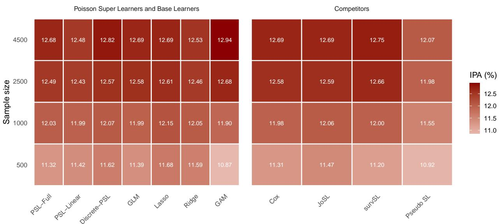
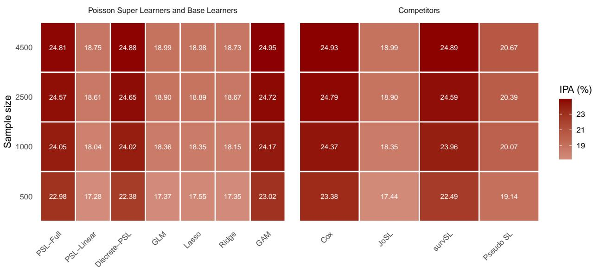
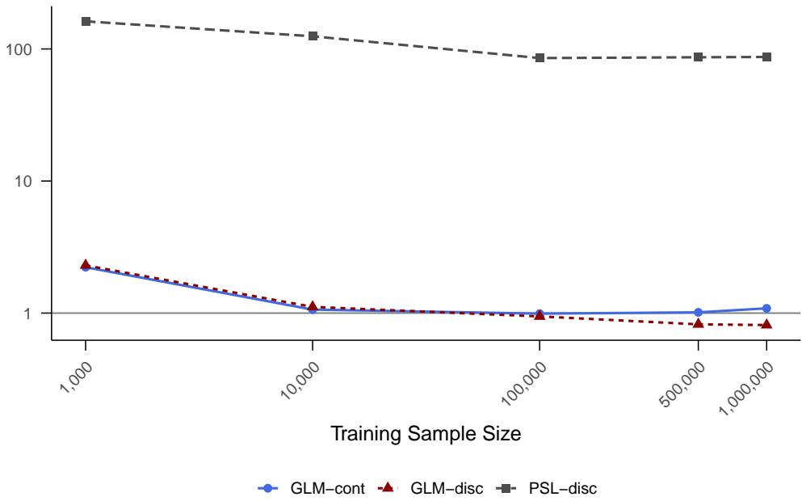

# POISSON SUPER LEARNING FOR SURVIVAL AND COMPETING RISKS ON A DISCRETIZED TIME SCALE

Gabriele Pittarello Section of Biostatistics, Department of Public Health, University of Copenhagen gabriele.pittarello@sund.ku.dk

Thomas Gerds Section of Biostatistics, Department of Public Health, University of Copenhagen tag@biostat.ku.dk

Pernille Falberg Rønn Clinical and Translational Research, Steno Diabetes Center Copenhagen, Copenhagen University Hospital, Herlev, Denmark pernille.falberg.roenn@regionh.dk

Helene Charlotte Rytgaard Section of Biostatistics, Department of Public Health, University of Copenhagen hely@sund.ku.dk

## ABSTRACT

We introduce the Poisson Super Learner, a scalable ensemble method for survival and competing risks prediction with right-censored data. The approach exploits the correspondence between the likelihood of piecewise-constant hazard models and the Poisson likelihood. After expanding the data over a chosen time partition, candidate hazard learners are trained under a common Poisson loss, and cross-validated log-hazard predictions are combined by a Poisson meta learner. The resulting ensemble is a geometric combination of candidate hazards, and can be used to estimate survival probabilities and cause-specific absolute risks. The Poisson Super Learner framework is modular and can in principle incorporate any learner that can estimate interval-specific hazards, including parametric, penalised, additive, and other machine-learning hazard models. Training targets the cause-specific hazard directly and does not require explicit modelling of the censoring distribu tion. For competing risks, separate cause-specific ensembles are fitted and subsequently combined to obtain individualised cumulative incidence predictions. We illustrate the approach using data from the Steno Diabetes Center collected between 2005 and 2022 to predict cardiovascular disease risk in patients with type 1 diabetes from detailed covariate information. The applied analysis is complemented by simulation studies designed to reflect key features of the data and to examine the behaviour of the method under controlled settings. All analyses were implemented using the freely available R software package poissonsuperlearner.

Keywords piecewise-constant hazard model ·discretized time ·superlearner ·competing risks ·right-censoring

## 1 Introduction

Individualised prediction of time-to-event outcomes usually requires absolute risk estimates at clinically relevant time horizons. In competing-risks settings, these risks can be obtained by combining the cause-specific hazards for the event of interest and for the competing events [Benichou and Gail, 1990]. The statistical problem is therefore not only to estimate flexible hazards, but also to choose among candidate hazard estimators in a way that is targeted to prediction. Super Learning provides a principled framework for this problem [Van der Laan et al., 2007, Keogh et al., 2025]. Given a library of candidate algorithms and a loss function, cross-validation is used to construct an ensemble whose asymptotic performance is motivated by the oracle property. For right-censored time-to-event data, however, the choice of target and loss is central: survival probabilities and absolute risks are derived from hazard rates over time, while the observed follow-up may be censored before the prediction horizon. In this article, we introduce the Poisson Super Learner, a likelihood-based ensemble method for survival and competing-risks prediction on a discretized time scale. Follow-up is partitioned into intervals and the cause-specific hazards are represented as piecewise constant on this partition. Under this representation, the counting-process likelihood is proportional to a Poisson likelihood [Aalen et al., 2008, ch. 5]. Piecewise exponential models can be embedded in generalised additive models [Fahrmeir and Tutz, 2001, Bender and Scheipl, 2018] and include multidimensional penalised hazard models [Fauvernier et al., 2019] and neural-network models parameterised on a fixed time partition [Kvamme and Borgan, 2021]. Our contribution is different: rather than proposing one new hazard model, we use the Poisson likelihood to combine many candidate hazard learners under a common cross-validated criterion. The Poisson Super Learner trains each candidate learner, collects cross-validated log-hazard predictions, and estimates a Poisson meta learner based on the Poisson negative log-likelihood loss. The resulting ensemble is a geometric combination of the candidate hazards. Survival probabilities and absolute risks are then obtained as derived quantities from the estimated cause-specific hazards. In competing-risks problems, separate cause-specific ensembles are fitted and combined to obtain predictions of absolute risks.

## 1.1 Relation to existing Super Learners for time-to-event data

Existing Super Learner approaches for censored time-to-event data differ mainly in the prediction target and loss function. Polley and van der Laan [2011] introduced a discrete-time Super Learner based on a longitudinal data representation in which conditional event probabilities are estimated interval by interval using binary outcome learners. Golmakani and Polley [2020] proposed a Super Learner within the Cox proportional hazards framework, where ensemble weights are estimated by minimising the cross-validated negative log partial likelihood. Westling et al. [2024] proposed an ensemble targeting the entire conditional survival curve by minimising an integrated weighted Brier score, which requires either a censoring model or coupled estimation of survival and censoring distributions. Munch and Gerds [2026] proposed a joint survival learner that treats censoring as an additional state and selects among tuples of event and censoring learners. Pseudo-observation-based Super Learners use transformed survival or cumulative-incidence outcomes for the second-stage ensemble [Sachs et al., 2019], but this preprocessing can complicate monotonicity and range restrictions for predicted risks [Keogh et al., 2025]. The Poisson Super Learner instead targets the cause-specific hazards directly. Its training criterion is the Poisson likelihood for the piecewise-constant hazard model, so the ensemble is formed on the hazard scale and does not require explicit modelling of the censoring distribution.

## 1.2 Contribution and outline

The contributions of this article are threefold. First, we formulate Super Learning for discretized-time hazard re gression through the piecewise-constant hazard and Poisson likelihood representation. Second, we propose a Poisson meta learner that combines cross-validated log-hazard predictions, yielding a geometric ensemble of candidate hazard models. Third, we show how the resulting cause-specific ensembles can be used to obtain individualised survival and competing-risks predictions, and evaluate the method in simulation studies and in an application to cardiovascular risk prediction in patients with type 1 diabetes. The remainder of the article is organised as follows. Section 2 gives a high-level overview of the Poisson Super Learner algorithm. Sections 3–7 introduce the competing-risks framework, the Poisson representation, the cross-validation procedure, the Poisson meta learner, and prediction of survival proba bilities and cumulative incidence functions. Section 6 introduces the discrete Poisson Super Learner, a cross-validated selector version of the method. Section 8 reports simulation studies, Section 9 presents the Steno Diabetes Center application, and Section 10 discusses limitations and extensions.

## 2 Overview of the Poisson Super Learner

This section provides a high-level description of the Poisson Super Learner algorithm for computing risk predictions; details are provided in the following sections. Suppose we observe n independent right-censored time-to-event ob servations with baseline covariates, and let $j = 1 , \dotsc , J$ index the event types, that is the outcome event and the competing risks. For $J = 1$ the setting includes right-censored survival data without competing risks. Suppose given a library of S candidate learners for the cause-specific hazard functions. The construction has two stages. First, candidate learners of the hazard functions (also called base learners in the sequel) are trained using cross-validation under the Poisson likelihood loss. Second, the cross-validated log-hazard predictions are used to construct a Poisson meta learner. The meta learner combines the learners directly on the hazard scale, yielding a geometric ensemble.

## Step 1: Ensemble hazard estimation

1. Choose a prediction horizon τ .

2. Partition the interval [0, τ ] into smaller intervals based on a grid of time points

$$
0 = t _ { 0 } < t _ { 1 } < \cdots < t _ { m } = \tau .
$$

3. For each individual and interval, compute the event indicator and the time at risk.

4. Split the observations of the data into V folds $\mathcal { D } _ { 1 } , \ldots , \mathcal { D } _ { V }$

5. For each cause $j = 1 , \dots , J$ and each fold $v = 1 , \ldots , V \colon$

(a) Estimate each base learner $s = 1 , \ldots , S$ using the observations not contained in $\mathcal { D } _ { v }$

(b) Predict the interval-specific cause-specific hazards for the observations in the held-out fold $\mathcal { D } _ { v }$

(c) Store the corresponding cross-validated log-hazard predictions.

6. For each cause $j ,$ collect the cross-validated log-hazard predictions from all folds. These predictions form the level-one data for the meta-learning step.

7. Fit a Poisson meta learner for each cause. The meta learner uses the cross-validated log-hazard predictions as covariates and is trained under the same Poisson likelihood. With a linear predictor in the log-hazards, the resulting ensemble hazard is a geometric combination of the candidate hazard estimates.

8. Re-estimate each base learner on the full data set. The resulting base-learner estimates together with the estimated meta learner define the Poisson Super Learner.

## Step 2: Out-of-sample hazard and risk prediction

## For a new observation:

1. For each cause and interval, obtain the predicted hazard from each base learner estimated on the full data.

2. Combine the base-learner hazard predictions to obtain the ensemble predictions of the cause-specific hazards corresponding to the Poisson meta learner.

3. Map the predicted cause-specific hazards into absolute risks of the competing risks at time τ. Without competing risks calculate predicted survival probabilities by subtracting absolute risks from 1.

## 3 General framework

Let $X \in \mathcal { X } \subseteq \mathbb { R } ^ { d }$ denote a vector of covariates, $T \in ( 0 , \infty )$ the event time, $C \in ( 0 , \infty )$ the censoring time, and $\Delta \in \{ 1 , \ldots , J \}$ the event type, where $J \in \mathbb N$ . We observe $\tilde { T } = \operatorname* { m i n } ( T , C )$ and $\widetilde \Delta = \Delta I ( T \le C ) \in \{ 0 , \dots , J \}$ where $\widetilde { \Delta } = 0$ denotes censoring and $\widetilde { \Delta } = j$ denotes an observed event of type j. Our goal is to construct an ensemble estimator for the cause-specific hazard functions

$$
\lambda _ { j } ( t \mid x ) = \operatorname * { l i m } _ { h  0 } { \frac { P \{ t \leq T < t + h , \Delta = j \mid T \geq t , X = x \} } { h } } .
$$

We assume that censoring is conditionally independent of the event time and event type given the baseline covariates. We consider a competing risks setting with independent and identically distributed observations $O _ { i } = ( X _ { i } , \widetilde { T } _ { i } , \widetilde { \Delta } _ { i } )$ $i = 1 , \ldots , n .$ . Let

$$
0 = t _ { 0 } < t _ { 1 } < . . . < t _ { m } = \tau
$$

be a partition of $[ 0 , \tau ]$ . For $k = 1 , \ldots , m$ , define the interval indicator function

$$
I _ { k } ( t ) = I \big ( t \in ( t _ { k - 1 } , t _ { k } ] \big ) ,
$$

For individual i in interval k we denote the event indicator for cause $j$ by

$$
D _ { i , k , j } = I ( \widetilde { \Delta } _ { i } = j ) I _ { k } ( \widetilde { T } _ { i } ) ,
$$

and the total time at risk by

$$
R _ { i , k } = \operatorname* { m a x } \{ 0 , \operatorname* { m i n } ( \widetilde { T } _ { i } , t _ { k } ) - t _ { k - 1 } \} .
$$

We consider piecewise-constant approximations of the cause-specific hazard as a function of time:

$$
\lambda _ { j } ( t \mid x ) = \sum _ { k = 1 } ^ { m } I _ { k } ( t ) \lambda _ { j , k } ( x ) ,\tag{1}
$$

for $x \in \mathcal { X }$ . Under the piecewise-constant approximation, the log-likelihood terms depending on $\lambda _ { j }$ are

$$
\ell _ { j } ( \lambda _ { j } ) ( O _ { i } ) = \sum _ { k = 1 } ^ { m } \left[ D _ { i , k , j } \log \{ \lambda _ { j , k } ( X _ { i } ) \} - R _ { i , k } \lambda _ { j , k } ( X _ { i } ) \right] .
$$

This is the log-likelihood of a Poisson model for interval-specific event counts with mean $R _ { i , k } \lambda _ { j , k } ( X _ { i } )$ . Equivalently, for intervals with $R _ { i , k } > 0 \mathrm { { ; } }$ , under a log link this corresponds to a Poisson regression model with offset log( $R _ { i , k } )$ Intervals with $R _ { i , k } ~ { = } ~ 0$ have zero likelihood contribution. We define the corresponding loss as the negative loglikelihood,

$$
\begin{array} { r } { \mathcal { L } _ { j } ( \lambda _ { j } ) ( O _ { i } ) = - \ell _ { j } ( \lambda _ { j } ) ( O _ { i } ) . } \end{array}\tag{2}
$$

For any function $g : O \mapsto \mathbb { R } .$ , let $\begin{array} { r } { P _ { n } g = n ^ { - 1 } \sum _ { i = 1 } ^ { n } g ( O _ { i } ) } \end{array}$ denote the empirical mean. The empirical risk for cause j is therefore

$$
P _ { n } \mathcal { L } _ { j } ( \lambda _ { j } ) = \frac { 1 } { n } \sum _ { i = 1 } ^ { n } \mathcal { L } _ { j } ( \lambda _ { j } ) ( O _ { i } ) .
$$

The piecewise-constant hazard approximation does not require a particular functional form of $\lambda _ { j , k } ( x )$ , nor does it require that this function be indexed by a finite-dimensional parameter. The only requirement is that each candidate model provides interval-specific hazard estimates on the chosen time partition. This representation allows a broad range of candidate hazard estimators for $\lambda _ { j , k } ( x )$ that solve the minimisation problem

$$
\hat { \lambda } _ { j } \in \mathop { \arg \operatorname* { m i n } } _ { \lambda _ { j } \in \mathcal { H } _ { j } } \left\{ P _ { n } \mathcal { L } _ { j } ( \lambda _ { j } ) \right\} ,\tag{3}
$$

where $\mathcal { H } _ { j }$ denotes the class of admissible functions for the candidate hazard estimator. This class may encode restrictions on the functional form, smoothness, regularisation, or other learner-specific constraints. An example is the Highly Adaptive Lasso model described by Rytgaard et al. [2022].

## 3.1 Base learners

For each cause $j \in \{ 1 , \dotsc , J \}$ , consider a library of $S$ candidate hazard learners. Learner $s \in \{ 1 , \ldots , S \}$ estimates the cause-specific hazard over a learner-specific class $\mathcal { H } _ { j } ^ { s }$ . Using the Poisson loss in Equation 2, we write the corresponding estimator as

$$
\hat { \lambda } _ { j } ^ { s } \in \arg \operatorname* { m i n } _ { \lambda _ { j } \in \mathcal { H } _ { j } ^ { s } } P _ { n } L _ { j } ( \lambda _ { j } ) .
$$

The resulting piecewise-constant hazard estimate is

$$
\hat { \lambda } _ { j } ^ { s } ( t \mid x ) = \sum _ { k = 1 } ^ { m } I _ { k } ( t ) \hat { \lambda } _ { j , k } ^ { s } ( x ) .
$$

The class $\mathcal { H } _ { j } ^ { s }$ may impose learner-specific restrictions on functional form, smoothness, or regularisation. In the following subsection, we describe the learner classes used in the empirical analyses.

## 3.1.1 Learners used in the empirical analyses

For the learner families used in the empirical analyses, we parametrise the interval-specific hazard through a learnerspecific function of the covariates $f _ { j , k } ^ { s } ( \bar { x } ; \theta _ { j } ^ { s } )$ ), indexed by a parameter vector $\theta _ { j } ^ { s }$ . Specifically,

$$
\lambda _ { j , k } ^ { s } ( \boldsymbol { x } ; \boldsymbol { \theta } _ { j } ^ { s } ) = \exp \{ f _ { j , k } ^ { s } ( \boldsymbol { x } ; \boldsymbol { \theta } _ { j } ^ { s } ) \} ,
$$

where $\theta _ { j } ^ { s }$ denotes the learner-specific parameters. The form of $f _ { j , k } ^ { s }$ and $\theta _ { j } ^ { s }$ depends on the learner family. The corresponding piecewise-constant hazard is

$$
\lambda _ { j } ^ { s } ( t \mid x ; \theta _ { j } ^ { s } ) = \sum _ { k = 1 } ^ { m } I _ { k } ( t ) \lambda _ { j , k } ^ { s } ( x ; \theta _ { j } ^ { s } ) .
$$

Let $\Theta _ { j } ^ { s }$ denote the learner-specific parameter space, so that

$$
\mathcal { H } _ { j } ^ { s } = \left\{ \lambda _ { j } ^ { s } ( \cdot ; \theta _ { j } ^ { s } ) : \theta _ { j } ^ { s } \in \Theta _ { j } ^ { s } \right\} .
$$

For these parametrised learners, the minimisation problem in Equation 3 becomes

$$
\hat { \theta } _ { j } ^ { s } = \underset { \theta _ { j } ^ { s } \in \Theta _ { j } ^ { s } } { \arg \operatorname* { m i n } } \left\{ P _ { n } \mathcal { L } _ { j } \left( \lambda _ { j } ^ { s } ( \cdot ; \theta _ { j } ^ { s } ) \right) \right\} .\tag{4}
$$

The resulting hazard estimator is

$$
\hat { \lambda } _ { j } ^ { s } ( t \mid x ) = \lambda _ { j } ^ { s } ( t \mid x ; \hat { \theta } _ { j } ^ { s } ) .
$$

For generalised linear model learners, we use the log-linear predictor

$$
f _ { j , k } ^ { s } ( \boldsymbol { x } ; \boldsymbol { \theta } _ { j } ^ { s } ) = \gamma _ { j , k } ^ { s } + \sum _ { \ell \in \mathcal { A } _ { j } } \beta _ { j , \ell } ^ { s } \boldsymbol { x } _ { \ell } ,
$$

where

$$
\theta _ { j } ^ { s } = ( \gamma _ { j , 1 } ^ { s } , \ldots , \gamma _ { j , m } ^ { s } , \beta _ { j } ^ { s } ) .
$$

The parameters $\gamma _ { j , k } ^ { s } \in \mathbb { R }$ represent interval-specific baseline effects, while

$$
\beta _ { j } ^ { s } = ( \beta _ { j , \ell } ^ { s } ) _ { \ell \in { \cal A } _ { j } } , \qquad { \cal A } _ { j } \subseteq \{ 1 , \dots , d \} ,
$$

contains the corresponding covariate effects. For an elastic-net-type learner [Tay et al., 2023], the learner-specific parameter space takes the form

$$
\Theta _ { j , \mathrm { E N } } ^ { s } ( c ^ { s } ) = \left\{ ( \gamma _ { j , 1 } ^ { s } , \ldots , \gamma _ { j , m } ^ { s } , \beta _ { j } ^ { s } ) : \frac { 1 - \iota ^ { s } } { 2 } \| \beta _ { j } ^ { s } \| _ { 2 } ^ { 2 } + \iota ^ { s } \| \beta _ { j } ^ { s } \| _ { 1 } \leq c ^ { s } \right\} ,
$$

where $c ^ { s } \in [ 0 , \infty )$ is a hyperparameter that determines the strength of regularisation, with smaller values corresponding to stronger regularisation, and $\iota ^ { s } \in [ 0 , 1 ]$ determines the mixture between ridge and lasso regularisation. The special cases $\iota ^ { s } = 1$ and $\iota ^ { s } = 0$ correspond to lasso and ridge constraints, respectively. For a generalised additive model learner [Wood, 2017], we partition the covariate indices into two disjoint sets

$$
\begin{array} { r } { S ^ { s } , \mathcal { W } ^ { s } \subseteq \{ 1 , \dots , d \} , \qquad S ^ { s } \cap \mathcal { W } ^ { s } = \emptyset , } \end{array}
$$

where $S ^ { s }$ contains the covariates entering through smooth effects and $\mathcal { W } ^ { s }$ contains the covariates entering linearly. The predictor is then written as

$$
f _ { j , k } ^ { s } ( \boldsymbol { x } ; \boldsymbol { \theta } _ { j } ^ { s } ) = \gamma _ { j , k } ^ { s } + \sum _ { \ell \in S ^ { s } } \zeta _ { j , \ell } ^ { s } ( \boldsymbol { x } _ { \ell } ) + \sum _ { \ell \in \mathcal { W } ^ { s } } \beta _ { j , \ell } ^ { s } \boldsymbol { x } _ { \ell } .
$$

Here, $\gamma _ { j , k } ^ { s } \in \mathbb { R }$ is an interval-specific baseline effect, $\zeta _ { j , \ell } ^ { s } : \mathbb { R } \to \mathbb { R }$ denotes the smooth effect of covariate $x _ { \ell }$ for cause $j$ in learner s, and $\beta _ { j , \ell } ^ { s } \in \mathbb { R }$ is the linear coefficient of the ℓ-th covariate. Here, $\theta _ { j } ^ { s }$ collects the interval-specific baseline effects, the linear coefficients, and the spline-basis coefficients representing the smooth components. For the GAM learner, define

$$
J _ { \ell } ( \zeta _ { j , \ell } ^ { s } ) = \int \left\{ \frac { d ^ { 2 } } { d z ^ { 2 } } \zeta _ { j , \ell } ^ { s } ( z ) \right\} ^ { 2 } d z .
$$

A constrained parameter space is then

$$
\begin{array} { r } { \Theta _ { j , \mathtt { G A M } } ^ { s } \left( ( c _ { \ell } ^ { s } ) _ { \ell \in S ^ { s } } \right) = \left\{ \theta _ { j } ^ { s } \in \Theta _ { j } ^ { s } : J _ { \ell } ( \zeta _ { j , \ell } ^ { s } ) \leq c _ { \ell } ^ { s } , \ \ell \in S ^ { s } \right\} , } \end{array}
$$

where $( c _ { \ell } ^ { s } ) _ { \ell \in \mathcal { S } ^ { s } } \in [ 0 , \infty ) ^ { | \mathcal { S } ^ { s } | }$ . In practice, the GAM learner is implemented through a penalised spline representation, where smoothing parameters control the flexibility of the fitted functions.

## 4 V-Fold Cross-Validation

In this section, we describe how out-of-sample predictions are obtained from each candidate hazard learner using cross-validation. These predictions are evaluated under the Poisson loss and form the level-one data for the Poisson Super Learner [Breiman, 1996]. Within each cross-validation fold, two steps are carried out: first, the base learners are estimated on the training portion of the data; second, predictions are generated for the held-out fold. We index the folds with $v = 1 , \ldots , V$ and denote by

$$
\mathcal { D } _ { v } \subset \{ 1 , \ldots , n \}
$$

the validation set in the v-th fold, so that

$$
\bigcup _ { v = 1 } ^ { V } \mathcal { D } _ { v } = \{ 1 , \ldots , n \} , \qquad \mathcal { D } _ { v _ { 1 } } \cap \mathcal { D } _ { v _ { 2 } } = \emptyset \quad \mathrm { f o r } v _ { 1 } \neq v _ { 2 } .
$$

For each fold $v ,$ we define the corresponding training set by

$$
\mathcal { T } _ { v } = \{ 1 , . . . , n \} \setminus \mathcal { D } _ { v } .
$$

The folds are defined at the subject level. Thus, all rows corresponding to a given individual are kept together in either the training or validation split. In the remainder of the manuscript, we refer to $\mathcal { T } _ { v }$ as the v-th training split and to $\mathcal { D } _ { v }$ as the v-th fold or validation split. The empirical distributions of the training and validation data are denoted by $P _ { n , \tau _ { v } }$ and $P _ { n , \mathcal { D } _ { v } }$ , respectively. We use $v ( i )$ to denote the validation fold containing individual $i ,$ with $v : \{ 1 , \dotsc , n \} \to \{ 1 , \dotsc , V \}$

## 4.1 Estimating the base learners on the training folds

For each cause $j \in \{ 1 , \dotsc , J \}$ , learner $s \in \{ 1 , \ldots , S \}$ , and fold $v \in \{ 1 , \ldots , V \}$ , the base learner is estimated using only the training observations in $\mathcal { T } _ { v }$ . We denote the corresponding fold-specific hazard estimator by

$$
\hat { \lambda } _ { j } ^ { s , v } \in \underset { \lambda _ { j } \in \mathcal { H } _ { j } ^ { s } } { \arg \operatorname* { m i n } } \left. P _ { n , \mathcal { T } _ { v } } \mathcal { L } _ { j } ( \lambda _ { j } ) \right. ,
$$

where $\begin{array} { r } { P _ { n , \mathcal { T } _ { v } } \mathcal { L } _ { j } ( \lambda _ { j } ) = \frac { 1 } { | { \mathcal T } _ { v } | } \sum _ { i \in \mathcal { T } _ { v } } \mathcal { L } _ { j } ( \lambda _ { j } ) ( O _ { i } ) } \end{array}$ . Here, ${ \mathcal { L } } _ { j }$ is the negative Poisson log-likelihood loss defined in Equation 2. Learner-specific tuning parameters are selected using only the observations in the training data $\mathcal { T } _ { v }$ . The resulting fold-specific piecewise-constant hazard estimate is

$$
\hat { \lambda } _ { j } ^ { s , v } ( t \mid x ) = \sum _ { k = 1 } ^ { m } I _ { k } ( t ) \hat { \lambda } _ { j , k } ^ { s , v } ( x ) .
$$

## 4.2 Predicting on the validation folds

For each individual $i = 1 , \ldots , n .$ , cause $j = 1 , \dots , J ,$ , interval $k = 1 , \ldots , m$ , and base learner $s = 1 , \ldots , S$ , the learner estimated using the corresponding training set $\mathcal { T } _ { v ( i ) }$ is used to compute the validation-set log-hazard prediction

$$
Z _ { i , j , k } ^ { s } = \log \hat { \lambda } _ { j , k } ^ { s , v ( i ) } ( X _ { i } ) ,
$$

Collecting these predictions over all learners gives the vector $Z _ { i , j , k } = \left( Z _ { i , j , k } ^ { 1 } , \ldots , Z _ { i , j , k } ^ { S } \right) ^ { \top } \in \mathbb { R } ^ { S }$ . Repeating this procedure over all folds yields, for every individual $i ,$ cause j, and interval k, a cross-validated vector of log-hazard predictions $Z _ { i , j , k }$ . These predictions are out-of-sample in the sense that $Z _ { i , j , k }$ is computed from models estimated without using observation i. We denote the level-one data for cause $j = 1 , \dots J$ as

$$
O _ { i , j } ^ { \star } = \{ Z _ { i , j , k } , D _ { i , k , j } , R _ { i , k } : k = 1 , \ldots , m \} .
$$

These data retain the interval-specific event indicators $D _ { i , k , j }$ and times at risk $R _ { i , k }$ from the discretized representation in Section 3, but differ in two respects. First, the cross-validated log-hazard predictions from the base learners $Z _ { i , j , k }$ replace the original covariates $X _ { i } ^ { \dot { 2 } }$ . Second, the level-one data used to construct the Poisson meta learner are causespecific.

## 4.3 Tuning and library construction

The Poisson Super Learner involves two types of tuning choices. The first are global configuration choices, such as the number m of intervals in the time partition and the number of cross-validation folds V. The second are learner-specific tuning parameters, such as penalty parameters in regularised regression or smoothing parameters in GAMs. When a learner has an internal tuning procedure, this tuning is performed inside each training split of the outer cross-validation loop. Other choices are handled by defining multiple candidate learners. For example, lasso and ridge learners correspond to different values of the elastic-net mixing parameter and are treated as separate learners in the library. Computation time increases with the number of intervals, folds, causes, and candidate learners. We examine the sensitivity of prediction performance to the number of intervals and folds in Section 3 of the Supplementary Material (Pittarello et al. [2026]). A comparison of the computation times of the Super Learner for some fixed configurations, the base learners, and the competing methods is provided in Section 2.3 of the Supplementary Material.

Table 1: Hyperparameters of the Poisson Super Learner. The first block summarises the hyperparameters of the meta learner, and the remaining blocks summarise the hyperparameters of the base-learner families considered in this article, namely GLMnet, and GAM.
<table><tr><td>Input</td><td>Description</td><td>Parameter range</td></tr><tr><td>Meta learner  ${ \overline { { S , } } }$ </td><td></td><td> $\overline { { \mathbb { Z } ^ { + } } }$ </td></tr><tr><td>Number of base- learners</td><td>number of base-learners in- cluded in the ensemble.</td><td></td></tr><tr><td>Number of folds</td><td> $V ,$  number of folds used in internal cross-validation.</td><td> $\mathbb { Z } ^ { + }$ </td></tr><tr><td>Number of intervals</td><td>m, number of intervals in the time partition.</td><td> $\mathbb { Z } ^ { + }$ </td></tr><tr><td>GLMnet</td><td></td><td></td></tr><tr><td>Elastic Net Mixing Pa- rameter</td><td>t, balance between L1 (lasso) and L2 (ridge). t = 1 yields lasso; t = 0 yields ridge.</td><td>[0, 1]</td></tr><tr><td>Regularisation Path</td><td> $\xi ,$  value or sequence of values con- trolling regularisation.</td><td> $\mathbb { R } ^ { + }$ </td></tr><tr><td>GAM Choice of the basis</td><td></td><td></td></tr><tr><td></td><td>Dimension of the basis used for smoothing.</td><td> $\overline { { \mathbb { Z } ^ { + } } }$ </td></tr></table>

## 5 The meta learner

The purpose of the meta learner is to combine the cross-validated out-of-sample log-hazard predictions from the base learners using the negative Poisson likelihood loss. The meta-learning step is formulated as another Poisson regression problem on the level-one data $O _ { i , j } ^ { \star }$ from Section 4. We use a linear meta learner on the log-hazard scale. For cause $j ,$ let

$$
\alpha _ { j } = ( \alpha _ { j } ^ { 1 } , \ldots , \alpha _ { j } ^ { S } ) ^ { \top } \in \mathbb { R } ^ { S }
$$

denote the meta learner coefficients, with one coefficient for each of the $S$ base learners. We use a time-invariant meta learner which uses the same coefficient $\alpha _ { j }$ for all time intervals. This keeps the meta learner low-dimensional and avoids having to estimate ensemble weights separately in each time interval. For interval $k ,$ define

$$
m _ { j , k } ( Z _ { i , j , k } ; \alpha _ { j } ) = \exp \left\{ \sum _ { s = 1 } ^ { S } \alpha _ { j } ^ { s } Z _ { i , j , k } ^ { s } \right\} .
$$

The corresponding piecewise-constant meta learner hazard is

$$
m _ { j } ( t \mid Z _ { i , j } ; \alpha _ { j } ) = \sum _ { k = 1 } ^ { m } I _ { k } ( t ) m _ { j , k } ( Z _ { i , j , k } ; \alpha _ { j } ) ,
$$

where $Z _ { i , j } = ( Z _ { i , j , 1 } , \ldots , Z _ { i , j , m } )$ . Because $Z _ { i , j , k } ^ { s } = \log \hat { \lambda } _ { j , k } ^ { s , v ( i ) } ( X _ { i } )$ , the interval-specific meta learner hazard can be written as

$$
m _ { j , k } ( Z _ { i , j , k } ; \alpha _ { j } ) = \prod _ { s = 1 } ^ { S } \left\{ \hat { \lambda } _ { j , k } ^ { s , v ( i ) } ( X _ { i } ) \right\} ^ { \alpha _ { j } ^ { s } } .
$$

Thus, the Poisson meta learner combines the candidate hazards on the hazard scale through a multiplicative combi nation of the base-learner hazard estimates. If the coefficients are nonnegative, the combination has the form of a weighted geometric product. This differs from the standard Super Learner, which typically combines candidate predictions through an additive (arithmetic) mixture [Van der Laan et al., 2007]. The Poisson loss applied to the level-one data is

$$
\mathcal { L } _ { j } ^ { \star } ( m _ { j } ) ( O _ { i , j } ^ { \star } ) = - \sum _ { k = 1 } ^ { m } \left[ D _ { i , k , j } \log \{ m _ { j , k } ( Z _ { i , j , k } ; \alpha _ { j } ) \} - R _ { i , k } m _ { j , k } ( Z _ { i , j , k } ; \alpha _ { j } ) \right] .
$$

This has the same form as the Poisson loss used to fit the base learners, with the original covariates replaced by the cross-validated log-hazard predictions. For each cause $j ,$ , the coefficient vector is estimated by minimising the empirical Poisson loss on the level-one data:

$$
\hat { \alpha } _ { j } = \arg \operatorname* { m i n } _ { \alpha _ { j } \in \mathbb { R } ^ { S } } P _ { n } ^ { * } \mathcal { L } _ { j } ^ { \star } ( m _ { j } ( \cdot ; \alpha _ { j } ) ) ,
$$

where $\begin{array} { r } { P _ { n } ^ { * } \mathcal { L } _ { j } ^ { \star } ( m _ { j } ) = \frac { 1 } { n } \sum _ { i = 1 } ^ { n } \mathcal { L } _ { j } ^ { \star } ( m _ { j } ) ( O _ { i , j } ^ { \star } ) } \end{array}$ . The estimated meta learner hazard for cause $j$ is

$$
\hat { m } _ { j } ( t \mid Z _ { i , j } ) = \sum _ { k = 1 } ^ { m } I _ { k } ( t ) \hat { m } _ { j , k } ( Z _ { i , j , k } ) ,
$$

with $\hat { m } _ { j , k } ( Z _ { i , j , k } ) = m _ { j , k } ( Z _ { i , j , k } ; \hat { \alpha } _ { j } )$

## 6 The Discrete Poisson Super Learner

The previous sections define an ensemble that combines candidate hazard learners through a Poisson meta learner. In this section, we introduce the discrete Poisson Super Learner. For each competing risk $\bar { \boldsymbol j } \in \{ 1 , \dots J \}$ , it selects the single learner $s \in \{ 1 , \ldots , S \}$ from the library that minimises the cross-validated Poisson loss across the V-folds. Let $\hat { \lambda } _ { j , k } ^ { s , v }$ denote the hazard estimate produced by learner s using the corresponding training fold. The discrete Poisson Super Learner for each cause $j ,$ selects

$$
\hat { s } _ { j } = \underset { s \in \{ 1 , \ldots , S \} } { \arg \operatorname* { m i n } } \left\{ \frac { 1 } { n } \sum _ { v = 1 } ^ { V } \sum _ { i \in \mathcal { D } _ { v } } \mathcal { L } _ { j } \left( \hat { \lambda } _ { j } ^ { s , v } \right) ( O _ { i } ) \right\} .
$$

The selected learner for cause $j$ is then re-estimated using all n observations and used for prediction.

## 7 Predictions on new data

Let $\hat { \lambda } _ { j } ^ { s }$ be the full-sample estimate of base learner s for cause $j .$ . For a covariate vector $x ^ { \mathrm { n e w } } \in \mathcal { X }$ , compute the log-hazard prediction from each base learner, for $s = 1 , \ldots , S$ and $k = 1 , \ldots , m$

$$
Z _ { j , k } ^ { s , \mathrm { n e w } } = \log \hat { \lambda } _ { j , k } ^ { s } ( x ^ { n e w } ) ,
$$

with $\boldsymbol { Z } _ { j , \boldsymbol { k } } ^ { \mathrm { n e w } } = \left( Z _ { j , \boldsymbol { k } } ^ { 1 , \mathrm { n e w } } , \dots , Z _ { j , \boldsymbol { k } } ^ { S , \mathrm { n e w } } \right) ^ { \top }$ . The ensemble cause-specific hazard is then

$$
\hat { \lambda } _ { j } ( t \mid x ^ { n e w } ) = \sum _ { k = 1 } ^ { m } I _ { k } ( t ) \hat { \lambda } _ { j , k } ( x ^ { n e w } ) ,
$$

where

$$
\hat { \lambda } _ { j , k } ( \boldsymbol x ^ { n e w } ) = m _ { j , k } ( Z _ { j , k } ^ { \mathrm { n e w } } ; \hat { \alpha } _ { j } ) = \exp \left\{ \sum _ { s = 1 } ^ { S } \hat { \alpha } _ { j } ^ { s } Z _ { j , k } ^ { s , \mathrm { n e w } } \right\} .
$$

## 7.1 Risk predictions

The cause-specific hazard estimates are mapped to estimated survival probabilities and estimated absolute risks using well-known formulae [Benichou and Gail, 1990, Andersen et al., 1993]. Let

$$
\hat { \Lambda } _ { j } ( t \mid x ) = \int _ { 0 } ^ { t } \hat { \lambda } _ { j } ( u \mid x ) d u
$$

denote the estimated cumulative cause-specific hazard, and define the survival function

$$
\hat { S } ( t \mid x ) = \exp \left\{ - \sum _ { \ell = 1 } ^ { J } \hat { \Lambda } _ { \ell } ( t \mid x ) \right\} .
$$

The absolute risk for cause $j$ is

$$
F _ { j } ( t \mid x ) = \int _ { 0 } ^ { t } S ( u - \mid x ) \lambda _ { j } ( u \mid x ) d u .
$$

For piecewise-constant hazards, this integral has an explicit form (arguments provided in the Supplementary Material). Let

$$
\hat { \lambda } _ { \cdot , k } ( x ) = \sum _ { \ell = 1 } ^ { J } \hat { \lambda } _ { \ell , k } ( x )
$$

denote the estimated total hazard in interval k, and define

$$
\Delta _ { k } ( t ) = \operatorname* { m a x } \left\{ 0 , \operatorname* { m i n } ( t , t _ { k } ) - t _ { k - 1 } \right\} .
$$

Then the estimated absolute risk of an event of cause j by time t is

$$
\hat { F } _ { j } ( t \mid x ) = \sum _ { k = 1 } ^ { m } \hat { S } ( t _ { k - 1 } \mid x ) \frac { \hat { \lambda } _ { j , k } ( x ) } { \hat { \lambda } _ { \cdot , k } ( x ) } \left[ 1 - \exp \left\{ - \hat { \lambda } _ { \cdot , k } ( x ) \Delta _ { k } ( t ) \right\} \right] ,
$$

with the convention that $0 / 0 = 0$

## 8 Simulation study

We examine key aspects of the Poisson Super Learner. The study is divided into two parts. The first part focuses on the right-censored survival setting where we have a common basis for comparison with existing benchmark imple mentations. In this part, we compare the behaviour of the proposed approach with alternative super learning methods. We focus on three main questions. First, we assess whether the Poisson Super Learner performs similar as the best candidate learners included in its library. This corresponds to the oracle property discussed in Keogh et al. [2025], namely the ability of the Super Learner to perform at least as well as the best learner in the candidate library. In settings where the library contains a learner that is expected to approximate the data-generating process well, we also examine whether the Discrete Super Learner selects this learner. Second, we study how the composition of the learner library affects the prediction performance by comparing a reduced linear library with a richer library that additionally includes a nonlinear additive learner. This comparison is carried out under two simulated scenarios, corresponding respectively to linear and nonlinear structures in the true hazard. Third, we compare the proposed method with existing survival super learning approaches and a proportional-hazards benchmark. We repeat these comparisons across several training sample sizes in order to assess finite-sample behaviour, while evaluating all models on the same large independent test sample. In the second part, we examine the scalability of the proposed approach for large data sets. Here, we simulate five data sets from a controlled competing-risks scenario in which the true cause-specific hazard satisfies the assumptions of a standard cause-specific Cox model. We then compare the computation time of the Poisson Super Learner with that of the cause-specific Cox model. This analysis is used to assess how the relative computational cost of the proposed approach changes as the sample size increases, thereby illustrating its potential for large-sample applications such as analyses of national registry data.

## 8.1 Data-generating mechanisms

The data-generating mechanisms were chosen to reflect key features of the Steno type 1 diabetes cohort analysed in Section 9, while allowing the true signal structure to be controlled. The simulator generates hypothetical patients with baseline covariates motivated by the real application and dependence patterns induced through a structural equation model [Holst and Budtz-Jørgensen, 2013]. We consider two scenarios that share the same baseline covariate distribu tion, censoring mechanism, and competing-risk hazard, but differ in how the cause 1 event hazard is generated:

• In Scenario Alpha, the cause 1 hazard depends linearly on all covariates.

• In Scenario Beta, the linear effects of age and LDL cholesterol on the cause 1 hazard are supplemented by nonlinear hinge-squared terms.

The comparison between the two settings therefore isolates the effect of additional flexibility in the learner library when the cause 1 hazard departs from linearity.

## 8.2 Poisson Super Learner variants and component learners

We compare two Poisson Super Learner ensembles, the discrete version, and the individual learners entering the Poisson Super Learner library. This allows us to separate the effect of library composition from the effect of hazardscale ensemble construction. All methods are fitted using the same baseline covariates and the same time partition. The full learner library consists of four learners: an unpenalised generalised linear model (GLM), a lasso-penalised generalised linear model (Lasso), a ridge-penalised generalised linear model (Ridge), and a generalised additive model (GAM). The Poisson Super Learner using this library is denoted PSL-Full. The corresponding discrete version, which chooses the single learner with the lowest cross-validated Poisson loss, is denoted Discrete-PSL. We also consider a reduced linear library containing only GLM, Lasso, and Ridge; the Poisson Super Learner using this reduced library is denoted PSL-Linear. Thus, PSL-Full and PSL-Linear differ only in whether the nonlinear GAM learner is included. Comparing the Poisson Super Learner with a richer learner library to its reduced version based only on generalised linear learners then shows when additional flexibility is beneficial and when a simpler library is sufficient.

## 8.3 External benchmark methods

We compare the Poisson Super Learner variants with four external benchmark methods for right-censored survival prediction. The benchmarks were chosen to represent both standard survival modelling and recently proposed ensem ble approaches for time-to-event outcomes. Throughout the simulation results, we use the labels Cox, JoSL, survSL, and Pseudo SL for these methods.

Cox. As a standard regression benchmark, we fit a Cox proportional hazards model. The Cox model was specified using knowledge of the simulation design and should therefore be interpreted as a strong design-informed benchmark. In Scenario Alpha, the model includes the baseline covariates as linear terms. In Scenario Beta, the model additionally includes the nonlinear age and LDL cholesterol terms used in the event-generating mechanism. Thus, the Cox benchmark is deliberately favourable, especially with respect to the scenario-defining effects.

JoSL. We include the joint survival learner of Munch and Gerds [2026], denoted JoSL. This method evaluates combinations of learners for the event and censoring mechanisms. In our implementation, the learner library consists of an intercept-only model, a Cox proportional hazards model, and a penalised Cox model for both the event and censoring components. Because this library is based primarily on linear and penalised regression structures, we expect JoSL to behave similarly to methods based on the reduced linear library, especially in Scenario Alpha.

survSL. We also include the continuous-time survival Super Learner of Westling et al. [2024], denoted survSL. This method targets the conditional survival curve and uses an integrated Brier-score criterion. We use Kaplan–Meier, Cox, and generalised additive model learners for both the event and censoring models, with three cross-validation folds.

Pseudo SL. Finally, we include a pseudo-observation-based Super Learner, denoted Pseudo SL, based on Sachs et al. [2019]. This approach provides a conceptually different route to ensemble prediction: pseudo-observations derived from nonparametric survival or cumulative-incidence estimators are used as outcomes in a second-stage prediction model. In our implementation, the learner library consists of a generalised linear model, a penalised generalised linear model, and a generalised additive model. For prediction at five years, pseudo-observations are computed on the grid $\{ 1 , \ldots , 1 0 \}$

## 8.4 Performance measure

All methods are evaluated at the same prediction horizon of 5 years and on the same large test sample within each simulated scenario, using the Index of Prediction Accuracy [IPA, Gerds and Kattan, 2021] as performance measure. The IPA is a scaled Brier-score measure. It compares the prediction error of a model with that of a null model that assigns the same risk to all individuals. An IPA of 0 corresponds to the null model, while larger values indicate better prediction accuracy. In formula, the Index of Prediction Accuracy (IPA) for cause j is defined as

$$
\mathrm { I P A } _ { j } ( t ) = 1 - \frac { \mathcal { B } _ { j , t } ( \hat { F } _ { j } ) } { \mathcal { B } _ { j , t } ( \hat { F } _ { j , 0 } ) } ,
$$

where $\mathcal { B } _ { j , t } ( \hat { F } _ { j } )$ is the Brier score for the time-to-event model being evaluated, while $\mathcal { B } _ { j , t } ( \hat { F } _ { j , 0 } )$ is the Brier score for a reference model, here the null model with no covariates. In right-censored settings, as in the real data application, the Brier score can be calculated using inverse probability of censoring weighting (IPCW). Because the uncensored event times were available in the simulation, prediction accuracy was evaluated without estimating the censoring distribution. This isolates prediction performance from additional variability due to IPCW estimation. Specifically, each fitted model was evaluated at t = 5 on an independently simulated test sample using the binary outcome $Y _ { i , j } ^ { * } \stackrel { \textstyle = } { = }$ $I ( T _ { i } \le 5 , \Delta _ { i } = j )$ . The Brier score of a fitted model was calculated as

$$
\mathcal { B } _ { j , 5 } ^ { * } ( \hat { F } _ { j } ) = \frac { 1 } { N } \sum _ { i = 1 } ^ { N } \left[ Y _ { i , j } ^ { * } - \hat { F } _ { j } ( 5 \mid X _ { i } ) \right] ^ { 2 } .
$$

The null model assigned every subject the same absolute-risk prediction, equal to the empirical proportion of subjects experiencing event j by time 5 in the uncensored test sample: $\begin{array} { r } { \hat { F } _ { j , 0 } ( 5 ) = \frac { 1 } { N } \sum _ { i = 1 } ^ { N } Y _ { i , j } ^ { * } } \end{array}$

## 8.5 Results

Figures 1 and 2 show the average IPA scores across 80 simulation replicates for Scenarios Alpha and Beta, respectively. Rows correspond to the training sample sizes and columns to the methods under comparison. Darker colours indicate higher IPA values and hence better predictive performance. In each figure, the left panel contains the Poisson Super Learner variants and their component learners, while the right panel contains the external benchmark methods. Across both scenarios, prediction performance generally improved with increasing training sample size. Since all methods were evaluated on the same fixed large test sample within each scenario (10000), this pattern reflects the increased amount of information available for model fitting rather than changes in the evaluation distribution. The sample size trend should therefore be viewed primarily as a finite-sample diagnostic. The main comparisons concern how the Poisson Super Learner behaves relative to its component learners, how the learner library affects performance, and how the proposed method compares with external benchmarks. In Scenario Alpha, where the event hazard is approximately linear in the covariates, PSL-Linear and PSL-Full performed similarly. This is expected because the reduced linear library already contains learners well aligned with the data-generating mechanism. The individual GLM, Lasso, and Ridge learners also performed similarly, and the Poisson Super Learner variants tracked these strong library members. Thus, adding the nonlinear GAM learner did not materially improve performance in the approximately linear scenario, but it also did not substantially degrade performance. The external benchmarks showed a similar pattern in Scenario Alpha. Cox performed well, as expected, because it was specified using knowledge of the approximately linear event-generating mechanism. JoSL also performed competitively, consistent with its use of linear and penalised Cox-type learners. The survSL benchmark performed well, while Pseudo SL was less competitive. Overall, in the approximately linear setting, the proposed Poisson Super Learner was competitive with the strongest benchmark methods and behaved similarly to the strongest learners in its own library. In Scenario Beta, where the event hazard included nonlinear effects of age and LDL cholesterol, the methods capable of representing nonlinear structure performed best. Within the Poisson Super Learner family, PSL-Full clearly outperformed PSL-Linear across the investigated sample sizes. This difference was driven by the inclusion of the GAM learner, which was well matched to the nonlinear signal and was the strongest individual learner in the full library. The performance of PSL-Full was close to that of GAM, showing that the ensemble adapted to the strongest available nonlinear learner. The Discrete-PSL also performed close to the strongest full-library learners, particularly at larger sample sizes. Among the external benchmarks in Scenario Beta, Cox remained a strong competitor because it included the nonlinear terms used in the data-generating mechanism. The survSL method also performed well. In contrast, JoSL and Pseudo SL improved with increasing sample size but remained below the best-performing methods in this scenario. These results suggest that the richer Poisson Super Learner library is beneficial when the true hazard structure departs from linearity, provided that the library contains learners capable of capturing the relevant nonlinear effects. Taken together, the simulation study supports two conclusions. First, the results of the Poisson Super Learner were consistent with the oracle motivation of Super Learning: the ensemble performed similarly to the strongest candidate learner across the investigated settings. Second, learner-library composition mattered: the reduced linear library was sufficient in the approximately linear scenario, whereas the full library was preferable when the hazard contained nonlinear effects.

  
Figure 1: Scenario Alpha. Average IPA scores for increasing sample sizes (y-axis) for the different methods (x-axis).

## 8.6 Results on the scalability of the Poisson Super Learner

Piecewise-constant hazard models are computationally attractive in large data sets with categorical covariates, since observations sharing the same covariates can be aggregated. We refer to this well-known property as the computational scalability of Poisson regression models; see Section 2 of the Supplementary Material and [Aalen et al., 2008, p. 225] In this section, we assess the computational scalability of the proposed approach empirically in a controlled competingrisks setting. We simulate data from scenario Alpha with sample sizes n = 1000, 10000, 100000, 500000, and 1000000. To demonstrate our point, we compare four models. The first, CSC-Cox, is a cause-specific Cox model fitted to the synthetic version of the original covariates listed in Table 2. It satisfies the assumptions of the data generator and serves as a correctly specified benchmark. We fit it using coxph from the R package riskRegression. The second, GLM-cont, is an unpenalised Poisson generalised linear model using the same covariates. The third, GLMdisc, uses the same model after discretising the numeric covariates by rounding them down to the nearest integer using floor. The fourth model is the Poisson Super Learner, also fitted to the discretised covariates. For the cause of interest, its library comprises unpenalised, lasso-penalised, and ridge-penalised Poisson generalised linear models; for the competing event, it comprises unpenalised and lasso-penalised models. Penalty parameters are selected by internal cross-validation. The Super Learner uses V = 3 and 3 time knots. Figure 3 shows the average runtime of each fitted model relative to CSC-Cox as the training sample size increases, computed over 10 refits on the same data. The choice of 10 refits was based on the experiment reported in Section 2.4 of the Supplementary Material, where the benchmark model was refitted 30 times to data from scenario Alpha with sample size 100000. In that experiment, the variability of the average runtime was negligible after 10 refits. The reference runtime of CSC-Cox is represented by the horizontal line at y = 1. The relative runtime decreases with increasing sample size for the Poisson-based models. Comparing GLM-cont and GLM-disc, the results show that discretising the covariates reduces computation time. This reduction is most pronounced for large sample sizes, where GLM-disc is faster than the CSC-Cox benchmark. Absolute runtimes in seconds are provided in Section 2.4 of the Supplementary Material. Predictive performance was essentially unchanged: across all sample sizes, the Poisson-based models achieved Brier scores comparable to those of the correctly specified CSC-Cox benchmark; see Section 2 of the Supplementary Material. The simulation study presented in this section further motivates the Poisson Super Learner. In the spirit of piecewise-constant regression, discretising the covariates allows the proposed approach to use computationally inexpensive model configurations, improving computational efficiency relative to approaches based on the partial likelihood without materially affecting predictive performance.

  
Figure 2: Scenario Beta. Average IPA scores for increasing sample sizes (y-axis) for the different methods (x-axis).

## 9 Data application on the real data

In this Section, we apply our methods to the data set of 4821 adult patients with type 1 diabetes form Steno Diabetes Center Copenhagen, Herlev, Denmark. The data were collected between 2005 and 2022 from electronic patient records and linked with national register data through a personal identification number to get information on diagnosis codes, death and emigration during follow-up until 30 April, 2022. We split the data into a training set comprising 3583 observations from the calendar years 2005 to 2014 and a test set comprising 1238 observations from the calendar years 2015 to 2022. Our aim is to study the time to the first occurrence of cardiovascular disease in the presence of a competing event, namely non-CVD death, using a set of individual measurements as baseline covariates. Patients with type 1 diabetes have an increased risk of developing cardiovascular disease, and this risk is influenced by their individual characteristics. The baseline covariates are summarised in Table 2. The second column provides a description of each covariate. The covariates include clinician-assessed measurements, such as albuminuria status and estimated glomerular filtration rate; biological characteristics, such as age; and lifestyle factors, such as smoking behavior. For categorical covariates, Table 2 reports the different levels (column 3) and their distributions in the training and test sets (columns 4 and 5). For continuous covariates, the table reports the median and interquartile range in the training and test sets (columns 4 and 5). The Poisson Superlearner and the Discrete Poisson Superlearner considered in this section are constructed using cause-specific libraries of learners. For cause 1, we use the same library of learners as described in Section 8 for PSL-Linear. For cause 2, we consider a library comprising two learners: an unpenalised generalised linear model including the covariates sex and age, and a generalised additive model in which the continuous covariate age is modelled using a spline term. This choice is motivated by the small number of subjects experiencing the competing event and by considerations of computational efficiency. We refer to the Poisson Superlearner as PSL and to the Discrete Poisson Superlearner as Discrete-PSL. Table 3 reports the IPA scores by prediction horizon and model. The PSL and the Discrete-PSL are compared with the Cause-Specific Cox model (CSC) and with four individual candidate models: GLM, GAM, Lasso, and Ridge. Each of these individual candidate models is fitted using all covariates for both causes. By contrast, the Discrete-PSL is constructed through a cause-specific selection procedure: for each cause, it selects the learner with the lowest cross-validated Poisson deviance from the corresponding learner library described above. For each prediction horizon, the score of the best-performing model is highlighted in bold. The Ridge model performs best at prediction horizons 1, 4, and 5. The GAM performs best at prediction horizons 6 and 7, while the CSC model performs best at prediction horizons 2 and 3. Although the PSL does not achieve the highest score, its performance is close to that of the best-performing individual model at different prediction horizons, namely Ridge at earlier horizons and GAM at later horizons. The Discrete-PSL performs worse than the PSL.

  
Figure 3: Average computation time relative to the cause-specific Cox model, CSC-Cox, by training sample size, based on five data sets from Scenario Alpha. Average computation times were calculated over ten refits. The horizontal line at y = 1 denotes the CSC-Cox benchmark. The Poisson-based models are PSL-disc, GLM-cont, and GLM-disc.

## 10 Discussion and conclusions

We introduced the Poisson Super Learner, a Super Learner framework for cause-specific hazard estimation on a discretized time scale. Across the investigated settings, the Poisson Super Learner performed similarly to the strongest candidate learners in its library. The results also showed that library composition matters: a reduced linear library was sufficient when the true hazard structure was approximately linear, whereas a richer library including a nonlinear additive learner improved performance when the event hazard contained nonlinear effects. Compared with existing survival Super Learner approaches and proportional-hazards benchmarks, the proposed method was competitive while retaining a likelihood-based interpretation on the hazard scale. The scalability experiment showed that the relative computational cost of the Poisson-based models decreased with increasing sample size while predictive performance remained comparable to the correctly specified Cox benchmark. In the Steno application, the Poisson Super Learner remained close to the best-performing individual learner or benchmark across prediction horizons, whereas the Discrete Poisson Super Learner performed less well. This illustrates the advantage of combining candidate learners when their relative performance varies across causes or prediction horizons.

Table 2: Baseline covariates of the Steno data set of patients with type 1 diabetes. The covariates are listed in column 1 and described in column 2. Column 3 reports the levels of the categorical covariates. Columns 4 and 5 report the distribution of the categorical covariates in the training and test sets, respectively, or the median and interquartile range in brackets for the continuous covariates.
<table><tr><td>Variable</td><td>Description</td><td>Level</td><td>Train: 2005-2014 (n=3583)</td><td>Test: 2015-2022 (n=1238)</td></tr><tr><td>sex</td><td>Gender</td><td>Woman</td><td>1653 (46.1)</td><td>577 (46.6)</td></tr><tr><td>age</td><td>Age</td><td></td><td>43.5 [31.6, 55.4]</td><td>31.7 [22.1, 48.1]</td></tr><tr><td>diabetes_duration</td><td>Duration of diabetes (years)</td><td></td><td>19.7 [10.6, 31.1]</td><td>10.6 [3.8, 20.8]</td></tr><tr><td>value_SBP</td><td>Systolic blood pres- sure (mmHg)</td><td></td><td>131 [120.0, 143.5]</td><td>124 [116, 133]</td></tr><tr><td>value_LDL</td><td>LDL cholesterol (mmol/L)</td><td></td><td>2.4 [1.9, 2.9]</td><td>2.3 [1.9, 2.9]</td></tr><tr><td>value_HBA1C value_Smoking</td><td>HbA1c (mmol/mol)</td><td></td><td>64 [56, 74]</td><td>60 [52, 70]</td></tr><tr><td>value_Motion</td><td>Smoking habit Physical activity</td><td>Yes</td><td>1,042 (29.1)</td><td>292 (23.6)</td></tr><tr><td>value_Albuminuria</td><td>Albuminuria status</td><td>Yes</td><td>2,472 (69.0)</td><td>846 (68.3)</td></tr><tr><td rowspan="3"></td><td rowspan="3"></td><td>Normal</td><td>2,939 (82.0)</td><td>1,106 (89.3)</td></tr><tr><td>Micro</td><td>485 (13.5)</td><td>100 (8.1)</td></tr><tr><td>Macro</td><td>159 (4.4)</td><td>32 (2.6)</td></tr><tr><td rowspan="2">eGFR</td><td>Estimated glomeru- lar filtrationrate</td><td></td><td>107 [93.4, 118.3]</td><td>114.5 [102.0, 126.9]</td></tr><tr><td>(mL/min/1.73m²)</td><td></td><td></td><td></td></tr></table>

Table 3: Integrated prediction accuracy (IPA, %) by prediction horizon and model. For each prediction horizon, the highest IPA value is shown in bold.
<table><tr><td rowspan="2">Model</td><td colspan="7">Prediction horizon</td></tr><tr><td>1</td><td>2</td><td>3</td><td>4</td><td>5</td><td>6</td><td>7</td></tr><tr><td>Null model</td><td>0.0</td><td>0.0</td><td>0.0</td><td>0.0</td><td>0.0</td><td>0.0</td><td>0.0</td></tr><tr><td>GLM</td><td>2.6</td><td>3.5</td><td>5.7</td><td>8.5</td><td>7.0</td><td>9.7</td><td>8.1</td></tr><tr><td>GAM</td><td>1.9</td><td>3.3</td><td>5.7</td><td>8.0</td><td>7.1</td><td>11.0</td><td>9.3</td></tr><tr><td>Lasso</td><td>2.5</td><td>3.5</td><td>5.7</td><td>8.5</td><td>7.1</td><td>9.7</td><td>8.1</td></tr><tr><td>Ridge</td><td>2.9</td><td>3.7</td><td>6.0</td><td>8.7</td><td>7.4</td><td>10.1</td><td>8.3</td></tr><tr><td>PSL</td><td>2.3</td><td>2.8</td><td>6.0</td><td>8.3</td><td>7.2</td><td>10.3</td><td>8.2</td></tr><tr><td>Discrete-PSL</td><td>0.9</td><td>1.8</td><td>5.4</td><td>7.6</td><td>6.1</td><td>9.4</td><td>7.6</td></tr><tr><td>CSC</td><td>2.8</td><td>3.8</td><td>6.2</td><td>8.5</td><td>6.9</td><td>9.7</td><td>8.2</td></tr></table>

In the present implementation, the meta-learner coefficients do not depend on time. A time-varying meta learner could be obtained by allowing $\alpha _ { j , k } ^ { s }$ to depend on $k ,$ at the cost of additional parameters and potentially greater instability in intervals with few events. Further extensions include adding more flexible learners to the framework, such as the Highly Adaptive Lasso or eXtreme Gradient Boosting.

## Acknowledgments

Approval for access to and use of personal data was obtained from the Capital Region of Denmark’s Data Protection Office (approval no. P-2019-511). Approval for access to electronic patient records was obtained from the Danish Patient Safety Authority (3-3013-2959/1). According to Danish legislation, ethical committee approval and informed consent were not required for this register-based study.

Funding. Gabriele Pittarello is funded by Novo Nordisk Foundation grant NNF23OC0084961.

## Supplementary material

Closed-form derivation of the predicted risks under piecewise-constant cause-specific hazards, additional details on the simulation study, and supplementary results for the real-data application.

Software and replication code. The analyses in the manuscript were performed using version 0.2.0 of the R package poissonsuperlearner, available on CRAN. The simulation study was implemented using the targets workflow manager. The replication code and instructions are provided as supplementary material and are also available at gpitt71/replication-material-psl. More material on poissonsuperlearner can be found on the project website https://gpitt71.github.io/poissonsuperlearner/index.html.

## References

Odd O Aalen, Ørnulf Borgan, and Hakon K Gjessing. ˚ Survival and event history analysis: a process point of view. Springer, 2008.

P. K. Andersen, O. Borgan, R. D. Gill, and N. Keiding. Statistical models based on counting processes. Springer, New York, 1993.

Andreas Bender and Fabian Scheipl. Pammtools: Piece-wise exponential additive mixed modeling tools. arXiv preprint arXiv:1806.01042, 2018.

Jacques Benichou and Mitchell H Gail. Estimates of absolute cause-specific risk in cohort studies. Biometrics, pages 813–826, 1990.

Leo Breiman. Stacked regressions. Machine learning, 24(1):49–64, 1996.

Ludwig Fahrmeir and Gerhard Tutz. Multivariate statistical modelling based on generalized linear models. 2nd ed. Springer Series in Statistics. New York, Springer, 2001.

Mathieu Fauvernier, Laurent Roche, Zoe Uhry, Laure Tron, Nadine Bossard, and Laurent Remontet. Multi-´ dimensional penalized hazard model with continuous covariates: applications for studying trends and social inequalities in cancer survival. Journal of the Royal Statistical Society: Series C (Applied Statistics), 68(5):1233–1257, 2019.

Thomas A Gerds and Michael W Kattan. Medical risk prediction models: with ties to machine learning. CRC Press, 2021.

Marzieh K Golmakani and Eric C Polley. Super learner for survival data prediction. The International Journal of Biostatistics, 16(2):20190065, 2020.

Klaus Kahler Holst and Esben Budtz-Jørgensen. Linear latent variable models: the lava-package.¨ Computational Statistics, 28(4):1385–1452, 2013.

Ruth H Keogh, Karla Diaz-Ordaz, Nan van Geloven, Jon Michael Gran, and Kamaryn T Tanner. The super learner for time-to-event outcomes: A tutorial. arXiv preprint arXiv:2509.03315, 2025.

Havard Kvamme and Ørnulf Borgan. Continuous and discrete-time survival prediction with neural networks. ˚ Lifetime data analysis, 27(4):710–736, 2021.

Anders Munch and Thomas A Gerds. The joint survival super learner: A super learner for right-censored data. Statistica Neerlandica, 80(2):e70026, 2026.

Gabriele Pittarello, Thomas Gerds, Pernille Falberg Rønn, and Helene Charlotte Rytgaard. Supplement to ”poisson super learning for continuous-time survival and competing risks”. 2026.

Eric C. Polley and Mark J. van der Laan. Super learning for right-censored data. In Mark J. van der Laan and Sherri Rose, editors, Targeted Learning: Causal Inference for Observational and Experimental Data, chapter 16, pages 249–258. Springer, New York, 1 edition, 2011.

Helene C Rytgaard, Thomas A Gerds, and Mark J van der Laan. Continuous-time targeted minimum loss-based estimation of intervention-specific mean outcomes. The Annals ofStatistics, 50(5):2469–2491, 2022.

Michael C Sachs, Andrea Discacciati, Asa H Everhov, Ola Ol˚ en, and Erin E Gabriel. Ensemble prediction of time-´ to-event outcomes with competing risks: A case-study of surgical complications in crohn’s disease. Journal of the Royal Statistical Society Series C: Applied Statistics, 68(5):1431–1446, 2019.

J. Kenneth Tay, Balasubramanian Narasimhan, and Trevor Hastie. Elastic net regularization paths for all generalized linear models. Journal ofStatistical Software, 106(1):1–31, 2023. doi: 10.18637/jss.v106.i01.

Ted Westling, Alex Luedtke, Peter B Gilbert, and Marco Carone. Inference for treatment-specific survival curves using machine learning. Journal ofthe American Statistical Association, 119(546):1541–1553, 2024.

Mark J Van der Laan, Eric C Polley, and Alan E Hubbard. Super learner. 2007.

Simon N Wood. Generalized additive models: an introduction with R. chapman and hall/CRC, 2017.