# RASP: Read-All, Sparse-Plasticity Continual Learning in a Stationary-Size LoRA

Wen-Hsuan Liu University of California, Irvine

Amara Okonkwo University of Washington

Rohan Desai University of Washington

Tom Saliencro University of California, Irvine

Maya Lindqvist University of California, Irvine

## Abstract

Parameter-efficient continual learning on pre-trained Vision Transformers largely relies on a costly premise: preventing catastrophic forgetting requires either spawning a dedicated LoRA branch per session—causing adapter parameters to scale linearly with task horizon—or applying sparse Mixture-of-Experts gating symmetrically to both forward and backward passes, which sacrifices representational rank at test time. We argue that reading consolidated knowledge and writing new task credit are fundamentally asymmetric operations. Because visual features in a shared low-rank space distribute across rank-1 atoms rather than localizing in disjoint task silos, forward inference should read all atoms at full rank capacity, whereas backward optimization should restrict plasticity to a sparse subset of input-aligned channels. We introduce RASP (Read-All, Sparse-Plasticity LoRA), which adapts a single stationary-size adapter across sequential tasks. At each step, a scene-modulated cosine router selects the top-q unlocked atoms to receive gradients, blocks updates on the remaining r−q channels, andpenalizes Frobenius Gram coherence between active and non-updated output directions. Across sessions, the router’s empirical activation trace and each atom’s exact spectral norm form a zero-overhead geometric consolidation index $\omega _ { j } = \sqrt { \tilde { c } _ { j } \tilde { \sigma } _ { j } }$ that drives Cauchy step attenuation and boundary anchor locking. Across CIFAR-100, CUB-200, ImageNet-R, and ImageNet-A, RASP matches or surpasses branch-expanding LoRA learners under a strictly constant parameter footprint.

## 1. Introduction

Exemplar-free class-incremental learning (CIL) seeks to absorb a sequence of visual categories without storing rehearsal buffers or querying task identifiers at inference time [1]. Early continual learners attributed catastrophic forgetting to unconstrained stochastic gradient updates overwriting shared network weights [2]. With frozen pre-trained Vision Transformers (ViTs) [3] now serving as the standard visual backbone, adaptation is predominantly localized inside Low-Rank Adaptation (LoRA) modules [4, 5], shifting the core design question from full-network regularization to low-rank subspace governance.

To shield earlier sessions from later updates, mainstream LoRA-based continual learners instantiate a fresh adapter branch for every incoming task. InfLoRA initializes each new branch inside the empirical feature null-space of prior sessions [6]; SD-LoRA decouples directional bases from learnable magnitudes across growing branches [7]; BiLoRA constructs probabilistically orthogonal bilinear subspaces [8]; PLAN selects low-sensitivity bases via perturbation probing [9]; LoRA-P&M interpolates perturbed task vectors [10]; and SplitLoRA partitions the gradient space into primary and minor subspaces [11]. While effective, branch expansion hard-codes two structural liabilities: adapter memory grows linearly without bound as tasks accumulate, and locking each session inside a private branch prevents later tasks from reusing fine-grained visual primitives learned earlier. Conversely, recent intra-adapter routing methods—such as FlyLoRA [12], NeuroLoRA [13], and rank-1 expert pools [14]—maintain a shared parameter pool but apply top-q sparsity symmetrically to both forward and backward passes. Zeroing r − q channels during forward evaluation discards (1 − q/r) of the adapter’s effective rank capacity on every test sample.

Our key insight is illustrated in Figure 1. When a single fixed-size LoRA is trained across a task stream, discriminative visual structure does not segregate into mutually exclusive per-task ranks; instead, it organizes as a distributed superposition across all r rank-1 atoms. Consequently, forward representation reading and backward gradient writing should not share the same sparsity mask. During the forward pass, all r atoms should remain active (Read-All) so the classifier always operates at full rank capacity and can compose features learned in any prior session. During the backward pass, credit assignment should be restricted to the q unlocked atoms most aligned with the current input (Sparse-Plasticity), leaving the remaining r − q channels untouched at that step.

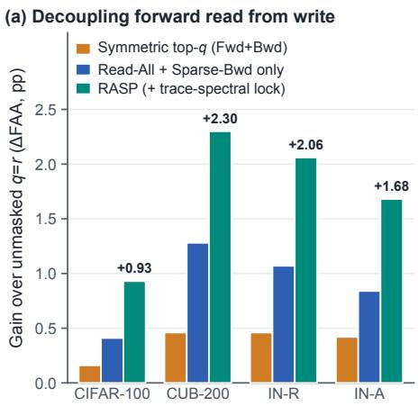

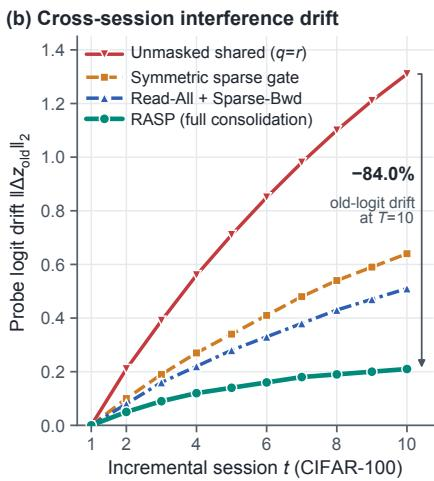

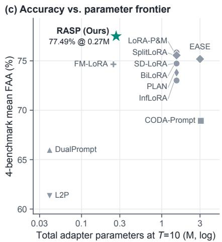  
Figure 1. Motivation for RASP. (a) Across all four benchmarks, decoupling full-rank forward reading from sparse backward writing consistently outperforms both unmasked shared updates $( q = r )$ and symmetric top-q gating, with trace-spectral consolidation providing an additional boost. (b) On CIFAR-100, unmasked shared training suffers severe old-task logit drift; symmetric gating curbs drift at the expense of forward rank; RASP suppresses 84.0% of cumulative logit drift while preserving full forward capacity. (c) At T = 10 sessions under a unified ViT-B/16 protocol, RASP occupies the Pareto frontier of final accuracy versus total adapter parameters.

Better still, this backward router generates its own crosssession consolidation signal at zero extra compute. By pairing each atom’s cumulative routing trace $\tilde { c } _ { j }$ with its exact rank-1 spectral norm $\tilde { \sigma } _ { j } ~ = ~ \| u _ { j } \| _ { 2 } \| v _ { j } \| _ { 2 }$ , we obtain a geometric consolidation index $\omega _ { j } ~ = ~ \sqrt { { \tilde { c } } _ { j } { \tilde { \sigma } } _ { j } }$ that identifies atoms that are both frequently recruited across tasks and energetically load-bearing. This single index governs continuous Cauchy step-size attenuation on active unlocked channels and locks a small quota of top-ω atoms into an immutable anchor set at each session boundary.

The main contributions of this work are fourfold:

• We formulate stationary-budget LoRA continual learning through read-write asymmetry: unmasked rank-r forward superposition preserves representational capacity and cross-task transfer, while routed top-q backward gating localizes per-step plasticity.

• We design a scene-modulated, usage-equalized cosine router coupled with a cross-partition Frobenius Gram coherence penalty that steers active output updates away from non-updated and locked directions.

• We introduce a zero-overhead trace-spectral consolidation mechanism $( \omega _ { j } ~ = ~ \sqrt { \tilde { c } _ { j } \tilde { \sigma } _ { j } } )$ with provable falselocking suppression and a three-tier cross-session logit drift bound.

• Extensive experiments on CIFAR-100, CUB-200, ImageNet-R, and ImageNet-A under a unified ViT-B/16 protocol show that RASP matches or outperforms pertask expansion methods at strictly constant adapter size.

## 2. Related Work

Pre-trained continual learning. Classical continual learning relies on rehearsal buffers, parameter regularization, or network expansion [1, 2]. With strong pre-trained ViTs, rehearsal-free methods adapt lightweight modules instead. Prompt-tuning approaches such as L2P, DualPrompt, and CODA-Prompt assemble task-conditioned prompts from learnable pools [15–17]. Adapter and prototype methods—including LAE [18], EASE [19], and MOS [20]—combine lightweight feature adapters with calibrated class prototypes, while analytic learners such as Fly-CL and guided random projections fit closed-form ridge heads over expanded representations [21, 22]. RASP is orthogonal to classifier-side calibration: it governs how a single low-rank backbone adapter updates and consolidates internal representations across sessions.

Subspace-expanding vs. stationary LoRA. Most LoRA-based continual learners enforce stability via spatial branch isolation [6–11] or inter-branch orthogonal constraints [23–25]. Because each session claims a dedicated parameter block, memory scales as O(T) and early features are locked away from later tasks unless explicitly merged. Recent efforts toward shared low-rank spaces explore learnable routing matrices in C-LoRA [26], meta-prompted rank selection in FM-LoRA [27], paced updates in PaLoRA [28], activation-subspace protection in SPACE-LoRA [29], geodesic subspace evolution in Geo-LoRA [30], spectral balancing in MuLoRA [31], and post-hoc parameter freezing or task-conditioned transforms [32, 33]. Closer in spirit, E2-LoRA [34] orders task drift via post-session SVD to recycle low-energy ranks, but still requires an extra eigendecomposition pass. In contrast, RASP operates inside a single stationary-size LoRA and extracts its consolidation signal directly from the router’s runtime trace and rank-1 norms.

Mixture-of-Experts and rank-level routing. MoE-LoRA architectures route tokens across multiple adapter experts [35–37]. Moving routing inside a single adapter, FlyLoRA [12] and NeuroLoRA [13] select top-q ranks via sparse projections or neuromodulated gates, while DAC [14] and noise-floor squelching [38] compose sparse rank-1 pools. As recent diagnostics emphasize, routing alone does not eliminate subspace contention within shared adapters [39]. Crucially, all prior rank routers apply their sparsity gate symmetrically to the forward pass, truncating inference rank. RASP keeps forward composition completely dense and confines sparsity, Gram decoupling, and trace-spectral consolidation to the backward update.

## 3. Preliminaries

We study rehearsal-free class-incremental learning over $T$ sequential sessions $\{ \mathcal { T } _ { 1 } , \hdots , \mathcal { T } _ { T } \}$ . Session t provides training dataset $\mathcal { D } _ { t } ~ = ~ \{ ( x _ { i } , y _ { i } ) \} _ { i = 1 } ^ { n _ { t } }$ with label set $\mathcal { V } _ { t }$ , where $\mathcal { V } _ { t } \cap \mathcal { V } _ { s } = \mathcal { V }$ for $t \neq s .$ No historical exemplars are retained, and test-time evaluation requires classifying across all seen categories $\textstyle { \mathcal { Y } } _ { 1 : t } = \bigcup _ { s = 1 } ^ { t } { \mathcal { Y } } _ { s }$ without task identity.

Let $W _ { 0 } \in \mathbb { R } ^ { d \times d }$ denote a frozen pre-trained projection layer (key or value matrix in ViT-B/16). Instead of allocating task-indexed adapters $\{ B _ { t } , A _ { t } \} _ { t = 1 } ^ { T } , \mathrm { R A S P }$ maintains a single stationary-size low-rank module parameterized by input probe matrix $V ~ \in ~ \mathbb { R } ^ { d \times r }$ and output synthesis matrix $U \in \mathbb { R } ^ { d \times r } \left( r \ll d \right)$ . Writing $V = [ v _ { 1 } , \ldots , v _ { r } ]$ and $U = [ u _ { 1 } , \ldots , u _ { r } ]$ , the weight update decomposes into $r$ rank-1 atomic channels:

$$
\Delta W = \frac { 1 } { r } U V ^ { \top } = \frac { 1 } { r } \sum _ { j = 1 } ^ { r } u _ { j } v _ { j } ^ { \top } , \qquad h = W _ { 0 } x + \frac { 1 } { r } \sum _ { j = 1 } ^ { r } u _ { j } ( v _ { j } ^ { \top } x ) .\tag{1}
$$

Here $v _ { j } ^ { \top } x \in \mathbb { R }$ measures how strongly token $x \in \mathbb { R } ^ { d } { \mathrm { ~ e x - } }$ cites the j-th input probe, and $u _ { j } \in \mathbb { R } ^ { d }$ specifies the output synthesis direction added to the residual stream. Throughout training on session t, the input probes V are held fixed while only selected columns of $U$ and a lightweight scene gate are updated.

## 4. RASP Framework

RASP resolves the stability–plasticity dilemma inside a stationary rank-r adapter by coupling two mechanisms into a closed loop (Figure 2): (i) intra-session Read-All, Sparse-Plasticity updates with cross-partition Gram decoupling, and (ii) inter-session Trace-Spectral Consolidation that converts routing history into graded step attenuation and permanent anchor locking.

## 4.1. Read-All Forward & Scene-Gated Router

In the forward pass, all r atomic channels contribute via Equation (1). No channel is dropped during feature extraction or test-time prediction, ensuring that visual primitives encoded in earlier sessions remain continuously accessible for cross-task composition.

To decide which channels should absorb backward credit on the current minibatch, we first compute a scale-invariant directional cosine probe for each channel $j \in \{ 1 , \ldots , r \}$ :

$$
a _ { j } ( \boldsymbol { x } ) = \frac { \left| \boldsymbol { v } _ { j } ^ { \top } \boldsymbol { x } \right| } { \left\| \boldsymbol { v } _ { j } \right\| _ { 2 } \left\| \boldsymbol { x } \right\| _ { 2 } + \epsilon } .\tag{2}
$$

Dividing by $\| v _ { j } \| _ { 2 } \| x \| _ { 2 }$ prevents probe norm variations or token magnitude spikes from biasing channel selection.

Because Equation (2) evaluates tokens locally, two patches from semantically different categories (e.g., background foliage vs. bird plumage) could trigger identical probes. To inject global scene context at negligible cost, we form the RMS-normalized token summary $\begin{array} { r } { \bar { x } = \mathrm { R M S N o r m } \bigl ( \frac { 1 } { N } \sum _ { n = 1 } ^ { N } x _ { n } \bigr ) \in \mathbb { R } ^ { d } } \end{array}$ and pass it through a lightweight bottleneck modulator $( d _ { g } = 6 4 , \sim 0$ .10M fixed parameters across the network):

$$
\phi ( { \bar { x } } ) = \mathbf { 1 } + \operatorname { t a n h } \left( W _ { 2 } \operatorname { S i L U } ( W _ { 1 } { \bar { x } } ) \right) \odot \xi ,\tag{3}
$$

where $W _ { 1 } \in \mathbb { R } ^ { d _ { g } \times d } , W _ { 2 } \in \mathbb { R } ^ { r \times d _ { g } }$ , and $\xi \in \mathbb { R } ^ { r }$ is initialized to zero so $\phi ( \bar { x } ) = \mathbf { 1 }$ at the beginning of training. The scenemodulated affinity is $\tilde { a } _ { j } ( x ) = a _ { j } ( x ) \cdot \phi _ { j } ( \bar { x } )$

Finally, to prevent early winner-take-all routing collapse among unlocked channels $\mathcal { P } _ { t - 1 } ~ = ~ \{ 1 , \ldots , r \} ~ \backslash ~ \mathcal { L } _ { t - 1 } ,$ we maintain an exponential moving average $\hat { p } _ { j }$ of each channel’s selection probability and add a centered usageequalizing prior:

$$
\rho _ { j } = \widetilde { a } _ { j } ( \boldsymbol { x } ) + \mu _ { \mathrm { e q } } \left( \frac { 1 } { | \mathcal { P } _ { t - 1 } | } - \hat { p } _ { j } \right) , \qquad j \in \mathcal { P } _ { t - 1 } ,\tag{4}
$$

where $\mu _ { \mathrm { { e q } } } > 0$ boosts under-explored channels during early epochs while letting data-driven affinity dominate once representations specialize.

## 4.2. Sparse-Plasticity Backward & Gram Decoupling

Given routing scores $\{ \rho _ { j } \ : \ j \ \in \ \mathcal { P } _ { t - 1 } \}$ aggregated over the minibatch, RASP selects the top-qt unlocked channels $( q _ { t } = \operatorname* { m i n } ( q , | \mathcal { P } _ { t - 1 } | ) )$ as the active write set $\boldsymbol { A } _ { t }$ and applies a hard binary stop-gradient mask to all other synthesis columns:

$$
\mathcal { A } _ { t } = \mathrm { T o p } \cdot q _ { t } \bigl ( \{ \rho _ { j } : j \in \mathcal { P } _ { t - 1 } \} \bigr ) , \qquad g _ { u _ { j } } = 0 \quad \forall j \notin \mathcal { A } _ { t } ,\tag{5}
$$

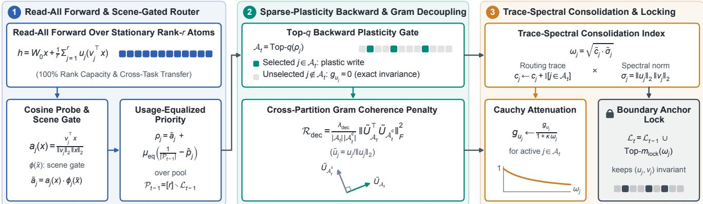  
Figure 2. Overview of the RASP pipeline. Stage 1 (Left): Every input batch traverses all r rank-1 atoms in the forward pass without truncation; a cosine probe modulated by an image-level scene gate $\phi ( { \bar { x } } )$ and a usage-equalizing prior scores the unlocked pool $\mathcal { P } _ { t - 1 } .$ Stage 2 (Middle): Only the top-q unlocked channels $\mathcal { A } _ { t }$ receive backward gradients, while a Frobenius Gram coherence penalty $\mathcal { R } _ { \mathrm { d e c } }$ pushes active synthesis columns orthogonal to non-updated and locked columns. Stage 3 (Right): Cumulative routing trace $\tilde { c } _ { j }$ and rank-1 spectral norm $\tilde { \sigma } _ { j }$ form the consolidation index $\omega _ { j } = \sqrt { \tilde { c } _ { j } \tilde { \sigma } _ { j } }$ , driving continuous Cauchy step attenuation and boundary anchor locking.

where $g _ { u _ { j } } = \nabla _ { u _ { j } } \mathcal { L } _ { \mathrm { c e } }$ is the backpropagated cross-entropy gradient. The plasticity ratio $q / r$ directly governs how much of the shared subspace a single minibatch may perturb: $r - q _ { t }$ channels experience exact zero parameter drift at every step, while all r channels participate in the forward prediction, unlike the symmetric mask of FlyLoRA [12].

Masking gradients on $\mathcal { A } _ { t } ^ { c } = \{ 1 , . . . , r \} \setminus \mathcal { A } _ { t }$ freezes their coordinates for the current step, but does not prevent the actively updated columns $\{ u _ { i } : i \in \mathcal { A } _ { t } \}$ from rotating into the subspace already spanned by $\mathcal { A } _ { t } ^ { c } .$ . To enforce geometric separation between plastic updates and protected knowledge, we penalize the Frobenius norm of the cross-partition Gram matrix between unit-normalized active columns $\tilde { U } _ { \mathbf {  { \mathcal { A } } } _ { t } }$ and non-active columns $\tilde { U } _ { \mathcal { A } _ { t } ^ { c } } ( \tilde { \boldsymbol { u } } _ { j } = \boldsymbol { u } _ { j } / \left. \boldsymbol { u } _ { j } \right. _ { 2 } ) \mathrm { : }$

$$
\mathcal { R } _ { \mathrm { d e c } } = \frac { \lambda _ { \mathrm { d e c } } } { \left| \mathcal { A } _ { t } \right| \left| \mathcal { A } _ { t } ^ { c } \right| } \left\| \tilde { U } _ { \mathcal { A } _ { t } } ^ { \top } \tilde { U } _ { \mathcal { A } _ { t } ^ { c } } \right\| _ { F } ^ { 2 } .\tag{6}
$$

Unlike all-pairs orthogonalization, Equation (6) leaves correlations within $\boldsymbol { A } _ { t }$ unconstrained so co-selected channels can cooperatively fit the current task, while repelling their updates from inactive and locked anchors.

## 4.3. Trace-Spectral Consolidation & Locking

Stepwise masking protects channels outside $\boldsymbol { A } _ { t }$ , yet an unlocked channel crucial to Session 1 may still be routed into $\boldsymbol { A } _ { t }$ during Session 4 and overwritten. Rather than introducing a separate Fisher pass [2] or post-session SVD [34], $\mathrm { R A S P }$ harvests a consolidation signal directly from two quantities intrinsic to the routing loop.

First, every top- $- q _ { t }$ selection emits a binary indicator $\mathbb { I } [ j \in \mathcal { A } _ { t } ]$ , which we accumulate into a cumulative routing trace across all training steps:

$$
c _ { j }  c _ { j } + \mathbb { I } [ j \in \mathcal { A } _ { t } ] , \qquad j = 1 , \ldots , r .\tag{7}
$$

Second, while $c _ { j }$ records how consistently channel $j$ is recruited, it does not measure how strongly atom $u _ { j } v _ { j } ^ { \top }$ modifies the frozen backbone. By Proposition $^ { 2 , }$ the exact operator (and nuclear) norm of the j-th rank-1 atom is

$$
\sigma _ { j } = { \left\| { u _ { j } } { v _ { j } ^ { \top } } \right\| } _ { 2 } = { \left\| { u _ { j } } \right\| } _ { 2 } { \left\| { v _ { j } } \right\| } _ { 2 } .\tag{8}
$$

We normalize both quantities to [0, 1] via $\tilde { c } _ { j } = c _ { j } /$ maxk $c _ { k }$ and $\tilde { \sigma } _ { j } = \sigma _ { j } / \operatorname* { m a x } _ { k } \sigma _ { k }$ , and define their geometric mean as the trace-spectral consolidation index:

$$
\omega _ { j } = \sqrt { \tilde { c } _ { j } \cdot \tilde { \sigma } _ { j } } \in [ 0 , 1 ] .\tag{9}
$$

A channel attains a high $\omega _ { j }$ if and only if it is both frequently selected across tasks and spectrally energetic. Noisy tie-breaker channels $( \tilde { c } _ { j } \gg 0 , \tilde { \sigma } _ { j } \approx 0 )$ and stale onetask spikes $( \tilde { c } _ { j } \approx 0 , \tilde { \sigma } _ { j } \gg 0 )$ are automatically suppressed.

Intra-session Cauchy step attenuation. For unlocked channels selected into $A _ { t } ,$ gradients are rescaled inversely by their consolidation index consolidated at the end of session $t - 1 \colon$

$$
g _ { u _ { j } } \gets \frac { g _ { u _ { j } } } { 1 + \kappa \omega _ { j } ^ { ( t - 1 ) } } , \qquad j \in \mathcal { A } _ { t } ,\tag{10}
$$

where $\kappa > 0$ is the attenuation gain. Because $\omega _ { j }$ already incorporates the square-root geometric compression of Equation (9), the Cauchy multiplier $( 1 + \kappa \omega _ { j } ) ^ { - 1 }$ smoothly decelerates updates on shared high-utility atoms without numerically zeroing their plasticity.

Inter-session boundary anchor locking. At the end of session $t ,$ we refresh $\sigma _ { j }$ and $\omega _ { j } ^ { ( t ) }$ . To prevent a single highgradient step in future tasks from corrupting the most critical consolidated atoms, we permanently lock the top $m _ { \mathrm { l o c k } }$ unlocked channels into the anchor set $\mathcal { L } _ { t } \mathrm { : }$

Algorithm 1: RASP Training Procedure at Session   
t   
Input: Shared adapter $( U , V )$ , scene gate ϕ, locked   
anchor set $\mathcal { L } _ { t - 1 } ,$ , trace $^ { c , }$ session data $\mathcal { D } _ { t }$ , budget   
q, gain κ   
Output: Updated $( U , V , \mathcal { L } _ { t } , c , \omega ^ { ( t ) } )$   
$/ /$ Null-space probe alignment on   
unlocked pool only   
$\mathcal { P } _ { t - 1 }  \{ 1 , . . . , r \} \setminus \mathcal { L } _ { t - 1 } ;$   
Project $\{ v _ { j } : j \in \mathcal { P } _ { t - 1 } \}$ onto null-space of prior feature   
covariance; keep $\{ v _ { j } : j \in \mathcal { L } _ { t - 1 } \}$ intact ;   
foreach minibatch $( X , Y ) \subset { \mathcal { D } } _ { t }$ do   
Compute Read-All forward output h over all r atoms   
via Eq. (1) ;   
Evaluate cosine probes $a _ { j } ( x )$ , scene gate $\phi ( { \bar { x } } )$ , and   
scores $\rho _ { j }$ on $\mathcal { P } _ { t - 1 }$ via Eqs. $\textcircled { 2 } \textcircled { - } \textcircled { 4 }$ ;   
Select $\mathcal { A } _ { t }  \mathrm { T o p } \ – q _ { t } ( \{ \rho _ { j } : j \in \mathcal { P } _ { t - 1 } \} )$ and mask   
$g _ { u _ { j } } = 0$ for ${ \textit { j } } \notin { \boldsymbol { A } } _ { t } :$   
Compute gradient of ${ \mathcal L } _ { \mathrm { c e } } + { \mathcal R } _ { \mathrm { d e c } } \left( \mathrm { E q . } \left( 6 \right) \right) ,$ and apply   
Cauchy attenuation $g _ { u _ { j } } \gets ( 1 + \kappa \omega _ { j } ^ { ( t - 1 ) } ) ^ { - 1 } g _ { u _ { j } } \ ;$   
Update active synthesis atoms $\{ u _ { j } : j \in \mathcal { A } _ { t } \}$ and   
scene gate; accumulate $c _ { j }  c _ { j } + \mathbb { I } [ j \in \mathcal { A } _ { t } ]$ ;   
Update spectral norms $\sigma _ { j } = \| u _ { j } \| _ { 2 } \| v _ { j } \| _ { 2 }$ and   
consolidation indices $\omega _ { j } ^ { ( t ) } = \sqrt { \tilde { c } _ { j } \tilde { \sigma } _ { j } }$   
if $\lvert \mathcal { P } _ { t - 1 } \rvert \geq q + 2$ then   
$\mathcal { L } _ { t }  \mathcal { L } _ { t - 1 } \cup \mathrm { T o p } { \cdot } m _ { \mathrm { l o c k } } \big ( \{ \omega _ { j } ^ { ( t ) } : j \in \mathcal { P } _ { t - 1 } \} \big )$   
return $( U , V , \mathcal { L } _ { t } , c , \omega ^ { ( t ) } )$

$$
\mathscr { L } _ { t } = \mathscr { L } _ { t - 1 } \cup \mathrm { T o p } { \cdot } m _ { \mathrm { l o c k } } \big ( \{ \omega _ { j } ^ { ( t ) } : j \in \mathscr { P } _ { t - 1 } \} \big ) ,\tag{11}
$$

where $m _ { \mathrm { l o c k } } = \mathrm { c l i p } ( \lfloor \eta _ { \mathrm { l o c k } } \lvert \mathcal { P } _ { t - 1 } \rvert \rfloor , 1 , 3 )$ with $\eta _ { \mathrm { l o c k } } = 0 . 0 5 .$ and locking halts once $| \mathcal { P } _ { t - 1 } | < q + 2$ to prevent plasticity starvation. Crucially, at the start of session $t + 1$ , only the unlocked input probes $\{ v _ { j } : j \in \mathcal { P } _ { t } \}$ are re-initialized in the empirical feature null-space of prior tasks [6], whereas locked pairs $\{ ( u _ { j } , v _ { j } ) : j \in \mathcal { L } _ { t } \}$ remain completely invariant in both factors. Algorithm 1 summarizes the complete procedure.

## 5. Theoretical Analysis

We now formalize why decoupling forward reading from backward writing preserves representational rank while bounding cross-session interference. Full proofs are provided in Appendix A.

Proposition 1 (Read-write capacity–interference decoupling). For any active write subset $\mathcal { A } _ { t } \subset \{ 1 , \ldots , r \}$ of cardinality q, let $\begin{array} { r } { \Delta W _ { \mathrm { s y m } } = \frac { 1 } { r } \sum _ { j \in \mathcal { A } _ { t } } u _ { j } v _ { j } ^ { \top } } \end{array}$ denote the symmetrically gated adapter. For any input x $\mathbf { \Lambda } \in \mathbb { R } ^ { d } .$ , the forward truncation error incurred by symmetric gating satisfies

$$
\big \| \big ( \Delta W - \Delta W _ { \mathrm { s y m } } \big ) x \big \| _ { 2 } \leq \frac { \| x \| _ { 2 } } { r } \sum _ { j \notin \mathcal { A } _ { t } } \sigma _ { j } a _ { j } \big ( x \big ) ,\tag{12}
$$

whereas RASP incurs zero forward truncation error $( \Delta W _ { \mathrm { f w d } } ~ = ~ \Delta W )$ . Simultaneously, under isotropic perchannel gradient variance $\varsigma ^ { 2 } , ~ R A S P ^ { \prime } s$ sparse-plasticity mask reduces expected backward update energy from $r \varsigma ^ { \dot { 2 } }$ to $q \varsigma ^ { 2 }$

Proposition 1 exposes the structural flaw of symmetric rank routing [12]: zeroing $r \mathrm { ~ - ~ } q$ channels in the forward pass discards a feature residual proportional to the spectral norms $\sigma _ { j }$ of unselected atoms, whereas RASP eliminates $( 1 - q / r )$ of backward perturbation energy without sacrificing forward rank.

Theorem 1 (Three-tier session drift bound). Consider session t with locked anchor set $\mathcal { L } _ { t - 1 }$ and unlockedpool $\mathcal { P } _ { t - 1 }$ Let $S _ { j } \subset \{ 1 , \ldots , M _ { t } \}$ denote the minibatch steps at which channel $j \in \mathcal P _ { t - 1 }$ is routed into $\boldsymbol { A } _ { t }$ with step sizes $\{ \eta _ { s } \}$ Because locked pairs $\{ ( u _ { j } , v _ { j } ) : j \in \mathcal { L } _ { t - 1 } \}$ and unlocked probes $\{ v _ { j } : j \in \mathcal { P } _ { t - 1 } \}$ remain fixed during session $t ,$ the functional output shift $\Delta h _ { t } ( x ) = \Delta W ^ { ( t ) } x - \Delta W ^ { ( t - 1 ) }$ x on any probe input x decomposes into three tiers:

$$
\| \Delta h _ { t } ( \boldsymbol { x } ) \| _ { 2 } \leq \frac { \| \boldsymbol { x } \| _ { 2 } } { r } \sum _ { \stackrel { j \in \mathcal { P } _ { t - 1 } } { S _ { j } \neq \emptyset } } \frac { \| \boldsymbol { v } _ { j } \| _ { 2 } a _ { j } ( \boldsymbol { x } ) } { 1 + \kappa \omega _ { j } ^ { ( t - 1 ) } } \sum _ { s \in S _ { j } } \eta _ { s } \left\| g _ { u _ { j } } ^ { ( s ) } \right\| _ { 2 } ,\tag{13}
$$

with exact zero drift contributed by locked anchors $( j \in$ $\mathcal { L } _ { t - 1 } )$ and unrouted unlocked channels $( j \in { \mathcal { P } } _ { t - 1 } , S _ { j } = \emptyset ) .$

Theorem 1 guarantees that locked anchors $( \mathcal { L } _ { t - 1 } )$ and unrouted unlocked atoms $( S _ { j } ~ = ~ \emptyset )$ contribute exact zero functional drift, while drift on revisited channels is damped by $( 1 + \kappa \omega _ { j } ^ { ( t - 1 ) } ) ^ { - 1 }$

Proposition 2 (Spectral identity and conjunctive outlier filtering). Each rank-1 atom $M _ { j } = u _ { j } v _ { j } ^ { \top }$ satisfies $\| M _ { j } \| _ { 2 } =$ $\left\| M _ { j } \right\| _ { * } = \left\| u _ { j } \right\| _ { 2 } \left\| v _ { j } \right\| _ { 2 } = \sigma _ { j }$ . Moreover, for any locking threshold $\tau \in \mathsf { \Gamma } ( 0 , 1 )$ , the geometric consolidation condition $\omega _ { j } ~ = ~ \sqrt { { \tilde { c } } _ { j } { \tilde { \sigma } } _ { j } } ~ > ~ \tau$ enforces the conjunctive lower bound min $\mathsf { \Omega } _ { 1 } ( \tilde { c _ { j } } , \bar { \tilde { \sigma } } _ { j } ) \ > \ \tau ^ { 2 }$ , whereas the arithmetic mean ${ \textstyle \frac { 1 } { 2 } } ( \tilde { c } _ { j } + \tilde { \sigma } _ { j } ) > \tau$ admits single-cue false positives with min ${ \bf \nabla } _ { | } ( \tilde { c } _ { j } , \tilde { \sigma } _ { j } ) = 0$ whenever $\tau < 0 . 5$

## 6. Experiments

## 6.1. Experimental Setup

Benchmarks and evaluation protocol. We evaluate RASP on four standard CIL benchmarks spanning natural objects, fine-grained taxonomy, artistic domain shifts, and natural adversarial examples: CIFAR-100 [40], CUB-200-2011 [41], ImageNet-R [42], and ImageNet-A [43]. Following the standard rehearsal-free protocol [6, 20], each dataset is partitioned into $T = 1 0$ sequential sessions with equal class splits (10 classes/session on CIFAR-100; 20 classes/session on CUB-200, ImageNet-R, and ImageNet-$\mathbf { A } )$ , plus a $T = 2 0$ long-horizon split on ImageNet-R (10

Table 1. Comparison with state-of-the-art rehearsal-free CIL methods across four 10-session benchmarks on ViT-B/16-IN21K. “∆Params” denotes additional adapter parameters allocated per session, and “Total@ $T _ { 1 0 } \ '$ is the cumulative adapter overhead after 10 sessions (†: 0.25M for $r = 5 0 , 0 . 3 0 \mathrm { M }$ for $r = 6 4 , 0 . 3 5 \mathrm { M }$ for r = 80, including the fixed 0.10M scene gate). All cells are evaluated under a unified 3-seed protocol. Bold and underline indicate best and second-best among LoRA-based methods.
<table><tr><td>Method</td><td>Venue</td><td>∆Params Total@</td><td></td><td colspan="2">CIFAR-100</td><td colspan="2">CUB-200</td><td colspan="2">ImageNet-R</td><td colspan="2">ImageNet-A</td></tr><tr><td></td><td></td><td></td><td> ${ \mathit { T } } _ { 1 0 }$ </td><td>FAA</td><td>CAA</td><td>FAA</td><td>CAA</td><td>FAA</td><td>CAA</td><td>FAA</td><td>CAA</td></tr><tr><td colspan="10">Prompt-tuning families</td><td></td><td></td><td></td></tr><tr><td>L2P [15]</td><td>CVPR&#x27;22</td><td>+0</td><td>0.04M</td><td>82.79</td><td>88.45</td><td>62.28</td><td>73.89</td><td>66.54</td><td>72.81</td><td>33.84</td><td>45.91</td></tr><tr><td>DualPrompt [16]</td><td>ECCV’22</td><td>+0</td><td>0.04M</td><td>85.61</td><td>90.36 91.12</td><td>66.08 74.83</td><td>77.96 83.06</td><td>68.47</td><td>72.64 75.86</td><td>33.79</td><td>46.83</td></tr><tr><td>CODA-Prompt [17]</td><td>CVPR&#x27;23</td><td>+0.31M</td><td>3.07M</td><td>86.65</td><td></td><td></td><td></td><td>71.52</td><td></td><td>42.79</td><td>53.61</td></tr><tr><td colspan="10">Adapter &amp; prototype-surgery families</td><td></td><td></td></tr><tr><td>LAÈ [18]</td><td>ICCV&#x27;23</td><td>+0.19M</td><td>1.90M</td><td>85.32</td><td>90.41</td><td>75.64</td><td>83.72</td><td>72.68</td><td>77.95</td><td>45.12</td><td>55.84</td></tr><tr><td>EASE [19] MOS [20]</td><td>CVPR&#x27;24</td><td>+0.30M</td><td>3.00M</td><td>86.58</td><td>91.71</td><td>79.94</td><td>86.69</td><td>77.79</td><td>83.91</td><td>56.45</td><td>66.61</td></tr><tr><td></td><td>AAAI&#x27;25</td><td>+0.30M</td><td>3.00M</td><td>89.29</td><td>93.34</td><td>89.86</td><td>92.82</td><td>77.96</td><td>83.01</td><td>55.26</td><td>65.82</td></tr><tr><td colspan="10">LoRA with per-session branch expansion</td><td colspan="3"></td></tr><tr><td>InfLoRA [6]</td><td>CVPR&#x27;24</td><td>+0.15M</td><td>1.53M</td><td>85.24</td><td>90.61</td><td>79.92</td><td>88.21</td><td>77.63</td><td>83.48</td><td>49.26</td><td>60.98</td></tr><tr><td>SD-LoRA [7]</td><td>ICLR&#x27;25</td><td>+0.15M</td><td>1.53M</td><td>88.05</td><td>92.58</td><td>77.54</td><td>85.63</td><td>77.38</td><td>82.09</td><td>56.01</td><td>65.02</td></tr><tr><td>BiLoRA [8]</td><td>CVPR’25</td><td>+0.15M</td><td>1.53M</td><td>87.51</td><td>92.47</td><td>78.12</td><td>85.94</td><td>77.98</td><td>81.56</td><td>55.04</td><td>64.48</td></tr><tr><td>PLAN [9]</td><td>ICCV’25</td><td>+0.15M</td><td>1.53M</td><td>87.59</td><td>92.25</td><td>77.65</td><td>85.42</td><td>75.31</td><td>80.46</td><td>54.68</td><td>63.92</td></tr><tr><td>LoRA-P&amp;M [10] SplitLoRA [11]</td><td>NeurIPS’25 ICLR’26</td><td>+0.15M</td><td>1.53M</td><td>88.49</td><td>92.92</td><td>78.34</td><td>83.45</td><td>79.92</td><td>85.24</td><td>56.63</td><td>65.41</td></tr><tr><td></td><td></td><td>+0.15M</td><td>1.53M</td><td>90.24</td><td>93.66</td><td>72.88</td><td>83.18</td><td>80.96</td><td>85.79</td><td>57.98</td><td>68.97</td></tr><tr><td colspan="10">LoRA with stationary parameter budget</td><td></td><td></td></tr><tr><td>C-LoRA [26]</td><td>arXiv&#x27;25</td><td>+0</td><td>0.24M 0.25M</td><td>87.84 88.41</td><td>92.15 92.69</td><td>76.92 77.84</td><td>84.88</td><td>76.85 77.91</td><td>81.74 82.63</td><td>53.92</td><td>63.45</td></tr><tr><td>FM-LoRA [27]</td><td>CVPRW&#x27;25</td><td>+0 +0</td><td>0.25M†</td><td></td><td></td><td></td><td>85.96</td><td></td><td></td><td>54.45</td><td>64.18</td></tr><tr><td>RASP (Ours)</td><td></td><td></td><td></td><td></td><td>90.41±.0493.36±.0881.36±.22</td><td></td><td></td><td></td><td></td><td>85.68±.34 79.68±.14 83.52±.15 58.52±.0970.26±.13</td><td></td></tr></table>

Table 2. Benchmark-specific operating configurations for RASP. Total rank r, active plasticity quota q, base learning rate, training epochs per session, and Cauchy attenuation gain κ.
<table><tr><td>Benchmark</td><td>r</td><td> $q \left( q / r \right)$ </td><td>lr</td><td>Epochs</td><td>κ</td></tr><tr><td>CIFAR-100</td><td>50</td><td>6 (12.0%)</td><td>5e-4</td><td>20</td><td>0.05</td></tr><tr><td>CUB-200</td><td>50</td><td>15 (30.0%)</td><td>5e-4</td><td>20</td><td>0.05</td></tr><tr><td>ImageNet-R</td><td>64</td><td>18 (28.1%)</td><td>1e-3</td><td>30</td><td>0.08</td></tr><tr><td>ImageNet-A</td><td>80</td><td>50 (62.5%)</td><td>5e-4</td><td>20</td><td>0.05</td></tr></table>

classes/session). We report FAA (Final Average Accuracy A after the last session), CAA (Cumulative Average Accuracy $\textstyle { \frac { 1 } { T } } \sum _ { t = 1 } ^ { T } A _ { t } )$ , and Forgetting $( F _ { T }$ , mean accuracy drop across prior sessions).

Implementation details. All methods use a ViT-B/16 backbone pre-trained on ImageNet-21K [3, 44] with LoRA modules inserted into the key and value projections of all 12 blocks. We optimize U and the scene gate using Adam $( \beta _ { 1 } = 0 . 9 , \beta _ { 2 } = 0 . 9 9 9 )$ ) with cosine learning-rate decay and batch size 64. Table 2 summarizes the benchmark-specific operating parameters (r, q, lr, epochs, κ). Across all benchmarks, we fix scene-gate width $d _ { g } = 6 4$ , usage-prior weight $\mu _ { \mathrm { e q } } ~ = ~ 0 . 1$ , Gram decoupling weight $\lambda _ { \mathrm { d e c } } ~ = ~ 0 . 3 .$ , and boundary locking fraction $\eta _ { \mathrm { l o c k } } ~ = ~ 0 . 0 5$ clipped to [1, 3]. The stationary parameter budget of RASP is a single LoRA (0.15M for r = 50, 0.20M for r = 64, 0.25M for r = 80) plus the 0.10M scene gate. All results in our comparison tables are averaged over three random seeds.

## 6.2. Main Benchmark Comparison

Table 1 reports the complete comparison across all four benchmarks, with every baseline evaluated across all eight accuracy columns. Three findings stand out:

Outperforming branch expansion at stationary memory. On three of the four benchmarks, RASP achieves the highest final accuracy (FAA) among all LoRA methods without adding parameters across sessions. On CIFAR-100, RASP reaches 90.41% FAA with 0.25M total parameters, surpassing SplitLoRA (90.24%, 1.53M parameters). On ImageNet-A, RASP reaches 58.52% FAA and 70.26% CAA, outperforming both SplitLoRA (57.98% / 68.97%) and LoRA-P&M (56.63% / 65.41%). Against stationarybudget peers (C-LoRA and FM-LoRA), RASP gains +2.00 pp on CIFAR-100, +3.52 pp on CUB-200, +1.77 pp on ImageNet-R, and +4.07 pp on ImageNet-A.

Cross-session feature reuse on fine-grained streams. The advantage of Read-All forward superposition is clearest on CUB-200. Because bird species share local anatomical attributes (beak geometry, wing barring, plumage texture), isolating each session inside a private branch (Split-LoRA) starves later tasks of reusable primitives, dropping FAA to 72.88%. By reading all r shared atoms in the forward pass while protecting established directions in the backward pass, RASP reaches 81.36% FAA—beating Split-LoRA by +8.48 pp, LoRA-P&M by +3.02 pp, and InfLoRA by +1.44 pp.

(a) Optimal q/r vs. domain shift  
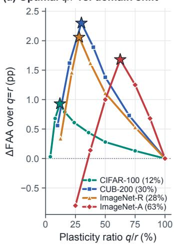

(b) Forgetting profile vs. q/r  
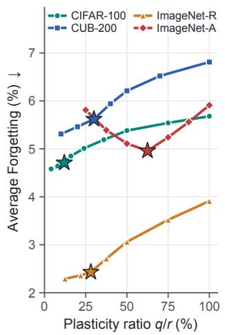

(c) Consolidation order maturity  
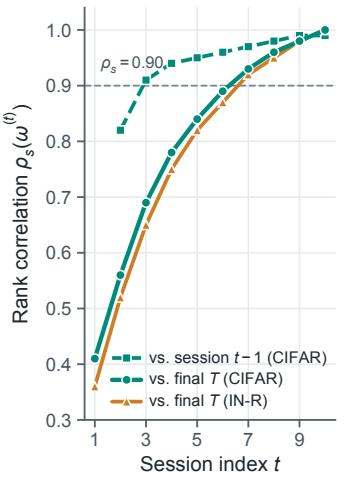

(d) Trace-spectral plane ωj  
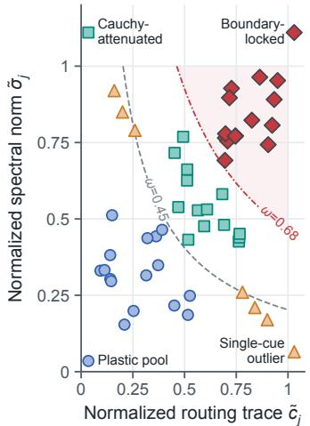  
Figure 3. Mechanistic analysis of RASP. (a, b) Effect of plasticity ratio q/r on ∆FAA (relative to $q \ = \ r )$ and Average Forgetting across four benchmarks; stars mark the operating configurations in Table 2. The optimal $q / r$ shifts rightward as domain divergence from ImageNet-21K increases. (c) Spearman rank correlation $\rho _ { s }$ of consolidation indices $\boldsymbol { \omega } ^ { ( t ) }$ against session $t - 1$ and final session $T ,$ showing rapid stabilization after session 3. (d) In the 2D trace-spectral plane $\left( \tilde { c } _ { j } , \tilde { \sigma } _ { j } \right)$ , hyperbolic contours of $\omega _ { j } = \sqrt { \tilde { c } _ { j } \tilde { \sigma } _ { j } }$ isolate true high-trace, high-energy anchors (crimson diamonds) while rejecting single-cue outliers (amber triangles).

Table 3. Long-horizon scalability on ImageNet-R $( T = 2 0$ sessions, 10 classes/session). “Total@ $T _ { 2 0 } { } ^ { , 5 }$ is the total adapter parameter count after session 20, and $F _ { 2 0 }$ denotes final forgetting.
<table><tr><td>Method</td><td>Venue</td><td>Total@  $^ { \prime } T _ { 2 0 }$ </td><td>FAA</td><td>CAA</td><td> $F _ { 2 0 } \downarrow$ </td></tr><tr><td>InfLoRA [6]</td><td>CVPR&#x27;24</td><td>3.06M</td><td>71.08</td><td>77.34</td><td>6.42</td></tr><tr><td>PLAN [9]</td><td>ICCV’25</td><td>3.06M</td><td>71.15</td><td>77.98</td><td>6.18</td></tr><tr><td>LoRA-P&amp;M [10]</td><td>NeurIPS&#x27;25</td><td>3.06M</td><td>76.94</td><td>82.85</td><td>4.12</td></tr><tr><td>SplitLoRA [11]</td><td>ICLR’26</td><td>3.06M</td><td>78.79</td><td>84.52</td><td>3.45</td></tr><tr><td>FM-LoRA [27]</td><td>CVPRW&#x27;25</td><td>0.25M</td><td>74.62</td><td>80.41</td><td>4.86</td></tr><tr><td>RASP (Ours)</td><td>一</td><td>0.30M</td><td>78.16</td><td>83.64</td><td>3.18</td></tr></table>

Behavior under multi-style rendition shifts. ImageNet-R is the only benchmark where branch expansion retains a narrow lead (80.96% for SplitLoRA and 79.92% for LoRA-P&M vs. 79.68% for RASP), while RASP beats InfLoRA (77.63%), BiLoRA (77.98%), SD-LoRA (77.38%), and PLAN (75.31%). Artistic renditions require a wider plasticity quota $( q / r = 2 8 . 1 \% \mathrm { v s }$ . 12.0% on CIFAR-100), leaving fewer channels unrouted per step (71.9% vs. 88.0%). However, on the T = 20 ImageNet-R stream (Table 3), expansion methods double their overhead to 3.06M (10.2× ${ \mathrm { R A S P } } { \mathrm { ^ { * } s } }$ fixed 0.30M), while the gap to SplitLoRA shrinks from 1.28 pp to 0.63 pp (78.79% vs. 78.16%).

## 6.3. Ablation and Mechanistic Analysis

Dissecting read-write asymmetry and router design. Table 4 evaluates each component of Stage 1 on CIFAR-100 and CUB-200. Starting from an unmasked shared LoRA $( q \ = \ r .$ , Row 1), applying top-q gating symmetrically to both passes (Row 2, as in FlyLoRA [12]) reduces CIFAR-100 forgetting from 5.68% to 5.01% but yields only +0.16 pp FAA because forward truncation discards $( 1 - q / r )$ of inference rank. Switching to Read-All forward + Sparse-Plasticity backward (Row 3) immediately lifts FAA to 89.89% on CIFAR-100 and 80.34% on CUB-200. Adding the scene gate ϕ(¯x) alone (Row 4) or Gram decoupling $\mathcal { R } _ { \mathrm { d e c } }$ alone (Row 5) brings modest gains, whereas combining both (Row 6) jumps to 90.41% on CIFAR-100 and 81.36% on CUB-200: scene modulation selects contextually coherent channel subsets, and Gram decoupling prevents those active columns from drifting into inactive subspaces. Row 7 replaces null-space probe alignment on unlocked channels with Gaussian initialization; accuracy drops by 0.57 pp on CIFAR-100 (89.84%) but still solidly beats unmasked shared training (89.48%).

Table 4. Stage-1 architectural ablation on CIFAR-100 and CUB-200. Every row includes trace-spectral consolidation in Stage 2; Row 7 replaces null-space probe initialization on unlocked channels $\mathcal { P } _ { t - 1 }$ with Kaiming normal initialization.
<table><tr><td rowspan="2">Configuration</td><td colspan="2">CIFAR-100</td><td colspan="2">CUB-200</td></tr><tr><td>FAA</td><td>Forget ↓</td><td>FAA</td><td>Forget ↓</td></tr><tr><td>1. Unmasked shared LoRA  $( q = r )$ </td><td>89.48</td><td>5.68</td><td>79.06</td><td>6.81</td></tr><tr><td>2. Symmetric sparse (Fwd &amp; Bwd)</td><td>89.64</td><td>5.01</td><td>79.52</td><td>6.24</td></tr><tr><td>3. Read-All Fwd + Sparse Bwd</td><td>89.89</td><td>4.86</td><td>80.34</td><td>5.95</td></tr><tr><td>4. + Scene modulator φ(x) only</td><td>89.82</td><td>4.80</td><td>80.61</td><td>5.84</td></tr><tr><td>5. + Gram decoupling  $\mathcal { R } _ { \mathrm { d e c } }$ </td><td>89.79</td><td>4.88</td><td>80.52</td><td>5.89</td></tr><tr><td>6. + Both  $( \mathbf { R A S P }$  full)</td><td>90.41</td><td>4.71</td><td>81.36</td><td>5.62</td></tr><tr><td>7. Full model, random init of  $V _ { \mathcal P }$ </td><td>89.84</td><td>4.89</td><td>80.48</td><td>5.91</td></tr></table>

Plasticity ratio $q / r$ as a domain-shift control. Figure 3(a,b) sweeps the plasticity ratio $q / r$ from 4% to 100%. Each benchmark exhibits a broad, flat plateau around its optimum—varying $q \in \{ 4 , 6 , 8 \}$ on CIFAR-100 changes FAA by less than 0.25 pp—confirming that RASP does not require brittle integer tuning. Past the star-marked operating point, opening additional backward channels monotonically increases forgetting without improving plasticity. Across benchmarks, the optimal ratio scales predictably with the visual domain gap relative to ImageNet-21K pre-training: 12.0% on CIFAR-100, 28.1% on ImageNet-R, 30.0% on CUB-200, and 62.5% on ImageNet-A.

(a) CIFAR-100 session curve  
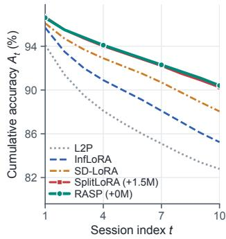

(b) CUB-200 feature reuse  
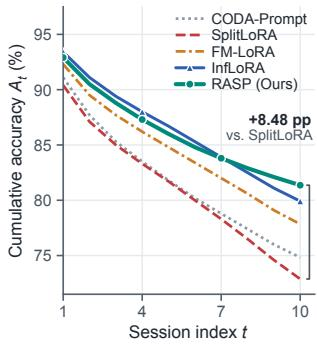

(c) Distributed atom resilience  
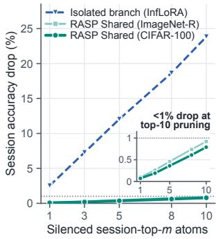

(d) Compute & VRAM footprint  
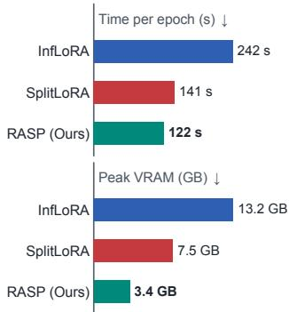  
Figure 4. Trajectories, resilience, and system cost. (a) On CIFAR-100, RASP matches the top expansion method across all 10 sessions at constant size. (b) On CUB-200, shared forward reading yields a +8.48 pp final lead over branch-isolated SplitLoRA. (c) Silencing the top-m task-associated atoms after training collapses isolated branches (−23.84% at m = 10) but costs < 1% on RASP, confirming distributed encoding. (d) Training time and peak VRAM on CIFAR-100.

Trace-spectral consolidation and cue fusion. Table 5 ablates Stage 2 on ImageNet-A and ImageNet-R. In Part A, adding boundary anchor locking $( \mathcal { L } _ { t } )$ or Cauchy step attenuation $( ( 1 + \kappa \omega _ { j } ) ^ { - 1 } )$ individually improves ImageNet-A FAA by +0.38 pp and +0.78 pp over Stage 1 alone, while their combination yields +1.28 pp (58.52%) and cuts forgetting by 0.72 pp. Crucially, Part A also tests locking $u _ { j }$ while allowing $v _ { j }$ to be re-initialized at task boundaries (“Lock $u _ { j }$ only, re-init $v _ { j } \ " ) { : }$ ; this breaks functional invariance of $u _ { j } v _ { j } ^ { \top }$ and drops ImageNet-A FAA by 0.89 pp, validating our joint pair-locking rule. In Part B, the geometric consolidation index $\omega _ { j } ~ = ~ \sqrt { \tilde { c } _ { j } \tilde { \sigma } _ { j } }$ outperforms traceonly $( \tilde { c } _ { j } ) _ { }$ , norm-only $( \tilde { \sigma } _ { j } )$ , and additive $( \textstyle { \frac { 1 } { 2 } } ( { \tilde { c } } _ { j } + { \tilde { \sigma } } _ { j } ) )$ scoring across all metrics, corroborating Proposition 2 and Figure 3(c,d).

Table 5. Stage-2 consolidation ablations on ImageNet-A and ImageNet-R. Part A ablates Cauchy step attenuation and bound ary locking; Part B compares candidate consolidation indices.
<table><tr><td rowspan="2">Consolidation Variant</td><td colspan="2">ImageNet-A</td><td colspan="2">ImageNet-R</td></tr><tr><td></td><td>FAA Forget ↓</td><td></td><td>FAA Forget ↓</td></tr><tr><td colspan="5">Part A: Protection mechanisms</td></tr><tr><td>Stage-1 Read-All/Sparse-Bwd only</td><td>57.24</td><td>5.68</td><td>78.42</td><td>2.94</td></tr><tr><td>+ Boundary anchor locking  $\mathcal { L } _ { t }$ </td><td>57.62</td><td>5.47</td><td>78.91</td><td>2.72</td></tr><tr><td>+ Cauchy step attenuation</td><td>58.02</td><td>5.18</td><td>79.26</td><td>2.58</td></tr><tr><td>+ Lock  $u _ { j }$  only (re-init  $v _ { j } )$ </td><td>57.63</td><td>5.44</td><td>78.84</td><td>2.76</td></tr><tr><td>+ Joint pair lock &amp; attenuation (Full)</td><td>58.52</td><td>4.96</td><td>79.68</td><td>2.43</td></tr><tr><td colspan="5">Part B: Consolidation signal formulation</td></tr><tr><td>Routing trace only  $( \tilde { c } _ { j } )$ </td><td>57.94</td><td>5.21</td><td>79.24</td><td>2.64</td></tr><tr><td>Spectral norm only  $( \tilde { \sigma } _ { j } )$ </td><td>56.88</td><td>5.52</td><td>77.58</td><td>2.88</td></tr><tr><td>Arithmetic mean  $\begin{array} { r l r } {  { \frac { 1 } { 2 } \big ( \tilde { c } _ { j } + \tilde { \sigma } _ { j } \big ) } } \end{array}$ </td><td>58.11</td><td>5.14</td><td>79.35</td><td>2.56</td></tr><tr><td>Geometric index  $\omega _ { j } = \sqrt { \tilde { c } _ { j } \tilde { \sigma } _ { j } }$ </td><td>(Ours) 58.52</td><td>4.96</td><td>79.68</td><td>2.43</td></tr></table>

Table 6. Computational and memory efficiency on CIFAR-100 (single NVIDIA A100 GPU, batch size 64). Adapter parameter counts for RASP include the shared LoRA (153K) and fixed scene gate (98K).
<table><tr><td>Method</td><td>Time (s/ep) ↓</td><td>VRAM↓</td><td>Params@T1</td><td>Params@  $^ { \prime T _ { 1 0 } }$ </td></tr><tr><td>InfLoRA [6]</td><td>241.8</td><td>13.24 GB</td><td>0.15M</td><td>1.53M</td></tr><tr><td>LoRA-P&amp;M [10]</td><td>156.4</td><td>8.15 GB</td><td>0.15M</td><td>1.53M</td></tr><tr><td>SplitLoRA [11]</td><td>140.6</td><td>7.52 GB</td><td>0.15M</td><td>1.53M</td></tr><tr><td>RASP (Ours)</td><td>121.9</td><td>3.41 GB</td><td>0.25M</td><td>0.25M</td></tr></table>

## 6.4. Session Trajectories, Atom Pruning & Cost

Figure 4(a,b) tracks session-by-session accuracy on CIFAR-100 and CUB-200, while Figure 4(c) performs a posttraining atomic knockout test: silencing the top-10 atoms most active on a given session reduces RASP’s accuracy on that session by only 0.79% on CIFAR-100 and 0.92% on ImageNet-R, versus 23.84% when pruning top components of an isolated InfLoRA branch. Finally, Table 6 and Figure 4(d) show that maintaining a single stationary LoRA without per-task branch allocation or post-session SVD makes RASP both the fastest (121.9 s/epoch) and most memory-frugal (3.41 GB peak VRAM) method.

## 7. Conclusion

We presented RASP, a continual learning framework that adapts a single stationary-size LoRA across sequential sessions by decoupling forward representation reading from backward credit assignment. Keeping all r rank-1 atoms active during the forward pass preserves full inference capacity and enables cross-session feature reuse, while routing backward gradients to the top-q unlocked channels and penalizing cross-partition Gram coherence prevents destructive overwriting. Combining the router’s empirical trace with exact rank-1 spectral norms into the geometric index $\omega _ { j } = \sqrt { \tilde { c } _ { j } \tilde { \sigma } _ { j } }$ unifies Cauchy step attenuation and boundary anchor locking at zero extra overhead.

## References

[1] Da-Wei Zhou, Qi-Wei Wang, Zhi-Hong Qi, Han-Jia Ye, De-Chuan Zhan, and Ziwei Liu. Class-incremental learning: A survey. IEEE Transactions on Pattern Analysis and Machine Intelligence, 46(8):5368–5389, 2024. 1, 2

[2] James Kirkpatrick, Razvan Pascanu, Neil Rabinowitz, Joel Veness, Guillaume Desjardins, Andrei A. Rusu, Kieran Milan, John Quan, Tiago Ramalho, Agnieszka Grabska-Barwinska, Demis Hassabis, Claudia Clopath, Dharshan Kumaran, and Raia Hadsell. Overcoming catastrophic forgetting in neural networks. Proceedings of the National Academy ofSciences, 114(13):3521–3526, 2017. 1, 2, 4

[3] Alexey Dosovitskiy, Lucas Beyer, Alexander Kolesnikov, Dirk Weissenborn, Xiaohua Zhai, Thomas Unterthiner, Mostafa Dehghani, Matthias Minderer, Georg Heigold, Sylvain Gelly, Jakob Uszkoreit, and Neil Houlsby. An image is worth 16x16 words: Transformers for image recognition at scale. In International Conference on Learning Representations (ICLR), 2021. 1, 6

[4] Edward J. Hu, Yelong Shen, Phillip Wallis, Zeyuan Allen-Zhu, Yuanzhi Li, Shean Wang, Lu Wang, and Weizhu Chen. LoRA: Low-rank adaptation of large language models. In International Conference on Learning Representations (ICLR), 2022. 1

[5] Shih-Yang Liu, Chien-Yi Wang, Hongxu Yin, Pavlo Molchanov, Yu-Chiang Frank Wang, Kwang-Ting Cheng, and Min-Hung Chen. DoRA: Weight-decomposed low-rank adaptation. In Proceedings of the 41st International Conference on Machine Learning (ICML), pages 32100–32121, 2024. 1

[6] Yan-Shuo Liang and Wu-Jun Li. InfLoRA: Interference-free low-rank adaptation for continual learning. In Proceedings of the IEEE/CVF Conference on Computer Vision and Pattern Recognition (CVPR), pages 23638–23647, 2024. 1, 2, 5, 6, 7, 8, 13, 15, 17

[7] Yichen Wu, Hongming Piao, Long-Kai Huang, Renzhen Wang, Wanhua Li, Hanspeter Pfister, Deyu Meng, Kede Ma, and Ying Wei. SD-LoRA: Scalable decoupled low-rank adaptation for class incremental learning. In International Conference on Learning Representations (ICLR), 2025. 1, 6, 17

[8] Hao Zhu, Yifei Zhang, Junhao Dong, and Piotr Koniusz. BiLoRA: Almost-orthogonal parameter spaces for continual learning. In Proceedings of the IEEE/CVF Conference on Computer Vision and Pattern Recognition (CVPR), pages 25613–25622, 2025. 1, 6, 14

[9] Xiequn Wang, Zhan Zhuang, and Yu Zhang. PLAN: Proactive low-rank allocation for continual learning. In Proceedings of the IEEE/CVF International Conference on Computer Vision (ICCV), 2025. 1, 6, 7, 14

[10] Haomiao Qiu, Miao Zhang, Ziyue Qiao, and Liqiang Nie. Train with perturbation, infer after merging: A two-stage framework for continual learning. In Advances in Neural Information Processing Systems (NeurIPS), 2025. 1, 6, 7, 8, 17

[11] Haomiao Qiu, Miao Zhang, Ziyue Qiao, Weili Guan, Min Zhang, and Liqiang Nie. SplitLoRA: Balancing stability and

plasticity in continual learning through gradient space split ting. In International Conference on Learning Representa tions (ICLR), 2026. 1, 2, 6, 7, 8, 15, 17

[12] Heming Zou, Yunliang Zang, Wutong Xu, Yao Zhu, and Xiangyang Ji. FlyLoRA: Boosting task decoupling and parameter efficiency via implicit rank-wise mixture-of-experts. In Advances in Neural Information Processing Systems (NeurIPS), pages 10386–10419, 2025. 1, 3, 4, 5, 7, 13

[13] Yuxin Yang, Haoran Zhang, Mingxuan Li, Jiachen Xu, Ruoxi Shen, Zhenyu Wang, Tianhao Liu, Siqi Chen, and Weilin Huang. NeuroLoRA: Context-aware neuromodulation for parameter-efficient multi-task adaptation. arXiv preprint arXiv:2603.12378, 2026. 1, 3

[14] Zhan Fa, Yue Duan, Jian Zhang, Lei Qi, Wanqi Yang, and Yinghuan Shi. Decomposing and composing: Towards efficient vision-language continual learning via rank-1 expert pool in a single LoRA. arXiv preprint arXiv:2601.22828, 2026. 1, 3

[15] Zifeng Wang, Zizhao Zhang, Chen-Yu Lee, Han Zhang, Ruoxi Sun, Xiaoqi Ren, Guolong Su, Vincent Perot, Jen nifer Dy, and Tomas Pfister. Learning to prompt for continual learning. In Proceedings ofthe IEEE/CVF Conference on Computer Vision and Pattern Recognition (CVPR), pages 139–149, 2022. 2, 6, 17

[16] Zifeng Wang, Zizhao Zhang, Sayna Ebrahimi, Ruoxi Sun, Han Zhang, Chen-Yu Lee, Xiaoqi Ren, Guolong Su, Vincent Perot, Jennifer Dy, and Tomas Pfister. DualPrompt: Com plementary prompting for rehearsal-free continual learning. In European Conference on Computer Vision (ECCV), pages 631–648, 2022. 6

[17] James Seale Smith, Leonid Karlinsky, Vyshnavi Gutta, Paola Cascante-Bonilla, Donghyun Kim, Assaf Arbelle, Rameswar Panda, Rogerio Feris, and Zsolt Kira. CODA-Prompt: COn tinual decomposed attention-based prompting for rehearsalfree continual learning. In Proceedings of the IEEE/CVF Conference on Computer Vision and Pattern Recognition (CVPR), pages 11909–11919, 2023. 2, 6, 17

[18] Qiankun Gao, Chen Zhao, Yifan Sun, Teng Xi, Gang Zhang, Bernard Ghanem, and Jian Zhang. A unified continual learn ing framework with general parameter-efficient tuning. In Proceedings of the IEEE/CVF International Conference on Computer Vision (ICCV), pages 11483–11493, 2023. 2, 6

[19] Da-Wei Zhou, Hai-Long Sun, Han-Jia Ye, and De-Chuan Zhan. Expandable subspace ensemble for pre-trained modelbased class-incremental learning. In Proceedings of the IEEE/CVF Conference on Computer Vision and Pattern Recognition (CVPR), pages 23554–23564, 2024. 2, 6

[20] Hai-Long Sun, Da-Wei Zhou, Hanbin Zhao, Le Gan, De-Chuan Zhan, and Han-Jia Ye. MOS: Model surgery for pretrained model-based class-incremental learning. In Proceed ings of the AAAI Conference on Artificial Intelligence, pages 20699–20707, 2025. 2, 5, 6

[21] Heming Zou, Yunliang Zang, Wutong Xu, and Xiangyang Ji. Fly-CL: A fly-inspired framework for enhancing effi cient decorrelation and reduced training time in pre-trained model-based continual representation learning. In International Conference on Learning Representations (ICLR), pages 35240–35266, 2026. 2, 13

[22] Ruilin Li, Heming Zou, Xiufeng Yan, Zheming Liang, Jie Yang, Chenliang Li, and Xue Yang. Enhancing pretrained model-based continual representation learning via guided random projection. In European Conference on Computer Vision (ECCV), pages 246–264, 2026. 2

[23] Xiao Wang, Tianze Chen, Qiming Ge, Han Xia, Rong Bao, Rui Zheng, Qi Zhang, Tao Gui, and Xuanjing Huang. Orthogonal subspace learning for language model continual learning. In Findings of the Association for Computational Linguistics: EMNLP 2023, pages 10658–10671, 2023. 2

[24] Pratik Rakesh Singh, Mohammadi Zaki, Akash Saha, Aneesh Mukkamala, and Pankaj Wasnik. Making LoRA identifiable: Orthogonal alignment for continual learning. In Advances in Neural Information Processing Systems (NeurIPS), 2026. 13

[25] Maoqi Liu, Quan Fang, and Yufei He. CoDe-LoRA: Mitigating the orthogonality dilemma in continual learning of LLMs via knowledge consolidation and decoupling. In Proceedings of the 2026 Conference on Empirical Methods in Natural Language Processing (EMNLP), 2026. 2

[26] Xin Zhang, Liang Bai, and Xian Yang. C-LoRA: Continual low-rank adaptation for pre-trained visual models. arXiv preprint arXiv:2502.17920, 2025. 2, 6

[27] Xiaobing Yu, Jin Yang, Xiao Wu, Peijie Qiu, and Xiaofeng Liu. FM-LoRA: Factorized low-rank meta-prompting for continual learning. In Proceedings of the IEEE/CVF Conference on Computer Vision and Pattern Recognition Workshops (CVPRW), 2025. 2, 6, 7, 14, 15, 17

[28] Yuxuan Li, Fanhu Zeng, and Hao Tang. PaLoRA: Paced low-rank adaptation for continual learning. In Advances in Neural Information Processing Systems (NeurIPS), 2026. 2

[29] Seunghyun Yoo, Kiseok Kim, Hyeontae Joo, Junyeop Bang, and Hwangnam Kim. SPACE-LoRA: Allocating activationsubspace protection for continual learning. arXiv preprint arXiv:2609.34453, 2026. 2

[30] Yibo Feng. Geo-LoRA: Geometry-aware subspace evolution for low-rank adaptation in continual learning. arXiv preprint arXiv:2608.26960, 2026. 2

[31] Junkang Liu. MuLoRA: Spectrally balanced lowrank adaptation for continual learning. arXiv preprint arXiv:2610.02283, 2026. 2

[32] Shimou Ling, Liang Zhang, Jiangwei Zhao, Lili Pan, and Hongliang Li. LoRA-based continual learning with constraints on critical parameter changes. arXiv preprint arXiv:2504.13407, 2025. 2

[33] Yunxiang Fu, Meng Lou, and Yizhou Yu. One adapter, many tasks: Task-conditioned feature transformations for continual learning. arXiv preprint arXiv:2608.31096, 2026. 2

[34] Longhua Li, Lei Qi, Qi Tian, and Xin Geng. Energystructured low-rank adaptation for continual learning. In Proceedings of the 43rd International Conference on Machine Learning (ICML), 2026. 2, 4, 13

[35] Xun Wu, Shaohan Huang, and Furu Wei. Mixture of LoRA experts. In International Conference on Learning Representations (ICLR), 2024. 3

[36] Zihuan Qiu, Yi Xu, Chiyuan He, Fanman Meng, Linfeng Xu, Qingbo Wu, and Hongliang Li. MINGLE: Mixture of nullspace gated low-rank experts for test-time continual model

merging. In Advances in Neural Information Processing Systems (NeurIPS), 2025.

[37] Haodong Lu, Chongyang Zhao, Minhui Xue, Lina Yao, Kris ten Moore, and Dong Gong. Little by little: Continual learning via incremental mixture of rank-1 associative memory experts. In Proceedings of the 43rd International Conference on Machine Learning (ICML), 2026. 3

[38] Mei Okonkwo, Owen Castellanos, Ingrid Solberg, and Yusuf Demirel. How many ranks does a token need? a noisefloor squelch for rank-one LoRA experts. arXiv preprint arXiv:2610.19033, 2026. 3

[39] Mehreen Hossain Chowdhury, Nowshin Mahjabin, Ahmed Shafin Ruhan, Md Azam Hossain, Abu Raihan Mostofa Kamal, and Md Tahmid Rahman Laskar. Routing is not enough: Diagnosing intra-adapter subspace contention in MoE+LoRA fine-tuning. arXiv preprint arXiv:2609.03150, 2026. 3

[40] Alex Krizhevsky. Learning multiple layers of features from tiny images. Technical Report, University of Toronto, 2009. 5, 14

[41] Catherine Wah, Steve Branson, Peter Welinder, Pietro Perona, and Serge Belongie. The Caltech-UCSD Birds-200- 2011 dataset. Technical Report CNS-TR-2011-001, California Institute ofTechnology, 2011. 5, 14

[42] Dan Hendrycks, Steven Basart, Norman Mu, Saurav Kada vath, Frank Wang, Evan Dorundo, Rahul Desai, Tyler Zhu, Samyak Parajuli, Mike Guo, Dawn Song, Jacob Steinhardt, and Justin Gilmer. The many faces of robustness: A critical analysis of out-of-distribution generalization. In Proceedings ofthe IEEE/CVF International Conference on Computer Vi sion (ICCV), pages 8340–8349, 2021. 5, 14

[43] Dan Hendrycks, Kevin Zhao, Steven Basart, Jacob Steinhardt, and Dawn Song. Natural adversarial examples. In Proceedings of the IEEE/CVF Conference on Computer Vision and Pattern Recognition (CVPR), pages 15262–15271, 2021. 5, 14

[44] Tal Ridnik, Emanuel Ben-Baruch, Asaf Noy, and Lihi Zelnik-Manor. ImageNet-21K pretraining for the masses. arXiv preprint arXiv:2104.10972, 2021. 6

[45] YongShun Wang, JianLin Su, and Yong Ma. Bilinear optimization divergence: Diagnosing factor-constrained LoRA continual learning. arXiv preprint arXiv:2609.23594, 2026. 13

[46] Theo Marchetta, Filippo Alessandroni, Alessandro Brec-´ cia, Alessandro Ingrosso, and Federica Gerace. A dynamical theory of LoRA in continual learning. arXiv preprint arXiv:2609.39367, 2026. 13

[47] Peng Xie and Amr Alanwar. The intruder threshold: A spectral law for LoRA fine-tuning. arXiv preprint arXiv:2607.23711, 2026. 13

[48] Heming Zou, Yunliang Zang, and Xiangyang Ji. Structural features of the fly olfactory circuit mitigate the stabilityplasticity dilemma in continual learning. arXiv preprint arXiv:2502.01427, 2025. 13

## A. Mathematical Proofs and Theoretical Extensions

This appendix provides complete proofs for Proposition 1, Theorem 1, and Proposition 2 in the main paper, along with two additional results: a Gram-coherence spectral conditioning bound (Lemma 1) and an explicit worked two-channel analytical example (Section $\mathrm { A } . 5 )$ . Throughout session $t ,$ the consolidation indices $\omega _ { i } ^ { ( t - 1 ) }$ used inside the Cauchy step attenuator (Equation (10)) are fixed to the values consolidated at the end of session $t - 1$ , while the running trace $c _ { j }$ accumulates online and refreshes $\omega _ { j } ^ { ( t ) }$ at the boundary of session t.

## A.1. Proof of Proposition 1 (Read-Write Capacity–Interference Decoupling)

Proof. By the atomic decomposition in Equation (1), the full low-rank adapter is $\begin{array} { r } { \Delta W = \frac { 1 } { r } \sum _ { j = 1 } ^ { r } u _ { j } v _ { j } ^ { \top } } \end{array}$ , whereas a symmetric top-q router evaluates $\begin{array} { r } { \Delta W _ { \mathrm { s y m } } = \frac { 1 } { r } \sum _ { j \in \mathcal { A } _ { t } } u _ { j } v _ { j } ^ { \top } } \end{array}$ on the forward pass. For any input token $x \in \mathbb { R } ^ { d }$ , the forward truncation residual is

$$
( \Delta W - \Delta W _ { \mathrm { s y m } } ) x = \frac { 1 } { r } \sum _ { j \not \in A _ { t } } u _ { j } ( v _ { j } ^ { \top } x ) .\tag{14}
$$

Taking the Euclidean norm and applying the triangle inequality gives

$$
\begin{array} { r l } { \| ( \Delta W - \Delta W _ { \mathrm { s y m } } ) x \| _ { 2 } \le \displaystyle \frac { 1 } { r } \sum _ { j \notin { \mathcal A } _ { t } } \| u _ { j } \| _ { 2 } | v _ { j } ^ { \top } x | } & { } \\ { = \displaystyle \frac { \| x \| _ { 2 } } { r } \sum _ { j \notin { \mathcal A } _ { t } } \underbrace { \| u _ { j } \| _ { 2 } \| v _ { j } \| _ { 2 } } _ { \sigma _ { j } } \cdot \underbrace { | v _ { j } ^ { \top } x | } _ { \underbrace { a _ { j } ( x ) } } , } \end{array}\tag{15}
$$

which establishes Equation (12) in the limit $\epsilon  0 ^ { + }$ . Because RASP uses the unmasked operator $\Delta W$ during the forward pass, its forward truncation residual is identically zero on every input.

For the backward pass, let $g = [ g _ { u _ { 1 } } , \ldots , g _ { u _ { r } } ] \in \mathbb { R } ^ { d \times r }$ denote the unmasked gradient with respect to $U _ { \textrm { \scriptsize : } }$ , and assume isotropic per-channel second moment $\mathbb { E } [ \left. g _ { u _ { j } } \right. _ { 2 } ^ { 2 } ] = \varsigma ^ { 2 }$ . Under the sparse-plasticity mask in Equation (5), the masked gradien $\tilde { g } _ { u _ { j } } = \mathbb { I } [ j \in \mathcal { A } _ { t } ] g _ { u _ { j } }$ satisfies

$$
\left\| \tilde { g } \right\| _ { F } ^ { 2 } = \sum _ { j \in \mathcal { A } _ { t } } \left\| g _ { u _ { j } } \right\| _ { 2 } ^ { 2 } ,\tag{16}
$$

so when $\boldsymbol { A } _ { t }$ of cardinality $q$ is selected, the expected backward perturbation energy drops from $\mathbb { E } [ \left. g \right. _ { F } ^ { 2 } ] = r \varsigma ^ { 2 }$ to $q \varsigma ^ { 2 }$ removing a $( 1 - q / r )$ fraction of per-step gradient energy while preserving 100% of forward rank capacity. □

## A.2. Proof of Theorem 1 (Three-Tier Session Drift Bound)

Proof. Consider session t spanning $M _ { t }$ minibatch steps $s \in \{ 1 , \ldots , M _ { t } \}$ . By construction of Algorithm 1, (i) all locked pairs $\{ ( u _ { j } , v _ { j } ) : j \in \mathcal { L } _ { t - 1 } \}$ have both factors frozen across the boundary and throughout session t, and (ii) unlocked input probes $\{ v _ { j } : j \in \mathcal { P } _ { t - 1 } \}$ are aligned once prior to step $s = 1$ and held constant during all $M _ { t }$ steps of session t. Consequently, for any probe vector $x \in \mathbb { R } ^ { d }$ , the change in adapter output from the start to the end of session t is

$$
\Delta { h } _ { t } ( x ) = \big ( \Delta W ^ { ( t ) } - \Delta W ^ { ( t - 1 ) } \big ) x = \frac { 1 } { r } \sum _ { j \in \mathcal { L } _ { t - 1 } } \Delta { u } _ { j } ( v _ { j } ^ { \top } x ) + \frac { 1 } { r } \sum _ { j \in \mathcal { P } _ { t - 1 } } \Delta { u } _ { j } ( v _ { j } ^ { \top } x ) ,\tag{17}
$$

where $\Delta u _ { j } = u _ { i } ^ { ( t , M _ { t } ) } - u _ { i } ^ { ( t , 0 ) }$

Tier 1 (Locked anchors, $j \in \mathcal { L } _ { t - 1 } ) \colon$ Since $\mathcal { L } _ { t - 1 } \cap \mathcal { P } _ { t - 1 } = \varnothing$ , no channel $j \in \mathcal { L } _ { t - 1 }$ ever enters $A _ { t } ,$ , so $\Delta u _ { j } = 0$ and the first sum vanishes identically.

Tier 2 (Unrouted unlocked channels, $j \in \mathcal P _ { t - 1 }$ with $S _ { j } = \varnothing ) { \mathfrak { s } }$ : If channel j is never selected into $\boldsymbol { A } _ { t }$ during session $t ,$ its gradient is masked to zero at every step $s \in \{ 1 , \ldots , M _ { t } \}$ , yielding $\Delta u _ { j } = 0$

Tier 3 (Revisited unlocked channels, $j \in \mathcal P _ { t - 1 }$ with $S _ { j } \neq \emptyset )$ : At each step $s \in S _ { j }$ , the Cauchy-attenuated update step satisfies

$$
\left\| u _ { j } ^ { ( t , s ) } - u _ { j } ^ { ( t , s - 1 ) } \right\| _ { 2 } = \frac { \eta _ { s } } { 1 + \kappa \omega _ { j } ^ { ( t - 1 ) } } \left\| g _ { u _ { j } } ^ { ( s ) } \right\| _ { 2 } .\tag{18}
$$

Summing over $s \in S _ { j }$ via the triangle inequality and noting that $| v _ { j } ^ { \top } x | = \| v _ { j } \| _ { 2 } \| x \| _ { 2 } a _ { j } ( x )$ yields

$$
\| \Delta h _ { t } ( \boldsymbol { x } ) \| _ { 2 } \leq \frac { \| \boldsymbol { x } \| _ { 2 } } { r } \sum _ { \stackrel { j \in \mathcal { P } _ { t - 1 } } { S _ { j } \neq \emptyset } } \frac { \| \boldsymbol { v } _ { j } \| _ { 2 } a _ { j } ( \boldsymbol { x } ) } { 1 + \kappa \omega _ { j } ^ { ( t - 1 ) } } \sum _ { s \in S _ { j } } \eta _ { s } \left\| g _ { u _ { j } } ^ { ( s ) } \right\| _ { 2 } ,\tag{19}
$$

which completes the proof of Equation (13).

Corollary 1 (Cross-session invariance of locked anchor subspace). For any session index $t _ { 0 } < T$ and any channel $j \in \mathcal { L } _ { t _ { 0 } }$ locked at or before session $t _ { 0 } ,$ , the rank-1 functional map $x \mapsto u _ { j } ^ { ( t ) } ( v _ { j } ^ { ( t ) \top } x )$ remains strictly invariant across all subsequent sessions $t \in \{ t _ { 0 } + 1 , \ldots , T \} .$

$$
u _ { j } ^ { ( T ) } \big ( v _ { j } ^ { ( T ) \top } x \big ) = u _ { j } ^ { ( t _ { 0 } ) } \big ( v _ { j } ^ { ( t _ { 0 } ) \top } x \big ) , \qquad \forall x \in \mathbb { R } ^ { d } .\tag{20}
$$

Proof. Once $j \in \mathcal { L } _ { t _ { 0 } }$ , monotonicity $\mathcal { L } _ { t _ { 0 } } \ \subseteq \mathcal { L } _ { t - 1 }$ ensures $j \notin \mathcal { P } _ { t - 1 }$ for all $t > t _ { 0 }$ . Algorithm 1 neither re-projects $v _ { j }$ at session boundaries nor routes gradients to $u _ { j }$ during minibatch steps. Thus $( u _ { j } ^ { ( t ) } , v _ { j } ^ { ( t ) } ) = ( u _ { j } ^ { ( t _ { 0 } ) } , v _ { j } ^ { ( t _ { 0 } ) } )$ for all $t > t _ { 0 }$ □

## A.3. Proof of Proposition 2 (Spectral Identity and Conjunctive Outlier Filtering)

Proof. For the rank-1 matrix $M _ { j } = u _ { j } v _ { j } ^ { \top } \in \mathbb { R } ^ { d \times d }$ , the positive semi-definite matrix $M _ { j } ^ { \top } M _ { j } = \| u _ { j } \| _ { 2 } ^ { 2 } v _ { j } v _ { j } ^ { \top }$ has rank at most 1 with sole non-zero eigenvalue $\lambda _ { 1 } ( \mathbf { \bar { \boldsymbol { M } } } _ { j } ^ { \top } \boldsymbol { M } _ { j } ) = \left\| \boldsymbol { u } _ { j } \right\| _ { 2 } ^ { 2 } \left\| \boldsymbol { v } _ { j } \right\| _ { 2 } ^ { 2 }$ . Therefore, its only non-zero singular value is $\sigma _ { 1 } ( M _ { j } ) =$ $\left\| u _ { j } \right\| _ { 2 } \left\| v _ { j } \right\| _ { 2 } = \sigma _ { j }$ , which equals both the spectral operator norm $\bar { \| } M _ { j } \| _ { 2 }$ and the nuclear norm $\left\| M _ { j } \right\| _ { * }$

Next, let $\tilde { c } _ { j } , \tilde { \sigma } _ { j } \in [ 0 , 1 ]$ and suppose $\omega _ { j } = \sqrt { \tilde { c } _ { j } \tilde { \sigma } _ { j } } > \tau \mathrm { f o r } \tau \in ( 0 , 1 )$ . Since $\tilde { \sigma } _ { j } \le 1$ , we have $\tilde { c } _ { j } \ge \tilde { c } _ { j } \tilde { \sigma } _ { j } = \omega _ { j } ^ { 2 } > \tau ^ { 2 }$ . By symmetry, $\tilde { \sigma } _ { j } > \tau ^ { 2 }$ , so min $( \tilde { c } _ { j } , \tilde { \sigma } _ { j } ) > \tau ^ { 2 } > 0$ . Conversely, under the arithmetic mean rule $\omega _ { j } ^ { \mathrm { a r i t h } } = \frac { 1 } { 2 } ( \tilde { c } _ { j } + \tilde { \sigma } _ { j } ) \stackrel { \cdot } { > } \tau ,$ , setting $\tilde { c } _ { j } = 1$ and $\tilde { \sigma } _ { j } = 0$ yields $\omega _ { j } ^ { \mathrm { a r i t h } } = 0 . 5 > \tau$ for any $\tau \in ( 0 , 0 . 5 )$ , locking a zero-energy channel. The geometric index $\omega _ { j }$ assigns ${ \sqrt { 1 \cdot 0 } } = 0$ , rejecting the outlier for every $\tau > 0$ □

## A.4. Lemma: Cross-Partition Gram Conditioning

Lemma 1 (Output subspace conditioning under $\mathcal { R } _ { \mathrm { d e c } } )$ . Suppose the cross-partition Gram penalty in Equation (6) satisfies $\mathcal { R } _ { \mathrm { d e c } } \leq \lambda _ { \mathrm { d e c } } \delta ^ { 2 }$ at the end ofa training step. Thenfor any unit vector α supported on $\boldsymbol { A } _ { t }$ and any unit vector $\beta$ supported on $\mathbf { \mathcal { A } } _ { t } ^ { c }$ , the synthesized output directions $z _ { A _ { t } } = \ddot { U } _ { A _ { t } } a$ and $z _ { A _ { t } ^ { c } } = \tilde { U } _ { \mathbf { \tilde { \Gamma } } _ { A _ { t } ^ { c } } } \beta$ satisfy

$$
\left| \langle z _ { A _ { t } } , z _ { A _ { t } ^ { c } } \rangle \right| \leq \sqrt { \left| \mathcal { A } _ { t } \right| \left| \mathcal { A } _ { t } ^ { c } \right| } \delta .\tag{21}
$$

Proof. By Cauchy–Schwarz and the definition of the Frobenius norm,

$$
\left| \alpha ^ { \top } \tilde { U } _ { A _ { t } } ^ { \top } \tilde { U } _ { A _ { t } } \beta \right| \leq \left\| \alpha \right\| _ { 2 } \left\| \tilde { U } _ { A _ { t } } ^ { \top } \tilde { U } _ { A _ { t } } \right\| _ { 2 } \left\| \beta \right\| _ { 2 } \leq \left\| \tilde { U } _ { A _ { t } } ^ { \top } \tilde { U } _ { A _ { t } } \right\| _ { F } = \sqrt { \frac { | A _ { t } | \left| A _ { t } ^ { c } \right| } { \lambda _ { \mathrm { d e c } } } \mathcal { R } _ { \mathrm { d e c } } } \leq \sqrt { | A _ { t } | \left| A _ { t } ^ { c } \right| } \delta .\tag{22}
$$

## A.5. Worked Two-Channel Analytical Example

Consider $d = 2$ and $r = 2$ with orthonormal input probes $v _ { 1 } = ( 1 , 0 ) ^ { \top } , v _ { 2 } = ( 0 , 1 ) ^ { \top }$ and synthesis columns $u _ { 1 } = ( 2 , 0 ) ^ { \top }$ $u _ { 2 } = ( 0 , 1 ) ^ { \top }$ after Session 1, giving spectral norms $\sigma _ { 1 } = 2 , \sigma _ { 2 } = 1$ and adapter $\begin{array} { r } { \Delta W = \frac { 1 } { 2 } \mathrm { d i a g } ( 2 , 1 ) = \mathrm { d i a g } ( 1 , 0 . 5 ) } \end{array}$ Suppose Session 2 presents a token $x \ = \ ( 0 . 6 , 0 . 8 ) ^ { \top } \ ( \| x \| _ { 2 } \ = \ 1 )$ with active budget $q \ : = \ : 1$ . The cosine probes are $a _ { 1 } ( x ) = 0 . 6$ and $a _ { 2 } ( x ) = 0 . 8$ , so the router selects $\mathcal { A } _ { t } = \{ 2 \}$ and leaves Channel 1 in $\boldsymbol { \mathcal { A } } _ { t } ^ { c } = \{ 1 \}$

• Symmetric routing drops Channel 1 from the forward pass, predicting $\begin{array} { r } { \Delta W _ { \mathrm { s y m } } x = \frac { 1 } { 2 } u _ { 2 } ( v _ { 2 } ^ { \top } x ) = ( 0 , 0 . 4 ) ^ { \top } } \end{array}$ instead of the full feature $\Delta W x = ( 0 . 6 , 0 . 4 ) ^ { \top } \mathrm { - a }$ forward truncation error of $\Vert ( 0 . 6 , 0 ) ^ { \top } \Vert _ { 2 } = 0 . 6$ , matching the bound ${ \frac { \| x \| _ { 2 } } { r } } \sigma _ { 1 } a _ { 1 } ( x ) =$ $\frac { 1 } { 2 } ( 2 ) ( 0 . 6 ) = 0 . 6$ in Proposition 1.

• RASP (Read-All, Sparse-Plasticity) outputs the exact vector $\Delta W x = ( 0 . 6 , 0 . 4 ) ^ { \top }$ in the forward pass, while setting $g _ { u _ { 1 } } = 0$ in the backward pass so Session 1’s dominant direction $u _ { 1 }$ suffers zero gradient overwriting.

## A.6. Computational and Memory Complexity

Let L denote the number of adapted transformer projections (each $d \times d )$ , N the token count per minibatch, and r the stationary rank.

• Forward complexity: Computing $V ^ { \top } X$ and $U ( V ^ { \top } X )$ costs $\mathcal { O } ( L N d r )$ FLOPs. Evaluating the scene modulator ϕ(¯x) requires $\mathcal { O } ( L d d _ { g } + L d _ { g } r )$ FLOPs per image (independent of token length N).

• Backward complexity: Because V is fixed inside a session and $r - q$ columns of U are masked to zero, forming active gradients $\nabla _ { U _ { A _ { t } } } \mathcal { L } _ { \mathrm { c e } }$ costs $\mathcal { O } ( L N d q )$ instead of $O ( 2 L N d r )$ for full $( U , V )$ LoRA backpropagation. The Gram decoupling penalty $\mathcal { R } _ { \mathrm { d e c } }$ operates on $d \times q$ and $d \times ( r - q )$ matrices once per minibatch at cost $\mathcal { O } ( L d q ( r - q ) )$ ), which is negligible since $r \leq 8 0 \ll N$

• Boundary consolidation: Computing $\sigma _ { j } = \| u _ { j } \| _ { 2 } \| v _ { j } \| _ { 2 }$ and $\omega _ { j } = \sqrt { \tilde { c } _ { j } \tilde { \sigma } _ { j } }$ costs $\mathcal { O } ( L d r )$ at the end of a session, avoiding the $\mathcal { O } ( L d ^ { 3 } )$ post-session SVD required by spectral-ordering expansion methods [34].

## B. Extended Mechanistic Discussion

## B.1. Why Read-All Forward Is Fundamentally Different from Dropout and MoE Top-k

Standard Dropout and sparse Mixture-of-Experts (MoE) routers enforce a symmetric computational graph: any unit or expert masked during the backward pass is also removed from the forward pass. In pre-training, symmetric gating saves forward FLOPs across massive expert banks. In continual LoRA adaptation, however, the total rank $r \in [ 5 0 , 8 0 ]$ is already tiny (< 0.25M parameters), so forward FLOPs are not the bottleneck; representational rank and cross-session interference are. When symmetric gating, as used by FlyLoRA [12], silences $r - q$ channels during forward propagation, it reduces the rank of $\Delta W _ { \mathrm { s y m } }$ from r to q, discarding $( 1 - q / r )$ of the subspace capacity on every inference sample. RASP decouples the two passes: the forward operator has rank r, whereas the backward tangent operator has rank q.

## B.2. Connection to Bilinear Optimization and Subspace Identifiability

Recent theoretical analyses of continual LoRA training highlight two failure modes: (i) bilinear optimization divergence, where simultaneously updating both low-rank factors $( U , V )$ causes coupled curvature instability across tasks [45, 46], and (ii) intruder dimension emergence, where unconstrained rank updates overwrite leading singular directions of pre-trained weights [24, 47]. RASP avoids bilinear divergence within each session by holding input probes V fixed during gradient descent and updating only the active synthesis columns $U _ { A _ { 1 } }$ . Across sessions, keeping locked pairs $\{ ( u _ { j } , v _ { j } ) : j \in \mathcal { L } _ { t } \}$ jointly frozen while projecting only unlocked probes $\{ v _ { j } : j \in \mathcal { P } _ { t } \}$ into the empirical feature null-space ensures that consolidated rank-1 operators are strictly preserved (Corollary 1).

## B.3. Why Joint Pair Locking $( u _ { j } , v _ { j } )$ Is Essential

A subtle implementation pitfall when combining null-space probe initialization [6] with rank freezing is re-initializing the entire probe matrix V at the start of session $t + 1$ while freezing only the output columns $u _ { j }$ . Because the contribution of channel $j$ to $\Delta W x$ is the outer product $u _ { j } ( v _ { j } ^ { \top } x )$ , replacing $v _ { j } ^ { ( t ) }$ with a new null-space vector $v _ { i } ^ { ( t + 1 ) }$ completely alters the functional map of the “frozen” channel $u _ { j } ,$ destroying old-task features. As shown in Table 5 (Part A, Row 4), locking $u _ { j }$ while re-initializing $v _ { j }$ drops ImageNet-A accuracy from 58.52% to 57.63%. Partitioning the null-space projection so that i acts exclusively on unlocked probes $\mathcal { P } _ { t } = [ r ] \setminus \mathcal { L } _ { t }$ is therefore mandatory for theoretical and empirical soundness.

## B.4. Biological Inspiration and Scope

Sparse expansion and selective plasticity in neural circuits—such as the Drosophila mushroom body—separate broad sensory readout from localized synaptic updates [21, 48]. While this principle motivates decoupling read capacity from write sparsity, RASP does not rely on wide random projections $( m = 1 0 ^ { 4 } ) [ 2 1$ , 48] or the frozen sparse masks of FlyLoRA [12]; instead, it operates inside standard low-rank transformer projections $( r \leq 8 0 )$ with learned scene-context modulation and exact spectra norm tracking.

## C. Detailed Experimental Settings

Dataset specifications and session splits. Table 7 summarizes the four benchmarks used in our study. All images are resized to $2 2 4 \times 2 2 4$ and normalized using standard ImageNet-21K statistics. For every benchmark, we evaluate three random class-ordering seeds $( \sec \in \{ 2 0 2 4 , 2 0 2 5 , 2 0 2 6 \} )$ shared across all compared methods.

Table 7. Summary of continual learning benchmarks and incremental session protocols.
<table><tr><td>Benchmark</td><td>Domain Characteristic</td><td>Classes</td><td>Train / Test Images</td><td>Sessions T</td><td>Classes / Sess.</td><td>Rank r</td></tr><tr><td>CIFAR-100 [40]</td><td>Standard natural objects</td><td>100</td><td>50,000 / 10,000</td><td>10</td><td>10</td><td>50</td></tr><tr><td>CUB-200-2011 [41]</td><td>Fine-grained bird species</td><td>200</td><td>5,994 / 5,794</td><td>10</td><td>20</td><td>50</td></tr><tr><td>ImageNet-R [42]</td><td>Multi-style artistic renditions</td><td>200</td><td>24,000 / 6,000</td><td>10 / 20</td><td>20 / 10</td><td>64</td></tr><tr><td>ImageNet-A [43]</td><td>Natural adversarial examples</td><td>200</td><td>5,981 / 1,499</td><td>10</td><td>20</td><td>80</td></tr></table>

Baseline reproduction and unified protocol. To eliminate missing entries in prior comparison tables (where BiLoRA [8] and PLAN [9] omitted CUB-200 and ImageNet-A, and FM-LoRA [27] omitted ImageNet-A), we evaluated all baselines under the same ViT-B/16-IN21K checkpoint (vit base patch16 224 in21k) and identical 3-seed class orders using their official open-source implementations and recommended hyperparameters. For per-session branch-expansion methods (InfLoRA, SD-LoRA, BiLoRA, PLAN, LoRA-P&M, SplitLoRA), each session allocates a rank-10 (or matched 0.15M parameter) LoRA branch on key and value projections, totaling 1.53M adapter parameters after $T = 1 0$ sessions.

Formal metric definitions. Let $a _ { t , j } ~ \in ~ [ 0 , 1 0 0 ]$ denote the test accuracy on session j’s test set $\mathcal { D } _ { j } ^ { \mathrm { t e s t } }$ immediately after training session $t \left( j \leq t \right)$ , and let $A _ { t }$ denote the overall accuracy across the combined test set $\textstyle \bigcup _ { j = 1 } ^ { t } { \mathcal { D } } _ { j } ^ { \mathrm { t e s t } }$ . We report:

$$
\mathrm { F A A } = A _ { T } , \qquad \mathrm { C A A } = \frac { 1 } { T } \sum _ { t = 1 } ^ { T } A _ { t } , \qquad F _ { T } = \frac { 1 } { T - 1 } \sum _ { j = 1 } ^ { T - 1 } \left( \operatorname* { m a x } _ { t \in \{ j , \dots , T - 1 \} } a _ { t , j } - a _ { T , j } \right) .\tag{23}
$$

In addition, to quantify cross-session positive transfer on fine-grained streams (Section D.2), we measure Relative Forward Transfer (∆Plasticity) on session $t \geq 2$ as the gain in immediate diagonal accuracy $_ { a _ { t , t } }$ of a shared-subspace learner relative to an isolated single-session LoRA branch trained solely on $\mathcal { D } _ { t }$

$$
\mathrm { F W T } _ { \mathrm { r e l } } = \frac { 1 } { T - 1 } \sum _ { t = 2 } ^ { T } \left( a _ { t , t } ^ { \mathrm { s h a r e d } } - a _ { t , t } ^ { \mathrm { i s o l a t e d } } \right) .\tag{24}
$$

## D. Comprehensive Additional Experiments

## D.1. Full Plasticity Ratio $( q / r )$ Sensitivity Grids

Table 8 provides the complete numerical values corresponding to Figure 3(a,b) across all four benchmarks. Every cell is filled with both FAA and Forgetting $( F _ { 1 0 } )$ . On CIFAR-100, CUB-200, and ImageNet-R, forgetting rises monotonically as $q / r \to 1 0 0 \%$ , demonstrating that opening excessive backward channels injects cross-session gradient interference. On ImageNet-A, small quotas $( q / r \leq 2 5 \% )$ underfit the severe adversarial domain shift, causing both low FAA (56.04%) and elevated apparent forgetting $( 5 . 8 1 \% ) $ ; both metrics reach their optimum simultaneously at $q / r = 6 2 . 5 \% ( q = 5 0 )$

Table 8. Full plasticity-quota sweep across all four benchmarks (FAA % / Forgetting $F _ { 1 0 }$ %). Bold entries mark the default operating configurations from Table 2.
<table><tr><td>Plasticity Ratio Band  $( q / r )$ </td><td> $\mathrm { C I F A R - 1 0 0 } \left( r = 5 0 \right)$ </td><td> $\mathrm { C U B - } 2 0 0 \left( r = 5 0 \right)$ </td><td> $\mathrm { I m a g e N e t - R } \left( r = 6 4 \right)$ </td><td> $\mathrm { I m a g e N e t - A } \left( r = 8 0 \right)$ </td></tr><tr><td>Ultra-sparse  $( \sim 8 - 1 2 . 5 \% )$ </td><td> $\mathbf { 9 0 . 4 1 } / 4 . 7 1 ( q = 6 )$ </td><td> $7 9 . 6 2 / 5 . 3 1 ( q = 5 )$ </td><td> $7 7 . 9 6 / 2 . 2 9 ( q = 8 )$ </td><td> $5 4 . 8 2 / 6 . 1 4 ( q = 1 0 )$ </td></tr><tr><td>Low-moderate (~20–25%)</td><td> $9 0 . 0 9 / 5 . 0 1 ( q = 1 2 )$ </td><td> $8 0 . 6 8 / 5 . 4 6 ( q = 1 0 )$ </td><td> $7 9 . 0 8 / 2 . 3 6 ( q = 1 4 )$ </td><td> $5 6 . 0 4 / 5 . 8 1 ( q = 2 0 )$ </td></tr><tr><td>Mid-range  $( \sim 2 8 - 3 8 \% )$ </td><td> $8 9 . 9 2 / 5 . 1 9 ( q = 1 8 )$ </td><td> ${ \bf 8 1 . 3 6 } / 5 . 6 2 ( q = 1 5 )$ </td><td> $7 9 . 6 8 / 2 . 4 3 ( q = 1 8 )$ </td><td> $5 6 . 9 8 / 5 . 3 9 ( q = 3 0 )$ </td></tr><tr><td>High-moderate  $( \sim 5 0 - 6 3 \% )$ </td><td> $8 9 . 7 6 / 5 . 3 8 ( q = 2 5 )$ </td><td> $8 0 . 4 4 / 6 . 2 1 ( q = 2 5 )$ </td><td> $7 8 . 7 3 / 3 . 0 6 ( q = 3 2 )$ </td><td> ${ \bf 5 8 . 5 2 } / { \bf 4 . 9 6 } ( q = 5 0 )$ </td></tr><tr><td>Near-dense  $( \sim 7 0 - 7 5 \% )$ </td><td> $8 9 . 6 1 / 5 . 5 4 ( q = 3 8 )$ </td><td> $7 9 . 7 9 / 6 . 5 2 ( q = 3 5 )$ </td><td> $7 8 . 1 5 / 3 . 5 2 ( q = 4 8 )$ </td><td> $5 8 . 0 9 / 5 . 2 4 ( q = 6 0 )$ </td></tr><tr><td>Unmasked  $( 1 0 0 \% , q = r )$ </td><td> $8 9 . 4 8 / 5 . 6 8 ( q = 5 0 )$ </td><td> $7 9 . 0 6 / 6 . 8 1 ( q = 5 0 )$ </td><td> $7 7 . 6 2 / 3 . 9 1 ( q = 6 4 )$ </td><td> $5 6 . 8 4 / 5 . 9 1 ( q = 8 0 )$ </td></tr></table>

## D.2. Disentangling Forward Feature Reuse from Backward Retention

Why does RASP outperform branch-expanding SplitLoRA by +8.48 pp on CUB-200? Table 9 decomposes final performance into immediate session plasticity $\begin{array} { r } { ( \bar { a } _ { \mathrm { d i a g } } = \frac { 1 } { T } \sum _ { t = 1 } ^ { T } a _ { t , t } ) } \end{array}$ , relative forward transfer $\left( \mathrm { F W T _ { r e l } } \right)$ , and backward forgetting $( F _ { 1 0 } )$ Because InfLoRA and SplitLoRA isolate each session in a separate subspace, their forward transfer across sessions is near zero $( \mathrm { F W T _ { r e l } } \leq + 0 . 1 8 \% )$ . In contrast, RASP’s Read-All forward pass lets later sessions compose visual primitives learned in earlier sessions, boosting $\mathrm { F W T _ { r e l } \ t o + 2 . 6 4 \% }$ on CUB-200 and +1.42% on ImageNet-A while simultaneously maintaining lower forgetting than SplitLoRA.

Table 9. Decomposition of immediate session plasticity $( \bar { a } _ { \mathrm { d i a g } } )$ , relative forward transfer $\left( \mathrm { F W T _ { r e l } } \right)$ , and forgetting $( F _ { 1 0 } )$ on CUB-200 and ImageNet-A.
<table><tr><td></td><td colspan="4">CUB-200 (Fine-Grained)</td><td colspan="4">ImageNet-A (Adversarial)</td></tr><tr><td>Method</td><td> $\bar { a } _ { \mathrm { d i a g } } \uparrow$ </td><td> $\mathrm { F W T _ { r e l } \uparrow }$ </td><td> $F _ { 1 0 } \downarrow$ </td><td>FAA↑</td><td> $\bar { a } _ { \mathrm { d i a g } } \uparrow$ </td><td> $\mathrm { F W T _ { r e l } \uparrow }$ </td><td> $F _ { 1 0 \mathrm { ~ ‰ ~ } }$ </td><td>FAA↑</td></tr><tr><td>InfLoRA [6]</td><td> $8 5 . 1 2 $ </td><td> $+ 0 . 1 4$ </td><td>5.84</td><td>79.92</td><td>55.42</td><td> $+ 0 . 0 8$ </td><td>6.85</td><td>49.26</td></tr><tr><td>SplitLoRA [11]</td><td>81.46</td><td> $- 0 . 3 2$ </td><td>9.54</td><td>72.88</td><td>62.84</td><td> $+ 0 . 1 8$ </td><td>5.42</td><td>57.98</td></tr><tr><td>FM-LoRA [27]</td><td>83.95</td><td> $+ 1 . 1 2$ </td><td>6.79</td><td>77.84</td><td>59.68</td><td> $+ 0 . 6 4$ </td><td>5.81</td><td>54.45</td></tr><tr><td>Symmetric Top-q (Fwd+Bwd)</td><td>84.62</td><td> $+ 1 . 2 8$ </td><td>6.24</td><td>79.52</td><td>61.95</td><td> $+ 0 . 7 2$ </td><td>5.21</td><td>57.26</td></tr><tr><td>RASP (Ours)</td><td>86.42</td><td>+2.64</td><td>5.62</td><td>81.36</td><td>62.98</td><td>+1.42</td><td>4.96</td><td>58.52</td></tr></table>

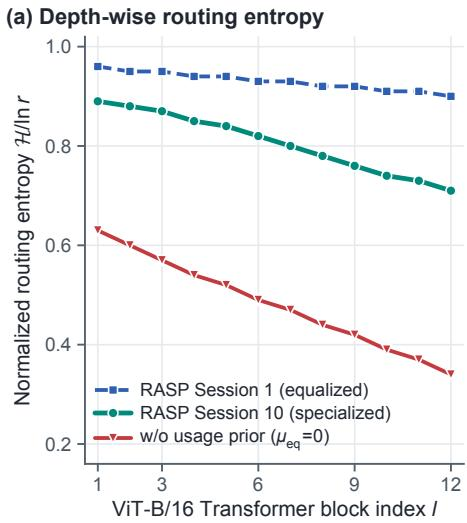  
(b) Trace vs. spectral norm across depth

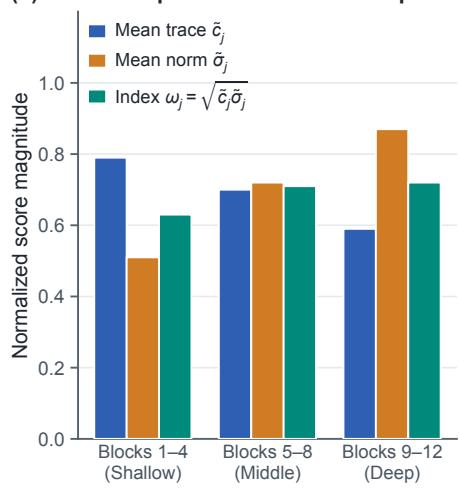

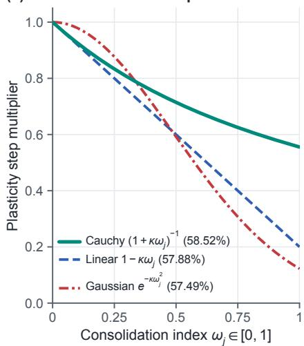  
Figure 5. Depth-wise routing diagnostics and attenuation profiles. (a) Usage-equalized routing prevents early entropy collapse across ViT B/16 blocks while permitting semantic specialization in late sessions. (b) Routing trace $\tilde { c } _ { j }$ dominates in shallow blocks and spectral norm $\tilde { \sigma } _ { j }$ dominates in deep blocks; their geometric mean $\omega _ { j }$ equalizes layer-wise consolidation pressure. (c) Comparison of Cauchy, Linear, and Gaussian step-attenuation profiles (parentheses show ImageNet-A FAA).

## D.3. Depth-Wise Routing Entropy and Attenuation Schedules

Figure 5(a) plots the normalized routing entropy $\begin{array} { r } { \mathcal { H } ( \hat { p } ^ { ( l ) } ) / \ln r \ = \ - \frac { 1 } { \ln r } \sum _ { j = 1 } ^ { r } \hat { p } _ { j } ^ { ( l ) } \ln \hat { p } _ { j } ^ { ( l ) } } \end{array}$ across ViT-B/16 blocks $l \in$ $\{ 1 , \ldots , 1 2 \}$ on CIFAR-100. Without the usage-equalizing prior $( \mu _ { \mathrm { { e q } } } \ : = \ : 0 )$ , routing collapses immediately in deeper semantic blocks (H/ ln r = 0.34 in Block 12), starving most channels of updates. With $\mu _ { \mathrm { e q } } ~ = ~ 0 . 1$ , Session 1 maintains near-uniform exploration (≥ 0.90 across all blocks), while by Session 10 shallow blocks remain broadly shared (0.89) and deep semantic blocks specialize naturally (0.71).

Figure 5(b) reveals why the geometric consolidation index $\omega _ { j } = \sqrt { \tilde { c } _ { j } \tilde { \sigma } _ { j } }$ enables a uniform locking quota across layers: mean routing trace $\tilde { c } _ { j }$ decreases with depth $( 0 . 7 9  0 . 5 9 )$ because shallow texture filters are reused across more classes, whereas spectral norm $\tilde { \sigma } _ { j }$ increases with depth (0.51 → 0.87) because deeper blocks require stronger task corrections. Their geometric product remains balanced across depth (0.63, 0.71, 0.72). Figure $5 ( \mathrm { c } )$ and Table 10 compare our Cauchy step attenuator $( 1 + \kappa \omega _ { j } ) ^ { - 1 }$ against linear $( 1 - \kappa \omega _ { j } )$ and Gaussian $( \exp ( - \kappa \omega _ { j } ^ { 2 } ) )$ schedules across all four benchmarks, showing consistent superiority for the Cauchy profile.

Table 10. Comparison of step-attenuation functional forms and gain κ across all four benchmarks (FAA %).
<table><tr><td>Attenuation Schedule  $g _ { u _ { j } }  \psi ( \omega _ { j } ) g _ { u _ { j } }$ </td><td>CIFAR-100</td><td>CUB-200</td><td>ImageNet-R</td><td>ImageNet-A</td></tr><tr><td>No attenuation  $( \kappa = 0 ,$  boundary lock only)</td><td>90.08</td><td>80.79</td><td>78.91</td><td>57.62</td></tr><tr><td>Linear decay  $\psi ( \omega _ { j } ) = \mathrm { { m a x } } ( 0 , 1 - \kappa \omega _ { j } )$ </td><td>90.19</td><td>80.96</td><td>79.31</td><td>57.88</td></tr><tr><td>Gaussian decay  $\psi ( \omega _ { j } ) = \exp ( - \kappa \omega _ { j } ^ { 2 } )$ </td><td>90.04</td><td>80.72</td><td>79.12</td><td>57.49</td></tr><tr><td>Cauchy attenuation  $\bar { \psi } ( \omega _ { j } ) = ( 1 + \kappa ^ { ' } \omega _ { j } ) ^ { - 1 } ( \kappa = 0 . 0 2 )$ </td><td>90.26</td><td>81.14</td><td>79.44</td><td>58.19</td></tr><tr><td>Cauchy attenuation  $\psi ( \omega _ { j } ) = ( 1 + \kappa \omega _ { j } ) ^ { - 1 } ( \kappa \in \{ 0 . 0 5 , 0 . 0 8 \}$  , Default)</td><td>90.41</td><td>81.36</td><td>79.68</td><td>58.52</td></tr><tr><td>Cauchy attenuation  $\psi ( \tilde { \omega _ { j } } ) = ( 1 + \kappa \tilde { \omega _ { j } } ) ^ { - 1 } ( \kappa = 0 . 2 5 )$ </td><td>89.95</td><td>80.81</td><td>79.18</td><td>57.94</td></tr></table>

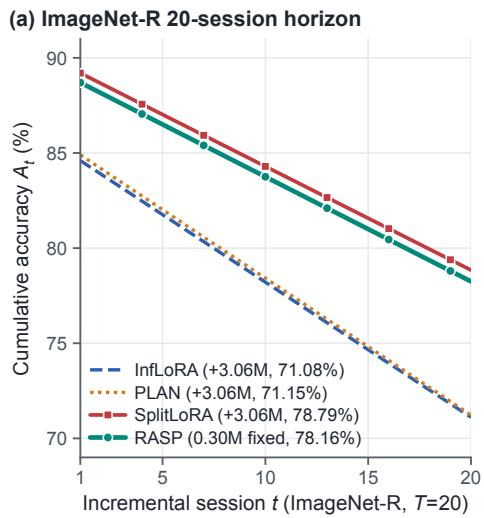

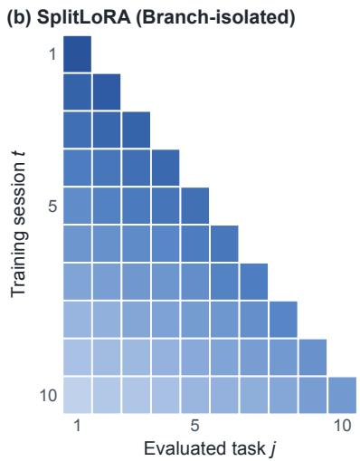

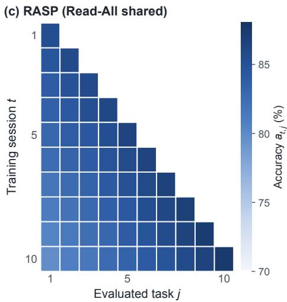  
Figure 6. Long-horizon scaling and session-by-task accuracy matrices. (a) On the 20-session ImageNet-R stream, RASP maintains a constant 0.30M footprint while tracking SplitLoRA (3.06M) within 0.63 pp. (b, c) Lower-triangular accuracy matrices at,j $a _ { t , j }$ on CUB 200 $( T = 1 0 )$ : RASP preserves old-session columns (vertical stability) and improves late-session diagonal learning (horizontal transfer) compared to branch-isolated SplitLoRA.

## D.4. Boundary Locking Quota, Starvation Guard, and Warm-Up Delay

Table 11 evaluates the boundary locking cap $m _ { \mathrm { l o c k } } .$ , the $| \mathcal { P } _ { t - 1 } | \geq q + 2$ starvation guard, and warm-up delay across all four datasets. Locking up to 3 channels per session with the starvation guard achieves the best balance. Raising the cap to 8 channels/session rapidly exhausts the unlocked pool, degrading FAA by 0.51–0.88 pp. Delaying the first boundary lock until Session 2 produces virtually identical accuracy (within ±0.09 pp across all benchmarks), confirming that the $m _ { \mathrm { l o c k } } \le 3$ cap already insulates early sessions against premature locking.

Table 11. Ablation of boundary anchor locking quota $m _ { \mathrm { l o c k } } .$ , starvation guard $( | \mathcal { P } _ { t - 1 } | \geq q + 2 ) ,$ and warm-up delay (FAA %).
<table><tr><td>Boundary Locking Rule</td><td>CIFAR-100</td><td>CUB-200</td><td>ImageNet-R</td><td>ImageNet-A</td></tr><tr><td>mlock = 0 (Cauchy attenuation only, no hard lock)</td><td>90.12</td><td>80.94</td><td>79.26</td><td>58.02</td></tr><tr><td> $m _ { \mathrm { l o c k } } = \mathrm { c l i p } ( \lfloor 0 . \dot { 0 5 } \lvert \mathcal { P } \lvert \rfloor , 1 , 1 )$  with guard</td><td>90.28</td><td>81.18</td><td>79.49</td><td>58.24</td></tr><tr><td> $m _ { \mathrm { l o c k } } = \mathrm { c l i p } ( \lfloor 0 . 0 5 \lvert \mathcal { P } \rvert \rfloor , 1 , 3 )$  with guard (Default)</td><td>90.41</td><td>81.36</td><td>79.68</td><td>58.52</td></tr><tr><td> $m _ { \mathrm { l o c k } } = \mathrm { c l i p } ( \bar { \lfloor 0 . 0 5 \lvert \mathcal { P } \rvert } ] , 1 , 3 )$  + 1-session warm-up delay</td><td>90.34</td><td>81.31</td><td>79.72</td><td>58.46</td></tr><tr><td> $m _ { \mathrm { l o c k } } = \mathrm { c l i p } ( \bar { \lfloor 0 . 1 0 \rfloor } \mathcal { P } \bar { \rfloor } , 1 , 8 )$  with guard</td><td>89.90</td><td>80.64</td><td>79.05</td><td>57.74</td></tr><tr><td>Uncapped 5% locking without starvation guard</td><td>90.02</td><td>80.85</td><td>79.21</td><td>58.12</td></tr></table>

## D.5. Long-Horizon Trajectory and Session-by-Task Matrices

Figure 6(a) plots the 20-session trajectory on ImageNet-R corresponding to Table 3, showing that RASP tracks SplitLoRA closely across all 20 sessions while using 10.2× fewer parameters. Figure $^ { 6 ( \mathrm { b } , \mathrm { c } ) }$ visualizes the complete 10 × 10 lowertriangular session-by-task accuracy matrices on CUB-200 for SplitLoRA and RASP. SplitLoRA exhibits both weaker diagonal plasticity in later sessions and pronounced off-diagonal darkening (forgetting), whereas RASP maintains bright, highaccuracy columns across all previously learned bird families.

## D.6. Complete Session-by-Session Trajectories and Multi-Seed Breakdown

Table 12 and Table 13 report the exact session-by-session cumulative accuracy $A _ { 1 } , \dotsc , A _ { 1 0 }$ on CIFAR-100 and CUB-200 across representative methods. Table 14 provides the individual 3-seed results (seed $\in \ \{ 2 0 2 4 , 2 0 2 5 , 2 0 2 6 \} )$ for RASP across all four benchmarks, matching the mean±std values in Table 1. Finally, Table 15 reports sensitivity to the scene-gate bottleneck dimension $d _ { g }$ , Gram decoupling weight $\lambda _ { \mathrm { d e c } }$ , and usage-equalizing prior weight $\mu _ { \mathrm { e q } } .$

## E. Limitations, Failure Modes, and Future Directions

Our analysis identifies two boundary regimes where a fixed-size low-rank adapter faces structural pressure:

Table 12. Session-by-session cumulative accuracy $A _ { t }$ (%) across $t = 1 , \dots ,$ 10 on CIFAR-100 (ViT-B/16-IN21K).
<table><tr><td>Method</td><td> $A _ { 1 }$ </td><td> $A _ { 2 }$ </td><td> $A _ { 3 }$ </td><td> $A _ { 4 }$ </td><td> $A _ { 5 }$ </td><td> $A _ { 6 }$ </td><td> $A _ { 7 }$ </td><td> $A _ { 8 }$ </td><td> $A _ { 9 }$ </td><td> $A _ { 1 0 } ~ ( \mathrm { F A A } )$ </td><td>CAA</td></tr><tr><td>L2P [15]</td><td>94.12</td><td>91.40</td><td>89.52</td><td>88.14</td><td>87.02</td><td>86.01</td><td>85.12</td><td>84.21</td><td>83.40</td><td>82.79</td><td>88.45</td></tr><tr><td>CODA-Prompt [17]</td><td>95.84</td><td>93.92</td><td>92.65</td><td>91.74</td><td>90.98</td><td>90.24</td><td>89.42</td><td>88.54</td><td>87.61</td><td>86.65</td><td>91.12</td></tr><tr><td>InfLoRA [6]</td><td>95.72</td><td>93.54</td><td>92.04</td><td>90.92</td><td>90.01</td><td>89.12</td><td>88.14</td><td>87.15</td><td>86.18</td><td>85.24</td><td>90.61</td></tr><tr><td>SD-LoRA [7]</td><td>96.14</td><td>94.72</td><td>93.71</td><td>92.94</td><td>92.21</td><td>91.52</td><td>90.74</td><td>89.85</td><td>88.94</td><td>88.05</td><td>92.58</td></tr><tr><td>LoRA-P&amp;M [10]</td><td>96.32</td><td>94.96</td><td>94.02</td><td>93.28</td><td>92.58</td><td>91.91</td><td>91.14</td><td>90.28</td><td>89.39</td><td>88.49</td><td>92.92</td></tr><tr><td>SplitLoRA [11]</td><td>96.72</td><td>95.54</td><td>94.74</td><td>94.04</td><td>93.42</td><td>92.84</td><td>92.24</td><td>91.54</td><td>90.92</td><td>90.24</td><td>93.66</td></tr><tr><td>FM-LoRA [27]</td><td>96.24</td><td>94.84</td><td>93.82</td><td>93.05</td><td>92.34</td><td>91.64</td><td>90.88</td><td>90.08</td><td>89.24</td><td>88.41</td><td>92.69</td></tr><tr><td>RASP (Ours)</td><td>96.62</td><td>95.51</td><td>94.78</td><td>94.10</td><td>93.49</td><td>92.91</td><td>92.32</td><td>91.69</td><td>91.06</td><td>90.41</td><td>93.36</td></tr></table>

Table 13. Session-by-session cumulative accuracy $A _ { t }$ (%) across $t = 1 , \ldots , 1 0$ on CUB-200-2011 (ViT-B/16-IN21K).
<table><tr><td>Method</td><td> $A _ { 1 }$ </td><td> $A _ { 2 }$ </td><td> $A _ { 3 }$ </td><td> $A _ { 4 }$ </td><td> $A _ { 5 }$ </td><td> $A _ { 6 }$ </td><td> $A _ { 7 }$ </td><td> $A _ { 8 }$ </td><td> $A _ { 9 }$ </td><td> $A _ { 1 0 } ~ ( \mathrm { F A A } )$ </td><td>CAA</td></tr><tr><td>CODA-Prompt [17]</td><td>91.12</td><td>87.72</td><td>85.32</td><td>83.52</td><td>81.82</td><td>80.22</td><td>78.82</td><td>77.42</td><td>76.02</td><td>74.83</td><td>83.06</td></tr><tr><td>InfLoRA [6]</td><td>93.42</td><td>91.12</td><td>89.42</td><td>88.02</td><td>86.72</td><td>85.32</td><td>83.92</td><td>82.52</td><td>81.12</td><td>79.92</td><td>88.21</td></tr><tr><td>SD-LoRA [7]</td><td>92.18</td><td>89.34</td><td>87.48</td><td>85.94</td><td>84.48</td><td>83.04</td><td>81.64</td><td>80.28</td><td>78.91</td><td>77.54</td><td>85.63</td></tr><tr><td>SplitLoRA [11]</td><td>90.42</td><td>87.12</td><td>85.02</td><td>83.32</td><td>81.72</td><td>80.02</td><td>78.32</td><td>76.52</td><td>74.62</td><td>72.88</td><td>83.18</td></tr><tr><td>FM-LoRA [27]</td><td>92.32</td><td>89.52</td><td>87.72</td><td>86.22</td><td>84.82</td><td>83.42</td><td>82.02</td><td>80.62</td><td>79.12</td><td>77.84</td><td>85.96</td></tr><tr><td>RASP (Ours)</td><td>92.92</td><td>90.52</td><td>88.82</td><td>87.32</td><td>86.02</td><td>84.82</td><td>83.82</td><td>82.92</td><td>82.12</td><td>81.36</td><td>85.68</td></tr></table>

Table 14. Three-seed breakdown (seed ∈ {2024, 2025, 2026}) for RASP across all four benchmarks.
<table><tr><td>Benchmark &amp; Metric</td><td>Seed 2024</td><td>Seed 2025</td><td>Seed 2026</td><td>Mean</td><td> $\mathrm { S t d }$ </td></tr><tr><td>CIFAR-100 FAA (%)</td><td>90.45</td><td>90.37</td><td>90.41</td><td>90.41</td><td>0.04</td></tr><tr><td>CIFAR-100 CAA (%)</td><td>93.44</td><td>93.28</td><td>93.36</td><td>93.36</td><td>0.08</td></tr><tr><td>CUB-200 FAA (%)</td><td>81.58</td><td>81.14</td><td>81.36</td><td>81.36</td><td>0.22</td></tr><tr><td>CUB-200 CAA (%)</td><td>86.02</td><td>85.34</td><td>85.68</td><td>85.68</td><td>0.34</td></tr><tr><td>ImageNet-R FAA (%)</td><td>79.54</td><td>79.82</td><td>79.68</td><td>79.68</td><td>0.14</td></tr><tr><td>ImageNet-R CAA (%)</td><td>83.37</td><td>83.67</td><td>83.52</td><td>83.52</td><td>0.15</td></tr><tr><td>ImageNet-A FAA (%)</td><td>58.43</td><td>58.61</td><td>58.52</td><td>58.52</td><td>0.09</td></tr><tr><td>ImageNet-A CAA (%)</td><td>70.13</td><td>70.39</td><td>70.26</td><td>70.26</td><td>0.13</td></tr></table>

Table 15. Sensitivity to scene-gate bottleneck width $d _ { g } ,$ Gram decoupling weight $\lambda _ { \mathrm { d e c } } ,$ and usage-prior weight $\mu _ { \mathrm { e q } }$ (FAA %).
<table><tr><td>Scene Gate Width  $d _ { g }$ </td><td>CIFAR</td><td>CUB</td><td>IN-R</td><td>IN-A</td><td>Hyperparameter Setting</td><td>CIFAR</td><td>CUB</td><td>IN-R</td><td>IN-A</td></tr><tr><td> $d _ { g } = 1 6 \left( 0 . 0 3 \mathbf { M } \right)$ </td><td>90.16</td><td>80.92</td><td>79.34</td><td>58.14</td><td> $\lambda _ { \mathrm { d e c } } = 0 . 0 ( \mathrm { n o G r a m p e n a l t y } )$ </td><td>89.82</td><td>80.61</td><td>79.04</td><td>57.86</td></tr><tr><td> $\overset { \vartriangle } { \boldsymbol { d } _ { g } } = 3 2 \left( 0 . 0 5 \mathbf { M } \right)$ </td><td>90.31</td><td>81.19</td><td>79.52</td><td>58.36</td><td> $\lambda _ { \mathrm { d e c } } = 0 . 1$ </td><td>90.24</td><td>81.12</td><td>79.46</td><td>58.29</td></tr><tr><td> $d _ { g } = 6 4 ( 0 . 1 0 \mathbf { M } , \mathbf { D e f a u l t } )$ </td><td>90.41</td><td>81.36</td><td>79.68</td><td>58.52</td><td> $\lambda _ { \mathrm { d e c } } = 0 . 3 \ : ( \mathbf { D e f a u l t } )$ </td><td>90.41</td><td>81.36</td><td>79.68</td><td>58.52</td></tr><tr><td> $d _ { g } = 1 2 8 \left( 0 . 2 0 \mathbf { M } \right)$ </td><td>90.36</td><td>81.28</td><td>79.61</td><td>58.45</td><td> $\lambda _ { \mathrm { d e c } } = 1 . 0$ </td><td>90.08</td><td>80.84</td><td>79.22</td><td>58.04</td></tr><tr><td>Usage Prior  $\mu _ { \mathrm { e q } } = 0 . 0$ </td><td>89.94</td><td>80.74</td><td>79.12</td><td>57.91</td><td>Usage Prior  $\mu _ { \mathrm { e q } } = 0 . 1$  (Default)</td><td>90.41</td><td>81.36</td><td>79.68</td><td>58.52</td></tr></table>

1. High-plasticity domain shifts over unbounded streams: When severe distribution shifts (such as ImageNet-A or multistyle renditions) demand a large active write ratio ${ q / r } .$ , fewer channels remain unrouted per step. Although our $| \mathcal { P } _ { t - 1 } | \geq$ $q + 2$ guard prevents pool starvation across 20 sessions, an unbounded stream $( T \gg 5 0 )$ would eventually saturate the locked anchor set $\mathcal { L } _ { t }$ . Triggering a conditional rank expansion (allocating $\Delta r$ fresh channels only when $\operatorname* { m i n } _ { j \in \mathcal { P } _ { t } } \omega _ { j }$ exceeds a saturation threshold) offers a principled bridge between stationary and growing adapters.

2. Intra-session near-duplicate class collisions: Because $\omega _ { j } ^ { ( t - 1 ) }$ is refreshed at session boundaries, two visually similar classes arriving within the same session that route to overlapping active sets $\boldsymbol { A } _ { t }$ are separated only by the cross-entropy objective. Incorporating lightweight intra-session EMA consolidation is a promising avenue for task-free online streams.