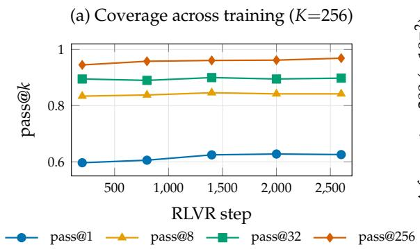
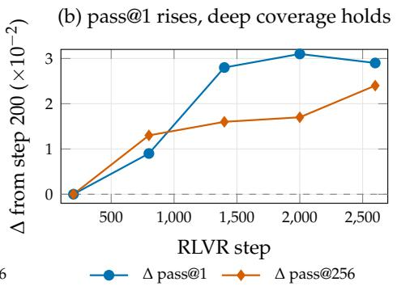
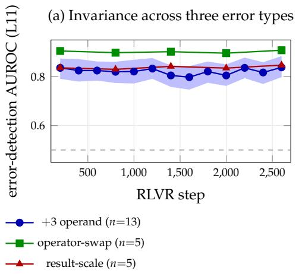
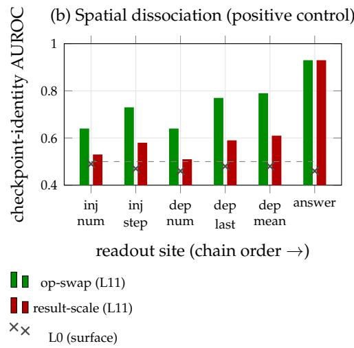
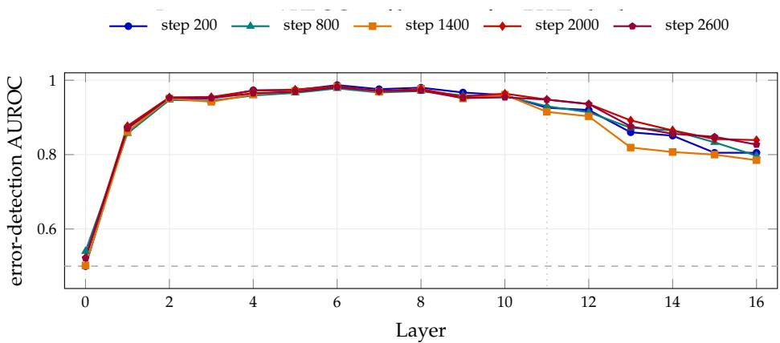
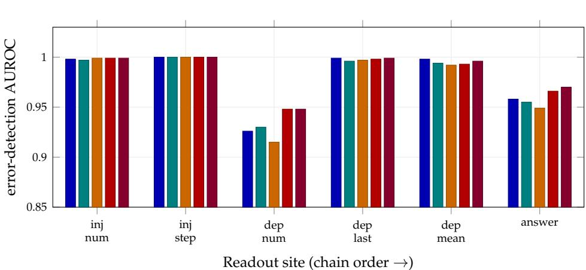

# RLVR Sharpens the Pencil, Not the Mind∗

Shreeyam Bangera Manya Gupta

Department of Physics, Indian Institute of Technology Roorkee shreekant sb@ph.iitr.ac.in manya g@ph.iitr.ac.in

## Abstract

Models like DeepSeek-R1 made Reinforcement Learning with Verifiable Rewards (RLVR) famous: reward a model for correct answers and it gets dramatically better at reasoning without being taught how. The leading explanation is sharpening—that the base model already knows how to solve these problems and RLVR just makes it more likely to reach for its best solution paths. This has only ever been checked by comparing before and after training, never by watching what changes inside across it. We tracked OLMo-2-1B across all 13 training checkpoints on GSM8K. First-try accuracy climbs from 58.0% to 61.3%, but ask the model 256 times and solution coverage actually rises from 94.5% to 96.9%, proving the knowledge was already there. We then planted reasoning mistakes into problems and trained simple probes to detect them. Those probes held between AUROC 0.798 and 0.840 across all 13 checkpoints and 3 error types, a spread smaller than the confidence interval; the model never builds a sharper internal picture of what a reasoning mistake looks like. The one place we find real internal change is at the final answer token, where a probe distinguishing early from late checkpoints hits an AUROC of 0.93, while the same probe on the actual reasoning steps lands near chance. RLVR makes the model lead with its best thinking. It does not change what that thinking is.

## 1 Introduction

Models like DeepSeek-R1 and OpenAI o1 are trained by rewarding correct answers with no supervision over how they get there, and show large gains on math and reasoning benchmarks (DeepSeek-AI, 2025; OpenAI, 2024). The field has largely settled on an explanation: sharpening. The base model already knows how to solve these problems; RLVR just makes it more likely to reach for its best solution paths (Yue et al., 2025; Karan & Du, 2025). This is supported both by behavioral evidence, showing that solutions are reachable from the base model given enough attempts (Yue et al., 2025), and mechanistic evidence, showing that reasoning directions pre-exist in base model activations before any RLVR training (Venhoff et al., 2025). But the behavioral work tracks outputs across training checkpoints while the mechanistic work only compares a base model to a trained model at a single endpoint. Nobody has asked whether internal representations of reasoning actually change as training progresses.

We track OLMo-2-1B across all 13 RLVR checkpoints on grade-school arithmetic, measuring both outputs and internal states at each step. Unlike the boundary-narrowing Yue et al. find in larger models, pass@256 does not shrink here, giving us a clean window into whether representational change accompanies behavioral change. It does not. Internal representations of reasoning errors hold flat across all 13 checkpoints, while the only detectable change concentrates at the final answer token rather than at the reasoning steps where errors occur. We report a single-model, single-task (arithmetic) result and scope claims accordingly.

## 2 Related Work

Behavioral evidence for sharpening. Yue et al. track pass@k up to k=256 across training checkpoints and find that RLVR improves pass@1 while narrowing the set of problems the model can eventually solve, concluding that the capability was already there in the base model (Yue et al., 2025). Karan and Du reach the same conclusion without any training at all, recovering RLVR-level performance through likelihood-guided resampling from the base model (Karan & Du, 2025). Dang et al. offer a mode-collapse account of why the boundary narrows (Dang et al., 2025). These works map how outputs change across training; what they leave open is whether internal representations shift in parallel.

Mechanistic evidence for sharpening. Venhoff et al. use sparse autoencoders and steering vectors to show that reasoning directions already exist in base model activations, with post-training teaching the model when to use them rather than creating them (Venhoff et al., 2025). This is an endpoint comparison between a base model and a trained model. We ask the same question but across all training checkpoints, and separate it into two parts: do outputs change, and do internal representations of reasoning change.

What changes during RLVR training. Recent work finds that RLVR drives near-linear drift in weights and outputs (Wang et al., 2026) and that distributional shifts are sparse, close to zero at most token positions and large at a few (Meng et al., 2026). Yan et al. show that representational change, where it exists, can be localized causally (Yan et al., 2026). We test whether arithmetic error representations fall in the invariant majority or the shifting minority.

Error representations in activations. Linear probes can detect truthfulness and error states in model activations (Azaria & Mitchell, 2023), but such signals can be diagnostic rather than causal (Yuan et al., 2026) and can reflect surface features rather than genuine reasoning (Haller et al., 2025). We control for this directly in Section 4.2.

## 3 Setup

Model. OLMo-2-0425-1B-Instruct (OLMo Team, 2025); 16 layers (d=2048); 13 checkpoints at steps 200–2600 (interval 200).

Task. GSM8K (Cobbe et al., 2021) test split; 1319 problems; step-by-step generation; final numeric answer parsed.

We measure how well the model solves problems at each checkpoint and whether its internal states encode reasoning errors differently as training progresses, via two procedures (full pseudocode in Appendix A): a behavioral sweep that samples completions per checkpoint to compute pass@k at both K=32 (wide, all checkpoints) and K=256 (deep, 5-checkpoint subset); and a representational probe that injects one of three controlled arithmetic errors into correctly solved problems and trains logistic-regression probes on PCA-reduced hidden states at six readout sites to test whether checkpoints differ in how those errors are encoded.

Code. All code, per-checkpoint probe outputs, and figure-generation scripts are released at https://github.com/Leviathan2006/rlvr-pencil.

## 4 Results

## 4.1 Behavior Becomes More Precise Without Losing Breadth

pass@1 rises from 0.580 to 0.613 across training. The apparent drop in pass@32 is an artifact of small k: pass@256 actually rises from 0.945 to 0.969 (Figure 1), so the set of problems the model can eventually solve grows, not shrinks. This differs from the boundary-narrowing Yue et al. and Dang et al. find in larger models (Yue et al., 2025; Dang et al., 2025), and gives us a clean window into whether internal representations shift alongside behavior.

  
Figure 1: First-try accuracy and deep coverage across training. (a) pass@k curves from the deep sweep. (b) pass@1 rises by +3.3 pts while pass@256 does not narrow; the model’s solution coverage stays intact across training.

## 4.2 Internal Error Representations Remain Unchanged

For the (+3) operand error, AUROC spans 0.798–0.840 across all 13 checkpoints—a spread of 0.042, smaller than the CI half-width of ∼0.044. The other two types hold the same pattern: operator-swap (spread 0.032, $R ^ { 2 } { = } 0 . 0 0 5 )$ and result-scale (spread 0.033, $R ^ { 2 } { = } 0 . 3 4 5 )$ ; Figure 2(a). Drift is statistically indistinguishable from zero across all three.

The signal is computed, not surface. Probes can pick up shallow cues like token length or activation norm rather than anything about the reasoning itself (Haller et al., 2025). A norm proxy rules this out here, sitting at chance throughout (0.50–0.52). The probe signal rises from chance at layer 0 (AUROC 0.498) to a mid-layer peak of 0.833, with near-identical layer profiles across all 13 checkpoints. The error information the model encodes is a mid-layer computation, not a surface cue.

Positive control. Using the identical pipeline, we probe whether clean activations can distinguish early from late checkpoints. At the output token, the probe reaches AUROC 0.93 for both operator-swap and result-scale, with the layer-0 baseline at chance. At the intermediate reasoning tokens, it lands near chance (Figure 2(b)). The probe finds real training-induced change at the output and finds none at the reasoning steps. The flat trajectory on error representations is meaningful precisely because the method demonstrably detects change where change exists.

## 4.3 The Invariance Is Robust, Not an Artifact of Analysis Choices

The result holds across both pre-registered choices. Probing all 17 layers, the crosscheckpoint spread stays within noise at 16 of 17; the per-checkpoint layer profiles are near-identical in shape across training. Probing all six readout sites, every site is invariant (spread $\leq 0 . 0 3 4 )$ . Full tables and figures are in Sections C and D.

## 4.4 Training Alters the Final Output, Not the Intermediate Reasoning

Bringing the two findings together: error-detection decodability is flat across RLVR training (≈constant, three error types, and robust to layer and site choice; Section 4.3), while first-try accuracy improves and RLVR’s representational footprint is large at the output token. In this setting, RLVR acts on the output distribution rather than on the internal arithmetic reasoning-error representation. A practical consequence is that probes or verifiers trained to detect reasoning errors in the base model should transfer across RLVR checkpoints, amortizing verification compute.

  
Figure 2: (a) Error-detection AUROC at the dependent-step token (layer 11) across the RLVR trajectory; shaded band is the bootstrap 95 % CI for the +3-operand condition. (b) Checkpoint-identity AUROC by readout site; the L0 baseline (×) is near chance throughout.

## 5 Computational Budget and Reproducibility

All experiments are inference-only: we evaluate publicly released OLMo-2-1B checkpoints (OLMo Team, 2025) without updating any weights, using the standard 2N-FLOPs-pertoken approximation $( N { = } 1 0 ^ { 9 }$ , prompt ≈150 tokens, generated chain ≈180 tokens). Total cost across all reported experiments—behavioral pass@k sweeps, representational probing across three error types, and the layer- and site-robustness ablations—is $\approx 2 . 0 \times 1 0 ^ { 1 7 } \mathrm { F L O P s } ,$ roughly 465× below the $1 0 ^ { 2 0 } .$ -FLOP single-run training cap; the behavioral sweeps dominate this total since they generate up to 256 samples per problem. We release the injection-andprobing pipeline, per-checkpoint activation tensors and probe outputs (AUROC values with bootstrap CIs) for every layer, site, and error type, and the pass@k generation logs; the only external dependencies are the public OLMo-2-1B checkpoints and the GSM8K test split (Cobbe et al., 2021).

## 6 Conclusion

We establish that RLVR drives behavioral improvements by altering the final output distribution rather than reshaping internal arithmetic reasoning-error representations. A detailed discussion of our findings, along with the study’s limitations and broader impacts, is provided in Appendix B.

## References

Azaria, A. and Mitchell, T. The internal state of an LLM knows when it’s lying. In Findings of the Associationfor Computational Linguistics: EMNLP 2023, pp. 967–976, 2023.

Cobbe, K., Kosaraju, V., Bavarian, M., Chen, M., Jun, H., Kaiser, L., Plappert, M., Tworek, J., Hilton, J., Nakano, R., Hesse, C., and Schulman, J. Training verifiers to solve math word problems. arXiv preprint arXiv:2110.14168, pp. 1–22, 2021.

Dang, X., Baek, C., Kolter, J. Z., and Raghunathan, A. Assessing diversity collapse in reasoning. In Workshop on Scaling Self-Improving Foundation Models without Human Supervision, ICLR, 2025.

DeepSeek-AI. DeepSeek-R1: Incentivizing reasoning capability in LLMs via reinforcement learning. arXiv preprint arXiv:2501.12948, pp. 1–85, 2025.

Haller, P., Ibrahim, M., Kirichenko, P., Sagun, L., and Bell, S. J. LLM knowledge is brittle: Truthfulness representations rely on superficial resemblance. arXiv preprint arXiv:2510.11905, pp. 1–16, 2025.

Karan, A. and Du, Y. Reasoning with sampling: Your base model is smarter than you think. arXiv preprint arXiv:2510.14901, pp. 1–28, 2025.

Meng, H., Huang, K., Wei, S., Ma, C., Yang, S., Wang, X., Wang, G., Ding, B., and Zhou, J. Sparse but critical: A token-level analysis of distributional shifts in RLVR fine-tuning of LLMs. arXiv preprint arXiv:2603.22446, pp. 1–20, 2026.

OLMo Team. 2 OLMo 2 furious. arXiv preprint arXiv:2501.00656, pp. 1–40, 2025.

OpenAI. OpenAI o1 system card. Technical report, OpenAI, 2024. URL https://openai.com/index/ openai-o1-system-card/.

Venhoff, C., Arcuschin, I., Torr, P., Conmy, A., and Nanda, N. Base models know how to reason, thinking models learn when. arXiv preprint arXiv:2510.07364, pp. 1–30, 2025.

Wang, T., Liu, J., Wu, Z., Jin, S., Chen, W., Xu, H., and Miao, N. Not all steps are informative: On the linearity of LLMs’ RLVR training. arXiv preprint arXiv:2601.04537, pp. 1–24, 2026.

Yan, L., Li, R., Chen, G., Li, Q., Geng, J., Li, W., Wang, V., and Lee, C. Spurious rewards paradox: Mechanistically understanding how RLVR activates memorization shortcuts in LLMs. arXiv preprint arXiv:2601.11061, pp. 1–26, 2026.

Yuan, A., Su, Z. J., Zhang, H., Nian, Y., and Zhao, Y. Hidden error awareness in chain-of-thought reasoning: The signal is diagnostic, not causal. arXiv preprint arXiv:2605.09502, pp. 1–18, 2026.

Yue, Y., Chen, Z., Lu, R., Zhao, A., Wang, Z., Yue, Y., Song, S., and Huang, G. Does reinforcement learning really incentivize reasoning capacity in LLMs beyond the base model? arXiv preprint arXiv:2504.13837, pp. 1–25, 2025.

## A Detailed Procedures

The two procedures summarized in Section 4.2 are given here in full.

Algorithm 1: Behavioral Evaluation   
Input: Checkpoints $\mathcal { C } = \{ c _ { 2 0 0 } , \ldots , c _ { 2 6 0 0 } \}$ , problems P, temperature τ=0.8   
for each checkpoint $c \in { \mathcal { C } }$ do   
Sample K completions per problem at temperature τ;   
Compute pass@k via unbiased estimator (Cobbe et al., 2021);   
// Wide sweep: K=32, n=200, all 13 checkpoints   
// Deep sweep: K=256, n=128, 5-checkpoint subset

Input: Correctly solved problems ${ \mathcal { P } } ^ { + }$ , error types E: operand (+3), operator-swap,   
result-scale   
for each $p \in \mathcal { P } ^ { + }$ , each $e \in { \mathcal { E } }$ do   
Inject e into an early reasoning step; regenerate remainder;   
Label chain REPAIR if answer correct, CARRY if answer flips;   
Extract hidden states at 6 readout sites: corrupted step, dependent step, answer   
token;   
for each readout site, each layer do   
Fit PCA-256 on concatenated clean + corrupt activations;   
Train logistic regression; evaluate via 5-fold CV AUROC with bootstrap confidence   
intervals;   
Pre-registered site: layer 11, token L dep num;

## B Discussion and Limitations

These results carry clear implications, and understanding their scope is important.

(i) Complementary levels of analysis. pass@k captures whole-problem solution-finding. The representational metric is narrower: at one specific step, how do activations encode a single injected arithmetic error? Behavioral evidence shows the output distribution tightening; representational evidence shows the substrate encoding arithmetic errors is not what changes. The two scales divide the question rather than compete over it—and their combination localises where RLVR acts.

(ii) Depth through focus. Arithmetic on OLMo-2-1B earns its specificity. Arithmetic gives unambiguous ground truth for what counts as a reasoning error. Thirteen checkpoints provide trajectory-level resolution across training. The constrained domain keeps representational changes isolable—task variation would bury the within-training dynamics we are trying to characterise. Scaling to diverse tasks and architectures trades that granularity for coverage, and the signal goes with it.

(iii) A clean window into RLVR. pass@1 rises 3.3 points; coverage does not narrow. That modesty is useful. Without severe mode collapse, the main confound drops away—so the question becomes clean: does representational change track behavioural change even when the behavioural shift is real but small? Here, it does not. A noisier setting would have buried that.

(iv) A localized, not merely correlational, null. Linear probes establish that information is present in activations but not that the model uses it causally. We take this concern seriously. Our positive control, however, directly addresses it: the identical probing pipeline successfully and precisely detects where RLVR does leave a representational footprint—at the output token, with AUROC 0.93, rising monotonically along the reasoning chain. The method demonstrably finds change where change exists. Where it returns a flat trajectory, that null is meaningful.

The trajectory-level design fills a concrete gap left by representational endpoint comparisons (Venhoff et al., 2025), and situates one interpretable arithmetic-error representation within the invariant majority that recent sparse-shift work predicts (Meng et al., 2026).

## C Layer-Sweep Invariance

Motivation. The main analysis pre-registers layer 11 as the reporting layer (median of best layers across dry runs). A reviewer might ask whether the invariance result is specific to that choice—whether other layers show drift that layer 11 happens to miss. We address this by probing all 17 layers (embedding through layer 16) at five spanning checkpoints (steps 200, 800, 1400, 2000, 2600) using the same injection pipeline and identical probe configuration (n ≈ 208, PCA-256, 5-fold CV AUROC, bootstrap 95% CIs).

Note on absolute AUROC. These ablation runs used a chain-collection target (nrepair + $n _ { \mathrm { c a r r y } } \geq 3 0 0 )$ rather than the main analysis’s fixed-attempt limit (450 problems), yielding $n _ { \mathrm { r e p a i r } } { \stackrel { \cdot } { \sim } } 2 0 8 { \mathrm { v s . } } \approx 1 7 4$ in the main analysis. The larger probe training set raises absolute AUROC by approximately 0.10 relative to the main figures. The spread across checkpoints— our invariance measure—is unaffected by this, and is in fact tighter here (mean spread 0.022 vs. 0.042 in the main analysis), providing a stronger invariance signal.

Results. Figure 3 shows the AUROC profile across all 17 layers for each of the five checkpoints. Three observations stand out.

First, the layer-0 AUROC is at chance (0.500–0.540 across all checkpoints, mean 0.517), confirming the signal is a computed mid-layer representation, not a surface artefact from token identity—consistent with the norm-proxy control in the main paper.

Second, the five per-checkpoint profiles are near-identical in shape: all rise steeply from layer 0, peak around layer 6 (mean AUROC 0.983), and decline through the final layers. This shape-stability across training is stronger evidence for representational invariance than a single-layer AUROC comparison, since it shows the entire computational trajectory of the representation is preserved.

Third, the cross-checkpoint spread is within noise at 16 of 17 layers. At the peak (layer 6) the spread is only 0.008, a fraction of the CI half-width (0.009). The one marginal exception is layer 13 (spread 0.073, CI half-width 0.031), a late layer where absolute AUROC is already declining (mean 0.864) and signal is weaker. No systematic drift direction is visible there across checkpoints. Table 1 reports the spread and CI half-width for every layer.

  
Figure 3: Error-detection AUROC at every layer of OLMo-2-1B, for five RLVR checkpoints. The five profiles are near-identical in shape: chance at layer 0, rising to a peak around layer 6, declining in late layers. The vertical dotted line marks the pre-registered reporting layer (L11). Near-identical profiles across all five checkpoints confirm that the computational structure of the error representation—not just its endpoint decodability—is invariant across RLVR training. Note: absolute AUROC is higher than in the main analysis owing to a larger chain sample $( n _ { \mathrm { r e p a i r } } \approx 2 0 8 \mathrm { v s . } \approx 1 7 4 ) ;$ see text.

Table 1: Cross-checkpoint spread and mean CI half-width at each layer. Spread $< 2 { \times } \mathrm { C I }$ half-width indicates invariance within noise; 16 of 17 layers satisfy this. Layer 13 is the marginal exception (spread 0.073, half-width 0.031) in a late layer where absolute signal is already declining.
<table><tr><td>Layer</td><td>Mean AUROC</td><td>Spread</td><td>CI half-width</td><td>Invariant</td></tr><tr><td>0</td><td>0.517</td><td>0.039</td><td>0.050</td><td>√</td></tr><tr><td>1</td><td>0.868</td><td>0.020</td><td>0.031</td><td>√</td></tr><tr><td>2</td><td>0.952</td><td>0.007</td><td>0.019</td><td>√</td></tr><tr><td>3</td><td>0.949</td><td>0.014</td><td>0.018</td><td>√</td></tr><tr><td>4</td><td>0.966</td><td>0.014</td><td>0.013</td><td>√</td></tr><tr><td>5</td><td>0.971</td><td>0.009</td><td>0.013</td><td>√</td></tr><tr><td>6</td><td>0.983</td><td>0.008</td><td>0.009</td><td>√</td></tr><tr><td>7</td><td>0.971</td><td>0.008</td><td>0.013</td><td>√</td></tr><tr><td>8</td><td>0.975</td><td>0.009</td><td>0.011</td><td>√</td></tr><tr><td>9</td><td>0.957</td><td>0.016</td><td>0.015</td><td>√</td></tr><tr><td>10</td><td>0.959</td><td>0.010</td><td>0.015</td><td>√</td></tr><tr><td>11</td><td>0.933</td><td>0.034</td><td>0.020</td><td>√</td></tr><tr><td>12</td><td>0.922</td><td>0.033</td><td>0.023</td><td>√</td></tr><tr><td>13</td><td>0.864</td><td>0.073</td><td>0.031</td><td>X</td></tr><tr><td>14</td><td>0.849</td><td>0.058</td><td>0.035</td><td>√</td></tr><tr><td>15</td><td>0.826</td><td>0.048</td><td>0.036</td><td>√</td></tr><tr><td>16</td><td>0.811</td><td>0.054</td><td>0.036</td><td>√</td></tr></table>

## D Readout-Site Invariance

Motivation. The main analysis pre-registers one readout site (L dep num: the number token in the step that depends on the corrupted step). A reviewer might ask whether the invariance result is specific to that site, and whether other readout positions—especially those closer to the injection point—show drift that the pre-registered site misses. We probe all six readout sites at layer 11 across the same five checkpoints.

Results. Table 2 and Figure 4 report the results. Every site is invariant: spreads range from 0.000 (L inj step) to 0.034 (L dep num), all within the mean CI half-width. This confirms that the pre-registered site is not a cherry-picked location where the invariance result happens to appear; it holds across the entire chain, from the injection point to the final answer token.

The absolute AUROC pattern replicates the spatial gradient seen in the main paper: decodability is highest at the injection site (≈ 1.000, where the corrupted number is present in the text) and attenuates downstream. This attenuation is also invariant—the gradient shape is preserved across checkpoints—indicating that not just the error signal but its propagation pattern is stable across RLVR training.

Table 2: Readout-site invariance check. All six sites show cross-checkpoint spread within noise at layer 11. The spatial gradient (highest near injection, attenuating toward the answer) is preserved across checkpoints.
<table><tr><td>Site</td><td>Mean AUROC</td><td>Spread</td><td>CI half-width</td><td>Invariant</td></tr><tr><td>L_inj_num</td><td>0.998</td><td>0.002</td><td>0.002</td><td>√</td></tr><tr><td>L_inj_step</td><td>1.000</td><td>0.000</td><td>0.000</td><td>√</td></tr><tr><td>L_dep_num</td><td>0.933</td><td>0.034</td><td>0.020</td><td>√</td></tr><tr><td>L_dep_last</td><td>0.998</td><td>0.003</td><td>0.003</td><td>√</td></tr><tr><td>L_dep_mean</td><td>0.995</td><td>0.006</td><td>0.005</td><td>√</td></tr><tr><td>L_answer</td><td>0.960</td><td>0.021</td><td>0.014</td><td>√</td></tr></table>

  
Figure 4: Error-detection AUROC at each of six readout sites (layer 11) for five RLVR checkpoints. Bar groups at each site show near-identical heights across checkpoints (spread ≤ 0.034 at every site, all within noise). The spatial gradient—highest at the injection site, attenuating toward the answer—is preserved across training, showing that both the error signal and its downstream propagation pattern are invariant to RLVR. Note: absolute AUROC is higher than in the main analysis owing to a larger chain sample; see Appendix C.

## E Robustness to Evaluation Protocol

We report pass@1 at temperature 0.8 under a zero-shot chat prompt, parsing the final number after “The answer is”. Because absolute GSM8K accuracy is sensitive to the evaluation protocol, we verify that our central object—the trajectory of accuracy across checkpoints— does not depend on these choices. We re-evaluate all five spanning checkpoints under a 2 × 2 grid crossing decoding (greedy vs. sampled at τ=0.8) with parser (strict “answer is” vs. a lenient last-number parser), on a fixed 200-problem subset of the test split.

Table 3 reports the results. Three points follow. First, the parser is immaterial: strict and lenient agree to within 0.002 at every checkpoint. Second, decoding sets the absolute level: greedy decoding runs ≈3 points above sampled pass@1 (mean 0.646 vs. 0.615), since sampling occasionally selects a sub-optimal token. This accounts for the difference between our reported figures and higher numbers obtained under greedy, full-test-set evaluation; the residual is attributable to our zero-shot prompt and evaluation subset. Third, and most important for our claims, the +3.3-point upward trend across training is present under both decoding schemes—the trajectory we study is a property of the checkpoints, not of the decoding protocol, so every trajectory-level conclusion in the paper is unaffected by this choice.

Table 3: GSM8K accuracy across five checkpoints under a $2 \times 2$ decoding × parser grid (200-problem subset). Parser choice is immaterial (≤ 0.002); decoding sets the absolute level (≈ 3 pts); the upward trend across training holds under both decoding schemes.
<table><tr><td>Checkpoint</td><td>Greedy/strict</td><td>Greedy/lenient</td><td>Sampled/strict</td><td>Sampled/lenient</td></tr><tr><td>step_200</td><td>0.625</td><td>0.625</td><td>0.595</td><td>0.590</td></tr><tr><td>step_800</td><td>0.645</td><td>0.645</td><td>0.610</td><td>0.610</td></tr><tr><td>step_1400</td><td>0.655</td><td>0.650</td><td>0.580</td><td>0.580</td></tr><tr><td>step_2000</td><td>0.660</td><td>0.655</td><td>0.640</td><td>0.640</td></tr><tr><td>step_2600</td><td>0.645</td><td>0.645</td><td>0.650</td><td>0.645</td></tr><tr><td>mean</td><td>0.646</td><td>0.644</td><td>0.615</td><td>0.613</td></tr></table>