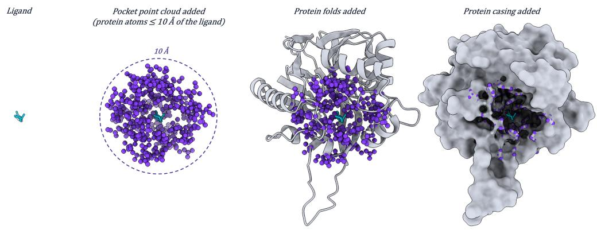
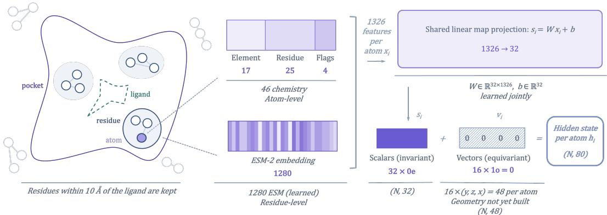
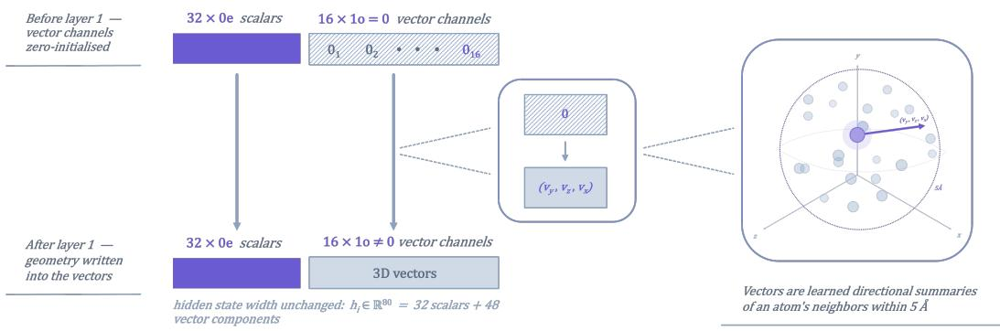

# RangeFinder: Predicting Ligand Property Ranges from Protein Pockets

Alan Nadelsticher Ruvalcaba1∗ Georgia Institute of Technology alan.nadelsticher@gatech.edu

Supratik Mukhopadhyay3 Louisiana State University mmukho1@lsu.edu

Chris Alvin2 Furman University chris.alvin@furman.edu

Adam Bess3 Louisiana State University bess@deepdrug.ai

## Abstract

Identifying ligands for a protein target requires searching a vast chemical space for a comparatively small set of compatible molecules. Existing machine learning approaches primarily address this problem by generating candidate ligands or scoring individual protein–ligand pairs, but provide limited information about the broader chemical space compatible with a binding pocket. We introduce RangeFinder, an SE(3)-equivariant transformer pocket-level model, trained and evaluated on BioLiP2 data, that predicts ranges over nine physicochemical ligand properties directly from pocket structure, chemistry, and evolutionary context. Using an intersection-over-union objective and evaluation metric (range-IoU), RangeFinder achieves a range-IoU of 0.464 ± 0.002, outperforming all deployable baselines while requiring only 12.2 ms per pocket. We also quantify our method’s ability to reduce the ligand search space while retaining compatible binders; in this regard, RangeFinder achieves a Reduction-Recall F-Score of 0.543 ± 0.011 — once again outperforming all deployable baselines. Ablation experiments indicate that RangeFinder’s performance depends more strongly on the density and quality of ligand supervision than on any individual input modality or specialized training strategy. Together, these results position RangeFinder as an inexpensive and effective molecular filtering prior, with demonstrated potential in narrowing the ligand search space of target pockets before docking, generation, or synthesis. The code for this project can be found at: https://github.com/alannadels/ RangeFinder.

## 1 Introduction

Identifying ligands for a protein target requires searching an enormous chemical space for a relatively small set of molecules that may bind a given pocket. Two classes of machine learning methods have addressed this problem so far: generative models, which design candidate ligands directly, and scoring models, which rank existing candidates by predicted compatibility with the pocket. Both have shown success within their respective problem spaces, yet both provide guidance at the level of individual molecules rather than describing the broader chemical space compatible with the pocket.

RangeFinder instead describes that space directly, predicting ranges over nine physicochemical ligand properties: molecular weight, lipophilicity, hydrogen-bond donors and acceptors, topological polar surface area, rotatable bonds, formal charge, aromatic rings, and fraction of sp3-hybridized carbons, from pocket signal alone. Rather than proposing or evaluating individual molecules, the model describes the compatible chemical space through these ranges. This description can focus subsequent generation or screening on candidate-like molecules. Evaluated with the metrics shown in Sec. 4.1, RangeFinder outperforms all deployable baselines on range-IoU and Reduction-Recall F-Score (RRF).

This work makes three contributions. (1) It poses pocket-to-ligand modeling as a range-prediction task, as well as provides a corresponding metric suite and training and evaluation protocol. (2) It shows empirically that RangeFinder outperforms all deployable baselines on range-IoU and RRF, effectively reducing the search space and time required by scientists to find viable binders for target pockets. (3) It examines, through controlled model variants and ablations, what drives this gain, where the current approach still falls short, and directions for future work.

## 2 Related work

Our task connects work on protein and pocket structure representation, structure-conditioned ligand generation, and pocket-ligand scoring. Although the following literature addresses questions distinct from those posed here, it informed our methodological design and experimental process.

Protein and pocket structure representation. APoc [1] and Foldseek [2] are the two pipelines which most closely resemble RangeFinder, and thus were directly used as baselines for our core experiments. These methods compare binding sites or protein structures through geometric alignment and structural alphabets. Other work in this space, such as AlphaFold 3 [3], extends structure prediction to complexes containing proteins and small molecules; however, it requires prior specification of the molecular components. Furthermore, geometric deep-learning models, including SE(3)-equivariant networks [4, 5], and transformer-based protein language models, such as ESM-2 [6], can provide complementary learned representations of three-dimensional geometry and protein sequence, respectively.

Structure-conditioned ligand generation. LiGAN [7] is a structure-based generative model that proposes new ligand structures for a specified protein pocket. It represents the pocket and its potential ligand as three-dimensional density grids, allowing generated molecules to reflect the shape and chemical environment of the binding site. Similarly, 3D-SBDD [8] and Pocket2Mol [9] construct molecules atom by atom to satisfy the spatial and chemical constraints of a pocket. TargetDiff [10] pursues the same goal through equivariant diffusion, while multi-objective methods optimize candidate ligand molecules across several desired properties [11].

Pocket–ligand scoring. RF-Score [12] predicts binding affinity from the types and numbers of atomic contacts between the protein and ligand, providing a learned alternative to traditional docking scores. AtomNet [13] and Pafnucy [14] represent complexes on three-dimensional grids and use convolutional networks to learn spatial interaction patterns associated with activity or affinity. PotentialNet [15] instead represents the complex as a graph and models both molecular structure and protein–ligand interactions. GNINA [16] incorporates convolutional scoring into docking to rank candidate binding poses and ligands.

Taken together, these methods represent or compare protein structures, predict molecular complexes, generate individual ligands, or score specified protein–ligand pairs. None of them predict the physicochemical property space compatible with a pocket before a candidate molecule is proposed.

## 3 Method

RangeFinder is designed such that the predicted intervals depend only on the atomic chemistry, evolutionary context, and relative geometry of the pocket, and are invariant to global rotations and translations of its atomic coordinates.

## 3.1 Task formulation

Given a protein pocket’s 3D structure and its atom-level chemistry, our model’s goal is to predict the range of nine physicochemical properties (Table 2) spanned by the ligands that bind it.

Input features. Each pocket is represented as the set of protein atoms within 10 Å of its ligand, with 3D coordinates being retained by each atom (Figure 1). We adopt a 10 Å radius to capture the residue shells that line and shape the binding site while keeping the point cloud compact. During inference, for pockets with no known ligands, the 10 $\mathring \mathrm { A }$ pocket for which the ranges are predicted is measured from whatever locates the binding site, for instance a reference molecule, a set of residues, or a point in space — a bound drug-like ligand is not strictly required. Every atom also carries a 1326-d feature vector. It concatenates 46 chemical and structural indicators, namely element, residue type, and bonding flags, with the 1280-d ESM-2 [6] embedding of its residue. The coordinates supply geometry; the features supply chemistry and evolutionary context.

Output predictions. Let $L _ { p }$ denote the known ligands of pocket $p .$ . For each property $j$ we compute the empirical mean $\mu _ { p j }$ and standard deviation $\sigma _ { p j }$ over $L _ { p }$ and define the target interval ${ \cal I } _ { p j } \bar { \bf \Delta } = [ \mu _ { p j } - 2 \bar { \sigma } _ { p j } , \mu _ { p j } + 2 \bar { \sigma } _ { p j } ^ { \mathrm { ~ s ~ } } ]$ . The model outputs $\hat { \mu } _ { p j }$ and $\hat { \sigma } _ { p j }$ for all nine properties, which define the predicted intervals $\hat { I } _ { p j \cdot } \mathrm { A }$ non-negative interval width is guaranteed by taking the absolute value of the predicted scale, $\hat { I } _ { p j } = [ \hat { \mu } _ { p j } - 2 | \hat { \sigma } _ { p j } | , \hat { \mu } _ { p j } + 2 | \hat { \sigma } _ { p j } | ]$ , applied identically in training and at inference. Importantly, we only use pockets with at least three known ligands for both training and evaluation, as pockets with fewer than three ligands lack a reliable range.

## 3.2 Architectural pipeline

The model maps a pocket to the interval parameters of Section 3.1 in four stages: input embedding, equivariant attention, invariant pooling, and prediction. The first three stages form the encoder, an SE(3)-Transformer [4] implemented with e3nn [5].

(1) Input embedding. Each atom i enters with 1326 scalar, rotation-invariant features, $x _ { i } \in \mathbb { R } ^ { 1 3 2 6 }$ $\mathbf { A }$ single linear layer maps each atom’s feature vector to 32 scalar channels, $s _ { i } = W x _ { i }$ with $W \in$ $\mathbb { R } ^ { 3 2 \times \breve { 1 } 3 2 6 }$ . Since the per-atom inputs carry no directional information, the 16 vector channels are initialized to zero, $V _ { i } ^ { \mathbf { \bar { \alpha } } } = \mathbf { 0 } \in \mathbb { R } ^ { 1 \bar { \bf 6 } \times 3 }$ . The atom’s hidden state $h _ { i } = ( s _ { i } , V _ { i } )$ therefore lives in the irreducible representations $3 2 \times 0 e + 1 6 \times 1 o$ . That is, the hidden state consists of 32 invariant scalars equivariant vectors

scalars that are unchanged under rotation and 16 three-dimensional vectors of odd parity that rotate with the pocket. Its width is therefore 80 components per atom, $3 2 + 1 6 \times 3$ . Equivariant vector features are synthesized only in the following layers, from the relative positions of neighboring atoms. Figure 2 illustrates this stage.

(2) Equivariant attention. As shown in Figure 3, four SE(3)-Transformer layers operate on a radius graph built from the pocket’s atomic coordinates, connecting atoms within $5 \mathring \mathrm { A }$ of each other. Each edge is embedded by a Gaussian radial basis modulated by a smooth cosine cutoff, and its direction by spherical harmonics up to $\ell = 1$ . Per layer, a tensor product combines each source atom’s features with the edge harmonics to form messages. Lightweight 4-head attention over the scalar channels weights those messages. The messages are then aggregated at each atom and passed through a gated nonlinearity, a residual connection, and equivariant batch normalization. Because messages are constructed from relative positions through equivariant tensor products, the encoder is equivariant to global rotations and translations of the pocket.

(3) Invariant pooling. Atom representations are mean-pooled per pocket. The scalar channels and the norms of the vector channels form a 48-dimensional rotation-invariant pocket embedding.

(4) Prediction head. A multilayer perceptron with hidden dimensions 96 and 48 maps the pooled embedding to 18 interval parameters, $\hat { \mu }$ and σˆ for each of the nine properties. It also produces a single logit for an auxiliary binary task that predicts whether the pocket’s ligands contain aromatic rings.

## 3.3 Training objective

The primary objective is a one-dimensional generalized-IoU (GIoU) loss [17] on the predicted and target intervals. It is applied in raw property units: predictions are made in a normalized space and de-normalized before the intervals are formed. For property $j$ of pocket $p ,$ let $U$ be the union length of $\hat { I } _ { p j }$ and $I _ { p j }$ , and let C be the length of the smallest interval enclosing both. The loss is then $\ell _ { p j } = 1 - \mathrm { G I o U } ( \hat { I } _ { p j } , I _ { p j } )$ , where $\mathrm { G I o U } = \mathrm { I o U } - { \frac { C - U } { C } }$ . The enclosing-interval penalty $\textstyle { \frac { C - U } { C } }$ supplies a nonzero gradient even when the two intervals are disjoint so the model is always pushed to move its interval toward the target. Only properties with a non-degenerate target $( \sigma _ { p j } > 0 )$ contribute. Furthermore, per-pocket losses are averaged over valid properties and then combined across pockets with cost-sensitive weights (inverse protein frequency), yielding ${ \mathcal { L } } _ { \mathrm { G I o U } }$ , so that over-represented proteins do not dominate. Because the GIoU term is computed on the same $\mu \pm 2 \sigma$ intervals used at evaluation, it is a differentiable surrogate for the range-IoU metric. The full objective adds a binary cross-entropy loss $\mathcal { L } _ { \mathrm { B C E } }$ on the auxiliary head. The total is $\mathcal { L } = \mathcal { L } _ { \mathrm { G I o U } } + \lambda \mathcal { L } _ { \mathrm { B C E } }$ , where $\lambda = 0 . 0 8 9$ weights the auxiliary BCE loss relative to the primary objective, and was selected by CMA-ES search.

## 4 Experiments

## 4.1 Experimental setup

Dataset. We train and evaluate our method on BioLiP2 [18], a database that has biologically relevant protein–ligand interactions extracted from experimentally determined structures in the Protein Data Bank [19]. Table 3 reports the training, validation, and test split. We split the data by protein so that related structural views of the same protein cannot appear across training, validation, and test sets. We evaluate all methods on the same 564 test pockets, each with at least three known ligands.

Baselines. We compare RangeFinder against six baselines. (1) Global average averages the property ranges over all training pockets, giving no per-pocket signal. (2) Pocket cluster applies K-means [20] $( K = 6 )$ to pooled pocket features and predicts the mean target of the assigned training cluster, clustering at the pocket (input) level. (3) Feature k-NN [21] averages the true ranges of a pocket’s k nearest training pockets $( k = 5 0 )$ . (4) APoc [1] and (5) Foldseek [2] perform the same nearestneighbor retrieval as Feature k-NN, but rank training pockets by 3D structural similarity rather than feature similarity. (6) Target-informed applies K-means $( K = 6 )$ at the ligand (output) level, clustering pockets by their ground-truth labels; because it clusters on the prediction target itself, we include it as a non-deployable reference point.

Evaluation metrics. We score a method’s prediction via five metrics: Intersection-over-Union (range-IoU), Reduction, Recall, Reduction-Recall F-Score (RRF), and latency. This metric suite provides a balanced evaluation, pairing predictive accuracy (range-IoU) with the practical screening trade-off between shrinking the candidate library (reduction) and retaining true binders (recall) — summarized by the harmonic mean of recall and the library discard fraction (RRF) — together with deployment cost (latency). A more in-depth explanation of what these metrics represent, and how they are computed, can be found in Section C of the appendix.

Hyperparameters. Several training hyperparameters were selected using a prior CMA-ES search [22] and held fixed across all subsequent experiments; Table 4 in Appendix D provides additional search details. Full architecture, optimization, loss, and pocket-construction details are similarly provided in the aforementioned table.

Hardware. NVIDIA hardware was used for all experiments, and evaluation was conducted under identical hardware to ensure fairness. Additional details are shown in Section E.

## 4.2 Findings

Baseline comparison. As shown in Table 1, RangeFinder outperforms every deployable baseline tested on range-IoU and RRF, including the published methods Foldseek (0.390, 0.278) and APoc (0.420, 0.424). Compared to the best-performing baseline (APoc), on range-IoU RangeFinder exceeds their score by 0.044, a ∼ 10.5% relative improvement; on RRF, RangeFinder achieves a 28.1% relative improvement over their result — all while running approximately three orders of magnitude faster (12.2 ms vs. 26.3 s per pocket). The global average, feature k-NN, and pocket clustering baselines do not approach this accuracy. Notably, RangeFinder nearly matches the non-deployable target-informed reference, which clusters pockets using the ligands’ ground truth properties.

Ablations. We run a set of three ablation experiments. The first isolates the contribution of the data source on which the model’s pipeline runs, described further in Section F.1 and Table 5. The second isolates the contribution of each input modality. Starting from the full model, we remove the ESM-2 language-model embeddings (No ESM), the hand-crafted chemical features (No chemistry), and the 3D geometry (No 3D), one at a time, and retrain (Table 6). The third fixes the inputs and varies the training strategy and architecture. We compare RangeFinder against a denoising-pretrained encoder and a mixture-of-experts approach routed over pocket clusters (Table 7). For these experiments, we evaluate on the range-IoU and latency metrics previously introduced. A breakdown of results, across all ablation experiments, can be found in Section F.

Table 1: Main experimental results on BioLiP2 data. RangeFinder was trained with seeds 42–46 (five seeds); the other marked methods were run with seeds 0–4 (five seeds). Bold/underline: best/second best per column, excluding the non-deployable reference.
<table><tr><td>Method</td><td>Range-IoU</td><td>Reduction</td><td>Recall</td><td>RRF</td><td>Latency</td></tr><tr><td>Global average</td><td>0.402</td><td>3.0×</td><td>0.205</td><td>0.313</td><td>&lt; 0.001 ms</td></tr><tr><td>Foldseek</td><td>0.390</td><td>4.2×</td><td>0.170</td><td>0.278</td><td>127 ms</td></tr><tr><td>Pocket cluster *</td><td> $0 . 4 0 3 \pm 0 . 0 0 0$ </td><td>3.3×</td><td> $0 . 2 2 2 \pm 0 . 0 0 4$ </td><td> $0 . 3 3 8 \pm 0 . 0 0 4$ </td><td>2.83 ms</td></tr><tr><td>Feature k-NN*</td><td>0.409 ± 0.000</td><td>4.1×</td><td>0.214 ± 0.002</td><td> $0 . 3 3 3 \pm 0 . 0 0 2$ </td><td>3.01 ms</td></tr><tr><td>APoc</td><td>0.420</td><td>5.3×</td><td>0.287</td><td>0.424</td><td>26.3s</td></tr><tr><td>RangeFinder (Ours)</td><td> $\mathbf { 0 . 4 6 4 \pm 0 . 0 0 2 }$ </td><td>2.1×</td><td> $\mathbf { 0 . 5 5 7 \pm 0 . 0 2 6 }$ </td><td> $\mathbf { 0 . 5 4 3 \pm 0 . 0 1 1 }$ </td><td>12.2 ms</td></tr><tr><td>Target-informed</td><td> $0 . 4 7 0 \pm 0 . 0 0 5$ </td><td>3.8×</td><td> $0 . 5 1 0 \pm 0 . 0 1 1$ </td><td> $0 . 6 0 2 \pm 0 . 0 1 2$ </td><td>0.195 ms</td></tr></table>

Marked methods contain tunable stochastic components.

## 5 Discussion

As shown in Section 4.2, RangeFinder provides the strongest prediction (range-IoU: $0 . 4 6 4 \pm 0 . 0 0 2 )$ and Reduction-Recall F-Score (RRF: 0.543 ± 0.011), outperforming all deployable baselines. It also nearly matches the non-deployable, target-informed baseline on range-IoU prediction. Furthermore, at roughly 12 ms per pocket, its inference latency is substantially lower than APoc’s and Foldseek’s. All methods, including the non-deployable baseline, nonetheless fall within ∼ 0.08 range-IoU of one another, and the pocket-blind global average alone stands at 0.402. This narrow spread suggests that the available signal is modest, and that sparse, noisy data rather than model capacity may be the binding constraint. Ultimately, RangeFinder provides an inexpensive property-space prior that could filter virtual libraries, constrain molecular generation, or triage pockets before further molecular analysis and testing.

Furthermore, removing any single input modality reduces range-IoU by at most 0.012, and neither mixture-of-experts training nor denoising pretraining improves on RangeFinder. Together with the supervision-source ablation experiment, this indicates that performance is not attributable to any single input modality or training strategy. As previously noted, the larger determinant is the density and reliability of the ligand sets that define each pocket’s target ranges during training.

Limitations. Key limitations include evaluation on 3+ ligand pockets and noisy range estimates near the three-ligand threshold, uncertainty in small evaluation margins from single-seeded splits and ablations, and possible homology or pocket-size confounds. A detailed discussion is provided in Appendix G.

Future work. Future work aims to close the gaps raised by the limitations section, and explore potentially fruitful research directions; such work is discussed in Appendix H.

## 6 Conclusion

We introduced RangeFinder, a pocket-level model that, from pocket geometry, chemistry, and evolutionary context predicts the range of nine physicochemical properties spanned by a pocket’s potential binders. On BioLiP2 it achieves $0 . 4 6 4 \pm 0 . 0 0 2$ range-IoU and 0.543 ± 0.011 RRF, outperforming all deployable baselines while requiring only 12.2 ms per pocket. Furthermore, our input and training-strategy ablations indicate that this result is not explained by feature or structural retrieval, by any single input modality, or by specialized optimization. A major contributing factor to the model’s performance, rather, seems to be data density and quality; over its own geometry-blind baseline, a PDBbind [23] RangeFinder variant improves by only +0.006, compared to +0.064 for the BioLiP2 variant (both at seed = 42). Together, these results illustrate the major drivers behind RangeFinder’s performance, and position it as an inexpensive and promising method, with the potential for narrowing the ligand search space of target pockets before docking, generation, or synthesis.

## References

[1] Gao, M. & Skolnick, J. (2013) APoc: large-scale identification of similar protein pockets. Bioinformatics 29(5):597–604.

[2] van Kempen, M., et al. (2024) Fast and accurate protein structure search with Foldseek. Nature Biotechnol ogy 42:243–246.

[3] Abramson, J., et al. (2024) Accurate structure prediction of biomolecular interactions with AlphaFold 3. Nature 630:493–500.

[4] Fuchs, F. B., Worrall, D. E., et al. (2020) SE(3)-Transformers: 3D roto-translation equivariant attention networks. In Proceedings ofthe Conference on Neural Information Processing Systems (NeurIPS).

[5] Geiger, M. & Smidt, T. (2022) e3nn: Euclidean neural networks. arXiv:2207.09453.

[6] Lin, Z., et al. (2023) Evolutionary-scale prediction of atomic-level protein structure with a language model. Science 379(6637):1123–1130.

[7] Ragoza, M., Masuda, T. & Koes, D. R. (2022) Generating 3D molecules conditional on receptor binding sites with deep generative models. Chemical Science 13(9):2701–2713.

[8] Luo, S., et al. (2021) A 3D generative model for structure-based drug design. In Proceedings of the Conference on Neural Information Processing Systems (NeurIPS).

[9] Peng, X., et al. (2022) Pocket2Mol: Efficient molecular sampling based on 3D protein pockets. In Proceedings ofthe International Conference on Machine Learning (ICML).

[10] Guan, J., Qian, W. W., et al. (2023) 3D equivariant diffusion for target-aware molecule generation and affinity prediction. In Proceedings ofthe International Conference on Learning Representations (ICLR).

[11] Jain, M., et al. (2023) Multi-objective GFlowNets. In Proceedings of the International Conference on Machine Learning (ICML).

[12] Ballester, P. J. & Mitchell, J. B. O. (2010) A machine learning approach to predicting protein–ligand binding affinity with applications to molecular docking. Bioinformatics 26(9):1169–1175.

[13] Wallach, I., Dzamba, M., & Heifets, A. (2015) AtomNet: A deep convolutional neural network for bioactivity prediction in structure-based drug discovery. arXiv:1510.02855.

[14] Stepniewska-Dziubinska, M. M., Zielenkiewicz, P. & Siedlecki, P. (2018) Development and evaluation of a deep learning model for protein–ligand binding affinity prediction. Bioinformatics 34(21):3666–3674.

[15] Feinberg, E. N., et al. (2018) PotentialNet for molecular property prediction. ACS Central Science 4(11):1520–1530.

[16] McNutt, A. T., et al. (2021) GNINA 1.0: Molecular docking with deep learning. Journal of Cheminformatics 13(1):43.

[17] Rezatofighi, H., et al. (2019) Generalized intersection over union: A metric and a loss for bounding box regression. In Proceedings of the IEEE/CVF Conference on Computer Vision and Pattern Recognition.

[18] Zhang, C., et al. (2024) BioLiP2: An updated structure database for biologically relevant ligand–protein interactions. Nucleic Acids Research 52(D1):D404–D412.

[19] wwPDB Consortium. (2019) Protein Data Bank: The single global archive for 3D macromolecular structure data. Nucleic Acids Research 47(D1):D520–D528.

[20] Arthur, D. & Vassilvitskii, S. (2007) k-means++: The advantages of careful seeding. In Proceedings of the Eighteenth Annual ACM-SIAM Symposium on Discrete Algorithms (SODA), pp. 1027–1035.

[21] Cover, T. & Hart, P. (1967) Nearest neighbor pattern classification. IEEE Transactions on Information Theory 13(1):21–27.

[22] Hansen, N. (2023) The CMA Evolution Strategy: A Tutorial. arXiv preprint arXiv:1604.00772.

[23] Liu, Z., et al. (2017) Forging the basis for developing protein–ligand interaction scoring functions. Accounts ofChemical Research 50(2):302–309.

## Appendix

The appendix section contains additional details, results, and figures that provide further context regarding our work.

## A Task and model details

This section provides additional details on the ligand properties predicted by RangeFinder, the construction of its pocket representations, and the model’s input embedding and equivariant attention stages.

## A.1 Predicted ligand properties

RangeFinder predicts ranges over nine physicochemical properties — the targeted ligand property space associated with each pocket. Table 2 lists these properties and their definitions.

Table 2: The nine ligand physicochemical properties predicted by RangeFinder.
<table><tr><td>Property</td><td>Definition</td></tr><tr><td>MW</td><td>Molecular weight</td></tr><tr><td>logP</td><td>Octanol-water partition coefficient (lipophilicity)</td></tr><tr><td>HBD</td><td>Number of hydrogen-bond donors</td></tr><tr><td>HBA</td><td>Number of hydrogen-bond acceptors</td></tr><tr><td>TPSA</td><td>Topological polar surface area</td></tr><tr><td>Rotatable bonds *</td><td>Number of rotatable bonds</td></tr><tr><td>Formal charge</td><td>Net formal charge</td></tr><tr><td>Aromatic rings</td><td>Number of aromatic rings</td></tr><tr><td> $\mathrm { F s p } ^ { 3 }$ </td><td>Fraction of  $\mathrm { s p } ^ { 3 } \mathrm { - h y }$  bridized carbons</td></tr></table>

In 81% of test pockets, $\sigma _ { \mathrm { c h a r g e } } < 0 . 1 $ , making the target interval nearly degenerate (discussed below).

Formal charge as a degenerate interval target. Formal charge behaves differently from the other properties. In 81% of the test pockets, $\sigma _ { \mathrm { c h a r g e } } < 0 . 1$ , so the target interval is effectively a point near zero. Any small continuous prediction error can then produce zero overlap. Averaged over the five seeds, RangeFinder’s predictions for formal charge achieve a range-IoU of 0.124, whereas those for the other eight properties lie between 0.485 and 0.527 (mean 0.506). Dropping formal charge, RangeFinder’s 8-property range-IoU is 0.506 — computed as $( 0 . 4 6 4 \times 9 - 0 . 1 2 4 ) / 8 - \mathrm { a r a n g e - I o U }$ improvement of $\bar { 0 } . 0 \bar { 4 } 2 \bar { ( } \sim 9 . \bar { 1 \% } )$ relative to the 9-property score of 0.464.

## A.2 Pocket construction

  
Figure 1: Stepwise visualization of the structural pocket–ligand representation on which the model operates. The protein shown in the diagram, N-acyl-homoserine-lactone lactonase (PDB ID 6N9Q), represents a real example of a protein containing only one pocket as an active binding site.

## A.3 Architecture visualizations

Figure 2: Stage 1 – Input embedding. Each pocket atom receives 46 local chemistry and structural descriptors together with its residue’s 1280-dimensional ESM-2 embedding. The resulting 1326- dimensional feature vector is projected to 32 invariant scalar channels, while 16 equivariant vector channels are initialized to zero.  
  
Figure 3: Stage 2 – Equivariant attention. The zero-initialized vector channels acquire directional information from neighboring atoms within $5 \mathring { \mathbf { A } } ,$ , while the scalar channels remain rotation invariant. The hidden-state width remains at 80 components per atom: 32 scalars and 16 three-dimensional vectors.

## B Dataset details

Table 3: BioLiP2-based dataset split by protein. A structure-view is one observed protein–ligand entry associated with a pocket.
<table><tr><td></td><td>Train</td><td>Validation</td><td>Test</td></tr><tr><td>Pockets  $( n _ { \mathrm { l i g } } \ge 3 )$ </td><td>2,627</td><td>562</td><td>564</td></tr><tr><td>Structure-views</td><td>10,905</td><td>2,313</td><td>3,823</td></tr></table>

## C Evaluation metrics

Below is a detailed explanation of what each metric in our suite represents, and how it is computed. Intersection-over-union. We define intersection-over-union as the overlap between a predicted property interval and its target relative to their union, where IoU $\begin{array} { r } { \lceil ( \hat { I } _ { p j } , I _ { p j } ) = \frac { | \hat { I } _ { p j } \cap I _ { p j } | } { | \hat { I } _ { p j } \cup I _ { p j } | } } \end{array}$ , averaged across the nine properties and then across pockets; we call this range-IoU. This metric rewards both accurate placement and appropriate width, since an overly broad interval cannot score highly simply by containing the target.

Reduction. We define reduction as $1 / r _ { p }$ averaged across pockets, where $r _ { p }$ is the fraction of a fixed background library B (all drug-like binders in the dataset), whose nine properties fall within pocket $p \mathbf { \hat { s } }$ predicted box. Reduction is the factor by which the predicted ranges shrink the candidate set relative to screening the full library; larger values indicate a more selective filter. On its own it can be misleading, since a very narrow box maximizes it but might also be discarding true binders; thus, it should be paired with, and read alongside recall.

Recall. We define recall as the fraction of a pocket’s known binders that fall within its predicted intervals, averaged across pockets. A binder counts as captured when each of its nine property values lies within the corresponding predicted interval $\hat { I } _ { p j }$ . Recall measures how well the predicted ranges retain true binders; intervals that are too narrow or misplaced which discard real ligands are penalized.

Reduction-Recall F-Score. We define RRF as the harmonic mean of recall and the discard fraction $\begin{array} { r } { 1 - r _ { p } , \mathrm { \ R R F } = \frac { 2 \mathrm { r e c a l l } \left( 1 - r _ { p } \right) } { \mathrm { r e c a l l } + \left( 1 - r _ { p } \right) } } \end{array}$ , averaged across pockets. It collapses the recall–reduction trade-off into a single number, rewarding methods that both retain binders and shrink the library. We use the harmonic mean rather than a sum so that a large reduction cannot compensate for lost binders: a method scores highly only when both quantities are high.

Latency. We define latency as the mean wall-clock time to produce a prediction for a single pocket during inference, measured on identical hardware across all methods. It captures deployability: methods of comparable accuracy can differ by orders of magnitude in computational cost.

## D Training and search configuration

Table 4 reports the full configuration of the deployed model.

## E Hardware

Unless otherwise noted, training and evaluation use NVIDIA A10G GPUs. The main results in Table 1 are both trained and evaluated on these cards

The supervision-source variants in Table 5 are likewise trained and evaluated entirely on the A10G GPUs (the BioLiP2 variant being the same seed-42 model reported in Table 1). In contrast, the input-modality and training-strategy ablations in Tables 6 and 7 are trained on an NVIDIA RTX 5090 GPU and evaluated on the A10G cards.

To ensure fairness, all experiments were evaluated under the A10G GPUs — regardless of training modality. This is particularly important for the latency metric which is heavily influenced by specific hardware.

## F Additional ablations

For the first experiment (outlined in Section 4.2), we observe that data quality and density have a strong impact on model performance; relative to their geometry-blind baselines, a PDBbind RangeFinder variant improves by only +0.006, compared to +0.064 for the BioLiP2 variant (both at seed = 42). Next, among the input modalities, removing the 3D geometry causes the most meaningful drop in performance. Yet, this drop is modest, from 0.467 to 0.455. Removing the ESM-2 embeddings or the chemical features reduces range-IoU by only 0.003. No single input is therefore critical, and the model degrades gracefully under the loss of any one modality. In the third experiment, we find that neither the mixture-of-experts (0.442) nor the denoising-pretrained encoder (0.461) improves on RangeFinder (0.467) on range-IoU. Per-cluster specialization and self-supervised pretraining, therefore, offer no benefit over end-to-end training at this scale.

Table 4: RangeFinder training, loss, pocket-construction, and CMA-ES search configuration.
<table><tr><td>Setting</td><td>Value</td></tr><tr><td colspan="2">Architecture</td></tr><tr><td>Encoder</td><td>SE(3)-Transformer (e3nn); 4 layers, 4 heads,  $\ell _ { \mathrm { m a x } } = 1$ </td></tr><tr><td>Hidden irreducible reps. (width) Radius graph / radial basis</td><td> $3 2 \times 0 e + 1 6 \times$  1o (80 components per atom) 5 Å cutoff; 16 Gaussian radial basis functions</td></tr><tr><td>Prediction head</td><td>MLP 96 →48 → 19 (18 interval parameters +1 aromatic logit)</td></tr><tr><td>Input features and normalization</td><td></td></tr><tr><td colspan="2">Per-atom features</td></tr><tr><td>ESM-2 checkpoint</td><td>46 chemical/structural + 1280 ESM-2 = 1326 esm2_t33_650M_UR50D (1280-d residue embedding)</td></tr><tr><td>Coordinates</td><td>centroid-centered 3D positions  $( \mathring \mathrm { A } )$ </td></tr><tr><td>Target normalization</td><td>per-target z-score on training pockets;  $\mu$  over all pockets, σ over</td></tr><tr><td>Optimization</td><td>≥3-ligand pockets</td></tr><tr><td colspan="2">Optimizer</td></tr><tr><td></td><td>AdamW</td></tr><tr><td>Learning rate</td><td> $2 . 2 3 \times 1 0 ^ { - 4 }$ </td></tr><tr><td>Weight decay</td><td> $1 \times 1 0 ^ { - 4 }$ </td></tr><tr><td>LR schedule</td><td>ReduceLROnPlateau; factor 0.5, patience 10</td></tr><tr><td>Batching</td><td>dynamic atom-budget, ≤ 80,000 graph edges per batch</td></tr><tr><td>Dropout (head / trunk / atom)</td><td>0.245 / 0.235 / 0.0</td></tr><tr><td>Gradient clipping (max norm) Training duration</td><td>3.97 early stopping on validation (patience 12); LR reduced on plateau</td></tr><tr><td></td><td>(patience 10)</td></tr><tr><td>Seeds</td><td>Five-seed bands: 42–46</td></tr><tr><td colspan="2">Loss and interval parameterization Primary loss</td></tr><tr><td></td><td>1-D generalized-IoU on  $\mu \pm 2 \sigma$  intervals, inverse-protein-frequency weighted</td></tr><tr><td>Auxiliary loss</td><td>aromatic-present BCE, weight  $\lambda = 0 . 0 8 9$ </td></tr><tr><td>Positive-width parameterization</td><td> $\hat { I } _ { p j } = [ \hat { \mu } _ { p j } - 2 | \hat { \sigma } _ { p j } | , \hat { \mu } _ { p j } + 2 | \hat { \sigma } _ { p j } | ]$ </td></tr><tr><td colspan="2">Pocket and target construction</td></tr><tr><td>Pocket grouping</td><td>by UniProt accession; target  $\mu , \sigma$  computed over all drug-like lig- ands of the protein (&gt; 3 required)</td></tr><tr><td>Input point cloud</td><td>protein atoms within 10 Å of a bound ligand (one representative structure per pocket)</td></tr><tr><td colspan="2">CMA-ES search</td></tr><tr><td>Details</td><td>early-stage search on PDBbind data; objective: validation Spear- man; held fixed thereafter</td></tr><tr><td>Hyperparameter search</td><td>selected the learning rate, weight decay, dropouts (head, trunk, and atom), and gradient clip; population size 8, 6 generations (48  $\sigma = 0 . 5$ </td></tr><tr><td>Loss-weight search</td><td>evaluations), initial step size selected the auxiliary BCE weight  $\lambda = 0 . 0 8 9 ;$  population size 8, 6 generations (48 evaluations), initial step size  $\sigma = 0 . 5$ </td></tr></table>

## F.1 Supervision source: BioLiP2 vs. PDBbind

We ran the identical RangeFinder model — same architecture, features, loss, and training protocol — under two supervision sources, and evaluated each model on its own protein-grouped test split (Table 5). Because the two splits contain different pockets, the absolute scores are not directly comparable; the meaningful quantity is each model’s margin over its same-dataset baselines. Under PDBbind, where most pockets have only a few known binders, a geometry-blind pocket-cluster constant already nearly matches RangeFinder (0.431 vs. 0.437, respectively), leaving a margin of just +0.006 in favor of RangeFinder. Under BioLiP2, which enriches each pocket’s ligand set by roughly an order of magnitude, RangeFinder rises to 0.467 while the geometry-blind pocket-cluster constant drops to 0.403 — a +0.064 margin in favor of RangeFinder. The global-average floor is essentially unchanged between the two (0.403 for PDBbind vs. 0.402 for BioLiP2), so the growth in margin is attributable to denser, sharper supervision rather than to an easier test set.

Table 5: Range-IoU under two supervision sources, with the model held fixed. Each column uses its own test split; compare each model’s margin over its same-dataset baselines. RangeFinder variants were trained under the same fixed seed (seed = 42).
<table><tr><td></td><td>BioLiP2</td><td>PDBbind</td></tr><tr><td>Global-average floor</td><td>0.402</td><td>0.403</td></tr><tr><td>Pocket cluster K=6 (geometry-blind)</td><td>0.403</td><td>0.431</td></tr><tr><td>RangeFinder</td><td>0.467</td><td>0.437</td></tr><tr><td>RangeFinder gain over geometry-blind baseline</td><td>+0.064</td><td>+0.006</td></tr></table>

## F.2 Input modalities

Table 6: Leave-one-out input ablation. All other training and evaluation choices are held fixed. All ablation variants shown were trained under the same fixed seed (seed = 42). Bold/underline: best/second-best per column.
<table><tr><td>Variant</td><td>ESM</td><td>Chemistry</td><td>3D</td><td>Feature dim.</td><td>Range-IoU</td><td>Latency</td></tr><tr><td>Full model</td><td>√</td><td>√</td><td>√</td><td>1326</td><td>0.467</td><td>12.2 ms</td></tr><tr><td>No ESM</td><td></td><td>√</td><td>√</td><td>46</td><td>0.464</td><td>12.2 ms</td></tr><tr><td>No chemistry</td><td>√</td><td></td><td>√</td><td>1280</td><td>0.464</td><td>12.2 ms</td></tr><tr><td>No 3D</td><td>√</td><td>√</td><td></td><td>1326</td><td>0.455</td><td>6.8 ms</td></tr></table>

## F.3 Training strategies and architectures

Table 7: Training-strategy ablation. Alternative training strategies and architectures for RangeFinder on the same 564 BioLiP2 test pockets. All ablation variants shown were trained under the same fixed seed (seed = 42). Bold/underline: best/second-best per column.
<table><tr><td>Variant</td><td>Strategy</td><td>Range-IoU</td><td>Latency</td></tr><tr><td>RangeFinder</td><td>Single model</td><td>0.467</td><td>12.2 ms</td></tr><tr><td>Denoising-pretrained encoder</td><td>Self-supervised pretraining</td><td>0.461</td><td>12.2 ms</td></tr><tr><td>Mixture of experts (K=6)</td><td>Per-cluster specialization</td><td>0.442</td><td>15 ms</td></tr></table>

## G Limitations

Training and evaluation are constrained to pockets with at least three known ligands, as pockets with fewer than three binders do not provide reliable range estimates. Thus, the current dataset may represent a biased sample of protein pockets, lacking undocumented or minimally documented pockets. Evaluation could, therefore, be restricted to comparatively well-characterized pockets, with performance on ligand-poor pockets remaining untested. Moreover, near the three-ligand floor, $\mu { \pm } 2 \sigma$ estimates may remain somewhat noisy. Additionally, although five-seed bands are provided in the main results for all methods that introduce tunable stochastic components as part of their architecture, the single-seeded data pipeline split (train/val/test) and the single-seeded training for the ablation studies remain a limitation to be explored in future work. Split groups are determined by UniProt rather than by sequence-identity clusters, so close homologs may appear across splits; however, the small effect of removing ESM-2 (as shown in Table 6) indicates that sequence-embedding leakage is not a major driver of model performance. The current suite of training-strategy ablations (Table 7) does not determine whether RangeFinder’s equivariant architecture is responsible for its performance; an additional non-equivariant version of RangeFinder would answer this definitively. Lastly, because pockets are typically delimited using the bound ligand, pocket size slightly varies depending on ligand size; thus, size-related properties such as molecular weight could be partially inferable from pocket dimensions rather than pocket chemistry, we do not fully disentangle this and leave it for future work.

## H Future work

Because supervision rather than architecture appears to be the binding constraint, the most promising direction lies in experimenting with denser, debiased, uncertainty-aware, and higher-quality pocketligand data. Beyond this, subsequent work should extend the task to pockets with few or no known ligands, rerun the pipeline across multiple UniProt data-split seeds and homology-clustered splits, and for ablations specifically across multiple training seeds, extend the task to pockets with cofactors, using the cofactors themselves as input features, further ablate RangeFinder’s architecture by testing non-equivariant versions of it, and determine the extent, if any, to which the model’s learning is affected by the delimited pocket size across ligands of varying proportions. Additionally, the relatively small gap across the distinct leave-one-out models motivates a comparison with simpler variants of RangeFinder; potentially, a simpler and cheaper variant could achieve comparable results. Moreover, assessing RangeFinder’s added value for molecular generation could be worthwhile. This can be done by conditioning a simple ligand generative model on RangeFinder’s predicted property ranges (or its learned pocket embedding) and comparing against that same model without the conditioning, holding the base model, pocket inputs, and generation budget fixed. Lastly, future work should explore complementary methods or protocols that, when combined with our framework (or aspects of it), can provide more robust pocket-ligand predictions.