# Recovering Missing Degrees of Freedom in Simulation-Trained Field-Level Generative Models

Masato Shirasaki1, 2, 3, ∗ and Shiro Ikeda2

1National Astronomical Observatory of Japan (NAOJ),

National Institutes of Natural Sciences, Tokyo 181-8588, Japan

2The Institute of Statistical Mathematics, Tokyo 190-8562, Japan

3RIKEN Center for Advanced Intelligence Project, Tokyo 103-0027, Japan

(Dated: November 3, 2026)

Simulation-trained generative models are emerging as a powerful framework for field-level inference in cosmology, particularly in strongly nonlinear regimes where analytical approaches become intractable. However, the finite size of training datasets often leads to variance shrinkage, indicating that part of the realization-level variability of the underlying physical process is not captured by the learned generative dynamics. In this Letter, we interpret variance shrinkage as a diagnostic of missing effective degrees of freedom and introduce physicsinformed latent modifications to the generative dynamics of a continuous normalizing flow. We show that these latent corrections recover a substantial fraction of the missing variability without requiring additional training simulations. Using weak-lensing field-level inference as a representative cosmological application, we further demonstrate through posterior analysis that the learned latent directions are actively exploited during inference and behave as effective nuisance parameters that absorb part of the mismatch between the training and target distributions. As a result, the model exhibits improved robustness to out-of-distribution shifts in field-level inference. Our work establishes variance shrinkage as a practical diagnostic for identifying missing degrees of freedom in simulation-trained generative models and provides a framework for recovering them through physics-informed modifications of generative dynamics

## INTRODUCTION

Field-level inference provides a lossless framework for extracting scientific information from observational data, but it requires highly accurate generative models of the underlying physical fields. In modern cosmology, field-level generative models are often constructed using analytic approximations that are valid on scales larger than 10 Mpc [1– 3], but these approaches break down in the strongly nonlinear regime. Simulation-trained generative models have therefore emerged as a promising alternative, as deep-learning techniques provide sufficient expressive power and flexibility to emulate complex nonlinear structure formation.

However, simulation-trained models inevitably face limitations arising from the finite size of available training datasets. A common phenomenon is that the trained model reproduces the average properties of the training simulations while underestimating their realization-to-realization variability. This so-called variance shrinkage has recently been recognized as an important challenge for simulation-based generative modeling [4, 5]. More broadly, recent studies have highlighted that matching posterior means or low-order summary statistics does not guarantee a faithful reconstruction of uncertainty structures in field-level inference [6]. A straightforward solution is to increase the size of the training set, but this approach is often impractical in cosmology because high-fidelity numerical simulations are computationally expensive. Recent reviews of simulation-based inference also have identified limited simulation budgets as a critical challenge for cosmological applications [7]. In this work, we address a complementary question: given a fixed training set, can one recover physical variability that has not been adequately captured by

the trained generative model?

In this Letter, we present a method for recovering missing variability in simulation-trained generative models without increasing the number of training simulations. We interpret variance shrinkage as a diagnostic of missing effective degrees of freedom that cannot be represented within the fiducial model architecture. Guided by physical intuition, we introduce latent modifications to the generative dynamics of a continuous normalizing flow, allowing the model to recover variability that is otherwise lost during training. We further show that the acquired latent degrees of freedom are actively utilized during field-level inference, where they act as effective nuisance directions that partially absorb mismatches between the training and target distributions. Our results establish a framework in which physics-informed corrections complement deep-learning-based generative models: the generative model captures the complex average behavior of the training data, while physically motivated latent dynamics restore missing variability that is difficult to learn from finite datasets alone.

## DATA AND MODEL

As a representative cosmological application, we consider field-level modeling of weak gravitational lensing maps. Our goal is to generate convergence fields κ for four sourceredshift bins centered at z = 0.5, 0.75, 1.0, and 1.3, matching a typical configuration of current-generation imaging surveys [8].

We employ a continuous normalizing flow (CNF) to map Gaussian random fields to highly non-Gaussian weak-lensing maps. The baseline velocity field is constructed from Fourier neural operators (FNOs) [9] designed to respect translation and rotation symmetries. The model generates κ maps in $\mathrm { a ~ 1 . 2 5 ^ { 2 } d e g ^ { 2 } }$ field of view with an angular resolution of 0.94 arcmin. The CNF evolves a field realization according to $\mathrm { d } \kappa / \mathrm { d } t = \tau$ such that the target field is obtained by integrating the velocity field v from a Gaussian latent state at $t = 0$ to $t = 1$ . The flow is trained using the standard flow-matching objective [10].

We train the fiducial model using 10,000 realizations of gravity-only weak-lensing simulations from κTNG [11]. While the trained flow accurately reproduces mean statistical properties of the simulations, it exhibits variance shrinkage, namely an underestimation of realization-to-realization variability.

To recover the missing variability, we introduce physicsinformed corrections to the fiducial flow velocity $v _ { 0 } ( \mathbf { x } , c , t )$

$$
\begin{array} { r } { v ( \mathbf { x } , c , t , \pmb \theta ) = A ( c , t , \pmb \theta ) \left[ v _ { 0 } ( \mathbf { x } , c , t ) + B ( c , t , \pmb \theta ) \right] } \\ { + C ( \mathbf { x } , c , t , \pmb \theta ) . } \end{array}\tag{1}
$$

Here $\mathbf { x } , c ,$ and t denote the pixel position, tomographic channel, and flow time, respectively, while θ represents the latent degrees of freedom. The latent correction is controlled by a small number of free parameters. To characterize their physical effects, we vary each parameter individually and measure the response of weak-lensing summary statistics. Among all latent directions, one parameter, denoted by $\theta _ { \mathrm { a d d } }$ , produces the clearest and largest response in the power spectrum and accounts for most of the recovered realization-level variability. For this reason, we focus on $\theta _ { \mathrm { a d d } }$ in the analysis below.

The three correction terms in Eq. (1) have distinct physical interpretations. The multiplicative term A modulates the overall growth of structure, the additive term B captures largescale mean-field shifts, and $C$ describes residual positiondependent fluctuations. This decomposition is motivated by the known impact of super-survey density modes on weaklensing observables [12, 13].

The latent corrections are implemented using simple analytic functions with 20 free parameters. Their parameters are determined by minimizing the sliced Wasserstein distance between simulations and generated maps, evaluated using the field mean, variance, and kurtosis over multiple minibatches.

Further details of the model architecture, data preprocessing, and training procedure are provided in the Supplemental Material.

## FIELD-LEVEL INFERENCE

We assess the impact of the latent corrections through fieldlevel inference of noiseless weak-lensing maps from noisy observations. Synthetic observations are generated by adding Gaussian noise to κTNG realizations. The noise root-meansquare values are 0.034, 0.031, 0.034, and 0.049 for the four tomographic bins, respectively. This configuration roughly corresponds to 25% of the noise level expected for the Subaru Hyper Suprime-Cam survey [14]. A lower-than-survey noise level is adopted to isolate the effects of model variability and to facilitate a controlled comparison between the fiducial and latent-enhanced generative models. Since the rms of individual κ realizations is typically 0.010–0.025, the resulting observations are strongly noise dominated.

Posterior samples of noiseless κ fields are obtained using the Metropolis-adjusted Langevin algorithm (MALA) implemented in BLACKJAX [15]. In our inference, posterior over latent variables θ and κ are sampled jointly, and θ are marginalized rather than fixed. We run eight independent chains with a step size of 0.003 and discard the first 30,000 samples as burn-in. Posterior samples are stored every 200 steps during an additional 30,000-step production run. After combining all chains, the effective sample size is approximately 600. We verified convergence using the Gelman– Rubin statistic computed from the posterior density, obtaining $\hat { R } < 1 . 0 5$

To evaluate robustness beyond the training distribution, we consider two out-of-distribution (OoD) test sets. The first consists of full-physics simulations that include baryonic effects from the IllustrisTNG model, while retaining the same source-redshift distribution as the training data. The second uses gravity-only simulations but adopts source redshifts outside the range covered by the training set. The former probes uncertainty associated with unmodeled baryonic physics, whereas the latter introduces systematic shifts in the line-of-sight projection kernel. Together, these scenarios approximately bracket two major sources of astrophysical modeling uncertainty in contemporary weak-lensing analyses.

For each OoD setup, we perform field-level inference for 30 independent realizations and compare the results obtained with and without the latent corrections of Eq. (1). Additional tests of inference performance for in-distribution data, the convergence analysis of the MALA chains, and further details of the experimental setup are presented in the Supplemental Material.

## RESULTS

We first examine whether the latent corrections in Eq. (1) successfully recover the variability lost during training. Figure 1(a) shows the distribution of the field variance for the fourth tomographic bin. The fiducial flow reproduces the mean properties of the simulations, but substantially underestimates the realization-to-realization scatter, resulting in a narrow variance distribution. In contrast, the latent-enhanced flow recovers a large fraction of the missing variability while introducing only a small number of additional parameters. This demonstrates that the latent corrections efficiently compensate for degrees of freedom that are not captured by the baseline architecture. Among the latent degrees of freedom introduced in Eq. (1), we find that a single mode, $\theta _ { \mathrm { a d d } }$ , accounts for most of the recovered variability. The inset of Fig. 1(a) further shows that the dominant latent mode $\theta _ { \mathrm { a d d } }$ primarily modulates the amplitude of the lensing power spectrum, indicating that this degree of freedom acts as an effective growth-amplitude mode.

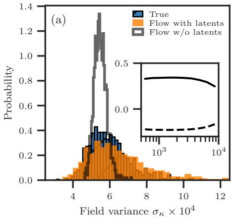

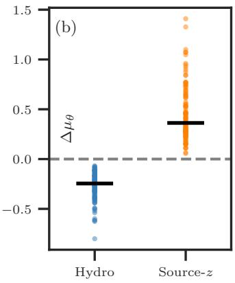

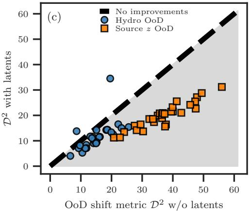  
FIG. 1. (a) Distribution of the field variance in the fourth tomographic bin measured from simulations (blue), a latent-enhanced flow model (orange), and a flow model without latent degrees of freedom (gray). Finite training data lead to variance shrinkage in the latent-free model, while the physics-informed latent dynamics recover a substantial fraction of the missing realization-level variability. The inset shows the fractional power-spectrum response to the dominant latent mode $\theta _ { \mathrm { a d d } }$ , evaluated at $\theta _ { \mathrm { a d d } } = \pm 1$ relative to the latent-free prediction. Hence, this latent direction acts primarily as an effective growth-amplitude modulation. (b) Shift of the inferred latent posterior mean between outof-distribution (OoD) and in-distribution (inD) analyses, $\Delta \mu _ { \theta } \equiv \mu ( \theta _ { \mathrm { a d d } } | \mathrm { O o D } ) - \mu ( \theta _ { \mathrm { a d d } } | \mathrm { i n D } )$ . Hydro OoD realizations systematically shift the latent variable toward negative values, whereas source-redshift OoD realizations shift it toward positive values. This demonstrates that the latent degree of freedom is actively utilized during field-level inference. (c) OoD shift metric $\mathcal { D } ^ { 2 ^ { \bullet } }$ obtained with and without latent degrees of freedom. Points below the diagonal correspond to improved agreement with the target OoD distribution. The latent-enhanced model consistently reduces the discrepancy for both hydro and source-redshift shifts, indicating improved robustness to model mismatch.

We next investigate how the latent variables are utilized during field-level inference. For each realization, we compare the posterior mean of the dominant latent mode between the in-distribution and out-of-distribution analyses, $\Delta \mu _ { \theta } \ \equiv$ $\mu ( \theta _ { \mathrm { a d d } } | \mathrm { O o D } ) - \mu ( \theta _ { \mathrm { a d d } } | \mathrm { i n D } )$ . As shown in Fig. 1(b), hydrodynamical realizations systematically shift $\theta _ { \mathrm { a d d } }$ toward negative values, whereas source-redshift shifts induce positive posterior shifts. These trends are consistent with the powerspectrum response shown in the inset of Fig. 1(a): hydrodynamical effects suppress lensing power relative to the gravityonly training set, while increasing the source redshift enhances the projected lensing signal. The coherent sign of $\Delta \mu _ { \theta }$ across all realizations therefore provides direct evidence that the latent degree of freedom is actively exploited by the inference procedure to absorb systematic discrepancies between the training and target distributions.

To quantify the impact of the latent corrections on OoD inference, we define an OoD shift metric

$$
\begin{array} { r l } & { \displaystyle \mathcal { D } ^ { 2 } = \sum _ { i } \frac { \Big ( R _ { i } - \hat { R } _ { i } \Big ) ^ { 2 } } { \mathrm { V a r } ( R _ { i } ) } , } \\ & { \displaystyle R _ { i } = \log ( P _ { i } ^ { \mathrm { t r u e , O o D } } / P _ { i } ^ { \mathrm { t r u e , i n D } } ) , } \\ & { \displaystyle \hat { R } _ { i } = \log ( P _ { i } ^ { \mathrm { p o s t , O o D } } / P _ { i } ^ { \mathrm { p o s t , i n D } } ) . } \end{array}\tag{2}
$$

where the index i runs over all tomographic pairs and ten logarithmic multipole bins in the range $5 0 0 \leq \ell \leq 1 0 ^ { 4 }$ . The metric compares the true OoD response with that inferred from the posterior distribution. Here, the reconstructed power spectrum is computed as the median of the power spectra evaluated from posterior samples. Because each OoD realization is generated from the same initial phases as its indistribution counterpart, the comparison can be performed on a realization-by-realization basis. Figure 1(c) shows $\mathcal { D } ^ { 2 }$ obtained with and without latent corrections. Points below the diagonal correspond to improved agreement with the true OoD response. For both hydrodynamical and source-redshift shifts, the latent-enhanced flow systematically moves the inferred power-spectrum response toward the true OoD direction, resulting in smaller values of $\mathcal { D } ^ { 2 }$ for most realizations. This demonstrates that the recovered latent degree of freedom is not merely increasing sample variance, but is actively utilized to correct model mismatch in field-level inference.

Taken together, these results show that variance shrinkage in simulation-trained generative models can be interpreted as a manifestation of missing effective degrees of freedom. By introducing physically motivated latent corrections to the generative dynamics, a substantial fraction of the missing variability can be recovered and leveraged to improve robustness against distribution shifts without requiring additional training simulations.

## DISCUSSION AND CONCLUSIONS

In this Letter, we have demonstrated that physics-informed latent corrections can recover a substantial fraction of the realization-level variability lost in simulation-trained generative models. The recovered latent degree of freedom is not only statistically meaningful but also actively utilized during field-level inference, leading to improved robustness against distribution shifts arising from both baryonic physics and source-redshift mismatches.

More broadly, our results suggest a general framework for improving simulation-trained generative models. Rather than treating variance shrinkage solely as a limitation of finite training data, it can be interpreted as a diagnostic of missing effective degrees of freedom in the learned generative dynamics. The missing degrees of freedom may then be identified through statistical discrepancies between simulations and model predictions and incorporated through physically motivated modifications of the generative process.

In the present work, we focused on variance shrinkage and found that the dominant recovered latent direction behaves as an effective growth-amplitude nuisance parameter. Importantly, this interpretation was not imposed a priori but emerged from a generic latent correction designed to recover missing variability. Our framework therefore provides a way to identify missing effective degrees of freedom directly from discrepancies between simulations and model predictions. Unlike a phenomenological amplitude parameter, the latent correction acts on the generative dynamics itself and naturally produces scale-dependent power-spectrum responses as in the inset of Fig. 1(a).

However, the covariance structure of weak-lensing observables is only partially recovered by the current model, indicating that additional latent directions may exist beyond the dominant amplitude mode. Determining which latent corrections are required to reproduce higher-order statistics and nontrivial covariance structures remains an open question. Since the latent corrections act directly on the generative dynamics, theoretical frameworks such as effective field theory may provide physically motivated guidance for constructing and interpreting such degrees of freedom.

Although our implementation is based on a continuous normalizing flow, the underlying idea naturally extends to diffusion and score-based models, whose generation processes are likewise governed by differential equations. In contrast, incorporating interpretable latent degrees of freedom into feedforward neural-network emulators remains considerably less straightforward, despite their computational efficiency. Developing such capabilities may therefore be an important direction for future scientific machine-learning applications.

Our results highlight a complementary relationship between physics and deep learning. Deep generative models efficiently learn the average behavior encoded in finite simulation datasets, whereas physically informed latent dynamics can recover part of the variability that is difficult to learn from data alone. We therefore anticipate that diagnosing missing variability and restoring it through physics-informed modifications of generative dynamics will provide a broadly applicable strategy for simulation-based field-level inference and scientific generative modeling.

MS is supported by JSPS KAKENHI Grant Numbers JP24H00221 and JP24H00215. MS also acknowledges research supports by JST BOOST, Japan Grant Number JP-MJBY24D8.

## SUPPLEMENTAL MATERIAL

This Supplemental Material provides additional details and validation tests for the generative modeling and field-level inference framework presented in the main text. We begin with a brief overview of weak-lensing convergence fields and the summary statistics used throughout this work, including power spectra and peak counts. These statistics provide complementary probes of the Gaussian and non-Gaussian information encoded in the lensing field.

We then describe the training data and the construction of the baseline flow model. The performance of the baseline model is assessed using multiple summary statistics, motivating the introduction of the latent-enhanced flow model. We present the latent-training procedure, quantify the improvements obtained from the latent variables, and investigate the relationship between the dominant latent modes and fluctuations in the power-spectrum amplitude.

The final part of this Supplemental Material focuses on field-level inference. We describe the noise-removal setup, likelihood function, and posterior-sampling procedure used throughout the paper. We first validate the inference pipeline us ing in-distribution data and subsequently examine its behavior on several out-of-distribution test sets. Finally, we compare the latent-enhanced model with an alternative inference framework based on an explicit amplitude-nuisance parameterization, $\kappa _ { \mathrm { m o d e l } }  \alpha \times \kappa _ { \mathrm { m o d e l } }$ , to clarify the physical interpretation of the dominant latent variable and its role in absorbing out-of distribution shifts

## I. WEAK-LENSING OBSERVABLES

Weak gravitational lensing is the distortion of images of distant galaxies by the gravitational potential of foreground large-scale structures. In the weak-lensing regime, the relevant projected density field is the convergence field κ, which can be expressed as

a weighted line-of-sight projection of the matter overdensity field [16],

$$
\kappa ( { \bf x } ) = \int d \chi W ( \chi ) \delta _ { \mathrm { m } } ( \chi , { \bf x } ) ,\tag{3}
$$

where x denotes the angular position, $\chi$ is the comoving radial distance, $\delta _ { \mathrm { m } }$ is the matter overdensity field, and $W ( \chi )$ is the lensing efficiency kernel determined by the source-redshift distribution. Because $\kappa$ traces the projected matter distribution, it statistical properties provide a powerful probe of cosmic structure formation.

The primary summary statistic considered in this work is the flat-sky convergence power spectrum. Defining the Fourier transform of the convergence field as

$$
\tilde { \kappa } ( \ell ) = \int d ^ { 2 } { \bf x } \kappa ( \pmb \theta ) e ^ { - i { \bf \ell } \cdot { \bf x } } ,\tag{4}
$$

the power spectrum is given by

$$
\left. \widetilde \kappa ( \ell ) \widetilde \kappa ^ { * } ( \ell ^ { \prime } ) \right. = ( 2 \pi ) ^ { 2 } \delta _ { \mathrm { D } } ( \ell - \ell ^ { \prime } ) P _ { \kappa } ( \ell ) ,\tag{5}
$$

where $ { \delta _ { \mathrm { D } } }$ is the Dirac delta function and $\ell = | \ell |$ . The power spectrum captures the Gaussian information of the convergence field. Throughout this work, it is measured over the range $5 0 0 \leq \ell \leq 1 0 ^ { 4 }$ using 10 logarithmically spaced bins.

To probe non-Gaussian information, we additionally consider peak counts. A peak is defined as a pixel whose convergence value exceeds those of its eight neighboring pixels. Peak counts are measured in 14 linearly spaced bins over the range $- 0 . 0 0 7 5 \le \kappa \le 0 . 0 9 7 5$ , roughly correponding to 0.5σ to 6.5σ-level peaks in our simulations. Since peak counts are sensitive to nonlinear structure formation and massive halos, they provide complementary information beyond that contained in the power spectrum.

## II. DATA AND MODEL

## A. Training dataset

To train our generative model, we use the publicly available weak-lensing simulations of Ref. [11], known as the κTNG suite. The suite contains 10000 realizations of $5 \times 5 \deg ^ { 2 }$ convergence maps for 40 source redshifts up to $z _ { s } = 2 . 6$ . Each realization is generated from a pair of parent simulations: a gravity-only run and a full-physics TNG300-1 run that includes baryonic processes such as star formation, gas cooling, chemical enrichment, and black-hole feedback [17]. Since the two runs share identical initia phases, baryonic effects can be quantified on a realization-by-realization basis.

We train the generative model to produce convergence maps in a $1 . 2 5 \times 1 . 2 5 \mathrm { d e g } ^ { 2 }$ field of view for four source-redshift bins centered at $z _ { s } = 0 . 5 0 6 , 0 . 7 4 9 , 1 . 0 3 4$ , and 1.302. This tomographic configuration is motivated by the Subaru Hyper Suprime-Cam survey [8] and forthcoming Stage-IV weak-lensing surveys such as Euclid and LSST. For training, we use the gravity-only simulations and degrade the original $1 0 2 4 ^ { 2 }$ maps to $2 5 6 ^ { 2 }$ pixels.

To remove large-scale modes that cannot be supported within the smaller training patches, we apply a Fourier-space filter

$$
W ( \ell ) = \exp \left[ - \left( \frac { \ell _ { \mathrm { c u t } } } { \ell } \right) ^ { 2 } \right] .\tag{6}
$$

The cutoff scale $\ell _ { \mathrm { c u t } }$ is chosen such that the variance of filtered and randomly cropped $5 \times 5 \deg ^ { 2 }$ Gaussian fields matches that of Gaussian fields generated directly in $\mathrm { a ~ 1 . 2 5 \times 1 . 2 5 \mathrm { d e g } ^ { 2 } }$ box. The Gaussian fields are generated using the mean power spectrum of the gravity-only κTNG simulations at the corresponding source redshift. This procedure approximately remove super-window fluctuations at the Gaussian level. The resulting values of $\ell _ { \mathrm { c u t } }$ are 393, 336, 367, and 425 for increasing source redshift.

We then apply the log-normal transformation

$$
y ( \mathbf { x } , z _ { s } ) = \ln \left[ 1 + \kappa ( \mathbf { x } , z _ { s } ) / q \right] ,\tag{7}
$$

where q sets an effective minimum value of $\kappa .$ We define $q = | \mathrm { M I N } [ \kappa ( \mathbf { x } , z _ { s } ) ] | + 0 . 0 0 1$ using all 10000 realizations. The transformed fields are subsequently standardized to improve training stability. The final training target consists of four-channel convergence maps with 64 64 pixels, where the channels remain strongly correlated through the common underlying large-scale structure.

## B. Normalizing flow

We employ a continuous normalizing flow (CNF) to generate four-channel convergence maps. The CNF learns a velocity field that transports samples from an isotropic Gaussian prior to the target non-Gaussian distribution. Following the flow-matching framework [10], we define a straight-line probability path between Gaussian noise and data,

$$
D ( { \bf x } , z _ { s } , t ) = ( 1 - t ) u _ { \mathrm { G } } ( { \bf x } , z _ { s } ) + t \tilde { y } ( { \bf x } , z _ { s } ) ,\tag{8}
$$

where $u _ { \mathrm { G } }$ is a Gaussian white-noise realization and $\tilde { y }$ denotes the log-normal transformed and standardized convergence field. The corresponding target velocity is

$$
v ( \mathbf { x } , z _ { s } , t ) = \tilde { y } ( \mathbf { x } , z _ { s } ) - u _ { \mathrm { G } } ( \mathbf { x } , z _ { s } ) .\tag{9}
$$

We parameterize the velocity field with a neural network $v _ { \phi } ( \mathbf { x } , z _ { s } , t )$ , where $\phi$ denotes the trainable parameters. To respect the statistical isotropy and homogeneity of cosmological fields, the network is built from spectral operators that depend only on the norm of the Fourier mode.

The input field is first lifted to 32 feature channels and processed through six residual blocks before being projected back to the four target channels. Each block consists of a spectral operator, a pointwise linear transformation in real space, feature-wise linear modulation (FiLM) [18], and a GeLU activation [19]. The spectral operator acts in Fourier space and performs both scaledependent filtering and channel mixing. The channel-mixing operation enables interactions among different spectral features and is intended to capture the effective mode couplings generated by nonlinear gravitational evolution.

Specifically, the Fourier kernel is expanded in a basis comprising 24 Gaussian filters centered at uniformly spaced Fourier scales together with a Lorentzian low-pass component, $\left[ 1 + \left( 2 \ell / \ell _ { \mathrm { f } } \right) ^ { 2 } \right] ^ { - 1 }$ , where $\ell _ { \mathrm { f } } ~ = ~ 2 8 8$ corresponds to the fundamental mode of the $1 . 2 5 \times 1 . 2 5 \mathrm { d e g } ^ { 2 }$ field of view. The spectral operator is represented as a weighted sum of these basis functions, with trainable channel-mixing matrices as coefficients. The resulting Fourier-space features are transformed back to real space and combined with a local pointwise residual branch. To improve training stability, the spatial mean of the output velocity field is removed at the end of each residual block.

The flow-time dependence is modeled through FiLM conditioning. The flow time t is encoded using a 16-dimensional sinusoidal embedding and mapped to a 32-dimensional latent vector e through a two-layer MLP. Each residual block is then conditioned according ${ \mathrm { t o } } \gamma ( e ) \odot h + \beta ( e )$ , where h denotes the block activations and $\gamma$ and $\beta$ are learned linear projections of e. The resulting network contains 532900 trainable parameters.

The network parameters are trained using the flow-matching objective [10], which minimizes the discrepancy between the neural-network velocity field $v _ { \phi }$ and the target velocity defined along the interpolation path of Eq. (8). In the end, we optimize the mean-squared error

$$
\mathcal { L } _ { \mathrm { F M } } = \left. \left| v _ { \phi } ( \mathbf { x } , z _ { s } , t ) - v ( \mathbf { x } , z _ { s } , t ) \right| ^ { 2 } \right. ,\tag{10}
$$

where the average is taken over training fields and randomly sampled flow times $t \sim U ( 0 , 1 )$ . We train the network using the Adam optimizer with a learning rate of $1 0 ^ { - 3 }$ and a batch size of 100. Training is performed for 1500 optimization steps. We confirmed that the flow-matching loss reaches a clear plateau by the end of training, indicating convergence of the optimization.

Generated maps are obtained by integrating the learned flow dynamics from Gaussian initial conditions at $t = 0$ to the target distribution at $t = 1$ . Unless otherwise stated, the ODE is solved using a first-order Euler method with 50 steps.

Figure 2 presents representative four-channel convergence maps generated by the baseline flow and compares the resulting power-spectrum and peak-count statistics with those of the simulations. Both the mean and realization-to-realization variance of these summary statistics are shown.

## C. Physics-motivated correction to the flow velocity

The baseline flow reproduces the average properties of the training simulations but exhibits variance shrinkage, leading to an underestimation of the realization-to-realization scatter in the lensing statistics. To recover the missing variability, we introduce latent corrections motivated by the coupling between long- and short-wavelength density fluctuations [13, 20].

Weak-lensing observables measured in a finite field of view are known to be affected by super-survey density modes that lie beyond the survey window [12, 21]. Through nonlinear gravitational evolution, these long-wavelength modes modulate the local growth of small-scale structures and generate additional realization-to-realization fluctuations. Since our training data

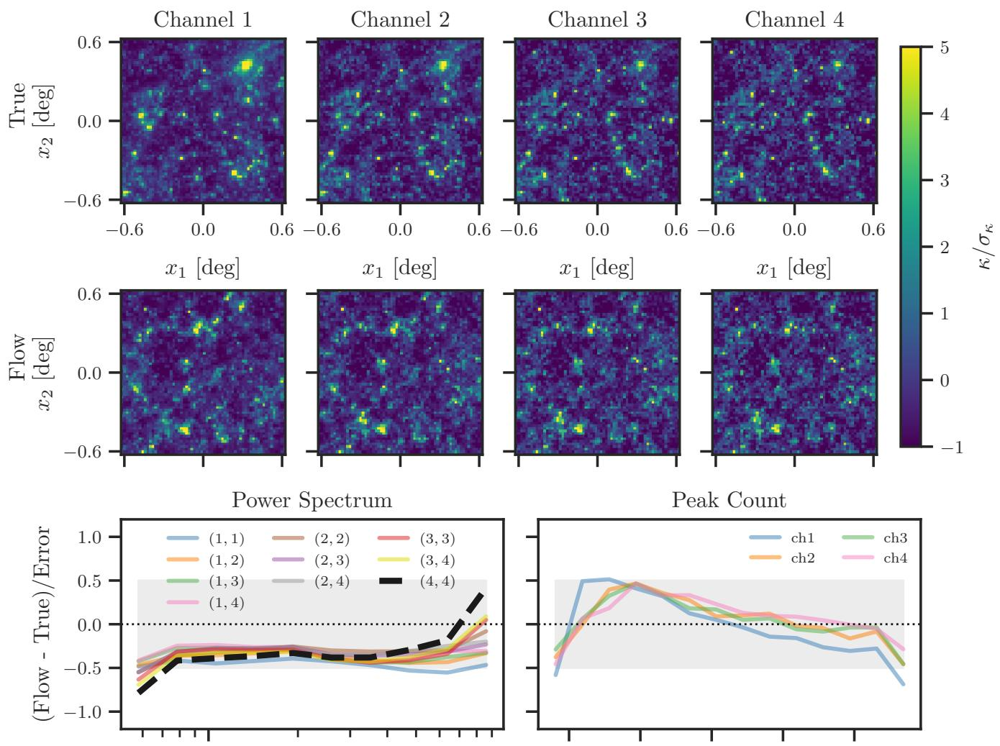

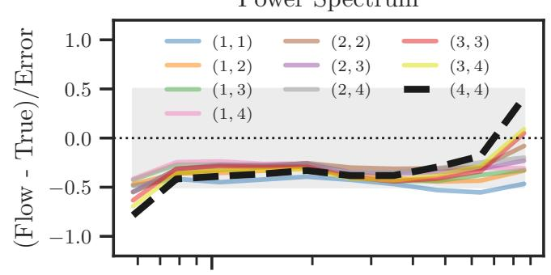

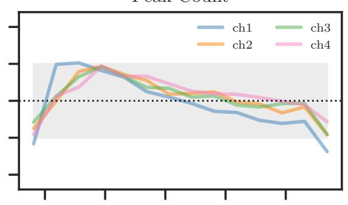

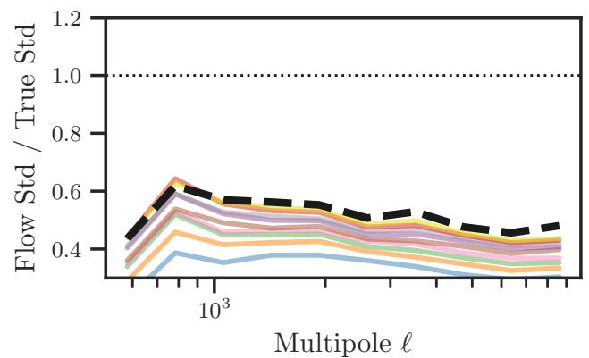

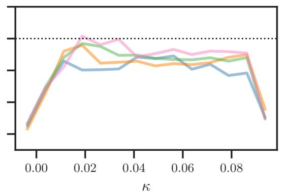  
FIG. 2. Validation of the baseline flow model. The first row shows a representative realization from the κTNG simulations, while the second row shows a sample generated by the baseline flow model. Field values are normalized by the standard deviation of each tomographic channel. The generated maps visually reproduce the non-Gaussian and highly skewed structures present in the simulations, and preserve the strong correlations across tomographic channels. The third row compares the mean power spectrum and peak-count statistics between the simulations and generated samples. The curves show $( \mathrm { F l o w } - \mathrm { T r u e } ) / \sigma _ { \mathrm { T r u e } }$ , where $\sigma _ { \mathrm { T r u e } }$ denotes the realization-to-realization scatter measured from the simulations. The gray band indicates agreement within 0.5σ. The flow model accurately reproduces the average power spectra of all tomographic combinations and also captures the peak-count statistics. Since peak counts are a representative non-Gaussian observable beyond the two-point function, this agreement demonstrates that the model successfully learns non-Gaussian information in addition to the power spectrum. The fourth row shows the ratio of realization-to-realization scatter, $\sigma _ { \mathrm { F l o w } } / \sigma _ { \mathrm { T r u e } } ,$ for the same summary statistics. Although the mean statistics are reproduced accurately, the scatter is systematically suppressed for both power spectra and peak counts. This variance shrinkage motivates the latent corrections introduced in Section II.B.

are constructed from random crops of larger simulations, different realizations effectively probe different local backgrounds.   
Consequently, exact statistical homogeneity and isotropy need not hold within each cropped field.

Motivated by this picture, we introduce latent variables that represent slowly varying large-scale modes. Rather than modeling arbitrary spatial fluctuations, the latent field is expanded using only the monopole and the lowest Fourier modes,

$$
\begin{array} { r l r } { \theta ( { \bf x } ) } & { = } & { \theta _ { 0 } + \theta _ { 1 } ^ { \mathrm { c } } \cos ( \ell _ { 0 , 1 } x _ { 1 } ) + \theta _ { 1 } ^ { \mathrm { s } } \sin ( \ell _ { 0 , 1 } x _ { 1 } ) } \\ & { } & { + \theta _ { 2 } ^ { \mathrm { c } } \cos ( \ell _ { 0 , 2 } x _ { 2 } ) + \theta _ { 2 } ^ { \mathrm { s } } \sin ( \ell _ { 0 , 2 } x _ { 2 } ) , \quad \quad } \end{array}\tag{11}
$$

where $\ell _ { 0 , 1 }$ and $\ell _ { 0 , 2 }$ correspond to the fundamental Fourier modes of the field. This expansion captures the leading departures from perfect homogeneity while introducing only a small number of additional degrees of freedom. The latent coefficients are sampled from an isotropic Gaussian prior and are treated as realization-level nuisance variables. During the flow evolution, the latent variables remain fixed, $\mathrm { d } \theta / \mathrm { d } t = 0$ , such that they modulate the generative dynamics of the convergence field without introducing additional latent dynamics of their own.

The latent variables modify the baseline velocity field through three physically motivated mechanisms. First, a slowly varying latent field $\theta _ { \mathrm { a d d } } ( \mathbf { x } )$ generates coherent shifts of the velocity field,

$$
v  v + \sigma _ { \mathrm { a d d } } t \operatorname { t a n h } ( \theta _ { \mathrm { a d d } } ) ,\tag{12}
$$

allowing the model to recover realization-to-realization fluctuations in the field mean.

Second, the velocity field is modulated by a time-dependent multiplicative factor,

$$
v  \alpha _ { t } v , \alpha _ { t } = \exp [ g ( t ) ( \sigma _ { \mathrm { t i m e } } \theta _ { \mathrm { m u l } } + \sigma _ { \mathrm { a d d 2 } } \sigma _ { \mathrm { a d d } } \theta _ { \mathrm { a d d } } ) ] ,\tag{13}
$$

where

$$
g ( t ) = \left[ 1 + \exp ( - 2 0 ( t - t _ { 0 } ) ) \right] ^ { - 1 } .\tag{14}
$$

This correction corresponds to realization-dependent modulation of structure growth and is the dominant source of variance recovery in practice.

Finally, we introduce a nonlinear tail correction,

$$
v  v + g ( t ) \sigma _ { \mathrm { t a i l } } \theta _ { \mathrm { m u l } } ^ { + } D \frac { D ^ { 2 } } { 1 + D ^ { 2 } } ,\tag{15}
$$

where $z _ { \mathrm { m u l } } ^ { + } \equiv \mathrm { m a x } ( z _ { \mathrm { m u l } } , 0 )$ and D is given by Eq. (8). This term preferentially enhances the evolution of high-density regions and mimics the amplification of short-scale growth expected from nonlinear coupling between super-survey and local modes.

The sigmoid gate $g ( t )$ activates the multiplicative and tail corrections only after a learnable flow time $t _ { 0 } ,$ reflecting the expectation that super-survey modulation becomes increasingly important as nonlinear structure formation develops.

All correction parameters $( \sigma _ { \mathrm { a d d } } , \sigma _ { \mathrm { a d d 2 } } , \sigma _ { \mathrm { t i m e } } , \sigma _ { \mathrm { t a i l } }$ and $t _ { 0 } )$ are determined by matching the distributions of field means and field variances between generated and simulated maps on a channel-by-channel basis. As discussed in the main text, the dominant recovered latent direction is found to behave as an effective growth-amplitude mode (also see Section II.E).

## D. Optimization of latent corrections

After training the baseline flow, all neural-network parameters are held fixed. We then optimize only the parameters governing the latent corrections described in Section II.C.

The optimization objective is designed to recover the realization-to-realization variability lost during training. In particular, we match the distributions of field means and field variances between generated maps and training simulations. The field kurtosi is included as a weak regularization term to suppress unphysical solutions.

For a given minibatch of simulated maps, latent-corrected samples are generated by integrating the flow dynamics. We then compute the mean, variance, and kurtosis of each realization and construct a differentiable soft-histogram loss based on the first two moments of their distributions,

$$
\mathcal { L } _ { \theta } = \mathcal { L } _ { \mathrm { m e a n } } + \mathcal { L } _ { \mathrm { v a r } } + 0 . 2 5 \mathcal { L } _ { \mathrm { k u r t } } ,\tag{16}
$$

where the mean and variance terms dominate the optimization. The loss compares the average and scatter of the generated and simulated realizations in each minibatch.

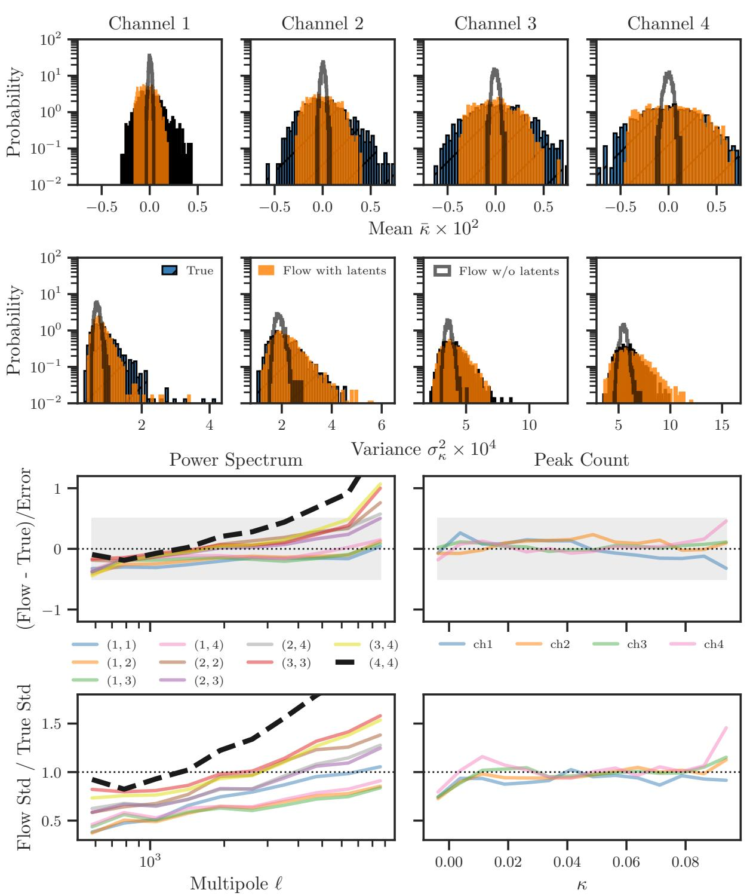  
FIG. 3. Performance of the latent-enhanced flow model. The first and second rows compare the distributions of the field mean and field variance for the four tomographic channels. Blue, orange, and gray histograms denote the simulations, the latent-enhanced flow model, and the baseline flow model, respectively. The third row compares the average power spectra and peak-count statistics. As in Fig. 2, the curves show $( \mathrm { F l o w } - \mathrm { T r u e } ) / \sigma _ { \mathrm { T r u e } } ,$ where $\sigma _ { \mathrm { T r u e } }$ is the realization-to-realization scatter measured from the simulations. The gray band indicates agreement within 0.5σ. The fourth row shows the ratio of the realization-to-realization scatter, $\sigma _ { \mathrm { F l o w } } / \sigma _ { \mathrm { T r u e } } ,$ , for the same summary statistics.

The latent parameters are optimized using the Adam optimizer with a learning rate of $1 0 ^ { - 2 }$ and a batch size of 40. We find that the optimization converges rapidly, with most of the improvement occurring within the first 10 optimization steps.

Model selection is performed independently from the training loss. After every optimization step, we evaluate the agreement

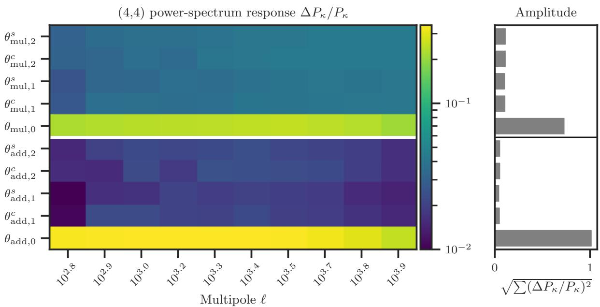  
FIG. 4. Fractional response of the (4, 4) convergence power spectrum to individual latent variables. For each latent parameter, the response is computed by setting the corresponding latent variable to unity while fixing all others to zero. The heat map shows the scale-dependent powerspectrum response, $\Delta P _ { \kappa } / P _ { \kappa }$ , as a function of multipole and latent direction. The right panel shows the integrated response amplitude defined in Eq. (19). Monopole latent modes dominate the response, with $\theta _ { \mathrm { a d d } , 0 }$ producing the largest effect. The response is visibly scale-dependent, indicating that the latent correction acts through modifications of the generative dynamics rather than a simple global amplitude rescaling

between generated and simulated maps using the one-dimensional Wasserstein distance of the field-mean, field-variance, and field-kurtosis distributions. The model yielding the smallest validation metric,

$$
\mathcal { M } = W _ { \mathrm { m e a n } } + W _ { \mathrm { v a r } } + 0 . 2 5 W _ { \mathrm { k u r t } } ,\tag{17}
$$

is retained as the final latent-corrected model. We verified that the resulting latent corrections substantially improve the distribu tions of field means and variances while preserving the higher-order properties of the generated weak-lensing maps.

Figure 3 summarizes the performance of the latent-enhanced model. The latent corrections substantially broaden the distributions of field means and field variances, bringing them into much better agreement with the target simulations. In particular, the variance distributions, which are strongly underestimated by the baseline flow, are recovered over all tomographic channels.

Importantly, the improved realization-to-realization variability does not significantly degrade the average statistical properties of the generated maps. The mean power spectra and peak-count statistics remain consistent with the simulations at approximately the 0.5σ level for most tomographic combinations and peak-height bins. Since peak counts probe non-Gaussian information beyond the two-point function, this agreement indicates that the latent corrections preserve the non-Gaussian structures learned by the baseline flow.

The increased variability is most clearly seen in the realization-to-realization scatter of summary statistics. The latentenhanced model exhibits a substantial increase in the power-spectrum variance, particularly at $\ell \gtrsim 3 0 0 0$ , where halo sample variance is expected to dominate [12]. Similarly, the scatter of peak counts is recovered over nearly the entire range of peak heights. These results demonstrate that the latent corrections successfully restore a significant fraction of the missing variability while maintaining the accuracy of the mean weak-lensing observables.

## E. Power-spectrum response of latent variables

To understand the physical role of the latent variables, we study the response of the convergence power spectrum to individual latent perturbations. For each latent parameter $\theta _ { i }$ , we set $\theta _ { i } = 1$ while keeping all remaining latent variables fixed at zero, and measure the fractional response

$$
\frac { \Delta P _ { \kappa } ( \ell ) } { P _ { \kappa } ( \ell ) } = \frac { P _ { \kappa } ( \ell ; \theta _ { i } = 1 ) } { P _ { \kappa } ( \ell ; \theta _ { i } = 0 ) } - 1 .\tag{18}
$$

Figure 4 shows the resulting responses for the (4, 4) tomographic power spectrum. We additionally define an integrated response amplitude,

$$
A _ { i } = \sqrt { \sum _ { \ell } \left[ \frac { \Delta P _ { \kappa } ( \ell ) } { P _ { \kappa } ( \ell ) } \right] ^ { 2 } } ,\tag{19}
$$

which quantifies the overall sensitivity of the power spectrum to each latent parameter.

A clear hierarchy is observed among the latent directions. The dominant response is generated by the monopole modes $\theta _ { \mathrm { a d d } , 0 }$ and $\theta _ { \mathrm { m u l , 0 } } .$ , with $\theta _ { \mathrm { a d d } , 0 }$ providing the largest contribution. This result motivates our focus on the dominant additive latent direction in the main text. The higher-order spatial modes produce significantly smaller responses, indicating that the missing variability is primarily associated with large-scale modulation of the generative dynamics.

Importantly, the responses are not perfectly scale-independent. The amplitude and shape of $\Delta P _ { \kappa } / P _ { \kappa }$ vary across multipoles, particularly for the dominant latent directions. Therefore, the latent corrections cannot be interpreted as a simple global rescaling of the generated fields. Instead, they modify the flow dynamics in a manner that naturally generates scale-dependent responses.

Although only the (4, 4) tomographic power spectrum is shown, the remaining tomographic combinations exhibit qualitatively similar behavior, with the monopole latent modes dominating the response and the overall scale dependence remaining largely unchanged.

## III. FIELD LEVEL INFERENCE

## A. Setup

To assess the impact of latent corrections on field-level inference, we generate mock observations from the κTNG simulations. Following the same preprocessing as used for training, we first apply the large-scale filtering described in Section II.A and then randomly crop $1 . 2 5 \times \bar { 1 . 2 5 } \mathrm { d e g } ^ { 2 }$ patches. Shape noise is subsequently added to each tomographic channel assuming an intrinsic ellipticity dispersion of $\sigma _ { e } ~ = ~ 0 . 2 6$ and galaxy number densities of (64, 80, 64, 32) arcmin−2. The resulting noise level is approximately 25% of that expected for the HSC survey and is chosen to test denoising performance down to small angular scales. The goal of the inference is to reconstruct the underlying noiseless convergence field from these noisy observations.

We perform Bayesian field-level inference using the Metropolis-adjusted Langevin algorithm (MALA) [22, 23] as imple mented in BlackJAX [24]. For a state vector q containing the convergence field and latent variables, the proposal distribution is

$$
\mathbf { q } ^ { \prime } = \mathbf { q } + \frac { \epsilon ^ { 2 } } { 2 } \nabla _ { \mathbf { q } } \log p ( \mathbf { q } | d ) + \epsilon \pmb { \eta } ,\tag{20}
$$

where $\pmb { \eta } \sim \mathcal { N } ( 0 , \mathbf { I } )$ and ϵ is the MALA step size. Throughout this work we adopt $\epsilon = 0 . 0 0 3$

The posterior distribution is constructed from a Gaussian likelihood and the flow prior,

$$
p ( \mathbf { q } | d ) \propto p ( d | \mathbf { q } ) p _ { \mathrm { { f l o w } } } ( \mathbf { q } ) ,\tag{21}
$$

where the flow prior includes the latent-corrected velocity field introduced in the main text. The corresponding CNF log-density is evaluated by integrating the divergence term along the flow trajectory, which is computed numerically using the Hutchinson trace estimator.

All analyses are performed using eight independent Markov chains. The initial latent variables are set to zero. To initialize the flow degrees of freedom, we randomly select convergence maps from the κTNG training set and integrate the flow dynamics backward from t = 1 to t = 0 to obtain the corresponding latent representation. Each chain is evolved for 30,000 burn-in samples followed by 30,000 production samples. During the production phase, posterior convergence maps are stored every 200 samples.

Convergence is monitored using the Gelman–Rubin statistic computed from the posterior density. For all analyses presented in this work, we obtain $\hat { R } < 1 . 0 5$ . The combined chains yield an effective sample size of approximately 600 posterior samples.

## B. In-distribution tests

## Visual comparisons

We first validate the field-level inference pipeline using in-distribution data generated from the same simulation suite used for training. Although these test realizations are drawn from the same underlying simulation set, they are generated using independent random crops and random seeds and therefore do not appear in the training data. The resulting validation set thus provides a non-trivial test of the model’s ability to generalize beyond the specific realizations used during training. Figure 5 shows a representative reconstruction obtained with the latent-enhanced flow prior.

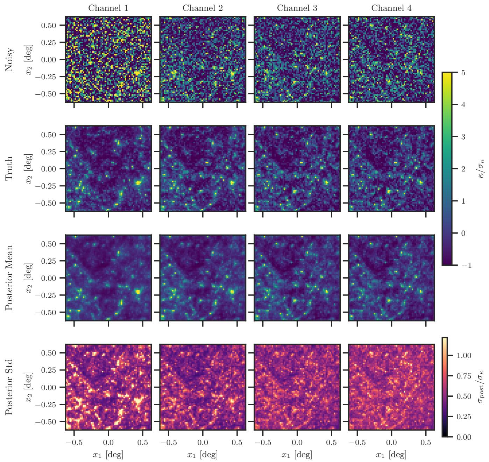  
FIG. 5. Example of field-level inference using the latent-enhanced flow prior. From top to bottom, the panels show the noisy observed convergence field, the underlying noiseless convergence field, the posterior mean reconstruction, and the posterior standard deviation. Columns correspond to the four tomographic source-redshift bins. Pixel values are normalized by the standard deviation of each tomographic channel. The first three rows share a common color scale, while the fourth row uses a separate color scale for the posterior standard deviation.

The first row displays the mock observed convergence maps after the addition of shape noise. At the adopted noise level, small-scale structures are largely obscured, making it difficult to visually identify the underlying matter distribution. The second row shows the corresponding noiseless convergence maps from the simulation. The third row presents the posterior mean reconstruction. Despite the substantial contamination by shape noise, the inferred convergences recover most of the prominent structures visible in the true maps. In particular, the strong correlations among tomographic channels are preserved by the reconstruction, indicating that the inference successfully exploits the shared large-scale structures across source-redshift bins.

As expected for a posterior mean estimator, the reconstructed fields are smoother than the true convergence maps. This smoothing results from averaging over the posterior volume and is most apparent in high-density regions where multiple field realizations contribute to the posterior. Nevertheless, the dominant structures and their tomographic correlations remain well reproduced.

The fourth row shows the posterior standard deviation. Regions containing high-convergence peaks exhibit noticeably larger uncertainties than the surrounding low-density regions. This behavior arises because localized nonlinear structures cannot be reconstructed uniquely from the noisy observations: while their presence is strongly supported by the data, their exact amplitudes and positions remain uncertain within the posterior distribution.

The visual agreement between the posterior mean and the true convergence maps demonstrates that the latent-enhanced flow prior provides a realistic reconstruction of the underlying weak-lensing field for in-distribution observations.

## Summary statistics

We next quantify the reconstruction accuracy using power-spectrum and peak-count statistics and compare the performance of baseline and latent-enhanced flow models.

Figure 6 shows the inferred summary statistics for a representative in-distribution realization. The upper panels compare the true noiseless statistics with the posterior predictive distributions obtained from the latent-enhanced flow prior. The posterior median is shown by the orange curves, the 68% posterior credible intervals are indicated by the blue shaded regions, and the gray dotted lines correspond to the statistics measured from noise-only realizations. The black error bars denote the realization to-realization scatter of the noiseless convergence field in the simulation ensemble. The lower panels show the normalized residuals,

$$
\Delta / \sigma = \frac { \mathrm { T r u t h - P o s t e r i o r ~ M e d i a n } } { \sigma _ { \mathrm { n o i s e l e s s } } } ,\tag{22}
$$

where $\sigma _ { \mathrm { n o i s e l e s s } }$ is the standard deviation of the noiseless convergence-field statistics.

The first row shows the power-spectrum reconstruction for the (1, 1) and (4, 4) tomographic power spectra. The posterior median power spectrum, computed from the ensemble of posterior samples, is systematically lower than the true power spectrum, particularly at high multipoles. This trend persists when replacing the posterior median with the posterior mean, indicating that it is not driven by an asymmetry of the posterior distribution.

For the (1, 1) auto-spectrum, the recovered power remains within approximately 1σ of the truth even in the noise-dominated regime. The (4, 4) spectrum exhibits deviations exceeding 2σ at $\ell \gtrsim 1 5 0 0$ . These results suggest that the likelihood provides only limited constraints on the smallest angular scales, causing the posterior to favor somewhat smoother realizations than the true convergence field. It should be emphasized, however, that the noiseless scatter adopted here provides a particularly stringent performance metric. In practical weak-lensing analyses, power-spectrum uncertainties are usually estimated from noisy realizations and are therefore substantially larger than the error bars shown in this figure.

The second row presents the corresponding peak-count statistics. Unlike the power spectrum, the posterior median closely follows the true noiseless peak counts over the entire range of peak heights. The reconstruction does not collapse toward the noise-only prediction despite the significant shape-noise contamination present in the observed maps. Instead, the inferred peak count distributions remain consistent with the underlying noiseless realization at roughly the 1σ level. Since peak counts probe highly non-Gaussian structures associated with nonlinear gravitational collapse, this agreement indicates that the field-level inference accurately recovers the dominant non-Gaussian features of the convergence field.

Overall, these results demonstrate that the latent-enhanced flow prior successfully reconstructs both Gaussian and non-Gaussian summary statistics in the in-distribution setting. We note that the posterior power spectra show a mild suppression at intermediate multipoles despite accurately reproducing the field variance and peak-count statistics. This effect appears only in the field-level inference and not in unconditional samples from the flow prior. A detailed investigation of its origin is beyond the scope of the present work.

## C. Out-of-distribution analyses

To evaluate the robustness of field-level inference under distribution shifts, we consider two types of out-of-distribution (OoD) data. The first, which we refer to as the Hydro OoD case, is generated from the full-physics simulations while keeping the sourceredshift configuration identical to that of the training data. This test probes the impact of baryonic physics that is absent from the gravity-only simulations used for training. The second, referred to as the Source-z OoD case, uses the same gravity-only simulations as the training set but slightly increases the source redshifts of all tomographic channels. The source redshifts are set to $( z _ { s } ^ { ( 1 ) } , z _ { s } ^ { ( 2 ) } , z _ { s } ^ { ( 3 ) } , z _ { s } ^ { ( 4 ) } ) = ( 0 . 5 5 2 , 0 . 8 0 3 , 1 . 0 9 7 , 1 . 3 7 5 )$ , corresponding to shifts of approximately 0.05–0.07 relative to the fiducial configuration. This level of mismatch is comparable to typical photometric-redshift uncertainties in current weak-lensing surveys.

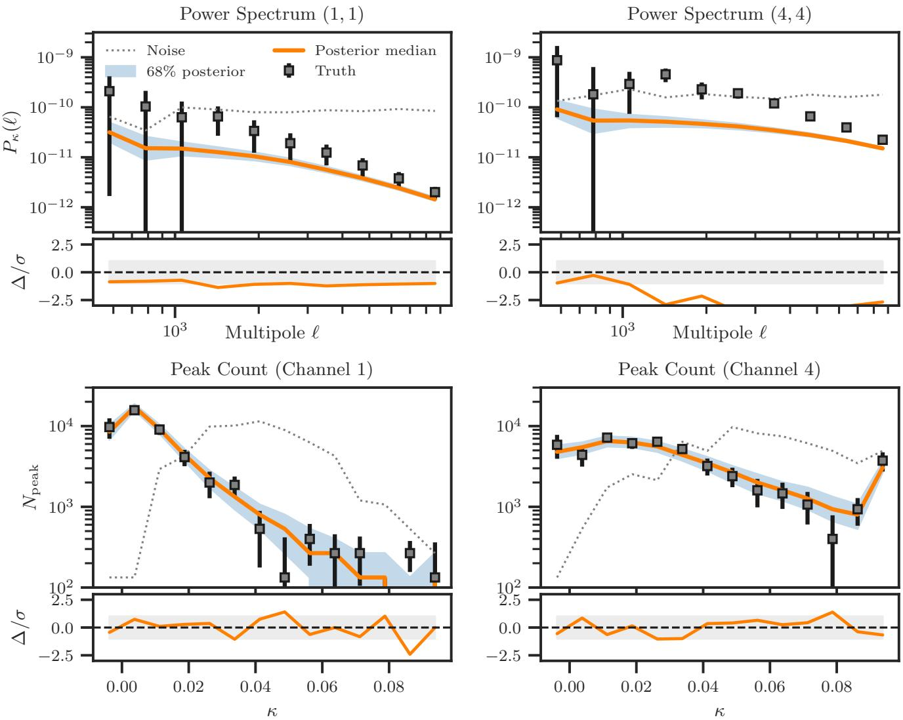  
FIG. 6. Summary-statistic validation of the latent-enhanced flow model for an in-distribution mock observation. The upper panels compar the true noiseless statistics (black symbols), posterior median (orange), 68% posterior credible interval (blue band), and the corresponding noise-only statistics (gray dotted curves). Black error bars indicate the realization-to-realization scatter of the noiseless convergence field. The lower panels show the normalized residuals, (Truth Posterior Median)/σ, where σ denotes the noiseless scatter. The gray band correspond to the 1σ region.

In both OoD tests, no retraining is performed. Instead, we apply the field-level inference pipeline using the model trained exclusively on the in-distribution data. The observational noise model, likelihood function, MALA sampling configuration, and all other inference settings are kept identical to those adopted in the in-distribution analyses. This setup enables a direc assessment of how latent corrections affect the robustness of field-level inference under realistic distribution shifts.

The main text quantifies OoD performance using an ensemble-level metric constructed from power-spectrum shifts. Here we examine the underlying responses directly by comparing the statistical differences between paired OoD and in-distribution realizations generated from identical initial phases.

Figure 7 shows the logarithmic power-spectrum shifts for the Hydro OoD and Source-z OoD tests. The simulation responses exhibit substantial realization-to-realization scatter, as indicated by the thin black curves. Nevertheless, the average shifts follow clear trends. In the Hydro OoD case, baryonic effects suppress the small-scale power spectrum, leading to a negative shift that becomes increasingly important at high multipoles. In contrast, increasing the source redshifts enhances the lensing signal and

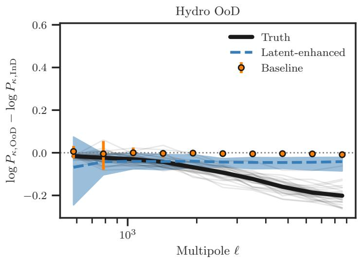

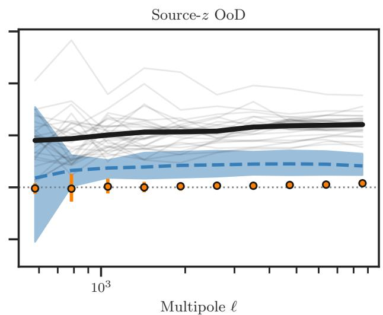

FIG. 7. Power-spectrum response to out-of-distribution shifts for the Hydro OoD (left) and Source-z OoD (right) tests. The plotted quantity is the logarithmic difference between the OoD and in-distribution auto power spectra in the first tomographic channel. Thin black curves show realization-level OoD shifts measured from the simulations, while the thick black curve shows the mean shift over 30 realizations. The blue dashed curve and shaded region denote the mean, minimum, and maximum shifts inferred using the latent-enhanced model. Orange points and error bars show the corresponding results obtained with the latent-free baseline model.  
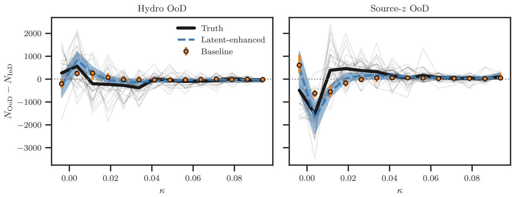  
FIG. 8. Same as Figure 7, but showing the OoD response of the peak-count statistic in the first tomographic channel.

produces a positive power-spectrum shift over most multipoles.

The latent-free baseline model captures only a small fraction of these responses. Its inferred shifts remain close to zero and exhibit little variability across realizations. In other words, the baseline model tends to generate a nearly deterministic response that is insufficient to reproduce the diversity present in the simulations. The latent-enhanced model behaves differently. Although the inferred shifts do not fully reproduce the amplitudes of the true OoD signals, they consistently move in the correct direction and exhibit substantially larger realization-to-realization variation. The latent variables therefore recover part of the missing flexibility required to respond to previously unseen distribution shifts.

Figure 8 repeats the same analysis using peak counts. The qualitative conclusions remain unchanged. The true OoD responses show considerable realization dependence, while the latent-free model predicts significantly weaker shifts. The latent-enhanced model produces larger responses and a broader range of predicted shifts, bringing the inferred peak-count statistics closer to those observed in the simulations. Although the current flow model does not fully reproduce the full scatter of the OoD responses, the latent corrections systematically improve agreement with both power-spectrum and peak-count observables.

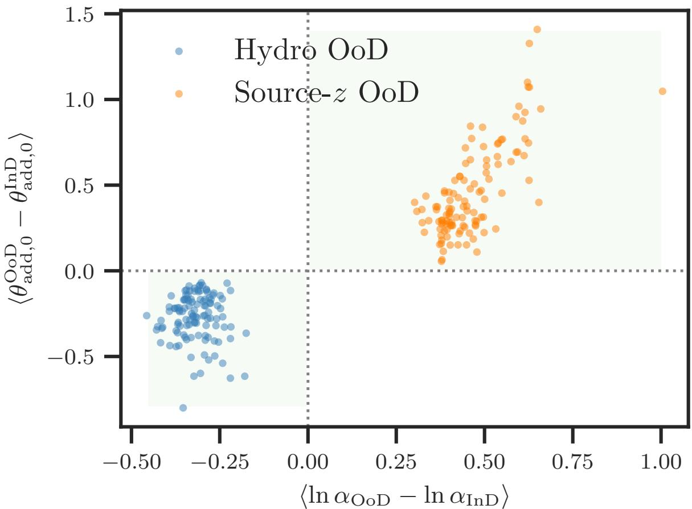  
FIG. 9. Comparison between the OoD-induced shifts of the effective amplitude parameter and the dominant latent variable. The horizontal axis shows the posterior-mean shift in log α inferred using the amplitude-nuisance model, while the vertical axis shows the posterior-mean shift in $\theta _ { \mathrm { a d d } , 0 }$ inferred using the latent-enhanced model. Points correspond to all realizations and tomographic channels for the Hydro OoD (blue) and Source-z OoD (orange) tests.

Taken together, these results support the interpretation proposed in the main text: latent corrections do not merely shift the mean prediction of the generative model, but also restore part of the realization-to-realization variability that is required to describe out-of-distribution data

## D. Amplitude nuisance parameter

To further interpret the role of the dominant latent variable, we compare the latent-enhanced flow model with a simple extension of the baseline flow model that introduces explicit amplitude nuisance parameters. The goal of this comparison is to determine whether the dominant latent direction, $\theta _ { \mathrm { a d d } , 0 }$ , effectively absorbs part of the amplitude uncertainty of the generative model during field-level inference.

Specifically, we consider a modified flow model of the form

$$
\kappa _ { \mathrm { m o d e l } } = \alpha \kappa _ { \mathrm { f l o w } } ,\tag{23}
$$

where $\kappa _ { \mathrm { H o w } }$ denotes the convergence field generated by the baseline flow model and α is a multiplicative amplitude parameter. We allow an independent amplitude parameter for each tomographic channel. Since α rescales the convergence field uniformly, this model generates a scale-independent modification of the power spectrum,

$$
P _ { \kappa } ( \ell )  \alpha ^ { 2 } P _ { \kappa } ( \ell ) ,\tag{24}
$$

and is therefore expected to absorb the lowest-order component of OoD shifts.

Field-level inference requires a prior on the amplitude parameters. We adopt a lognormal prior and assume that

$$
\log \alpha \sim \mathcal { N } ( 0 , \sigma _ { \alpha } ^ { 2 } ) ,\tag{25}
$$

with the amplitude parameters in different tomographic channels treated as independent. The prior width $\sigma _ { \alpha }$ is calibrated directly from the fiducial gravity-only simulations used to train the generative model. For each realization, we estimate an effective amplitude parameter through

$$
\log \hat { \alpha } = \frac { \sum _ { i } \frac { 1 } { 2 } \log \left[ \frac { P ( \ell _ { i } ) } { \langle P ( \ell _ { i } ) \rangle } \right] } { \sum _ { i } 1 } ,\tag{26}
$$

where $P ( \ell _ { i } )$ is the power spectrum of an individual realization and $\langle P ( \ell _ { i } ) \rangle$ denotes the ensemble-averaged power spectrum of the training set. The standard deviation of log ˆα over realizations is then adopted as the prior width. Applying this procedure to the fiducial gravity-only simulations yields $\sigma _ { \alpha } = ( 0 . 1 9 9 8 , 0 . 1 5 2 9 , 0 . 1 2 8 1 , 0 . 1 1 3 9 )$ for the first through fourth tomographic channels, respectively. These values define the Gaussian priors used for the amplitude-nuisance inference presented below.

We apply the amplitude-nuisance model described above to the same field-level inference framework used throughout this work. In addition to the convergence field, the four amplitude parameters α are sampled simultaneously with the flow degrees of freedom using the MALA sampler. The Gaussian likelihood, noise model, and all sampling settings are identical to those adopted in the baseline and latent-enhanced analyses. For each realization, we compute the posterior mean amplitudes in both the in-distribution and OoD cases and define the OoD-induced amplitude shift through

$$
\Delta \log \alpha = \langle \log \alpha _ { \mathrm { O o D } } \rangle - \langle \log \alpha _ { \mathrm { I n D } } \rangle .\tag{27}
$$

We then compare these amplitude shifts with the corresponding shifts inferred for the dominant latent variable $\theta _ { \mathrm { a d d } , 0 }$ in the latent-enhanced model. If the dominant latent mode acts as an effective amplitude degree of freedom, the OoD-induced shift inferred from the two approaches should exhibit a consistent response.

Figure 9 shows the posterior-mean shifts inferred from the two approaches. The horizontal axis corresponds to the shift in the effective amplitude parameter, while the vertical axis shows the corresponding shift in the dominant latent variable, $\langle \theta _ { \mathrm { a d d } , 0 } ^ { \mathrm { O o D } } - \theta _ { \mathrm { a d d } , 0 } ^ { \mathrm { I n D } } \rangle$ . Each point corresponds to one realization and one tomographic channel. We combine all four tomographic channels and all 30 realizations for both OoD tests.

A clear separation between the two OoD scenarios is observed. For the Hydro OoD case, both the effective amplitude parameter and the dominant latent variable shift toward negative values. This behavior is expected because baryonic feedback suppresses the small-scale lensing power spectrum relative to the gravity-only simulations used for training. In contrast, the Source-z OoD case produces positive shifts in both quantities, consistent with the increase in lensing amplitude generated by the higher source-redshift distribution.

Most importantly, all realizations lie either in the first quadrant or in the third quadrant. In other words, the inferred shifts in $\theta _ { \mathrm { a d d } , 0 }$ always have the same sign as the shifts inferred for the effective amplitude parameter. This behavior would be highly unlikely if the latent-enhanced model were responding randomly to OoD data. Instead, the result indicates that the latent variables consistently identify the direction of the discrepancy between the OoD observations and the in-distribution model and respond by shifting the posterior toward the expected OoD direction.

The existence of a coherent sign relationship does not imply that $\theta _ { \mathrm { a d d } , 0 }$ is identical to the amplitude parameter α. The amplitude-nuisance model generates a purely scale-independent rescaling of the power spectrum, whereas the latent response shown in Section II.E is generally scale dependent. Nevertheless, the strong alignment between the OoD responses demonstrates that the dominant latent variable absorbs, at least partially, the effective amplitude uncertainty of the generative model. Thi explains why the latent-enhanced field-level inference is able to produce OoD responses that are systematically closer to the simulation truth than those obtained with the latent-free baseline model.

\* masato.shirasaki@nao.ac.jp

[1] J. Jasche and B. D. Wandelt, Bayesian physical reconstruction of initial conditions from large scale structure surveys, Mon. Not. Roy. Astron. Soc. 432, 894 (2013), arXiv:1203.3639 [astro-ph.CO].

[2] F. Schmidt, G. Cabass, J. Jasche, and G. Lavaux, Unbiased Cosmology Inference from Biased Tracers using the EFT Likelihood, JCAP 11, 008, arXiv:2004.06707 [astro-ph.CO].

[3] F. Leclercq, Field-level inference in cosmology, (2025), arXiv:2509.13435 [astro-ph.CO].

[4] M. Shirasaki and S. Ikeda, Neural style transfer of weak lensing mass maps, The Open Journal of Astrophysics 7, 42 (2024), arXiv:2310.17141 [astro-ph.CO].

[5] J. Armijo, L. Thiele, and J. Liu, Replicating weak-lensing summary-statistic covariances with normalizing flows, Phys. Rev. D 114, 023567 (2026), arXiv:2601.20669 [astro-ph.CO].

[6] L. Doeser and J. Jasche, Learning the Universe: Posterior Reliability of Neural Generative Models in High-Dimensional Field-Level Inference of Cosmic Initial Conditions, (2026), arXiv:2606.10023 [astro-ph.CO].

[7] L. Thiele, Machine learning techniques for astrophysics and cosmology: Simulation-based inference, (2026), arXiv:2605.10719 [astroph.CO].

[8] M. M. Rau, R. Dalal, T. Zhang, X. Li, A. J. Nishizawa, S. More, R. Mandelbaum, H. Miyatake, M. A. Strauss, and M. Takada, Weak lensing tomographic redshift distribution inference for the Hyper Suprime-Cam Subaru Strategic Program three-year shape catalogue, Mon. Not. Roy. Astron. Soc. 524, 5109 (2023), arXiv:2211.16516 [astro-ph.CO].

[9] Z. Li, N. Kovachki, K. Azizzadenesheli, B. Liu, K. Bhattacharya, A. Stuart, and A. Anandkumar, Fourier neural operator for parametri partial differential equations, International Conference on Learning Representations (2021), arXiv:2010.08895 [cs.LG].

[10] Y. Lipman, R. T. Q. Chen, H. Ben-Hamu, M. Nickel, and M. Le, Flow matching for generative modeling, (2023), arXiv:2210.02747 [cs.LG].

[11] K. Osato, J. Liu, and Z. Haiman, κTNG: effect of baryonic processes on weak lensing with IllustrisTNG simulations, Mon. Not. Roy. Astron. Soc. 502, 5593 (2021), arXiv:2010.09731 [astro-ph.CO].

[12] M. Sato, T. Hamana, R. Takahashi, M. Takada, N. Yoshida, T. Matsubara, and N. Sugiyama, Simulations of Wide-Field Weak Lensing Surveys I: Basic Statistics and Non-Gaussian Effects, Astrophys. J. 701, 945 (2009), arXiv:0906.2237 [astro-ph.CO].

[13] M. Takada and W. Hu, Power Spectrum Super-Sample Covariance, Phys. Rev. D 87, 123504 (2013), arXiv:1302.6994 [astro-ph.CO].

[14] X. Li et al., Hyper Suprime-Cam Year 3 results: Cosmology from cosmic shear two-point correlation functions, Phys. Rev. D 108, 123518 (2023), arXiv:2304.00702 [astro-ph.CO].

[15] A. Cabezas, A. Corenflos, J. Lao, and R. Louf, Blackjax: Composable Bayesian inference in JAX (2024), arXiv:2402.10797 [cs.MS].

[16] M. Bartelmann and P. Schneider, Weak gravitational lensing, Phys. Rept. 340, 291 (2001), arXiv:astro-ph/9912508.

[17] A. Pillepich et al., First results from the IllustrisTNG simulations: the stellar mass content of groups and clusters of galaxies, Mon. Not. Roy. Astron. Soc. 475, 648 (2018), arXiv:1707.03406 [astro-ph.GA].

[18] E. Perez, F. Strub, H. de Vries, V. Dumoulin, and A. Courville, FiLM: Visual reasoning with a general conditioning layer, in Proceedings ofthe AAAI Conference on Artificial Intelligence, Vol. 32 (2018) arXiv:1709.07871 [cs.LG].

[19] D. Hendrycks and K. Gimpel, Gaussian error linear units (gelus), (2016), arXiv:1606.08415 [cs.LG].

[20] A. E. Bayer, J. Liu, R. Terasawa, A. Barreira, Y. Zhong, and Y. Feng, Super-sample covariance of the power spectrum, bispectrum, halos, voids, and their cross covariances, Phys. Rev. D 108, 043521 (2023), arXiv:2210.15647 [astro-ph.CO].

[21] A. Barreira, E. Krause, and F. Schmidt, Complete super-sample lensing covariance in the response approach, JCAP 06, 015, arXiv:1711.07467 [astro-ph.CO].

[22] J. Besag, Comments on “representations of knowledge in complex systems” by u. grenander and m. i. miller, Journal of the Royal Statistical Society: Series B 56, 591 (1994).

[23] G. O. Roberts, A. Gelman, and W. R. Gilks, Efficient metropolis jumping rules, Bayesian Statistics 5, 599 (1996).

[24] L. Bouvier, A. Corenflos, V. D. Bortoli, A. Durmus, et al., Blackjax: Composable bayesian inference in jax (2023), arXiv:2310.07879 [stat.CO].