# Semantic Caches for LLM Web Services Leave Their Error Budget Unspent

Hanshuai Cui   
School of Artificial Intelligence,   
Beijing Normal University, Beijing   
100875, China   
Institute of Artificial Intelligence and   
Future Networks, Beijing Normal   
University, Zhuhai 519087, China

Qianli Ma

Institute of Artificial Intelligence and Future Networks, Beijing Normal University, Zhuhai 519087, China

Zhiqing Tang Institute of Artificial Intelligence and Future Networks, Beijing Normal University, Zhuhai 519087, China

## Abstract

Web services built on large language models (LLMs) receive many paraphrases of earlier queries, which a semantic cache answers from stored responses. A reused answer can be wrong, so wrong answers must stay below a share � ofthe queries. Existing caches reuse above a fixed similarity threshold or, like vCache, learn a per-entry rule that bounds each query’s error by �. However, fixed thresholds break the budget on new streams, and per-entry rules need labels on every entry before reusing it. We find an unspent error budget, as vCache realizes only 12–55% of � on three public query streams. Surplus spends this budget where reuse is most likely correct. It ranks queries by a risk score shared across paraphrase clusters and opens risk bins as far as an audited error estimate allows. Free labels from every LLM call and a ledger of realized errors keep this threshold safe under drift. On five streams, including ORCAS search queries, Surplus holds � in every test cell, which no baseline does. On the shufled streams it serves 40% more hits than vCache, and its pooled hit rate beats the best baseline holding � in each cell by 4.10 points. In a vLLM testbed it cuts the mean latency by 31.59% at the highest load, against 23.67% for vCache.

## CCS Concepts

• Information systems → Web services; • Computer systems organization → Cloud computing.

## Keywords

semantic caching, LLM serving, error budget, Web search

## 1 Introduction

Web services now answer a growing share of user requests with large language models (LLMs), from answer boxes in Web search to chat assistants [13, 40, 43]. These requests repeat. Search engines have long cached results because a small set of queries recurs [6, 19, 48]. LLM services see the same questions again in new words, as in the 120,000 test queries we take from the ORCAS search log [15] through the SearchQueries benchmark [47]. A semantic cache sits in front of the model as one layer of the Web serving infrastructure [7, 29] and returns a stored answer when a new query is close enough to a cached one, which saves a full LLM call per hit (Figure 1). However, a paraphrase can ask something diferent, so every hit risks a wrong answer, and an operator needs to keep the share of queries that receive one within a budget � [47]. A semantic cache is thus part of serving LLMs on the Web, a topic of the Web Infrastructure and Agentic Systems track.

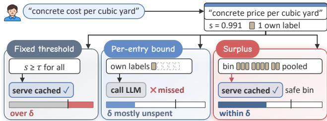  
Figure 1: Surplus serves this Web search paraphrase within �, while a fixed threshold overspends � and a per-entry bound calls the LLM. Its cached entry holds one label.

Existing semantic caches decide a hit in three ways. Caches with a fixed threshold reuse an answer whenever the embedding similarity exceeds a constant, as GPTCache [7] and later systems do [45, 55]. Per-entry caches learn a rule for each cached entry. vCache [47] fits a curve from similarity to correctness for every entry and explores with a probability that bounds each query’s error by �, and MVR-cache [37] keeps this rule on a learned multi-vector similarity. Global caches calibrate one threshold for all en- tries, either on a labeled prefix of the stream with conformal risk control [2, 4] or online [47].

However, these designs spend the error budget poorly, because they overlook how unevenly risk is spread over the queries of a stream. A fixed threshold ignores � altogether, so it lands on either side of the budget. A threshold calibrated on a prefix assumes that the prefix looks like the rest of the stream, which a growing cache breaks [9], so it overspends once the stream drifts (Figure 2c). A per-entry rule must collect labels on each entry before it reuses it and charges � to every query separately, so it stays safe but sends reusable queries to the LLM (Figure 2a and b). We measured these designs on three public query streams in shufled order, LmArena chat prompts, Classification prompts and SearchQueries from Web search, and on two drifting streams, and identify an unspent error budget. On the shufled streams 33–64% of vCache’s decisions meet an entry with fewer than four labels of its own, where it serves no hit (Figure 3a). Figure 1 shows a fixed threshold and a per-entry bound on one paraphrase, with a threshold of 0.97 and bars that give the error of each design on SearchQueries against � = 1%.

Two obstacles keep this budget unspent. (C1) How can a cache spend � on the queries most likely to be reused correctly without overspending it? Per-entry estimates are sparse, since most entries have only a few labels, while one global threshold treats a near- duplicate and a loose paraphrase alike and cannot tell how much error a looser threshold would add. (C2) How can it keep � when the stream drifts? Labels come only from the queries the cache sends to the LLM, which are exactly the ones it did not serve, so an error estimate built at one point of the stream goes stale and an optimistic model overspends before any check notices.

We propose Surplus, a semantic cache named for the error budget that per-entry caches leave unspent (Figure 4). First, to address C1, Surplus scores each query by the risk of its nearest entry with a model shared across clusters of paraphrases. It opens risk bins in order of risk only as far as an audited estimate of the served error stays below the budget. Second, for C2, every query that reaches the LLM labels its risk bin at no extra cost, and an error ledger compares the errors spent so far with the budget accrued so far and tightens the threshold as soon as they run ahead. We validate Surplus on these five streams against eight baselines and a hindsight oracle, and in a vLLM serving testbed. It holds � in every test cell, which no baseline does (§4.2). On the shufled streams its pooled hit rate is 5.71 points above vCache’s, which is 40% more hits, and 4.10 points above the best baseline that holds �. In serving it cuts the mean end-to-end latency at the highest load by 31.59% where vCache cuts 23.67% (§4.7). In summary, we make three contributions.

• We identify an unspent error budget. Per-entry caches such as vCache, run at the target budget, realize only 12–55% of it on public query streams (Appendix C), because they lack labels and charge every query separately. Fixed thresholds miss it in either direction.

• We design Surplus, a semantic cache that ranks queries by a shared risk score and opens them under a calibrated risk threshold, which addresses C1, and keeps the threshold safe under drift with free labels and an error ledger that back each other up, which addresses C2.

• Our evaluation spans search, chat and classification streams, including ORCAS search queries, with controls, capacity limits, judge and human reviews, generality checks and an end-to-end serving testbed.

## 2 Related Work and Motivation

## 2.1 Related Work

Semantic caches for LLM services. A semantic cache reuses the answer of a similar earlier query. GPTCache [7] and later systems serve above a fixed similarity threshold, with user-side caches in MeanCache [23], embedding ensembles [21], multi-turn context [55] and engineering reports [10, 45]. SISO [27] caches centroids with a dynamic threshold, and category-aware caching [51] sets thresholds per query category, but neither bounds the error. vCache [47] introduced a user-set error budget for semantic caches and learns a decision per entry. MVR-cache [37] keeps the vCache rule on a learned multi-vector similarity. Krites [49] promotes answers that an asynchronous LLM judge approves but sets no error budget. FreshCache [36] bounds the risk that a reused Web answer is stale rather than wrong. Eviction and admission work learns which entries to keep [5, 28, 32], attacks and defenses target the similarity key [31, 58, 59], and operational studies tune the embedding model [8]. Surplus changes none of these parts. It decides only when to serve, and we run it with other embeddings and under a least-recently-used (LRU) cap (§4.6).

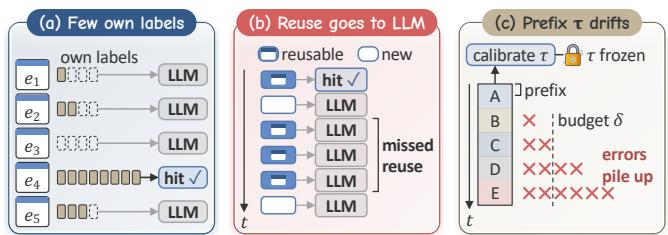  
Figure 2: Existing caches waste or break the error budget. (a) An entry serves hits only after four own labels. (b) Reusable queries still reach the LLM. (c) A prefix-calibrated threshold breaks the budget under drift.

Risk control and calibration. Selective prediction abstains in order to bound the risk [20], and conformal prediction and risk control turn held-out labels into a threshold with a finite-sample guaran- tee [2–4], which holds when the data are exchangeable [9]. Adaptive conformal inference [22], confidence sequences [26] and testing by betting [53] track a risk online, and calibration fixes a model’s scale [24]. Our Conformal baseline represents this family with a split conformal threshold calibrated on a prefix of the stream. Sur- plus difers in two ways. It calibrates a threshold on a ranked risk score with the labels that cache misses provide anyway, and it guards the realized error with a ledger instead of calibrating once.

Web caching and LLM serving. Web proxies and search engines cache documents and result pages under skewed query popular- ity [6, 11, 19, 48], and approximate caches reuse results for similar vector searches [38] and difusion prompts [1]. LLM serving systems batch, page and disaggregate inference [29, 42, 61, 62], reuse attention state across requests [56], and route queries to cheaper models [12, 33, 39]. These systems make each LLM call cheaper or pick the model, while a semantic cache removes the call and runs in front of them, as our vLLM testbed shows (§4.7).

## 2.2 What Per-Entry Caches Leave Unspent

We replay the three shufled test streams of §4.1 and the sorted stream ClassificationSorted at � = 1%. For vCache, its global dy- namic threshold (GD) and Conformal, we log every cache decision with its nearest entry and the labels that this entry holds.

Many decisions meet an entry with too few labels. vCache serves no hit while the nearest entry has fewer than four labels (Figure 2a), and 33–64% of its decisions fall there (Figure 3a). Evidence stays private to each entry, which motivates one risk score shared by all paraphrases of a query (§3.2).

Much of the budget is left unspent. vCache stays within � on the shufled streams but still sends reusable queries to the LLM (Figure 2b). A hindsight oracle that picks one threshold per entry with the labels known reaches at least four times its hit rate at the same budget (Figure 3b). Charging � to every query separately sends reusable queries to the LLM, which motivates one threshold that pools the budget over a stream (§3.3).

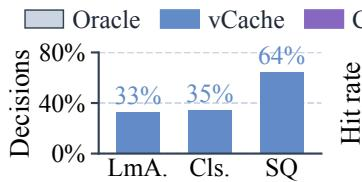

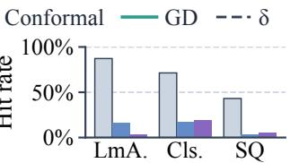

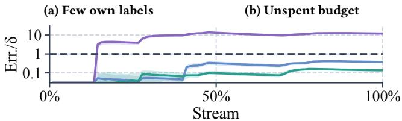  
(c) Drift on ClassificationSorted  
Figure 3: The three failures of Figure 2 measured at $\delta = 1 \%$ on the test streams LmA., Cls. and SQ.

A threshold calibrated once does not stay safe. Conformal explores on the first 10% of the stream and freezes a global threshold that holds � on that prefix. On ClassificationSorted, where the classes arrive in order (Figure 2c), its cumulative error ends at 11.38–12.53 times � over five seeds, while vCache and GD stay below � (Fig- ure 3c). A drifting stream needs labels and an error check that keep coming, which motivates the free labels and the error ledger of §3.4.

## 3 Surplus

Surplus turns the unspent error budget into hits. It keeps the embedding, the index and the LLM of a standard semantic cache and changes how it decides and learns (Figure 4). Each decision com-putes a risk score from a shared model (§3.2) and serves the query if its risk bin is open under the calibrated threshold (§3.3), and both address C1. Every LLM call then labels a bin and updates an error ledger (§3.4), which addresses C2.

## 3.1 Preliminaries

Semantic cache. Queries $q _ { 1 } , q _ { 2 } , . . .$ . arrive one at a time and are embedded by a fixed sentence encoder [46]. For query $q _ { t }$ the cache retrieves the most similar cached entry $e _ { t }$ with cosine similarity $s _ { t }$ and either serves its answer, a hit, or calls the LLM, a miss. On a miss the LLM’s answer also reveals whether the cached answer would have been correct, $c _ { t } \in \{ 0 , 1 \}$ , and the cache may insert $q _ { t }$ as a new entry. Let $h _ { t } \in \{ 0 , 1 \}$ mark a hit. Over a stream of� queries the cache must keep its error rate within the budget:

$$
\frac { 1 } { T } \sum _ { t = 1 } ^ { T } h _ { t } \left( 1 - c _ { t } \right) \ \leq \ \delta .\tag{1}
$$

As in vCache [47], � bounds the per-query error rate under the correctness signal that the cache receives on its misses. The hit rate $\begin{array} { r } { { \frac { 1 } { T } } \sum _ { t } h _ { t } } \end{array}$ is what the cache maximizes.

Per-entry decisions. vCache fits for every entry a logistic curve $\operatorname* { P r } ( c = 1 \mid s ) = \sigma ( \gamma ( s - \theta ) )$ to the labels observed on that entry, plus two pseudo-labels at $s = 0$ and $s = 1$ , and takes for each confidence level $1 - \epsilon$ a pessimistic correctness bound $\alpha _ { \epsilon } ( s )$ . It then serves a hit when a uniform draw � exceeds a threshold:

$$
\tau ( s ) = \operatorname* { m i n } _ { \epsilon } \Big [ 1 - { \frac { \delta } { 1 - \alpha _ { \epsilon } ( s ) } } \Big ] ,\tag{2}
$$

so that each query’s error probability is at most � when the curve family is right and the queries are i.i.d. An entry needs several labels of its own before $\tau < 1$ , and every query is charged � separately, whatever the risk of its neighbors.

## 3.2 Shared Risk Ranking

To address C1, Surplus first ranks queries by how likely their reuse is wrong, with evidence shared among paraphrases. When an LLM call confirms that a cached answer is correct for a query with similarity below an admission level �, Surplus inserts the query as a new entry of the same cluster of paraphrases, and a wrong answer starts a new cluster. Every label $\left( { { s _ { t } } , { c _ { t } } } \right)$ is stored with the entry and with its cluster, so a new paraphrase inherits the evidence of its siblings in the cluster.

Risk score. Surplus fits the logistic curve of (2) to an entry’s labels and to its cluster’s labels once each has enough of them, refits a curve only after its label count grows by a fraction $\rho ,$ and keeps the smaller of the two �. An entry whose cluster has no curve yet falls back to a prior pooled over all clusters with the same number of correct labels [18], in three strata of 0, 1 to 3, and 4 or more, computed with a budget share of 0.65�. The risk score is the curve’s pessimistic probability that the cached answer is wrong:

$$
r _ { t } = \frac { \delta _ { 0 } } { 1 - \tau ( s _ { t } ) } = \operatorname* { m i n } _ { \epsilon } \big [ 1 - \alpha _ { \epsilon } ( s _ { t } ) \big ] ,\tag{3}
$$

where $\delta _ { 0 }$ is � for an entry or cluster curve and 0.65� for the prior, whose � takes $\delta _ { 0 }$ in place of � in (2). Surplus uses $r _ { t }$ only to rank queries, and the threshold calibrates its scale from the labels.

## 3.3 Calibrated Risk Threshold

Surplus then decides how far down the ranking to serve. It places $r _ { t }$ in one of 48 logarithmic bins, $b _ { t } = \lfloor 1 2 ( \log _ { 1 0 } r _ { t } + 4 ) \rfloor$ clipped to [0, 47], and serves the query if $b _ { t } < J ,$ where � is the number of open bins. With probability $\phi$ such a query is audited instead, so Surplus calls the LLM and counts the query as a miss.

Served error per bin. Surplus counts the decisions $N _ { b }$ in each bin exactly, and the labels $n _ { b }$ and wrong labels $k _ { b }$ that each bin has received, all weighted by an exponential recency window of 3,000 decisions. A pooled factor $\kappa = ( \sum _ { b } k _ { b } + 1 ) / ( \sum _ { b } n _ { b } r _ { b } + 1 )$ , clipped to [0.2, 50], rescales the model risk of bin center $r _ { b }$ into a prior, and a Beta posterior with strength � gives the wrong rate of bin �:

$$
\hat { p } _ { b } = \frac { k _ { b } + m \operatorname* { m i n } ( 1 , \kappa r _ { b } ) } { n _ { b } + m } .\tag{4}
$$

Opening the first � bins serves $( 1 - \phi ) N _ { b }$ queries of each, so after � decisions it estimates the served error rate and its variance:

$$
E _ { j } = \frac { 1 - \phi } { T } \sum _ { b < j } N _ { b } \hat { p } _ { b } , \qquad V _ { j } = \frac { ( 1 - \phi ) ^ { 2 } } { T ^ { 2 } } \sum _ { b < j } \frac { N _ { b } ^ { 2 } \hat { p } _ { b } ( 1 - \hat { p } _ { b } ) } { n _ { b } + m + 1 } .\tag{5}
$$

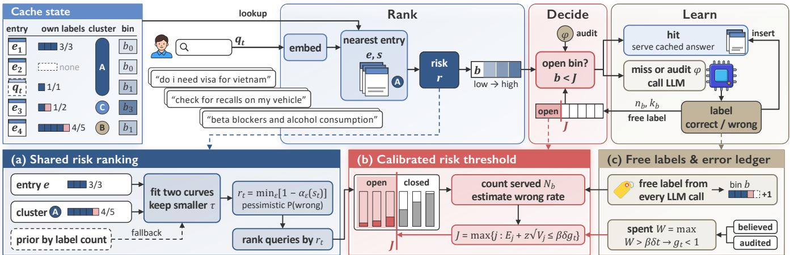  
Figure 4: Overview of Surplus. Each query gets a shared risk score and is served from an open risk bin or sent to the LLM, whose answers become free labels.

Threshold. Every 100 decisions Surplus sets �:

$$
J = \operatorname* { m a x } \Big \{ j : E _ { j } + z \sqrt { V _ { j } } \leq \beta \delta g _ { t } \Big \} ,\tag{6}
$$

where $\beta < 1$ keeps a margin, � widens the estimate to an upper bound and $g _ { t } \leq 1$ comes from the ledger of §3.4. � opens by at most three bins per update and closes at once, and the last bin opens in part when the bound leaves room.

Pooling the budget across queries is what spends it. When $\hat { p } _ { b }$ grows with �, opening bins in order of risk serves the most queries for a given error mass, so low-risk paraphrases carry the budget that per-query rules leave idle. The threshold needs no calibrated model, because $N _ { b }$ is exact and only the wrong rate per bin is estimated, from labels the cache collects anyway.

## 3.4 Free Labels and Error Ledger

To address C2, Surplus keeps the estimates of §3.3 current with free labels and checks the errors it actually spends with an error ledger. Every decision that reaches the LLM, an audit or a query in a closed bin, reveals $c _ { t }$ for the nearest entry and adds a free label to the bin of $r _ { t }$ at no extra LLM cost. Closed bins therefore keep receiving labels, so Surplus can open them as soon as their wrong rate falls, and the recency window lets $\hat { p } _ { b }$ follow the stream as it drifts.

Error ledger. Surplus tracks the errors it has spent in two ways, the believed errors $\begin{array} { r } { W _ { t } ^ { \mathrm { l e d } } \ = \ \sum _ { i \leq t , h _ { i } = 1 } \hat { p } _ { b _ { i } } } \end{array}$ and the audit estimate $\begin{array} { r } { W _ { t } ^ { \mathrm { a u d } } = \frac { 1 - \phi } { \phi } A _ { t } , } \end{array}$ , where $A _ { t }$ counts the audited queries whose cached answer was wrong. With �� the larger of $W _ { t } ^ { \mathrm { l e d } }$ and $W _ { t } ^ { \mathrm { a u d } }$ , the ledger sets the factor:

$$
g _ { t } = \mathrm { c l i p } \Big ( 1 + \frac { \beta \delta t - W _ { t } } { \beta \delta H } , ~ g _ { \mathrm { m i n } } , ~ g _ { \mathrm { m a x } } \Big ) ,\tag{7}
$$

where the horizon � sets how fast $g _ { t }$ reacts and $g _ { \mathrm { m i n } }$ and $g _ { \mathrm { m a x } }$ bound it, so whenever the spent errors run ahead of the accrued budget $\beta \delta t , ~ g _ { t }$ drops below one and (6) closes bins. The audit estimate needs no model and no stationarity.

Proposition 1. If each query in an open bin is audited with probability � independently ofthe past, then $W _ { t } ^ { \mathrm { a u d } }$ minus the number of wrong answers served up to � is a martingale with mean zero, on any stream order.

Proof. The proof is an instance of inverse probability weight ing [25]. Let $X _ { i } \in \{ 0 , 1 \}$ mark that the �-th query in an open bin has a wrong cached answer and $U _ { i } ~ \in ~ \{ 0 , 1 \}$ that it is audited. Then $\mathrm { P r } ( U _ { i } \ = \ 1 \ \mid \ { \mathcal F } _ { i - 1 } , X _ { i } ) \ = \ \phi ,$ , where $\mathcal { F } _ { i - 1 }$ is everything ob-served before the draw. The served wrong answers up to � are $\begin{array} { r } { S _ { t } = \sum _ { i \leq t } \bigl ( 1 - U _ { i } \bigr ) X _ { i } } \end{array}$ and the audit estimate is $\begin{array} { r } { W _ { t } ^ { \mathrm { a u d } } = \frac { 1 - \phi } { \phi } \sum _ { i \leq t } U _ { i } X _ { i } . } \end{array}$ With $M _ { t } = W _ { t } ^ { \mathrm { a u d } } - S _ { t }$ , each step satisfies:

$$
\mathbb { E } [ M _ { t } - M _ { t - 1 } \mid \mathcal { F } _ { t - 1 } , X _ { t } ] = X _ { t } { \Big ( } { \frac { 1 - \phi } { \phi } } \phi - ( 1 - \phi ) { \Big ) } = 0 ,
$$

so $M _ { t }$ is a martingale with $M _ { 0 } = 0$ and $\mathbb { E } [ M _ { t } ] = 0$ . The variance of $M _ { t }$ grows with the number of wrong answers rather than with the stream length �. □

The ledger reacts to realized errors, not to the model. Conformal and per-entry rules trust a model fitted earlier, so a drift that makes the model optimistic overspends silently. The ledger compares two separate views of the spent errors with the budget accrued so far, and a stream that turns risky closes the threshold before the errors can pile up.

## 3.5 Cost

A decision adds one bin lookup to the nearest-neighbor search, the controller solves (6) over 48 bins every 100 decisions, and curves are refitted lazily. Audits cost one LLM call for a share $\phi$ of the would-be hits and are counted as misses in every result we report. Algorithm 1 gives the full loop, and Table 4 in Appendix B lists all settings. The prior budget share, the strata and the admission level come from the shared risk model, and the threshold starts nearly closed, at the bins below a tenth of $\beta \delta$

Table 1: Test hit rate (%) per stream and budget.
<table><tr><td></td><td></td><td colspan="7">Shuffled streams</td><td colspan="8">Drifting streams</td><td></td></tr><tr><td></td><td></td><td colspan="3">LmArena</td><td colspan="3">Classification</td><td colspan="3">SearchQueries</td><td colspan="3">ClassificationSorted</td><td colspan="3">Combo</td><td></td><td>Worst</td></tr><tr><td>Method</td><td>δ(%)</td><td>0.5</td><td>1</td><td>2</td><td>0.5</td><td>1</td><td>2</td><td>0.5</td><td>1</td><td>2</td><td>0.5</td><td>1</td><td>2</td><td>0.5</td><td>1</td><td>2</td><td>Held</td><td>err./δ</td></tr><tr><td>GPTCache 0.97 [7]</td><td></td><td>65.612</td><td>65.612</td><td>65.612</td><td>15.947</td><td>15.947</td><td>15.947</td><td>23.197</td><td>23.197</td><td>23.197</td><td>16.260</td><td>16.260</td><td>16.260</td><td>0.324</td><td>0.324</td><td>0.324</td><td>9/15</td><td>10.326</td></tr><tr><td>GPTCache 0.98 [7]</td><td></td><td>51.507</td><td>51.507</td><td>51.507</td><td>15.411</td><td>15.411</td><td>15.411</td><td>16.988</td><td>16.988</td><td>16.988</td><td>15.613</td><td>15.613</td><td>15.613</td><td>0.251</td><td>0.251</td><td>0.251</td><td>9/15</td><td>7.990</td></tr><tr><td>GPTCache 0.99 [7]</td><td></td><td>32.335</td><td>32.335</td><td>32.335</td><td>14.803</td><td>14.803</td><td>14.803</td><td>8.558</td><td>8.558</td><td>8.558</td><td>14.933</td><td>14.933</td><td>14.933</td><td>0.135</td><td>0.135</td><td>0.135</td><td>10/15</td><td>5.173</td></tr><tr><td>Static [7]</td><td></td><td>13.534</td><td>13.534</td><td>32.335</td><td>27.823</td><td>33.565</td><td>40.944</td><td>8.558</td><td>16.988</td><td>23.197</td><td></td><td></td><td></td><td></td><td>1</td><td>一</td><td>0/9</td><td>2.706</td></tr><tr><td>Krites [49]</td><td></td><td>13.534</td><td>13.534</td><td>37.819</td><td>23.381</td><td>35.897</td><td>35.897</td><td>13.145</td><td>18.651</td><td>25.615</td><td>14.200</td><td>14.200</td><td>14.973</td><td>0.058</td><td>0.058</td><td>0.135</td><td>6/15</td><td>2.858</td></tr><tr><td>SISO [27]</td><td></td><td>3.548</td><td>5.563</td><td>7.790</td><td>27.823</td><td>33.565</td><td>40.944</td><td>4.182</td><td>4.182</td><td>9.681</td><td>10.449</td><td>10.449</td><td>12.538</td><td>0.164</td><td>0.164</td><td>0.269</td><td>7/15</td><td>2.706</td></tr><tr><td>GD [47]</td><td></td><td>6.590</td><td>13.961</td><td>42.330</td><td>1.031</td><td>2.048</td><td>4.060</td><td>1.153</td><td>2.328</td><td>4.592</td><td>3.112</td><td>6.116</td><td>11.124</td><td>0.960</td><td>1.952</td><td>3.940</td><td>6/15</td><td>2.180</td></tr><tr><td>Conformal [4]</td><td></td><td>1.663</td><td>3.625</td><td>9.406</td><td>8.076</td><td>19.208</td><td>26.432</td><td>2.323</td><td>5.370</td><td>10.878</td><td>49.339</td><td>61.765</td><td>72.804</td><td>0.411</td><td>0.974</td><td>2.042</td><td>12/15</td><td>18.049</td></tr><tr><td>vCache [47]</td><td></td><td>8.374</td><td>16.350</td><td>30.494</td><td>9.819</td><td>17.424</td><td>33.701</td><td>1.893</td><td>3.481</td><td>6.556</td><td>19.571</td><td>38.886</td><td>79.530</td><td>3.964</td><td>7.575</td><td>15.533</td><td>14/15</td><td>1.430</td></tr><tr><td>Surplus</td><td></td><td>22.141</td><td>25.507</td><td>32.438</td><td>17.472</td><td>25.483 33.938</td><td></td><td>3.791</td><td>6.877</td><td>11.859</td><td>25.711</td><td>36.370</td><td>47.708</td><td>5.221</td><td>9.493</td><td>17.244</td><td>15/15</td><td>0.840</td></tr></table>

Gray numbers mark cells where a method breaks � in some run.

Algorithm 1 Surplus for one query ��   
1: $e _ { t } , s _ { t } \gets$ nearest cached entry and its similarity   
2: � ← min(�entr , �cluster ) by (2), or the stratified prior   
3: $r _ { t } \gets \delta _ { 0 } / ( 1 - \tau ) , b _ { t } \gets \lfloor 1 2 ( \log _ { 1 0 } r _ { t } + 4 ) \rfloor , N _ { b _ { t } } \gets N _ { b _ { t } } + 1$   
4: if $b _ { t } < J$ and a draw � $\iota > \phi$ then   
5: serve the answer of $e _ { t } , W ^ { \mathrm { l e d } } \gets W ^ { \mathrm { l e d } } + \hat { p } _ { b _ { t } }$   
6: else   
7: call the LLM, observe $c _ { t } , n _ { b _ { t } } \gets n _ { b _ { t } } + 1 , k _ { b _ { t } } \gets k _ { b _ { t } } + 1 - c _ { t }$   
8: if $b _ { t } < J$ and $c _ { t } = 0$ then $A  A + 1$   
9: update the entry and cluster labels, insert �� by the admission rule   
10: end if   
11: if � mod 100 = 0 then   
12: apply the recency window to the counts, update � and �ˆ� by (4), ��   
by (7) and � by (6)   
13: end if

## 4 Evaluation

## 4.1 Setup

Streams. We use the three streams ofthe vCache benchmark [47]. LmArena holds user prompts of Chatbot Arena [13] and LLM para-phrases of them, Classification holds classification prompts, and SearchQueries holds Web search queries from ORCAS [15]. Cor-rectness labels come from the benchmark, equivalence classes for LmArena and SearchQueries and the answer string for Classification. Each stream is split by a hash of the prompt into 20% for valida- tion, where methods with free settings pick them, and 80% for test, which is 51,037, 36,000 and 120,000 queries. We replay five random orders of each shufled stream, and the drifting streams Classifica- tionSorted, with 45,000 queries sorted by class, and Combo, with 27,500 queries that mix several datasets [47], in the benchmark’s own order with five seeds.

Protocol. A method holds � in a cell if its error rate is at most � in every run of that cell, with $\delta \in \{ 0 . 5 \% 1 \% 2 \% \}$ . Diferences are paired per query, and 95% confidence intervals (CIs) come from a nested bootstrap [17] that resamples runs and then queries. A pooled gain averages the paired diferences over the cells of each test order and then over the orders. A diference is significant when its CI excludes zero. In Table 1, a dash marks a setting not run. Bold and underline mark the best and second best value among the methods that hold � in each column. The last two columns count the cells a method holds and give its worst error over � in any run.

Baselines. GPTCache [7] serves above a fixed similarity of 0.97, 0.98 or 0.99, and Static serves above the threshold with the most validation hits whose error stays within � in every validation order, so it has no entry on the drifting streams, which are replayed whole without a validation split. Krites [49] serves above a high threshold and, below it, reuses entries whose answer an asynchronous judge has approved, with the benchmark labels as the judge. SISO [27] serves from centroids of similar queries above a threshold. GD is the global dynamic threshold of vCache [47], and Conformal explores on the first 10% of the stream and freezes the threshold of split conformal risk control [2, 4]. vCache [47] is reimplemented from its oficial code, and MVR-cache [37] runs from its own code in §4.6. Appendix A gives the answers, embeddings and index of each stream, the grid and pick of every baseline and the serving testbed.

## 4.2 Main Results

Surplus holds the budget in every test cell. It stays within � in all runs ofall cells with a worst error of0.840 times �, while every other method in Table 1 breaks it in some cell, shown in gray. vCache breaks it in one cell, and Conformal breaks it by up to 18.049 times on ClassificationSorted.

Surplus reuses more than every baseline that holds the budget on average. Pooled over the shufled streams it adds 5.71 points over vCache and 4.10 points over the best baseline that holds � in each cell (Table 1 and Table 8). It is also significantly above 71 of the 73 baseline cells that hold � (Table 1). Table 8 in Appendix C lists the best baseline that holds � in each cell and the gain of Surplus over it with its 95% CI. The largest gain is 31.45 points over GPTCache 0.97 on ClassificationSorted at $\delta = 2 \%$

Surplus beats every baseline that holds the budget on the shufled streams and Combo. In every cell of these four streams, Surplus has a higher hit rate than every baseline that holds � there (Table 1).

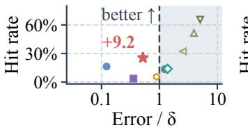  
(a) LmArena

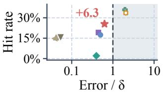  
(b) Classification

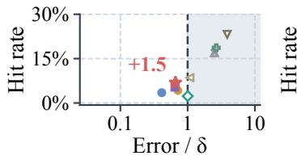  
(c) SearchQueries

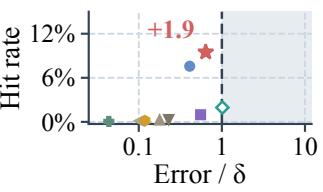  
(d) Combo  
Figure 5: Test hit rate against the share of � spent at $\delta = 1 \% ,$ one marker per method of Table 1.

Table 2: Hit-rate change in points when parts of Surplus are removed, pooled over shufled or drifting streams, and the worst error over $\delta ,$ where values above 1 break � and dashes mark streams not run.
<table><tr><td></td><td colspan="2">Hit change</td><td colspan="2">Worst err./δ</td></tr><tr><td>Variant</td><td>Shuffled</td><td>Drifting</td><td>Shuffled</td><td>Drifting</td></tr><tr><td>w/o cluster sharing</td><td>-2.82</td><td>一</td><td>0.710</td><td></td></tr><tr><td>w/o stratified prior</td><td>-0.645</td><td>一</td><td>0.722</td><td>一</td></tr><tr><td>w/o admission</td><td>-1.34</td><td>+5.72</td><td>0.693</td><td>0.680</td></tr><tr><td>w/o free labels</td><td>-0.900</td><td>+0.137</td><td>0.733</td><td>0.816</td></tr><tr><td>w/o ledger</td><td>+0.412</td><td>+1.45</td><td>0.765</td><td>0.924</td></tr><tr><td>w/o free labels &amp; ledger</td><td></td><td>+1.50</td><td>一</td><td>1.227</td></tr><tr><td>w/o threshold, full refit</td><td>-2.78</td><td>+4.81</td><td>1.015</td><td>2.294</td></tr><tr><td>w/o threshold</td><td>-2.79</td><td>+4.93</td><td>1.022</td><td>2.833</td></tr><tr><td>Surplus</td><td>0.000</td><td>0.000</td><td>0.736</td><td>0.840</td></tr></table>

Surplus spends the budget others leave. At � = 1% on these four streams, most baselines that hold � spend less than half of it, and ev- ery method that reuses more than Surplus breaks it (Figure 5). Each marker gives a method’s mean error over � across runs. Methods right of the dashed line break � on average, and a hollow marker breaks it in some run.

Surplus leads at every budget on four streams. On a finer grid of five budgets, Surplus holds � at all 20 points of these four streams and lies above the best baseline that holds � at each point (Figure 6). Pooled over the shufled streams its lead is 4.32 points (Table 8), and it is largest at tight budgets on LmArena.

## 4.3 Where the Gain Comes From

Shared evidence turns sparse entries into hits. Pooled over the shufled streams, Surplus serves hits from entries with no label of their own and with one to three labels, where vCache serves none (Figure 7a). Without cluster sharing the hit rate drops by 2.82 points, and without the stratified prior or free labels it also drops (Table 2). Every entry is sparse early in a stream, and Surplus starts reusing earlier than vCache. In the first 2,000 queries ofeach shufled stream it already serves more hits than vCache, and it stays ahead in most later windows (Figure 8).

The calibrated threshold is what keeps the budget. Two controls keep the shared risk model of Surplus but use vCache’s rule (2) in place of the threshold, with the lazy refit of Surplus or with a refit at every label. Both spend � per query and break � on the drifting streams, by up to 2.833 times (Table 2). On ClassificationSorted the lazy-refit control climbs above � as the classes change, while Surplus stays below it (Figure 7b).

Free labels and the ledger back each other up. Removing either one keeps � on both drifting streams, while removing both breaks � on ClassificationSorted with a worst error of 1.227 times � (Table 2).

## 4.4 Web Search Queries

We split the SearchQueries test stream, which comes from ORCAS search logs, by the size of each query’s paraphrase class and by query length, and count the correct hits that each cache serves per bucket at $\delta = 1 \% ( \mathrm { F i g u r e } 9 ) ,$ ).

Reuse concentrates in popular paraphrase classes and longer queries. Queries whose class has 20 or more members in the stream are 96% reusable, and there Surplus serves nearly twice vCache’s correct hits (Figure 9a). Singleton queries make up 30% of the stream and can never be reused, so a cache for search trafic benefits most from the head of the class distribution. Queries of eight or more words are 76% reusable against 57% for five-word queries, and Surplus’s lead over vCache holds in every length bucket (Figure 9b).

Surplus reuses paraphrases that vCache sends to the LLM. The queries in Figure 10 share an intent with a cached query in other words, and vCache sends them to the LLM because the matched entry has few labels or its curve is still uncertain at that similarity.

## 4.5 Feedback Signals and Human Review

We change the signal that labels the misses or grades the hits, with flipped labels, LLM judges [60] and human reviewers. When 5% or 10% of the labels that each method receives are flipped on the validation split, Surplus holds � in all nine cells and keeps a higher pooled hit rate than vCache, 7.37% against 4.91% at 5% and 5.13% against 4.12% at 10% (Appendix D).

Surplus leads under an LLM judge. When Qwen3.8-27B [44] la-bels the misses and judges the hits on one LmArena test order, Surplus and vCache hold � at every budget (Table 3). Surplus serves significantly more hits than vCache at each budget, by 1.82 points at � = 1%. This judge accepts fewer reuses than Qwen3-8B [43], so both caches serve 44–62% of the hits they serve with Qwen3- 8B on the same order. With Qwen3-8B as the judge, both caches also hold � in every cell of LmArena, Classification, SearchQueries and Quora question pairs (QQP) [50] (Table 9 in Appendix E). On

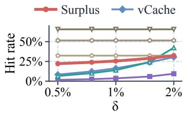  
(a) LmArena

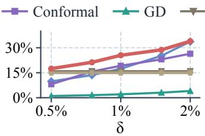  
(b) Classification

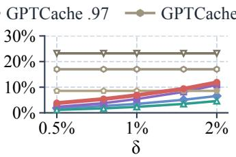  
(c) SearchQueries

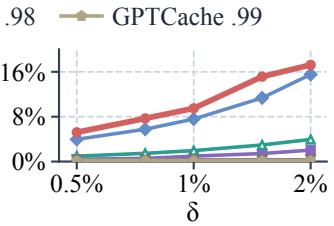  
(d) Combo

Figure 6: Test hit rate of Surplus, vCache, Conformal, GD and the three GPTCache thresholds across five error budgets, where hollow markers break � in some run.  
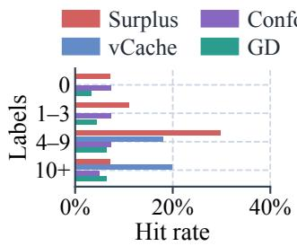  
(a) Hits by entry labels

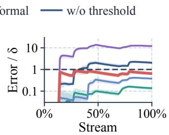  
(b) ClassificationSorted

Figure 7: Surplus serves sparsely labeled entries and keeps the error under � on a sorted stream where Conformal and Surplus without the threshold drift above it, at � = 1%.  
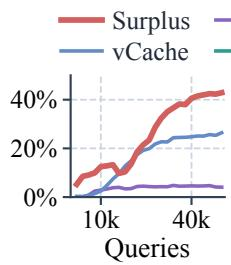  
(a) LmArena

(b) Classification  
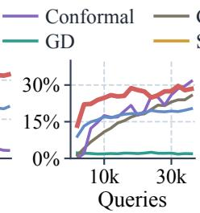

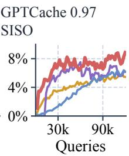  
(c) SearchQueries  
Figure 8: Hit rate in consecutive windows of 2,000 queries at $\delta = 1 \% _ { : }$ , averaged over the test orders, for the methods that hold � on each stream.

Table 3: Hit rate (%) and error over $\delta$ on one LmArena test order when Qwen3.8-27B labels the misses and judges the hits, with the higher hit rate per budget in bold.
<table><tr><td></td><td colspan="2"> $\delta = 0 . 5 \%$ </td><td colspan="2"> $\delta = 1 \%$ </td><td colspan="2"> $\delta = 2 \%$ </td></tr><tr><td>Method</td><td>Hit</td><td>Err./δ</td><td>Hit</td><td>Err./δ</td><td>Hit</td><td>Err./δ</td></tr><tr><td>vCache [47]</td><td>1.64</td><td>0.513</td><td>3.00</td><td>0.460</td><td>6.06</td><td>0.409</td></tr><tr><td>Surplus</td><td>2.53</td><td>0.482</td><td>4.82</td><td>0.652</td><td>7.87</td><td>0.641</td></tr></table>

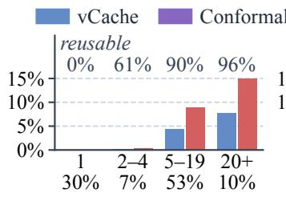  
(a) By paraphrase class size

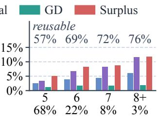  
(b) By query length

Figure 9: Correct hits per bucket of SearchQueries at $\delta = 1 \% ,$ with each bucket’s share of the stream under its label and its reusable share above its bars.
<table><tr><td>Incoming query → cached query</td><td>S</td><td>vCache labels</td></tr><tr><td>credit card for very bad credit → credit cards for horrible credit</td><td>0.929</td><td>0</td></tr><tr><td>city of baltimore real estate taxes → baltimore city real estate tax</td><td>0.981</td><td>1</td></tr><tr><td>does cbd show on drug tests → does cbd show up in drug test</td><td>0.975</td><td>3</td></tr><tr><td>best workout plan for weight loss → best workout routine to lose weight</td><td>0.890</td><td>12</td></tr></table>

Figure 10: Search queries that Surplus serves from the cache and vCache sends to the LLM at $\delta = 1 \% ,$ , all judged correct by a human reviewer.

SearchQueries at $\delta = 1 \%$ under this judge, Surplus serves 12.25% of the queries against 5.36% for vCache.

Under human review Surplus serves more correct answers. In a blind review of hits from both methods, Surplus serves 6.72 more correct answers per 100 LmArena queries than vCache. Two annota- tors reach a Cohen’s kappa of 0.957 on the search queries they both labeled [14], and Appendix B describes the protocol. The budget is defined under the feedback signal (§3.1), so it is only as strict as that signal, and on search queries the benchmark labels are looser than the judgments of human reviewers.

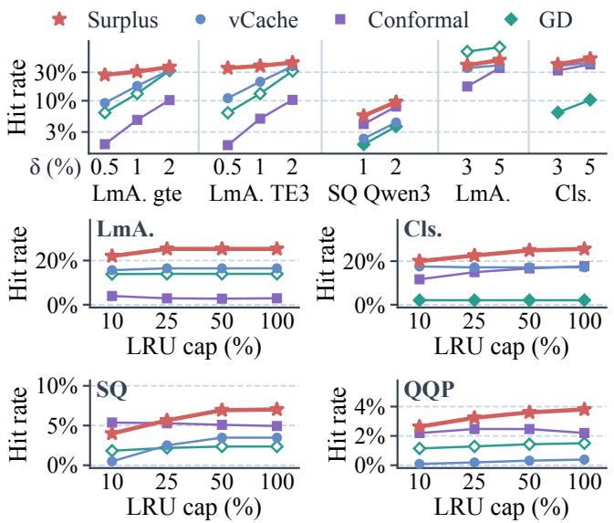  
Figure 11: Hit rate with other embeddings and budgets (top) and under an LRU cap at � = 1% (bottom), where LmA., Cls. and SQ denote LmArena, Classification and SearchQueries.

## 4.6 Generality

The gain carries over to other embeddings and budgets. With gte [30] and TE3-small [41] on LmArena, Qwen3-Embedding [57] on SearchQueries and the main embeddings at � of 3% and 5%, Sur-plus holds � in all 12 cells and leads vCache by 9.96 points pooled (Table 5). In each cell it is also significantly above every baseline that holds � there, vCache, Conformal or GD (Figure 11, top). On Quora question pairs [50], a fourth public stream, Surplus holds � and is significantly above vCache in all three cells.

The lead survives a capacity limit. With an LRU cache capped at 10% to 100% of the stream length, Surplus holds � in every run on all four streams. It keeps a significant lead over vCache at every cap (Figure 11, bottom). From a cap of a quarter of the stream, it has the highest hit rate of the methods that hold � on every stream. On SearchQueries this needs at least that cap, and eviction rules aware of the risk ranking are left for future work. LmArena never fills a quarter of the stream, so only its smallest cap evicts entries.

Surplus gains more over vCache than a learned similarity does. MVR-cache [37] changes the similarity function and keeps vCache’s decision, while Surplus leaves the similarity untouched and changes the decision. On three orders of the full SearchQueries test stream with the same bge-base embedding [54], Surplus serves 1.8 to 2.0 times the hits of MVR-cache at every budget. All four caches hold � there (Figure 12). On SearchQueries and Classification, its gain over the vCache of its own code base exceeds MVR-cache’s gain over its vCache in every cell (Table 6 in Appendix C). On Search-Queries at � = 1%, Surplus serves 5.95% against 2.87% for its vCache, while MVR-cache serves 3.17% against 3.01% for its own. The two code bases label Classification by diferent keys, so each method is compared with its own vCache.

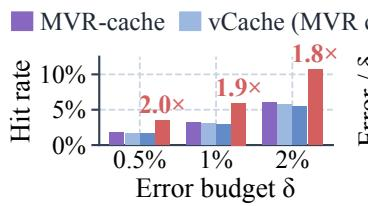  
(a) Hit rate

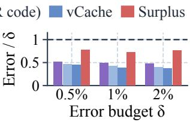  
(b) Worst error over �

Figure 12: Surplus against MVR-cache on the full Search-Queries stream with the bge-base embedding.  
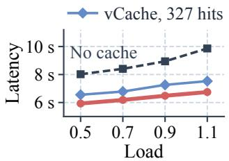

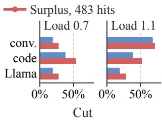  
(a) Poisson arrivals  
(b) Traces and Llama  
Figure 13: Mean end-to-end latency of LmArena queries served by vLLM at $\delta \ : = \ : 1 \%$ and its cut from serving without a cache, where the load is a multiple of the closed-loop throughput of the backend.

## 4.7 Cost and Serving

Surplus has a lower decision latency than vCache on average. Its mean and p99 decision times are below vCache’s on every stream (Table 7 in Appendix C). On one CPU core its mean decision time is about a third of vCache’s on LmArena and under a fifth on Clas- sification, and its p99 on SearchQueries is under half of vCache’s. As the SearchQueries prefix grows to 120,000 queries its wall-clock time stays within 1.09 times vCache’s (Appendix D).

More hits mean lowerlatency in serving. vLLM [29] serves Qwen3- 8B on one RTX 4090, and 2,000 LmArena queries arrive as a Poisson process at four loads up to 1.1 times its closed-loop throughput (Appendix A). Surplus lowers the mean latency more than vCache at every load, by 31.59% against 23.67% at the highest load (Figure 13a). It answers 483 of the 2,000 queries without the LLM where vCache answers 327 of them.

The latency gain holds under bursty arrivals and other backends. With arrivals replayed from the conversation and code traces of Azure LLM inference [42] and with a Llama-3.1-8B backend [34], Surplus cuts the mean latency more than vCache in every setting (Figure 13b). On the burstier code trace at 0.7 times the through-put, it cuts the mean latency by 53.09% against 37.90% for vCache. With Qwen3.8-27B [44] served on one A800 GPU at 0.7 times its throughput, Surplus cuts the mean latency by 29.67% and vCache by 20.94% at the same load.

## 5 Conclusion

Semantic caches that bound the error per entry at the target budget, such as vCache, leave much ofthe error budget ofLLM Web services unspent, and Surplus spends it where reuse is most likely correct. Surplus ranks queries by a risk score shared across paraphrase clusters, opens risk bins under a threshold calibrated from audited labels, and keeps it safe under drift with free labels and a ledger of realized errors. On search, chat and classification streams it holds the budget in all 15 test cells, which no baseline does, and serves 40% more hits than vCache on the shufled streams. In a vLLM testbed it cuts the mean latency by 31.59% at the highest load, against 23.67% for vCache. We expect the unspent error budget to matter wherever an LLM service promises a quality level, and future work will extend the ledger to caches shared by tenants with their own budgets.

## References

[1] Shubham Agarwal, Subrata Mitra, Sarthak Chakraborty, Srikrishna Karanam, Koyel Mukherjee, and Shiv Saini. 2024. Approximate Caching for Eficiently Serving Difusion Models. In 21st USENIX Symposium on Networked Systems Design and Implementation (NSDI)

[2] Anastasios N. Angelopoulos and Stephen Bates. 2023. Conformal Prediction: A Gentle Introduction. Foundations and Trends in Machine Learning 16, 4 (2023), 494–591.

[3] Anastasios N. Angelopoulos, Stephen Bates, Emmanuel J. Candès, Michael I. Jordan, and Lihua Lei. 2025. Learn Then Test: Calibrating Predictive Algorithms to Achieve Risk Control. The Annals ofApplied Statistics 19, 2 (2025), 1641–1662.

[4] Anastasios N. Angelopoulos, Stephen Bates, Adam Fisch, Lihua Lei, and Tal Schuster. 2024. Conformal Risk Control. In International Conference on Learning Representations (ICLR).

[5] Baran Atalar, Xutong Liu, Jinhang Zuo, Siwei Wang, Wei Chen, and Carlee Joe-Wong. 2026. Continuous Semantic Caching for Low-Cost LLM Serving. In Proceedings of the International Symposium on Theory, Algorithmic Foundations, and Protocol Design for Mobile Networks and Mobile Computing (MobiHoc).

[6] Ricardo Baeza-Yates, Aristides Gionis, Flavio Junqueira, Vanessa Murdock, Vas-silis Plachouras, and Fabrizio Silvestri. 2007. The Impact of Caching on Search Engines. In Proceedings ofthe 30th Annual International ACM SIGIR Conference on Research and Development in Information Retrieval (SIGIR). 183–190.

[7] Fu Bang. 2023. GPTCache: An Open-Source Semantic Cache for LLM Appli cations Enabling Faster Answers and Cost Savings. In Proceedings ofthe 3rd Workshop for Natural Language Processing Open Source Software (NLP-OSS 2023). 212–218.

[8] Aditeya Baral, Radoslav Ralev, Iliya Zhechev, Srijith Rajamohan, and Jen Agarwal. 2026. Closing the Operational Gap in Semantic Caching. In Proceedings ofthe 2026 Conference on Empirical Methods in Natural Language Processing: Industry Track. 988–1011.

[9] Rina Foygel Barber, Emmanuel J. Candès, Aaditya Ramdas, and Ryan J. Tibshirani. 2023. Conformal Prediction Beyond Exchangeability. The Annals ofStatistics 51, 2 (2023), 816–845.

[10] Dvir David Biton and Roy Friedman. 2026. From Exact Hits to Close Enough: Semantic Cachin for LLM Embeddin s. arXiv:2603.03301

[11] Lee Breslau, Pei Cao, Li Fan, Graham Phillips, and Scott Shenker. 1999. Web Caching and Zipf-Like Distributions: Evidence and Implications. In Proceedings ofIEEE INFOCOM 1999. 126–134.

[12] Lingjiao Chen, Matei Zaharia, andJames Zou. 2024. FrugalGPT: How to Use Large Language Models While Reducing Cost and Improving Performance. Transactions on Machine Learning Research (2024).

[13] Wei-Lin Chiang, Lianmin Zheng, Ying Sheng, Anastasios N. Angelopoulos, Tianle Li, Dacheng Li, Banghua Zhu, Hao Zhang, Michael Jordan, Joseph E. Gonzalez, and Ion Stoica. 2024. Chatbot Arena: An Open Platform for Evaluating LLMs by Human Preference. In Proceedings of the 41st International Conference on Machine Learning (ICML), Vol. 235. 8359–8388.

[14] Jacob Cohen. 1960. A Coeficient of Agreement for Nominal Scales. Educational and Psychological Measurement 20, 1 (1960), 37–46.

[15] Nick Craswell, Daniel Campos, Bhaskar Mitra, Emine Yilmaz, and Bodo Billerbeck. 2020. ORCAS: 18 Million Clicked Query-Document Pairs for Analyzing Search. In Proceedings of the 29th ACM International Conference on Information and Knowledge Management (CIKM). 2983–2989.

[16] DeepSeek-AI. 2026. DeepSeek-V4: Towards Highly Eficient Million-Token Context Intelligence. arXiv:2606.19348

[17] Bradley Efron. 1979. Bootstrap Methods: Another Look at the Jackknife. The Annals ofStatistics 7, 1 (1979), 1–26.

[18] Bradley Efron and Carl Morris. 1975. Data Analysis Using Stein’s Estimator and Its Generalizations. J. Amer. Statist. Assoc. 70, 350 (1975), 311–319.

[19] Tiziano Fagni, Rafaele Perego, Fabrizio Silvestri, and Salvatore Orlando. 2006. Boosting the Performance of Web Search Engines: Caching and Prefetching Query Results by Exploiting Historical Usage Data. ACM Transactions on Information Systems 24, 1 (2006), 51–78.

[20] Yonatan Geifman and Ran El-Yaniv. 2017. Selective Classification for Deep Neural Networks. In Advances in Neural Information Processing Systems (NeurIPS), Vol. 30. 4878–4887.

[21] Shervin Ghafari, Zohre Bahranifard, and Mohammad Akbari. 2025. An Ensemble Embedding Approach for Improving Semantic Caching Performance in LLM based Systems. arXiv:2507.07061

[22] Isaac Gibbs and Emmanuel Candès. 2021. Adaptive Conformal Inference Under Distribution Shift. In Advances in Neural Information Processing Systems (NeurIPS), Vol. 34. 1660–1672.

[23] Waris Gill, Mohamed Elidrisi, Pallavi Kalapatapu, Ammar Ahmed, Ali Anwar, and Muhammad Ali Gulzar. 2025. MeanCache: User-Centric Semantic Caching for LLM Web Services. In 2025 IEEE International Parallel and Distributed Processing Symposium (IPDPS). 1298–1310.

[24] Chuan Guo, Geof Pleiss, Yu Sun, and Kilian Q. Weinberger. 2017. On Calibration of Modern Neural Networks. In Proceedings ofthe 34th International Conference on Machine Learning (ICML), Vol. 70. 1321–1330.

[25] D. G. Horvitz and D. J. Thompson. 1952. A Generalization of Sampling Without Replacement from a Finite Universe. J. Amer. Statist. Assoc. 47, 260 (1952), 663– 685.

[26] Steven R. Howard, Aaditya Ramdas, Jon McAulife, and Jasjeet Sekhon. 2021. Time-Uniform, Non arametric, Nonas m totic Confidence Se uences. The Annals ofStatistics 49, 2 (2021), 1055–1080.

[27] Jungwoo Kim, Minsang Kim, Jaeheon Lee, Chanwoo Moon, Heejin Kim, Taeho Hwang, Woosuk Chung, Yeseong Kim, and Sungjin Lee. 2025. Rethinking Caching for LLM Serving Systems: Beyond Traditional Heuristics. arXiv:2508.18736

[28] Yash Kulkarni, Shubham Harkare, and Arvind Yogesh Suresh Babu. 2026. Which Eviction Policy Should an LLM Cache Use? A Systematic Study Across Workloads, Capacities, and Encoders. arXiv:2608.20280

[29] Woosuk Kwon, Zhuohan Li, Siyuan Zhuang, Ying Sheng, Lianmin Zheng, Cody Hao Yu, Joseph Gonzalez, Hao Zhang, and Ion Stoica. 2023. Eficient Memory Management for Large Language Model Serving with PagedAttention. In Proceedings of the 29th Symposium on Operating Systems Principles (SOSP). 611–626.

[30] Zehan Li, Xin Zhang, Yanzhao Zhang, Dingkun Long, Pengjun Xie, and Meishan Zhang. 2023. Towards General Text Embeddings with Multi-stage Contrastive Learning. arXiv:2308.03281

[31] Jiacheng Liang, Yuhui Wang, Tanqiu Jiang, and Ting Wang. 2026. LaCache: Robust Semantic Caching for LLM Serving. In Advances in Neural Information Processing Systems (NeurIPS).

[32] Xutong Liu, Baran Atalar, Xiangxiang Dai, Jinhang Zuo, Siwei Wang, John C.S. Lui, Wei Chen, and Carlee Joe-Wong. 2026. Semantic Caching for Low-Cost LLM Serving: From Ofline Learning to Online Adaptation. In Proceedings of IEEE INFOCOM 2026. 1–10.

[33] Xunzhuo Liu, Huamin Chen, Samzong Lu, Yossi Ovadia, Guohong Wen, Hao Wu, Zhengda Tan, Jintao Zhang, Senan Zedan, Yehudit Kerido, Liav Weiss, Haichen Zhang, Bishen Yu, Asaad Balum, Noa Limoy, Abdallah Samara, Baofa Fan, Brent Salisbury, Ryan Cook, Zhijie Wang, Qiping Pan, Rehan Khan, Avishek Goswami, Houston H. Zhang, Shuyi Wang, Ziang Tang, Fang Han, Zohaib Hassan, Jianqiao Zheng, Avinash Changrani, Xue, Liu, and Bowei He. 2026. vLLM Semantic Router: Signal Driven Decision Routing for Mixture-of-Modality Models. arXiv:2603.04444

[34] Llama Team, AI @ Meta. 2024. The Llama 3 Herd of Models. arXiv:2407.21783

[35] Yury A. Malkov and Dmitry A. Yashunin. 2020. Eficient and Robust Approximate Nearest Nei hbor Search Usin Hierarchical Navi able Small World Gra hs. IEEE Transactions on Pattern Analysis and Machine Intelligence 42, 4 (2020), 824–836.

[36] Muhammad Mansoor, Tahir Ahmad, and Yeo-Chan Yoon. 2026. Risk-Constrained Freshness-Aware Semantic Caching for Open-Web Retrieval-Augmented LLMs. arXiv:2607.04281

[37] Ali Noshad, Zishan Zheng, and Yinjun Wu. 2026. MVR-cache: Optimizing Semantic Caching via Multi-Vector Retrieval and Learned Prompt Segmentation. In Proceedings ofthe 43rd International Conference on Machine Learning (ICML).

[38] Sukjoon Oh, Minki Kang, Dohyun Kim, Baotong Lu, Jing Liu, Qianxi Zhang, Qi Chen, and Youjip Won. 2026. Aker: Density-Aware Approximate Caching for Vector Search. Proceedings ofthe VLDB Endowment 19, 10 (2026), 2727–2740.

[39] Isaac Ong, Amjad Almahairi, Vincent Wu, Wei-Lin Chiang, Tianhao Wu, Joseph E. Gonzalez, M. Waleed Kadous, and Ion Stoica. 2025. RouteLLM: Learning to Route LLMs from Preference Data. In International Conference on Learning Representations (ICLR).

[40] OpenAI. 2024. GPT-4o System Card. arXiv:2410.21276

[41] OpenAI. 2024. New Embedding Models and API Updates. https://openai.com/ index/new-embedding-models-and-api-updates/. text-embedding-3-small.

[42] Pratyush Patel, Esha Choukse, Chaojie Zhang, Aashaka Shah, Íñigo Goiri, Saeed Maleki, and Ricardo Bianchini. 2024. S litwise: Eficient Generative LLM Inference Using Phase Splitting. In Proceedings of the 51st Annual International Symposium on Computer Architecture (ISCA). 118–132

[43] Qwen Team. 2025. Qwen3 Technical Report. arXiv:2505.09388

[44] Qwen Team. 2026. Qwen3.8-27B. https://huggingface.co/Qwen/Qwen3.8-27B. Hugging Face model card.

[45] Sajal Regmi and Chetan Phakami Pun. 2024. GPT Semantic Cache: Reducing LLM Costs and Latency via Semantic Embedding Caching. arXiv:2411.05276

[46] Nils Reimers and Iryna Gurevych. 2019. Sentence-BERT: Sentence Embeddings Using Siamese BERT-Networks. In Proceedings ofthe 2019Conference on Empirical Methods in Natural Language Processing and the 9th International Joint Conference on Natural Language Processing (EMNLP-IJCNLP). 3980–3990.

[47] Luis Gaspar Schroeder, Aditya Desai, Alejandro Cuadron, Kyle Chu, Shu Liu, Mark Zhao, Stephan Krusche, Alfons Kemper, Matei Zaharia, and Joseph E. Gonzalez. 2026. vCache: Verified Semantic Prompt Caching. In International Conference on Learning Representations (ICLR).

[48] Craig Silverstein, Hannes Marais, Monika Henzinger, and Michael Moricz. 1999. Analysis of a Very Large Web Search Engine Query Log. ACM SIGIR Forum 33, 1 (1999), 6–12.

[49] Asmit Kumar Singh, Haozhe Wang, Laxmi Naga Santosh Attaluri, Tak Chiam, and Weihua Zhu. 2026. Asynchronous Verified Semantic Caching for Tiered LLM Architectures. In Proceedings ofthe 6th European Workshop on Machine Learning and Systems (EuroMLSys). 192–199.

[50] Alex Wang, Amanpreet Singh, Julian Michael, Felix Hill, Omer Levy, and Samuel R. Bowman. 2019. GLUE: A Multi-Task Benchmark and Analysis Platform for Natural Language Understanding. In International Conference on Learning Representations (ICLR).

[51] Chen Wang, Xunzhuo Liu, Yue Zhu, Alaa Youssef, Priya Nagpurkar, and Huamin Chen. 2025. Cate or -Aware Semantic Cachin for Hetero eneous LLM Work loads. arXiv:2510.26835

[52] Liang Wang, Nan Yang, Xiaolong Huang, Binxing Jiao, Linjun Yang, Daxin Jiang, Rangan Majumder, and Furu Wei. 2022. Text Embeddings by Weakly-Supervised Contrastive Pre-training. arXiv:2212.03533

[53] Ian Waudby-Smith and Aaditya Ramdas. 2024. Estimating Means of Bounded Random Variables by Betting. Journal of the Royal Statistical Society Series B: Statistical Methodology 86, 1 (2024), 1–27.

[54] Shitao Xiao, Zheng Liu, Peitian Zhang, Niklas Muennighof, Defu Lian, and Jian-Yun Nie. 2024. C-Pack: Packed Resources For General Chinese Embeddings. In Proceedings ofthe 47th International ACM SIGIR Conference on Research and Development in Information Retrieval (SIGIR). 641–649.

[55] Jianxin Yan, Wangze Ni, Lei Chen, Xuemin Lin, Peng Cheng, Zhan Qin, and Kui Ren. 2025. ContextCache: Context-Aware Semantic Cache for Multi-Turn Queries in Large Language Models. Proceedings ofthe VLDB Endowment 18, 12 (2025), 5391–5394.

[56] Jiayi Yao, Hanchen Li, Yuhan Liu, Siddhant Ray, Yihua Cheng, Qizheng Zhang, Kuntai Du, Shan Lu, and Junchen Jiang. 2025. CacheBlend: Fast Large Language Model Serving for RAG with Cached Knowledge Fusion. In Proceedings of the Twentieth European Conference on Computer Systems (EuroSys). 94–109.

[57] Yanzhao Zhang, Mingxin Li, Dingkun Long, Xin Zhang, Huan Lin, Baosong Yang, Pengjun Xie, An Yang, Dayiheng Liu, Junyang Lin, Fei Huang, and Jingren Zhou. 2025. Qwen3 Embedding: Advancing Text Embedding and Reranking Through Foundation Models. arXiv:2506.05176

[58] Zhixiang Zhang, Zesen Liu, Yuchong Xie, Quanfeng Huang, and Dongdong She. 2026. From Similarity to Vulnerability: Key Collision Attack on LLM Semantic Caching. In Proceedings ofthe 43rd International Conference on Machine Learning (ICML).

[59] Zihan Zhang, Shuangjie Yao, Zesen Liu, Zhixiang Zhang, Wai Ip Lai, Dung Hiu Hilton Yeung, Chun Kit Zhang, Fuchen Ma, Yuanyuan Yuan, Yu Jiang, and Dongdong She. 2026. Similarity Is Not Validity: Defending LLM Semantic Caches Against Poisoning. arXiv:2609.35908

[60] Lianmin Zheng, Wei-Lin Chiang, Ying Sheng, Siyuan Zhuang, Zhanghao Wu, Yonghao Zhuang, Zi Lin, Zhuohan Li, Dacheng Li, Eric Xing, Hao Zhang, Joseph Gonzalez, and Ion Stoica. 2023. Judging LLM-as-a-Judge with MT-Bench and Chatbot Arena. In Advances in Neural Information Processing Systems (NeurIPS), Vol. 36. 46595–46623.

[61] Lianmin Zheng, Liangsheng Yin, Zhiqiang Xie, Chuyue Sun, Jef Huang, Cody Yu, Shiyi Cao, Christos Kozyrakis, Ion Stoica, Joseph Gonzalez, Clark Barrett, and Ying Sheng. 2024. SGLang: Eficient Execution of Structured Language Model Programs. In Advances in Neural Information Processing Systems (NeurIPS), Vol. 37. 62557–62583.

[62] Yinmin Zhong, Shengyu Liu, Junda Chen, Jianbo Hu, Yibo Zhu, Xuanzhe Liu, Xin Jin, and Hao Zhang. 2024. DistServe: Disaggregating Prefill and Decoding for Goodput-optimized Large Language Model Serving. In 18th USENIX Symposium on Operating Systems Design and Implementation (OSDI).

## Appendix

The appendix gives the streams, baselines and testbed (A), run and review protocols (B), per-cell results (C), noise and scaling (D), the judge feedback (E) and the use of generative models (F).

## A Streams, Baselines and Testbed

Streams. LmArena comes with GPT-4o-mini answers [40] and e5-large-v2 embeddings [52]. Classification comes with Llama 3 answers [34], and Classification and SearchQueries both come with gte embeddings [30]. The cache retrieves with HNSW [35] and starts every run empty, the baselines insert every miss, and Surplus inserts by the admission rule of §3.2.

Baseline settings. Static picks its threshold from 0.60 to 0.999 on the validation split, and when no threshold keeps every validation order within � we report the largest one. Krites and SISO take the setting with the most validation hits whose worst validation order stays within �. On the drifting streams they take the setting that does so over all nine validation runs of the shufled streams. Where no setting stays within �, as for Krites on LmArena and the drifting streams at the two tighter budgets, we report the setting with the lowest worst error. Krites picks its high and low thresholds from 0.80 to 0.999 and serves approved entries at either one, both in the grid. SISO merges queries into centroids at the similarity of 0.86 from its paper. Its latency-driven threshold stays fixed in a replay without load and is picked from 0.60 to 0.98. Conformal labels the first 10% of the stream by calling the LLM on every query and then serves above the threshold that conformal risk control picks at level �. vCache runs with its error bound set to the target � of each cell, and our vCache agrees with its oficial implementation on every query of a check stream. MVR-cache trains its segmentation model on 3,000 validation prompts per stream with its own code. It runs on one order of Classification and on three orders of the full SearchQueries test stream, and Surplus and vCache run on the same data with the same bge-base embedding in our replay. A hindsight oracle picks per-entry thresholds with all labels known (Figure 3b).

Serving testbed. vLLM 0.11 serves Qwen3-8B in bf16 without thinking on one RTX 4090. The client sends queries 20,000 to 21,999 of one LmArena test order after the cache has replayed the first 20,000. Arrivals are Poisson at 0.5, 0.7, 0.9 and 1.1 times the back- end’s closed-loop throughput of 3.315 queries per second. A miss generates as many tokens as the logged GPT-4o-mini answer, up to 1,024. Hits and served entries follow the main-table traces, the live decisions are only timed, and the feedback labels come from the benchmark as in the main table. For Qwen3.8-27B, vLLM 0.17 serves the model in bf16 on one A800 with a closed-loop throughput of 1.598 queries per second. The same 2,000 queries arrive as a Poisson process, and the run without a cache uses a second A800 with the same server settings. The trace runs replay the inter-arrival gaps of the Azure conversation trace, whose coeficient of variation is 1.14, scaled to 0.7 and 1.1 times the same throughput. The Llama run serves Llama-3.1-8B-Instruct at 0.7 times its own closed-loop throughput of 4.264 queries per second. The runs on the Azure code trace, whose gaps have a coeficient of variation of 13.33, and the Llama run at 1.1 times use a second server with one RTX 4090D. These runs scale their load to the closed-loop throughputs of that server, 3.346 queries per second for Qwen3-8B and 4.348 for Llama-3.1-8B. Appendix B gives the run counts, the timing protocol and the review protocol.

Table 4: Settings of Surplus, fixed on the validation split and used unchanged for every stream, budget and test run.
<table><tr><td>Setting</td><td>Value</td></tr><tr><td>Risk bins</td><td>48, 12 per decade from  $1 0 ^ { - 4 }$ </td></tr><tr><td>Control interval</td><td>100 decisions</td></tr><tr><td>Audit rate φ</td><td>0.2</td></tr><tr><td>Target share β</td><td>0.75</td></tr><tr><td>Bound width z</td><td>1.5</td></tr><tr><td>Prior strength m</td><td>4</td></tr><tr><td>Opening step</td><td>3 bins per control</td></tr><tr><td>Recency window</td><td>3,000 decisions</td></tr><tr><td>Ledger horizon H</td><td>1,500 decisions</td></tr><tr><td>Ledger clip  $[ g _ { \operatorname* { m i n } } , g _ { \operatorname* { m a x } } ]$ </td><td>[0.25,1]</td></tr><tr><td>Calibration clip of κ</td><td>[0.2,50]</td></tr><tr><td>Admission a</td><td>0.9</td></tr><tr><td>Lazy refit ρ</td><td>0.1</td></tr><tr><td>Prior budget share</td><td>0.65</td></tr><tr><td>Strata of correct labels</td><td>0, 1 to 3, 4 or more</td></tr></table>

## B Run and Review Protocols

Runs and timing. The ablations of Table 2 run three test orders of LmArena and Classification, one of SearchQueries and two seeds of each drifting stream, and its rows without the threshold come from the full main-table runs. The capacity runs of Table 5 and the runs of Figure 11 use two test orders of each stream, except one of SearchQueries with Qwen3-Embedding. Timing runs give each method one CPU core of a shared server and run all methods of a cell at the same time, twice each. The methods of a cell thus share one load, while the load difers across cells and between Table 7 and the prefix runs, so we compare methods only within a cell.

Human reviews. Two members of our research group reviewed sampled hits of Surplus at $\delta = 1 \%$ . The review page shows a Chinese machine translation by DeepSeek-V4-Flash [16] at temperature 0 as a reference only, with the English original as the ground truth, and highlights the words that difer between the new and the cached query. We checked every translation and corrected 6 by hand, and the two annotators reach a Cohen’s kappa of 0.957 on the 49 Search Queries items they both labeled and agree on all 15 Classification items they both labeled. One annotator labeled the SearchQueries and Classification items, the other the LmArena items, all Search Queries items and 15 Classification items, and the items labeled by both give the agreement. A second review compares the two methods on 151 hits sampled evenly from queries that only Surplus serves, that both serve and that only vCache serves, and weights each class by its size. Both reviews draw their SearchQueries hits from two of its five test orders.

## C Per-Cell Results, Generality and Cost

Table 8 gives the share of � that vCache and Surplus spend, as a mean over runs rather than the worst run of Table 1, and the gain of Surplus over the best baseline that holds � in each cell. Table 5

Table 5: Hit rate (%) of vCache and Surplus with other embeddings and budgets, on Quora QQP and under an LRU cap, with the gain in points and its nested bootstrap 95% CI.
<table><tr><td>Setting</td><td></td><td>δ (%) vCache Surplus</td><td></td><td>Gain</td><td></td></tr><tr><td>LmArena, gte</td><td>0.5</td><td>9.17</td><td></td><td></td><td>27.09 +17.92 [17.46, 18.36]</td></tr><tr><td></td><td>1</td><td>17.71</td><td></td><td></td><td>30.78 +13.07 [12.56, 13.57]</td></tr><tr><td></td><td>2</td><td>32.55</td><td>36.80</td><td>+4.25</td><td>[3.85, 4.63]</td></tr><tr><td>LmArena, TE3-small</td><td>0.5</td><td>11.04</td><td></td><td></td><td>35.21 +24.16 [23.85, 24.49]</td></tr><tr><td></td><td>1</td><td>20.86</td><td></td><td></td><td>38.31 +17.44 [17.13, 17.76]</td></tr><tr><td></td><td>2</td><td>37.94</td><td>43.66</td><td>+5.72</td><td>[5.22, 6.27]</td></tr><tr><td>SearchQueries, Qwen3-Emb.</td><td>1</td><td>2.32</td><td>5.61</td><td>+3.29</td><td>[3.16, 3.44]</td></tr><tr><td></td><td>2</td><td>4.32</td><td>9.54</td><td>+5.22</td><td>[5.05, 5.36]</td></tr><tr><td>LmArena, main</td><td>3</td><td>35.33</td><td>39.49</td><td>+4.15</td><td>[3.24, 5.02]</td></tr><tr><td></td><td>5</td><td>39.38</td><td>47.83</td><td>+8.46</td><td>[8.08, 8.84]</td></tr><tr><td>Classification, main</td><td>3</td><td>38.11</td><td>40.73</td><td>+2.62</td><td>[0.31, 4.90]</td></tr><tr><td></td><td>5</td><td>43.49</td><td>50.76</td><td>+7.26</td><td>[6.27, 8.31]</td></tr><tr><td>Pooled over these rows</td><td></td><td></td><td></td><td>+9.96</td><td>[9.65, 10.28]</td></tr><tr><td>Quora QQP, gte</td><td>0.5</td><td>0.23</td><td>2.18</td><td>+1.95</td><td>[1.79, 2.08]</td></tr><tr><td></td><td>1</td><td>0.41</td><td>3.91</td><td>+3.50</td><td>[3.36, 3.62]</td></tr><tr><td></td><td>2</td><td>0.80</td><td>6.26</td><td>+5.46</td><td>[5.26, 5.66]</td></tr><tr><td>LmArena, LRU 10%</td><td>1</td><td>15.63</td><td>22.00</td><td>+6.38</td><td>[6.09, 6.65]</td></tr><tr><td>LmArena, LRU 25, 50%</td><td>1</td><td>16.45</td><td>25.25</td><td>+8.80</td><td>[8.52, 9.07]</td></tr><tr><td>Classification, LRU 10%</td><td>1</td><td>17.56</td><td>20.01</td><td>+2.45</td><td>[2.10, 2.81]</td></tr><tr><td>Classification, LRU 25%</td><td>1</td><td>17.17</td><td>22.60</td><td>+5.44</td><td>[5.07, 5.80]</td></tr><tr><td>Classification, LRU 50%</td><td>1</td><td>17.17</td><td>24.94</td><td>+7.78</td><td>[7.42, 8.17]</td></tr></table>

Table 6: Hit rate (%) of MVR-cache and Surplus with the same bge-base embedding, each beside the vCache of its own code, with the top two in bold and underline.
<table><tr><td></td><td></td><td colspan="3">Classification</td><td colspan="3">SearchQueries</td></tr><tr><td>Method</td><td>δ(%)</td><td>0.5</td><td>1</td><td>2</td><td>0.5</td><td>1</td><td>2</td></tr><tr><td>MVR-cache</td><td></td><td>12.27</td><td>16.91</td><td>33.09</td><td>1.75</td><td>3.17</td><td>6.06</td></tr><tr><td>vCache, MVR code</td><td></td><td>9.14</td><td>16.46</td><td>32.49</td><td>1.67</td><td>3.01</td><td>5.75</td></tr><tr><td>vCache, our code</td><td></td><td>8.43</td><td>15.62</td><td>30.48</td><td>1.59</td><td>2.87</td><td>5.46</td></tr><tr><td>Surplus</td><td></td><td>13.26</td><td>19.43</td><td>31.13</td><td>3.49</td><td>5.95</td><td>10.68</td></tr></table>

Table 7: Decision time in milliseconds, wall-clock time of a whole test run and peak memory at $\delta = 1 \% ,$ on one CPU core.
<table><tr><td></td><td></td><td colspan="3">Decision (ms)</td><td></td><td></td></tr><tr><td>Stream</td><td>Method</td><td>Median</td><td>p99</td><td>Mean</td><td>Wall (s)</td><td>MB</td></tr><tr><td>LmArena</td><td>vCache</td><td>7.58</td><td>14.23</td><td>5.62</td><td>1480</td><td>558</td></tr><tr><td></td><td>Surplus</td><td>0.402</td><td>11.43</td><td>1.89</td><td>1323</td><td>560</td></tr><tr><td>Classification</td><td>vCache</td><td>0.441</td><td>13.27</td><td>4.89</td><td>670</td><td>504</td></tr><tr><td></td><td>Surplus</td><td>0.327</td><td>10.67</td><td>0.870</td><td>1322</td><td>578</td></tr><tr><td>SearchQueries</td><td>vCache</td><td>0.028</td><td>13.77</td><td>3.03</td><td>6555</td><td>1158</td></tr><tr><td></td><td>Surplus</td><td>0.100</td><td>6.60</td><td>1.11</td><td>6655</td><td>1245</td></tr></table>

gives the gains over vCache with other embeddings and budgets, on Quora QQP and under an LRU cap, Table 6 the comparison with MVR-cache and Table 7 the decision cost. The best baseline of each

Table 8: Error over � of vCache and Surplus per cell and the gain of Surplus in points over the best baseline that holds �, with its 95% CI.
<table><tr><td></td><td></td><td colspan="2">Err./δ</td><td></td><td></td><td></td><td></td></tr><tr><td>Stream</td><td>δ(%)</td><td>vCache</td><td>Surplus</td><td>Best baseline</td><td>Hit (%)</td><td>Gain</td><td>CI</td></tr><tr><td>LmArena</td><td>0.5</td><td>0.144</td><td>0.463</td><td>vCache</td><td>8.37</td><td>+13.77</td><td>[12.87, 14.63]</td></tr><tr><td></td><td>1</td><td>0.122</td><td>0.520</td><td>vCache</td><td>16.35</td><td>+9.16</td><td>[8.33, 10.15]</td></tr><tr><td></td><td>2</td><td>0.131</td><td>0.624</td><td>vCache</td><td>30.49</td><td>+1.94</td><td>[1.18, 2.77]</td></tr><tr><td>Classification</td><td>0.5</td><td>0.538</td><td>0.487</td><td>GPTCache 0.97</td><td>15.95</td><td>+1.52</td><td>[0.86, 2.54]</td></tr><tr><td></td><td>1</td><td>0.499</td><td>0.626</td><td>Conformal</td><td>19.21</td><td>+6.28</td><td>[4.38, 8.48]</td></tr><tr><td></td><td>2</td><td>0.548</td><td>0.563</td><td>vCache</td><td>33.70</td><td>+0.237</td><td>[−0.73, 1.52]</td></tr><tr><td>SearchQueries</td><td>0.5</td><td>0.426</td><td>0.596</td><td>Conformal</td><td>2.32</td><td>+1.47</td><td>[0.42, 2.47]</td></tr><tr><td></td><td>1</td><td>0.412</td><td>0.660</td><td>Conformal</td><td>5.37</td><td>+1.51</td><td>[0.92, 2.23]</td></tr><tr><td></td><td>2</td><td>0.387</td><td>0.694</td><td>Conformal</td><td>10.88</td><td>+0.981</td><td>[0.36, 1.60]</td></tr><tr><td>ClassificationSorted</td><td>0.5</td><td>0.288</td><td>0.696</td><td>vCache</td><td>19.57</td><td>+6.14</td><td>[2.16, 9.67]</td></tr><tr><td></td><td>1</td><td>0.374</td><td>0.648</td><td>vCache</td><td>38.89</td><td>-2.52</td><td>[-4.38, -1.07]</td></tr><tr><td></td><td>2</td><td>1.13</td><td>0.653</td><td>GPTCache 0.97</td><td>16.26</td><td>+31.45</td><td>[29.55, 32.66]</td></tr><tr><td>Combo</td><td>0.5</td><td>0.445</td><td>0.618</td><td>vCache</td><td>3.96</td><td>+1.26</td><td>[0.89, 1.66]</td></tr><tr><td></td><td>1</td><td>0.410</td><td>0.639</td><td>vCache</td><td>7.58</td><td>+1.92</td><td>[1.45, 2.51]</td></tr><tr><td></td><td>2</td><td>0.429</td><td>0.594</td><td>vCache</td><td>15.53</td><td>+1.71</td><td>[1.16, 2.27]</td></tr><tr><td>Quora QQP</td><td>0.5</td><td></td><td></td><td>GPTCache 0.97</td><td>3.49</td><td>-1.32</td><td>[-1.47, -1.18]</td></tr><tr><td></td><td>1</td><td>一</td><td>一</td><td>GPTCache 0.97</td><td>3.49</td><td>+0.411</td><td>[0.26, 0.54]</td></tr><tr><td></td><td>2</td><td>一</td><td>一</td><td>Conformal</td><td>5.59</td><td>+0.667</td><td>[0.26, 1.05]</td></tr><tr><td>Shuffled</td><td>all</td><td></td><td></td><td>per cell</td><td></td><td>+4.10</td><td>[3.57, 4.67]</td></tr><tr><td>Shuffled</td><td>all</td><td></td><td></td><td>vCache</td><td></td><td>+5.71</td><td>[5.30, 6.02]</td></tr><tr><td>Drifting</td><td>all</td><td></td><td></td><td>per cell</td><td></td><td>+6.66</td><td>[5.94, 7.28]</td></tr><tr><td>Shuffled</td><td>grid</td><td></td><td></td><td>per cell</td><td></td><td>+4.32</td><td>[3.91, 4.73]</td></tr></table>

Table 9: Hit rate (%) and worst error over � when Qwen3-8B labels the misses and judges the hits, or only judges the hits on Quora QQP, with the higher hit rate of each pair in bold.
<table><tr><td></td><td></td><td colspan="2">δ = 0.5%</td><td colspan="2"> $\delta = 1 \%$ </td><td colspan="2"> $\delta = 2 \%$ </td></tr><tr><td>Stream</td><td>Method</td><td>Hit</td><td>Err./δ</td><td>Hit</td><td> $\operatorname { E r r } . / \delta$ </td><td>Hit</td><td>Err./δ</td></tr><tr><td>LmArena,</td><td>vCache</td><td>3.37</td><td>0.533</td><td>6.70</td><td>0.574</td><td>13.63</td><td>0.643</td></tr><tr><td>order 1</td><td>Surplus</td><td>4.97</td><td>0.615</td><td>8.46</td><td>0.652</td><td>12.67</td><td>0.629</td></tr><tr><td>LmArena, order 2</td><td>vCache</td><td>3.49</td><td>0.568</td><td>6.67</td><td>0.517</td><td>13.13</td><td>0.554</td></tr><tr><td></td><td>Surplus</td><td>4.93</td><td>0.631</td><td>8.84</td><td>0.680</td><td>13.03</td><td>0.616</td></tr><tr><td>LmArena, order 3</td><td>vCache</td><td>3.47</td><td>0.603</td><td>6.56</td><td>0.494</td><td>13.21</td><td>0.571</td></tr><tr><td></td><td>Surplus</td><td>4.72</td><td>0.623</td><td>8.52</td><td>0.680</td><td>13.28</td><td>0.660</td></tr><tr><td>Classification</td><td>vCache</td><td>7.95</td><td>0.556</td><td>14.37</td><td>0.536</td><td>28.39</td><td>0.529</td></tr><tr><td></td><td>Surplus</td><td>13.27</td><td>0.533</td><td>17.34</td><td>0.481</td><td>27.10</td><td>0.550</td></tr><tr><td>SearchQueries</td><td>vCache</td><td>3.02</td><td>0.370</td><td>5.36</td><td>0.385</td><td>9.82</td><td>0.393</td></tr><tr><td></td><td>Surplus</td><td>7.38</td><td>0.555</td><td>12.25</td><td>0.529</td><td>19.77</td><td>0.570</td></tr><tr><td>Quora QQP,</td><td>vCache</td><td>0.229</td><td>0.194</td><td>0.407</td><td>0.194</td><td>0.800</td><td>0.202</td></tr><tr><td>judge only</td><td>Surplus</td><td>2.18</td><td>0.645</td><td>3.91</td><td>0.598</td><td>6.26</td><td>0.557</td></tr></table>

cell is picked on test. On Quora at � = 0.5% the pick is a fixed threshold whose worst order sits exactly at �, so its gray row is only an upper bound.

## D Noise and Scaling

When a share of the labels each method receives is flipped on the validation split, Surplus holds � in all nine cells at 5% and 10% and keeps more hits than vCache, 7.37% against 4.91% and 5.13% against 4.12% pooled. On SearchQueries prefixes of10,000 to 120,000 queries at $\delta = 1 \% ,$ Surplus takes 1.01 to 1.09 times the wall-clock time of vCache, and its p99 decision time stays below vCache’s.

## E LLM-Judge Feedback

In the runs of Table 3, vLLM 0.17 serves Qwen3.8-27B in bf16 with greedy decoding and without thinking on one A800 GPU. It reads the same prompt and the same truncated answers as Qwen3-8B and judges all 262,362 query pairs of these runs online. The gains of Surplus over vCache are 0.89, 1.82 and 1.81 points at the three budgets, with 95% CIs of [0.74, 1.04], [1.64, 2.01] and [1.58, 2.01] from a paired bootstrap over queries. Table 9 gives every budget of the runs in which Qwen3-8B labels the misses and judges the hits, on three LmArena test orders and one order each of Classification and SearchQueries, and of the run on five Quora test orders in which it judges every hit of either cache. On SearchQueries, whose rows hold no answers, the judge decides whether the new and the cached query share one search intent.

## F Use of Generative Artificial Intelligence

Generative artificial intelligence assistants helped draft and edit the text and write the experiment and plotting code. An image-generation model sketched candidate layouts for the schematic Figures 1, 2 and 4, which we redrew as vector diagrams, and drew some of their icons. The authors checked every statement, number and figure against the experiment records and take full responsibil- ity for the paper.