# POLICYIK: HIGH-PRECISION INVERSE KINEMATICS FOR ROBOT ARMS WITH REINFORCEMENT LEARNING

Yuhan Liu1∗, Xinqi Liu1∗, Zixuan Dong1∗, Keith W. Ross2, Shenji Wan1

1New York University 2New York University Abu Dhabi

{yl10379, xl4600, zixuandong, keithwross, sw5973}@nyu.edu ∗Equal contribution

## ABSTRACT

Inverse kinematics (IK) converts end-effector pose commands into joint motion, and many vision-language-action (VLA) policies rely on it to act on a given arm and to transfer across embodiments. Precise IK remains laborious: redundancy and singularities complicate the inverse mapping, execution depends on hand-tuned controllers, and training data on physical robots are costly to collect. We present PolicyIK, a goal-conditioned reinforcement learning policy for highprecision IK. It updates joint-position references from pose feedback and observes its accumulated reference relative to the measured joints, so it can retain the offset that the position controller needs at rest. Two-scale pose errors with an errordependent action gain resolve millimeter residuals while preserving large motions. Progress and dwell rewards teach it to both reach the tolerance and stay within it. In simulation, a single attempt by the trained PPO policy keeps the mean errors over the final second within 1 mm and 0.2◦ on 93.5% of held-out tasks, and a deployment protocol raises success to 98.9%. When trained directly on a physical arm with an off-policy RL learner, PolicyIK achieves higher reaching and holding success than all four classical IK controllers under the same time budgets. In simulated pick-and-place, PolicyIK executes the end-effector commands of the π0.5 VLA policy with 95.7% success. These results show that reinforcement learning can provide high-precision inverse kinematics for robot arms. Code is available at https://github.com/Tinaliu0123/PolicyIK.

## 1 INTRODUCTION

Many learned manipulation policies act on a robot arm through inverse kinematics (IK), which turns end-effector pose commands into joint motion. Vision-language-action (VLA) and generalist policies often predict end-effector poses or pose increments and leave the conversion to joint commands to an IK or operational-space controller (Open X-Embodiment Collaboration et al., 2024; Octo Model Team et al., 2024; Kim et al., 2024). Because this interface is shared across arms, the same policy can run on different robots (Chi et al., 2024; Chen et al., 2024; Lepert et al., 2024; Ha et al., 2024). Such transfer delegates the feasibility and accuracy of every command to the target robot’s IK. Transfer methods assume controllers that reach commanded poses within a few millime ters (Chen et al., 2024), yet transfer fails at joint limits and on motions the arm cannot follow (Chi et al., 2024; Yang et al., 2023). IK accuracy thus carries over to every policy that acts through it.

Developing and deploying a precise pose controller raises three challenges. First, the inverse mapping itself is difficult. A redundant arm can reach a pose with many joint configurations (Burdick, 1989), and near singularities small pose corrections demand large joint motions, so numerical solvers trade accuracy for robustness and can fail even on reachable poses (Buss, 2009; Deo & Walker, 1995; Beeson & Ames, 2015). Second, the realized pose depends on robot-specific execution. Finite gains, gravity, and joint limits shift where a position-controlled arm comes to rest. Controller dynamics also affect how action errors propagate during policy execution (Bronars et al., 2026). The controllers that compensate for these effects rely on damping factors, task weights, and gains that experts tune for each robot (Lynch & Park, 2017; Charbonneau et al., 2018; Buss & Kim, 2005; Lee et al., 2026). Third, collecting training data on physical robots is costly, as each trial requires robot execution and a reset.

(a) Broad full-pose reaching  
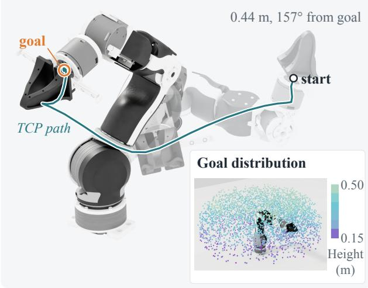

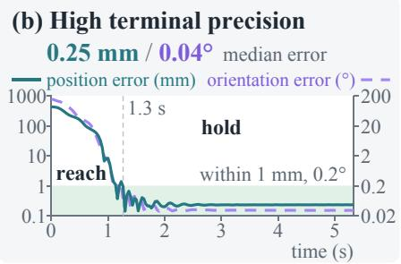

(c) Direct learning on hardware  
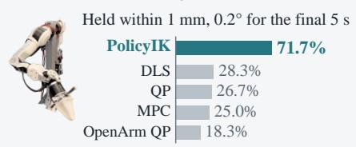  
Figure 1: PolicyIK: from broad reaching to precise regulation. (a) Full-pose reaching across the simulated workspace. (b) Reaching and holding within 1 mm and $0 . 2 ^ { \circ }$ . (c) On hardware, PolicyIK holds the pose within 1 mm and $0 . { \overset { \sim } { 2 ^ { \circ } } }$ throughout the final 5 s on more tasks than classical controllers.

We investigate reinforcement learning (RL) for this setting. An RL policy learns the mapping from pose error to joint commands through interaction with the robot’s dynamics. Sampling goals from reachable configurations yields feasible goals across the workspace, and the designed reward target the required tolerance. Prior RL controllers have reached position goals with fixed-base arms and tracked full poses with legged manipulators, with errors from several millimeters to a few centimeters (Kumar et al., 2021; Aljalbout et al., 2024; Portela et al., 2025; He et al., 2026), and a hybrid reaches sub-millimeter accuracy in kinematic simulation by pairing the policy with damped least squares, which supplies the final correction (Yu & Tan, 2025). Reaching millimeter-level full-pose accuracy with the policy alone calls for a formulation designed around terminal precision.

We present PolicyIK, a goal-conditioned RL formulation that learns high-precision IK for robot arms through a joint-position interface (Figure 2). Like closed-loop IK (Siciliano, 1990), the policy updates a joint reference from pose feedback, but learns this update from interaction. The formulation addresses three properties of precise regulation. First, the policy accumulates its actions in the reference and observes the reference relative to the measured joints, so it can retain the offset that the position controller needs at rest. Second, pose errors enter the observation at coarse and fine scales, and an error-dependent gain shrinks actions near the goal, which resolves small residuals while preserving large motions. Third, the reward credits progress beyond the best error so far and time within tolerance, so it trains both reaching and holding. We train with PPO (Schulman et al., 2017) in parallel simulation (Mittal et al., 2023) and with FlashSAC (Kim et al., 2026) on physical arms. Since every hardware transition costs robot time, a reverse curriculum and near-goal sampling focus training on the terminal phase, while a latent-alignment critic handles large-rotation detours.

We evaluate PolicyIK in simulation and on a physical arm (Figure 1). On a simulated 7-DoF arm, PolicyIK reaches median errors of 0.25 mm and $0 . 0 4 ^ { \circ }$ and meets the 1 mm and $0 . 2 ^ { \circ }$ tolerance on 93.5% of held-out tasks in one attempt and on 98.9% with a deployment protocol. Removing any design component lowers single-attempt success by 1.8–9.2 points. Direct hardware training demonstrates the value of learning to maintain a pose after reaching it. PolicyIK achieves higher reaching and holding success than all four classical IK controllers under the same time budgets. In simulated pick-and-place, it executes the end-effector commands of $\pi _ { 0 . 5 }$ (Physical Intelligence et al., 2025) with 95.7% success across ten adapted LIBERO-Object tasks (Liu et al., 2023), without pick-andplace data in its training. These capabilities come with a low inference cost: an actor forward pass takes 0.035 ms on CPU, well below the 33 ms control period. Our contributions are as follows:

• We show that goal-conditioned RL formulates inverse kinematics for robot arms and can train a policy to reach and hold millimeter-level full-pose precision through a joint-position interface.

• We identify three design choices behind this precision: observing the joint reference relative to the measured joints, sensing pose errors at centimeter and sub-millimeter scales with smaller steps near the goal, and rewarding each new best error and every step within tolerance. Ablations show they affect reaching and holding separately.

• We train PolicyIK directly on two physical arms (OpenArm and xArm7) with FlashSAC (Kim et al., 2026), hindsight goal relabeling (Andrychowicz et al., 2017), and a curriculum from neargoal starts (Florensa et al., 2017) to large rotations. It holds reached poses within 1 mm and 0.2◦ more reliably than classical IK controllers, and executes a VLA policy’s commands in simulated pick-and-place with 95.7% success.

## 2 RELATED WORK

Inverse kinematics and task-space control. Classical approaches map pose commands to joint motion analytically, numerically, or through feedback. Closed-form solutions exist mainly for arms with special geometry (Diankov, 2010), so general and redundant arms rely on damped least squares or constrained optimization (Wampler, 1986; Deo & Walker, 1995; Beeson & Ames, 2015), and closed-loop controllers convert task-space error into joint references under joint limits and secondary objectives (Siciliano, 1990; Haviland & Corke, 2024; Cheng et al., 2021; Xie et al., 2020). These methods require tuning for each robot (Charbonneau et al., 2018; Buss & Kim, 2005) and leave execution of joint motion to the robot’s controller. Learned IK models fit the inverse map from sampled configurations or demonstrations (Ames et al., 2022; Habekost et al., 2024; Yang et ${ \mathrm { a l . , } }$ 2026) and rely on numerical refinement for high accuracy (Morgan et al., 2024). In contrast, PolicyIK learns closed-loop IK from interaction with the robot’s dynamics and regulates the realized pose.

Reinforcement learning for reaching and pose tracking. Reinforcement learning controllers for end-effector reaching range from benchmark tasks to fixed-base arms and legged manipulators. Common multi-goal benchmarks count a reach as successful within 5 cm of a position goal (Plappert et al., 2018; Yu et al., 2020). Policies for fixed-base arms map task-space errors to joint commands and reach position goals with errors of millimeters to centimeters (Kumar et al., 2021; Aljalbou et al., 2024), while whole-body controllers track full end-effector poses on legged manipulators to within a few centimeters (Ha et al., 2024; Portela et al., 2025; He et al., 2026). When tighter tolerances are needed, learning is paired with a classical solver, such as damped least squares, that performs the final correction (Yu & Tan, 2025). PolicyIK learns joint-reference updates for millimeter-level full-pose reaching and sustained holding, without a numerical IK solver.

Learning for execution-error compensation. Residual methods add learned corrections to a conventional controller or its reference trajectory (Johannink et al., 2019; Pavlichenko & Behnke, 2022) and build on its tuning. Integrating methods accumulate policy outputs in the commanded state to reduce steady-state error (Tang et al., 2023; Aljalbout et al., 2024). Integral state augmentation exposes accumulated information for reference tracking (Weber et al., 2022). Once commands are integrated, the accumulated reference becomes part of the system state. PolicyIK observes this reference relative to the measured joints and pairs it with two-scale pose errors and error-dependent action scaling, so one policy handles both large motions and millimeter corrections.

## 3 PROBLEM FORMULATION

Classical IK computes a joint configuration from a goal end-effector pose, but commanding that joint target on a position-controlled arm does not guarantee that the end effector reaches the target pose: gravity, finite gains, and joint limits shift where the arm comes to rest. The controller must therefore close the loop on the pose error, drive it below the tolerance, and hold it there. We formulate this closed-loop regulation as a goal-conditioned RL problem.

A goal-conditioned Markov Decision Process (MDP) is a tuple $( \mathcal { S } , \mathcal { A } , \mathcal { G } , P , r , \nu _ { 0 } , \gamma )$ , in which a policy $\pi ( \boldsymbol { a } \ | \ \boldsymbol { s } , \boldsymbol { g } )$ chooses actions $a \in { \mathcal { A } }$ in states $s \in S$ to reach a goal $g \in { \mathcal { G } }$ . The transition $\bar { P } ( s ^ { \prime } \bar { | } s , \bar { a } )$ is shared across goals, and the policy maximizes the expected sum of rewards $r ( s , a , g )$ discounted by $\gamma ,$ , starting from $( s _ { 0 } , g ) \sim \nu _ { 0 }$ . For a 7-DoF arm in our task:

• The goal is a pose $g = T _ { g } = ( R _ { g } , p _ { g } ) \in S E ( 3 )$ , the group of rigid-body poses with rotation $R _ { g } \in S O ( 3 )$ and position $p _ { g } \in \mathbb { R } ^ { 3 }$

• The state $s _ { t } = ( q _ { t } , \dot { q } _ { t } , z _ { t - 1 } , a _ { t - 1 } )$ contains the measured joint positions $q _ { t } \in \mathbb { R } ^ { 7 }$ and velocities ${ \dot { q } } _ { t } ,$ the previous joint reference $z _ { t - 1 }$ , and the previous action. The end-effector pose follows from forward kinematics, $T _ { t } = ( R _ { t } , p _ { t } ) = \mathrm { F K } ( q _ { t } )$

• The action $a _ { t } \in \mathbb { R } ^ { 7 }$ is an increment to the joint reference $z _ { t } .$ , which will be formally introduced later in Equation 2.

• The transition P tracks $z _ { t }$ with a fixed-gain position controller for one control period $( \Delta t = 1 / 3 0 \mathrm { s }$ in simulation) under the rigid-body dynamics and the joint, command, and torque limits. Because the same action moves the arm differently under different references, $z _ { t - 1 }$ is part of the state.

• The initial distribution $\nu _ { 0 }$ samples a collision-free start configuration $q _ { 0 }$ at rest with $z _ { - 1 } = q _ { 0 } ,$ , and a goal $T _ { g } = \mathrm { F K } ( q ^ { * } )$ at a reachable configuration $q ^ { * }$ inside the defined workspace (Appendix A).

Success criterion. Let $e _ { p } ( t ) = \| p _ { t } - p _ { g } \| _ { 2 }$ be the position error and $e _ { R } ( t ) = \| \mathrm { L o g } ( R _ { q } ^ { \top } R _ { t } ) ^ { \vee } \| _ { 2 }$ the rotation angle between $R _ { t }$ and $R _ { g }$ . The base reward is the sparse success indicator

$$
r ( s _ { t } , a _ { t } , g ) = 1 [ e _ { p } ( t ) \leq 1 \mathrm { m m } \land e _ { R } ( t ) \leq 0 . 2 ^ { \circ } ] ,\tag{1}
$$

which we maximize over an episode, ending only at the time limit. Maximizing it therefore rewards both reaching the tolerance early and staying within it. We evaluate with the same tolerances: an episode strictly succeeds when the mean errors over its final $H = 3 0$ steps (1 s) satisfy Equation 1. Because the sparse reward is rarely observed from distant starts, Section 4.3 will design dense reward terms. As diagnostics, the coarse criterion relaxes the tolerances to 1 cm and $2 ^ { \circ }$ , about the accuracy of prior learned reaching policies in the literature, and containment requires Equation 1 at every step of the final window rather than on average.

## 4 METHOD

At each step, PolicyIK updates a joint reference that the position controller tracks (Figure 2). Holding a pose to a millimeter through this interface raises three problems that coarse reaching can tolerate: the command that holds a pose is state that the joint measurements do not reveal (Section 4.1), the residuals that decide success lie orders of magnitude below the initial errors (Section 4.2), and dense tracking rewards barely distinguish meeting the tolerance from missing it (Section 4.3). Training directly on a physical arm further limits the interaction budget, which Section 4.5 addresses with adaptations to the real-world deployment.

## 4.1 REFERENCE ACCUMULATION AND COMMAND-STATE FEEDBACK

Under gravity and finite gains, an arm settles away from its reference, so holding a goal requires a reference offset from the goal configuration (Appendix A). If actions are applied relative to the measured joints, the policy must regenerate this offset with nonzero actions at every step, and the arm sags whenever actions relax. PolicyIK instead accumulates its actions in the reference,

$$
z _ { t } = \mathrm { c l i p } \left[ z _ { t - 1 } + \eta \beta ( e _ { p } , e _ { R } ) a _ { t } , q ^ { \mathrm { l o } } , q ^ { \mathrm { h i } } \right] ,\tag{2}
$$

so that a zero action retains the offset, a multi-step integration in the terminology of Aljalbout et al. (2024). Here η is the action scale, $\beta$ is the error-dependent gain of Section 4.2, and $q ^ { \mathrm { l o } } , q ^ { \mathrm { h i } }$ are the joint limits.

Accumulation makes the reference part of the state: the same joint state, goal, and action lead to different next states under different references. Without observing the reference, the policy would have to infer it from its action history. PolicyIK therefore feeds back the command state $d _ { t } \ =$ $z _ { t - 1 } - q _ { t }$ , the offset between the reference and the measured joints, within the augmented policy input $o _ { t }$ , built from $s _ { t }$ and $g$

$$
o _ { t } = \mathrm { c o n c a t } \big ( q _ { t } - \bar { q } , \dot { q } _ { t } , p _ { g } , \Delta k _ { t } , v _ { t } ^ { c } , v _ { t } ^ { f } , h _ { t } , d _ { t } , a _ { t - 1 } \big ) ,\tag{3}
$$

where q¯ is a nominal configuration, poses are in base frame, $\Delta k _ { t } , v _ { t } ^ { c }$ , and $v _ { t } ^ { f }$ are pose features (Section 4.2), and $h _ { t }$ exposes running-best error (Section 4.3). The actor and critic share this observation.

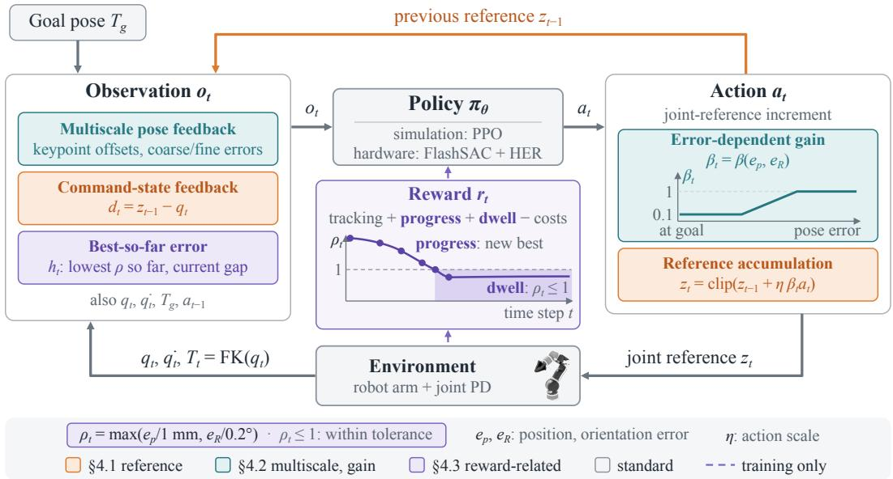  
Figure 2: PolicyIK control formulation. At each step, the policy maps the observation to a jointreference increment, which is scaled by the error-dependent gain, accumulated in the joint reference, and tracked by a joint PD controller. Colored blocks are the designs of Sections 4.1 to 4.3.

## 4.2 MULTISCALE POSE FEEDBACK AND ACTION SCALING

Correcting millimeter residuals requires the policy both to perceive them and to resolve them with actions. Without error channels scaled to the tolerance, we observed the arm settling at a biased equilibrium short of the goal. Input normalization scales each channel by its spread over the workspace, so millimeter differences occupy a negligible fraction of the joint, goal, and keypoint inputs. PolicyIK therefore represents the pose error at two scales and adapts its step size to the error.

Multiscale pose feedback. Following keypoint-based pose representations (Portela et al., 2025), three noncollinear local offsets $c _ { i }$ define

$$
\Delta k _ { i , t } = ( p _ { g } + R _ { g } c _ { i } ) - ( p _ { t } + R _ { t } c _ { i } ) ,\tag{4}
$$

which express translation and orientation errors as position differences. To let the policy perceive millimeter errors, we also express the error in the current end-effector frame, clipped at a coarse and a fine scale,

$$
\begin{array} { r } { v _ { t } ^ { \ell } = \left[ \overset { \mathrm { c l i p } } { \mathrm { c l i p } } \big ( R _ { t } ^ { \top } ( p _ { g } - p _ { t } ) / \delta _ { \ell } , - 1 , 1 \big ) \right] , \qquad \ell \in \{ c , f \} , } \end{array}\tag{5}
$$

with $( \delta _ { c } , \alpha _ { c } ) = ( 1 \mathrm { c m } , 2 0 ^ { \circ } )$ and $( \delta _ { f } , \alpha _ { f } ) = ( 0 . 5 \ : \mathrm { m m } , 0 . 2 5 ^ { \circ } )$ . The coarse channels resolve errors below 1 cm and 20◦, and the fine channels resolve errors at the scale of the tolerance: an orientation error of $0 . 2 ^ { \circ }$ fills 1% of the coarse range but 80% of the fine range.

Error-dependent action scaling. A single action scale sets both the speed of transport and the resolution of the final correction, because the reference moves by η times any error in the action. With a fixed scale, small values slowed transport and large values lowered terminal precision. PolicyIK therefore scales each update by the gain

$$
\begin{array} { l } { \displaystyle \beta ( { e _ { p } , e _ { R } } ) = \operatorname* { m a x } \{ G ( e _ { p } ; l _ { p } , u _ { p } ) , G ( e _ { R } ; l _ { R } , u _ { R } ) \} , } \\ { \displaystyle G ( \boldsymbol { e } ; l , u ) = \beta _ { \mathrm { m i n } } + ( 1 - \beta _ { \mathrm { m i n } } ) \exp \left( \frac { { e - l } } { u - l } , 0 , 1 \right) , } \end{array}\tag{6}
$$

which keeps the full step while either error exceeds its upper threshold u and reduces it to $\beta _ { \mathrm { m i n } } \eta$ once both errors fall below their lower thresholds l (Appendix A). Because the gain follows the error rather than time, fine resolution engages whenever the arm nears the goal, regardless of duration.

## 4.3 REWARD DESIGN

The reward combines terms for the approach and for the terminal phase:

$$
r _ { t } = r _ { t } ^ { \mathrm { t r a c k } } + r _ { t } ^ { \mathrm { p r o g r e s s } } + r _ { t } ^ { \mathrm { d w e l l } } - c _ { t } ^ { \mathrm { m o t i o n } } - c _ { t } ^ { \mathrm { l i m i t } } .\tag{7}
$$

Tracking guides the approach, progress and dwell reward reaching and holding the tolerance, and the costs regularize motion. Appendix B lists all terms and weights.

Tracking. The tracking reward

$$
r _ { t } ^ { \mathrm { t r a c k } } = - 0 . 2 e _ { p } ( t ) + 0 . 1 K ( e _ { p } ( t ) ; 0 . 1 ) + K ( \varepsilon _ { t } ; 0 . 2 ) + K ( \varepsilon _ { t } ; 0 . 0 5 ) ,\tag{8}
$$

where $e _ { p } ( t )$ is in meters, εt is the mean of $\| ( p _ { t } + R _ { t } \tilde { c } _ { i } ) - ( p _ { g } + R _ { g } \tilde { c } _ { i } ) \| _ { 2 }$ over three keypoint offsets $\tilde { c } _ { i } ( \mathrm { A p p e n d i x \ } \mathbf { B } )$ , and $K ( x ; \sigma ) = 1 - \operatorname { t a n h } ( x / \sigma )$ . Each kernel is bounded and steepest within its bandwidth $\sigma ,$ , which strengthens the pull to the goal without growing at large errors. Within 1 mm of the goal, each kernel changes by at most 2% of its range, a weak signal at the tolerance scale.

Tolerance-normalized error. Success requires the position and orientation errors to satisfy their tolerances at once. A reward on summed errors lets progress on one error compensate for the other, because the sum rewards reducing whichever error is easier while the other remains outside its tol erance. The precision terms therefore use the tolerance-normalized error and its running minimum,

$$
\rho _ { t } = \operatorname* { m a x } \Bigl \{ \frac { e _ { p } ( t ) } { 1 \mathrm { m m } } , \frac { e _ { R } ( t ) } { 0 . 2 ^ { \circ } } \Bigr \} , \qquad b _ { t } = \operatorname* { m i n } \{ b _ { t - 1 } , \rho _ { t } \} .\tag{9}
$$

Thus $\rho _ { t } \ \leq 1$ exactly when both current errors are at most 1 mm and $0 . 2 ^ { \circ }$ , and $\rho _ { t }$ decreases only when the binding error decreases. The running minimum $b _ { t } ,$ reset for each new goal, records the best accuracy reached so far. The observation includes $h _ { t } .$ , which contains $b _ { t - 1 }$ and the gap $\rho _ { t } - b _ { t - 1 }$ after clipping and scaling (Appendix B).

Progress. The progress reward drives $\rho _ { t }$ below one with three terms of distinct roles:

$$
r _ { t } ^ { \mathrm { p r o g r e s s } } = w _ { n } r _ { t } ^ { \mathrm { i m p } } + r _ { t } ^ { \mathrm { s h a p e } } - w _ { b } c _ { t } ^ { \mathrm { b a c k } } , \qquad r _ { t } ^ { \mathrm { i m p } } = \bigl [ U ( \rho _ { t } ) - U ( b _ { t - 1 } ) \bigr ] _ { + } ,\tag{10}
$$

$$
r _ { t } ^ { \mathrm { s h a p e } } = \gamma \Phi _ { t } - \Phi _ { t - 1 } , \qquad c _ { t } ^ { \mathrm { b a c k } } = \operatorname* { m i n } \{ 3 , [ \rho _ { t } - b _ { t - 1 } ] _ { + } \} ,
$$

where $[ x ] _ { + } = \mathrm { m a x } ( x , 0 ) , U ( \rho ) = \textstyle { \frac { 1 } { 2 } } [ 1 + \mathrm { t a n h } ( 2 ( 1 - \rho ) ) ]$ rises from 0 to 1 as $\rho$ crosses one, $\Phi _ { t } = - \operatorname* { m i n } ( 5 0 , \rho _ { t } )$ , and $w _ { n }$ and $w _ { b }$ are weights. The improvement term $r _ { t } ^ { \mathrm { i m p } }$ pays only when the running best improves. Because $b _ { t }$ never increases, these payments telescope, so each accuracy level is paid once and staying earns nothing. The term can therefore carry a large weight without rewarding oscillation or stopping short of the tolerance, and $U$ concentrates its payment on crossing into the tolerance. The potential-based shaping term $r _ { t } ^ { \mathrm { s h a p e } }$ (Ng et al., 1999) adds a dense signal within 50 tolerance units, which also rewards returning toward a best that the improvement term no longer pays for. The backslide cost $c _ { t } ^ { \mathrm { b a c k } }$ charges losses relative to the best and discourages drift away from the accuracy already reached. Its cap of three tolerance units lets it grow with small drifts while staying constant for the larger excursions that reconfiguration requires.

Dwell. The dwell reward $r _ { t } ^ { \mathrm { d w e l l } } = \mathbb { 1 } [ \rho _ { t } \leq 1 ]$ , the success indicator of Equation 1, pays for every step inside the tolerance. The improvement term pays nothing for staying, and without the dwell reward, policies more often touched the tolerance and then left it. Dwell rewards retaining accuracy, while the improvement term rewards acquiring it. For the same reason, episodes end only at timeout, since ending a goal at success would forfeit the dwell rewards that follow.

Costs. The motion cost $c _ { t } ^ { \mathrm { m o t i o n } }$ penalizes squared action rates and joint velocities. The limit cost $c _ { t } ^ { \mathrm { l i m i t } }$ keeps the worst joint away from its limits and applies only while $\rho _ { t } > 1 0$ , so it does not compete with the final correction.

## 4.4 SIMULATION TRAINING AND DEPLOYMENT

We train with PPO (Schulman et al., 2017) and generalized advantage estimation (Schulman et al., 2016) in 4,096 environments. Training rollouts last 12 s and resample the goal every 4 s without resetting the arm, so each rollout chains three attempts and later attempts start wherever the previous one left the arm. Appendix B gives the architecture and training settings.

Deployment protocol. A strict failure in a single attempt ends either near the goal with a small residual error or farther from it. When further attempts are allowed, a fixed protocol handles each case. A failure within 1 cm of the goal is retried with an error-corrected goal that cancels the residual. Other failures receive up to eight attempts that first command a transient goal to move the arm to a different configuration. Every attempt is judged against the original goal (Appendix C).

## 4.5 REAL-ROBOT TRAINING

PolicyIK can also be trained directly on a physical arm, without simulation weights. The formulation of Sections 4.1 to 4.3 carries over up to minor hyperparameter changes. On hardware, every transition costs robot time while computation is relatively cheap, so PolicyIK spends computation to save transitions and concentrates its data where precision is decided. We adapt FlashSAC (Kim et al., 2026), an off-policy soft actor-critic variant (Haarnoja et al., 2018), together with Hindsight Experience Replay (HER) (Andrychowicz et al., 2017). Appendix H gives all details of this recipe. Below, we highlight some of our design choices.

Latent-alignment critic (Appendix H.2). Large-rotation goals often require a detour in joint space, during which the pose error first grows. A standard critic tends to assign similar values to poses that look close, so it favors moving straight toward the goal. Following LAN (Kang et al., 2026), our critic embeds the state and action with one network and the goal with another, and predicts the value from their difference (Figure 8b). Such an architectural design has been shown to better capture the temporal distance between observations and goals (Kang et al., 2026).

Near-goal sampling (Appendix H.3). Steps near the goal decide success but make up a small part of each episode early in training, which is mostly spent on the approach. We therefore draw most of each training batch from such steps. This focuses learning on the final correction and holding, and in our experiments it also improved reaching overall.

Reverse curriculum (Appendix H.4). From random starts, the arm would rarely reach the tolerance early in training. Motivated by Florensa et al. (2017), episodes start close to their goals, so the policy learns the final correction and holding first. As training proceeds, start distances then grow. We also mix this curriculum with sampling from large-rotation tasks directly to encourage the policy to cover wide task distributions.

## 5 EXPERIMENTS

We evaluate the precision of PolicyIK in simulation, the contribution of each component, and its use as a low-level controller in simulated pick-and-place and on a physical arm.

## 5.1 SIMULATION EXPERIMENTS

Setup and metrics. We evaluate a fixed-base 7-DoF OpenArm in Isaac Sim on 4,120 start–goal pairs from collision-free configurations disjoint from the training pools, with goals inside the deployment workspace. Each attempt lasts 160 policy steps (5.3 s). We report strict and coarse success (Section 3) and median terminal-window errors over all tasks, including failures, as mean ± standard deviation across three training seeds. Appendices A and C give the split and aggregation details.

Baselines. Prior RL reaching controllers report position goals or centimeter-level full-pose tracking (Section 2), so we adapt the full-pose tracking recipe of UMI on Legs (Ha et al., 2024) to our fixed-base arm (UMI-RL), retaining its reward, orientation curriculum, network, and PPO settings with a comparable training budget. Additional tuning is reported in Appendix D. We also compare against classical differential IK controllers, damped least squares (DLS) and resolved-rate quadratic programming (QP), and a kinematic model-predictive controller (MPC), described in Appendix E.

## 5.1.1 MAIN RESULTS

Precision and coverage. In a single attempt, PolicyIK achieves 93.5% strict success and 96.6% coarse success, with median position and orientation errors of 0.25 mm and 0.04◦, respectively (Table 1). The deployment protocol further increases strict success to 98.9% through corrected-goal and transient-goal retries (Appendix C). By comparison, UMI-RL achieves 16.4% coarse success after task-specific tuning, but no strict success. PolicyIK exceeds DLS, QP, and MPC by 43, 37, and 37 points in strict success. On 34–35% of tasks, these controllers fail even the coarse criterion while a joint remains close to its limit during the final second. These cases account for 71–81% of their strict failures and typically exhibit nearly constant terminal errors. PolicyIK achieves about 90% strict success on the same tasks (Appendix E).

Table 1: Simulation results. With deployment, each task reports its first strictly successful attempt, or its last attempt if none succeeds, and $\dot { \boldsymbol { { \cal E } } } [ N ]$ is the mean number of attempts. DLS, QP, and MPC are tuned on a separate set of tasks from the same distribution (Appendix E).
<table><tr><td colspan="3"></td><td colspan="2">Median error</td><td rowspan="2">E[N]</td></tr><tr><td>Controller</td><td>Strict (%) ↑</td><td>Coarse (%) ↑</td><td>Pos. (mm) ↓</td><td>Ori. (°)↓</td></tr><tr><td>UMI-RL (tuned)</td><td>0.00±0.00</td><td>16.38±3.10</td><td>16.65±0.80</td><td>4.25±0.77</td><td>1.000</td></tr><tr><td>DLS</td><td>50.41</td><td>64.42</td><td>0.94</td><td>0.15</td><td>1.000</td></tr><tr><td>QP</td><td>56.21</td><td>63.98</td><td>0.57</td><td>0.11</td><td>1.000</td></tr><tr><td>MPC</td><td>56.33</td><td>64.78</td><td>0.54</td><td>0.10</td><td>1.000</td></tr><tr><td>PolicyIK</td><td>93.49±0.20</td><td>96.56±0.16</td><td>0.25±0.02</td><td>0.04±0.00</td><td>1.000</td></tr><tr><td>+ deployment</td><td> $\overline { { 9 8 . 9 2 } } \pm 0 . 2 3$ </td><td> $\overline { { 9 9 . 4 3 } } \pm 0 . 0 9$ </td><td> $\mathbf { 0 . 2 5 \bot 0 . 0 2 }$ </td><td>0.04±0.00</td><td>1.212</td></tr></table>

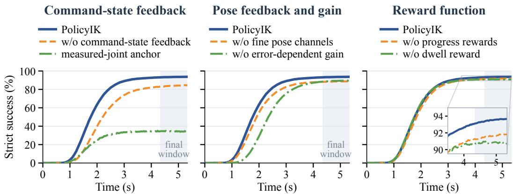  
Figure 3: Ablations on command-state feedback, pose feedback and gain, and rewards. Curves show the share of test tasks within 1 mm and $0 . 2 ^ { \circ }$ at each time step.

Holding. PolicyIK stays within both strict thresholds at every sample of the final second on 92.4% of tasks, showing that its terminal accuracy extends beyond the mean-error criterion. On successful tasks, median net motion over that second is 14 µm and 0.002◦ (Appendix C).

Efficiency. PolicyIK is inexpensive to execute: a forward pass of its two-layer actor takes 0.035 ms at batch size one with PyTorch on one AMD EPYC 9454 CPU core, three orders of magnitude below the 33 ms control period, and the deployment protocol adds only 0.21 attempts per task on average.

## 5.1.2 ABLATIONS

Command-state feedback and reference anchor. Terminal accuracy is more sensitive to the reference interface than coarse reaching (Figure 3; Table 7). Removing command-state feedback reduces strict success by 9.2 points. Re-anchoring the reference of this 47-dimensional variant at the measured joints retains 95.9% coarse success but reduces strict success from 84.3% to 30.8%. These comparisons support retaining the accumulated reference state.

Pose feedback and action scaling. Fine pose channels and error-dependent scaling support complementary aspects of terminal correction. Removing the fine channels increases median position error from 0.25 to 0.36 mm; replacing the error-dependent gain with a fixed gain increases median entry time from 1.73 to 2.28 s. Either change reduces strict success by 4–5 points. Appendix F reports the combined removal and gain-selection analysis.

Reward function. The reward ablations distinguish entering the tolerance from final-window containment. Without the dwell reward, the arm enters the tolerance about as fast but leaves it more often before the attempt ends. Among tasks that enter the tolerance, 7.8% are not held throughout the final second, against 2.4% with dwell. Removing the progress rewards reduces strict success by 1.8 points. These results support rewarding both progress and sustained accuracy.

## 5.1.3 PICK-AND-PLACE WITH A VLA POLICY

Setup. We evaluate π0.5-LIBERO (Physical Intelligence et al., 2025) on ten adapted LIBERO-Object tasks (Liu et al., 2023) with a side-mounted OpenArm in Isaac Sim. PolicyIK is retrained for this mount, where gravity acts along a different base axis, with the same recipe, without pick-andplace data. All controllers use the same fixed model of the Panda operational-space controller to convert the VLA commands into pose references. We compare PolicyIK with default DLS (Wampler, 1986), which clamps joint targets, and hand-tuned DLS and QP with joint-limit constraints, on 50 official initial states per task, three runs each. Appendix G details the adapter and controller settings.

Results. PolicyIK achieves 95.7% success (Table 2), comparable to hand-tuned DLS (96.7%) and above default DLS and hand-tuned QP (both 90.8%). Differences are concentrated on targets near the mount, where grasping brings a shoulder joint to its limit (Figure 4; Appendix G). Trained only for pose regulation, PolicyIK executes VLA commands in pick-and-place without a Jacobian, online optimization, or gravity feedforward.

Table 2: Pick-and-place success on ten LIBERO-Object tasks in simulation.
<table><tr><td>Low-level controller</td><td>Success (%)</td></tr><tr><td>DLS (default)</td><td>90.8</td></tr><tr><td>DLS (hand-tuned)</td><td>96.7</td></tr><tr><td>QP (hand-tuned)</td><td>90.8</td></tr><tr><td>PolicyIK</td><td>95.7</td></tr></table>

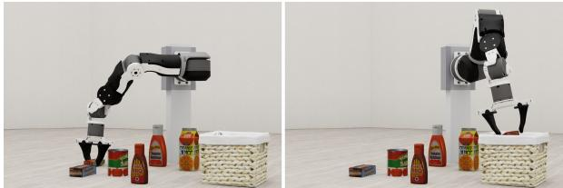  
Figure 4: PolicyIK successfully grasping the butter at its shoulder limit (left) and placing it in the basket (right).

## 5.2 REAL-ROBOT EXPERIMENTS

Setup. We evaluate PolicyIK trained directly on a physical 7-DoF OpenArm, without sim-to-real transfer (Section 4.5). We choose OpenArm because its limited wrist motion makes full-pose control challenging (Enactic, 2026). Joint-position references are tracked by PD control with gravity feedforward. Hardware pose errors are computed from joint encoders using forward kinematics in the modeled gripper frame. We mainly evaluate 60 fullpose tasks with a 25 s execution budget.

Metrics. A task is reached once both the position and orientation errors remain within 1 mm and 0.2◦ for at least 0.5 s. Holding success requires both errors to remain within these tolerances throughout the final 5 s. Both errors are averaged over the final second of each task and reported as medians across tasks. Appendices H.7 and I specify the evaluation protocol and controller settings.

(a) MPC after reaching the goal  
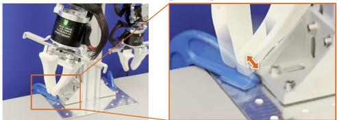

Baselines. We compare four classical controllers that output joint-position references: DLS, resolved-rate QP, MPC, and adapted OpenArm QP. Their hardware-tuned settings and execution constraints are given in Appendix I.

(b) Terminal behavior in the final 3 s  
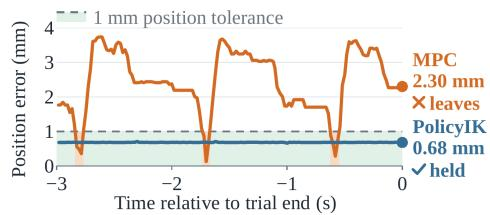

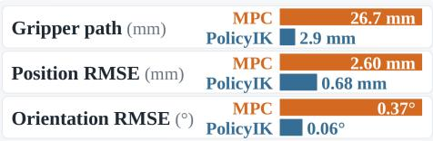  
Figure 6: A case in which MPC jitters around the goal after reaching, while PolicyIK holds.

Table 3: Reaching, holding, and median pose errors on 60 physical tasks within 25 s. The best result is in bold, and the second-best is underlined.
<table><tr><td>Controller</td><td>Reached ↑</td><td>Held ↑</td><td>Position (mm) ↓</td><td>Orientation (°) ↓</td></tr><tr><td>DLS</td><td>48/60</td><td>17/60</td><td>0.65</td><td>0.13</td></tr><tr><td>Resolved-rate QP</td><td>48/60</td><td>16/60</td><td>0.57</td><td>0.14</td></tr><tr><td>Kinematic MPC</td><td>46/60</td><td>15/60</td><td>0.81</td><td>0.18</td></tr><tr><td>Adapted OpenArm QP</td><td>32/60</td><td>11/60</td><td>0.99</td><td>0.23</td></tr><tr><td>PolicyIK</td><td>54/60</td><td>43/60</td><td>0.50</td><td>0.12</td></tr></table>

PolicyIK DLS Resolved-rate QP Kinematic MPC Adapted OpenArm QP

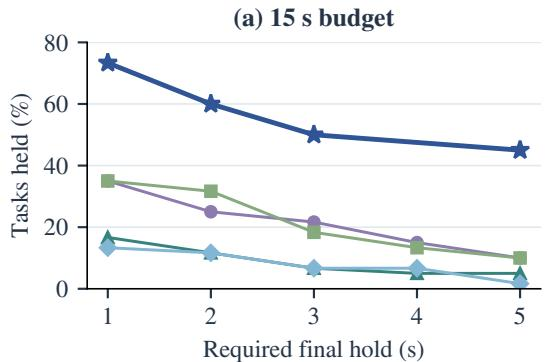

(b) 25 s budget  
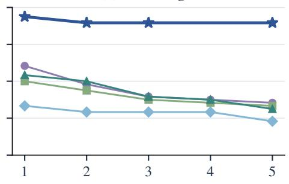  
Required final hold (s)  
Figure 5: Sustained holding on 60 physical OpenArm tasks as the required final hold increases from 1 to 5 s, at execution budgets of (a) 15 s and (b) 25 s. Both pose errors must remain within 1 mm and 0.2◦ throughout the required interval. Markers denote evaluated holding windows.

Reaching and holding. PolicyIK achieves the highest reaching and sustained-holding success among the evaluated controllers. Within 25 s, it reaches 54 of the 60 tasks and holds 43 throughout the final 5 s, achieving 71.7% holding success compared with at most 28.3% for the classical controllers (Table 3). Extending the required hold from 1 s to 5 s preserves 43 of PolicyIK’s 45 successes, showing that it maintains precise control under a longer holding requirement (Figure 5). Its median position and orientation errors are also the lowest among the evaluated controllers.

Figure 6 shows why holding matters after reaching. MPC continues to correct small errors and repeatedly moves outside the 1 mm position tolerance, while PolicyIK stays within. PolicyIK’s dwell reward encourages staying within tolerance. Reference accumulation keeps the joint-position command unchanged when actions are zero. The simulation ablations justify both components in holding pose. Appendix H.7 reports the additional execution budgets and holding windows.

Cross-embodiment applicability. The PolicyIK formulation also supports precise control on a physical xArm7. Both simulation-trained and hardware-trained policies achieve 60/60 successes on standard reaching and on large-rotation tasks (Appendix J).

## 6 CONCLUSION

We presented PolicyIK, a goal-conditioned RL formulation for high-precision IK through a jointposition interface. Reference accumulation with command-state feedback retains the offset that the position controller needs at rest, two-scale pose errors with an error-dependent gain resolve millimeter residuals, and progress and dwell rewards train reaching and holding. Ablations show that each design mainly raises terminal precision, so precise IK training should target the terminal phase. In simulation, a single attempt meets the 1 mm and 0.2◦ tolerance on far more held-out tasks than tuned classical controllers. Training on a physical arm applies the same principle through a reverse curriculum and near-goal sampling. The resulting policy reaches and holds more tasks than all four classical baselines. PolicyIK also executes π0.5 commands in simulated pick-and-place without task-specific training. These results show that RL can provide high-precision IK for robot arms.

## AUTHOR CONTRIBUTIONS

Yuhan Liu designed the policy’s observations, actions, and reward (Sections 4.1–4.3) and conducted the simulation experiments, including pick-and-place with $\pi _ { 0 . 5 }$ . Yuhan Liu also led the writing of the paper, organized the codebase, and built the project website. Xinqi Liu set up the real-robot platform, implemented and tuned the classical controllers and PolicyIK controller, conducted the OpenArm and xArm7 experiments, drafted the real-robot sections, and wrote Appendix I. Zixuan Dong extended the training recipe to hardware with FlashSAC, conducted the OpenArm experiments, wrote Appendix H, and revised Sections 3 and 4.5.

## REFERENCES

Elie Aljalbout, Felix Frank, Maximilian Karl, and Patrick van der Smagt. On the role of the action space in robot manipulation learning and sim-to-real transfer. IEEE Robotics and Automation Letters, 9(6):5895–5902, 2024. doi: 10.1109/lra.2024.3398428.

Barrett Ames, Jeremy Morgan, and George Konidaris. IKFlow: Generating diverse inverse kinematics solutions. IEEE Robotics and Automation Letters, 7(3):7177–7184, 2022. doi: 10.1109/lra.2022.3181374.

Marcin Andrychowicz, Filip Wolski, Alex Ray, Jonas Schneider, Rachel Fong, Peter Welinder, Bob McGrew, Josh Tobin, Pieter Abbeel, and Wojciech Zaremba. Hindsight experience replay. In Advances in Neural Information Processing Systems (NeurIPS), 2017. URL https://proceedings.neurips.cc/paper\_files/paper/2017/ file/453fadbd8a1a3af50a9df4df899537b5-Paper.pdf.

Philip J. Ball, Laura Smith, Ilya Kostrikov, and Sergey Levine. Efficient online reinforcement learning with offline data. In International Conference on Machine Learning (ICML), pp. 1577–1594, 2023. URL https://proceedings.mlr.press/v202/ball23a.html.

Patrick Beeson and Barrett Ames. TRAC-IK: An open-source library for improved solving of generic inverse kinematics. In IEEE-RAS International Conference on Humanoid Robots (Humanoids), pp. 928–935, 2015. doi: 10.1109/humanoids.2015.7363472.

Marc G. Bellemare, Will Dabney, and Remi Munos. A distributional perspective on reinforcement´ learning. In International Conference on Machine Learning (ICML), pp. 449–458, 2017. URL https://proceedings.mlr.press/v70/bellemare17a.html.

Antonia Bronars, Younghyo Park, and Pulkit Agrawal. Tune to learn: How controller gains shape robot policy learning. In Robotics: Science and Systems (RSS), 2026. doi: 10.15607/RSS.2026. XXII.139.

Joel W. Burdick. On the inverse kinematics of redundant manipulators: Characterization of the selfmotion manifolds. In IEEE International Conference on Robotics and Automation (ICRA), pp. 264–270, 1989. doi: 10.1109/robot.1989.99999.

Samuel R. Buss. Introduction to inverse kinematics with Jacobian transpose, pseudoinverse and damped least squares methods. Technical report, University of California, San Diego, 2009.

Samuel R. Buss and Jin-Su Kim. Selectively damped least squares for inverse kinematics. Journal ofGraphics Tools, 10(3):37–49, 2005. doi: 10.1080/2151237x.2005.10129202.

Marie Charbonneau, Valerio Modugno, Francesco Nori, Giuseppe Oriolo, Daniele Pucci, and Serena Ivaldi. Learning robust task priorities of QP-based whole-body torque-controllers. In IEEE-RAS International Conference on Humanoid Robots (Humanoids), pp. 1–9, 2018. doi: 10.1109/ humanoids.2018.8624995.

Lawrence Yunliang Chen, Karthik Dharmarajan, Kush Hari, Chenfeng Xu, Quan Vuong, and Ken Goldberg. Mirage: Cross-embodiment zero-shot policy transfer with cross-painting. In Robotics: Science and Systems (RSS), 2024. URL https://openreview.net/forum? id=oDQg4GyXIj.

Ching-An Cheng, Mustafa Mukadam, Jan Issac, Stan Birchfield, Dieter Fox, Byron Boots, and Nathan Ratliff. RMPflow: A geometric framework for generation of multi-task motion policies. IEEE Transactions on Automation Science and Engineering, 18(3):968–987, 2021. doi: 10.1109/ tase.2021.3053422.

Cheng Chi, Zhenjia Xu, Chuer Pan, Eric Cousineau, Benjamin Burchfiel, Siyuan Feng, Russ Tedrake, and Shuran Song. Universal manipulation interface: In-the-wild robot teaching without in-the-wild robots. In Robotics: Science and Systems (RSS), 2024. doi: 10.15607/RSS.2024. XX.045.

Arati S. Deo and Ian D. Walker. Overview of damped least-squares methods for inverse kinematics of robot manipulators. Journal of Intelligent & Robotic Systems, 14(1):43–68, 1995. doi: 10. 1007/bf01254007.

Rosen Diankov. Automated Construction ofRobotic Manipulation Programs. PhD thesis, Carnegie Mellon University, 2010.

Enactic. OpenArm 1.0: General specifications. https://docs.openarm.dev/1.0/ hardware/, 2026. Version 1.0 documentation. Updated October 26, 2026. Accessed October 29, 2026.

Carlos Florensa, David Held, Markus Wulfmeier, Michael Zhang, and Pieter Abbeel. Reverse curriculum generation for reinforcement learning. In Conference on Robot Learning (CoRL), pp. 482–495, 2017. URL https://proceedings.mlr.press/v78/florensa17a. html.

Huy Ha, Yihuai Gao, Zipeng Fu, Jie Tan, and Shuran Song. UMI on legs: Making manipulation policies mobile with manipulation-centric whole-body controllers. In Conference on Robot Learning (CoRL), 2024. URL https://openreview.net/forum?id=3i7j8ZPnbm.

Tuomas Haarnoja, Aurick Zhou, Pieter Abbeel, and Sergey Levine. Soft actor-critic: Off-policy maximum entropy deep reinforcement learning with a stochastic actor. In International Conference on Machine Learning (ICML), pp. 1861–1870, 2018. URL https://proceedings. mlr.press/v80/haarnoja18b.html.

Jan-Gerrit Habekost, Connor Gade, Philipp Allgeuer, and Stefan Wermter. Inverse kinemat-¨ ics for neuro-robotic grasping with humanoid embodied agents. In IEEE/RSJ International Conference on Intelligent Robots and Systems (IROS), pp. 7315–7322, 2024. URL https: //openreview.net/forum?id=MmCEoPfRrc.

Jesse Haviland and Peter Corke. Manipulator differential kinematics: Part 2: Acceleration and advanced applications. IEEE Robotics & Automation Magazine, 31(4):159–169, 2024. doi: 10. 1109/mra.2023.3270221.

Zhengmao He, Moonkyu Jung, Hyeongjun Kim, Jiseong Lee, Hui Zhang, Jemin Hwangbo, and Jie Song. PAKE: Learning whole-body loco-manipulation with partial kinematic embeddings. IEEE Robotics and Automation Letters, pp. 1–8, 2026. doi: 10.1109/lra.2026.3747622.

Tobias Johannink, Shikhar Bahl, Ashvin Nair, Jianlan Luo, Avinash Kumar, Matthias Loskyll, Juan Aparicio Ojea, Eugen Solowjow, and Sergey Levine. Residual reinforcement learning for robot control. In IEEE International Conference on Robotics and Automation (ICRA), pp. 6023– 6029, 2019. doi: 10.1109/icra.2019.8794127.

Hyungkyu Kang, Byeongchan Kim, and Min-hwan Oh. Latent representation alignment for offline goal-conditioned reinforcement learning. In International Conference on Machine Learning (ICML), 2026. URL https://openreview.net/forum?id=oddGER4AzK.

Donghu Kim, Youngdo Lee, Minho Park, Kinam Kim, Takuma Seno, I. Made Aswin Nahrendra, Sehee Min, Daniel Palenicek, Florian Vogt, Danica Kragic, Jan Peters, Jaegul Choo, and Hojoon Lee. FlashSAC: Fast and Stable Off-Policy Reinforcement Learning for High-Dimensional Robot Control. In Proceedings ofRobotics: Science and Systems, 2026.

Moo Jin Kim, Karl Pertsch, Siddharth Karamcheti, et al. OpenVLA: An open-source visionlanguage-action model. In Conference on Robot Learning (CoRL), 2024. URL https: //openreview.net/forum?id=ZMnD6QZAE6.

Visak Kumar, David Hoeller, Balakumar Sundaralingam, Jonathan Tremblay, and Stan Birchfield. Joint space control via deep reinforcement learning. In IEEE/RSJ International Conference on Intelligent Robots and Systems (IROS), pp. 3619–3626, 2021. doi: 10.1109/IROS51168.2021. 9636477.

Haeone Lee, Byeongguk Jeon, Suchae Jeong, Jian Kim, and Kimin Lee. Space: Enabling learning from cross-robot data toward generalist policies, 2026. URL https://arxiv.org/abs/ 2606.24049.

Hojoon Lee, Youngdo Lee, Takuma Seno, Donghu Kim, Peter Stone, and Jaegul Choo. Hyperspherical normalization for scalable deep reinforcement learning. In International Conference on Machine Learning (ICML), 2025. URL https://openreview.net/forum?id= kfYxyvCYQ4.

Marion Lepert, Ria Doshi, and Jeannette Bohg. Shadow: Leveraging segmentation masks for crossembodiment policy transfer. In Conference on Robot Learning (CoRL), 2024. URL https: //openreview.net/forum?id=MyyZZAPgpy.

Bo Liu, Yifeng Zhu, Chongkai Gao, Yihao Feng, Qiang Liu, Yuke Zhu, and Peter Stone. LIBERO: Benchmarking knowledge transfer for lifelong robot learning. In Advances in Neural Information Processing Systems (NeurIPS), 2023. URL https://openreview.net/forum?id= xzEtNSuDJk.

Kevin M. Lynch and Frank C. Park. Modern Robotics: Mechanics, Planning, and Control. Cambridge University Press, 2017.

Mayank Mittal, Calvin Yu, Qinxi Yu, Jingzhou Liu, Nikita Rudin, David Hoeller, Jia Lin Yuan, Ritvik Singh, Yunrong Guo, Hammad Mazhar, Ajay Mandlekar, Buck Babich, Gavriel State, Marco Hutter, and Animesh Garg. Orbit: A unified simulation framework for interactive robot learning environments. IEEE Robotics and Automation Letters, 8(6):3740–3747, 2023. doi: 10.1109/lra.2023.3270034.

Jeremy Morgan, David Millard, and Gaurav S. Sukhatme. CppFlow: Generative inverse kinematics for efficient and robust Cartesian path planning. In IEEE International Conference on Robotics and Automation (ICRA), pp. 12279–12285, 2024. doi: 10.1109/ICRA57147.2024.10611724.

Andrew Y. Ng, Daishi Harada, and Stuart Russell. Policy invariance under reward transformations: Theory and application to reward shaping. In International Conference on Machine Learning (ICML), pp. 278–287, 1999.

Octo Model Team, Dibya Ghosh, Homer Walke, Karl Pertsch, et al. Octo: An open-source generalist robot policy. In Robotics: Science and Systems (RSS), 2024. URL https://openreview. net/forum?id=bfqWUE3EcX.

Open X-Embodiment Collaboration, Abby O’Neill, Abdul Rehman, Abhiram Maddukuri, et al. Open X-Embodiment: Robotic learning datasets and RT-X models. In IEEE International Conference on Robotics and Automation (ICRA), pp. 6892–6903, 2024. doi: 10.1109/ICRA57147. 2024.10611477.

Seohong Park, Kevin Frans, Benjamin Eysenbach, and Sergey Levine. OGBench: Benchmarking offline goal-conditioned RL. In International Conference on Learning Representations (ICLR), 2025. URL https://openreview.net/forum?id=M992mjgKzI.

Dmytro Pavlichenko and Sven Behnke. Real-robot deep reinforcement learning: Improving trajectory tracking of flexible-joint manipulator with reference correction. In IEEE International Conference on Robotics and Automation (ICRA), pp. 2671–2677, 2022. doi: 10.1109/ICRA46639. 2022.9812023.

Physical Intelligence et al. $\pi _ { 0 . 5 } \colon$ a vision-language-action model with open-world generalization. In Conference on Robot Learning (CoRL), 2025. URL https://openreview.net/forum? id=vlhoswksBO.

Matthias Plappert, Marcin Andrychowicz, Alex Ray, et al. Multi-goal reinforcement learning: Challenging robotics environments and request for research. arXiv preprint arXiv:1802.09464, 2018.

Tifanny Portela, Andrei Cramariuc, Mayank Mittal, and Marco Hutter. Whole-body end-effector pose tracking. In IEEE International Conference on Robotics and Automation (ICRA), pp. 11205– 11211, 2025. URL https://openreview.net/forum?id=lrLAwnPTuc.

John Schulman, Philipp Moritz, Sergey Levine, Michael Jordan, and Pieter Abbeel. Highdimensional continuous control using generalized advantage estimation. In International Conference on Learning Representations (ICLR), 2016. URL http://arxiv.org/abs/1506. 02438.

John Schulman, Filip Wolski, Prafulla Dhariwal, Alec Radford, and Oleg Klimov. Proximal policy optimization algorithms. arXiv preprint arXiv:1707.06347, 2017.

Bruno Siciliano. A closed-loop inverse kinematic scheme for on-line joint-based robot control. Robotica, 8(3):231–243, 1990. doi: 10.1017/s0263574700000096.

Bingjie Tang, Michael A. Lin, Iretiayo Akinola, Ankur Handa, Gaurav S. Sukhatme, Fabio Ramos, Dieter Fox, and Yashraj Narang. IndustReal: Transferring contact-rich assembly tasks from simulation to reality. In Robotics: Science and Systems (RSS), 2023. URL https://openreview. net/forum?id=DTMwmOAJKc.

Charles W. Wampler. Manipulator inverse kinematic solutions based on vector formulations and damped least-squares methods. IEEE Transactions on Systems, Man, and Cybernetics, 16(1): 93–101, 1986. doi: 10.1109/tsmc.1986.289285.

Daniel Weber, Maximilian Schenke, and Oliver Wallscheid. Steady-state error compensation in reference tracking and disturbance rejection problems for reinforcement learning-based control. arXiv preprint arXiv:2201.13331, 2022.

Mandy Xie, Karl Van Wyk, Anqi Li, Muhammad Asif Rana, Qian Wan, Dieter Fox, Byron Boots, and Nathan Ratliff. Geometric fabrics for the acceleration-based design of robotic motion. arXiv preprint arXiv:2010.14750, 2020.

Jiahao Yang, Shenhao Yan, Fan Feng, Chengsi Yao, Ge Wang, Zhixin Mai, Yiming Zhao, and Yatong Han. MimicIK: Real-time generative inverse kinematics from teleoperation with FK consistency, 2026.

Jonathan Yang, Dorsa Sadigh, and Chelsea Finn. Polybot: Training one policy across robots while embracing variability. In Conference on Robot Learning (CoRL), pp. 2955–2974, 2023. URL https://proceedings.mlr.press/v229/yang23c.html.

Shusheng Yu and Gongquan Tan. Inverse kinematics of a 7-degree-of-freedom robotic arm based on deep reinforcement learning and damped least squares. IEEE Access, 13:4857–4868, 2025. doi: 10.1109/access.2024.3521539.

Tianhe Yu, Deirdre Quillen, Zhanpeng He, Ryan Julian, Karol Hausman, Chelsea Finn, and Sergey Levine. Meta-world: A benchmark and evaluation for multi-task and meta reinforcement learning. In Conference on Robot Learning (CoRL), pp. 1094–1100, 2020. URL https: //proceedings.mlr.press/v100/yu20a.html.

Yuke Zhu, Josiah Wong, Ajay Mandlekar, Roberto Mart´ın-Mart´ın, Abhishek Joshi, Kevin Lin, Abhiram Maddukuri, Soroush Nasiriany, and Yifeng Zhu. robosuite: A modular simulation framework and benchmark for robot learning. arXiv preprint arXiv:2009.12293, 2020.

A Simulation Setup 16   
B Reward and Simulation Training 16   
C Metrics and Deployment Protocol 17   
D Simulation Baseline 17   
E Classical Controllers in Simulation 18   
F Ablation Details 18   
G Pick-and-Place Evaluation Details 20   
H Training PolicyIK on Physical Arms 20   
H.1 FlashSAC Recap 21   
H.2 Adapting FlashSAC to a Physical Arm . 22   
H.3 Replay . 23   
H.4 Training Tasks . 23   
H.5 Environment and Reward . 24   
H.6 Ablation of Hardware Components . 24   
H.7 Evaluation Protocol . 25   
I Hardware Baseline Implementations 27   
J Cross-Embodiment Evaluation on xArm7 28

## A SIMULATION SETUP

Controller, observation, and action. Physics runs at 60 Hz and the policy at 30 Hz. Between policy steps, an implicit PD controller with stiffness 80 and damping 4 on every arm joint tracks the reference under gravity and finite effort limits, without feedforward compensation, and the solver uses 32 position iterations. This follows the joint-position reach task of Isaac Lab. With gravity feedforward added to the PD targets, PolicyIK reaches 94.3% strict success in a single attempt, against 93.5% without it. The reference starts at the measured joint positions. The action scale is $\eta = 0 . 0 6 2 5$ . In Equation $6 , \beta _ { \mathrm { m i n } } = 0 . 1 , ( l _ { p } , u _ { p } ) = ( 0 . 5 , 9 . 3 1 )$ mm, and $( l _ { R } , u _ { R } ) = ( 0 . 4 1 5 , 2 . 3 2 8 ) ^ { \circ }$ with angular computations in radians.

The keypoint offsets in Equation 4 are 0.3 m along each end-effector axis, and the observation in Equation 3 has 54 dimensions. During training, uniform noise in [−0.01, 0.01] perturbs the jointposition and joint-velocity channels. Evaluation uses noise-free observations.

Holding offset. For an unsaturated PD controller without feedforward, static balance gives

$$
K _ { p } ( z ^ { * } - q ^ { * } ) = \tau _ { g } ( q ^ { * } ) , \qquad z ^ { * } = q ^ { * } + K _ { p } ^ { - 1 } \tau _ { g } ( q ^ { * } ) .\tag{11}
$$

Data splits. The source set contains 200,000 joint configurations sampled uniformly within the joint limits, together with their forward-kinematics poses. After floor-contact and self-collision filtering and the removal of all evaluation rows, training starts are sampled uniformly over 157,504 rows and goals over the 104,599 rows whose end effector lies in the deployment workspace. This workspace is a cylinder about the base axis with a radius of 0.49 m and heights from 0.15 to 0.50 m, excluding a keep-out region around the base links within 0.128 m of the axis and below 0.222 m. Evaluation uses 4,120 fixed start–goal pairs sampled without replacement under the same rules. Training and evaluation share no configuration, and no evaluation goal lies within both 1 mm and $0 . 2 ^ { \circ }$ of a training goal.

## B REWARD AND SIMULATION TRAINING

PPO and checkpoint averaging. Each PPO epoch collects 24 steps from each of 4,096 environments and makes 5 passes over these 98,304 transitions in minibatches of 24,576. Training runs 13,000 epochs, about $1 . 2 8 \times 1 0 ^ { 9 }$ transitions. The actor and critic share a two-layer 256-unit ELU network, and the policy learns a state-independent log standard deviation. PPO uses $\gamma = 0 . 9 9 , \mathrm { G A E }$ $\lambda = 0 . 9 5$ , clip ratio $0 . { \dot { 2 } }$ , entropy coefficient 0.01, value-loss coefficient 2, and an adaptive learning rate initialized at $1 0 ^ { - 3 }$ with KL target 0.01. The deployed policy is an exponentially weighted average of the last 20 checkpoints, saved every 100 epochs, with weight proportional to $0 . 5 ^ { \ell / 4 0 0 }$ for the checkpoint ℓ epochs before the last.

Error history. The reward at state t corresponds to action $a _ { t - 1 }$ and uses the previous best $b _ { t - 1 }$ before the update $b _ { t } = \operatorname* { m i n } ( b _ { t - 1 } , \rho _ { t } )$ . The observation exposes the same quantities through

$$
h _ { t } = [ \mathrm { c l i p } ( b _ { t - 1 } / 2 0 , 0 , 1 ) , \mathrm { c l i p } ( ( \rho _ { t } - b _ { t - 1 } ) / 2 0 , 0 , 1 ) ] .\tag{12}
$$

On each new goal, the running best is initialized to the current $\rho ,$ and the improvement, backslide, potential-shaping, and dwell terms are zeroed for that step.

Reward parameters. Equation 7 groups the eleven implemented terms. The keypoint offsets of the tracking reward in Equation 8 are $\begin{array} { r } { \tilde { c } _ { i } = \kappa ( e _ { i } - \frac { 1 } { 3 } \mathbf { 1 } ) } \end{array}$ with $\kappa = 0 . 4 5$ m. The regularization costs are

$$
\begin{array} { l } { { c _ { t } ^ { \mathrm { m o t i o n } } = w _ { a } ( t ) \| a _ { t - 1 } - a _ { t - 2 } \| _ { 2 } ^ { 2 } + w _ { v } ( t ) \| \dot { q } _ { t } \| _ { 2 } ^ { 2 } , } } \\ { { c _ { t } ^ { \mathrm { l i m i t } } = w _ { m } \displaystyle \exp \left( 1 - \frac { \operatorname* { m i n } _ { j } m _ { j } ( q _ { t } ) } { 0 . 0 5 } , 0 , 1 \right) \Im [ \rho _ { t } > 1 0 ] , } } \\ { { m _ { j } ( q ) = \displaystyle \frac { \operatorname* { m i n } ( q _ { j } - q _ { j } ^ { \mathrm { l o } } , q _ { j } ^ { \mathrm { h i } } - q _ { j } ) } { q _ { j } ^ { \mathrm { h i } } - q _ { j } ^ { \mathrm { l o } } } . } } \end{array}\tag{13}
$$

The motion-cost weights follow the Isaac Lab reward-weight schedule: $( w _ { a } , w _ { v } ) = ( 5 \times 1 0 ^ { - 4 } , 5 \times$ $1 0 ^ { - 4 } )$ until the environment step counter exceeds 4,500 policy steps, and (0.025, 0.005) afterwards.

Table 4: Strict success as checkpoint averaging and the two deployment steps are added. $E [ N ]$ i the mean number of attempts per task.
<table><tr><td>Setting</td><td>Strict (%) ↑</td><td> $E [ N ]$ </td></tr><tr><td>Final checkpoint, single attempt</td><td> $9 2 . 3 0 { \scriptstyle \pm 0 . 1 3 }$ </td><td>1.000</td></tr><tr><td>Checkpoint average, single attempt</td><td> $9 3 . 4 9 { \scriptstyle \pm 0 . 2 0 } $ </td><td>1.000</td></tr><tr><td>+ error-corrected goal</td><td> $9 4 . 8 0 { \scriptstyle \pm 0 . 1 2 }$ </td><td>1.036</td></tr><tr><td>+ transient-goal attempts</td><td> ${ \bf 9 8 . 9 2 } \pm 0 . 2 3$ </td><td>1.212</td></tr></table>

The counter restarts in each of the three training segments (epochs 0 to 3,500, 3,500 to 8,500, and 8,500 to 13,000), so the larger weights apply for about 95% of training. The progress weights are $w _ { n } = 2 6 . 8 3 1$ and $w _ { b } = 0 . 2 ,$ , and the joint-margin weight is $w _ { m } = 1$ . The reward manager multiplies every term by the policy period of 1/30 s, which scales all weights equally.

## C METRICS AND DEPLOYMENT PROTOCOL

Metrics. Beyond the success criteria of Section 3, three measures describe the terminal phase. A task enters the strict region when one sample meets both strict thresholds, and its entry time is the time of the first such sample. A task is contained when every sample of the final window meets both thresholds. Among the tasks that enter, we report the share that is not contained. The final-second net motion is the distance between the end-effector positions at the start and end of the final second, together with the rotation angle between the corresponding orientations.

Each statistic is computed separately for each training seed. Across seeds, we report its mean and sample standard deviation.

Deployment protocol. Each attempt is a 160-step episode from the task’s start configuration. When a failed first attempt ends with a terminal-window position error within 1 cm, the errorcorrected goal shifts the requested position by the negative final-step position error of that attempt and rotates the requested orientation by the inverse of its final-step rotation error. A transient goal displaces the requested position by $0 . 3 0$ m along a random unit direction and rotates the requested orientation by $9 \bar { 0 } ^ { \circ }$ about a random unit axis. It is commanded for the first 40 steps, and the original goal for the remaining 120 steps. Each of the eight transient-goal attempts draws its directions and axes per task from its own fixed seed.

Table 4 separates the contributions of checkpoint averaging and the two protocol steps. Per seed, a single attempt leaves on average 127 tasks that meet only the coarse criterion and 142 that miss it. The error-corrected goal recovers 54 tasks, nearly all from the first group, and transient goals recover 170 more, including 117 from the second. The protocol thus acts on the tail of the error distribution: it lowers the mean position error by a factor of five, while the median stays at 0.25 mm. The 45 tasks per seed that still fail have goal configurations closer to joint limits: the worst joint of the goal configuration lies a median of 1.3% of its range from a limit, against 5.7% for tasks solved in the first attempt.

## D SIMULATION BASELINE

UMI-RL converts the per-step constants of the source recipe from its 50 Hz policy rate to our 30 Hz, so that the discount horizon and rollout span stay fixed in seconds. It trains for 20,000 epochs of 14 steps in 4,096 environments, $1 . 1 5 \times 1 0 ^ { 9 }$ transitions against $1 . 2 8 \times 1 0 ^ { 9 }$ for PolicyIK.

Tuning. Table 5 summarizes the task-adapted settings. Its last row, a discount-horizon-matched configuration with $\gamma = 0 . 9 9 , \lambda = 0 . 9 5$ , and $k = 0 . 1$ , did not improve strict or coarse success over the best tuned UMI-RL variant.

Deployment protocol. Applied to the source-horizon configuration, the deployment protocol achieves $0 . 0 2 \overset { ^ { - } } { \pm } 0 . 0 1 \%$ strict and $0 . 0 5 \pm 0 . 0 2 \%$ coarse success, with 9.196 attempts per task on average.

Table 5: Tuned variants of UMI-RL. Entries are means and standard deviations across three training seeds. Position and orientation errors are median terminal-window errors. The factor k scales the orientation ladder of the source recipe. Strict success is zero in every setting.
<table><tr><td colspan="2"></td><td colspan="2">Median error ↓</td></tr><tr><td>Setting</td><td>Coarse (%) ↑ Pos. (mm)</td><td></td><td>Ori. (°)</td></tr><tr><td>0.20 s horizon, k = 1 (source)</td><td> $0 . 0 4 \pm 0 . 0 1$ </td><td> $1 9 . 4 5 { \scriptstyle \pm 3 . 8 0 }$ </td><td> $7 4 . 6 9 { \scriptstyle \pm 2 . 6 2 }$ </td></tr><tr><td> $0 . 5 4 \mathrm { ~ s ~ h o r i z o n } , k = 1$ </td><td> $0 . 0 2 \pm 0 . 0 2$ </td><td> $6 . 2 7 { \scriptstyle \pm 0 . 4 3 }$ </td><td> $5 4 . 8 7 { \scriptstyle \pm 3 . 8 5 }$ </td></tr><tr><td> $0 . 5 4 \mathrm { s h o r i z o n } , k = 0 . 5$ </td><td> $0 . 3 5 { \scriptstyle \pm 0 . 0 9 }$ </td><td> $1 1 . 1 7 { \scriptstyle \pm 2 . 2 7 }$ </td><td> $3 7 . 4 5 { \scriptstyle \pm 0 . 6 1 }$ </td></tr><tr><td>0.54 s horizon, k = 0.25</td><td> $1 6 . 3 8 { \pm } 3 . 1 0 $ </td><td> $1 6 . 6 5 { \scriptstyle \pm 0 . 8 0 }$ </td><td> $4 . 2 5 { \scriptstyle \pm 0 . 7 7 }$ </td></tr><tr><td>3.3 s horizon, k = 0.1</td><td> $1 . 0 4 \pm 0 . 0 6$ </td><td> $4 4 . 1 6 { \pm } 3 . 5 2 $ </td><td> $4 . 2 0 { \pm } 1 . 2 5 $ </td></tr></table>

## E CLASSICAL CONTROLLERS IN SIMULATION

The simulated DLS, QP, and MPC follow the control laws, task weighting W, and damping λ of the classical controllers in Appendix I. The MPC keeps the seven-step horizon and objective of the hardware MPC and is solved for each arm with DAQP. Each integrates the next joint reference from the previous one under joint-position and command-lead bounds. All run at the 30 Hz policy rate and receive exact gravity compensation from the simulator, which PolicyIK does not receive. The reference-speed bound used for safety on the physical arm is not applied, so the classical controllers can use the full 5.3 s attempt.

Parameter selection. The gain k and the command-lead bound of each controller were tuned on a separate set of tasks drawn from the same distribution as the test tasks and disjoint from them. The selected values are k = 2 for DLS and k = 1.5 for QP and MPC, all with a 0.15 rad lead bound, and the MPC acceleration bound is raised to $1 0 0 ~ \mathrm { r a d / s ^ { 2 } }$ . Table 6 lists the selected settings and further variants, and adding a null-space joint-limit objective did not improve strict success.

Table 6: Classical controllers on the 4,120 test tasks. The selected settings appear in Table 1. DLS (default) is the Isaac Lab differential IK controller with its default settings, as in Section 5.1.3.
<table><tr><td colspan="4"></td><td colspan="2">Median error ↓</td></tr><tr><td>Controller</td><td>Strict (%) ↑</td><td>Coarse (%) ↑</td><td>Pos. (mm)</td><td></td><td>Ori. (°)</td></tr><tr><td>DLS, selected (k = 2, 0.15 rad lead)</td><td>50.41</td><td>64.42</td><td>0.94</td><td></td><td>0.15</td></tr><tr><td>QP, selected (k = 1.5, 0.15 rad lead)</td><td>56.21</td><td>63.98</td><td>0.57</td><td></td><td>0.11</td></tr><tr><td>MPC, selected (k = 1.5, 0.15 rad lead)</td><td>56.33</td><td>64.78</td><td></td><td>0.54</td><td>0.10</td></tr><tr><td>DLS, measured-joint anchor, full step</td><td>1.84</td><td>46.50</td><td></td><td>4.74</td><td>2.20</td></tr><tr><td>DLS (default), 30 Hz</td><td>1.60</td><td>42.86</td><td></td><td>5.88</td><td>2.73</td></tr><tr><td>DLS (default), 60 Hz</td><td>1.63</td><td>43.18</td><td></td><td>5.79</td><td>2.71</td></tr><tr><td>DLS (default), 100 Hz</td><td>4.95</td><td>54.47</td><td></td><td>3.16</td><td>1.52</td></tr></table>

Failure analysis. We identify the joint-limit stalls discussed in Section 5.1.1 by coarse failure and a joint remaining within 0.01 rad of a soft limit for at least half of the final second. In these failures, joint constraints restrict the local updates, and the pose error plateaus before reaching the goal. Figure 7 illustrates this contrast.

## F ABLATION DETAILS

Table 7 lists the full results of the component ablations in Section 5.1.2. Removing commandstate feedback deletes its seven channels from the 54-dimensional observation. The measured-joint anchor uses the same 47 dimensions and replaces the anchor $z _ { t - 1 }$ in Equation 2 with q , so the comparison between the two isolates the anchor. Removing the fine pose channels leaves 48 dimensions. Removing channels shrinks the input layer, while hidden widths and training budgets stay fixed. Removing the progress group disables the improvement, potential-shaping, and backslide rewards but keeps the running-best observation, and removing dwell sets only its reward weight to zero.

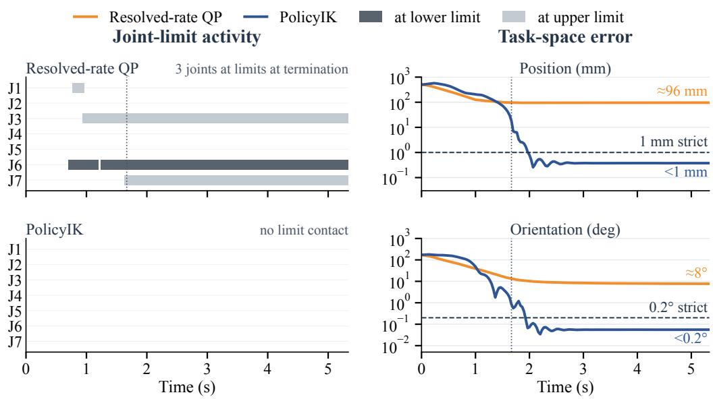  
Figure 7: One test task. Left: intervals in which each joint lies within 0.01 rad of its lower (dark) or upper (light) limit. Right: position and orientation errors, with the strict tolerances dashed. The dotted line marks when a third QP joint reaches its limit (1.7 s). The QP failure coincides with this sustained limit occupancy, and its error then stays near 96 mm and $8 ^ { \circ }$ . PolicyIK never reaches a joint limit and enters the strict tolerance at 2.0 s.

Table 7: Component ablations with one attempt per task and matched training budgets. Entry is the median first-entry time and Uncont. the uncontained share (Appendix C). The measured-joint anchor sets $z _ { t - 1 } = q _ { t }$ in Equation 2 and removes command-state feedback, and the fixed gain is β = 0.1.
<table><tr><td></td><td colspan="2">Success (%) ↑</td><td colspan="2">Terminal phase ↓</td><td colspan="2">Median error ↓</td></tr><tr><td>Variant</td><td>Coarse</td><td>Strict</td><td>Entry (s)</td><td>Uncont. (%)</td><td>Pos. (mm)</td><td>Ori. (°)</td></tr><tr><td>PolicyIK</td><td>96.56±0.16</td><td>93.49±0.20</td><td>1.73±0.01</td><td>2.43±0.23</td><td>0.25±0.02</td><td>0.04±0.00</td></tr><tr><td colspan="7">Command-state feedback and reference anchor</td></tr><tr><td>w/o command-state feedback 92.63±0.20</td><td></td><td>84.26±0.28</td><td>2.04±0.02</td><td>10.32±0.32</td><td>0.30±0.00</td><td>0.06±0.00</td></tr><tr><td>measured-joint anchor</td><td>95.90±0.17</td><td>30.77±7.94</td><td>1.80±0.03</td><td>82.46±6.62</td><td>1.27±0.05</td><td>0.16±0.01</td></tr><tr><td colspan="7">Pose feedback and action scaling</td></tr><tr><td>w/o fine pose channels</td><td>95.39±0.25</td><td>88.41±0.34</td><td>1.83±0.03</td><td>4.38±0.11</td><td>0.36±0.01</td><td>0.06±0.00</td></tr><tr><td>w/o error-dependent gain</td><td>94.89±0.14</td><td>89.13±1.64</td><td>2.28±0.07</td><td>5.69±2.62</td><td>0.26±0.03</td><td>0.05±0.01</td></tr><tr><td>w/o both (β = 0.25)</td><td>93.01±0.59</td><td>85.27±0.39</td><td>2.11±0.02</td><td>4.85±0.33</td><td>0.34±0.00</td><td>0.06±0.00</td></tr><tr><td colspan="7">Reward function</td></tr><tr><td>w/o progress rewards</td><td>96.47±0.49</td><td>91.66±0.71</td><td>1.79±0.05</td><td>3.41±0.65</td><td>0.26±0.00</td><td>0.04±0.00</td></tr><tr><td>w/o dwell reward</td><td>96.87±0.29</td><td>91.54±1.33</td><td>1.69±0.02</td><td>7.83±1.18</td><td>0.34±0.00</td><td>0.07±0.00</td></tr></table>

Fixed-gain selection. Fixed gains are selected on 2,084 development tasks with one seed per candidate. With fine channels, gains of 0.1, 0.25, 0.5, and 1.0 reach 87.24%, 85.70%, 82.63%, and 82.77% strict success. Without them, the same gains reach 0.00%, 79.41%, 76.20%, and 74.90%. Each fixed-gain variant therefore uses its best gain, 0.1 with fine channels and 0.25 without. At $\beta = 0 . 1$ , the variant without fine channels never enters the strict region, and its median errors are 11.57 mm and 5.55◦.

## G PICK-AND-PLACE EVALUATION DETAILS

Tasks and protocol. Each LIBERO-Object task asks the robot to pick one grocery item and place it in a basket. We use each task’s 50 official initial states and language instruction, the agent-view and wrist cameras at LIBERO’s poses, a budget of 280 actions, and the evaluation settings of π0.5- LIBERO: action chunks are re-planned every five actions and images are resized to 224 × 224. Objects start from the official states after LIBERO’s settling interval. An episode succeeds the first time LIBERO’s success predicate holds at an action boundary, and it fails if the fingers pass into the table. Each controller runs three times per initial state. π0.5 samples its own noise in every run, and the three runs of PolicyIK use its three training seeds.

Pose reference. π0.5 outputs relative end-effector commands for robosuite’s operational-space controller (Zhu et al., 2020) at 20 Hz. A model of that controller with robosuite’s gains (stiffness 150, critical damping) integrates them into an end-effector pose that is re-anchored at every action, and the low-level controller tracks this pose at 30 Hz. No parameter of the model is fitted. The commanded tool-center point is kept at least 5 mm above the table, and the gripper opens or closes with the sign of the gripper command.

Robot and scene. One planar translation and yaw of the robot and its table, chosen from sourcerobot trajectories, places the objects within reach, and the arm starts at the Panda’s initial endeffector pose. The cameras render the LIBERO scene appearance, object collision geometry, mass and inertia follow the LIBERO assets, and the physics runs at 60 Hz.

Controllers. PolicyIK is trained from random initialization for the side-mounted arm of Section 5.1.3, with three seeds and checkpoint averaging. Its goals are sampled from reachable configurations of this arm. The default DLS is the differential inverse-kinematics controller of Isaac Lab (Mittal et al., 2023) with damping 0.01, whose joint targets are clamped at the soft limits. The hand-tuned DLS and QP use the hardware settings of Appendix I (task weighting W, damping 0.02 and 0.005, joint limits as bounds of a bounded least-squares step) and take one full step per control cycle without the hardware speed and command-lead bounds. All three classical controllers add gravity-compensation torques and share the arm’s joint drives.

Behavior near joint limits. In the evaluated trajectories, the default DLS discards the boundviolating part of its step and stops short of the commanded pose, while the lightly damped QP can stall at a joint limit during lifting. PolicyIK completes these grasps through a reference clipped at the soft limits.

Results by target location. Table 8 groups the ten tasks by where their targets lie. The targets of alphabet soup, butter, chocolate pudding, ketchup, and milk lie closest to the mount, 0.28 m in front of the shoulder and 0.28–0.34 m below it, where the grasp holds a shoulder joint at its limit. The other five lie a further 0.21 m to the side.

Table 8: Pick-and-place success (%) by target location, three runs from each of the 50 official initial states per task (750 episodes per group).
<table><tr><td>Targets</td><td>DLS (default)</td><td>DLS (hand-tuned)</td><td>QP (hand-tuned)</td><td>PolicyIK</td></tr><tr><td>Closest to the mount</td><td>85.5</td><td>96.8</td><td>85.9</td><td>95.1</td></tr><tr><td>Farther to the side</td><td>96.1</td><td>96.5</td><td>95.7</td><td>96.4</td></tr><tr><td></td><td></td><td></td><td></td><td></td></tr></table>

## H TRAINING POLICYIK ON PHYSICAL ARMS

This appendix describes how we train PolicyIK directly on a physical arm with FlashSAC (Kim et al., 2026). Appendix H.1 reviews FlashSAC, and Appendices H.2–H.5 describe how we adapt it to a single physical arm: the learner and its critic, replay, training tasks, and environment settings. Appendix H.6 ablates the three components that matter on hardware, and Appendix H.7 gives the evaluation protocol. Table 11 lists every setting. The OpenArm and xArm7 (Appendix J) hardware policies use the same settings.

## H.1 FLASHSAC RECAP

FlashSAC is an off-policy actor–critic method built on soft actor–critic (SAC) (Haarnoja et al., 2018). It was designed for fast and stable training with many parallel simulators and changes SAC mainly in its network architecture and its critic objective. We summarize the parts that PolicyIK relies on and refer to Kim et al. (2026) for the full method. We write o for the observation of Equation 3, which contains the goal, $\pi _ { \theta }$ for the policy, and $Q _ { \omega _ { 1 } } , Q _ { \omega _ { 2 } }$ for the two critics, with target parameters ${ \bar { \omega } } _ { 1 } , { \bar { \omega } } _ { 2 }$ updated by Polyak averaging at rate τ .

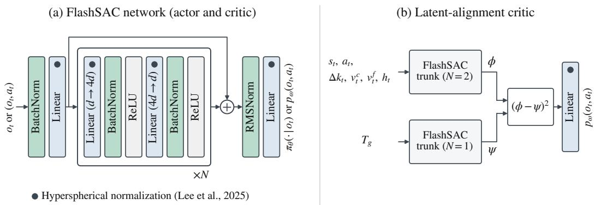  
Figure 8: (a) The FlashSAC network, used for the actor and, in FlashSAC, for each critic. Filled circles mark the hyperspherical normalization (Lee et al., 2025), where weight vectors project onto the unit sphere after every gradient step. (b) The latent-alignment critic that PolicyIK uses on hardware (Appendix H.2). In both panels, $p _ { \omega } ( o _ { t } , a _ { t } )$ denotes the value-distribution logits that the critic’s linear head outputs; a softmax over the atoms turns them into the probabilities $p _ { \omega , i }$ of Equation 15.

Architecture. Actor and critics share the architecture of Figure 8(a). The input is batchnormalized and linearly embedded into width d. N inverted-bottleneck residual blocks follow, each expanding to width 4d and projecting back to d, with batch normalization before each ReLU. RMS normalization bounds the feature norm before a linear head, which outputs the mean and standard deviation of a tanh-Gaussian policy or the atom logits of a critic. Batch normalization is preferred over layer normalization because it uses the statistics of large and diverse replay batches. FlashSAC also applies hyperspherical normalization (Lee et al., 2025). After every gradient step, each weight vector of a linear layer is projected onto the unit sphere, and the scale and shift vectors of each normalization layer are projected to norm ${ \sqrt { d } } .$ . The network then encodes information in directions rather than magnitudes, which prevents the weight growth that amplifies estimation errors under bootstrapping.

Critic objective. Each critic predicts a categorical distribution over $n _ { \mathrm { a t o m } }$ atoms $v _ { i } = G _ { \operatorname* { m i n } } +$ $( i - 1 ) \Delta$ with $\Delta = ( G _ { \mathrm { m a x } } - \mathrm { \bar { \it G } } _ { \mathrm { m i n } } ) / ( n _ { \mathrm { a t o m } } \mathrm { \bar { \it ~ - } } 1 )$ , and its action value is the mean, $Q _ { \omega } ( o , a ) =$ $\begin{array} { r } { \sum _ { i } p _ { \omega , i } ( o , a ) v _ { i } } \end{array}$ (Bellemare et al., 2017). For a batch of transitions $( o , a , r , o ^ { \prime } , d )$ from the replay buffer D, where d marks termination, next actions are drawn as $a ^ { \prime } \sim \overset { \cdot } { \pi } \overset { \cdot } { \theta } \big ( \cdot \mid o ^ { \prime } \big )$ . Batch normalization makes a network’s output depend on the batch it is evaluated with, so FlashSAC evaluates the current and next pairs in one joint forward pass,

$$
\begin{array} { r } { \left[ \begin{array} { c c } { p _ { \omega } ( o , a ) } \\ { p _ { \omega } ( o ^ { \prime } , a ^ { \prime } ) } \end{array} \right] = P _ { \omega } \left( \left[ \begin{array} { c c } { o } \\ { o ^ { \prime } } \end{array} \right] , \left[ \begin{array} { c c } { a } \\ { a ^ { \prime } } \end{array} \right] \right) , } \end{array}\tag{14}
$$

so both halves share the same normalization statistics. Following clipped double Q learning, the target uses the distribution p¯ of the target critic with the smaller expected value at $( o ^ { \prime } , a ^ { \prime } )$ . Each atom is moved by the soft Bellman backup and clipped to the support, $\hat { v } _ { i } = \mathrm { c l i p } ( r + \gamma ( 1 - d ) ( v _ { i } -$ α log $\pi _ { \theta } ( a ^ { \prime } \mid o ^ { \prime } ) ) , G _ { \mathrm { m i n } } , G _ { \mathrm { m a x } } )$ , and its probability is split between the two nearest atoms. Each critic $j \in \{ 1 , 2 \}$ minimizes the cross-entropy to this projected target,

$$
\mathcal { L } _ { Q } ( \omega _ { j } ) = - \mathbb { E } _ { \mathcal { D } } \bigg [ \sum _ { k = 1 } ^ { n _ { \mathrm { a t o m } } } m _ { k } \log p _ { \omega _ { j } , k } ( o , a ) \bigg ] , \qquad m _ { k } = \sum _ { i = 1 } ^ { n _ { \mathrm { a t o m } } } \bar { p } _ { i } \operatorname* { m a x } \bigg ( 0 , 1 - \frac { | \hat { v } _ { i } - v _ { k } | } { \Delta } \bigg ) .\tag{15}
$$

Policy objective. The actor maximizes the smaller critic value with an entropy bonus weighted by the temperature $\alpha ,$

$$
\mathcal { L } _ { \pi } ( \theta ) = \mathbb { E } _ { o \sim \mathcal { D } , a \sim \pi _ { \theta } ( \cdot \vert o ) } \Big [ \alpha \log \pi _ { \theta } ( a \mid o ) - \operatorname* { m i n } _ { j \in \{ 1 , 2 \} } Q _ { \omega _ { j } } ( o , a ) \Big ] .\tag{16}
$$

The temperature is tuned so that the policy entropy tracks a target ${ \bar { \mathcal { H } } } .$ which FlashSAC sets to the entropy of a Gaussian with standard deviation $\sigma _ { \mathrm { t g t } }$ in each of the $| { \cal A } |$ action dimensions,

$$
\mathcal { L } ( \alpha ) = \mathbb { E } _ { o \sim \mathcal { D } , a \sim \pi _ { \theta } ( \cdot \vert o ) } \Big [ - \alpha \big ( \log \pi _ { \theta } ( a \mid o ) + \bar { \mathcal { H } } \big ) \Big ] , \qquad \bar { \mathcal { H } } = \frac { \vert \mathcal { A } \vert } { 2 } \log \big ( 2 \pi e \sigma _ { \mathrm { t g t } } ^ { 2 } \big ) .\tag{17}
$$

## H.2 ADAPTING FLASHSAC TO A PHYSICAL ARM

Hyperparameters. Table 11 lists our settings next to FlashSAC’s configuration. FlashSAC targets settings in which data are cheap. On a physical arm, transitions cost robot time and computation is comparatively cheap, so we spend computation to save transitions. The replay buffer keeps every transition of the run, updates start as soon as the buffer holds one batch, and we perform more updates per transition. We use a batch of 1,024, half of FlashSAC’s batch for parallel simulation, so that two updates fit within one control period. With more updates per transition, we halve the target update rate to $\tau = 0 . 0 0 5$ , which keeps the bootstrap target steadier. We double the number of atoms to 201, which halves the atom spacing and resolves the small return differences between holding the tolerance and drifting just outside it. A single arm also lacks the exploration of many parallel environments, so we raise the entropy target from $\sigma _ { \mathrm { t g t } } = 0 . 1 5 \mathrm { t o } 0 . 3 0$ . This matches the intuition, and in our experiments the higher target also avoided a late decline in success during training.

Latent-alignment critic. A dense reward on the pose error, and a critic that generalizes across inputs that are close in Euclidean distance, both favor actions that shrink the end-effector error along a straight path. Large-rotation tasks often require a detour through joint space instead, along which the error first grows. Their temporal distance to the goal, the number of steps still needed, then differs from the Euclidean pose distance. This is also why some shaping term of the reward is potential-based.

Kang et al. (2026) report the same mismatch for goal-conditioned value functions. An MLP value function assigns similar values to states that are close in Euclidean distance and therefore propagates values between states that are far apart in temporal distance. Their latent alignment network (LAN) instead parameterizes the value as a distance between learned representations, $V ( s , g ) = - \| \phi _ { S } ( s ) -$ $\phi _ { G } ( g ) \rVert _ { 2 }$ , so that values generalize through the learned latent space. We adapt this structure to FlashS $\mathbf { A C } \mathbf { \ ' } _ { \mathbf { S } }$ categorical action-value critic (Figure 8b). A state–action encoder ϕ receives the state $s _ { t } .$ , the action $a _ { t } .$ , and the goal-relative channels of $o _ { t } \colon$ the position error, the keypoint offsets $\Delta k _ { t }$ , the coarse and fine errors $v _ { t } ^ { c } , v _ { t } ^ { f }$ , and the running-best features $h _ { t } . \mathrm { ~ A ~ }$ goal encoder $\psi$ receives the goal pose $T _ { g } .$ Each encoder is a FlashSAC trunk, the network of Figure ${ \& ( \mathrm { a ) } }$ without its output layer, of width 256 with two and one residual blocks, respectively. The categorical head receives the elementwise squared difference $( \phi - \psi ) ^ { 2 }$ in place of the single trunk’s features. The goal-relative channels depend on both the state and the goal, and they must enter the state–action encoder. Without them there, the action and the goal would meet only in the final linear layer.

One update of the actor and the latent-alignment critic takes about 27 ms on the onboard GPU of our controller (NVIDIA Jetson Thor). Two updates, including batch assembly, therefore fit within the 100 ms control period, and the learner runs them while the arm tracks the reference it has just received.

Update to data ratio (UTD). More gradient updates per transition generally improve sample efficiency, which matters most when every transition costs robot time, but each update costs wall-clock time. We use two updates per control step by default. Between episodes, the arm moves to the next start configuration and settles, which takes 5.5 s, and the learner fills this time with as many additional updates as fit, about 81 per reset. A 150-step episode thus receives about 381 updates, or 2.5 per transition, at no cost in robot time.

## H.3 REPLAY

Batch composition. Each batch draws 25% of its transitions from a fixed demonstration buffer and 75% from online data, the fixed-ratio mixing of RLPD (Ball et al., 2023). Within each source, 75% of the transitions are drawn from steps within $\rho \leq 1 0$ of their goal (Equation 9), that is, within 1 cm and $2 ^ { \circ }$ , and the rest uniformly. Such near-goal transitions are rare in the early online stream, because most steps of an episode are spent on the approach. They train terminal correction and holding directly. We found that this emphasis also raises the overall reaching rate, not only the final precision, presumably because values that are accurate near the goal propagate to the approach through bootstrapping.

Goal relabeling. We relabel goals with hindsight experience replay (HER) (Andrychowicz et al., 2017). Adapting the goal-sampling distributions of OGBench (Park et al., 2025) to online training, each sampled transition receives its goal from one of three sources:

• the commanded goal of its episode, which keeps training on the task that the episode attempted, including failed attempts;

• a future goal, the pose achieved a geometrically distributed number of steps later in the same episode, with offset $k \sim \mathrm { G e o \bar { m } } ( 1 - \gamma )$ , which turns every trajectory into successful examples for the poses it passes through and so densifies the reaching signal;

• the current goal, the pose achieved at the transition itself, which supplies examples of being at the goal and so trains holding. In 30% of draws it is perturbed by Gaussian noise of 1 mm and $0 . { \overset { - } { 2 } } ^ { \circ }$ , which places the goal just around the current pose and trains corrections at the scale of the tolerance.

OGBench also uses random dataset states as goals, but we do not. Online transitions use the three sources with probabilities 0.4, 0.4, and 0.2. Demonstration transitions use 0.5, 0.3, and 0.2, because their actions are directed at the commanded goal and keeping that goal more often preserves this signal.

Demonstrations. An off-policy learner can use demonstrations without changes to the learner. With the mixing above, demonstrations recorded through the same action interface are added to training and enter the same goal relabeling. When demonstrations are collected, the budget is best spent where the policy’s own exploration produces successes least often: tasks that require a large reconfiguration in joint space, which the near-goal curriculum of Appendix H.4 rarely produces early in training. Our collection protocol follows from this. We record 150 tasks stratified by start-to-goal rotation (60–90◦, 90–120◦, and 120–180◦) and by three radial shells of the workspace, each with a joint-space distance $\lVert q ^ { * } - q _ { 0 } \rVert _ { 2 } \geq 3 { \mathrm { r a d } } .$ The demonstrations run through the training environment with the same action law and gain schedule, so every recorded action is an action the policy can take. A scripted controller suffices because each task stores its goal configuration $q ^ { * } .$ . It moves the reference along the joint-space line to $q ^ { * }$ at full step size, $a _ { t } = \mathrm { c l i p } \big ( ( q ^ { * } - z _ { t - 1 } ) / ( \beta _ { t } \eta ) , - 1 , 1 \big )$ , until every joint is within 0.002 rad, and then applies the integral correction $a _ { t } = \mathrm { c l i p } \big ( 0 . 5 ( q ^ { * } - q _ { t } ) / ( \beta _ { t } \eta ) , - 1 , 1 \big )$  for the rest of the 150-step episode. The rewards of the demonstrations are recomputed under the training reward.

## H.4 TRAINING TASKS

Each training episode lasts 150 control steps with one goal. Its task comes from one of two sources.

Reverse curriculum. Following Florensa et al. (2017), starts are generated near goals. A goal configuration $q ^ { * }$ is drawn from a precomputed set of reachable, collision-free configurations in the workspace, and the start is $q _ { 0 } = q ^ { * } + \epsilon$ with $\epsilon \sim \mathcal { N } ( 0 , \sigma _ { \mathrm { e p } } ^ { 2 } I )$ . The scale $\sigma _ { \mathrm { e p } }$ is drawn uniformly from $[ 2 ^ { \circ } , \sigma _ { \mathrm { m a x } } ]$ , and $\sigma _ { \mathrm { m a x } }$ is $1 0 ^ { \circ }$ in the first half of training and $2 0 ^ { \circ }$ in the second. Starts with $\rho < 1 0$ are rejected, so every episode includes an approach. Every such task is solvable, since undoing the perturbation reaches the goal.

Far-task pool. A pool of 3,000 start–goal pairs provides long motions. Each pair has a start-togoal rotation of $6 0 { - } \mathrm { \bar { 1 } } 7 0 ^ { \circ }$ and a joint-space distance $\lVert q ^ { * } - q _ { 0 } \rVert _ { 2 } ^ { - } \geq 3$ rad, and a pool episode draws one pair uniformly. The share of pool episodes rises from 0 to 25% at 10% of training and to 50% at 20%. The first episodes therefore stay near their goals, which teaches terminal regulation first and keeps early motions small. No evaluation start–goal pair appears in the pool or among the demonstration tasks.

## H.5 ENVIRONMENT AND REWARD

The hardware environment follows Section 4 with the values of Table 11. The 72-dimensional observation contains the measured joint state, the end-effector and goal poses, the command-state feedback $d _ { t }$ , the previous action, the keypoint offsets, the coarse and fine error channels, and the running-best features. The action scale $\eta = 0 . 0 3$ rad and the gain floor $\beta _ { \mathrm { m i n } } = 0 . 0 3$ give a smallest reference step of $\beta _ { \mathrm { m i n } } \eta \approx 0 . 0 5 ^ { \circ }$ per joint, and the reference may lead the measured joints by at most 0.25 rad.

Relaxed reference bound. Equation 2 clips the reference at the joint bounds. A joint that holds a goal near its bound against gravity needs a reference beyond the goal configuration, which a hard clip at the bound forbids. On hardware we relax the clip by $2 ^ { \circ }$ while the measured joint is still inside the bound. Once the measured joint reaches the bound, no further outward step is accepted, so the joint itself never exceeds it.

Reward. The reward terms are those of Section 4.3. The shaping potential is capped at 500 tolerance units instead of 50, so that its dense signal covers the large hardware tasks. Because the shaping term is potential-based (Ng et al., 1999), its contributions along a trajectory telescope, and it does not penalize a detour that temporarily increases the error. The joint-margin weight $w _ { m } = 5$ keeps the joints away from their bounds during the approach, where the margin cost applies $( \rho > 1 0 )$ . Every term is multiplied by the control period of 0.1 s.

## H.6 ABLATION OF HARDWARE COMPONENTS

We compare PolicyIK with a policy trained without three components of the recipe, each of which addresses one failure mode: a critic that undervalues detours through joint space, a far-task pool that under-samples large joint-space reconfigurations, and goals that cannot be held at a joint bound:

• Latent-alignment critic. The ablated policy uses FlashSAC’s critic (Figure 8a, two blocks of width 256). Its motivation is the mismatch between pose distance and temporal distance discussed in Appendix H.2.

• Far-task selection by joint-space distance. The ablated policy draws its far tasks from 150 start–goal pairs selected at random within the same rotation strata, without a jointspace distance criterion. The joint-space distance measures how much reconfiguration a task needs more directly than the end-effector rotation. Selecting far tasks by it concentrates the long episodes on reconfigurations, and the larger pool avoids revisiting a few pairs.

• Relaxed reference bound. The ablated policy clips the reference at the joint bounds, so a goal whose holding offset points past a bound cannot be held.

Both policies are trained for 120,000 online transitions on the same arm and evaluated on the same 60 tasks (Appendix H.7).

Table 9 shows the result. With the three components, PolicyIK reaches 54 instead of 46 tasks within 25 s and holds 43 instead of 40 for the final 5 s. It ends 59 tasks within the coarse tolerance, against 52, and one task more than 20 mm from the goal, against five, so the components mainly remove failures to approach the goal. Its median final errors are 0.50 mm and $0 . 1 \dot { 2 } ^ { \circ }$ , against 0.53 mm and $0 . 1 2 ^ { \circ }$ . At 15 s it reaches 52 tasks instead of 40, but holds 27 instead of 31 for 5 s. The additional tasks include long motions that reach the tolerance too late for a 5 s hold within 15 s, and most of them are held for 5 s by 25 s.

Table 9: Ablation of the hardware components on 60 physical OpenArm tasks. The Ablated policy excludes the latent-alignment critic, far-task selection by joint-space distance, and the relaxed reference bound. Reached and held use the criteria defined in the main body. Coarse counts tasks whose final-second errors are within 1 cm and $2 ^ { \circ }$ , and gross counts tasks that end more than 20 mm from the goal, both at the 25 s budget. Bold marks the better result.
<table><tr><td></td><td colspan="3">15 s budget</td><td colspan="5">25 s budget</td></tr><tr><td>Policy</td><td>Reached</td><td>Held 1 s</td><td>Held 5 s</td><td>Reached</td><td>Held 1 s</td><td>Held 5 s</td><td>Coarse</td><td>Gross</td></tr><tr><td>Ablated</td><td>40</td><td>36</td><td>31</td><td>46</td><td>43</td><td>40</td><td>52</td><td>5</td></tr><tr><td>PolicyIK</td><td>52</td><td>44</td><td>27</td><td>54</td><td>45</td><td>43</td><td>59</td><td>1</td></tr></table>

## H.7 EVALUATION PROTOCOL

We evaluate frozen checkpoints on the 60 full-pose tasks used for the classical controllers (Appendix I), so the requested joint-space starts and world-frame goals match across controller families. Each trial starts at rest from the task’s start configuration, and the policy uses its mean action. We evaluate the final checkpoint after 120,000 online transitions, and score the 15 s and 25 s budgets on the same trial.

Table 10: Reaching and final-window holding counts out of 60 OpenArm tasks, with best results in bold and second-best results underlined.
<table><tr><td rowspan="2">Controller</td><td rowspan="2">Reached</td><td rowspan="2">15 s budget Held 1 s</td><td rowspan="2">Held 5s</td><td colspan="3">25 s budget</td></tr><tr><td>Reached</td><td>Held 1s</td><td>Held 5 s</td></tr><tr><td>DLS</td><td>38</td><td>21</td><td>6</td><td>48</td><td>29</td><td>17</td></tr><tr><td>Resolved-rate QP</td><td>43</td><td>21</td><td></td><td>48</td><td>24</td><td>16</td></tr><tr><td>Kinematic MPC</td><td>29</td><td>10</td><td>-6-3</td><td>46</td><td>26</td><td>15</td></tr><tr><td>Adapted OpenArm QP</td><td>13</td><td>8</td><td>1</td><td>32</td><td>16</td><td>11</td></tr><tr><td>PolicyIK</td><td>52</td><td>44</td><td>27</td><td>54</td><td>45</td><td>43</td></tr></table>

Table 10 shows that PolicyIK keeps its holding advantage under both execution budgets. At 15 s, it holds 27 of the 60 tasks for the final 5 s, compared with at most 6 for the classical controllers. Extending the required final hold from 1 s to 5 s retains 61.4% and 95.6% of PolicyIK’s successes at the two budgets, against 12.5–30.0% and 57.7–68.8% for the classical controllers.

Table 11: Settings for training PolicyIK on hardware, used for both the OpenArm and the xArm7. The FlashSAC column lists the corresponding settings of FlashSAC (Kim et al., 2026); a dash marks a setting that FlashSAC does not specify.
<table><tr><td>Setting</td><td>PolicyIK on hardware</td><td>FlashSAC</td></tr><tr><td>Learner</td><td></td><td></td></tr><tr><td>Online transitions</td><td>120,000</td><td></td></tr><tr><td>Batch size</td><td>1,024</td><td>2,048</td></tr><tr><td>Replay capacity</td><td>120,000 (the whole run)</td><td> ${ 1 0 } ^ { 6 }$ </td></tr><tr><td>Initial random actions</td><td>200</td><td></td></tr><tr><td>Updates begin after</td><td>1,024 transitions</td><td></td></tr><tr><td>Gradient updates</td><td>2.5 (Appendix H.2)</td><td>1 per transition</td></tr><tr><td>Discount γ</td><td>0.98</td><td>0.99</td></tr><tr><td>Target update rate τ</td><td>0.005</td><td>0.01  $3 \times 1 0 ^ { - 4 }$ </td></tr><tr><td>Learning rate (Adam)</td><td> $3 \times 1 0 ^ { - 4 }$  , constant</td><td>, cosine de- cay  $\mathbf { 0 . 1 . 5 \times 1 0 ^ { - 4 } }$ </td></tr><tr><td>Actor</td><td>2 blocks, width 128</td><td>2 blocks, width 128</td></tr><tr><td>Critic</td><td>latent-alignment critic:  $\phi 2$  blocks, 1 block, width 256</td><td>2 blocks, width 256</td></tr><tr><td>Atoms on  $[ G _ { \mathrm { m i n } } , G _ { \mathrm { m a x } } ]$   $n _ { \mathrm { a t o m } }$ </td><td>201 on [−5, 5]</td><td>101 on [−5, 5]</td></tr><tr><td>Entropy target  $\sigma _ { \mathrm { t g t } }$ </td><td>0.30</td><td>0.15</td></tr><tr><td>Initial temperature</td><td>0.01</td><td>0.01</td></tr><tr><td>Actor update period</td><td>2 critic updates</td><td>2 critic updates</td></tr><tr><td>Mixed precision</td><td>off</td><td>on</td></tr><tr><td>Replay</td><td></td><td></td></tr><tr><td>Demonstration share of a batch</td><td>25%</td><td></td></tr><tr><td>Near-goal share within each source Goal sources: commanded, future, cur-</td><td>75% from steps with  $\rho \leq 1 0$ </td><td></td></tr><tr><td>rent</td><td>online 0.4, 0.4, 0.2; demonstrations 0.5, 0.3, 0.2</td><td></td></tr><tr><td>Future-goal offset</td><td>Geom  $( 1 - \gamma )$  steps</td><td></td></tr><tr><td>Current-goal perturbation</td><td>30% of draws; 1 mm,  $0 . 2 ^ { \circ }$ </td><td></td></tr><tr><td>Demonstrations</td><td>150 tasks × 150 steps</td><td></td></tr><tr><td>Training tasks</td><td></td><td></td></tr><tr><td>Episode length</td><td>150 control steps</td><td></td></tr><tr><td>Start perturbation  $\sigma _ { \mathrm { e p } }$ </td><td> $\mathcal { U } [ 2 ^ { \circ } , \sigma _ { \mathrm { m a x } } ] ; \ : \ : \ : \ : \dot { \sigma } _ { \mathrm { m a x } } \ : \ : 1 0 ^ { \circ }$  then</td><td></td></tr><tr><td></td><td>from 50%</td><td></td></tr><tr><td>Rejected starts Start and goal jitter</td><td> $\rho < 1 0$  2° and 1° per joint</td><td></td></tr><tr><td>Far-task pool</td><td>3,000 pairs; rotation  $6 0 { - } 1 7 0 ^ { \circ } ; \parallel q ^ { * } -$ </td><td></td></tr><tr><td>Far-task share</td><td> $q _ { 0 } \| _ { 2 } \geq 3 .$  rad 0, 25% from 10%, 50% from 20% of</td><td></td></tr><tr><td></td><td>training</td><td></td></tr><tr><td>Environment Control rate</td><td></td><td></td></tr><tr><td>Observation dimension</td><td>10Hz</td><td></td></tr><tr><td>Action scale η</td><td>72</td><td></td></tr><tr><td>Gain floor  $\beta _ { \mathrm { m i n } }$ </td><td>0.03 rad</td><td></td></tr><tr><td>Gain thresholds  $( l _ { p } , u _ { p } ) , ( l _ { R } , u _ { R } )$ </td><td>0.03</td><td></td></tr><tr><td>Reference lead bound</td><td>(0.5, 9.31) mm, (0.415, 2.328)°</td><td></td></tr><tr><td></td><td>0.25 rad</td><td></td></tr><tr><td>Reference bound relaxation Reset between episodes</td><td>2°</td><td></td></tr><tr><td></td><td>4 s ramp, 1.5 s settling</td><td></td></tr><tr><td>Reward</td><td></td><td></td></tr><tr><td>Shaping potential  $\Phi _ { t }$ </td><td> $- \operatorname* { m i n } ( 5 0 0 , \rho _ { t } )$ </td><td></td></tr><tr><td>Motion-cost weights  $w _ { a } , w _ { v }$ </td><td>0.05, 0.0005</td><td></td></tr><tr><td>Joint-margin weight  $w _ { m }$ </td><td>5</td><td></td></tr><tr><td>Term scaling</td><td>control period, 0.1 s</td><td></td></tr></table>

## I HARDWARE BASELINE IMPLEMENTATIONS

We compare four Cartesian controllers on the physical OpenArm: damped least-squares differential inverse kinematics (DLS), bounded resolved-rate quadratic programming (QP), locally linearized kinematic model-predictive control (MPC), and the QP controller distributed with the OpenArm control library (adapted OpenArm QP). All four controllers operate through the same supervised execution stack. They receive the measured seven-dimensional joint state, the desired world-frame end-effector pose, and the previous accepted joint reference, and return the next joint-position reference. None uses an external pose measurement or inverse dynamics in its Cartesian optimization. The shared motor layer tracks accepted joint references using PD control with model-based gravity feedforward.

Shared pose, command, and safety interface. Let $q$ denote the measured joint positions, z the previous accepted joint reference, $\mathbf { e } \doteq [ \mathbf { e } _ { p } ^ { \top } , \mathbf { e } _ { R } ^ { \top } ] ^ { \top }$ the world-frame position and rotation-vector error, and $J ( q ) \in \mathbb { R } ^ { 6 \times 7 }$ the geometric Jacobian. For DLS, resolved-rate QP, and kinematic MPC, forward kinematics and J are evaluated from the same MuJoCo model at the measured $q .$ . Translation and rotation are balanced using

$$
W = \mathrm { d i a g } ( 1 , 1 , 1 , 0 . 2 , 0 . 2 , 0 . 2 ) .\tag{18}
$$

The adapted OpenArm QP uses its separately pinned OpenArm model internally, while the common model is retained for evaluation. The evaluated end-effector is a gripper-base frame translated by 102.5 mm along the source hand-TCP z axis with no rotational offset; this transform is used consistently for goal generation, control, and scoring.

Accepted commands are constrained by the intersection of the robot-model and physical-rig joint limits, a per-joint reference-speed bound of 0.20 rad/s, and a command-to-measurement lead bound. The final baseline profile maintains a 5 mrad inward command margin from the hard joint limits.

Damped least-squares controller. The DLS controller first computes

$$
\dot { q } _ { \mathrm { d l s } } = \left( W J \right) ^ { \top } \left[ \left( W J \right) \left( W J \right) ^ { \top } + \lambda ^ { 2 } I \right] ^ { - 1 } k W \mathbf { e } , \qquad k = 2 , \quad \lambda = 0 . 0 2 .\tag{19}
$$

It uniformly rescales this velocity when its infinity norm exceeds the joint-speed bound and integrates from z. When that candidate would violate a joint-position, per-cycle speed, or reference-lead bound, the implementation does not clip joints independently. Instead, it resolves the same globally scaled damped task as a bounded least-squares problem over the feasible joint-velocity box.

Bounded resolved-rate QP. The resolved-rate controller directly solves

$$
\operatorname* { m i n } _ { \dot { q } } \frac { 1 } { 2 } \| W J \dot { q } - k W \mathbf { e } \| _ { 2 } ^ { 2 } + \frac { \lambda ^ { 2 } } { 2 } \| \dot { q } \| _ { 2 } ^ { 2 } , \qquad k = 3 , \quad \lambda = 0 . 0 0 5 ,\tag{20}
$$

subject to the joint-position, per-cycle speed, and command-to-measurement lead bounds before setting $z ^ { + } = z + \Delta t { \dot { q } }$ We solve the dense bounded least-squares form with SciPy’s BVLS implementation (exact least-squares subsolver, tolerance $1 0 ^ { - 1 0 }$ , at most 100 iterations). DLS and QP therefore share the same local task family but differ under saturation: DLS first applies a single global speed scale and only then redistributes a bound-violating step, whereas $\boldsymbol { \mathrm { Q } } \boldsymbol { \mathrm { P } }$ optimizes the unscaled task directly inside the feasible box.

Kinematic MPC. The MPC controller replans at every feedback cycle and applies only the first control of a seven-step horizon (0.14 s at the nominal rate). It freezes the measured-state Jacobian within each solve and optimizes a sequence of joint-reference velocities using the same $k = 3 ,$ $\lambda = 0 . 0 0 5$ , and $W$ as QP. The objective combines predicted resolved-rate residuals, velocity damping, a 0.001 velocity-smoothness weight, and a unit terminal pose-error weight. Constraints cover reference and predicted joint positions, the 0.20 rad/s speed bound, a 0.052 rad reference-lead bound, a 0.10 rad trust region, and 0.5 rad/s2 reference acceleration. A piecewise-linear braking envelope reserves stopping distance near position and lead limits. The convex QP is solved with DAQP 0.7.2 using primal and dual tolerances of $1 0 ^ { - 1 1 }$ and $1 0 ^ { - 1 2 }$ and an iteration limit of 20,000.

Table 12: Classical hardware baselines. All four map the measured joint state and the goal pose to joint-position references at 50 Hz within the joint limits and the 0.20 rad/s reference-speed bound. DLS, QP, and MPC weight rotation errors by 0.2 relative to translation.
<table><tr><td>Controller</td><td>Formulation</td><td>Parameters</td></tr><tr><td>DLS</td><td>Damped least squares with global speed scaling</td><td> $k = 2 , \lambda = 0 . 0 2$ </td></tr><tr><td>Resolved-rate QP</td><td>Damped least squares within the joint bounds</td><td> $k = 3 , \lambda = 0 . 0 0 5$ </td></tr><tr><td>Kinematic MPC</td><td>Seven-step receding horizon (0.14 s)</td><td> $k = 3 , \lambda = 0 . 0 0 5$ </td></tr><tr><td>Adapted OpenArm QP</td><td>OpenArm QP with measured-pose settling</td><td>Costs 12/1.5, damping 0.1</td></tr></table>

Adapted OpenArm QP. The OpenArm baseline uses openarm control 0.4.0 with its DAQP backend. At 50 Hz, the controller performs five internal iterations with an explicit right-arm velocity limit of 0.20 rad/s. The configured task parameters use position and orientation costs of 12 and 1.5, damping 0.1, Levenberg–Marquardt damping 0.01, joint and singularity braking, and zero posture and null-space costs.

Our adapter supplies measured joint positions to the library’s state-dependent constraints, synchronizes the internal task state to the previous accepted reference, and transforms the world-frame goal into the library representation. The returned candidate is then projected through the common hard and operational position bounds, reference-speed bound, and 0.05 rad command-to-measurement lead bound. No unconstrained retry or fallback controller is used.

The evaluated implementation additionally includes a bounded measured-pose settling loop. Once the commanded pose remains within 0.1 mm/0.001 rad and the measured pose lies within 10 mm/0.05 rad for 0.2 s, the loop adjusts the internal pose target using the measured residual error. Translational and rotational correction rates are limited to 1 mm/s and 0.01 rad/s, with target-bias limits of 10 mm and 0.05 rad, respectively. This modification compensates residual command– measurement bias while retaining the upstream reaching controller and shared command governor.

Parameter selection. Controller settings were selected during hardware development. The controller descriptions and Table 12 specify the final settings.

Classical-controller evaluation protocol. The evaluation set contains 60 full-pose start–goal tasks, with 20 tasks in each of three translational-displacement bands: medium $( > 2 \bar { \mathrm { t o } } \le 5 \mathrm { c m } )$ , long (> 5 to ≤ 10 cm), and extended (> 10 cm). The realized displacement ranges are 2.13–4.81 cm, 5.25–9.71 cm, and 10.79–32.93 cm, respectively. Each trial runs for 40 s after a synchronized transition to the specified start configuration. The 15 s and 25 s budgets are scored on the first 15 s and 25 s of each trial.

## J CROSS-EMBODIMENT EVALUATION ON XARM7

We further evaluate PolicyIK on a commercial xArm7. Its wrist joints have a wider range of motion than those of OpenArm, which makes full-pose tasks easier on this arm. Both simulation-trained and hardware-trained policies achieve 60/60 successes on standard reaching and 60/60 on large rotations (Table 13).

Setup. Each task set contains 60 fixed start–goal tasks, evaluated once per controller for 40 s. Large-rotation tasks cover start-to-goal orientation changes of 30–60◦, 60–90◦, and above 90◦. Success uses the holding criterion of Section 5.2: both errors remain within 1 mm and 0.2◦ throughout seconds 20–25 of each trial, the final 5 s of its 25 s budget. Reach times and pose errors are computed as in Section 5.2. All controllers share a 0.20 rad/s joint-speed limit. DLS, QP, and MPC use the gains, damping, and horizon of Appendix I. xArm7 training adopts the same PolicyIK hyperparameters as for training the OpenArm in Table 11.

Training. We train separate xArm7 policies with the FlashSAC recipe of Section 4.5, both in simulation and directly on the physical robot. Hardware training starts without simulation weights and collects approximately 120k online interactive transitions, supplemented by demonstrations collected on the arm.

Table 13: Physical xArm7 evaluation on two sets of 60 tasks each. Reach-time medians use reached tasks.
<table><tr><td>Controller Success Reach (s) Position (mm)</td></tr><tr><td>Orientation (°)</td></tr><tr><td>Standard reaching</td></tr><tr><td>DLS 60/60 2.9 0.074 0.015 QP 60/60 2.0 0.094 0.018</td></tr><tr><td>MPC 60/60 2.3 0.085 0.016</td></tr><tr><td>xArm built-in IK 59/60 1.8 0.004 0.001</td></tr><tr><td>PolicyIK (sim-trained) 60/60 2.2 0.169 0.034</td></tr><tr><td>PolicyIK (hardware-trained) 60/60 2.0 0.155 0.040</td></tr><tr><td></td></tr><tr><td>Large rotations</td></tr><tr><td>DLS 59/60 5.4 0.074 0.016 59/60 4.2 0.087 0.020</td></tr><tr><td>QP MPC 59/60 5.0 0.086 0.018</td></tr><tr><td>xArm built-in IK 45/60 4.1 0.004 0.001</td></tr><tr><td>PolicyIK (sim-trained) 60/60 4.5 0.097 0.028</td></tr><tr><td>PolicyIK (hardware-trained) 60/60 4.4 0.164 0.044</td></tr></table>

Results. PolicyIK exceeds all evaluated baselines in success rate on large rotations and matches the best of them on standard reaching. On large rotations, both training routes achieve 60/60 successes, compared with 59/60 for DLS, QP, and MPC and 45/60 for the built-in IK. On standard reaching, both achieve 60/60, matching DLS, QP, and MPC. These results demonstrate precise physical control on a second robot through both simulation training and direct hardware learning.