# Physics-informed traditional and generative Mori-Zwanzig–reduced models for multiscale systems

Emily Williams∗1,2, Saad Qadeer1, Amanda A. Howard1, and Panos Stinis1

1Advanced Computing, Mathematics and Data Division, Pacific Northwest National Laboratory, WA 99354

2Massachusetts Institute of Technology, MA 02139

November 4, 2026

## Abstract

Model reduction via the Mori–Zwanzig (MZ) formalism is well understood for coarse-grained representations constructed from standard basis functions such as Fourier functions. We show that the same formalism can be used to build reduced-order models in bases discovered by physics-informed machine learning. The fluctuation-dissipation theorem (FDT) is used to close the resulting non-Markovian evolution equations for the expansion coeficients of the learned basis. We further introduce a complementary, generative closure model. Relative to the Markovian dynamics alone, both the MZ and generative closures substantially improve predictions of the filtered states.

## 1 Introduction

For complex multiscale phenomena the fine spatiotemporal resolution required to resolve all scales of motion is prohibitively expensive. Model reduction is a strategy toward computationally eficient simulations. Projection-based reduced-order models (ROMs) aim to derive modified equations for subsets of the necessary degrees of freedom by projecting the equations onto a basis of reduced dimensionality compared to the original solution space [6, 51, 17]. Proper orthogonal decomposition (POD) is a data-driven technique that uses the singular value decomposition (SVD) of solution snapshots to obtain a basis to be used in a POD-Galerkin method [36, 15]. These methods attempt to capture the essential large-scale dynamics with negligible computational cost relative to full resolution. ROMs can be augmented with a closure model to account for the influence of the truncated modes [5, 1, 2, 21, 10, 54].

The closure model is part of the ROM which accounts for the subgrid-scale (SGS) dynamics without explicitly resolving them. An accurate SGS model is essential because unresolved dynamics can significantly impact the degrees of freedom that are kept. Such efects can be represented in the ROM through memory terms, which account for the history of the interaction between resolved and unresolved degrees of freedom resulting from the application of the Mori-Zwanzig (MZ) formalism from nonequilibrium statistical mechanics [27, 46, 65]. Traditional methods assume that the energy production and dissipation of the small scales are in equilibrium [55, 60]. These deterministic SGS models, based on this equilibrium assumption, can be overly dissipative, leading to saturation of important dynamical features [52, 44, 9]. In some cases, traditional eddy-viscosity-based SGS models can be unstable in numerical simulations [27, 9, 26, 41]. These deficiencies arise in part from an inability to capture the backscatter of energy, especially in regions of chaotic and turbulent flow [38, 43].

Interest in developing data-driven and generative stochastic closure approaches has continued to grow, motivated by the need for eficient climate and weather modeling [28, 49, 4, 14], and developing generative models of underlying dynamics from observations is a rapidly expanding field [59, 24, 30, 56, 32]. There is ongoing work toward developing more accurate MZ-based ROMs using ideas from stochastic modeling [50, 47, 23]. Moreover, stochastic closure approaches can more accurately represent the interactions of the resolved and unresolved scales by accounting for the stochastic efects associated with eliminated degrees of freedom [48, 8, 25]. Statistical and machine learning-based closure strategies for reduced-order modeling in simulating multiscale or chaotic systems remain an open area of research, particularly toward representing unresolved dynamics accurately while also maintaining stability and computational eficiency at fixed cost [2, 64, 57, 20, 40, 53, 34, 61].

Spectral methods constitute a valuable approach in scientific computing applications toward approximating partial diferential equations (PDEs) [58, 7, 11, 29, 45]. The applicability and efectiveness of spectral methods depend crucially on the choice of basis functions used to expand the solution of a PDE [45]. In recent years, physics-informed deep learning has emerged as a contender in providing eficient representations of complex functions for the numerical solution of PDEs [3, 45, 33]. These eforts include identifying custom-made candidate basis functions on which to expand the solution of PDEs for evolution using a spectral approach [45]. Our previous work has demonstrated the benefit of physics-informed operator learning for improving traditional scientific computing methods [62], by using physics-informed custom basis functions in evolving the Markovian dynamics for model reduction. In this work, we further augment the ROM by applying the MZ formalism and developing a closure model for physics-informed custom basis functions.

## 2 Technical approach

We focus on the viscous Burgers’ equation, written as

$$
s _ { t } + s s _ { x } - \nu s _ { x x } = 0\tag{1}
$$

on $( x , t ) \in ( 0 , 2 \pi ) \times ( 0 , 1 )$ with periodic boundary conditions. The initial condition is $s _ { 0 } = e ^ { \sin ( x ) }$ and the viscosity coeficient is $\nu = 0 . 1$

## 2.1 Application of MZ formalism

POD–Galerkin-type ROMs provide the prototypical framework for projection-based model reduction. Galerkin projection enforces the governing equations in a weak sense on a reduced subspace. The resulting ROMs evolve a small set of modal coeficients representing the resolved dynamics.

Applying the Galerkin projection to a time-dependent PDE results in the weak formulation

$$
\langle \tilde { \phi } _ { k } , \pmb { s } _ { t } + \mathcal { N } [ \pmb { s } ] \rangle = 0\tag{2}
$$

for $1 \leq k \leq p .$ . We assume we have p orthonormal basis functions $\{ \tilde { \phi } _ { k } \} _ { k = 1 } ^ { p }$ with respect to a suitable inner product $\langle \cdot , \cdot \rangle$ on (0, 2π). We can approximate the solution of the PDE using a modal expansion

$$
\pmb { s } ( x , t ) \approx \sum _ { i = 1 } ^ { p } a _ { i } ( t ) \tilde { \phi } _ { i } ( x ) .\tag{3}
$$

Substituting this expansion into the weak formulation and treating the boundary terms appropriately, as described in Appendix $\mathrm { A } ,$ , yields a system of ODEs for $k = 1 , \hdots , p$ governing the full-order expansion coeficients

$$
\dot { a } _ { k } = - \left. \tilde { \phi } _ { k } , N \left[ \sum _ { i = 1 } ^ { p } a _ { i } ( t ) \tilde { \phi } _ { i } \right] \right.\tag{4}
$$

$$
a _ { k } ( 0 ) = \langle \tilde { \phi } _ { k } , s _ { 0 } \rangle = \varepsilon _ { k }\tag{5}
$$

For some cutof $m < p ,$ we decompose the full-order coeficients into resolved and unresolved modes as $a = \{ \hat { a } , \tilde { a } \}$ , where $\hat { a } = \{ a _ { k } \} _ { k = 1 } ^ { m }$ and $\tilde { \boldsymbol { a } } = \{ a _ { k } \} _ { k = m + 1 } ^ { p }$ denote the resolved and unresolved modes, respectively. The goal is to develop a reduced model for the dynamics in the resolved set of variables ˆa for $m < p$ and compensate for the unaccounted information with memory and noise in addition to the reduced Markovian dynamics.

The most optimal projection operator P in an $L ^ { 2 }$ sense is the expectation conditioned on the resolved variables with respect to a suitable weight function. We take this to be the product

$$
\rho ( \hat { a } , \tilde { a } ) = w ( \hat { a } ) \delta ( \tilde { a } )\tag{6}
$$

where $w ( \hat { a } )$ is an arbitrary distribution for the $\hat { a } \mathrm { : s }$ and $\delta ( \tilde { a } )$ is the Dirac measure for the ˜a. We specifically choose w as the Gaussian measure, defined by

$$
w ( \hat { x } ) = \prod _ { i = 1 } ^ { m } \frac { e ^ { - \frac { ( x _ { i } - \mu _ { i } ) ^ { 2 } } { 2 \sigma _ { i } ^ { 2 } } } } { \sqrt { 2 \pi } \sigma _ { i } }\tag{7}
$$

For viscous Burgers’, since all non-constant modes eventually converge to zero, we take $\mu _ { k } = 0$ and $\sigma _ { k }$ to be rapidly decaying, e.g., $\sigma _ { k } = e ^ { - k }$ for all k. We note that this conditional expectation is equivalent to setting the unresolved modes to zero since

$$
\begin{array} { r } { P ( f ) ( \hat { a } ) = \mathbb { E } [ f | \hat { a } ] = \frac { \int _ { \mathbb { R } ^ { p - m } } f \big ( \hat { a } , \tilde { a } \big ) \rho \big ( \hat { a } , \tilde { a } \big ) d \tilde { a } } { \int _ { \mathbb { R } ^ { p - m } } \rho \big ( \hat { a } , \tilde { a } \big ) d \tilde { a } } = \frac { \int _ { \mathbb { R } ^ { p - m } } f \big ( \hat { a } , \tilde { a } \big ) w \big ( \hat { a } \big ) \delta \big ( \tilde { a } \big ) d \tilde { a } } { \int _ { \mathbb { R } ^ { p - m } } w \big ( \hat { a } \big ) \delta \big ( \tilde { a } \big ) d \tilde { a } } = \frac { f \big ( \hat { a } , 0 \big ) w \big ( \hat { a } \big ) } { w \big ( \hat { a } \big ) } = f ( \hat { a } , 0 ) } \end{array}\tag{8}
$$

The projection operator P can also be viewed as an orthogonal projection, with respect to the inner product $\langle \cdot , \cdot \rangle _ { \mathcal { C } }$ , on the subspace of all functions of ˆx defined by

$$
\langle g _ { 1 } , g _ { 2 } \rangle _ { \mathcal { C } } = \int _ { \mathbb { R } ^ { p } } g _ { 1 } ( x ) g _ { 2 } ( x ) \ \rho ( x ) \ d x .\tag{9}
$$

We can approximate this integral using

$$
\begin{array}{c} \langle g _ { 1 } , g _ { 2 } \rangle _ { C } \approx \sum _ { i _ { 1 } , \dots , i _ { m } = 1 } ^ { N _ { q } } g _ { 1 } ( \sigma _ { 1 } z _ { i _ { 1 } } + \mu _ { 1 } , \dots , \sigma _ { m } z _ { i _ { m } } + \mu _ { m } , \underbrace { 0 , \dots , 0 } _ { p - m } ) \cdot \underbrace { \quad } \\ { g _ { 2 } ( \sigma _ { 1 } z _ { i _ { 1 } } + \mu _ { 1 } , \dots , \sigma _ { m } z _ { i _ { m } } + \mu _ { m } , \underbrace { 0 , \dots , 0 } _ { p - m } ) [ \omega _ { i _ { 1 } } \dots \omega _ { i _ { m } } ] } \end{array}\tag{10}
$$

where $\{ ( z _ { i } , \omega _ { i } ) \} _ { 1 \leq i \leq N _ { q } }$ is the Gauss-Hermite quadrature rule for $N _ { q }$ quadrature points.

After projecting a high-dimensional dynamical system onto resolved coordinates with initial conditions ε, the exact reduced dynamics can be expressed as a generalized Langevin equation using the MZ formalism

$$
\dot { a } _ { k } ( \varepsilon , t ) = R _ { k } ( a ( \varepsilon , t ) ) + \int _ { 0 } ^ { t } K _ { k } ( a ( \varepsilon , t - s ) , s ) d s + \zeta _ { k } ( \varepsilon , t )\tag{11}
$$

where $R _ { k }$ is the Markovian term, $K _ { k }$ accounts for memory efects, and $\zeta _ { k }$ represents the influence of unresolved initial conditions via the orthogonal dynamics [27, 46, 65].

Applying the projection again eliminates the noise, since it is equivalent to only considering initial conditions of the form $\boldsymbol { \varepsilon } = ( \hat { \varepsilon } , 0 )$ . The projection operator commutes with nonlinear functions, and so the MZ identity for a resolved variable $a _ { k } ( t )$ with initial conditions $a ( 0 ) = ( \hat { \varepsilon } , 0 )$ is

$$
\dot { a } _ { k } ( ( \hat { \varepsilon } , 0 ) , t ) = R _ { k } ( \hat { a } ( ( \hat { \varepsilon } , 0 ) , t ) ) + \int _ { 0 } ^ { t } K _ { k } ( \hat { a } ( ( \hat { \varepsilon } , 0 ) , t - s ) , s ) d s\tag{12}
$$

for $k = 1 , \ldots , m$ . The Markovian dynamics are defined by

$$
R _ { k } ( \cdot ) = - \left. \tilde { \phi } _ { k } , \mathcal { N } \left[ \sum _ { i = 1 } ^ { m } ( \cdot ) _ { i } \tilde { \phi } _ { i } \right] \right. .\tag{13}
$$

The SGS term is therefore the convolution integral representing the memory efects

$$
\dot { a } _ { k } ( ( \hat { \varepsilon } , 0 ) , t ) = R _ { k } ( \hat { a } ( ( \hat { \varepsilon } , 0 ) , t ) ) + \tau _ { k } ( \hat { a } )\tag{14}
$$

where we have defined

$$
\tau _ { k } ( \hat { a } ) \equiv \int _ { 0 } ^ { t } K _ { k } ( \hat { a } ( ( \hat { \varepsilon } , 0 ) , t - s ) , s ) d s .\tag{15}
$$

The technical approach is summarized in the schematic in Fig. 1 and given in more detail in Appendix A. In this work, we demonstrate stochastic generative modeling approaches toward representing this history-dependent term.

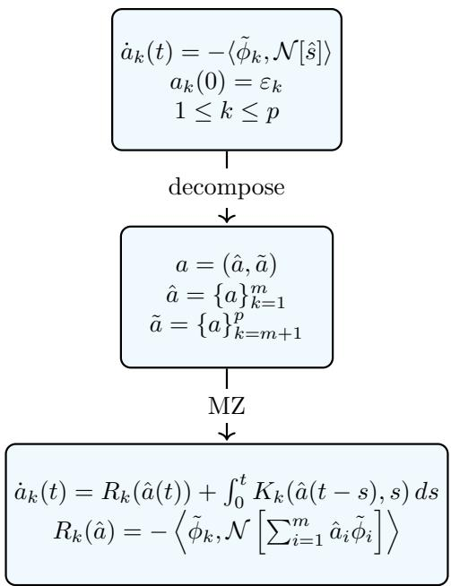  
Figure 1: Technical approach of applying the MZ formalism to the system of ODEs for the physicsinformed expansion coeficients.

## 2.2 Generalized Langevin dynamics

Our goal is to develop models that can accurately evolve a range of initial conditions. Following [18, 19, 21], we can expand the memory integrand in terms of kernel functions: if $\{ h _ { l } ( \hat { x } ) \} _ { l \in I }$ is a basis for functions of the resolved variables and I is the corresponding index set of the chosen basis, then we can write

$$
\int _ { 0 } ^ { t } K _ { k } ( \hat { a } ( \varepsilon , t - s ) , s ) d s = \sum _ { l \in I } \int _ { 0 } ^ { t } \kappa _ { l k } ( t - s ) h _ { l } ( \hat { a } ( s ) ) d s\tag{16}
$$

for $k = 1 , \ldots , m$ , where $\{ \kappa _ { l k } ( t ) \}$ are termed the memory kernels.

The calculation of these functions is carried out by leveraging the fluctuation-dissipation theorem (FDT) [35, 12, 39]. In practice, we can only use finitely many basis functions so the above expansion is necessarily replaced by an approximation. The technical approach is summarized in the schematic in Fig. 2.

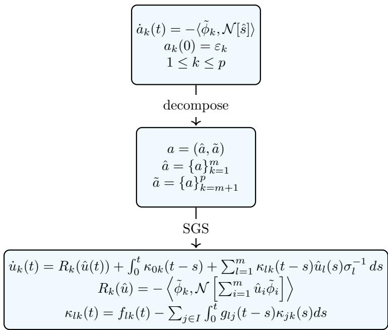  
Figure 2: Technical approach of the FDT implementation for a system of ODEs for the physicsinformed expansion coeficients.

## 3 Traditional MZ-based closure model

## 3.1 Memory kernels

Following [19], the memory kernels obey

$$
\kappa _ { l k } ( t ) = f _ { l k } ( t ) - \sum _ { j \in I } \int _ { 0 } ^ { t } g _ { l j } ( t - s ) \kappa _ { j k } ( s ) d s\tag{17}
$$

where $f _ { l k }$ and $g _ { l j }$ are auxiliary quantities defined, for $l , j \in I$ and $1 \leq k \leq m$ , as

$$
\begin{array} { r } { f _ { l k } ( t ) = \langle h _ { l } , e ^ { t \mathcal { L } } \mathcal { L } \mathcal { Q } \mathcal { L } \varepsilon _ { k } \rangle \varsigma , \qquad g _ { l j } ( t ) = \langle h _ { l } , e ^ { t \mathcal { L } } \mathcal { L } h _ { j } \rangle \varsigma } \end{array}\tag{18}
$$

and where $\begin{array} { r } { \mathcal { L } \ : = \ : \sum _ { j = 1 } ^ { p } R _ { j } ( \varepsilon ) \frac { \partial } { \partial \varepsilon _ { j } } } \end{array}$ is the Liouville operator. Denoting by $\{ H _ { l } ( z ) \} _ { 0 \leq l \leq d }$ the onedimensional Hermite polynomials corresponding to weight functions $e ^ { - z ^ { 2 } / 2 }$ , we take $\{ h _ { j } ( \hat { \varepsilon } ) \} _ { j \in I }$ to be the tensor products of $\begin{array} { r } { H _ { l } \left( \frac { \epsilon _ { k } } { \sigma _ { k } } \right) } \end{array}$ . In order to establish a proof of concept, we limit ourselves to $d = 1$ , so we have $| I | = { \binom { m + d } { d } } = m + 1$ , where I denote the index set of the multivariate Hermite basis functions.

The inner products in (18) are approximated using (10), with the quadrature points furnishing the initial conditions for generating the full-order solutions. More precisely, these are of the form

$$
a _ { k } ( 0 ) = ( \hat { \varepsilon } _ { k } , \tilde { \varepsilon } _ { k } ) = \left( \left( \sigma _ { k } z _ { k } + \mu _ { k } \right) _ { k = 1 } ^ { m } , \mathbf { 0 } _ { k = m + 1 } ^ { p } \right)\tag{19}
$$

We can compute the physical initial conditions that correspond to these modes via

$$
s _ { 0 } ( x ) = \sum _ { i = 1 } ^ { m } a _ { i } ( 0 ) \tilde { \phi } _ { i } ( x ) .\tag{20}
$$

The collection of initial conditions for $N _ { q } = 2$ quadrature points is shown in Figure 3.

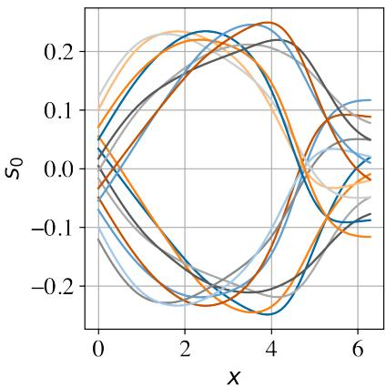  
Figure 3: Collection of initial conditions from Gauss-Hermite quadrature space for $N _ { q } = 2$

Figure 4 plots auxiliary quantities $\pmb { f } ( t ) = ( f _ { l k } ( t ) ) _ { l \in I , 1 \leq k \leq m }$ and ${ \pmb g } ( t ) = ( g _ { l j } ( t ) ) _ { l , j \in I }$ . Figure 5 plots the memory kernels $\pmb { K } ( t ) = ( \kappa _ { l k } ( t ) ) _ { l \in I , 1 \leq k \leq m } ,$ calculated by discretizing the convolution integral using the trapezoidal rule. See Appendix B for full derivations.

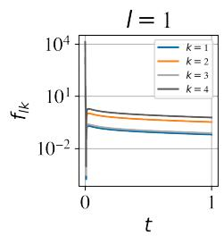

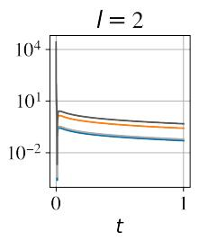

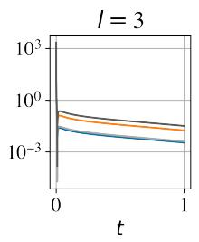

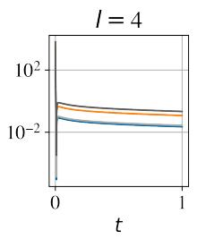

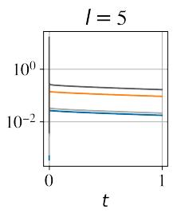

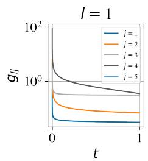

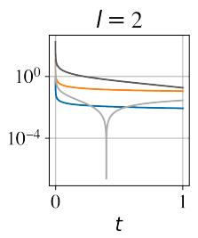

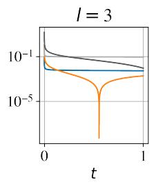  
Figure 4: Fluctuations $f _ { l k } ( t )$ and kernels $g _ { l j } ( t )$

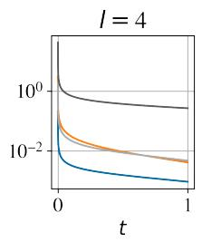

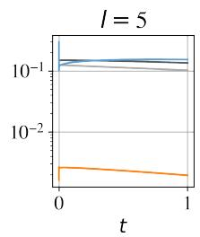

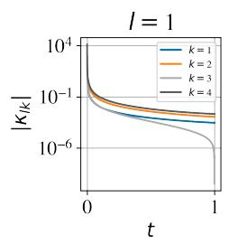

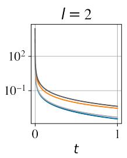

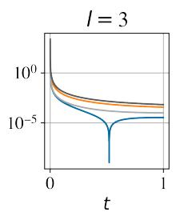

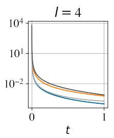  
Figure 5: Memory kernels $\kappa _ { l k } ( t )$

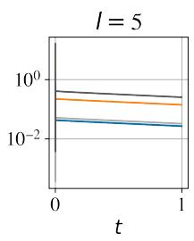

## 3.2 Reduced model

For $1 \leq l \leq m$ , we model the reduced coeficients $u _ { k }$ and incorporate the memory kernel

$$
\dot { u } _ { k } ( \varepsilon , t ) = R _ { k } ( \hat { u } ( \varepsilon , t ) ) + \int _ { 0 } ^ { t } \kappa _ { 0 k } ( t - s ) + \sum _ { l = 1 } ^ { m } \kappa _ { l k } ( t - s ) \frac { \hat { u } _ { l } ( s ) } { \sigma _ { l } } d s\tag{21}
$$

for $k = 1 , \ldots , m$ . The system is integrated forward in time using an explicit trapezoidal rule via Heun’s method.

$$
u _ { k } ^ { n + 1 } = u _ { k } ^ { n } + \frac { \Delta t } { 2 } ( r _ { 1 } + r _ { 2 } )\tag{22}
$$

where

$$
\begin{array} { l } { { \displaystyle r _ { 1 } = R _ { k } ( u ^ { n } ) + \frac { \Delta t } { 2 } \left[ 2 \sum _ { q = 1 } ^ { n - 1 } \kappa _ { 0 k } ( t _ { n - q } ) + \kappa _ { 0 k } ( t _ { n } ) + \kappa _ { 0 k } ( t _ { 0 } ) \right] } } \\ { { \displaystyle \qquad + \frac { \Delta t } { 2 } \sum _ { l = 1 } ^ { m } \left[ 2 \sum _ { q = 1 } ^ { n - 1 } \frac { \hat { u } _ { l } ^ { q } } { \sigma _ { l } } \kappa _ { l k } ( t _ { n - q } ) + \frac { \hat { u } _ { l } ^ { 0 } } { \sigma _ { l } } \kappa _ { l k } ( t _ { n } ) + \frac { \hat { u } _ { l } ^ { n } } { \sigma _ { l } } \kappa _ { l k } ( t _ { 0 } ) \right] } } \end{array}\tag{23}
$$

$$
\begin{array} { c } { { r _ { 2 } = R _ { k } ( u ^ { n } + r _ { 1 } \Delta t ) + \displaystyle \frac { \Delta t } { 2 } \left[ 2 \sum _ { q = 1 } ^ { n } \kappa _ { 0 k } ( t _ { n + 1 - q } ) + \kappa _ { 0 k } ( t _ { n + 1 } ) + \kappa _ { 0 k } ( t _ { 0 } ) \right] } } \\ { { + \displaystyle \frac { \Delta t } { 2 } \sum _ { l = 1 } ^ { m } \left[ 2 \sum _ { q = 1 } ^ { n } \frac { \hat { u } _ { l } ^ { q } } { \sigma _ { l } } \kappa _ { l k } ( t _ { n + 1 - q } ) + \frac { \hat { u } _ { l } ^ { 0 } } { \sigma _ { l } } \kappa _ { l k } ( t _ { n + 1 } ) + \frac { u _ { l } ^ { n } + r _ { 1 } \Delta t } { \sigma _ { l } } \kappa _ { l k } ( t _ { 0 } ) \right] } } \end{array}\tag{24}
$$

Then, the reduced field ˆs is reconstructed as

$$
\hat { s } = \sum _ { i = 1 } ^ { m } u _ { i } ( t ) \tilde { \phi } _ { i } ( x )\tag{25}
$$

Figure 6 plots the evolution of the true full-order coeficients $^ { a , }$ Markovian coeficients $b ,$ and reduced coeficients $u .$ The reduced dynamics better match the true coeficients than the Markovian dynamics alone. Figure $7$ shows the reduced and Markovian fields $\hat { s }$ with absolute errors compared to the true filtered field. We see smaller absolute error magnitudes using the memory kernels compared to the Markovian dynamics alone. We also see increased error towards the end of the temporal domain. These results show that for longer time, we may require higher-order projections $( { \mathrm { i . e . } }$ , beyond linear) for representing the memory kernels. We also require a much finer timestep when discretizing the convolution integral, typically smaller by a factor of 100 compared to the full order and Markovian models.

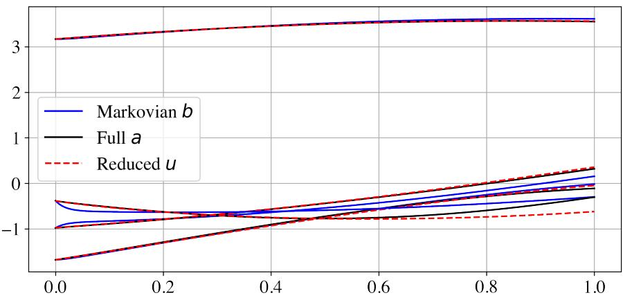  
Figure 6: Full-order $^ { a , }$ reduced $u ,$ and Markovian b coeficients.

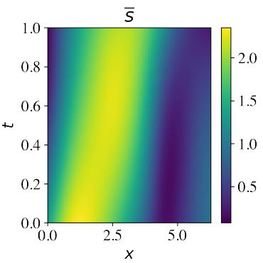

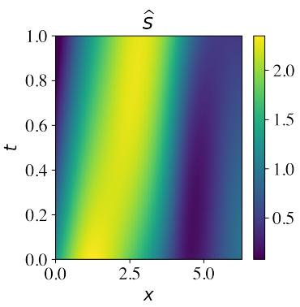

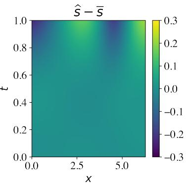

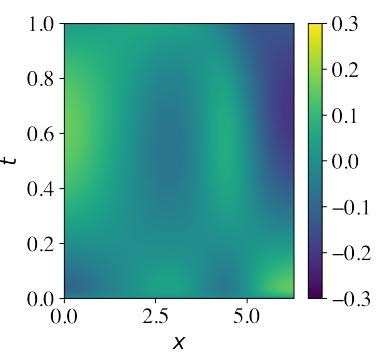  
Figure 7: True filtered field s compared to Markovian and reduced approximations ˆs with absolute error fields for initial condition $s _ { 0 } = e ^ { \sin ( x ) }$

Figure 8 plots the relative $\ell _ { 2 }$ error of the reduced and Markovian approximations compared to the true filtered field. We see a decreased error across the temporal domain using the memory kernels, except for longer time. Table 1 shows the average relative $\ell _ { 2 }$ error, only 2.9% for the reduced model compared to almost 7% for the Markovian model.

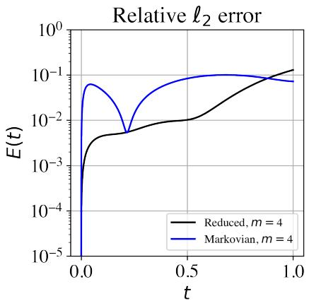

Figure 8: Relative $\ell _ { 2 }$ error in time.
<table><tr><td rowspan=1 colspan=1></td><td rowspan=1 colspan=1>Average relative $\ell _ { 2 }$ error</td></tr><tr><td rowspan=1 colspan=1>Markovian</td><td rowspan=1 colspan=1>6.6%</td></tr><tr><td rowspan=1 colspan=1>Reduced</td><td rowspan=1 colspan=1>2.9%</td></tr></table>

Table 1: Average errors for independent test sample for the viscous Burgers’ equation.

## 4 Generative closure model

## 4.1 Difusion modeling

A generative approach samples the SGS term from the data distribution $p _ { d a t a }$ along the trajectory in time via learning a denoising difusion process [31, 56, 30]. We assume access to some initial distribution $p _ { i n i t }$ that we can easily sample from, such as the Gaussian $p _ { i n i t } = \mathcal { N } ( 0 , I _ { d } )$ . The goal of our model is then to transform samples from $\pmb { t } _ { 0 } \in p _ { i n i t }$ into samples from $t _ { 1 } \sim p _ { d a t a }$ . We assume access to finite independent samples from $p _ { d a t a } .$ which serve as a proxy for the true distribution. The simulation of a stochastic diferential equation (SDE) can be used for converting a simple distribution $p _ { i n i t }$ into a more complex target distribution $p _ { d a t a }$ . The difusion model consists of a flow model $\bar { u _ { \gamma } ^ { \theta } } : \mathbb { R } ^ { d } \times [ 0 , 1 ] \to \mathbb { R } ^ { d } , ( \bar { \pmb { t } } , \gamma ) \mapsto \bar { u _ { \gamma } ^ { \theta } } ( \pmb { t } )$ with parameters θ and a fixed difusion coeficient $\sigma _ { \gamma } : [ 0 , 1 ] \to [ \dot { 0 } , \infty ) , \gamma \mapsto \sigma _ { \gamma }$ , such that

$$
\pmb { t } _ { 0 } \sim p _ { i n i t } = \mathcal { N } ( 0 , I _ { d } )\tag{26}
$$

$$
d { \pmb { t } } _ { \gamma } = u _ { \gamma } ^ { \theta } ( { \pmb { t } } _ { \gamma } ) d \gamma + \sigma _ { \gamma } d W _ { \gamma }\tag{27}
$$

$$
\tau ^ { \mathrm { S G S } } = t _ { 1 } \sim p _ { d a t a }\tag{28}
$$

If we set $\sigma _ { \gamma } = 0$ , we recover a flow model. The flow training target $u _ { \gamma } ^ { \mathrm { t a r g e t } }$ is the marginal vector field. To construct a training target $u _ { \gamma } ^ { \mathrm { t a r g e t } }$ for a flow model, we choose a conditional probability path $p _ { \gamma } ( t | \tau )$ that fulfills $p _ { 0 } ( \cdot | \tau ) = p _ { i n i t } , p _ { 1 } ( \cdot | \tau ) = \delta _ { \tau }$ (Dirac delta distribution). The probability path specifies a gradual interpolation between $p _ { i n i t }$ and $p _ { d a t a }$ . We consider a Gaussian conditional probability path $p _ { \gamma } ( \pmb { t } | \tau ) = \mathcal { N } ( \pmb { t } ; \alpha _ { \gamma } \pmb { \tau } , \beta _ { \gamma } ^ { 2 } I _ { d } )$ . This is the probability path used by denoising difusion models [30, 31]. Let $\alpha _ { \gamma } : [ 0 , 1 ]  \mathbb { R }$ and $\beta _ { \gamma } : [ 0 , 1 ] \to \mathbb { R }$ be noise schedulers defined as monotonic, continuously diferentiable functions satisfying $\alpha _ { 1 } = \beta _ { 0 } = 1$ and $\alpha _ { 0 } = \beta _ { 1 } = 0$ . Flow matching consists of training a model $u _ { \gamma } ^ { \theta }$ via minimizing the conditional flow matching (CFM) loss

$$
\begin{array} { r } { \mathcal { L } _ { \mathrm { C F M } } ( \theta ) = \mathbb { E } _ { \tau \sim p _ { d a t a } , \gamma \sim \mathrm { U n i f } , t \sim p _ { \gamma } ( \cdot | \tau ) } [ | | u _ { \gamma } ^ { \theta } ( t ) - u _ { \gamma } ^ { \mathrm { t a r g e t } } ( t | \tau ) | | ^ { 2 } ] } \end{array}\tag{29}
$$

where $u _ { \gamma } ^ { \mathrm { t a r g e t } } ( t | \tau )$ is the conditional vector field. This can be any vector field such that the corresponding ODE gives the conditional probability path, i.e.,

$$
\pmb { t } _ { 0 } \sim p _ { i n i t } = \mathcal { N } ( 0 , I _ { d } )\tag{30}
$$

$$
d { \pmb { t } } _ { \gamma } = u _ { \gamma } ^ { \mathrm { t a r g e t } } ( { \pmb { t } } _ { \gamma } | { \pmb { \tau } } ) d \gamma\tag{31}
$$

$$
t _ { \gamma } \sim p _ { \gamma } ( \cdot | \tau )\tag{32}
$$

for $0 \leq \gamma \leq 1$ . For a Gaussian probability path, this expression can be found analytically as

$$
u _ { \gamma } ^ { \mathrm { t a r g e t } } ( { \pmb t } | { \pmb \tau } ) = \left( \dot { \alpha } _ { \gamma } - \frac { \dot { \beta } _ { \gamma } } { \beta _ { \gamma } } \alpha _ { \gamma } \right) { \pmb \tau } + \frac { \dot { \beta } _ { \gamma } } { \beta _ { \gamma } } { \pmb t }\tag{33}
$$

After training, samples are generated by simulating the SDE with stochastic dynamics at each physical timestep for some $\sigma _ { \gamma }$ . This form has the same marginal probability path as the corresponding SDE. The score correction ensures that the learned distribution has the correct marginal density evolution toward $p _ { d a t a } \ [ 5 6 , 3 0 , 4 2 ]$ . We can write the form for the difusion model as

$$
\pmb { t } _ { 0 } \sim p _ { i n i t } = \mathcal { N } ( 0 , I _ { d } )
$$

$$
d \pmb { t } _ { \gamma } = \left[ u _ { \gamma } ^ { \theta } ( \pmb { t } _ { \gamma } ) + \frac { \sigma _ { \gamma } ^ { 2 } } { 2 } s _ { \gamma } ^ { \theta } ( \pmb { t } _ { \gamma } ) \right] d \gamma + \sigma _ { \gamma } d W _ { \gamma }\tag{34}
$$

(35)

$$
\tau ^ { \mathrm { S G S } } = t _ { 1 } \sim p _ { d a t a }\tag{36}
$$

where we train a score network $s _ { \gamma } ^ { \theta }$ via denoising score matching (DSM)

$$
{ \mathcal { L } } _ { \mathrm { D S M } } ( \theta ) = \mathbb { E } _ { \tau \sim p _ { d a t a } , \gamma \sim \mathrm { U n i f } , t \sim p _ { \gamma } ( \cdot \vert \tau ) } [ \vert | s _ { \gamma } ^ { \theta } ( t ) - \nabla \log p _ { \gamma } ( t \vert \tau ) \vert | ^ { 2 } ]\tag{37}
$$

where the conditional score distribution is

$$
\nabla \log p _ { \gamma } ( { \pmb t } | { \pmb \tau } ) = - \frac { { \pmb t } - \alpha _ { \gamma } { \pmb \tau } } { \beta _ { \gamma } ^ { 2 } }\tag{38}
$$

Further training details and hyperparameters for flow and score networks are in Appendix C. At inference time, we can combine $s _ { \gamma } ^ { \theta } ( t )$ with $u _ { \gamma } ^ { \theta } ( t )$ and sample via simulating the SDE from $\gamma = 0$ to 1. Often, our goal is to generate samples conditioned on some data S. Guided (conditional) generation involves sampling from $\tau \sim p _ { d a t a } ( \cdot | S )$ , where $s$ is a conditioning variable and $p _ { d a t a } ( \cdot | S )$ is the conditional data distribution. Guided flow matching consists of training a model $u _ { \gamma } ^ { \theta }$ via minimizing the classifier-free guidance (CFG) CFM loss

$$
\mathcal { L } _ { \mathrm { C F M } } ^ { \mathrm { C F G } } = \mathbb { E } _ { \varPi } | | u _ { \gamma } ^ { \theta } ( t | S ) - u _ { \gamma } ^ { \mathrm { t a r g e t } } ( t | \tau ) | | ^ { 2 }\tag{39}
$$

$$
\begin{array} { r } { \varTheta = ( \tau , S ) \sim p _ { d a t a } ( \tau , S ) , \gamma \sim \mathrm { U n i f } , t \sim p _ { \gamma } ( \cdot | \tau ) , \mathrm { ~ r e p l a c e ~ } S \mathrm { ~ w i t h ~ } \mathcal { O } \mathrm { ~ w i t h ~ p r o b a b i l i t y ~ } \eta . } \end{array}\tag{40}
$$

To incorporate score matching, we additionally train a score network $s _ { \gamma } ^ { \theta }$ by minimizing the CFG DSM loss

$$
\begin{array} { r l } & { \mathcal { L } _ { \mathrm { D S M } } ^ { \mathrm { C F G } } = \mathbb { E } _ { \perp } \lvert | s _ { \gamma } ^ { \theta } ( t \lvert S ) - \nabla \log p _ { \gamma } ( t \lvert \tau ) \rvert | ^ { 2 } } \\ & { \qquad \big \Omega = ( \tau , S ) \sim p _ { d a t a } ( \tau , S ) , \gamma \sim \mathrm { U n i f } , t \sim p _ { \gamma } ( \cdot \lvert \tau ) , \mathrm { ~ r e p l a c e ~ } \mathcal { S } = \mathcal { D } \mathrm { ~ w i t h ~ p r o b a b i l i t y ~ } \eta . } \end{array}\tag{41}
$$

(42)

These objectives account for the possibility of the “label” not being in the training set $( { \mathrm { i . e . } }$ $s = \emptyset$ . At inference time, for a fixed choice of guidance scale, we can combine $s _ { t } ^ { \theta } ( { \pmb t } | { \bar { s } } )$ with a guided vector field $u _ { t } ^ { \theta } ( t | S )$ and define

$$
\tilde { s } _ { \gamma } ^ { \theta } ( \pmb { t } | \boldsymbol { S } ) = ( 1 - w ) s _ { \gamma } ^ { \theta } ( \pmb { t } | \mathcal { S } ) + w s _ { \gamma } ^ { \theta } ( \pmb { t } | \boldsymbol { S } )\tag{43}
$$

$$
\tilde { u } _ { \gamma } ^ { \theta } ( \pmb { t } | \boldsymbol { S } ) = ( 1 - w ) u _ { \gamma } ^ { \theta } ( \pmb { t } | \mathcal { S } ) + w u _ { \gamma } ^ { \theta } ( \pmb { t } | \boldsymbol { S } )\tag{44}
$$

Then we can sample via

$$
\pmb { t } _ { 0 } \sim p _ { i n i t } = \mathcal { N } ( 0 , I _ { d } )\tag{45}
$$

$$
d \pmb { t } _ { \gamma } = \left[ \tilde { u } _ { \gamma } ^ { \theta } ( \pmb { t } _ { \gamma } | \pmb { S } ) + \frac { \sigma _ { \gamma } ^ { 2 } } { 2 } \tilde { s } _ { \gamma } ^ { \theta } ( \pmb { t } _ { \gamma } | \pmb { S } ) \right] d \gamma + \sigma _ { \gamma } d W _ { \gamma }\tag{46}
$$

$$
\tau ^ { \mathrm { S G S } } = t _ { 1 } \sim p _ { d a t a } ( \cdot | S )\tag{47}
$$

simulating the SDE from $\gamma = 0$ to 1. The goal is for $\mathbf { \delta t } _ { 1 }$ to adhere to the guiding variable S.

## 4.2 Generative model for memory efects

Next, we demonstrate the applicability of generative SGS modeling for the memory term directly, improving upon traditional analytical approaches. We aim to develop a reduced model for the coeficients $r _ { k }$ to approximate the true resolved coeficients $a _ { k }$ for $k = 1 , \ldots , m$ . The reduced dynamics are modeled as

$$
\dot { \boldsymbol { r } } _ { k } ( t ) = R _ { k } ( \hat { \boldsymbol { r } } ( t ) ) + \tau _ { k } ^ { \mathrm { S G S } } ( \hat { \boldsymbol { r } } , \xi )\tag{48}
$$

We choose to represent the memory efects using a conditional distribution

$$
\tau ^ { \mathrm { S G S } } ( \hat { r } , \xi ) \approx \int _ { 0 } ^ { t } K _ { k } ( \hat { r } ( t - s ) , s ) d s \sim p _ { d a t a } ( \cdot | \hat { r } ) .\tag{49}
$$

This approach difers from the previous formulation in $\operatorname { E q }$ . (15), where we explicitly construct intrusive memory kernels and then evaluate the memory integral. We use difusion modeling to learn the conditional distribution $p _ { d a t a } ( \cdot | \hat { r } )$ , i.e., the resolved modes are conditioned on the complete set of resolved variables. This conditioning adheres with the Markovian dynamics, which are dependent on the set of resolved variables. Then, the reduced approximation ˆs is compared to the filtered full-order field s (i.e., using only m modes in the reconstruction).

$$
\hat { s } = \sum _ { i = 1 } ^ { m } r _ { i } ( t ) \tilde { \phi } _ { i } ( x )\tag{50}
$$

$$
\bar { s } = \sum _ { i = 1 } ^ { m } a _ { i } ( t ) \tilde { \phi } _ { i } ( x )\tag{51}
$$

The technical approach is summarized in the schematic in Fig. 9.

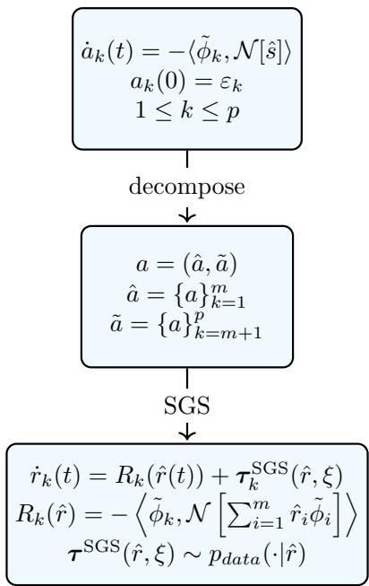  
Figure 9: Technical approach of generative SGS modeling for system of ODEs for the physicsinformed expansion coeficients.

For the reduced model, we take $m = 4$ , compared to the full-order system with $p = 6 7$ . The generative SGS terms conditioned on the test data compared to the true SGS terms are plotted in Figure 10. With the incorporation of stochastic dynamics through score matching and any $\sigma _ { \gamma } > 0 .$ the resulting predictions are expected to exhibit additional variability relative to flow matching alone. For these experiments, we empirically select $\sigma _ { \gamma } = 0 . 1$ , which controls the magnitude of the injected difusion and therefore the stochasticity of the predictions.

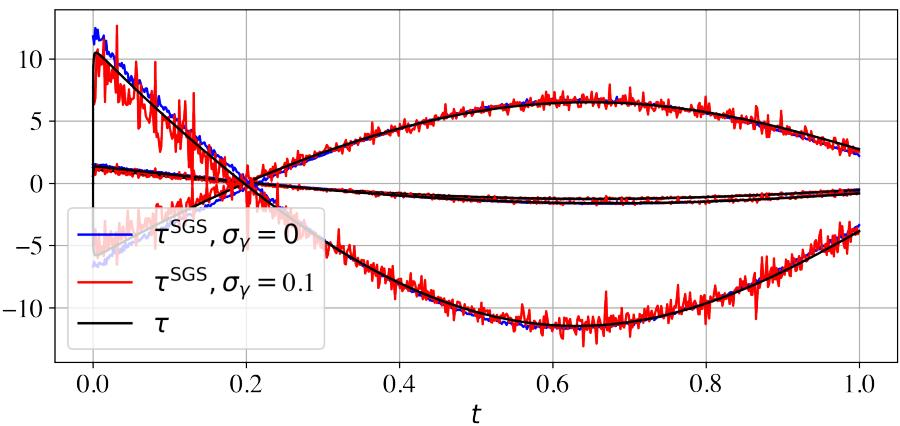  
Figure 10: Generated closure $\tau _ { k } ^ { S G S }$ with flow and score matching.

For deploying the reduced model, we use a Runge-Kutta (RK) time integration scheme at each time $t _ { n } ,$ with a factor of 20 fewer timesteps compared to the full-order simulation. We sample $\tau ^ { \mathrm { S G S } } ( \hat { r } ^ { n } , \xi ) \sim p _ { d a t a } ( \cdot | \hat { r } ^ { n } )$ by simulating the SDE and then integrate forward as

$$
\hat { r } ^ { n + 1 } = \hat { r } ^ { n } + \frac { h } { 6 } ( k _ { 1 } + 2 k _ { 2 } + 2 k _ { 3 } + k _ { 4 } ) + h \tau ^ { \mathrm { S G S } } ( \hat { r } ^ { n } , \xi )\tag{52}
$$

where

$$
k _ { 1 } = R \left( { \hat { r } } ^ { n } \right)\tag{53}
$$

$$
k _ { 2 } = R \left( { \hat { r } } ^ { n } + h { \frac { k _ { 1 } } { 2 } } \right)\tag{54}
$$

$$
k _ { 3 } = R \left( { \hat { r } } ^ { n } + h { \frac { k _ { 2 } } { 2 } } \right)\tag{55}
$$

$$
k _ { 4 } = R \left( { \hat { r } } ^ { n } + h k _ { 3 } \right)\tag{56}
$$

For fixed function evaluation cost, we use 20 difusion timesteps for the SDE integration at each physical timestep. Figure 11 plots the true full-order coeficients $^ { a , }$ Markovian coeficients b, and reduced coeficients r. The reduced dynamics better match the true coeficients than the Markovian dynamics alone. Figure 12 shows the reduced and Markovian fields ˆs with absolute errors compared to the true filtered field. We see smaller absolute error magnitudes using the generative SGS model compared to the Markovian dynamics alone.

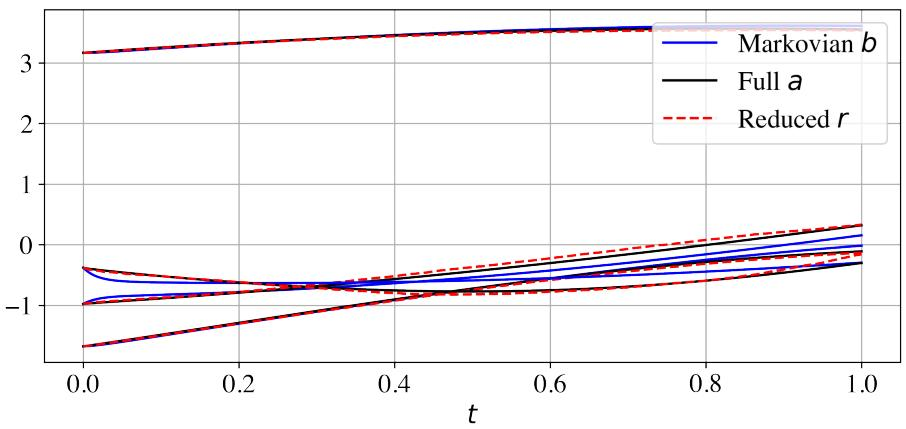  
Figure 11: Full-order $^ { a , }$ generated reduced r, and Markovian b coeficients.

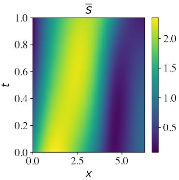

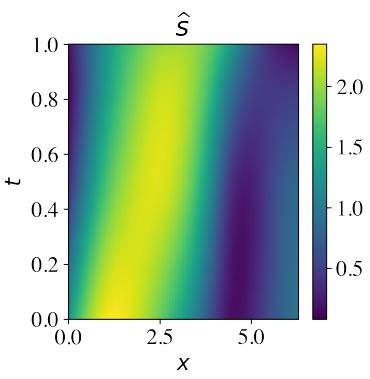

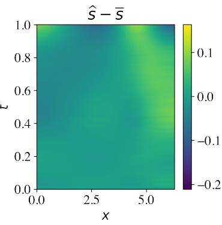

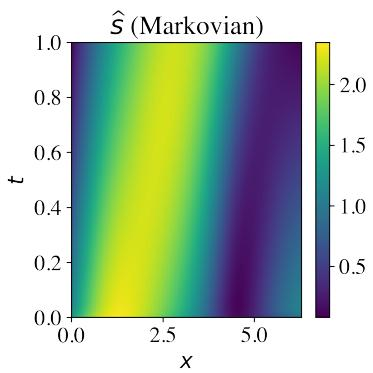

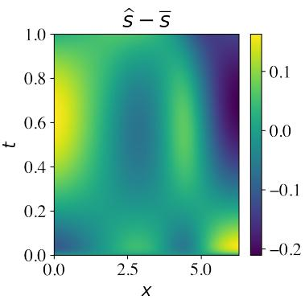  
Figure 12: True filtered field s compared to Markovian and reduced approximations ˆs with absolute error fields for initial condition $s _ { 0 } = e ^ { \sin ( x ) }$

Figure 13 plots the relative $\ell _ { 2 }$ error of the reduced and Markovian approximations compared to the true filtered field. For this realization, we see a decreased error across the temporal domain using the generative SGS model. Table 2 shows the average relative $\ell _ { 2 }$ error, less than 2.5% for the reduced model compared to almost 7% for the Markovian model across 10 samples.

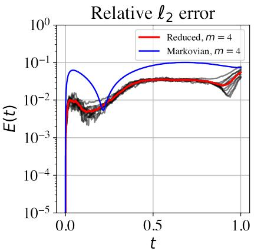

Figure 13: Relative $\ell _ { 2 }$ error in time (black: samples, red: average).
<table><tr><td rowspan=1 colspan=1></td><td rowspan=1 colspan=1>Average relative $\ell _ { 2 }$ error</td></tr><tr><td rowspan=1 colspan=1>Markovian</td><td rowspan=1 colspan=1>6.6%</td></tr><tr><td rowspan=1 colspan=1>Reduced</td><td rowspan=1 colspan=1>2.4%</td></tr></table>

Table 2: Average errors for generative closure model for viscous Burgers’.

## 5 Conclusions

In this work, we built reduced models by applying the MZ formalism to the system of ODEs for the physics-informed expansion coeficients. We implemented the FDT to solve for memory kernels applicable to evolving a collection of initial conditions and demonstrate lower errors on average for evolution of an out-of-distribution initial condition. These results show that higher order approximations for the memory kernels become relevant and may be required to continue accounting for accurate memory for longer times. So, future work might include developing diferent representations for the memory kernels themselves, through generative approaches and higher-order projections. Finally, we used generative modeling to learn a conditional distribution to represent the memory efects on the resolved variables. We see robust predictions for evolution of a particular initial condition, with lower errors than evolving the Markovian dynamics alone. We see benefits in representing the memory itself stochastically. Future work should include accounting for memory by conditioning on previous states for some memory horizon length, as well as training across a collection of initial conditions.

## Acknowledgements

This project was completed with support from the U.S. Department of Energy, Advanced Scientific Computing Research program, under the Scalable, Eficient and Accelerated Causal Reasoning Operators, Graphs and Spikes for Earth and Embedded Systems (SEA-CROGS) project (Project No. 80278). The computational work was performed using PNNL Institutional Computing at Pacific Northwest National Laboratory. Pacific Northwest National Laboratory (PNNL) is a multi-program national laboratory operated for the U.S. Department of Energy (DOE) by Battelle Memorial Institute under Contract No. DE-AC05-76RL01830.

This material is based upon work supported by the U.S. Department of Energy, Ofice of Science, Ofice of Advanced Scientific Computing Research, Department of Energy Computational Science Graduate Fellowship under Award Number DE-SC0023112. This report was prepared as an account of work sponsored by an agency of the United States Government. Neither the United States Government nor any agency thereof, nor any of their employees, makes any warranty, express or implied, or assumes any legal liability or responsibility for the accuracy, completeness, or usefulness of any information, apparatus, product, or process disclosed, or represents that its use would not infringe privately owned rights. Reference herein to any specific commercial product, process, or service by trade name, trademark, manufacturer, or otherwise does not necessarily constitute or imply its endorsement, recommendation, or favoring by the United States Government or any agency thereof. The views and opinions of authors expressed herein do not necessarily state or reflect those of the United States Government or any agency thereof.

## A Weak formulation derivation

Rewrite the viscous Burgers’ equation as

$$
\frac { \partial s } { \partial t } + \frac { \partial } { \partial x } \left( \frac { s ^ { 2 } } { 2 } \right) - \nu \frac { \partial ^ { 2 } s } { \partial x ^ { 2 } } = 0\tag{57}
$$

Set $f ( s ) = s ^ { 2 } / 2$ and substitute $f ( s )$ into Eq. (57) to write

$$
\frac { \partial s } { \partial t } + \frac { \partial f } { \partial x } - \nu \frac { \partial ^ { 2 } s } { \partial x ^ { 2 } } = 0\tag{58}
$$

Rewriting as a system of first-order equations gives

$$
s _ { t } + f _ { x } - \nu q _ { x } = 0\tag{59}
$$

$$
q - s _ { x } = 0\tag{60}
$$

For the weak formulation, we can write

$$
\langle \phi _ { k } , s _ { t } + f _ { x } - \nu q _ { x } \rangle = 0\tag{61}
$$

$$
\langle \phi _ { k } , q - s _ { x } \rangle = 0\tag{62}
$$

Integrating by parts on Eq. (61) gives

$$
\left. \phi _ { k } , s _ { t } \right. = - \langle \phi _ { k } , f _ { x } \rangle + \left. \phi _ { k } , \nu q _ { x } \right.\tag{63}
$$

$$
\begin{array} { l } { \displaystyle \langle \phi _ { k } , s _ { t } \rangle = - \biggl [ \phi _ { k } ( \eta ) f ( \eta ) \biggr ] \biggl | _ { \partial \Omega } + \int _ { \Omega } \left( \frac { \partial } { \partial x } \phi _ { k } ( x ) f ( x ) \right) d x } \\ { \displaystyle \qquad + \left. \nu \biggl [ \phi _ { k } ( \eta ) q ( \eta ) \biggr ] \right| _ { \partial \Omega } - \nu \int _ { \Omega } \left( \frac { \partial } { \partial x } \phi _ { k } ( x ) q ( x ) \right) d x } \end{array}\tag{64}
$$

Writing the flux terms as surface integrals gives

$$
\langle \phi _ { k } , s _ { t } \rangle = \langle \phi _ { k } ^ { \prime } , f \rangle - \int _ { \partial \Omega } \hat { \mathbf { n } } \cdot f ^ { * } ( s _ { R } , s _ { L } ) \phi _ { k } ( \eta ) d \eta - \nu \langle \phi _ { k } ^ { \prime } , q \rangle + \nu \int _ { \partial \Omega } \hat { \mathbf { n } } \cdot q ( \eta ) \phi _ { k } ( \eta ) d \eta\tag{65}
$$

where nˆ is the outward-facing normal, $f ^ { * }$ represents the numerical flux term [45], and the subscripts and R and L refer to values of the functions at the right and left boundaries. The numerical flux $f ^ { * } ( c ^ { - } , c ^ { + } )$ used is defined by

$$
f ^ { * } ( c ^ { - } , c ^ { + } ) = f \left( \frac { c ^ { - } + | c ^ { - } | } { 2 } - \frac { c ^ { + } - | c ^ { + } | } { 2 } \right)\tag{66}
$$

$$
= { \left\{ \begin{array} { l l } { f ( c ^ { - } ) } & { { \mathrm { i f ~ } } c ^ { + } \geq 0 } \\ { f ( c ^ { + } ) } & { { \mathrm { i f ~ } } c ^ { - } \leq 0 } \end{array} \right. }\tag{67}
$$

Integrating by parts on Eq. (62) gives

$$
\langle \phi _ { k } , q \rangle = \langle \phi _ { k } , s _ { x } \rangle\tag{68}
$$

$$
\langle \phi _ { k } , q \rangle = \bigg [ \phi _ { k } ( \eta ) s ( \eta ) \bigg ] _ { \partial \Omega } - \int _ { \Omega } \bigg ( \frac { \partial } { \partial x } \phi _ { k } ( x ) s ( x ) \bigg ) \ d x\tag{69}
$$

$$
\langle \phi _ { k } , q \rangle = - \langle \phi _ { k } ^ { \prime } , s \rangle + \int _ { \partial \Omega } { \hat { \mathbf { n } } } \cdot s ( \eta ) \phi _ { k } ( \eta ) d \eta\tag{70}
$$

Discretize the approximations using linear expansions in terms of the basis functions

$$
\hat { s } _ { p } ( t , x ) = \sum _ { i = 1 } ^ { p } a _ { i } ( t ) \phi _ { i } ( x ) , \quad \hat { q } _ { p } ( t , x ) = \sum _ { j = 1 } ^ { p } b _ { j } ( t ) \phi _ { j } ( x ) .\tag{71}
$$

Substituting the summations into Eq. (65) to write

$$
\begin{array} { r l } & { \left. \phi _ { k } , \displaystyle \frac { \partial } { \partial t } \left( \displaystyle \sum _ { i = 1 } ^ { p } a _ { i } ( t ) \phi _ { i } \right) \right. = \langle \phi _ { k } ^ { \prime } , f \rangle - \displaystyle \int _ { \partial \Omega } \hat { \bf n } \cdot f ^ { * } ( \hat { s } _ { p , R } , \hat { s } _ { p , L } ) \phi _ { k } ( \eta ) d \eta } \\ & { \quad \quad \quad \quad - \nu \left. \phi _ { k } ^ { \prime } , \displaystyle \sum _ { j = 1 } ^ { p } b _ { j } ( t ) \phi _ { j } \right. + \nu \displaystyle \int _ { \partial \Omega } \hat { \bf n } \cdot \left( \displaystyle \sum _ { j = 1 } ^ { p } b _ { j } ( t ) \phi _ { j } ( x _ { o u t } ) \right) \phi _ { k } ( \eta ) d \eta , } \end{array}\tag{72}
$$

where $x _ { o u t } = 2 \pi$ and $x _ { i n } = 0$ . Expanding the surface integrals gives

$$
\begin{array} { c } { { \displaystyle \left. \phi _ { k } , \sum _ { i = 1 } ^ { p } \frac { d a _ { i } ( t ) } { d t } \phi _ { i } \right. = \langle \phi _ { k } ^ { \prime } , f \rangle - f ^ { * } ( \hat { s } _ { p } ( t , x _ { o u t } ) , \hat { s } _ { p } ( t , x _ { i n } ) ) \big ( \phi _ { k } ( x _ { o u t } ) - \phi _ { k } ( x _ { i n } ) \big ) } } \\ { { - \nu \left. \phi _ { k } ^ { \prime } , \sum _ { j = 1 } ^ { p } b _ { j } ( t ) \phi _ { j } \right. + \nu \bigg [ \phi _ { k } ( x _ { o u t } ) - \phi _ { k } ( x _ { i n } ) \bigg ] \sum _ { j = 1 } ^ { p } b _ { j } ( t ) \phi _ { j } \big ( x _ { o u t } \big ) } } \end{array}\tag{73}
$$

As a result, the expansion coeficients for Eq. (61) are given by

$$
\begin{array} { l } { \displaystyle \frac { d a _ { k } ( t ) } { d t } = \langle \phi _ { k } ^ { \prime } , f \rangle - { f ^ { * } } ( \hat { s } _ { p } ( t , x _ { o u t } ) , \hat { s } _ { p } ( t , x _ { i n } ) ) \big ( \phi _ { k } ( x _ { o u t } ) - \phi _ { k } ( x _ { i n } ) \big ) } \\ { \displaystyle \qquad + \nu \sum _ { j = 1 } ^ { p } \bigg [ - \langle \phi _ { k } ^ { \prime } , \phi _ { j } \rangle + \big [ \phi _ { k } ( x _ { o u t } ) - \phi _ { k } ( x _ { i n } ) \big ] \phi _ { j } ( x _ { o u t } ) \bigg ] b _ { j } ( t ) } \end{array}\tag{74}
$$

for $1 \leq k \leq p .$ Substituting the summations into Eq. (70)

$$
\left. \phi _ { k } , \sum _ { j = 1 } ^ { p } b _ { j } ( t ) \phi _ { j } \right. = - \left. \phi _ { k } ^ { \prime } , \sum _ { i = 1 } ^ { p } a _ { i } ( t ) \phi _ { i } \right. + \int _ { \partial \Omega } \hat { \mathbf { n } } \cdot \left( \sum _ { i = 1 } ^ { p } a _ { i } ( t ) \phi _ { i } ( x _ { i n } ) \right) \phi _ { k } ( \eta ) d \eta\tag{75}
$$

Expanding the surface integrals yields

$$
b _ { k } ( t ) = - \left. \phi _ { k } ^ { \prime } , \sum _ { i = 1 } ^ { p } a _ { i } ( t ) \phi _ { i } \right. + \left[ \phi _ { k } ( x _ { o u t } ) - \phi _ { k } ( x _ { i n } ) \right] \sum _ { i = 1 } ^ { p } a _ { i } ( t ) \phi _ { i } ( x _ { i n } )\tag{76}
$$

So the expansion coeficients for Eq. (62) are given by

$$
b _ { k } ( t ) = \sum _ { i = 1 } ^ { p } \bigg [ - \langle \phi _ { k } ^ { \prime } , \phi _ { i } \rangle + \big [ \phi _ { k } ( x _ { o u t } ) - \phi _ { k } ( x _ { i n } ) \big ] \phi _ { i } ( x _ { i n } ) \bigg ] a _ { i } ( t )\tag{77}
$$

for $1 \leq k \leq p .$ . Substituting Eq. (77) into Eq. (74) yields a system of ODEs for the expansion coeficients

$$
\begin{array} { l } { \displaystyle \frac { d a _ { k } ( t ) } { d t } = \langle \phi _ { k } ^ { \prime } , f \rangle - f ^ { * } \big ( \widehat s _ { p } ( t , x _ { o u t } ) , \widehat s _ { p } ( t , x _ { i n } ) \big ) \big ( \phi _ { k } ( x _ { o u t } ) - \phi _ { k } ( x _ { i n } ) \big ) } \\ { \displaystyle \qquad + \nu \sum _ { j = 1 } ^ { p } \bigg [ - \langle \phi _ { k } ^ { \prime } , \phi _ { j } \rangle + \big [ \phi _ { k } ( x _ { o u t } ) - \phi _ { k } ( x _ { i n } ) \big ] \phi _ { j } \big ( x _ { o u t } \big ) \bigg ] . } \\ { \displaystyle \qquad \sum _ { i = 1 } ^ { p } \bigg [ - \bigg \langle \frac { d } { d x } \phi _ { j } , \phi _ { i } \bigg \rangle + \big [ \phi _ { j } \big ( x _ { o u t } \big ) - \phi _ { j } \big ( x _ { i n } \big ) \big ] \phi _ { i } \big ( x _ { i n } \big ) \bigg ] a _ { i } ( t ) } \end{array}\tag{78}
$$

with the initial condition

$$
a _ { k } ( 0 ) = \langle \phi _ { k } , s _ { 0 } \rangle\tag{79}
$$

for $1 \leq k \leq p .$ . We use a quadrature rule to calculate the inner products.

Let $\boldsymbol { \mathcal { A } _ { k } [ \hat { s } _ { p } ] }$ represent the nonlinear terms, $\mathcal { D }$ represent the viscous terms, and $\mathcal { Q }$ represent the derivative terms, allowing us to write

$$
\frac { d a _ { k } ( t ) } { d t } = \mathcal { A } _ { k } [ \hat { s } _ { p } ] + \nu \sum _ { j = 1 } ^ { p } \mathcal { D } _ { k j } \sum _ { i = 1 } ^ { p } \mathcal { Q } _ { j i } a _ { i } ( t )\tag{80}
$$

where

$$
\begin{array} { r } { \boldsymbol { \mathcal { A } _ { k } } = \langle \boldsymbol { \phi } _ { k } ^ { \prime } , \boldsymbol { f } \rangle - f ^ { * } \big ( \hat { s } _ { p } ( t , x _ { o u t } ) , \hat { s } _ { p } ( t , x _ { i n } ) \big ) \big ( \phi _ { k } ( x _ { o u t } ) - \phi _ { k } ( x _ { i n } ) \big ) } \end{array}\tag{81}
$$

$$
\mathcal { D } _ { k j } = - \langle \phi _ { k } ^ { \prime } , \phi _ { j } \rangle + [ \phi _ { k } ( x _ { o u t } ) - \phi _ { k } ( x _ { i n } ) ] \phi _ { j } ( x _ { o u t } )\tag{82}
$$

$$
\mathcal { Q } _ { j i } = - \langle \phi _ { j } ^ { \prime } , \phi _ { i } \rangle + \left[ \phi _ { j } ( x _ { o u t } ) - \phi _ { j } ( x _ { i n } ) \right] \phi _ { i } ( x _ { i n } )\tag{83}
$$

The Markovian term is given by

$$
R _ { k } ( a ( \varepsilon , t ) ) = - \left. \tilde { \phi } _ { k } , \mathcal { N } \left[ \sum _ { i = 1 } ^ { m } a _ { i } ( \varepsilon , t ) \tilde { \phi } _ { i } \right] \right.\tag{84}
$$

with the boundary conditions incorporated as described above. Using A, D, and $\mathcal { Q } ,$ , we can write

$$
\frac { d a _ { k } ( t ) } { d t } = A _ { k } [ \hat { s } _ { m } ] + \nu \sum _ { j = 1 } ^ { p } \mathcal { D } _ { j k } \sum _ { i = 1 } ^ { m } \mathcal { Q } _ { i j } a _ { i } ( t )\tag{85}
$$

for $1 \leq k \leq m$

## B Fluctuations and kernels for MZ-reduced model

From Appendix A, we have the system of ODEs for the expansion coeficients

$$
\frac { d a _ { k } ( t ) } { d t } = R _ { k } ( a ( t ) )\tag{86}
$$

$$
\begin{array} { l } { \displaystyle \frac { d a _ { k } ( t ) } { d t } = \left. \frac { d } { d x } \phi _ { k } , F \right. - F ^ { * } ( s ( t , 2 \pi ) , s ( t , 0 ) ) ( \phi _ { k } ( 2 \pi ) - \phi _ { k } ( 0 ) ) } \\ { \displaystyle ~ + \nu \sum _ { j = 1 } ^ { p } \bigg [ - \left. \frac { d } { d x } \phi _ { k } , \phi _ { j } \right. + \left[ \phi _ { k } ( 2 \pi ) - \phi _ { k } ( 0 ) \right] \phi _ { j } ( 2 \pi ) \bigg ] . } \\ { \displaystyle \sum _ { i = 1 } ^ { p } \bigg [ - \left. \frac { d } { d x } \phi _ { j } , \phi _ { i } \right. + \left[ \phi _ { j } ( 2 \pi ) - \phi _ { j } ( 0 ) \right] \phi _ { i } ( 0 ) \bigg ] a _ { i } ( t ) } \end{array}\tag{87}
$$

with the initial condition

$$
\varepsilon _ { k } = a _ { k } ( 0 ) = \langle \phi _ { k } , s _ { 0 } \rangle\tag{88}
$$

where

$$
F ( v ) = { \frac { 1 } { 2 } } v ^ { 2 }\tag{89}
$$

$$
F ^ { * } ( c ^ { - } , c ^ { + } ) = \frac { 1 } { 2 } ( \operatorname* { m a x } ( c ^ { - } , 0 ) - \operatorname* { m i n } ( c ^ { + } , 0 ) ) ^ { 2 }\tag{90}
$$

For $m \ < \ p ,$ we want to build a ROM based on only $\hat { a } = \{ a _ { k } \} _ { k = 1 } ^ { m }$ . With initial condition $a ( 0 ) = \{ \{ \hat { a } _ { k } \} _ { k = 1 } ^ { m } , \mathbf { 0 } _ { k = m + 1 } ^ { p } \}$ . The MZ identity is

$$
a _ { k } ^ { \prime } ( t ) = R _ { k } ( ( \hat { a } , 0 ) ) + \sum _ { j \in I } \int _ { 0 } ^ { t } h _ { j } ( \hat { a } ( t - s ) ) \kappa _ { j k } ( s ) d s , \quad 1 \leq k \leq m\tag{91}
$$

where $\{ h _ { j } ( \hat { \varepsilon } ) \} _ { j \in I }$ is a basis for functions of the resolved variables and $\{ \kappa _ { j k } ( t ) \} _ { j \in I , 1 \leq k \leq m }$ are the memory kernels. To calculate the memory kernels [19], we solve

$$
\kappa _ { l k } ( t ) = f _ { l k } ( t ) - \sum _ { j \in I } \int _ { 0 } ^ { t } g _ { l j } ( t - s ) \kappa _ { j k } ( s ) d s\tag{92}
$$

where

$$
f _ { l k } ( t ) = \langle h _ { l } , e ^ { t \mathcal { L } } \mathcal { L } \mathcal { Q } \mathcal { L } \varepsilon _ { k } \rangle c
$$

$$
g _ { l j } ( t ) = \langle h _ { l } , e ^ { t \mathcal { L } } \mathcal { L } h _ { j } \rangle \boldsymbol { c }\tag{93}
$$

(94)

where

$$
\mathcal { L } = \sum _ { j = 1 } ^ { p } R _ { j } ( \varepsilon ) \frac { \partial } { \partial \varepsilon _ { j } }\tag{95}
$$

Denoting by $\{ H _ { l } ( z ) \} _ { l \ge 0 }$ the one-dimensional Hermite polynomials corresponding to weight functions $e ^ { - z ^ { 2 } / 2 }$ , we take $\{ h _ { j } ( \hat { \varepsilon } ) \} _ { j \in I }$ to be their tensor products. We consider the case of linear polynomials $d = 1$ , so have $| I | = { \binom { m + d } { d } } = m + 1$ . Write out the terms in $g _ { l j }$

$$
[ \mathcal { L } h _ { j } ] ( \varepsilon ) = \frac { 1 } { \sigma _ { j } } R _ { j } ( \varepsilon )\tag{96}
$$

$$
e ^ { t \mathcal { L } } \mathcal { L } h _ { j } = \frac { 1 } { \sigma _ { j } } R _ { j } ( a ( \varepsilon , t ) )\tag{97}
$$

$$
g _ { l j } ( t ) = \frac { 1 } { \sigma _ { j } } \langle h _ { l } , R _ { j } ( a ( ( \cdot , 0 ) , t ) ) \rangle c\tag{98}
$$

Write out the terms in $f _ { l k }$

$$
Q \mathcal { L } \varepsilon _ { k } = R _ { k } ( \varepsilon ) - R _ { k } ( ( \hat { \varepsilon } , 0 ) )\tag{99}
$$

$$
\mathcal { L } Q \mathcal { L } \varepsilon _ { k } = \sum _ { k = 1 } ^ { p } R _ { l } ( \varepsilon ) \frac { \partial } { \partial \varepsilon _ { l } } ( Q \mathcal { L } \varepsilon _ { k } )\tag{100}
$$

Then we have

$$
\begin{array} { r l } { e ^ { t \mathcal { L } } \mathcal { L } Q \mathcal { L } x _ { k } = \langle \phi _ { k } ^ { \prime } , F ^ { \prime } ( s ( t , \cdot ) ) s _ { k } ( t , \cdot ) - F ^ { \prime } ( s ^ { m } ( t , \cdot ) ) s _ { k } ^ { m } ( t , \cdot ) \rangle } & { } \\ { + \nu \displaystyle \sum _ { i = 1 } ^ { p } \bigg [ - \left. \frac { d } { d x } \phi _ { k } , \phi _ { i } \right. + \left[ \phi _ { k } ( 2 \pi ) - \phi _ { k } ( 0 ) \right] \phi _ { l } ( 2 \pi ) \bigg ] . } & { } \\ { \displaystyle \sum _ { i = m + 1 } ^ { p } \bigg [ - \left. \frac { d } { d x } \phi _ { i } , \phi _ { i } \right. + \left[ \phi _ { l } ( 2 \pi ) - \phi _ { l } ( 0 ) \right] \phi _ { i } ( 0 ) \bigg ] R _ { i } ( a ( t ) ) } & { } \\ { - \left( \phi _ { k } ( 2 \pi ) - \phi _ { k } ( 0 ) \right) \bigg [ F _ { 1 } ^ { * } ( s ( t , 2 \pi ) , s ( t , 0 ) ) s _ { k } ( t , 2 \pi ) + F _ { 2 } ^ { * } ( s ( t , 2 \pi ) , s ( t , 0 ) ) s _ { k } ( t , 0 ) } & { } \\ { - \ : F _ { 1 } ^ { * } ( s ^ { m } ( t , 2 \pi ) , s ^ { m } ( t , 0 ) ) s _ { i } ^ { m } ( t , 2 \pi ) - F _ { 2 } ^ { * } ( s ^ { m } ( t , 2 \pi ) , s ^ { m } ( t , 0 ) ) s _ { i } ^ { m } ( t , 0 ) \bigg ] } & { } \end{array}\tag{101}
$$

with

$$
F ^ { \prime } ( v ) = v\tag{102}
$$

$$
F _ { 1 } ^ { * } ( c ^ { - } , c ^ { + } ) = ( \operatorname* { m a x } ( c ^ { - } , 0 ) - \operatorname* { m i n } ( c ^ { + } , 0 ) ) \chi _ { \mathbb { R } _ { > 0 } } ( c ^ { - } )\tag{103}
$$

$$
F _ { 2 } ^ { * } ( c ^ { - } , c ^ { + } ) = - ( \operatorname* { m a x } ( c ^ { - } , 0 ) - \operatorname* { m i n } ( c ^ { + } , 0 ) ) \chi _ { \mathbb { R } _ { < 0 } } ( c ^ { + } )\tag{104}
$$

where

$$
\chi _ { \mathbb { R } _ { > 0 } } ( c ^ { - } ) = { \left\{ \begin{array} { l l } { 1 } & { { \mathrm { i f ~ } } c ^ { - } > 0 } \\ { 0 } & { { \mathrm { i f ~ } } c ^ { - } \leq 0 } \end{array} \right. }\tag{105}
$$

$$
\chi _ { \mathbb { R } _ { < 0 } } ( c ^ { + } ) = { \left\{ \begin{array} { l l } { 1 } & { { \mathrm { i f ~ } } c ^ { + } < 0 } \\ { 0 } & { { \mathrm { i f ~ } } c ^ { + } \geq 0 } \end{array} \right. }\tag{106}
$$

Then we can find $f _ { l k }$ by computing the inner product with $\{ h _ { l } \}$ . To calculate the memory kernels $\pmb { K } ( t ) = ( \kappa _ { l k } ( t ) ) _ { l \in I , 1 \leq k \leq m }$ , discretize the convolution integral using the trapezoidal rule. At each time $t _ { n }$ , we have

$$
K ( t _ { n } ) = f ( t _ { n } ) - \int _ { 0 } ^ { t _ { n } } g ( t _ { m } - s ) K ( s ) d s\tag{107}
$$

$$
\approx f ( t _ { n } ) - { \frac { \Delta t } { 2 } } \left[ g ( t _ { 0 } ) K ( t _ { n } ) + g ( t _ { n } ) K ( t _ { 0 } ) + 2 \sum _ { q = 1 } ^ { n - 1 } g ( t _ { q } ) K ( t _ { n - q } ) \right]\tag{108}
$$

$$
\left( \mathbb I + \frac { \Delta t } { 2 } \pmb { g } ( t _ { 0 } ) \right) \pmb { K } ( t _ { n } ) = \pmb { f } ( t _ { n } ) - \frac { \Delta t } { 2 } \left[ \pmb { g } ( t _ { n } ) \pmb { K } ( t _ { 0 } ) + 2 \sum _ { q = 1 } ^ { n - 1 } \pmb { g } ( t _ { q } ) \pmb { K } ( t _ { n - q } ) \right]\tag{109}
$$

$$
{ \pmb { K } } ( t _ { n } ) = \left( { \mathbb { I } } + { \frac { \Delta t } { 2 } } { \pmb { g } } ( t _ { 0 } ) \right) ^ { - 1 } \left( { \pmb { f } } ( t _ { n } ) - { \frac { \Delta t } { 2 } } \left[ { \pmb { g } } ( t _ { n } ) { \pmb { K } } ( t _ { 0 } ) + 2 \sum _ { q = 1 } ^ { n - 1 } { \pmb { g } } ( t _ { q } ) { \pmb { K } } ( t _ { n - q } ) \right] \right)\tag{110}
$$

with $\pmb { K } ( t _ { 0 } ) = \pmb { f } ( t _ { 0 } )$ .

## C Generative model training details and hyperparameters

For generative models, such as difusion models, future work will include more rigorous assessment of hyperparameter settings, including network sizes, learning rates, and training iterations, as well as inference parameters during deployment, such as guidance scales and noise constants, as in [13, 16, 63, 22, 37]. Future studies will investigate implications of parameter choices and sensitivities, as well as assessing optimal tuning strategies for training and inference hyperparameters.

<table><tr><td rowspan=1 colspan=1></td><td rowspan=1 colspan=1>Flow</td><td rowspan=1 colspan=1>Score</td></tr><tr><td rowspan=1 colspan=1>Network size</td><td rowspan=1 colspan=1>3 × 128</td><td rowspan=1 colspan=1>4 × 256</td></tr><tr><td rowspan=1 colspan=1>Learning rate</td><td rowspan=1 colspan=1>0.001</td><td rowspan=1 colspan=1>0.0001</td></tr><tr><td rowspan=1 colspan=1>Activation function</td><td rowspan=1 colspan=1>SiLU</td><td rowspan=1 colspan=1>SiLU</td></tr><tr><td rowspan=1 colspan=1>Training epochs</td><td rowspan=1 colspan=1>5000</td><td rowspan=1 colspan=1>5000</td></tr><tr><td rowspan=1 colspan=1>Batch size</td><td rowspan=1 colspan=1>100</td><td rowspan=1 colspan=1>50</td></tr><tr><td rowspan=1 colspan=1>Unconditional training probability</td><td rowspan=1 colspan=1>0.1</td><td rowspan=1 colspan=1>0.2</td></tr><tr><td rowspan=1 colspan=1>Guidance scale</td><td rowspan=1 colspan=1>1.5</td><td rowspan=1 colspan=1>0.8</td></tr></table>

Table 3: Generative closure model training parameters

## References

[1] S. E. Ahmed and P. Stinis. “A Multifidelity Deep Operator Network Approach to Closure for Multiscale Systems”. In: Computer Methods in Applied Mechanics and Engineering 414 (Sept. 1, 2023), p. 116161. issn: 0045-7825. doi: 10.1016/j.cma.2023.116161.

[2] S. E. Ahmed et al. “On Closures for Reduced Order Models—A Spectrum of First-Principle to Machine-Learned Avenues”. In: Physics of Fluids 33.9 (Sept. 2021), p. 091301. issn: 1070- 6631. doi: 10.1063/5.0061577.

[3] M. Alber et al. “Integrating Machine Learning and Multiscale Modeling—Perspectives, Challenges, and Opportunities in the Biological, Biomedical, and Behavioral Sciences”. In: npj Digital Medicine 2.1 (Nov. 2019), pp. 1–11. issn: 2398-6352. doi: 10.1038/s41746- 019- 0193-y.

[4] H. Arbabi and T. Sapsis. “Generative Stochastic Modeling of Strongly Nonlinear Flows with Non-Gaussian Statistics”. In: SIAM/ASA Journal on Uncertainty Quantification 10.2 (June 2022), pp. 555–583. doi: 10.1137/20M1359833.

[5] N. Aubry et al. “The Dynamics of Coherent Structures in the Wall Region of a Turbulent Boundary Layer”. In: Journal of Fluid Mechanics 192 (July 1988), pp. 115–173. issn: 1469- 7645, 0022-1120. doi: 10.1017/S0022112088001818.

[6] G. Berkooz, P. Holmes, and J. L. Lumley. “The Proper Orthogonal Decomposition in the Analysis of Turbulent Flows”. In: Annual Review of Fluid Mechanics 25 (1993), pp. 539–575. issn: 1545-4479. doi: https://doi.org/10.1146/annurev.fl.25.010193.002543.

[7] C. Bernardi and Y. Maday. “Spectral Methods”. In: Handbook of Numerical Analysis. Vol. 5. Techniques of Scientific Computing (Part 2). Elsevier, Jan. 1997, pp. 209–485. doi: 10.1016/ S1570-8659(97)80003-8.

[8] J. Berner et al. “Stochastic Parameterization: Toward a New View of Weather and Climate Models”. In: Bulletin of the American Meteorological Society 98.3 (Mar. 1, 2017), pp. 565– 588. issn: 0003-0007, 1520-0477. doi: 10.1175/BAMS-D-15-00268.1.

[9] L. C. Berselli, T. Iliescu, and W. J. Layton. Mathematics of Large Eddy Simulation of Turbulent Flows. Scientific Computation. Berlin/Heidelberg: Springer-Verlag, 2006. doi: 10.1007/ b137408.

[10] J. Borggaard, T. Iliescu, and Z. Wang. “Artificial Viscosity Proper Orthogonal Decomposition”. In: Mathematical and Computer Modelling 53.1 (Jan. 1, 2011), pp. 269–279. issn: 0895-7177. doi: 10.1016/j.mcm.2010.08.015.

[11] J. P. Boyd. Chebyshev and Fourier spectral methods. Courier Corporation, 2001.

[12] M. Ceriotti, G. Bussi, and M. Parrinello. “Colored-Noise Thermostats \`a La Carte”. In: Journal of Chemical Theory and Computation 6.4 (Apr. 2010), pp. 1170–1180. issn: 1549-9618. doi: 10.1021/ct900563s.

[13] Z. Chang et al. “On the Design Fundamentals of Difusion Models: A Survey”. In: Pattern Recognition 169 (Jan. 1, 2026), p. 111934. issn: 0031-3203. doi: 10.1016/j.patcog.2025. 111934.

[14] A. T. G. Charalampopoulos and T. P. Sapsis. “Machine-Learning Energy-Preserving Nonlocal Closures for Turbulent Fluid Flows and Inertial Tracers”. In: Physical Review Fluids 7.2 (Feb. 2022), p. 024305. doi: 10.1103/PhysRevFluids.7.024305.

[15] A. Chatterjee. “An introduction to the proper orthogonal decomposition”. In: Current Science 78.7 (2000), pp. 808–817. issn: 00113891. url: http://www.jstor.org/stable/24103957.

[16] M. Chen et al. “Opportunities and Challenges of Difusion Models for Generative AI”. In: National Science Review 11.12 (Dec. 1, 2024), nwae348. issn: 2095-5138. doi: 10.1093/nsr/ nwae348.

[17] F. Chinesta, P. Ladeveze, and E. Cueto. “A Short Review on Model Order Reduction Based on Proper Generalized Decomposition”. In: Archives of Computational Methods in Engineering 18 (2011), pp. 395–404. doi: 10.1007/s11831-011-9064-7.

[18] A. J. Chorin, O. H. Hald, and R. Kupferman. “Optimal Prediction and the Mori–Zwanzig Representation of Irreversible Processes”. In: Proceedings of the National Academy of Sciences 97.7 (Mar. 2000), pp. 2968–2973. issn: 0027-8424, 1091-6490. doi: 10.1073/pnas.97.7.2968.

[19] A. J. Chorin, O. H. Hald, and R. Kupferman. “Optimal Prediction with Memory”. In: Physica D: Nonlinear Phenomena 166.3-4 (June 2002), pp. 239–257. issn: 01672789. doi: 10.1016/ S0167-2789(02)00446-3.

[20] A. J. Chorin and F. Lu. “Discrete Approach to Stochastic Parametrization and Dimension Reduction in Nonlinear Dynamics”. In: Proceedings of the National Academy of Sciences 112.32 (Aug. 2015), pp. 9804–9809. doi: 10.1073/pnas.1512080112.

[21] A. J. Chorin and P. Stinis. Problem Reduction, Renormalization, and Memory. Mar. 2005. doi: 10.48550/arXiv.math/0503612. arXiv: math/0503612.

[22] H. Chung et al. CFG++: Manifold-constrained Classifier Free Guidance for Difusion Models. Sept. 12, 2024. doi: 10.48550/arXiv.2406.08070. arXiv: 2406.08070 [cs].

[23] A. B. Cruzeiro. “Stochastic Approaches to Deterministic Fluid Dynamics: A Selective Review”. In: Water 12.3 (Mar. 2020), p. 864. issn: 2073-4441. doi: 10.3390/w12030864.

[24] T. S. Finn et al. “Generative Difusion for Regional Surrogate Models From Sea-Ice Simulations”. In: Journal of Advances in Modeling Earth Systems 16.10 (2024). doi: https : //doi.org/10.1029/2024MS004395.

[25] A. Freitas et al. “On the Importance of Stochasticity in Closures of Turbulence(a)”. In: Europhysics Letters 154.2 (Apr. 2026), p. 23002. issn: 0295-5075. doi: 10 . 1209 / 0295 - 5075/ae5a56.

[26] M. Germano. “Turbulence: The Filtering Approach”. In: Journal of Fluid Mechanics 238 (May 1992), pp. 325–336. issn: 0022-1120, 1469-7645. doi: 10.1017/S0022112092001733.

[27] D. Givon, R. Kupferman, and A. Stuart. “Extracting Macroscopic Dynamics: Model Problems and Algorithms”. In: Nonlinearity 17.6 (Nov. 2004), R55–R127. issn: 0951-7715, 1361-6544. doi: 10.1088/0951-7715/17/6/R01.

[28] G. A. Gottwald, K. Peters, and L. Davies. “A Data-Driven Method for the Stochastic Parametrisation of Subgrid-Scale Tropical Convective Area Fraction”. In: Quarterly Journal ofthe Royal Meteorological Society 142.694 (2016), pp. 349–359. issn: 1477-870X. doi: 10.1002/qj.2655.

[29] J. S. Hesthaven, S. Gottlieb, and D. Gottlieb. Spectral Methods for Time-Dependent Problems. Cambridge Monographs on Applied and Computational Mathematics. Cambridge: Cambridge University Press, 2007. doi: 10.1017/CBO9780511618352.

[30] J. Ho, A. Jain, and P. Abbeel. “Denoising difusion probabilistic models”. In: Advances in neural information processing systems 33 (2020), pp. 6840–6851.

[31] P. Holderrieth and E. Erives. Introduction to Flow Matching and Difusion Models. 2025. url: https://diffusion.csail.mit.edu/.

[32] C. Jacobsen, Y. Zhuang, and K. Duraisamy. “CoCoGen: Physically-Consistent and Conditioned Score-based Generative Models for Forward and Inverse Problems”. In: arXiv preprint arXiv:2312.10527 (2023).

[33] G. E. Karniadakis et al. “Physics-Informed Machine Learning”. In: Nature Reviews Physics 3.6 (June 2021), pp. 422–440. issn: 2522-5820. doi: 10.1038/s42254-021-00314-5.

[34] David E Keyes et al. “Multiphysics Simulations: Challenges and Opportunities”. In: The International Journal of High Performance Computing Applications 27.1 (Feb. 2013), pp. 4– 83. issn: 1094-3420, 1741-2846. doi: 10.1177/1094342012468181.

[35] R. Kubo. “The Fluctuation-Dissipation Theorem”. In: Reports on Progress in Physics 29.1 (Jan. 1966), p. 255. issn: 0034-4885. doi: 10.1088/0034-4885/29/1/306.

[36] K. Kunisch and S. Volkwein. “Galerkin Proper Orthogonal Decomposition Methods for a General Equation in Fluid Dynamics”. In: SIAM Journal on Numerical Analysis 40.2 (2002), pp. 492–515. doi: 10.1137/S0036142900382612.

[37] Tuomas Kynk¨a¨anniemi et al. Applying Guidance in a Limited Interval Improves Sample and Distribution Quality in Difusion Models. Nov. 6, 2024. doi: 10.48550/arXiv.2404.07724. arXiv: 2404.07724 [cs].

[38] C. E. Leith. “Stochastic Backscatter in a Subgrid-Scale Model: Plane Shear Mixing Layer”. In: Physics of Fluids A 2 (Mar. 1990), pp. 297–299. issn: 0899-82131070-6631. doi: 10.1063/ 1.857779.

[39] Z. Li et al. “Computing the Non-Markovian Coarse-Grained Interactions Derived from the Mori–Zwanzig Formalism in Molecular Systems: Application to Polymer Melts”. In: The Journal of Chemical Physics 146.1 (Jan. 2017), p. 014104. issn: 0021-9606, 1089-7690. doi: 10.1063/1.4973347.

[40] Z. Li et al. “Incorporation of Memory Efects in Coarse-Grained Modeling via the Mori-Zwanzig Formalism”. In: The Journal of Chemical Physics 143.24 (Nov. 2015), p. 243128. issn: 0021-9606. doi: 10.1063/1.4935490.

[41] D. K. Lilly. “A Proposed Modification of the Germano Subgrid-scale Closure Method”. In: Physics of Fluids A: Fluid Dynamics 4.3 (Mar. 1, 1992), pp. 633–635. issn: 0899-8213. doi: 10.1063/1.858280.

[42] D. Maoutsa, S. Reich, and M. Opper. “Interacting Particle Solutions of Fokker-Planck Equations through Gradient-Log-Density Estimation”. In: Entropy 22.8 (July 2020), p. 802. issn: 1099-4300. doi: 10.3390/e22080802.

[43] P. J. Mason and D. J. Thomson. “Stochastic Backscatter in Large-Eddy Simulations of Boundary Layers”. In: Journal of Fluid Mechanics 242 (Sept. 1992), pp. 51–78. issn: 1469-7645, 0022-1120. doi: 10.1017/S0022112092002271.

[44] C. Meneveau and J. Katz. “Scale-Invariance and Turbulence Models for Large-Eddy Simulation”. In: Annual Review of Fluid Mechanics 32.1 (Jan. 2000), pp. 1–32. issn: 0066-4189, 1545-4479. doi: 10.1146/annurev.fluid.32.1.1.

[45] B. Meuris, S. Qadeer, and P. Stinis. “Machine-Learning-Based Spectral Methods for Partial Diferential Equations”. In: Scientific Reports 13.1 (Jan. 2023), p. 1739. issn: 2045-2322. doi: 10.1038/s41598-022-26602-3.

[46] H. Mori. “Transport, Collective Motion, and Brownian Motion”. In: Progress of Theoretical Physics 33.3 (Mar. 1965), pp. 423–455. issn: 0033-068X. doi: 10.1143/PTP.33.423.

[47] T. N. Palmer. “Stochastic Weather and Climate Models”. In: Nature Reviews Physics 1.7 (May 2019), pp. 463–471. issn: 2522-5820. doi: 10.1038/s42254-019-0062-2.

[48] E. Parish and K. Duraisamy. “Coarse-Graining Turbulence Using the Mori–Zwanzig Formalism”. In: Coarse Graining Turbulence. Ed. by F. F. Grinstein, F. S. Pereira, and M. Germano. 1st ed. Cambridge University Press, Feb. 6, 2025, pp. 177–201. doi: 10.1017/9781009377379. 008.

[49] P. Perezhogin, L. Zanna, and C. Fernandez-Granda. “Generative Data-Driven Approaches for Stochastic Subgrid Parameterizations in an Idealized Ocean Model”. In: Journal of Advances in Modeling Earth Systems 15.10 (2023), e2023MS003681. issn: 1942-2466. doi: 10.1029/ 2023MS003681.

[50] J. Price et al. “Optimal Renormalization of Multiscale Systems”. In: Proceedings of the National Academy of Sciences 118.37 (Sept. 2021), e2102266118. doi: 10 . 1073 / pnas . 2102266118.

[51] M. Rathinam and L. R. Petzold. “A New Look at Proper Orthogonal Decomposition”. In: SIAM Journal on Numerical Analysis 41.5 (2003), pp. 1893–1925. doi: 10.1137/S0036142901389049.

[52] P. Sagaut. Large Eddy Simulation for Incompressible Flows: An Introduction. 3rd ed. Scientific Computation. Berlin; New York: Springer, 2006.

[53] B. Sanderse et al. Scientific Machine Learning for Closure Models in Multiscale Problems: A Review. Sept. 12, 2024. doi: 10.48550/arXiv.2403.02913. arXiv: 2403.02913 [math.NA]. Pre-published.

[54] S. Sirisup and G. E. Karniadakis. “A Spectral Viscosity Method for Correcting the Long-Term Behavior of POD Models”. In: Journal of Computational Physics 194.1 (Feb. 10, 2004), pp. 92–116. issn: 0021-9991. doi: 10.1016/j.jcp.2003.08.021.

[55] J. Smagorinsky. “General circulation experiments with the primitive equations: I. The basic experiment”. In: Monthly Weather Review 91.3 (Mar. 1963), pp. 99–164. issn: 0027-0644, 1520-0493. doi: 10.1175/1520-0493(1963)091<0099:GCEWTP>2.3.CO;2.

[56] Y. Song et al. “Score-based generative modeling through stochastic diferential equations”. In: (2021). arXiv: 2011.13456 [cs.LG]. url: https://arxiv.org/abs/2011.13456.

[57] P. Stinis. “Renormalized Mori–Zwanzig-reduced Models for Systems without Scale Separation”. In: Proceedings of the Royal Society A: Mathematical, Physical and Engineering Sciences 471.2176 (Apr. 2015), p. 20140446. issn: 1364-5021, 1471-2946. doi: 10.1098/rspa. 2014.0446.

[58] E. Tadmor. “A Review of Numerical Methods for Nonlinear Partial Diferential Equations”. In: Bulletin of the American Mathematical Society 49.4 (Jan. 2012), pp. 507–554. issn: 0273- 0979, 1088-9485. doi: 10.1090/S0273-0979-2012-01379-4.

[59] E. Volkmann et al. “A scalable generative model for dynamical system reconstruction from neuroimaging data”. In: Advances in Neural Information Processing Systems 37 (2024), pp. 80328– 80362.

[60] A. W. Vreman. “An Eddy-Viscosity Subgrid-Scale Model for Turbulent Shear Flow: Algebraic Theory and Applications”. In: Physics of Fluids 16.10 (Oct. 2004), pp. 3670–3681. issn: 1070- 6631, 1089-7666. doi: 10.1063/1.1785131.

[61] Z. Wei, S. Qadeer, and P. Stinis. “Mamba-Assisted Non-Markovian Closure for Reduced-Order Modeling”. In: arXiv preprint arXiv:2606.05371 (2026).

[62] E. Williams et al. “What Do Physics-Informed DeepONets Learn? Understanding and Improving Training for Scientific Computing Applications”. In: Journal of Computational Physics 558 (Aug. 1, 2026), p. 114851. issn: 0021-9991. doi: 10.1016/j.jcp.2026.114851.

[63] L. Yang et al. Difusion Models: A Comprehensive Survey of Methods and Applications. Feb. 2024. doi: 10.48550/arXiv.2209.00796. arXiv: 2209.00796 [cs].

[64] Y. Zhou. “Turbulence Theories and Statistical Closure Approaches”. In: Physics Reports. Turbulence Theories and Statistical Closure Approaches 935 (Nov. 2021), pp. 1–117. issn: 0370-1573. doi: 10.1016/j.physrep.2021.07.001.

[65] R. Zwanzig. “Memory Efects in Irreversible Thermodynamics”. In: Physical Review 124.4 (Nov. 1961), pp. 983–992. doi: 10.1103/PhysRev.124.983.