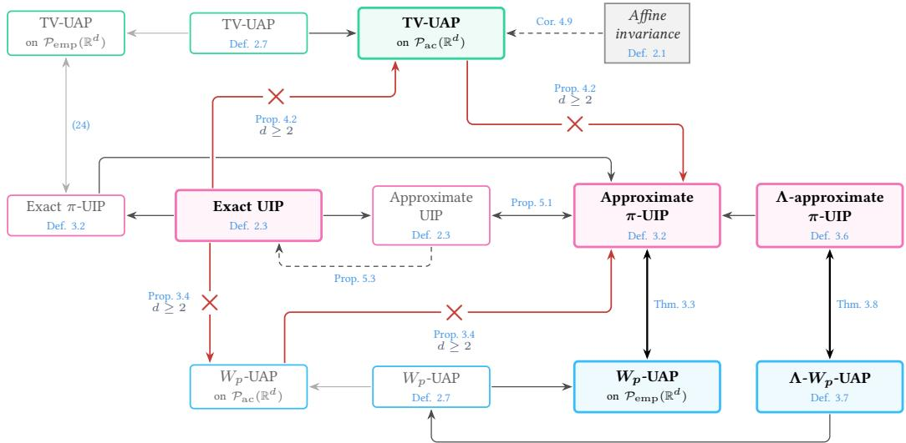
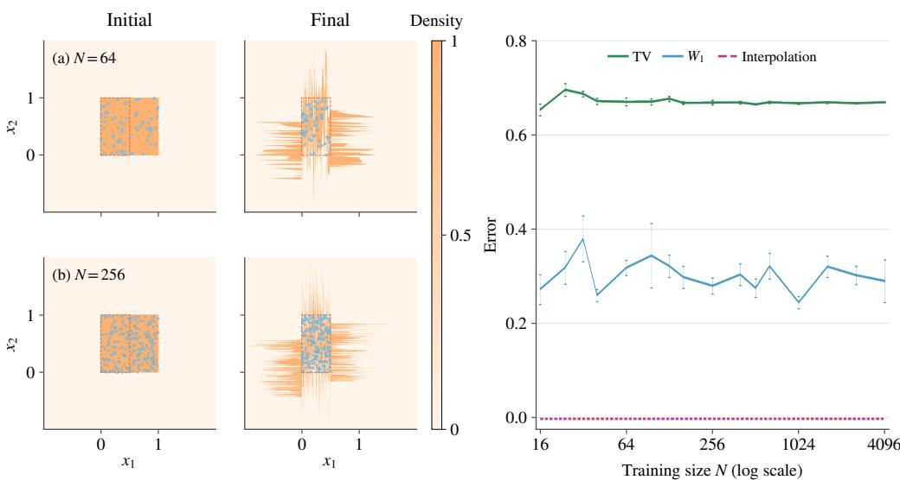
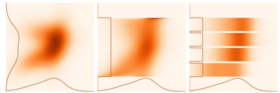
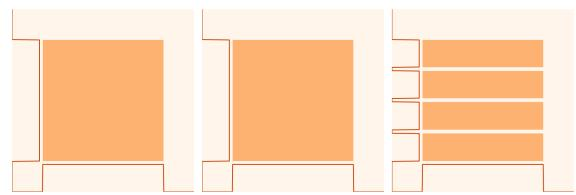
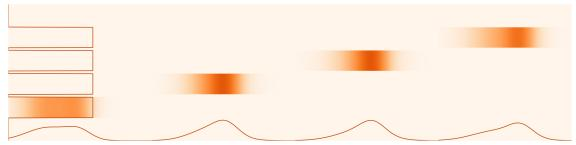
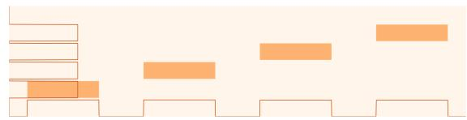

# Point interpolation and distributional universality in flow-based generative models

Antonio Álvarez-López1 Jingpu Cheng2 Liyan Zhang2 Qianxiao $\mathrm { L i } ^ { 2 , 3 }$

## Abstract

Motivated by the expressive power of neural ordinary diferential equations in flowbased generative modeling, we study the approximation of probability measures by pushforwards generated by parameterized families of Lipschitz vector fields. For Wasserstein distances, we establish a quantitative relationship between finite-sample point interpolation and distributional approximation, and derive universality criteria based on $L ^ { p } .$ -approximation of transport maps. In particular, afine-invariant families containing a non-afine vector field are universal from compactly supported absolutely continuous base measures. For total variation, we show that coordinatewise dynamics are insuficient in dimensions d $\geqslant ~ 2$ and establish suficient conditions based on one-dimensional Sobolev approximation and sheartype mixing. We further examine the role of point interpolation, establishing when diferent regimes relate to one another and when approximate interpolation can be made exact.

Keywords: Flow-based generative models, neural ordinary diferential equations, interpolation, universal approximation, Wasserstein and total variation distances.

## Contents

1 Introduction 2   
2 Setup and main results 4   
3 Wasserstein distance 7   
3.1 Empirical approximation 8   
3.2 Approximation of transport maps 11   
4 Total variation distance 12   
4.1 One-dimensional case . 14   
4.2 Multi-dimensional case 14   
5 Discussion 16   
5.1 Further results on point interpolation 16   
5.2 Beyond global Lipschitz regularity 17   
5.3 Other discrepancies 18   
A Preliminary results 18   
A.1 Flow maps and pushforward measures 19   
A.2 Approximation and realization by flows . 20   
A.3 Total variation stability 23   
B Proofs of Section 3 (Wasserstein) 24   
B.1 Proofs of Subsection 3.1 . 25   
B.2 Proofs of Subsection 3.2 . 29   
C Proofs of Section 4 (total variation) 29   
C.1 Proofs of Subsection 4.1 . 32   
C.2 Proofs of Subsection 4.2 . 35   
D Proofs of Subsection 5.1 41

## 1 Introduction

Modern generative models transform randomness into complex data distributions. Transportbased models do so by evolving samples along a deterministic flow. Starting from a random variable $X _ { 0 } \in \mathbb { R } ^ { d }$ with law $\mu _ { \mathrm { B } }$ , one solves

$$
\dot { X } _ { t } = f _ { \theta ( t ) } ( X _ { t } ) , \qquad X _ { | t = 0 } = X _ { 0 } ,\tag{1}
$$

for $t \in [ 0 , T ]$ , and generates the sample $X _ { T } = \Phi _ { T } ^ { \theta } ( X _ { 0 } )$ , where $\Phi _ { T } ^ { \theta }$ is the flow map of (1) driven by the signal $\theta ( \cdot )$ . At the level of probability measures, the generated law is the pushforward $\mu _ { T } = ( \Phi _ { T } ^ { \theta } ) _ { \# } \mu _ { \mathrm { B } }$ . Equivalently, $\mu _ { t }$ is a weak solution of the continuity equation

$$
\partial _ { t } \mu _ { t } + \operatorname { d i v } \Big ( f _ { \boldsymbol { \theta } ( t ) } \mu _ { t } \Big ) = 0 , \qquad \mu _ { | t = 0 } = \mu _ { \mathrm { B } } .\tag{2}
$$

Training amounts to optimizing the signal $\theta ( \cdot )$ using samples from a target measure $\mu _ { \star }$ so that the generated law $\mu _ { T }$ approximates $\mu _ { \star }$

This formulation naturally defines a control problem. Because the same signal acts on every initial state, prescribing the terminal positions of finitely many samples is a problem of simultaneous, or finite-ensemble, controllability, whereas prescribing the terminal law $\mu _ { T }$ leads to distributional controllability of (2). We study the interplay between these two levels when the velocity fields are drawn from a fixed family $\mathcal { F } _ { : }$ , and seek structural conditions under which the induced pushforwards can approximate compatible target measures.

Many generative models share this transport structure while difering in their parameterization and training objective. Examples include continuous normalizing flows trained by maximum likelihood [13, 22] or by flow matching [31]. Score-based difusion models use stochastic dynamics, but, under suitable regularity assumptions and with the exact score, their time-marginal laws also admit a deterministic probability-flow ODE representation [43]. The approximation power of controlled flows is thus relevant across several generative modeling paradigms.

Understanding their reachable space is essential not only for training generative models, but also for evaluating them, as diferent evaluation criteria probe distinct structural properties of the generated law. A standard benchmark, the Fréchet Inception Distance (FID), compares Gaussian approximations of feature distributions via the squared 2-Wasserstein distance [24], and is therefore blind to higher-order diferences beyond means and covariances. Precision–recall criteria [29, 40] instead quantify the fraction of generated mass lying in the support of the target distribution (precision) and the fraction of target mass covered by the model (recall). In the formulation of Sajjadi et al. [40], the largest common value of precision and recall between two laws $\mu$ and ν equals their shared mass $1 - | \mu - \nu | _ { \mathsf { T V } }$

These connections motivate the two discrepancies studied in this work. Wasserstein-p distances $( W _ { p } )$ measure the spatial cost of transporting mass, whereas total variation (TV) controls the probability error uniformly across all measurable events:

$$
| \mu ( E ) - \nu ( E ) | \leq | \mu - \nu | _ { \mathsf { T V } } \qquad \mathrm { ~ f o r ~ e v e r y ~ B o r e l ~ s u b s e t ~ } E \subset \mathbb { R } ^ { d } .\tag{3}
$$

In particular, assigning no mass to a target region of mass m incurs a TV error of at least $m ,$ even when the generated mass lies arbitrarily close to it. Generating spatially accurate samples $( W _ { p } )$ and accurately approximating event probabilities (TV) thus impose fundamentally diferent requirements.

Event probabilities are particularly relevant when generative models represent random fields or PDE solutions, as in function-space flow matching [26]. Consider, for instance, steady conduction − $\begin{array} { r } { \nabla \cdot ( \kappa \nabla u ) \ = \ f } \end{array}$ with a random source $f$ or random conductivity $\kappa .$ In reliability analysis, one seeks the probability that a critical observable, such as the peak temperature [46] or the boundary flux [45], exceeds a fixed safety threshold $\tau .$ For a discretized solution in $\mathbb { R } ^ { d }$ and an observable $q : \mathbb { R } ^ { d }  \mathbb { R }$ , this corresponds to the exceedance event $\{ q > \tau \} \subset \mathbb { R } ^ { d }$ . By (3), TV controls the error in the failure probability uniformly over $\tau ,$ without assumptions on the concentration of $q$ near the threshold. While TV bounds absolute rather than relative errors, so accurately resolving rare failure events still requires a correspondingly fine tolerance, it remains the natural metric to prevent structural underestimation of critical thresholds.

Returning to our control perspective, a natural question is how point interpolation and map approximation [14] relate to distributional approximation under $W _ { p }$ and TV. Passing from points or maps to measures modifies the problem in two opposing ways. First, point assignments are relaxed: whenever $\mathsf { P } : \mathbb { R } ^ { d } \to \mathbb { R } ^ { d }$ preserves $\mu _ { \mathrm { { B } } } { \mathrm { { ; } } }$ , then

$$
( \Phi \circ \mathsf { P } ) _ { \# } \mu _ { \mathrm { B } } = \Phi _ { \# } \mu _ { \mathrm { B } } ,
$$

so distinct maps (or permutations of an empirical sample) produce the exact same terminal law. Conversely, transporting continuous mass demands stronger regularity: since finite sets have Lebesgue measure zero, interpolating arbitrary finite samples does not control how the flow transports the bulk of the mass between them, and thus need not imply $W _ { p }$ universality, while matching densities in TV further requires controlling local volume distortion.

Our central question is therefore:

Under what conditions do the point interpolation orfunctional approximation properties ofa control family imply universality ofthe induced pushforward measures in $W _ { p }$ and TV?

Related work. Transport by flows. The transport of probability densities by flows has a classical foundation in the theory of volume forms. Moser’s theorem links smooth positive volume forms of equal mass on a closed connected manifold via a time-dependent flow [34], while the Dacorogna–Moser construction treats bounded domains with regularity estimates and boundaryfixing maps [16], later refined to control the support near the boundary [44]. In optimal transport, the quadratic optimal map is a convex gradient [8] with well-known regularity theory [10], and is dynamically recast via the continuity equation by Benamou and Brenier [7]. In all these classical results, the vector fields are unconstrained.

Restricted vector fields. A nonholonomic version of Moser’s theorem establishes transport under time-dependent vector fields constrained to a bracket-generating distribution [27]. For finite compositions of autonomous flows, Agrachev and Caponigro [3] show that a bracket-generating family closed under multiplication by smooth functions generates the identity component of the difeomorphism group on closed manifolds; see also Caponigro [11] and Grong and Schmeding [23] for manifolds with boundary. Under suitable controllability and regularity assumptions, Caponigro and Vicari [12] further establish the exact realization of quadratic optimal transport maps on smooth bounded uniformly convex domains. Transport by a single autonomous vector field and the approximation power gained through compositions are studied by De Nitti and Fernández-Real [17] and Rouhvarzi and Kratsios [37].

Ensemble controllability. Steering multiple initial states simultaneously by a common control is studied in ensemble control, with Lie-algebraic criteria available for finite and continuous ensembles [1, 2]. Our universal interpolation property is a finite-ensemble requirement. Cuchiero et al. [15] establish exact interpolation using five suitable vector fields, as well as interpolation for almost every choice of field parameters and input configurations under suitable analyticity assumptions. Related neural ODE results study the required complexity [4, 6, 38] or links between interpolation and function approximation [14]. At the distributional level, controllability of the Liouville equation and realization of difeomorphisms through controlled flows (including feedback controls) are studied by Brockett [9] and Raginsky [36], while Duprez et al. [18] obtain approximate and exact transport using localized Lipschitz vector fields.

Generative modeling. Linear-control systems can approximate difeomorphisms isotopic to the identity [41] and optimal transport maps [42]. For neural ODEs, distributional approximation has been established in Wasserstein distance [20, 38], total variation [39], and relative entropy [5], as well as simultaneously for maps and pushforwards [21]; statistical guarantees are developed in Marzouk et al. [33]. Closer to our perspective, Ishikawa et al. [25] establish general criteria linking functional approximation to distributional universality, including Sobolev bounds for TV, with applications to neural ODEs.

Our contributions. Existing universality results rely on Lie-algebraic or architecture-specific constructions, as well as functional approximation hypotheses [25]. Meanwhile, general principles linking finite-sample interpolation to approximation have been developed only at the map level [14]. This motivates identifying what structural properties a general architecture must satisfy for point- or map-level expressivity to lift to probability laws. In this work, we characterize when these properties imply distributional universality, when they fail, and which additional mechanisms yield $W _ { p } .$ - and TV-universality.

Notation. We use $[ n ] : = \{ 1 , \dots , n \}$ and let $S _ { n }$ denote the set of permutations of [n]. For an open set $\Omega \subset \mathbb { R } ^ { d }$ , we use $C ^ { k } ( \Omega ; \mathbb { R } ^ { q } ) , C ^ { 0 , 1 } ( \Omega ; \mathbb { R } ^ { q } ) , L ^ { p } ( \Omega ; \mathbb { R } ^ { q } )$ , and $W ^ { m , p } ( \Omega ; \mathbb { R } ^ { q } )$ for the spaces of k-times continuously diferentiable, globally Lipschitz (with Lipschitz constant $\operatorname { L i p } ( \cdot ) )$ , pintegrable, and Sobolev maps, respectively. For a function space $x ,$ the closure ${ \overline { { \mathcal { X } } } } ^ { \tau }$ is taken with respect to the topology $\tau .$ The subscripts $^ c$ and $\mathrm { l o c }$ denote compact support and the corresponding local space, respectively. For $d = 1$ , the subscript $\mathrm { n d }$ denotes the subspace of nondecreasing functions (or those admitting a nondecreasing representative). The i-th coordinate projection is $\pi ^ { i } ( x ) = x ^ { ( i ) }$

We denote by $B ( \mathbb { R } ^ { d } )$ the Borel σ-algebra on $\mathbb { R } ^ { d }$ , by ${ \mathcal { P } } ( \mathbb { R } ^ { d } )$ the space of Borel probability measures, and by $\mathcal { L } ^ { d }$ the d-dimensional Lebesgue measure, with $| \Omega | : = \mathcal { L } ^ { d } ( \Omega )$ for $\Omega \in B ( \mathbb { R } ^ { d } )$ . We set $\mathcal { P } _ { \mathrm { a c } } ( \mathbb { R } ^ { d } ) : = \{ \mu \in \mathcal { P } ( \mathbb { R } ^ { d } ) : \mu \ll \mathcal { L } ^ { d } \}$ and denote by $\mathcal { P } _ { p } ( \mathbb { R } ^ { d } )$ the set of probability measures with finite $p \cdot$ -th moment. Weak convergence is denoted by $\mu _ { n }  \mu$ . Finally, for $0 < | \Omega | < \infty$ we write $\mathcal { U } ( \Omega ) : = \mathbf { 1 } _ { \Omega } / | \Omega | \mathcal { L } ^ { d }$ for the uniform probability measure on Ω.

## 2 Setup and main results

Fix d $\geq 1$ and a parameter space Θ. We formalize the generative model by considering a control family of globally Lipschitz vector fields,

$$
\mathcal { F } : = \{ f _ { \theta } : \mathbb { R } ^ { d } \to \mathbb { R } ^ { d } : \theta \in \Theta \} \subset C ^ { 0 , 1 } ( \mathbb { R } ^ { d } ; \mathbb { R } ^ { d } ) .\tag{4}
$$

A relevant example is the family of one-layer neural ODEs, defined for a componentwise activation function $\sigma \in C ^ { 0 , 1 } ( \mathbb { R } )$ by

$$
f _ { \theta } ( x ) = W \sigma ( A x + b ) , \qquad \theta = ( W , A , b ) \in \mathbb { R } ^ { d \times d } \times \mathbb { R } ^ { d \times d } \times \mathbb { R } ^ { d } .\tag{5}
$$

We constrain the control input $t \mapsto \theta ( t )$ to be piecewise constant with finitely many switches, so that

$$
\dot { x } ( t ) = f _ { \theta ( t ) } \left( x ( t ) \right) , \qquad x ( 0 ) = x _ { 0 } ,\tag{6}
$$

evolves through a finite sequence of autonomous ODEs. Let $\Phi _ { t } ^ { f }$ denote the unique flow map generated by a vector field $f \in C ^ { 0 , 1 } ( \mathbb { R } ^ { d } ; \mathbb { R } ^ { d } )$ for $t \geq 0$ . Then the flow map of $( 6 )$ at any time $T > 0$ is a finite composition of these autonomous flows.

We define the sets of maps attainable at time $T > 0$ and in finite time as

$$
A _ { \mathcal { F } , \mathcal { T } } : = \left\{ \Phi _ { t _ { m } } ^ { f _ { m } } \circ \cdot \cdot \cdot \circ \Phi _ { t _ { 1 } } ^ { f _ { 1 } } : m \geq 1 , f _ { i } \in \mathcal { F } , t _ { i } > 0 , \sum _ { i = 1 } ^ { m } t _ { i } = T \right\} , \qquad A _ { \mathcal { F } } : = \bigcup _ { T > 0 } A _ { \mathcal { F } , T } .
$$

As outlined in Section 1, these dynamics naturally lift to probability measures via the pushforward. For a base measure $\mu _ { \mathrm { B } } \in \mathcal { P } ( \mathbb { R } ^ { d } )$ , the corresponding sets of attainable measures at time $T > 0$ and in finite time are

$$
\mathcal { A } _ { \mathcal { F } , T } ( \mu _ { \mathrm { B } } ) : = \left\{ \Phi _ { \# } \mu _ { \mathrm { B } } \in \mathcal { P } ( \mathbb { R } ^ { d } ) : \Phi \in \mathcal { A } _ { \mathcal { F } , T } \right\} , \qquad \mathcal { A } _ { \mathcal { F } } ( \mu _ { \mathrm { B } } ) : = \bigcup _ { T > 0 } \mathcal { A } _ { \mathcal { F } , T } ( \mu _ { \mathrm { B } } ) .
$$

In particular, when $\mathcal { F } = C ^ { 0 , 1 } ( \mathbb { R } ^ { d } ; \mathbb { R } ^ { d } )$ , the set $\mathcal { A } _ { C ^ { 0 } , 1 } ( \mu _ { \mathrm { B } } )$ comprises all measures reachable from $\mu _ { \mathrm { B } }$ through finite concatenations of flows generated by globally Lipschitz vector fields.

Definition 2.1 (Scaling and Afine Invariance). A control family F is said to be:

• scaling invariant if ${ \dot { \cdot } } f \in { \mathcal { F } } \Longrightarrow \lambda f \in { \mathcal { F } }$ for all $\lambda > 0 .$

• afine invariant $i f f \in { \mathcal { F } } \Longrightarrow ( x \mapsto W f ( A x + b ) ) \in { \mathcal { F } } f o r a l l W , A \in \mathbb { R } ^ { d \times d } , b \in \mathbb { R } ^ { d } .$

Note that afine invariance implies scaling invariance (take $W = \lambda { \mathsf { I d } } , A = { \mathsf { I d } } , b = 0 )$

Remark 2.2. When $\mathcal { F }$ is scaling invariant and the terminal time is free, restricting the family to vector fields with a bounded Lipschitz constant does not alter the attainable sets. More precisely, setting ${ \mathcal { F } } _ { 1 } : = \{ f \in { \mathcal { F } } : \operatorname { L i p } ( f ) \leq 1 \}$ , we have

$$
\begin{array} { r } { \mathcal { A } _ { \mathcal { F } _ { 1 } } = \mathcal { A } _ { \mathcal { F } } \quad \quad a n d \quad \quad \mathcal { A } _ { \mathcal { F } _ { 1 } } ( \mu _ { \mathrm { B } } ) = \mathcal { A } _ { \mathcal { F } } ( \mu _ { \mathrm { B } } ) \quad f o r e \nu e r y \mu _ { \mathrm { B } } \in \mathcal { P } ( \mathbb { R } ^ { d } ) . } \end{array}
$$

We now recall the following definition from Cheng et al. [14].

Definition 2.3 (Universal Interpolation Property). For $d \geq 2 .$ , the system driven by a control family F possesses the approximate universal interpolation property (approximate UIP) if, for every $N \ge 1 , \varepsilon > 0$ , and pairs $( x _ { 1 } , y _ { 1 } ) , \ldots , ( x _ { N } , y _ { N } ) \in \mathbb { R } ^ { d } \times \mathbb { R } ^ { d }$ with $x _ { i } \neq x _ { j }$ and $y _ { i } \neq y _ { j }$ whenever $i \neq j$ , there exists $\Phi \in A { \mathcal { F } }$ such that

$$
\| \Phi ( x _ { i } ) - y _ { i } \| < \varepsilon \qquad f o r { a l l i } \in [ N ] .\tag{7}
$$

$I f \Phi$ can always be chosen such that $\Phi ( x _ { i } ) = y _ { i }$ for all $i \in [ N ]$ , the system possesses the (exact) universal interpolation property (UIP). When $d = 1$ , the same definitions apply after relabeling the pairs so that $x _ { 1 } < \cdots < x _ { N }$ and restricting to targets satisfying $y _ { 1 } < \cdots < y _ { N }$

Alongside point interpolation, we consider the ability to approximate functions.

Definition 2.4 (Universal Approximation Property). Let $\mathcal { H } _ { \mathrm { l o c } } ( \mathbb { R } ^ { d } ; \mathbb { R } ^ { d } )$ be a local function space $( e . g . , L _ { \mathrm { l o c } } ^ { p } \ o r W _ { \mathrm { l o c } } ^ { 1 , 1 } )$ equipped with a family of seminorms $\| \cdot \| _ { \mathcal { H } ( K ) }$ defined on restrictions to subsets $K ~ \Subset ~ \mathbb { R } ^ { d }$ . The system driven by a control family $\mathcal { F }$ possesses the H-universal approximation property (H-UAP) if, for every $\bar { h } \in \mathcal { H } _ { \mathrm { l o c } } ( \bar { \mathbb { R } ^ { d } } ; \mathbb { R } ^ { d } )$ , every $K \Subset \mathbb { R } ^ { d }$ , and every $\varepsilon > 0$ , there exists $\Phi \in A _ { \mathcal { F } }$ such that

$$
\| ( \Phi - h ) | _ { K } \| _ { \mathcal { H } ( K ) } < \varepsilon .
$$

A natural starting point is Theorem 2.6 of Cheng et al. [14], which states that an afineinvariant control family possesses the exact UIP if and only if it contains at least one vector field that is non-afine in the state variable (referred to as nonlinear by Cheng et al. [14]). The central goal of this work is to determine how, and to what extent, this property lifts to probability measures.

This transition reveals an immediate structural obstruction: because every $\Phi \in A _ { \mathcal { F } }$ is a bi-Lipschitz homeomorphism, atomic parts remain atomic and Lebesgue null sets are preserved. Consequently, exact transport between arbitrary probability measures is generally impossible within this class of flows, and even approximate transport depends heavily on the underlying topology.

Any notion of universality at the measure level must therefore be tied to the chosen discrepancy. To make this precise, we fix a reference class of probability measures $\mathcal { X } \subseteq \mathcal { P } ( \mathbb { R } ^ { d } )$ .

Definition 2.5 (Discrepancy). A map $\mathsf { D } : \mathcal { X } \times \mathcal { X } \to [ 0 , + \infty ]$ is called a discrepancy $i f { \mathrm { : } }$

1. $\mathsf { D } ( \mu , \nu ) = 0$ if and only $i f \mu = \nu ;$

2. $\mathsf { D } ( \mu _ { n } , \mu ) \to 0$ implies $\begin{array} { r } { \mu _ { n }  \mu ( i . e . , \int \varphi \mathrm { d } \mu _ { n } \to \int \varphi \mathrm { d } \mu _ { . }  } \end{array}$ for all $\varphi \in C _ { b } ( \mathbb { R } ^ { d } ) )$ .

For $W _ { p }$ we take $\mathcal { X } = \mathcal { P } _ { p } ( \mathbb { R } ^ { d } )$ , whereas for TV we take $\mathcal { X } = \mathcal { P } ( \mathbb { R } ^ { d } )$ . To characterize feasible targets, we introduce the following notion.

Definition 2.6 (Measure Compatibility). Given a discrepancy D in the sense of Definition 2.5, we say that $( \mu _ { \mathrm { B } } , \mu _ { \star } ) \in \mathcal { X } \times \mathcal { X }$ is D-compatible if there exist $\Psi _ { n } \in \mathcal { A } _ { C ^ { 0 } } ,$ such that $( \Psi _ { n } ) _ { \# } \mu _ { \mathrm { B } } \in \mathcal X$ and $\mathsf { D } \left( ( \Psi _ { n } ) _ { \# } \mu _ { \mathrm { B } } , \mu _ { \star } \right) \to 0 \mathrm { ~ } a s n \to \infty$

For the two discrepancies we consider, D-compatibility admits concrete characterizations: every target in $\mathcal { P } _ { p } ( \mathbb { R } ^ { d } )$ is $W _ { p }$ -compatible with any atomless base measure in $\mathcal { P } _ { p } ( \mathbb { R } ^ { d } )$ (Proposition 3.1), whereas for any base measure in $\mathcal { P } _ { \mathrm { a c } } ( \mathbb { R } ^ { d } )$ , TV-compatibility simply amounts to absolute continuity of the target (Proposition 4.1).

With this framework in place, we define measure-level universality.

Definition 2.7 (Distributional UAP). The system driven by a control family F possesses the Duniversal approximation property $( \mathsf { D - U A P } )$ if, for every D-compatible pair $( \mu _ { \mathrm { B } } , \mu _ { \star } )$ and every $\varepsilon > 0 _ { \mathrm { { i } } }$ , there exists $\nu \in \mathcal { A } _ { \mathcal { F } } ( \mu _ { \mathrm { B } } ) \cap \mathcal { X }$ such that $\mathsf { D } ( \nu , \mu _ { \star } ) < \varepsilon$

Given a subclass $\mathcal { X } _ { 0 } \subseteq \mathcal { X }$ , we say that the system possesses the D-UAP on $\mathcal { X } _ { 0 }$ ifthe above property holds for every D-compatible pair $( \mu _ { \mathrm { B } } , \mu _ { \star } )$ with $\mu _ { \mathrm { B } } \in \mathcal { X } _ { 0 }$ and $\mu _ { \star } \in \mathcal { X }$

We now summarize the main results of this work according to the chosen discrepancy. Their logical relationships are illustrated in Figure 1.

Wasserstein. In Section 3, we establish the link between Wasserstein approximation and point interpolation. For uniform empirical measures, we prove that the $W _ { p ^ { - } } \mathrm { U A P }$ is equivalent to the approximate $\mathrm { U I P }$ up to permutation (Theorem 3.3). For general probability measures, however, interpolation alone is insuficient. We address this obstruction in two complementary ways: first, we prove a quantitative equivalence between Lipschitz-controlled interpolation and Wasserstein approximation (Theorem 3.8); second, we derive suficient criteria based on the $L ^ { p _ { - } }$ approximation of transport maps, yielding Wasserstein universality for afine-invariant control families (Corollary 3.14).

Total variation. In Section 4, we develop suficient mechanisms for total variation universality. In $d = 1$ , our criterion relies on approximating monotone rearrangements (Proposition 4.5). In $d \geq 2 ,$ , independent coordinatewise transport fails: the system must be capable of generating genuine coordinate coupling, for instance through shear-type flows. Under suitable structural assumptions, we establish an abstract criterion for the TV-UAP on $\mathcal { P } _ { \mathrm { a c } } ( \mathbb { R } ^ { d } )$ (Theorem 4.7) and apply it to afine-invariant control families (Corollary 4.9).

  
Figure 1: Logical implications among the main properties we study. Green, pink, and blue colors indicate TV approximation, point interpolation, and $W _ { p }$ approximation, respectively, while highlighted boxes mark the properties featured in our main results. Solid arrows denote implications, double-headed arrows indicate equivalence, and red arrows with a cross indicate strict non-implications. Finally, dashed arrows represent conditional implications that hold under the assumptions stated in the referenced results.

We conclude in Section 5 with remarks on the scope and extensions of our results. All proofs and technical lemmas are collected in Appendices $\mathrm { A - D }$

## 3 Wasserstein distance

For $p \in [ 1 , \infty )$ , the Wasserstein-p distance between $\mu , \nu \in \mathcal { P } _ { p } ( \mathbb { R } ^ { d } )$ is defined by

$$
W _ { p } ( \mu , \nu ) : = \operatorname* { i n f } _ { \gamma \in \Gamma ( \mu , \nu ) } \left( \int _ { \mathbb { R } ^ { d } \times \mathbb { R } ^ { d } } \| x - y \| ^ { p } \mathrm { d } \gamma ( x , y ) \right) ^ { 1 / p } ,\tag{8}
$$

where $\Gamma ( \mu , \nu )$ is the set of couplings between $\mu$ and $\nu ,$

$$
\Gamma ( \mu , \nu ) : = \left\{ \gamma \in \mathscr { P } ( \mathbb { R } ^ { d } \times \mathbb { R } ^ { d } ) : \gamma ( \cdot \times \mathbb { R } ^ { d } ) = \mu , \gamma ( \mathbb { R } ^ { d } \times \cdot ) = \nu \right\} .\tag{9}
$$

For later use, we denote the class of uniform empirical measures by

$$
\mathcal { P } _ { \mathrm { e m p } } ( \mathbb { R } ^ { d } ) : = \left\{ \frac { 1 } { N } \sum _ { i = 1 } ^ { N } \delta _ { x _ { i } } \ : \ N \geq 1 , \ x _ { i } \neq x _ { j } \ \mathrm { f o r } \ i \neq j \right\} .\tag{10}
$$

We repeatedly use two standard properties of $W _ { p }$

(i) Lipschitz pushforwards. For every $f \in C ^ { 0 , 1 } ( \mathbb { R } ^ { d } ; \mathbb { R } ^ { d } )$ and $\mu , \nu \in \mathcal { P } _ { p } ( \mathbb { R } ^ { d } )$

$$
W _ { p } ( f _ { \# } \mu , f _ { \# } \nu ) \leq \mathrm { L i p } ( f ) W _ { p } ( \mu , \nu ) .\tag{11}
$$

(ii) Empirical matching. Given $\begin{array} { r } { \mu _ { N } = \frac { 1 } { N } \sum _ { i = 1 } ^ { N } \delta _ { x _ { i } } } \end{array}$ and $\begin{array} { r } { \nu _ { N } = \frac { 1 } { N } \sum _ { i = 1 } ^ { N } \delta _ { y _ { i } } \mathrm { i n } \mathcal { P } _ { \mathrm { e m p } } ( \mathbb { R } ^ { d } ) } \end{array}$

$$
W _ { p } ^ { p } ( \mu _ { N } , \nu _ { N } ) = \operatorname* { m i n } _ { \pi \in S _ { N } } \frac { 1 } { N } \sum _ { i = 1 } ^ { N } \| x _ { i } - y _ { \pi ( i ) } \| ^ { p } .\tag{12}
$$

We begin by characterizing $W _ { p }$ -compatibility.

Proposition 3.1. Let $d \geq 2 , p \in [ 1 , \infty )$ , and $\mu _ { \mathrm { B } } , \mu _ { \star } \in \mathcal P _ { p } ( \mathbb { R } ^ { d } )$ . Then $( \mu _ { \mathrm { B } } , \mu _ { \star } )$ is $W _ { p } – c o m p a t i b l e$ $i f$ and only if there exists a map g assigning each atom of $\mathrm { { \dot { \mu } _ { B } } }$ to an atom $o f \mu _ { \star }$ such that

$$
\begin{array} { r l } { \displaystyle \sum _ { x : \mu _ { \mathrm { B } } ( \{ x \} ) > 0 } \mu _ { \mathrm { B } } ( \{ x \} ) \leq \mu _ { \star } ( \{ y \} ) \quad } & { \ f o r e \nu e r y y \in \mathbb { R } ^ { d } \ w i t h \mu _ { \star } ( \{ y \} ) > 0 . } \\ { \displaystyle x : \mu _ { \mathrm { B } } ( \{ x \} ) > 0 } \end{array}
$$

This condition reflects the fact that bi-Lipschitz homeomorphisms cannot split atoms: in the $W _ { p }$ -limit, each base atom must be transported into a target atom, and while distinct base atoms may merge, their combined mass cannot exceed that of the receiving target atom. In particular, when $\mu _ { \mathrm { B } }$ is atomless (as is standard in generative modeling) the condition holds vacuously, so every target $\mu _ { \star } \in \mathcal P _ { p } ( \mathbb { R } ^ { d } )$ is $W _ { p }$ -compatible with $\mu _ { \mathrm { B } }$

## 3.1 Empirical approximation

Fix $d \ge 1$ . We first consider base measures in $\mathcal { P } _ { \mathrm { e m p } } ( \mathbb { R } ^ { d } )$ . For two such measures with the same number of atoms, (12) shows that the Wasserstein distance is obtained by minimizing over permutations. This naturally motivates the following unlabeled variant of the UIP.

Definition 3.2 (Unlabeled Universal Interpolation Property). For $d \geq 1$ , the system driven $b y$ a control family $\mathcal { F }$ possesses the approximate unlabeled-UIP (approximate u-UIP) if, for every $N \geq 1 , \varepsilon > 0 .$ , and pairs $( x _ { 1 } , y _ { 1 } ) , \ldots , ( x _ { N } , y _ { N } ) \in \mathbb { R } ^ { d } \times \mathbb { R } ^ { d }$ with $x _ { i } \neq x _ { j }$ and $y _ { i } \neq y _ { j }$ whenever $i \neq j$ , there exist Φ $\in \mathcal { A } _ { \mathcal { F } }$ and $\pi \in S _ { N }$ such that

$$
\operatorname* { m a x } _ { i \in [ N ] } \| \Phi ( x _ { i } ) - y _ { \pi ( i ) } \| < \varepsilon .\tag{13}
$$

$I f \Phi$ and $\pi$ can always be chosen such that $\Phi ( x _ { i } ) = y _ { \pi ( i ) }$ for all $i \in [ N ]$ , the system possesses the (exact) unlabeled-UIP (u-UIP).

A closer comparison of the UIP and u-UIP is deferred to Section 5.1; here, we show that the approximate $\mathrm { u - U I P }$ characterizes Wasserstein universality on $\mathcal { P } _ { \exp } ( \mathbb { R } ^ { d } )$ .

Theorem 3.3. Let $\mathcal { F }$ be a Lipschitz control family on $\mathbb { R } ^ { d }$ . The following are equivalent:

(i) the associated system possesses the approximate u-UIP;

(ii) the associated system possesses the $W _ { p } \mathrm { - U A P \ } o n \mathcal { P } _ { \mathrm { e m p } } ( \mathbb { R } ^ { d } ) f o r \ a l l p \in [ 1 , \infty ) .$

To pass from empirical to general probability laws, recall that every $\mu \in \mathcal P _ { p } ( \mathbb { R } ^ { d } )$ admits a sequence $\mu _ { N } \in \mathcal { P } _ { \mathrm { e m p } } ( \mathbb { R } ^ { d } )$ with $W _ { p } ( \mu _ { N } , \mu ) \to 0$ . Propagating this convergence via transport maps Φ $N$ , however, requires stability bounds such as uniform Lipschitz control on $\Phi _ { N }$

Without such control, point interpolation and $W _ { p } { \mathrm { - u n i v e r s a l i t y } }$ from continuous base measures are mutually independent if $d \geq 2$ . Two geometric mechanisms—paralleling the functionlevel counterexamples in [14, Thm. 2.9]—explain this: volume preservation obstructs mass concentration without preventing point interpolation, whereas a common fixed point obstructs interpolation without preventing density approximation.

We illustrate these two mechanisms using the divergence-free family

$$
\mathcal { F } _ { \mathrm { d i v } } : = \left\{ x \mapsto w ( a \cdot x + b ) _ { + } : w , a \in \mathbb { R } ^ { d } , b \in \mathbb { R } , w \cdot a = 0 \right\}\tag{14}
$$

and, for a globally Lipschitz activation $\sigma ,$ the anchored family

$$
\mathcal { F } _ { \sigma , 0 } : = \left\{ x \mapsto w ( \sigma ( a \cdot x + b ) - \sigma ( b ) ) : w , a \in \mathbb { R } ^ { d } , b \in \mathbb { R } \right\} .\tag{15}
$$

  
Figure 2: Divergence-free interpolation without distributional approximation. (a,b) Initial and final densities (orange) for $N = 6 4$ and $N = 2 5 6$ sampled points (blue). The initial law is uniform on $[ 0 , 1 ] ^ { 2 } \mathrm { { ; } }$ ; the target is uniform on $[ 0 , 1 / 2 ] \times [ 0 , 1 ]$ , outlined by dashed lines. (c) Errors versus sample size N: sample points are matched, whereas the population errors in $W _ { 1 }$ and TV remain bounded away from zero. Vertical bars indicate confidence intervals for the sampling-based $W _ { 1 }$ and TV estimates, computed from five independent repetitions.

Proposition 3.4. Let $d \geq 2$ and $p \in [ 1 , \infty )$ . Then:

(i) The system associated with $\mathcal { F } _ { \mathrm { d i v } }$ in (14) possesses the exact UIP, but fails the $W _ { p } – \mathrm { U A P }$ on $\mathcal { P } _ { \operatorname { a c } } ( \mathbb { R } ^ { d } ) \cap \mathcal { P } _ { p } ( \mathbb { R } ^ { d } )$

(ii) For $\sigma ( s ) = s _ { + }$ , the system associated with $\mathcal { F } _ { \sigma , 0 }$ in (15) possesses the $W _ { p } – \mathrm { U A P }$ on $\mathcal { P } _ { \mathrm { a c } } ( \mathbb { R } ^ { d } ) \cap$ $\mathcal { P } _ { p } ( \mathbb { R } ^ { d } )$ , but fails the approximate u-UIP.

Figure 2 illustrates Proposition $3 . 4 ( \mathrm { { i } ) }$ numerically: although the empirical samples are interpolated accurately, the population-level $W _ { 1 }$ and TV errors remain bounded away from zero as the sample size N increases. In fact, as formalized in the next remark, matching empirical samples in the presence of a population-level obstruction necessarily forces the Lipschitz constants of the interpolating flows to blow up as $N \to \infty$

Remark 3.5 (Lipschitz blow-up). Suppose the system fails the $W _ { p } – \mathrm { U A P }$ . Then there exist compatible $\mu _ { \mathrm { B } } , \mu _ { \star } \in \mathcal P _ { p } ( \mathbb { R } ^ { d } )$ and $\delta > 0$ such that $W _ { p } ( \Phi _ { \# } \mu _ { \mathrm { B } } , \mu _ { \star } ) \geq \delta f o r$ all $\Phi \in { \mathcal { A } } _ { \mathcal { F } }$ . Take sequences $\mu _ { \mathrm { B } } ^ { N } , \mu _ { \star } ^ { N } \in { \sf \bar { \mathcal { P } } } _ { \mathrm { e m p } } ( \mathbb { R } ^ { d } )$ with equal numbers of atoms such that $W _ { p } ( \mu _ { \mathrm { B } } ^ { N } , \mu _ { \mathrm { B } } ) \ \to \ 0$ and $W _ { p } ( \mu _ { \star } ^ { N } , \mu _ { \star } ) \to 0$ . Ifthe system possesses the approximate u-UIP, there exist $\Phi _ { N } \in { \mathcal { A } } _ { \mathcal { F } }$ such that $W _ { p } ( ( \Phi _ { N } ) _ { \# } \mu _ { \mathrm { B } } ^ { N } , \mu _ { \star } ^ { N } ) \to 0$ . By the triangle inequality and (11),

$$
\delta \leq W _ { p } \left( \left( \Phi _ { N } \right) _ { \# } \mu _ { \mathrm { B } } , \mu _ { \star } \right) \leq \mathrm { L i p } ( \Phi _ { N } ) W _ { p } ( \mu _ { \mathrm { B } } , \mu _ { \mathrm { B } } ^ { N } ) + W _ { p } \left( \left( \Phi _ { N } \right) _ { \# } \mu _ { \mathrm { B } } ^ { N } , \mu _ { \star } ^ { N } \right) + W _ { p } ( \mu _ { \star } ^ { N } , \mu _ { \star } ) .
$$

Since the last two terms vanish as $N \to \infty$ , the first term must remain bounded away from zero; as $W _ { p } ( \mu _ { \mathrm { B } } , \mu _ { \mathrm { B } } ^ { N } ) \to 0$ , this forces $\mathrm { L i p } ( \Phi _ { N } ) \to \infty$

Remark 3.5 shows that passing from empirical interpolation to distributional approximation requires uniform Lipschitz control on the approximating flows. To formalize this quantitative

link, we benchmark the controlled system against unrestricted Lipschitz flows of bounded complexity. For $r \geq 0$ , set

$$
\mathcal { A } _ { r } : = \left\{ \Phi _ { t _ { m } } ^ { f _ { m } } \circ \cdot \cdot \cdot \circ \Phi _ { t _ { 1 } } ^ { f _ { 1 } } \in \mathcal { A } _ { C ^ { 0 , 1 } } : \sum _ { j = 1 } ^ { m } t _ { j } \mathrm { L i p } ( f _ { j } ) \leq r \right\} .\tag{16}
$$

By Grönwall’s inequality, every $\Psi \in { \mathcal { A } } _ { r }$ satisfies $\mathrm { L i p } ( \Psi ) \leq e ^ { r }$ , so r quantifies the Lipschitz budget of the reference flow.

We capture the quantitative cost of approximation via a profile $\Lambda : [ 0 , \infty )  [ 1 , \infty )$ , where $\Lambda ( r )$ bounds the Lipschitz constant of the admissible flows needed to approximate any reference map $\Psi \in \mathcal A _ { r }$ , uniformly in the number of points N and accuracy ε.

Definition 3.6 (Λ-Approximate u-UIP). Let $\Lambda : [ 0 , \infty )  [ 1 , \infty )$ be nondecreasing. The system driven by a control family F possesses the Λ-approximate u-UIP if, for every $r \ge 0 , \Psi \in \mathcal { A } _ { r } .$ $N \geq 1$ , distinct points $x _ { 1 } , \ldots , x _ { N } \in \mathbb { R } ^ { d } .$ , and $\varepsilon > 0 _ { i }$ , there exist $\Phi \in A _ { \mathcal { F } }$ and $\pi \in S _ { N }$ such that

$$
\operatorname* { m a x } _ { i \in [ N ] } \| \Phi ( x _ { i } ) - \Psi ( x _ { \pi ( i ) } ) \| < \varepsilon , \qquad \mathrm { L i p } ( \Phi ) \leq \Lambda ( r ) .
$$

At the distributional level, the same profile $\Lambda ( r )$ bounds the Lipschitz constant required to approximate the pushforward of any base measure under a reference flow $\Psi \in \mathcal A _ { r }$

Definition 3.7 $( \Lambda { \mathrm { - } } W _ { p } { \mathrm { - } } \mathrm { U A P ) }$ . Fix $p \in [ 1 , \infty )$ and let $\Lambda : [ 0 , \infty )  [ 1 , \infty )$ be nondecreasing. The system driven by a control family F possesses the $\Lambda { \mathrm { - } } W _ { p } { \mathrm { - U A P } }$ if, for every $r \geq 0 , \Psi \in \mathcal { A } _ { r }$ $\mu _ { \mathrm { B } } \in \mathcal { P } _ { p } ( \mathbb { R } ^ { d } )$ , and $\varepsilon > 0 _ { i }$ , there exists $\Phi \in A _ { \mathcal { F } }$ such that

$$
W _ { p } ( \Phi _ { \# } \mu _ { \mathrm { B } } , \Psi _ { \# } \mu _ { \mathrm { B } } ) < \varepsilon , \qquad \mathrm { L i p } ( \Phi ) \leq \Lambda ( r ) .
$$

The next theorem establishes that empirical and distributional approximation under a Lipschitz budget are equivalent and share the exact same profiles.

Theorem 3.8. Fix $p \in [ 1 , \infty )$ and let $\Lambda : [ 0 , \infty )  [ 1 , \infty )$ be nondecreasing. A system driven by a control family possesses the Λ-approximate u-UIP if and only if it possesses the $\Lambda { \mathrm { - } } W _ { p } { \mathrm { - U A P } }$

Any profile Λ satisfying the conditions of Theorem 3.8 must obey the lower bound

$$
\Lambda ( r ) \geq e ^ { r } .\tag{17}
$$

Indeed, the linear map $\Psi ( x ) = ( e ^ { r } x ^ { ( 1 ) } , x ^ { ( 2 ) } , \dots , x ^ { ( d ) } )$ belongs to $A _ { r }$ , and approximating its action on $\{ 0 , e _ { 1 } \}$ within error ε requires $\mathrm { L i p } ( \Phi ) \geq e ^ { r } -$ 2ε regardless of the permutation. The following examples show that the optimal bound (17) can be attained, whereas qualitative universality alone need not admit any quantitative profile.

Example 3.9 (Quantitative profiles). By Theorem 3.8, a profile Λ is valid whenever each $\Psi \in { \mathcal { A } } _ { \tau }$ can be approximated locally uniformly by $\Phi \in { \mathcal { A } } _ { \mathcal { F } }$ satisfying $\mathrm { L i p } ( \Phi ) \leq \Lambda ( r )$

(i) Fix a nonnegative radial $\rho \in C _ { c } ^ { \infty } (  { \mathbb { R } } ^ { d } )$ with $\textstyle \int _ { \mathbb { R } ^ { d } } \rho ( x )$ dx = 1. The control family

$$
\mathcal { F } _ { \rho } : = \left\{ x \mapsto w \rho \left( \frac { x - a } { s } \right) : w , a \in \mathbb { R } ^ { d } , \ s > 0 \right\}\tag{18}
$$

admits the profile $\Lambda _ { \eta } ( r ) = ( 1 + \eta ) \vee e ^ { r }$ for all $\eta > 0$ , but admits no profile with $\Lambda ( 0 ) = 1$

(ii) Appending the linear contraction removes this threshold: ${ \mathcal { F } } _ { \rho } \cup \{ x \mapsto - x \}$ admits the optimal $p r o f i l e \Lambda ( r ) = e ^ { r }$

(iii) For d ≥ 2, the divergence-free family $\mathcal { F } _ { \mathrm { d i v } }$ possesses the UIP, but admits no profile Λ.

(iv) For $d \geq 2$ and $\sigma ( s ) = s _ { + }$ , the anchored family $\mathcal { F } _ { \sigma , 0 }$ of Proposition $3 . 4 ( \mathrm { i i } )$ possesses the $W _ { p ^ { - } }$ UAP on $\mathcal { P } _ { \operatorname { a c } } ( \mathbb { R } ^ { d } ) \cap \mathcal { P } _ { p } ( \mathbb { R } ^ { d } )$ , yet fails the $\Lambda { \mathrm { - } } W _ { p } { \mathrm { - U A P } }$ for every profile Λ, even when $\mu _ { \mathrm { B } }$ is restricted to such base measures.

The proofs of $( i ) - ( i \nu )$ are provided in Appendix $B .$

Finally, for a family with $\operatorname { L i p } ( f ) \leq 1$ (such as $\mathcal { F } _ { 1 }$ in Remark 2.2), restricting the attainable set to a fixed time horizon $T > 0$ enforces the uniform bound $\mathrm { L i p } ( \Phi ) \leq e ^ { T }$ for all $\Phi \in \mathcal { A } _ { \mathcal { F } , T }$ . Within $\mathcal { A } _ { \mathcal { F } , T }$ , the Lipschitz blow-up ofRemark 3.5 is ruled out a priori, so distributional reachability of $\dot { \mu } _ { \star }$ from $\mu _ { \mathrm { B } }$ within horizon $T$ is equivalent to uniform reachability from empirical approximations of $\mu _ { \mathrm { B } }$ within the same horizon:

Corollary 3.10. Fix $d \geq 1 , p \in [ 1 , \infty ) , T > 0 .$ , and a control family $\mathcal { F }$ on $\mathbb { R } ^ { d }$ with $\operatorname { L i p } ( f ) \leq 1$ for all $f \in { \mathcal { F } }$ . For $\mu _ { \mathrm { B } } , \mu _ { \star } \in \mathcal P _ { p } ( \mathbb { R } ^ { d } )$ , the following are equivalent:

(i) For every $\prime \varepsilon > 0$ , there exists $\eta > 0$ such that any $\nu \in \mathcal { P } _ { \mathrm { e m p } } ( \mathbb { R } ^ { d } )$ with $W _ { p } ( \nu , \mu _ { \mathrm { B } } ) < \eta$ admits a flow $\Phi \in \mathcal { A } _ { \mathcal { F } , T }$ satisfying $W _ { p } ( \Phi _ { \# } \nu , \mu _ { \star } ) < \varepsilon$

(ii) $\mu _ { \star } \in \overline { { A _ { \mathcal { F } , T } ( \mu _ { \mathrm { B } } ) } } ^ { W _ { p } }$

## 3.2 Approximation of transport maps

We now describe a second route to the $W _ { p ^ { - } } \mathrm { U A P }$ , using functional approximation as a bridge: convergence of maps in $L ^ { p } ( \mu _ { \mathrm { B } } ; \mathbb { R } ^ { d } )$ implies convergence of their pushforwards in $W _ { p }$ . Indeed, for any $p \in [ 1 , \infty ) , \mu _ { \mathrm { B } } \in \mathcal { P } _ { p } ( \mathbb { R } ^ { d } )$ , and $\mathsf { R } , \mathsf { S } \in L ^ { p } ( \mu _ { \mathrm { B } } ; \mathbb { R } ^ { d } )$ , the coupling $( \mathsf { R } , \mathsf { S } ) _ { \# } \mu _ { \mathrm { B } }$ gives

$$
\begin{array} { r } { W _ { p } ( \mathsf { R } _ { \# } \mu _ { \mathrm { B } } , \mathsf { S } _ { \# } \mu _ { \mathrm { B } } ) \le \| \mathsf { R } - \mathsf { S } \| _ { L ^ { p } ( \mu _ { \mathrm { B } } ) } . } \end{array}\tag{19}
$$

When $\mu _ { \mathrm { B } }$ is atomless, every $\nu \in \mathcal { P } _ { p } ( \mathbb { R } ^ { d } )$ can be written as $\nu = \mathsf { S } _ { \# } \mu _ { \mathrm { B } }$ for some map $\textsf { S } \in$ $L ^ { p } ( \mu _ { \mathrm { B } } ; \mathbb { R } ^ { d } )$ . By (19), density of $\boldsymbol { \mathcal { A } } _ { \mathcal { F } }$ in $\bar { L } ^ { p } ( \mu _ { \mathrm { B } } ; \mathbb { R } ^ { d } )$ implies density of $\scriptstyle A _ { \mathcal { F } } ( \mu _ { \mathrm { B } } )$ in $( \mathcal { P } _ { p } ( \mathbb { R } ^ { d } ) , W _ { p } )$ Our strategy for establishing this Lp-density depends strongly on the dimension.

$\mathrm { H } d = 1$ , the map S can be chosen nondecreasing, and the UIP alone guarantees density of $\boldsymbol { \mathcal { A } } _ { \mathcal { F } }$ in the space $C _ { \mathrm { n d } } ^ { 0 } ( I )$ of nondecreasing continuous functions on any compact interval $I \subset \mathbb { R } \left[ 1 4 \right.$ Sec. 3.3.1]:

$$
\overline { { \mathcal { A } _ { \mathcal { F } } } } ^ { L ^ { \infty } ( I ) } = C _ { \mathrm { n d } } ^ { 0 } ( I ) .\tag{20}
$$

• If $d \geq 2 .$ , the UIP alone is insuficient, since a multidimensional flow can behave unpredictably between interpolation points. To recover full $L ^ { p } { \mathrm { - d e n s i t y } } ,$ a standard strategy is to first compress the domain into localized clusters and then apply the UIP to steer them to their prescribed targets [30, 38].

Definition 3.11 (Diagonal Shrinking Property). The system driven by a control family F possesses the diagonal shrinking property (DSP) if, for every compact set $K \subset \mathbb { R } ^ { d }$ and every nondecreasing continuous function $h : \mathbb { R }  \mathbb { R }$ , we have

$$
\begin{array} { r } { x \mapsto \left( h ( x ^ { ( 1 ) } ) , \ldots , h ( x ^ { ( d ) } ) \right) \in \overline { { \mathcal { A } _ { \mathcal { F } } } } ^ { L ^ { \infty } ( K ; \mathbb { R } ^ { d } ) } . } \end{array}
$$

By [14, Prop. 3.9], the $\mathrm { U I P }$ combined with the DSP implies the $L ^ { p } { \mathrm { - U A P } }$ for $d \geq 2$ . When $\mu _ { \mathrm { B } } \in \mathcal { P } _ { \mathrm { a c } } ( \mathbb { R } ^ { d } )$ is compactly supported, this approximation yields global density in $L ^ { p } ( \mu _ { \mathrm { B } } ; \mathbb { R } ^ { d } )$ which lifts directly to the measure level via (19).

Proposition 3.12. Let $d \geq 2 , p \in [ 1 , \infty )$ , and $\mathcal { F }$ be a control family on $\mathbb { R } ^ { d }$ whose associated system possesses both the UIP and the DSP. $I f \mu _ { \mathrm { B } } \in \mathcal { P } _ { \mathrm { a c } } ( \mathbb { R } ^ { d } )$ has compact support, then:

(i) $\boldsymbol { \mathcal { A } } _ { \mathcal { F } }$ is dense in $L ^ { p } ( \mu _ { \mathrm { B } } ; \mathbb { R } ^ { d } )$ ;

(ii) $\scriptstyle A _ { \mathcal { F } } ( \mu _ { \mathrm { B } } )$ is dense in $( \mathcal { P } _ { p } ( \mathbb { R } ^ { d } ) , W _ { p } )$ (so the system possesses the $W _ { p } – \mathrm { U A P }$ on the class ofcompactly supported measures in $\mathcal { P } _ { \mathrm { a c } } ( \mathbb { R } ^ { d } ) ,$ .

Remark 3.13 (Control of the tails). Compact support ofµ bypasses the need to control the flows at infinity. For a general base $\mu _ { \mathrm { B } } \in \mathcal { P } _ { \mathrm { a c } } ( \mathbb { R } ^ { d } ) \cap \mathcal { P } _ { p } ( \mathbb { R } ^ { d } )$ with unbounded support, one must split the $L ^ { p }$ error between the approximants $\Phi _ { n }$ and the target map ${ \sf S }$ over a ball $B _ { R } ( 0 )$ and its complement:

$$
\| \Phi _ { n } - \mathsf { S } \| _ { L ^ { p } ( \mu _ { \mathrm { B } } ) } ^ { p } = \int _ { B _ { R } ( 0 ) } \| \Phi _ { n } - \mathsf { S } \| ^ { p } \mathrm { d } \mu _ { \mathrm { B } } + \int _ { \mathbb { R } ^ { d } \setminus B _ { R } ( 0 ) } \| \Phi _ { n } - \mathsf { S } \| ^ { p } \mathrm { d } \mu _ { \mathrm { B } } .
$$

For fixed $R ,$ the first integral vanishes as $n  \infty \ b y$ local approximation. Controlling the tail requires uniform bounds at infinity, such as uniform µ -integrability, to restore density.

For afine-invariant control families such as (5), the presence of a non-afine vector field guarantees both the UIP and the DSP [14]. Proposition 3.12 therefore yields the following corollary.

Corollary 3.14. Let $d \ge 2$ , and let ${ \mathcal { F } } \subset C ^ { 0 , 1 } ( \mathbb { R } ^ { d } ; \mathbb { R } ^ { d } )$ be an afine-invariant control family containing at least one non-afine vector field. Then, for every $p \in [ 1 , \infty )$ and every compactly supported $\mu _ { \mathrm { B } } \in \mathcal { P } _ { \mathrm { a c } } ( \mathbb { R } ^ { d } ) , \mathcal { A } _ { \mathcal { F } } ( \mu _ { \mathrm { B } } )$ is dense in $( \mathcal { P } _ { p } ( \mathbb { R } ^ { d } ) , W _ { p } )$

In summary, Wasserstein universality can be obtained either through quantitatively controlled interpolation or through Lp-approximation of transport maps. We now turn to total variation, for which these mechanisms no longer apply directly.

## 4 Total variation distance

For any pair of finite measures $\mu$ and ν on $\mathbb { R } ^ { d }$ , the total variation (TV) distance is

$$
| \mu - \nu | _ { \mathsf { T V } } : = \operatorname* { s u p } _ { E \in { \mathcal { B } } ( \mathbb { R } ^ { d } ) } | \mu ( E ) - \nu ( E ) | .\tag{21}
$$

For $\mu , \nu \in \mathcal { P } _ { \mathrm { a c } } ( \mathbb { R } ^ { d } )$ with densities $\rho _ { \mu }$ and $\rho _ { \nu }$ , this reduces to1

$$
\begin{array} { r } { \vert \mu - \nu \vert _ { \mathsf { T V } } = \frac { 1 } { 2 } \Vert \rho _ { \mu } - \rho _ { \nu } \Vert _ { L ^ { 1 } ( \mathbb { R } ^ { d } ) } . } \end{array}\tag{22}
$$

In generative modeling, a small TV error guarantees that the generated and target distributions assign similar probabilities to every measurable event, including regions corresponding to individual modes, regardless of their spatial separation.

Beyond this event-based view, TV admits a coupling characterization measuring the minimal mass that fails to be matched exactly: for any flow map Φ,

$$
\vert \Phi _ { \# } \mu _ { \mathrm { B } } - \mu _ { \star } \vert _ { \mathsf { T V } } = \operatorname* { m i n } _ { \gamma \in \Gamma ( \mu _ { \mathrm { B } } , \mu _ { \star } ) } \gamma \left( \{ ( x , y ) \in \mathbb { R } ^ { d } \times \mathbb { R } ^ { d } : \Phi ( x ) \neq y \} \right) ,\tag{23}
$$

which follows by pushing forward couplings under $( x , y ) \mapsto ( \Phi ( x ) , y )$ . Under this perspective, an optimal coupling pairs initial points $x \sim \mu _ { \mathrm { B } }$ with targets $y \sim \mu _ { \star } , s o \ | \Phi _ { \# } \mu _ { \mathrm { B } } - \mu _ { \star } | _ { \mathsf { T V } } < \varepsilon$ means that $\Phi ( x ) = y$ holds with probability at least $1 - \varepsilon$

For uniform empirical measures $\mu _ { N } = \textstyle \sum _ { i = 1 } ^ { N } \delta _ { x _ { i } } / N$ and $\begin{array} { r } { \nu _ { N } = \sum _ { i = 1 } ^ { N } \delta _ { y _ { i } } / N } \end{array}$ with distinct atoms, this pairing can be chosen as a permutation, giving

$$
| \Phi _ { \# } \mu _ { N } - \nu _ { N } | _ { \mathsf { T V } } = \frac { 1 } { N } \operatorname* { m i n } _ { \pi \in S _ { N } } \# \left\{ i \in [ N ] : \Phi ( x _ { i } ) \neq y _ { \pi ( i ) } \right\} .\tag{24}
$$

Compared to (12), the spatial transport cost is replaced by a discrete mismatch indicator. Any error below $1 / N$ therefore forces exact matching, making the TV-UAP on $\mathcal { P } _ { \exp } ( \mathbb { R } ^ { d } )$ equivalent to the exact u-UIP.2

Unlike in Wasserstein space, however, one cannot pass from $\mathcal { P } _ { \mathrm { e m p } } ( \mathbb { R } ^ { d } )$ to continuous laws via empirical approximation: empirical and absolutely continuous measures are mutually singular, so their TV distance is identically equal to 1. Since generative models aim to learn densities, we focus on $\mathcal { P } _ { \mathrm { a c } } ( \mathbb { R } ^ { d } )$ , where compatibility admits a clean characterization.

Proposition 4.1. Let d $\geq 1 , \mu _ { \mathrm { B } } \in \mathcal { P } _ { \mathrm { a c } } ( \mathbb { R } ^ { d } )$ , and $\mu _ { \star } \in \mathcal P ( \mathbb { R } ^ { d } )$ . Then $( \mu _ { \mathrm { B } } , \mu _ { \star } )$ is TV-compatible if and only $i f \mu _ { \star } \in \mathcal { P } _ { \mathrm { a c } } ( \mathbb { R } ^ { d } )$

Although (23) links TV-approximation to exact matching on a set of large coupling mass, the TV-UAP on $\mathcal { P } _ { \mathrm { a c } } ( \mathbb { R } ^ { d } )$ is logically independent of finite-point interpolation. Indeed, the divergence-free and anchored families from Proposition 3.4 also separate these properties in total variation, using a smooth activation in the anchored case.

Proposition 4.2. Let $d \geq 2$ and consider the families $\mathcal { F } _ { \mathrm { d i v } }$ and $\mathcal { F } _ { \sigma , 0 }$ from (14)–(15). Then:

(i) The system associated with $\mathcal { F } _ { \mathrm { d i v } }$ possesses the UIP, but fails the TV-UAP on $\mathcal { P } _ { \mathrm { a c } } ( \mathbb { R } ^ { d } )$ .

(ii) $I f \sigma \in C ^ { 0 , 1 } ( \mathbb { R } ) \cap C ^ { 1 } ( \mathbb { R } )$ is non-afine, the system associated with $\mathcal { F } _ { \sigma , 0 }$ possesses the TV-UAP on $\mathcal { P } _ { \mathrm { a c } } ( \mathbb { R } ^ { d } )$ , but fails the approximate u-UIP.

A further obstruction concerns the approximation of transport maps. While convergence of maps in $L ^ { p } ( \mu _ { \mathrm { B } } )$ yields $W _ { p }$ -convergence of their pushforwards by (19), even uniform convergence of flows need not yield TV-convergence, as the next example shows.

Remark 4.3 (Uniform map convergence does not yield TV convergence). There exists a control family ${ \mathcal { F } } \subset C ^ { \infty } ( \mathbb { R } )$ with uniformly bounded Lipschitz constants and $\Phi _ { n } \in \mathcal { A } _ { \mathcal { F } , 1 }$ such that $\Phi _ { n } $ Id uniformly on [0, 1], hence $( \Phi _ { n } ) _ { \# } \mu \to \mu$ in $W _ { p } f o r \mu : = \mathcal { U } ( [ 0 , 1 ] )$ , yet, for some constant $c _ { 0 } > 0$ independent of n,

$$
| ( \Phi _ { n } ) _ { \# } \mu - \mu | _ { \mathsf { T V } } = c _ { 0 } > 0 \qquad f o r e \nu e r y n \geq 1 .
$$

The construction, detailed in Appendix C.2, relies on autonomous $f _ { n }$ with uniformly bounded first derivatives while $\mathrm { L i p } ( D f _ { n } ) \to \infty ;$ see also [21, Sec. 1.2.1].

In general, neither TV- nor $W _ { p }$ -convergence implies the other on $\mathcal { P } _ { \mathrm { a c } } ( \mathbb { R } ^ { d } )$ (see Example C.1). Passing from TV to $W _ { p }$ only requires tail control: since TV-convergence implies weak convergence, it yields $W _ { p }$ -convergence whenever $p \cdot$ th moments are uniformly integrable. Conversely, under uniform regularity bounds and a fixed time horizon, $W _ { p }$ -approximation can be upgraded to TV-approximation, as shown by the following result.

Proposition 4.4. Let $p \in \mathsf { \Gamma } [ 1 , \infty )$ , let $\mu _ { \mathrm { B } } ~ \in ~ \mathcal { P } _ { \mathrm { a c } } ( \mathbb { R } ^ { d } )$ be compactly supported, and let $\mu _ { \star } ~ \in$ $\mathcal { P } _ { \mathrm { a c } } \mathbf { \bar { ( } } \mathbb { R } ^ { d } ) \cap \mathcal { P } _ { p } ( \mathbb { R } ^ { d } )$ . Assume that, for some $T > 0$

$$
\mu _ { \star } \in \overline { { A _ { \mathcal { F } , T } ( \mu _ { \mathrm { B } } ) } } ^ { W _ { p } } .\tag{25}
$$

Suppose moreover that $\mathcal { F } \subset W ^ { 2 , \infty } ( \mathbb { R } ^ { d } ; \mathbb { R } ^ { d } )$ and

$$
\| D f \| _ { L ^ { \infty } ( \mathbb { R } ^ { d } ) } + \mathrm { L i p } ( D f ) \leq 1 \qquad f o r e \nu e r y f \in \mathcal { F } .\tag{26}
$$

Then there exists a sequence $\{ \Phi _ { n } \} \subset \mathcal { A } _ { \mathcal { F } , T }$ such that $| ( \Phi _ { n } ) _ { \# } \mu _ { \mathrm { B } } - \mu _ { \star } | _ { \mathsf { T V } } \to 0 .$

We next establish TV-universality through a diferent approach, based on stronger approximation properties of transport maps. In one dimension, we use $W ^ { 1 , 1 }$ -approximation of monotone rearrangements; in higher dimensions, we combine coordinatewise transport with shear transformations to generate dependence between coordinates.

## 4.1 One-dimensional case

For any $\mu _ { \mathrm { B } } , \mu _ { \star } \in \mathcal { P } _ { \mathrm { a c } } ( \mathbb { R } )$ , there is a canonical transport map between them given by the monotone rearrangement:

$$
\begin{array} { r } { \mathsf { M } _ { \mathrm { B } \to \star } : = F _ { \mu _ { \star } } ^ { - 1 } \circ F _ { \mu _ { \mathrm { B } } } , \qquad F _ { \mu } ( x ) : = \mu ( ( - \infty , x ] ) . } \end{array}\tag{27}
$$

Because one-dimensional flows are increasing homeomorphisms, $\mathsf { M } _ { \mathrm { B } \to \star }$ serves as a natural reference for flow-based transport. However, approximating this map uniformly is not enough to ensure convergence of the pushforward densities (recall Example C.1). We use the stronger topology of $W _ { \mathrm { l o c } } ^ { 1 , 1 }$ to obtain a suficient condition for $\mathsf { T V } .$ -universality.

Proposition 4.5. Let $\mathcal { F }$ be a Lipschitz control family on R $f o r$ which $\boldsymbol { \mathcal { A } } _ { \mathcal { F } }$ is dense in the set $W _ { \mathrm { n d , l o c } } ^ { \mathrm { 1 , \bar { 1 } } } ( \mathbb { R } )$ of nondecreasing functions in $W _ { \mathrm { l o c } } ^ { 1 , 1 } ( \mathbb { R } )$ , meaning that3

$$
h \in \overline { { \mathcal { A } _ { \mathcal { F } } } } ^ { W ^ { 1 , 1 } ( I ) }
$$

$$
f o r e v e r y h \in W _ { \mathrm { n d , l o c } } ^ { 1 , 1 } ( \mathbb { R } ) \ a n d e v e r y c o m p a c t { i n t e r } { \nu } { a l } \ I \subset \mathbb { R } .\tag{28}
$$

Then the system driven by $\mathcal { F }$ possesses the ${ \mathsf { T V } } { \mathrm { - U A P } }$ on ${ \mathcal { P } } _ { \mathrm { a c } } ( \mathbb { R } )$

The proof of Proposition 4.5 proceeds by truncation and mollification: replacing $\mu _ { \mathrm { B } }$ and $\mu _ { \star }$ with smooth, strictly positive densities on a compact interval makes $\mathsf { M } _ { \mathrm { B } \to \star }$ an increasing difeomorphism, whose $W ^ { 1 , 1 }$ -approximation yields $L ^ { 1 }$ -convergence of the resulting densities.

## 4.2 Multi-dimensional case

In one dimension, $W ^ { 1 , 1 }$ approximation of monotone rearrangements provides suficient control over transported densities. In higher dimensions, however, coordinatewise transformations preserve independence and therefore cannot generate dependence from a product base measure. This is relevant to generative modeling, where base measures are usually product distributions, such as the standard Gaussian or $\mathcal { U } ( [ 0 , 1 ] ^ { d } )$ , as sampling reduces to drawing the coordinates independently from their one-dimensional marginals. Let

$$
\mathcal { P } _ { \mathrm { p r o d } } ( \mathbb { R } ^ { d } ) : = \left\{ \otimes _ { i = 1 } ^ { d } \mu _ { i } \ : \ \mu _ { i } \in \mathcal { P } ( \mathbb { R } ) \right\} .\tag{29}
$$

The following proposition shows that decoupled control families cannot approximate dependent target laws from these bases.

Proposition 4.6. Let d $\geq 2$ and let $\mathcal { F }$ be a Lipschitz control family that is decoupled, meaning that every $f \in { \mathcal { F } }$ has the form

$$
f ( \boldsymbol { x } ) = \left( f _ { 1 } ( \boldsymbol { x } ^ { ( 1 ) } ) , \dots , f _ { d } ( \boldsymbol { x } ^ { ( d ) } ) \right) .\tag{30}
$$

Then the system generated by $\mathcal { F }$ does not possess the ${ \mathsf { T V } } { \mathrm { - U A P } }$ on $\mathcal { P } _ { \mathrm { a c } } ( \mathbb { R } ^ { d } ) \cap \mathcal { P } _ { \mathrm { p r o d } } ( \mathbb { R } ^ { d } )$

The same obstruction holds for the $W _ { p ^ { - } } \mathrm { U A P }$ on $\mathcal { P } _ { \mathrm { a c } } ( \mathbb { R } ^ { d } ) \cap \mathcal { P } _ { \mathrm { p r o d } } ( \mathbb { R } ^ { d } ) \cap \mathcal { P } _ { p } ( \mathbb { R } ^ { d } )$ , since product measures form a weakly closed class. Universality from product bases therefore requires transformations that couple coordinates. For $W _ { p } { \mathrm { : } }$ , suficient mechanisms were given in Sections 3.1 and 3.2. For TV, we combine coordinatewise approximation with shear flows.

Theorem 4.7. Let $d \geq 2$ and let $\boldsymbol { \mathcal { A } } _ { \mathcal { F } }$ be the attainable set generated by a Lipschitz control family $\mathcal { F } _ { o n } \mathbb { R } ^ { d }$ . Assume the following conditions:

(A0) $\boldsymbol { \mathcal { A } } _ { \mathcal { F } }$ is closed under inversion: $\Phi \in A _ { \mathcal { F } }$ if and only $i f \Phi ^ { - 1 } \in \mathcal { A } _ { \mathcal { F } }$

(A1) For every compact interval $I \subset \mathbb { R } , \alpha \in W _ { \mathrm { n d , l o c } } ^ { 1 , 1 } ( \mathbb { R } ) , j \in [ d ]$ , and $\varepsilon > 0$ , there exist $\phi : \mathbb { R } $ R and Φ $\ u \in A _ { \mathcal { F } }$ of the form

$$
{ \Phi } ( x ) = \left( x ^ { ( 1 ) } , \ldots , x ^ { ( j - 1 ) } , \phi ( x ^ { ( j ) } ) , x ^ { ( j + 1 ) } , \ldots , x ^ { ( d ) } \right) \qquad w i t h \left\| \phi - { \alpha } \right\| _ { W ^ { 1 , 1 } ( I ) } < \varepsilon .
$$

(A2) For every compact interval $J \subset \mathbb { R }$ , piecewise afine $\beta \in C _ { \mathrm { n d } } ^ { 0 } ( \mathbb { R } )$ , distinct $i , j \in [ d ]$ , and $\varepsilon > 0 ,$ , there exist $\psi : \mathbb { R } \to \quad$ R and $\Phi \in A _ { \mathcal { F } }$ of the form

$$
\Phi ( { \boldsymbol x } ) = \left( x ^ { ( 1 ) } , \ldots , x ^ { ( j - 1 ) } , x ^ { ( j ) } + \psi ( x ^ { ( i ) } ) , x ^ { ( j + 1 ) } , \ldots , x ^ { ( d ) } \right) \quad w i t h \| { \boldsymbol \psi } - \beta \| _ { L ^ { 1 } ( J ) } < \varepsilon .
$$

Then the system possesses the ${ \mathsf { T V } } { \mathrm { - U A P } }$ on $\mathcal { P } _ { \mathrm { a c } } ( \mathbb { R } ^ { d } )$

Related criteria for TV-universality are established by Ishikawa et al. [25, Prop. 40] under approximation of the full transport maps in $W _ { \mathrm { l o c } } ^ { 0 , \infty } \cap W _ { \mathrm { l o c } } ^ { \bar { 1 } , 1 }$ , which allows one to control both inverse maps and Jacobian determinants. Our conditions instead separate and exploit the structure of coordinatewise maps and shears: (A1) requires $W ^ { 1 , 1 }$ approximation of one-dimensional coordinatewise maps, whereas $( \mathrm { A } 2 )$ requires only $L ^ { 1 }$ approximation of shear profiles. Indeed, for $i \neq j$ , the shear $x \mapsto x + \psi ( x ^ { ( i ) } ) e _ { j }$ is volume-preserving independently of $\psi _ { : } ^ { \prime }$ , allowing us to control the efect of shear approximation on pushforward densities without approximating the derivatives of $\psi .$

Our proof is inspired by Ruiz-Balet and Zuazua [39, Thm. 1]. We illustrate the core mechanism for $d = 2$ in four steps (see Figure $3 ) ^ { 4 }$

(S1) Marginal matching: Match the $x ^ { ( 1 ) }$ -marginal via a coordinatewise map using (A1).

(S2) Discretization: To approximate a continuum ofconditional maps, we partition the domain into finitely many horizontal strips and approximate the densities as constant in $x ^ { ( 1 ) }$ within each strip.

(S3) Shearing: A shear map $( x ^ { ( 1 ) } , x ^ { ( 2 ) } ) \mapsto ( x ^ { ( 1 ) } , x ^ { ( 2 ) } + \psi ( x ^ { ( 1 ) } ) )$ provided by $( \mathrm { A } 2 )$ translates the strips so that their projections onto the $x ^ { ( 2 ) }$ -axis become mutually disjoint.

(S4) Decoupled conditional transport: Since the strips are now spatially separated along $x ^ { ( 2 ) }$ , a single global 1D map acting on $x ^ { ( 2 ) }$ via $( \mathrm { A 1 } )$ can rearrange the mass within all strips simultaneously, before undoing the shear via (A0).

Remark 4.8 (Structure of Constructed Flows). The construction underlying Theorem 4.7 is reminiscent ofthe recursive structure ofthe Knothe–Rosenblatt (KR) rearrangement, although we do not establish convergence of the flow maps to KR in any functional topology.

  
(a) Marginal matching and discretization (S1)–(S2): after matching the first marginal, the initial measure (left) and the target measure (right, here $\mathcal { U } ( [ 0 , 1 ] ^ { 2 } ) )$ are partitioned into finitely many horizontal strips spanning the same vertical intervals and carrying equal mass. (For visual clarity, the vertical and horizontal axes represent $x ^ { ( \overset { \triangledown } { 1 } ) }$ and $x ^ { ( 2 ) }$ respectively.)

  
(b) Shearing and decoupled conditional transport (S3)–(S4): horizontal shear separating the $x ^ { ( 2 ) }$ -projections of the strips (left), followed by a single global 1D rearrangement along $x ^ { ( 2 ) }$ (right).  
Figure 3: Illustration of the four-step construction in the proof of Theorem $4 . 7$ for $d = 2$

For $\mu _ { \mathrm { B } } , \mu _ { \star } \in \mathcal P _ { \mathrm { a c } } ( \mathbb { R } ^ { d } )$ , the KR rearrangement from $\mu _ { \mathrm { B } }$ to $\mu _ { \star }$ is defined as the $\mu _ { \mathrm { B } } { \cdot } a . e .$ . unique triangular transport map satisfying ${ \mathsf { K R } } _ { \# } \mu _ { \mathrm { { B } } } = \mu _ { \star } ,$ of the form

$$
{ \mathsf { K R } } ( x ) = \left( { \mathsf { K R } } _ { 1 } ( x ^ { ( 1 ) } ) , { \mathsf { K R } } _ { 2 } ( x ^ { ( 1 ) } , x ^ { ( 2 ) } ) , \ldots , { \mathsf { K R } } _ { d } ( x ^ { ( 1 ) } , \ldots , x ^ { ( d ) } ) \right)
$$

where each component ${ \mathsf { K R } } _ { k }$ is nondecreasing in its last argument $x ^ { ( k ) }$ for almost every fixed choice ofthe preceding coordinates, see [28].

The map is constructed recursively through one-dimensional monotone rearrangements: ${ \mathsf { K R } } _ { 1 }$ matches the first marginals, while each subsequent component ${ \mathsf { K R } } _ { k }$ transports the conditional distribution of the k-th source coordinate, given the preceding coordinates, onto the corresponding target conditional distribution, given their transported values.

To conclude this section, we apply Theorem 4.7 to afine-invariant families, for which (A0) holds automatically by symmetry $( f \in { \mathcal { F } } \Longleftrightarrow - f \in { \mathcal { F } } )$

Corollary 4.9. Let $d \geq 1$ and let $\mathcal { F } \subset C ^ { 0 , 1 } ( \mathbb { R } ^ { d } ; \mathbb { R } ^ { d } )$ be afine-invariant. Assume that $\mathcal { F }$ contains a vectorfield oftheform $x \longmapsto \sigma ( x ^ { ( 1 ) } ) e _ { 1 }$ , where either $( \mathrm { i } ) \sigma \in C ^ { 1 } ( \mathbb { R } )$ is non-afine, $o r \left( \mathrm { i i } \right) \sigma ( s ) = s _ { + }$ Then the system driven by $\mathcal { F }$ possesses the TV-UAP on $\mathcal { P } _ { \mathrm { a c } } ( \mathbb { R } ^ { d } )$

This result translates the abstract conditions of Theorem 4.7 into standard machine learning architectures: afine invariance reflects the action of fully connected layers, while the requirement on σ is met by most common activation functions. Consequently, the architecture in (5) sufices to achieve the TV-UAP.

## 5 Discussion

We conclude with some consequences of our results and several extensions of the framework.

## 5.1 Further results on point interpolation

Labeled vs. unlabeled interpolation. By definition, the UIP implies the u-UIP. At the approximate level, the converse also holds:

Proposition 5.1. Let d $\geq 1$ and let $\mathcal { F }$ be a Lipschitz control family. The associated system possesses the approximate u-UIP $i f$ and only if it possesses the approximate UIP.

For $d = 1$ , this follows directly from order preservation. For $d \geq 2 .$ , the proof relies on closure under concatenation and connectedness of the configuration space of distinct points.

One might expect that interpolating generic point configurations would sufice by continuity to guarantee the approximate u-UIP globally. The following example shows that this fails: even exact unlabeled interpolation on an open, dense set of full measure does not imply approximate interpolation on all configurations of distinct points.

Example 5.2 (Generic exact interpolation vs. global failure). Let d $\geq 2 ,$ , and consider the control family F in (5) with $\sigma ( s ) = s _ { + }$ and $A _ { i j } = 0 f o r a l l i \in [ d ]$ and $j \in \{ 2 , \ldots , d \}$ (so thefields depend only on the first coordinate). For each $N \geq 1$ , consider the open, dense subset offull Lebesgue measure given by configurations with distinct first coordinates:

$$
\mathcal G _ { N } : = \left\{ X = ( x _ { 1 } , \dots , x _ { N } ) \in \mathbb R ^ { d N } : x _ { i } ^ { ( 1 ) } \neq x _ { j } ^ { ( 1 ) } \ w h e n e \nu e r i \neq j \right\} \stackrel { } { }
$$

Then the system exhibits the following contrast:

(i) For $X , Y \in \mathcal { G } _ { N }$ , there exist $\Phi \in A _ { \mathcal { F } }$ and $\pi \in S _ { N }$ such that $\Phi ( x _ { i } ) = y _ { \pi ( i ) }$ for all $i \in [ N ]$

(ii) The system satisfies neither the approximate $\mathrm { u - U I P }$ nor the approximate UIP on $\mathbb { R } ^ { d }$

The obstruction is that attainable maps preserve both the ordering and any ties in the first coordinate $( x _ { i } ^ { ( 1 ) } = x _ { j } ^ { ( 1 ) } \implies \Phi ( x _ { i } ) ^ { ( 1 ) } = { \bar { \Phi ( x _ { j } ) } } ^ { ( 1 ) } )$ . While configurations in $\mathcal { G } _ { N }$ can be matched exactly after sorting, points lying on the same hyperplane $\{ x ^ { ( 1 ) } = c \}$ can never be separated along the $x ^ { ( 1 ) }$ -axis, preventing the approximation of target configurations with distinct first coordinates.

Approximate vs. exact interpolation. While Proposition 5.1 operates up to an approximation error, approximate interpolation can be upgraded to exact interpolation under reversibility and a local rank condition. Our proof adapts the exactification strategy of [32]: instead of tuning the internal parameters of an autonomous vector field, we eliminate the residual error by varying the switching times of concatenated flows.

Proposition 5.3. Let d $\geq 1$ and let $\mathcal { F }$ be a Lipschitz control family such that $A _ { \mathcal { F } }$ is closed under inversion and the associated system possesses the approximate UIP. Suppose moreover that, for every $N \geq 1$ , there exist distinct points $\bar { x } _ { 1 } , \ldots , \bar { x } _ { N } \in \mathbb { R } ^ { d }$ such that

$$
\operatorname { s p a n } { \big \{ } ( f ( { \bar { x } } _ { 1 } ) , \dots , f ( { \bar { x } } _ { N } ) { \big ) } : f \in { \mathcal { F } } { \big \} } = \mathbb { R } ^ { d N } .\tag{31}
$$

Then the system possesses the exact UIP.

Combining Propositions 5.1 and 5.3, we conclude that the approximate u-UIP implies the exact UIP whenever $\boldsymbol { \mathcal { A } } _ { \mathcal { F } }$ is closed under inversion and satisfies the rank condition (31).

## 5.2 Beyond global Lipschitz regularity

While global Lipschitz regularity guarantees bi-Lipschitz flows and stability bounds, relaxing it to local Lipschitz continuity is natural to encompass polynomial control systems, neural ODEs with gated or multiplicative interactions, and flows driven by superlinear confining potentials. When such fields are complete, their flows remain well-defined for all $t \in \mathbb { R } ;$ however, completeness alone does not ensure that $\Phi _ { \# } \mu _ { \mathrm { { B } } }$ retains finite p-th moments when $\mu _ { \mathrm { B } } \in \mathcal { P } _ { p } ( \mathbb { R } ^ { d } )$ has unbounded support (so $\Phi _ { \# } \mu _ { \mathrm { { B } } }$ may leave ${ \mathcal { P } } _ { p } ( \mathbb { R } ^ { d } ) )$ .

Several results nonetheless persist under this relaxation. The empirical equivalence in Theorem 3.3 relies only on global existence and injectivity on finite configurations. The arguments in Propositions 4.1, 4.5 and Theorem 4.7 are essentially local, suggesting extensions by restriction to compact sets. In contrast, Theorem 3.8 and Corollary 3.10 require global Lipschitz control or suitable substitutes at infinity, and extending Corollary 4.9 would additionally require verifying the activation’s approximation properties on unbounded domains beyond localizing the Lie–Trotter argument.

## 5.3 Other discrepancies

The matching interpretation developed above extends beyond Wasserstein and total variation. Given a coupling cost $c : \mathbb { R } ^ { d } \times \mathbb { R } ^ { d }  [ 0 , \infty ]$ , consider

$$
{ \mathsf { D } } _ { c } ( \mu , \nu ) : = \operatorname* { i n f } _ { \gamma \in \Gamma ( \mu , \nu ) } \int c ( x , y ) \mathrm { d } \gamma ( x , y ) .
$$

The choice of $c$ determines how point interpolation is relaxed after source and target particles are optimally paired. The cost $c ( x , y ) = \| x - y \| ^ { p }$ yields $W _ { p } ^ { p }$ and penalizes geometric mismatch, whereas $c ( x , y ) = \mathbf { 1 } _ { \{ x \neq y \} }$ yields TV and penalizes inexact matching. On $\mathcal { P } _ { \mathrm { e m p } } ( \mathbb { R } ^ { d } )$ , these lead respectively to approximate and exact u-UIP. A related notion is provided by the Prokhorov metric, defined by

$$
d _ { \mathrm { P } } ( \mu , \nu ) = \operatorname* { i n f } \left\{ \varepsilon > 0 : \exists \gamma \in \Gamma ( \mu , \nu ) , \gamma \left( \left\{ \left\| x - y \right\| > \varepsilon \right\} \right) \leq \varepsilon \right\} .
$$

It thus allows both a geometric error and an exceptional mass of size at most $\varepsilon .$

Beyond this matching interpretation, the empirical strategy of Section 3.1 suggests extensions to other metrics D, provided uniform empirical measures are dense, perturbations of finite configurations are continuous, and Lipschitz pushforwards satisfy

$$
\mathsf { D } ( \Phi _ { \# } \mu , \Phi _ { \# } \nu ) \leq \omega _ { L } \left( \mathsf { D } ( \mu , \nu ) \right) \qquad \mathrm { i f } \mathrm { L i p } ( \Phi ) \leq L ,\tag{32}
$$

where $\omega _ { L }$ is nondecreasing and $\omega _ { L } ( r ) \to 0 \mathrm { a s } r \to 0$ . Prokhorov and bounded-Lipschitz distances fit this framework, while Maximum Mean Discrepancies require suitable kernel assumptions. Empirical density alone is insuficient for an analogue of Theorem 3.8: uniform Lipschitz control of the interpolating maps and pushforward stability remain essential.

Furthermore, discrepancies controlled by TV inherit our results from Section 4. One example is the Jensen-Shannon divergence, which is of particular relevance in generative modeling (e.g., as the original GAN objective). It is defined for $\mu , \nu \in \mathcal { P } _ { \mathrm { a c } } ( \mathbb { R } ^ { d } )$ by

$$
\mathsf { J } \mathsf { S } ( \mu , \nu ) : = \frac 1 2 \mathsf { K L } ( \mu \| \lambda ) + \frac 1 2 \mathsf { K L } ( \nu \| \lambda ) , \qquad \mathrm { w h e r e } ~ \lambda : = \frac { \mu + \nu } { 2 } .
$$

Since $\mathsf { J } \mathsf { S } ( \mu , \nu ) \leq ( \log 2 ) | \mu - \nu | _ { \mathsf { T V } }$ , the assumptions of Theorem 4.7 (and thus Corollary 4.9) automatically guarantee the JS-UAP on $\mathcal { P } _ { \mathrm { a c } } ( \mathbb { R } ^ { \bar { d } } )$

## A Preliminary results

This appendix collects general properties of flow maps and auxiliary lemmas.

## A.1 Flow maps and pushforward measures

We begin by recalling fundamental flow estimates and their action on the Lebesgue decomposition of probability measures. The flow map $\Phi _ { t } ^ { \theta } \colon \mathbb { R } ^ { d }  \mathbb { R } ^ { d }$ generated by ${ \dot { x } } ( t ) = f _ { \theta ( t ) } \left( x ( t ) \right)$ is a bi-Lipschitz homeomorphism satisfying

$$
\begin{array} { r } { \mathrm { L i p } \left( \Phi _ { t } ^ { \theta } \right) \vee \mathrm { L i p } \left( ( \Phi _ { t } ^ { \theta } ) ^ { - 1 } \right) \le e ^ { \int _ { 0 } ^ { t } \mathrm { L i p } \left( f _ { \theta ( s ) } \right) \mathrm { d } s } , } \end{array}\tag{33}
$$

and the growth estimate (via Grönwall’s inequality)

$$
\| \Phi _ { t } ^ { \theta } ( x ) \| \leq e ^ { \int _ { 0 } ^ { t } \mathrm { L i p } \big ( f _ { \theta ( s ) } \big ) \mathrm { d } s } \| x \| + \int _ { 0 } ^ { t } e ^ { \int _ { s } ^ { t } \mathrm { L i p } \big ( f _ { \theta ( u ) } \big ) \mathrm { d } u } \| f _ { \theta ( s ) } ( 0 ) \| \mathrm { d } s .
$$

Any $\mu _ { \mathrm { B } } \in \mathcal { P } ( \mathbb { R } ^ { d } )$ admits a unique decomposition

$$
\mu _ { \mathrm { B } } = \rho _ { \mathrm { B } } \mathcal { L } ^ { d } + \mu _ { \mathrm { B } } ^ { \mathrm { s c } } + \sum _ { k } \alpha _ { k } \delta _ { x _ { k } } ,
$$

where $\rho _ { \mathrm { B } } \in L ^ { 1 } ( \mathbb { R } ^ { d } )$ is the density function, $\mu _ { \mathrm { B } } ^ { \mathrm { s c } }$ is a singular and atomless measure, and $\alpha _ { k } =$ $\mu _ { \mathrm { B } } ( \{ x _ { k } \} ) > 0$ for all k. The pushforward measure

$$
\mu _ { t } ^ { \theta } : = ( \Phi _ { t } ^ { \theta } ) _ { \# } \mu _ { \mathrm { B } } = \rho _ { t } ^ { \theta } \mathcal { L } ^ { d } + ( \Phi _ { t } ^ { \theta } ) _ { \# } \mu _ { \mathrm { B } } ^ { \mathrm { s c } } + \sum _ { k } \alpha _ { k } \delta _ { \Phi _ { t } ^ { \theta } ( x _ { k } ) } ,
$$

preserves each component in the following sense:

(i) ρθt $\mathcal { L } ^ { d } = ( \Phi _ { t } ^ { \theta } ) _ { \# } ( \rho _ { \mathrm { B } } \mathcal { L } ^ { d } )$ and, by the method of characteristics, for a.e. x

$$
\begin{array} { r } { \rho _ { t } ^ { \theta } ( x ) = \rho _ { \mathrm { B } } \left( ( \Phi _ { t } ^ { \theta } ) ^ { - 1 } ( x ) \right) e ^ { - \int _ { 0 } ^ { t } \mathrm { d i v } _ { x } f _ { \theta ( s ) } \left( \Phi _ { s } ^ { \theta } \circ ( \Phi _ { t } ^ { \theta } ) ^ { - 1 } ( x ) \right) \mathrm { d } s } . } \end{array}\tag{34}
$$

(ii) The singular–continuous component remains singular–continuous:

$$
( \Phi _ { t } ^ { \theta } ) _ { \# } \mu _ { \mathrm { B } } ^ { \mathrm { s c } } \perp { \mathcal { L } } ^ { d } , \qquad ( \Phi _ { t } ^ { \theta } ) _ { \# } \mu _ { \mathrm { B } } ^ { \mathrm { s c } } \mathrm { h a s ~ n o ~ a t o m s } .
$$

(iii) No new atoms are created, and each existing atom is transported by the flow:

$$
( \Phi _ { t } ^ { \theta } ) _ { \# } ( \alpha _ { k } \delta _ { x _ { k } } ) = \alpha _ { k } \delta _ { \Phi _ { t } ^ { \theta } ( x _ { k } ) } .
$$

Assuming that div $f _ { \theta }$ is uniformly bounded in space, (34) yields for $p \in [ 1 , \infty ]$

$$
\begin{array} { r } { e ^ { - \frac { p - 1 } { p } \int _ { 0 } ^ { t } \| \mathrm { d i v } f _ { \theta ( s ) } \| _ { L ^ { \infty } } \mathrm { d } s } \| \rho _ { \mathrm { B } } \| _ { L ^ { p } } \leq \| \rho _ { t } ^ { \theta } \| _ { L ^ { p } } \leq e ^ { \frac { p - 1 } { p } \int _ { 0 } ^ { t } \| \mathrm { d i v } f _ { \theta ( s ) } \| _ { L ^ { \infty } } \mathrm { d } s } \| \rho _ { \mathrm { B } } \| _ { L ^ { p } } . } \end{array}\tag{35}
$$

Moreover, from (34) we also get

$$
\begin{array} { r } { \rho _ { t } ^ { \theta } ( x ) \geq \rho _ { \mathrm { B } } \left( ( \Phi _ { t } ^ { \theta } ) ^ { - 1 } ( x ) \right) e ^ { - \int _ { 0 } ^ { t } \| ( \mathrm { d i v } f _ { \theta ( s ) } ) _ { + } \| _ { L ^ { \infty } } \mathrm { d } s } \qquad \mathrm { f o r ~ a . e . ~ } x \in \mathbb { R } ^ { d } . } \end{array}
$$

Thus, whenever $\rho _ { \mathrm { B } } \geq m > 0$ on a compact set $\Omega _ { : }$ , then

$$
\begin{array} { r } { \rho _ { t } ^ { \theta } ( x ) \geq m e ^ { - \int _ { 0 } ^ { t } \| ( \mathrm { d i v } f _ { \theta ( s ) } ) + \| _ { L ^ { \infty } } \mathrm { d } s } > 0 \qquad \mathrm { f o r ~ a . e . ~ } x \in \Phi _ { t } ^ { \theta } ( \Omega ) . } \end{array}
$$

In particular, it holds that $\mathrm { s u p p } ( \mu _ { t } ^ { \theta } ) = \Phi _ { t } ^ { \theta } \left( \mathrm { s u p p } \mu _ { \mathrm { B } } \right)$

## A.2 Approximation and realization by flows

We next prove some technical lemmas on the approximation and realization of target maps.

Lemma A.1. Let $f _ { 1 } , \dots , f _ { p } \in C ^ { 0 , 1 } (  { \mathbb { R } } ^ { d } ;  { \mathbb { R } } ^ { d } )$ , and set $\textstyle f = \sum _ { i = 1 } ^ { p } f _ { i }$ . For $t > 0$ and $n \in \mathbb { N } ,$ define

$$
S _ { n , t } = \left( \boldsymbol { \Phi } _ { t / n } ^ { f _ { p } } \circ \cdots \circ \boldsymbol { \Phi } _ { t / n } ^ { f _ { 1 } } \right) ^ { n }
$$

where $\Phi _ { s } ^ { f _ { i } }$ denotes the time-s flow of ${ \bf \dot { \rho } } _ { f _ { i } }$ . Then, for every compact $K \subset \mathbb { R } ^ { d }$

$$
\| S _ { n , t } - \Phi _ { t } ^ { f } \| _ { C ^ { 0 } ( K ) } \to 0 .
$$

$H ,$ in addition, the $f _ { i }$ are $C ^ { 1 }$ , the convergence holds in $C ^ { 1 } ( K )$

ProofofLemma A.1. Fix $t > 0$ and a compact set $K \subset \mathbb { R } ^ { d }$ . Write $h = t / n$ and $Q _ { h } = \Phi _ { h } ^ { f _ { p } } \circ \cdot \cdot \cdot \circ$ $\Phi _ { h } ^ { f _ { 1 } }$ , so that $S _ { n , t } = Q _ { h } ^ { n }$ . Global Lipschitz bounds place all exact and splitting trajectories starting from $K$ in a common compact neighborhood $\bar { K ^ { \prime } } \subset \mathbb { R } ^ { d }$ independently of $n ,$ on which all local estimates below hold uniformly.

Since $\| \Phi _ { s } ^ { f _ { i } } ( x ) - x \| \leq C s$ and $f _ { i }$ is Lipschi $^ { \mathrm { ~ T ~ } , }$ the integral equation gives

$$
\Phi _ { h } ^ { f _ { i } } ( x ) - x - h f _ { i } ( x ) = \int _ { 0 } ^ { h } \left( f _ { i } ( \Phi _ { s } ^ { f _ { i } } ( x ) ) - f _ { i } ( x ) \right) { \mathrm { d } } s = O ( h ^ { 2 } ) .
$$

The same argument on $f$ and composing the expansions yields $\Phi _ { h } ^ { f } = \mathsf { I d } + h f + O ( h ^ { 2 } )$ and $Q _ { h } = { \mathsf { I d } } + h f + O ( h ^ { 2 } )$ in $C ^ { 0 } ( K ^ { \prime } )$ , whence $\| Q _ { h } - \Phi _ { h } ^ { f } \| _ { C ^ { 0 } ( K ^ { \prime } ) } \leq C h ^ { 2 }$ . Using $\mathrm { L i p } ( \Phi _ { h } ^ { f } ) \leq e ^ { h \mathrm { L i p } ( f ) }$

$$
\| Q _ { h } ^ { k + 1 } - \Phi _ { ( k + 1 ) h } ^ { f } \| _ { C ^ { 0 } ( K ) } \leq e ^ { h \mathrm { L i p } ( f ) } \| Q _ { h } ^ { k } - \Phi _ { k h } ^ { f } \| _ { C ^ { 0 } ( K ) } + C h ^ { 2 } .
$$

Since the initial error is zero, iteration gives

$$
\operatorname* { m a x } _ { 0 \leq k \leq n } \| Q _ { h } ^ { k } - \Phi _ { k h } ^ { f } \| _ { C ^ { 0 } ( K ) } \leq C h ^ { 2 } \sum _ { j = 0 } ^ { n - 1 } e ^ { j h \mathrm { L i p } ( f ) } \leq C _ { t } h \to 0 .
$$

If the $f _ { i }$ are $C ^ { 1 }$ , the variational equation gives

$$
D \Phi _ { h } ^ { f } ( x ) - \mathsf { l d } - h D f ( x ) = \int _ { 0 } ^ { h } \left[ \left( D f ( \Phi _ { s } ^ { f } ( x ) ) - D f ( x ) \right) D \Phi _ { s } ^ { f } ( x ) + D f ( x ) \left( D \Phi _ { s } ^ { f } ( x ) - \mathsf { l d } \right) \right] \mathrm { d } s .
$$

Since $\| \Phi _ { s } ^ { f } ( x ) - x \| \le C s , \| D \Phi _ { s } ^ { f } ( x ) - \mathsf { I d } \| \le C s$ , and $D f$ is uniformly continuous on $K ^ { \prime }$ , the integrand is $o ( 1 )$ uniformly on $K ^ { \prime }$ . Applying the same argument to each $f _ { i }$ and diferentiating $Q _ { h }$ via the chain rule, as intermediate points lie within $O ( h )$ of $x ,$ we obtain

$$
D \Phi _ { h } ^ { f } = \mathsf { I d } + h D f + o ( h ) \qquad \mathrm { a n d } \qquad D Q _ { h } = \mathsf { I d } + h D f + o ( h ) \quad \mathrm { i n ~ } C ^ { 0 } ( K ^ { \prime } ) .
$$

The Lipschitz bounds give $\| D Q _ { h } \| _ { C ^ { 0 } ( K ^ { \prime } ) } \leq 1 + C h$ and ma $\mathrm { x } _ { 0 \leq k \leq n } \| D \Phi _ { k h } ^ { f } \| _ { C ^ { 0 } ( K ) } \leq C _ { t }$ . Combining the above expansions with the $C ^ { 0 }$ convergence and the uniform continuity of $D f$ on $K ^ { \prime }$ yields

$$
\varepsilon _ { n } : = \operatorname* { m a x } _ { 0 \leq k < n } \frac { 1 } { h } \| D Q _ { h } \circ Q _ { h } ^ { k } - D \Phi _ { h } ^ { f } \circ \Phi _ { k h } ^ { f } \| _ { C ^ { 0 } ( K ) } \leq \operatorname* { m a x } _ { 0 \leq k < n } \| D f \circ Q _ { h } ^ { k } - D f \circ \Phi _ { k h } ^ { f } \| _ { C ^ { 0 } ( K ) } + o ( 1 ) \to 0 .
$$

Finally, the chain rule gives

$$
D ( Q _ { h } ^ { k + 1 } ) - D \Phi _ { ( k + 1 ) h } ^ { f } = \left( D Q _ { h } \circ Q _ { h } ^ { k } \right) \left( D ( Q _ { h } ^ { k } ) - D \Phi _ { k h } ^ { f } \right) + \left( D Q _ { h } \circ Q _ { h } ^ { k } - D \Phi _ { h } ^ { f } \circ \Phi _ { k h } ^ { f } \right) D \Phi _ { k h } ^ { f } ,
$$

which implies $\| D ( Q _ { h } ^ { k + 1 } ) - D \Phi _ { ( k + 1 ) h } ^ { f } \| _ { C ^ { 0 } ( K ) } \le ( 1 + C h ) \| D ( Q _ { h } ^ { k } ) - D \Phi _ { k h } ^ { f } \| _ { C ^ { 0 } ( K ) } + C _ { t } h \varepsilon _ { n } .$ Iterating from zero initial error yields

$$
\| D ( Q _ { h } ^ { n } ) - D \Phi _ { t } ^ { f } \| _ { C ^ { 0 } ( K ) } \leq C _ { t } h \varepsilon _ { n } \sum _ { j = 0 } ^ { n - 1 } ( 1 + C h ) ^ { j } \leq C _ { t } ^ { \prime } \varepsilon _ { n } \to 0 .
$$

Lemma A.2. For d $\geq 2 , p \in [ 1 , \infty )$ and $\mu \in \mathcal P _ { p } ( \mathbb { R } ^ { d } ) , \mathcal A _ { C ^ { 0 } } ,$ 1 is dense in $L ^ { p } ( \mu ; \mathbb { R } ^ { d } )$

Proof of Lemma $A . 2 .$ Fix $T ~ \in ~ L ^ { p } ( \mu ; \mathbb { R } ^ { d } )$ and $\varepsilon \ > \ 0$ . Because $\mu \in \mathcal P _ { p } ( \mathbb { R } ^ { d } )$ it follows that lim $. . . . . R ^ { p } \mu ( \{ \| x \| > R \} ) = 0$ . Defining the truncation

$$
T _ { R } ( x ) : = { \left\{ \begin{array} { l l } { T ( x ) , } & { \| x \| \leq R { \mathrm { ~ a n d ~ } } \| T ( x ) \| \leq R , } \\ { x , } & { { \mathrm { o t h e r w i s e } } , } \end{array} \right. }
$$

we have $T _ { R }  T$ in $L ^ { p } ( \mu )$ as $R \to \infty$ by dominated convergence. Thus, we can fix $R > 0$ suficiently large such that approximating $T _ { R }$ is suficient. We henceforth assume $T \equiv T _ { R }$

By Lusin’s theorem, we can find a compact $K \subset { \overline { { B ( 0 , R ) } } }$ such that $T | _ { K }$ is continuous and $\mu ( \overline { { B ( 0 , R ) } } \setminus K )$ is arbitrarily small. By uniform continuity, for any $\delta \in ( 0 , 1 )$ , there exists $\rho > 0$ such that $\| x - z \| < 2 \rho$ implies $\| T ( x ) - T ( z ) \| < \delta$ for all $x , z \in K$

By the Vitali covering theorem applied to $\mu | _ { K }$ , for every $\eta > 0$ we can choose finitely many pairwise disjoint balls $B _ { i } = \overline { { B ( x _ { i } , r _ { i } ) } }$ , with $x _ { i } \in K$ and $r _ { i } < \rho \land 1$ , such that $\mu ( K \backslash \bigcup _ { i = 1 } ^ { N } B _ { i } ) < \eta .$ For each i, pick $y _ { i }$ so that $\| y _ { i } - T ( x _ { i } ) \| < \delta ,$ ensuring by infinitesimal shifts that the points yi are pairwise distinct. Because the family is finite, we may choose pairwise disjoint open balls $D _ { i } \subset B ( y _ { i } , \delta )$

Since $d \geq 2$ , there exists $\Psi \in { \mathcal { A } } _ { C ^ { 0 , 1 } }$ mapping each $B _ { i }$ strictly inside $D _ { i }$ . Because $r _ { i } , \delta < 1$ the source balls and their target balls lie in $B ( 0 , R + 2 )$ . Moreover, $\Psi$ can be chosen to act only within $B ( 0 , R + 2 )$ and be the identity outside.

We bound the pointwise error over four regions:

1. For x ∈ K ∩ Bi: ∥Ψ(x) − T(x)∥ ≤ ∥Ψ(x) − yi∥ + ∥yi − T(xi)∥ + ∥T(xi) − T(x)∥ < 3δ.

2. For $x \in E _ { \mathrm { i n } } : = \overline { { B ( 0 , R ) } } \setminus ( K \cap \bigcup _ { i = 1 } ^ { N } B _ { i } )$ we have $\| \Psi ( x ) \| + \| T ( x ) \| < 2 R + 4 .$

3. For $x \in E _ { \mathrm { s h e l l } } : = B ( 0 , R + 2 ) \setminus \overline { { B ( 0 , R ) } }$ , again $\| \Psi ( x ) \| + \| T ( x ) \| < 2 R + 4 .$

4. Outside $B ( 0 , R + 2 )$ , we have $\Psi ( x ) = x = T ( x )$

Combining these,

$$
\begin{array} { r } { \| \Psi - T \| _ { L ^ { p } ( \mu ) } ^ { p } \leq ( 3 \delta ) ^ { p } \mu ( \mathbb { R } ^ { d } ) + ( 2 R + 4 ) ^ { p } \left( \mu ( E _ { \mathrm { i n } } ) + \mu ( \{ \| x \| > R \} ) \right) . } \end{array}
$$

By choosing δ small, picking K and Vitali cover to minimize $\mu ( E _ { \mathrm { i n } } )$ , and having chosen R large enough initially, the total error can be made strictly less than ε. □

Lemma A.3. Let $\mathcal { F }$ be a Lipschitz control family dense in $C _ { \mathrm { l o c } } ^ { 1 } ( \mathbb { R } )$ . Then, for every increasing $C ^ { 1 }$ difeomorphism $h : \mathbb { R }  \mathbb { R }$ , every compact interval I, and every $\varepsilon > 0$ , there exists $\Phi \in { \mathcal { A } } _ { \mathcal { F } }$ such that $\| h - \Phi \| _ { W ^ { 1 , 1 } ( I ) } < \varepsilon .$

ProofofLemma A.3. Define $\Psi _ { t } : = ( 1 - t ) | { \mathsf { d } } + t h$ for $t \in [ 0 , 1 ]$ . Since h is an increasing $C ^ { 1 }$ difeomorphism, each $\Psi _ { t }$ is again an increasing C1-difeomorphism. Let $I \subset \mathbb { R }$ be a compact interval and define $K : = \operatorname { c o n v } ( I \cup h ( I ) )$ , so that the tube of trajectories satisfies $\{ \Psi _ { t } ( x ) : t \in$

[0, 1], $x \in I { \big { \mathrm { ~ \subseteq ~ } } K }$ . Fix an open neighborhood U of $K$ and a compact interval $K _ { 1 }$ such that $K \subset U \subset K _ { 1 }$ . Define

$$
u _ { t } = \partial _ { t } \Psi _ { t } \circ \Psi _ { t } ^ { - 1 } = ( h - \mathsf { I d } ) \circ \Psi _ { t } ^ { - 1 } .
$$

For $K _ { 1 } = [ a , b ]$ , monotonicity implies

$$
\Psi _ { t } ^ { - 1 } ( K _ { 1 } ) \subset J : = [ a \wedge h ^ { - 1 } ( a ) , b \vee h ^ { - 1 } ( b ) ] \qquad { \mathrm { f o r ~ } } t \in [ 0 , 1 ] .
$$

Since minJ $h ^ { \prime } > 0$ , the inverse maps depend continuously on $( t , y )$ , and

$$
u _ { t } ^ { \prime } ( y ) = \frac { h ^ { \prime } ( \Psi _ { t } ^ { - 1 } ( y ) ) - 1 } { 1 - t + t h ^ { \prime } ( \Psi _ { t } ^ { - 1 } ( y ) ) }
$$

is continuous on $[ 0 , 1 ] \times K _ { 1 }$ . Thus $u \in C ( [ 0 , 1 ] ; C ^ { 1 } ( K _ { 1 } ) )$ and $\begin{array} { r } { L : = \operatorname* { s u p } _ { t \in [ 0 , 1 ] } \operatorname { L i p } ( u _ { t } | _ { K _ { 1 } } ) < \infty } \end{array}$ Since the map $t \mapsto u _ { t }$ is uniformly continuous with values in $C ^ { 1 } ( K _ { 1 } )$ , and by the density of $\mathcal { F }$ in $C _ { \mathrm { l o c } } ^ { 1 } ( \mathbb { R } )$ , for any $\delta > 0$ we can choose a suficiently fine time partition to construct a piecewise constant-in-time vector field $w _ { t }$ with values in $\mathcal { F }$ such that

$$
\operatorname* { s u p } _ { t \in [ 0 , 1 ] } \| u _ { t } - w _ { t } \| _ { C ^ { 1 } ( K _ { 1 } ) } < \delta .\tag{36}
$$

Let $\Phi _ { t }$ be the flow of $\ { \dot { x } } = w _ { t } ( x )$ on $[ 0 , 1 ]$ . For $\delta$ suficiently small, a standard bootstrap argument ensures that $\Phi _ { t } ( I )$ remains inside the open neighborhood $U \subset K _ { 1 }$ for all $t \in [ 0 , 1 ]$ ]. Indeed, as long as $\Phi _ { t } ( I ) \subset K _ { 1 }$ , we have

$$
\left| \partial _ { t } ( \Psi _ { t } - \Phi _ { t } ) \right| = \left| u _ { t } ( \Psi _ { t } ) - w _ { t } ( \Phi _ { t } ) \right| \le \left| u _ { t } ( \Psi _ { t } ) - u _ { t } ( \Phi _ { t } ) \right| + \left| u _ { t } ( \Phi _ { t } ) - w _ { t } ( \Phi _ { t } ) \right| \le L \left| \Psi _ { t } - \Phi _ { t } \right| + \delta .
$$

Grönwall’s lemma then implies, assuming $( e ^ { L } - 1 ) / L = 1$ when $L = 0$

$$
\operatorname* { s u p } _ { t \in [ 0 , 1 ] } \| \Psi _ { t } - \Phi _ { t } \| _ { L ^ { \infty } ( I ) } \leq \delta \frac { e ^ { L } - 1 } { L } = : C _ { 0 } \delta .\tag{37}
$$

Choosing $\delta$ such that $C _ { 0 } \delta < \mathrm { d i s t } ( K , \partial U )$ guarantees $\Phi _ { t } ( I ) \subset U \subset K _ { 1 }$ for all $t \in [ 0 , 1 ]$

For the derivatives, set $Y _ { t } ( x ) : = \partial _ { x } \Psi _ { t } ( x )$ and $Z _ { t } ( x ) : = \partial _ { x } \Phi _ { t } ( x )$ . They satisfy

$$
\partial _ { t } Y _ { t } ( x ) = u _ { t } ^ { \prime } ( \Psi _ { t } ( x ) ) Y _ { t } ( x ) , \qquad \partial _ { t } Z _ { t } ( x ) = w _ { t } ^ { \prime } ( \Phi _ { t } ( x ) ) Z _ { t } ( x ) .
$$

Let $\Delta _ { t } : = Y _ { t } - Z _ { t }$ . Subtracting the equations gives

$$
\partial _ { t } \Delta _ { t } = \left[ u _ { t } ^ { \prime } ( \Psi _ { t } ) - u _ { t } ^ { \prime } ( \Phi _ { t } ) \right] Y _ { t } + \left[ u _ { t } ^ { \prime } ( \Phi _ { t } ) - w _ { t } ^ { \prime } ( \Phi _ { t } ) \right] Y _ { t } + w _ { t } ^ { \prime } ( \Phi _ { t } ) \Delta _ { t } .\tag{38}
$$

We bound the right-hand side of (38) evaluated on I term by term:

(i) Since $u ^ { \prime }$ is uniformly continuous on $[ 0 , 1 ] \times K _ { 1 }$ , let $\omega _ { u ^ { \prime } }$ be its modulus of continuity. The first term is bounded by $C _ { Y } \omega _ { u ^ { \prime } } ( \| \Psi _ { t } - \Phi _ { t } \| _ { L ^ { \infty } ( I ) } ) \leq C _ { Y } \omega _ { u ^ { \prime } } ( C _ { 0 } \delta )$ , where $C _ { Y } : = \operatorname* { s u p } _ { ( t , x ) \in [ 0 , 1 ] \times I } | Y _ { t } ( x ) |$

(ii) By (36), the second term is strictly bounded by $C _ { Y } \delta _ { * }$

(iii) The term $| w _ { t } ^ { \prime } ( \Phi _ { t } ) |$ is bounded by $\| u _ { t } ^ { \prime } \| _ { C ^ { 0 } ( K _ { 1 } ) } + \| w _ { t } ^ { \prime } - u _ { t } ^ { \prime } \| _ { C ^ { 0 } ( K _ { 1 } ) } < L + \delta$ on I.

Taking absolute values in (38) and integrating yields an inequality of the form

$$
| \Delta _ { t } | \leq \int _ { 0 } ^ { t } [ C _ { Y } \omega _ { u ^ { \prime } } ( C _ { 0 } \delta ) + C _ { Y } \delta ] \ \mathrm { d } s + \int _ { 0 } ^ { t } ( L + \delta ) | \Delta _ { s } | \mathrm { d } s .
$$

Applying Grönwall’s lemma yields

$$
\| \Delta _ { 1 } \| _ { L ^ { \infty } ( I ) } \leq \eta ( \delta ) e ^ { L + \delta } ,
$$

where

$$
\eta ( \delta ) : = C _ { Y } \delta + C _ { Y } \omega _ { u ^ { \prime } } ( C _ { 0 } \delta )  0 \qquad { \mathrm { a s ~ } } \delta  0 .
$$

Therefore $\| \partial _ { x } h - \partial _ { x } \Phi _ { 1 } \| _ { L ^ { \infty } ( I ) } \to 0$ as $\delta  0 ,$ , so we also have $\Vert \partial _ { x } h - \partial _ { x } \Phi _ { 1 } \Vert _ { L ^ { 1 } ( I ) } \to 0$ . Combining this with (37) gives $\| h - \Phi _ { 1 } \| _ { W ^ { 1 , 1 } ( I ) } < \varepsilon$ for δ suficiently small. □

Lemma A.4. Let $I \subset \mathbb { R }$ be a compact interval and $u \in W ^ { 1 , 1 } ( I )$ a nondecreasing function. $T h e n ,$ for $a n y \varepsilon > 0$ there exists a strictly increasing, continuous piecewise afine function $\phi : I  \mathbb { R }$ with finitely many pieces such that $\| u - \phi \| _ { W ^ { 1 , 1 } ( I ) } < \varepsilon$

ProofofLemma $A . 4 .$ Let $I = [ a , b ]$ with $a < b$ (the case $a = b$ is trivial). Since $u \in W ^ { 1 , 1 } ( I )$ is nondecreasing, we have $u ^ { \prime } \geq 0$ a.e. on I and $\begin{array} { r } { u ( x ) = u ( a ) + \int _ { a } ^ { x } u ^ { \prime } ( t ) } \end{array}$ dt for all $x \in I . \mathrm { B y }$ density of step functions in $L ^ { 1 } ( I )$ , there exists a nonnegative step function g with finitely many pieces such that $\begin{array} { r } { \| u ^ { \prime } - g \| _ { L ^ { 1 } ( I ) } < \frac { \varepsilon } { 2 ( 1 + | I | ) } } \end{array}$ . Fixing $\eta > 0$ with $\eta | I | ( 1 + | I | ) < \varepsilon / 2$ , we define

$$
\phi ( x ) : = u ( a ) + \int _ { a } ^ { x } \left( g ( t ) + \eta \right) \mathrm { d } t , \qquad x \in I .
$$

Then ϕ is continuous and piecewise afine with finitely many pieces, and $\phi ^ { \prime } = g + \eta \ge \eta > 0$ a.e. on I. Since $\begin{array} { r } { | u ( x ) - \phi ( x ) | = | \int _ { a } ^ { x } \left( u ^ { \prime } ( t ) - \phi ^ { \prime } ( t ) \right) \mathrm { d } t | \leq \| u ^ { \prime } - \phi ^ { \prime } \| _ { L ^ { 1 } ( I ) } } \end{array}$ for every $x \in I ,$ then

$$
\| u - \phi \| _ { W ^ { 1 , 1 } ( I ) } \leq ( 1 + | I | ) \| u ^ { \prime } - \phi ^ { \prime } \| _ { L ^ { 1 } ( I ) } \leq ( 1 + | I | ) \left( \| u ^ { \prime } - g \| _ { L ^ { 1 } ( I ) } + \eta | I | \right) < \varepsilon .
$$

Lemma A.5. Consider the control family (5) on R with $\mathbf { \sigma } _ { 0 } ( s ) = s _ { + }$ . Let I be a compact interval and let $h \in C ^ { 0 } ( I )$ be strictly increasing and piecewise afine. Then there exists an attainable flow map Φ such that $\Phi ( x ) = h ( x )$ for all x $\in I$

ProofofLemma A.5. A strictly increasing, piecewise afine function h on $I = [ a , b ]$ is uniquely determined by its initial value $h ( a )$ and its slopes $m _ { 0 } , \ldots , m _ { N } > 0$ on the subintervals defined by the knots

$$
a = z _ { 0 } < z _ { 1 } < \cdot \cdot \cdot < z _ { N + 1 } = b .
$$

We construct Φ by composing a sequence of flows, matching the target function h from left to right. First, the constant field $f _ { 0 } ( x ) = h ( a ) - a$ belongs to $\mathcal { F }$ (using $a = 0 , b = 1 , w = h ( a ) - a )$ Its time-1 flow is the translation $\Phi _ { 0 } ( x ) = x + ( h ( a ) - a )$ , which matches h at $z _ { \mathrm { 0 } }$ and has a constant slope $S _ { 0 } = 1$

For $k = 0 , \ldots , N$ , suppose $\Phi _ { k }$ matches h exactly on $[ a , z _ { k } ]$ and has a constant slope $S _ { k }$ on $\left( z _ { k } , b \right]$ . Let $y _ { k } : = h ( z _ { k } )$ . We generate a flow $\Psi _ { k }$ using the vector field

$$
f _ { k } ( \boldsymbol { x } ) = \alpha _ { k } ( \boldsymbol { x } - \boldsymbol { y } _ { k } ) _ { + } \in \mathcal { F } , \qquad \mathrm { w h e r e } ~ \alpha _ { k } = \log ( m _ { k } / S _ { k } ) .
$$

$\mathrm { A t } t = 1$ , this flow fixes $x \le y _ { k }$ , and rescales distances by $e ^ { \alpha _ { k } } = m _ { k } / S _ { k }$ for $x > y _ { k }$

We define the composition $\Phi _ { k + 1 } : = \Psi _ { k } \circ \Phi _ { k }$ . Because $\Phi _ { k }$ is strictly increasing, we have $\Phi _ { k } ( x ) \le y _ { k }$ if and only if $x \le z _ { k }$ . Consequently, $\Phi _ { k + 1 }$ acts identically to $\Phi _ { k }$ on $[ a , z _ { k } ]$ , thus preserving the exact match up to $z _ { k }$ . On the remainder $\left( z _ { k } , b \right]$ , the previous slope $S _ { k }$ is multiplied by $m _ { k } / S _ { k } ,$ setting the new slope to exactly $m _ { k }$

After $N + 1$ steps, $\Phi : = \Phi _ { N + 1 }$ matches the slope of h on every subinterval of I and agrees with $h ( a )$ , meaning $\Phi ( x ) = h ( x )$ for all $x \in I$ □

## A.3 Total variation stability

Finally, we record two useful stability properties of the total variation distance.

Lemma A.6. Let $\mathsf { T } : \mathbb { R } ^ { d }  \mathbb { R } ^ { d }$ be measurable and let $\mu , \nu$ be finite measures. Then

$$
| \mathsf T _ { \# } \mu - \mathsf T _ { \# } \nu | _ { \mathsf { T V } } \le | \mu - \nu | _ { \mathsf { T V } } .\tag{39}
$$

If, in addition, T is bijective and ${ \mathsf { T } } ^ { - 1 }$ is measurable, then equality holds:

$$
| \mathsf T _ { \# } \mu - \mathsf T _ { \# } \nu | _ { \mathsf { T V } } = | \mu - \nu | _ { \mathsf { T V } } .\tag{40}
$$

Proof of Lemma $A . 6 .$ For every Borel set $B \subset \mathbb { R } ^ { d } , | ( \mathsf T _ { \# } \mu ) ( B ) - ( \mathsf T _ { \# } \nu ) ( B ) | = | \mu ( \mathsf T ^ { - 1 } ( B ) ) -$ $\nu ( \mathsf { T } ^ { - 1 } ( B ) ) | \leq | \mu - \nu | _ { \mathsf { T } \mathsf { V } }$ . Taking the supremum proves contraction, by (21). IfT is a bimeasurable bijection, applying contraction to ${ \mathsf { T } } ^ { - 1 }$ gives the reverse inequality. □

Remark A.7. The $L ^ { 1 }$ -error in an initial density is preserved by its evolution under a common $b i -$ Lipschitz flow. Indeed, $i f \rho _ { t } ^ { \eta }$ and $\rho _ { t } ^ { 0 }$ solve the continuity equation with the same velocity field and initial data $\rho _ { \mathrm { B } } + \eta$ and $\rho _ { \mathrm { B } } .$ , respectively, then $( \rho _ { t } ^ { \eta } - \rho _ { t } ^ { 0 } ) \mathcal { L } ^ { d } = ( \Phi _ { t } ) _ { \# } ( \eta \mathcal { L } ^ { d } )$ . Then (40) with ${ \mathsf T } = \Phi _ { t }$ $g i$ ves $\begin{array} { r } { \| \rho _ { t } ^ { \eta } - \rho _ { t } ^ { 0 } \| _ { L ^ { 1 } ( \mathbb { R } ^ { d } ) } = \| \eta \| _ { L ^ { 1 } ( \mathbb { R } ^ { d } ) } f o r a l l t \geq 0 . } \end{array}$

Lemma A.8. Let $\mu \in \mathcal { P } _ { \mathrm { a c } } ( \mathbb { R } ^ { d } )$ and let $\psi _ { n } , \psi : \mathbb { R } ^ { d }  \mathbb { R } ^ { d }$ be $C ^ { 1 }$ -difeomorphisms such that $\psi _ { n }  \psi$ in $C _ { \mathrm { l o c } } ^ { 1 } ( \mathbb { R } ^ { d } ; \mathbb { R } ^ { d } )$ . Then $| ( \psi _ { n } ) _ { \# } \mu - \psi _ { \# } \mu | _ { \sf T V } \to 0$

ProofofLemma A.8. Set $T _ { n } = \psi ^ { - 1 } \circ \psi _ { n }$ , so that $T _ { n } $ Id in $C _ { \mathrm { l o c } } ^ { 1 } .$ . By Lemma $\mathrm { A } . 6 , | ( \psi _ { n } ) _ { \# } \mu -$ $\psi _ { \# } \mu | _ { \mathsf { T V } } = | ( T _ { n } ) _ { \# } \mu - \mu | _ { \mathsf { T V } }$ . First suppose $\mu = \rho \mathcal { L } ^ { d }$ with $\rho \in C _ { c } ( \mathbb { R } ^ { d } )$ , and set $K =$ supp $\rho$ and $J _ { n } = | \operatorname* { d e t } D T _ { n } |$ . Change of variables and equality of the total masses give

$$
| ( T _ { n } ) _ { \# } \mu - \mu | _ { \mathsf { T V } } = \frac { 1 } { 2 } \int _ { \mathbb R ^ { d } } | \rho - \rho ( T _ { n } ) J _ { n } | \mathrm { d } x = \int _ { K } ( \rho - \rho ( T _ { n } ) J _ { n } ) _ { + } \mathrm { d } x \to 0 .
$$

Indeed, $T _ { n } $ Id and $J _ { n } \to 1$ uniformly on $K _ {  }$ , while $\rho$ is bounded and uniformly continuous.   
Thus the integrand converges uniformly to zero on $K _ { i }$ , which has finite Lebesgue measure.

For general $\mu ,$ choose probability measures $\mu ^ { ( k ) }$ with continuous compactly supported densities such that $| \mu ^ { ( k ) } - \mu | _ { \mathsf { T V } } \to 0$ . Contraction and the triangle inequality yield

$$
\operatorname* { l i m } _ { n \to \infty } \operatorname* { s u p } _ { | \mathbf { \Psi } | } ( T _ { n } ) _ { \# } \mu - \mu | _ { \mathsf { T V } } \leq 2 | \mu - \mu ^ { ( k ) } | _ { \mathsf { T V } } .
$$

Letting $k $ ∞ proves the claim.

## B Proofs of Section 3 (Wasserstein)

Proof of Proposition 3.1. Suppose $( \mu _ { \mathrm { B } } , \mu _ { \star } )$ is $W _ { p }$ -compatible, and let $\Psi _ { k } \in \mathcal A _ { C ^ { 0 } } , 1$ 1 such that

$$
\nu _ { k } : = ( \Psi _ { k } ) _ { \# } \mu _ { \mathrm { B } } \to \mu _ { \star } \qquad \mathrm { i n } \ W _ { p } .
$$

Let $\{ x _ { i } \} _ { i \in I }$ be the atoms of $\mu _ { \mathrm { B } }$ (where I is countable), and set $m _ { i } : = \mu _ { \mathrm { { B } } } ( \{ x _ { i } \} ) > 0$ . For every $i \in I$ , the sequences $z _ { i } ^ { k } : = \Psi _ { k } ( x _ { i } )$ are uniformly bounded in $\mathbb { R } ^ { d }$ due to the uniformly bounded p-th moments of $\nu _ { k } . \mathrm { B y }$ a diagonal extraction, we may pass to a subsequence such that $z _ { i } ^ { k }  y _ { i } \in \mathbb { R } ^ { d }$ for every $i \in I$

Define $g ( x _ { i } ) : = y _ { i }$ . To verify this assignment, fix $\boldsymbol { y } \in \mathbb { R } ^ { d }$ and a finite subset $J \subset \{ i \in I$ $y _ { i } = y \}$ . For every $r > 0$ , we have $z _ { i } ^ { k } \in \bar { \overline { { B } } } ( y , r )$ for all $i \in J$ whenever k is suficiently large. Hence, $\nu _ { k } ( { \overline { { B } } } ( y , r ) ) \geq \sum _ { i \in J } m _ { i }$ . By the Portmanteau theorem,

$$
\mu _ { \star } ( \overline { { B } } ( y , r ) ) \geq \operatorname* { l i m } _ { k  \infty } \operatorname* { s u p } _ { \nu _ { k } ( \overline { { B } } ( y , r ) ) \geq \sum _ { i \in J } m _ { i } . }
$$

Letting $r  0$ and taking the supremum over all such finite J yields $\begin{array} { r } { \mu _ { \star } ( \{ y \} ) \geq \sum _ { i \in I : y _ { i } = y } m _ { i } } \end{array}$ Thus, each yi is an atom of $\mu _ { \star }$ , and g satisfies the required constraint.

Conversely, assume that such a map g exists. Decompose $\begin{array} { r } { \mu _ { \mathrm { B } } = \sum _ { i \in I } m _ { i } \delta _ { x _ { i } } + \mu _ { \mathrm { B } } ^ { \mathrm { c } } } \end{array}$ , where $\mu _ { \mathrm { { B } } } ^ { \mathrm { { c } } }$ is atomless, and set $y _ { i } : = g ( x _ { i } )$ . The measure

$$
\eta : = \mu _ { \star } - \sum _ { i \in I } m _ { i } \delta _ { y _ { i } }
$$

is non-negative, has a finite p-th moment, and satisfies $\eta ( \mathbb { R } ^ { d } ) = \mu _ { \mathrm { B } } ^ { \mathrm { c } } ( \mathbb { R } ^ { d } )$ . If this common mass is positive, there exists a Borel map $T _ { \mathrm { c } }$ such that $( T _ { \mathrm { c } } ) _ { \# } \mu _ { \mathrm { B } } ^ { \mathrm { c } } = \eta$ . If the common mass is zero, choose $T _ { \mathrm { c } }$ arbitrarily. We define $T : \mathbb { R } ^ { d }  \mathbb { R } ^ { d }$ by $T ( x _ { i } ) = y _ { i }$ for $i \in I$ , and $T = T _ { \mathrm { c } }$ on $\mathbb { R } ^ { d } \setminus \{ x _ { i } : i \in I \}$ Since $\mu _ { \mathrm { { B } } } ^ { \mathrm { { c } } }$ does not charge atoms, $\begin{array} { r } { T _ { \# } \mu _ { \mathrm { B } } = \sum _ { i \in I } m _ { i } \delta _ { y _ { i } } + \eta = \mu _ { \star } } \end{array}$

Moreover, $T \in L ^ { p } ( \mu _ { \mathrm { B } } ; \mathbb { R } ^ { d } )$ because

$$
\int _ { \mathbb { R } ^ { d } } \| T ( x ) \| ^ { p } \mathrm { d } \mu _ { \mathrm { B } } ( x ) = \int _ { \mathbb { R } ^ { d } } \| y \| ^ { p } \mathrm { d } \mu _ { \star } ( y ) < \infty .
$$

By Lemma $\mathrm { A . 2 } _ { \mathrm { : } }$ , there exist $\Psi _ { n } \in \mathcal { A } _ { C ^ { 0 } } ,$ 1 such that $\| \Psi _ { n } - T \| _ { L ^ { p } ( \mu _ { \mathrm { B } } ) } \to 0 _ { : }$ , so (19) implies that $( \mu _ { \mathrm { B } } , \mu _ { \star } )$ is $W _ { p }$ -compatible. □

## B.1 Proofs of Subsection 3.1

Proof of Theorem 3.3. We prove the two implications separately.

$( \Leftarrow ) .$ . Assume the system possesses the $W _ { p ^ { - } } \mathrm { U A P }$ on $\mathcal { P } _ { \exp } ( \mathbb { R } ^ { d } )$ . Fix $\varepsilon > 0$ and two finite sets of pairwise distinct points $\{ x _ { i } \} _ { i = 1 } ^ { N }$ and $\{ y _ { i } \} _ { i = 1 } ^ { N }$ in $\mathbb { R } ^ { d }$ . The measures

$$
\mu _ { \mathrm { { B } } } ^ { N } = \frac { 1 } { N } \sum _ { i = 1 } ^ { N } \delta _ { x _ { i } } \qquad \mathrm { { a n d } } \qquad \mu _ { \star } ^ { N } = \frac { 1 } { N } \sum _ { i = 1 } ^ { N } \delta _ { y _ { i } }
$$

are $W _ { p }$ -compatible, as the UIP for $C ^ { 0 , 1 } ( \mathbb { R } ^ { d } ; \mathbb { R } ^ { d } )$ guarantees a flow mapping $x _ { i } \mapsto y _ { i }$ (in $d = 1$ after reordering the target points increasingly). Applying the $W _ { p ^ { - } } \mathrm { U A P }$ with tolerance $\varepsilon / N ^ { 1 / p }$ yields $\Phi \in A _ { \mathcal { F } }$ such that $\bar { W _ { p } } ( \Phi _ { \# } \mu _ { \mathrm { B } } ^ { N } , \mu _ { \star } ^ { N } ) < \bar { \varepsilon } / N ^ { 1 / \bar { p } }$

Since Φ is injective, the points $\{ \Phi ( x _ { i } ) \} _ { i = 1 } ^ { N }$ are pairwise distinct. By (12), there exists a permutation $\pi \in S _ { N }$ such that:

$$
\operatorname* { m a x } _ { 1 \leq i \leq N } \| \Phi ( x _ { i } ) - y _ { \pi ( i ) } \| \leq \bigg ( \sum _ { i = 1 } ^ { N } \| \Phi ( x _ { i } ) - y _ { \pi ( i ) } \| ^ { p } \bigg ) ^ { 1 / p } = N ^ { 1 / p } W _ { p } ( \Phi _ { \# } \mu _ { \mathrm { B } } ^ { N } , \mu _ { \star } ^ { N } ) < \varepsilon .
$$

This proves the approximate $\mathrm { u - U I P }$

(⇒) Conversely, assume the approximate u-UIP. Let $\begin{array} { r } { \mu _ { \mathrm { B } } = \frac { 1 } { N } \sum _ { i = 1 } ^ { N } \delta _ { x _ { i } } \in \mathcal { P } _ { \mathrm { e m p } } ( \mathbb { R } ^ { d } ) } \end{array}$ , let $\mu _ { \star }$ be a $W _ { p }$ -compatible target, and fix $\varepsilon > 0$ . By Definition 2.6, there exists a sequence of $\Psi _ { k } \in \mathcal A _ { C ^ { 0 , 1 } }$ such that $W _ { p } ( ( \Psi _ { k } ) _ { \# } \mu _ { \mathrm { B } } , \mu _ { \star } ) \to 0$ . Choose k large enough so

$$
W _ { p } ( ( \Psi _ { k } ) _ { \# } \mu _ { \mathrm { B } } , \mu _ { \star } ) < \frac { \varepsilon } { 2 } .
$$

Since $\Psi _ { k }$ is injective, all $y _ { i } : = \Psi _ { k } ( x _ { i } )$ are pairwise distinct and $\begin{array} { r } { ( \Psi _ { k } ) _ { \# } \mu _ { \mathrm { B } } = \frac { 1 } { N } \sum _ { i = 1 } ^ { N } \delta _ { y _ { i } } } \end{array}$ . Applying the approximate $\mathrm { u - U I P }$ , we find $\Phi \in { \mathcal { A } } _ { \mathcal { F } }$ and $\pi \in S _ { N }$ such that

$$
\operatorname* { m a x } _ { 1 \leq i \leq N } \| \Phi ( x _ { i } ) - y _ { \pi ( i ) } \| < \frac { \varepsilon } { 2 } .
$$

The permutation π defines a transport plan between $\Phi _ { \# } \mu _ { \mathrm { { B } } }$ and $( \Psi _ { k } ) _ { \# } \mu _ { \mathrm { B } }$ , hence

$$
W _ { p } ^ { p } ( \Phi _ { \# } \mu _ { \mathrm { B } } , ( \Psi _ { k } ) _ { \# } \mu _ { \mathrm { B } } ) \le \frac { 1 } { N } \sum _ { i = 1 } ^ { N } \| \Phi ( x _ { i } ) - y _ { \pi ( i ) } \| ^ { p } < \left( \frac { \varepsilon } { 2 } \right) ^ { p } .
$$

Finally, the triangle inequality yields

$$
W _ { p } ( \Phi _ { \# } \mu _ { \mathrm { B } } , \mu _ { \star } ) \leq W _ { p } ( \Phi _ { \# } \mu _ { \mathrm { B } } , ( \Psi _ { k } ) _ { \# } \mu _ { \mathrm { B } } ) + W _ { p } ( ( \Psi _ { k } ) _ { \# } \mu _ { \mathrm { B } } , \mu _ { \star } ) < \frac { \varepsilon } { 2 } + \frac { \varepsilon } { 2 } = \varepsilon .
$$

This proves the $W _ { p ^ { - } } \mathrm { U A P }$ on $\mathcal { P } _ { \exp } ( \mathbb { R } ^ { d } )$

Proof of Proposition 3.4. Case (i). The system possesses the UIP by [4, Thm. 1]. Let $\mu _ { \mathrm { B } }$ and $\mu _ { \star }$ be the uniform probability measures on

$$
Q = ( 0 , 1 ) ^ { d } , \qquad H = ( 0 , 1 / 2 ) \times ( 0 , 1 ) ^ { d - 1 } ,
$$

respectively. This pair is $W _ { p }$ -compatible by Proposition 3.1.

Every vector field in $\mathcal { F } _ { \mathrm { d i v } }$ is globally Lipschitz with zero divergence a.e., therefore $\Phi _ { \# } \mu _ { \mathrm { { B } } }$ has density bounded by 1. In particular, $\Phi _ { \# } \mu _ { \mathrm { B } } ( H ) \leq { \mathcal { L } } ^ { d } ( H ) = 1 / 2 . \operatorname { I f } \left( \Phi _ { n } \right) _ { \# } \mu _ { \mathrm { B } } \to \mu _ { \star }$ in $W _ { p } ,$ , weak convergence and Portmanteau applied to H would give

$$
1 = \mu _ { \star } ( H ) \leq \operatorname* { l i m } _ { n  \infty } \operatorname* { i n f } ( \Phi _ { n } ) _ { \# } \mu _ { \mathrm { B } } ( H ) \leq { \frac { 1 } { 2 } } ,
$$

a contradiction.

Case (ii). Set $\sigma ( s ) = s _ { + }$ and fix $\mu _ { \mathrm { B } } \in \mathcal { P } _ { \mathrm { a c } } ( \mathbb { R } ^ { d } ) \cap \mathcal { P } _ { p } ( \mathbb { R } ^ { d } )$ . Every vector field in $\mathcal { F } _ { \sigma , 0 }$ vanishes at the origin, so every attainable map fixes this point. Thus approximate u-UIP fails already for $N = 1 , x _ { 1 } = 0$ , and $y _ { 1 } \neq 0$

We first prove weak density. By Proposition 4.2(ii), $\mathcal { A } _ { \mathcal { F } _ { \mathrm { t a n h } , 0 } } ( \mu _ { \mathrm { B } } )$ is TV-dense in $\mathcal { P } _ { \mathrm { a c } } ( \mathbb { R } ^ { d } )$ We transfer this approximation to ReLU as follows. Choose $q _ { n }$ continuous and piecewise afine, with finitely many pieces and constant on each tail, such that $\| q _ { n } - \operatorname { t a n h } \| _ { L ^ { \infty } ( \mathbb R ) } \to 0 .$ . For each $f ( x ) = w ( \mathrm { t a n h } ( a \cdot x + b ) - \mathrm { t a n h } ( b ) ) \in { \mathcal { F } } _ { \mathrm { t a n h , 0 } } .$ , set

$$
g _ { n } ( x ) = w \left( q _ { n } ( a \cdot x + b ) - q _ { n } ( b ) \right) .
$$

Then $g _ { n } \in$ span $( \mathcal { F } _ { \sigma , 0 } )$ , and

$$
\| g _ { n } - f \| _ { L ^ { \infty } ( \mathbb { R } ^ { d } ) } \leq 2 \| w \| \| q _ { n } - \operatorname { t a n h } \| _ { L ^ { \infty } ( \mathbb { R } ) } \to 0 .
$$

Gronwall’s inequality gives, for every fixed $t > 0$

$$
\operatorname* { s u p } _ { x \in \mathbb { R } ^ { d } } \| \Phi _ { t } ^ { g _ { n } } ( x ) - \Phi _ { t } ^ { f } ( x ) \| \leq t e ^ { t \mathrm { L i p } ( f ) } \| g _ { n } - f \| _ { L ^ { \infty } ( \mathbb { R } ^ { d } ) } \to 0 .
$$

For each $n ,$ Lemma A.1 approximates $\Phi _ { t } ^ { g _ { n } }$ locally uniformly by maps in $\mathcal { A } _ { \mathcal { F } _ { \sigma , 0 } \cdot } \mathrm { ~ A ~ }$ diagonal choice, followed by finite composition, therefore approximates every finite composition of flows from $\mathcal { F } _ { \mathrm { t a n h } , 0 }$ locally uniformly by maps $\Phi _ { n } \in { \mathcal { A } } _ { \mathcal { F } _ { \sigma , 0 } } . \mathrm { ~ I f ~ } \Phi _ { n } \to \Psi$ locally uniformly, then, for every bounded continuous $\varphi ,$ dominated convergence gives

$$
\int \varphi \mathrm { d } ( ( \Phi _ { n } ) _ { \# } \mu _ { \mathrm { B } } ) = \int \varphi \circ \Phi _ { n } \mathrm { d } \mu _ { \mathrm { B } } \to \int \varphi \circ \Psi \mathrm { d } \mu _ { \mathrm { B } } .
$$

Thus $\Psi _ { \# } \mu _ { \mathrm { { B } } }$ belongs to the weak closure of $\mathcal { A } _ { \mathcal { F } _ { \sigma , 0 } } ( \mu _ { \mathrm { B } } )$ . The proof of Proposition $4 . 2 ( \mathrm { { i i } ) }$ approximates every absolutely continuous target in $\mathrm { T V }$ using finite compositions from $\mathcal { F } _ { \mathrm { t a n h } , 0 }$ . Since TV convergence implies weak convergence, this weak closure contains $\mathcal { P } _ { \mathrm { a c } } ( \mathbb { R } ^ { d } )$ . Finally, weak density of $\mathcal { P } _ { \mathrm { a c } } ( \mathbb { R } ^ { d } )$ in ${ \mathcal { P } } ( \mathbb { R } ^ { d } )$ proves the claimed weak density.

To obtain $W _ { p }$ -density, fix $\mu _ { \star } \in \mathcal P _ { p } ( \mathbb { R } ^ { d } )$ and $\varepsilon > 0$ . Let $\Pi _ { M }$ denote the coordinatewise projection onto $[ - M , M ] ^ { d }$ . Since $\mu _ { \star }$ ⋆ has finite p-th moment, choose $M > 0$ such that

$$
W _ { p } ( ( \Pi _ { M } ) _ { \# } \mu _ { \star } , \mu _ { \star } ) < \varepsilon / 3 .
$$

By weak density, continuity of $\Pi _ { M } .$ and equivalence of weak and $W _ { p }$ -convergence on the compact cube, there exists $\nu \in \mathcal { A } _ { \mathcal { F } _ { \sigma , 0 } } ( \mu _ { \mathrm { B } } )$ such that

$$
W _ { p } ( ( \Pi _ { M } ) _ { \# } \nu , ( \Pi _ { M } ) _ { \# } \mu _ { \star } ) < \varepsilon / 3 .
$$

For $0 < \delta < 1$ , define

$$
H _ { M , \delta } ( y ) : = \Pi _ { M } ( y ) + \delta \left( y - \Pi _ { M } ( y ) \right) .
$$

This map is attainable: in each coordinate $j ,$ compose the time-one flows of

$$
x \mapsto ( \log \delta ) ( x ^ { ( j ) } - M ) _ { + } e _ { j } , \qquad x \mapsto - ( \log \delta ) ( - x ^ { ( j ) } - M ) _ { + } e _ { j } .
$$

Both vector fields belong to $\mathcal { F } _ { \sigma , 0 }$ because $M > 0$ . Then, by (19),

$$
W _ { p } ( ( H _ { M , \delta } ) _ { \# } \nu , ( \Pi _ { M } ) _ { \# } \nu ) \leq \delta \left( \int \| y - \Pi _ { M } ( y ) \| ^ { p } \mathrm { d } \nu ( y ) \right) ^ { 1 / p } < \varepsilon / 3
$$

for suficiently small $\delta > 0$ . The triangle inequality then yields

$$
W _ { p } ( H _ { M , \delta \# } \nu , \mu _ { \star } ) < \varepsilon ,
$$

which proves the claim.

ProofofTheorem 3.8. (⇒) Fix $r ~ \geq ~ 0 , ~ \Psi ~ \in ~ \mathcal { A } _ { r } , ~ \mu _ { \mathrm { B } } ~ \in ~ \mathcal { P } _ { p } ( \mathbb { R } ^ { d } )$ , and $\varepsilon \ > \ 0$ . Choose $\mu _ { \mathrm { { B } } } ^ { N } ~ { = }$ $\begin{array} { r } { \sum _ { i = 1 } ^ { N } \delta _ { x _ { i } } / N \in \mathcal { P } _ { \exp } ( \mathbb { R } ^ { d } ) } \end{array}$ such that $W _ { p } ( \mu _ { \mathrm { B } } ^ { N } , \mu _ { \mathrm { B } } ) \to 0$ . For each N and $\eta > 0$ , the Λ-approximate u-UIP gives Φ $\in \mathcal { A } _ { \mathcal { F } }$ with $\mathrm { L i p } ( \Phi ) \leq \Lambda ( r )$ and $W _ { p } ( \Phi _ { \# } \mu _ { \mathrm { B } } ^ { N } , \Psi _ { \# } \mu _ { \mathrm { B } } ^ { N } ) < \eta$ . By the triangle inequality, (11), and because

$$
\mathrm { L i p } ( \Psi ) \vee \mathrm { L i p } ( \Psi ^ { - 1 } ) \leq e ^ { r } \qquad \mathrm { f o r ~ e v e r y ~ } \Psi \in \mathcal { A } _ { r } ,\tag{41}
$$

Grönwall’s inequality gives

$$
\begin{array} { r l } & { W _ { p } ( \Phi _ { \# } \mu _ { \mathrm { B } } , \Psi _ { \# } \mu _ { \mathrm { B } } ) \leq W _ { p } ( \Phi _ { \# } \mu _ { \mathrm { B } } , \Phi _ { \# } \mu _ { \mathrm { B } } ^ { N } ) + W _ { p } ( \Phi _ { \# } \mu _ { \mathrm { B } } ^ { N } , \Psi _ { \# } \mu _ { \mathrm { B } } ^ { N } ) + W _ { p } ( \Psi _ { \# } \mu _ { \mathrm { B } } ^ { N } , \Psi _ { \# } \mu _ { \mathrm { B } } ) } \\ & { \qquad < \left( \Lambda ( r ) + e ^ { r } \right) W _ { p } ( \mu _ { \mathrm { B } } , \mu _ { \mathrm { B } } ^ { N } ) + \eta . } \end{array}
$$

Choosing N suficiently large and then $\eta < \varepsilon / 2$ proves the $\Lambda { \mathrm { - } } W _ { p } { \mathrm { - } } \mathrm { U A P }$

$( \Leftarrow )$ Fix $r \geq 0 , \Psi \in \mathcal { A } _ { r }$ , distinct points $x _ { 1 } , \ldots , x _ { N }$ , and $\varepsilon > 0$ . Apply the $\Lambda { \mathrm { - } } W _ { p } { \mathrm { - U A P } }$ to $\mu _ { \mathrm { B } } ^ { N } = \sum _ { i = 1 } ^ { N } \delta _ { x _ { i } } / N$ with accuracy $\varepsilon N ^ { - 1 / p }$ . The resulting map satisfies $\mathrm { L i p } ( \Phi ) \leq \Lambda ( r )$ , and (12) gives

$$
\operatorname* { m i n } _ { \pi \in S _ { N } } \operatorname* { m a x } _ { i \in [ N ] } \| \Phi ( x _ { i } ) - \Psi ( x _ { \pi ( i ) } ) \| \leq N ^ { 1 / p } W _ { p } ( \Phi _ { \# } \mu _ { \mathrm { B } } ^ { N } , \Psi _ { \# } \mu _ { \mathrm { B } } ^ { N } ) < \varepsilon .
$$

This proves the Λ-approximate u-UIP.

Proof of Example 3.9. For (i) and (ii), it sufices to approximate each $\Psi \in { \mathcal { A } } _ { r }$ locally uniformly by attainable maps with Lipschitz constant at most $\Lambda ( r )$ ; this implies the Λ-approximate $\mathrm { u - U I P }$ with the identity permutation, so Theorem 3.8 applies.

We first show that every $f \in C ^ { 0 , 1 } ( \mathbb { R } ^ { d } ; \mathbb { R } ^ { d } )$ admits $g _ { n } \in \operatorname { s p a n } ( \mathcal { F } _ { \rho } )$ such that

$$
g _ { n } \to f \quad { \mathrm { l o c a l l y ~ u n i f o r m l y } } , \qquad \operatorname { L i p } ( g _ { n } ) \leq \operatorname { L i p } ( f ) + { \frac { 1 } { n } } .\tag{42}
$$

Mollifying f and composing with the smooth 1-Lipschitz map $S _ { R } ( x ) = x / \sqrt { 1 + \| x \| ^ { 2 } / R ^ { 2 } }$ as the mollification scale tends to zero and $R \to \infty$ yields smooth bounded approximations v with $\mathrm { L i p } ( v ) \leq \mathrm { L i p } ( f )$ . Multiplying v by $\chi ( \cdot / M )$ , where $0 \leq \chi \leq 1$ is a smooth compactly supported cutof equal to 1 near the origin, adds at most $\| v \| _ { \infty } \| \nabla \chi \| _ { \infty } / M$ to the Lipschitz constant. Thus f can be approximated locally uniformly by fields $w \in C _ { c } ^ { \infty } ( \mathbb { R } ^ { d } ; \mathbb { R } ^ { d } )$ with arbitrarily small Lipschitz excess. For each such $w ,$ convolution with $\rho _ { s } ( x ) = s ^ { - d } \rho ( x / s )$ converges in $C ^ { 1 } { \mathrm { ~ a s ~ } } s  0$ , and the integral

$$
( w * \rho _ { s } ) ( x ) = \int _ { \mathbb { R } ^ { d } } w ( a ) s ^ { - d } \rho \left( \frac { x - a } { s } \right) \mathrm { d } a
$$

can in turn be approximated in global $C ^ { 1 }$ by finite Riemann sums in span $( \mathcal { F } _ { \rho } )$ , proving (42).

Now let $\Psi = \Phi _ { t _ { m } } ^ { f _ { m } } \circ \cdot \cdot \cdot \circ \Phi _ { t _ { 1 } } ^ { f _ { 1 } } \in \mathcal { A } _ { r }$ with $\begin{array} { r } { \sum _ { j = 1 } ^ { m } t _ { j } \mathrm { L i p } ( f _ { j } ) \le r . } \end{array}$ , and approximate each $f _ { j }$ by $g _ { j , n } \in \operatorname { s p a n } ( \mathcal { F } _ { \rho } )$ via (42). By continuous dependence and Grönwall’s inequality, the corresponding flows converge locally uniformly to Ψ with Lipschitz constant at most $\textstyle \exp ( \sum _ { j = 1 } ^ { m } t _ { j } \mathrm { L i p } ( g _ { j , n } ) )$ Next, apply Lemma A.1 to each finite sum $g _ { j , n }$ . For fixed $n ,$ all constituent bump fields share a common compact support, outside which both the exact flows and their Lie–Trotter splittings equal the identity; hence the $C ^ { 1 }$ convergence in Lemma $\mathrm { A . 1 }$ is global and introduces arbitrarily small Lipschitz excess. Choosing the approximation and splitting tolerances suficiently small yields $\Phi _ { n } \in { \mathcal { A } } _ { \mathcal { F } _ { \rho } }$ satisfying

$$
\Phi _ { n } \to \Psi \quad { \mathrm { l o c a l l y ~ u n i f o r m l y , } } \qquad \operatorname { L i p } ( \Phi _ { n } ) \leq e ^ { r } + { \frac { 1 } { n } } .\tag{43}
$$

(i) Fix $\eta > 0$ . For $r = 0 , ( 4 3 )$ directly provides approximants with Lipschitz constant at most $1 + \eta .$ . For $r > 0$ and $n \geq 2 .$ , set

$$
\Psi _ { n } = \Phi _ { ( 1 - 1 / n ) t _ { m } } ^ { f _ { m } } \circ \cdots \circ \Phi _ { ( 1 - 1 / n ) t _ { 1 } } ^ { f _ { 1 } } \in \mathcal { A } _ { ( 1 - 1 / n ) r } ,
$$

so that $\Psi _ { n }  \Psi$ locally uniformly. Since $e ^ { ( 1 - 1 / n ) r } < e ^ { r }$ , applying (43) to each $\Psi _ { n }$ yields $\widehat { \Phi } _ { n } \in$ $\mathcal { A } _ { \mathcal { F } _ { \rho } }$ with $\| \widehat \Phi _ { n } - \Psi _ { n } \| _ { C ^ { 0 } ( \overline { { B } } _ { n } ( 0 ) ) } < 1 / n$ and $\mathrm { L i p } ( \widehat { \Phi } _ { n } ) \leq e ^ { r }$ , establishing the profile $\Lambda _ { \eta } ( r ) =$ $( 1 + \eta ) \vee e ^ { r }$

Conversely, every $\Phi \in { \mathcal { A } } _ { \mathcal { F } _ { \rho } }$ equals the identity outside a compact set. ${ \mathrm { I f ~ L i p } } ( \Phi ) \leq 1$ , then for any $x \in \mathbb { R } ^ { d } , u \in \mathbb { S } ^ { d - 1 }$ , and suficiently large $t > 0$ , we have $\mathbf { \bar { \| } } \Phi ( x ) - t u \| ^ { 2 } \leq \| x - t u \| ^ { 2 }$ Expanding and letting $t \to \infty$ gives u · $( \Phi ( x ) - x ) \geq 0 \quad$ ; replacing u with −u forces $\Phi ( x ) = x$ Thus $\Lambda ( 0 ) = 1$ permits only the identity map, which cannot approximate the translation x 7→ $x + e _ { 1 } \in \mathcal { A } _ { 0 }$ even on {0}.

(ii) For the approximants in (43), set $c _ { n } = e ^ { r } / ( e ^ { r } + 1 / n )$ . Since the dilation $x \mapsto c _ { n } x$ is the time- $\cdot ( - \log c _ { n } )$ flow of $x \mapsto - x ,$ , the maps $c _ { n } \Phi _ { n }$ are attainable in the enlarged family, converge locally uniformly to $\Psi$ , and satisfy $\mathrm { L i p } ( c _ { n } \Phi _ { n } ) \leq e ^ { r }$ . Optimality of $\Lambda ( r ) = e ^ { r }$ follows from (17).

(iii) Any profile Λ implies the qualitative $W _ { p ^ { - } } { \mathrm { U A P } } ;$ given a $W _ { p }$ -compatible pair $( \mu _ { \mathrm { B } } , \mu _ { \star } )$ and $\varepsilon > 0$ , compatibility yields $\Psi \in { \mathcal { A } } _ { \scriptscriptstyle { \mathit { 1 } } }$ (for some $r < \infty )$ with $W _ { p } ( \Psi _ { \# } \mu _ { \mathrm { B } } , \mu _ { \star } ) < \varepsilon / 2$ and Theorem 3.8 then provides $\Phi \in { \mathcal { A } } _ { \mathcal { F } }$ with $W _ { p } ( \Phi _ { \# } \mu _ { \mathrm { B } } , \Psi _ { \# } \mu _ { \mathrm { B } } ) < \varepsilon / 2$ . For $\mathcal { F } _ { \mathrm { d i v } } .$ , this contradicts Proposition $3 . 4 ( \mathrm { { i } ) }$ , which also establishes the exact UIP.

(iv) Qualitative universality follows from Proposition $3 . 4 ( \mathrm { i i } )$ . Suppose a profile Λ exists and set $K = \Lambda ( 0 )$ . Since every attainable map fixes the origin, taking $\mu _ { a } = \mathcal { U } ( B _ { a } ( 0 ) )$ and $\tau ( x ) =$ $x + e _ { 1 } \in \mathcal { A } _ { 0 }$ , any attainable Φ with $\mathrm { L i p } ( \Phi ) \leq K$ satisfies

$$
\mathrm { s u p p } ( \Phi _ { \# } \mu _ { a } ) \subseteq \overline { { B } } _ { K a } ( 0 ) \quad \mathrm { a n d } \quad \mathrm { s u p p } ( \tau _ { \# } \mu _ { a } ) \subseteq \overline { { B } } _ { a } ( e _ { 1 } ) ,
$$

whence

$$
W _ { p } ( \Phi _ { \# } \mu _ { a } , \tau _ { \# } \mu _ { a } ) \geq ( 1 - ( K + 1 ) a ) _ { + } .
$$

Choosing $0 < a < 1 / [ 2 ( K + 1 ) ]$ rules out arbitrarily accurate approximation, even for absolutely continuous bases. □

Proof of Corollary 3.10. We rely on the stability estimate (11).

$( \mathrm { i i } ) { \Rightarrow } ( \mathrm { i } )$ . Fix $\varepsilon > 0$ . Choose $\Phi \in \mathcal { A } _ { \mathcal { F } , T }$ such that $W _ { p } ( \Phi _ { \# } \mu _ { \mathrm { B } } , \mu _ { \star } ) < \varepsilon / 2$ . Setting $\eta : = \varepsilon / ( 2 e ^ { T } )$ any $\nu \in \mathcal { P } _ { \mathrm { e m p } } ( \mathbb { R } ^ { d } )$ with $W _ { p } ( \nu , \mu _ { \mathrm { B } } ) < \eta$ satisfies

$$
W _ { p } ( \Phi _ { \# } \nu , \mu _ { \star } ) \leq W _ { p } ( \Phi _ { \# } \nu , \Phi _ { \# } \mu _ { \mathrm { B } } ) + W _ { p } ( \Phi _ { \# } \mu _ { \mathrm { B } } , \mu _ { \star } ) < e ^ { T } \eta + \frac { \varepsilon } { 2 } = \varepsilon .
$$

$\mathrm { ( i ) } { \Longrightarrow } \mathrm { ( i i ) }$ . Fix $\varepsilon > 0$ , and let $\eta > 0$ be the radius given by (i) for tolerance $\varepsilon / 2$ . We can pick $\nu \in \mathcal { P } _ { \mathrm { e m p } } ( \mathbb { R } ^ { d } )$ with $W _ { p } ( \nu , \mu _ { \mathrm { B } } ) \ < \ \eta \wedge \varepsilon / ( 2 e ^ { T } )$ . By (i), there exists $\Phi \in \mathcal { A } _ { \mathcal { F } , T }$ such that $W _ { p } ( \Phi _ { \# } \nu , \mu _ { \star } ) < \varepsilon / 2$ . Then,

$$
W _ { p } ( \Phi _ { \# } \mu _ { \mathrm { B } } , \mu _ { \star } ) \leq e ^ { T } W _ { p } ( \mu _ { \mathrm { B } } , \nu ) + W _ { p } ( \Phi _ { \# } \nu , \mu _ { \star } ) < e ^ { T } \frac { \varepsilon } { 2 e ^ { T } } + \frac { \varepsilon } { 2 } = \varepsilon .
$$

Thus, $\mu _ { \star } \in \overline { { A _ { \mathcal { F } , T } ( \mu _ { \mathrm { B } } ) } } ^ { W _ { p } }$

## B.2 Proofs of Subsection 3.2

ProofofCorollary 3.14. Fix $d \geq 2 , p \in [ 1 , \infty )$ , and let $\mu _ { \mathrm { B } } \in \mathcal { P } _ { \mathrm { a c } } ( \mathbb { R } ^ { d } ) \cap \mathcal { P } _ { p } ( \mathbb { R } ^ { d } )$ be compactly supported. By Proposition 3.12, it sufices to verify that the system possesses both the UIP and the DSP. The $\mathrm { U I P }$ is a consequence of [14, Thm. 2.6].

For the second, fix a compact set $K \subset \mathbb { R } ^ { d }$ and $h \in C _ { \mathrm { n d } } ^ { 0 } ( \mathbb { R } )$ . Let $f \in { \mathcal { F } }$ be non-afine. There exist $\xi , \eta , b \in \mathbb { R } ^ { d }$ such that the scalar function $\tilde { f } ( s ) : = \eta \cdot f ( s \xi + b )$ is non-afine. For each $i \in [ d ]$ define the induced one-dimensional control family $\mathcal { F } ^ { ( i ) } : = \{ u \in C ^ { 0 , 1 } ( \mathbb { R } ) : \left( x \mapsto u ( x ^ { ( i ) } ) e _ { i } \right) \in$ ${ \mathcal { F } } \}$ . This scalar family is afine-invariant: if $u \in \mathcal { F } ^ { ( i ) }$ , the afine invariance of $\mathcal { F }$ ensures that $x \mapsto \lambda u ( a x ^ { ( i ) } + c ) e _ { i } \in \mathcal { F }$ , meaning $s \mapsto \lambda u ( a s + c ) \in \mathcal { F } ^ { ( i ) }$ . Moreover, taking $A = \xi e _ { i } ^ { \top }$ and $W = e _ { i } \eta ^ { \top }$ in Definition 2.1 ensures $\tilde { f } \in \mathcal { F } ^ { ( i ) }$ . Since $\mathscr { F } ^ { ( i ) }$ is an afine-invariant scalar family containing a non-afine element, its associated scalar system possesses the UIP by virtue of [14, Thm. 2.6].

Applying (20) on the projection $I _ { i }$ of K onto the i-th axis, for every $\varepsilon > 0$ there exists an attainable scalar flow $\phi ^ { ( i ) } \in \mathcal { A } _ { \mathcal { F } ^ { ( i ) } }$ such that

$$
\operatorname* { s u p } _ { s \in I _ { i } } \left| \phi ^ { ( i ) } ( s ) - h ( s ) \right| < \varepsilon .
$$

Therefore, the coordinatewise lift $\Phi ^ { ( i ) }$ (acting as $\phi ^ { ( i ) }$ on the i-th coordinate and as the identity elsewhere) belongs to $\boldsymbol { \mathcal { A } } _ { \mathcal { F } }$ . Concatenating these lifted flows sequentially, we obtain a joint flow $\Phi : = \Phi ^ { ( d ) } \circ \cdots \circ \Phi ^ { ( 1 ) } \in \mathcal { A } _ { \mathcal { F } }$ satisfying

$$
\operatorname* { s u p } _ { x \in K } \left\| \Phi ( x ) - \Big ( h ( x ^ { ( 1 ) } ) , \dots , h ( x ^ { ( d ) } ) \Big ) \right\| \leq \sqrt { d } \varepsilon .
$$

Thus, the diagonal shrinking property holds, and Proposition 3.12 yields the result.

## C Proofs of Section 4 (total variation)

ProofofProposition 4.1. Assume $( \mu _ { \mathrm { B } } , \mu _ { \star } )$ is TV-compatible. By definition, there exist maps $\Psi _ { n } \in$ $\boldsymbol { \mathcal { A } } _ { C ^ { 0 , 1 } }$ such that $| ( \Psi _ { n } ) _ { \# } \mu _ { \mathrm { B } } - \mu _ { \star } | _ { \sf T V } \to 0$ . Since $\mu _ { \mathrm { B } } \ll \mathcal { L } ^ { d }$ and each $\Psi _ { n }$ is a bi-Lipschitz homeomorphism, we have $( \Psi _ { n } ) _ { \# } \mu _ { \mathrm { B } } \ll \mathcal L ^ { d }$ for all n. Because $\mathcal { P } _ { \mathrm { a c } } ( \mathbb { R } ^ { d } )$ is closed in TV, it follows that $\mu _ { \star } \ll \mathcal { L } ^ { d }$ , meaning $\mu _ { \star } \in \mathcal { P } _ { \mathrm { a c } } ( \mathbb { R } ^ { d } )$

Conversely, assume $\mu _ { \mathrm { B } } , \mu _ { \star } \in \mathcal P _ { \mathrm { a c } } ( \mathbb { R } ^ { d } )$ . Fix $\varepsilon > 0$ . We can choose a suficiently large open ball $\Omega \subset \mathbb { R } ^ { d }$ and smooth densities $\rho _ { \mathrm { B } } ^ { \varepsilon } , \rho _ { \star } ^ { \varepsilon } \in C ^ { \infty } ( \overline { { \Omega } } )$ that are strictly positive on Ω and normalized to have mass one, such that

$$
\left| \mu _ { \mathrm { B } } - \rho _ { \mathrm { B } } ^ { \varepsilon } \mathbf { 1 } _ { \Omega } \mathcal { L } ^ { d } \right| _ { \mathsf { T V } } < \frac { \varepsilon } { 2 } , \qquad \left| \mu _ { \star } - \rho _ { \star } ^ { \varepsilon } \mathbf { 1 } _ { \Omega } \mathcal { L } ^ { d } \right| _ { \mathsf { T V } } < \frac { \varepsilon } { 2 } .
$$

Let $T _ { \varepsilon } : \Omega \to \Omega$ be the quadratic optimal transport map between $\rho _ { \mathrm { B } } ^ { \varepsilon } \mathcal { L } ^ { d }$ and $\rho _ { \star } ^ { \varepsilon } \mathcal { L } ^ { d }$ . By $[ 1 2 ,$ Lem. 5], since Ω is a bounded ball (and thus uniformly convex) and the densities are smooth and strictly positive up to the boundary, $T _ { \varepsilon }$ belongs to the identity component of the difeomorphism group of Ω.

Applying [12, Prop. 6 and Rem. 2] to the constant coordinate fields $e _ { 1 } , \ldots , e _ { d }$ on $\mathbb { R } ^ { d }$ yields a global flow composition

$$
\Psi _ { \varepsilon } : = \Phi _ { 1 } ^ { f _ { N } } \circ \cdot \cdot \cdot \circ \Phi _ { 1 } ^ { f _ { 1 } } \in \mathcal { A } _ { C ^ { 0 , 1 } } ,
$$

where each $f _ { j }$ is a constant or smooth compactly supported scalar multiple of some $e _ { i } ,$ such that $\Psi _ { \varepsilon } | _ { \Omega } = T _ { \varepsilon }$ and thus $( \Psi _ { \varepsilon } ) _ { \# } ( \rho _ { \mathrm { { B } } } ^ { \varepsilon } \mathbf { 1 } _ { \Omega } { \mathcal { L } } ^ { d } ) = \rho _ { \star } ^ { \varepsilon } \mathbf { 1 } _ { \Omega } { \mathcal { L } } ^ { d }$

Finally, using Lemma $_ { \mathrm { A . 6 } }$ and the triangle inequality, we conclude

$$
\begin{array} { r l } & { | ( \Psi _ { \varepsilon } ) _ { \# } \mu _ { \mathrm { B } } - \mu _ { \star } | _ { \mathsf { T V } } \leq | ( \Psi _ { \varepsilon } ) _ { \# } \mu _ { \mathrm { B } } - ( \Psi _ { \varepsilon } ) _ { \# } \big ( \rho _ { \mathrm { B } } ^ { \varepsilon } \mathbf { 1 } _ { \Omega } \mathcal { L } ^ { d } \big ) | _ { \mathsf { T V } } + | \rho _ { \star } ^ { \varepsilon } \mathbf { 1 } _ { \Omega } \mathcal { L } ^ { d } - \mu _ { \star } | _ { \mathsf { T V } } } \\ & { \qquad \leq | \mu _ { \mathrm { B } } - \rho _ { \mathrm { B } } ^ { \varepsilon } \mathbf { 1 } _ { \Omega } \mathcal { L } ^ { d } | _ { \mathsf { T V } } + | \rho _ { \star } ^ { \varepsilon } \mathbf { 1 } _ { \Omega } \mathcal { L } ^ { d } - \mu _ { \star } | _ { \mathsf { T V } } < \varepsilon . } \end{array}
$$

Thus, $( \mu _ { \mathrm { B } } , \mu _ { \star } )$ is TV-compatible.

ProofofProposition 4.4. Choose $\Phi _ { n } \in \mathcal { A } _ { \mathcal { F } , T }$ such that $W _ { p } ( ( \Phi _ { n } ) _ { \# } \mu _ { \mathrm { B } } , \mu _ { \star } )  0$ . Then (33) and (26) give

$$
\mathrm { L i p } ( \Phi _ { n } ) \vee \mathrm { L i p } ( \Phi _ { n } ^ { - 1 } ) \leq e ^ { T } ,\tag{44}
$$

together with uniform bounds on $\mathrm { L i p } ( D \Phi _ { n } )$ and $\mathrm { L i p } ( D \Phi _ { n } ^ { - 1 } )$

Set $K : = \operatorname { s u p p } \mu _ { \mathrm { B } }$ . Since $( \Phi _ { n } ) _ { \# } \mu _ { \mathrm { B } } \to \mu _ { \star }$ in $W _ { p } ,$ we have su $\begin{array} { r } { \operatorname { p } _ { n } \int _ { K } \| \Phi _ { n } ( x ) \| ^ { p } \mathrm { d } \mu _ { \mathrm { B } } ( x ) \leq M } \end{array}$ for some $M < \infty ,$ so for each n there exists $x _ { n } \in K$ with $\| \Phi _ { n } ( x _ { n } ) \| \leq M ^ { 1 / p }$ . Fixing $x _ { 0 } \in K$ the Lipschitz bound (44) and the identity $\Phi _ { n } ^ { - 1 } ( \Phi _ { n } ( x _ { 0 } ) ) = x _ { 0 }$ yield

$$
\operatorname* { s u p } _ { n } \| \Phi _ { n } ( x _ { 0 } ) \| \leq M ^ { 1 / p } + e ^ { T } \dim K < \infty , \qquad \operatorname* { s u p } _ { n } \| \Phi _ { n } ^ { - 1 } ( 0 ) \| \leq \| x _ { 0 } \| + e ^ { T } \operatorname* { s u p } _ { n } \| \Phi _ { n } ( x _ { 0 } ) \| < \infty .
$$

Since $\{ \Phi _ { n } \}$ and $\{ \Phi _ { n } ^ { - 1 } \}$ are equi-Lipschitz by (44), boundedness at a single point implies uniform boundedness on every compact set. Applying the Arzelà–Ascoli theorem to the maps and their derivatives, followed by a diagonal extraction, we obtain (up to a subsequence)

$$
\Phi _ { n } \to \Phi , \qquad \Phi _ { n } ^ { - 1 } \to \Psi \qquad \mathrm { i n } C _ { \mathrm { l o c } } ^ { 1 } ( \mathbb { R } ^ { d } ; \mathbb { R } ^ { d } )\tag{45}
$$

for some $\Phi , \Psi \in C ^ { 1 } ( \mathbb { R } ^ { d } ; \mathbb { R } ^ { d } )$ . Passing to the limit in $\Phi _ { n } ^ { - 1 } \circ \Phi _ { n } =$ Id and $\Phi _ { n } \circ \Phi _ { n } ^ { - 1 } = | \mathsf { d }$ gives $\Psi \circ \Phi = \Phi \circ \Psi = \mathsf { I d }$ , so Φ is a global $C ^ { 1 }$ -difeomorphism with inverse $\Psi = \Phi ^ { - 1 }$ . Lemma $_ { \mathrm { A } . 8 }$ then yields $| ( \Phi _ { n } ) _ { \# } \mu _ { \mathrm { B } } - \Phi _ { \# } \mu _ { \mathrm { B } } | _ { \sf T V } \to 0$ . Since both TV- and $W _ { p }$ -convergence imply weak convergence, uniqueness of weak limits gives $\Phi _ { \# } \mu _ { \mathrm { { B } } } = \mu _ { \star }$ , completing the proof. □

The next example illustrates the lack of mutual control between TV and $W _ { p }$ on $\mathcal { P } _ { \mathrm { a c } }$ . Moreover, part (ii) shows that uniform convergence of flow maps may fail to produce TV-convergence of the pushforward laws.

Example C.1 (Incomparability of Wasserstein and Total Variation). $F i x p \in [ 1 , \infty )$ (i) TV → 0 while $W _ { p }$ stays bounded away from zero. Let $\mu = \mathcal { U } ( [ 0 , 1 ] ^ { d } )$ and set $\eta _ { R } = ( \tau _ { R } ) _ { \# } \mu _ { \astrosun }$ where $\tau _ { R } ( x ) = x + R e _ { 1 } . F o r { \varepsilon } _ { n } = 1 / n$ and $R _ { n } = n ^ { 1 / p } + 2$ define

$$
\nu _ { n } : = ( 1 - \varepsilon _ { n } ) \mu + \varepsilon _ { n } \eta _ { R _ { n } } \ \in \ \mathcal { P } _ { \mathrm { a c } } ( \mathbb { R } ^ { d } ) \cap \mathcal { P } _ { p } ( \mathbb { R } ^ { d } ) .
$$

Since $R _ { n } > 1 , \mu$ and $\eta _ { R _ { r } }$ have disjoint supports, so $\vert \mu - \nu _ { n } \vert _ { \mathsf { T V } } = \varepsilon _ { n }  0$ . On the other hand, any coupling moves a mass $o f \varepsilon _ { n }$ across a distance ofat least $R _ { n } - 1$ , hence

$$
W _ { p } ( \mu , \nu _ { n } ) ^ { p } \geq \varepsilon _ { n } ( R _ { n } - 1 ) ^ { p } \geq 1 .
$$

(ii) $W _ { p } \to 0$ while TV stays bounded away from zero. Let $\mu = \mathcal { U } ( [ 0 , 1 ] )$ and consider the control family ${ \mathcal { F } } : = \{ f _ { n } : n \in \mathbb { N } \}$ with $\begin{array} { r } { f _ { n } ( x ) \ : = \ \frac { 1 } { n } \sin ^ { 2 } ( \pi n x ) } \end{array}$ , which satisfies $\mathrm { L i p } ( f _ { n } ) \ \leq \ \pi$ . Let $\Phi _ { n } : = \Phi _ { 1 } ^ { f _ { n } } \in \mathcal { A } _ { \mathcal { F } , 1 }$ . Since $f _ { n } ( k / n ) = 0$ for all $k \in \mathbb { Z }$ , each interval $[ k / n , ( k + 1 ) / n ] \ i s \ \Phi _ { n } -$ invariant. Thus $\| \Phi _ { n } - \mathsf { H } \| _ { L ^ { \infty } ( [ 0 , 1 ] ) } \leq 1 / n$ , which yields

$$
W _ { p } ( ( \Phi _ { n } ) _ { \# } \mu , \mu ) \leq \| \Phi _ { n } - \mathsf { I d } \| _ { L ^ { p } ( \mu ) } \leq \frac { 1 } { n }  0 .
$$

However, the TV distance remains constant. Let ϕ be the time-1 $f l o w o f \dot { y } = \sin ^ { 2 } ( \pi y )$ . By translation and scale invariance ofthe vectorfields, for all $k \in \mathbb { Z }$ and $u \in [ 0 , 1 ]$

$$
\Phi _ { n } \left( { \frac { k + u } { n } } \right) = { \frac { k + \phi ( u ) } { n } } \qquad a n d \qquad \Phi _ { n } ^ { \prime } \left( { \frac { k + u } { n } } \right) = \phi ^ { \prime } ( u ) .
$$

Let $\rho _ { n } = ( \Phi _ { n } ^ { \prime } ) ^ { - 1 } \circ \Phi _ { n } ^ { - 1 }$ be the density of $( \Phi _ { n } ) _ { \# } \mu$ . Changing variables $y = \Phi _ { n } ( x )$ and using the 1/n-periodicity of $\mathbf { \Phi } _ { n } ^ { \prime }$ across the n subintervals gives

$$
2 | \bigl ( \Phi _ { n } \bigr ) _ { \# } \mu - \mu | _ { \mathsf { T V } } = \int _ { 0 } ^ { 1 } \big | \rho _ { n } \bigl ( y \bigr ) - 1 \bigr | \mathrm { d } y = \int _ { 0 } ^ { 1 } \big | 1 - \Phi _ { n } ^ { \prime } \bigl ( x \bigr ) \big | \mathrm { d } x = \int _ { 0 } ^ { 1 } \big | 1 - \phi ^ { \prime } \bigl ( u \bigr ) \big | \mathrm { d } u = : 2 c _ { 0 } .
$$

Since $\phi \neq | { \mathsf { d } } ,$ its derivative is not identically 1, $s o | ( \Phi _ { n } ) _ { \# } \mu - \mu \middle | \mathsf { T v } = c _ { 0 } > 0 f o r a l l n$

Finally, while $\| f _ { n } ^ { \prime } \| _ { L ^ { \infty } } \leq \pi$ , the second derivatives diverge: $\mathrm { L i p } ( f _ { n } ^ { \prime } ) = 2 \pi ^ { 2 } n  \infty$ . Thus, uniform bounds on first derivatives alone do not control the pushforward densities: withoutfurther regularity, the Jacobians may oscillate and TV-convergence may fail.

ProofofProposition 4.2. Case (i). The UIP follows from Proposition 3.4. Let $B \subset \mathbb { R } ^ { d }$ be a ball centered at the origin and fix $\lambda > 1$ . Set $\mu _ { \mathrm { B } } : = \mathcal { U } ( B )$ and $\mu _ { \star } : = \mathcal { U } ( \lambda B )$ . By Proposition 4.1, this pair is TV-compatible. Since every $f \in \mathcal { F } _ { \mathrm { d i v } }$ satisfies div $f = 0$ almost everywhere, $\Phi _ { \# } \mu _ { \mathrm { { B } } }$ is exactly the uniform probability measure over $\Phi ( B )$ , hence

$$
\vert \Phi _ { \# } \mu _ { \mathrm { B } } - \mu _ { \star } \vert _ { \mathsf { T V } } \ge 1 - \mu _ { \star } ( \Phi ( B ) ) = 1 - \frac { \vert \Phi ( B ) \cap \lambda B \vert } { \vert \lambda B \vert } \ge 1 - \frac { \vert \Phi ( B ) \vert } { \vert \lambda B \vert } = 1 - \lambda ^ { - d } > 0 .
$$

Thus the TV-UAP fails.

Case (ii). Every $f \in \mathcal { F } _ { \sigma , 0 }$ satisfies $f ( 0 ) = 0$ . Hence every $\Phi \in \mathcal { A } _ { \mathcal { F } _ { \sigma , 0 } }$ fixes the origin. Taking $N = 1 , x _ { 1 } = 0$ and $y _ { 1 } \neq 0$ , we have $\| \Phi ( x _ { 1 } ) - y _ { 1 } \| = \| y _ { 1 } \|$ for every $\Phi \in { \mathcal A } _ { { \mathcal F } _ { \sigma , 0 } }$ . Thus, choosing $\varepsilon < \| y _ { 1 } \|$ , the approximate u-UIP fails.

We prove the TV-UAP. Fix $\varepsilon > 0$ and $\mu _ { \mathrm { B } } , \mu _ { \star } \in \mathcal P _ { \mathrm { a c } } ( \mathbb { R } ^ { d } )$ . By truncation and mollification, there exist $0 < r < R$ and probability measures $\widetilde { \mu } _ { \mathrm { B } } , \widetilde { \mu } _ {  }$ ⋆ with smooth strictly positive densities on $A = \left\{ x \in \mathbb { R } ^ { d } : r \leq \left\| x \right\| \leq R \right\}$ such that

$$
| \mu _ { \mathrm { B } } - \widetilde { \mu } _ { \mathrm { B } } | _ { \mathsf { T V } } + | \mu _ { \star } - \widetilde { \mu } _ { \star } | _ { \mathsf { T V } } < \frac { \varepsilon } { 2 } .
$$

By [16, Thm. 1], there is a smooth difeomorphism $\psi : A  A$ , isotopic to the identity, such that $\psi _ { \# } \widetilde { \mu } _ { \mathrm { B } } = \widetilde { \mu } _ { \star }$ . By [23, Cor. 1.3],

$$
\psi = \Phi _ { 1 } ^ { f _ { N } } \circ \cdot \cdot \cdot \circ \Phi _ { 1 } ^ { f _ { 1 } } \qquad \mathrm { o n } \ A ,
$$

where the $f _ { j }$ are smooth vector fields on A tangent to $\partial A .$ . Extend them smoothly to vector fields $f _ { j } \in C _ { c } ^ { \infty } ( \mathring { \mathbb { R } ^ { d } } \setminus \{ 0 \} ; \mathbb { R } ^ { d } )$ and set

$$
\widehat { \psi } : = \Phi _ { 1 } ^ { f _ { N } } \circ \cdots \circ \Phi _ { 1 } ^ { f _ { 1 } } .
$$

Then we have ${ \widehat { \psi } } = \psi$ on $A ,$ , and therefore $\widehat { \psi } _ { \# } \widetilde { \mu } _ { \mathrm { B } } = \widetilde { \mu } _ { \star }$

Since σ is globally Lipschitz and non-afine, it is non-polynomial, so finite sums of the form $\begin{array} { r } { g ( x ) = \sum _ { k = 1 } ^ { m } w _ { k } \sigma ( a _ { k } \cdot x + b _ { k } ) } \end{array}$ are dense in $C _ { \mathrm { l o c } } ^ { 1 } ( \mathbb { R } ^ { d } ; \mathbb { R } ^ { d } )$ by [35, Thm. 4.1]. Approximating on compact sets containing 0 and using $f _ { j } ( 0 ) = 0$ , we may replace g by

$$
g ( \boldsymbol { x } ) - g ( 0 ) = \sum _ { k = 1 } ^ { m } w _ { k } \left( \sigma ( \boldsymbol { a } _ { k } \cdot \boldsymbol { x } + b _ { k } ) - \sigma ( b _ { k } ) \right) \in \mathrm { s p a n } ( \mathcal { F } _ { \sigma , 0 } ) ,
$$

which preserves derivatives and vanishes at the origin.

Continuous dependence of flows in $C ^ { 1 }$ , followed by Lemma A.1, shows that $\Phi _ { 1 } ^ { f _ { j } }$ can be approximated in $C ^ { 1 }$ on compact sets by maps in $\mathcal { A } _ { \mathcal { F } _ { \sigma , 0 } }$ . Composing these approximations and taking a diagonal sequence over growing compact sets gives $\Phi _ { n } \in \mathcal { A } _ { \mathcal { F } _ { \sigma , 0 } }$ with $\Phi _ { n } \  \ \widehat \psi$ in $C _ { \mathrm { l o c } } ^ { 1 } (  { \mathbb { R } } ^ { d } ;  { \mathbb { R } } ^ { d } )$ . Lemma A.8 therefore yields $| ( \Phi _ { n } ) _ { \# } \widetilde { \mu } _ { \mathrm { B } } - \widetilde { \mu } _ { \star } | _ { \mathsf { T V } } \to 0$ . Choosing n suficiently large and using Lemma ${ \mathrm { A . 6 } } ,$

$$
| ( \Phi _ { n } ) _ { \# } \mu _ { \mathrm { B } } - \mu _ { \star } | _ { \mathsf { T V } } \leq | \mu _ { \mathrm { B } } - \widetilde { \mu } _ { \mathrm { B } } | _ { \mathsf { T V } } + | ( \Phi _ { n } ) _ { \# } \widetilde { \mu } _ { \mathrm { B } } - \widetilde { \mu } _ { \star } | _ { \mathsf { T V } } + | \widetilde { \mu } _ { \star } - \mu _ { \star } | _ { \mathsf { T V } } < \varepsilon .
$$

Thus the system possesses the TV-UAP on $\mathcal { P } _ { \mathrm { a c } } ( \mathbb { R } ^ { d } )$

## C.1 Proofs of Subsection 4.1

Lemma C.2. Let $\mu \in { \mathcal { P } } _ { \operatorname { a c } } ( \mathbb { R } )$ with density $\rho \in { \mathsf { B V } } _ { \mathrm { l o c } } ( \mathbb { R } )$ . Fix $R > 1$ and let $I _ { R } : = [ - R , R ]$ . Let $h : \mathbb { R }  \mathbb { R }$ be an increasing difeomorphism and define

$$
J _ { R } : = h ^ { - 1 } ( I _ { R + 1 } ) , \qquad m _ { R } : = \operatorname* { i n f } _ { x \in J _ { R } } h ^ { \prime } ( x ) .
$$

Assume that $h | _ { J _ { R } } \in C ^ { 1 , 1 } ( J _ { R } )$ and $m _ { R } ~ > ~ 0$ . Let $g : \mathbb { R }  \mathbb { R }$ be an increasing bi-Lipschitz homeomorphism satisfying

$$
\begin{array} { r } { \| g - h \| _ { W ^ { 1 , 1 } ( J _ { R } ) } \leq 1 \wedge C _ { R } ^ { - 1 } , } \end{array}
$$

where $C _ { R }$ is the embedding constant for $W ^ { 1 , 1 } ( J _ { R } ) \hookrightarrow C ^ { 0 } ( \overline { { J _ { R } } } )$ . Then there exists a constant $C =$ $C ( h | _ { J _ { R } } , \rho , R , m _ { R } )$ such that

$$
\begin{array} { r } { \lvert g _ { \# } \mu - h _ { \# } \mu \rvert _ { \mathsf { T V } } \le C \lVert g - h \rVert _ { W ^ { 1 , 1 } ( J _ { R } ) } + ( h _ { \# } \mu ) ( \mathbb { R } \setminus I _ { R } ) + ( h _ { \# } \mu ) ( \mathbb { R } \setminus I _ { R - 1 } ) . } \end{array}
$$

Proof of Lemma $C . 2 .$ Because $J _ { R }$ is compact, $\rho | _ { J _ { R } } \in \mathsf { B V } ( J _ { R } ) \subset L ^ { \infty } ( J _ { R } )$ . Since by assumption $h | _ { J _ { R } } \in C ^ { 1 , 1 }$ and $g$ is an increasing bi-Lipschitz homeomorphism,

$$
g ^ { \prime } ( x ) \geq \mathrm { { L i p } } ( g ^ { - 1 } ) ^ { - 1 } > 0 \quad \mathrm { f o r ~ a . e . ~ } x .
$$

Thus, both $h ^ { - 1 }$ and $g ^ { - 1 }$ are Lipschitz (hence absolutely continuous) on the relevant domains, and the pushforward densities $q _ { h }$ and $q _ { g }$ exist a.e. and are given by (34). Moreover,

$$
( h ^ { - 1 } ) ^ { \prime } ( y ) = { \frac { 1 } { h ^ { \prime } ( h ^ { - 1 } ( y ) ) } } , \qquad ( g ^ { - 1 } ) ^ { \prime } ( y ) = { \frac { 1 } { g ^ { \prime } ( g ^ { - 1 } ( y ) ) } } , \qquad { \mathrm { f o r ~ a . e . ~ } } y \in I _ { R } .\tag{46}
$$

This justifies the denominators and the changes of variables in the subsequent steps.

We decompose the total variation distance as

$$
\begin{array} { l } { \displaystyle | g _ { \# } \mu - h _ { \# } \mu | _ { \mathsf { T V } } = \frac 1 2 \int _ { \mathbb R } | q _ { g } ( y ) - q _ { h } ( y ) | \mathrm { d } y } \\ { \displaystyle \qquad \le \frac 1 2 \int _ { I _ { R } } | q _ { g } ( y ) - q _ { h } ( y ) | \mathrm { d } y + \frac 1 2 ( g _ { \# } \mu ) ( \mathbb { R } \setminus I _ { R } ) + \frac 1 2 ( h _ { \# } \mu ) ( \mathbb { R } \setminus I _ { R } ) . } \end{array}
$$

Using $| a b - c d | \leq | a - c | \cdot | b | + | c | \cdot | b - d | .$ we bound the integral term on $I _ { R } { \mathrm { : } }$

$$
\begin{array} { l } { \displaystyle \frac 1 2 \int _ { I _ { R } } | q _ { g } ( y ) - q _ { h } ( y ) | \mathrm { d } y = \frac 1 2 \int _ { I _ { R } } \left| \rho \left( g ^ { - 1 } ( y ) \right) \left( g ^ { - 1 } \right) ^ { \prime } ( y ) - \rho \left( h ^ { - 1 } ( y ) \right) ( h ^ { - 1 } ) ^ { \prime } ( y ) \right| \mathrm { d } y } \\ { \displaystyle \qquad \leq \frac 1 2 \int _ { I _ { R } } \left| \rho \left( g ^ { - 1 } ( y ) \right) - \rho \left( h ^ { - 1 } ( y ) \right) \right| ( g ^ { - 1 } ) ^ { \prime } ( y ) \mathrm { d } y } \\ { \displaystyle \qquad + \frac 1 2 \int _ { I _ { R } } \rho \left( h ^ { - 1 } ( y ) \right) \left| ( g ^ { - 1 } ) ^ { \prime } ( y ) - ( h ^ { - 1 } ) ^ { \prime } ( y ) \right| \mathrm { d } y = :  { \mathcal Z } _ { 1 } +  { \mathcal Z } _ { 2 } . } \end{array}\tag{47}
$$

Step 1. By Sobolev embedding on $J _ { R } ,$

$$
\| g - h \| _ { L ^ { \infty } ( J _ { R } ) } \leq C _ { R } \| g - h \| _ { W ^ { 1 , 1 } ( J _ { R } ) } \leq 1 .
$$

Write ${ \cal J } _ { \cal R } = [ a , b ]$ . Since $h ( J _ { R } ) = I _ { R + 1 } = [ - R - 1 , R + 1 ] .$ , we have $h ( a ) = - R - 1$ and $h ( b ) = R + 1$ . Using $| g - h | \leq \| g - h \| _ { L ^ { \infty } ( J _ { R } ) } \leq 1$ at the endpoints,

$$
g ( a ) \leq h ( a ) + 1 = - R , \qquad g ( b ) \geq h ( b ) - 1 = R .
$$

Since $g$ is increasing, $g ( J _ { R } ) = [ g ( a ) , g ( b ) ] \supset [ - R , R ] = I _ { R } .$ and for $x \notin J _ { R }$ monotonicity implies $g ( x ) \notin I _ { R }$ . Hence

$$
g ^ { - 1 } ( I _ { R } ) \subset J _ { R } .\tag{48}
$$

Moreover, if $z \in h ^ { - 1 } ( I _ { R - 1 } )$ , then $h ( z ) \in I _ { R } .$ −1 and $| g ( z ) - h ( z ) | \leq 1$ implies $g ( z ) \in I _ { R }$ . Thus $\begin{array} { r } { h ^ { - 1 } ( I _ { R - 1 } ) \subset g ^ { - 1 } ( I _ { R } ) , \mathrm { i . e . } g ^ { - 1 } ( \mathbb { R } \setminus I _ { R } ) \subset h ^ { - 1 } ( \mathbb { R } \setminus I _ { R - 1 } ) } \end{array}$ , and therefore

$$
( g _ { \# } \mu ) ( \mathbb { R } \setminus I _ { R } ) \leq ( h _ { \# } \mu ) ( \mathbb { R } \setminus I _ { R - 1 } ) .\tag{49}
$$

Step 2. Let $A : = g ^ { - 1 } ( I _ { R } )$ and $T : = h ^ { - 1 } \circ g$ . The change of variables $y = g ( x )$ yields

$$
\mathcal { T } _ { 1 } = \frac { 1 } { 2 } \int _ { A } \left| \rho ( x ) - \rho ( T ( x ) ) \right| \mathrm { d } x .
$$

By (48), $A \subset J _ { R } . \operatorname { I f } x \in A$ , then $g ( x ) \in I _ { R } , \mathrm { s o } T ( x ) \in h ^ { - 1 } ( I _ { R } ) \subset J _ { R }$ . Since $h ^ { - 1 } \ \mathrm { i s } \ ( 1 / m _ { R } ) \cdot$ Lipschitz on $I _ { R + 1 }$ , we have

$$
\delta : = \| T - \| \mathsf { d } \| _ { L ^ { \infty } ( A ) } \leq \frac { \| g - h \| _ { L ^ { \infty } ( J _ { R } ) } } { m _ { R } } \leq \frac { C _ { R } } { m _ { R } } \| g - h \| _ { W ^ { 1 , 1 } ( J _ { R } ) } .
$$

(Notice also that $\| g ^ { - 1 } - h ^ { - 1 } \| _ { L ^ { \infty } ( I _ { R } ) } = \delta$ for later use in Step 3). Choosing a good representative $\widetilde { \rho }$ of $\rho ,$ we have for a.e. $x \in A$

$$
| \widetilde { \rho } ( x ) - \widetilde { \rho } ( T ( x ) ) | \leq | D \rho | \left( ( x \wedge T ( x ) , x \vee T ( x ) ] \right) .
$$

Integrating over A and applying Tonelli’s theorem, we get

$$
\int _ { A } | { \widetilde \rho } ( x ) - { \widetilde \rho } ( T ( x ) ) | \mathrm { d } x \leq \int _ { J _ { R } } \left( \int _ { A \cap [ z - \delta , z + \delta ] } \mathrm { d } x \right) \mathrm { d } | D \rho | ( z ) \leq 2 \delta | D \rho | ( J _ { R } ) ,
$$

because $\operatorname { i f } z$ lies between x and $T ( x )$ then $| x - z | \leq | x - T ( x ) | \leq \delta$ . Thus,

$$
\mathcal { T } _ { 1 } \leq \frac { C _ { R } } { m _ { R } } \vert D \rho \vert ( J _ { R } ) \Vert g - h \Vert _ { W ^ { 1 , 1 } ( J _ { R } ) } .\tag{50}
$$

Step 3. Since $h ^ { - 1 } ( y ) \in J _ { R }$ for $y \in I _ { R }$ , we can bound

$$
\mathcal { T } _ { 2 } \leq \frac 1 2 \| \rho \| _ { L ^ { \infty } ( J _ { R } ) } \int _ { I _ { R } } \left| ( g ^ { - 1 } ) ^ { \prime } ( y ) - ( h ^ { - 1 } ) ^ { \prime } ( y ) \right| \mathrm { d } y .
$$

Using (46), for a.e. $y \in I _ { R }$

$$
\begin{array} { r l } & { | ( g ^ { - 1 } ) ^ { \prime } ( y ) - ( h ^ { - 1 } ) ^ { \prime } ( y ) | = \left| \frac 1 { g ^ { \prime } ( g ^ { - 1 } ( y ) ) } - \frac 1 { h ^ { \prime } ( h ^ { - 1 } ( y ) ) } \right| } \\ & { \qquad \leq \left| \frac 1 { g ^ { \prime } ( g ^ { - 1 } ( y ) ) } - \frac 1 { h ^ { \prime } ( g ^ { - 1 } ( y ) ) } \right| + \left| \frac 1 { h ^ { \prime } ( g ^ { - 1 } ( y ) ) } - \frac 1 { h ^ { \prime } ( h ^ { - 1 } ( y ) ) } \right| . } \end{array}
$$

For the first term, making the change of variables $y = g ( x )$ and using $g ^ { - 1 } ( I _ { R } ) \subset J _ { R } \colon$

$$
\int _ { I _ { R } } \left. \frac { 1 } { g ^ { \prime } ( g ^ { - 1 } ( y ) ) } - \frac { 1 } { h ^ { \prime } ( g ^ { - 1 } ( y ) ) } \right. \mathrm { d } y = \int _ { g ^ { - 1 } ( I _ { R } ) } \frac { \vert h ^ { \prime } ( x ) - g ^ { \prime } ( x ) \vert } { h ^ { \prime } ( x ) } \mathrm { d } x \leq \frac { 1 } { m _ { R } } \Vert g ^ { \prime } - h ^ { \prime } \Vert _ { L ^ { 1 } ( J _ { R } ) } .
$$

For the second term, since $\textit { h } \in \ C ^ { 1 , 1 }$ on the compact interval $J _ { R }$ , the map $x \mapsto 1 / h ^ { \prime } ( x )$ is Lipschitz on $J _ { R }$ with constant $\mathrm { L i p } _ { J _ { R } } ( h ^ { \prime } ) / m _ { R } ^ { 2 }$ . Therefore

$$
\int _ { I _ { R } } \bigg | \frac { 1 } { h ^ { \prime } ( g ^ { - 1 } ( y ) ) } - \frac { 1 } { h ^ { \prime } ( h ^ { - 1 } ( y ) ) } \bigg | \mathrm { d } y \le 2 R \frac { \mathrm { L i p } _ { J _ { R } } ( h ^ { \prime } ) } { m _ { R } ^ { 2 } } \| g ^ { - 1 } - h ^ { - 1 } \| _ { L ^ { \infty } ( I _ { R } ) } .
$$

Recall from Step 2 that $\begin{array} { r } { \| g ^ { - 1 } - h ^ { - 1 } \| _ { L ^ { \infty } ( I _ { R } ) } \le \frac { C _ { R } } { m _ { R } } \| g - h \| _ { W ^ { 1 , 1 } ( J _ { R } ) } } \end{array}$ . Substituting these bounds yields

$$
\mathcal { Z } _ { 2 } \leq \frac { 1 } { 2 } \| \rho \| _ { L ^ { \infty } ( J _ { R } ) } \left[ \frac { 1 } { m _ { R } } + 2 R \frac { \mathrm { L i p } _ { J _ { R } } ( h ^ { \prime } ) C _ { R } } { m _ { R } ^ { 3 } } \right] \| g - h \| _ { W ^ { 1 , 1 } ( J _ { R } ) } .\tag{51}
$$

Combining the bounds from Steps 1, 2, and 3, the result follows.

Proof of Proposition 4.5. Let $\mu _ { \mathrm { B } } , \mu _ { \star } \in \mathcal { P } _ { \mathrm { a c } } ( \mathbb { R } )$ and denote their densities by $\rho _ { \mathrm { B } }$ and $\rho _ { \star }$ . Fix a Gaussian mollifier $\eta _ { \delta }$ and define smooth approximations $\mu _ { \mathrm { B } , \delta }$ and $\mu _ { \star , \delta }$ by convolving the densities. These approximations satisfy

$$
| \mu _ { \mathrm { B } , \delta } - \mu _ { \mathrm { B } } | _ { \mathsf { T V } } + | \mu _ { \star , \delta } - \mu _ { \star } | _ { \mathsf { T V } } \to 0 \qquad \mathrm { a s ~ } \delta \to 0 .\tag{52}
$$

Since the convolved densities are positive and smooth, their monotone rearrangement $\mathsf { M } _ { \delta }$ (see (27)) is a smooth increasing difeomorphism satisfying $( \mathsf { M } _ { \delta } ) _ { \# } \mu _ { \mathrm { B } , \delta } = \mu _ { \star , \delta } .$

Fix $\varepsilon > 0$ . First, choose $\delta > 0$ such that

$$
| \mu _ { \mathrm { B } , \delta } - \mu _ { \mathrm { B } } | _ { \mathsf { T V } } + | \mu _ { \star , \delta } - \mu _ { \star } | _ { \mathsf { T V } } < \frac { \varepsilon } { 3 } .\tag{53}
$$

Next, choose $R > 1$ large enough so that $I _ { R } : = [ - R , R ]$ satisfies:

$$
\mu _ { \star , \delta } ( \mathbb { R } \setminus I _ { R } ) + \mu _ { \star , \delta } ( \mathbb { R } \setminus I _ { R - 1 } ) < { \frac { \varepsilon } { 3 } } .\tag{54}
$$

Define $J _ { R } : = \mathsf { M } _ { \delta } ^ { - 1 } ( I _ { R + 1 } )$ . Since $\mathsf { M } _ { \delta }$ is continuous and proper, $J _ { R }$ is a compact interval. Furthermore, since $\mathsf { M } _ { \delta }$ is smooth and strictly increasing,

$$
m _ { R } : = \operatorname* { i n f } _ { x \in J _ { R } } \mathsf { M } _ { \delta } ^ { \prime } ( x ) > 0 .
$$

By (28) applied with $h = \mathsf { M } _ { \delta }$ and $I = J _ { R }$ , for any $\eta > 0$ there is $\Phi \in A _ { \mathcal { F } }$ such that

$$
\| \Phi - \mathsf { M } _ { \delta } \| _ { W ^ { 1 , 1 } ( J _ { R } ) } \leq \eta , \qquad \| \Phi - \mathsf { M } _ { \delta } \| _ { L ^ { \infty } ( J _ { R } ) } \leq C _ { R } \eta ,
$$

where $C _ { R }$ is the embedding constant $W ^ { 1 , 1 } ( J _ { R } ) \hookrightarrow C ^ { 0 } ( \overline { { J _ { R } } } )$ . We may assume $\eta \leq 1 \land C _ { R } ^ { - 1 }$ (decreasing η if necessary). Note that Φ is a bi-Lipschitz increasing homeomorphism, so we can apply Lemma C.2 with $\mu = \mu _ { \mathrm { B } , \delta } , h = \mathsf { M } _ { \delta }$ , and $g = \Phi$ . Since $( \mathsf { M } _ { \delta } ) _ { \# } \mu _ { \mathrm { B } , \delta } = \mu _ { \star , \delta }$ , we get

$$
\begin{array} { r } { | \Phi _ { \# } \mu _ { \mathrm { B } , \delta } - \mu _ { \star , \delta } | _ { \mathsf { T V } } \leq C \eta + \mu _ { \star , \delta } ( \mathbb { R } \setminus I _ { R } ) + \mu _ { \star , \delta } ( \mathbb { R } \setminus I _ { R - 1 } ) , } \end{array}\tag{55}
$$

for some constant C depending on $( \mathsf { M } _ { \delta } | _ { J _ { R } } , \rho _ { \mathrm { B } } * \eta _ { \delta } , R , m _ { R } )$

Finally, using the triangle inequality and Lemma ${ \mathrm { A . 6 } } ,$

$$
\begin{array} { r l } & { | \Phi _ { \# } \mu _ { \mathrm { B } } - \mu _ { \star } | _ { \mathsf { T V } } \leq | \Phi _ { \# } \mu _ { \mathrm { B } } - \Phi _ { \# } \mu _ { \mathrm { B } , \delta } | _ { \mathsf { T V } } + | \Phi _ { \# } \mu _ { \mathrm { B } , \delta } - \mu _ { \star , \delta } | _ { \mathsf { T V } } + | \mu _ { \star , \delta } - \mu _ { \star } | _ { \mathsf { T V } } } \\ & { \qquad \leq | \mu _ { \mathrm { B } } - \mu _ { \mathrm { B } , \delta } | _ { \mathsf { T V } } + | \Phi _ { \# } \mu _ { \mathrm { B } , \delta } - \mu _ { \star , \delta } | _ { \mathsf { T V } } + | \mu _ { \star , \delta } - \mu _ { \star } | _ { \mathsf { T V } } . } \end{array}
$$

Substituting (53), (54), and (55), and choosing $\eta < \varepsilon / ( 3 C )$ , the RHS is $< \varepsilon .$

## C.2 Proofs of Subsection 4.2

Proof of Proposition 4.6. Since (30) splits the controlled ODE into independent scalar equations, every attainable map acts coordinatewise: $\Phi ( x ) = ( \phi _ { 1 } ( x ^ { ( 1 ) } ) , \dots , \phi _ { d } ( \bar { x ^ { ( d ) } } ) )$ ). Consequently,

$$
\Phi _ { \# } \left( \bigotimes _ { i = 1 } ^ { d } \mu _ { i } \right) = \bigotimes _ { i = 1 } ^ { d } ( \phi _ { i } ) _ { \# } \mu _ { i } ,
$$

as follows by evaluating both sides on Borel rectangles. Thus attainable pushforwards preserve product measures.

This class is closed in TV. Indeed, if $\nu ^ { n } = \otimes _ { i = 1 } ^ { d } \nu _ { i } ^ { n } \to \nu$ in TV, then Lemma $\mathrm { A . 6 }$ gives $\nu _ { i } ^ { n } \to \nu _ { i } : = ( \pi ^ { i } ) _ { \# } \nu$ in $\mathsf { T V } .$ For every Borel rectangle $\begin{array} { r } { B = \prod _ { i = 1 } ^ { d } B _ { i } } \end{array}$

$$
\nu ( B ) = \operatorname* { l i m } _ { n } \nu ^ { n } ( B ) = \operatorname* { l i m } _ { n } \prod _ { i = 1 } ^ { d } \nu _ { i } ^ { n } ( B _ { i } ) = \prod _ { i = 1 } ^ { d } \nu _ { i } ( B _ { i } ) .
$$

Uniqueness of probability measures on the generating class of rectangles yields $\nu = \otimes _ { i = 1 } ^ { d } \nu _ { i }$ [19, Thm. 2.1.6]. Hence the TV-closure of the attainable set from a product base contains only product measures.

Finally, $\mu _ { \mathrm { B } } = \mathcal { N } ( 0 , \mathsf { l d } )$ and $\mu _ { \star } = \mathcal { N } ( 0 , \Sigma )$ , with Σ positive definite and possessing a nonzero   
of-diagonal entry, form a TV-compatible pair by Proposition 4.1. The base is a product measure,   
whereas the target is not, since its covariance matrix is not diagonal. Hence the TV-UAP fails. □

Proof of Theorem 4.7. Fix $\mu _ { \mathrm { B } } , \mu _ { \star } \in \mathcal P _ { \mathrm { a c } } ( \mathbb { R } ^ { d } )$ and $\varepsilon > 0$ . It sufices to construct two maps $\Phi _ { \right. } , \Phi _ { \left. } \in$ $\boldsymbol { \mathcal { A } } _ { \mathcal { F } }$ and an intermediate measure ν such that

$$
| ( \Phi _ { \right. } ) _ { \# } \mu _ { \mathrm { B } } - \nu | _ { \mathsf { T V } } < \frac { \varepsilon } { 2 } \quad \mathrm { a n d } \quad | ( \Phi _ { \left. } ) _ { \# } \mu _ { \star } - \nu | _ { \mathsf { T V } } < \frac { \varepsilon } { 2 } .
$$

Indeed, by (A0) we have $\Phi _ {  } ^ { - 1 } \in { \mathcal { A } } _ { \mathcal { F } }$ , so that $\Phi : = \Phi _ { \left. } ^ { - 1 } \circ \Phi _ { \right. } \in \mathcal { A } _ { \mathcal { F } }$ (by time concatenation of controls), and using Lemma $\mathrm { A . 6 }$ we conclude:

$$
\begin{array} { r l } & { | \Phi _ { \# } \mu _ { \mathrm { B } } - \mu _ { \star } | _ { \mathsf { T V } } = | ( \Phi _ {  } ) _ { \# } ( \Phi _ { \# } \mu _ { \mathrm { B } } ) - ( \Phi _ {  } ) _ { \# } \mu _ { \star } | _ { \mathsf { T V } } = | ( \Phi _ {  } ) _ { \# } \mu _ { \mathrm { B } } - ( \Phi _ {  } ) _ { \# } \mu _ { \star } | _ { \mathsf { T V } } } \\ & { \qquad \leq | ( \Phi _ {  } ) _ { \# } \mu _ { \mathrm { B } } - \nu | _ { \mathsf { T V } } + | \nu - ( \Phi _ {  } ) _ { \# } \mu _ { \star } | _ { \mathsf { T V } } < \varepsilon . } \end{array}
$$

We now build $\Phi _ {  }$ and $\Phi _ {  } ,$ , first treating the case $d = 2$ and then indicating the modifications required for $d > 2$

(S1) Matching the first marginal. Let $\mu _ { \mathrm { B } , 1 } : = ( \pi ^ { 1 } ) _ { \# } \mu _ { \mathrm { B } }$ and $\mu _ { \star , 1 } : = ( \pi ^ { 1 } ) _ { \# } \mu _ { \star }$ . By (A1) with $j = 1$ , the family $\mathcal { F }$ induces a 1D control system with reachable set

$$
\begin{array} { r } { A _ { \mathcal { F } } ^ { 1 } : = \left\{ \phi : \mathbb { R } \to \mathbb { R } \mid \exists \Phi \in A \varepsilon \mathrm { ~ s u c h ~ t h a t ~ } \Phi \left( x ^ { ( 1 ) } , x ^ { ( 2 ) } \right) = \left( \phi ( x ^ { ( 1 ) } ) , x ^ { ( 2 ) } \right) \right\} , } \end{array}
$$

satisfying (28). By Proposition 4.5, for any $\delta _ { 1 } > 0$ there is $\phi _ { 1 } \in \mathcal { A } _ { \mathcal { F } } ^ { 1 }$ such that

$$
| \mathbf { \tau } ( \phi _ { 1 } ) _ { \# } \mu _ { \mathrm { { B } } , 1 } - \mu _ { \star , 1 } | _ { \mathsf { T V } } < \delta _ { 1 } .
$$

Let $\Phi _ { 1 } \in { \mathcal { A } } _ { \mathcal { F } }$ be defined by $\Phi _ { 1 } ( x ^ { ( 1 ) } , x ^ { ( 2 ) } ) = ( \phi _ { 1 } ( x ^ { ( 1 ) } ) , x ^ { ( 2 ) } )$ , and set $\mu _ { \mathrm { B } } ^ { \mathrm { S 1 } } : = ( \Phi _ { 1 } ) _ { \# } \mu _ { \mathrm { B } }$ . Then

$$
\big | ( \pi ^ { 1 } ) _ { \# } \mu _ { \mathrm { B } } ^ { \mathrm { S 1 } } - \mu _ { \star , 1 } \big | _ { \mathsf { T V } } = | ( \phi _ { 1 } ) _ { \# } \mu _ { \mathrm { B } , 1 } - \mu _ { \star , 1 } | _ { \mathsf { T V } } < \delta _ { 1 } .
$$

(S2) Layerwise discretization. We approximate $\mu _ { \mathrm { B } } ^ { \mathrm { S 1 } }$ and $\mu _ { \star }$ on a large square by finite measures supported on vertical layers. On each layer, the two approximating densities are independent of $x ^ { ( \bar { 1 } ) }$ and have the same mass.

Let $K _ { R } : = [ - R , R ] ^ { 2 }$ . For each integer $m \geq 2 .$ , set $\gamma _ { m } : = R / m ^ { 2 }$ and $h _ { m } : = 2 R / m - ( m -$ $1 ) \gamma _ { m } / m$ . Partition $[ - R , R ]$ into m intervals $( a _ { k } , b _ { k } )$ of length $h _ { m }$ , separated by $m - 1$ gaps of length $\gamma _ { m }$ . Define the layers $L _ { k } : = ( a _ { k } , b _ { k } ) \times [ - R , R ]$ , their union $L : = \cup _ { k = 1 } ^ { m } L _ { k }$ , and the gap region $G : = K _ { R } \backslash L$ . Note that $h _ { m } \to 0$ and $\mathcal { L } ^ { 2 } ( G ) = 2 R ( m - 1 ) \gamma _ { m }  0$ as $m \to \infty$

Write $\mu _ { \mathrm { B } } ^ { { \mathrm { S 1 } } } = \rho _ { \mathrm { B } } ^ { { \mathrm { S 1 } } } \mathcal { L } ^ { 2 }$ and $\mu _ { \star } = \rho _ { \star } \mathcal { L } ^ { 2 }$ . We define the $x ^ { ( 1 ) }$ -averaged densities

$$
\hat { \rho } _ { \mathrm { B } } ( x ) : = \frac { 1 } { h _ { m } } \int _ { a _ { k } } ^ { b _ { k } } \rho _ { \mathrm { B } } ^ { \mathrm { S i } } \left( s , x ^ { ( 2 ) } \right) \mathrm { d } s \quad \mathrm { f o r } x \in L _ { k } , \qquad \mathrm { a n d } \qquad \hat { \rho } _ { \mathrm { B } } ( x ) : = 0 \quad \mathrm { f o r } x \notin L
$$

(and analogously for $\hat { \rho } _ { \star } )$ . To match the layer masses, set $m _ { k } : = \mu _ { \mathrm { B } } ^ { \mathrm { S 1 } } ( L _ { k } ) \wedge \mu _ { \star } ( L _ { k } )$ and define the discretized measures $\mu _ { \mathrm { B } } ^ { \mathrm { S 2 } }$ and $\mu _ { \star } ^ { \mathrm { S 2 } }$ via the rescaled densities

$$
\rho _ { \mathrm { B } } ^ { \mathrm { S 2 } } : = \sum _ { k = 1 } ^ { m } \frac { m _ { k } } { \mu _ { \mathrm { B } } ^ { \mathrm { S 1 } } ( L _ { k } ) } \hat { \rho } _ { \mathrm { B } } \mathbf { 1 } _ { L _ { k } } \quad \quad \mathrm { a n d } \quad \quad \rho _ { \star } ^ { \mathrm { S 2 } } : = \sum _ { k = 1 } ^ { m } \frac { m _ { k } } { \mu _ { \star } ( L _ { k } ) } \hat { \rho } _ { \star } \mathbf { 1 } _ { L _ { k } } ,\tag{56}
$$

with the convention $0 / 0 = 0$

Claim. Provided $\delta _ { 1 } > 0$ (from (S1)) is small enough, for each ${ \delta } _ { 2 } > 0$ there exist $R > 0$ and an integer $m \geq 2$ such that

$$
\left| \mu _ { \mathrm { B } } ^ { \mathrm { S 2 } } - \mu _ { \mathrm { B } } ^ { \mathrm { S 1 } } \right| _ { \mathsf { T V } } < \delta _ { 2 } \qquad \mathrm { a n d } \qquad \left| \mu _ { \star } ^ { \mathrm { S 2 } } - \mu _ { \star } \right| _ { \mathsf { T V } } < \delta _ { 2 } .
$$

Proof of Claim. First, choose $R > 0$ large enough that $\mu ( \mathbb { R } ^ { 2 } \setminus K _ { R } ) \ : < \ : \delta _ { 2 } / 3 2$ for both $\mu ~ \in$ $\{ \mu _ { \mathrm { B } } ^ { \mathrm { S 1 } } , \mu _ { \star } \}$ . Since ${ \mathcal { L } } ^ { 2 } ( G ) \to 0$ as $m  \infty$ , for every suficiently large m we also have $\mu ( G ) <$ $\delta _ { 2 } / 3 2$ , and hence $\mu ( \mathbb { R } ^ { 2 } \setminus K _ { R } ) + \mu ( G ) < \delta _ { 2 } / 1 6$ , for both $\mu \in \{ \mu _ { \mathrm { B } } ^ { \mathrm { S 1 } } , \mu _ { \star } \}$

Because $\rho _ { \mathrm { B } } ^ { \mathrm { S 1 } } \in \ L ^ { 1 } ( K _ { R } )$ , its strip average $\hat { \rho } _ { \mathrm { B } }$ satisfies $\| \rho _ { \mathrm { B } } ^ { \mathrm { S 1 } } - \hat { \rho } _ { \mathrm { B } } \| _ { L ^ { 1 } ( L ) } \to 0$ as $h _ { m } \to 0$ $( m  \infty )$ . Thus, for m large enough, the measure $\hat { \mu } _ { \mathrm { B } } : = \hat { \rho } _ { \mathrm { B } } \mathcal { L } ^ { 2 }$ satisfies

$$
\Bigl | \mu _ { \mathrm { B } } ^ { \mathrm { S 1 } } - \hat { \mu } _ { \mathrm { B } } \Bigr | _ { \mathsf { T V } } \le \frac { 1 } { 2 } \bigl \| \rho _ { \mathrm { B } } ^ { \mathrm { S 1 } } - \hat { \rho } _ { \mathrm { B } } \bigr \| _ { L ^ { 1 } ( L ) } + \mu _ { \mathrm { B } } ^ { \mathrm { S 1 } } ( G ) + \mu _ { \mathrm { B } } ^ { \mathrm { S 1 } } ( \mathbb { R } ^ { 2 } \setminus K _ { R } ) < \frac { 7 \delta _ { 2 } } { 1 6 } .\tag{57}
$$

On each $L _ { k }$ , we have $| \rho _ { \mathrm { B } } ^ { \mathrm { S 2 } } - \hat { \rho } _ { \mathrm { B } } | = | 1 - m _ { k } / \mu _ { \mathrm { B } } ^ { \mathrm { S 1 } } ( L _ { k } ) | \hat { \rho } _ { \mathrm { B } }$ . Integrating over $L$ gives

$$
\Vert \rho _ { \mathrm { B } } ^ { \mathrm { S 2 } } - \hat { \rho } _ { \mathrm { B } } \Vert _ { L ^ { 1 } ( L ) } = \sum _ { k = 1 } ^ { m } \left| \mu _ { \mathrm { B } } ^ { \mathrm { S 1 } } ( L _ { k } ) - m _ { k } \right| \leq \sum _ { k = 1 } ^ { m } \left| \mu _ { \mathrm { B } } ^ { \mathrm { S 1 } } ( L _ { k } ) - \mu _ { \star } ( L _ { k } ) \right| .
$$

Since the intervals $( a _ { k } , b _ { k } )$ are disjoint,

$$
\begin{array} { l } { \displaystyle \sum _ { k = 1 } ^ { m } \Big | \mu _ { \mathrm { B } } ^ { \mathrm { S 1 } } ( L _ { k } ) - \mu _ { \star } ( L _ { k } ) \Big | \leq \displaystyle \sum _ { k = 1 } ^ { m } \Big | ( \pi ^ { 1 } ) _ { \# } \mu _ { \mathrm { B } } ^ { \mathrm { S 1 } } \big ( ( a _ { k } , b _ { k } ) \big ) - ( \pi ^ { 1 } ) _ { \# } \mu _ { \star } \big ( ( a _ { k } , b _ { k } ) \big ) \Big | } \\ { \displaystyle \qquad + \mu _ { \mathrm { B } } ^ { \mathrm { S 1 } } ( \mathbb { R } ^ { 2 } \setminus K _ { R } ) + \mu _ { \star } \big ( \mathbb { R } ^ { 2 } \setminus K _ { R } \big ) } \\ { \displaystyle \qquad \leq 2 | ( \pi ^ { 1 } ) _ { \# } \mu _ { \mathrm { B } } ^ { \mathrm { S 1 } } - ( \pi ^ { 1 } ) _ { \# } \mu _ { \star } \Big | _ { \mathrm { T V } } + \frac { \delta _ { 2 } } { 1 6 } < 2 \delta _ { 1 } + \frac { \delta _ { 2 } } { 1 6 } , } \end{array}
$$

where the last inequality uses (S1) and the choice of $R .$ Consequently, $| \mu _ { \mathrm { B } } ^ { \mathrm { S 2 } } - \hat { \mu } _ { \mathrm { B } } | _ { \mathsf { T V } } < 2 \delta _ { 1 } +$ $\delta _ { 2 } / 1 6$ . Combining this with (57) via the triangle inequality yields $| \mu _ { \mathrm { B } } ^ { \mathrm { S 2 } } - \bar { \mu _ { \mathrm { B } } ^ { \mathrm { S 1 } } } | _ { \mathsf { T V } } < 2 \delta _ { 1 } + \delta _ { 2 } / 2$ and the same holds for $| \mu _ { \star } ^ { \mathrm { S 2 } } - \mu _ { \star } | _ { \mathsf { T V } }$ by symmetry. Choosing $\delta _ { 1 } < \delta _ { 2 } / 4$ completes the proof.

(S3) Shearing. We now separate the layers vertically to ensure that their projections onto the second coordinate are pairwise disjoint.

Fix a separation $S > 0$ and define $S _ { k } : = ( k - 1 ) ( 2 R + S )$ for $k \in [ m ]$ . Let $\beta : \mathbb { R }  \mathbb { R }$ be the unique nondecreasing, continuous, piecewise afine profile that equals $S _ { k }$ on each layer $[ a _ { k } , b _ { k } ]$ , is afine on the gaps, and remains constant outside $[ - R , R ]$ . Define the ideal shear map $\dot { T } _ { \beta } ( x ) \dot { : = } ( x ^ { ( 1 ) } , x ^ { ( 2 ) } + \bar { \beta } ( \bar { x } ^ { ( 1 ) } ) )$ and

$$
\mu _ { \mathrm { B } } ^ { \mathrm { S 3 } } : = ( T _ { \beta } ) _ { \# } \mu _ { \mathrm { B } } ^ { \mathrm { S 2 } } \qquad \mathrm { a n d } \qquad \mu _ { \star } ^ { \mathrm { S 3 } } : = ( T _ { \beta } ) _ { \# } \mu _ { \star } ^ { \mathrm { S 2 } } .
$$

Since $\beta \equiv S _ { k }$ on each layer $L _ { k } ,$ , the map $T _ { \beta }$ acts on $L _ { k }$ as a rigid translation by $S _ { k }$ in the $x ^ { ( 2 ) }$ direction. Consequently, the sheared layers ${ \tilde { L } } _ { k } : = ( a _ { k } , b _ { k } ) \times ( [ - R , R ] + S _ { k } )$ have pairwise disjoint projections in the second coordinate.

Claim. For each $\delta _ { 3 } > 0$ there is $\Phi _ { \mathrm { s h } } ( x ) = ( x ^ { ( 1 ) } , x ^ { ( 2 ) } + \psi ( x ^ { ( 1 ) } ) ) \in \mathcal { A } _ { \mathcal { F } }$ such that

$$
\Big | \left( \Phi _ { \mathrm { s h } } \right) _ { \# } \mu _ { \mathrm { B } } ^ { \mathrm { S 2 } } - \mu _ { \mathrm { B } } ^ { \mathrm { S 3 } } \Big | _ { \mathsf { T V } } < \delta _ { 3 } \qquad \mathrm { a n d } \qquad \Big | \left( \Phi _ { \mathrm { s h } } \right) _ { \# } \mu _ { \star } ^ { \mathrm { S 2 } } - \mu _ { \star } ^ { \mathrm { S 3 } } \Big | _ { \mathsf { T V } } < \delta _ { 3 } .
$$

Proof of Claim. We apply (A2) with $J = \lceil - R , R \rceil , i = 1$ , and $j = 2$ . There exists a sequence of $\Phi _ { n } ( x ) = ( x ^ { ( 1 ) } , x ^ { ( 2 ) } + \psi _ { n } ( x ^ { ( 1 ) } ) ) \in \mathcal { A } _ { \mathcal { F } }$ such that $\| \psi _ { n } - \beta \| _ { L ^ { 1 } ( [ - R , R ] ) } \to 0$

We verify the convergence for $\mu _ { \mathrm { B } } ^ { \mathrm { S 2 } }$ (the argument for $\mu _ { \star } ^ { \mathrm { S 2 } }$ is identical). Recall from (S2) that its density is supported on L and depends only on $x ^ { ( 2 ) }$ within each layer. Let $\bar { \rho } _ { k } ( x ^ { ( 2 ) } ) : =$ $\rho _ { \mathrm { B } } ^ { \mathrm { S 2 } } ( x ^ { ( 1 ) } , x ^ { ( 2 ) } )$ denote this profile for $x \in L _ { k }$ . Because the density vanishes on the gaps $G _ { : }$ , the TV distance simplifies to:

$$
\Big | \left( \Phi _ { n } \right) _ { \# } \mu _ { \mathrm { B } } ^ { \mathrm { S 2 } } - \mu _ { \mathrm { B } } ^ { \mathrm { S 3 } } \Big | _ { \mathsf { T V } } = \frac { 1 } { 2 } \sum _ { k = 1 } ^ { m } \int _ { a _ { k } } ^ { b _ { k } } \int _ { \mathbb { R } } \Big | \bar { \rho } _ { k } \left( x ^ { ( 2 ) } - \psi _ { n } ( x ^ { ( 1 ) } ) \right) - \bar { \rho } _ { k } \left( x ^ { ( 2 ) } - S _ { k } \right) \Big | \mathrm { d } x ^ { ( 2 ) } \mathrm { d } x ^ { ( 1 ) } .
$$

Since $\| \psi _ { n } - \beta \| _ { L ^ { 1 } } \to 0$ and $\beta \equiv S _ { k }$ on $( a _ { k } , b _ { k } )$ , we can extract a subsequence (not relabeled) such that $\psi _ { n } ( x ^ { ( 1 ) } )  S _ { k }$ for almost every $x ^ { ( 1 ) } \in \left( a _ { k } , b _ { k } \right)$ . Because translation is continuous in $L ^ { 1 } ( \mathbb { R } )$ , the inner integral converges to zero pointwise a.e. in $x ^ { ( 1 ) }$ , and it is uniformly bounded by $2 \| \bar { \rho } _ { k } \| _ { L ^ { 1 } }$ . By the dominated convergence theorem, the double integral vanishes as $n  \infty$ Thus, choosing n large enough satisfies the claim.

(S4) Matching the second marginal. Recall from (S3) that $\mu _ { \mathrm { B } } ^ { \mathrm { S 3 } }$ and $\mu _ { \star } ^ { \mathrm { S 3 } }$ are supported on the strips $\tilde { L } _ { k } : = ( a _ { k } , b _ { k } ) \times I _ { k }$ , where $I _ { k } : = [ - R + S _ { k } , R + S _ { k } ]$ are pairwise disjoint. On each strip, the densities are independent of $x ^ { ( 1 ) }$ and share the mass $m _ { k }$

Fix $\delta _ { 4 } > 0$ . Let $\mu _ { \mathrm { B } , 2 , k }$ and $\mu _ { \star , 2 , k }$ be the $x ^ { ( 2 ) }$ -marginals of the measures restricted to $\tilde { L } _ { k }$ . For any $\delta > 0$ and each k with $m _ { k } > 0$ , we can pick densities $\rho _ { \mathrm { B } , k } ^ { \delta } , \rho _ { \star , k } ^ { \delta } \in C ^ { 1 , 1 } ( I _ { k } )$ with mass $m _ { k } .$ bounded away from zero and infinity, such that their associated measures satisfy

$$
\left| \mu _ { \mathrm { B } , k } ^ { \delta } - \mu _ { \mathrm { B } , 2 , k } \right| _ { \mathsf { T V } } + \left| \mu _ { \star , k } ^ { \delta } - \mu _ { \star , 2 , k } \right| _ { \mathsf { T V } } < \frac { \delta } { 2 m } .
$$

For $m _ { k } = 0$ , we set $\mu _ { \mathrm { B } , k } ^ { \delta } = \mu _ { \star , k } ^ { \delta } = 0$

We now define a global transport map $\alpha : \mathbb { R }  \mathbb { R }$ . For $m _ { k } > 0$ , let $\alpha | _ { I _ { k } }$ be the monotone rearrangement from $\mu _ { \mathrm { B } , k } ^ { \delta }$ to $\mu _ { \star , k } ^ { \delta }$ (setting $\alpha | _ { I _ { k } } = | { \mathsf { d i f } } \ i \ m _ { k } = 0 \ )$ . By the density bounds, this is an increasing bi-Lipschitz $C ^ { 1 , 1 }$ -difeomorphism from $I _ { k }$ onto itself. Because each local map has a strictly positive derivative, we can interpolate these maps across the gaps while maintaining a uniformly positive derivative. This yields a global increasing bi-Lipschitz $C ^ { 1 , 1 }$ -difeomorphism α on R.

We now approximate α using (A1). Choose $R _ { 0 }$ large enough so that all supports of $\cdot \mu _ { \mathrm { B } , k } ^ { \delta }$ and their pushforwards lie in $I _ { R _ { 0 } - 1 } : = [ - R _ { 0 } + 1 , R _ { 0 } - 1 ]$ , and let $J _ { R _ { 0 } } : = \alpha ^ { - 1 } ( I _ { R _ { 0 } + 1 } )$ . Since α is a bi-Lipschitz C1-difeomorphism, $\begin{array} { r } { m _ { R _ { 0 } } : = \operatorname* { m i n } _ { J _ { R _ { 0 } } } \alpha ^ { \prime } > 0 } \end{array}$ . Let $C _ { k }$ be the constants provided by Lemma C.2 for $h = \alpha , R = R _ { 0 }$ , and the measure $m _ { k } ^ { - 1 } \mu _ { \mathrm { B } , k } ^ { \delta }$ . We then define

$$
C _ { \mathrm { m a x } } : = \operatorname* { m a x } \{ C _ { k } \mid m _ { k } > 0 \} .
$$

Letting $C _ { R _ { 0 } }$ denote the Sobolev embedding constant of $W ^ { 1 , 1 } ( J _ { R _ { 0 } } ) \hookrightarrow C ^ { 0 } ( \overline { { J _ { R _ { 0 } } } } )$ , we choose $\eta > 0$ satisfying

$$
\eta \leq 1 \land C _ { R _ { 0 } } ^ { - 1 } , \qquad C _ { \mathrm { m a x } } \eta < \frac { \delta _ { 4 } } { 2 } .
$$

By (A1) with $j = 2 ,$ for this η there exists $\Phi _ { 2 } ( x ) = ( x ^ { ( 1 ) } , \phi ( x ^ { ( 2 ) } ) ) \in \mathcal { A } _ { \mathcal { F } }$ such that

$$
\| \phi - \alpha \| _ { W ^ { 1 , 1 } ( J _ { R _ { 0 } } ) } < \eta , \qquad \| \phi - \alpha \| _ { L ^ { \infty } ( J _ { R _ { 0 } } ) } \le C _ { R _ { 0 } } \eta .
$$

For each k with $m _ { k } \ > \ 0$ we apply Lemma C.2 with $( h , g ) \ : = \ : ( \alpha , \phi ) , R \ : = \ : R \mathrm { 0 }$ and $J _ { R _ { 0 } } =$ $\alpha ^ { - 1 } ( I _ { R _ { 0 } + 1 } )$ to the measure $m _ { k } ^ { - 1 } \mu _ { \mathrm { B } , k } ^ { \delta } ,$ whose density is extended by zero outside $I _ { k }$ (and thus belongs to $\mathrm { B V _ { l o c } ( \mathbb { R } ) } )$ with tail terms vanishing since $\alpha _ { \# } \mu _ { \mathrm { B } , k } ^ { \delta } = \mu _ { \star , k } ^ { \delta }$ is supported in $I _ { k } \subset I _ { R _ { 0 } - 1 }$ The constants $C _ { k }$ then satisfy

$$
\big | \phi _ { \# } \mu _ { \mathrm { B } , k } ^ { \delta } - \alpha _ { \# } \mu _ { \mathrm { B } , k } ^ { \delta } \big | _ { \mathrm { T V } } \leq m _ { k } C _ { k } \| \phi - \alpha \| _ { W ^ { 1 , 1 } ( J _ { R _ { 0 } } ) } .
$$

Let

$$
\mu _ { \mathrm { B } } ^ { \delta } : = \sum _ { k = 1 } ^ { m } \mathcal { U } ( ( a _ { k } , b _ { k } ) ) \otimes \mu _ { \mathrm { B } , k } ^ { \delta } , \qquad \mu _ { \star } ^ { \delta } : = \sum _ { k = 1 } ^ { m } \mathcal { U } ( ( a _ { k } , b _ { k } ) ) \otimes \mu _ { \star , k } ^ { \delta } .
$$

By the definition of the global transport $\alpha ,$ we have $( \mathsf { T } _ { \alpha } ) _ { \# } \mu _ { \mathrm { B } } ^ { \delta } = \mu _ { \star } ^ { \delta }$ . Furthermore, summing the marginal bounds over all strips yields

$$
\left| \mu _ { \mathrm { B } } ^ { \delta } - \mu _ { \mathrm { B } } ^ { \mathrm { S 3 } } \right| _ { \mathsf { T V } } + \left| \mu _ { \star } ^ { \delta } - \mu _ { \star } ^ { \mathrm { S 3 } } \right| _ { \mathsf { T V } } < \frac { \delta } { 2 } .
$$

Since $\begin{array} { r } { \sum _ { k = 1 } ^ { m } m _ { k } \le 1 } \end{array}$ , the triangle inequality gives

$$
\Big | \left( \Phi _ { 2 } \right) _ { \# } \mu _ { \mathrm { B } } ^ { \delta } - ( \mathsf T _ { \alpha } ) _ { \# } \mu _ { \mathrm { B } } ^ { \delta } \Big | _ { \mathsf { T V } } \leq \sum _ { k = 1 } ^ { m } \Big | \phi _ { \# } \mu _ { \mathrm { B } , k } ^ { \delta } - \alpha _ { \# } \mu _ { \mathrm { B } , k } ^ { \delta } \Big | _ { \mathsf { T V } } \leq \left( \sum _ { k = 1 } ^ { m } m _ { k } \right) C _ { \operatorname* { m a x } } \eta < \frac { \delta _ { 4 } } { 2 } .
$$

By Lemma ${ \mathrm { A . 6 } } ,$ we have $| ( \Phi _ { 2 } ) _ { \# } \mu _ { \mathrm { B } } ^ { \mathrm { S 3 } } - ( \Phi _ { 2 } ) _ { \# } \mu _ { \mathrm { B } } ^ { \delta } | _ { \mathsf { T V } } \leq | \mu _ { \mathrm { B } } ^ { \mathrm { S 3 } } - \mu _ { \mathrm { B } } ^ { \delta } | _ { \mathsf { T V } }$ . Therefore, another application of the triangle inequality yields

$$
\Big | \left( \Phi _ { 2 } \right) _ { \# } \mu _ { \mathrm { B } } ^ { \mathrm { S 3 } } - \mu _ { \star } ^ { \mathrm { S 3 } } \Big | _ { \mathsf { T V } } \leq \Big | \mu _ { \mathrm { B } } ^ { \mathrm { S 3 } } - \mu _ { \mathrm { B } } ^ { \delta } \Big | _ { \mathsf { T V } } + \Big | \left( \Phi _ { 2 } \right) _ { \# } \mu _ { \mathrm { B } } ^ { \delta } - \mu _ { \star } ^ { \delta } \Big | _ { \mathsf { T V } } + \Big | \mu _ { \star } ^ { \delta } - \mu _ { \star } ^ { \mathrm { S 3 } } \Big | _ { \mathsf { T V } } < \frac { \delta } { 2 } + \frac { \delta _ { 4 } } { 2 } .
$$

Choosing $\delta \leq \delta _ { 4 }$ from the beginning guarantees that $| \mathbf { \rho } ( \Phi _ { 2 } ) _ { \# } \mu _ { \mathrm { B } } ^ { \mathrm { S 3 } } - \mu _ { \star } ^ { \mathrm { S 3 } } \left| \mathbf { \rho } _ { \mathsf { T V } } < \delta _ { 4 } \right.$ Conclusion of the 2D case. Based on the construction in (S1)–(S4), we define

$$
\begin{array} { r } { \Phi _ { \right. } : = \Phi _ { 2 } \circ \Phi _ { \mathrm { s h } } \circ \Phi _ { 1 } \in \mathcal { A } _ { \mathcal { F } } , \qquad \Phi _ { \left. } : = \Phi _ { \mathrm { s h } } \in \mathcal { A } _ { \mathcal { F } } . } \end{array}
$$

Setting $\nu : = \mu _ { \star } ^ { \mathrm { S 3 } }$ , the triangle inequality over the successive approximations yields

$$
| \left( \Phi _ { \left. \right)}  _ { \# } \mu _ { \star } - \nu | _ { \mathsf { T V } } < \delta _ { 2 } + \delta _ { 3 } , \qquad | \left( \Phi _ { \right. } \right) _ { \# } \mu _ { \mathrm { B } } - \nu | _ { \mathsf { T V } } < \delta _ { 2 } + \delta _ { 3 } + \delta _ { 4 } .
$$

Choosing $\delta _ { 2 } , \delta _ { 3 } , \delta _ { 4 } \ > \ 0$ suficiently small, and then choosing $\delta _ { 1 } ~ \leq ~ \delta _ { 2 } / 4$ as required in (S2), ensures that both total errors are strictly less than $\varepsilon / 2$ . The reduction at the beginning of the proof then yields $\Phi = \Phi _ { \left. } ^ { - 1 } \circ \Phi _ { \right. } \in \mathcal { A } _ { \mathcal { F } }$ satisfying

$$
| \Phi _ { \# } \mu _ { \mathrm { B } } - \mu _ { \star } | _ { \mathsf { T V } } < \varepsilon .
$$

This completes the proof for $d = 2 .$

## Extension to arbitrary dimension.

The case $d > 2$ follows by iterating the preceding construction to simultaneously eliminate the dependence of both densities on the coordinates ${ \bf \Sigma } _ { x ^ { ( 1 ) } , x ^ { ( 2 ) } , . . . , x ^ { ( d - 1 ) } }$ . As in the 2D case, it sufices to build $\Phi _ { \right. } , \Phi _ { \left. } \in { \mathcal { A } } _ { \mathcal { F } }$ pushing $\mu _ { \mathrm { B } }$ and $\mu _ { \star }$ , respectively, to a common measure, each within a TV error of less than $\varepsilon / 2$

For the base case $j = 1$ , we follow exactly the 2D steps (S1) to (S3): we globally match the $x ^ { ( 1 ) }$ -marginals, truncate to a compact cube, partition into slices, average in $x ^ { ( 1 ) }$ , and separate them via a shear in $x ^ { ( 2 ) }$ . Assume that at the beginning of step $j \in \{ 2 , \dots , d - 1 \}$ , both intermediate ideal measures are supported on the same finite family of disjoint product sets (blocks) whose projections onto the $x ^ { \hat { ( j ) } }$ -axis are pairwise disjoint. Furthermore, assume that the two measures assign the same mass to each block, and, within each block, their densities depend only on the remaining coordinates $( x ^ { ( j ) } , \ldots , x ^ { ( d ) } )$ . We advance to step $j + 1$ through the following operations:

(S1’) Marginal matching. On each block, we approximate both local $x ^ { ( j ) }$ -marginals by $C ^ { 1 , 1 . }$ densities ofthe same mass, bounded away from zero and infinity on the corresponding projection interval. We consider the local monotone rearrangement between these approximations. Since the blocks project disjointly onto the $x ^ { ( j ) }$ -axis, we can glue these local transport maps into a single global increasing bi-Lipschitz $C ^ { 1 , 1 }$ -difeomorphism $\alpha _ { j } : \mathbb { R } $ R. By $( \mathrm { A 1 } )$ for the j-th coordinate and Lemma C.2, there exists a flow modifying only the $x ^ { ( j ) }$ -coordinate that matches these source marginals to the target marginals up to a prescribed TV error $\delta _ { j , 1 } > 0$

(S2’) Layering. We partition each common block into finitely many thin slices along the $x ^ { ( j ) } .$ direction. On each block, we replace the densities of both measures with their $x ^ { ( j ) }$ -averages scaled as in (56) so that both carry exactly the same mass. This yields two measures whose densities are independent of $x ^ { ( j ) }$ on each slice. By choosing $\delta _ { j , 1 }$ small enough and the slice partition suficiently thin, the TV error introduced by this piecewise-constant approximation is bounded by a prescribed tolerance $\delta _ { j , 2 } > 0$

(S3’) Shearing. We apply the same ideal shear transformation $T _ { \beta _ { j } }$ to both measures to separate the slices along the $x ^ { ( j + 1 ) }$ -axis. We choose increasing, suficiently spaced translations $S _ { j , k }$ and define a nondecreasing, piecewise afine $\beta _ { j }$ such that $\beta _ { j } \equiv S _ { j , k }$ on the k-th slice. By $( \mathrm { A } 2 )$ , there exists an attainable shear flow $\Phi _ { \psi _ { j } }$ given by

$$
\left( x ^ { ( 1 ) } , \ldots , x ^ { ( j ) } , x ^ { ( j + 1 ) } + \psi _ { j } ( x ^ { ( j ) } ) , x ^ { ( j + 2 ) } , \ldots , x ^ { ( d ) } \right) \in \mathcal { A } _ { \mathcal { F } } ,
$$

where $\psi _ { j }$ approximates $\beta _ { j }$ in $L ^ { 1 }$ . Because the densities within each slice are exactly independent $\operatorname { o f } x ^ { ( j ) }$ prior to shearing, the TV error generated by replacing $T _ { \beta _ { j } }$ with $\Phi _ { \psi _ { j } }$ is bounded by $\delta _ { j , 3 } >$ 0. After this ideal shear, the densities depend only on $( x ^ { ( j + 1 ) } , \ldots , x ^ { ( d ) } )$ , and the new slices form the family of blocks for the next level.

Conclusion. $\mathrm { A t                                        ~ } j = d - 1$ , both measures are supported on the same finite collection of tubes parallel to the $x ^ { ( d ) }$ -axis with mutually disjoint $x ^ { ( d ) }$ -projections. On each tube, the densities depend exclusively on $x ^ { ( d ) }$ and carry identical mass. This reduces the problem exactly to the 1D setting of (S4). We construct a final decoupled flow acting on $x ^ { ( d ) }$ via (A1) to match these remaining densities up to an error $\delta _ { d } > 0$

Let $\Phi _ {  }$ and $\Phi _ {  }$ be the compositions of all attainable flows applied to the source and target sides, respectively. By choosing the individual tolerances at each inductive stage such that the sum of all accumulated errors is strictly bounded by $\varepsilon / 2 .$ , we guarantee $| ( \Phi _ { \right. } ) _ { \# } \mu _ { \mathrm { B } } - ( \Phi _ { \left. } ) _ { \# } \mu _ { \star } | _ { \mathsf { T V } } <$ $\varepsilon / 2$ . The proof is complete. □

Proof of Corollary 4.9. By afine invariance, the assumption $x \mapsto \sigma ( x ^ { ( 1 ) } ) e _ { 1 } \in \mathcal { F }$ implies that $x \mapsto c \sigma ( a x ^ { ( i ) } + b ) e _ { j } \in \mathcal { F }$ for all $a , b , c \in$ R and $i , j \in [ d ]$ . This induces the scalar control family $\mathcal { G } _ { \sigma } : = \{ s \mapsto c \sigma ( a s + b ) : a , b , c \in \mathbb { R } \}$

We first establish the scalar approximation property: for every compact interval $I \subset \mathbb { R }$ and every $\alpha \in W _ { \mathrm { n d , l o c } } ^ { 1 , 1 } ( \mathbb { R } )$ , we claim that

$$
\alpha \in \overline { { \mathcal { A } _ { \mathcal { G } _ { \sigma } } } } ^ { W ^ { 1 , 1 } ( I ) } .\tag{58}
$$

We distinguish two cases for σ:

Case (i): $\sigma \in C ^ { 1 } ( \mathbb { R } )$ is $n o n \mathrm { - } a f f u n e$ . Since $x \mapsto \sigma ( x ^ { ( 1 ) } ) e _ { 1 }$ is globally Lipschitz, σ itself is globally Lipschitz and therefore non-polynomial. By [35, Thm. 4.1], span $( { \mathcal { G } } _ { \sigma } )$ is dense in $C _ { \mathrm { l o c } } ^ { 1 } ( \mathbb { R } )$ . Because increasing $C ^ { 1 }$ -difeomorphisms are dense in $W _ { \mathrm { n d , l o c } } ^ { 1 , 1 } ( \mathbb { R } )$ , Lemma $\mathrm { A . 3 }$ ensures that α can be approximated on I by some flow $\Phi \in \mathcal { A } _ { \mathrm { s p a n } ( \mathcal { G } _ { \sigma } ) }$ . Finally, by Lemma $\mathrm { A . 1 , }$ each autonomous segment ofthis composition can be approximated in $W ^ { 1 , 1 }$ using flows generated strictly by elements of $\mathcal { G } _ { \sigma }$ . Concatenating these segments yields (58).

Case $( i i ) \colon \sigma ( s ) = s _ { + }$ . Here, $\mathcal { G } _ { \sigma }$ is precisely the one-dimensional instance of the family in (5). By Lemma ${ \mathrm { A . 4 } } ,$ , α can be approximated in $W ^ { 1 , 1 } ( I )$ by strictly increasing continuous piecewise afine functions, each of which exactly coincides on I with the restriction of a flow in $\mathcal { A } _ { \mathcal { G } _ { \mathrm { o } } }$ (Lemma A.5). This proves (58).

When $d = 1$ , our initial observation gives $\mathcal { G } _ { \sigma } \subset \mathcal { F }$ , meaning $\mathcal { A } _ { \mathcal { G } _ { \sigma } } \subset \mathcal { A } _ { \mathcal { F } }$ . The scalar approximation property thus implies (28) for $\mathcal { F }$ , and the conclusion follows immediately from Proposition 4.5. Assume now that $d \geq 2$ . We verify the three assumptions of Theorem 4.7:

(A0). Afine invariance guarantees that $f \in { \mathcal { F } }$ implies $- f \in \mathcal { F }$ . For any attainable map $\Phi _ { t _ { m } } ^ { f _ { m } }$ ◦ $\cdots \circ \Phi _ { t _ { 1 } } ^ { f _ { 1 } } \in \mathcal { A } _ { \mathcal { F } }$ , its inverse is explicitly given by

$$
\left( \Phi _ { t _ { m } } ^ { f _ { m } } \circ \cdot \cdot \cdot \circ \Phi _ { t _ { 1 } } ^ { f _ { 1 } } \right) ^ { - 1 } = \Phi _ { t _ { 1 } } ^ { - f _ { 1 } } \circ \cdot \cdot \cdot \circ \Phi _ { t _ { m } } ^ { - f _ { m } } .
$$

Since $- f _ { k } \in \mathcal { F }$ for each $k ,$ the attainable set $\boldsymbol { \mathcal { A } } _ { \mathcal { F } }$ is closed under inversion.

(A1). Fix $j \in [ d ]$ , a compact interval $I \subset \mathbb { R } , \alpha \in W _ { \mathrm { n d . l o c } } ^ { 1 , 1 } ( \mathbb { R } )$ , and $\varepsilon > 0$ . By (58), there exists $\phi \in \mathcal { A } _ { \mathcal { G } _ { \mathrm { c } } }$ such that $\| \phi - \alpha \| _ { W ^ { 1 , 1 } ( I ) } < \varepsilon$ . Lifting this scalar flow to the j-th coordinate using vector fields of the form $x \mapsto c \sigma ( a x ^ { ( j ) } + b ) e _ { j }$ yields the map $\boldsymbol { x } \mapsto ( \boldsymbol { x } ^ { ( 1 ) } , \ldots , \boldsymbol { \phi } ( \boldsymbol { x } ^ { ( j ) } ) , \ldots , \boldsymbol { x } ^ { ( d ) } ) \in \mathcal { A } _ { \mathcal { F } }$ achieving the required marginal transport.

(A2). Fix distinct $i , j \in [ d ]$ , a compact interval $J \subset \mathbb { R }$ , a continuous, nondecreasing, piecewise afine $\beta _ { z }$ and $\varepsilon \ > \ 0$ . Since σ is non-polynomial in both cases, the universal approximation theorem provides m $, \in \mathbb { N }$ and $( a _ { k } , b _ { k } , c _ { k } ) _ { k = 1 } ^ { m }$ such that the function $\begin{array} { r } { \psi ( s ) : = \sum _ { k = 1 } ^ { m } c _ { k } \sigma ( a _ { k } s + b _ { k } ) } \end{array}$ satisfies $\| \psi - \beta \| _ { L ^ { 1 } ( J ) } < \varepsilon$ . For each $k \in [ m ]$ , define

$$
f _ { k } ( \boldsymbol { x } ) : = c _ { k } \sigma ( a _ { k } \boldsymbol { x } ^ { ( i ) } + b _ { k } ) e _ { j } \ \in \ \mathcal { F } .
$$

Because $i \neq j ,$ , the i-th coordinate is preserved by the flow of $f _ { k }$ , meaning $\Phi _ { 1 } ^ { f _ { k } } ( x ) = x +$ $c _ { k } \sigma ( a _ { k } x ^ { ( i ) } + b _ { k } ) e _ { j }$ . Composing these flows yields

$$
\Phi _ { 1 } ^ { f _ { m } } \circ \cdot \cdot \cdot \circ \Phi _ { 1 } ^ { f _ { 1 } } ( x ) = x + \psi ( x ^ { ( i ) } ) e _ { j } .
$$

Thus (A2) holds, and the theorem is proved via Theorem 4.7.

## D Proofs of Subsection 5.1

Proof of Proposition 5.1. The approximate UIP clearly implies the approximate u-UIP. We prove the converse.

Fix $N \geq 1$ and, for a map $G : \mathbb { R } ^ { d }  \mathbb { R } ^ { d }$ , write

$$
G ^ { [ N ] } ( x _ { 1 } , \dots , x _ { N } ) : = ( G ( x _ { 1 } ) , \dots , G ( x _ { N } ) ) .\tag{59}
$$

Suppose first that $d = 1$ , and let $X = \left( x _ { 1 } , \ldots , x _ { N } \right)$ and $Y = \left( y _ { 1 } , \dots , y _ { N } \right) $ be increasingly ordered configurations. Every attainable map is increasing. For $N = 1$ , there is nothing to prove. For $N \geq 2 .$ , if the interpolation error is smaller than half the minimum distance between two target points, any permutation realizing the approximate $\mathrm { u - U I P }$ must preserve the order and therefore be the identity. Thus the approximate UIP follows.

Assume now that $d \geq 2$ and set

$$
\mathcal C _ { N } : = \left\{ ( x _ { 1 } , \dots , x _ { N } ) \in \mathbb { R } ^ { d N } : x _ { i } \neq x _ { j } \mathrm { ~ w h e n e v e r ~ } i \neq j \right\} ,
$$

which is connected. The diagonal action $G ^ { [ N ] }$ commutes with the action of the group of permutations $S _ { N }$ by relabeling coordinates. For $X \in { \mathcal { C } } _ { N }$ , define

$$
C _ { X } : = \overline { { \{ \Phi ^ { [ N ] } ( X ) : \Phi \in \mathcal { A } _ { \mathcal { F } } \} } } ^ { \mathcal { C } _ { N } }
$$

where the closure is taken relative to $\mathcal { C } _ { N }$ . The set $C _ { X }$ is forward invariant. Indeed, i $\because Y \in C _ { X }$ choose $\Phi _ { k } \in { \mathcal { A } } _ { \mathcal { F } }$ such that $\Phi _ { k } ^ { [ N ] } ( X ) \to { \dot { Y } }$ . Then, for every $\Psi \in A _ { \mathcal { F } }$

$$
( \Psi \circ \Phi _ { k } ) ^ { [ N ] } ( X ) \to \Psi ^ { [ N ] } ( Y ) ,
$$

and $\Psi \circ \Phi _ { k } \in { \mathcal { A } } _ { \mathcal { F } }$ . Hence $\Psi ^ { [ N ] } ( Y ) \in C _ { X }$ , and therefore

$$
Y \in C _ { X } \quad \Longrightarrow \quad C _ { Y } \subseteq C _ { X } .\tag{60}
$$

Moreover, commutation with permutations gives $C _ { \sigma X } = \sigma C _ { X }$ for every $\sigma \in S _ { N }$

We claim that equality holds in (60). Let $Y \in C _ { X }$ . Applying the approximate u-UIP from Y to X with errors tending to zero, and using the finiteness of $S _ { N }$ , we obtain $\sigma \in S _ { N }$ such that $\sigma X \in C _ { Y }$ . Thus

$$
\sigma C _ { X } = C _ { \sigma X } \subseteq C _ { Y } \subseteq C _ { X } .
$$

Since σ has finite order, $\sigma C _ { X } \subseteq C _ { X }$ implies $\sigma C _ { X } = C _ { X }$ . Thus $C _ { Y } = C _ { X }$

It follows that any two sets of the form $C _ { X }$ are either equal or disjoint. Indeed, if $Z \in { }$ $C _ { X } \cap C _ { Y }$ , then $C _ { X } = C _ { Z } = C _ { Y }$ . Fix $X \in \mathcal { C } _ { N }$ . For every $Y \in { \mathcal { C } } _ { N }$ , applying again the approximate u-UIP and the finiteness of $S _ { N }$ , we obtain $\sigma \in S _ { N }$ such that $\sigma Y \in C _ { X }$ . Hence

$$
\mathcal { C } _ { N } = \bigcup _ { \sigma \in S _ { N } } \sigma C _ { X } .
$$

Each $\sigma C _ { X } = C _ { \sigma X }$ is closed in $\mathcal { C } _ { N }$ , and distinct sets in this finite cover are disjoint. Hence each is also open. Since $\mathcal { C } _ { N }$ is connected, the cover consists of a single set. In particular,

$$
C _ { X } = { \mathcal { C } } _ { N } .
$$

Thus every target configuration can be approximated with its prescribed labeling. Since $N$ was arbitrary, the system possesses the approximate UIP. □

ProofofExample 5.2. Write $x = ( s , z ) \in \mathbb { R } \times \mathbb { R } ^ { d - 1 }$ . Since every vector field in $\mathcal { F }$ depends only on s, every attainable map $\Phi \in A _ { \mathcal { F } }$ has the triangular form

$$
\Phi ( s , z ) = ( \phi ( s ) , z + H ( s ) ) ,\tag{61}
$$

where $\phi : \mathbb { R }  \mathbb { R }$ is strictly increasing and $H : \mathbb { R } \to \mathbb { R } ^ { d - 1 }$ . Moreover, the complement of $\mathcal { G } _ { N }$ in $\mathbb { R } ^ { d N }$ is a finite union of hyperplanes, so $\mathcal { G } _ { N }$ is open, dense, and of full Lebesgue measure. Proofof (i). Let X, $Y \in { \mathcal { G } } _ { N }$ . Without loss of generality (up to relabeling indices), assume $r _ { 1 } ^ { ( 1 ) } <$ $\cdots < x _ { N } ^ { ( 1 ) }$ , and choose $\pi \in S _ { N }$ such that

$$
y _ { \pi ( 1 ) } ^ { ( 1 ) } < \cdots < y _ { \pi ( N ) } ^ { ( 1 ) } .\tag{62}
$$

Pick a strictly increasing, continuous piecewise afine function $h : \mathbb { R }  \mathbb { R }$ with finitely many pieces such that $h ( x _ { i } ^ { ( 1 ) } ) = y _ { \pi ( i ) } ^ { ( 1 ) }$ for all $i \in [ N ]$ . Since $\mathcal { F }$ contains all scalar ReLU fields acting on the first coordinate, applying Lemma $_ { \mathrm { A . 5 } }$ on a compact interval containing $\{ x _ { 1 } ^ { ( 1 ) } , \ldots , x _ { N } ^ { ( 1 ) } \}$ yields an attainable map $\Phi _ { 1 } ( s , z ) = ( \phi _ { 1 } ( s ) , z ) \in A _ { \mathcal { F } }$ with $\phi _ { 1 } ( x _ { i } ^ { ( 1 ) } ) = y _ { \pi ( i ) } ^ { ( 1 ) }$ for all $i \in [ N ]$

Next, write $x _ { i } = ( x _ { i } ^ { ( 1 ) } , z _ { i } )$ and $y _ { j } = ( y _ { j } ^ { ( 1 ) } , \zeta _ { j } )$ in $\mathbb { R } \times \mathbb { R } ^ { d - 1 }$ . Since the coordinates $y _ { \pi ( i ) } ^ { ( 1 ) }$ are distinct, there exists a piecewise afine map $q : \mathbb { R } \to \mathbb { R } ^ { d - 1 }$ of the form

$$
q ( s ) = v _ { 0 } + \sum _ { k = 1 } ^ { m } v _ { k } ( s - a _ { k } ) _ { + } \qquad \mathrm { s u c h t h a t } \qquad q \left( y _ { \pi ( i ) } ^ { ( 1 ) } \right) = \zeta _ { \pi ( i ) } - z _ { i } \quad \mathrm { f o r ~ a l l ~ } i \in [ N ] ,
$$

where $v _ { 0 } , \ldots , v _ { m } \in \mathbb { R } ^ { d - 1 }$ and $a _ { 1 } , \hdots , a _ { m } \in \mathbb { R }$ . The vector fields $( s , z ) \mapsto ( 0 , v _ { 0 } )$ and $( s , z ) \mapsto$ $( 0 , v _ { k } ( s - a _ { k } ) _ { + } )$ belong to $\mathcal { F }$ and leave s fixed, so composing their time-1 flows yields $\Phi _ { 2 } ( s , z ) =$ $( s , z + q ( s ) ) \in \mathcal { A } _ { \mathcal { F } }$ . Thus, $\Phi : = \Phi _ { 2 } \circ \Phi _ { 1 } \in \mathcal { A } _ { \mathcal { F } }$ maps each $x _ { i }$ to $y _ { \pi ( i ) }$

Proofof (ii). Since $d \geq 2$ , we may take the configurations of distinct points $X = ( x _ { 1 } , x _ { 2 } ) =$ $( 0 , e _ { 2 } )$ and $Y = \left( y _ { 1 } , y _ { 2 } \right) = \left( 0 , e _ { 1 } \right)$ . By (61), every $\Phi \in A _ { \mathcal { F } }$ maps both $x _ { 1 }$ and $x _ { 2 }$ to points with first coordinate $\phi ( 0 )$ , whereas $y _ { 1 } ^ { ( 1 ) } = 0$ and $y _ { 2 } ^ { ( 1 ) } = 1$ . Hence, for every $\pi \in S _ { 2 }$

$$
\operatorname* { m a x } _ { i = 1 , 2 } \| \Phi ( x _ { i } ) - y _ { \pi ( i ) } \| \geq | \phi ( 0 ) | \vee | \phi ( 0 ) - 1 | \geq \frac { 1 } { 2 } .
$$

Thus the system fails the approximate u-UIP (and consequently also the approximate UIP). In fact, the approximate UIP fails even when restricted to $\mathcal { G } _ { 2 } { : }$ for $X = ( 0 , e _ { 1 } ) \in { \mathcal G } _ { 2 }$ and $Y =$ $( e _ { 1 } , 0 ) \in \mathcal { G } _ { 2 }$ , the monotonicity $\phi ( 0 ) < \phi ( 1 )$ forces ma $\mathrm { { x } } _ { i = 1 , 2 } \| \Phi ( x _ { i } ) - y _ { i } \| \geq 1 / 2 .$ □

Proof of Proposition 5.3. Fix $N \geq 1$ and $\hat { X } = ( \hat { x } _ { 1 } , \ldots , \hat { x } _ { N } )$ satisfying (31), increasingly ordered if $\cdot d = 1$ . Recall from (59) the notation for a diagonal map. By (31), there exist $f _ { 1 } , \ldots , f _ { d N } \in \mathcal { F }$ such that

$$
A = \left[ f _ { 1 } ^ { [ N ] } ( \bar { X } ) \quad \cdots \quad f _ { d N } ^ { [ N ] } ( \bar { X } ) \right] \in \mathbb { R } ^ { d N \times d N }
$$

is invertible. Define $\Gamma : \mathbb { R } ^ { d N }  \mathbb { R } ^ { d N }$ by

$$
\Gamma ( \alpha ) = \left( \Phi _ { \alpha _ { d N } } ^ { f _ { d N } } \circ \cdot \cdot \cdot \circ \Phi _ { \alpha _ { 1 } } ^ { f _ { 1 } } \right) ^ { [ N ] } ( \bar { X } ) .
$$

Negative-time flows are attainable because $\boldsymbol { \mathcal { A } } _ { \mathcal { F } }$ is closed under inversion. The local flow expansion established in the proof of Lemma $\mathrm { A . 1 }$ gives $\Gamma ( \alpha ) = \bar { X } + A \alpha + o ( \| \alpha \| )$ as $\alpha  0$

Because A is invertible, we have $\sigma : = \mathrm { m i n } _ { \| v \| = 1 } \| A v \| > 0 .$ . Taking $r > 0$ suficiently small, $\| \Gamma ( \alpha ) - \bar { X } - A \alpha \| < \sigma r / 2$ on $\| \boldsymbol { \alpha } \| = r$ . Hence, for every $Z \in B _ { \sigma r / 2 } ( \bar { X } )$

$$
\| \Gamma ( \alpha ) - Z - A \alpha \| < \sigma r \leq \| A \alpha \| , \qquad \| \alpha \| = r .
$$

Shrinking r, we may also assume that $B _ { \sigma r / 2 } ( \bar { X } )$ consists of configurations of distinct points, increasingly ordered when d = 1. By homotopy invariance of the Brouwer degree,

$$
\deg ( \Gamma - Z , B _ { r } ( 0 ) , 0 ) = \deg ( A , B _ { r } ( 0 ) , 0 ) \neq 0 .\tag{63}
$$

Thus, for every $Z \in B _ { \sigma r / 2 } ( \bar { X } )$ , there exists $\alpha \in B _ { r } ( 0 )$ such that $\Gamma ( \alpha ) = Z$

Now, for any configuration of distinct points X, approximate UIP yields $\Psi \in { \mathcal { A } } _ { \mathcal { F } }$ with $\Psi ^ { [ N ] } ( X ) \in B _ { \sigma r / 2 } ( \bar { X } )$ . By (63), we can choose $\Phi \in { \mathcal { A } } _ { \mathcal { F } }$ satisfying $\Phi ^ { [ N ] } ( { \bar { X } } ) = \Psi ^ { [ N ] } ( X ) ;$ then $( \Psi ^ { - 1 } \circ \Phi ) ^ { [ N ] } ( \bar { X } ) = X$ . Every configuration of distinct points (of increasing order if $d = 1 )$ is therefore exactly reachable from X¯ . Reversibility and concatenation then give the UIP.

## References

[1] A. Agrachev and A. Sarychev. Control in the spaces of ensembles of points. SIAM Journal on Control and Optimization, 58(3):1579–1596, 2020.

[2] A. Agrachev, Y. Baryshnikov, and A. Sarychev. Ensemble controllability by Lie algebraic methods. ESAIM: Control, Optimisation and Calculus ofVariations, 22(4):921–938, 2016.

[3] A. A. Agrachev and M. Caponigro. Controllability on the group of difeomorphisms. Annales de l’Institut Henri Poincaré C, Analyse Non Linéaire, 26(6):2503–2509, 2009.

[4] A. Álvarez-López, A. Hadj Slimane, and E. Zuazua. Interplay between depth and width for interpolation in neural ODEs. Neural Networks, 180:106640, 2024.

[5] A. Álvarez-López, B. Geshkovski, and D. Ruiz-Balet. Constructive approximate transport maps with normalizing flows. Applied Mathematics & Optimization, 92(2):33, 2025.

[6] A. Álvarez-López, A. Hadj Slimane, and E. Zuazua. Constructive interpolation and generalization rates for neural odes: a control perspective, 2026. arXiv:2606.00469.

[7] J.-D. Benamou and Y. Brenier. A computational fluid mechanics solution to the Monge– Kantorovich mass transfer problem. Numerische Mathematik, 84(3):375–393, 2000.

[8] Y. Brenier. Polar factorization and monotone rearrangement of vector-valued functions. Communications on Pure and Applied Mathematics, 44(4):375–417, 1991.

[9] R. W. Brockett. Notes on the control of the Liouville equation. In P. Cannarsa and J.-M. Coron, editors, Control of Partial Diferential Equations, volume 2048 of Lecture Notes in Mathematics, pages 101–129. Springer, Berlin, Heidelberg, 2012.

[10] L. A. Cafarelli. The regularity of mappings with a convex potential. Journal of the American Mathematical Society, 5(1):99–104, 1992.

[11] M. Caponigro. Orientation preserving difeomorphisms and flows of control-afine systems. IFAC Proceedings Volumes, 44(1):8016–8021, 2011.

[12] M. Caponigro and A. Vicari. Transport maps as flows of control-afine systems. Journal of Dynamical and Control Systems, 31(3):23, 2025.

[13] R. T. Q. Chen, Y. Rubanova, J. Bettencourt, and D. Duvenaud. Neural ordinary diferential equations. In Advances in Neural Information Processing Systems, volume 31, 2018.

[14] J. Cheng, Q. Li, T. Lin, and Z. Shen. Interpolation, approximation, and controllability of deep neural networks. SIAM Journal on Control and Optimization, 63(1):625–649, 2025.

[15] C. Cuchiero, M. Larsson, and J. Teichmann. Deep neural networks, generic universal interpolation, and controlled ODEs. SIAM Journal on Mathematics of Data Science, 2(3):901–919, 2020.

[16] B. Dacorogna and J. Moser. On a partial diferential equation involving the Jacobian determinant. Annales de l’Institut Henri Poincaré C, Analyse Non Linéaire, 7(1):1–26, 1990.

[17] N. De Nitti and X. Fernández-Real. Optimal transport of measures via autonomous vector fields. Transactions ofthe American Mathematical Society, 378(12):8565–8592, 2025.

[18] M. Duprez, M. Morancey, and F. Rossi. Approximate and exact controllability of the continuity equation with a localized vector field. SIAM Journal on Control and Optimization, 57 (2):1284–1311, 2019.

[19] R. Durrett. Probability: Theory and Examples. Cambridge Series in Statistical and Probabilistic Mathematics. Cambridge University Press, 5th edition, 2019.

[20] K. Elamvazhuthi, B. Gharesifard, A. L. Bertozzi, and S. Osher. Neural ODE control for trajectory approximation ofcontinuity equation. IEEE Control Systems Letters, 6:3152–3157, 2022.

[21] B. Geshkovski and D. Ruiz-Balet. Constructive conditional normalizing flows, 2026. arXiv:2602.08606.

[22] W. Grathwohl, R. T. Q. Chen, J. Bettencourt, I. Sutskever, and D. Duvenaud. FFJORD: Freeform continuous dynamics for scalable reversible generative models. In International Conference on Learning Representations, 2019.

[23] E. Grong and A. Schmeding. Controllability and difeomorphism groups on manifolds with boundary. Forum Mathematicum, 37(4):1291–1308, 2025.

[24] M. Heusel, H. Ramsauer, T. Unterthiner, B. Nessler, and S. Hochreiter. GANs trained by a two time-scale update rule converge to a local Nash equilibrium. In Advances in Neural Information Processing Systems, volume 30, 2017.

[25] I. Ishikawa, T. Teshima, K. Tojo, K. Oono, M. Ikeda, and M. Sugiyama. Universal approximation property of invertible neural networks. Journal of Machine Learning Research, 24 (287):1–68, 2023.

[26] G. Kerrigan, G. Migliorini, and P. Smyth. Functional flow matching. In International Conference on Artificial Intelligence and Statistics, volume 238 of Proceedings of Machine Learning Research, pages 3934–3942. PMLR, 2024.

[27] B. Khesin and P. Lee. A nonholonomic Moser theorem and optimal mass transport. Journal of Symplectic Geometry, 7(4):381–414, 2009.

[28] H. Knothe. Contributions to the theory of convex bodies. Michigan Mathematical Journal, 4(1):39–52, 1957.

[29] T. Kynkäänniemi, T. Karras, S. Laine, J. Lehtinen, and T. Aila. Improved precision and recall metric for assessing generative models. In Advances in Neural Information Processing Systems, volume 32, 2019.

[30] Q. Li, T. Lin, and Z. Shen. Deep learning via dynamical systems: An approximation perspective. Journal of the European Mathematical Society, 25(5):1671–1709, 2023.

[31] Y. Lipman, R. T. Q. Chen, H. Ben-Hamu, M. Nickel, and M. Le. Flow matching for generative modeling. In International Conference on Learning Representations, 2023.

[32] Q. Liu, Q. Lü, and E. Zuazua. Autonomous flows: Exact finite interpolation and uniform approximation obstructions, 2026. arXiv:2609.14002.

[33] Y. Marzouk, Z. Ren, S. Wang, and J. Zech. Distribution learning via neural diferential equations: A nonparametric statistical perspective. Journal of Machine Learning Research, 25(232):1–61, 2024.

[34] J. Moser. On the volume elements on a manifold. Transactions of the American Mathematical Society, 120(2):286–294, 1965.

[35] A. Pinkus. Approximation theory of the MLP model in neural networks. Acta Numerica, 8: 143–195, 1999.

[36] M. Raginsky. Some remarks on controllability of the Liouville equation. In M. A. Belabbas, editor, Geometry and Topology in Control System Design, pages 33–46. American Institute of Mathematical Sciences, 2025.

[37] H. Rouhvarzi and A. Kratsios. Incremental generation is necessity and suficient for universality in flow-based modelling, 2025. arXiv:2511.09902.

[38] D. Ruiz-Balet and E. Zuazua. Neural ODE control for classification, approximation, and transport. SIAM Review, 65(3):735–773, 2023.

[39] D. Ruiz-Balet and E. Zuazua. Control of neural transport for normalising flows. Journal de Mathématiques Pures et Appliquées, 181:58–90, 2024.

[40] M. S. M. Sajjadi, O. Bachem, M. Lucic, O. Bousquet, and S. Gelly. Assessing generative models via precision and recall. In Advances in Neural Information Processing Systems, volume 31, 2018.

[41] A. Scagliotti. Deep learning approximation of difeomorphisms via linear-control systems. Mathematical Control and Related Fields, 13(3):1226–1257, 2023.

[42] A. Scagliotti and S. Farinelli. Normalizing flows as approximations of optimal transport maps via linear-control neural ODEs. Nonlinear Analysis, 257:113811, 2025.

[43] Y. Song, J. Sohl-Dickstein, D. P. Kingma, A. Kumar, S. Ermon, and B. Poole. Score-based generative modeling through stochastic diferential equations. In International Conference on Learning Representations, 2021.

[44] P. Teixeira. Dacorogna–Moser theorem on the Jacobian determinant equation with control of support. Discrete and Continuous Dynamical Systems, 37(7):4071–4089, 2017.

[45] F. Wagner, J. Latz, I. Papaioannou, and E. Ullmann. Error analysis for probabilities of rare events with approximate models. SIAM Journal on Numerical Analysis, 2021. doi: 10.1137/ 20M1359808.

[46] X. Wan and X. Zhou. Asymptotically eficient simulation of elliptic problems with small random forcing. SIAM Journal on Scientific Computing, 40(1):A548–A572, 2018.