# Positional Encoding is All You Need for Scalable Equivariance Constraint Relaxation

Hagay Michaeli1 Haggai Maron1,2 Daniel Soudry1

1Technion – Israel Institute of Technology 2NVIDIA

## Abstract

Equivariant neural networks incorporate known symmetries of the data, such as permutations, rotations, or translations, directly into their architecture, often improving sample efficiency and generalization. However, strict equivariance can make optimization difficult, for example, when the data only approximately satisfy the assumed symmetry, or when the equivariance constraints induce a challenging loss landscape. Recent studies have shown that relaxing equivariance during training by introducing non-equivariant dense linear layers can ease optimization in such cases and improve the performance of the resulting strictly equivariant model, after removing the relaxation layers at test time. While effective, this approach incurs a significant computational overhead, limiting its applicability in scalable architectures. In this work, we propose a more efficient constraint-relaxation method based on positional encoding (PE). Our framework injects a positional encoding with learnable scale that breaks the model’s original symmetry. This positional signal is gradually annealed to zero, recovering the original equivariant model by the end of training. Empirically, we demonstrate significant improvements for translational and rotational equivariant models with only marginal compute and memory overhead.

## 1 Introduction

Many learning tasks involve symmetries, i.e., transformations of the input that induce predictable transformations of the output. Examples include translations in images, rotations in 3D geometry, and permutations in sets and graphs. Most equivariant and invariant neural networks enforce this structure by restricting layers to commute with a group action, often improving sample efficiency and generalization. Classic instances include group-equivariant convolutions for images [4], steerable CNNs for continuous rotation groups [5], and permutation-equivariant models for sets and graphs [6, 7], useful in applications such as 3D perception and physics-inspired learning [8–10].

Despite their advantages, strictly equivariant architectures can be difficult to optimize. Even when an equivariant optimum exists, structured equivariant parameterizations can impede the loss landscape geometry, causing training to stall at stationary points that unconstrained models can escape [11, 12]. When the data only approximately satisfy the assumed symmetry, strict equivariance induces an approximation-generalization trade-off: the same inductive bias that improves generalization under matched symmetries can become restrictive under symmetry misspecification [13, 14]. Motivated by these barriers, a growing literature studies approximate or relaxed equivariance [15–19]. Recent studies have improved trainability by relaxing equivariance early in training and progressively reimposing the constraint to recover a strictly equivariant model at inference [1–3]. These methods add unconstrained dense branches in parallel to equivariant layers and anneal them to zero, which increases parameter count and training cost and can be prohibitive at scale.

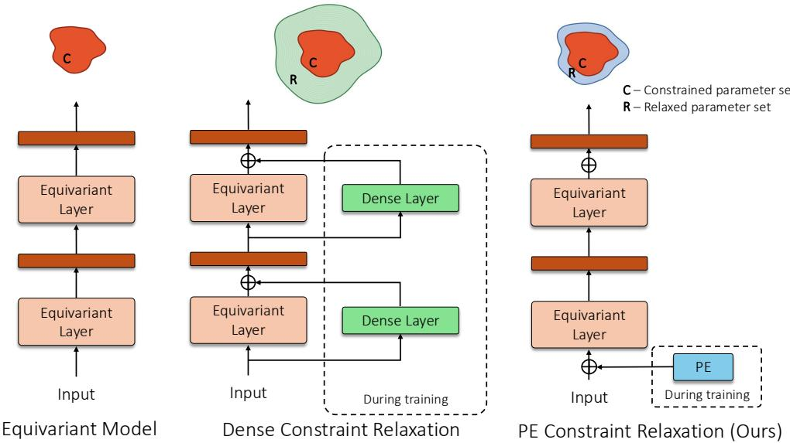  
Figure 1: Equivariance constraint relaxation during training. Left: A strictly equivariant model, whose hypothesis class is restricted to equivariant functions. Middle: Dense constraint relaxation [1–3] adds a non-equivariant dense branch in parallel to every equivariant layer during training. This greatly enlarges the hypothesis class, but substantially increases the parameter count and computational cost of training. Right: Our PE constraint relaxation instead adds a single positional encoding to the input. This relaxes the constraint with negligible parameter and compute overhead. In both relaxation methods, the auxiliary component is used only during training and is annealed to zero, recovering the original strictly equivariant architecture at inference.

In this work, we propose a simple, scalable alternative: train-time constraint relaxation via positional encoding (PE; Fig. 1). Positional encodings are a standard tool for injecting order or geometry into symmetry-preserving architectures, such as Transformers [20, 21] and graph neural networks (GNNs) [22, 23]. They are employed to increase the expressivity of such architectures [24–26] and, more recently, to control the symmetry of equivariant models [27–29]. Building on this direction, we use PE as a transient optimization aid that is annealed to zero, recovering the original strictly equivariant model at inference. We evaluate our approach on five architectures: Vector Neurons [10] and Rapidash [30] for rotation-equivariant point-cloud classification, Alias-Free XCiT [31] for shift-invariant image classification, E2CNN [32] for rotation-equivariant smoke plume forecasting [13], and SEGNN [33] for E(3)-equivariant N-body forecasting. Across these models, PE relaxation matches or improves the strict baselines while preserving their equivariance at inference.

## 2 Related work

Symmetry-aware architectures are a central way to improve sample efficiency and generalization. A foundational direction involves strictly equivariant layers, for example, group convolutions for grid-structured data [4] and steerable convolutions for continuous groups [5]. These principles were subsequently expanded to handle other symmetries, including permutation-invariant models for sets and graphs [6–8], E (n)-equivariant GNNs [9], and SO (3) equivariant models for 3D data [10]. Recent studies have also strengthened the theoretical understanding of equivariant models, including their expressive power, universality, and generalization properties, while extending exact-equivariant design to broader architectures [14, 34–38]. Beyond generalization, such models can also significantly improve parameter efficiency, for example in deep weight-space models [39].

Approximate equivariance and constraint relaxation. Despite their advantages, equivariant models can impose overly strict inductive biases that complicate training. First, strictly enforcing symmetry can be detrimental when the underlying problem only approximately satisfies the assumed symmetry [13], or when the data distribution itself exhibits symmetry bias [40]. Additionally, recent studies show that strictly equivariant models suffer from poor loss landscape geometry compared to unconstrained models, even when there is an equivariant optimal solution [11, 12]. These findings suggest that strict constraints throughout training can obstruct convergence and limit final performance.

To mitigate these issues, many studies have focused on relaxed or approximate equivariance. For example, Wang et al. [13] break the weight sharing scheme in group convolutions. Other methods use non-equivariant residuals [41], learned partial equivariances [16], non-stationary filters [15], projection regularization [18], probabilistic equivariance [42], or approximate-equivariance objectives [19]. More related to our work is symmetry breaking through auxiliary geometric reference information [30]. However, such persistent symmetry breaking changes the deployed model, which is no longer equivariant at inference. It can therefore exploit dataset-specific biases and increase vulnerability to distribution changes, whereas our method breaks the symmetry only during training and deploys the original strictly equivariant model. Equivariance can also be imposed on non-equivariant architectures by group averaging [43] or canonicalization [44], often approximately, for example by averaging over a subgroup for efficiency.

More recently, studies have focused on relaxation specifically to aid optimization. Pertigkiozoglou et al. [1, 2] and Manolache et al. [3] have introduced methods that add non-equivariant dense layers during training, which are annealed to zero to recover the strictly equivariant architecture at inference. These methods show that traversing a non-equivariant optimization path can improve the convergence of equivariant models. However, as we show here (e.g., in Tab. 1), such methods significantly increase parameter count and training time, making them computationally prohibitive at scale.

Positional Encodings in Equivariant Models. Positional encodings are widely used to inject structural information into architectures that are otherwise symmetry-preserving, most notably in Transformers [20, 21]. In geometric deep learning, positional encodings have been employed to distinguish indistinguishable nodes in GNNs [22, 23], and are known to strengthen expressivity and restore universality in both Transformers and message passing networks [24–26].

Recent studies have begun to leverage auxiliary symmetry-breaking inputs or objects specifically as a tool for controlling symmetry properties. Goel et al. [27] utilize positional information to implement generic equivariant models that can relax constraints to specific subgroups, Lawrence et al. [28] employ randomized positional encodings to implement probabilistic symmetry breaking, and Ashman et al. [29] construct approximately equivariant models from existing equivariant architectures through an auxiliary-input mechanism. Our approach builds upon this direction but focuses on the specific application of annealing these positional encodings to facilitate the training of strictly equivariant models, serving as a parameter-efficient alternative to dense-layer relaxation.

## 3 Preliminaries

We consider learning tasks where a symmetry group naturally characterizes the data. Let $G$ be a compact group acting on an input space X and an output space $\mathcal { V }$ via representations $\rho _ { \mathrm { i n } } : G \to$ $\operatorname { G L } \left( \chi \right)$ and $\rho _ { \mathrm { o u t } } : G \to \mathrm { G L } \left( \mathcal { V } \right)$ . A function $f : \mathcal { X }  \bar { \mathcal { V } }$ is said to be G-equivariant if it commutes with the group action. That is, for all $g \in G$ and $x \in \mathcal { X } \colon f \left( \rho _ { \mathrm { i n } } \left( g \right) x \right) = \rho _ { \mathrm { o u t } } \left( g \right) f \left( x \right)$ (1) When the output space is invariant under the group action $( \mathrm { e . g . } ,$ in classification tasks where the label is unchanged by rotation), this condition simplifies to $f \left( \rho _ { \mathrm { i n } } \left( g \right) x \right) = f \left( x \right)$ , and the function is termed invariant. To simplify notation, we use the shorthand $g \cdot ( \cdot )$ to denote the appropriate group action $\left( \mathbf { e } . \mathbf { g } . , g \cdot x = \rho \chi \left( g \right) x \right)$ whenever it is clear from context.

Equivariant Neural Networks. Equivariant neural networks (ENNs) typically enforce this property by restricting the hypothesis class to compositions of standard equivariant (often linear) maps and pointwise nonlinearities [6, 7]. Concretely, $f _ { \theta } ^ { \mathrm { e q } } = f _ { \theta } ^ { \mathrm { e q } , L } \circ \sigma \circ \cdot \cdot \cdot \circ \sigma \circ f _ { \theta } ^ { \mathrm { e q , 1 } }$ (2)

where an equivariant layer $f _ { \theta } ^ { \mathrm { e q } , i }$ satisfies $f _ { \theta } ^ { \mathrm { e q } , i } \left( \rho _ { \mathrm { i n } } \left( g \right) x \right) = \rho _ { \mathrm { o u t } } \left( g \right) f _ { \theta } ^ { \mathrm { e q } , i } \left( x \right) , \forall g \in G .$

(3)

Symmetry breaking via relaxation. Strict equivariance provides a strong inductive bias but may be overly restrictive, for example, when symmetries are only approximate [13] or when the task requires breaking self-symmetries [28]. Finzi et al. [41] have proposed to soften equivariance by augmenting each equivariant layer with a non-equivariant residual pathway. More recent works repurpose this idea for train-time constraint relaxation [1–3], using $f _ { \mathrm { r e l a x e d } } ( x ) = f _ { \boldsymbol { \theta } } ^ { \mathrm { e q } , i } ( x ) + \lambda f _ { \boldsymbol { \phi } } ^ { \mathrm { n e q } , i } ( x )$ , where $f _ { \phi } ^ { \mathrm { n e q } , i }$ is an unconstrained map, such as a dense linear layer [1] or a multi-layer perceptron (MLP) [2, 3]. The coefficient λ controls the relaxation strength and is driven to zero during training, recovering strict equivariance at inference. However, the auxiliary non-equivariant branches increase parameter count and training cost, which can become prohibitive when the equivariant layer is parameter-efficient.

For example, a dense map over flattened high-resolution feature maps scales with the global input size, making it far more expensive than a local equivariant convolution.

Positional Encodings. Positional encodings (PE) inject order or geometry into otherwise permutationinvariant architectures, e.g., sinusoidal embeddings that break the permutation invariance of attention [20]. Throughout the analysis, we take $\mathcal { P }$ to be a compact G-invariant subset of an ambient normed representation space with a linear G-action. Thus, for $\lambda p \in { \mathcal { P } }$ , we have $g \cdot ( \lambda p ) = \lambda ( g \cdot p )$ and, for $\lambda > 0 , \operatorname { S t a b } ( \lambda p ) = \operatorname { S t a b } ( p )$ We distinguish between two PE integration strategies $\phi : \mathcal { X } \times \mathcal { P }  \mathcal { Z } :$ Concat-based $P E .$ . The input x is augmented with positional features p along new channel dimensions, effectively lifting the input to a higher-dimensional joint space: $\phi _ { \mathrm { c a t } } \left( x , p \right) = \left[ x \right] \left\| \begin{array} { l } { p } \right\| \end{array}$ . In this case, we view $( x , p )$ as an element of $X \times P$ endowed with product norm $\| ( x , p ) \| _ { \mathcal { X } \times \mathcal { P } } = \| x \| _ { \mathcal { X } } + \| p \| _ { \mathcal { P } }$ and the group acts jointly as $g \cdot ( x , p ) : = ( g \cdot x , g \cdot p )$ . This preserves the distinction between features and positional encodings, as in $\mathrm { G N N }$ methods such as PEG [22] and LSPE [23] that distinguish otherwise indistinguishable nodes.

Additive PE. The positional features are added directly to the input signal: $\phi _ { \mathrm { a d d } } \left( x , p \right) = x + p$ . Here we assume that x and $p$ lie in a common ambient representation space, or are first embedded into one, so that addition and the group action are defined on both terms. This is a common approach in Transformers [20, 21], where sinusoidal or learnable position vectors are added to token embeddings.

## 4 Constraint relaxation via Positional Encoding

In this work, we propose a parameter-efficient alternative to constraint relaxation with dense layers: symmetry breaking via Positional Encoding. Instead of augmenting the equivariant architecture with auxiliary dense layers, we modify the input representation itself.

Let $f _ { \theta } : \mathcal { X } \times \mathcal { P }  \mathcal { Y }$ be a neural network that is strictly G-equivariant with respect to the joint action $g \cdot ( x , p ) : = ( g \cdot x , g \cdot p ) , g \in G$ . Let $p _ { 0 } \in \mathcal { P }$ be an anchor positional encoding and $\check { \lambda } \in [ 0 , 1 ]$ a scalar relaxation coefficient. We define the relaxed model as $h _ { \lambda } \bar { ( } x ) : = f _ { \theta } ( x , \lambda p _ { 0 } \bar { ) }$

During training we have $\lambda > 0 .$ , and the anchor $p _ { 0 }$ breaks global G-equivariance, whereas in the limit $\lambda  0$ the input becomes $( x , 0 )$ , restoring the equivariance of the original architecture. Thus, λ induces a transition from a rich non-equivariant hypothesis space to the strictly equivariant subspace, similar to Pertigkiozoglou et al. [1] and Manolache et al. [3]. Our analysis below focuses on concatbased PE: we link it to the symmetry-breaking expressivity principle of Goel et al. [27] and derive a vanishing equivariance-error bound analogous to the dense-layer bounds of Manolache et al. [3]. We then discuss how the same principle motivates additive PE.

Universality of the relaxed model. Although the mechanism behind the benefits of constraint relaxation remains unclear, the approach is often motivated as temporarily enlarging the hypothesis class, so that optimization can pass through less constrained, approximately equivariant models before returning to the equivariant subspace [1, 3]. This suggests a basic desideratum: the relaxed model should be strictly more expressive than the constrained one. For dense-layer relaxation, this is immediate, since the added unconstrained layers yield an MLP-like universal approximator [45]. Below, we show that our PE-based relaxation provides an analogous universality result while adding only a few parameters.

Proposition 4.1. Let G be a compact group acting on compact spaces X and P, and let Y be a normed vector space. Let a family of networks $f _ { \boldsymbol { \theta } } : \breve { \boldsymbol { x } } \times \mathscr { P } \stackrel { \cdot } {  } \mathscr { y }$ be a universal approximator over the continuous G-equivariantfunctions on the product space $\mathcal { X } \times \mathcal { P }$ . Let $p _ { 0 } \in \mathcal { P }$ be afixed element with no self-symmetries in G, i.e. $g \cdot p _ { 0 } = p _ { 0 } \Rightarrow g = e ,$ and let $\lambda > 0 .$ . Then, thefamily offunctions $h ( \cdot ) = f _ { \theta } ( \cdot , \lambda p _ { 0 } ) : \mathcal { X }  \mathcal { Y }$ obtained by fixing the second argument of a universal G-equivariant network is a universal approximatorfor the space ofcontinuousfunctions $C ( \mathcal X , \mathcal Y )$

Proof. The result follows from Theorem 2 of Goel et al. [27], which characterizes the expressivity of networks conditioned on symmetry-breaking features. The Theorem states that for a G-equivariant network $f ( x , p )$ , fixing the auxiliary input $p$ to a value $p _ { 0 }$ restricts the network’s equivariance to the subgroup $\mathrm { S t a b } ( p _ { 0 } ) \leq G$ , while remaining a global approximator under this weaker constraint. Since $p _ { 0 }$ has no self-symmetries, i.e., $\mathrm { S t a b } ( p _ { 0 } ) = \bar { \{ e \} }$ , and since $\lambda > 0$ implies $\operatorname { S t a b } ( \lambda p _ { 0 } ) = \operatorname { S t a b } ( p _ { 0 } )$ $h$ becomes equivariant only to the identity element, which imposes no constraints. Therefore, the hypothesis space of $h$ expands to include all continuous functions, following the universal approximation theorem [45]. □

This proposition motivates our method: for $\lambda > 0 ,$ optimization can traverse a universal, generally non-equivariant hypothesis class before annealing back to the equivariant class at $\lambda = 0$

Equivariance error bound. Although our relaxed model is non-equivariant during training, we can bound its deviation from strict equivariance, as in the dense-layer case of Manolache et al. [3]. Such a limited deviation may be beneficial, as has been shown by Pertigkiozoglou et al. [1], where explicitly regularizing the equivariance error of the auxiliary dense layers is crucial.

Proposition 4.2. Let $f _ { \theta } = f ^ { L } \circ \cdot \cdot \cdot \circ f ^ { 1 } : \mathcal { X } \times \mathcal { P }  \mathcal { Y }$ be strictly G-equivariant with respect to the joint action $g \cdot ( x , p ) = ( g \cdot x , g \cdot p )$ , and suppose that each layer $f ^ { \ell }$ is M-Lipschitz continuous as a map between its corresponding input and output representation spaces. Assume that the group action is isometric. The equivariance error ofthe relaxed model $h _ { \lambda } ( x ) = f _ { \theta } \left( x , \lambda p _ { 0 } \right)$ is bounded by:

$$
\| h _ { \lambda } \left( g \cdot x \right) - g \cdot h _ { \lambda } \left( x \right) \| \le 2 \lambda M ^ { L } \| p _ { 0 } \|
$$

The proof is provided in Sec. A.1. The bound implies that annealing $\lambda  0$ drives the equivariance violation to zero at least linearly in λ, with the remaining constants determined by the anchor magnitude $\| p _ { 0 } \|$ and the network’s Lipschitz growth. In contrast, the bound of Manolache et al. [3] scales with the relaxation coefficients and typically depends on $\lVert x \rVert$ , whereas here the deviation is controlled directly by $\lambda \| p _ { 0 } \|$ (up to amplification by the Lipschitz constant).

Additive Positional Encoding. In many modern architectures, such as Transformers, it is standard practice to use an additive PE. In our relaxed-model notation, this takes the form $h _ { \lambda } ( x ) =$ $f _ { \theta } \left( x + \lambda p _ { 0 } \right)$ . In this case, the equivariance error bound from Theorem 4.2 applies directly. However, proving universality is more challenging here than in the concatenative case: the general guarantee from Theorem 4.1 does not automatically hold and requires specific structural assumptions. Nevertheless, theoretical precedents confirm that additive encodings can indeed restore universality to equivariant models. For example, Yun et al. [24] prove that permutation equivariant Transformers with distinct positional encodings become universal approximators for general sequence-to-sequence functions. Similarly, Abboud et al. [25] show that augmenting equivariant Message Passing Networks with unique node identifiers is sufficient to restore universality.

## 5 Experiments

We implement our proposed framework across five distinct architectures. As in previous train-time symmetry-breaking studies [1, 3], we evaluate our method on the Vector Neurons framework [10] and SEGNN [33]. We also evaluate our method on the more recent Alias-Free XCiT [31] and Rapidash [30], and on E2CNN [32] for the smoke plume dataset [13], where we additionally compare against approaches that keep the symmetry breaking at inference. In all cases, we introduce a positional encoding weighted by a learnable scale $\gamma$ initialized to $\gamma = 1$ , and a scheduling coefficient λ that decays to $0 ,$ recovering strict equivariance at inference. Here the bound of Theorem 4.2 applies with $p _ { 0 } = \gamma p ,$ , whose magnitude is controlled by the regularizer on $\| \lambda ( t ) \gamma p \| _ { 2 }$ introduced below.

## 5.1 Rotation-Equivariant Point Cloud Networks

Vector Neurons. We apply our method to VN-PointNet and VN-DGCNN, built upon the Vector Neurons framework [10] for point cloud classification. Based on the original $S _ { n }$ equivariant PointNet [8] and DGCNN [46], these models replace scalar neurons with 3D vector neurons that rotate together with the input, yielding $S _ { n } \times S O ( 3 )$ equivariance.

We break this rotation symmetry by introducing a global positional encoding $\boldsymbol { p } ~ \in ~ \mathbb { R } ^ { N \times 3 }$ that remains fixed in the canonical coordinate frame regardless of the input rotation. We examine two variants: $F i x e d – P E$ , consisting of a single learnable $\mathbb { R } ^ { 3 }$ vector broadcast across all N points, and a Sinusoidal-PE, a deterministic per-index encoding following Vaswani et al. [20], concretely, $\begin{array} { r } { p _ { k , 2 i } = \sin \left( \frac { k } { 1 0 0 0 0 ^ { 2 i / 3 } } \right) , p _ { k , 2 i + 1 } = \cos \left( \frac { k } { 1 0 0 0 0 ^ { 2 i / 3 } } \right) } \end{array}$ (4) where $k \in \{ 1 , \ldots , N \}$ is the point index and $2 i , 2 i + 1 \in \{ 0 , 1 , 2 \}$ index the coordinates of $p _ { k } \in \mathbb { R } ^ { 3 }$ Fixed-PE breaks $S O ( 3 )$ through a broadcast reference vector,1 whereas Sinusoidal-PE also relaxes the $S _ { n }$ permutation symmetry through unique per-index encodings. This differs from the dense-layer relaxation [1], which breaks $S O ( 3 { \bar { ) } }$ while preserving permutation symmetry. We inject PE either additively, $\boldsymbol { x } ^ { \prime } = \boldsymbol { x } + \lambda \gamma p \in \mathbb { R } ^ { N \times 3 }$ , or by concatenation, $x ^ { \prime } = [ x , \lambda \gamma \overset { \mathbf { \bar { \mathbf { \alpha } } } } { p } ] \in \mathbb { R } ^ { N \times 6 }$ for $\bar { x ^ { \prime } } \in \mathbb { R } ^ { N \times 3 }$

Rapidash. We further evaluate our method on Rapidash [30], a regular group-convolution architecture for point clouds defined over the position-orientation space $\mathbb { R } ^ { 3 } \times { \cal S } ^ { 2 }$ . Following Vadgama et al. [30], we consider the strongest ModelNet40 variants: (i) Rapidash-Eq, which uses point-cloud normals as vector features and remains strictly equivariant at test time, and (ii) Rapidash-Symm. Break, which additionally uses global-frame features and therefore breaks the symmetry also at inference. On top of the strictly equivariant baseline, we evaluate $R a p i d a s h { - } E q { + } P \dot { E }$ , obtained by injecting the PE on the input similarly to the Vector Neurons. This positional signal breaks rotational symmetry during training, and annealing it to zero recovers the original strictly equivariant Rapidash model at inference.

## 5.2 Equivariant Models on 2D Grids

We consider two symmetry groups acting on data defined over 2D grids: fractional cyclic translations of natural images, and planar rotations of fluid velocity fields. In both cases, we break the symmetry using a 2D Fourier positional encoding of the grid coordinates.

Fractional shift-invariant vision transformers. We evaluate our method on the Alias-Free Cross-Covariance Image Transformer (AF-XCiT; Michaeli and Soudry [31]). We consider the symmetry group of fractional cyclic translations, formally the torus group $\dot { G } \cong \mathbb { R } ^ { 2 } / \mathbb { Z } ^ { 2 }$ , acting on the periodic continuous image domain as defined by Michaeli et al. [47]. AF-XCiT achieves translation invariance2 by modifying the XCiT architecture [48] using alias-free downsampling and activations, translationequivariant cross-covariance attention layers, and no positional encodings.

To implement constraint relaxation, we reintroduce the 2D Fourier Positional Encoding used in the original XCiT [48] after the patch embedding and prior to the first transformer block. This module encodes the patch coordinates with sinusoidal features and linearly projects them to the model feature dimension $d .$ This encoding injects absolute position into the image features, formally: PatchEmbed : $\mathbb { R } ^ { H \times W \times 3 } \to \mathbb { R } ^ { N \times d } ; \quad \vec { z } ^ { \prime } = \vec { \mathrm { F } }$ atchEmbed $( x ) + \lambda \gamma P _ { \mathrm { F o u r i e r } }$ (5) ，

where x is the input image with dimensions H, W and $P _ { \mathrm { F o u r i e r } } \in \mathbb { R } ^ { N \times d }$ is the positional signal.

Rotation-equivariant steerable CNNs. We evaluate our method on the synthetic smoke plume dataset with approximate rotation symmetry of Wang et al. [13], where the task is to forecast 2D smoke velocity fields simulated with inflow locations and buoyant force directions that are $C _ { 4 } \mathrm { - }$ symmetric, while the buoyancy factor varies with the inflow position and breaks this symmetry. Our strict baseline is the $C _ { 4 }$ -equivariant steerable CNN E2CNN [32], which we relax during training using the 2D Fourier positional encoding described above, scaled by $\lambda \gamma$ . We compare against RSteer [13], which relaxes the steerable-kernel constraint and deploys the resulting approximately equivariant model at inference.

## 5.3 Steerable E(3)-Equivariant GNNs

Finally, we evaluate our approach on SEGNN [33] on the charged N-Body task [49]. While SEGNN is often described as $E ( 3 )$ -equivariant, in our setting the relevant symmetry is global rotations $( S O ( 3 ) )$ , since global translations are handled by the standard use of centered coordinates. SEGNN preserves the symmetry of input features represented by a direct sum of irreducible representations (irreps) of the orthogonal group $O ( 3 )$ . This is suitable for physical simulations where the inputs consist of multiple steerable vector features, such as relative position and velocity, and invariant scalar features, such as energy.

To implement symmetry breaking, we apply additive PE to the full SEGNN input feature vector: $\boldsymbol { x } ^ { \prime } = \overset { \bullet } { \boldsymbol { x } } + \lambda \gamma \boldsymbol { p } , \overset { \bullet } { \boldsymbol { x } } , \boldsymbol { p } \in \mathbb { R } ^ { \mathbf { \check { N } } \times \boldsymbol { D } }$ , where $\begin{array} { r } { D = \sum _ { \ell \in \mathcal { L } _ { \mathrm { i n } } } d _ { \ell } ( 2 \ell + 1 ) } \end{array}$ is the total flattened feature dimension induced by the input irreps. Thus, p has the same irrep-flattened layout as the SEGNN input features. We instantiate p either by broadcasting a learnable vector in $\mathbb { R } ^ { \check { D } }$ across nodes (Fixed-PE), or by applying the sinusoidal encoding (Eq. (4)) to the node index with feature dimension D (Sinusoidal-PE). This positional signal is fixed in the canonical feature basis and is not transformed with the input, thereby breaking rotational symmetry during training; annealing λ to zero recovers the original SEGNN representation at inference.

Annealing schedules. As mentioned in Sec. 4, our PE constraint relaxation during training is controlled by $\lambda ( t )$ , where t represents the current training step out of T total steps. We examine two scheduling strategies.

Linear Decay. A monotonic schedule that initializes the model with maximal relaxation $( \lambda = 1 )$ linearly annealing to strict equivariance as training concludes, formally $\begin{array} { r } { \lambda _ { \mathrm { L i n e a r } } ( t ) = 1 - \frac { t } { T } } \end{array}$ (6) Triangular Schedule. A cyclic schedule that starts and ends with strict equivariance $( \lambda \overset { \cdot } { = } 0 )$ , with maximal relaxation midway through training, as first proposed by Pertigkiozoglou et al. [1]. This schedule allows the model to temporarily explore non-equivariant solutions before converging back

to the equivariant subspace, formally

$$
\lambda _ { \mathrm { T r i a n g u l a r } } ( t ) = { \left\{ \begin{array} { l l } { { \frac { 2 t } { T } } } & { { \mathrm { i f ~ } } t < { \frac { T } { 2 } } } \\ { 2 - { \frac { 2 t } { T } } } & { { \mathrm { i f ~ } } t \geq { \frac { T } { 2 } } } \end{array} \right. } .\tag{7}
$$

Training objective. We train all models with their original task loss $\mathcal { L } _ { \mathrm { t a s k } }$ combined with a regularization term on the magnitude of the injected PE: $\mathcal { L } = \mathcal { \bar { L } } _ { \mathrm { t a s k } } + \beta \cdot \| \lambda ( t ) \gamma p \| _ { 2 }$ (8) where $\beta$ is a regularization hyperparameter. This penalizes the norm of the symmetry-breaking signal, encouraging the model to rely less on the positional cues as training progresses. This is simpler than Pertigkiozoglou et al. [1], which regularizes both the magnitude and equivariance error of dense relaxation layers.

## 6 Results

We run all experiments using PyTorch [50] on a single machine with 8 × NVIDIA RTX A6000. We build on the official codebases of previous studies for all experiments [1, 13, 30, 31]. Our implementation is publicly available,3 and further experimental details are provided in Sec. D.

## 6.1 Rotation-Equivariant Point Cloud Networks

Vector Neurons. We evaluate our PE relaxation on the ModelNet40 point-cloud classification task [51]. We compare against two baselines: strictly equivariant Vector Neurons models (VN-PointNet and VN-DGCNN) [10] and the dense-layer Constraint Relaxation (CR) method [1]. Following Pertigkiozoglou et al. [1], we sample 300 points per point-cloud and keep the same training hyperpa rameters, tuning only our framework-specific choices (regularization scale, mix coefficient scheduler, and positional encoding type), which we tune as reported in Sec. D.1. For fairness, we run the same hyperparameter search for dense-layer CR and report the best configuration averaged over 5 seeds. All VN experiments use the $S O ( 3 ) \ j { S O } ( 3 )$ protocol where point clouds are randomly rotated during both training and evaluation [10].

The results in Tab. 1 show that our PE method outperforms the equivariant baseline and the CR method on the VN-PointNet architecture, with relative improvements of 18% and 7.6%, respectively. On VN-DGCNN, our method matches CR accuracy without the high cost of dense relaxation. Beyond accuracy, Tab. 1 shows the computational advantages of our method. Across both VN architectures, PE preserves almost the same parameter count and training time as the equivariant baseline, whereas dense-layer CR incurs substantial overhead. For example, on VN-PointNet, additive PE improves accuracy from 67.5 to 79.6 with nearly unchanged training cost (2M parameters and 27.9s per epoch, versus 2M and 27.6s for the baseline), whereas CR increases the parameter count to 9M and training time to 97.6s per epoch. A similar trend appears for VN-DGCNN.

We report additional scalability results in Sec. C.1, which confirm that PE continues to track the baseline as the model scales, while CR exhibits rapidly growing overhead. Additional ablations of the PE design choices in Sec. B show that the learnable scale γ accounts for most of the gain of our method: learning γ without decay or regularization already yields comparable accuracy after PE removal, whereas with a fixed $\gamma$ removing PE collapses accuracy. The schedule λ(t) mainly guarantees that the PE contribution is exactly zero at the end of training.

Rapidash. We next evaluate our method on Rapidash on ModelNet40. Similar to Vector Neurons, we use the original model hyperparameters [30] and tune those of our framework as described in Sec. D.2. We report in Tab. 2 the accuracy on the original validation set, and validation accuracy under random rotations. For a controlled comparison on the same backbone, we also implement the constraint relaxation of Pertigkiozoglou et al. [1] on Rapidash-Eq (Rapidash-CR; details in Sec. D.2). Here we follow the protocol of [30]: training uses the original, z-aligned ModelNet40 with 1024 points, and each training sample is randomly rotated inside the model pipeline. Rapidash-Symm. Break receives this applied rotation as a global-frame pose feature, while Rapidash-Eq, Rapidash-CR and Rapidash-Eq+PE receive no pose information at inference. “Accuracy” uses the aligned validation set with the identity pose; “Random-Rotation Accuracy” applies an additional rotation that is not encoded in the pose feature, which is why Rapidash-Symm. Break collapses.

Table 1: ModelNet40 classification accuracy and training cost. Results for VN-PointNet and VN-DGCNN under strict equivariance, dense-layer constraint relaxation (CR), and our positionalencoding relaxation (PE; additive and concatenative variants). Accuracy is the average best validation accuracy over training (mean ± std over 5 random seeds). All models are trained and evaluated on randomly rotated point clouds $( S O ( 3 ) / S O ( 3 ) )$ ). “Parameters” counts trainable parameters in the trained architecture, and “Time per epoch” is computed by dividing total wall-clock training time on a single NVIDIA RTX A6000 with batch-size 32 by the number of epochs.
<table><tr><td>MODEL</td><td>INSTANCE ACCURACY</td><td>PARAMETERS</td><td>TIME PER EPOCH [SEC]</td></tr><tr><td>VN-POINTNET [10]</td><td> $6 7 . 5 \pm 0 . 5$ </td><td>1,972,745</td><td>27.6</td></tr><tr><td>VN-POINTNET-CR [1]</td><td> $7 4 . 0 \pm 1 . 9$ </td><td>8,978,126</td><td>97.6</td></tr><tr><td>VN-POINTNET-PE ADD. (OURS)</td><td> ${ \bf 7 9 . 6 \pm 0 . 4 }$ </td><td>1,972,746</td><td>27.9</td></tr><tr><td>VN-POINTNET-PE CONCAT. (OURS)</td><td> $7 9 . 3 \pm 0 . 9$ </td><td>1,972,872</td><td>27.7</td></tr><tr><td> $\mathrm { V N - D G C N N } \ [ 1 0 ]$ </td><td> $8 8 . 3 \pm 0 . 2$ </td><td>2,899,830</td><td>61.2</td></tr><tr><td> $\mathrm { V N - D G C N N - C R \ [ 1 ] }$ </td><td> $8 8 . 6 \pm 0 . 5$ </td><td>8,829,555</td><td>181.7</td></tr><tr><td>VN-DGCNN-PE ADD. (OURS)</td><td> $8 8 . 2 \pm 0 . 2$ </td><td>2,899,834</td><td>61.3</td></tr><tr><td>VN-DGCNN-PE CONCAT. (OURS)</td><td> $8 8 . 6 \pm 0 . 4$ </td><td>2,899,915</td><td>61.7</td></tr></table>

Table 2: ModelNet40 classification with Rapidash. We report validation accuracy on the original validation set (“Accuracy”) and on the validation set under random rotations (“Random-Rotation Accuracy”). PE improves both standard accuracy and rotated accuracy over the strictly equivariant Rapidash baseline, while preserving the original equivariant test-time architecture. In contrast, Rapidash-Symm. Break achieves the highest standard accuracy but collapses under random rotations, indicating strong reliance on the orientation bias present in the dataset.
<table><tr><td>MODEL</td><td>ACCURACY</td><td>RANDOM-ROTATION ACCURACY</td></tr><tr><td>RAPIDASH-EQ [30]</td><td> $8 3 . 7 \pm 1 . 4$ </td><td> $8 3 . 6 \pm 1 . 0$ </td></tr><tr><td>RAPIDASH-SYMM. BREAK [30]</td><td> ${ \bf 8 8 . 0 \pm 0 . 1 }$ </td><td> $1 4 . 8 \pm 1 . 1$ </td></tr><tr><td> $\mathrm { R A P I D A S H - C R } \ [ 1 ]$ </td><td> $8 4 . 3 \pm 0 . 8$ </td><td> $8 4 . 2 \pm 0 . 5$ </td></tr><tr><td>RAPIDASH-EQ+PE (OURS)</td><td> $8 4 . 6 \pm 0 . 6$ </td><td> ${ \bf 8 4 . 6 \pm 0 . 5 }$ </td></tr></table>

The results reveal a clear dependence of the global-frame variant on the orientation bias in the dataset. While Rapidash-Symm. Break achieves the highest standard validation accuracy (88.0), its performance drops sharply under random rotations to 14.8. In contrast, the strictly equivariant Rapidash-Eq baseline remains much more stable (83.7 to 83.6), while our Rapidash-EQ+PE improves over this baseline on both metrics, reaching 84.6 accuracy on both the standard and the randomly rotated validation sets. Rapidash-CR likewise improves over the baseline and remains stable under rotations (84.3 and 84.2), while PE performs slightly better. These results suggest that PE provides the optimization benefit of symmetry breaking during training without causing the model to rely on dataset-specific orientation bias at test time. By annealing the positional signal to zero, Rapidash-Eq+PE recovers the original equivariant architecture while retaining improved performance.

## 6.2 Equivariant Models on 2D Grids

Fractional shift-invariant vision transformers. We evaluate our method on AF-XCiT-Nano [31], trained on ImageNet [52]. We use the original model hyperparameters and set the regularization term to $\beta = 1 0 ^ { - 5 }$ . We use linear relaxation decay for 320 epochs, and train the remaining 80 epochs with $\lambda = 0$ (see additional details in Sec. D.3). AF-XCiT may be an instance where the model symmetry is too restrictive, as natural images are not cyclically shift-symmetric (e.g., due to boundary effects). To examine this hypothesis, we train an additional AF-XCiT variant with a non-decaying positional encoding, i.e., where the PE breaks equivariance at test time. The results in Tab. 3 suggest that our proposed approach improves the accuracy of the AF model (71.1% vs 70.6%). The model with non-decaying PE performs slightly better (71.4%), supporting our hypothesis regarding the symmetry misalignment. Crucially, however, our proposed approach achieves this gain without compromising the translation consistency, which is beneficial, e.g., for adversarial robustness—the original motivation for AF-XCiT [31]. We discuss this further in Sec. C.3.

Table 3: ImageNet results for AF-XCiT-Nano. We report ImageNet validation top-1 accuracy (“Accuracy”), accuracy under random cyclic translations (“Shift Accuracy”), and the relative change between the two. We report mean ± std over 2 random seeds. AF-XCiT + PE (train and test) keeps positional encoding at inference and therefore corresponds to a relaxed, only approximately invariant setting, whereas AF-XCiT + PE (train only; ours) anneals the PE coefficient to zero during training and removes PE at test time, recovering the original alias-free invariant architecture. The results show that the annealed variant preserves substantially better accuracy under input translations than keeping PE at test time, while still improving accuracy over the strict AF-XCiT baseline.
<table><tr><td>MODEL</td><td>ACCURACY</td><td>SHIFT ACCURACY</td><td>CHANGE (%)</td></tr><tr><td>XCIT-NANO [48]</td><td> $7 0 . 5 \pm 0 . 2$ </td><td> $6 8 . 8 \pm 0 . 0$ </td><td>-2.4</td></tr><tr><td>AF-XCIT-NANO [31]</td><td> $7 0 . 6 \pm 0 . 1$ </td><td> $7 0 . 6 \pm 0 . 1$ </td><td>-0.0</td></tr><tr><td>AF-XCIT-NANO + PE (TRAIN AND TEST)</td><td> $7 1 . 4 \pm 0 . 1$ </td><td> $7 0 . 3 \pm 0 . 1$ </td><td>-1.5</td></tr><tr><td>AF-XCIT-NANO + PE (TRAIN ONLY; OURS)</td><td> $7 1 . 1 \pm 0 . 1$ </td><td> $7 1 . 1 \pm 0 . 1$ </td><td>-0.0</td></tr></table>

Table 4: Smoke plume forecasting with E2CNN. We report 20-step prediction RMSE $( \times 1 0 ^ { - 2 }$ lower is better) on the Future and Domain test sets of Wang et al. [13] (mean ± std over 3 seeds). E2CNN + PE (train and test) keeps the PE at inference and is therefore only approximately equivariant, similar to RSteer, whereas E2CNN + PE (train only; ours) anneals the PE to zero during training and recovers the strictly equivariant E2CNN at inference.
<table><tr><td>MODEL</td><td>FUTURE↓</td><td>DOMAIN↓</td></tr><tr><td>E2CNN [32]</td><td> $8 1 . 2 \pm { 1 . 1 }$ </td><td> $5 9 . 8 \pm 2 . 0$ </td></tr><tr><td>RSTEER [13]</td><td> $7 9 . 4 \pm 0 . 1$ </td><td> ${ \pm 8 . 0 \pm 0 . 1 }$ </td></tr><tr><td>E2CNN + PE (TRAIN AND TEST)</td><td> $7 9 . 6 \pm 1 . 2$ </td><td> $5 8 . 5 \pm 0 . 7$ </td></tr><tr><td> $\mathrm { E } 2 \mathrm { C N N } + \mathrm { P E }$  (TRAIN ONLY; OURS)</td><td> $7 9 . 8 \pm 0 . 8$ </td><td> $5 8 . 2 \pm 0 . 7$ </td></tr></table>

Rotation-equivariant steerable CNNs. Tab. 4 reports the 20-step prediction RMSE on the smoke plume dataset with approximate rotation symmetry [13], for the Future (test data lies in the future time of the training data) and Domain (training and test data are from different simulations) test sets. Both PE variants reduce the RMSE of the strict E2CNN baseline on both test sets. RSteer obtains the lowest RMSE, while PE (train only) is within 0.4 of RSteer on both test sets. Note that the methods target different deployment goals: RSteer and PE (train and test) deploy an approximately equivariant model, whereas PE (train only) recovers the strictly C4-equivariant E2CNN at inference. Decayed PE thus comes close to RSteer while remaining strictly equivariant.

## 6.3 Steerable E(3)-Equivariant GNNs

Finally, we evaluate our method on the charged-particle N-Body forecasting task [49] using SEGNN [33]. We use 3000 training samples and 2000/2000 validation/test samples, following the data split of [1], and train for 2000 epochs. We select the checkpoint with the lowest validation loss and report the corresponding test MSE on final particle positions averaged over 5 random seeds. We first tune the optimizer hyperparameters (learning rate and weight decay) for the equivariant SEGNN baseline and then fix them for all methods. We then tune only the relaxation-specific hyperparameters for each relaxed variant using the same validation criterion (see additional details in Sec. D.5).

The results in Tab. 5 show that both relaxation methods improve over the equivariant baseline on this task. Our PE relaxation achieves an average test MSE of 41.9, performing better than the dense-layer CR method (43.2) and improving over the baseline (44.3). This confirms that PE can capture the optimization benefits of constraint relaxation as effectively as dense layers, with fewer parameters (147K for the Baseline and PE vs. 344K for CR). We note that due to the small scale of this model, we have not observed any significant change in training time. Additional results in Sec. C.4 show that PE can also replace the non-equivariant MLP relaxation inside the ACE [3] constrained-optimization framework.

Table 5: N-Body (charged particles) forecasting with SEGNN. We report test MSE on final particle positions evaluated at the checkpoint with the lowest validation loss (mean ± std over 5 seeds).
<table><tr><td>MODEL</td><td>TEST  $\mathrm { M S E } \left( \times 1 0 ^ { - 4 } \right) \downarrow$ </td></tr><tr><td>SEGNN [33]</td><td> $4 4 . 3 \pm 1 . 4$ </td></tr><tr><td>SEGNN-CR [1]</td><td> $4 3 . 2 \pm 1 . 9$ </td></tr><tr><td>SEGNN-PE (OURS)</td><td> $4 1 . 9 \pm 1 . 5$ </td></tr></table>

## 7 Discussion

In this paper, we introduce a novel framework for equivariance constraint relaxation based on annealing Positional Encodings (PE). Our approach is based on the insight that the optimization difficulties of strictly equivariant models can be mitigated by temporarily breaking symmetry, allowing the model to traverse a less constrained, generally non-equivariant hypothesis class during training. Unlike previous methods that rely on computationally expensive dense layers, our framework achieves this via a simple symmetry-breaking signal (PE) that introduces negligible overhead.

Efficiency and scalability. A primary contribution of our work is improving the scalability of constraint relaxation. While dense-layer relaxation methods incur a quadratic growth in parameters and training time with respect to model width, our PE-based method maintains practically the same computational cost of the equivariant baseline. For instance, on the VN-PointNet architecture, the dense-layer method (CR) increased the parameter count from 2M to roughly 9M and the training time from 28s to 98s per epoch (Tab. 1). In contrast, our PE relaxation incurred negligible overhead in parameters or time while achieving superior accuracy (79.6% vs 74.0%). This efficiency is critical for applying relaxation techniques to large-scale architectures, or when considering equivariant models with sparse weight sharing schemes relative to the input dimension [53].

Symmetry misalignment and optimization. Real-world data often satisfy an assumed symmetry only approximately (e.g., due to boundary effects in images [54, 55], boundary conditions in physical systems [13], and measurement artifacts [56]), in which case enforcing exact constraints may degrade performance [13]. Our experiments on 2D grids illustrate the optimization challenges that may arise in such cases. While AF-XCiT is designed for fractional cyclic translation invariance, natural images do not strictly adhere to this group structure (e.g., due to non-cyclic boundary effects), and the smoke plume dynamics only approximately satisfy the $C _ { 4 }$ symmetry of E2CNN. This mismatch may explain why retaining PE at test time improves over the equivariant baselines (Tabs. 3 and 4). Notably, annealing PE to zero still retains most of this gain, e.g., 0.5 of the 0.8 accuracy gain on AF-XCiT. This suggests that even when strict invariance is enforced at inference, the optimization dynamics benefit from a relaxed trajectory that temporarily accommodates the approximate nature of the data symmetries. This is further supported by the training-dynamics plots in Sec. C.2.

Limitations and future work. Despite the demonstrated advantages of our method, we acknowledge specific limitations of our work. First, our method requires selecting a few configurations such as the PE type and schedule, which are architecture-dependent choices; we propose practical defaults in Sec. B.2. Second, our theory motivates rather than guarantees the method: theorem 4.1 covers only concatenated PE with a trivial-stabilizer anchor on a universal equivariant backbone, and does not directly apply to our additive or Fixed-PE configurations. Third, the accuracy gains vary between the evaluated architectures, and are more modest on already strong baselines, e.g. VN-DGCNN versus VN-PointNet on ModelNet. Fourth, we inject PE only at the input; which layers benefit most from symmetry breaking remains open (Sec. C.4 and C.5). Finally, while our evaluation focused on rotations and translations, applying PE relaxation to other groups, such as permutations, remains an open question, and could be especially useful in domains where dense-layer relaxation is computationally infeasible.

More broadly, the principle of relaxing constraints via PE has broader implications beyond geometric deep learning. Related work in large language models (LLMs) has shown that removing positional embeddings at inference improves length generalization [57]. This phenomenon parallels our findings: PE provides useful signals that improve training but can be dropped at test time. Future work could investigate this intersection further, for example, leveraging our scheduling and regularization in LLM training.

## Acknowledgments and Disclosure of Funding

The research of DS was funded by the European Union (ERC, A-B-C-Deep, 101039436). Views and opinions expressed are however those of the author only and do not necessarily reflect those of the European Union or the European Research Council Executive Agency (ERCEA). Neither the European Union nor the granting authority can be held responsible for them. The research of DS was also supported by the Council for Higher Education in Israel under the Moonshot Project. The research is also supported by the NVIDIA Academic Grant Program using donated A100 GPU-Hours on Brev. HM is supported by the Israel Science Foundation through a personal grant (ISF 264/23) and an equipment grant (ISF 532/23), and by the Career Advancement Chairs in Artificial Intelligence – Schmidt Futures.

## References

[1] Stefanos Pertigkiozoglou, Evangelos Chatzipantazis, Shubhendu Trivedi, and Kostas Daniilidis. Improving Equivariant Model Training via Constraint Relaxation, January 2025. URL http: //arxiv.org/abs/2408.13242. arXiv:2408.13242 [cs].

[2] Stefanos Pertigkiozoglou, Mircea Petrache, Shubhendu Trivedi, and Kostas Daniilidis. Recurrent Equivariant Constraint Modulation: Learning Per-Layer Symmetry Relaxation from Data, February 2026. URL http://arxiv.org/abs/2602.02853. arXiv:2602.02853 [cs].

[3] Andrei Manolache, Luiz F. O. Chamon, and Mathias Niepert. Learning (Approximately) Equivariant Networks via Constrained Optimization. October 2025. URL https://openreview. net/forum?id=NM4emKloy6.

[4] Taco S Cohen and Max Welling MWELLING. Group Equivariant Convolutional Networks. 2016. arXiv: 1602.07576v3.

[5] Maurice Weiler, Fred A. Hamprecht, and Martin Storath. Learning Steerable Filters for Rotation Equivariant CNNs, March 2018. URL http://arxiv.org/abs/1711.07289. arXiv:1711.07289 [cs].

[6] Manzil Zaheer, Satwik Kottur, Siamak Ravanbakhsh, Barnabas Poczos, Russ R Salakhutdinov, and Alexander J Smola. Deep Sets. In Advances in Neural Information Processing Systems, volume 30. Curran Associates, Inc., 2017. URL https://proceedings.neurips.cc/paper\_ files/paper/2017/hash/f22e4747da1aa27e363d86d40ff442fe-Abstract.html.

[7] Haggai Maron, Heli Ben-Hamu, Nadav Shamir, and Yaron Lipman. Invariant and Equivariant Graph Networks. 7th International Conference on Learning Representations, ICLR 2019, December 2018. URL https://arxiv.org/abs/1812.09902v2. arXiv: 1812.09902.

[8] Charles R. Qi, Hao Su, Kaichun Mo, and Leonidas J. Guibas. PointNet: Deep Learning on Point Sets for 3D Classification and Segmentation. Proceedings - 30th IEEE Conference on Computer Vision and Pattern Recognition, CVPR 2017, 2017-Janua:77–85, December 2016. doi: 10.1109/CVPR.2017.16. URL https://arxiv.org/abs/1612.00593v2. arXiv: 1612.00593 ISBN: 9781538604571.

[9] Victor Garcia Satorras, Emiel Hoogeboom, and Max Welling. E(n) Equivariant Graph Neural Networks. In Proceedings of the 38th International Conference on Machine Learning, pages 9323–9332. PMLR, July 2021. URL https://proceedings.mlr.press/v139/ satorras21a.html.

[10] Congyue Deng, Or Litany, Yueqi Duan, Adrien Poulenard, Andrea Tagliasacchi, and Leonidas Guibas. Vector Neurons: A General Framework for SO(3)-Equivariant Networks, April 2021. URL http://arxiv.org/abs/2104.12229. arXiv:2104.12229 [cs].

[11] YuQing Xie and Tess Smidt. A Tale of Two Symmetries: Exploring the Loss Landscape of Equivariant Models, October 2025. URL http://arxiv.org/abs/2506.02269. arXiv:2506.02269 [cs].

[12] Oskar Nordenfors, Fredrik Ohlsson, and Axel Flinth. Optimization Dynamics of Equivariant and Augmented Neural Networks, October 2024. URL http://arxiv.org/abs/2303.13458. arXiv:2303.13458 [cs].

[13] Rui Wang, Robin Walters, and Rose Yu. Approximately Equivariant Networks for Imperfectly Symmetric Dynamics, June 2022. URL http://arxiv.org/abs/2201.11969. arXiv:2201.11969 [cs.LG].

[14] Marco Pacini, Mircea Petrache, Bruno Lepri, Shubhendu Trivedi, and Robin Walters. On Universality of Deep Equivariant Networks, October 2025. URL http://arxiv.org/abs/ 2510.15814. arXiv:2510.15814 [stat].

[15] Tycho F. A. van der Ouderaa, David W. Romero, and Mark van der Wilk. Relaxing Equivariance Constraints with Non-stationary Continuous Filters, November 2022. URL http://arxiv. org/abs/2204.07178. arXiv:2204.07178 [cs].

[16] David W. Romero and Suhas Lohit. Learning Partial Equivariances from Data, January 2023. URL http://arxiv.org/abs/2110.10211. arXiv:2110.10211 [cs].

[17] Ningyuan Huang, Ron Levie, and Soledad Villar. Approximately Equivariant Graph Networks, November 2023. URL http://arxiv.org/abs/2308.10436. arXiv:2308.10436 [stat].

[18] Torben Berndt and Jan Stühmer. Approximate equivariance via projection-based regularisation, January 2026. URL http://arxiv.org/abs/2601.05028. arXiv:2601.05028 [cs].

[19] Ahmed A. Elhag, T. Konstantin Rusch, Francesco Di Giovanni, and Michael Bronstein. Relaxed Equivariance via Multitask Learning, January 2026. URL http://arxiv.org/abs/2410. 17878. arXiv:2410.17878 [cs].

[20] Ashish Vaswani, Noam Shazeer, Niki Parmar, Jakob Uszkoreit, Llion Jones, Aidan N Gomez, Ł ukasz Kaiser, and Illia Polosukhin. Attention is All you Need. In Advances in Neural Information Processing Systems, volume 30. Curran Associates, Inc., 2017. URL https://proceedings.neurips.cc/paper/2017/hash/ 3f5ee243547dee91fbd053c1c4a845aa-Abstract.html.

[21] Alexey Dosovitskiy, Lucas Beyer, Alexander Kolesnikov, Dirk Weissenborn, Xiaohua Zhai, Thomas Unterthiner, Mostafa Dehghani, Matthias Minderer, Georg Heigold, Sylvain Gelly, Jakob Uszkoreit, and Neil Houlsby. An Image is Worth 16x16 Words: Transformers for Image Recognition at Scale. ICLR 2021 - 9th International Conference on Learning Representations, October 2020. URL https://arxiv.org/abs/2010.11929v2. arXiv: 2010.11929.

[22] Haorui Wang, Haoteng Yin, Muhan Zhang, and Pan Li. Equivariant and Stable Positional Encoding for More Powerful Graph Neural Networks, June 2022. URL http://arxiv.org/ abs/2203.00199. arXiv:2203.00199 [cs].

[23] Vijay Prakash Dwivedi, Anh Tuan Luu, Thomas Laurent, Yoshua Bengio, and Xavier Bresson. Graph Neural Networks with Learnable Structural and Positional Representations, February 2022. URL http://arxiv.org/abs/2110.07875. arXiv:2110.07875 [cs].

[24] Chulhee Yun, Srinadh Bhojanapalli, Ankit Singh Rawat, Sashank J. Reddi, and Sanjiv Kumar. Are Transformers universal approximators of sequence-to-sequence functions?, February 2020. URL http://arxiv.org/abs/1912.10077. arXiv:1912.10077 [cs].

[25] Ralph Abboud, Ismail Ilkan Ceylan, Martin Grohe, and Thomas Lukasiewicz. The Surprising Power of Graph Neural Networks with Random Node Initialization, June 2021. URL http: //arxiv.org/abs/2010.01179. arXiv:2010.01179 [cs].

[26] Ryoma Sato, Makoto Yamada, and Hisashi Kashima. Random Features Strengthen Graph Neural Networks, January 2021. URL http://arxiv.org/abs/2002.03155. arXiv:2002.03155 [cs].

[27] Abhinav Goel, Derek Lim, Hannah Lawrence, Stefanie Jegelka, and Ningyuan Huang. Any-Subgroup Equivariant Networks via Symmetry Breaking. November 2025. URL https: //openreview.net/forum?id=daQMVMAyiJ#discussion.

[28] Hannah Lawrence, Vasco Portilheiro, Yan Zhang, and Sékou-Oumar Kaba. Improving Equivariant Networks with Probabilistic Symmetry Breaking, March 2025. URL http: //arxiv.org/abs/2503.21985. arXiv:2503.21985 [cs].

[29] Matthew Ashman, Cristiana Diaconu, Adrian Weller, Wessel Bruinsma, and Richard E. Turner. Approximately Equivariant Neural Processes, November 2024. URL http://arxiv.org/ abs/2406.13488. arXiv:2406.13488 [stat].

[30] Sharvaree Vadgama, Mohammad Mohaiminul Islam, Domas Buracas, Christian Shewmake, Artem Moskalev, and Erik Bekkers. Probing Equivariance and Symmetry Breaking in Convolutional Networks, June 2025. URL http://arxiv.org/abs/2501.01999. arXiv:2501.01999 [cs].

[31] Hagay Michaeli and Daniel Soudry. Alias-Free ViT: Fractional Shift Invariance via Linear Attention. In 39th Conference on Neural Information Processing Systems, NeurIPS 2025, pages 1709–1735, 2025. URL https://cris.iucc.ac.il/en/publications/ alias-free-vit-fractional-shift-invariance-via-linear-attention/.

[32] Maurice Weiler and Gabriele Cesa. General \$E(2)\$-Equivariant Steerable CNNs. Advances in Neural Information Processing Systems, 32, November 2019. ISSN 10495258. doi: 10.48550/ arxiv.1911.08251. URL https://arxiv.org/abs/1911.08251v2. arXiv: 1911.08251.

[33] Johannes Brandstetter, Rob Hesselink, Elise van der Pol, Erik J. Bekkers, and Max Welling. Geometric and Physical Quantities Improve E(3) Equivariant Message Passing, March 2022. URL http://arxiv.org/abs/2110.02905. arXiv:2110.02905 [cs].

[34] Nadav Dym and Haggai Maron. On the Universality of Rotation Equivariant Point Cloud Networks, October 2020. URL http://arxiv.org/abs/2010.02449. arXiv:2010.02449 [cs].

[35] Ben Finkelshtein, Chaim Baskin, Haggai Maron, and Nadav Dym. A Simple and Universal Rotation Equivariant Point-cloud Network, May 2022. URL http://arxiv.org/abs/2203. 01216. arXiv:2203.01216 [cs].

[36] Marco Pacini, Xiaowen Dong, Bruno Lepri, and Gabriele Santin. Separation Power of Equivariant Neural Networks, December 2024. URL http://arxiv.org/abs/2406.08966. arXiv:2406.08966 [cs].

[37] Mohammad Mohaiminul Islam, Rishabh Anand, David R. Wessels, Friso de Kruiff, Thijs P. Kuipers, Rex Ying, Clara I. Sánchez, Sharvaree Vadgama, Georg Bökman, and Erik J. Bekkers. Platonic Transformers: A Solid Choice For Equivariance, October 2025. URL http://arxiv. org/abs/2510.03511. arXiv:2510.03511 [cs].

[38] Bryn Elesedy and Sheheryar Zaidi. Provably Strict Generalisation Benefit for Equivariant Models, July 2021. URL http://arxiv.org/abs/2102.10333. arXiv:2102.10333 [stat].

[39] Aviv Navon, Aviv Shamsian, Idan Achituve, Ethan Fetaya, Gal Chechik, and Haggai Maron. Equivariant Architectures for Learning in Deep Weight Spaces, May 2023. URL http:// arxiv.org/abs/2301.12780. arXiv:2301.12780 [cs].

[40] Hannah Lawrence, Elyssa Hofgard, Vasco Portilheiro, Yuxuan Chen, Tess Smidt, and Robin Walters. TO AUGMENT OR NOT TO AUGMENT? DIAGNOSING DISTRIBUTIONAL SYMMETRY BREAKING. 2026.

[41] Marc Finzi, Gregory Benton, and Andrew Gordon Wilson. Residual Pathway Priors for Soft Equivariance Constraints, December 2021. URL http://arxiv.org/abs/2112.01388. arXiv:2112.01388 [cs].

[42] Lars Veefkind and Gabriele Cesa. A Probabilistic Approach to Learning the Degree of Equivariance in Steerable CNNs, May 2025. URL http://arxiv.org/abs/2406.03946. arXiv:2406.03946 [cs].

[43] Omri Puny, Matan Atzmon, Heli Ben-Hamu, Ishan Misra, Aditya Grover, Edward J. Smith, and Yaron Lipman. Frame Averaging for Invariant and Equivariant Network Design, March 2022. URL http://arxiv.org/abs/2110.03336. arXiv:2110.03336 [cs].

[44] Sékou-Oumar Kaba, Arnab Kumar Mondal, Yan Zhang, Yoshua Bengio, and Siamak Ravanbakhsh. Equivariance with Learned Canonicalization Functions, July 2023. URL http://arxiv.org/abs/2211.06489. arXiv:2211.06489 [cs].

[45] Kurt Hornik, Maxwell Stinchcombe, and Halbert White. Multilayer feedforward networks are universal approximators. Neural Networks, 2(5):359–366, January 1989. ISSN 08936080. doi: 10.1016/0893-6080(89)90020-8.

[46] Yue Wang, Yongbin Sun, Ziwei Liu, Sanjay E. Sarma, Michael M. Bronstein, and Justin M. Solomon. Dynamic Graph CNN for Learning on Point Clouds, June 2019. URL http: //arxiv.org/abs/1801.07829. arXiv:1801.07829 [cs].

[47] Hagay Michaeli, Tomer Michaeli, and Daniel Soudry. Alias-Free Convnets: Fractional Shift Invariance via Polynomial Activations. In Proceedings of the IEEE/CVF Conference on Computer Vision and Pattern Recognition (CVPR), pages 16333–16342, 2023. doi: 10.48550/ arXiv.2303.08085.

[48] Alaaeldin El-Nouby, Hugo Touvron, Mathilde Caron, Piotr Bojanowski, Matthijs Douze, Armand Joulin, Ivan Laptev, Natalia Neverova, Gabriel Synnaeve, Jakob Verbeek, and Hervé Jegou. XCiT: Cross-Covariance Image Transformers, June 2021. URL http://arxiv.org/ abs/2106.09681. arXiv:2106.09681 [cs].

[49] Thomas Kipf, Ethan Fetaya, Kuan-Chieh Wang, Max Welling, and Richard Zemel. Neural Relational Inference for Interacting Systems, June 2018. URL http://arxiv.org/abs/ 1802.04687. arXiv:1802.04687 [stat].

[50] Adam Paszke, Sam Gross, Soumith Chintala, Gregory Chanan, Edward Yang, Zachary DeVito, Zeming Lin, Alban Desmaison, Luca Antiga, and Adam Lerer. Automatic differentiation in PyTorch. 2017.

[51] Zhirong Wu, Shuran Song, Aditya Khosla, Fisher Yu, Linguang Zhang, Xiaoou Tang, and Jianxiong Xiao. 3D ShapeNets: A Deep Representation for Volumetric Shapes, April 2015. URL http://arxiv.org/abs/1406.5670. arXiv:1406.5670 [cs].

[52] Jia Deng, Wei Dong, Richard Socher, Li-Jia Li, Kai Li, and Li Fei-Fei. ImageNet: A largescale hierarchical image database. In 2009 IEEE Conference on Computer Vision and Pattern Recognition, pages 248–255. IEEE, June 2009. ISBN 978-1-4244-3992-8. doi: 10.1109/CVPR. 2009.5206848.

[53] Aviv Navon, Aviv Shamsian, Ethan Fetaya, Gal Chechik, Nadav Dym, and Haggai Maron. Equivariant Deep Weight Space Alignment, November 2024. URL http://arxiv.org/abs/ 2310.13397. arXiv:2310.13397 [cs].

[54] Osman Semih Kayhan and Jan C. van Gemert. On translation invariance in CNNs: Convolutional layers can exploit absolute spatial location. Proceedings ofthe IEEE Computer Society Conference on Computer Vision and Pattern Recognition, pages 14262–14273, 2020. ISSN 10636919. doi: 10.1109/CVPR42600.2020.01428. arXiv: 2003.07064.

[55] Md Amirul Islam, Sen Jia, and Neil D. B. Bruce. How Much Position Information Do Convolu tional Neural Networks Encode?, January 2020. URL http://arxiv.org/abs/2001.08248. arXiv:2001.08248 [cs].

[56] Jordan S. K. Hu, Tianshu Kuai, and Steven L. Waslander. Point Density-Aware Voxels for LiDAR 3D Object Detection, March 2022. URL http://arxiv.org/abs/2203.05662. arXiv:2203.05662 [cs].

[57] Yoav Gelberg, Koshi Eguchi, Takuya Akiba, and Edoardo Cetin. Extending the Context of Pretrained LLMs by Dropping Their Positional Embeddings, December 2025. URL http: //arxiv.org/abs/2512.12167. arXiv:2512.12167 [cs].

[58] Fabian B. Fuchs, Daniel E. Worrall, Volker Fischer, and Max Welling. SE(3)-Transformers: 3D Roto-Translation Equivariant Attention Networks, November 2020. URL http://arxiv. org/abs/2006.10503. arXiv:2006.10503 [cs].

[59] Jonas Köhler, Leon Klein, and Frank Noé. Equivariant Flows: sampling configurations for multi-body systems with symmetric energies, October 2019. URL http://arxiv.org/abs/ 1910.00753. arXiv:1910.00753 [stat].

[60] Weitao Du, He Zhang, Yuanqi Du, Qi Meng, Wei Chen, Bin Shao, and Tie-Yan Liu. SE(3) Equivariant Graph Neural Networks with Complete Local Frames, July 2022. URL http: //arxiv.org/abs/2110.14811. arXiv:2110.14811 [cs].

[61] Minkai Xu, Jiaqi Han, Aaron Lou, Jean Kossaifi, Arvind Ramanathan, Kamyar Azizzadenesheli, Jure Leskovec, Stefano Ermon, and Anima Anandkumar. Equivariant Graph Neural Operator for Modeling 3D Dynamics, June 2024. URL http://arxiv.org/abs/2401.11037. arXiv:2401.11037 [cs].

[62] Erik J. Bekkers, Sharvaree Vadgama, Rob D. Hesselink, Putri A. van der Linden, and David W. Romero. Fast, Expressive SE\$(n)\$ Equivariant Networks through Weight-Sharing in Position-Orientation Space, March 2024. URL http://arxiv.org/abs/2310.02970. arXiv:2310.02970 [cs].

[63] Jonathan Krause, Michael Stark, Jia Deng, and Li Fei-Fei. 3D Object Representations for Fine-Grained Categorization. In 2013 IEEE International Conference on Computer Vision Workshops, pages 554–561, December 2013. doi: 10.1109/ICCVW.2013.77. URL https: //ieeexplore.ieee.org/document/6755945.

## A Formal Proofs

## A.1 A Formal Proof of Proposition 4.2

Proposition 4.2. Let $f _ { \theta } = f ^ { L } \circ \cdot \cdot \cdot \circ f ^ { 1 }$ be a composition of L layers, where each layer $f ^ { l }$ is M-Lipschitz continuous as a map between its corresponding input and output representation spaces. Assume that the group action is isometric. The equivariance error of the relaxed model $h _ { \lambda } ( x ) = f _ { \theta } \left( x , \lambda p _ { 0 } \right)$ is bounded by:

$$
\| h _ { \lambda } \left( g \cdot x \right) - g \cdot h _ { \lambda } \left( x \right) \| \le 2 \lambda M ^ { L } \| p _ { 0 } \|
$$

Proof. We seek to bound the equivariance error defined as $\Delta \left( x , g \right) = \left\| h _ { \lambda } \left( g \cdot x \right) - g \cdot h _ { \lambda } \left( x \right) \right\|$ Substituting the definition of the relaxed model $h _ { \lambda } \left( x \right) = f _ { \theta } \left( x , \lambda p _ { 0 } \right) :$

$$
\Delta \left( x , g \right) = \left\| f _ { \theta } \left( g \cdot x , \lambda p _ { 0 } \right) - g \cdot f _ { \theta } \left( x , \lambda p _ { 0 } \right) \right\|\tag{9}
$$

Since the underlying network $f _ { \theta }$ is strictly equivariant with respect to the joint action on the input tuple $( x , p )$ , we have the property:

$$
g \cdot f _ { \theta } \left( x , \lambda p _ { 0 } \right) = f _ { \theta } \left( g \cdot x , g \cdot ( \lambda p _ { 0 } ) \right)\tag{10}
$$

Substituting this back into the error expression, we see that the equivariance error is equivalent to the stability of the network with respect to a perturbation of the anchor $p _ { 0 }$

$$
\Delta \left( x , g \right) = \left\| f _ { \theta } \left( g \cdot x , \lambda p _ { 0 } \right) - f _ { \theta } \left( g \cdot x , \lambda g \cdot p _ { 0 } \right) \right\|\tag{11}
$$

We next bound $\Delta \left( x , g \right)$ by recursion. Let $z _ { l }$ denote the feature activation at layer l for the input $( g \cdot x , \lambda p _ { 0 } )$ , and $\tilde { z } _ { l }$ denote the activation for the input $\left( g \cdot x , \lambda g \cdot p _ { 0 } \right)$ . Concretely,

$$
\begin{array} { l l } { { z _ { 0 } = \left( g \cdot x , \lambda p _ { 0 } \right) , } } & { { z _ { l } = f ^ { l } \left( z _ { l - 1 } \right) } } \\ { { { \tilde { z } } _ { 0 } = \left( g \cdot x , \lambda g \cdot p _ { 0 } \right) , } } & { { { \tilde { z } } _ { l } = f ^ { l } \left( { { \tilde { z } } _ { l - 1 } } \right) . } } \end{array}\tag{12}
$$

The term we wish to bound is the distance at the final layer, $\delta _ { L } = \Vert z _ { L } - \tilde { z } _ { L } \Vert$ . We proceed by induction.

Base Case $\left( l = 0 \right) :$ : The distance at the input level depends only on the positional encodings, as the signal component $g \cdot x$ is identical in both trajectories:

$$
\delta _ { 0 } = \| z _ { 0 } - \tilde { z } _ { 0 } \| = \| ( g \cdot x , \lambda p _ { 0 } ) - ( g \cdot x , \lambda g \cdot p _ { 0 } ) \|\tag{13}
$$

$$
\delta _ { 0 } = \| \lambda p _ { 0 } - \lambda g \cdot p _ { 0 } \| = \lambda \left\| p _ { 0 } - g \cdot p _ { 0 } \right\|\tag{14}
$$

By the Triangle Inequality and assuming the group action is isometric, we get

$$
\delta _ { 0 } \leq 2 \lambda \| p _ { 0 } \| \ .\tag{15}
$$

Inductive Step: Assume the distance at layer $l - 1$ is $\delta _ { l - 1 }$ . Since the layer function $f ^ { l }$ is M-Lipschitz continuous, the distance at layer l is bounded by:

$$
\delta _ { l } = \left\| f ^ { l } \left( z _ { l - 1 } \right) - f ^ { l } \left( \tilde { z } _ { l - 1 } \right) \right\| \leq M \left\| z _ { l - 1 } - \tilde { z } _ { l - 1 } \right\| = M \delta _ { l - 1 } .\tag{16}
$$

Recursion: Applying the inductive step recursively from the final layer L back to the input:

$$
\delta _ { L } \leq M \delta _ { L - 1 } \leq M \left( M \delta _ { L - 2 } \right) \leq \cdots \leq M ^ { L } \delta _ { 0 } .\tag{17}
$$

Substituting the bound for $\delta _ { 0 }$ derived in the base case:

$$
\Delta \left( x , g \right) = \delta _ { L } \leq M ^ { L } \left( 2 \lambda \| p _ { 0 } \| \right) = 2 \lambda M ^ { L } \left\| p _ { 0 } \right\| .\tag{18}
$$

## B Ablation study

We next ablate the main design choices of our PE relaxation on the Vector Neurons models. In both architectures, we examine the impact of the main components of our methodology by selectively removing them. For the schedule of the symmetry-breaking coefficient λ, we compare the bestperforming decay schedule for each architecture against a no-scheduled-decay control, i.e., $\lambda ( t ) \equiv 1$ throughout training, denoted by NONE. For the regularization strength $\beta ,$ we compare the bestperforming nonzero value against no explicit PE-magnitude regularization, i.e., $\beta = 0$ . For the PE scale $\gamma ,$ we compare the full setting in which $\gamma$ is learned during training $( \checkmark )$ against an ablated variant in which $\gamma$ is kept fixed at its initialization (✗). The remaining PE design choices are fixed to the best configurations selected by the relaxation hyperparameter sweep in Tabs. 13 and 14: additive Sinusoidal-PE for VN-PointNet (with best decay schedule Linear and best nonzero regularization $\beta = 1 0 ^ { - 3 } )$ , and concat-based Sinusoidal-PE for VN-DGCNN (with best decay schedule Triangular and best nonzero regularization $\beta = 1 0 ^ { - 3 } )$ . For each configuration, we report in Tabs. 6 and 7 two quantities. First, we report the best validation accuracy of the final strict equivariant model evaluated without PE at test time. Second, we report the best validation accuracy of the relaxed model evaluated with ${ \mathrm { P E } } ,$ which is informative when the positional signal is not fully annealed and the resulting model remains only approximately equivariant.

Results. The ablations in Tabs. 6 and 7 show two main trends. First, learning the PE scale γ is critical for transferring the benefit of PE relaxation to the strict equivariant model evaluated without PE. In VN-PointNet, fixing γ leads to severe degradation in both the no-scheduled-decay and linear settings (rows 1,3,5,7), whereas learning $\gamma$ recovers strong strict-equivariant performance (rows 2,4,6,8). In VN-DGCNN, the same effect appears more subtly: without a learnable γ, the no-scheduled-decay control can perform well only when PE is retained at evaluation, but drops substantially after PE removal (rows 1 and 3). Learning $\gamma$ largely closes this gap (rows 2 and 4). Second, the role of explicit scheduling is architecture-dependent. For VN-PointNet, the no-scheduleddecay control with regularization and learnable γ gives the strongest value in this ablation (row 4), suggesting that the learnable scale and PE-magnitude regularization can already reduce reliance on the positional signal. For VN-DGCNN, explicit triangular annealing is important for the strict equivariant model, especially when γ is fixed, improving the without-PE result from rows 1/3 to rows 5/7. Importantly, NONE is included only as a diagnostic control and is not treated as an annealing schedule in our main methodology; the main VN results use the decaying schedules reported in Tab. 12. Overall, these ablations support treating PE as a transient symmetry-breaking mechanism during training rather than as a permanent architectural modification.

Table 6: Ablation study for VN-PointNet on ModelNet40. We vary the annealing schedule, regularization strength, and whether the PE scale is learnable. Results are mean ± std over 3 seeds. Training and evaluation use randomly rotated point clouds $( S O ( 3 ) / S O ( 3 ) )$ ).
<table><tr><td></td><td>ANNEALING SCHEDULE λ</td><td>REG. β</td><td>PE LEARNABLE SCALE γ</td><td>ACCURACY EQUIVARIANT (w/o PE)</td><td>ACCURACY (WITH PE)</td></tr><tr><td>1</td><td>NONE</td><td>0</td><td>x</td><td> $4 . 5 \pm 0 . 3$ </td><td> $3 5 . 6 \pm 0 . 3$ </td></tr><tr><td>2</td><td>NONE</td><td>0</td><td>√</td><td> $7 9 . 7 \pm 2 . 7$ </td><td> $7 9 . 8 \pm 2 . 1$ </td></tr><tr><td>3</td><td>NONE</td><td>0.001</td><td>x</td><td> $4 . 5 \pm 0 . 3$ </td><td> $3 5 . 6 \pm 0 . 3$ </td></tr><tr><td>4</td><td>NONE</td><td>0.001</td><td>√</td><td> ${ \bf 8 0 . 7 \pm 0 . 8 }$ </td><td> ${ \bf 8 0 . 8 \pm 0 . 9 }$ </td></tr><tr><td>5</td><td>LINEAR</td><td>0</td><td>x</td><td> $5 0 . 9 \pm 0 . 7$ </td><td> $5 1 . 5 \pm 0 . 3$ </td></tr><tr><td>6</td><td>LINEAR</td><td>0</td><td>√</td><td> $8 0 . 4 \pm 1 . 0$ </td><td> $8 0 . 4 \pm 0 . 9$ </td></tr><tr><td>7</td><td>LINEAR</td><td>0.001</td><td>x</td><td> $5 0 . 9 \pm 0 . 7$ </td><td> $5 1 . 5 \pm 0 . 3$ </td></tr><tr><td>8</td><td>LINEAR</td><td>0.001</td><td>√</td><td> $8 0 . 1 \pm 1 . 3$ </td><td> $8 0 . 2 \pm 1 . 3$ </td></tr></table>

Table 7: Ablation study for VN-DGCNN on ModelNet40. We repeat the same ablation over the annealing schedule, regularization strength, and learnable PE scale. Results are mean ± std over 3 seeds. Training and evaluation use randomly rotated point clouds $( S O ( 3 ) / S O ( 3 ) )$ ).
<table><tr><td></td><td>ANNEALING SCHEDULE λ</td><td>REG. β</td><td>PE LEARNABLE SCALE γ</td><td>ACCURACY EQUIVARIANT (w/o PE)</td><td>ACCURACY (WITH PE)</td></tr><tr><td>1</td><td>NONE</td><td>0</td><td>x</td><td> $7 4 . 1 \pm 3 . 6$ </td><td> $8 8 . 8 \pm 0 . 1$ </td></tr><tr><td>2</td><td>NONE</td><td>0</td><td>√</td><td> $8 8 . 6 \pm 0 . 2$ </td><td> $8 8 . 6 \pm 0 . 1$ </td></tr><tr><td>3</td><td>NONE</td><td>0.001</td><td>x</td><td> $7 4 . 1 \pm 3 . 6$ </td><td> $8 8 . 8 \pm 0 . 1$ </td></tr><tr><td>4</td><td>NONE</td><td>0.001</td><td>√</td><td> $8 8 . 5 \pm 0 . 4$ </td><td> $8 8 . 5 \pm 0 . 3$ </td></tr><tr><td>5</td><td>TRIANGULAR</td><td>0</td><td>x</td><td> $8 8 . 1 \pm 0 . 5$ </td><td> $8 8 . 6 \pm 0 . 4$ </td></tr><tr><td>6</td><td>TRIANGULAR</td><td>0</td><td>√</td><td> $8 8 . 2 \pm 0 . 1$ </td><td> $8 8 . 2 \pm 0 . 1$ </td></tr><tr><td>7</td><td>TRIANGULAR</td><td>0.001</td><td>x</td><td> $8 8 . 5 \pm 0 . 5$ </td><td> $8 8 . 6 \pm 0 . 4$ </td></tr><tr><td>8</td><td>TRIANGULAR</td><td>0.001</td><td>√</td><td> $8 8 . 5 \pm 0 . 3$ </td><td> $8 8 . 8 4 \pm 0 . 3$ </td></tr></table>

## B.1 Stabilizer of Fixed-PE

We further clarify a subtle point concerning the Fixed-PE variant used in Sec. 5. Theorem 4.1 assumes that the positional anchor has a trivial stabilizer. However, the broadcast Fixed-PE anchor used in our main ablations consists of a single learnable vector $v \in \mathbb { R } ^ { 3 }$ , repeated for all points:

$$
p _ { k } = v , \qquad k = 1 , \ldots , N .
$$

For $v \neq 0 ,$ its $S O ( 3 )$ stabilizer is

$$
\mathrm { S t a b } _ { S O ( 3 ) } ( p ) = \{ R \in S O ( 3 ) : R v = v \} \simeq S O ( 2 ) ,
$$

corresponding to rotations around the axis defined by v. Thus, Fixed-PE breaks almost all rotations, but it does not strictly satisfy the trivial-stabilizer premise of Theorem 4.1. Intuitively, however, this residual stabilizer is a much smaller subgroup of $S O ( 3 ) { \mathrm { : } }$ : under a continuous random draw from $S O ( 3 )$ , the probability that the sampled rotation lies exactly in this $S O ( 2 )$ stabilizer is zero. This suggests that, although the distinction matters formally, it is unlikely to have a large practical effect in the randomized rotation setting used in our experiments. In particular, since VN inputs are randomly rotated during training and testing (Sec. D.1), the data have no consistent z-axis with which the broadcast Fixed-PE vector could align.

To check this empirically, we run an additional fixed-frame concat ablation. Instead of a single broadcast vector, we use three learned axis-aligned vector channels,

$$
p ^ { \mathrm { f r a m e } } = \bigl ( \alpha _ { 1 } e _ { 1 } , \alpha _ { 2 } e _ { 2 } , \alpha _ { 3 } e _ { 3 } \bigr ) ,
$$

which, after flattening, corresponds to

$$
( \alpha _ { 1 } , 0 , 0 , 0 , \alpha _ { 2 } , 0 , 0 , 0 , \alpha _ { 3 } ) .
$$

For nonzero $\alpha _ { 1 } , \alpha _ { 2 } , \alpha _ { 3 }$ , any $R \in S O ( 3 )$ that fixes this ordered frame must satisfy $R = I$ . This FixedSO-PE variant therefore satisfies the trivial-stabilizer condition while keeping the same qualitative fixed, learnable, concat-based PE structure. We treat this variant only as a diagnostic ablation and do not consider it in the rest of the experiments, since it introduces multiple vector channels and therefore cannot be directly used in the additive PE setting without changing the input representation.

Tab. 8 directly compares the original broadcast Fixed-PE implementation used in the sweep against the trivial-stabilizer FixedSO-PE version on both VN-PointNet and VN-DGCNN. To isolate the effect of the stabilizer, we use the best hyperparameters found for concat-based PE with Fixed-PE in the original sweep and do not re-tune the FixedSO-PE variant. Following the main VN results, we report validation accuracy only.

As shown in Tab. 8, replacing the broadcast Fixed-PE anchor with the trivial-stabilizer FixedSO-PE frame does not yield a consistent practical improvement. On VN-PointNet, FixedSO-PE gives a small increase over Fixed-PE, while on VN-DGCNN the two variants perform the same. In both architectures, the FixedSO-PE variant also does not outperform the corresponding sinusoidal PE configuration used in our main VN results. These findings support the intuition above: although the original Fixed-PE does not fully remove the stabilizer in the formal sense required by Theorem 4.1, its residual SO(2) stabilizer is sufficiently small that the discrepancy does not appear to have a meaningful practical impact. In contrast, PE anchors whose 3D vectors span a subspace of dimension at least two, such as the sinusoidal concat PE used in the main VN experiments, have trivial SO(3) stabilizer and therefore satisfy the proposition’s no-self-symmetry condition.

Table 8: Fixed-PE stabilizer ablation on Vector Neurons. We compare the original broadcast Fixed-PE anchor, whose SO(3) stabilizer is $S O ( 2 )$ , with the FixedSO-PE frame variant, whose $S O ( 3 )$ stabilizer is trivial. All runs use concat-based PE and the best hyperparameters found for concat-based Fixed-PE in the original sweep. Results are validation accuracy, reported as mean ± std over 3 seeds.
<table><tr><td>Model</td><td>PE variant</td><td> $\mathrm { S t a b } _ { S O ( 3 ) }$ </td><td>Val accuracy</td></tr><tr><td>VN-PointNet</td><td>Fixed-PE concat</td><td>SO(2)</td><td> $6 9 . 4 \pm 1 . 3$ </td></tr><tr><td>VN-PointNet</td><td>FixedSO-PE concat</td><td>{ī}</td><td> $7 0 . 5 \pm 1 . 6$ </td></tr><tr><td>VN-DGCNN</td><td>Fixed-PE concat</td><td>SO(2)</td><td> $8 8 . 4 \pm 0 . 2 $ </td></tr><tr><td>VN-DGCNN</td><td>FixedSO-PE concat</td><td>{1}</td><td> $8 8 . 4 \pm 0 . 3$ </td></tr></table>

## B.2 Practical recommendations

Our method requires selecting a few configurations, such as the PE type, regularization and decay schedule. While our experiments do not suggest an architecture-independent optimal recipe, our sweeps (Tabs. 14, 17, 18, 22 and 26) and ablations (Tabs. 6 and 7) suggest a useful default configuration as a starting point. (i) Use a learnable $\gamma ,$ initialized to 1. It is the most important component and is needed for the regularizer to affect deterministic encodings. (ii) Start with Sinusoidal-PE and a linear decay schedule, each of which was selected in most of our final configurations; triangular decay was preferred for concatenative VN-DGCNN and SEGNN, and Fixed-PE for additive VN-DGCNN. (iii) Use weak regularization: selected values ranged from 10−5 (AF-XCiT) to 5 · 10−2 (SEGNN), and in the VN ablations $\beta$ had little effect once γ was learned. (iv) Prefer additive PE when the input and the PE share a representation. Concatenative PE matches the setting of theorem 4.1 but changes the input representation, which can be inconvenient for architectures with fixed feature dimensions or irrep layouts.

## C Additional Results

## C.1 Additional scalability analysis for Vector Neurons

To further characterize the computational cost gaps in Tab. 1, we analyze the scaling behavior of the relaxation methods on the VN-PointNet architecture by varying both the model width and the input point-cloud size. For each method, we use the optimal configuration selected in the main experiments and report averages over 3 random seeds.

## C.1.1 Model width and input-size scaling

Model width. We scale the model width by multiplying all channel sizes by a constant factor, and use the width of the widest layer as the x-axis in Fig. 2. Fig. 2a shows that all methods follow a similar accuracy trend as width increases, with PE consistently matching or exceeding both the strict baseline and CR. More importantly, Fig. 2b,c further confirm the main scalability claim: PE tracks the strict baseline almost exactly in both training time and parameter count across widths, whereas the overhead of CR grows much more rapidly. As discussed in more detail below, this growth is consistent with the quadratic width dependence induced by the additional dense relaxation branch.

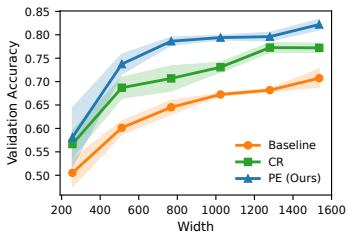  
(a) Validation Accuracy

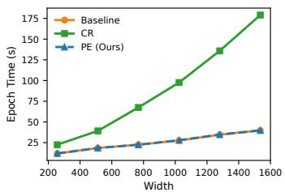  
(b) Training Time

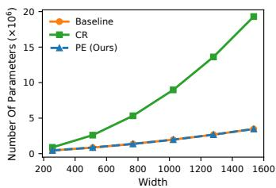  
(c) Trainable Parameter Count  
Figure 2: Additional model-width scaling results on VN-PointNet (ModelNet40). We vary model width by multiplying all channel dimensions by the same factor and plot results against the maximum channel dimension (x-axis). (a) Best validation accuracy (mean ± std over 3 seeds). (b) Training time per epoch on a single RTX A6000. (c) Trainable parameters during training. PE consistently improves the equivariant baseline in accuracy while tracking its training cost, whereas CR’s gains come with rapidly increasing overhead at larger widths.

Point-cloud size. We next vary the number of points per point cloud while keeping the network architecture fixed. Fig. 3a shows that PE outperforms the other methods across all tested input sizes while preserving the same overall scaling trend as the strict baseline. In contrast, CR incurs a substantially higher per-epoch cost across the entire range. Fig. 3b shows that the training time of all methods grows approximately linearly with the number of points, as expected since each method performs roughly fixed computation per point.

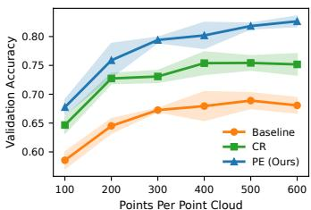  
(a) Validation Accuracy

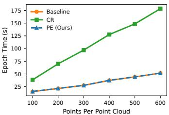  
(b) Training Time  
Figure 3: Additional input-size scaling results on VN-PointNet (ModelNet40). We vary the number of points per point cloud while keeping the architecture fixed. (a) Best validation accuracy (mean ± std over 3 seeds). (b) Training time per epoch on a single RTX A6000. All methods exhibit approximately linear scaling in epoch time with the number of points, while PE consistently exceeds the accuracy of CR at similar cost to the equivariant baseline.

## C.1.2 Why CR scales quadratically with width

An equivariant linear layer in the Vector Neurons framework mixes vector channels using scalar weights:

$$
f _ { \mathrm { e q } , W } ( X ) = W X , \qquad W \in \mathbb { R } ^ { c _ { \mathrm { o u t } } \times c _ { \mathrm { i n } } } , \quad X \in \mathbb { R } ^ { c _ { \mathrm { i n } } \times 3 } ,\tag{19}
$$

such that the parameter count is $P _ { \mathrm { e q } } = c _ { \mathrm { o u t } } c _ { \mathrm { i n } } .$ , where X is a representation of a single point in the point cloud and $c _ { \mathrm { i n } } , c _ { \mathrm { o u t } }$ are the input and output channels.

In the relaxed CR variant, an unconstrained linear map is added on top of the flattened coordinates of the vector channels. Writing vec(·) for flattening and uvec(·) for the inverse reshape,

$$
f _ { \mathrm { r e l a x e d } } ( X ) = W X + \lambda \mathrm { u v e c } ( W _ { \mathrm { n e q } } \mathrm { v e c } ( X ) ) , \qquad W _ { \mathrm { n e q } } \in \mathbb { R } ^ { ( 3 c _ { \mathrm { o u t } } ) \times ( 3 c _ { \mathrm { i n } } ) } .\tag{20}
$$

The dense term has $( 3 c _ { \mathrm { o u t } } ) ( 3 c _ { \mathrm { i n } } ) = 9 c _ { \mathrm { o u t } } c _ { \mathrm { i n } }$ parameters, hence the leading-order parameter count becomes

$$
\begin{array} { r } { P _ { \mathrm { r e l a x e d } } \approx \underbrace { c _ { \mathrm { o u t } } c _ { \mathrm { i n } } } _ { \mathrm { s t r i c t } } + \underbrace { 9 c _ { \mathrm { o u t } } c _ { \mathrm { i n } } } _ { \mathrm { d e n s e } } = 1 0 c _ { \mathrm { o u t } } c _ { \mathrm { i n } } . } \end{array}\tag{21}
$$

This implies that parameter count and training time scale quadratically with width in both the baseline and CR models, while the overhead introduced by CR also grows quadratically. We empirically verify this by fitting quadratic curves to the width-scaling results in Fig. 4.

Concretely, fitting $T ( W ) = a W ^ { 2 } + b W + c$ to epoch time yields

$$
\begin{array} { r l r } { T _ { \mathrm { B a s e l i n e } } ( W ) = 1 . 2 2 \times 1 0 ^ { - 6 } W ^ { 2 } + 0 . 0 1 9 4 W + 7 . 2 9 } & { } & { ( R ^ { 2 } = 0 . 9 9 5 8 ) , } \\ { T _ { \mathrm { C R } } ( W ) = 4 . 7 0 \times 1 0 ^ { - 5 } W ^ { 2 } + 0 . 0 3 8 8 W + 8 . 7 6 } & { } & { ( R ^ { 2 } = 0 . 9 9 9 7 ) , } \\ { T _ { \mathrm { P E } } ( W ) = 1 . 1 2 \times 1 0 ^ { - 6 } W ^ { 2 } + 0 . 0 1 9 5 W + 7 . 3 3 } & { } & { ( R ^ { 2 } = 0 . 9 9 6 2 ) . } \end{array}
$$

Similarly, fitting $P ( W ) = a W ^ { 2 } + b W + c$ to the trainable parameter counts yields

$$
\begin{array} { r l } & { P _ { \mathrm { B a s e l i n e } } ( W ) = 0 . 7 5 0 W ^ { 2 } + 1 0 1 8 . 1 7 W + 1 4 4 3 2 4 . 1 0 \qquad ( R ^ { 2 } = 1 . 0 0 0 0 ) , } \\ & { \qquad P _ { \mathrm { C R } } ( W ) = 7 . 4 9 W ^ { 2 } + 9 4 7 . 2 1 W + 1 5 8 7 1 4 . 2 0 \qquad ( R ^ { 2 } = 1 . 0 0 0 0 ) , } \\ & { \qquad P _ { \mathrm { P E } } ( W ) = 0 . 7 5 0 W ^ { 2 } + 1 0 1 8 . 1 7 W + 1 4 4 3 2 5 . 1 0 \qquad ( R ^ { 2 } = 1 . 0 0 0 0 ) . } \end{array}
$$

The fitted quadratic coefficients satisfy $7 . 4 9 / 0 . 7 5 0 \approx 9 . 9 9$ , matching the expected 10× factor above. This agreement reflects that the relaxed dense map operates on a $\mathrm { w i d t h - 3 } c _ { \mathrm { i n } }$ input and produces a width- $- 3 c _ { \mathrm { o u t } }$ output, contributing $9 c _ { \mathrm { o u t } } c _ { \mathrm { i n } }$ parameters, and corresponding compute, on top of the strict $c _ { \mathrm { o u t } } c _ { \mathrm { i n } }$ channel mixing.

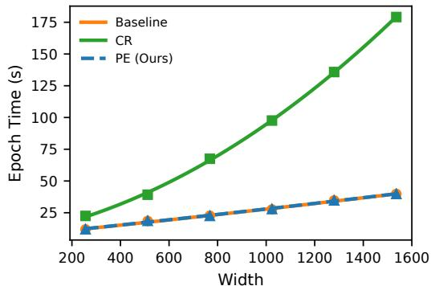

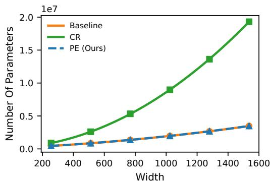  
(a) Training time per epoch vs. width  
(b) Trainable parameters vs. width  
Figure 4: Quadratic fits for VN-PointNet width scaling. We report least-squares quadratic fits to epoch time (left) and trainable parameters (right) for the strictly equivariant baseline, dense-layer constraint relaxation (CR), and positional-encoding relaxation (PE).

Run time measurements. The reported training times in Table 1 and Figs. 2 to 4 represent the total wall-clock time divided by the number of epochs. This includes periodic validation and any logging or checkpointing overhead, and therefore slightly overestimates the pure training cost. We observe a larger relative increase in training time for CR on VN-PointNet and VN-DGCNN compared to [1]. However, while the absolute CR training times are relatively close between the two works (e.g., 97.6s vs. 80s for VN-PointNet), our baseline training time is significantly lower (27.6s vs. 75s). We believe this suggests that the baseline measurements in the prior work were subject to larger fixed overheads, such as data loading or system latency, which dominated the epoch time. In our setup, where such overheads appear minimized, the computational cost of the relaxation layers constitutes a larger fraction of total runtime, resulting in a higher relative increase. This interpretation is further supported by the disparity in VN-DGCNN runtime ratios observed between [1] and [3], indicating that relative training costs are sensitive to hardware configuration and optimization regime.

## C.2 Training dynamics

We further examine whether the gains of PE are reflected in the optimization trajectory. To this end, Figs. 5 and 6 report the full training-loss and validation-accuracy curves for representative point-cloud and image-classification architectures.

For VN-PointNet on ModelNet40, the effect is pronounced. As shown in Fig. 5a, PE reduces the training loss faster than both the strict equivariant baseline and the dense-layer constraint-relaxation baseline (CR), and maintains a lower loss through most of training. The validation curves in Fig. 5b show a corresponding generalization benefit: after the initial training phase, PE consistently attains higher validation accuracy than both alternatives. These curves indicate that PE does not merely improve the final checkpoint, but changes the training trajectory in a way that makes optimization easier.

For ImageNet training with AF-XCiT, the effect is more subtle but still visible. In Fig. 6a, the strict Alias-Free model exhibits a noisier training-loss trajectory, whereas AF-XCiT with train-time PE follows a smoother curve that remains closer to standard XCiT. The validation-accuracy curves in Fig. 6b show that train-time PE also yields a small but consistent improvement over strict AF-XCiT near the end of training. Importantly, this improvement is obtained while annealing the PE coefficient to zero before evaluation, so the final model recovers the original alias-free architecture at inference.

Overall, the training curves in Figs. 5 and 6 support the central role of PE as a transient optimization aid: temporarily breaking the symmetry improves the path taken during training, while the deployed model can still recover the desired strict equivariant or invariant structure.

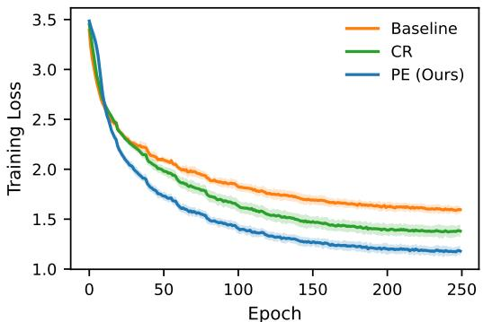  
(a) Training Loss

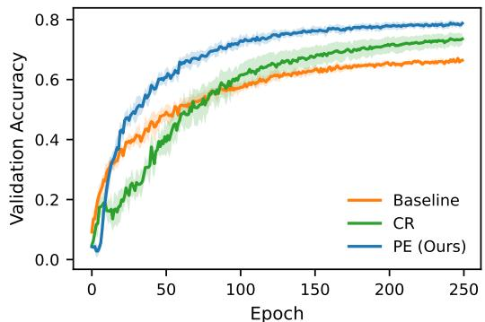  
(b) Validation Accuracy  
Figure 5: Training dynamics on VN-PointNet (ModelNet40). We compare the strict equivariant baseline, dense-layer constraint relaxation (CR), and positional-encoding relaxation (PE). (a) Training loss over epochs. (b) Validation accuracy over epochs. Validation accuracy is evaluated with PE removed. PE descends faster and reaches lower training loss through most of training, while also achieving higher validation accuracy after the initial training phase. This suggests that the improvement of PE over both the strict baseline and CR is associated with more favorable optimization dynamics.

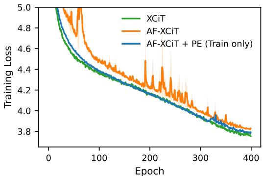  
(a) Training Loss

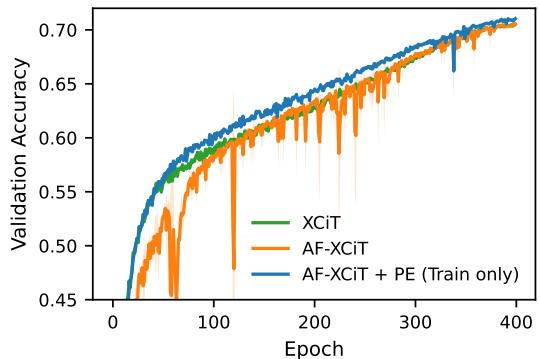  
(b) Validation Accuracy  
Figure 6: Training dynamics on ImageNet for XCiT and AF-XCiT. We compare standard XCiT, strict AF-XCiT, and AF-XCiT with train-time PE that is annealed to zero before inference. (a) Training loss over epochs. (b) Validation accuracy over epochs. Validation accuracy is evaluated with PE removed. The strict AF-XCiT model exhibits a noisier optimization trajectory, whereas AF-XCiT + PE produces smoother training curves and finishes with slightly improved validation accuracy. The PE trajectory remains close to that of standard XCiT while still recovering the original alias-free architecture at test time.

## C.3 Adversarial robustness

A central motivation for equivariant and invariant architectures is robustness to transformations in the modeled symmetry group. Here, we compare three inference regimes: strictly equivariant or invariant models, our train-time constraint-relaxation approach that removes PE at inference, and approximate-equivariant variants that keep the same symmetry-breaking PE at test time. This distinction isolates whether the optimization benefits of relaxation can be retained without deploying a model that relies on a non-equivariant positional signal. Across both translation-invariant image classification and rotation-equivariant point-cloud classification, we find that retaining PE at inference can reduce robustness to adversarial transformations aligned with the modeled symmetry, whereas removing PE at test time recovers the transformation consistency of the strict architecture.

## C.3.1 AF-XCiT

We first evaluate AF-XCiT [31], where fractional shift invariance is introduced specifically to reduce sensitivity to adversarial translations. We consider three adversarial shift attacks: cyclic shifts, crop-shift, and bilinear fractional shifts. Only the cyclic-shift attack exactly matches the symmetry group modeled by AF-XCiT. The crop-shift and bilinear-shift attacks correspond more closely to practical image translations, but they introduce boundary, cropping, or interpolation effects, and therefore are not exact elements of the cyclic translation group used by the alias-free construction.

As shown in Fig. 7, the model that keeps PE at test time is substantially more sensitive to adversarial cyclic shifts than the strict invariant variants. This confirms that retaining PE at inference breaks the intended group invariance and can reduce robustness precisely in the regime where AF-XCiT is designed to be robust. In contrast, AF-XCiT + PE (train only) closely tracks the strict AF-XCiT baseline, showing that annealing PE to zero preserves robustness to the modeled symmetry group while retaining the optimization benefit of train-time relaxation.

For the two practical translation attacks, shown in Fig. 8, the gap between the strict and relaxed variants is much smaller. This is consistent with the fact that crop-shift and bilinear-shift are off-group transformations: strict cyclic-shift invariance alone does not guarantee robustness to boundary effects, cropping, or interpolation artifacts. Thus, the robustness benefit of recovering the strict AF-XCiT architecture is most visible under the group-aligned cyclic-shift attack, while all variants behave more similarly under practical translations outside the formal symmetry group.

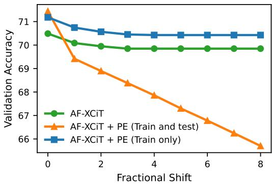  
Figure 7: Adversarial cyclic-shift robustness on ImageNet for AF-XCiT. We report validation accuracy under adversarial cyclic translations, which correspond to the symmetry group modeled by AF-XCiT. AF-XCiT + PE (train and test) keeps positional encoding at inference and is therefore only approximately invariant, leading to a substantially larger degradation under this group-aligned attack. AF-XCiT + PE (train only) anneals the positional encoding to zero and recovers the original invariant architecture, closely matching the robustness of strict AF-XCiT.

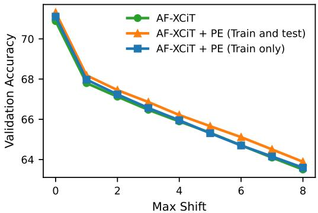  
(a) Crop-shift

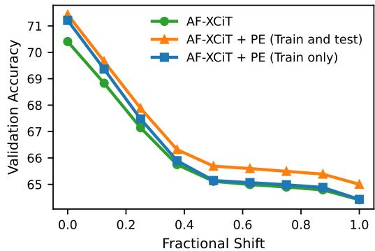  
(b) Bilinear fractional shifts  
Figure 8: Adversarial practical-translation robustness on ImageNet for AF-XCiT. We report validation accuracy under crop-shift and bilinear-shift attacks. These transformations reflect practical translations but are not exact elements of the cyclic translation group modeled by AF-XCiT because they introduce boundary, cropping, or interpolation effects. Accordingly, the strict invariant and relaxed variants behave more similarly than in the cyclic-shift setting, suggesting that exact cyclicshift invariance primarily protects against transformations aligned with the modeled symmetry group.

## C.3.2 VN-PointNet

We next evaluate whether the same principle holds for rotation-equivariant point-cloud classification. Using the VN-PointNet + PE configuration from the ablation study with a constant mix coefficient, regularization $\beta = 0 . 0 0 1$ , and learnable PE scale γ, we compare two evaluation modes of the same relaxed model. The first keeps PE at test time, yielding a relaxed model that can exploit a nonequivariant positional signal. The second removes PE at test time, yielding the projected equivariant model that recovers the original strict architecture.

The adversary samples an increasing number of random rotations and evaluates the model on the worst case among them. As shown in Fig. 9, the projected equivariant model becomes more robust as attack severity increases, even though the relaxed model can be competitive, or slightly better, under standard evaluation. This demonstrates the practical value of recovering strict equivariance at inference: PE can help optimization during training without forcing the deployed model to rely on a non-equivariant positional signal that is vulnerable under adversarial rotations.

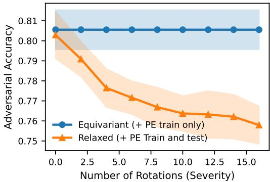  
Figure 9: Adversarial rotation robustness on VN-PointNet (ModelNet40). We compare the relaxed VN-PointNet + PE model evaluated with PE at test time against the projected equivariant model obtained by removing PE at test time. Attack severity corresponds to the number of random rotations available to the adversary. The projected equivariant model is consistently more robust under adversarial rotations, showing that recovering strict equivariance at inference can improve robustness even when the relaxed model is competitive under standard validation.

## C.4 SEGNN with PE under ACE constrained optimization

Our main SEGNN experiments follow the train-time constraint-relaxation setting of Pertigkiozoglou et al. [1], where a non-equivariant relaxation branch is introduced during training and annealed away to recover a strict equivariant model at inference. We additionally evaluate PE relaxation within the ACE framework of Manolache et al. [3]. While CR uses a prescribed relaxation schedule and regularization to progressively suppress the non-equivariant branch, ACE formulates the relaxation as a constrained optimization problem and updates the relaxation level through its optimization procedure.

In this experiment, we keep the ACE/SEGNN training protocol and optimizer unchanged, but replace each non-equivariant MLP relaxation component used by ACE with a learnable PE layer. Unlike the input-only PE used throughout the main paper, PE is therefore injected additively at every intermediate layer of SEGNN. The PE layers serve as the symmetry-breaking mechanism inside the ACE framework, and we evaluate the recovered strict SEGNN at test time. For comparison, we also evaluate input-only PE within the same ACE protocol. We also include an ACE-Linear variant, in which the MLP relaxation is replaced by a single linear layer, to separate the effect of the ACE optimization framework from the expressivity of the relaxation branch and to align more closely with CR-style linear relaxations.

The results in Tab. 9 show that PE can also serve as an effective symmetry-breaking mechanism inside a constrained-optimization relaxation framework. SEGNN with per-layer PE improves over the strict SEGNN baseline and over the ACE-Linear variant, suggesting that the gain is not only due to replacing the original MLP relaxation with a lower-capacity branch. At the same time, the original ACE-MLP result remains slightly stronger, indicating that a more expressive non-equivariant relaxation can still be beneficial in this small-scale SEGNN setting. In contrast, input-only PE does not improve over the baseline under ACE, indicating that intermediate placement can be beneficial in this setting. Overall, these results support the view that PE is a lightweight and broadly compatible relaxation mechanism: it can be used either with the simple scheduled relaxation used in the main paper or as the symmetry-breaking component inside ACE.

Table 9: N-body forecasting with SEGNN under ACE optimization. We report test MSE on final particle positions (lower is better), following the ACE reporting convention. Results for our runs are mean ± std over 5 seeds. Replacing the ACE MLP relaxation with a learnable per-layer PE improves over the strict SEGNN baseline and ACE-Linear, while remaining slightly behind the original ACE-MLP relaxation. Input-only PE does not benefit from ACE optimization.
<table><tr><td>METHOD</td><td> $\mathrm { M S E } \left( \times 1 0 ^ { - 4 } \right) \downarrow$ </td></tr><tr><td>LINEAR [9]</td><td>819</td></tr><tr><td>SE(3)-TR. [58]</td><td>244</td></tr><tr><td>RF[59] CLOFNET [60]</td><td>104</td></tr><tr><td>EGNN [9]</td><td>65 71</td></tr><tr><td>EGNO [61]</td><td>54</td></tr><tr><td>PONITA [62]</td><td> $4 3 . 0 \pm 1 . 0$ </td></tr><tr><td>SEGNN (BASELINE) [33]</td><td> $4 1 . 3 \pm 1 . 0$ </td></tr><tr><td>SEGNN ÀCE (MLP) [3]</td><td> $3 8 . 0 \pm 2 . 0$ </td></tr><tr><td>SEGNN ACE (LINEAR)</td><td> $4 0 . 5 \pm 1 . 0$ </td></tr><tr><td>SEGNN PE, INPUT ONLY (OURS)</td><td> $4 2 . 1 \pm 2 . 0$ </td></tr><tr><td>SEGNN PE, PER LAYER (OURS)</td><td> $3 9 . 5 \pm 2 . 0$ </td></tr></table>

## C.5 PE placement in Vector Neurons

Throughout the main paper, PE is injected only at the input of the network, which requires a single minimal modification to the architecture. Although the subsequent layers remain equivariant maps, the positional reference propagates through their activations, so the complete network is non-equivariant while PE is present. To examine whether injecting PE at additional layers is beneficial, we compare input-only PE with PE injected at every equivariant layer of VN-PointNet, for both the additive and concatenative variants. All other hyperparameters follow the configuration of Tab. 1.

The results in Tab. 10 show that injecting PE at every layer does not improve over input-only PE for both PE variants. This suggests that, in this setting, a single input-level symmetry-breaking signal is sufficient. In contrast, in the SEGNN experiment under ACE (Sec. C.4), per-layer PE outperforms input-only PE. Thus, injecting PE at every layer may be beneficial in some cases, but is not uniformly beneficial, and the optimal placement of PE remains architecture-dependent.

Table 10: PE placement in VN-PointNet (ModelNet40). We report accuracy (mean ± std over 5 seeds) for PE injected only at the input and at every equivariant layer, following the protocol of Tab. 1. Injecting PE at every layer does not improve over input-only PE.
<table><tr><td>INTEGRATION</td><td>INPUT ONLY</td><td>EVERY LAYER</td></tr><tr><td>ADDITIVE PE</td><td> ${ \bf 7 9 . 6 \pm 0 . 4 }$ </td><td> $7 9 . 3 \pm 1 . 6$ </td></tr><tr><td>CONCATENATIVE PE</td><td> $\mathbf { 7 9 . 3 \pm 0 . 9 }$ </td><td> $7 8 . 7 \pm 0 . 9$ </td></tr></table>

## C.6 Data efficiency

A common motivation for equivariant architectures is improved data efficiency, and a natural concern is that train-time symmetry breaking might compromise this benefit. To examine this, we train the strict VN-PointNet baseline and our additive and concatenative PE variants from Tab. 1 on random subsets containing 100%, 75%, 50%, and 25% of the ModelNet40 training set, keeping all other hyperparameters unchanged and evaluating on the full validation set.

As shown in Tab. 11, both PE variants outperform the strict baseline at every tested subset size, indicating that the benefit of PE persists as the amount of training data decreases. Thus, train-time symmetry breaking does not appear to compromise data efficiency in this experiment.

Table 11: Data efficiency of VN-PointNet with PE (ModelNet40). We report accuracy (mean ± std over 5 seeds) when training on a fraction of the training set. Both PE variants outperform the strict baseline at every training-set size.
<table><tr><td>MODEL</td><td>100%</td><td>75%</td><td>50%</td><td>25%</td></tr><tr><td>VN-POINTNET (BASELINE)</td><td> $6 7 . 5 \pm 0 . 5$ </td><td> $6 4 . 5 \pm 0 . 2$ </td><td> $6 2 . 3 \pm 1 . 1$ </td><td> $4 8 . 6 \pm 3 . 4$ </td></tr><tr><td>VN-POINTNET-PE ADD. (OURS)</td><td> ${ \bf 7 9 . 6 \pm 0 . 4 }$ </td><td> $7 7 . 2 \pm 1 . 2$ </td><td> $6 8 . 8 \pm 4 . 3$ </td><td> ${ \pm } 5 5 . 1 \pm 2 . 2$ </td></tr><tr><td> $\mathbf { V } \mathbf { N - P o I N T N E T - P E }$  CONCAT. (OURS)</td><td> $7 9 . 3 \pm 0 . 9$ </td><td> $7 5 . 5 \pm 0 . 5$ </td><td> $7 2 . 0 \pm 1 . 2$ </td><td> $5 3 . 1 \pm 4 . 4$ </td></tr></table>

## D Experimental Details

## D.1 Vector Neurons

We evaluate our Positional Encoding (PE) relaxation method on the ModelNet40 point-cloud classification task [51]. The dataset consists of point clouds from 40 categories. Following standard protocols, we represent each point cloud by a sample of 300 points [1]. We compare our method against two baselines: strictly equivariant Vector Neurons (VN) models (VN-PointNet and VN-DGCNN) [10] and the dense-layer Constraint Relaxation (CR) method [1].

Implementation Details. For a fair comparison, we utilize the training hyperparameters described by Pertigkiozoglou et al. [1]. All models are trained on a single NVIDIA RTX A6000 GPU. The specific hyperparameters utilized for the final models are listed in Tab. 12.

Rotation Regime. We follow the $S O ( 3 ) / S O ( 3 )$ protocol used by the baseline methods [1, 10]. Specifically, during both training and evaluation, input point clouds are randomly rotated using rotation matrices sampled uniformly from the continuous rotation group SO(3). This setup ensures that the task requires learning strictly rotation-robust representations, distinguishing our evaluation from gravity-aligned $( z / z )$ settings where objects share a canonical orientation.

Hyperparameter Tuning. We tune the relaxation-specific hyperparameters (regularization scale, mix coefficient scheduler, and positional encoding type) for our method. Similarly, we run the same search on the hyperparameters of the dense-layer constraint relaxation approach and report the results of the best configuration averaged over 5 random seeds. The search space used for tuning is detailed in Tab. 13. For the dense-layer CR method, we found the optimal configuration to be a triangular scheduler with regularization $\beta = 0 . 0 1$ for both architectures. The optimal hyperparameters for our PE method are listed in Tab. 14. The Vector Neurons experiments required approximately 630 GPU-hours in total.

Table 12: General Hyperparameters for Vector Neurons models.
<table><tr><td>Hyperparameter</td><td>Value</td></tr><tr><td>Dataset</td><td>ModelNet40</td></tr><tr><td>Input Points</td><td>300</td></tr><tr><td>Batch Size</td><td>32</td></tr><tr><td>Optimizer</td><td>Adam (VN-PointNet) / SGD (VN-DGCNN)</td></tr><tr><td>Learning Rate</td><td>0.001 (VN-PointNet) / 0.1 (VN-DGCNN)</td></tr><tr><td>Weight Decay</td><td> $1 0 ^ { - 4 }$ </td></tr><tr><td>Scheduler</td><td>StepLR (VN-PointNet) / Cosine Annealing (VN-DGCNN)</td></tr></table>

Table 13: Hyperparameter Search Space for Point Cloud Classification Models.
<table><tr><td>Hyperparameter</td><td>Method</td><td>Values Tested</td></tr><tr><td>Positional Encoding Type</td><td>PE (Ours)</td><td>{Sinusoidal, Fixed}</td></tr><tr><td>Mix-coef Scheduler</td><td>PE / CR</td><td>{Linear, Triangular}</td></tr><tr><td>Regularization  $\beta$ </td><td>PE / CR</td><td>{0.1, 0.05, 0.01, 0.005, 0.001}</td></tr></table>

Table 14: Optimal Relaxation Hyperparameters for Point Cloud Classification (PE Method).
<table><tr><td>Model</td><td>PE Variant</td><td>PE Type</td><td>Scheduler</td><td>Regularization  $\beta$ </td></tr><tr><td>VN-PointNet</td><td>Additive</td><td>Sinusoidal</td><td>Linear</td><td>0.001</td></tr><tr><td>VN-PointNet</td><td>Concat</td><td>Sinusoidal</td><td>Linear</td><td>0.005</td></tr><tr><td>VN-DGCNN</td><td>Additive</td><td>Fixed</td><td>Linear</td><td>0.001</td></tr><tr><td>VN-DGCNN</td><td>Concat</td><td>Sinusoidal</td><td>Triangular</td><td>0.001</td></tr></table>

## D.2 Rapidash

We evaluate our PE relaxation method on Rapidash [30], a regular group-convolution architecture for point clouds defined over the position-orientation space $\overline { { \mathbb { R } } } ^ { 3 } \times \mathbf { \overline { { S } } } ^ { 2 }$ . Following Vadgama et al. [30], we use the ModelNet40 classification task [51] and the strongest strictly equivariant Rapidash configuration considered in their ModelNet40 experiments. We compare against two Rapidash baselines: Rapidash-Eq, which uses point-cloud normals as vector features and preserves the equivariant test-time architecture, and Rapidash-Symm. Break, which additionally uses a global-frame input and therefore breaks the symmetry at inference. For a controlled comparison with an existing train-time relaxation method on the same backbone, we additionally implement the constraint relaxation (CR) of Pertigkiozoglou et al. [1] on top of Rapidash-Eq (Rapidash-CR). As in the Vector Neurons experiments, the relaxation terms are annealed to zero during training, so Rapidash-CR also recovers the strictly equivariant Rapidash-Eq architecture at inference.

Implementation Details. We use the original Rapidash ModelNet40 training regieme and hyperparameters from Vadgama et al. [30]. Training uses the original, z-aligned ModelNet40 with 1024 points, and each training sample is randomly rotated inside the model pipeline; only Rapidash-Symm. Break receives this rotation as a global-frame pose feature. All models use $C = 2 5 6$ hidden features and are trained for 120 epochs. The Rapidash backbone uses 7 layers, polynomial degree 2, 0 fiber dimensions for the $\mathbb { R } ^ { 3 }$ base, and 8 fiber dimensions for the $\mathbb { R } ^ { 3 } \times S ^ { 2 }$ base used in the equivariant

ModelNet40 variants. Optimization is performed with Adam, learning rate $1 0 ^ { - 4 }$ , weight decay $1 0 ^ { - 8 }$ and a cosine-annealing learning-rate schedule with 20 warmup epochs. All models are trained on a single NVIDIA RTX A6000 GPU. The specific hyperparameters are listed in Tab. 15.

Evaluation Protocol. We report two validation metrics. First, we evaluate on the original Model-Net40 validation set, which reflects the standard orientation-biased benchmark. Second, we evaluate on a randomly rotated validation set, where each input is transformed by a random rotation. This second metric tests whether the trained model retains the desired rotation robustness rather than exploiting a canonical-orientation bias. For Rapidash-Eq + PE, the positional signal is used only during training and is annealed to zero, so the final test-time model recovers the original strictly equivariant Rapidash-Eq architecture. The same holds for Rapidash-CR.

Hyperparameter Tuning. We tune the relaxation-specific hyperparameters for Rapidash-Eq + PE using the same search space as in the Vector Neurons experiments in Tab. 13. Specifically, we sweep over positional-encoding type, mix-coefficient scheduler, and PE-magnitude regularization strength β. The search space is shown in Tab. 16. For Rapidash-CR, we sweep the mix-coefficient scheduler and the regularization strength β over the same values, while keeping all backbone hyperparameters fixed. The selected configurations are reported in Tab. 17. The Rapidash experiments required approximately 92 GPU-hours in total.

Table 15: General Hyperparameters for Rapidash on ModelNet40.
<table><tr><td>Hyperparameter</td><td>Value</td></tr><tr><td>Dataset</td><td>ModelNet40</td></tr><tr><td>Input Points</td><td>1024</td></tr><tr><td>Task</td><td>Object classification</td></tr><tr><td>Hidden Features C</td><td>256</td></tr><tr><td>Max Epochs</td><td>120</td></tr><tr><td>Rapidash Layers</td><td> $7$ </td></tr><tr><td>Base Space</td><td> $\mathbb { R } ^ { 3 } \times S ^ { 2 }$ </td></tr><tr><td> $\mathbb { R } ^ { 3 }$  Fiber Dimensions</td><td> $_ 0$ </td></tr><tr><td> $\mathbb { R } ^ { 3 } \times S ^ { 2 }$  Fiber Dimensions</td><td>8</td></tr><tr><td>Polynomial Degree</td><td> $2$ </td></tr><tr><td>Optimizer</td><td> $\mathrm { A d a m W }$ </td></tr><tr><td>Learning Rate</td><td> $1 0 ^ { - 4 }$ </td></tr><tr><td>Weight Decay</td><td> $1 0 ^ { - 8 }$ </td></tr><tr><td>Scheduler</td><td>Cosine Annealing</td></tr><tr><td>Warmup Epochs</td><td>20</td></tr></table>

Table 16: Hyperparameter Search Space for Rapidash Relaxation (PE and CR).
<table><tr><td>Hyperparameter</td><td>Method</td><td>Values Tested</td></tr><tr><td>Positional Encoding Type</td><td>PE (Ours)</td><td>{Sinusoidal, Fixed}</td></tr><tr><td>Mix-coef Scheduler</td><td>PE/CR</td><td>{Linear, Triangular}</td></tr><tr><td>Regularization  $\beta$ </td><td>PE / CR</td><td>{0.1, 0.05, 0.01, 0.005, 0.001}</td></tr></table>

Table 17: Optimal Relaxation Hyperparameters for Rapidash (PE and CR).
<table><tr><td>Method</td><td>PE Variant</td><td>PE Type</td><td>Scheduler</td><td>Regularization  $\beta$ </td></tr><tr><td>Rapidash-Eq+PE</td><td>Additive</td><td>Sinusoidal</td><td>Linear</td><td>0.05</td></tr><tr><td>Rapidash-CR</td><td></td><td></td><td>Triangular</td><td>0.01</td></tr></table>

## D.3 Fractional Shift-Invariant Vision Transformers

We evaluate our method on the AF-XCiT-Nano architecture [31] trained on the ImageNet dataset [52]. This architecture is designed to be invariant to fractional cyclic translations, a property we relax during training by reintroducing standard Fourier Positional Encodings used in the XCiT architecture [48].

Implementation Details. All models are trained on 8 NVIDIA RTX A6000 GPUs. We use the original training hyperparameters described by Michaeli and Soudry [31]. We utilize a linear relaxation decay schedule for the first 320 epochs, followed by 80 epochs where the positional encoding coefficient λ is set to 0 to recover strict invariance. The regularization term is set to $\beta = 1 0 ^ { - 5 }$ . The full set of hyperparameters is listed in Tab. 18.

Hyperparameter Tuning. The relaxation hyperparameters (decay scheduler and regularization) were selected after tuning on the smaller Stanford Cars dataset [63]. The search space is detailed in Tab. 19. Based on this sweep, we chose the linear decay schedule and $\beta = 1 0 ^ { - 5 }$ for the final ImageNet training runs. The AF-XCiT experiments, including full training on ImageNet, required approximately 6,700 GPU-hours in total.

Table 18: General Hyperparameters for AF-XCiT (ImageNet).
<table><tr><td>Hyperparameter</td><td>Value</td></tr><tr><td>Architecture</td><td>AF-XCiT-Nano</td></tr><tr><td>Total Epochs</td><td>400</td></tr><tr><td>Relaxation Decay Epochs</td><td>320</td></tr><tr><td>Strict Equivariance Epochs</td><td>80</td></tr><tr><td>Regularization  $\beta$ </td><td> $1 0 ^ { - 5 }$ </td></tr><tr><td>Batch Size</td><td>512</td></tr><tr><td>Optimizer</td><td> $\mathrm { A d a m W }$ </td></tr><tr><td>Learning Rate</td><td> $5 \cdot 1 0 ^ { - 4 } $ </td></tr></table>

Table 19: Hyperparameter Search Space for AF-XCiT (Tuned on Stanford Cars).
<table><tr><td>Hyperparameter</td><td>Values Tested</td></tr><tr><td>Regularization  $\beta$ </td><td> $\{ 0 . 1 , 0 . 0 1 , 1 0 ^ { - 3 } , 1 0 ^ { - 4 } , 1 0 ^ { - 5 } \}$ </td></tr><tr><td>Decay Schedule</td><td>{Linear, Triangular}</td></tr></table>

## D.4 Smoke Plume Forecasting (E2CNN)

We evaluate our method on the synthetic smoke plume dataset with approximate rotation symmetry of Wang et al. [13]. The dataset consists of 64 × 64 2D smoke velocity fields simulated with PhiFlow, where the inflow locations and buoyant force directions are $C _ { 4 } { \mathrm { - s y m m e t r i c } }$ , while the buoyancy factor varies with the inflow position and breaks this symmetry. Following the official implementation of Wang et al. [13], we use 25 simulations for training and 10 held-out simulations for the Domain test set. We compare against two baselines: the strictly $C _ { 4 }$ -equivariant E2CNN [32], and RSteer [13], which relaxes the steerable-kernel constraint and remains approximately equivariant at inference. We evaluate two variants of our method on top of E2CNN: decayed PE, which anneals the PE to zero and recovers the strict E2CNN at inference, and persistent PE, which keeps the PE at inference.

Implementation Details. We build on the official codebase of Wang et al. [13] and use its Rotation training hyperparameters for all models. The E2CNN backbone uses 5 layers with $3 \times 3$ kernels and 92 regular-representation channels of $C _ { 4 }$ (approximately 0.62M parameters, compared to 5.6M for RSteer). Models receive 10 input frames, are trained with a loss over 6 autoregressive steps, and are optimized with Adam, learning rate $1 0 ^ { - 3 }$ , weight decay $4 \cdot 1 0 ^ { - 4 } $ , and a step learning-rate schedule with decay factor 0.95 per epoch. Training runs for up to 1000 epochs with the official early-stopping rule, which is applied from epoch 100 onward; in practice, all runs stopped between epochs 101 and 107. For RSteer, we use the official weight-relaxation coefficient $\alpha = \mathrm { 1 0 ^ { - 5 } }$ . For our method, we add the 2D Fourier PE described in Sec. 5 to the input velocity field. All models are trained on a single NVIDIA RTX PRO 6000 Blackwell GPU. The specific hyperparameters are listed in Tab. 20.

Evaluation Protocol. We report the 20-step autoregressive prediction RMSE on two test sets: Future, which contains later time steps (samples 200–250) of the training simulations, and Domain, which contains the held-out simulations. Samples 160–200 of the training simulations are used for validation, and samples 0–160 for training. For all models, we evaluate the checkpoint with the lowest validation RMSE. For decayed PE, the PE is removed at test time, so the evaluated model is exactly the strictly equivariant E2CNN; for persistent PE, the PE is kept at test time. We report mean ± std over 3 random seeds.

Hyperparameter Tuning. We tune the relaxation-specific hyperparameters of decayed PE on a single seed, selecting the configuration with the lowest validation RMSE with PE removed. We sweep over the mix-coefficient scheduler, the schedule length, and the PE-magnitude regularization strength β, using the same β values as in the Vector Neurons experiments. Both schedule lengths reach λ = 0 before early stopping can be applied. The search space is shown in Tab. 21, and the selected configuration is reported in Tab. 22. The persistent-PE variant uses no decay and no regularization. The backbone hyperparameters are not tuned for any of the models. The smoke plume experiments required approximately 56 GPU-hours in total.

Table 20: General Hyperparameters for Smoke Plume Forecasting (E2CNN).
<table><tr><td>Hyperparameter</td><td>Value</td></tr><tr><td>Dataset</td><td>Smoke plumes (Rotation)</td></tr><tr><td>Task</td><td>Velocity-field forecasting</td></tr><tr><td>Symmetry Group</td><td> $C _ { 4 }$ </td></tr><tr><td>Layers</td><td> $^ { 5 }$ </td></tr><tr><td>Hidden Channels</td><td> $^ { 9 2 }$ </td></tr><tr><td>Kernel Size</td><td> $3 \times 3$ </td></tr><tr><td>Input Frames</td><td>10</td></tr><tr><td>Training Rollout Steps</td><td>6</td></tr><tr><td>Test Rollout Steps</td><td>20</td></tr><tr><td>Batch Size</td><td>16</td></tr><tr><td>Max Epochs</td><td>1000 (early stopping)</td></tr><tr><td>Optimizer</td><td> $\mathbf { A d a m }$ </td></tr><tr><td>Learning Rate</td><td> $1 0 ^ { - 3 }$ </td></tr><tr><td>Weight Decay</td><td> $4 \cdot 1 0 ^ { - 4 } $ </td></tr><tr><td>Scheduler</td><td> $( \times 0 . 9 5$ </td></tr><tr><td>RSteer α</td><td>Step decay per epoch)  $1 0 ^ { - 5 }$ </td></tr></table>

Table 21: Hyperparameter Search Space for Smoke Plume PE Relaxation.
<table><tr><td>Hyperparameter</td><td>Values Tested</td></tr><tr><td>Mix-coef Scheduler</td><td>{Linear, Triangular}</td></tr><tr><td>Schedule Length (epochs)</td><td>{50, 100}</td></tr><tr><td>Regularization  $\beta$ </td><td>{0.1, 0.05, 0.01, 0.005, 0.001}</td></tr></table>

Table 22: Optimal Relaxation Hyperparameters for Smoke Plume PE Relaxation.
<table><tr><td>Variant</td><td>Scheduler</td><td>Schedule Length</td><td>Regularization  $\beta$ </td></tr><tr><td>Decayed PE</td><td>Linear</td><td>50</td><td>0.005</td></tr><tr><td>Persistent PE</td><td>None</td><td></td><td>0</td></tr></table>

## D.5 N-body Simulation (SEGNN)

We evaluate our approach on the charged-particle N-Body forecasting task [49] using the SEGNN architecture [33]. The task involves predicting the future positions of 5 charged particles in a 3D space.

Experimental Setup. Following Pertigkiozoglou et al. [1], we use a dataset split containing 3000 training samples, 2000 validation samples, and 2000 test samples. We train for 2000 epochs and report the test MSE on final particle positions for the checkpoint with the lowest validation loss. All models are trained on a single NVIDIA RTX A6000 GPU.

Hyperparameter Tuning. We perform a two-stage hyperparameter search. First, we tune the optimization hyperparameters (learning rate and weight decay) for the strictly equivariant SEGNN baseline to establish a strong baseline. Based on this sweep (Tab. 24), we fix the learning rate to $2 \cdot 1 0 ^ { - 3 }$ and weight decay to $1 0 ^ { - 8 }$ for all subsequent relaxation experiments.

Next, we tune the relaxation-specific parameters for both the baseline Constraint Relaxation (CR) method and our proposed PE method using the fixed optimization parameters. For our method, we additionally sweep over the positional encoding type. The search spaces are detailed in Tab. 25.

The optimal configurations resulting from this tuning stage are listed in Tab. 26. For the Constraint Relaxation (CR) baseline, we found that a linear schedule with $\beta = 0 . 1$ performed best. For our PE method, a triangular schedule with $\beta = 0 . 0 5$ and learned (fixed) positional encoding yielded the optimal results. The SEGNN experiments required approximately 13 GPU-hours in total.

Table 23: General Hyperparameters for SEGNN (N-Body).
<table><tr><td>Hyperparameter</td><td>Value</td></tr><tr><td>Dataset</td><td>Charged-particle N-body</td></tr><tr><td>Split (Train/Val/Test)</td><td>3000 / 2000 / 2000</td></tr><tr><td>Particles</td><td>5</td></tr><tr><td>Batch Size</td><td>100</td></tr><tr><td>Max Epochs</td><td>2000</td></tr><tr><td>Optimizer</td><td>Adam</td></tr><tr><td>Learning Rate (Final)</td><td> $2 \cdot 1 0 ^ { - 3 }$ </td></tr><tr><td>Weight Decay (Final)</td><td> $1 0 ^ { - 8 }$ </td></tr></table>

Table 24: Optimization Hyperparameter Search Space (SEGNN Strict Baseline).
<table><tr><td>Hyperparameter</td><td>Values Tested</td></tr><tr><td>Learning Rate Weight Decay</td><td> $\left\{ 5 \cdot 1 0 ^ { - 4 } , 8 \cdot 1 0 ^ { - 4 } , 1 \cdot 1 0 ^ { - 3 } , 2 \cdot 1 0 ^ { - 3 } , 5 \cdot 1 0 ^ { - 3 } \right\}$   $\{ 1 0 ^ { - 1 2 } , 1 0 ^ { - 8 } , 1 0 ^ { - 6 } , 1 0 ^ { - 4 } \}$ </td></tr></table>

Table 25: Relaxation Hyperparameter Search Space (SEGNN).
<table><tr><td>Hyperparameter</td><td>Method</td><td>Values Tested</td></tr><tr><td>Mix-coef Scheduler</td><td>PE / CR</td><td>{Linear, Triangular}</td></tr><tr><td>Regularization  $\beta$ </td><td>PE / CR</td><td>{0.1, 0.05, 0.01, 0.005, 0.001}</td></tr><tr><td>PE Type</td><td>PE (Ours)</td><td>{Sinusoidal, Learned}</td></tr></table>

Table 26: Optimal Relaxation Hyperparameters for SEGNN.
<table><tr><td>Method</td><td>Scheduler</td><td>Regularization  $\beta$ </td><td>PE Type</td></tr><tr><td>CR</td><td>Linear</td><td>0.1</td><td></td></tr><tr><td>PE (Ours)</td><td>Triangular</td><td>0.05</td><td>Learned</td></tr></table>

## E Dataset Assets, Licenses, and Terms of Use

All datasets used in this work are public and widely used benchmarks in academic machine learning research. We cite the original dataset papers in the main text and summarize the known license or terms-of-use information below, to the best of our knowledge. We use these datasets only for academic research and evaluation, and we do not redistribute the original dataset contents in our supplementary material.

• ModelNet40 [51]. We use ModelNet40 for point-cloud classification experiments with Vector Neurons and Rapidash. In our experiments, ModelNet40 is accessed through Py-Torch Geometric. The PyTorch Geometric loader code is released under the MIT license. The loader downloads the original ModelNet40 CAD dataset from the official Princeton ModelNet URL. The ModelNet website states that all CAD models were downloaded from the Internet, that the original authors hold the copyright of the CAD models, that the labels were obtained via Amazon Mechanical Turk and are provided freely, and that the dataset is provided for the convenience of academic research only. We use ModelNet40 only for academic evaluation and do not redistribute the raw CAD models.

• ImageNet / ImageNet-1k [52]. We use ImageNet for image classification experiments with AF-XCiT and XCiT. ImageNet is publicly accessible under the ImageNet access agreement. The ImageNet terms specify non-commercial research and educational use, no warranty, user responsibility for use of copyrighted images, and access sharing only with collaborators who agree to the same terms. We use ImageNet only for non-commercial academic benchmarking and do not redistribute the images.

• Smoke plume (rotation) [13]. We use the synthetic smoke plume dataset with approximate rotation symmetry for the E2CNN. The dataset is simulated with the PhiFlow fluid solver, using the data-generation notebook released with the official code of Wang et al. [13], which also provides a preprocessed copy. To the best of our knowledge, the official repository does not include an explicit license file; PhiFlow is released under the MIT license. The dataset is synthetic and contains no human-subject or sensitive data. We use it only for academic evaluation and do not redistribute it.

• Stanford Cars / Cars196 [63]. We use Stanford Cars for hyperparameter tuning of the AF-XCiT relaxation schedule and regularization before the final ImageNet runs. Stanford Cars is a public and widely used academic fine-grained recognition benchmark. To the best of our knowledge, we did not find an explicit dataset-specific license in the current public metadata; standard dataset loaders and catalog entries provide the citation and dataset description, while the original hosting URL is no longer reliably available. We use the dataset only for academic hyperparameter tuning and do not redistribute the images.

• Charged-particle N-body benchmark [49]. We use the charged-particle N-body benchmark for SEGNN forecasting experiments. This is a synthetic benchmark generated following the Neural Relational Inference (NRI) setup. The official NRI code release provides scripts to generate charged-particle simulations and is released under the MIT license. We generate and use the synthetic benchmark for academic evaluation and do not introduce or redistribute any human-subject or sensitive data.