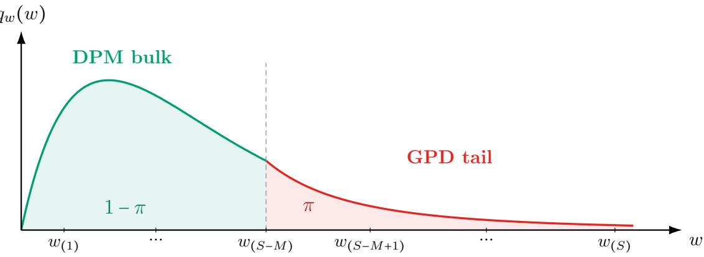
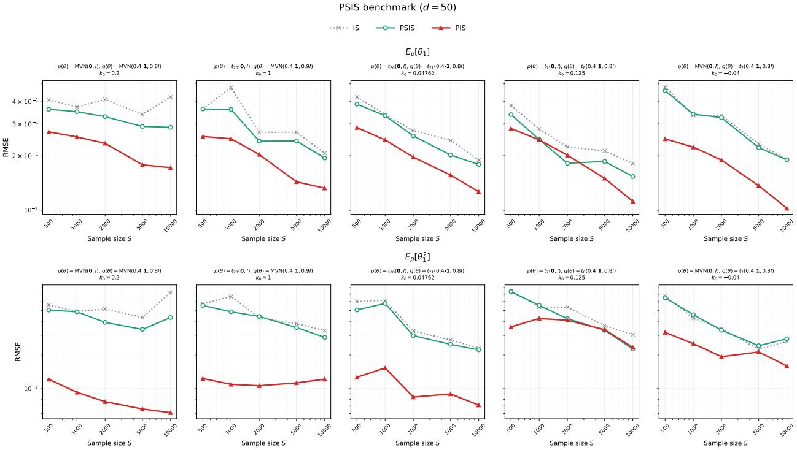
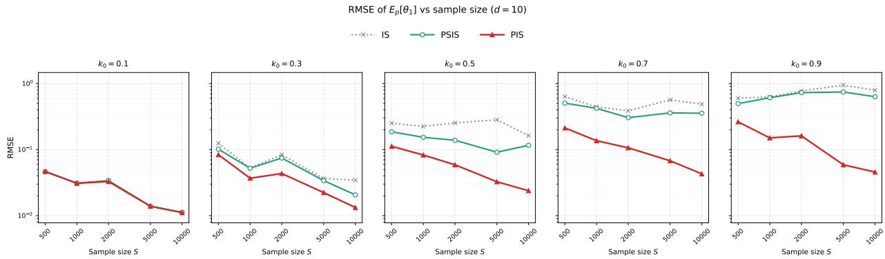
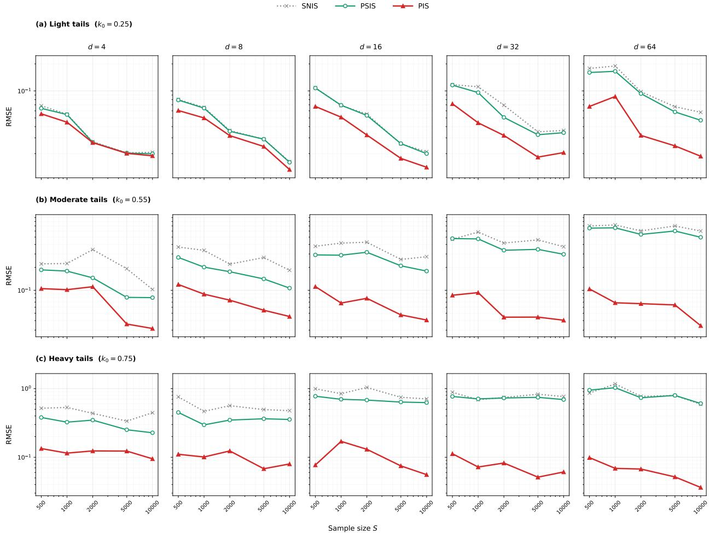
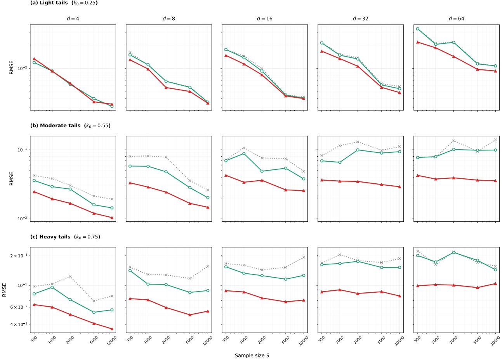
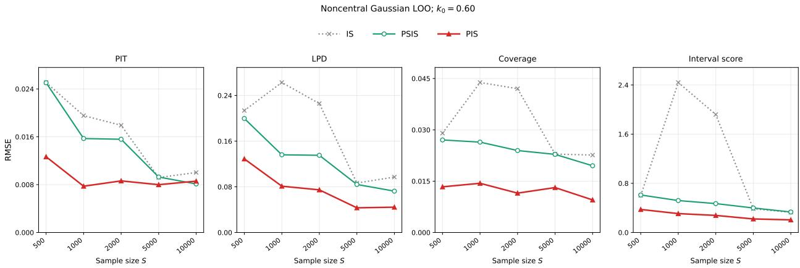
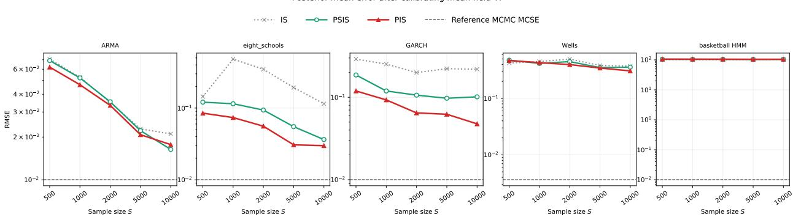
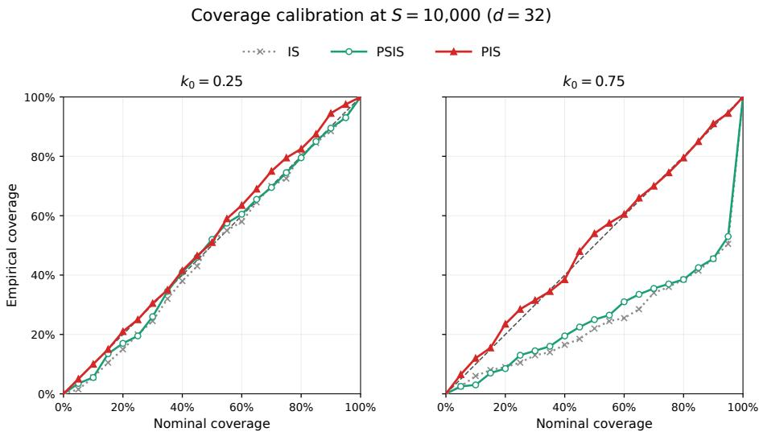
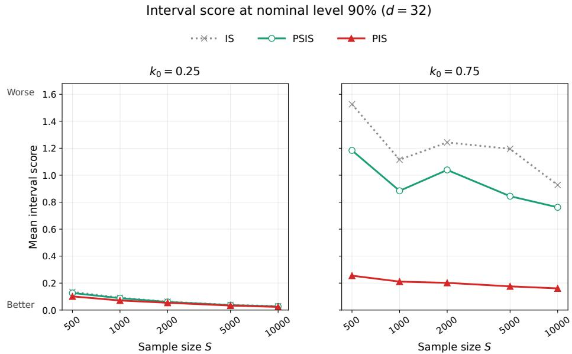

# Post-stratified importance sampling

Yuling Yao

Sergei Tikhonov \*

November 4, 2026

## Abstract

Importance sampling is a building block of modern statistical computing, but the weighted estimate is prone to high or infinite variance. Moreover, its empirical standard error is often unreliable, leaving importance sampling without practical uncertainty quantification. Motivated by multilevel regression and poststratification (MRP) in survey sampling, we propose poststratified importance sampling (PIS) for estimating target expectations from proposal draws. PIS reformulates arbitrarily high-dimensional weighting into two one-dimensional probabilistic modeling problems: regression for the conditional mean given the importance ratio and marginal density estimation for the importance ratio. Diferent modeling choices yield a family of PIS estimators, encompassing ordinary importance sampling as a special case. We develop a model-based implementation that combines one-dimensional Gaussian process regression for the conditional mean and score-informed heavy-tailed density estimation for the marginal law, using both the observed weights and the available density evaluations. We study the oracle gains of PIS and establish consistency under general and model-specific conditions. Simulations and applications to cross-validation demonstrate improvements in estimation accuracy and uncertainty quantification.

Keywords: Bayesian computation, importance sampling, heavy-tailed density, poststratification, score-based Monte Carlo, uncertainty quantification

## 1. Introduction

The task of importance sampling. Consider the general task of computing expectations: we are given a target density $p ( \theta )$ on $\theta \in \mathbb { R } ^ { d }$ , and our goal is to compute the target expectation of an arbitrary scalar function $h ( \theta )$

$$
\mu = \mathbb { E } _ { p } [ h ( \theta ) ] : = \int _ { \mathbb { R } ^ { d } } h ( \theta ) p ( \theta ) d \theta .\tag{1}
$$

Instead of sampling from the target $p ,$ we draw an independent and identically distributed (IID) sample from a given proposal density q,

$$
\theta _ { 1 } , \theta _ { 2 } , \ldots , \theta _ { S } \sim q ( \theta ) .
$$

In practice, target and proposal densities may be known only up to normalizing constants. We write p and $q$ for the evaluable, possibly unnormalized density functions, and use $\mathbb { E } _ { p } [ \cdot ]$ for expecta [ ]tion under the normalized distribution proportional to p. Define the importance ratio function

$$
w = r ( \theta ) : = \frac { p ( \theta ) } { q ( \theta ) } .
$$

Here we denote $r ( \cdot ) : \mathbb { R } ^ { d }  [ 0 , \infty )$ as a deterministic function of $\theta ,$ and $w$ as the induced scalar ( ) [random variable. We also write $\boldsymbol { w _ { s } } = \boldsymbol { r } ( \boldsymbol { \theta _ { s } } )$ , the s-th realized importance weight sample.

Depending on whether $p$ and $q$ are normalized, the classical importance sampling (IS) or selfnormalized importance sampling estimate of the target expectation $\mu$ is the weighted sample mean

$$
\mathbb { E } _ { p } [ h ( \theta ) ] = \left\{ \begin{array} { l l } { \displaystyle \hat { \mu } _ { \mathrm { I S } } : = S ^ { - 1 } \sum _ { s = 1 } ^ { S } w _ { s } h ( \theta _ { s } ) , } & { \mathrm { w h e n ~ n o r m a l i z e d , } } \\ { \displaystyle \hat { \mu } _ { \mathrm { S N I S } } : = \frac { \sum _ { s = 1 } ^ { S } w _ { s } h ( \theta _ { s } ) } { \sum _ { s = 1 } ^ { S } w _ { s } } , } & { \mathrm { w h e n ~ u n n o r m a l i z e d . } } \end{array} \right.\tag{2}
$$

Why importance sampling is still important, and why it is fragile. Beyond its use as a stand-alone estimator, importance sampling often serves as a reweighting step within larger downstream algorithms, many of which are widely used in modern statistical workflows. To name a few, In Bayesian model evaluation, the leave-one-out (LOO) predictive quantities are expectations under the leaveone-out posterior $p _ { i } ( \theta ) \propto \pi ( \theta \mid y _ { - i } )$ . Exact LOO requires refitting the model for deleting every ( ) ( ∣ )data point. Instead, importance-sampling-based LOO (Gelfand et al., 1992; Peruggia, 1997; Vehtari et al., 2017; Magnusson et al., 2019; Bürkner et al., 2020) reuses the full posterior proposal $q ( \theta ) \propto \pi ( \theta \mid y )$ weighted by the inverse likelihood $r _ { i } ( \theta ) = \pi ^ { - 1 } ( y _ { i } | \theta )$ . In recursive Bayesian com-( ) ( ∣ ) ( ) = ( ∣ )puting (Doucet et al., 2001; Chopin, 2002; Hooten et al., 2021), importance sampling is used to approximate expectations under a sequence of on-line targets. Draws from a previous distribution are reweighted by an incremental likelihood factor $r _ { i } ( \theta ) = \pi ( \theta \mid y _ { i } )$ to approximate the updated ( ) = ( ∣ )posterior expectations. In sensitivity analysis, given posterior draws under one fixed model, prior, temperature, or dataset, importance sampling can approximate expectations under a tilted posterior (Smith and Gelfand, 1992; Kallioinen et al., 2024). In approximate inference, importance sampling reweighs variational samples for better calibration and diagnostics (Yao et al., 2018b). Conversely, using importance sampling inside variational objective tightens the evidence lower bound and leads to importance weighted variational inference (Burda et al., 2016; Domke and Sheldon, 2018).

Despite its wide deployment and asymptotic consistency, the weighted estimate (2) remains fragile (Vehtari et al., 2024). The usual central limit theorem requires a finite second moment of the weighted integrand, which often fails in practice. For example, even for a pair of Gaussian target and proposal, $p = \mathrm { n o r m a l } ( 0 , \sigma _ { p } )$ and $q = \mathrm { n o r m a l } ( 0 , \sigma _ { q } )$ , then $\mathbb { E } _ { q } \big [ w ^ { 2 } \big ] = \infty$ as soon as $2 \sigma _ { q } ^ { 2 } \leq \sigma _ { p } ^ { 2 } .$ That = ( ) =is, under a modest scale mismatch, the $S ^ { - 1 / 2 }$ ( ) [ ] = ≤Monte Carlo convergence rate no longer applies to the IS estimate. In general, the required sample size S grows exponentially in the target-proposal discrepancy (Chatterjee and Diaconis, 2018); when this discrepancy scales linearly with parameter dimension d, the sample size S is required at the order exp d . This curse of dimensionality rapidly ( )makes direct importance weighting prohibitive in a moderate dimensional space.

Uncertainty quantification is challenging. Beyond its instability and potentially high or infinite variance, the weighted estimator (2) often lacks reliable uncertainty quantification. The usual sample variance estimate (Geweke, 1989) relies on the weighted empirical second moments:

$$
\widehat { \mathrm { V a r } } ( \hat { \mu } ) = \left\{ \begin{array} { l l } { \displaystyle \frac { 1 } { S ^ { 2 } } \sum _ { s = 1 } ^ { S } \left( w _ { s } h ( \theta _ { s } ) - \hat { \mu } _ { \mathrm { I S } } \right) ^ { 2 } , } & { \mathrm { n o r m a l i z e d ~ I S , } } \\ { \displaystyle \frac { \sum _ { s = 1 } ^ { S } w _ { s } ^ { 2 } \left( h ( \theta _ { s } ) - \hat { \mu } _ { \mathrm { S N I S } } \right) ^ { 2 } } { \left( \sum _ { s = 1 } ^ { S } w _ { s } \right) ^ { 2 } } , } & { \mathrm { s e l f - n o r m a l i z e d ~ I S . } } \end{array} \right.\tag{3}
$$

This variance estimate can be unreliable for three reasons: (i) The underlying population variance may not exist. When $\mathbb { E } _ { q } \big [ w ^ { 2 } \big ] = \infty$ , the variance of the IS estimate can be infinite even for bounded $h ,$ and the sample variance is meaningless. (ii) Even when the variance is finite, when the importance ratios w are heavy-tailed, this empirical variance is dominated by a small number of extreme weights w, even more severely than the mean as the variance involves the quadratic weight $w ^ { 2 }$ . (iii) The self-normalized IS estimator is a ratio of dependent random variables and is $O ( 1 / S )$ biased. The empirical variance does not fully assess the mean squared error.

The limitation of the sample variance has motivated several alternative IS diagnostics. Pareto smoothed importance sampling (PSIS, Vehtari et al., 2024) instead reports the estimated Pareto tail index $\hat { k }$ of the marginal distribution of $w ,$ , while Chatterjee and Diaconis (2018) proposes to monitor max ${ w _ { s } } / \sum w _ { s }$ These diagnostics appear more stable than the classical efective sample /size (ESS, Kong, 1992; Elvira et al., 2022), and are useful qualitative indicators of whether an IS estimate should be trusted at all, but they still do not provide a calibrated uncertainty statement or confidence interval for the IS estimate. For this dificulty, the Monte Carlo uncertainty is often ignored or reduced to a diagnostic warning in many current statistical workflows involving importance sampling, such as model comparison, selection, and averaging $\left( \mathrm { e . g . } \right.$ ., Vehtari et al., 2017; Yao et al., 2018a), despite the necessity to propagate it to downstream decision analysis.

Proposed method: Outline of poststratified importance sampling (PIS). We aim at the general importance sampling task: we can evaluate the continuous but potentially unnormalized target and proposal densities $p ( \theta )$ and $q ( \theta )$ , and we have IID draws $\theta _ { 1 } , \theta _ { 2 } , \ldots , \theta _ { S } \sim q ( \theta )$ . Our new strategy is ( ) ( )to continuously stratify the distribution by the scalar importance ratio $w = r ( { \boldsymbol { \theta } } )$ . Then we rearrange the target expectation using the law of total expectation

$$
\mathbb { E } _ { p } [ h ( \theta ) ] = \mathbb { E } _ { p } \left[ \mathbb { E } _ { p } [ h ( \theta ) \mid w ] \right] = \int _ { 0 } ^ { \infty } p _ { w } ( w ) \mathbb { E } _ { p } [ h ( \theta ) \mid w ] d w .\tag{4}
$$

Here $\mathbb { E } _ { p } [ h ( \theta ) \mid w ]$ denotes the conditional expectation given $r ( \theta ) = w$ , and $p _ { w } ( w )$ denotes the [ ( ) ∣ ]marginal density of the scalar random variable w, both under $\theta \sim p ;$ ( )see Section 1.1 for a formal notation.

We develop poststratified importance sampling (PIS), a framework for computing $\mathbb { E } _ { p } [ h ( \theta ) ]$ based [ ( )on the identity (4). It follows the motivation of multilevel regression and poststratification $( \mathrm { M R P } ,$ Gelman and Little, 1997) in survey sampling. While MRP partitions a population into demographic strata and averages fitted stratum-level outcomes, PIS uses the scalar importance ratio $w = r ( { \boldsymbol { \theta } } )$ as a = ( )continuous stratification variable. This representation admits a Rao-Blackwellization interpretation: we replace the original integrand $h ( \theta )$ with the conditional expectation $\mathbb { E } _ { p } [ h ( \theta ) \mid w ]$ , and then average over the marginal law $p _ { w } ( w )$

( )Both the (a) conditional expectation and (b) marginal law are unknown and must be estimated. Diferent modeling choices for these two objects yield a family of PIS estimators by plugging in (4),

$$
\hat { \mu } _ { \mathrm { P I S } } = \int _ { 0 } ^ { \infty } \hat { p } _ { w } ( w ) \hat { \mathbb { E } } _ { p } [ h ( \theta ) \mid w ] d w .\tag{5}
$$

This general PIS framework recovers the classical importance weighting (2) as a degenerate special case. That is, if we adopt a “model-free” implementation,

• estimate the conditional expectation using an unsmoothed estimate $\hat { \mathbb { E } } _ { p } [ h ( \theta ) \mid w _ { i } ] \approx h ( \theta _ { i } )$

• estimate the marginal law empirically $\hat { q } _ { w } ( w ) \approx S ^ { - 1 } \sum _ { i = 1 } ^ { S } \mathbf { 1 } ( w = w _ { i } )$

≈ =For the equivalence that we will develop in Section (2), this empirical $\hat { q } ( w )$ implies ${ \hat { p } } ( w ) ~ =$ ${ \cal S } ^ { - 1 } w _ { i } \sum _ { i = 1 } ^ { S } { \bf 1 } ( w = w _ { i } )$ (when normalized) or $\begin{array} { r } { \hat { p } ( w ) \ \approx \ \sum _ { i = 1 } ^ { S } w _ { i } \mathbf { 1 } ( w = w _ { i } ) / \sum _ { i = 1 } ^ { S } w _ { i } } \end{array}$ ) ( ) =(when unnormal-= ( = )ized). Thus, plugging-in this $\hat { \mathbb { E } } _ { p } [ h ( \theta ) \mid w ]$ and $\hat { p } ( w )$ ≈ = ( = ), the PIS estimate $\hat { \mu } _ { \mathrm { P I S } }$ becomes the classical [ ( ) ∣ ](self-normalized) importance weighting (2).

Unsurprisingly, both $\mathbb { E } _ { p } [ h ( \theta ) \mid w ]$ and $q _ { w } ( w )$ can admit more eficient estimates:

• The unsmoothed conditional mean estimate amounts to a degenerating, interpolating regression. It infers the conditional mean at input $w _ { s }$ using a single observation $h ( \theta _ { i } )$ , without pooling information across samples.

• The empirical estimate puts mass only on the observed weights, applies no tail smoothing, and discards additional information available from the density evaluation. Its extrapolation can be especially poor when $q _ { w } ( w )$ is heavy-tailed.

These limitations motivate regularization and information sharing. We implement PIS in three steps:

1. Conditional mean via one-dimensional regression. We fit a model-based regression to estimate the conditional expectation $\mathbb { E } _ { p } [ h ( \theta ) \mid w _ { i } ]$ using θ samples from q, typically a [ ( ) ∣ ]Gaussian process regression. This step uses the identity $\mathbb { E } _ { p } [ h ( \theta ) \mid w ] = \mathbb { E } _ { q } [ h ( \theta ) \mid w ]$

2. Marginal law via one-dimensional score-based heavy-tail estimation. We estimate the marginal density $p _ { w } ( w )$ and $q _ { w } ( w )$ using a flexible Dirichlet process mixture with a gen-( ) ( )eralized Pareto tail for the distribution of w. Our density estimation not only uses the sample $w _ { i }$ , but also incorporates score evaluations of the densities $p ( \theta _ { i } )$ and $q ( \theta _ { i } )$ , and this score information improves the tail estimation.

3. Aggregation via one-dimensional quadrature. After obtaining functional estimates of $\mathbb { E } _ { p } [ h ( \theta ) \mid \boldsymbol { w } ]$ and $p _ { w } ( w )$ , we adopt one-dimensional numerical integration in (5) to obtain the [ ( ) ∣ ]PIS estimate.

The modeling formulation also supports uncertainty quantification and model checking. The modeling formulation also supports uncertainty quantification and model checking. Monte Carlo draws propagate uncertainty in the regression and marginal density estimates to the final PIS estimate, while posterior predictive checks can assess the adequacy of both models.

## 1.1. Measure-theoretic background of the conditional and marginal laws

When $p ( \theta )$ and $q ( \theta )$ are unnormalized, $\begin{array} { r } { Z _ { p } = \int _ { \mathbb { R } ^ { d } } p ( \theta ) } \end{array}$ dθ and $\begin{array} { r } { Z _ { q } = \int _ { \mathbb { R } ^ { d } } q ( \theta ) } \end{array}$ dθ denotes the unknown ( ) ( )normalizing constants. When we write $\theta \sim p$ or $\theta \sim q ,$ = ∫ ( )we mean that θ is distributed from the normalized densities $p / Z _ { p }$ or $q / Z _ { q }$

/ /Throughout this paper, when $\theta \sim p$ , we write $p _ { w } ( w )$ for the marginal density of $w = r ( { \boldsymbol { \theta } } )$ , and $p ( \theta \mid w )$ ∼for the conditional density of θ given $r ( \theta ) = w$ ). Likewise, $q _ { w } ( w )$ and $q ( \theta \mid w )$ = ( )denote the ( ∣ ) ( ) =corresponding marginal and conditional densities under $\theta \sim q$ ( ) ( ∣ ). Since w is a deterministic function of $\theta .$ ∼, the formal definition of such marginal and conditional laws requires geometric measure theory $( \mathrm { e . g . }$ , Evans and Gariepy, 2015). Below, we briefly review this construction so that our notation is self-contained.

In this paper, we work with continuous distributions on $\mathbb { R } ^ { d }$ equipped with the Borel σ-algebra and Lebesgue measure. Let $p$ and q be two smooth, nonnegative, integrable functions on $\mathbb { R } ^ { d }$ , with finite normalizing constants $Z _ { p } , Z _ { q }$ and full support on $\mathbb { R } ^ { \bar { d } }$ . Define the potentially unnormalized importance ratio function $w = r ( \theta ) = p ( \theta ) / q ( \theta )$ . Given any value $w \in [ 0 , \infty )$ , define the w-level set

$$
\Sigma _ { w } = \{ \theta \in \mathbb { R } ^ { d } : r ( \theta ) = w \} .
$$

We assume that, for almost every $w .$ , the level set $\Sigma _ { w }$ is non-singular; that is, $\nabla r ( \theta ) \neq 0$ for all $\theta \in \Sigma _ { w }$ . This non-singularity makes $\Sigma _ { w }$ a smooth $( d - 1 )$ -dimensional submanifold.

Compared with regular importance sampling (2), the additional assumptions are that (a) the importance ratio map r is smooth , and (b) the level set is non-singular. The former assumption can fail, for example, when using a step-function proposal to approximate a normal density. The latter assumption can fail, for example, when the importance ratio $r ( \cdot )$ is constant. Other than such edge ( )cases, these mild conditions hold in nearly all importance sampling applications we consider.

Marginal law. Let $P _ { W }$ denote the pushforward of the probability measure $\{ p ( \theta ) / Z _ { p } \} d \theta$ under the map r. That is, for every Borel set $A \subset [ 0 , \infty )$ ，

$$
P _ { W } ( A ) = \int _ { \{ \theta : r ( \theta ) \in A \} } \frac { p ( \theta ) } { Z _ { p } } d \theta .
$$

Conditional expectation. For any integrable function $h ,$ a version of the conditional expectation of $h ( \theta )$ given $r ( \theta ) = w$ under $p$ is a measurable function of $w ,$ satisfying, for every Borel set $A \subset [ 0 , \infty )$

$$
\int _ { \{ \theta : r ( \theta ) \in A \} } h ( \theta ) \frac { p ( \theta ) } { Z _ { p } } d \theta = \int _ { A } \mathbb { E } _ { p } [ h ( \theta ) \mid r ( \theta ) = w ] P _ { W } ( d w ) .\tag{6}
$$

Taking $A = [ 0 , \infty )$ in (6) gives the total-expectation formula

$$
\mathbb { E } _ { p } [ h ( \theta ) ] = \int _ { 0 } ^ { \infty } \mathbb { E } _ { p } [ h ( \theta ) \mid r ( \theta ) = w ] P _ { W } ( d w ) .
$$

Its validity follows directly from the definition; no application of Fubini’s theorem is required.

Further define $P _ { p } ( d \theta \mid w )$ , a version of the conditional probability measure of θ given $r ( \theta ) = w$ under $p ,$ ( supported on $\Sigma _ { w }$ ), such that for any integrable function $h ,$

$$
\mathbb { E } _ { p } [ h ( \theta ) \mid r ( \theta ) = w ] = \int _ { \Sigma _ { w } } h ( \theta ) P _ { p } ( d \theta \mid r ( \theta ) = w ) .
$$

Surface measure. One key mathematical device for the score-based estimator in this paper is the coarea formula, which turns the abstract conditional measure on the level set into an explicit surface-measure representation. Let dσ $_ w ( \theta )$ denote the $( d - 1 )$ -dimensional surface measure on $\Sigma _ { w }$ Then, for any Borel sets $A \subset [ 0 , \infty )$ and $B \subset \mathbb { R } ^ { d }$ ( ), the coarea formula gives

$$
\int _ { \{ \theta : r ( \theta ) \in A , \ \theta \in B \} } \frac { p ( \theta ) } { Z _ { p } } d \theta = \int _ { A } \left[ \int _ { \Sigma _ { w \cap B } } \frac { p ( \theta ) } { Z _ { p } } \frac { 1 } { \| \nabla r ( \theta ) \| } d \sigma _ { w } ( \theta ) \right] d w .\tag{7}
$$

As a consequence, when $P _ { W }$ admits a density with respect to Lebesgue measure on $\mathbb { R }$ , denoted by $p _ { w } ( w )$ , we have

$$
p _ { w } ( w ) = \int _ { \Sigma _ { w } } \frac { p ( \theta ) } { Z _ { p } } \frac { 1 } { \| \nabla r ( \theta ) \| } d \sigma _ { w } ( \theta ) .\tag{8}
$$

The conditional density of θ given $r ( \theta ) = w$ with respect to the surface measure is

$$
p ( \theta | r ( \theta ) = w ) = \frac { p ( \theta ) \| \nabla r ( \theta ) \| ^ { - 1 } } { \int _ { \Sigma _ { w } } p ( \tilde { \theta } ) \| \nabla r ( \tilde { \theta } ) \| ^ { - 1 } d \sigma _ { w } ( \tilde { \theta } ) } , \qquad \theta \in \Sigma _ { w } .\tag{9}
$$

In this paper, we reserve w to denote the importance weight. When there is no ambiguity, we write $p ( \theta \mid w )$ and $\mathbb { E } _ { p } [ h ( \theta ) \mid w ]$ as shorthand for $p ( \theta \mid r ( \theta ) = w )$ and $\mathbb { E } _ { p } [ h ( \theta ) \mid r ( \theta ) = w ]$ respectively. ( ∣ ) [ (The analogous notation $q ( \theta \mid w )$ and $\mathbb { E } _ { q } [ h ( \theta ) \mid \mathpalette { w } ]$ ( ∣ ( ) = ) [ ( ) ∣ ( ) = ]is used under the proposal distribution $q .$

## 2. Proposed method

We propose poststratified importance sampling (PIS). It implements the conditioning strategy in (5), and consists of three steps: (i) estimation of the conditional expectation, (ii) marginal density, and (iii) numerical integral. Below, we develop a general framework that reformulates importance sampling into learning tasks and provides a practical recipe for these three steps.

## 2.1. Conditional expectation via regression

The first step is to estimate $\mathbb { E } _ { p } [ h ( \theta ) \mid w ]$ , the conditional expectation under the target $p .$ To [ ( ) ∣ ]emphasize that it is a function of w, we write

$$
m ( w ) : = \mathbb { E } _ { p } [ h ( \theta ) \mid w ] .
$$

The observed pairs $( w _ { s } , h ( \theta _ { s } ) )$ suggest estimating the conditional mean by regression. Although ( ( ))the draws come from the proposal, the following theorem shows that the conditional mean is the same under $p$ and $q ,$ so the regression requires no importance weighting.

Theorem 1. Let p and q be probability densities on $\mathbb { R } ^ { d }$ with full support, and let $W = p ( \theta ) / q ( \theta )$ Then:

(1) For every integrable measurable function $h _ { . }$

$$
{ \mathbb E } _ { p } [ h ( \theta ) \mid W = w ] = { \mathbb E } _ { q } [ h ( \theta ) \mid W = w ] .\tag{10}
$$

(2) For every integrable function h, suppose that a map $T = T ( \theta )$ satisfies

$$
\mathbb { E } _ { p } [ h ( \theta ) \mid T = t ] = \mathbb { E } _ { q } [ h ( \theta ) \mid T = t ]\tag{11}
$$

Then T determines W: there exists a measurable function α such that $W = \alpha ( T ( \theta ) )$ almost surely.

With the proposal sample $\theta _ { s } \sim q$ , we obtain training pairs

$$
\mathcal { D } _ { q } = \{ \left( h _ { s } : = h ( \theta _ { s } ) , w _ { s } : = r ( \theta _ { s } ) \right) | 1 \leq s \leq S \} ,
$$

on which we fit a Gaussian process (GP) regression, with, for example, a squared exponential kernel:

$$
h _ { i } \mid m \sim \operatorname { n o r m a l } ( m ( w _ { i } ) , \sigma ) ; \quad m ( w ) \sim \mathcal { G P } ( 0 , K ( w , w ^ { \prime } ) ) , \quad K ( w , w ^ { \prime } ) = \tau ^ { 2 } \exp \left( - \frac { | w - w ^ { \prime } | ^ { 2 } } { \rho ^ { 2 } } \right) .
$$

This basic GP model can be readily extended when suggested by the data. For example, we can accommodate heteroskedasticity by modeling residual scale, $\sigma = \sigma ( w )$

When the integrand $h ( \theta )$ = ( )is not continuous, it is straightforward to go beyond the Gaussian ( )likelihood. For example, when $h ( \theta )$ is binary, we use a Bernoulli-likelihood GP to estimate $\operatorname* { P r } ( h ( \theta ) =$ $1 | w )$ .

)More generally, the regression can be performed on any bijective transformation of the weight, $\psi ( w )$ , as conditioning on w is equivalent to conditioning on $\psi ( w )$ . The transformation $\psi ( w )$ ( ) ( ) ( )becomes a model choice and can, in principle, be informed by the data. In practice, for numerical stability, we often use the log-weight scale, $\psi ( w ) = \log w$ , in this Gaussian process regression.

Given evaluation points $( \tilde { w } _ { 1 } , \dots , \tilde { w } _ { L } )$ ( ) =, the fitted GP provides posterior means, covariances, and ( )joint posterior draws of the conditional mean function $( m ( \tilde { w } _ { 1 } ) , \dots , m ( \tilde { w } _ { L } ) ) \mid \mathcal { D } _ { q }$ . We use these draws ( ( )to propagate regression uncertainty through the final PIS estimator.

## 2.2. Marginal density estimation with a Pareto-tailed Dirichlet process mixture

The second step is to estimate $p _ { w } ( w )$ , the marginal density of w under p. Although w is one-( )dimensional, this density estimation can be challenging for two reasons:

(a) Available draws of $w _ { i } = r ( \theta _ { i } )$ are under the proposal $\theta \sim q ,$ not the target.

(b) This $p _ { w } ( w )$ has support on $[ 0 , \infty )$ , and typically contains a heavy right-tail.

To solve problem (a), we show that the only diference between $p _ { w } ( w )$ and $q _ { w } ( w )$ , the marginal density of $w = r ( { \boldsymbol { \theta } } )$ under p and $q ,$ is a multiplicative factor w:

Theorem 2. Let $W = p ( \theta ) / q ( \theta )$ , and let $p _ { w }$ and $q _ { w }$ denote its marginal densities under the corre-= ( )/ ( )sponding normalized target and proposal distributions, respectively

1. $I f$ both $p ( \theta )$ and $q ( \theta )$ are normalized, the marginal densities of W under p and q satisfy, for a.e. w,

$$
p _ { w } ( w ) = w q _ { w } ( w ) .
$$

2. If either $p ( \theta )$ or $q ( \theta )$ is not normalized, the marginal densities of W under their normalized ( ) ( )versions satisfy, for a.e. w,

$$
p _ { w } ( w ) \propto w q _ { w } ( w ) .
$$

Therefore, estimating one proposal marginal density function $q _ { w }$ immediately determines the target $p _ { w }$ (or up to self-normalizing). This is a deterministic relation between two functions $p _ { w } ( \cdot )$ and $q _ { w } ( \cdot )$ , not an additional importance weighting.

( )To address the challenge (b), we develop a model-based density estimate of $q _ { w } ( \cdot )$ with two features: one on the parametric form and one on the inference:

• Model-based regularization using a heavy-tailed density: we estimate $q _ { w } ( \cdot )$ using a Dirichlet ( )process mixture of truncated-normal densities for the bulk and a generalized Pareto model for the tail.

• Score-based tail learning: We estimate the Pareto tail index using not only the observed sample but also local score information.

Flexible bulk–tail density model. We construct a flexible one-dimensional model for $q _ { w }$ by combining a Dirichlet process mixture (DPM) for the bulk with a generalized Pareto distribution (GPD) for the right tail. Following the bulk-tail separation in PSIS (Vehtari et al., 2024), we treat the largest $M = \left\lfloor \operatorname* { m i n } ( 3 \sqrt { S } , 0 . 2 S ) _ { . } \right.$ observed weights as the tail. The threshold and tail fraction are

$$
w _ { 0 } : = w _ { ( { \cal S } - { \cal M } ) } , \qquad \pi : = { \cal M } / { \cal S } .
$$

We model the bulk as a mixture of normal densities truncated to $[ 0 , w _ { 0 } ]$

$$
q _ { \mathrm { b u l k } } ( \boldsymbol { w } \mid \boldsymbol { G } ) = \int \phi _ { [ 0 , w _ { 0 } ] } ^ { \mu , \sigma } ( \boldsymbol { w } ) G ( \mathrm { d } \mu , \mathrm { d } \sigma ) , \qquad \boldsymbol { G } \sim \mathrm { D P } ( \alpha G _ { 0 } ) ,
$$

where $\phi _ { [ 0 , w _ { 0 } ] } ^ { \mu , \sigma }$ denotes the truncated-normal density and $\alpha > 0$ is the concentration parameter. We [ ]specify the base distribution $G _ { 0 }$ >over component means and scales through the priors:

$$
\mu \sim \mathrm { n o r m a l } ( \mu _ { 0 } , s _ { \mu } ) \mid 0 \leq \mu \leq w _ { 0 } , \qquad \sigma ^ { 2 } \sim \mathrm { I n v G a m m a } ( a _ { \sigma } , b _ { \sigma } ) \mid 0 < \sigma ^ { 2 } \leq \overline { { \sigma } } ^ { 2 } .
$$

We model the tail using a generalized Pareto distribution (GPD) with a shape parameter k and a scale $\tau > 0$ ，

$$
q _ { \mathrm { G P D } } ^ { k , \tau } ( w ) = \frac { 1 } { \tau } \left( 1 + \frac { k ( w - w _ { 0 } ) } { \tau } \right) ^ { - 1 - 1 / k } , \qquad w > w _ { 0 } .
$$

Combining the bulk and tail gives the marginal density

$$
q _ { w } ( w \mid G , k , \tau ) = ( 1 - \pi ) q _ { \mathrm { b u l k } } ( w \mid G ) + \pi q _ { \mathrm { G P D } } ^ { k , \tau } ( w ) .\tag{12}
$$

The unknown quantities in the marginal model are the bulk mixing distribution G and the tail Pareto parameters $( k , \tau )$ . We infer G from the bulk observations $w _ { s } \leq w _ { 0 }$ using standard Bayesian ( ) ≤inference via Markov chain Monte Carlo (MCMC). To stabilize estimation of the tail index $k ,$ we incorporate score information when fitting $( k , \tau )$ to the tail observations $w _ { s } ~ > ~ w _ { 0 }$ , as described below.

  
Figure 1: $q _ { w } ( w )$ : the marginal distribution of the scaler importance ratio under the proposal. We ( )model the tail area (largest M samples) by a generalized Pareto distribution, and the remaining bulk by a Dirichlet process mixture.

Score-based tail estimation. We can estimate the GPD parameters from the observed tail weights $( w _ { ( S - M ) } , w _ { ( S - M + 1 ) } , \dots , w _ { S } )$ using standard likelihood-based inference, as in heavy-tailed density estimation (Hickling and Prangle, 2025) and PSIS (Vehtari et al., 2024). For example, a Bayesian fit gives posterior density

$$
p ^ { \mathrm { p o s t } } ( k , \tau | w _ { ( S - M ) } , w _ { ( S - M + 1 ) } , \ldots , w _ { ( S ) } ) \propto \mathrm { p r i o r } ( k , \tau ) \prod _ { j = 1 } ^ { M } q _ { \mathrm { G P D } } ^ { k , \tau } \left( w _ { ( S - M + j ) } \right) .\tag{13}
$$

Optionally, when both densities $p$ and $q$ are diferentiable, we can further improve the tail index fit by using derivative information. Since $w = r ( { \boldsymbol { \theta } } )$ with $\theta \sim q .$ , the marginal score of $q _ { w }$ admits the = ( ) ∼following conditional expectation representation, which enables a score-based estimator.

Lemma 1. Assume that p and q are smooth density functions on $\mathbb { R } ^ { d }$ . Let $q _ { w } ( w )$ denote the marginal density of $w = p ( \theta ) / q ( \theta )$ under $q .$ Fix an open interval $I \subset \mathbb { R }$ ( ). Assume that $\| \nabla r ( \theta ) \| > 0$ for all $\theta \in r ^ { - 1 } ( I )$ = ( )/ ( ). Then, for every $w \in I$ such that $q _ { w } ( w ) > 0$

$$
\nabla _ { \boldsymbol { w } } \log q _ { \boldsymbol { w } } ( { \boldsymbol { w } } ) = \mathbb { E } _ { \boldsymbol { q } } \left[ s ( { \boldsymbol { \theta } } ) \mid r ( { \boldsymbol { \theta } } ) = { \boldsymbol { w } } \right] ,
$$

where

$$
\begin{array} { r } { s ( \theta ) : = \frac { \nabla r ( \theta ) \cdot \nabla \log q ( \theta ) } { \| \nabla r ( \theta ) \| ^ { 2 } } + \mathrm { d i v } \left( \frac { \nabla r ( \theta ) } { \| \nabla r ( \theta ) \| ^ { 2 } } \right) . } \end{array}
$$

Algorithm 1 Score based marginal density estimation of w   
1: Input: Proposal draws $\theta _ { 1 } , \ldots , \theta _ { S } \sim q ,$ importance ratio $w = p / q .$ , unbiased score expression $s ( \theta )$   
tail size $M ,$ ∼and output Monte Carlo size $B .$   
2: Output: Estimated density $\hat { q } _ { w }$ and posterior density draws $q _ { w } ^ { \left( 1 : B \right) }$   
3: Set $w _ { i } \gets p ( \theta _ { i } ) / q ( \theta _ { i } )$ and $s _ { i } \gets s ( \theta _ { i } )$ for $i = 1 , \ldots , S .$   
( )4: Sort the pairs $( w _ { i } , s _ { i } )$ so that $w _ { ( 1 ) } \leq \cdots \leq w _ { ( S ) }$   
5: Set $w _ { 0 } \gets w _ { ( S - M ) }$ )and $\pi  M / S .$   
( − ) /6: Estimate the generalized Pareto shape and scale by score matching:   
$\left( \hat { k } , \hat { \tau } \right) \gets \arg \operatorname* { m i n } _ { k , \tau } \sum _ { i = 1 } ^ { M } \left[ s _ { \left( S - i + 1 \right) } - \left. \frac { \mathrm { d } } { \mathrm { d } w } \log q _ { \mathrm { G P D } } ^ { k , \tau } ( w ) \right| _ { w = w _ { \left( S - i + 1 \right) } } \right] ^ { 2 } .$   
7: Set   
$\begin{array} { r } { \hat { q } _ { \mathrm { t a i l } } ( w ) \gets q _ { \mathrm { G P D } } ^ { \hat { k } , \hat { \tau } } ( w - w _ { 0 } ) \mathbb { 1 } \{ w > w _ { 0 } \} , } \end{array}$   
8: Fit a Dirichlet process mixture to $w _ { ( 1 ) } , \ldots , w _ { ( S - M ) }$ on $[ 0 , w _ { 0 } ]$ , obtain its posterior mean density   
$\hat { q } _ { \mathrm { b u l k } } ,$ and retain posterior draws $G ^ { ( \mathrm { i } ) } , \dots , G ^ { ( \dot { B } ) }$   
9: Set   
$\hat { q } _ { w } ( w ) \gets ( 1 - \pi ) \hat { q } _ { \mathrm { b u l k } } ( w ) + \pi \hat { q } _ { \mathrm { t a i l } } ( w )$   
10: For $b = 1 , \ldots , B ,$ set   
$q _ { w } ^ { ( b ) } ( w ) \gets ( 1 - \pi ) q _ { \mathrm { b u l k } } ( w \mid G ^ { ( b ) } ) + \pi \hat { q } _ { \mathrm { t a i l } } ( w )$   
11: return $\hat { q } _ { w }$ and $q _ { w } ^ { \left( 1 : B \right) }$

Since $s ( \theta _ { s } )$ is unbiased for the marginal score at $w _ { s }$ , matching these estimates to the GPD score ( )over the largest M weights gives a score matching estimate

$$
\left( \hat { k } , \hat { \tau } \right) = \arg \operatorname* { m i n } _ { k , \tau } \sum _ { j = 1 } ^ { M } \left[ s \left( \theta _ { \left( S - M + j \right) } \right) + \frac { 1 + k } { \tau + k \left( w _ { \left( S - M + j \right) } - w _ { 0 } \right) } \right] ^ { 2 } .
$$

Incorporating derivatives of $p$ and q provides additional information beyond the observed weights and can improve tail-index estimation relative to likelihood-based fitting. A companion paper develops the general theory of this score-based approach.

## 2.3. Numerical integration

So far we have constructed the functional estimate of $m ( w )$ and $q _ { w } ( w )$ , and $p _ { w } ( w )$ is a deterministic transformation of $q _ { w } ( w )$ ( ) ( ) ( ). The final step is to compute the one-dimensional integral

$$
\mu : = \mathbb { E } _ { p } [ h ( \theta ) ] = \int _ { 0 } ^ { \infty } \hat { m } ( w ) \hat { p } _ { w } ( w ) d w\tag{14}
$$

We construct a quadrature on a w-grid $0 < w _ { 1 } ^ { \star } < \cdots < w _ { L } ^ { \star }$

PIS estimate when $p$ and $q$ are normalized. Theorem 2 translates the proposal marginal $\hat { q } _ { w } ( \cdot )$ into the functional estimation of the target marginal:

$$
\hat { p } _ { w } ( w ) = \hat { q } _ { w } ( w ) w .
$$

Using the trapezoidal rule in (14), the target expectation becomes

$$
\begin{array} { r l } & { \hat { \mu } _ { \mathrm { P I S } } = \displaystyle \sum _ { \ell = 1 } ^ { L - 1 } \frac { w _ { \ell + 1 } ^ { \star } - w _ { \ell } ^ { \star } } { 2 } \left( \hat { m } ( w _ { \ell } ^ { \star } ) \hat { p } _ { w } ( w _ { \ell } ^ { \star } ) + \hat { m } ( w _ { \ell + 1 } ^ { \star } ) \hat { p } _ { w } ( w _ { \ell + 1 } ^ { \star } ) \right) } \\ & { \quad \quad = \displaystyle \sum _ { \ell = 1 } ^ { L - 1 } \frac { w _ { \ell + 1 } ^ { \star } - w _ { \ell } ^ { \star } } { 2 } \left( w _ { \ell } ^ { \star } \hat { m } ( w _ { \ell } ^ { \star } ) \hat { q } _ { w } ( w _ { \ell } ^ { \star } ) + w _ { \ell + 1 } ^ { \star } \hat { m } ( w _ { \ell + 1 } ^ { \star } ) \hat { q } _ { w } ( w _ { \ell + 1 } ^ { \star } ) \right) . } \end{array}\tag{15}
$$

Self-normalized PIS estimate density when p and q are unnormalized. When only unnormalized densities are available, w represents the unnormalized density ratio. The target marginal density requires self-normalization.

$$
\hat { p } _ { W } ( w ) = \frac { w \hat { q } _ { W } ( w ) } { \int _ { 0 } ^ { \infty } u \hat { q } _ { \tilde { W } } ( u ) d u } .\tag{16}
$$

We compute both the integral (14) and the self-normalization factor in (16) with two onedimensional quadratures

$$
\hat { \mu } _ { \mathrm { P I S } } = \frac { \sum _ { \ell = 1 } ^ { L - 1 } \frac { w _ { \ell + 1 } ^ { \star } - w _ { \ell } ^ { \star } } { 2 } \left( w _ { \ell } ^ { \star } \hat { m } ( w _ { \ell } ^ { \star } ) \hat { q } _ { w } ( w _ { \ell } ^ { \star } ) + w _ { \ell + 1 } ^ { \star } \hat { m } ( w _ { \ell + 1 } ^ { \star } ) \hat { q } _ { w } ( w _ { \ell + 1 } ^ { \star } ) \right) } { \sum _ { \ell = 1 } ^ { L - 1 } \frac { w _ { \ell + 1 } ^ { \star } - w _ { \ell } ^ { \star } } { 2 } \left( w _ { \ell } ^ { \star } \hat { q } _ { w } ( w _ { \ell } ^ { \star } ) + w _ { \ell + 1 } ^ { \star } \hat { q } _ { w } ( w _ { \ell + 1 } ^ { \star } ) \right) } .\tag{17}
$$

## 2.4. Uncertainty quantification using posterior draws

The fitted conditional mean and marginal density carry uncertainty from the finite proposal sample, analogous to Monte Carlo error in ordinary importance sampling. On a fixed quadrature grid $0 < w _ { 1 } ^ { \star } < \cdots < w _ { L } ^ { \star }$ , the formulas (15) and (17) are deterministic functions of the conditional means < < <and marginal densities on the grid. The point estimate plugs in the posterior means mˆ and ${ \hat { q } } _ { w } ;$ to propagate their uncertainty, we instead apply the same quadrature to posterior draws of these functions. For each $b = 1 , \dots , B$ , let

$$
\left\{ m ^ { ( b ) } ( w _ { \ell } ^ { \star } ) , q _ { w } ^ { ( b ) } ( w _ { \ell } ^ { \star } ) \right\} _ { \ell = 1 } ^ { L }
$$

denote joint draws of the conditional mean and proposal marginal density on the grid. We draw $m ^ { ( b ) }$ jointly across the grid from the GP posterior for the latent mean function and construct $q _ { w } ^ { ( b ) }$ from posterior draws of the DPM bulk and the fitted GPD tail.

For normalized $p$ and $q ,$ each pair gives

$$
\mu ^ { ( b ) } = \sum _ { \ell = 1 } ^ { L - 1 } \frac { w _ { \ell + 1 } ^ { \star } - w _ { \ell } ^ { \star } } { 2 } \left( w _ { \ell } ^ { \star } m ^ { ( b ) } ( w _ { \ell } ^ { \star } ) q _ { w } ^ { ( b ) } ( w _ { \ell } ^ { \star } ) + w _ { \ell + 1 } ^ { \star } m ^ { ( b ) } ( w _ { \ell + 1 } ^ { \star } ) q _ { w } ^ { ( b ) } ( w _ { \ell + 1 } ^ { \star } ) \right) .
$$

The resulting draws $\boldsymbol { \mu } ^ { ( 1 ) } , \ldots , \boldsymbol { \mu } ^ { ( B ) }$ approximate the model-based posterior distribution of the target expectation. For unnormalized densities, we apply the self-normalized quadrature formula (17) to each pair of function draws.

## 2.5. Computational complexity

At first glance, our model-based PIS appears to replace a Monte Carlo mean with a conceptually more elaborate formulation involving (a) Gaussian process regression, (b) density estimation, and (c) numerical quadrature. In fact, all three components are one-dimensional, yielding a scalable, nearly dimension-free computational cost. In particular, because both the outcome $h _ { s }$ and input $w _ { s }$ are scalars, the regression is independent of the parameter dimension d. One-dimensional fast GP algorithms (e.g., Yadav et al., 2021; Greengard, 2025; Greengard et al., 2025) are highly scalable, achieving nearly linear computational cost in the sample size S.

Algorithm 2 Poststratified importance sampling   
1: Input: Proposal draws $\theta _ { 1 : S } \sim q .$ , integrand h, score s, and tail size M.   
∼2: Output: PIS estimate µˆ and posterior uncertainty draws.   
3: Initialize the quadrature grid $0 = w _ { 1 } ^ { \star } < \cdots < w _ { L } ^ { \star } = T .$   
4: Set $w _ { s } \gets p ( \theta _ { s } ) / q ( \theta _ { s } )$ and $h _ { s } \gets h ( \theta _ { s } )$ < ⋯for $s = 1 , \ldots , S .$   
← ( )/ ( )5: Fit a Gaussian process to $\{ ( w _ { s } , h _ { s } ) \} _ { s = 1 } ^ { S }$ =and evaluate $\hat { m } _ { \ell } \gets \hat { m } ( w _ { \ell } ^ { \star } )$ for $\ell = 1 , \ldots , L .$   
{(6: Apply Algorithm 1 to obtain $\hat { q } _ { w }$ )}and posterior density draws $\boldsymbol q _ { w } ^ { ( 1 ) } , \ldots , \boldsymbol q _ { w } ^ { ( B ) }$   
7: Evaluate $\hat { q } _ { \ell } \gets \hat { q } _ { w } ( w _ { \ell } ^ { \star } )$ and set $\hat { p } _ { \ell } \gets w _ { \ell } ^ { \star } \hat { q } _ { \ell }$ for $\ell = 1 , \ldots , L .$   
( )8: if p and q are normalized then   
9: Set   
$\hat { \mu } _ { \mathrm { P I S } }  \sum _ { \ell = 1 } ^ { L - 1 } \frac { w _ { \ell + 1 } ^ { \star } - w _ { \ell } ^ { \star } } { 2 } ( \hat { m } _ { \ell } \hat { p } _ { \ell } + \hat { m } _ { \ell + 1 } \hat { p } _ { \ell + 1 } )$   
10: else   
11: Set   
$\sum _ { \ell = 1 } ^ { L - 1 } \frac { w _ { \ell + 1 } ^ { \star } - w _ { \ell } ^ { \star } } { 2 } \left( \hat { m } _ { \ell } \hat { p } _ { \ell } + \hat { m } _ { \ell + 1 } \hat { p } _ { \ell + 1 } \right)$   
µˆPIS   
$\sum _ { \ell = 1 } ^ { L - 1 } \frac { w _ { \ell + 1 } ^ { \star } - w _ { \ell } ^ { \star } } { 2 } \left( \hat { p } _ { \ell } + \hat { p } _ { \ell + 1 } \right)$   
12: end if   
13: Draw $\big ( m ^ { ( b ) } ( w _ { 1 } ^ { \star } ) , \ldots , m ^ { ( b ) } ( w _ { L } ^ { \star } ) \big )$ jointly from the Gaussian process posterior for $b = 1 , \ldots , B .$   
( ( ) ( )) =14: Apply the same quadrature rule, with the same normalization when required, to each pair   
$( m ^ { ( b ) } , q _ { w } ^ { ( b ) } )$ to obtain $\underline { { \hat { \mu } } } _ { \mathrm { P I S } } ^ { ( 1 ) } , \dots , \hat { \mu } _ { \mathrm { P I S } } ^ { ( B ) }$   
(15: return $\hat { \mu } _ { \mathrm { P I S } }$ and $\hat { \mu } _ { \mathrm { P I S } } ^ { \left( 1 : B \right) }$

The computational cost of the one dimensional quadrature is linear in the grid size L, and the trapezoidal quadrature error drops at the rate $O ( L ^ { - 2 } )$ . We therefore do not further optimize the ( )quadrature scheme in this paper, although we expect that more sophisticated quadrature methods will further improve accuracy.

Moreover, PIS is not tied to a particular modeling choice. Our general framework provides a spectrum of complexity-accuracy tradeofs through diferent choices of regression and density estimators, ranging from a simple empirical estimate to deep Bayesian models. Consequently, PIS bridges the gap between two extremes: a one-shot importance-sampling correction and full resampling from the target distribution, trading a small one-dimensional computation for improved accuracy and uncertainty quantification. In many applications we consider, including cross-validation, sensitivity analysis, and approximate Bayesian inference, the dominant cost is obtaining the proposal sample, while the extra cost of fitting a one-dimensional regression and density model is only a fraction.

## 3. Theoretical analysis

## 3.1. Oracle properties

We first analyze the idealized setting in which the conditional mean $m ( w ) = \mathbb { E } _ { p } [ h ( \theta ) \mid r ( \theta ) = w ]$ and the marginal law $p _ { w } ( w )$ ( ) = [ ( ) ∣ ( ) = ]are known exactly. We study two sources of improvement in PIS: ( )conditioning removes the conditional variation in $\theta \mid r ( \theta ) = w$ , while numerical quadrature removes ∣ ( ) =the Monte Carlo variation associated with sampling over w.

Oracle gain from conditioning. Suppose first that p and q are normalized. Ordinary importance sampling extrapolates from $q ( \theta )$ to $p ( \theta )$ in a potentially high-dimensional parameter space: $\mathbb { E } _ { p } [ h ( \theta ) ] \ : = \ : \mathbb { E } _ { q } [ w h ( \theta ) ]$ ( ). Instead, when $m ( w )$ is known, PIS extrapolates from $q _ { w }$ to $p _ { w }$ in the [ ( )] = [ ( )]one-dimensional weight space: $\begin{array} { r } { \mathbb { E } _ { p } [ h ( \theta ) ] = \int m ( w ) p _ { w } ( w ) d w = \int m ( w ) w q _ { w } ( w ) d w } \end{array}$

[ ( )] = ∫ ( ) ( ) = ∫ ( ) ( )To separate the gains from conditioning and quadrature, we introduce a quadrature-free Monte Carlo version of PIS for theoretical purposes:

$$
\mathbb { E } _ { p } [ h ( \theta ) ] \approx \hat { \mu } _ { \mathrm { M C - P I S } } : = \frac { 1 } { S } \sum _ { s = 1 } ^ { S } w _ { s } \hat { m } ( w _ { s } ) ,\tag{18}
$$

This is equivalent to performing importance sampling in the one-dimensional w-space, with the proposal $q _ { w }$ and target $p _ { w }$ , and remains unbiased. When $\mathbb { E } _ { q } [ w ^ { 2 } h ( \theta ) ^ { 2 } ] < \infty$ , direct application of [ ( ) ] <the law of total variance yields a non-negative variance reduction from the ordinary θ-space IS to our oracle w-space IS:

$$
\operatorname { V a r } _ { q } ( \mu _ { \mathrm { I S } } ) - \operatorname { V a r } _ { q } ( \mu _ { \mathrm { M C - I S } } ) = \frac { 1 } { S } \mathbb { E } _ { q } \big [ w ^ { 2 } \operatorname { V a r } _ { q } ( h ( \theta ) \mid w ) \big ] ,
$$

Examples. To demonstrate the gain from conditioning, first, consider an importance sampling task with d-dimensional multivariate normal proposal and target,

$$
p ( \theta ) = \mathrm { M V N } ( \theta \mid 0 , I _ { d } ) , \quad q ( \theta ) = \mathrm { M V N } ( \theta \mid u , I _ { d } ) , \quad h ( \theta ) = a ^ { \top } \theta .
$$

where $u \in \mathbb { R } ^ { d }$ is a fixed mean mismatch and $h ( \theta ) = a ^ { \top } \theta$ is a given projection of interest. The ∈oracle mean function is linear in log w: $\begin{array} { r } { m ( w ) = \frac { a ^ { \top } u } { \| u \| ^ { 2 } } \Big ( \frac { \| u \| ^ { 2 } } { 2 } - \log w \Big ) } \end{array}$ . The gain from conditioning ( ) = ∥ ∥ ( )depends on the alignment between the projection direction a and the mismatch u. When $a \ : = \ : u .$ $h ( \theta )$ is determined by $w ,$ , and conditioning gives no variance reduction. If a is orthogonal to $u ,$ =then $m ( w ) = 0$ , and the oracle PIS estimator has zero variance.

( ) =In general, suppose a is uniformly distributed on the unit sphere. Averaging over projection directions, the variance reduction is

$$
\mathbb { E } _ { a } \mathbb { E } _ { q } \big [ w ( \theta ) ^ { 2 } \operatorname { V a r } _ { q } \big ( a ^ { \top } \theta \mid w \big ) \big ] = \mathbb { E } _ { q } \big [ w ( \theta ) ^ { 2 } \big ] \mathbb { E } _ { a } \bigg ( \| a \| ^ { 2 } - \frac { \big ( a ^ { \top } u \big ) ^ { 2 } } { \| u \| ^ { 2 } } \bigg ) = \bigg ( 1 - \frac { 1 } { d } \bigg ) \exp ( \| u \| ^ { 2 } ) .
$$

Averaged over all directions, the ratio of the expected variance of IS and oracle PIS is

$$
\frac { \mathbb { E } _ { a } [ \mathrm { V a r } ( \mu _ { \mathrm { I S } } ) ] } { \mathbb { E } _ { a } [ \mathrm { V a r } ( \mu _ { \mathrm { M C - P I S } } ) ] } = \frac { d + \| u \| ^ { 2 } } { 1 + \| u \| ^ { 2 } } .
$$

For a fixed $\Vert u \Vert$ , this variance reduction ratio grows linearly with the dimension $d .$

Next, to give an even sharper contrast, consider importance sampling under a shape-mismatch between a multivariate Student-t and normal distributions:

$$
p = t _ { \nu } ( 0 , I _ { d } ) , \quad q = \mathrm { M V N } ( 0 , I _ { d } ) , \quad h ( \theta ) = a ^ { \top } \theta ,
$$

with $\nu > 1$ , and $\| a \| = 1$ . Elementary calculations show that the mean function is a constant $m ( w ) = \mathbb { E } _ { q } [ a ^ { \top } \theta \mid w ] = 0$ =. Hence, regardless of the direction a or the dimension, conditioning removes ( ) = [ ∣ ]the entire variance

$$
\operatorname { V a r } ( \hat { \mu } _ { \mathrm { M C - P I S } } ) = S ^ { - 1 } \operatorname { V a r } _ { q } ( w m ( w ) ) = 0
$$

For every finite $\nu > 1$ , however, the ordinary IS summand has infinite variance:

$$
\operatorname { V a r } _ { q } ( w a ^ { \top } \theta ) = \infty .
$$

Oracle gain from quadrature. Beyond conditioning, PIS can further reduce integration error by replacing the Monte Carlo average with one-dimensional quadrature. Standard trapezoidal error bounds apply to smooth integrands on compact intervals, whereas PIS integrates over $[ 0 , \infty )$ with [ )potentially heavy-tailed weights. The following lemma extends the standard error bound to our setting.

Lemma 2 (Oracle quadrature error). Suppose p and q are normalized, and m and $q _ { w }$ are known. Assume that $q _ { w }$ has a generalized Pareto tail above a fixed threshold $w _ { 0 } > 0$ , with shape $0 < k < 1$ Suppose $m p _ { w } \in C ^ { 2 } ( [ 0 , w _ { 0 } ] )$ and $m \in C ^ { 2 } ( ( w _ { 0 } , \infty ) )$ , with

$$
\vert m ^ { ( j ) } ( w ) \vert \leq C w ^ { \beta - j } , \qquad j = 0 , 1 , 2 , \qquad w > w _ { 0 } ,
$$

for some $C < \infty$ and $\beta < ( 1 - k ) / k$ . Then using L quadrature nodes and a tail-adapted composite < < ( )/trapezoidal rule (see Appendix A.1) yields a quadrature error rate

$$
\left| \hat { \mu } _ { \mathrm { P I S } } - \mu \right| = O ( L ^ { - 2 } ) .\tag{19}
$$

For comparison, our previously discussed oracle Monte Carlo PIS estimator based on L independent draws $w _ { \ell } \sim q _ { w }$ has the standard $L ^ { - 1 / 2 }$ Monte Carlo rate:

$$
| \hat { \mu } _ { \mathrm { M C - P I S } } - \mu | = O _ { p } \bigl ( L ^ { - 1 / 2 } \bigr ) ,
$$

provided $\operatorname { V a r } _ { q } ( w m ( w ) ) < \infty$ . When this variance is not bounded, the Monte Carlo convergence is slower than $\dot { L ^ { - 1 / 2 } }$ ( )) <, whereas the $L ^ { - 2 }$ oracle quadrature rate (19) still remains valid.

## 3.2. Consistency

The preceding oracle analysis treats m and $q _ { w }$ as known. We now account for their estimation error and establish the consistency of PIS. Theorem 3 provides general consistency conditions for arbitrary regression and marginal density estimators. Theorem 4 extends the result to unnormalized densities through self-normalization. Theorem 5 then verifies the conditions for our proposed implementation using Gaussian process regression and heavy-tailed density estimation.

General conditions for PIS consistency We first establish general conditions on these two components under which the resulting PIS estimator is consistent.

We first state our results for p and q normalized. The goal is to estimate the expectation $\begin{array} { r } { \mu = \mathbb { E } _ { p } [ h ( \theta ) ] = \int _ { 0 } ^ { \infty } m ( w ) w q _ { w } ( w ) } \end{array}$ dw. Given proposal draws $\theta _ { 1 : S } \sim q$ , the general PIS framework = [ ( )] = ∫ ( ) ( )estimates the conditional mean m and marginal density $q _ { w }$ ∼by mˆ and $\hat { q } _ { w }$ . We allow these two estimators to use the same training sample, with no restriction on their dependence. To account for numerical integration errors and truncation, we use the trapezoidal rule on a uniform grid of $L _ { S }$ points over $[ 0 , T _ { S } ]$

$$
\hat { \mu } _ { \mathrm { P I S } } = \mathrm { Q u a d r a t u r e } _ { L _ { S } } \left[ \hat { m } ( w ) w \hat { q } _ { w } ( w ) ; [ 0 , T _ { S } ] \right] ,
$$

where both the quadrature size $L _ { S }$ and upper bound $T _ { S }$ can depend on the sample size S.

Theorem 3 (Consistency). Assume $\mathbb { E } _ { p } | h ( \theta ) | < \infty$ , the fitted $\hat { m } ( w )$ and $\hat { q } _ { W } ( w )$ are Riemann integrable on compact sets, and $\hat { m } ( w )$ ∣ ( )∣ < ( ) ( )is bounded in probability on compact sets. Assume that, for every fixed $T < \infty$ , as $S \to \infty$ 2

(i) The conditional mean estimate is $L _ { 1 }$ consistent

$$
\int _ { 0 } ^ { T } \lvert \hat { m } ( w ) - m ( w ) \rvert q _ { w } ( w ) \mathrm { d } w \stackrel { p } { \to } 0 .
$$

(ii) The marginal density estimate is $L _ { 1 }$ consistent

$$
\int _ { 0 } ^ { T } \lvert \hat { q } _ { w } ( w ) - q _ { w } ( w ) \rvert \mathrm { d } w \stackrel { p } { \to } 0 .
$$

There exist deterministic sequences $T _ { S } \uparrow \infty$ and $L _ { S } \uparrow \infty$ , with $L _ { S } \geq S$ , such that the PIS estimator is consistent in probability:

$$
{ \hat { \mu } } _ { \mathrm { P I S } } \ { \xrightarrow { p } } \mu .
$$

We provide a concrete quadrature scheme that truncate the integration at the largest observed importance weight.

Lemma 3 (quadrature scheme). Assume the conditions of Theorem 3. Suppose $\operatorname* { P r } _ { q } ( W > w ) =$ $\boldsymbol { w } ^ { - 1 / k _ { 0 } } \ell ( \boldsymbol { w } )$ for all suficiently large w, where ℓ is slowly varying and $0 < k _ { 0 } < 1$ ( >. For a fixed $c > 0$ set

$$
M _ { S } = \left\lfloor c \sqrt { S } \right\rfloor , \qquad w _ { 0 } = W _ { ( S - M _ { S } ) } , \qquad T _ { S } = W _ { ( S ) } , \qquad \pi = M _ { S } / S .
$$

Fit $\hat { q } _ { w }$ as in heavy tailed marginal model 12 with this threshold and tail fraction. Assume that, for some $\delta , \varepsilon > 0$

$$
\operatorname* { s u p } _ { 0 \leq w \leq T _ { S } } | \hat { m } ( w ) | = O _ { p } ( 1 ) , \qquad \int _ { 0 } ^ { w _ { 0 } } w ^ { 1 + \delta } \hat { q } _ { \mathrm { b u l k } } ( w ) d w = O _ { p } ( 1 ) ,
$$

and

$$
\hat { \tau } = { \cal O } _ { p } ( w _ { 0 } ) , \qquad \mathrm { P r } ( 0 \leq \hat { k } \leq 1 - \varepsilon ) \longrightarrow 1 .
$$

For the composite trapezoidal rule, there exists a deterministic sequence $L _ { S } \geq S$ such that

$$
{ \mathrm { Q u a d r a t u r e } } _ { L _ { S } } [ { \hat { m } } ( w ) w { \hat { q } } _ { w } ( w ) ; [ 0 , T _ { S } ] ] \stackrel { p } {  } \mu .
$$

We further extend this consistency result to the self-normalized PIS estimate:

Theorem 4 (Consistency for unnormalized densities). Let p and q be unnormalized densities with unknown normalizing constants. Assume that, on every fixed interval $[ 0 , T ]$ , mˆ and $\hat { q } _ { w }$ satisfy the [ ]regression, density, boundedness, and Riemann-integrability conditions of Theorem 3. Then there exist deterministic sequences $T _ { S }$ and integers $L _ { S } \geq S$ , such that the self normalized PIS estimate is consistent,

$$
{ \hat { \mu } } _ { \mathrm { P I S } } ^ { \mathrm { S N } } = { \frac { \mathrm { Q u a d r a t u r e } _ { L _ { S } } [ { \hat { m } } ( w ) r { \hat { q } } _ { w } ( w ) ; [ 0 , T _ { S } ] ] } { \mathrm { Q u a d r a t u r e } _ { L _ { S } } [ w { \hat { q } } _ { w } ( w ) ; [ 0 , T _ { S } ] ] } } \stackrel { p } {  } \mu .
$$

PIS consistency under our proposed regression and density estimation model. We now verify the consistency conditions for our recommended model-based implementation of Section (2), using Gaussian process regression and a Pareto-tailed Dirichlet process mixture. We take mˆ and $\hat { q } _ { w }$ to be the corresponding posterior mean estimates.

Theorem 5. Assume $\mathbb { E } _ { p } | h ( \theta ) | < \infty$ and that the distribution of W has support $[ 0 , \infty )$ . For a fixed $c > 0$ , set $M = \lfloor c { \sqrt { S } } \rfloor , w _ { 0 , S } = W _ { ( S - M ) }$ , and $\pi = M / S$ . Assume the following:

(i) Conditional mean. The observations satisfy $h _ { s } = m ( w _ { s } ) + \varepsilon _ { s } $ , where $\varepsilon _ { s } \stackrel { \mathrm { ~ \tiny ~ i i d ~ } } { \sim }$ normal 0, σ0 independently of $w _ { 1 : S _ { \lambda } }$ , and $\sigma _ { 0 } ^ { 2 } > 0$ = ( ) ∼ ( )is known. We fit the observations to a Gaussian process regression $m \sim \mathrm { G P } ( m _ { 0 } , \mathcal { K } )$ >and let mˆ denote its posterior mean. Assume that $m _ { 0 }$ is contin-∼ ( )uous,  is a continuous, nondegenerate, locally Lipschitz covariance kernel on $[ 0 , \infty ) ^ { 2 }$ , and $m - m _ { 0 } \in \mathcal { H } _ { K }$

(ii) Marginal density. Assume that $q _ { w }$ is continuous and positive on every compact interval. At the threshold $w _ { 0 } = w _ { 0 , S }$ , use the Pareto-tailed Dirichlet-process mixture model 12 with $G \sim$ $\mathrm { D P } ( \alpha G _ { 0 } )$ and $G _ { 0 } = G _ { 0 , \mu } \otimes G _ { 0 , \sigma }$ , where

$$
\begin{array} { r l } & { \mu \sim \mathrm { n o r m a l } ( \mu _ { 0 } , s _ { \mu } ) \mid 0 \leq \mu \leq w _ { 0 , S } , } \\ & { \sigma ^ { 2 } \sim \mathrm { I n v G a m m a } ( a _ { \sigma } , b _ { \sigma } ) \mid 0 < \sigma ^ { 2 } \leq \overline { { \sigma } } ^ { 2 } . } \end{array}
$$

With hyperparameters $\mu _ { 0 } \in \mathbb { R }$ and $\alpha , s _ { \mu } , a _ { \sigma } , b _ { \sigma } , \overline { { { \sigma } } } > 0$ . Let $\hat { q } _ { \mathrm { b u l k } }$ denote the posterior mean based on $W _ { ( 1 ) } , \ldots , W _ { ( S - M ) }$

(iii) Marginal tail. Assume that $q _ { w }$ has an asymptotically Pareto tail: for some $0 < k _ { 0 } < 1$ -，

$$
\frac { w q _ { w } ( w ) } { \operatorname* { P r } ( W > w ) } \xrightarrow { w \to \infty } \frac { 1 } { k _ { 0 } } .
$$

Then there exists a deterministic sequence $T _ { S }$ and deterministic integers $L _ { S } \geq S$ such that

$$
\hat { \mu } _ { T _ { S } , L _ { S } } \overset { p } { \to } \mu .
$$

## 4. Experiments

We compare PIS with self-normalized importance sampling (SNIS) and Pareto-smoothed importance sampling (PSIS, Vehtari et al., 2024) in simulated and real-data experiments. We use the PSIS implementation in the loo package (Vehtari et al., 2025).

## 4.1. Benchmark tasks

We first test on the same benchmark tasks from Vehtari et al. (2024), spanning a range of importance weight regimes, including the mean shift, scale mismatch, and distributional mismatch, all in a $d = 5 0$ dimensional space.

$$
1 . ~ p ( \theta ) = \mathrm { M V N } ( \mathbf { 0 } , I ) , ~ q ( \theta ) = \mathrm { M V N } ( 0 . 4 \cdot \mathbf { 1 } , 0 . 8 I )
$$

$$
2 . \ p ( \theta ) = t _ { 2 0 } ( \mathbf { 0 } , I ) , \ q ( \theta ) = \mathrm { M V N } ( 0 . 4 \cdot \mathbf { 1 } , 0 . 9 I )
$$

$$
3 . \ p ( \theta ) = t _ { 2 0 } ( \mathbf { 0 } , I ) , \ q ( \theta ) = t _ { 2 1 } ( 0 . 4 \cdot \mathbf { 1 } , 0 . 8 I )
$$

$$
4 . \ p ( \theta ) = t _ { 7 } ( \mathbf { 0 } , I ) , \ q ( \theta ) = t _ { 8 } ( 0 . 4 \cdot \mathbf { 1 } , 0 . 8 I )
$$

$$
{ \bf 5 . } ~ p ( \theta ) = \mathrm { M V N } ( { \bf 0 } , I ) , ~ q ( \theta ) = t _ { 7 } ( 0 . 4 \cdot { \bf 1 } , 0 . 8 I )
$$

The upper row in Figure 2 presents the results for computing the expected linear functional $\mathbb { E } _ { p } [ \theta _ { 1 } ]$ . PIS generally achieves the lowest root mean squared error (RMSE), with substantial im-[ ]provements over IS and PSIS in most configurations. The lower row presents the results for the second moment $\mathbb { E } _ { p } \big [ \theta _ { 1 } ^ { 2 } \big ]$ . The improvements from PIS are particularly pronounced in the first three configurations.

  
Figure 2: Comparison of PIS with regular importance sampling and PSIS on the benchmarking tasks. We report the root mean squared error (RMSE) of the estimated $\mathbb { E } _ { p } [ \theta _ { 1 } ]$ (upper row), and $\mathbb { E } _ { p } \big [ \theta _ { 1 } ^ { 2 } \big ]$ (lower row).

## 4.2. Larger gains in more challenging tasks

To study how PIS can scale to increasing proposal-target-mismatch, and to higher dimensions, we consider a multivariate Gaussian target distribution $p ( { \boldsymbol { \theta } } ) = \mathrm { M V N } _ { d } \big ( \mathbf { 0 } , ( 1 - k _ { 0 } ) ^ { - 1 } I \big )$ and proposal

$q ( \theta ) = \mathrm { M V N } _ { d } ( \mathbf { 0 } , I )$ . The corresponding importance ratio has a closed form density.

$$
w ( \theta ) = \frac { p ( \theta ) } { q ( \theta ) } = ( 1 - k _ { 0 } ) ^ { d / 2 } \exp \biggl ( \frac { k _ { 0 } } { 2 } \| \theta \| ^ { 2 } \biggr ) .
$$

We do not supply this oracle marginal density nor the oracle $k _ { 0 }$ to any of the competing methods. Larger values of $k _ { 0 }$ correspond to a greater mismatch between the proposal and target distributions, and the variance of the weights is infinite when $k _ { 0 } \geq 1 / 2$

We first estimate the target first moment $\begin{array} { r l r } { \mathbb { E } _ { p } [ \theta _ { 1 } ] } & { { } = } & { 0 . } \end{array}$ We vary sample sizes $S \in \Sigma$ [ ] =500, 1000, 2000, 5000, 10000 under two designs. First, we vary $k _ { 0 } \in \{ 0 . 1 , 0 . 3 , 0 . 5 , 0 . 7 , 0 . 9 \}$ ∈ while {fixing $d = 1 0$ }. Second, we vary d  4, 8, 16, 32, 64 separately for $k _ { 0 } \in \{ 0 . 2 5 , 0 . 5 5 , 0 . 7 5 \}$

  
Figure 3: With both proposal and target being multivariate Gaussian, we compare PIS with selfnormalized importance sampling and Pareto smoothed importance sampling, measuring performance by RMSE of the estimated $\mathbb { E } _ { p } [ \theta _ { 1 } ]$ . Larger k indicates a harder problem.

First, we vary the tail-heaviness. Figure 3 shows that in the easier, lighter-tailed cases with $k _ { \mathrm { 0 } } < 0 . 5 ,$ , all methods perform similarly. But in heavier-tailed settings, the PIS estimator achieves <noticeably lower RMSE than the competing methods.

We also vary the dimension of the configuration space. Figure 4 shows that the advantage of PIS becomes more pronounced as the dimension increases. Although the estimation problem becomes more challenging for all methods in higher dimensions, PIS maintains a lower RMSE and appears more stable than SNIS and PSIS, especially in higher dimensions.

Next, we use this Gaussian example to study the task of estimating a target tail probability:

$$
\mathbb { E } _ { p } \big [ \mathbb { 1 } \big \{ \theta _ { 1 } > 2 \big \} \big ] = 1 - \Phi \Big ( 2 \sqrt { 1 - k _ { 0 } } \Big ) .
$$

Since $h ( \theta ) \ = \ \mathbb { 1 } \{ \{ \theta _ { 1 } \ > \ 2 \} $ is binary, we use a Bernoulli-likelihood GP to estimate the conditional ( )probability $\operatorname* { P r } ( \theta _ { 1 } > 2 | w )$

( > ∣ )Figure 5 presents the RMSE of the tail probability estimate with varying $k _ { 0 }$ . In the lighttail case, PIS is consistently at least as good as PSIS and typically improves over both SNIS and PSIS, specifically in the high dimensional setting. In the moderate-tail regime $\left( k _ { 0 } \mathrm { ~ = ~ } 0 . 5 5 \right)$ , the importance weights have infinite variance, so the standard $S ^ { - 1 / 2 }$ =Monte Carlo rate is no longer guaranteed. In the heavier-tail regime $\left( k _ { 0 } = 0 . 7 5 \right)$ , the tail index exceeds the usual PSIS diagnostic =threshold of 0.7, a regime traditionally regarded as a practical no-go zone for importance sampling. In both moderate- and heavy-tail regimes, all RMSE curves flatten, suggesting slower convergence for all methods. Nevertheless, PIS maintains substantially lower RMSE across the sample sizes and dimensions considered.

  
Figure 4: RMSE of the estimated $\mathbb { E } _ { p } [ \theta _ { 1 } ]$ under diferent tail heaviness and dimensions. PIS exhibits [ ]a larger gain in higher-dimensional tasks.

## 4.3. Leave-one-out log predictive density, interval score, and coverage

Leave-one-out (LOO) cross-validation is widely used to evaluate the predictive performance of Bayesian models (Vehtari et al., 2017). Exact LOO evaluation requires refitting the model after removing each observation, which can be computationally expensive. Importance sampling avoids these repeated fits by reweighting draws from the full-data posterior $p ( \theta \mid y )$ toward the LOO posterior $p ( \theta \mid y _ { - i } )$ , using weights

$$
w _ { i } ^ { ( s ) } \propto \frac { p ( \theta ^ { ( s ) } \mid y _ { - i } ) } { p ( \theta ^ { ( s ) } \mid y ) } \propto \frac { 1 } { p ( y _ { i } \mid \theta ^ { ( s ) } ) } .
$$

However, these weights can be heavy-tailed when $y _ { i }$ is influential, making direct importance sampling unstable and potentially leading to infinite-variance estimators. We use full-posterior draws to estimate various LOO model evaluation metrics.

1. leave-one-out probability integral transformation (PIT, Tesso and Vehtari, 2026), $\mathrm { P r } ( \tilde { y } _ { i } < y _ { i } |$ $y _ { - i } )$

2. leave-one-out log predictive density log p yi y i ;

  
Figure 5: RMSE of the estimated $\mathbb { E } _ { p } [ 1 \{ \theta _ { 1 } > 2 \} ]$ under diferent tail regimes.

3. leave-one-out predictive coverage probability of an interval $\operatorname* { P r } ( \tilde { y } _ { i } \in \left[ l , u \right] | y _ { - i } )$ ;

4. leave-one-out interval score (Gneiting and Raftery, 2007) for the $( \alpha / 2 , 1 { - } \alpha / 2 )$ quantile interval;

These evaluation metrics assess complementary aspects of predictive performance: local predictive accuracy, predictive coverage, and the joint calibration and sharpness of predictive intervals. We compare direct importance sampling, PSIS, and PIS, measuring their performance by squared error relative to the exact LOO. For the precise definitions, see Appendix B.

These metrics also represent interesting cases for the conditional mean model in PIS. For LOO log predictive density, $h ( \theta ) = p ( y _ { i } \mid \theta ) \propto 1 / w ( \theta )$ is a known, deterministic function of the importance ( ) = ( ∣ ) / ( )ratio w, so m w is available exactly without regression. PIS therefore only needs to estimate the ( )marginal weight density and perform one-dimensional quadrature. The other three metrics involve predictive event probabilities, which we estimate using binary indicators from posterior predictive draws and Bernoulli-likelihood GP regression. For the interval score, we first estimate the predictive CDF and invert it to obtain the required quantiles.

For an analytically tractable LOO benchmark, consider a Gaussian model with likelihood $y _ { i }$ $\theta \sim \mathrm { n o r m a l } ( \theta , 1 )$ . We fix one held-out observation $y _ { i } = 2$ ∣. Suppose that the true LOO posterior, ∼ ( )conditional on the remaining observations, is $p ( \theta ) : = p ( \theta \mid y _ { - i } ) = \mathrm { n o r m a l } ( 0 , \sqrt { 1 . 5 } )$ . The available full-data posterior is $q ( \theta ) : = p ( \theta \mid y ) = { \mathrm { n o r m a l } } \left( 1 . 2 , { \sqrt { 0 . 6 } } \right)$ . The importance weight is the inverselikelihood $\begin{array} { r } { w _ { i } ( \theta ) : = \frac { 1 } { p ( y _ { i } | \theta ) } = \sqrt { 2 \pi } \exp \left( \frac { ( \theta - 2 ) ^ { 2 } } { 2 } \right) } \end{array}$ , which has a Pareto tail index $k = 0 . 6$ under the full-( ) = = =data posterior and hence infinite variance. Figure 6 shows that PIS achieves the lowest RMSE for all four predictive metrics. The improvement is particularly pronounced for log predictive densities and interval scores, where ordinary importance sampling is highly unstable.

  
Figure 6: We use importance weighting to approximate leave-one-out metrics, including the probability integral transformation, log predictive density, coverage for a fixed interval 2.6, 2.6 , and the [ ]interval score for 0.05, 0.95 quantiles. In this Gaussian likelihood example, PIS generally outper-(forms PSIS and IS.

## 4.4. Calibrating approximate inference

When approximate inference is used for Bayesian posterior computation, it is often desirable to correct the approximation error (e.g., Agrawal et al., 2020; Goplerud, 2022). Importance sampling provides a natural calibration by reweighting draws from an approximate posterior $q ( \theta )$ toward the target $p ( \theta | y )$ ( ). However, this correction can be unstable, especially when q is lighter-tailed, as is ( ∣ )common for variational approximation.

This application provides a realistic but challenging benchmark for proposal and target distributions. To evaluate PIS in this setting, we run variational inference on a collection of Stan models from PosteriorDB (Magnusson et al., 2024). For each model, we fit a mean-field variational approximation, use its draws as proposal samples, and compare the estimates of the target posterior expectations obtained from direct importance sampling, PSIS, and PIS, where their performance is measured by the squared error relative to a long-run MCMC.

Figure 7 compares IS, PSIS, and PIS across PosteriorDB models with varying degrees of targetproposal mismatch. For the ARMA model, the importance weights are light-tailed, and PIS ofers only modest gains. For eight\_schools and GARCH, PIS substantially reduces estimation error, especially as the sample size increases. For Wells, the extremely heavy tails limit the rate of improvement. Finally, in the basketball HMM, mean-field VI fails to capture the typical set, leaving all three methods with persistent bias. This failure mode illustrates a limitation of PIS: severe target-proposal mismatch cannot necessarily be corrected by poststratification.

  
Figure 7: Posterior-mean estimation error after calibrating mean-field variational approximations for five PosteriorDB models.

## 4.5. Uncertainty quantification

Reliable importance sampling requires not only accurate point estimates but also uncertainty intervals with appropriate coverage. PIS directly reports the Bayesian posterior distribution of the mean estimate. We study the same Gaussian proposal and target in Sec 4.2. We use IS, PSIS, and PIS to estimate the expectation $\mu = \mathbb { E } _ { p } [ \theta _ { 1 } ]$ and its confidence interval. We repeat the simulations = [ ]and evaluate the empirical coverage of the reported confidence intervals.

  
Figure 8: Empirical versus nominal coverage for intervals from three methods. Perfect calibration is the diagonal line.

As a caveat, PIS reports Bayesian credible intervals, which are not guaranteed to achieve nominal frequentist coverage. Nevertheless, Figure 8 evaluates this frequentist calibration at $S = 1 0 { , } 0 0 0$ and $d = 3 2$ . When $k _ { 0 } = 0 . 2 5$ , all three methods are approximately calibrated. When $k _ { 0 } = 0 . 7 5$ , the = = =confidence intervals from SNIS and PSIS are severely overconfident, whereas PIS remains close to the ideal calibration.

Figure 9 reports the mean interval score for the reported 90% confidence interval, which penalizes both interval width and failure to cover the true expectation. Lower scores indicate a better overall trade-of between confidence interval sharpness and coverage. At $k _ { 0 } = 0 . 2 5$ , all methods =improve with sample size and perform similarly, with a small advantage for PIS. At $k _ { 0 } = 0 . 7 5$ =PIS exhibits a significant advantage, while PSIS improves upon SNIS but remains considerably worse than PIS. Together, these results suggest that PIS improves not only point estimation but also uncertainty quantification, particularly in heavy-tailed settings where conventional importance sampling standard error becomes unreliable.

  
Figure 9: Mean interval score for nominal 90% intervals as a function of sample size at $d = 3 2$

## 5. Discussion

## 5.1. Heuristics from survey sampling

Importance weighting (2) has a direct analog in survey sampling. In an observational study where the survey subjects difer from the population of interest, two orthogonal approaches exist to adjust for the population mismatch. The first approach, inverse-probability weighting, reweighs sampled outcomes using inverse inclusion probabilities, which is efectively importance sampling from the survey population to the target.

An alternative strategy in survey sampling is multilevel regression and poststratification (MRP, Little, 1993; Gelman and Little, 1997). MRP groups the survey observations into strata or cells defined by demographic features (such as age, gender, state, education), and then sums over estimated strata-level outcomes. Concretely, let y denote an individual survey outcome such as voting preference, and $x \in \mathcal { X }$ denote demographic variables. MRP uses a similar law of total expectation identity:

$$
\operatorname { \mathbb { E } } _ { p } [ y ] = \operatorname { \mathbb { E } } _ { p } [ \operatorname { \mathbb { E } } _ { p } [ y \mid x ] ] = \sum _ { x _ { i } \in \mathcal { X } } \left( \operatorname* { P r } ( x = x _ { i } ) \operatorname { \mathbb { E } } _ { p } [ y \mid x ] \right)\tag{20}
$$

As the name suggests, MRP performs two steps: (i) fit a model-based, typically multilevel regression to estimate $\mathbb { E } _ { p } [ y \mid x ]$ to the survey observations, and (ii) average over $\operatorname* { P r } ( x )$ , the population [ ∣ ] ( )distribution of demographic x, typically known from a census table. It is not surprising that MRP has become a workhorse in survey sampling, with applications such as in political science (Lax and Phillips, 2009), opinion polling (Ghitza and Gelman, 2013; Wang et al., 2015), and epidemiology (Gelman and Carpenter, 2020; Covello et al., 2021). It is perhaps more surprising that this conditional-modeling framework (20) was not fully developed for the general importance sampling problem—Our present paper takes this step.

Despite the shared heuristic, our paper is not a direct application of MRP to statistical computing. First, the MRP poststratification variables $x$ are externally chosen, often discrete, and their target population distribution is typically known from a census table. PIS instead conditions on the scalar importance ratio w while its target distribution $p _ { w } ( w )$ needs to be estimated. Second, the ( )identity of MRP (20) relies on a non-testable ignorability assumption: conditional on the poststratification variables, sample inclusion is assumed to be independent of the outcome. In contrast, the analogous conditional invariance in PIS is by construction (Thm. 1). Third, in PIS the weight w is a deterministic function of $\theta ,$ so that mathematically the PIS identity (4) requires a geometric measure theoretic formulation. Though conceptually more involved than MRP, it enables score-based marginal density estimation. Lastly, other than the empirical evidence (e.g., Downes et al., 2018), formal theory comparing MRP with weighting remains limited. Our theoretical analysis quantifies the gains from conditional modeling over direct weighting in importance sampling, and may in turn motivate analogous theory in survey sampling.

## 5.2. Relation to other importance sampling methods

Regularized importance sampling. There is an existing line of research on stabilizing importance sampling by regularizing the realized weights, and many of the proposed methods can now correspond to particular model choices in the PIS framework. Examples include truncated importance sampling (Ionides, 2008) and Pareto-smoothed importance sampling (PSIS; Vehtari et al., 2024). PSIS stabilizes importance sampling by fitting a generalized Pareto distribution to the tail of the observed importance ratios and replacing the largest few raw weights with expected order statistics. This tail modeling in PSIS inspires the same generalized Pareto transformation in our density architecture. Rather than smoothing only the largest weights, PIS estimates a full generative model of w, including both the bulk and tail. In light of the general PIS framework, PSIS corresponds to using an interpolating estimate of the conditional mean $m ( w _ { s } ) \approx h ( \theta _ { s } )$ , while modeling the marginal ( ) ≈ ( )of w by an empirical distribution in the bulk and a generalized Pareto approximation in the tail. Given that PSIS is currently used as the state-of-the-art weighting tool in the current Bayesian workflow (Gelman et al., 2020), our empirical comparisons treat PSIS as the primary baseline, and we generally find that our model-based PIS improves upon PSIS in both accuracy and uncertainty assessment.

Adaptive proposal construction. The term post-stratified in our method emphasizes that the sampling distribution $q$ is taken as given, in the same sense that post-stratification in survey sampling makes inference after a survey has already been collected rather than drawing a new survey. Likewise, PIS aims to improve the reweighting task when the proposal $q$ is fixed. This setting often arises in Bayesian computation: the proposal may be an existing posterior sample reused for crossvalidation, or a variational sample in an approximate inference correction. However, in other settings when one can instead design the proposal and generate additional samples therein, an orthogonal line of research seeks to construct or adapt $q$ so that the resulting weighting task can be easier. Examples to design a better $q$ include mixture proposals (Owen and Zhou, 2000; Silva and Zanella, 2024), adaptive and population Monte Carlo (Cappé et al., 2008; Cornuet et al., 2012; Bugallo et al., 2017; Elvira et al., 2019), target-aware split proposal (Rainforth et al., 2020), umbrella sampling (Dinner et al., 2020), variational inference with chi squared divergence (Dieng et al., 2017) or importance weighted divergence (Domke and Sheldon, 2018), and afine transformation to match moments (Paananen et al., 2021). Combining proposal adaptation with PIS is a natural direction for future work: adaptation improves the proposal sample, while PIS improves inference given that sample.

## 5.3. Why condition on the importance ratio?

PIS conditions on the importance ratio $w = r ( { \boldsymbol { \theta } } )$ . In principle, we can extend this framework to allow any conditioning variables $T = T ( \theta ) \in \mathbb { R } ^ { k } , k \leq d$ in the tower identity

$$
\mathbb { E } _ { p } [ h ( \theta ) ] = \int _ { \mathbb { R } ^ { k } } \mathbb { E } _ { p } [ h ( \theta ) \mid T = t ] p _ { T } ( t ) d t .
$$

Choosing $T ( \theta ) = r ( \theta )$ ensures conditional invariance,

$$
\mathbb { E } _ { p } [ h ( \theta ) \mid w ] = \mathbb { E } _ { q } [ h ( \theta ) \mid w ] ,
$$

for every integrable $h ,$ so the conditional expectation under $p$ can be learned from proposal draws without additional weighting.

Theorem 1 indicates that any conditioning variable $T$ with this invariance property must determine w: there exists a measurable function α such that $w = \alpha ( T )$ almost surely. Thus, w is the = ( )coarsest conditioning variable with this property up to a transformation.

## 5.4. Limitations and future work

As an approximation method, PIS has limitations and failure modes. First, our current PIS formulation assumes that the target and proposal densities p and q are smooth and have full support on $\mathbb { R } ^ { d }$ . While it covers many continuous Bayesian models that we are interested in, it excludes settings with discrete parameters, bounded or truncated supports, or piecewise-constant approximations. When the support is discrete or truncated, the same PIS identity still holds, but the marginal density of w would need to be replaced by a discrete or mixed discrete-continuous estimate. We avoid this generality in the present paper for brevity.

Second, the present paper focuses on expectations. This task is distinct from importance resampling (Rubin, 1987), which aims to generate approximate target draws from the available proposal draws. Importance resampling carries the same instability as importance weighting: a few realized draws with large weights can dominate the resampled population. Moreover, the resulting sample has fixed support on the original proposal draws. It is a promising direction to extend PIS to the generative sampling task, which would require modeling the conditional law of $\theta \mid w ,$ and is left for future work.

Third, as in much of the importance sampling literature, we have assumed IID proposal draws. If instead they were obtained by MCMC, autocorrelation can bias both the regression estimate $m ( w )$ and the marginal-density estimate $q _ { w } ( w )$ . Before PIS is extended to dependent sampling in ( ) ( )future work, thinning is recommended before using PIS when autocorrelation is severe.

Lastly, the one-dimensionality of PIS does not fully eliminate the curse of dimensionality. Although PIS reduces the task to estimating the one-dimensional functions $m ( w )$ and $p _ { w } ( w )$ , the qual-( ) ( )ity of these estimates still depends on the proposal sample generated in the original d-dimensional space. When the dimension is high, or when the proposal severely mismatches the target, this dependence can appear in three ways: (a) The marginal w distribution may become increasingly heavy-tailed, making the marginal density harder to estimate; (b) When the heavy tail is represented by only a few observed proposal draws, the regression estimate locally relies on model extrapolation and prior regularization, and may exhibit a large uncertainty; (c) When w is heavy-tailed, the integrand $m ( w ) p _ { w } ( w )$ can decay slowly, so the numerical integration may require a wider and denser ( ) ( )quadrature grid in the tail to control the truncation error.

Looking forward, the development of PIS represents an instance of bringing the Bayesian modeling workflow (Gelman et al., 2020) into Monte Carlo computation. This echoes a longstanding critique of conventional Monte Carlo integration (O’Hagan, 1987): despite its universal applicability, its averaging rule does not adapt to the observed integrand or exploit its underlying structure. More broadly, this reflects a contrast between the two cultures in statistics (Gelman, 2021): simple-formfor-robustness versus model-as-much-as-you-can. Conventional IS is not entirely model-free: within the PIS framework, it implicitly uses an empirical weight distribution and an unsmoothed conditional mean. PIS makes these modeling choices explicit, allowing them to be regularized, checked, and iteratively improved through the modeling workflow. We believe this modeling perspective can also benefit other computational methods traditionally treated as fixed algorithms.

## References

Agrawal, A., Sheldon, D. R., and Domke, J. (2020). Advances in black-box VI: Normalizing flows, importance weighting, and optimization. Advances in Neural Information Processing Systems, 33:17358–17369.

Atkinson, K. E. (1989). An Introduction to Numerical Analysis. John Wiley & Sons, 2 edition.

Bugallo, M. F., Elvira, V., Martino, L., Luengo, D., Miguez, J., and Djuric, P. M. (2017). Adaptive importance sampling: The past, the present, and the future. IEEE Signal Processing Magazine, 34(4):60– 79.

Burda, Y., Grosse, R., and Salakhutdinov, R. (2016). Importance weighted autoencoders. In International Conference on Learning Representations.

Bürkner, P.-C., Gabry, J., and Vehtari, A. (2020). Approximate leave-future-out cross-validation for Bayesian time series models. Journal of Statistical Computation and Simulation, 90(14):2499–2523.

Cappé, O., Douc, R., Guillin, A., Marin, J.-M., and Robert, C. P. (2008). Adaptive importance sampling in general mixture classes. Statistics and Computing, 18:447–459.

Chatterjee, S. and Diaconis, P. (2018). The sample size required in importance sampling. Annals of Applied Probability, 28(2):1099–1135.

Chopin, N. (2002). A sequential particle filter method for static models. Biometrika, 89(3):539–552.

Cornuet, J.-M., Marin, J.-M., Mira, A., and Robert, C. P. (2012). Adaptive multiple importance sampling. Scandinavian Journal of Statistics, 39(4):798–812.

Covello, L., Gelman, A., Si, Y., and Wang, S. (2021). Routine hospital-based SARS-CoV-2 testing outperforms state-based data in predicting clinical burden. Epidemiology, 32(6):792–799.

Dieng, A. B., Tran, D., Ranganath, R., Paisley, J., and Blei, D. M. (2017). Chi-divergence variational inference. In Advances in Neural Information Processing Systems.

Dinner, A. R., Thiede, E. H., Van Koten, B., and Weare, J. (2020). Stratification as a general variance reduction method for Markov chain Monte Carlo. SIAM/ASA Journal on Uncertainty Quantification, 8(3):1139–1188.

Domke, J. and Sheldon, D. R. (2018). Importance weighting and variational inference. In Advances in Neural Information Processing Systems, volume 31.

Doucet, A., De Freitas, N., and Gordon, N. (2001). An introduction to sequential Monte Carlo methods. In Sequential Monte Carlo Methods in Practice, pages 3–14. Springer.

Downes, M., Gurrin, L. C., English, D. R., Pirkis, J., Currier, D., Spittal, M. J., and Carlin, J. B. (2018). Multilevel regression and poststratification: a modeling approach to estimating population quantities from highly selected survey samples. American Journal of Epidemiology, 187(8):1780–1790.

Elvira, V., Martino, L., Luengo, D., and Bugallo, M. F. (2019). Generalized multiple importance sampling. Statistical Science, 34(1):129–155.

Elvira, V., Martino, L., and Robert, C. P. (2022). Rethinking the efective sample size. International Statistical Review, 90(3):525–550.

Evans, L. C. and Gariepy, R. F. (2015). Measure Theory and Fine Properties of Functions. CRC Press.

Gelfand, A. E., Dey, D. K., and Chang, H. (1992). Model determination using predictive distributions with implementation via sampling-based methods. Bayesian Statistics, 4:147–167.

Gelman, A. (2021). Reflections on breiman’s two cultures of statistical modeling. Observational Studies, 7(1):95–98.

Gelman, A. and Carpenter, B. (2020). Bayesian analysis of tests with unknown specificity and sensitivity. Journal of the Royal Statistical Society Series C, 69(5):1269–1283.

Gelman, A. and Little, T. (1997). Poststratification into many categories using hierarchical logistic regression. Survey Methodology, 23:127.

Gelman, A., Vehtari, A., Simpson, D., Margossian, C. C., Carpenter, B., Yao, Y., Kennedy, L., Gabry, J., Bürkner, P.-C., and Modrák, M. (2020). Bayesian workflow. arXiv preprint arXiv:2011.01808.

Geweke, J. (1989). Bayesian inference in econometric models using Monte Carlo integration. Econometrica, 57(6):1317–1339.

Ghitza, Y. and Gelman, A. (2013). Deep interactions with MRP: Election turnout and voting patterns among small electoral subgroups. American Journal of Political Science, 57(3):762–776.

Ghosal, S., Ghosh, J. K., and Ramamoorthi, R. V. (1999). Posterior consistency of dirichlet mixtures in density estimation. The Annals of Statistics, 27(1):143–158.

Gneiting, T. and Raftery, A. E. (2007). Strictly proper scoring rules, prediction, and estimation. Journal of the American Statistical Association, 102(477):359–378.

Goplerud, M. (2022). Fast and accurate estimation of non-nested Binomial hierarchical models using variational inference. Bayesian Analysis, 17(2):623–650.

Greengard, P. (2025). Eficient Fourier representations of families of Gaussian processes. SIAM Journal on Scientific Computing, 47(2):A971–A990.

Greengard, P., Rachh, M., and Barnett, A. H. (2025). Equispaced Fourier representations for eficient Gaussian process regression from a billion data points. SIAM/ASA Journal on Uncertainty Quantification, 13(1):63–89.

Hickling, T. and Prangle, D. (2025). Flexible tails for normalizing flows. In International Conference on Machine Learning.

Hooten, M. B., Johnson, D. S., and Brost, B. M. (2021). Making recursive Bayesian inference accessible. The American Statistician, 75(2):185–194.

Ionides, E. L. (2008). Truncated importance sampling. Journal of Computational and Graphical Statistics, 17(2):295–311.

Kallenberg, O. (2002). Foundations of Modern Probability. Springer, New York, 2 edition.

Kallioinen, N., Paananen, T., Bürkner, P.-C., and Vehtari, A. (2024). Detecting and diagnosing prior and likelihood sensitivity with power-scaling. Statistics and Computing, 34(57).

Koepernik, P. and Pfaf, F. (2021). Consistency of gaussian process regression in metric spaces. Journal of Machine Learning Research, 22(244):1–27.

Kong, A. (1992). A note on importance sampling using standardized weights. Technical Report, University of Chicago.

Lax, J. R. and Phillips, J. H. (2009). How should we estimate public opinion in the states? American Journal of Political Science, 53(1):107–121.

Little, R. J. A. (1993). Post-stratification: A modeler’s perspective. Journal of the American Statistical Association, 88(423):1001–1012.

Magnusson, M., Andersen, M. R., Jonasson, J., and Vehtari, A. (2019). Bayesian leave-one-out crossvalidation for large data. In International Conference on Machine Learning, volume 97, pages 4244–4253.

Magnusson, M., Torgander, J., Bürkner, P.-C., Zhang, L., Carpenter, B., and Vehtari, A. (2024). posteriordb: Testing, benchmarking and developing Bayesian inference algorithms. arXiv preprint arXiv:2407.04967.

O’Hagan, A. (1987). Monte Carlo is fundamentally unsound. Journal of the Royal Statistical Society D, 36(2-3):247–249.

Owen, A. B. and Zhou, Y. (2000). Safe and efective importance sampling. Journal ofthe American Statistical Association, 95(449):135–143.

Paananen, T., Piironen, J., Bürkner, P.-C., and Vehtari, A. (2021). Implicitly adaptive importance sampling. Statistics and Computing, 31(2):16.

Peruggia, M. (1997). On the variability of case-deletion importance sampling weights in the Bayesian linear model. Journal of the American Statistical Association, 92(437):199–207.

Rainforth, T., Cornish, R., Yang, H., Warrington, A., and Wood, F. (2020). Target-aware Bayesian inference: How to beat optimal conventional estimators. Journal of Machine Learning Research, 21(88):1–54.

Rubin, D. B. (1987). A noniterative sampling/importance resampling alternative to the data augmentation algorithm for creating a few imputations when fractions of missing information are modest: The SIR algorithm. Journal of the American Statistical Association, 82(398):543–546.

Silva, L. A. and Zanella, G. (2024). Robust leave-one-out cross-validation for high-dimensional Bayesian models. Journal of the American Statistical Association, 119(547):2369–2381.

Smith, A. F. M. and Gelfand, A. E. (1992). Bayesian statistics without tears: A sampling-resampling perspective. The American Statistician, 46(2):84–88.

Tesso, H. and Vehtari, A. (2026). LOO-PIT predictive model checking. arXiv 2603.02928.

Tokdar, S. T. (2006). Posterior consistency of dirichlet location-scale mixture of normals in density estimation and regression. Sankhy¯a: The Indian Journal of Statistics, 68(1):90–110.

Vehtari, A., Gabry, J., Magnusson, M., Yao, Y., Bürkner, P.-C., Paananen, T., and Gelman, A. (2025). loo: Eficient leave-one-out cross-validation and WAIC for Bayesian models. R package version 2.9.0.

Vehtari, A., Gelman, A., and Gabry, J. (2017). Practical Bayesian model evaluation using leave-one-out cross-validation and WAIC. Statistics and Computing, 27(5):1413–1432.

Vehtari, A., Simpson, D., Gelman, A., Yao, Y., and Gabry, J. (2024). Pareto smoothed importance sampling. Journal of Machine Learning Research, 25(72):1–58.

Wang, W., Rothschild, D., Goel, S., and Gelman, A. (2015). Forecasting elections with non-representative polls. International Journal of Forecasting, 31(3):980–991.

Yadav, M., Sheldon, D., and Musco, C. (2021). Faster kernel interpolation for Gaussian processes. In International Conference on Artificial Intelligence and Statistics, pages 2971–2979.

Yao, Y., Vehtari, A., Simpson, D., and Gelman, A. (2018a). Using stacking to average bayesian predictive distributions (with discussion). Bayesian Analysis.

Yao, Y., Vehtari, A., Simpson, D., and Gelman, A. (2018b). Yes, but did it work?: Evaluating variational inference. In International Conference on Machine Learning, pages 5581–5590. PMLR.

## Appendix

## A. Proofs

Overview of the consistency results and proofs: Theorem 3 gives a general result: it assumes consistent estimation of the regression function and the importance ratio density, together with the regularity conditions required for numerical integration, and establishes consistency of the PIS estimator. The proof has three steps. For a fixed truncation threshold $T ,$ the first step decomposes the error of the truncated PIS estimator into regression, density estimation, and quadrature errors, and shows that each term vanishes as the sample size grows and the quadrature is refined. The second step shows that the truncation bias vanishes as $T$ tends to infinity. The third step combines these two limits through a diagonal argument, showing that deterministic sequences of thresholds $T _ { S }$ and numbers of quadrature points $L _ { S }$ can always be chosen so that the resulting estimator is consistent.

Lemma 4 verifies the conditions of Theorem 3 for the specific regression and density models used in our empirical study on a compact domain. We model $m ( w ) = \mathbb { E } _ { q } [ h ( \theta ) \mid W = w ]$ by a Gaussian process and estimate $q _ { W } ( w )$ ( ) = [ ( ) ∣ = ]using a Dirichlet process mixture of truncated-normal densities. For the Gaussian process, ( )we assume Gaussian noise, a continuous prior mean, standard regularity conditions on the covariance kernel. Then Theorem 8 of Koepernik and Pfaf (2021) gives uniform consistency of the posterior mean on the compact domain. For the density model, we assume that $q _ { W }$ is continuous and positive on the compact domain, with a truncated-normal prior on component locations and an upper-truncated inverse-gamma prior on component variances. Following Theorem 2 of Ghosal et al. (1999), we verify three suficient conditions. First, the prior can approximate the true density arbitrarily well. Second, it assigns exponentially smal probability to mixtures containing too much mass at extremely small scales. Third, after excluding these near-zero component scales, the remaining mixture class is not too large; this follows from the covering argument of Tokdar (2006). These conditions give $L _ { 1 }$ consistency of the posterior-mean density and thereby verify all assumptions required by the first theorem.

Theorem 5 treats unbounded importance ratios with $M = \left\lfloor c \sqrt { S } \right\rfloor$ and the empirical threshold $w _ { 0 , S } ~ =$ $W _ { ( S - M ) }$ = ⌊ ⌋ =. The Gaussian process posterior mean is consistent on every fixed compact interval. A separate argument establishes $L _ { 1 }$ consistency of the posterior mean bulk density at this empirical threshold. Since $\pi = M / S \to 0$ , the fitted tail does not afect this density consistency result. The diagonal argument of = /Theorem 3 then gives deterministic integration cutofs and quadrature sizes for which the PIS estimator is consistent.

Finally, Theorem 4 extends the result to unnormalized densities through self-normalization. Theorem 3 gives convergence of the numerator and denominator to $( Z _ { p } / Z _ { q } ) \mu$ and $Z _ { p } / Z _ { q }$ , respectively, so Slutsky’s theorem gives convergence of their ratio to $\mu .$

## A.1. Quadrature error analysis

To reflect the challenge of Monte Carlo in heavy-tailed distributions, we assume that the importance weight $q _ { W } ( w )$ has a generalized Pareto tail above $w _ { 0 } > 0$ , with shape $0 < k < 1$ and scale $\tau > 0$ . Suppose $m ( w ) p _ { W } ( w )$ ( ) > < < > ( ) ( )is twice continuously diferentiable on the bulk and m is twice continuously diferentiable in the tail, with $| m ^ { ( j ) } ( w ) | \le C w ^ { \beta - j }$ for $j = 0 , 1 , 2$ and $\beta < ( 1 - k ) / k$ . With m and qW known, a tail-adapted trapezoidal rule ∣ ( )∣ ≤using L nodes then gives

$$
\left| \hat { \mu } _ { \mathrm { P I S } } - \mu \right| = O ( L ^ { - 2 } ) .
$$

This deterministic integration rate is faster than the $L ^ { - 1 / 2 }$ root mean squared error of oracle MC-PIS based on L independent proposal draws, provided $0 < \operatorname { V a r } _ { q } ( w m ( w ) ) < \infty$ . The comparison concerns only integration; the error from estimating m and $q _ { W }$ < (is analyzed next.

Assume that $q _ { W } ( w )$ has an exact generalized Pareto tail above a fixed threshold $w _ { 0 } > 0 ,$ with shape $0 < k < 1$ and scale $\tau > 0$ . On $[ 0 , w _ { 0 } ]$ , we assume that $m ( w ) p _ { W } ( w )$ >has a continuous and bounded second < < > [ ] ( ) ( )derivative, with its value at w defined by the limit from the left. On $( w _ { 0 } , \infty )$ , we assume that m is twice continuously diferentiable and, for some $\beta < ( 1 - k ) / k$

$$
\vert m ^ { ( j ) } ( w ) \vert \leq C w ^ { \beta - j } , \qquad j = 0 , 1 , 2 , \qquad w > w _ { 0 } ,
$$

where $\beta$ controls the growth or decay of m in the tail.

We split the integral at $w _ { 0 }$ and apply the change of variables $w = w _ { 0 } u ^ { - \gamma }$ for $u \in ( 0 , 1 ]$ . The idea is to = ∈ ( ]turn the infinite tail into a finite interval and make the transformed integrand smooth at the boundary point $u = 0$ . The parameter $\gamma$ controls how strongly the tail is compressed. It sufices to choose

$$
\gamma > \frac { 3 } { ( 1 - k ) / k - \beta } .
$$

Then

$$
\begin{array} { l } { \displaystyle \mu = \int _ { 0 } ^ { w _ { 0 } } m ( w ) { p _ { W } } ( w ) \mathrm { d } w + \int _ { w _ { 0 } } ^ { \infty } m ( w ) { p _ { W } } ( w ) \mathrm { d } w } \\ { \displaystyle \quad = \int _ { 0 } ^ { w _ { 0 } } m ( w ) { p _ { W } } ( w ) \mathrm { d } w + \int _ { 0 } ^ { 1 } \gamma w _ { 0 } u ^ { - \gamma - 1 } m ( w _ { 0 } u ^ { - \gamma } ) { p _ { W } } ( w _ { 0 } u ^ { - \gamma } ) \mathrm { d } u . } \end{array}
$$

Write the transformed tail integrand as

$$
g _ { \gamma } ( u ) = \gamma w _ { 0 } u ^ { - \gamma - 1 } m ( w _ { 0 } u ^ { - \gamma } ) p _ { W } ( w _ { 0 } u ^ { - \gamma } ) , \qquad 0 < u < 1 ,
$$

and define its endpoint values by

$$
g _ { \gamma } ( 0 ) = 0 , \qquad g _ { \gamma } ( 1 ) = \gamma w _ { 0 } \operatorname* { l i m } _ { w \downarrow w _ { 0 } } m ( w ) p _ { W } ( w ) .
$$

The limit at $w _ { 0 }$ exists under the stated assumptions. We justify the extension at $u = 0$ below.

=We approximate both integrals by the trapezoidal rule on uniform grids, with an even number L of nodes in total, divided equally between the two intervals:

$$
\widehat { \mu } _ { \mathrm { P I S } } = \mathrm { Q u a d r a t u r e } _ { L / 2 } \left[ m ( w ) p _ { W } ( w ) ; \left[ 0 , w _ { 0 } \right] \right] + \mathrm { Q u a d r a t u r e } _ { L / 2 } \left[ g _ { \gamma } ( u ) ; \left[ 0 , 1 \right] \right] .
$$

At the splitting point $w _ { 0 }$ , the bulk and tail rules use their respective one-sided endpoint values; the two density components need not agree there.

We need to show that the transformed integrand has limit zero as u $\downarrow 0 ,$ so it extends continuously to $[ 0 , 1 ]$ . For all suficiently small $u > 0$ , the tail assumptions give, for constants $C _ { 1 } , C _ { 2 } , C _ { 3 }$ independent of u [and $L ,$

$$
\begin{array} { r } { | g _ { \gamma } ( u ) | \leq C _ { 1 } u ^ { \gamma ( ( 1 - k ) / k - \beta ) - 1 } \xrightarrow { u \downarrow 0 } 0 , } \end{array}
$$

$$
| g _ { \gamma } ^ { \prime } ( u ) | \leq C _ { 2 } u ^ { \gamma ( ( 1 - k ) / k - \beta ) - 2 } \xrightarrow { u \downarrow 0 } 0 ,
$$

$$
\begin{array} { r } { | g _ { \gamma } ^ { \prime \prime } ( u ) | \leq C _ { 3 } u ^ { \gamma ( ( 1 - k ) / k - \beta ) - 3 } \xrightarrow { u \downarrow 0 } 0 . } \end{array}
$$

All three exponents are positive by our choice of $\gamma$ . Thus, setting $g _ { \gamma } ( 0 ) = 0$ gives a continuous extension to $[ 0 , 1 ] ,$ with $g _ { \gamma } ^ { \prime } ( 0 ) = g _ { \gamma } ^ { \prime \prime } ( 0 ) = 0$

] ( ) = ( ) =Under the stated derivative assumptions, both integrands are continuous on their respective compact intervals, $[ 0 , w _ { 0 } ]$ and $[ 0 , 1 ]$ , and have bounded second derivatives in the interiors. By the error bound for [ ] [ ]the composite trapezoidal rule, each quadrature error is $O ( L ^ { - 2 } )$ , which results in

$$
\mu - \hat { \mu } _ { \mathrm { P I S } } = { \cal O } ( L ^ { - 2 } ) .
$$

## A.2. Theorem 1

Proof. For part (1), since $W = p ( \theta ) / q ( \theta )$ , the conditional change-of-measure identity gives

$$
\mathbb { E } _ { p } [ h ( \theta ) \mid W ] = \frac { \mathbb { E } _ { q } [ W h ( \theta ) \mid W ] } { \mathbb { E } _ { q } [ W \mid W ] } .
$$

Because $W$ is measurable,

$$
\mathbb { E } _ { q } [ W h ( \theta ) \mid W ] = W \mathbb { E } _ { q } [ h ( \theta ) \mid W ] .
$$

Since $W > 0 .$ , we obtain, almost surely,

$$
\mathbb { E } _ { p } [ h ( \theta ) \mid W ] = \mathbb { E } _ { q } [ h ( \theta ) \mid W ] .
$$

For part (2), by the conditional change-of-measure identity,

$$
\mathbb { E } _ { p } [ h ( \theta ) | T ] = \frac { \mathbb { E } _ { q } [ W h ( \theta ) | T ] } { \mathbb { E } _ { q } [ W | T ] } .
$$

Set $m ( T ) : = \mathbb { E } _ { q } [ W \mid T ]$ . The assumed equality of the conditional expectations implies

$$
\mathbb { E } _ { q } [ W h ( \theta ) \mid T ] = m ( T ) \mathbb { E } _ { q } [ h ( \theta ) \mid T ] .
$$

Since $m ( T )$ is $T -$ measurable, this is equivalent to, for every bounded measurable function $h ,$

$$
\mathbb { E } _ { q } \left[ ( W - m ( T ) ) h ( \theta ) \mid T \right] = 0 .
$$

Take $h ( \theta ) = \mathbf { 1 } \{ W > m ( T ) \}$ . Then

$$
\mathbb { E } _ { q } \big [ ( W - m ( T ) ) _ { + } \mid T \big ] = 0 .
$$

The random variable inside the conditional expectation is nonnegative, so $( W - m ( T ) ) _ { + } = 0$ almost surely. Therefore, $W \leq m ( T )$ almost surely. Moreover,

$$
\operatorname { \mathbb { E } } _ { q } [ W - m ( T ) \mid T ] = \operatorname { \mathbb { E } } _ { q } [ W \mid T ] - m ( T ) = m ( T ) - m ( T ) = 0 .
$$

Thus, $W = m ( T )$ almost surely, where $m ( T )$ is $\sigma ( T )$ -measurable.

Fact 1 (Doob–Dynkin lemma (Kallenberg, 2002, Lemma 1.13)). Let $T : \Omega \to \mathbb { R } ^ { k }$ and $X : \Omega  \mathbb { R }$ be measurable. Then X has $a \ \sigma ( T )$ -measurable version $i f$ and only if there exists a Borel-measurable function $\alpha : \mathbb { R } ^ { k }  \mathbb { R }$ such that $X = \alpha ( T )$ )almost surely.

Apply the Doob–Dynkin lemma to the $\sigma ( T )$ -measurable version $m ( T )$ of $W$ . There exists a Borelmeasurable function α such that $W = \alpha ( T ( \theta ) )$ ( )almost surely.

## A.3. Theorem 2

Proof. For any Borel set $A \subset ( 0 , \infty )$ ，

$$
P _ { W } ^ { p } ( A ) = \int _ { \{ r ( \theta ) \in A \} } p ( \theta ) d \theta = \int _ { \{ r ( \theta ) \in A \} } r ( \theta ) q ( \theta ) d \theta = \int _ { A } w q _ { W } ( w ) d w .
$$

Since it holds for any Borel set $A \subset ( 0 , \infty )$ ,

$$
p _ { W } ( w ) = w q _ { W } ( w ) .
$$

For any Borel set $A \subset ( 0 , \infty )$

$$
\int _ { A } p _ { W } ( w ) d w = \int _ { \{ W \in A \} } { \frac { p ( \theta ) } { Z _ { p } } } d \theta = { \frac { Z _ { q } } { Z _ { p } } } \int _ { \{ W \in A \} } { \frac { p ( \theta ) } { q ( \theta ) } } { \frac { q ( \theta ) } { Z _ { q } } } d \theta = { \frac { Z _ { q } } { Z _ { p } } } \int _ { A } w q _ { W } ( w ) d w .
$$

Since it holds for any Borel set $A \subset ( 0 , \infty )$

$$
p _ { W } ( w ) = \frac { Z _ { q } } { Z _ { p } } w q _ { W } ( w ) \propto w q _ { W } ( w ) .
$$

## A.4. Theorem 3

Proof. The proof consists of three steps: consistency at every fixed truncation $T ,$ vanishing truncation bias, and an explicit choice of $( T _ { S } , L _ { S } )$

( )Step 1: compact domain. Fix $T < \infty$ . For this fixed $T ,$ define the truncated PIS estimator and its population counterpart by:

$$
\hat { \mu } _ { T , L } : = \mathrm { Q u a d r a t u r e } _ { L } \big [ \hat { m } ( w ) w \hat { q } _ { W } ( w ) ; [ 0 , T ] \big ] ,
$$

$$
\mu _ { T } : = \int _ { 0 } ^ { T } m ( w ) w q _ { W } ( w ) \mathrm { d } w .
$$

Adding and subtracting $\begin{array} { r } { \int _ { 0 } ^ { T } \hat { m } ( w ) w \hat { q } _ { W } ( w ) } \end{array}$ dw and using $\hat { m } \hat { q } _ { W } - m q _ { W } = \left( \hat { m } - m \right) q _ { W } + \hat { m } \left( \hat { q } _ { W } - q _ { W } \right)$

$$
\begin{array} { r l r } {  { \big \vert \hat { \mu } _ { T , L } - \mu _ { T } \big \vert \le \Big \vert \mathrm { Q u a d r a t u r e } _ { L } \big [ \hat { m } ( w ) w \hat { q } _ { W } ( w ) ; [ 0 , T ] \big ] - \int _ { 0 } ^ { T } \hat { m } ( w ) w \hat { q } _ { W } ( w ) \mathrm { d } w \Big \vert } } \\ & { } & { +  \int _ { 0 } ^ { T } \big ( \hat { m } ( w ) - m ( w ) \big ) w q _ { W } ( w ) \mathrm { d } w  +  \int _ { 0 } ^ { T } \hat { m } ( w ) w ( \hat { q } _ { W } ( w ) - q _ { W } ( w ) ) \mathrm { d } w  . } \end{array}\tag{21}
$$

For the regression term, using $w \leq T$ and plugging in condition (i),

$$
\Big | \int _ { 0 } ^ { T } ( \hat { m } - m ) w q _ { W } \mathrm { d } w \Big | \leq T \int _ { 0 } ^ { T } \big | \hat { m } ( w ) - m ( w ) \big | q _ { W } ( w ) \mathrm { d } w = o _ { p } ( 1 ) .\tag{22}
$$

For the density term, plugging in conditions (ii) and $\begin{array} { r } { \operatorname* { s u p } _ { 0 \leq w \leq T } \bigl | \hat { m } ( w ) \bigr | = O _ { p } ( 1 ) } \end{array}$

$$
\Big | \int _ { 0 } ^ { T } \hat { m } w \big ( \hat { q } _ { W } - q _ { W } \big ) \mathrm { d } w \Big | \leq T \operatorname* { s u p } _ { 0 \leq w \leq T } \big | \hat { m } ( w ) \big | \int _ { 0 } ^ { T } \big | \hat { q } _ { W } ( w ) - q _ { W } ( w ) \big | \mathrm { d } w = O _ { p } \big ( 1 \big ) o _ { p } \big ( 1 \big ) = o _ { p } \big ( 1 \big ) .\tag{23}
$$

For the quadrature term, for each fixed $S ,$ since the product of Riemann integrable functions $\hat { m } ( w ) w \hat { q } _ { W } ( w )$ is Riemann integrable on $[ 0 , T ]$ ( ) ( ), so the quadrature error converges to zero almost surely, hence in probability, as $L \to \infty$ :

$$
\left| \mathrm { Q u a d r a t u r e } _ { L } \big [ \hat { m } ( w ) w \hat { q } _ { W } ( w ) ; [ 0 , T ] \big ] - \int _ { 0 } ^ { T } \hat { m } ( w ) w \hat { q } _ { W } ( w ) \mathrm { d } w \right| = o _ { p } ( 1 )\tag{24}
$$

Hence, we may choose a deterministic integer $L _ { S } \geq S$ such that

$$
\operatorname* { P r } \left( \bigg | \mathrm { Q u a d r a t u r e } _ { L _ { S } } \big [ \hat { m } ( w ) w \hat { q } _ { W } ( w ) ; [ 0 , T ] \big ] - \int _ { 0 } ^ { T } \hat { m } ( w ) w \hat { q } _ { W } ( w ) \mathrm { d } w \bigg | > \frac { 1 } { S } \right) \leq \frac { 1 } { S } .
$$

Therefore, substituting Eq. (22), (23), and (24) into Eq. (21) results in

$$
\begin{array} { r l } & { \displaystyle \left. \hat { \mu } _ { T , L _ { S } } - \mu _ { T } \right. \leq \displaystyle \left. \mathrm { Q u a d r a t u r e } _ { L _ { S } } \Bigl [ \hat { m } ( w ) w \hat { q } _ { W } ( w ) ; \left[ 0 , T \right] \Bigr ] - \int _ { 0 } ^ { T } \hat { m } ( w ) w \hat { q } _ { W } ( w ) \mathrm { d } w \right. } \\ & { \quad \quad \quad \quad + T \displaystyle \int _ { 0 } ^ { T } | \hat { m } ( w ) - m ( w ) | q _ { W } ( w ) \mathrm { d } w } \\ & { \quad \quad \quad \quad + T \operatorname* { s u p } _ { 0 \leq w \leq T } \left. \hat { m } ( w ) \right. \displaystyle \int _ { 0 } ^ { T } \left. \hat { q } _ { W } ( w ) - q _ { W } ( w ) \right. \mathrm { d } w } \\ & { \quad \quad \quad \quad \quad \quad \quad \quad \quad \quad \quad = o _ { p } ( 1 ) . } \end{array}
$$

Step 2: truncation bias. Since $p _ { W } ( w ) = w q _ { W } ( w )$ and $m ( W ) = \mathbb { E } _ { p } [ h ( \theta ) \mid W ]$ , Jensen’s inequality and dominated convergence theorem, with $\mathbb { E } _ { p } | h ( \theta ) | < \infty$

$$
\left| \mu - \mu _ { T } \right| \leq \int _ { T } ^ { \infty } \left| m ( w ) \right| p _ { W } ( w ) \mathrm { d } w \leq \mathbb { E } _ { p } [ | h ( \theta ) | \mathbf { 1 } \{ W > T \} ] \xrightarrow { T \to \infty } 0 ,
$$

Step 3: growing domain. By Step 2, choose a deterministic sequence Tj  such that

$$
\left| \mu _ { T _ { j } } - \mu \right| \leq \frac { 1 } { j } .\tag{25}
$$

For each $j ,$ Step 1 allows us to choose a deterministic sequence $L _ { j , S } \ge S$ and strictly increasing deterministic integers $N _ { j }$ such that, for every $S \geq N _ { j }$

$$
\mathrm { P r } \left( \left| \hat { \mu } _ { T _ { j } , L _ { j , S } } - \mu _ { T _ { j } } \right| > \frac { 1 } { j } \right) \leq \frac { 1 } { j } .\tag{26}
$$

For $N _ { j } \leq S < N _ { j + 1 }$ , set $T _ { S } : = T _ { j } , L _ { S } : = L _ { j , S }$ , and $\hat { \mu } _ { \mathrm { P I S } } : = \hat { \mu } _ { T _ { S } , L _ { S } }$ . Then $T _ { S } \to \infty$ and $L _ { S } \geq S \to \infty$ . Moreover, ≤ < = =on the jth block, by triangle inequality and Eq. (25),

$$
\left| \hat { \mu } _ { \mathrm { P I S } } - \mu \right| \leq \left| \hat { \mu } _ { T _ { j } , L _ { j , S } } - \mu _ { T _ { j } } \right| + \left| \mu _ { T _ { j } } - \mu \right| \leq \left| \hat { \mu } _ { T _ { j } , L _ { j , S } } - \mu _ { T _ { j } } \right| + \frac { 1 } { j } .\tag{27}
$$

According to Eq. (27), the event $\left\{ \left| \hat { \mu } _ { \mathrm { P I S } } - \mu \right| > \frac { 2 } { j } \right\}$ implies $\begin{array} { r } { \left\{ \left| \hat { \mu } _ { T _ { j } , L _ { j , S } } - \mu _ { T _ { j } } \right| > \frac { 1 } { j } \right\} } \end{array}$ . Using monotonicity of {∣ ∣ >probability measure, along with Eq. (26), gives

$$
\operatorname* { P r } \left( \left| \hat { \mu } _ { \mathrm { P I S } } - \mu \right| > \frac { 2 } { j } \right) \leq \operatorname* { P r } \left( \left| \hat { \mu } _ { T _ { j } , L _ { j , S } } - \mu _ { T _ { j } } \right| > \frac { 1 } { j } \right) \leq \frac { 1 } { j } .
$$

As $S \to \infty$ , the corresponding block index $j$ also tends to infinity. Hence, for every $\varepsilon > 0$ , eventually $2 / j < \varepsilon$ As a result,

$$
\operatorname* { P r } \left( \left| \hat { \mu } _ { \mathrm { P I S } } - \mu \right| > \varepsilon \right) \leq \frac { 1 } { j } \longrightarrow 0 .
$$

Therefore, $\hat { \mu } _ { \mathrm { P I S } } \overset { p } {  } \mu$

## A.5. Lemma 3

Proof. The tail assumption and the intermediate order statistic $M _ { S } \times { \sqrt { S } }$ give

$$
w _ { 0 } = S ^ { k _ { 0 } / 2 + o _ { p } ( 1 ) } , \qquad \pi w _ { 0 } = S ^ { - \left( 1 - k _ { 0 } \right) / 2 + o _ { p } ( 1 ) } \stackrel { p } { \to } 0 .
$$

Fix $R < \infty . \mathrm { O n } [ 0 , R ] , w _ { 0 } > R$ with probability tending to one, and the first assumption gives convergence < [ ]of the fitted integral to $\begin{array} { r } { \int _ { 0 } ^ { R } m ( w ) w q _ { W } ( w ) \ d w = 0 } \end{array}$ dw.

∫For the fitted bulk above $R ,$

$$
\int _ { R } ^ { w _ { 0 } } w \hat { q } _ { \mathrm { b u l k } } ( w ) d w \leq R ^ { - \delta } \int _ { 0 } ^ { w _ { 0 } } w ^ { 1 + \delta } \hat { q } _ { \mathrm { b u l k } } ( w ) d w = O _ { p } ( R ^ { - \delta } ) .
$$

The fitted generalized Pareto tail has mean excess $\hat { \tau } / ( 1 - \hat { k } )$ . Hence its contribution, including the factor $\hat { m } ,$ is bounded in probability by a constant times

$$
\pi \left( w _ { 0 } + \frac { \hat { \tau } } { 1 - \hat { k } } \right) = O _ { p } ( \pi w _ { 0 } ) = o _ { p } ( 1 ) .
$$

Finally, $T _ { S } \to \infty$ almost surely, and $\mathbb { E } _ { p } | h ( \theta ) | < \infty$ implies

$$
\int _ { T _ { S } } ^ { \infty } | m ( w ) | w q _ { W } ( w ) d w \longrightarrow 0 \quad \mathrm { a l m o s t ~ s u r e l y } .
$$

Letting $R \to \infty$ proves convergence of the fitted integral over $[ 0 , T _ { S } ]$ to $\mu .$

[ ]For each fixed S, Riemann integrability makes its trapezoidal error converge to zero as $L \to \infty$ . We can therefore choose deterministic $L _ { S } \geq S$ so that this error is $o _ { p } ( 1 )$ . □

## A.6. Lemma 4

Lemma 4 (Consistency for bounded importance ratio). Assume $\mathbb { E } _ { p } | h ( \theta ) | < \infty$ , the distribution of W has support 0, T and $q _ { W }$ is continuous on 0, T . Assume the following:

(i) Gaussian process regression. The observations satisfy $h _ { s } = m ( w _ { s } ) + \varepsilon _ { s }$ , where $\varepsilon _ { s } \overset { \mathrm { i i d } } { \sim } \mathrm { N } ( 0 , \sigma _ { 0 } ^ { 2 } )$ independently of $w _ { 1 : S }$ , and $\sigma _ { 0 } ^ { 2 } > 0$ is known.

Put the prior m $\mathrm { { G P } } ( m _ { 0 } , K )$ , where $m _ { 0 }$ is continuous and K is a continuous, nondegenerate, locally ∼ ( )Lipschitz covariance kernel on $[ 0 , T ] ^ { 2 }$ with $m - m _ { 0 } \in \mathcal { H } _ { K }$

(ii) Density estimation. Assume that the density of W is continuous and positive on $[ 0 , w _ { 0 } ]$ with $w _ { 0 } = T$ In Definition (12), let $G _ { 0 } = G _ { 0 , \mu } \otimes G _ { 0 , \sigma }$ , where $\mu \sim \mathrm { N } ( \mu _ { 0 } , s _ { \mu } ^ { 2 } ) \mid 0 \leq \mu \leq w _ { 0 }$ and $\sigma ^ { 2 } \sim \mathrm { I n v G a m m a } ( a _ { \sigma } , b _ { \sigma } )$ $0 < \sigma ^ { 2 } \le \overline { { \sigma } } ^ { 2 }$ for some $s _ { \mu } , a _ { \sigma } , b _ { \sigma } , \overline { { \sigma } } > 0$

Then there exists a deterministic sequence of integers $L _ { S } \geq S$ such that the PIS estimator is consistent,

$$
{ \hat { \mu } } _ { \mathrm { P I S } } \ { \xrightarrow { p } } \mu .
$$

Proof. The proof proceeds in two parts, addressing regression and density estimation, respectively. Regression consistency. Since qW is continuous on $[ 0 , T ] , w _ { s }$ are independent draws whose distribution has full support on $[ 0 , T ]$ [ ]. Therefore, condition (i) and Theorem (8) of Koepernik and Pfaf (2021) give $L _ { 1 }$ [ ]convergence in the supremum norm,

$$
\mathbb { E } \left[ \operatorname* { s u p } _ { 0 \leq w \leq T } | \hat { m } ( w ) - m ( w ) | \right] \longrightarrow 0 .\tag{28}
$$

Consequently, Eq. (28) implies $L _ { 1 }$ convergence and uniform convergence in probability

$$
\int _ { 0 } ^ { T } \lvert \hat { m } ( w ) - m ( w ) \rvert q _ { W } ( w ) \mathrm { d } w \stackrel { p } { \to } 0 ,\tag{29}
$$

$$
\operatorname* { s u p } _ { 0 \leq w \leq T } | \hat { m } ( w ) - m ( w ) | \overset { p } {  } 0\tag{30}
$$

Since $m _ { 0 }$ is continuous, $m - m _ { 0 } \in \mathcal { H } _ { K }$ , and every RKHS function associated with a continuous kernel K is ∈continuous, we have that m is continuous. By the extreme-value theorem, $\begin{array} { r } { \operatorname* { s u p } _ { 0 \leq w \leq T } | m ( w ) | < \infty } \end{array}$ . Applying triangle inequality, along with Eq. (30), gives

$$
\operatorname* { s u p } _ { 0 \leq w \leq T } \left| \hat { m } ( w ) \right| \leq \operatorname* { s u p } _ { 0 \leq w \leq T } \left| m ( w ) \right| + \operatorname* { s u p } _ { 0 \leq w \leq T } \left| \hat { m } ( w ) - m ( w ) \right| = O _ { p } ( 1 ) .
$$

Moreover, since the GP posterior mean mˆ $\iota ( w ) = m _ { 0 } ( w ) + k ( w ) ^ { \intercal } ( K + \sigma _ { 0 } ^ { 2 } I ) ^ { - 1 } \big ( h - m _ { 0 } ( w _ { 1 : S } ) \big )$ is, conditional ( ) = ( ) ( ) (on the data, a finite linear combination of the continuous functions $m _ { 0 } ( w ) , K ( w , w _ { 1 } ) , \dots , K ( w , w _ { S } )$ , it is continuous on 0, T .

Density consistency. We first consider estimation of the bulk density $q _ { \mathrm { b u l k } } ( w )$ on $[ 0 , w _ { 0 } ]$ . To establish ( ) [ ]consistency, we verify the three technical conditions of Theorem (2) of Ghosal et al. (1999): $q _ { \mathrm { b u l k } }$ belongs to the Kullback–Leibler support of the DPM prior, the prior probability outside an appropriate sieve is exponentially small, and the sieve has $o ( n ) ~ L _ { 1 }$ metric entropy.

We first verify that $q _ { \mathrm { b u l k } }$ ( )belongs to the Kullback–Leibler support of the DPM prior. For each $\sigma > 0$ define

$$
q _ { \mathrm { b u l k } , \sigma } ( w ) = \int _ { 0 } ^ { w _ { 0 } } \phi _ { [ 0 , w _ { 0 } ] } ^ { \mu , \sigma } ( w ) q _ { \mathrm { b u l k } } ( \mu ) \mathrm { d } \mu .
$$

$ { \mathrm { A s } } \ \sigma \ \downarrow \ 0$ , the truncated-normal density $\phi _ { [ 0 , w _ { 0 } ] } ^ { \mu , \sigma } ( w )$ concentrates at $w = \mu$ . Therefore, at every interior point w $\in ( 0 , w _ { 0 } )$ ,

$$
q _ { \mathrm { b u l k } , \sigma } ( w ) \longrightarrow q _ { \mathrm { b u l k } } ( w )
$$

Since $q _ { \mathrm { b u l k } }$ is continuous and strictly positive on $[ 0 , w _ { 0 } ]$ , it is bounded above and away from zero. Moreover, for every fixed $\sigma _ { 0 } > 0$ [ ], the normalizing probability of the truncated-normal kernel is uniformly bounded away from zero over $\mu \in \left[ 0 , w _ { 0 } \right]$ and $0 < \sigma \le \sigma _ { 0 }$ . The same holds, by symmetry, when the normal kernel is integrated with respect to $\mu .$ [ ] < ≤ Consequently, there exist constants $0 < c < C < \infty$ such that, for every $w \in [ 0 , w _ { 0 } ]$ and $0 < \sigma \le \sigma _ { 0 }$

$$
c \leq q _ { \mathrm { b u l k } , \sigma } ( w ) \leq C .
$$

Hence, by the dominated convergence theorem,

$$
\mathrm { K L } \left( q _ { \mathrm { b u l k } } , q _ { \mathrm { b u l k , } \sigma } \right) = \int _ { 0 } ^ { w _ { 0 } } q _ { \mathrm { b u l k } } ( w ) \log \frac { q _ { \mathrm { b u l k } } ( w ) } { q _ { \mathrm { b u l k } , \sigma } ( w ) } \mathrm { d } w \longrightarrow 0 .
$$

Because $G _ { 0 }$ assigns positive probability to every region of the location–scale parameter space, the Dirichletprocess prior assigns positive probability to mixing distributions arbitrarily close to the one that generates qbulk,σ. Thus, $q _ { \mathrm { b u l k } }$ belongs to the Kullback–Leibler support of the DPM prior.

Next, we verify that the prior probability outside the sieve is exponentially small. Let n denote the number of bulk observations and choose $\underline { { \sigma } } _ { n } = a n ^ { - 1 / 2 }$ for some $a > 0$ . Fix a posterior neighborhood radius $0 < \varepsilon < 1$ and set $\delta = \varepsilon / 1 6$ . Consider the sieve

$$
\mathcal { F } _ { n } = \left\{ q _ { G } ^ { B } : G \left( \left[ 0 , w _ { 0 } \right] \times \left( 0 , \underline { { \sigma } } _ { n } \right) \right) \leq \delta \right\} .
$$

Since $\sigma ^ { 2 }$ has an upper-truncated InvGamma $( a _ { \sigma } , b _ { \sigma } )$ distribution, a Chernof bound applied to $b _ { \sigma } / \sigma ^ { 2 }$ gives, for all suficiently small $x > 0$ , with $C _ { 1 } < \infty$ (and $C _ { 2 } = b _ { \sigma } / 2 > 0$

$$
G _ { 0 , \sigma } \big ( \big ( 0 , x \big ) \big ) = \operatorname* { P r } \big ( \sigma < x \big ) = \operatorname* { P r } \Big ( \sigma ^ { 2 } < x ^ { 2 } \big | \sigma ^ { 2 } \leq \overline { { \sigma } } ^ { 2 } \Big ) \leq C _ { 1 } \exp \left( - \frac { C _ { 2 } } { x ^ { 2 } } \right) .\tag{31}
$$

Markov’s inequality and Eq. (31) give

$$
\Pi ( { \mathcal F } _ { n } ^ { c } ) \leq \frac { 1 } { \delta } \operatorname* { P r } ( \boldsymbol { \sigma } ^ { 2 } < \underline { { \sigma } } _ { n } ^ { 2 } | \boldsymbol { \sigma } ^ { 2 } \leq \overline { { \sigma } } ^ { 2 } ) \leq \frac { C _ { 1 } } { \delta } \exp ( - \frac { C _ { 2 } n } { a ^ { 2 } } ) .\tag{32}
$$

Thus, Eq. (32) shows that the prior probability outside the sieve decreases exponentially.

Finally, we verify the entropy condition. For each mixing distribution G in the sieve, let $G ^ { + }$ be its restriction to $[ 0 , w _ { 0 } ] \times [ \underline { { \sigma } } _ { n } , \overline { { \sigma } } ]$ , normalized to have mass one. Since the excluded mass is at most $\delta ,$

$$
\left\| q _ { G } ^ { B } - q _ { G ^ { + } } ^ { B } \right\| _ { 1 } \leq 2 \delta .
$$

Thus, a δ-cover of the mixtures with component scales at least $\underline { { \sigma } } _ { n }$ gives a 3δ-cover of ${ \mathcal { F } } _ { n }$ . The normalizing constants of the truncated-normal kernels are uniformly bounded away from zero, so the covering argument of Lemmas 4.1 and 4.2 of Tokdar (2006) gives

$$
\log N \left( 3 \delta , \mathcal { F } _ { n } , \Vert \cdot \Vert _ { 1 } \right) = O \left( \underline { { \sigma } } _ { n } ^ { - 1 } \log \underline { { \sigma } } _ { n } ^ { - 1 } \right) = O \left( \sqrt { n } \log n \right) = o ( n ) .
$$

Since $3 \delta = 3 \varepsilon / 1 6 < \varepsilon / 4$ , this entropy bound, Eq. (32), and the Kullback–Leibler support condition satisfy the = / < /assumptions of Theorem 2 of Ghosal et al. (1999). Therefore, for every $\varepsilon > 0$ 0,

$$
\Pi (  q _ { G } ^ { B } - q _ { \mathrm { b u l k } }  _ { 1 } > \varepsilon \ : | \ : w \leq w _ { 0 } ) \stackrel { p } {  } 0 .
$$

Consequently, by the triangle inequality,

$$
\begin{array} { r l } & { \left\| \hat { q } _ { \mathrm { b u l k } } - q _ { \mathrm { b u l k } } \right\| _ { 1 } \leq \int \left\| q _ { G } ^ { B } - q _ { \mathrm { b u l k } } \right\| _ { 1 } \Pi \left( \mathrm { d } G \mid w \leq w _ { 0 } \right) } \\ & { \qquad \leq \varepsilon \Pi \left( \left\| q _ { G } ^ { B } - q _ { \mathrm { b u l k } } \right\| _ { 1 } \leq \varepsilon \mid w \leq w _ { 0 } \right) + 2 \Pi \left( \left\| q _ { G } ^ { B } - q _ { \mathrm { b u l k } } \right\| _ { 1 } > \varepsilon \mid w \leq w _ { 0 } \right) } \\ & { \qquad \leq \varepsilon + 2 \Pi \left( \left\| q _ { G } ^ { B } - q _ { \mathrm { b u l k } } \right\| _ { 1 } > \varepsilon \mid w \leq w _ { 0 } \right) . } \end{array}
$$

Since $\varepsilon > 0$ is arbitrary,

$$
\begin{array} { r } { \| \hat { q } _ { \mathrm { b u l k } } - q _ { \mathrm { b u l k } } \| _ { 1 } \overset { p } {  } 0 . } \end{array}\tag{33}
$$

Since $w _ { 0 } = T$ , there is no tail component. Therefore, $q _ { \mathrm { b u l k } } = q _ { W }$ and $\hat { q } _ { \mathrm { b u l k } } = \hat { q } _ { W }$ , and hence

$$
\int _ { 0 } ^ { T } \left| \hat { q } _ { W } ( w ) - q _ { W } ( w ) \right| \mathrm { d } w = \left\| \hat { q } _ { \mathrm { b u l k } } - q _ { \mathrm { b u l k } } \right\| _ { 1 } \xrightarrow { p } 0 .
$$

Quadrature consistency. $\hat { q } _ { W }$ is continuous on 0, T . Since mˆ is continuous, wmˆ $\iota ( w ) \hat { q } _ { W } ( w )$ is Riemann integrable on 0, T . Therefore, for every fixed S,

$$
\mathrm { Q u a d r a t u r e } _ { L } \left[ w \hat { m } ( w ) \hat { q } _ { W } ( w ) ; \left[ 0 , T \right] \right] \longrightarrow \int _ { 0 } ^ { T } w \hat { m } ( w ) \hat { q } _ { W } ( w ) \mathrm { d } w
$$

Thus, by the fixed-domain argument of Theorem (3), there exists a deterministic sequence of integers $L _ { S } \geq S$ such that

$$
\hat { \mu } _ { T , L _ { S } } \stackrel { p } {  } \mu _ { T } .
$$

Since 0, T is the support of $W , \mu _ { T } = \mu$ . Therefore,

$$
\hat { \mu } _ { T , L _ { S } } \stackrel { p } {  } \mu .
$$

## A.7. Theorem 4

Proof. Since $\mathbb { E } _ { q } [ R | h ( \theta ) | ] = ( Z _ { p } / Z _ { q } ) \mathbb { E } _ { p } | h ( \theta ) | < \infty$ and $\mathbb { E } _ { q } [ R ] = Z _ { p } / Z _ { q } < \infty$ , the fixed domain argument in the [ ∣ ( )∣] = ( / ) ∣ ( )∣ < [ ] = / <proof of Theorem 3 applies to both integrals. We choose each truncation threshold $T _ { S }$ and grid size $L _ { S } { \mathrm { \ s o } }$ that the errors of both integrals vanish; a union bound gives the required joint convergence. Thus, for these same $T _ { S }$ and $L _ { S }$

$$
\begin{array} { r l } & { \mathrm { Q u a d r a t u r e } _ { L _ { S } } [ \hat { m } ( r ) r \hat { q } _ { R } ( r ) ; [ 0 , T _ { S } ] ] \stackrel { p } {  } \mathbb { E } _ { q } [ R h ( \theta ) ] = \frac { Z _ { p } } { Z _ { q } } \mu , } \\ & { \mathrm { Q u a d r a t u r e } _ { L _ { S } } [ r \hat { q } _ { R } ( r ) ; [ 0 , T _ { S } ] ] \stackrel { p } {  } \mathbb { E } _ { q } [ R ] = \frac { Z _ { p } } { Z _ { q } } . } \end{array}
$$

Since $Z _ { p } / Z _ { q } > 0$ , Slutsky’s theorem gives

$$
\hat { \mu } _ { \mathrm { P I S } } ^ { \mathrm { S N } } \overset { p } { \to } \mu
$$

## A.8. Theorem 5

Proof. We establish regression and density consistency on fixed compact intervals, then use the diagonal argument of Theorem 3 to choose the integration cutof and quadrature grid.

Regression consistency. Since the $w _ { s }$ are independent draws from a distribution with full support on $[ 0 , \infty )$ , every open interval contains infinitely many observations almost surely. Moreover, $[ 0 , \infty )$ is separable [ ) [ )and σ–compact, and the local Lipschitz condition on K gives the required kernel entropy condition on every compact interval. Therefore, Theorem (8) of Koepernik and Pfaf (2021) gives, for every fixed $T < \infty$

$$
\mathbb { E } \left[ \operatorname* { s u p } _ { 0 \leq w \leq T } | \hat { m } ( w ) - m ( w ) | \right] \longrightarrow 0 .\tag{34}
$$

It follows from $\operatorname { E q . }$ (34) that

$$
\int _ { 0 } ^ { T } | \hat { m } ( w ) - m ( w ) | q _ { W } ( w ) \mathrm { d } w \leq \operatorname* { s u p } _ { 0 \leq w \leq T } | \hat { m } ( w ) - m ( w ) | \xrightarrow [ ] { p } 0 .\tag{35}
$$

Furthermore, Eq. (34) gives su $) _ { 0 \le w \le T } | \hat { m } ( w ) | = O _ { p } ( 1 )$ , and mˆ is continuous on compact intervals.

$$
M / S \to 0
$$

$$
w _ { 0 , S } = W _ { ( S - M ) } \to \infty
$$

/ =We first control the variation of the fitted bulk density. Conditional on the component assignments and means, the precision posteriors are stochastically dominated by a Gamma distribution with shape $a _ { \sigma } + S / 2$ and rate $b _ { \sigma } .$ , restricted to $[ \overline { { \sigma } } ^ { - 2 } , \infty )$ /. Indeed, the truncated normal normalizing constant increases with the [ )precision, so its inverse powers can only decrease the precision relative to this Gamma law. The conditional Dirichlet process posterior mean formula therefore gives

$$
{ \mathbb E } \left[ \int \sigma ^ { - 1 } G ( d \mu , d \sigma ) \ \middle | \ \mathrm { b u l k \ d a t a } \right] \leq C \sqrt { S } .
$$

Consequently,

$$
\Pi \left( \int \sigma ^ { - 1 } G ( d \mu , d \sigma ) > S ^ { 3 / 4 } \ \middle | \ \mathrm { b u l k \ d a t a } \right) \leq C S ^ { - 1 / 4 } \longrightarrow 0 .
$$

On every fixed interval $[ 1 / R , R ]$ , the variation of $q _ { \mathrm { b u l k } } ( \cdot | G )$ is bounded by $C _ { R } \int \sigma ^ { - 1 } d G$ . Thus, outside [ / ] ( ∣ )a set of vanishing posterior probability, this variation is at most $C _ { R } S ^ { 3 / 4 }$ ∫. The bounded contrasts

$$
\frac { q _ { W } ( w ) - q _ { \mathrm { b u l k } } ( w \mid G ) } { q _ { W } ( w ) + q _ { \mathrm { b u l k } } ( w \mid G ) }
$$

then satisfy a uniform law of large numbers on $[ 1 / R , R ]$ . To justify this, first approximate log qW uniformly [ / ]by a smooth function on this interval. The resulting contrasts have bounded range and variation ${ \cal O } ( S ^ { 3 / 4 } )$ ( )Brackets formed from intervalwise infima and suprema have arbitrarily small integrated width and logarithmic cardinality ${ \cal O } ( S ^ { 3 / 4 } ) = { \ o { o } } ( S )$ , so Hoefding’s inequality gives the uniform law. Since the contrasts are ( ) = ( )bounded, removal of the largest $M = o ( S )$ observations does not afect this conclusion.

For every bulk density,

$$
\begin{array} { r l } {  { \int _ { 0 } ^ { \infty } q _ { W } ( w ) \frac { q _ { W } ( w ) - q _ { \mathrm { b u l k } } ( w \mid G ) } { q _ { W } ( w ) + q _ { \mathrm { b u l k } } ( w \mid G ) } d w } } \\ & { = \frac { 1 } { 2 } \int _ { 0 } ^ { \infty } \frac { ( q _ { W } ( w ) - q _ { \mathrm { b u l k } } ( w \mid G ) ) ^ { 2 } } { q _ { W } ( w ) + q _ { \mathrm { b u l k } } ( w \mid G ) } d w } \\ & { \geq \frac { 1 } { 4 } \| q _ { \mathrm { b u l k } } ( \cdot \mid G ) - q _ { W } \| _ { 1 } ^ { 2 } . } \end{array}
$$

Fix $\varepsilon > 0 .$ Choose R suficiently large that the probability outside $[ 1 / R , R ]$ is small compared with $\varepsilon ^ { 2 }$ >. For suficiently small $\eta > 0$ [ / ], a normalized finite mixture of the same truncated normal kernels can have density at least $( 1 - \eta ) q _ { W } ( w )$ throughout $[ 1 / R , R ]$ , uniformly for suficiently large $w _ { 0 , S }$ . The stick breaking ( ) ( ) [ / ]representation allows these components to be added before an independent Dirichlet process remainder, with both the added mass and the remaining mass close to $1 / 2$ . The favorable component and weight neighborhoods have prior probability at least $p _ { \varepsilon } > 0$ /, uniformly for suficiently large $w _ { 0 , S }$

The inequality

$$
\log { \frac { x + y } { 2 y } } \geq { \frac { x - y } { x + y } } , \qquad x , y > 0 ,
$$

and the uniform law above show that this augmentation increases the likelihood by at least $e ^ { c _ { \varepsilon } ( S - M ) }$ whenever $\left\| q _ { \mathrm { b u l k } } ( \cdot \ : | \ : G ) - q _ { W } \right\| _ { 1 } > \varepsilon$ and $\int \sigma ^ { - 1 } d G \le S ^ { 3 / { \tilde { 4 } } }$ , on an event whose probability tends to one. The loss outside $[ 1 / R , R ]$ ) ∥ > ∫ ≤is bounded because the original mixture remains with mass close to $1 / 2$

] /Before restriction to the favorable component and weight neighborhoods, the augmented mixing distribution has exactly the original Dirichlet process prior law. Restriction to these neighborhoods therefore gives a subprobability measure dominated by that prior. On the event where the likelihood bound holds, integration gives

$$
\begin{array} { r l } & { \Pi \left( \left\| q _ { \mathrm { b u l k } } ( \cdot \vert G ) - q _ { W } \right\| _ { 1 } > \varepsilon \vert \mathrm { b u l k ~ d a t a } \right) } \\ & { \qquad \le C S ^ { - 1 / 4 } + p _ { \varepsilon } ^ { - 1 } e ^ { - c _ { \varepsilon } ( S - M ) } \overset { p } { \to } 0 . } \end{array}
$$

Since the distance between two densities is at most two, the posterior mean satisfies

$$
\| \hat { q } _ { \mathrm { b u l k } } - q _ { W } \| _ { 1 } \stackrel { p } {  } 0 .
$$

Finally, $\pi = M / S \to 0$ and

$$
\begin{array} { r l } & { \| \hat { q } _ { W } - q _ { W } \| _ { 1 } \leq ( 1 - \pi ) \| \hat { q } _ { \mathrm { b u l k } } - q _ { W } \| _ { 1 } + \pi \| \hat { q } _ { \mathrm { t a i l } } - q _ { W } \| _ { 1 } } \\ & { ~ \leq \| \hat { q } _ { \mathrm { b u l k } } - q _ { W } \| _ { 1 } + 2 \pi \overset { p } {  } 0 . } \end{array}
$$

In particular, for every fixed $T < \infty$

$$
\int _ { 0 } ^ { T } \left| { \hat { q } } _ { W } ( w ) - q _ { W } ( w ) \right| d w \leq \| { \hat { q } } _ { W } - q _ { W } \| _ { 1 } \xrightarrow [ ] { p } 0 .\tag{36}
$$

Together with Eq. (35) and compact boundedness in probability of $\hat { m } ,$ , this gives

$$
\int _ { 0 } ^ { T } \hat { m } ( w ) w \hat { q } _ { W } ( w ) d w \overset { p } { \to } \int _ { 0 } ^ { T } m ( w ) w q _ { W } ( w ) d w .
$$

Moreover,

$$
\int _ { 0 } ^ { \infty } | m ( w ) | w q _ { W } ( w ) d w \leq \mathbb { E } _ { p } | h ( \theta ) | < \infty .
$$

The diagonal argument of Theorem 3 therefore gives a deterministic sequence $T _ { S } \uparrow$ such that

$$
\int _ { 0 } ^ { T _ { S } } \hat { m } ( w ) w \hat { q } _ { W } ( w ) d w \stackrel { p } {  } \mu .
$$

Since $w _ { 0 , S }  \infty$ almost surely, we can choose $T _ { S }$ suficiently slowly that $\operatorname* { P r } ( w _ { 0 , S } > T _ { S } )  1$

( > )The posterior inverse-scale moment bound and dominated convergence give continuity of $\hat { q } _ { \mathrm { b u l k } }$ on $[ 0 , w _ { 0 , S } ]$ . Thus, on $\{ w _ { 0 , S } \ > \ T _ { S } \}$ , the fitted integrand is continuous on $[ 0 , T _ { S } ]$ , and its trapezoidal ap-[ ] { > } [ ]proximation converges as the grid size increases. We can therefore choose deterministic integers $L _ { S } \geq S$ so that the quadrature error tends to zero in probability. Consequently,

$$
\hat { \mu } _ { T _ { S } , L _ { S } } \overset { p } { \to } \mu .
$$

## B. Experiment details

In the LOO approximation, we consider the following LOO model evaluation metrics: For each observation $y _ { i } ,$ let $F _ { - i } ( t ) = \operatorname* { P r } ( \widetilde { Y } _ { i } \leq t \mid y _ { - i } )$ denote the leave-one-out posterior predictive CDF. Given draws $\theta ^ { ( s ) } \sim p ( \theta \mid y )$ ( ) = (̃ ≤ ∣ )the LOO predictive CDF can be estimated as

$$
\widehat { F } _ { - i } ( t ) = \frac { \sum _ { s = 1 } ^ { S } w _ { i } ^ { ( s ) } F _ { i } ( t | \theta ^ { ( s ) } ) } { \sum _ { s = 1 } ^ { S } w _ { i } ^ { ( s ) } } ,
$$

where $F _ { i } ( t \mid \theta )$ is the conditional predictive CDF. Equivalently, $F _ { i } ( t \mid \theta ^ { ( s ) } )$ can be replaced by $\mathbf { 1 } \{ \widetilde { y } _ { i } ^ { ( s ) } \leq t \}$ ( ∣ )using predictive draws.

LOO probability integral transform. The LOO-PIT value is

$$
\mathrm { P I T } _ { i } ^ { \mathrm { L O O } } = F _ { - i } \left( y _ { i } \right) = \mathrm { P r } \left( \widetilde { Y } _ { i } \leq y _ { i } \mid y _ { - i } \right) = \int F \left( y _ { i } \mid \theta \right) p ( \theta \mid y _ { - i } ) d \theta .
$$

Using draws $\theta ^ { ( s ) } \sim p ( \theta \mid y )$ , its importance-sampling estimator is

$$
\widehat { \mathrm { P I T } } _ { i } ^ { \mathrm { L O O } } = \widehat { F } _ { - i } ( y _ { i } ) = \frac { \sum _ { s = 1 } ^ { S } w _ { i } ^ { ( s ) } F ( y _ { i } \mid \theta ^ { ( s ) } ) } { \sum _ { s = 1 } ^ { S } w _ { i } ^ { ( s ) } } .
$$

LOO log predictive density. The pointwise LOO log predictive density is

$$
\mathrm { L P D } _ { i } ^ { \mathrm { L O O } } = \log p ( y _ { i } \mid y _ { - i } ) = \log \int p ( y _ { i } \mid \theta ) p ( \theta \mid y _ { - i } ) d \theta .
$$

Using draws $\theta ^ { ( s ) } \sim p ( \theta \mid y )$ , its importance-sampling estimator is

$$
\widehat { \mathrm { L P D } } _ { i } ^ { \mathrm { L O O } } = \log \left( \frac { \sum _ { s = 1 } ^ { S } w _ { i } ^ { ( s ) } p ( y _ { i } \mid \theta ^ { ( s ) } ) } { \sum _ { s = 1 } ^ { S } w _ { i } ^ { ( s ) } } \right) .
$$

LOO predictive coverage. Using the estimated LOO predictive CDF ${ \widehat { F } } _ { - i } $ , define the estimated central $( 1 - \alpha )$ predictive interval by $\widetilde { l _ { i } } = \breve { F } _ { - i } ^ { - 1 } ( \alpha / 2 )$ , and $\widehat { u } _ { i } = \widehat { F } _ { - i } ^ { - 1 } \big ( 1 - \alpha / 2 \big )$ ̂. Its theoretical coverage probability is

$$
C _ { i } ^ { \mathrm { L O O } } = \operatorname* { P r } ( l _ { i } \leq \widetilde { Y } _ { i } \leq u _ { i } \ | \ y _ { - i } ) = F _ { - i } ( u _ { i } ) - F _ { - i } ( l _ { i } ) = 1 - \alpha .
$$

Using the estimated LOO predictive CDF ${ \widehat { F } } _ { - i }$ , define $\widehat { l _ { i } } = \widehat { F } _ { - i } ^ { - 1 } ( \alpha / 2 )$ , and $\widehat { u } _ { i } = \widehat { F } _ { - i } ^ { - 1 } \big ( 1 - \alpha / 2 \big )$ . The LOO ̂predictive coverage of the estimated interval is

$$
\widehat { C } _ { i } ^ { \mathrm { L O O } } = \operatorname { P r } \left( \widehat { l _ { i } } \leq \widetilde { Y } _ { i } \leq \widehat { u } _ { i } \ : | \ : y _ { - i } \right) = F _ { - i } ( \widehat { u } _ { i } ) - F _ { - i } ( \widehat { l _ { i } } ) .
$$

We assess the estimated interval by comparing ${ \widehat { C } } _ { i } ^ { \mathrm { L O O } }$ with its nominal coverage $1 - \alpha$ . In our Gaussian experiment, $F _ { - i }$ ̂is known analytically and is used only for this evaluation.

LOO interval score. Using the central LOO predictive interval $l _ { i } = F _ { - i } ^ { - 1 } ( \alpha / 2 )$ and $u _ { i } = F _ { - i } ^ { - 1 } ( 1 - \alpha / 2 )$ , the pointwise LOO interval score is

$$
\mathbf { I } _ { i , \alpha } ^ { \mathrm { L O O } } = { \bigl ( } u _ { i } - l _ { i } { \bigr ) } + { \frac { 2 } { \alpha } } { \bigl ( } l _ { i } - y _ { i } { \bigr ) } \mathbf { 1 } { \bigl \{ } y _ { i } < l _ { i } { \bigr \} } + { \frac { 2 } { \alpha } } { \bigl ( } y _ { i } - u _ { i } { \bigr ) } \mathbf { 1 } { \bigl \{ } y _ { i } > u _ { i } { \bigr \} } .
$$

Unlike the preceding quantities, the interval score requires estimating the predictive quantiles. Using the importance-sampling estimate $\bigwedge _ { - i }$ , define $\widehat { l _ { i } } = \widehat { F } _ { - i } ^ { - 1 } ( \alpha / 2 )$ and $\widehat { u } _ { i } = \widehat { F } _ { - i } ^ { - 1 } \big ( \bar { 1 } - \alpha / 2 \big )$ . The estimated LOO interval score is then

$$
\widehat { \mathrm { T } } _ { i , \alpha } ^ { \mathrm { L O O } } = \bigl ( \widehat { u _ { i } } - \widehat { l _ { i } } \bigr ) + \frac { 2 } { \alpha } ( \widehat { l _ { i } } - y _ { i } ) \mathbf { 1 } \bigl \{ y _ { i } < \widehat { l _ { i } } \bigr \} + \frac { 2 } { \alpha } \bigl ( y _ { i } - \widehat { u _ { i } } \bigr ) \mathbf { 1 } \bigl \{ y _ { i } > \widehat { u _ { i } } \bigr \} .
$$