# RGDM: Robust Graph Diffusion Model

Yancheng Wang 1, Ping Li 2, Dongfang Sun 1, Yingzhen Yang 1

1 School of Computing and Augmented Intelligence Arizona State University Tempe, AZ 85281, USA {yancheng.wang,dsun30,yingzhen.yang}@asu.edu

2 VecML Inc. Bellevue, WA 98004, USA pingli98@gmail.com

## Abstract

Diffusion models represent a powerful class of generative models known for their solid theoretical foundations and remarkable performance across diverse tasks and domains. Existing node level diffusion methods synthesize nodes and edges within a graph, but are not designed to learn a robust generator from adversarially corrupted graphs. In this study, we introduce the Robust Graph Diffusion Model (RGDM), designed to generate labeled synthetic graph structures consisting of nodes and edges that integrate seamlessly into a given graph. The RGDM consists of a Robust Graph Autoencoder (RGAE) and a Latent Diffusion Model (LDM). Leveraging an edge selection mechanism and an innovative low-rank regularization on the latent feature, the RGDM produces clean and high-quality synthetic graph structures, even when trained on graphs subject to adversarial attacks. Comprehensive experimental evaluations reveal that Graph Neural Networks (GNNs) trained on the augmented graph, which is formed by merging the original attacked graph with the synthetic graph structures, exhibit significantly improved robustness against various graph adversarial attacks in the context of semi-supervised node classification. The code of the RGDM is available at https://github.com/Statistical-Deep-Learning/RGDM.

## 1 Introduction

Building on the success of diffusion and latent diffusion models, recent works use diffusiongenerated data to augment training sets [1, 2]. However, extensions to graphs [3, 4, 5, 6, 7] mainly target graph-level augmentation. Most node-level methods expand labels through mixup [8, 9, 10, 11, 12, 13] or GAN-based synthesis for imbalance [14, 15, 16, 17, 18]. Node level diffusion methods DoG [19] and LR-FGDM [20] share the autoencoder and diffusion template, but do not train the generator specifically for adversarial robustness. Moreover, GANs can be unstable and produce distributions misaligned with real data [21]. As a result, the challenge of generating synthetic graph structures (SGS) within a given graph, which are the synthetic nodes and their corresponding edges, in a robust manner to enhance node classification under attacks, remains underexplored. In this work, we tackle the problem of node-level graph generation and propose the Robust Graph Diffusion Model (RGDM), designed to synthesize high-quality graph structures within a single graph, even under adversarial attacks. These synthetic structures include both synthetic nodes and edges connecting them within the same graph, forming an augmented graph as illustrated in Figure 1. Robust GNNs will be trained on the augmented graph, and superior performance is expected due to the enlarged set of labeled nodes.

Generating high-quality SGS in adversarial scenarios for improved performance is challenging, important, and unaddressed in the robust graph learning literature. To address this challenge, RGDM integrates a Robust Graph Autoencoder (RGAE) with a Latent Diffusion Model (LDM). The RGAE incorporates an edge selection mechanism and a low-rank regularization on the latent features to counteract adversarial perturbations in the attacked graph. The low-rank regularization is motivated by the Low Frequency Property (LFP) [22, 23, 24, 25, 26, 19]: in the evaluated latent spaces, label information is more concentrated in leading eigendirections than adversarial perturbations (Section F.1). Theorem 3.1 provides a complementary, conditional justification through the spectral complexity of a bounded linear probe on this latent space. It is not a guarantee for the downstream GNN trained on the augmented graph.

Figure 1 illustrates the 2-hop neighborhood of a real node and a synthetic node that have similar node features, evidenced by the t-SNE visualization in Figure 5 in Section F.10 of the appendix. The fidelity evaluations in Tables 13 and 14 compare synthetic structures with clean reference graphs through Frechet Node Distance (FND) and Frechet Edge Distance (FED). RGDM has lower distances than vanilla DDPM [27] and the compared node augmentation methods. On Pubmed under 25% Metattack, its FND/FED are 3.95/5.34, compared with 3.79/5.15 for the clean reference. These are empirical fidelity measurements. Clean graphs are used for evaluation, not for training RGDM. The augmentation pipeline retains the original attacked adjacency. Edge selection acts inside the generator, reducing the reproduction of unreliable connections. The generated labeled structures supply additional supervision and relatively clean message passing paths. On Citeseer, adding 785 synthetic edges changes the normalized perturbation density from 25% to approximately 20.6%. This is a denominator effect, not removal of the original perturbations or a causal robustness guarantee (Section F.4). Difference from diffusion based purification. Dif-

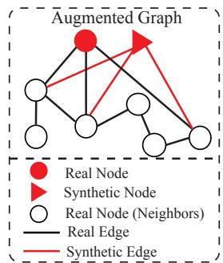  
Figure 1: Illustration of the 2-hop neighborhood of a real node and a synthetic node in the augmented graph. Figure 5 in Section F.10 illustrates the t-SNE visualization of the augmented graph.

fusion models have also been used for data and graph purification [28, 29, 30, 31, 32]. Purifying an observed graph and generating additional labeled nodes with incident edges are different tasks. Graph level purification methods do not directly provide the node level augmentation interface of RGDM. Conversely, vanilla node generation trained on a corrupted graph can reproduce its noise. RGDM trains its robust generator without paired clean graphs. Section F.13 compares GDDM and DiffSP preprocessing with RGDM augmentation using the same SG-GSR backbone, while Section F.12 separately evaluates a purification adaptation of RGDM.

Contributions. First, RGDM learns a robust node level generator through edge selection, sparse hierarchical reconstruction, and low rank regularization of the latent features used by diffusion. Its Sparse Hierarchical Edge Decoder (SHED) evaluates selected clusters instead of globally scoring every candidate neighbor. Controlled comparisons with DoG and LR-FGDM, componentwise ablations, and wall clock measurements distinguish these contributions from the shared autoencoder and diffusion architecture. Second, RGDM augments existing classifiers without changing their architecture or objective. We evaluate its incremental benefit with each backbone fixed, including SG-GSR [33], and report paired variability. The gains over this strong backbone are modest in absolute magnitude, but consistent in the tested settings. Fidelity, heterophily, and adaptive attack evaluations support this empirical conclusion. The linear probe theorem motivates the latent regularizer and does not establish an end to end robustness guarantee.

## 2 Related Works

Data Augmentation for Graph Learning. To improve the performance of GNNs, node-level graph data augmentation methods have been studied to modify the structure [34, 35, 36, 37, 38], features [39, 40, 41], or node labels [39, 40, 41]. Studies have demonstrated that increasing the number of labeled nodes based on Mix-up strategies [8, 9, 10, 11, 12, 13] can greatly enhance the performance of the GNNs. Recent works address node and edge imbalance by generating synthetic nodes and edges [42, 43, 44, 45, 46], but predominantly rely on Generative Adversarial Networks (GANs). However, the computer vision literature [21] has demonstrated that GANs often exhibit instability during training and that the distribution of synthetic data generated by GANs poorly matches the distribution of real data. Graph level diffusion models [4, 3, 5, 6, 7] generate entire graphs. DoG [19] and LR-FGDM [20] instead generate nodes and associated edges within an existing graph, as does RGDM. DoG reconstructs observed neighborhoods with a Bi-Level Neighborhood Decoder (BLND) and applies low rank regularization to its downstream GNN. LR-FGDM addresses few shot classification using a Hierarchical Graph Autoencoder (HGAE) with prototypical regularization, followed by a low rank transductive classifier. RGDM places edge selection, a sparsification objective, and low rank regularization inside the generator. Its TNN penalty acts on the latent features used by diffusion. SHED reconstructs selected sparse neighborhoods rather than all observed connections. The resulting augmented graph can be used with GCN, Pro-GNN, or SG-GSR. Tables 4 and 5 compare these methods with a fixed backbone. Table 33 additionally compares hierarchical reconstruction variants.

Graph Adversarial Attacks and Defense. Despite the success of GNNs in graph-structured tasks [47, 48], recent studies reveal their vulnerability to adversarial attacks [49]. Depending on the attack objective, threat models are categorized as: targeted attacks [50], which mislead predictions on specific nodes, and untargeted attacks [51, 52], which reduce overall model accuracy. To defend against these threats, robust learning strategies are grouped into three categories: adversarial training, graph processing, and model robustification. Adversarial training [53, 54] augments training data with crafted adversarial samples. Graph processing [55, 56, 57, 58] seeks to denoise perturbed graphs. Model robustification [59, 60, 61, 62, 63, 64, 65, 33] enhances model resilience.

## 3 Methods

## 3.1 Preliminaries of the Attributed Graph

An attributed graph of N nodes is represented by $\mathcal { G } = ( \nu , \mathbf { X } , \mathbf { A } )$ , where $\mathcal { V } = \{ v _ { 1 } , v _ { 2 } , . . . , v _ { N } \}$ and $\mathcal { E } \subseteq \mathcal { V } \times \mathcal { V }$ denote the nodes and edges respectively. $\mathbf { \dot { X } } \in \mathbb { R } ^ { N \times D }$ contains the node attributes. $\mathbf { X } _ { i } \in \mathbb { R } ^ { D }$ , the i-th row of X, denotes the attributes of the i-th node. $\mathbf { A } \in \left\{ 0 , 1 \right\} ^ { N \times N }$ is the adjacency matrix of the graph G. $\tilde { \mathbf { A } } = \mathbf { A } + \mathbf { I }$ is the adjacency matrix of a graph with self-loops added. D˜ denotes the diagonal degree matrix of $\tilde { \mathbf { A } }$ . We use $\mathcal { N } ( i ) = \left\{ j \mid \tilde { \mathbf { A } } _ { i , j } = 1 \right\}$ to denote the set of nodes connected to $v _ { i }$ $\mathbf { Z } \in \mathbb { R } ^ { N \times D ^ { \prime } }$ contains the latent features of all the nodes in the graph, where $D ^ { \prime }$ is the latent dimension. Let $\nu _ { \mathcal { L } }$ and $\nu _ { u }$ denote the set of labeled nodes and unlabeled test nodes, respectively, and $| \mathcal { V } _ { \mathcal { L } } | = m , | \mathcal { V } _ { \mathcal { U } } | = u$ . Let $Y _ { L } = \{ y _ { i } \mid v _ { i } \in \mathcal { V } _ { L } , y _ { i } \in [ C ] \}$ denote the labels of nodes in $\nu _ { \mathcal { L } }$ , where $C$ is the number of classes. Let $\ddot { \mathbf { Y } } = [ \mathbf { y } _ { 1 } ; \mathbf { y } _ { 2 } ; \ldots \mathbf { y } _ { N } ] \in \mathbb { R } ^ { N \times C }$ be the ground truth label matrix of all the nodes in ${ \mathcal { G } } ,$ where $\mathbf { y } _ { i }$ is the one-hot label vector of node $v _ { i } .$ . Let $\mathbf { u } \in \mathbb { R } ^ { N }$ be a vector. We use $[ \mathbf { u } ] _ { \mathcal { A } }$ to denote a vector formed by elements of u with indices in $\mathcal { A }$ for $A \subseteq [ N ]$ If u is a matrix, then $[ \mathbf { u } ] _ { \mathcal { A } }$ denotes a submatrix formed by rows of u with row indices in $\mathcal { A } . \ \bar { \Vert } \cdot \Vert _ { \mathrm { F } } ^ { - }$ denotes the Frobenius norm of a matrix, and $\left\| \cdot \right\| _ { p }$ denotes the p-norm of a vector.

## 3.2 Robust Graph Autoencoder (RGAE)

In this section, we propose the Robust Graph Autoencoder (RGAE) capable of encoding node attributes and associated edges into continuous latent features and decoding these features to reconstruct the node attributes and edges in the graph. Beyond reconstruction, the RGAE is designed to be robust to adversarial perturbations in the node attributes and the edges in the graph, enhancing the resilience against potential graph adversarial attacks. We encode each node’s attributes together with its neighborhood. Positional embeddings give $\mathbf { X } _ { j } ^ { \prime } = \mathbf { X } _ { j } + \mathsf { p o s } ( j )$ , and GAT layers [66] aggregate these features. For $j \in \mathcal { N } ( i )$ , the attention weight is $\begin{array} { r } { \mathbf { B } _ { i j } = \exp ( a _ { i j } ) / \sum _ { \ell \in N ( i ) } \exp ( a _ { i \ell } ) } \end{array}$ where $\begin{array} { r } { a _ { i j } = \sigma ( \mathbf { X } _ { i } ^ { \prime } \mathbf { Q } \vert \vert \mathbf { X } _ { j } ^ { \prime } \mathbf { Q } ) \mathbf { V } , \vert \vert } \end{array}$ denotes concatenation, $\sigma$ is the sigmoid function, and $\mathbf { Q } , \mathbf { V }$ are learnable matrices. Attention is restricted to observed neighbors. To suppress unreliable edges during RGAE training, a learned binary mask S selects connections. We use the sigmoid relaxation $\widehat { \mathbf { S } } _ { i j } = \sigma ( \pmb { \theta } _ { i j } / \tau )$ associated with binary Gumbel Softmax training [67, 68]. A linear layer applied to $\mathbf { X } _ { i } ^ { \prime } \| \mathbf { X } _ { j } ^ { \prime }$ predicts $\theta _ { i j }$ . The forward pass uses $\mathbf { S } _ { i j } = \mathbb { I } _ { \left\{ \widehat { \mathbf { S } } _ { i j } > 1 / 2 \right\} }$ , while a straight through estimator differentiates through $\widehat { \mathbf { S } } _ { i j }$ . We use $\tau = 0 . 5$ unless stated otherwise. The selected neighbor aggregation is $\begin{array} { r } { \mathbf { Z } _ { i } ^ { \prime } = \operatorname { R e L U } ( \sum _ { j \in \mathcal { N } ( i ) } \mathbf { S } _ { i j } \mathbf { B } _ { i j } \mathbf { X } _ { j } ^ { \prime } \mathbf { W } ) } \end{array}$ , with learnable W. Two GAT layers yield the neighborhood representation. Concatenating it with an MLP of the node attributes gives $\mathbf { Z } _ { i } = \mathbf { Z } _ { i } ^ { \prime } \parallel f ( \mathbf { X } _ { i } )$ The mask changes the generator’s training representation, not the original adjacency retained for downstream augmentation. Sparse Hierarchical Edge Decoder (SHED). Decoding edges from latent features can be computationally intensive, as each node may connect to any other node. To mitigate this, we propose a Sparse Hierarchical Edge Decoder (SHED), which decodes each latent feature into an inter-cluster and an intra-cluster neighbor map, as illustrated in Figure 2 (b). The SHED begins by partitioning the nodes into K balanced clusters using balanced $K .$ -means clustering [69] based on node attributes. Each cluster has a maximum capacity of $\begin{array} { r } { M = \lceil \frac { N } { K } \rceil } \end{array}$ . Within each cluster, nodes are indexed by their original graph order. For a node $v _ { i } .$ SHED first reconstructs an inter-cluster neighbor map $\dot { \mathbf { C } } \in \{ 0 , 1 \} ^ { \mathbf { \bar { N } } \times K }$ , where $\mathbf { C } _ { i k } = 1 \mathrm { i f } \ v _ { i }$ is connected to at least one node in cluster $k .$ . It then reconstructs the intra-cluster neighbor map as a tensor $\mathbf { M } \in \{ 0 , 1 \} ^ { N \times K \times M }$ where $\mathbf { M } _ { i k m } = 1$ indicates that $v _ { i }$ is connected to the m-th node in cluster k. The SHED begins by computing the inter-cluster neighbor assignment $\widehat { \mathbf { C } } _ { i }$ for each node $v _ { i }$ using a single-layer MLP. At generation time, the active cluster indices, $\mathcal { C } ( i ) = \left. k \in \left[ K \right] | \widehat { \mathbf { C } } _ { i k } > 1 / 2 \right.$ , are extracted and passed through a cluster index embedding module $g ( \cdot )$ b, which consists of an MLP, inspired by the classifierfree guidance technique [70]. This produces a set of embeddings $\mathcal { Z } ( i ) = \left\{ g ( k ) \in \mathbb { R } ^ { D ^ { \prime } } \mid k \in \mathcal { C } ( i ) \right\}$ Each embedding $g ( k )$ is then concatenated with the latent representation $\mathbf { Z } _ { i }$ from the alternate branch, and the result is processed by a decoding MLP, $g ^ { \prime } ( \cdot )$ , to estimate the intra-cluster neighbor relation as ${ \widehat { \bf M } } _ { i k } = g ^ { \prime } ( { \bf Z } _ { i } \| g ( k ) )$ . Compared to the Bi-Level Neighborhood Decoder (BLND) in cDoG [19], the reconstructed neighbor map $\widehat { \bf M }$ is sparse for robust graph learning, which is enforced by the training of the RGAE detailed later.

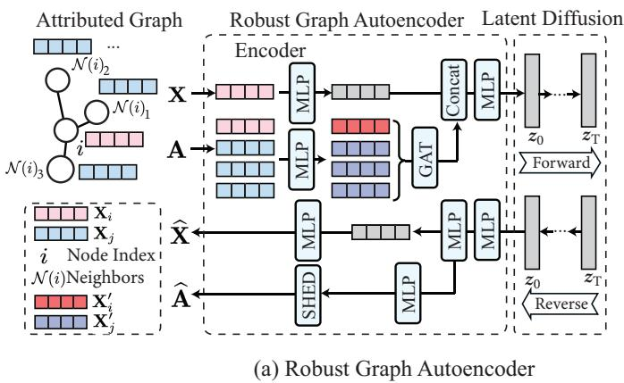

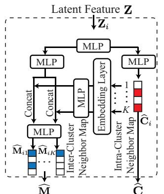  
(b) Sparse Hierarchical Edge Decoder  
Figure 2: Figure (a) illustrates the synthetic node generation process in Robust Graph Diffusion Model. Figure (b) illustrates the structure of the Sparse Hierarchical Edge Decoder (SHED).

Optimization of the RGAE. RGAE incorporates an edge selection mechanism in the encoder that gradually removes the adversarial edges. By learning an edge selection mask S, RGAE purifies the adjacency matrix of the graph as $\mathbf { A } \circ \mathbf { S }$ . By integrating the edge selection mechanism with SHED, we decompose S into two edge selection masks, $\mathbf { S } _ { \mathrm { i n t e r } } \in \{ 0 , \overline { { 1 } } \} ^ { N \times K }$ and $\mathbf { S } _ { \mathrm { i n t r a } } \in \left\{ 0 , 1 \right\} ^ { N \times K \times M }$ for edge selection on the inter-cluster neighbor map C and intra-cluster neighbor map $\mathbf { \bar { M } }$ . At the end of each epoch, $\mathbf { S } _ { \mathrm { i n t e r } }$ and $\mathbf { S } _ { \mathrm { i n t r a } }$ are computed from S. In particular, $[ { \bf S } _ { \mathrm { i n t e r } } ] _ { i k } = 1$ if and only if there is a node $v _ { j }$ from the cluster $k ,$ such that $\mathbf { S } _ { i j } = 1 . ~ [ \mathbf { S } _ { \mathrm { i n t r a } } ] _ { i k m } = 1$ if and only if $\mathbf { S } _ { i j } = 1$ , where $v _ { j }$ is the m-th node in the cluster $k .$

We regularize the latent feature matrix $\mathbf { Z } \in \mathbb { R } ^ { N \times D ^ { \prime } }$ through its Gram matrix $\mathbf { K } : = \mathbf { Z } \mathbf { Z } ^ { \top }$ . Put $q : = \operatorname* { m i n } \left\{ N , D ^ { \prime } \right\}$ , and let $\widehat { \lambda } _ { 1 } \geq \dots \geq \widehat { \lambda } _ { N } \geq 0$ be the eigenvalues of K. For $0 \leq r _ { 0 } < q .$ , its truncated nuclear norm is $\begin{array} { r } { \| \mathbf { K } \| _ { r _ { 0 } } : = \sum _ { i = r _ { 0 } + 1 } ^ { N } \widehat { \lambda } _ { i } . } \end{array}$ A zero tail implies rank $( \mathbf { K } ) \leq r _ { 0 }$ . A soft penalty bencourages, but does not impose, this rank. The RGAE loss at epoch t is

$$
\begin{array} { r } { \mathcal { L } _ { \mathtt { R G A E } } ^ { ( t ) } ( \mathbf { S } _ { \mathrm { i n t r a } } ^ { ( t - 1 ) } , \mathbf { S } _ { \mathrm { i n t e r } } ^ { ( t - 1 ) } ) = \mathcal { L } _ { \mathtt { C } } ^ { ( t ) } + \tau _ { \mathtt { S } } \mathcal { L } _ { \mathtt { S } } ^ { ( t ) } + \tau _ { \mathtt { T } } \lVert \mathbf { K } \rVert _ { r _ { 0 } } , } \end{array}\tag{1}
$$

where

$$
\mathcal { L } _ { \mathrm { C } } ^ { ( t ) } = \Big \| \mathbf { X } - \widehat { \mathbf { X } } \Big \| _ { \mathrm { F } } ^ { 2 } + \Big \| \mathbf { C } - \widehat { \mathbf { C } } \Big \| _ { \mathrm { F } } ^ { 2 } + \Big \| \mathbf { M } - \widehat { \mathbf { M } } \Big \| _ { \mathrm { F } } ^ { 2 } ,
$$

$$
\mathcal { L } _ { \mathtt { S } } ^ { ( t ) } = \left\| \mathbf { C } \circ \mathbf { S } _ { \mathrm { i n t e r } } ^ { ( t - 1 ) } - \widehat { \mathbf { C } } \right\| _ { \mathrm { F } } ^ { 2 } + \left\| \mathrm { v e c } \left( \mathbf { M } \circ \mathbf { S } _ { \mathrm { i n t r a } } ^ { ( t - 1 ) } - \widehat { \mathbf { M } } \right) \right\| _ { 1 } .
$$

Here ◦ denotes the Hadamard product. $\mathcal { L } _ { \mathrm { R G A E } } ^ { ( t ) }$ is the overall training loss of the RGAE at the t-th epoch, where $t \in [ t _ { \mathrm { t r a i n } } ]$ is the current epoch number and $t _ { \mathrm { t r a i n } }$ is the total number of training epochs. We initialize $\mathbf { S } _ { \mathrm { i n t r a } } ^ { ( 0 ) } = \mathbf { M }$ and $\mathbf { S } _ { \mathrm { i n t e r } } ^ { ( 0 ) } = \mathbf { C }$ before the first epoch of training. For tensors, $\lVert \cdot \rVert _ { \mathrm { F } }$ denotes the Euclidean norm after vectorization. $\tau _ { S }$ and $\tau _ { \mathrm { T } }$ are the scale factors for the sparsification loss and the TNN. $\mathcal { L } _ { \mathrm { C } } ^ { ( t ) }$ and $\mathcal { L } _ { \mathrm { s } } ^ { ( t ) }$ are the consistency loss and the sparsification loss at the t-th epoch. The starting rank $r _ { 0 }$ is selected by cross-validation as described in Section 4.1. The training of RGDM is described in Algorithm 1 in Section C of the appendix. We further show in Section D.1 of the appendix that the TNN regularizer can be efficiently computed from the singular values of the latent representation Z with a complexity of ${ \cal O } ( N { \cal D } ^ { \prime } ^ { 2 } )$

The node reconstruction loss and the hierarchical edge reconstruction loss ensure consistency between the reconstructed features and adjacency matrix and their inputs. The sparsification loss is motivated by prior work on graph structure learning for robust GNNs [57, 71], which aims to purify noisy or perturbed graph structures. The entrywise $\ell _ { 1 }$ term in $\mathcal { L } _ { \mathrm { s } } ^ { ( t ) }$ discourages nonzero reconstructions outside the selected sparse neighbor map. Although the BLND in DoG [19] also performs edge reconstruction in a two-level manner, it is trained to precisely recover all edges connected to each node in the given graph, including those corrupted by adversarial attacks. In contrast, our SHED reconstructs a sparse and robust graph structure by selectively preserving the clean edges, motivated by prior studies showing that graph sparsification enhances the robustness of GNNs against adversarial attacks by removing noisy connections [57, 58, 71, 72]. Moreover, existing studies on adversarial defense reveal that perturbations typically reside in high-rank residual components, whereas clean signals lie in low-rank subspaces [73, 74]. Projecting representations onto low-rank subspaces [73, 74, 75] or enforcing low-rank weight matrices [76] has been proven to be effective for enhancing robustness. However, research in graph adversarial defense has focused predominantly on reducing the rank of the adjacency matrix [77, 56, 78, 79, 80]. Our penalty instead regularizes the diffusion latent. Theorem 3.1 analyzes a bounded linear probe on fixed latent features.

Motivation and scope of low rank regularization. The eigen projection study (Figures 3 and $^ { 4 , }$ Section F.1) finds that leading eigendirections of K retain more label information than perturbation information. This is an empirical property of the evaluated latent kernels, not an assumption that adjacent nodes share labels. The soft TNN penalty balances compression against reconstruction. We choose $r _ { 0 } = \lceil \gamma q \rceil$ by five fold cross validation over $\gamma \in \{ 0 . 1 , 0 . 2 , \ldots , 0 . 9 \}$ (Section E.4). A larger rank can preserve useful heterophilic information.

Theoretical justification and its limits. For a fixed latent matrix Z, consider the linear probe $\mathbf { F } ( \mathbf { W } ) : = \mathbf { Z } \mathbf { W }$ with training loss $L _ { \mathcal { L } } ( \mathbf { W } ) : = \left. m ^ { - 1 } \| [ \mathbf { Z } \mathbf { W } - \mathbf { Y } ] _ { \mathcal { L } } \right\| _ { \mathrm { F } } ^ { 2 }$ The following finite pool bound makes the boundedness and sampling requirements explicit based on the sharp transductive bounds by Transdcutive Local Complexity (TLC) [81, 82, 83]. Section A gives a self contained proof and the squared loss gradient descent specialization.

Theorem 3.1. For a positive integer k, let $[ k ] : = \{ 1 , \dots , k \}$ , and let log denote the natural logarithm. Use the graph notation of Section 3.1 and the latent Gram matrix K, rank bound $q ,$ and eigenvalues $\widehat { \lambda } _ { 1 } , \ldots , \widehat { \lambda } _ { N }$ defined above. Write $\mathcal { L } : = \{ i \in [ N ] : v _ { i } \in \mathcal { V } _ { \mathcal { L } } \}$ and $\mathcal { U } : = \{ i \in [ N ] : v _ { i } \in \mathcal { V } _ { \mathcal { U } } \}$ bAssume $D ^ { \prime } , C \ \ge \ 1 , \ N \ = \ m + u , \ m , u \ \ge \ 2 , \dot { \mathcal { U } } \ = \ [ N ] \ \backslash \ \mathcal { L } .$ and L is uniform among subsets with m elements, with $\mathbf { Z } , \mathbf { Y }$ fixed before sampling. For fixed $B > 0$ and $\tau _ { 0 } \geq 0$ , suppose ma $\mathrm { x } _ { i \in [ N ] } \| \mathbf { Z } _ { i } \| _ { 2 } \leq \tau _ { 0 }$ . Put $s : = \operatorname* { m i n } \left\{ m , u \right\}$ . For $r \in [ q ]$ , define $\begin{array} { r } { \left\| \mathbf { K } \right\| _ { r } : = \sum _ { j = r + 1 } ^ { N } \widehat { \lambda } _ { j } } \end{array}$ , with an empty sum equal to zero, and put

$$
\mathrm { K C } ( \mathbf { K } ) : = \operatorname* { m i n } _ { r \in [ q ] } \left[ r \left( \frac { 1 } { u } + \frac { 1 } { m } \right) + \sqrt { \frac { \| \mathbf { K } \| _ { r } } { N } } \left( \frac { 1 } { \sqrt { u } } + \frac { 1 } { \sqrt { m } } \right) \right] .
$$

There is a constant $c _ { 0 } > 0 .$ , depending only on $C , B , \tau _ { 0 }$ , such that, for every $x > 0$ , with probability at least $1 - \exp ( - x )$ , simultaneously for all $\mathbf { W } \in \mathbb { R } ^ { D ^ { \prime } \times C }$ with $\| \mathbf { W } \| _ { \mathrm { F } } \leq B$

$$
\mathcal { U } _ { \mathrm { t e s t } } ( \mathbf { W } ) : = \frac { \| [ \mathbf { Z } \mathbf { W } - \mathbf { Y } ] _ { \boldsymbol { u } } \| _ { \mathrm { F } } ^ { 2 } } { u } \leq 2 L _ { { \mathcal { L } } } ( \mathbf { W } ) + c _ { 0 } \left[ { \mathrm { K C } } ( { \mathbf { K } } ) + \frac { x + \log C } { s } \right] ,\tag{2}
$$

For a fixed rank and feature scale bound, reducing the spectral tail reduces its contribution to the complexity bound in Equation (2). It need not reduce the label fitting term. Strong heterophily may increase either term and loosen the bound. The theorem concerns a bounded linear probe under an independent random split, not class conditional generation, a label dependent adaptive attack, or the downstream GNN. The latter connection is empirical, through the low rank ablation and FND/FED evaluations. Main text heterophily results appear in Section 4.5.

## 3.3 Conditional Generation of Synthetic Graph Structures in Latent Space

To generate synthetic graph structures, consisting of the synthetic nodes and their edges connecting to the original graph, we train a latent diffusion model (LDM) [84] with Classifier-Free Guidance (CFG) [70]. The trained LDM generates latent features for the synthetic structures, which are then decoded into node features and associated edges. Let $\gamma _ { L } \subseteq \gamma$ denote the set of the labeled nodes in the original graph ${ \mathcal { G } } ,$ and $\mathcal { V } _ { \mathrm { s y n } }$ denotes the set of the generated synthetic nodes by the RGDM. Let the node attributes of $\mathcal { V } _ { \mathrm { s y n } }$ generated by the RGDM be $\mathbf { \bar { X } } _ { \mathrm { s y n } } .$ . Let $\dot { C }$ be the number of classes, and $N _ { 0 }$ be the number of synthetic nodes for each class. $N ^ { \prime } = \check { C } N _ { 0 } = | \mathcal { V } _ { \mathrm { s y n } }$ | is the number of the synthetic nodes. Let $Y _ { \mathrm { s y n } } = \{ \widehat { y } _ { i } \} _ { i = 1 } ^ { N ^ { \prime } }$ denote the set of the labels of the synthetic nodes. Let $\widehat { \mathbf { Z } } = \left\{ \widehat { \mathbf { Z } } _ { i } \right\} _ { i = 1 } ^ { N ^ { \prime } }$ denote the latent features of the synthetic graph structures. Let $\mathbf { A } _ { \mathrm { s y n } } \in \mathbb { R } ^ { N ^ { \prime } \times N }$ denote the edges of the synthetic nodes generated by our RGDM. Then the augmented synthetic graph structures are $( \mathcal { V } _ { \mathrm { s y n } } , \dot { \mathbf { X } } _ { \mathrm { s y n } } , \mathbf { A } _ { \mathrm { s y n } } )$ . There are no generated edges between synthetic nodes in this construction. The adjacency matrix is given by Equation (3):

$$
\mathbf { A } _ { \mathrm { a u g } } : = \left[ \begin{array} { l l } { \mathbf { A } } & { \mathbf { A } _ { \mathrm { s y n } } ^ { \top } } \\ { \mathbf { A } _ { \mathrm { s y n } } } & { \mathbf { 0 } _ { N ^ { \prime } \times N ^ { \prime } } } \end{array} \right] \in \mathbb { R } ^ { ( N + N ^ { \prime } ) \times ( N + N ^ { \prime } ) } .\tag{3}
$$

The node feature matrix is ${ \bf X } _ { \mathrm { a u g } } = [ { \bf X } ; { \bf X } _ { \mathrm { s y n } } ] \in \mathbb { R } ^ { ( N + N ^ { \prime } ) \times D }$ . The augmented graph, which is the combination of the original graph G and the synthetic graph structures, is then denoted by $\mathcal { G } _ { \mathrm { a u g } } =$ $( \mathcal { V } \cup \mathcal { V } _ { \mathrm { s y n } } , \mathbf { X } _ { \mathrm { a u g } } , \mathbf { A } _ { \mathrm { a u g } } )$ . The set of labeled nodes in $\mathcal G _ { \mathrm { a u g } } \mathrm { i s } \ \mathcal { V } _ { L } \cup \mathcal { V } _ { \mathrm { s y n } }$ and their labels are $Y _ { L } \cup { \check { Y _ { \mathrm { s y n } } } } .$

## 3.4 Training GNNs on the Augmented Graph

After obtaining the augmented graph $\mathcal { G } _ { \mathrm { a u g } } ,$ , we then train either the vanilla GCN [47] or the robust GNNs, Pro-GNN [57] and SG-GSR [33], on $\mathcal { G } _ { \mathrm { a u g } }$ . Results in Section 4.1 evidence that the GNNs trained on the augmented graph exhibit much better performance and robustness for the semisupervised node classification task than the models trained on the original attacked graphs perturbed by graph adversarial attacks, including Metattack [51], Nettack [50], and Topology Attack [85].

Complexity Analysis. We perform a detailed complexity analysis of the RGDM in Section D.2 of the appendix, demonstrating the improved efficiency of the proposed SHED.

## 4 Experiments

We evaluate the incremental benefit of RGDM with each downstream backbone fixed. In addition to the standard attacks, the main text includes direct node level diffusion comparisons, componentwise ablations, heterophily, adaptive attacks, and decoder timings. The appendix provides spectral diagnostics (Section F.1), complete attack results (Section F.2), FND/FED (Section F.3), timings and cross validation (Sections F.5 to F.6), large graph edge selection ablations (Section F.7), sensitivity and heterophily details (Sections F.8 to F.9), visualization and paired statistics (Sections F.10 to F.11), purification variants (Sections F.12 to F.13), node count, DDPM, and label ratio studies (Sections F.14 to F.16), hierarchical reconstruction comparisons (Section F.17), and adaptive attack details (Section F.18).

## 4.1 Semi-Supervised Node Classification under Graph Adversarial Attacks

Settings. We evaluate RGDM on four public graph benchmarks: Cora, Citeseer, Pubmed [86], and Polblogs [87]. Dataset statistics are provided in Table 9 in Section E.1 of the appendix. The training settings of the RGAE and LDM in RGDM are described in Section E.2. The number of added synthetic nodes is selected by cross-validation following Section F.6, and the starting rank $r _ { 0 }$ is selected by cross-validation as detailed in Section E.4 of the appendix.

We conduct experiments on semi-supervised node classification under the Metattack [51], the Nettack [50], and the Topology Attack [85]. The compared methods are detailed in Section E.6 of the appendix. We apply the RGDM on vanilla GCN [47] and state-of-the-art robust GNNs, which are Pro-GNN [57] and SG-GSR [33]. The results for Metattack under the perturbation rates of 15% and 25% are shown in Table 1. Additional results with perturbation rates from 5% to 25% with a step of 5% for the Metattack are deferred to Table 10 in Section F.2 of the appendix. The results for Nettack [50] under attack budgets of 3 and 5 are shown in Table 2. Detailed results for Nettack, with attack budgets varying from 1 to 5 in increments of 1, are deferred to Table 11 in Section F.2 of the appendix. In addition, the results for defending against Topology Attack are deferred to Table 12 in Section F.2 of the appendix. The original accuracy tables report means and marginal standard deviations over 10 runs. In a separate paired evaluation, each backbone and its RGDM augmented counterpart use the same perturbed graph for each attack seed. Their difference measures the incremental gain of augmentation. These paired summaries are not obtained by subtracting the marginal SD in the original tables, whose runs need not coincide with the paired reevaluation. Table 26 reports the smaller standard deviations of the paired gains for all reported paired evaluation rows. Selected paired deviations are also shown alongside the accuracies in Table 1. Section F.11 distinguishes reported significance levels from exact p values inferred from rounded summaries. Controlled gains and clean graphs. The relevant comparison is RGDM(A) against the same classifier A: RGDM changes its training graph, not its architecture or objective. Under 25% Metattack, the SG-GSR gains are 1.3 ± 0.3, 2.6 ± 0.4, 1.0 ± 0.3, and 1.4 ± 0.3 percentage points on Cora, Citeseer, Polblogs, and Pubmed, respectively (paired gain ± paired SD). These increments are modest relative to the accuracy of the strong backbone. The much larger improvement over vanilla GCN does not measure improvement over SG-GSR. Reported significance levels across Metattack, Nettack, and Topology Attack are given in Table 27. The 0% perturbation and zero budget rows are explicitly clean graph evaluations. RGDM improves clean GCN by 1.7/1.7/0.4/0.9 points and clean SG-GSR by 0.4/0.8/0.2/2.6 points across these datasets. Thus the observed augmentation benefit also occurs when there are no adversarial edges to filter.

Table 1: Metattack accuracy ± marginal SD (%). Parentheses give the augmentation gain. A further ± is its SD from the separate paired evaluation (Table 26). A 0% rate is a clean graph. Bold and underline mark the best and second best results across both panels for each setting. Complete results appear in Table 10.  
(a) Original graph
<table><tr><td>Dataset</td><td>Ptb Rate (%)</td><td>GCN</td><td>GCORNs</td><td>HANG</td><td>STABLE</td><td>Pro-GNN</td><td>SG-GSR</td></tr><tr><td rowspan="3">Cora</td><td>0 (clean)</td><td>83.5±0.4</td><td>82.6±0.5</td><td>80.1±0.3</td><td>84.7±0.5</td><td>83.0±0.2</td><td>85.5±1.3</td></tr><tr><td>15</td><td>65.1±0.7</td><td>72.6±1.2</td><td>72.9±1.0</td><td>74.4±0.9</td><td>76.4±1.3</td><td>78.5±1.6</td></tr><tr><td>25</td><td>47.5±1.9</td><td>69.5±1.9</td><td>68.7±1.9</td><td>69.6±0.6</td><td>69.7±1.7</td><td>77.8±1.3</td></tr><tr><td rowspan="3">Citeseer</td><td>0 (clean)</td><td>72.0±0.6</td><td>72.6±0.4</td><td>73.3±0.4</td><td>74.8±0.5</td><td>73.3±0.7</td><td>75.8±1.4</td></tr><tr><td>15</td><td>64.5±1.1</td><td>65.5±1.0</td><td>70.8±0.9</td><td>67.5±0.4</td><td>72.0±1.1</td><td>73.1±1.4</td></tr><tr><td>25</td><td>56.9±1.1</td><td>65.2±1.3</td><td>66.4±1.6</td><td>65.6±1.9</td><td>69.0±1.8</td><td>72.7±1.4</td></tr><tr><td rowspan="3">Polblogs</td><td>0 (clean)</td><td>95.7±0.4</td><td>95.3±0.9</td><td>94.8±1.1</td><td>95.5±0.2</td><td>93.2±0.6</td><td>95.9±1.8</td></tr><tr><td>15</td><td>65.0±1.9</td><td>82.1±1.4</td><td>71.7±1.3</td><td>87.8±0.3</td><td>86.0±1.2</td><td>90.0±1.6</td></tr><tr><td>25</td><td>49.2±1.4</td><td>66.6±1.7</td><td>65.8±1.3</td><td>80.0±1.9</td><td>63.2±1.4</td><td>87.8±1.1</td></tr><tr><td rowspan="3">Pubmed</td><td>0 (clean)</td><td>87.2±0.1</td><td>86.4±0.7</td><td>85.1±0.2</td><td>87.7±0.0</td><td>87.3±0.2</td><td>87.7±1.7</td></tr><tr><td>15</td><td>78.7±0.1</td><td>76.8±1.8</td><td>85.0±0.2</td><td>87.3±0.1</td><td>87.2±0.1</td><td>87.3±1.4</td></tr><tr><td>25</td><td>75.5±0.2</td><td>70.8±1.9</td><td>85.1±0.2</td><td>86.0±0.1</td><td>86.8±0.2</td><td>87.2±1.4</td></tr></table>

(b) RGDM augmentation with the same backbone
<table><tr><td>Dataset</td><td>Ptb Rate (%)</td><td>RGDM (GCN)</td><td>RGDM (Pro-GNN)</td><td>RGDM (SG-GSR)</td></tr><tr><td rowspan="3">Cora</td><td>0 (clean)</td><td>85.2±0.4 (↑ 1.7)</td><td>84.3±0.5 (↑ 1.3)</td><td>85.9±1.1 (↑ 0.4 ± 0.1)</td></tr><tr><td>15</td><td>69.4±0.4 (↑ 4.3)</td><td>78.3±1.1 (↑ 1.9)</td><td>80.0±1.1 (↑ 1.5 ± 0.3)</td></tr><tr><td>25</td><td>61.4±0.8 (↑ 13.9)</td><td>72.3±1.6 (↑ 2.6)</td><td>79.1±1.6 (↑ 1.3 ± 0.3)</td></tr><tr><td rowspan="3">Citeseer</td><td>0 (clean)</td><td>73.7±0.8 (↑ 1.7)</td><td>74.5±0.8 (↑ 1.2)</td><td>76.6±1.4 (↑ 0.8)</td></tr><tr><td>15</td><td>68.7±0.4 (↑ 4.2)</td><td>73.7±0.4 (↑ 1.7)</td><td>76.0±1.1 (↑ 2.9 ± 0.4)</td></tr><tr><td>25</td><td>62.8±0.7 (↑ 5.9)</td><td>70.2±0.7 (↑ 1.2)</td><td>75.3±1.0 (↑ 2.6 ± 0.4)</td></tr><tr><td rowspan="3">Polblogs</td><td>0 (clean)</td><td>96.1±0.1 (↑ 0.4)</td><td>95.7±1.2 (↑ 2.5)</td><td>96.1±1.5 (↑ 0.2)</td></tr><tr><td>15</td><td>69.9±0.4 (↑ 4.9)</td><td>88.0±1.1 (↑ 2.0)</td><td>91.1±1.9 (↑ 1.1 ± 0.3)</td></tr><tr><td>25</td><td>56.5±0.6 (↑ 7.3)</td><td>66.9±1.4 (↑ 3.7)</td><td>88.8±1.8 (↑ 1.0 ± 0.3)</td></tr><tr><td rowspan="3">Pubmed</td><td>0 (clean)</td><td>88.1±0.2 (↑ 0.9)</td><td>88.4±0.3 (↑ 1.1)</td><td>90.3±1.5 (↑ 2.6)</td></tr><tr><td>15</td><td>85.0±0.3 (↑ 6.3)</td><td>88.1±0.2 (↑ 0.9)</td><td>88.7±1.7 (↑ 1.4 ± 0.3)</td></tr><tr><td>25</td><td>81.5±0.2 (↑ 6.0)</td><td>87.6±0.2 (↑ 0.8)</td><td>88.6±1.3 (↑ 1.4 ± 0.3)</td></tr></table>

Table 2: Nettack accuracy ± marginal SD (%), with augmentation gains in parentheses. Budget 0 is a clean graph. The highlighting convention is that of Table 1. Complete results appear in Table 11.  
(a) Original graph
<table><tr><td>Dataset</td><td>Budget</td><td>GCN</td><td>GCORNs</td><td>HANG</td><td>STABLE</td><td>Pro-GNN</td><td>SG-GSR</td></tr><tr><td rowspan="3">Cora</td><td>0 (clean)</td><td> $8 1 . 4 { \pm } 1 . 0 $ </td><td>82.6±0.4</td><td> $8 0 . 8 { \pm } 1 . 3 $ </td><td> $8 5 . 3 \pm { 1 . 8 }$ </td><td>84.8±0.6</td><td> $8 5 . 5 { \pm } 1 . 7 $ </td></tr><tr><td>3</td><td> $6 8 . 0 { \pm } 1 . 7 $ </td><td> $7 3 . 2 { \pm } 0 . 7 $ </td><td> $7 3 . 1 { \pm } 1 . 9 $ </td><td> $7 3 . 8 \pm 1 . 8$ </td><td> $7 2 . 4 \pm 0 . 5$ </td><td> $\overline { { 7 4 . 9 \pm 1 . 2 } }$ </td></tr><tr><td>5</td><td> $5 5 . 5 { \pm } 1 . 7 $ </td><td> $6 6 . 9 { \pm } 1 . 1$ </td><td> $\underline { { 6 8 . 8 \pm 1 . 6 } }$ </td><td> $6 8 . 4 \pm { 1 . 6 }$ </td><td> $6 6 . 9 { \pm } 0 . 7 \ $ </td><td> $6 8 . 0 { \pm } 1 . 5 $ </td></tr><tr><td rowspan="3">Citeseer</td><td>0 (clean)</td><td></td><td>81.0±1.4 81.9±1.2</td><td> $8 1 . 1 { \pm } 1 . 1$ </td><td> $8 2 . 4 \pm { 1 . 8 }$ </td><td>82.1±0.8</td><td>82.8± 1.2</td></tr><tr><td>3</td><td> $6 4 . 0 { \pm } 1 . 7 $ </td><td> $7 8 . 1 { \pm } 1 . 1 $ </td><td> $7 7 . 1 { \pm } 1 . 5 $ </td><td> $8 0 . 9 \pm 1 . 5$ </td><td> $7 9 . 7 { \pm } 2 . 0 $ </td><td>81.7± 1.2</td></tr><tr><td>5</td><td> $4 7 . 6 { \pm } 1 . 2 $ </td><td> $7 1 . 7 { \pm } 1 . 8 $ </td><td> $7 3 . 5 { \pm } 1 . 5 $ </td><td> $7 2 . 5 \pm 1 . 5$ </td><td> $7 1 . 3 { \pm } 2 . 0 $ </td><td>73.8±1.0</td></tr><tr><td rowspan="3">Polblogs</td><td>0 (clean)</td><td>97.0±0.2</td><td>97.5±0.3 97.4±0.5</td><td></td><td> $9 8 . 0 \pm 1 . 4$ </td><td>97.1±0.2</td><td> $9 7 . 5 { \pm } 1 . 3 $ </td></tr><tr><td>3</td><td> $9 5 . 4 \pm 0 . 2 $ </td><td> $9 5 . 7 { \pm } 1 . 0 $ </td><td> $9 6 . 7 \pm 0 . 2 $ </td><td> $9 6 . 8 \pm 1 . 4$ </td><td> $9 6 . 9 { \pm } 0 . 1 $ </td><td> $9 5 . 4 \pm 1 . 9$ </td></tr><tr><td>5</td><td> $9 3 . 0 { \pm } 0 . 5 $ </td><td> $9 3 . 4 \pm 0 . 9$ </td><td> $9 5 . 9 { \pm } 0 . 3 $ </td><td> $9 6 . 2 \pm 1 . 8$ </td><td> $9 6 . 1 { \pm } 0 . 3 $ </td><td> $9 6 . 8 { \pm } 1 . 4 $ </td></tr><tr><td rowspan="3">Pubmed</td><td>0 (clean)</td><td> $8 8 . 1 { \pm } 1 . 4 $ </td><td> $8 4 . 6 { \pm } 1 . 4 $ </td><td> $8 5 . 4 \pm 1 . 2$ </td><td> $9 0 . 4 \pm 1 . 5$ </td><td> $8 8 . 5 { \pm } 1 . 2 $ </td><td> $9 1 . 0 \pm 1 . 1$ </td></tr><tr><td>3</td><td> $8 1 . 3 { \pm } 1 . 7 $ </td><td> $8 2 . 3 { \pm } 1 . 5 $ </td><td> $8 4 . 0 { \pm } 1 . 1$ </td><td> $8 5 . 6 \pm 1 . 1$ </td><td> $8 4 . 4 \pm 1 . 1$ </td><td> $\underline { { 8 6 . 4 \pm 1 . 2 } }$ </td></tr><tr><td>5</td><td> $6 8 . 3 { \pm } 1 . 2 $ </td><td> $7 2 . 3 { \pm } 1 . 1 $ </td><td> $7 0 . 6 { \pm } 1 . 3 $ </td><td> $7 3 . 9 \pm 1 . 8$ </td><td> $7 2 . 2 { \pm } 1 . 3 $ </td><td> $7 3 . 5 \pm 1 . 4$ </td></tr></table>

(b) RGDM augmentation with the same backbone
<table><tr><td>Dataset</td><td>Budget</td><td>RGDM (GCN)</td><td>RGDM (Pro-GNN)</td><td>RGDM (SG-GSR)</td></tr><tr><td rowspan="3">Cora</td><td>0 (clean)</td><td>83.4±1.1 (↑ 2.0)</td><td>86.0±1.1 (↑ 1.2)</td><td>86.0 ±1.3 (↑ 0.5)</td></tr><tr><td>3</td><td>70.5±1.1 (↑ 2.5)</td><td>74.3±1.3 (↑ 1.9)</td><td>76.4 ±1.5 (↑ 1.5)</td></tr><tr><td>5</td><td>59.4±1.2 (↑ 3.9)</td><td>69.8±1.0 (↑ 2.9)</td><td>69.8 ±1.8 (↑ 1.8)</td></tr><tr><td rowspan="3">Citeseer</td><td>0 (clean)</td><td>82.9±1.1 (↑ 1.9)</td><td> $8 3 . 1 { \pm } 1 . 0 ( \uparrow 1 . 0 )$ </td><td>83.7 ±1.3 (↑ 0.9)</td></tr><tr><td>3</td><td>68.5±1.2 (↑ 4.5)</td><td>80.9±2.0 (↑ 1.2)</td><td>83.6 ±1.8 (↑ 1.9)</td></tr><tr><td>5</td><td>55.7±1.0 (↑ 8.1)</td><td> $\underline { { 7 4 . 6 { \pm } 1 . 3 \ : ( \uparrow \ : 3 . 3 ) } }$ </td><td>75.6 ±1.4 (↑ 1.8)</td></tr><tr><td rowspan="3">Polblogs</td><td>0 (clean)</td><td>97.7±0.1 (↑ 0.7)</td><td> $9 7 . 8 { \pm } 0 . 3 \ : ( \uparrow 0 . 7 )$ </td><td>98.5 ±0.2 (↑ 1.0)</td></tr><tr><td>3</td><td>97.0±0.3 (↑ 1.6)</td><td> $\mathbf { 9 7 . 2 { \pm 0 . 6 } ( \uparrow 0 . 3 ) }$ </td><td>96.4 ±0.1 (↑ 1.0)</td></tr><tr><td>5</td><td>94.9±0.4 (↑ 1.9)</td><td> $9 6 . 9 { \pm } 1 . 4 ( \uparrow 0 . 8 )$ </td><td> $\mathbf { 9 7 . 7 \pm 0 . 2 ( \uparrow 0 . 9 ) }$ </td></tr><tr><td rowspan="3">Pubmed</td><td>0 (clean)</td><td> $8 9 . 2 { \pm } 1 . 4 ( \uparrow 1 . 1 )$ </td><td> $8 9 . 6 { \pm } 1 . 1 \left( \uparrow 1 . 1 \right)$ </td><td> $9 2 . 5 \pm 1 . 7 ( \uparrow 1 . 5 )$ </td></tr><tr><td>3</td><td>83.4±1.6 (↑ 2.1)</td><td> $8 5 . 8 { \pm } 1 . 3 ( \uparrow 1 . 4 )$ </td><td> ${ \bf 8 9 . 0 \pm 1 . 0 ( \uparrow 2 . 6 ) }$ </td></tr><tr><td>5</td><td> $7 1 . 4 { \pm } 1 . 4 ( \uparrow 3 . 1 )$ </td><td> $\mathbf { 7 6 . 3 { \pm } 1 . 0 \ ( \uparrow \ 4 . 1 ) }$ </td><td> $7 5 . 7 \pm 1 . 3 ( \uparrow 2 . 2 )$ </td></tr></table>

## 4.2 Ablation Study on the Sparsification Loss and the Low-Rank Regularization

To validate the effectiveness of the sparsification loss and the low-rank regularization term in Equation (1), we conduct an ablation study on Cora, Citeseer, Polblogs, and Pubmed under the Metattack with the perturbation rate of 25%. We evaluate two variants of the RGDM based on the GCN, which are the RGDM without the sparsification loss and the RGDM without the lowrank regularization. We also compare RGDM with existing low-rank adversarial defense methods, [76, 77, 56, 78, 79, 80], with details provided in Section E.5 of the appendix. As shown in Table 3, RGDM outperforms both comparison regularizers across all datasets. Removing the sparsification loss reduces accuracy by 4.70/3.87/3.23/3.60 points across the four datasets. The low rank penalty is complementary. Table 22 in Section F.7 extends the edge selection ablation to ogbn-arxiv and Reddit, where restoring the module adds 0.87 and 0.99 points under 20% improved DICE.

Table 3: Ablation study on the sparsification loss and the low-rank regularization term.
<table><tr><td>Method</td><td>Cora</td><td>Citeseer</td><td>Polblogs</td><td>Pubmed</td></tr><tr><td>RGDM (GCN) w/o Sparsification Loss  $\overline { { ( \mathcal { L } _ { \mathrm { s } } ^ { ( t ) } ) } }$ </td><td>56.72</td><td>58.97</td><td>53.24</td><td>77.92</td></tr><tr><td>RGDM (GCN) w/o Low-Rank Regularization  $( \left. \mathbf { K } \right. _ { r _ { 0 } } )$ </td><td>60.04</td><td>60.38</td><td>54.85</td><td>80.85</td></tr><tr><td>RGDM (GCN, Weight Orthogonality [76])</td><td>59.88</td><td>61.12</td><td>55.17</td><td>80.16</td></tr><tr><td>RGDM (GCN, Low-Rank Adjacency Matrix [56])</td><td>61.01</td><td>60.25</td><td>55.03</td><td>80.02</td></tr><tr><td>RGDM (GCN)</td><td>61.42</td><td>62.84</td><td>56.47</td><td>81.52</td></tr></table>

## 4.3 Comparison with Existing Node-Level Graph Augmentation Methods

To demonstrate the superiority of RGDM over existing graph augmentation methods, we compare it with the mix-up based conventional augmentation method iGraphMix [12], and GAN-based SGS generation methods, including ImGAGN [42], Graphsmote [43], and SNS [45]. The evaluation is conducted on Cora, Citeseer, Polblogs, and Pubmed under Metattack with a perturbation rate of 25%. For a fair comparison, we compare GCN augmented by the competing node-level graph augmentation methods with RGDM (GCN), where the number of synthetic nodes added by each baseline is selected via cross-validation following Section F.6. As shown in Table 4, RGDM (GCN) significantly outperforms GCNs augmented by all competing baselines. We also include DoG [19] and LR-FGDM [20], using their generated structures with the same GCN classifier. RGDM exceeds DoG by 2.02/2.74/1.77/2.32 points and LR-FGDM by 2.52/3.24/2.27/2.62 points on Cora/Citeseer/Polblogs/Pubmed. These are augmentation comparisons with a common classifier, rather than comparisons with LR-FGDM’s specialized few shot classifier.

Table 4: Comparisons between RGDM and existing node-level graph augmentation methods. The study is performed for Metattack with a perturbation rate of 25%.
<table><tr><td>Method</td><td>Cora</td><td>Citeseer</td><td>Polblogs</td><td>Pubmed</td></tr><tr><td>GCN</td><td>47.53</td><td>56.94</td><td>49.23</td><td>75.50</td></tr><tr><td>iGraphMix (GCN) [12]</td><td>53.25</td><td>57.11</td><td>51.65</td><td>76.10</td></tr><tr><td>ImGAGN (GCN) [42]</td><td>53.58</td><td>56.89</td><td>50.95</td><td>75.32</td></tr><tr><td>Graphsmote (GCN) [43]</td><td>55.10</td><td>58.06</td><td>52.44</td><td>76.25</td></tr><tr><td>SNS (GCN) [45]</td><td>58.35</td><td>59.17</td><td>54.03</td><td>78.28</td></tr><tr><td>DoG (GCN) [19]</td><td>59.40</td><td>60.10</td><td>54.70</td><td>79.20</td></tr><tr><td>LR-FGDM (GCN) [20]</td><td>58.90</td><td>59.60</td><td>54.20</td><td>78.90</td></tr><tr><td>RGDM (GCN)</td><td>61.42</td><td>62.84</td><td>56.47</td><td>81.52</td></tr></table>

## 4.4 Componentwise Comparison with DoG

Table 5 starts from DoG augmentation with BLND, keeps SG-GSR and 25% Metattack fixed, and successively adds RGDM components. Edge selection adds 1.0/1.1/1.0/0.8 points. Latent TNN adds another 0.8/1.0/0.9/0.7. Replacing BLND with SHED adds 1.7/2.2/1.6/2.0. Every step improves all four datasets, and the complete generator is needed to exceed plain SG-GSR consistently. These are conditional increments along this sequence, not additive effects independent of component interactions. The HGAE reconstruction variant is evaluated in Table 33.

Table 5: Successive generator components. SG-GSR and 25% Metattack are fixed. Accuracy in percent.
<table><tr><td>Configuration</td><td>Cora</td><td>Citeseer</td><td>Polblogs</td><td>Pubmed</td></tr><tr><td>SG-GSR (no augmentation)</td><td>77.8</td><td>72.7</td><td>87.8</td><td>87.2</td></tr><tr><td>DoG augmentation (BLND)</td><td>75.6</td><td>71.0</td><td>85.3</td><td>85.1</td></tr><tr><td>+ Edge selection</td><td>76.6</td><td>72.1</td><td>86.3</td><td>85.9</td></tr><tr><td>+ Latent TNN (RGDM with BLND)</td><td>77.4</td><td>73.1</td><td>87.2</td><td>86.6</td></tr><tr><td>+ SHED (full RGDM)</td><td>79.1</td><td>75.3</td><td>88.8</td><td>88.6</td></tr></table>

## 4.5 Heterophily, Adaptive Attacks, and Efficiency

Heterophily. Theorem 3.1 makes no homophily assumption. Heterophily can nevertheless make a low rank bias inappropriate if it discards label relevant directions. RGDM uses a soft penalty and selects its starting rank by cross validation. Table 6 reports the LHS [88] comparison on Chameleon [89] and Actor [90]. Gains are positive at every tested perturbation rate, including 2.38 and 2.53 points at 25%. This supports the chosen penalty in these settings, not the claim that stronger rank reduction always helps. Section F.9 reports the standard deviations. Adaptive threat

Table 6: Heterophilic graphs under Metattack. Each entry is LHS / RGDM(LHS) accuracy (%).
<table><tr><td>Dataset</td><td>0% (clean)</td><td>15%</td><td>25%</td></tr><tr><td>Chameleon</td><td>72.31 / 74.02</td><td>71.87 / 72.98</td><td>70.03 / 72.41</td></tr><tr><td>Actor</td><td>38.87 / 41.80</td><td>36.79 / 39.01</td><td>35.37 / 37.90</td></tr></table>

model. Following [91], the white box attacker knows the generator, edge mask, TNN regularization, and downstream SG-GSR. It perturbs the final augmented graph, including candidate edges incident to synthetic nodes, under the same absolute edge flip budget as 25% Metattack on the original graph. Thus augmentation does not protect synthetic structures by evaluation order. A second variant also differentiates the meta gradient through $\widehat { \mathbf { S } } _ { i j } = \sigma ( \pmb { \theta } _ { i j } / \tau )$ , with a thresholded forward mask, straight through backward gradient, and $\tau = 0 . 5$ . Table 7 gives both variants over 10 seeds. The gains remain positive, but these fixed budget tests do not establish immunity to arbitrary adaptive attacks. Equation (12) and Tables 34 to 35 in Section F.18 give the admissible perturbations and detailed results. Wall clock efficiency. Table 8 compares SHED with a global decoder on one NVIDIA A100.

Table 7: Adaptive Metattack: baseline SG-GSR / RGDM(SG-GSR) accuracy (%). The budget is fixed in absolute edge flips.
<table><tr><td>Dataset</td><td>Final graph attack</td><td>Through edge selection</td></tr><tr><td>Cora</td><td>74.8 / 77.8</td><td>74.5 / 76.9</td></tr><tr><td>Citeseer</td><td>69.5 / 73.4</td><td>69.2 / 72.4</td></tr><tr><td>Polblogs</td><td>84.7 / 87.6</td><td>84.4 / 86.6</td></tr><tr><td>Pubmed</td><td>84.9 / 87.2</td><td>84.6 / 86.3</td></tr></table>

SHED reduces RGAE training by 3.14× on Pubmed and 5.56× on ogbn-arxiv. Per node generation includes LDM sampling and decoding. Its speedups are 1.10× and 3.27×, respectively. These are not downstream GNN inference times. The decoder operation count reduction therefore should not be identified with end to end generation speedup. Table 15 in Section F.5 gives all five datasets, and Section D.2 explains the sparse decoding cost.

Table 8: SHED / global decoder timings: RGAE training and complete synthetic node generation.
<table><tr><td>Dataset</td><td>Training (min)</td><td>Generation (s/node)</td></tr><tr><td>Pubmed</td><td>153 / 480</td><td>0.073 / 0.080</td></tr><tr><td>ogbn-arxiv</td><td>452 / 2511</td><td>0.15 / 0.49</td></tr></table>

## 5 Conclusions

We present the Robust Graph Diffusion Model (RGDM), marking the first robust graph diffusion model designed to generate synthetic graph structures, which are the synthetic nodes and synthetic edges connecting to them in the graph, for the node classification task. In addition, the RGDM significantly mitigates the negative effects of graph adversarial attacks and generates faithful synthetic graph structures, benefiting from the edge selection mechanism and the low-rank latent feature learning in the RGAE. The experiment results show that incorporating the synthetic graph structures into the original attacked graph for the training of GNNs significantly improves the classification accuracy for the semi-supervised node classification under various types of graph adversarial attacks.

## Acknowledgments and Disclosure of Funding

This work was supported by National Institute of Health 1OT2OD037955-01.

## References

[1] Brandon Trabucco, Kyle Doherty, Max A Gurinas, and Ruslan Salakhutdinov. Effective data augmentation with diffusion models. In The Twelfth International Conference on Learning Representations, 2024.

[2] Shekoofeh Azizi, Simon Kornblith, Chitwan Saharia, Mohammad Norouzi, and David J Fleet. Synthetic data from diffusion models improves imagenet classification. Transactions on Machine Learning Research, 2023.

[3] Chenhao Niu, Yang Song, Jiaming Song, Shengjia Zhao, Aditya Grover, and Stefano Ermon. Permutation invariant graph generation via score-based generative modeling. In The 23rd

International Conference on Artificial Intelligence and Statistics, AISTATS 2020, 26-28 August 2020, Online [Palermo, Sicily, Italy], volume 108 of Proceedings of Machine Learning Research, pages 4474–4484. PMLR, 2020.

[4] Yang Song, Jascha Sohl-Dickstein, Diederik P. Kingma, Abhishek Kumar, Stefano Ermon, and Ben Poole. Score-based generative modeling through stochastic differential equations. In 9th International Conference on Learning Representations, ICLR, 2021.

[5] Kilian Konstantin Haefeli, Karolis Martinkus, Nathanaël Perraudin, and Roger Wattenhofer. Diffusion models for graphs benefit from discrete state spaces. CoRR, abs/2210.01549, 2022.

[6] Clément Vignac, Igor Krawczuk, Antoine Siraudin, Bohan Wang, Volkan Cevher, and Pascal Frossard. Digress: Discrete denoising diffusion for graph generation. In The Eleventh International Conference on Learning Representations, ICLR 2023, 2023.

[7] Stratis Limnios, Praveen Selvaraj, Mihai Cucuringu, Carsten Maple, Gesine Reinert, and Andrew Elliott. Sagess: Sampling graph denoising diffusion model for scalable graph generation. CoRR, abs/2306.16827, 2023.

[8] Xiaotian Han, Zhimeng Jiang, Ninghao Liu, and Xia Hu. G-mixup: Graph data augmentation for graph classification. In International Conference on Machine Learning (ICML), pages 8230–8248. PMLR, 2022.

[9] Yiwei Wang, Wei Wang, Yuxuan Liang, Yujun Cai, and Bryan Hooi. Mixup for node and graph classification. In Proceedings ofthe Web Conference 2021, pages 3663–3674, 2021.

[10] Vikas Verma, Meng Qu, Kenji Kawaguchi, Alex Lamb, Yoshua Bengio, Juho Kannala, and Jian Tang. Graphmix: Improved training of gnns for semi-supervised learning. In Thirty-Fifth AAAI Conference on Artificial Intelligence, AAAI 2021, Thirty-Third Conference on Innovative Applications of Artificial Intelligence, IAAI 2021, The Eleventh Symposium on Educational Advances in Artificial Intelligence, EAAI 2021, Virtual Event, February 2-9, 2021, pages 10024–10032. AAAI Press, 2021.

[11] Wentao Zhao, Qitian Wu, Chenxiao Yang, and Junchi Yan. Geomix: Towards geometryaware data augmentation. In ACM SIGKDD Conference on Knowledge Discovery and Data Mining (KDD), pages 4500–4511, 2024.

[12] Jongwon Jeong, Hoyeop Lee, Hyui Geon Yoon, Beomyoung Lee, Junhee Heo, Geonsoo Kim, and Kim Jin Seon. igraphmix: Input graph mixup method for node classification. In The Twelfth International Conference on Learning Representations, 2024.

[13] Weigang Lu, Ziyu Guan, Wei Zhao, Yaming Yang, and Long Jin. Nodemixup: Tackling under-reaching for graph neural networks. In Michael J. Wooldridge, Jennifer G. Dy, and Sriraam Natarajan, editors, Thirty-Eighth AAAI Conference on Artificial Intelligence, AAAI 2024, Thirty-Sixth Conference on Innovative Applications of Artificial Intelligence, IAAI 2024, Fourteenth Symposium on Educational Advances in Artificial Intelligence, EAAI 2014, February 20-27, 2024, Vancouver, Canada, pages 14175–14183. AAAI Press, 2024.

[14] Nan Jia, Xiaolin Tian, Wenxing Gao, and Licheng Jiao. Deep graph-convolutional generative adversarial network for semi-supervised learning on graphs. Remote Sensing, 15(12):3172, 2023.

[15] Cheng Wu, Chaokun Wang, Jingcao Xu, Ziyang Liu, Kai Zheng, Xiaowei Wang, Yang Song, and Kun Gai. Graph contrastive learning with generative adversarial network. In ACM SIGKDD Conference on Knowledge Discovery and Data Mining (KDD), pages 2721–2730, 2023.

[16] Hongwei Wang, Jia Wang, Jialin Wang, Miao Zhao, Weinan Zhang, Fuzheng Zhang, Xing Xie, and Minyi Guo. Graphgan: Graph representation learning with generative adversarial nets. In Sheila A. McIlraith and Kilian Q. Weinberger, editors, Proceedings of the Thirty-Second AAAI Conference on Artificial Intelligence, (AAAI-18), the 30th innovative Applications of Artificial Intelligence (IAAI-18), and the 8th AAAI Symposium on Educational Advances in Artificial Intelligence (EAAI-18), New Orleans, Louisiana, USA, February 2-7, 2018, pages 2508–2515. AAAI Press, 2018.

[17] Ming Liang, Yao Meng, Jiyu Wang, David L Lubkeman, and Ning Lu. Feedergan: Synthetic feeder generation via deep graph adversarial nets. IEEE Transactions on Smart Grid, 12(2):1163–1173, 2020.

[18] Carl Yang, Peiye Zhuang, Wenhan Shi, Alan Luu, and Pan Li. Conditional structure generation through graph variational generative adversarial nets. Advances in Neural Information Processing Systems (NeurIPS), 32, 2019.

[19] Yancheng Wang, Changyu Liu, and Yingzhen Yang. Diffusion on graph: Augmentation of graph structure for node classification. Trans. Mach. Learn. Res., 2025, 2025.

[20] Yancheng Wang, Chengshuai Zhao, Dongfang Sun, Huan Liu, and Yingzhen Yang. Low-rank few-shot node classification by node-level graph diffusion. In The Fourteenth International Conference on Learning Representations, 2026.

[21] Prafulla Dhariwal and Alexander Nichol. Diffusion models beat gans on image synthesis. Advances in Neural Information Processing Systems (NeurIPS), 34:8780–8794, 2021.

[22] Nasim Rahaman, Aristide Baratin, Devansh Arpit, Felix Draxler, Min Lin, Fred Hamprecht, Yoshua Bengio, and Aaron Courville. On the spectral bias of neural networks. In International Conference on Machine Learning, volume 97, pages 5301–5310. PMLR, 09–15 Jun 2019.

[23] Sanjeev Arora, Simon S. Du, Wei Hu, Zhiyuan Li, and Ruosong Wang. Fine-grained analysis of optimization and generalization for overparameterized two-layer neural networks. In International Conference on Machine Learning, volume 97 of Proceedings of Machine Learning Research, pages 322–332. PMLR, 2019.

[24] Yuan Cao, Zhiying Fang, Yue Wu, Ding-Xuan Zhou, and Quanquan Gu. Towards understanding the spectral bias of deep learning. In Zhi-Hua Zhou, editor, International Joint Conference on Artificial Intelligence, pages 2205–2211. ijcai.org, 2021.

[25] Moulik Choraria, Leello Tadesse Dadi, Grigorios Chrysos, Julien Mairal, and Volkan Cevher. The spectral bias of polynomial neural networks. In International Conference on Learning Representations. OpenReview.net, 2022.

[26] Yancheng Wang, Rajeev Goel, Utkarsh Nath, Alvin C. Silva, Teresa Wu, and Yingzhen Yang. Learning low-rank feature for thorax disease classification. In Advances in Neural Information Processing Systems 38: Annual Conference on Neural Information Processing Systems 2024, NeurIPS 2024, Vancouver, BC, Canada, December 10 - 15, 2024, 2024.

[27] Jonathan Ho, Ajay Jain, and Pieter Abbeel. Denoising diffusion probabilistic models. In Advances in Neural Information Processing Systems 33: Annual Conference on Neural Information Processing Systems 2020, NeurIPS 2020, December 6-12, 2020, virtual, 2020.

[28] Xin He, Wenqi Fan, Yili Wang, Chengyi Liu, Rui Miao, Xin Juan, and Xin Wang. Graph defense diffusion model. In Proceedings ofthe 32nd ACM SIGKDD Conference on Knowledge Discovery and Data Mining V. 1, pages 416–427, 2026.

[29] Jiayi Luo, Qingyun Sun, Haonan Yuan, Xingcheng Fu, and Jianxin Li. Robust graph learning against adversarial evasion attacks via prior-free diffusion-based structure purification. In Proceedings of the ACM on Web Conference 2025, WWW 2025, Sydney, NSW, Australia, 28 April 2025- 2 May 2025, pages 2098–2110. ACM, 2025.

[30] Chu Zhao, Enneng Yang, Yuliang Liang, Jianzhe Zhao, Guibing Guo, and Xingwei Wang. Distributionally robust graph out-of-distribution recommendation via diffusion model. In Proceedings of the ACM on Web Conference 2025, WWW 2025, Sydney, NSW, Australia, 28 April 2025- 2 May 2025, pages 2018–2031. ACM, 2025.

[31] Ganglin Xie, Haobo Lu, Xinze Zhang, and Kun He. Advancing SAR image robustness: Integrating diffusion models for adversarial purification and speckle noise suppression. In 2025 IEEE International Conference on Acoustics, Speech and Signal Processing, ICASSP 2025, Hyderabad, India, April 6-11, 2025, pages 1–5. IEEE, 2025.

[32] Xinquan Chen, Xitong Gao, Juanjuan Zhao, Kejiang Ye, and Cheng-Zhong Xu. Advdiffuser: Natural adversarial example synthesis with diffusion models. In IEEE/CVF International Conference on Computer Vision, ICCV 2023, Paris, France, October 1-6, 2023, pages 4539– 4549. IEEE, 2023.

[33] Yeonjun In, Kanghoon Yoon, Kibum Kim, Kijung Shin, and Chanyoung Park. Self-guided robust graph structure refinement. In Proceedings of the ACM Web Conference 2024, pages 697–708, 2024.

[34] Johannes Gasteiger, Stefan Weißenberger, and Stephan Günnemann. Diffusion improves graph learning. Advances in neural information processing systems, 32, 2019.

[35] Tong Zhao, Yozen Liu, Leonardo Neves, Oliver J. Woodford, Meng Jiang, and Neil Shah. Data augmentation for graph neural networks. In Thirty-Fifth AAAI Conference on Artificial Intelligence, AAAI 2021, Thirty-Third Conference on Innovative Applications of Artificial Intelligence, IAAI 2021, The Eleventh Symposium on Educational Advances in Artificial Intelligence, EAAI 2021, Virtual Event, February 2-9, 2021, pages 11015–11023. AAAI Press, 2021.

[36] Yu Rong, Wenbing Huang, Tingyang Xu, and Junzhou Huang. Dropedge: Towards deep graph convolutional networks on node classification. In International Conference on Learning Representations (ICLR). OpenReview.net, 2020.

[37] Wenzheng Feng, Yuxiao Dong, Tinglin Huang, Ziqi Yin, Xu Cheng, Evgeny Kharlamov, and Jie Tang. GRAND+: scalable graph random neural networks. In WWW ’22: The ACM Web Conference 2022, Virtual Event, Lyon, France, April 25 - 29, 2022, pages 3248–3258. ACM, 2022.

[38] Yurui Lai, Xiaoyang Lin, Renchi Yang, and Hongtao Wang. Efficient topology-aware data augmentation for high-degree graph neural networks. In ACM SIGKDD Conference on Knowledge Discovery and Data Mining (KDD), pages 1463–1473, 2024.

[39] Yuning You, Tianlong Chen, Yongduo Sui, Ting Chen, Zhangyang Wang, and Yang Shen. Graph contrastive learning with augmentations. In Hugo Larochelle, Marc’Aurelio Ranzato, Raia Hadsell, Maria-Florina Balcan, and Hsuan-Tien Lin, editors, Advances in Neural Information Processing Systems (NeurIPS), 2020.

[40] Kezhi Kong, Guohao Li, Mucong Ding, Zuxuan Wu, Chen Zhu, Bernard Ghanem, Gavin Taylor, and Tom Goldstein. Robust optimization as data augmentation for large-scale graphs. In The IEEE/CVF Conference on Computer Vision and Pattern Recognition (CVPR), pages 60–69. IEEE, 2022.

[41] Amitoz Azad and Yuan Fang. A learned generalized geodesic distance function-based approach for node feature augmentation on graphs. In ACM SIGKDD Conference on Knowledge Discovery and Data Mining (KDD), pages 49–58, 2024.

[42] Liang Qu, Huaisheng Zhu, Ruiqi Zheng, Yuhui Shi, and Hongzhi Yin. Imgagn: Imbalanced network embedding via generative adversarial graph networks. In Feida Zhu, Beng Chin Ooi, and Chunyan Miao, editors, KDD ’21: The 27th ACM SIGKDD Conference on Knowledge Discovery and Data Mining, Virtual Event, Singapore, August 14-18, 2021, pages 1390–1398. ACM, 2021.

[43] Tianxiang Zhao, Xiang Zhang, and Suhang Wang. Graphsmote: Imbalanced node classification on graphs with graph neural networks. In Proceedings ofthe 14th ACM international conference on web search and data mining, pages 833–841, 2021.

[44] Hung Chun Hsu, Ting-Le Lin, Bo-Jun Wu, Ming-Yi Hong, Che Lin, and Chih-Yu Wang. Fincgan: A gan framework of imbalanced node classification on heterogeneous graph neural network. In ICASSP 2024-2024 IEEE International Conference on Acoustics, Speech and Signal Processing (ICASSP), pages 5750–5754. IEEE, 2024.

[45] Xinyi Gao, Wentao Zhang, Tong Chen, Junliang Yu, Hung Quoc Viet Nguyen, and Hongzhi Yin. Semantic-aware node synthesis for imbalanced heterogeneous information networks. In Proceedings of the 32nd ACM International Conference on Information and Knowledge Management, pages 545–555, 2023.

[46] Hung Chun Hsu, Bo-Jun Wu, Ming-Yi Hong, Che Lin, and Chih-Yu Wang. A GAN approach for node embedding in heterogeneous graphs using subgraph sampling. CoRR, abs/2312.06519, 2023.

[47] Thomas N. Kipf and Max Welling. Semi-supervised classification with graph convolutional networks. In 5th International Conference on Learning Representations, ICLR 2017, Toulon, France, April 24-26, 2017, Conference Track Proceedings. OpenReview.net, 2017.

[48] Muhan Zhang and Yixin Chen. Link prediction based on graph neural networks. In Advances in Neural Information Processing Systems 31: Annual Conference on Neural Information Processing Systems 2018, NeurIPS 2018, 2018.

[49] Enyan Dai, Tianxiang Zhao, Huaisheng Zhu, Junjie Xu, Zhimeng Guo, Hui Liu, Jiliang Tang, and Suhang Wang. A comprehensive survey on trustworthy graph neural networks: Privacy, robustness, fairness, and explainability. CoRR, abs/2204.08570, 2022.

[50] Daniel Zügner, Amir Akbarnejad, and Stephan Günnemann. Adversarial attacks on neural networks for graph data. In Proceedings of the 24th ACM SIGKDD international conference on knowledge discovery & data mining, pages 2847–2856, 2018.

[51] Daniel Zügner and Stephan Günnemann. Adversarial attacks on graph neural networks via meta learning. In International Conference on Learning Representations (ICLR), 2019.

[52] Yiwei Sun, Suhang Wang, Xianfeng Tang, Tsung-Yu Hsieh, and Vasant Honavar. Adversarial attacks on graph neural networks via node injections: A hierarchical reinforcement learning approach. In Proceedings of the Web Conference 2020, pages 673–683, 2020.

[53] Jintang Li, Jiaying Peng, Liang Chen, Zibin Zheng, Tingting Liang, and Qing Ling. Spectral adversarial training for robust graph neural network. IEEE Transactions on Knowledge and Data Engineering, 2022.

[54] Fuli Feng, Xiangnan He, Jie Tang, and Tat-Seng Chua. Graph adversarial training: Dynamically regularizing based on graph structure. IEEE Transactions on Knowledge and Data Engineering, 2019.

[55] Huijun Wu, Chen Wang, Yuriy Tyshetskiy, Andrew Docherty, Kai Lu, and Liming Zhu. Adversarial examples for graph data: Deep insights into attack and defense. In Proceedings of the Twenty-Eighth International Joint Conference on Artificial Intelligence, IJCAI, 2019.

[56] Negin Entezari, Saba A Al-Sayouri, Amirali Darvishzadeh, and Evangelos E Papalexakis. All you need is low (rank) defending against adversarial attacks on graphs. In Proceedings ofthe 13th International Conference on Web Search and Data Mining, pages 169–177, 2020.

[57] Wei Jin, Yao Ma, Xiaorui Liu, Xianfeng Tang, Suhang Wang, and Jiliang Tang. Graph structure learning for robust graph neural networks. In Proceedings of the 26th ACM SIGKDD international conference on knowledge discovery & data mining, pages 66–74, 2020.

[58] Runlin Lei, Zhen Wang, Yaliang Li, Bolin Ding, and Zhewei Wei. Evennet: Ignoring odd-hop neighbors improves robustness of graph neural networks. Advances in Neural Information Processing Systems, 2022.

[59] Beini Xie, Heng Chang, Ziwei Zhang, Xin Wang, Daixin Wang, Zhiqiang Zhang, Rex Ying, and Wenwu Zhu. Adversarially robust neural architecture search for graph neural networks. In Proceedings of the IEEE/CVF Conference on Computer Vision and Pattern Recognition, pages 8143–8152, 2023.

[60] T Konstantin Rusch, Ben Chamberlain, James Rowbottom, Siddhartha Mishra, and Michael Bronstein. Graph-coupled oscillator networks. In International Conference on Machine Learning, pages 18888–18909. PMLR, 2022.

[61] Yang Song, Qiyu Kang, Sijie Wang, Kai Zhao, and Wee Peng Tay. On the robustness of graph neural diffusion to topology perturbations. Advances in Neural Information Processing Systems, 35:6384–6396, 2022.

[62] Kai Zhao, Qiyu Kang, Yang Song, Rui She, Sijie Wang, and Wee Peng Tay. Adversarial robustness in graph neural networks: A hamiltonian approach. Advances in Neural Information Processing Systems, 2023.

[63] Yaning Jia, Dongmian Zou, Hongfei Wang, and Hai Jin. Enhancing node-level adversarial defenses by lipschitz regularization of graph neural networks. In Proceedings ofthe 29th ACM SIGKDD Conference on Knowledge Discovery and Data Mining, pages 951–963, 2023.

[64] Songtao Liu, Jinghui Chen, Tianfan Fu, Lu Lin, Marinka Zitnik, and Dinghao Wu. Graph adversarial diffusion convolution. In International Conference on Machine Learning, 2024.

[65] Yassine Abbahaddou, Sofiane Ennadir, Johannes F. Lutzeyer, Michalis Vazirgiannis, and Henrik Boström. Bounding the expected robustness of graph neural networks subject to node feature attacks. In The Twelfth International Conference on Learning Representations, ICLR 2024, Vienna, Austria, May 7-11, 2024. OpenReview.net, 2024.

[66] Petar Velikovi, Guillem Cucurull, Arantxa Casanova, Adriana Romero, Pietro Liò, and Yoshua Bengio. Graph attention networks. In International Conference on Learning Representations, 2018.

[67] Thomas Verelst and Tinne Tuytelaars. Dynamic convolutions: Exploiting spatial sparsity for faster inference. In Proceedings of the IEEE/CVF Conference on Computer Vision and Pattern Recognition, 2020.

[68] Yoshua Bengio, Nicholas Léonard, and Aaron Courville. Estimating or propagating gradients through stochastic neurons for conditional computation. arXiv preprint arXiv:1308.3432, 2013.

[69] Mikko I Malinen and Pasi Fränti. Balanced k-means for clustering. In Structural, Syntactic, and Statistical Pattern Recognition: Joint IAPR International Workshop, S+ SSPR 2014, Joensuu, Finland, August 20-22, 2014. Proceedings, pages 32–41. Springer, 2014.

[70] Jonathan Ho and Tim Salimans. Classifier-free diffusion guidance. arXiv preprint arXiv:2207.12598, 2022.

[71] Cheng Zheng, Bo Zong, Wei Cheng, Dongjin Song, Jingchao Ni, Wenchao Yu, Haifeng Chen, and Wei Wang. Robust graph representation learning via neural sparsification. In International Conference on Machine Learning, pages 11458–11468. PMLR, 2020.

[72] Subhajit Dutta Chowdhury, Zhiyu Ni, Qingyuan Peng, Souvik Kundu, and Pierluigi Nuzzo. Unveiling adversarially robust graph lottery tickets. Transactions on Machine Learning Research, 2024.

[73] Pranjal Awasthi, Himanshu Jain, Ankit Singh Rawat, and Aravindan Vijayaraghavan. Adversarial robustness via robust low rank representations. Advances in Neural Information Processing Systems, 33:11391–11403, 2020.

[74] Pranjal Awasthi, Vaggos Chatziafratis, Xue Chen, and Aravindan Vijayaraghavan. Adversarially robust low dimensional representations. In Conference on Learning Theory, pages 237–325. PMLR, 2021.

[75] Nanqing Xu, Weiwei Feng, Tianzhu Zhang, and Yongdong Zhang. Fd-gan: Generalizable and robust forgery detection via generative adversarial networks. International Journal of Computer Vision, 132(12):5801–5819, 2024.

[76] Dayana Savostianova, Emanuele Zangrando, Gianluca Ceruti, and Francesco Tudisco. Robust low-rank training via approximate orthonormal constraints. Advances in Neural Information Processing Systems, 36:66064–66083, 2023.

[77] Zhebin Wu, Lin Shu, Ziyue Xu, Yaomin Chang, Chuan Chen, and Zibin Zheng. Robust tensor graph convolutional networks via t-svd based graph augmentation. In Proceedings ofthe 28th ACM SIGKDD conference on knowledge discovery and data mining, pages 2090–2099, 2022.

[78] Chenhui Deng, Xiuyu Li, Zhuo Feng, and Zhiru Zhang. Garnet: Reduced-rank topology learning for robust and scalable graph neural networks. In Learning on Graphs Conference, pages 3–1. PMLR, 2022.

[79] Chenyu Zhou, Wei Huang, Xinyuan Miao, Yabin Peng, Xianglong Kong, Yi Cao, and Xi Chen. Fortifying graph neural networks against adversarial attacks via ensemble learning. Knowledge-Based Systems, 309:112867, 2025.

[80] Jianfu Zhang, Yan Hong, Dawei Cheng, Liqing Zhang, and Qibin Zhao. Defending adversarial attacks in graph neural networks via tensor enhancement. Pattern Recognition, 158:110954, 2025.

[81] Yingzhen Yang. A new concentration inequality for sampling without replacement and its application for transductive learning. In Forty-second International Conference on Machine Learning, 2025.

[82] Yingzhen Yang. Improved generalization bounds for transductive learning by transductive local complexity and its applications. 2025.

[83] Yingzhen Yang. Even sharper bounds for transductive learning and its applications. In Advances in Neural Information Processing Systems (NeurIPS), 2026.

[84] Robin Rombach, Andreas Blattmann, Dominik Lorenz, Patrick Esser, and Björn Ommer. High-resolution image synthesis with latent diffusion models. In IEEE/CVF Conference on Computer Vision and Pattern Recognition, CVPR 2022, New Orleans, LA, USA, June 18-24, 2022, pages 10674–10685. IEEE, 2022.

[85] Kaidi Xu, Hongge Chen, Sijia Liu, Pin-Yu Chen, Tsui-Wei Weng, Mingyi Hong, and Xue Lin. Topology attack and defense for graph neural networks: An optimization perspective. In Proceedings of the Twenty-Eighth International Joint Conference on Artificial Intelligence, IJCAI 2019, Macao, China, August 10-16, 2019, pages 3961–3967. ijcai.org, 2019.

[86] Prithviraj Sen, Galileo Namata, Mustafa Bilgic, Lise Getoor, Brian Gallagher, and Tina Eliassi-Rad. Collective classification in network data. AI Mag., 29(3):93–106, 2008.

[87] Lada A Adamic and Natalie Glance. The political blogosphere and the 2004 us election: divided they blog. In Proceedings of the 3rd international workshop on Link discovery, pages 36–43, 2005.

[88] Chenyang Qiu, Guoshun Nan, Tianyu Xiong, Wendi Deng, Di Wang, Zhiyang Teng, Lijuan Sun, Qimei Cui, and Xiaofeng Tao. Refining latent homophilic structures over heterophilic graphs for robust graph convolution networks. In Proceedings of the AAAI conference on artificial intelligence, volume 38, pages 8930–8938, 2024.

[89] Hongbin Pei, Bingzhe Wei, Kevin Chen-Chuan Chang, Yu Lei, and Bo Yang. Geom-gcn: Geometric graph convolutional networks. In 8th International Conference on Learning Representations, ICLR 2020, Addis Ababa, Ethiopia, April 26-30, 2020. OpenReview.net, 2020.

[90] Jie Tang, Jimeng Sun, Chi Wang, and Zi Yang. Social influence analysis in large-scale networks. In Proceedings of the 15th ACM SIGKDD International Conference on Knowledge Discovery and Data Mining, pages 807–816. ACM, 2009.

[91] Felix Mujkanovic, Simon Geisler, Stephan Günnemann, and Aleksandar Bojchevski. Are defenses for graph neural networks robust? Advances in Neural Information Processing Systems, 35:8954–8968, 2022.

[92] Dingyuan Zhu, Ziwei Zhang, Peng Cui, and Wenwu Zhu. Robust graph convolutional networks against adversarial attacks. In KDD, 2019.

[93] Boyuan Feng, Yuke Wang, and Yufei Ding. Uag: Uncertainty-aware attention graph neural network for defending adversarial attacks. In Proceedings of the AAAI Conference on Artificial Intelligence, volume 35, pages 7404–7412, 2021.

[94] Kuan Li, Yang Liu, Xiang Ao, Jianfeng Chi, Jinghua Feng, Hao Yang, and Qing He. Reliable representations make a stronger defender: Unsupervised structure refinement for robust gnn. In Proceedings ofthe 28th ACM SIGKDD conference on knowledge discovery and data mining, pages 925–935, 2022.

[95] Andrew Brock, Jeff Donahue, and Karen Simonyan. Large scale GAN training for high fidelity natural image synthesis. In 7th International Conference on Learning Representations, ICLR 2019, New Orleans, LA, USA, May 6-9, 2019. OpenReview.net, 2019.

[96] Christian Szegedy, Vincent Vanhoucke, Sergey Ioffe, Jon Shlens, and Zbigniew Wojna. Rethinking the inception architecture for computer vision. In Proceedings of the IEEE conference on computer vision and pattern recognition, pages 2818–2826, 2016.

[97] DC Dowson and BV666017 Landau. The fréchet distance between multivariate normal distributions. Journal ofmultivariate analysis, 1982.

[98] Zhaocheng Zhu, Zuobai Zhang, Louis-Pascal Xhonneux, and Jian Tang. Neural bellman-ford networks: A general graph neural network framework for link prediction. Advances in Neural Information Processing Systems, 2021.

[99] William L. Hamilton, Zhitao Ying, and Jure Leskovec. Inductive representation learning on large graphs. In Isabelle Guyon, Ulrike von Luxburg, Samy Bengio, Hanna M. Wallach, Rob Fergus, S. V. N. Vishwanathan, and Roman Garnett, editors, Advances in Neural Information Processing Systems 30, NeurIPS 2017, December 4-9, 2017, pages 1024–1034, 2017.

[100] Weihua Hu, Matthias Fey, Marinka Zitnik, Yuxiao Dong, Hongyu Ren, Bowen Liu, Michele Catasta, and Jure Leskovec. Open graph benchmark: Datasets for machine learning on graphs. In NeurIPS, 2020.

[101] Kuan Li, Yang Liu, Xiang Ao, and Qing He. Revisiting graph adversarial attack and defense from a data distribution perspective. In The Eleventh International Conference on Learning Representations, 2022.

## A Theoretical Results

We apply the general STLC inequality in [83, Theorem 4.2], rather than its empirical risk minimizer bound. This distinction retains a uniform guarantee for bounded probes and hence for every gradient descent iterate that satisfies the stated norm bound. All probabilities below are over the probe split. Z and Y are fixed. For a function $h : [ N ] \to \mathbb { R }$ , write $\begin{array} { r } { P _ { N } h : = N ^ { - 1 } \sum _ { i = 1 } ^ { N } h ( i ) } \end{array}$ and $P _ { \mathrm { \it A } } h : =$ $\textstyle | { \mathcal { A } } | ^ { - 1 } \sum _ { i \in { \mathcal { A } } } h ( i )$ for nonempty $A \subseteq [ N ]$

ProofofTheorem 3.1. Let $i , j \in [ N ]$ be indices and $c \in [ C ]$ a class index. We use $\langle \cdot , \cdot \rangle$ for the Euclidean inner product, range(·) for the column space, and $\operatorname { t r } \left( \cdot \right)$ for the trace of a square matrix. The superscript > denotes transpose, and 0 denotes the zero matrix of the required dimensions. We retain the row and restriction conventions of Section 3.1. Thus $\mathbf Y _ { i c } = ( \mathbf y _ { i } ) _ { c } , \dot { \mathbf Z } _ { i }$ is a row vector, and $\mathbf { W } \in \mathbb { R } ^ { D ^ { \prime } \times C }$ is the coefficient matrix of the probe $\mathbf { F } ( \mathbf { W } ) = \mathbf { Z } \mathbf { W }$ introduced before the theorem. The sets ${ \mathcal { L } } , { \mathcal { U } }$ are the indices of $\nu _ { \mathscr { L } } , \nu _ { \mathscr { U } }$ and have cardinalities $m , u$

Residual enlargement. Put $\mu : = \sqrt { B ^ { 2 } + 1 }$ and $R : = \mu \sqrt { \tau _ { 0 } ^ { 2 } + 1 }$ , so $R \ge \mu \ge 1$ . For each class $c \in [ C ]$ and each $i \in [ N ]$ ], define $\mathbf { x } _ { i } ^ { ( c ) } : = \left[ \mathbf { Z } _ { i } , \mathbf { Y } _ { i c } \right] ^ { \top } \in \mathbb { R } ^ { D ^ { \prime } + 1 }$ . For $\mathbf { v } \in \mathbb { R } ^ { D ^ { \prime } + 1 }$ , define $f _ { \mathbf { v } } : [ N ]  \mathbb { R }$ by $f _ { \mathbf { v } } ( i ) : = \left. \mathbf { v } , \mathbf { x } _ { i } ^ { ( c ) } \right.$ . The finite linear kernel class is

$$
\mathcal { F } _ { c } : = \left\{ f _ { \mathbf { v } } : \mathbf { v } \in \mathbb { R } ^ { D ^ { \prime } + 1 } , \ \| \mathbf { v } \| _ { 2 } \leq \mu \right\} .
$$

Write $\mathbf { Y } ^ { ( c ) } \in \mathbb { R } ^ { N }$ for column c of Y. The Gram matrix of $\mathcal { F } _ { c }$ is $\mathbf G _ { c } : = \mathbf K + \mathbf Y ^ { ( c ) } \mathbf Y ^ { ( c ) \top }$ . Projection onto the span of the feature vectors preserves evaluations and does not increase the coefficient norm. Thus $\mathcal { F } _ { c }$ is the evaluation class of the radius $\mu$ transductive reproducing kernel Hilbert space (RKHS) ball for this kernel, including when $\mathbf { G } _ { c }$ is singular. Every $f \in \mathcal { F } _ { c } ^ { \top }$ satisfies $| f ( i ) | \ \leq \ R .$ . Write $\mathbf { w } _ { c } \in \mathbb { R } ^ { D ^ { \prime } }$ for column c of W. If $\| \mathbf { W } \| _ { \mathrm { F } } \leq B$ , the vector $\big \lceil \mathbf { w } _ { c } ^ { \top } , - 1 \big \rceil ^ { \top }$ has norm at most $\mu ,$ so the residual function $i \mapsto ( \mathbf { Z } \mathbf { W } ) _ { i c } - \mathbf { Y } _ { i c }$ belongs to $\mathcal { F } _ { c } .$ . The label coordinate is used only to enlarge the loss class in the proof. It is not supplied to the learner.

Envelope and localization. Powers of functions are taken pointwise. Let $\mathcal { H } _ { c } : = \left\{ f ^ { 2 } : f \in \mathcal { F } _ { c } \right\}$ . For $\textit { h } \in \mathcal { H } _ { c } .$ , put $\tilde { T } _ { c } ( h ) : = R ^ { 2 } P _ { N } h$ . Since $0 \le h ( i ) \le R ^ { 2 }$ , we have $P _ { N } ( h ^ { 2 } ) \leq \tilde { T } _ { c } ( h )$ . For $\rho > 0$ put $\mathcal { H } _ { c } ( \rho ) : = \Big \{ h \in \mathcal { H } _ { c } : \tilde { T } _ { c } ( h ) \leq \rho \Big \}$ and $\mathcal { H } _ { c } ^ { 2 } ( \rho ) : = \{ h ^ { 2 } : h \in \mathcal { H } _ { c } ( \rho ) \}$ . These classes contain zero. For a nonempty class $\mathcal { F }$ of functions on $[ N ]$ and $p \in \{ u , m \}$ , let $J _ { 1 } , \ldots , J _ { p }$ be independent uniform indices in $[ N ]$ , and let $\sigma _ { 1 } , \ldots , \sigma _ { p }$ be independent Rademacher variables, each taking values +1 and −1 with equal probability and independent of these indices. Put $\pmb { \sigma } : = ( \sigma _ { 1 } , \ldots , \sigma _ { p } ) ^ { \top }$ and define

$$
\mathcal { R } _ { p } ( \mathcal { F } ) : = \mathbb { E } _ { J _ { 1 } , \ldots , J _ { p } , \sigma } \left[ \operatorname* { s u p } _ { f \in \mathcal { F } } \frac { 1 } { p } \sum _ { k = 1 } ^ { p } \sigma _ { k } f ( J _ { k } ) \right] , \qquad p \in \{ u , m \} .
$$

These auxiliary variables may be taken independent of the probe split. Let $\lambda _ { c , 1 } \geq \cdot \cdot \cdot \geq \lambda _ { c , N } \geq 0$ be the eigenvalues of ${ \bf G } _ { c } / N$ , and, for each integer $Q \in \{ 0 , \ldots , N \}$ , put $\begin{array} { r } { S _ { c , Q } : = \sum _ { j = Q + 1 } ^ { N } \lambda _ { c , j } } \end{array}$ with $S _ { c , N } = 0$ . This auxiliary normalized spectrum will be compared with the eigenvalues $\widehat { \lambda } _ { j }$ of K defined in the main text. The spectral estimate in [83, Lemma C.11] gives, for $v \geq 0$

$$
\begin{array} { r l } & { \phi _ { c , p } ( v ) : = \underset { 0 \leq Q \leq N } { \operatorname* { m i n } } \left[ \sqrt { \frac { v Q } { p } } + \mu \sqrt { \frac { S _ { c , Q } } { p } } \right] , } \\ & { \mathcal { R } _ { p } \left( \left\{ f \in \mathcal { F } _ { c } : P _ { N } ( f ^ { 2 } ) \leq v \right\} \right) \leq \phi _ { c , p } ( v ) . } \end{array}\tag{4}
$$

The minima in Equation (4) are over integers. Let $\mathcal { A } _ { p } \subseteq [ N ]$ be a uniformly sampled subset with p elements, and let $\overline { { \varepsilon } } \in \{ + 1 , - 1 \}$ . Denote by $\mathrm { T C } _ { p } ^ { \varepsilon } ( \dot { \mathcal { F } } )$ the expected supremum of $\varepsilon ( P _ { A _ { p } } f - P _ { N } { \dot { f } } )$ over $f \in { \mathcal { F } }$ . The comparison and contraction inequalities in [83, Theorems A.4 and A.1] imply

$$
\begin{array} { r l } & { \mathrm { T C } _ { p } ^ { \varepsilon } ( \mathcal { H } _ { c } ( \rho ) ) \leq 2 \mathcal { R } _ { p } ( \mathcal { H } _ { c } ( \rho ) ) \leq 4 R \phi _ { c , p } ( \rho / R ^ { 2 } ) , } \\ & { \mathrm { T C } _ { p } ^ { \varepsilon } ( \mathcal { H } _ { c } ^ { 2 } ( \rho ) ) \leq 4 R ^ { 2 } \mathcal { R } _ { p } ( \mathcal { H } _ { c } ( \rho ) ) \leq 8 R ^ { 3 } \phi _ { c , p } ( \rho / R ^ { 2 } ) . } \end{array}
$$

For contraction, the globally Lipschitz maps $a \mapsto$ min $\left\{ \left| a \right| , R \right\} ^ { 2 }$ and $a \mapsto$ min $\left\{ \left| a \right| , R ^ { 2 } \right\} ^ { 2 }$ agree with squaring on the respective bounded classes, vanish at zero, and have Lipschitz constants $2 R$ and $2 \hat { R ^ { 2 } }$ . Thus no global Lipschitz assumption on the unbounded squared loss function is needed.

Subroot majorant andfixed point. A function $\psi : [ 0 , \infty )  [ 0 , \infty )$ is called subroot if it is nonde creasing and $\psi ( \rho ) / \sqrt { \rho }$ is nonincreasing for $\rho > 0$ . Set $A : = 8 R ^ { 3 }$ and, for $\rho \ge 0$ , define

$$
\psi _ { c } ( \rho ) : = A \left[ \phi _ { c , u } ( \rho / R ^ { 2 } ) + \phi _ { c , m } ( \rho / R ^ { 2 } ) \right] .
$$

Finite minima and positive sums of the displayed functions combining spectral head and tail terms are subroot, so $\psi _ { c }$ is subroot and majorizes all four localized complexities and their squared class counterparts. If $\mathbf { G } _ { c } = \mathbf { 0 } .$ , set $\rho _ { c } ^ { * } : = 0$ . Every function in $\mathcal { H } _ { c }$ is then zero and its loss bound is deterministic. Otherwise $\psi _ { c }$ is nonzero, and we define $\rho _ { c } ^ { * } > 0$ by $\psi _ { c } ( \rho _ { c } ^ { * } ) = \rho _ { c } ^ { * }$ . For any integer $Q \in \{ 0 , \ldots , N \}$ , put $D _ { Q } : = R ^ { - 1 } ( \sqrt { Q / u } + \sqrt { Q / m } )$ and $E _ { c , Q } : = \mu \sqrt { S _ { c , Q } } ( u ^ { - 1 / 2 } + m ^ { - 1 / 2 } )$ . Put $\kappa : = 1 2 8 R ^ { 4 }$ . The fixed point identity and Equation (4) yield

$$
\begin{array} { r } { \rho _ { c } ^ { * } \leq A D _ { Q } \sqrt { \rho _ { c } ^ { * } } + A E _ { c , Q } \leq \frac { 1 } { 2 } \rho _ { c } ^ { * } + \frac { 1 } { 2 } A ^ { 2 } D _ { Q } ^ { 2 } + A E _ { c , Q } , } \end{array}
$$

$$
\rho _ { c } ^ { * } \leq A ^ { 2 } D _ { Q } ^ { 2 } + 2 A E _ { c , Q } \leq \kappa \left[ Q \left( \frac { 1 } { u } + \frac { 1 } { m } \right) + \sqrt { S _ { c , Q } } \left( \frac { 1 } { \sqrt { u } } + \frac { 1 } { \sqrt { m } } \right) \right] ,\tag{5}
$$

Indeed, $D _ { O } ^ { 2 } \leq 2 Q ( R ^ { - 2 } ) ( 1 / u + 1 / m ) , 2 A ^ { 2 } / R ^ { 2 } = 1 2 8 R ^ { 4 }$ , and $2 A \mu \leq 1 6 R ^ { 4 }$ . Minimizing Equation $( 5 )$ over $Q$ bounds the fixed point uniformly in the split sizes and the spectrum.

Rank one comparison with the latent kernel. For $r \in [ q ]$ , let $\mathbf { K } ,$ r be the spectral truncation of K at rank $r ,$ and set $Q _ { r } : = \operatorname* { m i n } { \{ r + 1 , N \} }$ . Project onto the span of range $\left( \mathbf { K } _ { r } \right)$ and $\mathbf { Y } ^ { ( c ) }$ . This span has dimension at most $Q _ { r }$ , and the normalized trace of the residual of $\mathbf { G } _ { c }$ is at most tr $\left( \mathbf { K } - \mathbf { K } _ { r } \right) / N =$ $\begin{array} { r } { \sum _ { j = r + 1 } ^ { N } \widehat { \lambda } _ { j } / N = \| \mathbf { K } \| _ { r } / N } \end{array}$ . The variational characterization of the sum of the trailing eigenvalues btherefore gives

$$
S _ { c , Q _ { r } } \leq \frac { \| \mathbf { K } \| _ { r } } { N } , \qquad Q _ { r } \left( \frac { 1 } { u } + \frac { 1 } { m } \right) \leq 2 r \left( \frac { 1 } { u } + \frac { 1 } { m } \right) .\tag{6}
$$

For completeness, we verify both inequalities in Equation (6). Fix $c \in [ C ]$ and $r \in [ q ]$ for this argument. Let $S _ { c , r } \subseteq \mathbb { R } ^ { N }$ be the linear span of $\mathrm { r a n g e } ( { \bf K } _ { r } )$ and $\mathbf { Y } ^ { ( c ) }$ , let $\mathbf { P } _ { c , r } \in \mathbb { R } ^ { N \times N }$ be the orthogonal projector onto $\boldsymbol { \mathcal { S } } _ { c , r }$ , and let ${ \mathbf { I } } _ { N }$ be the identity matrix on $\mathbb { R } ^ { N }$ . Since rank $\displaystyle ( \mathbf { K } _ { r } ) \leq r .$ , we have

$$
\begin{array} { r l } & { \mathrm { ~ \ r a n k } ( { \mathbf { P } } _ { c , r } ) = \mathrm { d i m } ( S _ { c , r } ) \leq \mathrm { m i n } \left\{ r + 1 , N \right\} = Q _ { r } , } \\ & { ( { \mathbf { I } } _ { N } - { \mathbf { P } } _ { c , r } ) { \mathbf { Y } } ^ { ( c ) } = { \mathbf { 0 } } , \qquad ( { \mathbf { I } } _ { N } - { \mathbf { P } } _ { c , r } ) { \mathbf { K } } _ { r } = { \mathbf { 0 } } . } \end{array}
$$

Choose an orthonormal eigenbasis $\mathbf { u } _ { c , 1 } , \hdots , \mathbf { u } _ { c , N } \in \mathbb { R } ^ { N }$ of ${ \bf G } _ { c } / N$ with corresponding eigenvalues $\lambda _ { c , 1 } , \ldots , \lambda _ { c , N }$ . For $j ~ \in ~ [ N ]$ , put $\alpha _ { j } : = \| \mathbf { P } _ { c , r } \mathbf { u } _ { c , j } \| _ { 2 } ^ { 2 }$ . Orthogonality gives $0 ~ \leq ~ \alpha _ { j } ~ \leq ~ 1$ and $\begin{array} { r } { \sum _ { j = 1 } ^ { N } \alpha _ { j } \ = \ \mathrm { t r } \left( \mathbf { P } _ { c , r } \right) \ = \ \mathrm { r a n k } ( \mathbf { P } _ { c , r } ) \ \leq \ Q _ { r } } \end{array}$ . The ordering and nonnegativity of the eigenvalues therefore imply

$$
\frac { \mathrm { t r } \left( \mathbf P _ { c , r } \mathbf G _ { c } \right) } { N } = \sum _ { j = 1 } ^ { N } \lambda _ { c , j } \alpha _ { j } \le \lambda _ { c , Q _ { r } } \sum _ { j = 1 } ^ { N } \alpha _ { j } + \sum _ { j = 1 } ^ { Q _ { r } } \left( \lambda _ { c , j } - \lambda _ { c , Q _ { r } } \right) \le \sum _ { j = 1 } ^ { Q _ { r } } \lambda _ { c , j } .
$$

Indeed, for the first inequality, subtract $\lambda _ { c , Q _ { r } } \sum _ { j = 1 } ^ { N } \alpha _ { j }$ from the preceding sum. The terms with $j > Q _ { r }$ are nonpositive, while $\alpha _ { j } \leq 1$ bounds the terms with $j \le Q _ { r }$ . The second inequality uses $\textstyle \sum _ { j = 1 } ^ { N } \alpha _ { j } \leq Q$ r and $\lambda _ { c , Q _ { r } } \ge 0$ . Consequently,

$$
\begin{array} { l } { { \displaystyle S _ { c , Q _ { r } } = \frac { \mathrm { t r } \left( { \bf G } _ { c } \right) } N - \sum _ { j = 1 } ^ { Q _ { r } } \lambda _ { c , j } \leq \frac { \mathrm { t r } \left( \left( { \bf I } _ { N } - { \bf P } _ { c , r } \right) { \bf G } _ { c } \right) } { N } } \ ~ } \\ { { \displaystyle ~ = \frac { \mathrm { t r } \left( \left( { \bf I } _ { N } - { \bf P } _ { c , r } \right) \left( { \bf K } - { \bf K } _ { r } \right) \right) } N \leq \frac { \mathrm { t r } \left( { \bf K } - { \bf K } _ { r } \right) } N = \frac { \| { \bf K } \| _ { r } } N . } } \end{array}
$$

The equality in the last line follows from $\mathbf G _ { c } = \mathbf K + \mathbf Y ^ { ( c ) } \mathbf Y ^ { ( c ) \top }$ and the two annihilation identities above. The last inequality holds because ${ \bf K } - { \bf K } _ { r }$ is positive semidefinite and

$$
\mathrm { t r } \left( \mathbf { P } _ { c , r } ( \mathbf { K } - \mathbf { K } _ { r } ) \right) = \mathrm { t r } \left( \mathbf { P } _ { c , r } ( \mathbf { K } - \mathbf { K } _ { r } ) \mathbf { P } _ { c , r } \right) \geq 0 .
$$

This argument also applies when $Q _ { r } = N$ , in which case $S _ { c , Q _ { r } } = 0 $ . The second inequality holds since $r \geq 1 \mathrm { g i v e s } Q _ { r } \stackrel { \cdot \cdot } { \leq } r + 1 \leq 2 r$ , and it covers the case that $r = N$

Combining Equations (5) and (6), and minimizing over $r \in [ q ]$ , gives $\rho _ { c } ^ { * } \le 2 \kappa \mathbf { K C } ( \mathbf { K } )$

STLC and absorption of the full sample loss. Put $H _ { 0 } : = R ^ { 2 }$ and $K _ { 0 } : = 2 R ^ { 2 } > 1$ . Apply [83, Theorem 4.2] with these constants, the surrogate $\tilde { T } _ { c } ,$ and the majorant $\psi _ { c }$ . Its constants can be taken as $a _ { 1 } : = 1 6 R ^ { 2 } ( 4 + 4 \sqrt { 2 1 9 } / 7 ) ^ { 2 }$ and $a _ { 2 } : = 3 5 3 6 R ^ { 2 } + \sqrt { 2 1 9 }$ . For every $z > 0$ , with probability at least $1 - \exp ( - z )$ , simultaneously for $h \in \mathcal { H } _ { c }$

$$
P _ { \mathit { M } } h \leq P _ { \mathcal { L } } h + { \frac { 1 } { 2 } } P _ { N } h + a _ { 1 } \rho _ { c } ^ { * } + { \frac { a _ { 2 } z } { s } } .\tag{7}
$$

Equation (7) also holds deterministically for a zero class, with $\rho _ { c } ^ { * } = 0$ . Using $P _ { N } h = ( m / N ) P \ / c h +$ $( \dot { u / } N ) P _ { \dot { u } } \dot { h }$ and $h \geq 0$ , we obtain

$$
\begin{array} { l l r } {  { P _ { \mathit { u } } h \le \frac { 1 + m / ( 2 N ) } { 1 - u / ( 2 N ) } P _ { \mathit { \mathcal { L } } } h + \frac { a _ { 1 } \rho _ { c } ^ { * } + a _ { 2 } z / s } { 1 - u / ( 2 N ) } } } \\ & { } & { \qquad \le 2 P _ { \mathit { \mathcal { L } } } h + 2 a _ { 1 } \rho _ { c } ^ { * } + \frac { 2 a _ { 2 } z } { s } . \qquad } \end{array}
$$

Here $1 - u / ( 2 N ) \ge 1 / 2$ and $( 1 + m / ( 2 N ) ) / ( 1 - u / ( 2 N ) ) \le 2$ . Set $z = x +$ log $C$ and intersect the C classwise events. Their total failure probability is at most $C \exp ( - z ) = \exp ( - x )$ . On this single event the inequalities hold for every residual generated by every $\hat { \| } \dot { \mathbf { W } } \| _ { \mathrm { F } } ^ { ' } \le B$ . For $\begin{array} { r l } { \dot { h _ { c , \mathbf { W } } } ( i ) : = } & { { } } \end{array}$ $( ( \mathbf { Z } \mathbf { W } ) _ { i c } - \mathbf { Y } _ { i c } ) ^ { 2 }$ , the restriction convention gives

$$
\begin{array} { l } { { \displaystyle \sum _ { c = 1 } ^ { C } P _ { \mathcal { L } } h _ { c , \mathbf { W } } = \frac { { \| [ \mathbf { Z } \mathbf { W } - \mathbf { Y } ] _ { \mathcal { L } } \| _ { \mathrm { F } } ^ { 2 } } } { m } = L _ { \mathcal { L } } ( { \mathbf { W } } ) } , } \\ { { \displaystyle \sum _ { c = 1 } ^ { C } P _ { \mathcal { U } } h _ { c , \mathbf { W } } = \frac { { \| [ \mathbf { Z } \mathbf { W } - \mathbf { Y } ] _ { \mathcal { U } } \| _ { \mathrm { F } } ^ { 2 } } } { u } = \mathcal { U } _ { \mathrm { t e s t } } ( \mathbf { W } ) } . } \end{array}
$$

Equation (2) is then proved by summing over c, using $\rho _ { c } ^ { * } \le 2 \kappa \mathbf { K C } ( \mathbf { K } )$ , and choosing

$$
c _ { 0 } : = C \operatorname* { m a x } \left. 4 a _ { 1 } \kappa , 2 a _ { 2 } \right. .
$$

Here $c _ { 0 }$ depends only on $C , B , \tau _ { 0 }$

Squared loss gradient descent. The linear probe analysis uses the squared training objective $\begin{array} { r l } { { \frac { 1 } { 2 } } L _ { \mathcal { L } } ( \mathbf { W } ) } & { { } } \end{array}$ , not softmax cross entropy. With $\mathbf { W } ^ { ( 0 ) } = \mathbf { 0 }$ and step size $\eta > 0$ , its exact update and residual recurrence are

$$
\mathbf { W } ^ { ( t ) } = \mathbf { W } ^ { ( t - 1 ) } - \frac { \eta } { m } [ \mathbf { Z } ] _ { \mathcal { L } } ^ { \top } [ \mathbf { Z } \mathbf { W } ^ { ( t - 1 ) } - \mathbf { Y } ] _ { \mathcal { L } } ,\tag{8}
$$

$$
[ \mathbf { Z } \mathbf { W } ^ { ( t ) } - \mathbf { Y } ] _ { \mathcal { L } } = - \left( \mathbf { I } _ { m } - \frac { \eta } { m } \mathbf { K } _ { \mathcal { L } , \mathcal { L } } \right) ^ { t } [ \mathbf { Y } ] _ { \mathcal { L } } .\tag{9}
$$

Equation (8) gives Equation (9) by induction. Thus the training term in Theorem 3.1 equals $m ^ { - 1 } \| ( { \bf I } _ { m } - \eta { \bf K } \boldsymbol { \mathcal { L } } , \boldsymbol { \mathcal { L } } / m ) ^ { t } [ { \bf Y } ] _ { \mathcal { L } } \| _ { \mathrm { F } } ^ { 2 }$ at such an iterate. For a nonzero training Gram matrix, $0 < \eta \leq$ $m / \| \mathbf { K } _ { \mathcal { L } , \mathcal { L } } \| _ { \mathrm { O P } }$ ensures nonincreasing residual factors. Components in its null space are not fitted. The theorem still requires a fixed probe norm bound B, and makes no claim that all gradient descent iterates automatically satisfy any chosen bound.

## B Further Explanation of Theorem 3.1

Theorem 3.1 concerns the RGAE latent matrix Z, which is the input to conditional diffusion, and an auxiliary bounded linear probe. Its two substantive terms are the empirical label fitting error and a complexity tradeoff between rank and spectral tail. The spectral tail is normalized by N, in accordance with the spectrum of $\mathbf { K } / N$ in [83]. The STLC specialization has neither a log N multiplier nor an $N / u$ prefactor, and it places no restriction on the relative split sizes beyond $m , u \geq$ 2. Its confidence term uses $s = \operatorname* { m i n } \left\{ m , u \right\}$ and the classwise union term log C. Reducing a spectral tail at fixed rank lowers that candidate complexity term if the feature scale and probe norm bounds are fixed. It does not ensure a reduction in the empirical fitting error, the scale constants, or the total bound after retraining the representation. In particular, the LFP does not by itself imply that labels are exactly representable in the retained subspace or that their training residual vanishes.

Neither graph homophily nor spectral smoothness of labels with respect to the adjacency matrix is assumed. Strong heterophily may require additional latent directions: a smaller r can then increase $T _ { r }$ or the fitting error. The soft coefficient $\tau _ { \mathrm { T } }$ and cross validated starting rank balance this tradeoff, rather than enforcing one hard rank on every graph. The Chameleon and Actor experiments support the selected settings empirically. They do not guarantee that low rank regularization always improves heterophilic graphs.

The probability statement conditions on a fixed representation independent of the fresh probe split. If representation learning or an attack uses those probe labels to select Z, this theorem cannot simply be applied conditionally to that selected matrix. In the actual RGDM pipeline, the downstream classifier is trained on decoded node attributes and edges, not on Z. The low rank ablation (Table 3) and FND/FED results (Tables 13 to 14) support this second, empirical link. Establishing a joint generalization and robustness theory for data dependent representation learning, class conditional generation, and the downstream GNN is future work.

Algorithm 1 Training RGDM (Training the GAE and the LDM)   
Input: The input attribute matrix X, the adjacency matrix A, the training epochs of the autoencoder $t _ { \mathrm { A E } } ,$ the labels $Y _ { L }$ of   
the labeled nodes $\mathcal { V } _ { L }$ , and the training epochs of the LDM t   
Output: The parameters of the RGAE ω and the parameters of the LDM θ   
1: Compute the inter-cluster neighbor map C and the intra-cluster neighbor map M   
2: Initialize the edge selection mask $\mathbf { S } _ { \mathrm { i n t e r } } ^ { ( 0 ) } = \mathbf { C }$ and $\mathbf { S } _ { \mathrm { i n t r a } } ^ { ( 0 ) } = \mathbf { M }$   
3: Initialize the parameter ω of the RGAE   
4: for $t \gets 1 \mathrm { t o } t _ { \mathrm { A E } }$ do   
5: Update ω by $\boldsymbol { \omega } \gets \boldsymbol { \omega } - \eta \nabla _ { \boldsymbol { \omega } } \mathcal { L } _ { \mathrm { R G A E } } ^ { ( t ) } ( \mathbf { S } _ { \mathrm { i n t r a } } ^ { ( t - 1 ) } , \mathbf { S } _ { \mathrm { i n t e r } } ^ { ( t - 1 ) } ) \mathrm { ~ w i t h ~ } \mathcal { L } _ { \mathrm { R G A E } } ^ { ( t ) } ( \mathbf { S } _ { \mathrm { i n t r a } } ^ { ( t - 1 ) } , \mathbf { S } _ { \mathrm { i n t e r } } ^ { ( t - 1 ) } )$ from $\operatorname { E q . } ( 1 )$   
6: Compute the edge selection mask $\mathbf { S } _ { \mathrm { i n t r a } } ^ { ( t ) }$ and $\mathbf { S } _ { \mathrm { i n t e r } } ^ { ( t ) }$   
7: end for   
8: Initialize the parameter θ of the LDM.   
9: Map the node features X and the adjacency matrix A to the latent space using the encoder $g _ { e }$ of the RGAE as $\mathbf { H } =$   
$g _ { e } ( { \bf X } , { \bf A } )$   
10: for $t \gets 1 \mathrm { t o } t _ { \mathrm { L D M } }$ do   
11: Sample a diffusion step s and Gaussian noise ε $\sim \mathcal { N } ( \mathbf { 0 } , \mathbf { I } )$   
12: Get latent features of $\mathcal { V } _ { L } \operatorname { a s } \mathbf { H } _ { \underline { { L } } } = [ \mathbf { H } ] _ { \mathcal { L } }$   
13: Form $\mathbf { H } _ { L , s } = \sqrt { \bar { \alpha } _ { s } } \mathbf { H } _ { L } + \sqrt { 1 - \bar { \alpha } _ { s } } \varepsilon$ using the diffusion schedule   
14: Update θ on $\Big \| \pmb { \varepsilon } _ { \pmb { \theta } } \big ( \mathbf { H } _ { L , s } , s , Y _ { L } \big ) - \pmb { \varepsilon } \Big \| _ { \mathrm { F } } ^ { 2 }$ with classifier free label dropout   
15: end for   
16: return The parameters of the RGAE ω and the parameters of the LDM θ

Algorithm 2 Generation of the Augmented Graph $\mathcal { G } _ { \mathrm { a u g } }$   
Input: The input attribute matrix X, the adjacency matrix A, the number of added nodes $N ^ { \prime } { } _ { ; }$ , and the labels of the synthetic   
data $\{ \widehat { y } _ { i } \} _ { i = 1 } ^ { N ^ { \prime } }$   
bOutput: The augmented graph $\mathcal { G } _ { \mathrm { a u g } } = ( \mathcal { V } \cup \mathcal { V } _ { \mathrm { s y n } } , \mathbf { X } _ { \mathrm { a u g } } , \mathbf { A } _ { \mathrm { a u g } } ) .$   
1: for $i \gets 1$ to $\overline { { N ^ { \prime } } }$ do   
2: Sample a Gaussian noise $\mathbf { \varepsilon } \in \sim \mathcal { N } ( \mathbf { 0 } , \mathbf { I } )$   
3: Set the class label of the i-th synthetic node to $\widehat { y } _ { i }$   
4: Generate $\widehat { \mathbf { H } } _ { i }$ from ε with the LDM for class $\widehat { y } _ { i }$   
5: end for   
6: Decode $\widehat { \mathbf { H } } = \left\{ \widehat { \mathbf { H } } _ { i } \right\} _ { i = 1 } ^ { N ^ { \prime } }$ to $\mathbf { X } _ { \mathrm { s y n } }$ and $\mathbf { A } _ { \mathrm { s y n } }$ with the decoder of the RGAE as $\mathbf { X } _ { \mathrm { s y n } } , \mathbf { A } _ { \mathrm { s y n } } = g _ { d } ( \widehat { \mathbf { H } } )$   
7: Form $\mathbf { A } _ { \mathrm { a u g } }$ as in Equation (3) and $\mathbf { X } _ { \mathrm { a u g } } = [ \mathbf { X } ; \mathbf { X } _ { \mathrm { s y n } } ]$   
8: return $\mathcal { G } _ { \mathrm { a u g } } = ( \mathcal { V } \cup \mathcal { V } _ { \mathrm { s y n } } , \mathbf { X } _ { \mathrm { a u g } } , \mathbf { A } _ { \mathrm { a u g } } )$

## C Algorithm for Training the RGDM and Generating the Augmented Graph

Algorithm 1 trains RGDM in two stages: first the RGAE, then the class conditional LDM on the encoded node representations. At epoch $t ,$ the $\mathrm { R G A E }$ uses the previous masks between and within clusters in Equation (1) to update its parameters, including the mask predictor. The masks are then recomputed for epoch $t + 1$ , with initial masks $\mathbf { S } _ { \mathrm { i n t e r } } ^ { ( 0 ) } = \bar { \mathbf { C } }$ and $\mathbf { S } _ { \mathrm { i n t r a } } ^ { ( 0 ) } = \mathbf { M }$ . Algorithm 2 describes the generation process for the augmented graph $\mathcal { G } _ { \mathrm { a u g } } .$

## D Complexity Analysis

## D.1 Efficient Computation of the TNN Regularizer

The computation of the TNN regularizer $\| \mathbf { K } \| _ { r _ { 0 } }$ in Eq. (1) does not require explicitly constructing the full kernel matrix ${ \bf K } = { \bf Z } { \bf Z } ^ { \top } \in \mathbb { R } ^ { N \times N }$ . Let $\dot { \lambda _ { i } } ( { \bf K } )$ denote the i-th largest eigenvalue of K and $\sigma _ { i } ( \mathbf { Z } )$ bdenote the i-th largest singular value of the latent representation $\mathbf { Z } \in \mathbb { R } ^ { N \times D ^ { \prime } }$ learned by the encoder of the RGAE. Since the nonzero eigenvalues of $\mathbf { K } = \mathbf { Z } \mathbf { Z } ^ { \top }$ are determined by the singular values of $\mathbf { Z } ,$ we have $\widehat { \lambda } _ { i } ( { \bf K } ) = \sigma _ { i } ^ { 2 } ( { \bf Z } )$ . As a result, $\begin{array} { r } { \| \mathbf { K } \| _ { r _ { 0 } } = \sum _ { i = r _ { 0 } + 1 } ^ { N } \widehat { \lambda } _ { i } ( \mathbf { K } ) = \sum _ { i = r _ { 0 } + 1 } ^ { \operatorname* { m i n } \left\{ N , D ^ { \prime } \right\} } \sigma _ { i } ^ { 2 } ( \mathbf { Z } ) } \end{array}$ b bTherefore, in practice, the low-rank regularization term in RGDM can be computed from the singular values of $\mathbf { Z } ,$ which only requires ${ \cal O } ( N { \cal D } ^ { \prime } ^ { 2 } )$ time when $N > D ^ { \prime }$ , avoiding the explicit $O ( N ^ { 2 } )$ construction of K.

## D.2 Detailed Complexity Analysis of RGAE with SHED

In our work, we propose a RGAE with an edge selection mechanism incorporated in the GAT layers for aggregating neighborhood information. In this section, we analyze the inference time complexity and the parameter size of the RGAE with the edge selection mechanism. For comparison, we also analyze the inference time complexity and the parameter size of the GAE that adopts regular GAT layers for aggregating neighborhood information. For ease of comparison, we denote the number of the parameters and the inference cost of all the layers except the GAT layers with the edge selection as $S _ { \mathrm { M L P } }$ and $C _ { \mathrm { M L P } }$ respectively. Let $E$ denote the number of edges in the graph. Let $\bar { L }$ denote the number of GAT layers. The inference time complexity of our RGAE is $\mathcal { O } ( \bar { L D } \bar { M } E + M E + C _ { \mathrm { M L P } } )$ where $\mathcal { O } ( L D M E )$ is the computation cost of the GAT layers. $\mathcal { O } ( M E )$ is the additional complexity for computing the decision masks on all the edges. In comparison, the inference time complexity of the GAE with regular GAT layers is $\mathcal { O } ( D L M \bar { E } + C _ { \mathrm { M L P } } )$ . In our experiments, $D = 5 1 2$ and $L = 2$ Therefore, the inference time complexity of the RGAE, that is $\mathcal { O } ( \mathrm { 1 0 \bar { 2 } 5 } M E + C _ { \mathrm { M L P } } )$ , is comparable to the inference time complexity of GAE that adopts regular GAT layers whose inference time complexity is $\mathcal { O } ( 1 0 2 4 M E ^ { \mathrm { ' } } + C _ { \mathrm { M L P } } )$

For the encoder parameter count, use the same GAT layers in both encoders. Put $h _ { 0 } : = D$ , and let $a \ell$ and $h _ { \ell }$ be the attention projection width and output width of GAT layer $\ell \in [ L ]$ , respectively. The matrices in Section 3.2 then have dimensions $\mathbf { Q } _ { \ell } \in \mathbb { R } ^ { h _ { \ell - 1 } \times a _ { \ell } } , \mathbf { V } _ { \ell } \in \mathbb { R } ^ { 2 a _ { \ell } \times 1 }$ , and $\mathbf { W _ { \ell } } \in \mathbb { R } ^ { h _ { \ell - 1 } \times h _ { \ell } }$ For these separately parameterized matrices, let $b _ { \mathrm { G A T } }$ be the number of GAT bias parameters. Let $b _ { \mathrm { m a s k } } \in \{ 0 , 1 \}$ be the bias count of the scalar mask predictor, and let $S _ { \mathrm { M L P } }$ count all remaining parameters outside the GAT layers and the mask predictor. The parameter counts are

$$
\begin{array} { r l } & { ~ S _ { \mathrm { G A T } } : = \displaystyle \sum _ { \ell = 1 } ^ { L } \left( h _ { \ell - 1 } a _ { \ell } + 2 a _ { \ell } + h _ { \ell - 1 } h _ { \ell } \right) + b _ { \mathrm { G A T } } , } \\ & { S _ { \mathrm { R G A E } } : = S _ { \mathrm { G A T } } + 2 D + b _ { \mathrm { m a s k } } + S _ { \mathrm { M L P } } , } \\ & { ~ S _ { \mathrm { G A E } } : = S _ { \mathrm { G A T } } + S _ { \mathrm { M L P } } . } \end{array}
$$

The mask predictor takes $\mathbf { X } _ { i } ^ { \prime } \Vert \mathbf { X } _ { i } ^ { \prime } \in \mathbb { R } ^ { 2 D }$ and has a scalar output, so edge selection adds exactly $2 D + b _ { \mathrm { m a s k } }$ parameters when all other layers are fixed.

To thoroughly study the complexity of the RGAE, we also analyze its training time complexity. Let $t _ { \mathrm { t r a i n } }$ be the number of training epochs. The sparse encoder processes all $\bar { N }$ nodes and $E$ edges in a full graph pass. Its cost must not be multiplied by N a second time. Under the preceding encoder cost convention, $t _ { \mathrm { t r a i n } }$ passes cost $\mathcal { O } ( t _ { \mathrm { t r a i n } } ( D L M E + M E + C _ { \mathrm { M L P } } ) )$ , before loss evaluation. The latent TNN adds $\mathcal { O } ( t _ { \mathrm { t r a i n } } N D \prime ^ { 2 } )$ as described in Section D.1. SHED’s cost depends on the active cluster count described below. Explicitly materializing every $N { \times } K { \times } M$ neighbor map or evaluating a dense pairwise loss still incurs quadratic work or storage. Sparse decoder inference complexity alone does not establish a subquadratic bound for every implementation of RGAE training.

Complexity Analysis of SHED. We propose SHED to reconstruct the edges connected to a node in the graph. To show its efficiency, we analyze the inference time complexity and the parameter size of the GAE with SHED. For comparison, we also analyze the inference time complexity and the parameter size of GAE, where SHED is replaced by a regular edge decoder that directly reconstructs the adjacency matrix A. For ease of comparison, we denote the number of parameters and inference cost of all the MLP and GAT layers except SHED as $S _ { \mathrm { M L P } }$ and $C _ { \mathrm { M L P } } .$ , respectively. For a node $v _ { i }$ in the graph, let $\begin{array} { r } { d _ { i } : = | \mathcal { C } ( i ) | = \sum _ { k = 1 } ^ { K } \mathbb { I } _ { \left\{ \widehat { \mathbf { C } } _ { i k } > 1 / 2 \right\} } } \end{array}$ be the number of active clusters in the set $\mathcal { C } ( i )$ defined in Section 3.2. Let $D ^ { \prime }$ bbe the dimension of the input feature for SHED. The inference time complexity of GAE with SHED is $\mathcal { O } ( K D ^ { \prime } + d _ { i } D ^ { \prime } M \bar { + } C _ { \mathrm { M L P } } )$ , where $\mathcal { O } ( K D ^ { \prime } )$ is the additional complexity for computing the inter-cluster neighbor map and encoding the cluster indices. $\mathcal { O } ( d _ { i } D ^ { \prime } M )$ is the computation cost for computing the intra-cluster neighbor map. In contrast, the inference time complexity of GAE with a regular edge decoder is $\mathcal { O } ( D ^ { \prime } K M + \bar { C } _ { \mathrm { M L P } } )$ . For an observed neighborhood, its number of occupied clusters is at most its degree. This bound need not hold for a predicted cluster map. Let $\begin{array} { r } { \bar { d } _ { \mathrm { c l } } : = \bar { N } ^ { - 1 } \sum _ { i } d _ { i } } \end{array}$ be the average number of active predicted clusters. The operation count below is conditional on this sparsity. Using the reported Pubmed illustration $\bar { d } _ { \mathrm { c l } } = 2 . 2 5$ gives an average decoder cost. It is not a pointwise bound on $d _ { i }$ or a consequence of the undirected degree statistics. As a result, $D ^ { \prime } ( K + \dot { d } _ { i } M ) \ll D ^ { \prime } K M .$ For example, when we set $K = 1 0 0$ and $M = 1 9 8$ on Pubmed, the illustrative average cost is $\mathcal { O } ( 5 4 5 . 5 D ^ { \prime } + C _ { \mathrm { M L P } } )$ which is much more efficient than the regular edge decoder whose inference time complexity is $\mathcal { O } ( 1 9 8 0 0 D ^ { \prime } + C _ { \mathrm { M L P } } )$ . In general, the inference time complexity of GAE with SHED is much lower than that of GAE with a regular edge decoder.

In addition, the parameter size of GAE with SHED is $D ^ { \prime 2 } + D ^ { \prime } K + D ^ { \prime } M + S _ { \mathrm { M L P } }$ , where $D ^ { \prime 2 }$ is the number of parameters in the layer for encoding cluster indices. $D ^ { \prime } K$ is the number of parameters in the layer for predicting the inter-cluster neighbor map. $D ^ { \prime } M$ is the number of parameters in the layer for reconstructing the intra-cluster neighbor map. In contrast, the parameter size of GAE with a regular edge decoder is $D ^ { \prime } K M + S _ { \mathrm { M L P } }$ . When $D ^ { \prime } \dot { + } K + M \ll K M$ , the parameter size of GAE with SHED is much smaller than that of GAE with a regular edge decoder. For example, $N = 1 9 7 1 7$ on Pubmed, and with $M = 1 9 8$ and $K = 1 0 0$ , we have $K M = 1 9 8 0 0 \approx N$

## E Additional Experimental Settings

## E.1 Datasets

Following previous works on adversarial attacks and defense of GNNs [57, 51, 56], we evaluate the RGDM on four public benchmark datasets for node classification, including three citation graphs, which are Cora, Citeseer, and Pubmed, and one blog graph, that ${ \mathrm { i s } } ,$ Polblogs. Following previous works on graph adversarial attacks, we evaluate our method and baselines on the largest connected component (LCC) of the graphs. We show the statistics of the datasets in Table 9.

Table 9: Statistics of the datasets.
<table><tr><td>Datasets</td><td>#Node</td><td># Edge</td><td>Classes</td><td>Features</td></tr><tr><td>Cora</td><td>2,485</td><td>5,069</td><td>7</td><td>1,433</td></tr><tr><td>Citeseer</td><td>2,110</td><td>3,668</td><td>6</td><td>3,703</td></tr><tr><td>Polblogs</td><td>1,222</td><td>16,714</td><td>2</td><td>1,222</td></tr><tr><td>Pubmed</td><td>19,717</td><td>44,338</td><td>3</td><td>500</td></tr><tr><td>ogbn-arxiv</td><td>169,343</td><td>1,166,243</td><td>40</td><td>128</td></tr><tr><td>Reddit</td><td>232,965</td><td>11,606,919</td><td>41</td><td>602</td></tr></table>

## E.2 Training Settings

The training of the RGAE is divided into two phases. In the first phase, we pre-train the RGAE by only optimizing the consistency loss $\mathcal { L } _ { \mathrm { C } } ^ { ( t ) }$ in Equation (1) for 2000 epochs. In the second phase, we optimize $\boldsymbol { \mathcal { L } ^ { ( t ) } }$ for another 1000 epochs. We use the Adam optimizer with a learning rate of 0.001 for the training. The weight decay is set to $1 \times 1 0 ^ { - 5 }$ . We train the LDM in the RGDM after finishing the training of the RGAE. We use the Adam optimizer with a learning rate of 0.0002 to train the LDM for 3000 epochs.

To mitigate the effects of potentially unstable masks $\mathbf { S } _ { \mathrm { i n t e r } }$ and $\mathbf { S } _ { \mathrm { i n t r a } }$ during early training, we adopt a warm-up strategy widely used in graph structure learning. During the first 100 epochs, the RGAE is trained only with the reconstruction loss and the low-rank regularization term while keeping $\mathbf { S } _ { \mathrm { i n t e r } }$ and $\mathbf { S } _ { \mathrm { i n t r a } }$ fixed to the original hierarchical edge maps.

## E.3 Attack Settings

Non-targeted Adversarial Attacks (Metattack) [51]. We first evaluate the robustness of our method against the non-targeted adversarial attack method Metattack. Metattack treats the graph as a hyperparameter to optimize and uses the meta-gradients to solve the bi-level optimization prob lem, which minimizes the node classification accuracy. We follow the implementation in [51]. As Metattack has several variants, we follow [57] and adopt the most destructive attack version, Meta-Self, on Cora, Citeseer, and Polblogs datasets. On Pubmed, we adopt the approximate version of Meta-Self, A-Meta-Self, following the settings in [57]. We measure the strength of the attack by the perturbation rate, which is the ratio of perturbed edges among all the edges in the graph. We evaluate the RGDM and all the baselines with the perturbation rates ranging from 0 to 25% with a step of 5%.

Targeted Adversarial Attack (Nettack) [50]. We adopt Nettack as the targeted attack method in evaluating the robustness of our method. Nettack manipulates the edges and node features to degrade the classification accuracy on the target nodes while minimizing the change in the graphs degree distribution and the feature co-occurrences. We use the default attack settings in the original implementation in [50]. The nodes in the test set whose degree is larger than 10 are set as the target nodes. The number of perturbations made on every targeted node is defined as the attack budget. Following [57], we evaluate the RGDM and all the baselines with attack budgets ranging from 1 to 5 with a step size of 1. Following the settings in [57], we only sample 10% of the target nodes for the evaluation on the Nettack.

Gradient-based Attack Method (Topology Attack) [85]. We evaluate the robustness of the RGDM against a gradient-based attack method named Topology Attack [85]. The topology Attack proposes a projected gradient descent (PGD) adversarial attack method that perturbs the edges in a graph to degrade the overall node classification accuracy on the perturbed graph. We adopt the same settings in [85] to attack the graphs in our experiments. Similar to the settings for Metattack, we measure the strength of the attack by the perturbation rate, which is the ratio of the perturbed edges among all the edges in the graph. We evaluate the RGDM and all the baselines with perturbation rates ranging from 0 to 25% with a step of 5%.

## E.4 Tuning the Starting Rank $r _ { 0 }$ by Cross-Validation

We tune the rank $r _ { 0 }$ for the TNN, $\| \mathbf { K } \| _ { r _ { 0 } } ,$ in Equation (1) by standard cross-validation on each dataset. Let $r _ { 0 } = \lceil \gamma \operatorname* { m i n } \left\{ N , D \prime \right\} \rceil$ where γ is the rank ratio. We select the values of γ by performing 5-fold cross-validation on 20% of the training data in each dataset. The value of $\gamma$ is selected from $\{ 0 . 1 , 0 . 2 , 0 . 3 , 0 . 4 , 0 . 5 , 0 . 6 , 0 . 7 , 0 . 8 , 0 . 9 \}$

## E.5 Details on Learning the Low-Rank Weight Matrix and Low-Rank Adjacency Matrix

To evaluate the robustness of the proposed low-rank regularization in RGDM, we construct two comparison baselines using weight orthogonality regularization and low rank adjacency reconstruction in the RGAE. Next, we detail the implementation of each ablation model. Following the setting in [76], we regularize the weight matrices of the encoder in the RGAE to approximate orthonormality by adding a penalty term to the training loss of robust RAE, that is $\begin{array} { r } { \mathcal { L } _ { \mathrm { o r t h } } = \sum _ { l } \left\| \mathbf { W } _ { l } ^ { \top } \mathbf { W } _ { l } - \mathbf { I } \right\| _ { \mathrm { F } } ^ { 2 } , } \end{array}$ where $\mathbf { W } _ { l }$ denotes the weight matrix of the l-th layer and I is the identity matrix. This penalty encourages approximately orthonormal weight columns. By itself, it controls conditioning rather than imposing a low rank. We therefore identify this comparator as weight orthogonality regularization and distinguish it from the spectral tail penalty on the diffusion latent. The strength of this regularization is controlled by the scale factor for ${ \mathcal { L } } _ { \mathrm { o r t h } }$ , which is tuned via cross-validation following the setting in [76]. For the ablation model that learns the low-rank adjacency matrix, we replace the original attacked adjacency matrix A with its low-rank approximation. Following [56], we compute the $\mathrm { \ t o p } { - } r _ { A }$ eigenvectors $\mathbf { U } _ { r _ { A } }$ of the symmetrically normalized adjacency matrix $\tilde { \mathbf { A } } = \mathbf { D } ^ { - 1 / 2 } \mathbf { A } \mathbf { D } ^ { - 1 / 2 }$ and reconstruct the low-rank adjacency matrix as $\mathbf { A } _ { \mathrm { L R } } = \mathbf { D } ^ { 1 / 2 } \mathbf { U } _ { r _ { A } } \mathbf { \Lambda } _ { \mathbf { A } _ { r _ { A } } } \mathbf { U } _ { r _ { A } } ^ { \top } \mathbf { D } ^ { 1 / 2 }$ , where $\mathbf { \Lambda } _ { \Lambda _ { \epsilon _ { A } } }$ is the diagonal matrix containing the $\mathrm { \ t o p } { - } r _ { A }$ eigenvalues. The rank $r _ { A }$ is selected via cross-validation following [56]. For all datasets, we select $r _ { A }$ from the same candidate sets as described in Section E.4.

## E.6 Compared Methods

In our empirical evaluation, we comprehensively benchmark the proposed RGDM against various $\mathrm { G N N s } ,$ including models that exemplify advances in expressive power, structural modeling, and resilience to adversarial or noisy perturbations. The standard GNN baselines include Graph Convolutional Networks (GCN) [47], Graph Attention Networks (GAT) [66], and Relational GCNs (RGCN) [92], which serve as foundational architectures widely adopted for semi-supervised node classification. Additionally, we incorporate GCN-SVD [56], which leverages truncated singular value decomposition to mitigate the impact of noisy graph spectra. To rigorously assess the robustness of RGDM under adversarial settings, we further compare it with the state-of-the-art robust GNNs explicitly designed to enhance stability and generalization in the presence of graph corruption. These include GraphBel [61], which integrates belief propagation with GNNs for noisetolerant inference; UAG [93], which unifies adversarial training with graph structure learning; GCORNs [65], a framework that co-regularizes neighborhood consistency and robustness objectives; GADC [64], which employs adaptive denoising through graph diffusion mechanisms; and HANG [62], a hierarchical adversarial defense method. We also include Pro-GNN [57], which jointly optimizes graph structure and model parameters via low-rank and sparsity constraints, and STABLE [94], which stabilizes message passing through spectral smoothing.

## F Additional Experimental Results

## F.1 Eigen-projection and Concentration Ratio of the Ground Truth Label and the Adversarial Noise

Projection diagnostics. We study how the information of the ground-truth class label and the adversarial noise is distributed on different eigenvectors of the feature gram matrix $\mathbf { K } = \mathbf { Z } \mathbf { Z } ^ { \top }$ by performing eigen-projection, where Z is the latent feature learned on the graph with the adversarial noise. We first compute the eigenvectors U of the feature gram matrix K. Let ${ \bf U } ^ { ( 1 : r ) } \in \mathbb { R } ^ { N \times { r } }$ be the top r-eigenvectors of K and $\mathbf { U } ^ { ( r ) }$ be the r-th eigenvector of K. Then, the eigen-projection value of the ground-truth label Y on $\mathbf { U } ^ { ( r ) }$ is computed by $\begin{array} { r } { p _ { r } = \frac { 1 } { C } \sum _ { c = 1 } ^ { C } \left\| \mathbf { U } ^ { ( r ) } ^ { \top } \mathbf { Y } ^ { ( c ) } \right\| _ { 2 } ^ { 2 } / \left\| \mathbf { Y } ^ { ( c ) } \right\| _ { 2 } ^ { 2 } } \end{array}$ for $r \in [ N ]$ , where $\mathbf { Y } ^ { ( c ) }$ is the c-th column of Y. We let $\mathbf { p } = [ p _ { 1 } , \dots , p _ { N } ] \in \mathbb { R } ^ { N }$ . The eigen-projection $p _ { r }$ reflects the amount of the signal projected onto the r-th eigenvector of K, and the signal concentration ratio of a rank r reflects the proportion of signal projected onto the top r eigenvectors of K. The signal concentration ratio for rank r is computed by $\| \mathbf { p } ( 1 : r ) \| _ { 1 }$ , where $\mathbf { p } ( 1 : r )$ contains the first r elements of $\mathbf { p . }$ It is observed from the red curves in the left of Figure 3 and Figure 4 in Section F.1 of the appendix that the projection of the ground truth labels mostly concentrates on the top eigenvectors of K, known as the Low Frequency Property (LFP) widely studied in deep learning [22, 23, 24, 25, 26, 19]. On the other hand, we study how the information of the adversarial noise is distributed on the eigenvectors of the feature gram matrix K. Let $\mathbf { Z } ^ { \mathrm { ( c l e a n ) } }$ be the latent features obtained on the clean input graph without adversarial noise. Then $\Delta \mathbf { Z } = \mathbf { Z } - \mathbf { Z } ^ { \mathrm { ( c l e a n ) } }$ is the adversarial noise in the feature due to the attacks. The low-rank part of Z characterized by its top-r eigenvectors is $\mathbf { Z } ^ { ( \mathrm { l o w - r a n k } ) } = \mathbf { U } ^ { ( 1 : r ) } \mathbf { U } ^ { ( 1 : r ) \top } \mathbf { Z } = \mathbf { U } ^ { ( 1 : r ) } \mathbf { U } ^ { ( 1 : r ) \top } ( \mathbf { \dot { Z } } ^ { ( \mathrm { c l e a n } ) } + \Delta \mathbf { Z } )$ . Then $\mathbf { U } ^ { ( 1 : r ) } \mathbf { U } ^ { ( 1 : r ) \top } \mathbf { Z } ^ { ( \mathrm { c l e a n } ) }$ is the low-rank part of the clean latent feature $\mathbf { Z } ^ { \mathrm { ( c l e a n ) } }$ , and $\mathbf { U } ^ { ( 1 : r ) } \mathbf { U } ^ { ( 1 : r ) \top } \Delta \mathbf { Z }$ is the adversarial noise induced by the adversarial attack in $\mathbf { Z } ^ { ( \mathrm { l o w - r a n k } ) }$ . We compute eigen-projection value of the adversarial noise by $p _ { r } ^ { ( \Delta \mathbf { Z } ) } = \left. \mathbf { U } ^ { ( r ) ^ { \top } } { \Delta \mathbf { Z } } \right. _ { \mathrm { F } } / \lVert \Delta \mathbf { Z } \rVert _ { \mathrm { F } }$ for $r \in [ N ]$ , which reflects the amount of the adversarial noise projected onto the r-th eigenvector of K. To obtain a ratio in [0, 1], we normalize the cumulative projection amplitudes as $\textstyle { \sum _ { j = 1 } ^ { r } p _ { j } ^ { ( \Delta \mathbf { Z } ) } } / \sum _ { j = 1 } ^ { N } p _ { j } ^ { ( \Delta \mathbf { Z } ) }$ when $\Delta \mathbf { Z } \neq \mathbf { 0 }$ . This is a normalized projection amplitude diagnostic, distinct from the squared energy fraction $\left\| \mathbf { U } ^ { ( 1 : r ) \top } \Delta \mathbf { Z } \right\| _ { \mathrm { F } } ^ { 2 } / \| \Delta \mathbf { Z } \| _ { \mathrm { F } } ^ { 2 } .$ If $\Delta \mathbf { Z } = \mathbf { 0 }$ , there is no noise concentration ratio to estimate.

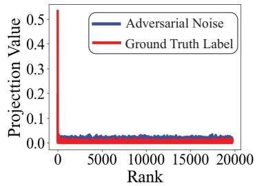

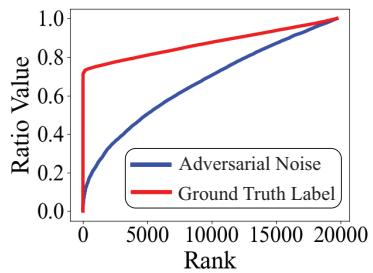  
Figure 3: Eigen-projection (left) and concentration ratio (right) of the ground truth label and the adversarial noise on Pubmed. The study is performed for Metattack with a perturbation ratio of 25%. By the rank $r = r _ { 0 } = 0 . 2$ min $\{ { \bar { N } } , { \bar { D ^ { \prime } } } \}$ , the signal concentration ratio of the ground truth label is 0.784. Results on Cora and Citeseer are illustrated in Figure 4 in Section F.1.

The full spectral diagnostics on Cora, Citeseer, and Pubmed are shown in Figure 4. The concentration of label information in leading eigendirections motivates a soft low rank bias in these experiments. It is neither a universal property of attacked graphs nor an assumption of Theorem 3.1.

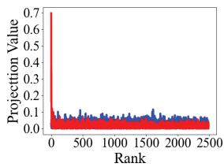

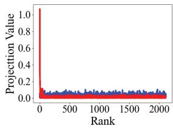

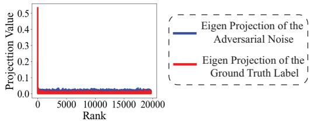

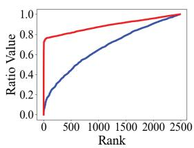  
(a) Cora

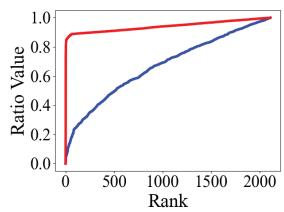  
(b) Citeseer

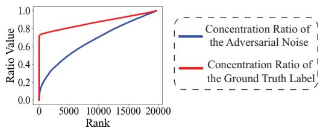  
(c) Pubmed  
Figure 4: Eigen-projection (first row) and concentration ratio (second row) of the ground truth label and the adversarial noise on Cora, Citeseer, and Pubmed. The study in this figure is performed for Metattack with a perturbation ratio of 25%. By the rank $r = r _ { 0 } = 0 . 2$ min $\{ N , { \dot { D ^ { \prime } } } \}$ , the signal concentration ratios of the ground truth label for Cora, Citeseer, and Pubmed are 0.844, 0.809, and 0.784 respectively.

## F.2 Detailed Semi-Supervised Node Classification Results

The detailed experiment results for the RGDM under the Metattack, Nettack, and Topology Attack are shown in Table 10, Table 11 and Table 12.

## F.3 Quality Evaluation of the Augmented Graph

This paper introduces a novel graph diffusion model named RGDM, which synthesizes the graph structures. The synthetic graph structures generated by the RGDM are subsequently combined with the original attacked graph to form an augmented graph. By incorporating an edge selection mechanism in the RGDM, we aim to improve the robustness of the GNNs trained on the augmented graphs against the graph adversarial attacks. In Section 4.1, we have shown that both the vanilla GCN and the robust GNNs trained on the augmented graph achieve significantly better performance for semisupervised node classification under graph adversarial attacks. In this section, we directly evaluate the data quality of the synthetic graph structures generated by the RGDM. In the visual domain, the Frechet Inception Distance (FID) is a widely used metric to evaluate the quality of the synthetic images generated by the generative models [95, 27]. The FID score measures the similarity between the distribution of the generated images and the distribution of the real images. To compute the FID score, the pre-trained Inception v3 [96] is used to extract the features from both the real images and the generated images, which are then modeled as the multivariate Gaussian distributions. The FID score is then calculated using the Frechet Distance (FD) [95] between the two multivariate Gaussian distributions modeling the real and the generated images [97]. A lower FID score indicates that the generated images are more similar to the real images, suggesting better quality.

Table 10: Node classification performance (Accuracy±Std) under the non-targeted poisoning attack (Metattack) [51]. The improvements of the RGDM over the corresponding baselines are attached in parentheses after the results of the RGDM.
<table><tr><td>Dataset</td><td>Ptb Rate (%)</td><td>GCN</td><td>GAT</td><td>RGCN</td><td>GCN-SVD</td><td>GraphBel</td><td>UAG</td><td>GCORNs</td><td>GADC</td><td>HANG</td><td>Pro-GNN</td><td>RGDM (GCN)</td><td>RGDM (HANG)</td><td>RGDM (Pro-GNN)</td></tr><tr><td rowspan="7">Cora</td><td>05</td><td>83.50±0.44 76.55±0.79</td><td>83.97±0.65 80.44±0.74</td><td>83.09±0.44 77.42±0.39</td><td>80.63±0.45 78.39±0.54</td><td>83.42±0.52 82.78±0.39</td><td>82.05±0.51 79.13±0.59</td><td>82.56±0.48 75.91±1.88</td><td>83.22±0.61 75.68±1.10</td><td>80.07±0.32 78.12±0.72</td><td>82.98±0.23 82.27±0.45</td><td>80.19±0.39(↑ 3.64) 85.23±0.44 (↑ 1.73)</td><td>82.31±0.51 (↑ 2.24) 81.04±0.59(↑ 2.92)</td><td>84.29±0.52 (↑ 1.31) 83.19±0.39(↑ 0.92)</td></tr><tr><td>10</td><td>70.39±1.28</td><td>75.61±0.59</td><td>72.22±0.38</td><td>71.47±0.83</td><td>77.91±0.86</td><td></td><td></td><td>75.96±0.62</td><td>79.03±0.59</td><td>76.73±0.38 (↑ 6.34)</td><td></td><td></td><td></td></tr><tr><td>15</td><td>65.10±0.71</td><td>69.78±1.28</td><td>66.82±0.39</td><td>66.69±1.18</td><td>76.01±1.12</td><td>75.16±0.76 71.03±0.64</td><td>74.63±1.02 72.57±1.24</td><td>73.70±1.17 71.39±1.22</td><td>72.89±0.96</td><td>76.40±1.27</td><td>69.37±0.39(↑ 4.27)</td><td>78.03±0.76(↑ 2.07) 76.39±0.64 (↑ 3.50)</td><td>81.16±0.86(↑ 2.13)</td></tr><tr><td>20</td><td>59.56±1.72</td><td>59.94±0.92</td><td>59.27±0.37</td><td>58.94±1.13</td><td></td><td>65.71±0.89</td><td>71.94±1.51</td><td></td><td>70.36±1.09</td><td>73.32±1.56</td><td></td><td></td><td>78.29±1.12(↑1.89)</td></tr><tr><td></td><td>47.53±1.91</td><td>54.78±0.74</td><td></td><td>52.06±1.19</td><td>68.78±1.84 56.54±1.58</td><td>60.82±1.08</td><td></td><td>71.20±1.49</td><td></td><td></td><td>65.97±0.37 (↑ 6.41)</td><td>73.25±0.89 (↑ 2.89)</td><td>74.85±1.84 (↑ 1.53)</td></tr><tr><td>25</td><td></td><td>73.26±0.83</td><td>50.51±0.78</td><td></td><td>72.26±0.83</td><td></td><td>69.48±1.94</td><td>68.29±1.36 73.05±0.30</td><td>68.72±1.87</td><td>69.72±1.69</td><td>61.42±0.78 (↑ 13.89)</td><td>70.44±1.08 (↑ 1.72)</td><td>72.31±1.58(↑2.59)</td></tr><tr><td>0 5</td><td>71.96±0.55 70.88±0.62</td><td>72.89±0.83</td><td>71.20±0.83 70.50±0.43</td><td>70.65±0.32 68.84±0.72</td><td>71.31±0.43</td><td>72.10±0.63 70.51±0.97</td><td>72.63±0.40 68.18±1.68</td><td>68.67±0.89</td><td>73.26±0.38 73.09±0.34</td><td>73.28±0.69 72.93±0.57</td><td>73.66±0.83 (↑ 1.70) 73.14±0.43(↑2.26)</td><td>74.21±0.63 (↑ 0.95) 74.04±0.97(↑ 0.95)</td><td>74.47±0.83 (↑ 1.19)</td></tr><tr><td>Citeseer</td><td>67.55±0.89</td><td>70.63±0.48</td><td>67.71±0.30</td><td>68.87±0.62</td><td>71.63±0.30</td><td>69.54±0.56</td><td>66.24±1.52</td><td>68.66±1.48</td><td>72.43±0.52</td><td>72.51±0.75</td><td>71.35±0.30 (↑ 3.80)</td><td>73.85±0.56(↑1.42)</td><td>74.29±0.43 (↑ 1.36) 74.03±0.30(↑ 1.52)</td></tr><tr><td></td><td>10 15</td><td>64.52±1.11 69.02±1.09</td><td>65.69±0.37</td><td>63.26±0.96</td><td></td><td>69.82±0.37 65.95±0.94</td><td>65.48±1.03</td><td>68.29±1.88</td><td>70.82±0.87</td><td>72.03±1.11</td><td>68.72±0.37 (↑ 4.20)</td><td>73.21±0.94 (↑ 2.39)</td><td>73.65±0.37 (↑ 1.62)</td></tr><tr><td></td><td>62.03±1.49</td><td>61.04±1.52</td><td>62.49±1.22</td><td>58.55±1.09</td><td>64.22±1.22</td><td>59.30±1.40</td><td>65.55±1.55</td><td>67.87±1.57</td><td>66.19±1.38</td><td>70.02±1.28</td><td>66.17±1.22 (↑ 4.14)</td><td>69.57±1.40 (↑ 3.38)</td><td>71.87±1.22 (↑ 1.85)</td></tr><tr><td>20 25</td><td>56.94±1.09</td><td>61.85±1.12</td><td>55.35±0.66</td><td>57.18±1.87</td><td>66.23±0.66</td><td>59.89±1.47</td><td>65.23±1.26</td><td>64.82±1.31</td><td>66.40±1.57</td><td>68.95±1.78</td><td>62.84±0.66 (↑ 5.90)</td><td>69.05±1.47(↑ 2.65)</td><td>70.24±0.66(↑ 1.29)</td></tr><tr><td>0 5</td><td>95.69±0.38</td><td>95.35±0.20</td><td>95.22±0.14</td><td>95.31±0.18</td><td>85.13±1.22</td><td>90.13±1.22</td><td>95.31±0.88</td><td>95.54±0.17</td><td>94.77±1.07</td><td>93.20±0.64</td><td>96.13±0.14(↑ 0.44)</td><td>94.95±1.22(↑0.18)</td><td>95.70±1.22 (↑ 2.50)</td></tr><tr><td></td><td>73.07±0.80</td><td>83.69±1.45</td><td>74.34±0.19</td><td>89.09±0.22</td><td>51.84±1.38</td><td>84.84±1.38 75.54±1.30</td><td>89.32±0.33</td><td>90.52±0.27</td><td>80.19±1.52</td><td>93.29±0.18</td><td>78.57±0.19 (↑ 5.50)</td><td>88.25±1.38 (↑ 8.06)</td><td>94.33±1.38(↑ 1.04)</td></tr><tr><td>Polblogs</td><td>10 15</td><td>70.72±1.13</td><td>76.32±0.85 68.80±1.14</td><td>71.04±0.34</td><td>81.24±0.49</td><td>56.54±1.30 53.41±1.08</td><td>66.41±1.08</td><td>87.34±1.77 86.30±1.45</td><td>74.92±1.32</td><td>89.42±1.09</td><td>74.33±0.34 (↑ 3.61)</td><td></td><td>80.47±1.30 (↑ 5.55)</td><td>91.35±1.30(↑ 1.93)</td></tr><tr><td></td><td>51.27±1.23</td><td>64.96±1.91</td><td></td><td>67.28±0.38 59.89±0.34</td><td>68.10±1.73 57.33±1.15</td><td>52.18±0.54</td><td>82.07±1.41</td><td>83.45±1.75</td><td>71.65±1.34 66.27±1.39</td><td>86.04±1.21 79.56±1.68</td><td>69.85±0.38 (↑ 4.89) 59.38±0.34 (↑ 8.11)</td><td>78.49±1.08 (↑ 6.84) 72.51±0.54 (↑ 6.24)</td><td>88.01±1.08(↑ 1.97)</td></tr><tr><td>25</td><td></td><td>51.50±1.63 51.19±1.49</td><td>56.02±0.56</td><td>48.66±1.93</td><td>51.39±1.36</td><td>58.18±0.54 55.39±1.36</td><td>69.92±1.26 66.59±1.74</td><td>72.84±1.24 65.52±1.93</td><td>65.80±1.33</td><td>63.18±1.40</td><td>56.47±0.56 (↑ 7.24)</td><td>70.79±1.36 (↑ 4.99)</td><td>81.34±0.54 (↑ 1.78) 66.92±1.36(↑3.74)</td></tr><tr><td>0</td><td>49.23±1.36</td><td>83.73±0.40</td><td>86.16±0.18</td><td>83.44±0.21</td><td>84.02±0.26</td><td>87.06±0.06</td><td>86.42±0.71</td><td>87.26±0.25</td><td>85.08±0.20</td><td>87.33±0.18</td><td>88.10±0.18(↑0.91)</td><td>87.15±0.11 (↑ 2.07)</td><td>88.41±0.26 (↑ 1.08)</td></tr><tr><td></td><td></td><td>87.19±0.09</td><td></td><td></td><td></td><td></td><td></td><td></td><td>85.08±0.18</td><td>87.25±0.09</td><td></td><td></td><td></td></tr><tr><td>Pubmed</td><td>5</td><td>83.09±0.13</td><td>78.00±0.44</td><td>81.08±0.20</td><td>83.41±0.15</td><td>83.91±0.26 84.62±0.26</td><td>86.39±0.06</td><td>82.96±0.89</td><td>81.64±0.64</td><td></td><td></td><td>86.99±0.20(↑ 3.90)</td><td>87.02±0.11 (↑ 1.94)</td><td>88.26±0.26(↑ 1.01)</td></tr><tr><td>10</td><td>81.21±0.09</td><td>74.93±0.38</td><td>77.51±0.27</td><td>83.27±0.21</td><td></td><td>85.70±0.07</td><td>80.76±1.65</td><td>80.43±1.64</td><td>85.17±0.23</td><td>87.25±0.09</td><td>85.83±0.27 (↑ 4.62)</td><td>87.13±0.14 (↑ 1.96)</td><td>88.15±0.26 (↑ 0.90)</td></tr><tr><td>15</td><td>78.66±0.12</td><td>71.13±0.51</td><td>73.91±0.25</td><td>83.10±0.18</td><td>84.83±0.20</td><td>84.76±0.08</td><td>76.82±1.83</td><td>75.72±1.24</td><td>85.00±0.22</td><td>87.20±0.09</td><td>84.97±0.25(↑ 6.31)</td><td>86.75±0.13(↑ 1.75)</td><td>88.09±0.20 (↑ 0.89)</td></tr><tr><td></td><td></td><td></td><td>68.21±0.96</td><td></td><td>83.01±0.22</td><td>84.89±0.45 83.88±0.05</td><td>71.28±1.52</td><td>72.80±1.89</td><td>85.20±0.19</td><td>87.15±0.15</td><td>82.45±0.31 (↑ 5.10)</td><td></td><td>88.00±0.45 (↑ 0.85)</td></tr><tr><td></td><td>20</td><td>77.35±0.19</td><td></td><td>71.18±0.31</td><td></td><td></td><td></td><td></td><td></td><td></td><td></td><td></td><td>86.13±0.11 (↑ 0.93)</td></tr><tr><td></td><td></td><td></td><td>65.41±0.77</td><td></td><td></td><td></td><td>83.66±0.06</td><td></td><td></td><td></td><td></td><td></td><td></td></tr><tr><td>25</td><td></td><td></td><td></td><td>67.95±0.15</td><td>82.72±0.18</td><td>85.07±0.15</td><td></td><td></td><td>85.06±0.17</td><td></td><td>81.52±0.15 (↑ 6.02)</td><td></td><td></td></tr><tr><td></td><td></td><td></td><td></td><td></td><td></td><td></td><td>70.75±1.86</td><td>71.60±1.50</td><td></td><td>86.76±0.19</td><td></td><td>86.26±0.12(↑ 1.20)</td><td></td></tr><tr><td></td><td></td><td>75.50±0.17</td><td></td><td></td><td></td><td></td><td></td><td></td><td></td><td></td><td></td><td></td><td>87.58±0.15 (↑ 0.82)</td></tr></table>

Table 11: Node classification performance (Accuracy±Std) under targeted attack (Nettack) [50]. The improvements of RGDM over the corresponding baselines are attached in parentheses after the results of the RGDM.
<table><tr><td>Dataset</td><td>Attack Budget</td><td>GCN</td><td>GAT</td><td>RGCN</td><td>GCN-SVD</td><td>GraphBel</td><td>UAG</td><td>GCORNs</td><td>GADC</td><td>HANG</td><td>Pro-GNN</td><td>RGDM (GCN)</td><td>RGDM (HANG)</td><td>RGDM (Pro-GNN)</td></tr><tr><td rowspan="7">Cora</td><td>0</td><td>81.43±1.04 75.06±1.02</td><td>82.14±1.13 76.04±1.08</td><td>81.34±1.55 76.75±1.71</td><td>81.10±1.34 77.23±1.82</td><td>71.55±1.01 63.73±1.25</td><td>82.34±1.08 81.75±1.16</td><td>82.61±0.41 81.05±1.14</td><td>81.36±1.83 80.05±1.53</td><td>80.75±1.27 76.99±1.16</td><td>84.78±0.59 83.85±0.51</td><td>83.43±1.08 (↑ 2.00) 78.41±1.16 (↑ 3.35)</td><td>82.10±1.34 (↑ 1.35) 80.39±1.82 (↑ 3.40)</td><td>86.00±1.13 (↑ 1.22)</td></tr><tr><td></td><td>70.60±1.10</td><td>70.24±1.43</td><td>70.96±1.14</td><td>72.53±1.60</td><td>62.41±1.94</td><td></td><td></td><td></td><td></td><td></td><td></td><td></td><td>84.79±1.08 (↑ 0.94)</td></tr><tr><td>123</td><td>67.95±1.72</td><td></td><td></td><td></td><td></td><td>77.96±1.84</td><td>78.47±1.32</td><td>75.90±1.29</td><td>76.51±1.60</td><td>78.65±0.66</td><td>73.79±1.84(↑ 3.19)</td><td>79.14±1.60 (↑ 2.63)</td><td>80.02±1.43 (↑ 1.37)</td></tr><tr><td></td><td></td><td>65.54±1.34 61.69±0.90</td><td>66.51±1.60</td><td>66.75±1.54</td><td>61.20±1.08</td><td>72.51±1.14</td><td>73.17±0.74</td><td>71.94±1.45</td><td>73.13±1.85</td><td>72.40±0.53</td><td>70.46±1.14 (↑ 2.51)</td><td>76.31±1.54(↑ 3.18)</td><td>74.31±1.34 (↑ 1.91)</td></tr><tr><td>4</td><td>61.57±1.47</td><td></td><td>59.28±1.68</td><td>60.72±1.63</td><td>56.51±1.72</td><td>70.28±1.52</td><td>71.26±0.62</td><td>70.93±1.19</td><td>72.53±1.14</td><td>70.12±0.66</td><td>64.37±1.52 (↑ 2.80)</td><td>75.12±1.63 (↑ 2.59)</td><td>72.79±0.90 (↑ 2.67)</td></tr><tr><td>5</td><td>55.54±1.66</td><td>58.31±1.03</td><td>55.30±1.66</td><td>57.71±1.82</td><td>51.93±1.77</td><td>66.30±1.21</td><td>66.89±1.08</td><td>64.49±1.42</td><td>68.80±1.55</td><td>66.89±0.73</td><td>59.44±1.21 (↑ 3.90)</td><td>69.81±1.82 (↑ 1.01)</td><td>69.81±1.03 (↑ 2.92)</td></tr><tr><td>0</td><td>81.02±1.35</td><td>82.26±1.04</td><td>80.25±1.12</td><td>81.08±1.34</td><td>76.55±1.23</td><td>81.25±1.12</td><td>81.94±1.17</td><td>80.63±1.04</td><td>81.09±1.12</td><td>82.12±0.81</td><td>82.87±1.12(↑ 1.85)</td><td>82.84±1.34(↑ 1.75)</td><td>83.05±1.04 (↑ 0.93)</td></tr><tr><td></td><td>78.41±1.62</td><td>81.27±1.38</td><td>78.25±0.73</td><td>80.16±1.04</td><td>68.89±1.67</td><td>80.25±0.73</td><td>80.79±0.89</td><td>79.02±1.84</td><td>79.05±1.38</td><td>81.75±0.79</td><td>80.39±0.73 (↑ 1.98)</td><td>81.40±1.04 (↑ 2.35)</td><td>82.47±1.38 (↑ 0.72)</td></tr><tr><td>Citeseer</td><td></td><td>74.92±1.54</td><td>77.43±1.89</td><td>75.40±1.04</td><td>79.84±0.73</td><td>67.62±1.11</td><td>79.40±1.04</td><td>79.65±1.84</td><td>78.22±1.29</td><td>77.94±1.29 81.27±0.95</td><td>77.15±1.04 (↑ 2.23)</td><td>80.11±0.73 (↑ 2.17)</td><td></td><td>82.30±1.89 (↑ 1.03)</td></tr><tr><td>123</td><td></td><td>63.97±1.69</td><td>60.85±1.99</td><td>60.31±1.19</td><td>77.14±1.86</td><td>60.63±1.87</td><td>78.31±1.19</td><td>78.10±1.06</td><td>78.11±1.39</td><td>77.14±1.48</td><td>79.68±1.98 68.53±1.19 (↑ 4.56)</td><td></td><td>78.95±1.86 (↑ 1.81)</td><td>80.85±1.99 (↑ 1.17)</td></tr><tr><td>45</td><td>55.40±1.60</td><td></td><td>61.59±1.64</td><td>55.49±1.75</td><td>69.52±1.31</td><td>53.17±1.48</td><td>77.49±1.75</td><td>77.75±1.66</td><td>77.49±1.54</td><td>78.41±1.62 77.78±1.84</td><td></td><td>59.57±1.75(↑ 4.17)</td><td>78.99±1.31 (↑ 0.58)</td><td>79.11±1.64 (↑ 1.33)</td></tr><tr><td></td><td></td><td>47.62±1.17</td><td>55.56±1.28</td><td>47.44±1.01</td><td>69.21±1.48</td><td>48.73±1.60</td><td>71.44±1.01</td><td>71.66±1.79</td><td>70.54±1.57</td><td>73.49±1.48</td><td>71.27±1.99</td><td>55.71±1.01 (↑ 8.09)</td><td>75.92±1.48 (↑ 2.43)</td><td>74.60±1.28 (↑ 3.33)</td></tr><tr><td rowspan="3">Polblogs</td><td>0</td><td>97.03±0.24</td><td>97.25±0.32</td><td>97.04±0.11</td><td>97.50±0.22</td><td>71.35±1.01</td><td>97.11±0.11</td><td>97.52±0.26</td><td>97.38±0.34</td><td>97.41±0.50</td><td>97.12±0.15</td><td>97.69±0.11 (↑ 0.66)</td><td>97.65±0.22 (↑ 0.24)</td><td>97.80±0.32 (↑ 0.68)</td></tr><tr><td></td><td>96.83±0.17</td><td>97.22±0.25</td><td>97.00±0.07</td><td>97.56±0.20</td><td>68.17±1.25</td><td>96.00±0.07</td><td>97.61±0.59</td><td>97.18±0.35</td><td>97.37±0.37</td><td>96.83±0.06</td><td>97.67±0.07 (↑ 0.84)</td><td>97.63±0.20(↑ 0.26)</td><td>97.69±0.25 (↑ 0.86)</td></tr><tr><td>123</td><td>95.61±0.20</td><td>96.11±0.65</td><td>95.87±0.23</td><td>97.12±0.09</td><td>65.48±1.85</td><td>97.02±0.23</td><td>96.08±0.45</td><td>95.37±0.59</td><td>96.89±0.16</td><td>97.17±0.12</td><td>97.10±0.23 (↑ 1.49)</td><td>97.24±0.09(↑ 0.35)</td><td>97.58±0.65 (↑ 0.41)</td></tr><tr><td></td><td></td><td>95.41±0.18</td><td>95.81±0.56</td><td>95.59±0.27</td><td>96.61±0.14</td><td>62.59±1.99</td><td>96.59±0.27</td><td>95.65±1.01</td><td>95.47±0.13</td><td>96.65±0.15</td><td>96.93±0.12</td><td>96.99±0.27 (↑ 1.58)</td><td>97.01±0.14(↑ 0.36)</td><td>97.22±0.56(↑0.29)</td></tr><tr><td rowspan="7"></td><td>4 5</td><td>94.24±0.24</td><td>94.80±0.66 93.28±1.43</td><td>94.37±0.26 93.20±0.43</td><td>96.17±0.19</td><td>58.68±0.40</td><td>96.07±0.26</td><td>94.44±0.53</td><td>94.97±0.61</td><td>96.26±0.53</td><td>96.89±0.16</td><td>95.44±0.26 (↑ 1.20)</td><td>97.03±0.19(↑ 0.77)</td><td>97.12±0.66 (↑ 0.23)</td></tr><tr><td></td><td>93.00±0.48</td><td></td><td></td><td>95.13±0.25</td><td>59.02±1.19</td><td>95.60±0.43</td><td>93.42±0.85</td><td>93.27±0.46</td><td>95.91±0.33</td><td>96.13±0.25</td><td>94.90±0.43 (↑ 1.90)</td><td>96.70±0.25(↑ 0.79)</td><td>96.88±1.43 (↑ 0.75)</td></tr><tr><td></td><td>88.13±1.35</td><td>87.03±1.13</td><td>84.87±1.35</td><td>87.27±1.74</td><td>85.47±1.45</td><td>87.31±1.35</td><td>84.56±1.39</td><td>85.49±1.16</td><td>85.35±1.20</td><td>88.46±1.20</td><td>89.21±1.35 (↑ 1.08)</td><td>87.28±1.74 (↑ 1.93)</td><td>89.58±1.13 (↑ 1.12)</td></tr><tr><td>0123</td><td>87.04±1.62 84.12±1.54</td><td>84.95±1.08</td><td>83.75±1.71</td><td>84.15±1.25</td><td>84.34±1.33</td><td>86.57±1.71</td><td>83.88±1.94</td><td>84.58±1.28</td><td>84.42±1.01</td><td>87.58±1.01</td><td>88.03±1.71 (↑ 0.99)</td><td>86.88±1.25 (↑ 2.46)</td><td>88.80±1.08(↑ 1.22)</td></tr><tr><td></td><td>81.25±1.69</td><td>83.90±1.43</td><td>84.21±1.14</td><td>83.90±1.94</td><td>84.27±1.25</td><td>85.21±1.14</td><td>84.40±1.73</td><td>84.17±1.53</td><td>84.38±1.05</td><td>85.87±1.05</td><td>85.33±1.14 (↑ 1.21)</td><td>86.35±1.94 (↑ 1.97)</td><td>87.14±1.43 (↑ 1.27)</td></tr><tr><td>45</td><td>76.35±1.60</td><td>81.27±1.34</td><td>82.48±1.60</td><td>81.22±1.08</td><td>84.11±1.67</td><td>83.88±1.60</td><td>82.26±1.49</td><td>84.35±1.33</td><td>84.01±1.12</td><td>84.35±1.12</td><td>83.37±1.60 (↑ 2.12)</td><td>85.21±1.08(↑ 1.20)</td><td>85.79±1.34 (↑ 1.44)</td></tr><tr><td></td><td></td><td>78.54±0.90 74.25±1.03</td><td>80.02±1.68 73.14±1.66</td><td>77.02±1.72 71.84±1.77</td><td>79.03±1.22 70.11±1.36</td><td>80.00±1.32 72.20±1.39</td><td>81.06±1.72 72.28±1.13</td><td>78.01±1.20 71.26±1.61</td><td>79.73±1.31 70.59±1.31</td><td>80.04±1.31 72.18±1.31</td><td>78.45±1.32(↑ 2.10) 71.42±1.39 (↑ 3.10)</td><td>81.65±1.23(↑ 1.92) 74.43±1.34 (↑ 3.84)</td><td>81.95±0.90 (↑ 1.91) 76.27±1.03 (↑ 4.09)</td></tr></table>

Table 12: Node classification performance (Accuracy±Std) under Topology Attack [85]. The improvements of the RGDM over the corresponding baselines are attached in parentheses after the results of the RGDM.
<table><tr><td>Dataset</td><td>|Ptb Rate (%)</td><td>GCN</td><td>GAT</td><td>RGCN</td><td>GCN-SVD</td><td>GraphBel</td><td>UAG</td><td>GCORNs</td><td>GADC</td><td>HANG</td><td>Pro-GNN</td><td>RGDM(GCN)</td><td>RGDM(HANG)</td><td>RGDM(Pro-GNN)</td></tr><tr><td rowspan="7">Cora</td><td rowspan="7">05 10 15</td><td>83.50±0.44 75.50±0.44</td><td>83.97±0.65 76.97±0.65</td><td>83.09±0.44 75.04±1.32</td><td>80.63±0.45 75.82±1.24</td><td>83.42±0.52 77.01±1.33</td><td>82.05±0.51 76.22±1.24</td><td>82.63±0.47 75.96±1.81</td><td>83.21±0.72 76.83±1.25</td><td>80.07±0.32 76.99±1.52</td><td>82.98±0.23 77.63±1.85</td><td>85.23±0.44 (↑ 1.73) 77.92±1.08 (↑ 2.42)</td><td>82.31±0.51 (↑ 2.24) 79.39±1.33 (↑ 2.40)</td><td>84.29±0.52 (↑ 1.31) 81.10±1.16(↑ 3.47)</td></tr><tr><td>72.02±1.32</td><td>74.10±1.84</td><td>73.05±1.25</td><td>74.00±1.76</td><td>74.00±1.57</td><td>76.00±1.76</td><td></td><td></td><td></td><td>74.22±1.43 (↑ 2.20)</td><td></td><td>79.44±1.57(↑ 2.45)</td><td>80.36±1.84 (↑ 2.73)</td></tr><tr><td>69.42±1.71</td><td>70.55±1.69</td><td>71.61±1.34</td><td>72.90±1.46</td><td>72.79±1.26</td><td>74.90±1.33</td><td>74.67±1.03 72.58±1.27</td><td>75.90±1.84 74.34±1.52</td><td>76.99±1.52 75.63±1.59</td><td>77.63±1.85 75.40±1.32</td><td>72.42±1.34 (↑ 3.00)</td><td>76.92±1.26 (↑ 1.29)</td><td>76.57±1.14 (↑ 1.17)</td></tr><tr><td>67.61±1.02</td><td>68.84±1.33</td><td>67.87±1.22</td><td>70.00±1.83</td><td>70.55±1.17</td><td>71.85±1.22</td><td>71.99±1.54</td><td>72.06±1.80</td><td>72.15±1.27</td><td></td><td>71.61±0.90 (↑ 4.00)</td><td></td><td></td></tr><tr><td></td><td>65.51±1.45</td><td>66.02±1.39</td><td>67.89±1.21</td><td>66.32±1.07</td><td>68.03±1.39</td><td>69.47±1.98</td><td>68.92±1.27</td><td>69.10±1.33</td><td>71.32±1.79 68.72±1.50</td><td>69.53±1.03 (↑ 4.72)</td><td>74.35±1.17(↑ 2.20)</td><td>74.44±1.52(↑ 3.12)</td></tr><tr><td>64.81±1.14</td><td></td><td></td><td></td><td></td><td></td><td></td><td></td><td></td><td></td><td></td><td>71.67±1.07 (↑ 2.57)</td><td>72.07±1.21 (↑ 3.35)</td></tr><tr><td>71.96±0.55</td><td>73.26+0.83</td><td>7120+0.83</td><td>70.65+0.32</td><td>72.26±0.83 69.76±1.48</td><td>72.10±0.63 71.32±0.83</td><td>72.71+0.53 68.16±1.68</td><td>72.54+0.21 69.57±1.38</td><td>73.26+0.38</td><td>73.28±0.69</td><td>73.66±0.83 (↑ 1.70)</td><td>74.21±0.63 (↑ 0.95)</td><td>74.47±0.83 (↑ 1.19)</td></tr><tr><td rowspan="8">05 Citeseer 10 15</td><td>67.96±0.59 64.10±1.34</td><td>68.15±0.89 66.67±1.35</td><td>68.20±0.83 65.92±1.86</td><td>68.65±1.32 66.57±1.35</td><td>66.59±1.98</td><td>67.86±1.86</td><td>66.26±1.54</td><td></td><td>69.36±1.20</td><td>71.24±1.13</td><td>69.76±1.38 (↑ 1.80)</td><td>72.10±1.48 (↑ 2.74)</td><td>72.77±0.73 (↑ 1.53)</td></tr><tr><td>61.12±1.37</td><td>63.62±1.47</td><td>64.64±1.72</td><td>65.88±1.16</td><td>65.37±1.34</td><td>66.43±1.72</td><td>65.49±1.08</td><td>68.06±1.46 66.99±1.25</td><td>67.52±1.20 66.89±1.03</td><td>68.19±1.13 66.95±1.85</td><td>67.30±1.89 (↑ 3.20) 65.29±1.99 (↑ 4.17)</td><td>68.53±1.98 (↑ 1.01) 68.25±1.34 (↑ 1.36)</td><td>69.32±1.04 (↑ 1.13)</td></tr><tr><td>60.26±1.44</td><td>61.85±1.35</td><td>62.93±1.01</td><td>64.66±1.35</td><td>63.99±1.44</td><td>64.00±1.01</td><td>65.58±1.55</td><td>65.35±1.44</td><td>66.37±1.04</td><td>65.89±1.25</td><td>63.55±1.64 (↑ 3.29)</td><td>68.17±1.44 (↑ 1.80)</td><td>68.89±1.19 (↑ 1.94) 68.44±1.75 (↑ 2.55)</td></tr><tr><td>59.02±1.39</td><td>59.10±1.24</td><td>60.87±1.37</td><td>63.22±1.24</td><td>63.01±1.26</td><td>62.85±1.37</td><td>64.28±1.23</td><td>64.25±1.23</td><td>65.11±1.79</td><td>64.93±1.70</td><td>63.02±1.28 (↑ 4.00)</td><td>65.24±1.26 (↑ 0.13)</td><td>66.59±1.01 (↑ 1.66)</td></tr><tr><td>95.69±0.38</td><td></td><td>95.35±0.20 95.22±0.14</td><td>95.31±0.18</td><td>85.13±1.22</td><td>90.13±1.22</td><td>95.36±0.82</td><td>95.13±0.85</td><td>94.77±1.07</td><td>93.20±0.64</td><td>96.13±0.14 (↑ 0.44)</td><td>94.95±1.22 (↑ 0.18)</td><td></td></tr><tr><td></td><td>87.69±0.38</td><td>88.35±0.20</td><td>89.22±0.14 90.15±0.18</td><td>85.01±1.22</td><td>90.31±0.14</td><td>89.35±0.32</td><td>90.05±0.20</td><td>90.31±1.31</td><td>90.85±1.39</td><td>89.72±0.25 (↑ 2.03)</td><td>92.27±1.22 (↑ 1.96)</td><td>95.70±1.22(↑ 2.50) 92.36±0.07 (↑ 1.51)</td></tr><tr><td>05 10 71.55±1.70</td><td>84.64±1.69</td><td>85.88±1.40</td><td>85.85±1.91 86.02±1.33</td><td>84.56±1.66</td><td>87.00±1.91</td><td>87.33±1.74</td><td>86.68±1.36</td><td>86.71±1.27</td><td>87.09±1.41</td><td>87.71±0.65 (↑ 3.07)</td><td>88.75±1.66 (↑ 2.04)</td><td>89.33±0.23 (↑ 2.24)</td></tr><tr><td rowspan="8">15 20 25</td><td>65.00±1.03</td><td>72.01±0.20</td><td>72.10±1.80 67.32±1.15</td><td>78.18±1.89</td><td>79.89±1.75 71.25±1.82</td><td>81.95±1.80</td><td>82.04±1.47</td><td>82.12±1.99</td><td>82.26±1.55</td><td>83.31±1.87</td><td>76.58±0.56 (↑ 5.03)</td><td>84.11±1.75 (↑ 1.85)</td><td>84.27±0.27 (↑ 0.96)</td></tr><tr><td>64.02±1.35</td><td></td><td>67.12±1.21 66.10±1.11</td><td>69.35±1.32 67.20±1.44</td><td>68.39±1.01</td><td>71.51±1.15 69.02±1.11</td><td>69.98±1.22 66.55±1.79</td><td>69.42±1.39 68.22±1.47</td><td>72.59±1.12 70.80±1.33</td><td>72.45±1.69 69.37±1.01</td><td>69.44±0.66 (↑ 4.44) 67.92±1.43 (↑ 3.90)</td><td>73.26±1.82 (↑ 0.67) 71.92±1.01 (↑ 1.12)</td><td>73.81±0.26 (↑ 1.36) 72.21±0.43(↑2.84)</td></tr><tr><td></td><td></td><td>64.16±1.13</td><td></td><td></td><td></td><td></td><td></td><td></td><td></td><td></td><td></td><td></td></tr><tr><td>0 5</td><td>87.19±0.09</td><td>83.73±0.40</td><td>86.16±0.18</td><td>83.44±0.21</td><td>84.02±0.26</td><td>87.06±0.06</td><td>86.43±0.72</td><td>86.74±0.15</td><td>85.08±0.20 87.33±0.18</td><td>88.10±0.18 (↑ 0.91)</td><td>87.15±0.11 (↑ 2.07)</td><td>88.41±0.26 (↑ 1.08)</td></tr><tr><td>10</td><td>79.19±0.09</td><td>80.73±0.40</td><td>80.16±0.18</td><td>81.44±0.21</td><td>80.02±0.26</td><td>82.44±0.18</td><td>82.96±0.86</td><td>82.42±0.21</td><td>82.17±1.02</td><td>83.13±1.67</td><td>81.32±1.08 (↑ 2.13)</td><td>83.15±0.26 (↑ 0.98) 84.33±1.71 (↑ 1.20)</td></tr><tr><td>15</td><td>75.42±1.40</td><td>76.85±1.59</td><td>77.93±1.40</td><td>80.25±1.34</td><td>78.40±1.70</td><td>80.45±1.40</td><td>80.74±1.66</td><td>80.81±1.30</td><td>80.59±1.84</td><td></td><td></td><td>82.10±1.70(↑ 1.51)</td></tr><tr><td></td><td>71.96±1.55</td><td></td><td>75.75±1.60</td><td>75.21±1.22 72.03±1.52</td><td>73.97±1.76</td><td>71.62±1.49</td><td></td><td></td><td></td><td>77.09±1.32</td><td>75.47±1.34 (↑ 3.51)</td><td>78.49±1.76 (↑ 1.18)</td></tr><tr><td rowspan="4"></td><td rowspan="4">20 25</td><td></td><td></td><td></td><td></td><td></td><td></td><td></td><td></td><td></td><td>81.26±1.59</td><td>78.22±1.43 (↑ 2.80)</td><td></td><td>82.74±1.14 (↑ 1.48)</td></tr><tr><td></td><td>72.34±1.55</td><td></td><td></td><td></td><td>76.89±1.60</td><td>76.87±1.82</td><td>76.90±1.25</td><td>77.31±1.35</td><td></td><td></td><td></td><td>78.88±1.60 (↑ 1.79)</td></tr><tr><td>68.46±0.65</td><td>68.99±1.72</td><td>70.03±1.49</td><td></td><td>71.32±1.60</td><td></td><td>71.28±1.58</td><td>73.02±1.52</td><td>73.20±1.75</td><td>72.85±1.14</td><td>73.91±0.90 (↑ 5.45)</td><td>74.81±1.60 (↑ 1.61) 73.96±1.51 (↑ 1.27)</td><td>74.90±1.32 (↑ 2.05)</td></tr><tr><td>69.01±1.03</td><td>68.16±1.01</td><td>69.02±1.18</td><td>71.02±1.32</td><td>70.01±1.51</td><td>70.86±1.18</td><td>70.76±1.85</td><td>72.85±1.31</td><td>72.69±1.12</td><td>71.66±1.67</td><td>72.43±1.03 (↑ 3.42)</td><td></td><td>74.24±1.39 (↑ 2.58)</td></tr></table>

Quality Evaluation of the Synthetic Nodes. Although the Inception model cannot be applied to the graph data, we can replace the Inception model in the computation of the FID score with the pre-trained GCN [47] for extracting node features to adapt the metric to evaluate the quality of synthetic nodes generated by the RGDM. To this end, we define the Frechet Node Distance (FND), which is the FD between the multivariate Gaussians modeling the node features extracted by pretrained GCN. We randomly split the nodes in the original clean graph into two partitions of equal size, which are the base partition and the test partition. To mitigate the influence of the randomness, we compute the FND scores with 10 different random splits and report the mean and the standard deviation of the FND scores across different runs. The FND computed between the nodes in the test partition and the base partition of the original clean graph establishes the baseline of the expected FND score for high-quality nodes. By computing the FND score between the features of nodes in the synthetic graph structures generated by the RGDM and the features of nodes in the base partition of the original clean graph, we evaluate the quality of the synthetic nodes in the synthetic graph structures. For simplicity, we refer to the FND score for the synthetic nodes as the FND between their features and the features of the nodes in the base partition of the original clean graph.

To show the effectiveness of the robustness loss in the training of the RGAE for the RGDM, we also compute the FND for the nodes in the synthetic graph structures generated by the RGDM without the node robustness loss and the edge robustness loss. To demonstrate the advantages of the RGDM over the vanilla diffusion model, the DDPM [27], we train a baseline DDPM model on the input node attributes of the original attacked graph and synthesize the same number of synthetic nodes as the RGDM. The synthetic edges are then generated by connecting each synthetic node to its Knearest neighbors in the original attacked graph using the K-nearest neighbors (KNN) algorithm with $K = \bar { \lceil { d _ { \mathrm { a v e } } } \rceil }$ , where $d _ { \mathrm { a v e } }$ is the average degree of the original clean graph. The synthetic graph structures, including the synthetic nodes and edges generated by the baseline DDPM model, are combined with the original attacked graph to form the augmented graph. Next, we compute the FND score for the nodes in the synthetic graph structures generated by the baseline DDPM model. In addition, we compute FND for nodes generated by the four baseline node augmentation methods, which are the iGraphMix [12], ImGAGN [42], Graphsmote [43], and SNS [45]. We also calculate the FND score for nodes in the original attacked graph. We use the same GCN [47] pre-trained on the original clean graph to extract the node features for computing the FND score. The ablation study is performed on the original attacked graph perturbed by the Metattack with a perturbation rate of 25%.

Table 13: Frechet Node Distance (FND) to the nodes in the base partition of the original clean graph. The mean and standard deviation of the FND scores computed with 10 different random splits of the base partition and the test partition in the original clean graph are reported. The evaluation is performed for Metattack with a perturbation rate of 25%. The FND score for the original clean graph is computed between the nodes in the test partition and the nodes in the base partition of the original clean graph.
<table><tr><td>Data</td><td>Cora</td><td>Citeseer</td><td>Polblogs</td><td>Pubmed</td></tr><tr><td>Original Attacked Graph</td><td>12.10±0.45</td><td>7.53±0.22</td><td>8.26±0.37</td><td> $6 . 1 1 \pm 0 . 3 8$ </td></tr><tr><td>iGraphMix [12]</td><td>13.44±0.33</td><td>9.02±0.42</td><td>10.75±0.44</td><td>7.65±0.38</td></tr><tr><td>ImGAGN [42]</td><td>13.10±0.38</td><td>7.96±0.42</td><td>9.86±0.43</td><td>6.95±0.27</td></tr><tr><td>Graphsmote [43]</td><td>13.52±0.42</td><td>8.95±0.22</td><td>10.60±0.27</td><td>7.45±0.51</td></tr><tr><td>SNS [45]</td><td>13.35±0.42</td><td>7.88±0.27</td><td>9.30±0.85</td><td>6.74±0.41</td></tr><tr><td>Baseline DDPM</td><td>13.28±0.40</td><td>8.82±0.26</td><td>10.25±0.39</td><td>7.25±0.41</td></tr><tr><td>RGDM (w/o Robustness Loss)</td><td>11.17±0.46</td><td>6.15±0.31</td><td>8.06±0.44</td><td>5.89±0.35</td></tr><tr><td>RGDM (w/o Node Robustness Loss)</td><td>10.02±0.38</td><td>5.89±0.28</td><td>6.95±0.35</td><td>5.01±0.36</td></tr><tr><td>RGDM (w/o Edge Robustness Loss)</td><td>9.67±0.27</td><td>5.18±0.49</td><td>6.65±0.25</td><td>5.11±0.38</td></tr><tr><td>RGDM</td><td>8.16±0.29</td><td>4.44±0.32</td><td>4.35±0.18</td><td> $\mathbf { 3 . 9 5 { \pm 0 . 4 3 } }$ </td></tr><tr><td>Original Clean Graph</td><td> $7 . 9 0 { \pm } 0 . 3 1 $ </td><td> $4 . 2 8 { \pm } 0 . 2 5 $ </td><td> $4 . 1 6 { \pm } 0 . 2 7$ </td><td> $3 . 7 9 2 0 . 3 5$ </td></tr></table>

The evaluation results are shown in Table 13, where the lower FND scores indicate the node features are more similar to the features of nodes in the base partition of the original clean graph. The FND score of the nodes in the synthetic graph structures generated by the RGDM is closest to the FND score of the original clean graph, which demonstrates that the RGDM generates faithful synthetic nodes. For example, the FND score for the RGDM on Pubmed is 3.95, which is only 4.2% higher than 3.79, which is the FND score of the original clean graph. In addition, we have several key observations from Table 13. First, the synthetic nodes generated by the baseline DDPM are even worse than the original attacked graph. This is because the DDPM is trained on the original attacked graph without any robustness adaptations, and the noises in the original attacked graph are propagated to the synthetic nodes in the augmented graph. Second, the robustness loss is critical in generating clean augmented graphs. Without either the node robustness loss or the edge robustness loss, the synthetic nodes generated by the ablation models are worse than the synthetic nodes generated by the RGDM. This observation proves that both the node robustness loss and the edge robustness los are beneficial for improving the quality of the synthetic nodes in the synthetic graph structures generated by the RGDM, as mentioned in Section 3.2. Third, the synthetic nodes generated by RGDM are significantly more faithful than those generated by the baseline node-level graph augmentation methods.

Quality Evaluation of the Synthetic Edges. Similar to the design of the FND score for evaluating the quality of synthetic nodes, we replace the Inception model in the computation of FID with the pre-trained GNN [98] for edge feature extraction to adapt the metric to evaluate the quality of the synthetic edges generated by the RGDM. To this end, we define Frechet Edge Distance (FED), which is the FD between the multivariate Gaussians modeling the edge features extracted by pretrained GNN. Similar to the evaluation of the FND, we randomly split the edges in the original clean graph into two partitions of equal size, which are the base partition and the test partition. To mitigate the influence of the randomness, we compute the FED scores with 10 different random splits and report the mean and the standard deviation of the FED across different runs. The FED computed between the edges in the test partition and the edges in the base partition of the original clean graph establishes the baseline of the expected FED score for the high-quality edges. By computing the FED between the features of edges in the synthetic graph structures generated by the RGDM and the features of edges in the base partition of the original clean graph, we evaluate the quality of the edges in the synthetic graph structures. For simplicity, we refer to the FED score for the synthetic edges as the FED between their features and the features of edges in the base partition of the original clean graph. Similar to the evaluation of the synthetic nodes, we also compute the FED score for the edges in the synthetic graph structures generated by the RGDM without the node robustness loss or the edge robustness loss. We compute the FED score for the edges in the synthetic graph structures generated by the baseline DDPM model. Since the edges in the synthetic graph structures are generated by the KNN algorithm, we evaluate the baseline DDPM models using different values of K from $\{ \lceil { \dot { d } } _ { \mathrm { a v e } } / 4 \rceil , \lceil d _ { \mathrm { a v e } } / 2 \rceil , \lceil d _ { \mathrm { a v e } } \rceil , \lceil 2 \times d _ { \mathrm { a v e } } \rceil , \lceil 4 \times d _ { \mathrm { a v e } } \rceil \}$ . In addition, we compute FED for edges generated by the four baseline node augmentation methods, which are the iGraphMix [12], ImGAGN [42], Graphsmote [43], and SNS [45]. We also calculate the FED score for nodes in the original attacked graph. The FED score for edges in the original attacked graph is also computed. We use the same NBFNet [98] pre-trained on the original clean graph to extract the edge features for computing the FED score. The ablation study is performed on the original attacked graph perturbed by the Metattack with a perturbation rate of 25%.

Table 14: Frechet Edge Distance (FED) to the edges in the base partition of the original clean graph. The mean and standard deviation of the FED scores computed with 10 different random splits of the base partition and the test partition in the original clean graph are reported. The evaluation is performed for Metattack with a perturbation rate of 25%. The FED score for the original clean graph is computed between the edges in the test partition and the edges in the base partition of the original clean graph.
<table><tr><td>Data</td><td>Cora</td><td>Citeseer</td><td>Polblogs</td><td>Pubmed</td></tr><tr><td>Original Attacked Graph</td><td> $1 0 . 3 2 { \pm } 0 . 4 2$ </td><td> $7 . 8 3 { \pm } 0 . 2 8 $ </td><td> $8 . 9 2 { \pm } 0 . 3 9$ </td><td> $6 . 5 3 { \pm } 0 . 3 7$ </td></tr><tr><td>iGraphMix [12]</td><td> $1 1 . 2 5 { \pm } 0 . 2 8 $ </td><td> $8 . 4 2 { \pm } 0 . 4 3$ </td><td> $9 . 6 3 { \pm } 0 . 4 4$ </td><td> $7 . 1 1 { \pm } 0 . 2 7$ </td></tr><tr><td>ImGAGN [42]</td><td> $1 1 . 0 5 { \pm } 0 . 3 8 $ </td><td> $8 . 0 4 \pm 0 . 2 6$ </td><td> $8 . 2 1 { \pm } 0 . 5 1 $ </td><td> $7 . 1 6 { \pm } 0 . 7 9$ </td></tr><tr><td>Graphsmote [43]</td><td> $1 1 . 1 3 { \pm } 0 . 2 9 $ </td><td> $8 . 1 6 { \pm } 0 . 5 1$ </td><td> $9 . 3 2 { \pm } 0 . 4 1$ </td><td> $7 . 1 8 { \pm } 0 . 4 4$ </td></tr><tr><td>SNS [45] Baseline DDPM  $( K = \lceil d _ { \mathrm { a v e } } / 4 \rceil )$ </td><td>11.05±0.38</td><td> $8 . 0 4 \pm 0 . 2 6$ </td><td> $8 . 2 1 { \pm } 0 . 5 1 $ </td><td> $7 . 1 6 { \pm } 0 . 7 9$ </td></tr><tr><td>Baseline DDPM  $\dot { ( K = \left\lceil d _ { \mathrm { a v e } } / 2 \right\rceil ) }$ </td><td> $1 2 . 0 3 { \pm } 0 . 4 5 $ </td><td> $8 . 7 2 { \pm } 0 . 3 1$ </td><td> $1 0 . 7 7 { \scriptstyle \pm 0 . 4 0 }$ </td><td> $7 . 9 3 { \pm } 0 . 4 2$ </td></tr><tr><td></td><td> $1 1 . 2 7 { \pm } 0 . 3 8 $ </td><td> $8 . 4 9 { \pm } 0 . 2 7$ </td><td> $9 . 3 2 { \pm } 0 . 3 5 $ </td><td> $7 . 2 8 { \pm } 0 . 3 4 $ </td></tr><tr><td>Baseline  $\mathrm { D D P M } ( K = \lceil d _ { \mathrm { a v e } } \rceil )$ </td><td> $1 0 . 3 9 { \pm } 0 . 4 0 $ </td><td> $7 . 9 6 { \pm } 0 . 3 0 $ </td><td> $8 . 9 7 { \pm } 0 . 3 7$ </td><td> $6 . 8 3 { \pm } 0 . 3 3 $ </td></tr><tr><td>Baseline  $\mathsf { D D P M } ( K = \left\lceil 2 \times \mathsf { \dot { d } } _ { \mathrm { a v e } } \right\rceil )$ </td><td> $1 0 . 4 7 { \pm } 0 . 3 6 $ </td><td> $7 . 9 3 { \pm } 0 . 2 9$ </td><td> $9 . 2 1 { \pm } 0 . 3 6 $ </td><td> $6 . 9 1 { \pm } 0 . 3 5$ </td></tr><tr><td>Baseline DDPM  $( K = \bar { \lceil 4 \times d _ { \mathrm { a v e } } \rceil } )$ </td><td> $1 0 . 8 8 { \pm } 0 . 4 1 $ </td><td> $8 . 0 1 { \pm } 0 . 3 2 $ </td><td> $9 . 3 8 { \pm } 0 . 3 8 $ </td><td> $7 . 0 8 { \pm } 0 . 3 8 $ </td></tr><tr><td>RGDM (w/o Robustness Loss)</td><td> $1 0 . 0 7 { \pm } 0 . 3 9$ </td><td> $7 . 6 4 \pm 0 . 2 6$ </td><td> $8 . 7 4 \pm 0 . 3 3$ </td><td> $6 . 2 7 { \pm } 0 . 3 1$ </td></tr><tr><td>RGDM (w/o Node Robustness Loss)</td><td> $\underline { { 8 . 8 7 \pm 0 . 3 5 } }$ </td><td> $6 . 7 3 { \pm } 0 . 2 5 $ </td><td> $7 . 9 3 { \pm } 0 . 3 1$ </td><td> $5 . 7 8 { \pm } 0 . 3 2 $ </td></tr><tr><td>RGDM (w/o Edge Robustness Loss)</td><td> $\overline { { 8 . 9 8 \pm 0 . 3 4 } }$ </td><td> $\overline { { 6 . 8 2 \pm 0 . 2 7 } }$ </td><td> $7 . 7 2 { \pm } 0 . 2 9 $ </td><td> $\overline { { 5 . 9 1 \pm 0 . 3 0 } }$ </td></tr><tr><td>RGDM</td><td> $\mathbf { 8 . 3 4 \pm 0 . 2 9 }$ </td><td> ${ \bf 5 . 2 8 } \pm { \bf 0 . 2 2 }$ </td><td> $\overline { { { \bf 6 . 6 1 } \pm { \bf 0 . 2 5 } } }$ </td><td> ${ \pm } \mathbf { 0 . } 3 4 { \pm } \mathbf { 0 . } 2 8$ </td></tr><tr><td>Original Clean Graph</td><td> $8 . 0 3 { \pm } 0 . 2 8 $ </td><td> $5 . 1 0 { \pm } 0 . 2 3 $ </td><td> $6 . 3 1 { \pm } 0 . 2 4$ </td><td> $5 . 1 5 { \pm } 0 . 2 5 $ </td></tr></table>

The evaluation results are shown in Table 14, where the lower FED scores indicate the edge features are more similar to the features of edges in the base partition of the original clean graph. The FED score of the edges in the synthetic graph structures generated by the RGDM is closest to the FED score of the original clean graph, which demonstrates that the RGDM generates faithful synthetic edges. For example, the FED score for the RGDM on Pubmed is 5.34, which is only 3.7% higher than 5.15, which is the FED score of the original clean graph. In addition, we have similar observations from Table 14 as those from Table 13. First, the synthetic edges generated by the baseline DDPM are even worse than the original attacked graph. This is because the DDPM is trained on the original attacked graph without any robustness adaptations, and the simple edge generation method using the KNN on top of the synthetic nodes generated by the DDPM is vulnerable to noises in the original attacked graph. Edge generation with smaller K in the KNN algorithm is more vulnerable to the noises in the original attacked graph. Although increasing the value of K improves the quality of the synthetic edges, the edges generated by the KNN on top of the nodes generated by the baseline DDPM are still worse than the original attacked graphs. Second, the robustness loss is critical in generating clean augmented graphs. Without either the node robustness loss or the edge robustness loss, the synthetic edges generated by the ablation models are worse than the synthetic edges generated by the RGDM. This observation proves that both the node robustness loss and the edge robustness loss are beneficial for improving the quality of synthetic edges in the synthetic graph structures generated by the RGDM, as mentioned in Section 3.2.

The synthetic node and edge distributions have FND/FED values close to the clean references in Tables 13 and 14. This is empirical evidence of fidelity, rather than a guarantee that generated structures are free of errors. The role of the normalized perturbation density is specified below.

## F.4 Normalized Perturbation Density and the Scope of Augmentation

The main augmentation procedure retains the original attacked graph. Let b denote the number of original edge perturbations, $E _ { \mathrm { a t t } }$ its edge count, and $E _ { \mathrm { s y n } }$ the number of added synthetic edges, counting each undirected edge once. The descriptive normalized densities are

$$
\rho _ { \mathrm { a t t } } : = \frac { b } { E _ { \mathrm { a t t } } } , \qquad \rho _ { \mathrm { a u g } } : = \frac { b } { E _ { \mathrm { a t t } } + E _ { \mathrm { s y n } } } .\tag{10}
$$

Equation (10) keeps the original perturbation count fixed and changes only the denominator. The reported 25% to 20.6% Citeseer example adds 785 synthetic edges. The Cora example adds 912 and yields approximately 21.1%. These are descriptive normalizations, not estimates of the proportion of all harmful edges after generation. An edge flip budget can include deletions, and synthetic edges can themselves contain errors. In particular, a lower normalized density neither proves that original adversarial edges have been removed nor establishes improved robustness by itself. The proposed mechanism is additional labeled supervision and relatively clean message passing paths, supported empirically by the fidelity and controlled classifier comparisons. Edge selection acts during generator learning and reconstruction, while the original attacked block A remains unchanged in Equation (3). RGDM (Purification) in Section F.12 is a separate intervention that reconstructs the original graph.

## F.5 Evaluation on Training Time and Synthetic Data Generation Time

In this section, we detail the training and synthetic data generation times for the Robust Graph Diffusion Model (RGDM) across various datasets in Table 16. The training time for the RGAE and the LDM in the RGDM using a single NVIDIA A100 GPU is measured in minutes. In addition, we present the time for generating synthetic graph structures by the RGDM in seconds per synthetic node generated in Table 16 as well.

Controlled decoder comparison. Table 15 compares SHED with a traditional global decoder that reconstructs a graph sized neighbor vector, using the reported single A100 setup. RGAE training is measured in minutes. Synthetic node generation is measured in seconds per node and includes both LDM sampling and decoding. Neither quantity is downstream GNN inference time. The training speedups are $\bar { 4 } 8 0 / 1 5 3 = 3 . \bar { 1 } 4$ on Pubmed and $2 5 1 1 / 4 5 2 = 5 .$ .56 on ogbn-arxiv. Their end to end generation speedups are $0 . 0 8 0 / 0 . 0 7 3 = 1 . 1 0$ and $0 . 4 9 / 0 . 1 5 = 3 . 2 7$ LDM sampling limits the generation time improvement on smaller graphs, so a decoder operation count reduction does not imply the same wall clock speedup for the entire pipeline.

Table 15: SHED versus a global decoder on one NVIDIA A100. The generation measurement includes LDM sampling and decoding.
<table><tr><td colspan="3">RGAE training (min)</td><td colspan="2">Generation (s/node)</td></tr><tr><td>Dataset</td><td>SHED</td><td>Global</td><td>SHED</td><td>Global</td></tr><tr><td>Cora</td><td>20</td><td>29</td><td>0.066</td><td>0.089</td></tr><tr><td>Citeseer</td><td>23</td><td>30</td><td>0.067</td><td>0.086</td></tr><tr><td>Polblogs</td><td>65</td><td>88</td><td>0.069</td><td>0.090</td></tr><tr><td>Pubmed</td><td>153</td><td>480</td><td>0.073</td><td>0.080</td></tr><tr><td>ogbn-arxiv</td><td>452</td><td>2511</td><td>0.15</td><td>0.49</td></tr></table>

Table 16: Time for the training of the RGDM and data generation with the RGDM on different datasets.
<table><tr><td rowspan="2">Datasets</td><td colspan="2">RGDM Training Time (minutes)</td><td rowspan="2">Generation Time (s/sample)</td></tr><tr><td>RGAE</td><td>LDM</td></tr><tr><td>Cora</td><td>20</td><td>39</td><td>0.066</td></tr><tr><td>Citeseer</td><td>23</td><td>41</td><td>0.067</td></tr><tr><td>Polblogs</td><td>65</td><td>31</td><td>0.069</td></tr><tr><td>Pubmed</td><td>153</td><td>154</td><td>0.073</td></tr></table>

Table 17: Time for selecting the optimal number of synthetic nodes $N ^ { \prime }$ with cross-validation.
<table><tr><td rowspan="2">Datasets</td><td colspan="3">Cross-validation Time (minutes)</td></tr><tr><td>RGDM (GCN)</td><td>RGDM (SG-GSR)</td><td>RGDM (Pro-GNN)</td></tr><tr><td>Cora</td><td>1.1</td><td>3.5</td><td>43.3</td></tr><tr><td>Citeseer</td><td>1.0</td><td>3.4</td><td>38.5</td></tr><tr><td>Polblogs</td><td>1.6</td><td>3.9</td><td>26.9</td></tr><tr><td>Pubmed</td><td>9.4</td><td>20.5</td><td>176.5</td></tr></table>

Table 18: The number of synthetic nodes $N ^ { \prime } ( \times | \mathcal { V } _ { L } | )$ selected for Metattack, where $\gamma _ { L }$ is the labeled nodes of the original graph.
<table><tr><td>Dataset</td><td>Ptb Rate (%) |</td><td>RGDM (GCN)</td><td>RGDM (SG-GSR)</td><td>RGDM (Pro-GNN)</td></tr><tr><td rowspan="5">Cora</td><td>0 5</td><td>2 × |νL| 2 × |VL|</td><td> $1 \times | \nu _ { L } |$  1 × |VL|</td><td>2 × |VL| 2 × |VL|</td></tr><tr><td>10</td><td>2 × |VL|</td><td>1 × |VL|</td><td>2 × |VL|</td></tr><tr><td>15</td><td>3 × |VL|</td><td></td><td></td></tr><tr><td>20</td><td></td><td>1 × |VL</td><td>3 × |VL|</td></tr><tr><td>25</td><td>3× |VL| 5× |VL|</td><td>2 × |VL 5 × |VL|</td><td>3 × |VL| 5× |VL|</td></tr><tr><td rowspan="6">Citeseer</td><td>0 5</td><td>1 × |VL|</td><td>1 × |VL|</td><td>1 × |VL|</td></tr><tr><td>10</td><td>2 × |VL| 1 × |VL|</td><td>2 × |VL</td><td>2 × |VL|</td></tr><tr><td>15</td><td>3 × |VL|</td><td>1 × |VL</td><td>2 × |VL|</td></tr><tr><td>20</td><td></td><td>2 × |VL|</td><td>3 × |VL|</td></tr><tr><td>25</td><td>3×|VL| 4× |VL|</td><td>3 × |VL|</td><td>3× |VL|</td></tr><tr><td rowspan="5">Polblogs</td><td></td><td>1 × |VL|</td><td>5 × |VL|</td><td>4× |VL|</td></tr><tr><td>05</td><td>1 × |VL|</td><td>1 × |νL|</td><td>1 × |νL|</td></tr><tr><td>10</td><td>1 × |VL|</td><td>1 × |VL</td><td>1 × |VL|</td></tr><tr><td>15</td><td>2 × |VL|</td><td>2 × |VL</td><td>1 × |VL|</td></tr><tr><td>20</td><td>2 × |VL|</td><td>1 × |VL| 1 × |VL|</td><td>2 × |νL| 2 × |VL|</td></tr><tr><td rowspan="5">Pubmed</td><td>25</td><td>2 ×|VL| 2 × |νL|</td><td>2 × |VL|</td><td>3 × |VL|</td></tr><tr><td>05</td><td></td><td>1 × |VL|</td><td>2 × |νL|</td></tr><tr><td></td><td>2 × |VL|</td><td>1 × |VL</td><td>2 × |VL|</td></tr><tr><td>10</td><td>3 × |VL|</td><td>1 × |VL|</td><td>2 × |VL|</td></tr><tr><td>15 20</td><td>3× |VL| 3× |VL| 2 × |VL|</td><td>1 × |VL| 1 × |VL|</td><td>2 × |VL| 3× |VL|</td></tr></table>

Table 19: The number of synthetic nodes $N ^ { \prime } \left( \times | \mathcal { V } _ { L } | \right)$ for Nettack, where $\gamma _ { L }$ is the labeled nodes of the original graph.
<table><tr><td>Dataset</td><td></td><td>Attack Budget | RGDM (GCN)</td><td>RGDM (SG-GSR)</td><td>RGDM (Pro-GNN)</td></tr><tr><td rowspan="5">Cora</td><td>0 1</td><td>2 × |VL| 3 × |VL|</td><td>1 × |VL| 2 × |VL|</td><td>2 × |νL| 2 × |VL|</td></tr><tr><td></td><td></td><td></td><td></td></tr><tr><td></td><td>3 × |VL|</td><td>2 × |νL|</td><td>2 × |νL|</td></tr><tr><td>2345</td><td>3 × |νL|</td><td>2 × |VL|</td><td>3 × |VL|</td></tr><tr><td></td><td>3 × |VL| 4 × |VL|</td><td>3 × |VL| 3 × |VL|</td><td>3 × |VL| 3 × |VL|</td></tr><tr><td rowspan="6">Citeseer</td><td>0</td><td>2 × |νL|</td><td>1 × |νL|</td><td>1 × |VL|</td></tr><tr><td>1</td><td>2 × |VL|</td><td>2 × |VL|</td><td>2 × |VL|</td></tr><tr><td></td><td>1 × |νL|</td><td>2 × |VL|</td><td>2 × |νL|</td></tr><tr><td>2345</td><td>3 × |VL|</td><td>3 × |VL|</td><td>3 × |νL|</td></tr><tr><td></td><td>3 × |νL|</td><td>2 × [VL|</td><td>3 × |νL|</td></tr><tr><td></td><td>3 ×|VL|</td><td>3 × |VL|</td><td>3 × |VL|</td></tr><tr><td rowspan="6">Polblogs</td><td>0</td><td>1 × |νL|</td><td>1 × |VL|</td><td>1 × |VL|</td></tr><tr><td>1</td><td>1 × |VL|</td><td>1 × |VL|</td><td>1 × |VL|</td></tr><tr><td></td><td>1 × |VL|</td><td>2 × |νL|</td><td>1 × |νL|</td></tr><tr><td>2345</td><td>1 × |νL|</td><td>2 × |VL|</td><td>2 × |νL|</td></tr><tr><td></td><td>2 × |VL|</td><td>2 × |VL|</td><td>2 × |VL|</td></tr><tr><td></td><td>2 × |VL|</td><td>3 × |VL|</td><td>3 × |VL|</td></tr><tr><td rowspan="6">Pubmed</td><td>01</td><td>1 × |νL|</td><td>1 × |VL|</td><td>2 × |νL|</td></tr><tr><td></td><td>1 × |VL|</td><td></td><td></td></tr><tr><td></td><td>2 × |VL|</td><td>1 × |νL|</td><td>2 × |νL|</td></tr><tr><td></td><td>2 × |VL|</td><td>2 × |νL| 2 × |VL|</td><td>2 × |VL| 2 × |VL|</td></tr><tr><td></td><td>2 × |VL|</td><td>3 × |VL|</td><td>3 × |VL|</td></tr><tr><td>2345</td><td>2 × |VL|</td><td>3 × |VL|</td><td>3 × |VL|</td></tr></table>

Table 20: The number of synthetic nodes $N ^ { \prime } \left( \times | \mathcal { V } _ { L } | \right)$ for Topology Attack, where $\gamma _ { L }$ is the labeled nodes of the original graph.
<table><tr><td rowspan=1 colspan=1>Dataset</td><td rowspan=1 colspan=11>Ptb Rate (%) |RGDM (GCN)  RGDM (SG-GSR) RGDM (Pro-GNN)</td></tr><tr><td rowspan=6 colspan=1>Cora</td><td rowspan=2 colspan=2>05</td><td rowspan=1 colspan=2>1 × |ν</td><td rowspan=1 colspan=1>L|</td><td rowspan=1 colspan=2>1 × |ν</td><td rowspan=1 colspan=1>L|</td><td rowspan=1 colspan=1>1 × |V</td><td rowspan=1 colspan=1>L|</td><td rowspan=1 colspan=1></td></tr><tr><td rowspan=1 colspan=2></td><td rowspan=1 colspan=1>VL</td><td rowspan=1 colspan=2></td><td rowspan=1 colspan=1>VL</td><td rowspan=1 colspan=1></td><td rowspan=1 colspan=1>VL</td><td rowspan=1 colspan=1></td></tr><tr><td rowspan=4 colspan=2>10152025</td><td rowspan=1 colspan=2>2×</td><td rowspan=1 colspan=1>VL</td><td rowspan=1 colspan=2></td><td rowspan=1 colspan=1>VL</td><td rowspan=1 colspan=1></td><td rowspan=1 colspan=1>VL</td><td rowspan=1 colspan=1></td></tr><tr><td rowspan=1 colspan=2>2×</td><td rowspan=1 colspan=1>VL</td><td rowspan=1 colspan=2></td><td rowspan=1 colspan=1>VL</td><td rowspan=1 colspan=1>2 × |ν</td><td rowspan=1 colspan=1>L|</td><td rowspan=1 colspan=1></td></tr><tr><td rowspan=2 colspan=2>2 × |V</td><td rowspan=1 colspan=1>VL</td><td rowspan=1 colspan=2></td><td rowspan=1 colspan=1>VL</td><td rowspan=1 colspan=1></td><td rowspan=1 colspan=1>VL</td><td rowspan=1 colspan=1></td></tr><tr><td rowspan=1 colspan=1>L|</td><td rowspan=1 colspan=2>2 × |V</td><td rowspan=1 colspan=1>L|</td><td rowspan=1 colspan=1>2 × |V</td><td rowspan=1 colspan=1>L|</td><td rowspan=1 colspan=1></td></tr><tr><td rowspan=6 colspan=1>Citeseer</td><td rowspan=6 colspan=2>0510152025</td><td rowspan=1 colspan=2>1 × |ν</td><td rowspan=1 colspan=1>L|</td><td rowspan=1 colspan=2>1 × |ν</td><td rowspan=1 colspan=1>L|</td><td rowspan=1 colspan=1>1 × |ν</td><td rowspan=1 colspan=1>L|</td><td rowspan=1 colspan=1></td></tr><tr><td rowspan=1 colspan=2>2 × |ν</td><td rowspan=1 colspan=1>L|</td><td rowspan=1 colspan=2></td><td rowspan=1 colspan=1>VL</td><td rowspan=1 colspan=1>1 × |V</td><td rowspan=1 colspan=1>L|</td><td rowspan=1 colspan=1></td></tr><tr><td rowspan=2 colspan=2>1 × |V2 × |V</td><td rowspan=2 colspan=1>L|L|</td><td rowspan=2 colspan=2>2 × |νL|2 × |VL|</td><td rowspan=1 colspan=1>VL</td><td rowspan=1 colspan=1>2 × |ν</td><td rowspan=1 colspan=1>L|</td><td rowspan=1 colspan=1></td></tr><tr><td rowspan=1 colspan=1>VL</td><td rowspan=1 colspan=1></td><td rowspan=1 colspan=1>VL</td><td rowspan=1 colspan=1></td></tr><tr><td rowspan=2 colspan=2>2 × |VL|3 ×|V</td><td rowspan=1 colspan=1>VL</td><td rowspan=1 colspan=2>2 × |ν</td><td rowspan=1 colspan=1>L|</td><td rowspan=1 colspan=1></td><td rowspan=1 colspan=1>VL</td><td rowspan=1 colspan=1></td></tr><tr><td rowspan=1 colspan=1>L|</td><td rowspan=1 colspan=2>2 × |V</td><td rowspan=1 colspan=1>L|</td><td rowspan=1 colspan=1>2 × |V</td><td rowspan=1 colspan=1>L|</td><td rowspan=1 colspan=1></td></tr><tr><td rowspan=6 colspan=1>Polblogs</td><td rowspan=6 colspan=2>0510152025</td><td rowspan=1 colspan=2>1 × |ν</td><td rowspan=1 colspan=1>L|</td><td rowspan=1 colspan=2>1 × |V</td><td rowspan=1 colspan=1>L|</td><td rowspan=1 colspan=1>1 × |ν</td><td rowspan=1 colspan=1>L|</td><td rowspan=1 colspan=1></td></tr><tr><td rowspan=1 colspan=2></td><td rowspan=1 colspan=1>VL</td><td rowspan=1 colspan=2></td><td rowspan=1 colspan=1>VL</td><td rowspan=1 colspan=1></td><td rowspan=1 colspan=1>VL</td><td rowspan=1 colspan=1></td></tr><tr><td rowspan=4 colspan=2>1 × |V2 × |ν2 × |νL|2 × |V</td><td rowspan=2 colspan=1>L|L|</td><td rowspan=2 colspan=2>2 × |V2 × |ν</td><td rowspan=1 colspan=1>L|</td><td rowspan=1 colspan=1>2 × |ν</td><td rowspan=1 colspan=1>L|</td><td rowspan=1 colspan=1></td></tr><tr><td rowspan=1 colspan=1>L|</td><td rowspan=1 colspan=1>3 × |V</td><td rowspan=1 colspan=1>L|</td><td rowspan=2 colspan=1></td></tr><tr><td rowspan=1 colspan=1>VL</td><td rowspan=1 colspan=2></td><td rowspan=1 colspan=1>VL</td><td rowspan=2 colspan=1>1 × |V2 × |V</td><td rowspan=1 colspan=1>L|</td></tr><tr><td rowspan=1 colspan=1>L|</td><td rowspan=1 colspan=2>2 × |V</td><td rowspan=1 colspan=1>L|</td><td rowspan=1 colspan=1>L|</td><td rowspan=1 colspan=1></td></tr><tr><td rowspan=8 colspan=1>Pubmed</td><td rowspan=4 colspan=2>051015</td><td rowspan=1 colspan=2>1 × |ν</td><td rowspan=1 colspan=1>L|</td><td rowspan=1 colspan=2>1 × |ν</td><td rowspan=1 colspan=1>L|</td><td rowspan=1 colspan=1>2 × |ν</td><td rowspan=1 colspan=1>L|</td><td rowspan=1 colspan=1></td></tr><tr><td rowspan=1 colspan=1>2 × |V</td><td></td><td rowspan=1 colspan=1>L|</td><td rowspan=1 colspan=2>2 × |V</td><td rowspan=1 colspan=1>L|</td><td rowspan=1 colspan=1></td><td rowspan=1 colspan=1>VL</td><td rowspan=1 colspan=1></td></tr><tr><td rowspan=2 colspan=2>2 × |νL|3 × |VL|</td><td rowspan=1 colspan=1>×</td><td rowspan=1 colspan=1>VL</td><td rowspan=1 colspan=2></td><td rowspan=1 colspan=1>VL</td><td rowspan=1 colspan=1>2 × |V</td><td rowspan=1 colspan=1>L|</td><td rowspan=1 colspan=1></td></tr><tr><td rowspan=1 colspan=1></td><td></td><td></td><td></td><td></td><td></td><td></td><td></td></tr><tr><td></td><td rowspan=2 colspan=1></td><td></td><td></td><td></td><td></td><td></td><td></td><td></td><td></td><td></td></tr><tr><td></td><td></td><td></td><td rowspan=1 colspan=1>VL</td><td rowspan=1 colspan=2></td><td rowspan=1 colspan=1>VL</td><td rowspan=1 colspan=1></td><td rowspan=1 colspan=1>VL</td><td rowspan=1 colspan=1></td></tr><tr><td rowspan=2 colspan=2>2025</td><td rowspan=2 colspan=2>1 × |ν</td><td rowspan=1 colspan=1>VL</td><td rowspan=1 colspan=2></td><td rowspan=1 colspan=1>VL</td><td rowspan=1 colspan=1></td><td rowspan=1 colspan=1>VL</td><td rowspan=2 colspan=1></td></tr><tr><td rowspan=1 colspan=1>L|</td><td rowspan=1 colspan=2>2 × |ν</td><td rowspan=1 colspan=1>L|</td><td rowspan=1 colspan=1>2 × |V</td><td rowspan=1 colspan=1>L|</td></tr></table>

## F.6 Cross-validation on the Number of Synthetic Nodes

In our experiments, we generate $1 0 \times | \mathcal { V } _ { L } |$ synthetic nodes, where $\gamma _ { L }$ is the training set of the original graph. Then, we search for the optimal size of synthetic nodes $N ^ { \prime }$ added in the augmented graph from $1 \times | \mathcal { V } _ { L }$ | to $1 0 \times | \mathcal { V } _ { L } |$ with a step size of $| \nu _ { L } |$ . In the cross-validation, we train different GNN classifiers with different numbers of synthetic data and set $N ^ { \prime }$ to the one that achieves the best validation accuracy by the end of 40% of their total epoch number. To study the effectiveness of the cross-validation process for selecting the optimal number of synthetic nodes, we calculate the complete cross-validation time of different models on different datasets. All the experiments are performed on one Nvidia A100 GPU. It is observed from the results in Table 17 that the crossvalidation process does not largely increase the computation overhead. The numbers of synthetic nodes added to the augmented graphs for all the experiments are shown in Table 18, Table 19, and Table 20.

## F.7 Adversarial Defense on Large Scale Graphs

To evaluate the scalability of the proposed method, we conduct additional experiments on graph adversarial defense for large-scale graph datasets, which are the large-scale social network, Reddit [99], and the large-scale knowledge graph, ogbn-arxiv [100]. The statistics of the Reddit and ogbn-arxiv datasets are detailed in Table 9. Since the Metattack [51], the Nettack [50], and the Topology Attack [85] adopted in Section 4.1 do not scale to large graphs at the size of Reddit and ogbn-arxiv, we use a scalable graph adversarial attack method, the improved DICE [101], in our experiments on Reddit and ogbn-arxiv. The experiments are performed for perturbation rates of 0%, 10%, and 20% following the settings in [101] with GCN as the baseline model. The results are shown in Table 21. It is observed that RGDM consistently improves the performance of the GCN baseline across all perturbation levels on both datasets. For example, RGDM achieves an improvement of 2.25% on ogbn-arxiv at the perturbation rate of 10%, indicating its effectiveness in defending against adversarial perturbations even on large and complex knowledge graphs.

Table 21: Node classification performance (Accuracy±Std) under the adversarial attack by the improved DICE [101]. The improvements of the RGDM over the baseline are attached in parentheses.
<table><tr><td>Dataset</td><td>Ptb Rate (%)</td><td>GCN</td><td>RGDM (GCN)</td></tr><tr><td rowspan="3">ogbn-arxiv</td><td>0</td><td>72.82±1.32</td><td> $7 4 . 4 8 \pm 1 . 1 5 ( \uparrow 1 . 6 6 )$ </td></tr><tr><td>10</td><td>62.25±1.23</td><td> ${ \bf 6 4 . 5 0 \pm 1 . 3 5 ( \uparrow 2 . 2 5 ) }$ </td></tr><tr><td>20</td><td>54.95±1.44</td><td> ${ \bf 5 6 . 1 7 \pm 1 . 6 6 ( \uparrow 1 . 2 2 ) }$ </td></tr><tr><td rowspan="3">Reddit</td><td>0</td><td>93.52±1.17</td><td> $9 5 . 4 4 \pm 1 . 4 2 ( \uparrow 1 . 9 2 )$ </td></tr><tr><td>10</td><td>82.62±1.32</td><td> $8 4 . 7 3 \pm 1 . 1 2 ( \uparrow 2 . 1 1 )$ </td></tr><tr><td>20</td><td>74.53±1.57</td><td> $7 5 . 9 9 \pm 1 . 2 2 ( \uparrow 1 . 4 6 )$ </td></tr></table>

Edge selection at scale. Table 22 isolates the edge selection module at 20% improved DICE, keeping the GCN backbone fixed. Without the module, the gains over GCN are only 0.35 and 0.47 points. Restoring it adds 0.87 and 0.99 points, respectively. This extends the four dataset sparsification ablation to both large graphs.

Table 22: Edge selection ablation on large graphs under 20% improved DICE, with GCN fixed. Accuracy (%).
<table><tr><td>Method</td><td>ogbn-arxiv</td><td>Reddit</td></tr><tr><td>GCN</td><td>54.95</td><td>74.53</td></tr><tr><td>RGDM without edge selection</td><td>55.30</td><td>75.00</td></tr><tr><td>RGDM (full)</td><td>56.17</td><td>75.99</td></tr></table>

## F.8 Sensitivity Analysis on the Hyper-Parameters

In this section, we conduct sensitivity analyses on the key hyper-parameters of RGDM, including the temperature parameter τ for edge selection and the number of clusters K in SHED. The study is carried out using RGDM (Pro-GNN) on the Cora dataset under a 25% Metattack setting. As shown in Table 23, although the highest accuracy is achieved at $\tau = 0 . 5$ , the performance remains stable across different values of τ . In particular, even the lowest performing setting, $\tau = 0 . 1$ , results in only a marginal 0.19% decrease in accuracy compared to the best result.

Table 23: Sensitivity analysis on the temperature for edge selection τ . The study is performed by using RGDM (Pro-GNN) on Cora with 25% of Metattack.
<table><tr><td>T</td><td>0.1</td><td>0.2</td><td>0.3</td><td>0.4</td><td>0.5</td><td>0.6</td><td>0.7</td><td>0.8</td><td>0.9</td></tr><tr><td>Accuracy</td><td>72.12</td><td>72.16</td><td>72.30</td><td>72.29</td><td>72.31</td><td>72.28</td><td>72.24</td><td>72.22</td><td>72.25</td></tr></table>

We further study the sensitivity of the proposed SHED module to the number of clusters K. The study is conducted using RGDM (Pro-GNN) on the Cora dataset under a 25% Metattack setting. Since SHED partitions the graph into K balanced clusters and sets the maximum cluster size as $M =$ $\lceil N / K \rceil$ , changing K affects both the granularity of hierarchical edge decoding and the generation efficiency. As shown in Table 24, RGDM is not sensitive to the choice of K. The best performance is achieved at $K = 1 0 0$ , which is the default setting used in our experiments. Moreover, the accuracy remains stable when we vary K from 20 to 200. Even the lowest-performing setting only decreases the accuracy by 0.19% compared with the best result. In addition, the generation time remains close to the default setting, indicating that SHED provides stable robustness and efficient generation across a wide range of cluster numbers.

Table 24: Sensitivity analysis on the number of clusters K in SHED. The study is performed by using RGDM (Pro-GNN) on Cora with 25% of Metattack.
<table><tr><td>K</td><td>20</td><td>40</td><td>60</td><td>80</td><td>100</td><td>120</td><td>150</td><td>200</td></tr><tr><td>M = [N/K]</td><td>125</td><td>63</td><td>42</td><td>32</td><td>25</td><td>21</td><td>17</td><td>13</td></tr><tr><td>Generation Time (s/sample)</td><td>0.075</td><td>0.070</td><td>0.068</td><td>0.067</td><td>0.066</td><td>0.067</td><td>0.068</td><td>0.071</td></tr><tr><td>Accuracy</td><td>72.12</td><td>72.20</td><td>72.26</td><td>72.29</td><td>72.31</td><td>72.28</td><td>72.24</td><td>72.20</td></tr></table>

## F.9 Adversarial Defense on Heterophilic Graph

In this section, we study the effectiveness of RGDM for adversarial defense on heterophilic graphs. Following [88], we perform the study on Chameleon [89] and Actor [90] for the defense against the Metattack [51]. The adversarially robust GNN, LHS [88], which is specifically designed for heterophilic graphs, is adopted as the baseline model. The results are shown in Table 25. RGDM improves LHS at each tested perturbation rate on both datasets. At 25% Metattack, the improvements are 2.38 points on Chameleon and 2.53 points on Actor. These results support the cross validated soft penalty in the tested settings and do not imply that stronger low rank regularization always helps. The main text discussion and mean accuracies appear in Table 6.

Table 25: Node classification performance (Accuracy±Std) under the non-targeted poisoning attack (Metattack) [51]. The improvements of the RGDM over the baseline are attached in parentheses.
<table><tr><td>Dataset</td><td>Ptb Rate (%)|</td><td>LHS</td><td>RGDM (LHS)</td></tr><tr><td rowspan="3">Chameleon</td><td>0</td><td>72.31±1.32</td><td>74.02 ±1.13 (↑ 1.71)</td></tr><tr><td>15</td><td>71.87±1.61</td><td>72.98 ±1.11 (↑ 1.11)</td></tr><tr><td>25</td><td>70.03±1.85</td><td>72.41 ±1.66 (↑ 2.38)</td></tr><tr><td rowspan="3">Actor</td><td>0</td><td>38.87±1.43</td><td>41.80 ±1.42 (↑ 2.93)</td></tr><tr><td>15</td><td>36.79±1.11</td><td>39.01 ±1.12 (↑ 2.22)</td></tr><tr><td>25</td><td>35.37±1.12</td><td>37.90 ±1.01 (↑ 2.53)</td></tr></table>

## F.10 t-SNE Visualization of the Augmented Graph

Figure 5 illustrates the t-SNE visualization of both the real and synthetic node features within the augmented graph, revealing that the synthetic nodes closely mimic the real nodes.

## F.11 Statistical Significance Analysis

We evaluate the paired gain $\Delta _ { s } : = a _ { s } ^ { \mathrm { R G D M } } - a _ { s } ^ { \mathrm { b a s e } }$ in percentage points for each shared attack seed $s \in [ 1 0 ]$ . The sample mean and sample SD are defined by Equation (11):

$$
\bar { \Delta } : = \frac { 1 } { 1 0 } \sum _ { s = 1 } ^ { 1 0 } \Delta _ { s } , \qquad s _ { \Delta } : = \sqrt { \frac 1 9 \sum _ { s = 1 } ^ { 1 0 } ( \Delta _ { s } - \bar { \Delta } ) ^ { 2 } } , \qquad t _ { \mathrm { p a i r } } : = \frac { \sqrt { 1 0 } \bar { \Delta } } { s _ { \Delta } } .\tag{11}
$$

A two sided paired Student test compares $| t _ { \mathrm { p a i r } } |$ with a Student distribution with 9 degrees of freedom, under the usual assumptions of independent runs and approximately normal paired differences. This tests within backbone augmentation, not differences between unrelated architectures. Table 26 reports the summaries from the separate paired evaluation. Each uncertainty is an SD of differences, not an SD of accuracies or a standard error. Precision of the significance statements. The separately reported significance levels in Table 27 are retained. For Metattack rows with paired summaries, they are stated as conservative upper thresholds, not exact p values reconstructed from rounded means and SD. This distinction is necessary: for example, the Cora 25% SG-GSR summary $1 . 3 \pm 0 . 3$ gives $t _ { \mathrm { p a i r } } \approx 1 3 . 7 0$ in Equation (11), whose nominal two sided p value is smaller than the separately reported 0.008. Reporting $p \leq 0 . 0 0 8$ preserves that significance level without identifying it as the exact p value of those rounded moments. No exact p values or confidence intervals are imputed from unreported runs. The reported significance levels at the strongest budgets are 0.006 to 0.008 for Metattack, 0.005 to 0.006 for Nettack, and 0.006 to 0.007 for Topology Attack. The latter two retain their reported values because paired SD were not supplied for them.

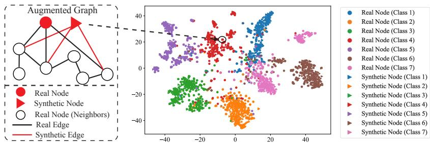  
Figure 5: Illustration of the augmented graph after adding the synthetic graph structures into the original graph on Cora. The RGDM is trained on Cora under Metattack with a perturbation rate of 25%. The figure on the right illustrates the t-SNE visualization of the node features for both the real nodes in the original clean graph and the synthetic nodes. The figure on the left illustrates the 2-hop neighborhood of a real node and a synthetic node that have similar node features, evidenced by the t-SNE visualization in the augmented graph. It is observed that the synthetic node shares the same neighbors as the real node.

Table 26: Reported Metattack mean gain ± paired SD over 10 shared attack seeds (percentage points). Only rows with reported paired SD are included.
<table><tr><td>Dataset</td><td>Ptb (%)</td><td>GCN</td><td>Pro-GNN</td><td>SG-GSR</td></tr><tr><td>Cora</td><td>0</td><td> $1 . 7 \pm 0 . 3$ </td><td> $1 . 3 \pm 0 . 3$ </td><td> $0 . 4 \pm 0 . 1$ </td></tr><tr><td>Cora</td><td>15</td><td> $4 . 3 \pm 0 . 5$ </td><td> $1 . 9 \pm 0 . 4$ </td><td> $1 . 5 \pm 0 . 3$ </td></tr><tr><td>Cora</td><td>25</td><td> $1 3 . 9 \pm 0 . 7$ </td><td> $2 . 6 \pm 0 . 4$ </td><td> $1 . 3 \pm 0 . 3$ </td></tr><tr><td>Citeseer</td><td>15</td><td> $4 . 2 \pm 0 . 5$ </td><td> $1 . 7 \pm 0 . 4$ </td><td> $2 . 9 \pm 0 . 4$ </td></tr><tr><td>Citeseer</td><td>25</td><td> $5 . 9 \pm 0 . 5$ </td><td> $1 . 2 \pm 0 . 3$ </td><td> $2 . 6 \pm 0 . 4$ </td></tr><tr><td>Polblogs</td><td>15</td><td> $4 . 9 \pm 0 . 5$ </td><td> $2 . 0 \pm 0 . 4$ </td><td> $1 . 1 \pm 0 . 3$ </td></tr><tr><td>Polblogs</td><td>25</td><td> $7 . 3 \pm 0 . 6$ </td><td> $3 . 7 \pm 0 . 5$ </td><td> $1 . 0 \pm 0 . 3$ </td></tr><tr><td>Pubmed</td><td>15</td><td> $6 . 3 \pm 0 . 5$ </td><td> $0 . 9 \pm 0 . 2$ </td><td> $1 . 4 \pm 0 . 3$ </td></tr><tr><td>Pubmed</td><td>25</td><td> $6 . 0 \pm 0 . 5$ </td><td> $0 . 8 \pm 0 . 2$ </td><td> $1 . 4 \pm 0 . 3$ </td></tr></table>

## F.12 Study on RGDM for Graph Purification

The RGDM proposed in Section 3 has demonstrated superior performance for generative data augmentation (GDA), which involves generating faithful synthetic graph structures and integrating them into the original attacked graph to obtain an augmented graph. In this section, we study the effectiveness of applying RGDM to purify the attacked graph. The graph purification by RGDM, referred to as RGDM (Purification), is achieved by reconstructing each node and its corresponding edges through the LDM, where Gaussian noise derived from the original node and its edges is progressively denoised by the LDM and subsequently decoded by the GAE to produce clean node features and edges. The RGDM (Purification) variant only purifies the original graph, aiming to explore whether RGDM can be adapted to directly denoise/remove the adversarial perturbations in the original attacked graph. Moreover, the RGDM (Purification) can be combined with RGDM for GDA, denoted as RGDM (GDA) here, leading to a variant that performs both GDA and graph purification, denoted as RGDM (GDA + Purification). The study is performed on Cora under Metattack with a 25% attack rate. Table 28 shows that applying RGDM for purification enhances the performance of Pro-GNN, while GDA with RGDM achieves better performance. Moreover, it is observed that combining GDA and graph purification by RGDM further improves the performance.

Table 27: Reported significance levels with each backbone fixed: Metattack. For rows with paired summaries in Table 26, ≤ denotes a conservative upper threshold, not an exact p value reconstructed from rounded moments. Remaining entries are reported p values.
<table><tr><td>Dataset</td><td>Ptb (%)</td><td>RGDM (GCN)</td><td>RGDM (Pro-GNN)</td><td>RGDM (SG-GSR)</td></tr><tr><td rowspan="6">Cora</td><td>0</td><td>≤ 0.042</td><td>≤ 0.027</td><td>≤ 0.016</td></tr><tr><td>5</td><td>0.038</td><td>0.024</td><td>0.013</td></tr><tr><td>10</td><td>0.033</td><td>0.021</td><td>0.012</td></tr><tr><td>15</td><td>≤ 0.029</td><td>≤ 0.017</td><td>≤ 0.010</td></tr><tr><td>20</td><td>0.025</td><td>0.015</td><td>0.009</td></tr><tr><td>25</td><td>≤ 0.021</td><td>≤ 0.012</td><td>≤ 0.008</td></tr><tr><td rowspan="6">Citeseer</td><td>0</td><td>0.039</td><td>0.022</td><td>0.018</td></tr><tr><td>5</td><td>0.035</td><td>0.020</td><td>0.015</td></tr><tr><td>10</td><td>0.030</td><td>0.017</td><td>0.013</td></tr><tr><td>15</td><td>≤ 0.027</td><td>≤ 0.014</td><td>≤ 0.011</td></tr><tr><td>20</td><td>0.023</td><td>0.012</td><td>0.009</td></tr><tr><td>25</td><td>≤ 0.019</td><td>≤ 0.010</td><td>≤ 0.007</td></tr><tr><td rowspan="6">Polblogs</td><td>0</td><td>0.041</td><td>0.023</td><td>0.019</td></tr><tr><td>5</td><td>0.036</td><td>0.020</td><td>0.015</td></tr><tr><td>10</td><td>0.031</td><td>0.017</td><td>0.013</td></tr><tr><td>15</td><td>≤ 0.027</td><td>≤ 0.014</td><td>≤ 0.011</td></tr><tr><td>20</td><td>0.024</td><td>0.011</td><td>0.009</td></tr><tr><td>25</td><td>≤ 0.020</td><td>≤ 0.009</td><td>≤ 0.006</td></tr><tr><td rowspan="6">Pubmed</td><td>0</td><td>0.038</td><td>0.021</td><td>0.017</td></tr><tr><td>5</td><td>0.034</td><td>0.018</td><td>0.014</td></tr><tr><td>10</td><td>0.030</td><td>0.015</td><td>0.012</td></tr><tr><td>15</td><td>≤ 0.027</td><td>≤ 0.013</td><td>≤ 0.010</td></tr><tr><td>20</td><td>0.023</td><td>0.010</td><td>0.008</td></tr><tr><td>25</td><td>≤ 0.019</td><td>≤ 0.008</td><td>≤ 0.006</td></tr></table>

Table 27: Reported significance levels with each backbone fixed: Nettack. Continued from the preceding panel. Entries are the reported p values.
<table><tr><td>Dataset</td><td>Budget</td><td>RGDM (GCN)</td><td>RGDM (Pro-GNN)</td><td>RGDM (SG-GSR)</td></tr><tr><td rowspan="6">Cora</td><td>0</td><td>0.041</td><td>0.025</td><td>0.015</td></tr><tr><td>1</td><td>0.036</td><td>0.023</td><td>0.011</td></tr><tr><td>2</td><td>0.032</td><td>0.019</td><td>0.010</td></tr><tr><td>3</td><td>0.027</td><td>0.016</td><td>0.008</td></tr><tr><td>4</td><td>0.022</td><td>0.013</td><td>0.007</td></tr><tr><td>5</td><td>0.019</td><td>0.011</td><td>0.006</td></tr><tr><td rowspan="6">Citeseer</td><td>0</td><td>0.037</td><td>0.021</td><td>0.016</td></tr><tr><td>1</td><td>0.033</td><td>0.019</td><td>0.013</td></tr><tr><td>2</td><td>0.028</td><td>0.016</td><td>0.011</td></tr><tr><td>3</td><td>0.024</td><td>0.013</td><td>0.009</td></tr><tr><td>4</td><td>0.021</td><td>0.011</td><td>0.007</td></tr><tr><td>5</td><td>0.018</td><td>0.009</td><td>0.006</td></tr><tr><td rowspan="6">Polblogs</td><td>0</td><td>0.040</td><td>0.021</td><td>0.017</td></tr><tr><td>1</td><td>0.034</td><td>0.018</td><td>0.013</td></tr><tr><td>2</td><td>0.029</td><td>0.016</td><td>0.011</td></tr><tr><td>3</td><td>0.025</td><td>0.013</td><td>0.009</td></tr><tr><td>4</td><td>0.022</td><td>0.010</td><td>0.007</td></tr><tr><td>5</td><td>0.019</td><td>0.008</td><td>0.005</td></tr><tr><td rowspan="6">Pubmed</td><td>0</td><td>0.037</td><td>0.020</td><td>0.015</td></tr><tr><td>1</td><td>0.033</td><td>0.017</td><td>0.012</td></tr><tr><td>2</td><td>0.029</td><td>0.014</td><td>0.010</td></tr><tr><td>3</td><td>0.026</td><td>0.012</td><td>0.008</td></tr><tr><td>4</td><td>0.021</td><td>0.009</td><td>0.006</td></tr><tr><td>5</td><td>0.018</td><td>0.007</td><td>0.005</td></tr></table>

Table 27: Reported significance levels with each backbone fixed: Topology Attack. Continued from the preceding panel. Entries are the reported p values.
<table><tr><td>Dataset</td><td>Ptb (%)</td><td>RGDM (GCN)</td><td>RGDM (Pro-GNN)</td><td>RGDM (SG-GSR)</td></tr><tr><td rowspan="6">Cora</td><td>0</td><td>0.043</td><td>0.029</td><td>0.017</td></tr><tr><td>5</td><td>0.039</td><td>0.025</td><td>0.012</td></tr><tr><td>10</td><td>0.035</td><td>0.020</td><td>0.011</td></tr><tr><td>15</td><td>0.030</td><td>0.018</td><td>0.009</td></tr><tr><td>20</td><td>0.026</td><td>0.014</td><td>0.008</td></tr><tr><td>25</td><td>0.022</td><td>0.012</td><td>0.007</td></tr><tr><td rowspan="6">Citeseer</td><td>0</td><td>0.038</td><td>0.023</td><td>0.017</td></tr><tr><td>5</td><td>0.034</td><td>0.020</td><td>0.014</td></tr><tr><td>10</td><td>0.029</td><td>0.017</td><td>0.012</td></tr><tr><td>15</td><td>0.026</td><td>0.014</td><td>0.010</td></tr><tr><td>20</td><td>0.022</td><td>0.012</td><td>0.008</td></tr><tr><td>25</td><td>0.020</td><td>0.010</td><td>0.007</td></tr><tr><td rowspan="6">Polblogs</td><td>0</td><td>0.042</td><td>0.022</td><td>0.018</td></tr><tr><td>5</td><td>0.035</td><td>0.019</td><td>0.014</td></tr><tr><td>10</td><td>0.030</td><td>0.017</td><td>0.012</td></tr><tr><td>15</td><td>0.026</td><td>0.015</td><td>0.010</td></tr><tr><td>20</td><td>0.023</td><td>0.011</td><td>0.008</td></tr><tr><td>25</td><td>0.021</td><td>0.009</td><td>0.006</td></tr><tr><td rowspan="6">Pubmed</td><td>0</td><td>0.039</td><td></td><td>0.016</td></tr><tr><td>5</td><td>0.034</td><td>0.022 0.018</td><td>0.013</td></tr><tr><td>10</td><td>0.030</td><td>0.015</td><td>0.011</td></tr><tr><td>15</td><td>0.027</td><td>0.013</td><td>0.009</td></tr><tr><td>20</td><td>0.022</td><td>0.010</td><td>0.007</td></tr><tr><td>25</td><td>0.019</td><td>0.008</td><td>0.006</td></tr></table>

Table 28: Study on the effectiveness of graph purification and GDA by RGDM. The evaluation is conducted on Cora under Metattack with 25% perturbation rate.
<table><tr><td>Method</td><td>Accuracy (%)</td></tr><tr><td>Pro-GNN</td><td>69.7</td></tr><tr><td>RGDM (Purification)</td><td>71.0</td></tr><tr><td>RGDM (GDA)</td><td>72.3</td></tr><tr><td>RGDM (GDA + Purification)</td><td>72.9</td></tr></table>

## F.13 Comparison with Diffusion-Based Graph Purification Methods

To demonstrate the superiority of RGDM over existing diffusion-based graph purification methods [28, 29], we have performed experiments comparing RGDM with GDDM [28] and DiffSP [29] on Cora, Citeseer, Polblogs, and Pubmed under Metattack with a perturbation rate of 25%. We run each experiment 10 times with different random seeds and report the mean and the standard deviation of the node classification accuracy. We use SG-GSR [33], which is the state-of-the-art robust GNN model, as the baseline model for RGDM following the settings in Section 4.2 of the main paper. The GDDM and DiffSP are used to purify the input graph to SG-GSR, and our proposed RGDM is used to augment the input graph to SG-GSR with synthetic graph structures. It is observed in Table 29 that RGDM (SG-GSR) outperforms DiffSP and GDDM on all the datasets. To validate the significance of the improvements, we calculate the p-values of the t-tests between RGDM (SG-GSR) and the best-performing baseline method on each of the datasets. As observed in the table below, the p-values for RGDM (SG-GSR) against the best baseline methods across all datasets are consistently smaller than 0.05, indicating statistically significant improvements of RGDM (SG-GSR) over the top baseline methods among DiffSP and GDDM.

Table 29: Comparison of classification accuracy (±Std) and p-values across different datasets between RGDM and diffusion-based graph purification methods.
<table><tr><td>Datasets</td><td>GDDM [28]</td><td>DiffSP [29]</td><td>RGDM (SG-GSR)</td><td>p-value</td></tr><tr><td>Cora</td><td> $7 7 . 2 \pm 0 . 3$ </td><td> $7 6 . 8 \pm 0 . 5$ </td><td> ${ \bf 7 9 . 1 \pm 1 . 6 }$ </td><td>0.0022</td></tr><tr><td>Citeseer</td><td> $7 1 . 6 \pm 0 . 5$ </td><td> $7 1 . 8 \pm 0 . 2$ </td><td> ${ \bf 7 5 . 3 \pm 1 . 0 }$ </td><td>0.0012</td></tr><tr><td>Polblogs</td><td> $8 4 . 8 \pm 0 . 8$ </td><td> $8 5 . 6 \pm 0 . 5$ </td><td> ${ \bf 8 8 . 8 \pm 1 . 8 }$ </td><td>0.0004</td></tr><tr><td>Pubmed</td><td> $8 5 . 9 \pm 0 . 6$ </td><td> $8 6 . 8 \pm 0 . 4$ </td><td> ${ \bf 8 8 . 6 \pm 1 . 3 }$ </td><td>0.0017</td></tr></table>

## F.14 Ablation on the Number of Synthetic Nodes

To assess the effect of the number of synthetic nodes on robustness, we conduct an ablation study by varying the number of synthetic nodes from 0 to $1 0 \times | \mathcal { V } _ { L } |$ We evaluate the performance of RGDM with Pro-GNN as the base GNN for node classification under Metattack with a perturbation rate of 25%. As shown in Table 30, increasing the number of synthetic nodes initially improves performance, with the best result achieved at $5 \ \times | \mathcal { V } _ { L } |$ . However, further increasing the number of synthetic nodes leads to slightly degraded performance.

Table 30: Performance of RGDM (Pro-GNN) under Metattack with varying numbers of synthetic nodes. The perturbation rate is 25%.
<table><tr><td># Synthetic Nodes (× |VL|)</td><td>1</td><td>2</td><td>3</td><td>4</td><td>5</td><td>6</td><td>7</td><td>8</td><td>9</td><td>10</td></tr><tr><td>Accuracy (%)</td><td>70.5</td><td>71.0</td><td>71.9</td><td>72.2</td><td>72.3</td><td>72.1</td><td>72.0</td><td>71.7</td><td>71.4</td><td>71.2</td></tr></table>

## F.15 Performance Comparison with Vanilla DDPM-Augmented Graphs

To demonstrate the superiority of the synthetic graph structures generated by RGDM, we compare RGDM (Pro-GNN) with two baselines, which are Pro-GNN trained on the original attacked graph and Pro-GNN trained on a graph augmented with synthetic nodes generated by a vanilla DDPM. The vanilla DDPM baseline synthesizes labeled synthetic nodes via conditional DDPM and connects them using k-nearest neighbors (KNN), as detailed in Section F.3. The study is performed on Cora under Metattack with a perturbation rate of 25%. As shown in Table 31, the vanilla DDPM even degrades performance, confirming that RGDMs gains stem from the generated faithful synthetic graph structures, rather than simply increasing the number of training nodes/edges.

Table 31: Performance comparison of Pro-GNN on augmented graph with synthetic graph structures generated by DDPM and RGDM. The study is performed on Cora under Metattack with a perturbation rate of 25%.
<table><tr><td>Method</td><td>Accuracy (%)</td></tr><tr><td>Pro-GNN</td><td>69.7</td></tr><tr><td>DDPM (Pro-GNN)</td><td>68.2</td></tr><tr><td>RGDM (Pro-GNN)</td><td>72.3</td></tr></table>

## F.16 Study on the Impact of Label Ratio

To assess the robustness of RGDM (Pro-GNN) under varying levels of supervision, we evaluate performance on the Cora dataset under a 25% Metattack perturbation rate while varying the labeled training ratio. In this study, we consider both sparse label regimes (2.5% to 10%) and denser settings (20% to 60%), with 10% of nodes fixed for validation and the remainder used for testing. As shown in Table 32, RGDM consistently outperforms the Pro-GNN baseline across all label ratios. Under extremely limited supervision (2.5%10%), RGDM maintains strong performance, indicating its utility as a data augmentation strategy in low-resource scenarios. As the label ratio increases, RGDM continues to achieve better performance, demonstrating its robustness and effectiveness even with more abundant training data. These results confirm that the improvements of RGDM are not confined to a specific supervision regime and generalize well across both low- and high-label density settings.

Table 32: Performance comparison of Pro-GNN and RGDM (Pro-GNN) under different label ratios on Cora under 25% Metattack
<table><tr><td>Label Ratio</td><td>2.5%</td><td>5%</td><td>7.5%</td><td>10%</td><td>20%</td><td>40%</td><td>60%</td></tr><tr><td>Pro-GNN</td><td>62.5</td><td>65.6</td><td>67.5</td><td>69.7</td><td>73.8</td><td>75.2</td><td>76.6</td></tr><tr><td>RGDM (Pro-GNN)</td><td>64.8</td><td>68.0</td><td>69.3</td><td>72.3</td><td>75.9</td><td>77.6</td><td>78.4</td></tr></table>

## F.17 Ablation Study on the Sparse Hierarchical Edge Decoder

To further validate the effectiveness of the proposed Sparse Hierarchical Edge Decoder (SHED) in generating robust synthetic edges, we conduct an ablation study comparing SHED against the Bi-Level Neighborhood Decoder (BLND) used in DoG [19]. In particular, we replace SHED in RGDM with the BLND module and denote the resulting model as RGDM (BLND). Both models are evaluated under the Metattack [51] with a perturbation rate of 25%, using SG-GSR [33] as the backbone GNN. The experiments are conducted on Cora, Citeseer, Polblogs, and Pubmed. As shown in Table 33, RGDM equipped with SHED consistently outperforms RGDM (BLND) across all benchmarks. We also report the hierarchical reconstruction variant from LR-FGDM [20], denoted RGDM (HGAE). With SG-GSR fixed, replacing HGAE by SHED improves accuracy by $2 . 3 / 2 . 8 / 2 . 1 / 2 . 6$ points. Replacing BLND by SHED improves it by 1.7/2.2/1.6/2.0 points. This reconstruction comparison complements the full system GCN baselines in Table 4 and the sequential component experiment in Table 5.

Table 33: Hierarchical reconstruction comparison: SHED, BLND from DoG [19], and the HGAE variant from LR-FGDM [20]. SG-GSR is used as the base GNN under Metattack with 25% perturbation.
<table><tr><td>Dataset</td><td>Cora</td><td>Citeseer</td><td>Polblogs</td><td>Pubmed</td></tr><tr><td>RGDM (HGAE from LR-FGDM)</td><td>76.8</td><td>72.5</td><td>86.7</td><td>86.0</td></tr><tr><td>RGDM (BLND)</td><td>77.4</td><td>73.1</td><td>87.2</td><td>86.6</td></tr><tr><td>RGDM</td><td>79.1</td><td>75.3</td><td>88.8</td><td>88.6</td></tr></table>

## F.18 Adaptive Attack Evaluation

The experiments in Section 4.1 follow the commonly used attack-first-then-defend protocol, where the graph is first perturbed by adversarial attacks and the defense is then applied to the attacked graph. Although this protocol is widely adopted in graph adversarial robustness, it may not fully reflect a defense-aware adversary. In particular, an adaptive adversary may be aware of the RGDM pipeline and attack the augmented graph after the synthetic graph structures have been generated. To address this concern, we further evaluate RGDM under an adaptive attack setting, following the adaptive evaluation protocol in prior graph robustness studies [91].

Settings. We consider an adaptive version of Metattack [51] with a perturbation rate of 25%. Different from the standard Metattack evaluation in Section 4.1, where the attack is performed before RGDM augmentation, the adaptive attacker perturbs the final augmented graph $\mathcal { G } _ { \mathrm { a u g } }$ used for training the downstream GNN. The attacker is aware of the full RGDM pipeline, including the generation of synthetic graph structures, edge selection, low-rank regularization, and the downstream SG-GSR classifier. For a fair comparison, the perturbation budget is fixed to the same number of edge perturbations as the 25% Metattack on the original graph. We repeat each experiment 10 times with different random seeds and report the mean and standard deviation of node classification accuracy.

Let $n _ { \mathrm { a u g } } : = N + N ^ { \prime }$ and let $\mathbf { P } \in \{ 0 , 1 \} ^ { n _ { \mathrm { a u g } } \times n _ { \mathrm { a u g } } }$ be a symmetric zero diagonal flip matrix. The defense aware attack searches over the admissible set in Equation (12):

$$
\mathcal { P } _ { b } : = \left\{ \mathbf { P } : \mathbf { P } = \mathbf { P } ^ { \top } , \mathbf { P } _ { i i } = 0 , \sum _ { 1 \leq i < j \leq n _ { \mathrm { a u g } } } \mathbf { P } _ { i j } \leq b \right\} , \qquad \mathbf { A } _ { \mathrm { a u g } } ^ { \mathrm { a d v } } : = \mathbf { A } _ { \mathrm { a u g } } \oplus \mathbf { P } .\tag{12}
$$

Here ⊕ denotes entrywise binary edge flipping. In Equation (12), b is the same absolute number of flips used by the 25% attack on the corresponding original graph, not 25% of the larger augmented edge count. Candidate flips may involve original or synthetic nodes. The attacker knows the RGAE, edge selection mechanism, latent regularizer, LDM, and downstream classifier, and optimizes the

Metattack surrogate against downstream retraining on the perturbed augmented graph. The first variant attacks the realized augmented graph. The second additionally differentiates its meta gradient through the relaxed edge selection mask: the forward pass thresholds $\widehat { \mathbf { S } } _ { i j } = \sigma ( \pmb { \theta } _ { i j } / \tau )$ at $1 / 2 ,$ , and the backward pass uses its straight through gradient with $\tau = 0 . 5 .$ b This is a gradient approximation to the discrete selection operation, not a proof of globally optimal adversarial perturbations. Knowledge of the LDM does not by itself establish differentiation through its entire stochastic sampling trajectory. The reported differentiable variant specifically tests the edge selection mechanism.

Table 34: Adaptive attack evaluation under Metattack [51] with 25% perturbation rate. The adaptive attacker is aware of the defense and attacks the final augmented graph used for training SG-GSR. The p-values are computed between SG-GSR and RGDM (SG-GSR).
<table><tr><td>Dataset</td><td>SG-GSR</td><td>RGDM (SG-GSR)</td><td>p-value</td></tr><tr><td>Cora</td><td> $7 4 . 8 \pm 2 . 4$ </td><td> ${ 7 7 . 8 \pm 1 . 8 }$ </td><td>0.006</td></tr><tr><td>Citeseer</td><td> $6 9 . 5 \pm 2 . 6 $ </td><td> $7 3 . 4 \pm 2 . 1$ </td><td>0.003</td></tr><tr><td>Polblogs</td><td> $8 4 . 7 \pm 2 . 5$ </td><td> ${ \bf 8 7 . 6 \pm 2 . 2 }$ </td><td>0.008</td></tr><tr><td>Pubmed</td><td> $8 4 . 9 \pm 2 . 7$ </td><td> ${ \bf 8 7 . 2 \pm 2 . 4 }$ </td><td>0.012</td></tr></table>

As shown in Table 34, RGDM consistently improves the robustness of SG-GSR even when the attacker is aware of the defense pipeline and attacks the final augmented graph. For example, RGDM (SG-GSR) significantly outperforms SG-GSR by 3.9% on Citeseer under adaptive Metattack with a 25% perturbation rate. The p-values are smaller than 0.05 on all datasets, demonstrating that the improvements of RGDM over SG-GSR remain statistically significant under adaptive attacks. These results indicate that the robustness gains of RGDM are not merely caused by the attackfirst-then-defend workflow order. Instead, the generated synthetic graph structures, together with edge selection and low-rank regularization, provide additional robust supervision that improves the downstream GNN even under defense-aware perturbations.

Differentiating through edge selection. Table 35 reports the adaptive experiment that differentiates through edge selection. Its SG-GSR / RGDM gains are $2 . 4 / 3 . { \overset { . } { 2 } } / 2 . 2 / 1 . 7$ points on Cora/Citeseer/Polblogs/Pubmed, compared with 3.0/3.9/2.9/2.3 points for the final graph attack in Table 34. The second variant reports mean accuracies. It does not report standard deviations or p values. Both variants are summarized in the main text (Table 7). The positive gains support robustness to these tested attacks at this fixed budget, not certification against arbitrary white box attacks.

Table 35: Adaptive Metattack differentiating through the relaxed edge selection mask with the same absolute edge flip budget and τ = 0.5. Mean accuracy (%).
<table><tr><td>Dataset</td><td>SG-GSR</td><td>RGDM (SG-GSR)</td><td>Gain (points)</td></tr><tr><td>Cora</td><td>74.5</td><td>76.9</td><td>2.4</td></tr><tr><td>Citeseer</td><td>69.2</td><td>72.4</td><td>3.2</td></tr><tr><td>Polblogs</td><td>84.4</td><td>86.6</td><td>2.2</td></tr><tr><td>Pubmed</td><td>84.6</td><td>86.3</td><td>1.7</td></tr></table>

## NeurIPS Paper Checklist

## 1. Claims

Question: Do the main claims made in the abstract and introduction accurately reflect the paper’s contributions and scope?

Answer: [Yes]

Justification: The contributions and scope of the paper are discussed in Section 1 of the paper.

Guidelines:

• The answer NA means that the abstract and introduction do not include the claims made in the paper.

• The abstract and/or introduction should clearly state the claims made, including the contributions made in the paper and important assumptions and limitations. A No or NA answer to this question will not be perceived well by the reviewers.

• The claims made should match theoretical and experimental results, and reflect how much the results can be expected to generalize to other settings.

• It is fine to include aspirational goals as motivation as long as it is clear that these goals are not attained by the paper.

## 2. Limitations

Question: Does the paper discuss the limitations of the work performed by the authors?

Answer: [Yes]

Justification: We have discussed the limitation that the proposed method only applies to node-level data generation on graph datasets in the introduction, Section 1, of this paper.

Guidelines:

• The answer NA means that the paper has no limitation while the answer No means that the paper has limitations, but those are not discussed in the paper.

• The authors are encouraged to create a separate "Limitations" section in their paper.

• The paper should point out any strong assumptions and how robust the results are to violations of these assumptions (e.g., independence assumptions, noiseless settings, model well-specification, asymptotic approximations only holding locally). The authors should reflect on how these assumptions might be violated in practice and what the implications would be.

• The authors should reflect on the scope of the claims made, e.g., if the approach was only tested on a few datasets or with a few runs. In general, empirical results often depend on implicit assumptions, which should be articulated.

• The authors should reflect on the factors that influence the performance of the approach. For example, a facial recognition algorithm may perform poorly when image resolution is low or images are taken in low lighting. Or a speech-to-text system might not be used reliably to provide closed captions for online lectures because it fails to handle technical jargon.

• The authors should discuss the computational efficiency of the proposed algorithms and how they scale with dataset size.

• If applicable, the authors should discuss possible limitations of their approach to address problems of privacy and fairness.

• While the authors might fear that complete honesty about limitations might be used by reviewers as grounds for rejection, a worse outcome might be that reviewers discover limitations that aren’t acknowledged in the paper. The authors should use their best judgment and recognize that individual actions in favor of transparency play an important role in developing norms that preserve the integrity of the community. Reviewers will be specifically instructed to not penalize honesty concerning limitations.

## 3. Theory assumptions and proofs

Question: For each theoretical result, does the paper provide the full set of assumptions and a complete (and correct) proof?

Answer: [Yes]

Justification: The theoretical result is detailed in Theorem 3.1 and proved in Section A of the supplementary.

## Guidelines:

• The answer NA means that the paper does not include theoretical results.

• All the theorems, formulas, and proofs in the paper should be numbered and crossreferenced.

• All assumptions should be clearly stated or referenced in the statement of any theorems.

• The proofs can either appear in the main paper or the supplemental material, but if they appear in the supplemental material, the authors are encouraged to provide a short proof sketch to provide intuition.

• Inversely, any informal proof provided in the core of the paper should be complemented by formal proofs provided in appendix or supplemental material.

• Theorems and Lemmas that the proof relies upon should be properly referenced.

## 4. Experimental result reproducibility

Question: Does the paper fully disclose all the information needed to reproduce the main experimental results of the paper to the extent that it affects the main claims and/or conclusions of the paper (regardless of whether the code and data are provided or not)?

Answer: [Yes]

Justification: The anonymous link to the code is attached at the end of the abstract. Implementation details for the experiments are stated in Section E.

Guidelines:

• The answer NA means that the paper does not include experiments.

• If the paper includes experiments, a No answer to this question will not be perceived well by the reviewers: Making the paper reproducible is important, regardless of whether the code and data are provided or not.

• If the contribution is a dataset and/or model, the authors should describe the steps taken to make their results reproducible or verifiable.

• Depending on the contribution, reproducibility can be accomplished in various ways. For example, if the contribution is a novel architecture, describing the architecture fully might suffice, or if the contribution is a specific model and empirical evaluation, it may be necessary to either make it possible for others to replicate the model with the same dataset, or provide access to the model. In general. releasing code and data is often one good way to accomplish this, but reproducibility can also be provided via detailed instructions for how to replicate the results, access to a hosted model (e.g., in the case of a large language model), releasing of a model checkpoint, or other means that are appropriate to the research performed.

• While NeurIPS does not require releasing code, the conference does require all submissions to provide some reasonable avenue for reproducibility, which may depend on the nature of the contribution. For example

(a) If the contribution is primarily a new algorithm, the paper should make it clear how to reproduce that algorithm.

(b) If the contribution is primarily a new model architecture, the paper should describe the architecture clearly and fully.

(c) If the contribution is a new model (e.g., a large language model), then there should either be a way to access this model for reproducing the results or a way to reproduce the model (e.g., with an open-source dataset or instructions for how to construct the dataset).

(d) We recognize that reproducibility may be tricky in some cases, in which case authors are welcome to describe the particular way they provide for reproducibility. In the case of closed-source models, it may be that access to the model is limited in some way (e.g., to registered users), but it should be possible for other researchers to have some path to reproducing or verifying the results.

## 5. Open access to data and code

Question: Does the paper provide open access to the data and code, with sufficient instructions to faithfully reproduce the main experimental results, as described in supplemental material?

Answer: [Yes]

Justification: The anonymous link to the code is attached at the end of the abstract. Implementation details for the experiments are stated in Section E. The datasets used in the experiments are public benchmarks. Detailed information on the datasets is provided in Section E.1.

Guidelines:

• The answer NA means that paper does not include experiments requiring code.

• Please see the NeurIPS code and data submission guidelines (https://nips.cc/ public/guides/CodeSubmissionPolicy) for more details.

• While we encourage the release of code and data, we understand that this might not be possible, so No is an acceptable answer. Papers cannot be rejected simply for not including code, unless this is central to the contribution (e.g., for a new open-source benchmark).

• The instructions should contain the exact command and environment needed to run to reproduce the results. See the NeurIPS code and data submission guidelines (https: //nips.cc/public/guides/CodeSubmissionPolicy) for more details.

• The authors should provide instructions on data access and preparation, including how to access the raw data, preprocessed data, intermediate data, and generated data, etc.

• The authors should provide scripts to reproduce all experimental results for the new proposed method and baselines. If only a subset of experiments are reproducible, they should state which ones are omitted from the script and why.

• At submission time, to preserve anonymity, the authors should release anonymized versions (if applicable).

• Providing as much information as possible in supplemental material (appended to the paper) is recommended, but including URLs to data and code is permitted.

## 6. Experimental setting/details

Question: Does the paper specify all the training and test details (e.g., data splits, hyperparameters, how they were chosen, type of optimizer, etc.) necessary to understand the results?

Answer: [Yes]

Justification: Experimental settings are specified in Section E. The settings for adversarial attacks adopted in our experiments are provided in Section E.3. The datasets used in the experiments are public benchmarks. Detailed information on the datasets is provided in Section E.1.

Guidelines:

• The answer NA means that the paper does not include experiments.

• The experimental setting should be presented in the core of the paper to a level of detail that is necessary to appreciate the results and make sense of them.

• The full details can be provided either with the code, in appendix, or as supplemental material.

## 7. Experiment statistical significance

Question: Does the paper report error bars suitably and correctly defined or other appropriate information about the statistical significance of the experiments?

Answer: [Yes]

Justification: Standard errors for the results of our method and baseline methods are provided in the tables presenting the experimental results in Section 4.

Guidelines:

• The answer NA means that the paper does not include experiments.

• The authors should answer "Yes" if the results are accompanied by error bars, confidence intervals, or statistical significance tests, at least for the experiments that support the main claims of the paper.

• The factors of variability that the error bars are capturing should be clearly stated (for example, train/test split, initialization, random drawing of some parameter, or overall run with given experimental conditions).

• The method for calculating the error bars should be explained (closed form formula, call to a library function, bootstrap, etc.)

• The assumptions made should be given (e.g., Normally distributed errors).

• It should be clear whether the error bar is the standard deviation or the standard error of the mean.

• It is OK to report 1-sigma error bars, but one should state it. The authors should preferably report a 2-sigma error bar than state that they have a 96% CI, if the hypothesis of Normality of errors is not verified.

• For asymmetric distributions, the authors should be careful not to show in tables or figures symmetric error bars that would yield results that are out of range (e.g. negative error rates).

• If error bars are reported in tables or plots, The authors should explain in the text how they were calculated and reference the corresponding figures or tables in the text.

## 8. Experiments compute resources

Question: For each experiment, does the paper provide sufficient information on the computer resources (type of compute workers, memory, time of execution) needed to reproduce the experiments?

Answer: [Yes]

Justification: The computing resources used in the experiments of this paper are specified in Section E of our paper.

Guidelines:

• The answer NA means that the paper does not include experiments.

• The paper should indicate the type of compute workers CPU or GPU, internal cluster, or cloud provider, including relevant memory and storage.

• The paper should provide the amount of compute required for each of the individual experimental runs as well as estimate the total compute.

• The paper should disclose whether the full research project required more compute than the experiments reported in the paper (e.g., preliminary or failed experiments that didn’t make it into the paper).

## 9. Code of ethics

Question: Does the research conducted in the paper conform, in every respect, with the NeurIPS Code of Ethics https://neurips.cc/public/EthicsGuidelines?

Answer: [Yes]

Justification: We have read NeurIPS Code of Ethics in https://neurips.cc/public/ EthicsGuidelines and confirm that the research conducted in the paper conform, in every respect, with the NeurIPS Code of Ethics.

Guidelines:

• The answer NA means that the authors have not reviewed the NeurIPS Code of Ethics.

• If the authors answer No, they should explain the special circumstances that require a deviation from the Code of Ethics.

• The authors should make sure to preserve anonymity (e.g., if there is a special consideration due to laws or regulations in their jurisdiction).

## 10. Broader impacts

Question: Does the paper discuss both potential positive societal impacts and negative societal impacts of the work performed?

Answer: [N/A]

Justification: The experiments performed do not have societal impacts, as we did not perform any experiments on real-world data collected from society. The experiments are performed by using simulated attack methods.

Guidelines:

• The answer NA means that there is no societal impact of the work performed.

• If the authors answer NA or No, they should explain why their work has no societal impact or why the paper does not address societal impact.

• Examples of negative societal impacts include potential malicious or unintended uses (e.g., disinformation, generating fake profiles, surveillance), fairness considerations (e.g., deployment of technologies that could make decisions that unfairly impact specific groups), privacy considerations, and security considerations.

• The conference expects that many papers will be foundational research and not tied to particular applications, let alone deployments. However, if there is a direct path to any negative applications, the authors should point it out. For example, it is legitimate to point out that an improvement in the quality of generative models could be used to generate deepfakes for disinformation. On the other hand, it is not needed to point out that a generic algorithm for optimizing neural networks could enable people to train models that generate Deepfakes faster.

• The authors should consider possible harms that could arise when the technology is being used as intended and functioning correctly, harms that could arise when the technology is being used as intended but gives incorrect results, and harms following from (intentional or unintentional) misuse of the technology.

• If there are negative societal impacts, the authors could also discuss possible mitigation strategies (e.g., gated release of models, providing defenses in addition to attacks, mechanisms for monitoring misuse, mechanisms to monitor how a system learns from feedback over time, improving the efficiency and accessibility of ML).

## 11. Safeguards

Question: Does the paper describe safeguards that have been put in place for responsible release of data or models that have a high risk for misuse (e.g., pretrained language models, image generators, or scraped datasets)?

Answer: [N/A]

Justification: This paper poses no such risks for misuse.

Guidelines:

• The answer NA means that the paper poses no such risks.

• Released models that have a high risk for misuse or dual-use should be released with necessary safeguards to allow for controlled use of the model, for example by requiring that users adhere to usage guidelines or restrictions to access the model or implementing safety filters.

• Datasets that have been scraped from the Internet could pose safety risks. The authors should describe how they avoided releasing unsafe images.

• We recognize that providing effective safeguards is challenging, and many papers do not require this, but we encourage authors to take this into account and make a best faith effort.

## 12. Licenses for existing assets

Question: Are the creators or original owners of assets (e.g., code, data, models), used in the paper, properly credited and are the license and terms of use explicitly mentioned and properly respected?

Answer: [Yes]

Justification: The paper perform experiments on widely used public benchmarks, which are properly cited in Section E.1.

Guidelines:

• The answer NA means that the paper does not use existing assets.

• The authors should cite the original paper that produced the code package or dataset.

• The authors should state which version of the asset is used and, if possible, include a URL.

• The name of the license (e.g., CC-BY 4.0) should be included for each asset.

• For scraped data from a particular source (e.g., website), the copyright and terms of service of that source should be provided.

• If assets are released, the license, copyright information, and terms of use in the package should be provided. For popular datasets, paperswithcode.com/datasets has curated licenses for some datasets. Their licensing guide can help determine the license of a dataset.

• For existing datasets that are re-packaged, both the original license and the license of the derived asset (if it has changed) should be provided.

• If this information is not available online, the authors are encouraged to reach out to the asset’s creators.

## 13. New assets

Question: Are new assets introduced in the paper well documented and is the documenta tion provided alongside the assets?

Answer: [N/A]

Justification: The paper does not release new assets.

Guidelines:

• The answer NA means that the paper does not release new assets.

• Researchers should communicate the details of the dataset/code/model as part of their submissions via structured templates. This includes details about training, license, limitations, etc.

• The paper should discuss whether and how consent was obtained from people whose asset is used.

• At submission time, remember to anonymize your assets (if applicable). You can either create an anonymized URL or include an anonymized zip file.

## 14. Crowdsourcing and research with human subjects

Question: For crowdsourcing experiments and research with human subjects, does the paper include the full text of instructions given to participants and screenshots, if applicable, as well as details about compensation (if any)?

Answer: [N/A]

Justification: This paper does not involve crowdsourcing nor research with human subjects. Guidelines:

• The answer NA means that the paper does not involve crowdsourcing nor research with human subjects.

• Including this information in the supplemental material is fine, but if the main contribution of the paper involves human subjects, then as much detail as possible should be included in the main paper.

• According to the NeurIPS Code of Ethics, workers involved in data collection, curation, or other labor should be paid at least the minimum wage in the country of the data collector.

## 15. Institutional review board (IRB) approvals or equivalent for research with human subjects

Question: Does the paper describe potential risks incurred by study participants, whether such risks were disclosed to the subjects, and whether Institutional Review Board (IRB) approvals (or an equivalent approval/review based on the requirements of your country or institution) were obtained?

Answer: [N/A]

Justification: This paper does not involve crowdsourcing nor research with human subjects. Guidelines:

• The answer NA means that the paper does not involve crowdsourcing nor research with human subjects.

• Depending on the country in which research is conducted, IRB approval (or equivalent) may be required for any human subjects research. If you obtained IRB approval, you should clearly state this in the paper.

• We recognize that the procedures for this may vary significantly between institutions and locations, and we expect authors to adhere to the NeurIPS Code of Ethics and the guidelines for their institution.

• For initial submissions, do not include any information that would break anonymity (if applicable), such as the institution conducting the review.

## 16. Declaration of LLM usage

Question: Does the paper describe the usage of LLMs if it is an important, original, or non-standard component of the core methods in this research? Note that if the LLM is used only for writing, editing, or formatting purposes and does not impact the core methodology, scientific rigorousness, or originality of the research, declaration is not required.

Answer: [N/A]

Justification: We do not use LLM in this paper.

Guidelines:

• The answer NA means that the core method development in this research does not involve LLMs as any important, original, or non-standard components.

• Please refer to our LLM policy (https://neurips.cc/Conferences/2025/LLM) for what should or should not be described.