# SCANO: Restoring Boundary-Condition Completeness in Sampled Meshes with a Sliced-Cross-Attention Neural Operator for 3D Thermal Fields

Tianyu Lia, Zhiwei Caob, Qingang Zhangc,∗, Ruihang Wangd, Binyang Songe, Yonggang Wenc

aInterdisciplinary Graduate Programme, Nanyang Technological University, Singapore bSchool of Future Technology, Fuzhou University, Fuzhou, China

cCollege of Computing and Data Science, Nanyang Technological University, Singapore

dSchool of Information Science and Engineering, Yunnan University, Kunming, China eSchool of Mechanical and Aerospace Engineering, Nanyang Technological University, Singapore

## Abstract

Training neural operators on million-cell meshes can exceed GPU memory limits. Models are therefore trained on subsamples and deployed on whole meshes or selected regions. However, subsampling can distort boundary information, degrading accuracy. We ask when boundary conditioning under sampling stays consistent with whole-mesh training, and how to aggregate and inject boundary data. Representing the solution as an integral of boundary data against type-dependent measures, we show that subsampling distorts this conditioning in three ways: incomplete boundary coverage or a sample-dependent global state, face weighting by count rather than area, and compression of boundary inputs into a lowdimensional vector. This analysis yields four measurable consistency conditions checkable before training. We satisfy them with two backbone-agnostic modules. Boundary Quadrature Attention (BQA) aggregates all boundary faces, typed and area-weighted, into slice tokens that every query point reads at every layer. Anchored Global State (AGS) estimates the global state from anchors independent of the sampled points. Adding both to a scalable message-passing and slice-attention backbone yields SCANO. We evaluate the approach on controlled and public benchmarks and a data-centre thermal simulation dataset (DCTS) containing million-cell meshes. On both benchmarks, BQA improves every backbone, reducing whole-mesh error up to 15-fold. On all three datasets, AGS aligns regional with whole-mesh predictions, cutting regional error at least tenfold for most backbones on the public benchmark. Together, the modules nearly halve the best original backbone’s whole-mesh error on both benchmarks. SCANO predicts a room-scale field in under one second, over 100 times faster than whole-room anchor self-attention.

neural operators, surrogate modelling, boundary conditions, sampled training, quadrature consistency, large meshes, data-centre cooling

## 1. Introduction

Neural operators learn the solution map of a family of boundary value problems. Once trained, they predict a physical field in a fraction of the time of a numerical solver [1, 2, 3]. On engineering meshes with millions of cells, however, the memory of a training step grows with the mesh. On a million-cell data-centre room, one pass over the full mesh exceeds the memory of a single GPU for a message-passing backbone. It also consumes most of that memory, or exceeds it, for the other backbones (Figure 2a). One remedy is to partition the mesh into subgraphs with halos [4]. Without domain decomposition, models are trained on subsamples of the mesh. Typical samples are random point subsets [5], random anchors [3] or local subgraphs grown from random seeds [6]. After training, the operator is deployed on the full mesh or on a local region of interest.

This sampling compromise is most damaging at the boundary. Industrial boundaries contain from a few segments to hundreds of patches. These patches difer widely in size and physical type (Section 2.1). Their prescribed values, exchange coeficients, fluxes and heat loads govern the interior solution. A neural operator therefore has to carry this boundary information to every point of the domain, and it does so in two steps. It first aggregates the data of the boundary faces into a form the network can read, such as features of the boundary nodes, one pooled summary or a set of tokens. It then injects this information into the domain points, either once at the input or in every layer. Under sampled training, both steps can go wrong. A training sample captures only a fraction of the patches, so any patch it misses is absent from the aggregation in that step. Aggregating boundary faces by count rather than by area biases the model toward finely meshed patches. Injecting the boundary as a low-dimensional vector shared by all points erases small local sources. A global state computed from the sample shifts with every draw. Together, these distortions make the prediction depend on how the mesh is sampled and discretised, not on the physics alone. The GPU memory limit thus raises two questions. How can every boundary condition reach every domain point with its proper weight in every pass? And how should the boundary information be aggregated and injected so that this holds? We therefore ask:

Which conditions does the boundary conditioning of a neural operator need to meet so that an operator trained on samples of the mesh agrees with one trained on the whole mesh, and how can these conditions be met at a cost that grows linearly with the size of the mesh, on any backbone?

Existing neural operators ingest boundary conditions through several types of encoder. Some work on whole two-dimensional meshes. Learned function extension (LFE) [7] reads the boundary nodes once at the input. It encodes their type by indicators and coeficients and weights them by count. BENO [8] averages all boundary nodes into a single vector per step. BOON [9] enforces one fixed boundary type by construction. Physics-informed graph Galerkin networks [10] impose the boundary conditions strictly on unstructured meshes. LP-FNO [11] lifts Dirichlet data into the domain. A generalised neural operator [12] maps mixed conditions onto a latent Dirichlet representation. Other models act at the level of the layers. GNOT [2] cross-attends to each normalised input function in every layer. A GNOT-based surrogate of a production data hall represents each server and cooling unit as a single record [13]. Boundary types enter these models in several forms. They appear as one-hot node features [14], global codes [15], typed nodes of a symbolic graph [16] or text embeddings [17, 18]. In our construction, the boundary type of each record selects its measure, and the face area provides its quadrature weight.

Our construction builds on operator quadrature and on estimators for sampled data. Attention discretises an integral operator [19]. Quadrature weights can therefore enter its normalisation and aggregation [20, 21, 22, 23]. Splitting a token then leaves the output unchanged [24]. Surface-quadrature acoustic operators apply the same principle and weight boundary faces by area [25]. For sampled domains, $\mathrm { M ^ { 3 } }$ [26] corrects the supervision measure under uneven sampling. Inclusion probabilities and control variates correct losses and aggregations on sampled graphs [27, 28, 29, 6]. Our boundary slice tokens also draw on inducing points, latent arrays and token merging [30, 31, 32]. They further relate to mean and sum aggregators [33, 34, 35].

Several operator backbones have been designed for large meshes. AB-UPT [3] draws anchors from the full point cloud, independently of the queried points. Transolver-3 [5] trains on random subsets and caches a whole-mesh global state at deployment. Transolver++ [36] scales slice attention to million-point geometries. GeoTransolver [37] attends to a cached geometry context in every layer. UPT [38], IPOT [39] and GINO [40] map the mesh onto a latent set or grid. AeroGTO [41] combines message passing with global tokens. Graph networks with hybrid local–global attention [42] insert global attention between messagepassing layers. RIGNO [43] and GAOT [44] encode arbitrary domains on regional graphs. GINOT [45] encodes arbitrary geometries from surface point clouds. Geom-DeepONet [46] reads the mesh nodes with their signed distances. Inside–outside schemes [47, 48, 49, 50] tokenise the boundary and the interior separately on whole meshes. Multipole and hierarchical attention [51, 52, 53, 54, 55, 56, 57] compresses the far field. None of these architectures weights the boundary records by their area in every layer. For the global state, the closest precedents to AGS are the anchors of AB-UPT and the deployment cache of Transolver-3. AGS adds three elements: volume weighting, one estimator for training and deployment, and anchors that pass through the same layers as the queries.

On the application side, our work connects to learned boundary kernels and to datacentre thermal surrogates. The neural harmonic-measure operator [58] learns the harmonicmeasure density of Dirichlet problems. BINO [59] learns boundary-integral kernels. Walkon-stars [60] estimates mixed problems by random walks. We extend this measure-theoretic view to mixed conditions, convection and server coupling. We also characterise how sampled training distorts it. Existing data-centre surrogates take one of two forms. Some predict a single fixed layout from proper orthogonal decomposition modes [61]. Others rasterise the boundary conditions onto a voxel grid [62]. Our operator instead reads typed, area-weighted face records directly on the computational mesh. It handles diverse room layouts and meshes.

To our knowledge, no prior work has studied this question systematically: how should heterogeneous, patch-wise boundary conditions be represented, aggregated and injected when a neural operator is trained on samples of a large mesh? Existing boundary encoders were designed and evaluated on whole meshes. Boundary-augmented neural operators [63] are a recent example. They model the interaction between the boundary and the whole domain and target unseen geometries. Scalable backbones ingest the boundary as sampled nodes or as a count-weighted context. Studies of quadrature and of sampled estimation each address only one side of the problem.

Operator quadrature gives this question a precise form. For linear boundary-driven problems, the solution integrates the boundary data against measures. Each boundary’s type fixes its measure [64, 65, 66]. Prescribed and exchange values are averaged under a probability measure. Fluxes are summed under an area-additive measure. A server couples its inlet and exhaust through a Wentzell jump condition [67]. Any boundary conditioning approximates these measures by weighting discrete boundary faces or points (boundary records). Under sampled training, this approximation can fail in three ways. We call them sampling dependence, measure mismatch and injection and compression loss. From these failure classes we derive four measurable conditions. They are information completeness, mesh consistency, sample consistency and response fidelity (Section 2). Violations of all four can be diagnosed before training. The diagnostics use the sampler, the face density and the response spectrum. After training, two metrics measure agreement with whole-mesh training. The sampling gap is the excess whole-mesh error of sampled training over whole-mesh training. The drift is the distance between a deployment’s prediction and the model’s own whole-mesh prediction.

To meet these conditions at linear cost, we propose SCANO (Sliced-Cross-Attention Neural Operator). SCANO is built around two plug-and-play modules. Both also attach to existing operator backbones (Figure 1). The first module is Boundary Quadrature Attention (BQA). BQA keeps every boundary face as an unsampled record. Each record is typed by its role and weighted by its area. BQA aggregates the records into G area-consistent slice tokens. Every domain point attends to these tokens in every layer. A normalised path carries averaged quantities. An unnormalised path carries fluxes and heat loads. The second module is the Anchored Global State (AGS). AGS estimates the backbone’s global summary from volume-weighted anchors. In training, the anchors are drawn over the whole mesh, independently of the sample. At deployment, every cell is an anchor. SCANO pairs BQA and AGS with a backbone that interleaves local message passing and slice attention. It is designed for million-cell meshes. The two modules also integrate into six established backbones: Transolver [1], AB-UPT [3], AeroGTO [41], GNOT [2], GeoTransolver [37] and MeshGraphNets [14].

Section 5 tests each condition against its theoretical prediction. The tests cover all seven backbones, with and without BQA and AGS, on three data sets. The first is a controlled benchmark with exact references. The second is the public benchmark of boundary encoding [7]. The third is DCTS (Data Center Thermal Simulation), an industrial suite of 500 million-cell data-centre rooms. Section 6 examines it in depth. On the two benchmarks, BQA reduces the whole-mesh error of every backbone. On all three data sets, AGS keeps regional predictions aligned with the whole-mesh predictions up to the Monte Carlo error of the anchors. With both modules, AB-UPT achieves the highest accuracy in the main comparison of each data set, and Transolver trained on room samples matches its whole-room training accuracy. SCANO gives an accurate regional and whole-room surrogate at a cost linear in the mesh size.

This work makes three contributions. First, it establishes a consistency framework for boundary conditioning under sampled training. From type-dependent boundary measures, we identify three failure classes. We then derive four measurable conditions, whose violations can be diagnosed before training (Section 2). Second, it introduces two plug-and-play modules that meet these conditions on any backbone at linear cost. BQA attends to typed, area-weighted boundary records in every layer. AGS keeps the domain summary consistent between training and every deployment. Paired with a message-passing and slice-attention backbone, the two modules form SCANO for million-cell meshes (Section 3). Third, it validates the framework from exact checks up to industrial scale. We test the four conditions on all three data sets (Section 5). We then evaluate the modules on DCTS with paired interventions, server inlet temperatures and end-to-end timing (Section 6). The controlled benchmark and DCTS will be released with the paper.

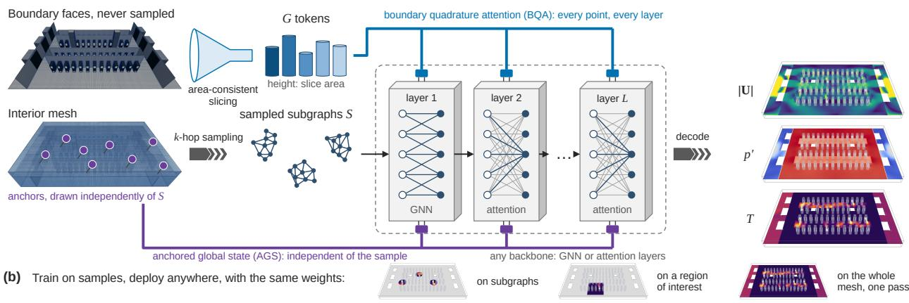  
Figure 1: Overview of SCANO and of the consistency conditions C1–C4 that it meets (Section 2.6). (a) Architecture. Boundary Quadrature Attention (BQA) takes all boundary faces as unsampled typed records $\phi _ { y } = [ \mathbf { x } _ { y } , \mathbf { n } _ { y } , \tau _ { y } , g _ { y } ]$ with areas $a _ { y }$ (C1). It pools them into G area-weighted slice tokens $z _ { g }$ with masses $M _ { g }$ (bar height, C2). It injects these tokens into every layer of the backbone along a normalised and an unnormalised readout path (C4). The Anchored Global State (AGS) computes the global summary of each layer from volume-weighted anchors. The anchors are drawn independently of the training sample S (C3). (b) Deployment. A model trained on samples is deployed on subsamples (on subgraphs), on a region of interest with its message-passing halo, and on the whole mesh. The whole mesh takes one pass with all cells as anchors. The example is room 1 of Figures 16 and 17.

Section 2 derives the conditions, Section 3 presents SCANO and Section 4 describes the experimental setup. Section 5 tests the conditions, Section 6 presents the industrial case, Section 7 discusses the results and Section 8 concludes.

## 2. Problem formulation and theoretical analysis

We first examine the boundary conditions of large meshes (Section 2.1) and then formalise our central requirement. GPU memory forces training onto subsamples. A neural operator trained on samples should still agree with one trained on the whole mesh. This section turns that requirement into four measurable consistency conditions. The proofs and the training-free checks are in the supplementary material. So are the map from statements to experiments (Table S6) and the notation (Table S1).

## 2.1. Sampled training on large meshes and their boundary conditions

On a large mesh, the memory of a training step grows with the share of the mesh in the sample. This holds for every model (Figure 2a). On a DCTS room of about a million cells, a step over the whole room takes most of a GPU’s memory for every backbone. For the

(a)  
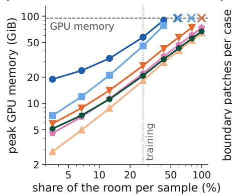

(b)  
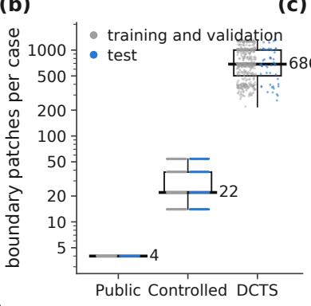  
(c)

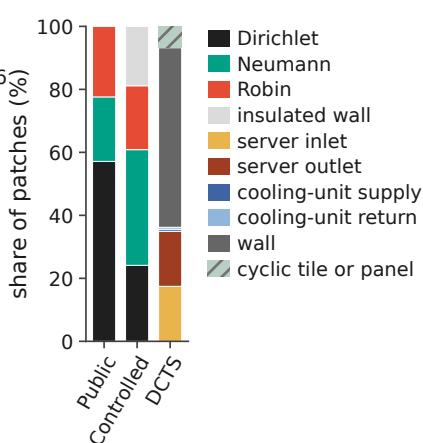  
Figure 2: Memory of sampled training and boundary statistics of the three data sets. (a) Peak GPU memory of one optimiser step on a DCTS room against the share of the room per sample. Samples are twohop subgraphs at seed ratios of 0.5–50%, and the last point is the full room (log axes). Crosses mark runs that exceed the GPU memory. The dashed line marks the available memory of a single GPU. The dotted line marks the training setting. (b) Number of boundary patches per case in the training and validation (grey) and test (blue) splits, showing the median, quartiles and range. (c) Share of the patches of each boundary type or physical role.

SCANO backbone, it exceeds that memory (Section 3.4). Its message passing stores features on every mesh edge. It therefore needs roughly three times the memory of Transolver on the same sample. It exceeds a single GPU once a sample covers more than half of the room. Transolver + BQA also exceeds a single GPU on the whole room without activation checkpointing. On still larger meshes, a full-mesh pass exceeds a single GPU for every backbone. Sampled training is therefore the starting point of this study. On DCTS, every model is trained on the same two-hop subgraphs, grown from seeds at 5% of the room. The comparison is thus paired.

Each training sample, however, captures only a fraction of the boundary. Engineering boundaries are large. They comprise many patches of diferent physical types and sizes, and each patch carries its own data. Across our three data sets (Table 1, Figure 2b,c), the patch count grows quickly. The public benchmark has four Dirichlet, Neumann and Robin segments on a circle. The controlled benchmark has a few tens of typed wall patches. A DCTS room has several hundred patches of six physical roles. Face areas within a single patch also span orders of magnitude. As the geometry grows more complex, a sample observes a smaller share of the patches. The patches it misses most often are the smallest ones, such as a single server exhaust (server outlet) or a cooling-unit grille. These are exactly the patches whose changes matter most to the engineer.

## 2.2. The requirement: consistency with whole-mesh training

Let $\Omega _ { h }$ be the cells of a mesh with volumes $w _ { x } , u ( x )$ the reference solution and $\hat { u } _ { \boldsymbol { \theta } } ( \boldsymbol { x } ; S )$ the prediction at a cell x when the model is given the sample $S \subseteq \Omega _ { h }$ with the boundary

input of that step. Training on the whole mesh minimises

$$
\mathcal { L } ( \boldsymbol { \theta } ) = \sum _ { x \in \Omega _ { h } } w _ { x } \ell \big ( \hat { u } _ { \boldsymbol { \theta } } ( x ; \Omega _ { h } ) , u ( x ) \big ) ;\tag{1}
$$

sampled training draws S from a design that includes x with probability $\pi _ { x }$ and minimises $\begin{array} { r } { \mathcal { L } _ { S } ( \theta ) = \sum _ { x \in S } ( w _ { x } / \pi _ { x } ) \ell ( \hat { u } _ { \theta } ( x ; S ) , u ( x ) ) } \end{array}$ . The model is sample-invariant at θ if $\hat { u } _ { \boldsymbol { \theta } } ( x ; S ) =$ ${ \hat { u } } _ { \theta } ( x ; \Omega _ { h } )$ for every sample S that contains x.

Proposition 1 (consistency of sampled training). Let the loss be additive over points with a normalisation that does not depend on the sample. (i) If the model is sample-invariant and $\pi _ { x } > 0$ wherever the whole-mesh term is not zero, then $\mathbb { E } _ { S } \mathcal { L } _ { S } = \mathcal { L }$ , and the gradients agree if the invariance holds near θ; with weights renormalised over the sample the objectives agree up to $O ( 1 / | S | )$ . (ii) If it is not, $\begin{array} { r } { \mathbb { E } _ { S } \mathcal { L } _ { S } = \sum _ { x } w _ { x } \mathbb { E } \big [ \ell \big ( \hat { u } _ { \theta } ( x ; S ) , u ( x ) \big ) | x \in S \big ] } \end{array}$ , in general a diferent objective however long the model is trained; for a global state computed from the sample, the gap does not shrink as the sample grows when the limit of the state difers from the whole-mesh state. (iii) If the only sample-dependent part is a global state estimated from $N _ { a }$ anchors that are drawn independently of the sample and carry their whole-mesh features, the model is sample-invariant given the anchors, and training with random anchors difers from deployment with the whole-mesh state only by the Monte Carlo error of the anchors, of order $1 / N _ { a }$ for a loss twice diferentiable in the state. (iv) In general, loss weights alone do not give consistency.

Part (i) is the Horvitz–Thompson identity [68, 69].

Loss weights alone cannot make sampled training consistent (part (iv)). Consistency must come from the architecture. The boundary information that reaches a point must not depend on the sample. Neither may the global state that the point reads. A model whose state is independent of the sample then keeps its accuracy and its predictions across deployments, up to the error of its anchors. A state computed from the sample drifts with every draw (Section 5.4).

## 2.3. A measure representation of mixed boundary data

Consider $- \nabla \cdot \left( \kappa \nabla u \right) + \mathbf { b } \cdot \nabla u = 0$ in a bounded Lipschitz domain Ω with constant $\kappa ,$ $\nabla \cdot \mathbf { b } = 0 , \mathbf { b } \cdot \mathbf { n } = 0$ on walls, and a boundary split into Dirichlet (D), Neumann (N) and Robin (R) patches with $D \cup R$ of positive measure. A difusion started at x with drift −b, reflected at walls and at N and R patches (and killed at a rate on $R )$ , and stopped on D gives

$$
u ( x ) = \int _ { D } u _ { D } \mathrm { d } \mu _ { x } ^ { \mathrm { e x i t } } + \int _ { R } u _ { \infty } \mathrm { d } \mu _ { x } ^ { \mathrm { k i l l } } + \int _ { N } \frac { q } { \kappa } \mathrm { d } \nu _ { x } ^ { \mathrm { l o c } } ,\tag{2}
$$

with Dirichlet values $u _ { D } ,$ external Robin values $u _ { \infty }$ and Neumann fluxes q. The exit and killing measures together have mass one. The local-time measure $\nu _ { x } ^ { \mathrm { l o c } }$ is unnormalised [64, 65, 66, 70]. Prescribed and external values thus enter as an average. Fluxes enter as an areaadditive sum. The type selects the measure, so values without their type cannot determine the solution. The finite-volume operator of the controlled benchmark is an M-matrix with the same structure, term by term (Section S6.1 of the supplementary material).

(a) Unobserved  
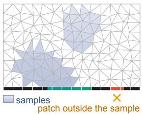  
C1

(b) Mis-weighted  
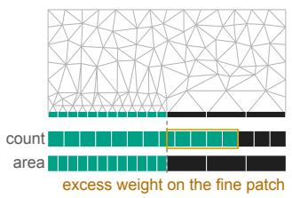  
C2

(c) Attenuated  
C4  
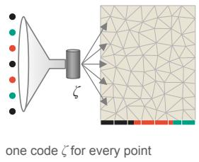

(d) Inconsistent  
C3  
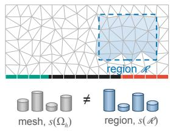

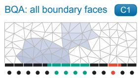  
every step, none missed

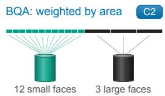

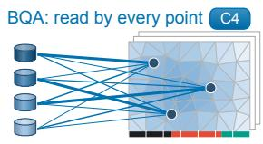  
its own mixture, every layer

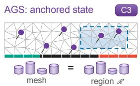  
anchors, not the sample

Figure 3: Distortions of the boundary measure under sampled training (top row), and how SCANO meets conditions C1–C4 (bottom row, filled tags). The mesh has Dirichlet (black), Neumann (teal) and Robin (red) patches. (a) Unobserved: sampling the boundary nodes (shaded) leaves out the patches that are not sampled. BQA reads all boundary faces in every step (C1). (b) Mis-weighted: weighting by count shifts the unit mass toward finely meshed patches (orange outline). BQA weights the records by face area $a _ { y }$ in slice tokens of mass $M _ { g }$ (C2). (c) Attenuated: global modulation (FiLM, adaLN) broadcasts one rank-d code ζ to all points. With BQA, each point attends to the slice tokens with its own weights in every layer (C4). (d) Inconsistent: a global state computed from the sample shifts with the query region R. AGS estimates the state from anchors independent of the sample (pins; C3).

Remark 1 (a server as a jump condition). A server’s exhaust returns its mean inlet temperature raised by $\Delta T _ { s } = P / ( \rho _ { \mathrm { a i r } } c _ { p } \dot { V } )$ . This is a non-local coupling of two patches. With the flow frozen, it takes the form of the pure-jump term of a Wentzell (Venttsel’) boundary condition [67]. A path that reaches the exhaust restarts on the server’s inlet. The jump thus keeps the convex structure, and $\Delta T _ { s }$ enters additively, like a flux. For buoyant RANS flow in a data centre, this representation holds for temperature under frozen flow. Beyond that, it guides the design.

## 2.4. How consistency breaks: three failure classes

To first order, boundary conditioning replaces the continuous measures of (2) with discrete weights on boundary records. These weights should not depend on the training sample (Proposition 1). Across meshes, they should not depend on how the boundary is split into faces either. Under sampled training, four distortions can violate this requirement. They fall into three failure classes (Figure 3). Under sampling dependence, a patch goes unobserved, or a state computed from the sample makes the prediction inconsistent. Under measure mismatch, the records are mis-weighted. Under injection and compression loss, the boundary signal is attenuated. Each distortion leaves a signature. It can be predicted before training or measured on the data. The following statements make this precise.

Proposition 2 (visibility bound). For a linear problem $\begin{array} { r } { u = \sum _ { p } K _ { p } g _ { p } } \end{array}$ with independent patch data $g _ { p }$ of covariances $\Sigma _ { p }$ and a design independent of the data, let H(S) be the patches none of whose records reaches the input of sample S. Every prediction uˆ that depends only on the

input satisfies

$$
\mathbb { E } \Vert \hat { u } - u \Vert _ { Q } ^ { 2 } \ : \geq \ : \mathbb { E } _ { S } \sum _ { p \in H ( S ) } \mathrm { t r } \big ( K _ { p } \Sigma _ { p } K _ { p } ^ { * } \big ) \big | _ { Q } .\tag{3}
$$

When the boundary enters only as sampled nodes, a patch of $n _ { p }$ faces is hidden from a uniform subset of fraction ρ with probability close to $( 1 - \rho ) ^ { n _ { p } }$ , and the information lost at x is the data change times the hidden patch’s measure, largest nearby and downstream.

In a data-centre room, the patches hidden most often are the server exhausts. They are many, small and adjacent. They are also the heat sources (tested in Section 5.2).

Proposition 3 (drift of a sample-dependent global state). Consider a global state pooled over the sample, $\begin{array} { r } { s _ { j } ( S ) = \sum _ { x \in S } c ( x ) \omega _ { j } ( x ) f ( x ) / \sum _ { x \in S } c ( x ) \omega _ { j } ( x ) } \end{array}$ (assignment weights $\omega _ { j }$ , features $f )$ , with context weights $c ( x ) = 1$ (count) or $c ( x ) = w _ { x }$ (volume). Under a design with inclusion probabilities $\pi _ { x } , s _ { j } ( S )$ tends to the state weighted by $\pi _ { x } c ( x )$ . This limit equals the volume-weighted whole-mesh state for every feature if and only if $\pi _ { x } c ( x ) \propto w _ { x }$ . It equals the backbone’s own whole-mesh state, with weights c(x), if and only if $\pi _ { x }$ is uniform. Restricting the sample to a region shifts the limit unless the features are constant over the mesh. To first order, the change of the state between two deployments is linear in the diference of the measures $\pi _ { x } c ( x )$ , and the drift of the prediction follows it; a state from independently drawn anchors is fixed by the whole-mesh cache and fluctuates as $N _ { a } ^ { - 1 / 2 }$ with fresh anchors.

The limit is that of a ratio estimator [69] (tested in Section 5.4).

Proposition 4 (count against area weights). Consider an aggregation at x that assigns to record y (value $g _ { y } )$ the weight $e ^ { \lambda _ { x } ( y ) }$ , and let $K ( x , \cdot )$ be the area density of the boundary measure $\mu _ { x }$ it approximates, a probability measure on the aggregated records. If the logits equal the log density, $\lambda _ { x } = \log K ( x , \cdot )$ , the aggregation weighted by the face areas $a _ { y }$ is a self-normalised Riemann sum of $\int g \mathrm { d } \mu _ { x }$ , second order for smooth data; in the limit of dense records, the count-weighted aggregation errs by

$$
\frac { \int g \varrho \mathrm { d } \mu _ { x } } { \int \varrho \mathrm { d } \mu _ { x } } - \int g \mathrm { d } \mu _ { x } = \frac { \mathrm { C o v } _ { \mu _ { x } } ( g , \varrho ) } { \mathbb { E } _ { \mu _ { x } } [ \varrho ] }\tag{4}
$$

for a record density ϱ, vanishing only when ϱ is constant or uncorrelated with g under $\mu _ { x }$

Attention can be viewed as a discretised integral operator [19, 21]. This view places quadrature weights directly into the identity above. It predicts a computable error plateau for count weighting on graded records. Area weighting, in contrast, stays invariant when a record is copied into pieces that share its area, for any learned logits. It converges when faces are split or the mesh is refined (Proposition S2(iii); Section 5.3).

Proposition 5 (a global code limits the response). If the model reads the boundary data only through a code $\zeta = E ( g ) \in \mathbb { R } ^ { d }$ with a continuous encoder, the worst error on a sphere of radius r around $g _ { 0 }$ is at least $\sigma _ { d + 1 } r - O ( r ^ { 3 } )$ , with $\sigma _ { i }$ the singular values of the derivative of the solution operator, and for a linearised model the mean squared error under isotropic perturbations of size t is at least $t ^ { 2 } \sum _ { i > d } \sigma _ { i } ^ { 2 }$

This is a classical width bound [71, 72]. It has stable and Lipschitz variants [73, 74]. The bound applies to every model that reads the boundary only through a global code. Examples are feature-wise linear modulation (FiLM [75]) and adaptive layer normalisation (adaLN; Section 5.5). By the same mechanism, adjacent small patches pooled into one token cannot be resolved one by one (Proposition S1).

## 2.5. An error decomposition

Write the prediction as $\hat { u } _ { \boldsymbol { \theta } } ( \boldsymbol { x } ; \boldsymbol { s } , \boldsymbol { \beta } )$ , with s the global state the point reads and $\beta \ : =$ $\textstyle \sum _ { y } a _ { y } \delta _ { \phi _ { y } }$ the weighted empirical measure of the boundary records that reach it (features $\phi _ { y }$ , weights $a _ { y } ,$ for boundary values given as node features, those of the sampled boundary faces). A deployment, whether the whole mesh, a subgraph, a region or another mesh, determines $\left( s _ { \mathrm { d e p } } , \beta _ { \mathrm { d e p } } \right)$ ; the reference $( s ^ { * } , \beta ^ { * } )$ uses every cell and every record with its area. Let $\theta ^ { * }$ minimise (1) over the model class, $\hat { \theta }$ be the sampled-training solution, and $\| \cdot \| _ { w }$ be the volume norm.

Lemma 1 (error decomposition). If $\hat { u } _ { \hat { \theta } }$ is Lipschitz in the state (Euclidean norm over layers and tokens) and in the boundary input (bounded-Lipschitz distance $d _ { \mathrm { B L } }$ of measures), with constants $L _ { s }$ and $L _ { \beta }$ that hold uniformly in the other argument, then for every deployment

$$
\begin{array} { r } { \big \| \hat { u } _ { \hat { \theta } } ( \cdot ; s _ { \mathrm { d e p } } , \beta _ { \mathrm { d e p } } ) - u \big \| _ { w } \leq \underbrace { \varepsilon ^ { * } } _ { c l a s s } + \underbrace { \gamma ( \hat { \theta } ) } _ { t r a i n i n g } + \underbrace { L _ { s } \| s _ { \mathrm { d e p } } - s ^ { * } \| } _ { s t a t e } + \underbrace { L _ { \beta } d _ { \mathrm { B L } } ( \beta _ { \mathrm { d e p } } , \beta ^ { * } ) } _ { b o u n d a r y } , } \end{array}\tag{5}
$$

$$
w i t h \varepsilon ^ { * } = \| { \hat { u } } _ { \theta ^ { * } } ( \cdot ; s ^ { * } , \beta ^ { * } ) - u \| _ { w } \ a n d \ \gamma ( { \hat { \theta } } ) = \| { \hat { u } } _ { \hat { \theta } } ( \cdot ; s ^ { * } , \beta ^ { * } ) - u \| _ { w } - \varepsilon ^ { * } .
$$

Proof. The triangle inequality through $\hat { u } _ { \hat { \theta } } ( \cdot ; s ^ { * } , \beta ^ { * } )$ and the Lipschitz bounds. □

Propositions 1–5 characterise each term of (5). The Lipschitz constants of a trained network are not controlled a priori. The lemma therefore serves to organise the total error, so that each term can be isolated in experiments. The whole-mesh error of a model trained on the whole mesh estimates $\varepsilon ^ { * } + \gamma$ . The sampling gap between sampled and whole-mesh training isolates the bias of the sampled objective. The drift across deployments captures the state and boundary terms. The decay of that drift with the anchor count isolates the state term.

## 2.6. Complete boundary conditioning

Boundary conditioning is complete when four design criteria hold. Each criterion comes with a diagnostic that needs no training and with an empirical check on the trained model.

C1 Information completeness. Under every deployment, the input determines all boundary conditions, that is, the geometry, the type of each field and the data of every patch. It is measured by the error floor of subset deployments (Proposition 2) and by the response to type switches (Proposition S2(v)).

C2 Mesh consistency. The aggregation of the records is a consistent quadrature of the boundary integral, invariant to copying a record into pieces that share its area, and convergent when faces are split or refined. It is measured by the drift under record transformations and refinement (Propositions 4 and S2(iii)).

C3 Sample consistency. The prediction at a point does not depend on the other points of its sample, up to the Monte Carlo error of the anchors. It is measured by the drift across deployments and its decay with the anchor count (Propositions 1 and 3).

C4 Response fidelity. The injection path does not cap the response to the boundary, so no code has a lower dimension than the data. It is measured by the response error by patch area and kind of intervention (Propositions 5 and S1).

C1 and C2 together eliminate the boundary term in (5). C3 eliminates the state term. Under design-consistent weights, it also removes the objective bias in the training term. C4 removes the rank floor on the class term. A trivial predictor that ignores the boundary would look perfectly consistent. Deployment consistency is therefore always evaluated together with the response to boundary interventions. Section 5 tests C1–C4 in this order.

These conditions translate directly into requirements on the components. At the record level, every record must carry its boundary type. Area weighting must provide the quadrature measure. The slice-token means must include the face areas, so that copy invariance and refinement convergence hold (Propositions S2 and S3, Section S7). BQA meets C1 and C2. It reads unsampled, area-weighted records in every layer, so C1 and the record-level invariance of C2 hold by construction. AGS meets C3 on any backbone. It estimates the global state from anchors that do not depend on the sample (Section 3). C3 then holds up to the Monte Carlo error of the anchors whenever each anchor carries its exact wholemesh features, for instance when anchors bypass local message passing. On message-passing backbones, a training sample also truncates the receptive field near its border. This afects both the query and anchor subgraphs. A halo as deep as the message-passing receptive field removes this truncation for the queries at deployment. In training, border truncation accounts for little of the sampling gap, and evaluating SCANO’s state from fresh anchors instead of every cell changes its error only slightly (Sections S16.2 and S16.5). C4 holds exactly when each record forms its own token, as on the two benchmarks. With G slice tokens, the tokens form a code whose width is G times the token width, so Proposition 5 applies with that width. G then sets the resolution budget of the boundary response, at a cost linear in G (Proposition S1).

## 3. Methodology: SCANO

SCANO conditions a neural operator on its boundary through two modules. The first is boundary quadrature attention (BQA, Sections 3.1 and 3.2). The second is an anchored global state (AGS, Section 3.3). Both are carried by the SCANO backbone (Section 3.4 and Figure 1). BQA reads every boundary face as a record in every pass and every layer. AGS estimates the global state from anchors drawn independently of the sample. Boundary conditioning thus stays complete in every training pass, whatever the sample. The modules also attach to other backbones (Section 3.5). We denote the resulting models backbone + BQA and backbone + BQA + AGS. The SCANO backbone with BQA alone computes its state from the sample. We call it the SCANO backbone + BQA.

## 3.1. Typed boundary records

Only the domain points are sampled. Every boundary face y enters SCANO in every step as a record $\phi _ { y } = [ \mathbf { x } _ { y } , \mathbf { n } _ { y } , \tau _ { y } , g _ { y } ]$ . The record holds the face centroid, the outward normal, the boundary type and the value. The face area $a _ { y }$ is not an input feature. It is the quadrature measure under which the records are aggregated. Splitting a face therefore refines the quadrature without changing the information. The type $\tau _ { y }$ fixes the physical meaning of $g _ { y }$ . On a prescribed boundary, $g _ { y }$ is the imposed datum. On a zero-gradient boundary, it is an initial iterate. On a server exhaust, it is an initial estimate that includes the heat load. Value and type are therefore always read together. On DCTS, $\tau _ { y }$ encodes the role of the patch. There $g _ { y }$ holds the solver’s first-iteration values. These equal the prescribed data wherever data are imposed.

A server exhaust realises the jump coupling of Remark 1. Its records carry the server’s heat load and temperature rise $\Delta T _ { s }$ . On every backbone with BQA, and in the LFE extender, these records are weighted by the face area times the normalised exhaust velocity magnitude |U|. This product is proportional to the mass flux through the face. We use it as the measure of the jump, a modelling choice that follows the exhaust flow. The heat load enters the unnormalised readout described below. In all methods evaluated on DCTS, each domain point also receives its ofset to the nearest exhaust (Section 4.1.3).

## 3.2. Area-consistent slice tokens and two readouts

Reading every record from every point costs the product of points and faces. This is prohibitive for a million-cell room with half a million boundary faces. SCANO therefore aggregates the records once per forward pass into G boundary tokens. For each attention head, the lifted record $h _ { y }$ is assigned softly to G slices. Each slice receives a mass and a token:

$$
\omega _ { g } ( y ) = \mathrm { s o f t m a x } _ { g } ( W h _ { y } / \vartheta ) , \qquad M _ { g } = \sum _ { y } a _ { y } \omega _ { g } ( y ) ,\tag{6}
$$

$$
z _ { g } = \frac { \sum _ { y } a _ { y } \omega _ { g } ( y ) h _ { y } } { M _ { g } + \epsilon M _ { \mathrm { t o t } } } , \qquad M _ { \mathrm { t o t } } = \sum _ { g } M _ { g } .\tag{7}
$$

The masses thus partition the boundary area. Each token is an area-weighted moment of the records, as in attention viewed as a discretised integral operator [19, 21]. In every layer $l ,$ each domain point x attends to the tokens along two paths. A normalised path serves averages. An unnormalised path serves totals such as a heat flux or a server’s temperature rise:

$$
o _ { l } ( x ) = \sum _ { g } \mathrm { s o f t m a x } _ { g } \Bigl ( \frac { \mathbf { q } _ { l } ( x ) \cdot \mathbf { k } _ { l } ( z _ { g } ) } { \sqrt { d _ { \mathrm { k } } } } + \log M _ { g } \Bigr ) \mathrm { v } _ { l } ( z _ { g } ) ,\tag{8}
$$

$$
o _ { l } ^ { N } ( x ) = \sum _ { g } \frac { M _ { g } } { M _ { \mathrm { { r e f } } } } \exp \Bigl ( \frac { \mathrm { q } _ { l } ^ { N } ( x ) \cdot \mathrm { k } _ { l } ^ { N } ( z _ { g } ) } { \sqrt { d _ { \mathrm { { k } } } } } \Bigr ) \mathrm { v } _ { l } ^ { N } ( z _ { g } ) .\tag{9}
$$

Here W is a learned projection and $\vartheta$ a learned temperature. $d _ { \mathrm { k } }$ is the width of an attention head. $M _ { \mathrm { r e f } }$ is a fixed reference area of the order of a case’s boundary area. The log-mass weights each slice by the area it represents. A softmax normalises its weights and cannot represent totals. The unnormalised path supplies them. The tokens depend on the records alone. The domain therefore reads the boundary without altering it.

The implementation verifies three properties of this construction. First, replacing any record by several copies that share its area leaves both readouts unchanged in every backbone (copy invariance). Second, hard assignment by patch yields patch-level records. One slice per face yields per-record attention with a log-area logit (two limits). Third, the cost is one pass over the faces and one over the points, each multiplied by G (linear cost).

The slice count G sets the resolution budget of BQA. The two benchmarks have only a few thousand boundary faces. There, every face forms its own token and is read along the normalised path. On DCTS, heat loads enter as totals. We set G = 64 with both readouts. Whole-room accuracy and the response to a doubled rack load stay constant from G = 16 to 1,024. Only the training time grows with G (Table S19). Our comparisons also include plain slice aggregation (Slice aggregation in the tables). It pools records by count into tokens, and the domain slices read these tokens only once. BQA difers in three ways. It weights the records by area. It injects them at every point in every layer. It also provides an unnormalised path for totals.

## 3.3. An anchored global state

The global summary of the backbone is the second route by which the sample can enter the prediction. A slice-attention backbone summarises the domain in each layer l by a global state of one token per slice. These tokens are computed over a context set C with context weights c(x),

$$
s _ { l , j } = \frac { \sum _ { x \in \mathcal { C } } c ( x ) \omega _ { l , j } ( x ) f _ { l } ( x ) } { \sum _ { x \in \mathcal { C } } c ( x ) \omega _ { l , j } ( x ) } ,\tag{10}
$$

and every queried point reads them. Standard backbones use the training sample as C. The summary then shifts with the sampling design. This produces the inconsistent failure (Figure 3d).

AGS decouples the context set from the query sample. In each training step, C is an anchor sample. The training sampler draws it independently of the query sample, or uses the full mesh when the mesh is small. The anchors are weighted by cell volume. Each global token is thus a self-normalised Monte Carlo estimate of the volume-weighted domain mean. When the backbone has message passing, the anchor sample passes through the same message-passing layers as the queries. It does so on its own subgraph, without edges to the queries. The global state is therefore built from features of the same kind as the queries. Without message passing, a uniform subset of cells serves as the anchors.

At whole-mesh deployment, the anchor sample is the entire mesh. The global state is computed once, and the full mesh is predicted in a single pass. On a subgraph or a region of interest, the model draws a fresh anchor sample, as in training. For anchors that carry their whole-mesh features, only the Monte Carlo error of the anchors remains. Their count $N _ { a }$ is thus a second budget beside G (Proposition 3). AGS estimates one domain summary for training and for all deployments (Proposition 1(iii)). This difers from AB-UPT [3] given only a subsample. AB-UPT then draws its anchors within the sample, so its estimate depends on the sample. It also difers from Transolver-3 [5]. Transolver-3 caches a whole-mesh state only at deployment. Its state therefore departs from training unless the samples cover the mesh uniformly.

## 3.4. The SCANO backbone

In every layer, the SCANO backbone interleaves local message passing over the mesh with the slice attention of Section 3.3. It also applies the two boundary readouts of Section 3.2. The message passing uses the graph-network layer of the finite-volume graph network [76, 77]. It sits in an encode–process–decode architecture [14]. Message passing gives each point the fine-scale resolution of its mesh neighbourhood. Slice summaries alone lack this resolution. A point whose receptive field lies inside the sample sees exactly the neighbourhood it has on the full mesh. k-hop subgraphs, compact regions and the whole mesh all keep the required mesh graph. All baselines are matched to SCANO’s parameter count of about 0.8 M. Removing the message-passing layers reduces SCANO to a Transolver-style backbone with BQA and AGS. This model serves as our message-passing ablation.

## 3.5. SCANO on other backbones

BQA and AGS also work as plug-and-play modules beside the native layers of a backbone (Figure 1a). BQA is applied after each layer through the residual update $f _ { l } ( x ) \gets f _ { l } ( x ) +$ $o _ { l } ( x ) + o _ { l } ^ { N } ( x )$ on a layer-normalised state. The backbone keeps its native positional encoding and initialisation. We attach BQA to Transolver, AB-UPT, AeroGTO and GeoTransolver. We also attach it to GNOT, whose native cross-attention already reads every record weighted by count. Finally, we attach it to MeshGraphNets, which otherwise sees the boundary only through sampled boundary nodes. AGS replaces the native global state in every backbone that has one. These states are the slice-attention summaries of Transolver, AeroGTO and GeoTransolver, the attention summary of GNOT and the anchor set of AB-UPT. On the graded mesh of the controlled benchmark, AGS draws AB-UPT’s anchors over all mesh nodes. It weights them by cell volume. Keeping the count weights instead gives AB-UPT + BQA with whole-mesh anchors by count.

Where BQA adds parameters, we reduce the backbone’s width to keep the total parameter count matched. Each backbone with BQA is then compared with the original (native) backbone under the same records, sampler and training protocol (Section S2 of the supplementary material).

## 4. Experimental setup

We first describe the three data sets and then the compared models, the training protocol and the metrics.

## 4.1. Data sets

Table 1 summarises the three data sets. Figure 4 shows one boundary of each.

## 4.1.1. The controlled benchmark

The controlled benchmark provides what industrial data cannot. It has exact reference solutions and single-patch boundary interventions. The count, area and type of its boundary patches are set by design. It solves the linear convection–difusion problem of Section 2.3 in the unit cube. A fixed recirculating velocity b carries the influence of each patch downstream. Rectangular patches sit on otherwise insulated walls. Some are small and strongly driven openings (Figure 4a; Table S3 of the supplementary material). Each case is assembled from an exact response basis on a graded mesh. We verified this basis for superposition, conservation, the maximum principle and second-order convergence. Each of 64 test cases undergoes four exact single-patch interventions in four area strata. This gives 256 paired cases (Table S3).

Table 1: The three data sets. Patches is the number of distinct boundary conditions per case (median and range; Figure 2). Records are the boundary faces or points that BQA reads. Cases gives the training, validation and test splits. Coverage is the fraction of the mesh in one training sample.
<table><tr><td></td><td>Controlled benchmark</td><td>Public benchmark</td><td>DCTS</td></tr><tr><td>Problem</td><td>linear convection-diffusion in the unit cube, recirculating velocity b</td><td>Poisson on the unit disc</td><td>steady buoyant RANS (Boussinesq, realizable k-ε)</td></tr><tr><td>Mesh</td><td>graded 323 (32,768 cells); deployment mesh 403, graded in reverse</td><td>16,859 points, shared by all cases</td><td>0.88–1.23 million cells, one mesh per room</td></tr><tr><td>Patches</td><td>22 (14–54); Dirichlet, Neumann, Robin, insulated wall</td><td>4 segments; Dirichlet, Neumann, Robin</td><td>686 (219–1,306); six roles</td></tr><tr><td>Records</td><td>6,144 faces</td><td>1,000 points</td><td>about half a million faces</td></tr><tr><td>Cases References</td><td>2,048 / 256 / 512</td><td>2,744 / 256 / 256</td><td>400 / 50 / 50</td></tr><tr><td></td><td>exact (response basis)</td><td>finite elements (benchmark)</td><td>steady RANS solutions (OpenFOAM)</td></tr><tr><td>Interventions</td><td>256 exact pairs</td><td></td><td>20 held-out test pairs (200 for training)</td></tr><tr><td>Coverage</td><td>2-58%</td><td>5-76%</td><td>about 40% of the cells and 5% of the boundary faces (seeds at 5%, two hops)</td></tr></table>

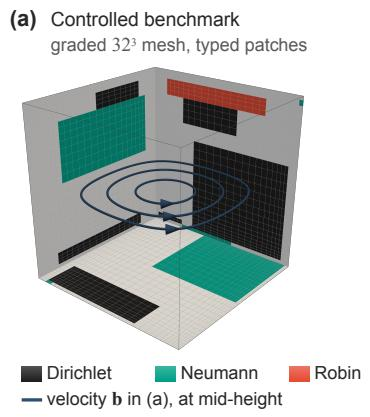  
(b) Public benchmark Poisson on the unit disc

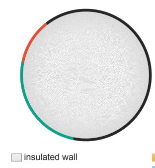

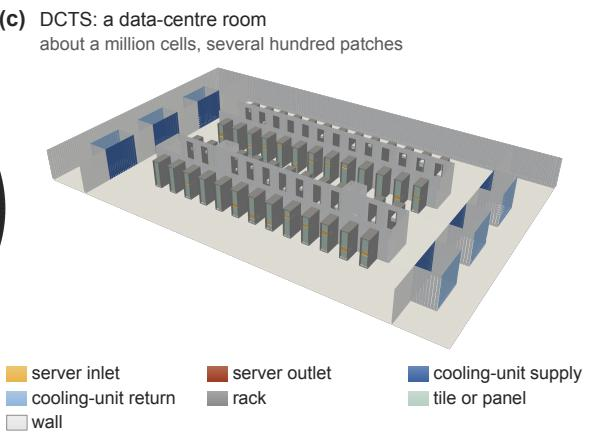  
Figure 4: Mesh and boundary of a representative case of each data set. (a) Controlled benchmark. The unit cube is shown open on its three near walls. The graded boundary faces are coloured by patch type. The panel also shows the velocity b at mid-height (median case of Figure 12). (b) Public benchmark. The interior triangulation is shared by all cases. The boundary segments are coloured by type (median case of Figure 13). (c) DCTS room. The CFD boundary mesh is coloured by the role of each component. The ceiling and two near walls are left out (room 1 of Figure 16).

By construction, this benchmark isolates each failure class. Patches are missed with a known probability (Proposition 2). Axis-graded faces separate count weighting from area weighting. A reverse-graded 403 deployment mesh (Other mesh in Table 3) tests mesh consistency (Proposition 4). The exact response spectrum sets the rank floor (Proposition 5). A type switch changes what a patch prescribes without changing its geometry. Training samples come from two standard families, k-hop subgraphs [6] and uniform subsets [5, 3]. Methods are compared within each family. A k-hop sample draws seed nodes at ratio ρ over cells and boundary faces. It then adds all cells within k graph hops. A boundary face therefore enters only when it is drawn as a seed. At $\rho = 0 . 1 2$ with one hop, a sample holds 58% of the cells but only 12% of the faces (Table S4, and Section S16.1 also tests a faceinclusive sampler). A uniform sample selects a random fraction ρ of cells and faces, without a mesh graph. On uniform samples, the SCANO backbone runs without message passing.

## 4.1.2. The public benchmark

The public benchmark is the mixed-boundary Poisson problem on the unit disc introduced with LFE [7]. Its boundary is split into Dirichlet, Neumann and Robin segments. Their layout and values vary across cases on a shared point cloud (Figure 4b). The prediction error therefore reflects the boundary conditioning directly. The boundary points are nearly uniform in arc length, so count and area weights almost coincide. The interior points are not uniform. The volume measure of the global state therefore still matters.

We evaluate all applicable methods of Table 2 under dense sampling. Dense samples are two-hop subgraphs at seed ratio 0.05 and cover about 76% of the points. Under sparse sampling, we keep the subset shared with the controlled benchmark. The sparse samples use ratio 0.01 with two hops and 0.005 with one hop. They cover about 25% and 5% of the points. SCANO, SCANO without message passing and Transolver + LFE are also trained on the whole mesh. All LFE variants in the main tables are re-implementations trained under this unified protocol. LFE trained with its oficial code and published settings reaches the accuracy reported in its paper (Section S12 of the supplementary material).

## 4.1.3. DCTS: data-centre rooms

Air-cooled data centres operate under strict thermal guidelines for the air drawn into each server inlet [78]. Thermal engineers need to know which servers risk overheating. They also need to know how the inlet temperatures shift when a rack’s power rises or a cooling unit is throttled. Answering each such query with computational fluid dynamics (CFD) requires solving the steady, buoyant, turbulent airflow over about a million cells. From each predicted field, we therefore also extract the mean temperature at every server inlet.

To represent this setting, DCTS comprises 500 rooms. They share an outer building envelope but difer in their entire internal layout. The number, placement and heat load of the racks vary (18 to 273 servers). So do the number, placement and supply conditions of the cooling units (two to six). The arrangement of perforated panels, partitions and pillars varies too. Each room thus has its own geometry, its own mesh and hundreds of boundary patches (Figures 2 and 4c).

An in-house parametric generator produces the surface geometry of each room. It also writes a case specification that assigns a physical role to every patch. snappyHexMesh discretises the geometry into a hexahedron-dominant mesh. The OpenFOAM solver buoyantBoussinesqSimpleFoam then solves the steady, incompressible, buoyant Reynoldsaveraged Navier–Stokes equations. It uses the Boussinesq approximation, the realizable k–ε closure and wall functions. Each server exhaust returns its volumetric airflow. Its temperature is the mean inlet temperature raised by the heat-load temperature rise (Remark 1). The cooling-unit supplies impose fixed flow rates and temperatures (Section S16.8 of the supplementary material audits convergence, energy balance and mesh sensitivity).

From the converged solution, each case records three fields on all cells and boundary faces. They are the Reynolds-averaged velocity $\mathbf { U } = \left( U _ { x } , U _ { y } , U _ { z } \right)$ , the kinematic pressure minus its hydrostatic part $p ^ { \prime } .$ , and the temperature T. Each case also stores the mesh connectivity, face areas, normals and patch roles. The data splits were fixed at generation time. All normalisation statistics come from the training rooms only.

Field accuracy alone does not show whether a model responds to a change of the boundary. We therefore also generate paired interventions. No two rooms share a mesh. Each test room is therefore solved again on its own mesh after one change: the power of one rack is doubled, or the airflow of one cooling unit is halved. The diference between the two solutions isolates the room’s physical response to that single change. Twenty such pairs in ten test rooms form our main response evaluation. They were held out from every architectural and hyperparameter decision. Another 200 pairs on training rooms are used in training.

To keep the comparison fair, all methods that ingest boundary records read the same typed face records. Every method also receives the same heat-source features. On the boundary records, these are the heat load and temperature rise of each server. At every domain point, they are the load of the nearest server and the ofset to its exhaust. The ofset is expressed in a frame aligned with the exhaust jet. All models are trained on the two-hop subgraphs of Table 1 (Figure 7).

## 4.2. Compared models

All compared models are matched to within ten percent of SCANO’s parameter count (Section S16.4 tests larger budgets). They fall into three groups (Table 2). The first group varies boundary and state injection on the SCANO backbone. It includes SCANO, the SCANO backbone + BQA, global modulation by FiLM or adaLN-Zero [79, 15], and a variant with boundary data only on sampled boundary nodes (boundary as sampled nodes). The second group contains six external operator backbones. Each is evaluated in its original (native) form and with BQA, AGS or both (Section 3.5). Transolver++ [36] is added as published. The third group contains dedicated boundary encoders: Transolver + LFE [7], BENO [8] and Slice aggregation (Section 3.2). In the result tables, GNOT and GeoTransolver are listed with this group, because their native layers already attend to boundary records. Three further ablations isolate single design choices. They are SCANO with anchors drawn outside the message-passing layers, AB-UPT + AGS, and the SCANO backbone + BQA without node boundary values.

Table 2: The compared models and how the boundary and the global state enter them. Node values are boundary data attached to the sampled boundary nodes. Records are all boundary records of a case, unsampled and weighted by area or by count. The global state column names the domain points over which the global tokens are pooled. Under AGS, the anchors are drawn independently of the sample in training and cover all cells at deployment. For each backbone, the second row gives the native route that BQA and AGS replace. Check marks show the data sets on which a model is evaluated (Section 3.5).
<table><tr><td>Method</td><td>Boundary input</td><td>Global state</td><td></td><td>Contr. Public DCTS</td><td></td></tr><tr><td colspan="6">The SCANO backbone: ways of injecting the boundary</td></tr><tr><td>SCANO</td><td>node values; BQA in every layer, records AGS, independent of by area</td><td>the sample</td><td></td><td></td><td></td></tr><tr><td>SCANO backbone + BQA</td><td>as SCANO</td><td>the sample</td><td></td><td></td><td></td></tr><tr><td>Global modulation</td><td>one area-weighted summary, FiLM or adaLN-Zero in every layer</td><td>the sample</td><td></td><td>√</td><td></td></tr><tr><td>Boundary as sampled node values only</td><td></td><td>the sample</td><td></td><td>√</td><td></td></tr><tr><td>nodes No boundary values</td><td>none (geometry only)</td><td>the sample</td><td>√</td><td></td><td></td></tr><tr><td colspan="6">Backbones: original, and with the SCANO components</td></tr><tr><td>Transolver</td><td>node values + BQA</td><td>the sample, by count AGS</td><td></td><td></td><td></td></tr><tr><td>AB-UPT</td><td>node values + BQA</td><td>anchors from the sample AGS: anchors over the</td><td>V</td><td></td><td></td></tr><tr><td>AeroGTO</td><td>node values</td><td>whole mesh the sample</td><td></td><td></td><td></td></tr><tr><td>GNOT</td><td>+ BQA records cross-attended in every layer, by the sample, by count</td><td>AGS</td><td></td><td></td><td></td></tr><tr><td></td><td>count BQA in place of (controlled, DCTS) or AGS beside (public) its record attention</td><td></td><td></td><td></td><td></td></tr><tr><td>GeoTransolver</td><td>records as the context of every layer, by the sample, by count</td><td></td><td></td><td></td><td></td></tr><tr><td></td><td>count + BQA</td><td>AGS</td><td></td><td></td><td></td></tr><tr><td>MeshGraphNets</td><td>node values, message passing + BQA</td><td></td><td></td><td>√</td><td></td></tr><tr><td>Transolver++</td><td>node values</td><td>the sample, by count</td><td></td><td>√</td><td></td></tr><tr><td colspan="6">Other boundary encoders</td></tr><tr><td>Transolver + LFE</td><td>LFE extender at the input, records by</td><td>the sample, by count</td><td>V</td><td></td><td></td></tr><tr><td>Slice aggregation</td><td>count (and by area) records pooled into slice tokens, read</td><td>the sample, by count</td><td></td><td></td><td></td></tr><tr><td>BENO</td><td>once by the domain slices all boundary nodes averaged into one</td><td></td><td></td><td></td><td></td></tr><tr><td></td><td>vector per step</td><td></td><td></td><td></td><td></td></tr></table>

## 4.3. Training and model selection

Every model is trained on mesh samples under one shared protocol per data set (Table S2 and Algorithm S1 of the supplementary material). As is standard for these backbones, the training loss weights all sampled points equally. Proposition 1(iv) shows that this choice is separate from the architectural conditions studied here. On DCTS, the loss also includes a diference loss over the paired interventions of the training rooms. The training samples depend only on the case and the epoch. All comparisons are therefore paired.

For each method, a first training seed is run at the learning rates $1 0 ^ { - 3 }$ and $3 \times 1 0 ^ { - 4 }$ Further seeds use the rate with the lower whole-mesh validation error. Every configuration is thus trained with multiple seeds. Unless a caption states otherwise, every reported metric is the mean over these seeds, the first one included. It is given with ± half the width of its 95% case-bootstrap interval over the test cases (Section S16.7 adds a paired bootstrap over cases and seeds). No design or hyperparameter choice uses the test sets. All evaluation criteria were registered before the test results were inspected. Some runs do not leave the initial loss plateau under a registered validation threshold. Such a run is kept and marked in the tables. An additional seed replaces it in the mean over the converged runs.

## 4.4. Deployments and metrics

Each trained model is evaluated in three deployment regimes (Figure 1b, Algorithm S2). These are a subsample drawn as in training (Sample or Subgraph in the tables), the whole mesh in a single pass (Whole mesh), and compact regions of interest (Region). On the controlled benchmark, we add a reverse-graded mesh and a sequence of refined record sets (Table S5). A region of interest consists of all cells and boundary faces inside an axisaligned box. The box holds a prescribed fraction of the cells. The region is the same for all methods on a data set. Message-passing models also read a halo of cells, as deep as their receptive field. Some models compute their global state from the sample. On DCTS, we also evaluate each model in its native full-room deployment (own deployment in Table 5). For sample-dependent models, this is the cell-wise average of the predictions over training-sized subgraphs that cover the mesh. For models with AGS, it is simply the single whole-mesh pass. Figure 5 shows the average and a cover by regions on a DCTS test room. All runs were trained, and timed after warm-up, on NVIDIA GPUs with 96 GB of memory.

Field accuracy is measured by the relative $L ^ { 2 }$ error over the deployed points or cells, weighted by cell volume on volumetric meshes. On DCTS, it is averaged over the five fields $( U _ { x } , U _ { y } , U _ { z } , p ^ { \prime } , T )$ , each normalised by the variation of the true field about its training mean. The deployment drift δ is the relative distance between a deployment’s prediction and the model’s own whole-mesh prediction on the same nodes. On DCTS, the reference is each model’s own-deployment prediction, and the drift is normalised in the same way as the error. On another mesh, the drift counts the excess over the reference change. For each paired intervention, the response error is

$$
E _ { \mathrm { r e s p } } = \frac { \| \Delta \hat { u } - \Delta u \| } { \| \Delta u \| } ,\tag{11}
$$

where $\Delta u$ and $\Delta \hat { u }$ are the true and predicted field changes in the error norm. On DCTS, this norm is taken for the temperature T over the whole room. Drift is always reported together with the response (Section 2.6). Identities that hold by construction are marked as such.

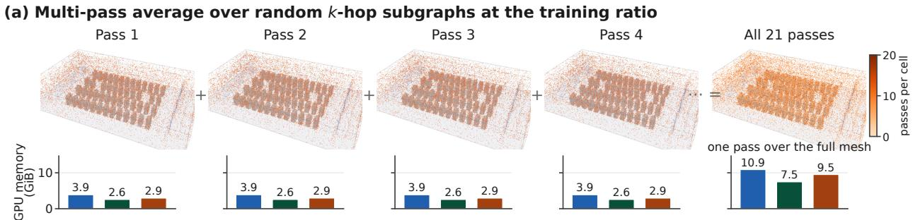

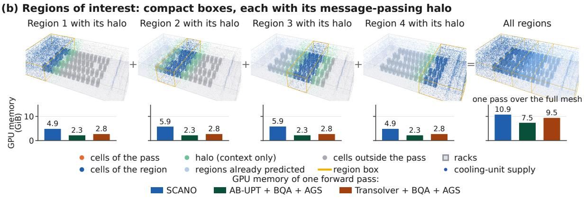  
Figure 5: Two ways to cover a DCTS test room with forward passes. (a) The multi-pass average. Each pass draws seed cells at the training ratio and grows them by two hops. Orange points are the cells of the pass. Grey points are the other cells. The last panel counts the passes that cover each cell. (b) Regions of interest that fill the room one after another. Each region is a box, outlined in yellow. A message-passing model also reads a halo around it (green). Its prediction is kept only inside the box. In both (a) and (b), the bars give the peak GPU memory of each pass for three backbones with BQA and AGS, and the last column gives one pass over the full mesh. The points are a random subset of the cells.

To measure what sampled training costs, we also train on whole meshes where possible. Full cases fit in GPU memory on both benchmarks. On DCTS, they fit with activation checkpointing (Section S2) for Transolver, Transolver + BQA and Transolver + BQA + AGS, but not for the SCANO backbone (Section 2.1). Where whole-mesh training is feasible, a method’s sampling gap is its whole-mesh error under sampled training minus that under whole-mesh training.

## 5. Results: testing the conditions

We begin with the efect of BQA and AGS on seven operator backbones and with the ranking of all methods on the two benchmarks (Section 5.1). We then test each condition of Section 2.6 against its prediction made before training (Sections 5.2–5.5). Next, we inspect the predicted fields of the benchmarks (Section 5.6). Section 6 then turns to DCTS.

## 5.1. The components on seven backbones

Figure 6 compares each native backbone with its variants after adding BQA and after adding both BQA and AGS. The comparison covers all three data sets. Each configuration is evaluated on the whole mesh and in a compact region of interest much smaller than a training sample. Table S8 of the supplementary material lists the values. The architecture, initialisation, learning rate and training samples of each backbone stay fixed throughout (Section 3.5). Tables 3 and 4 report all methods in every deployment of the two benchmarks.

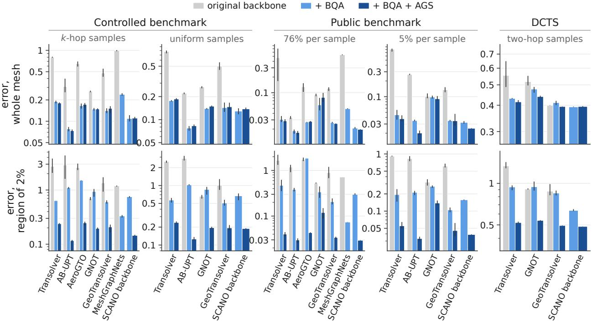  
Figure 6: Efect of BQA and AGS on seven operator backbones, for each data set and sampling setting (columns). The bars give the relative $L ^ { 2 }$ error of the original (native) backbone, of the backbone with BQA and of the backbone with BQA + AGS. The top row is the whole mesh in a single pass. Table 5 gives each method’s own deployment on DCTS. The bottom row is a compact region that holds 2% of the cells (log axes). Bars show the mean over training seeds. Whiskers show the range. Table S8 of the supplementary material lists the values.

On the two benchmarks, BQA improves every backbone it is added to. There, it cuts the whole-mesh error of most native backbones by more than half (Figure S3a of the supplementary material). In most cases it also improves the regional accuracy. On the SCANO backbone without message passing, BQA lowers the error several-fold compared with ingesting the boundary as sampled nodes (Table 4). The gain is largest where the native backbone sees the boundary only through sampled boundary nodes. The errors of Transolver, AeroGTO and MeshGraphNets fall by a factor of several to more than an order of magnitude. The gain remains substantial on GeoTransolver and AB-UPT. These backbones already attend to the boundary through a geometry context or an anchor set. On them, BQA shifts the whole distribution of per-case errors downward (Figure S4 of the supplementary material).

On DCTS, in a single whole-room pass, BQA lowers the error of Transolver by about one fifth. It lowers that of GNOT more modestly. GeoTransolver keeps its accuracy with BQA and AGS (Table S8). Its geometry context already attends to the boundary in every layer. The relative gain is smaller on DCTS for two reasons. First, every method already receives the heat load of the nearest server at every domain point. Second, BQA changes the velocity

U less than the boundary-driven temperature T. The velocity makes up three of the five error components. On Transolver, BQA changes it by at most one tenth, against one fifth for T (Table S18). Without the per-point heat-load feature, Transolver + BQA stays well ahead of the native backbone. The lead is largest in regions of interest (Table S21).

BQA improves accuracy. AGS makes the backbones consistent across deployments. Added to BQA, AGS keeps the whole-mesh accuracy of BQA alone on almost every backbone. Only GNOT on the public benchmark gives up part of it. AGS also cuts the regional error of every backbone that maintains a global state. The reduction is several-fold on the two benchmarks. In DCTS rooms it is one quarter to one half (Figure S3b). On GNOT in the controlled benchmark, BQA alone raises the error inside a small region. This increase comes from recomputing the global state from the region. It disappears once AGS is added. With both modules, the regional error stays close to the whole-mesh error. Backbones whose state follows the sample degrade in regions (Figure 6, bottom; Section 5.4).

These two efects determine the ranking of all methods. With BQA and AGS, AB-UPT reaches the lowest error on all three data sets. It leads every deployment in the k-hop family and on the reverse-graded mesh of the controlled benchmark. Among the backbones with BQA and AGS, SCANO ranks second on both benchmarks. On DCTS, it ties with Geo-Transolver within its confidence interval. SCANO computes its whole-mesh state in a single pass of linear cost. AB-UPT needs a quadratic anchor self-attention instead (Section 6.4). SCANO’s message-passing layers give a clear gain in accuracy on both benchmarks. On the whole mesh of the public benchmark, BQA decides the ranking. Every model of Table 4 with BQA outperforms all other boundary encoders. The SCANO backbone stays ahead even when it reads the boundary through BQA alone, without node boundary values. Among the alternative encoders, LFE comes closest on the controlled benchmark once it uses area weights. Its published count-weighted form lags well behind. At the scale and metric of the original LFE study, SCANO trained on samples matches the oficial whole-graph LFE implementation. In that setting, as on the public benchmark and DCTS, BQA also improves Transolver more than LFE does (Section S12 of the supplementary material).

## 5.2. C1: information completeness

Proposition 2 predicts before training what fraction of the boundary a sample observes. A patch of $n _ { p }$ faces is missed entirely with probability close to $( 1 - \rho ) ^ { n _ { p } }$ . The smallest patches are missed most often. The share of patches with at least one face in a sample follows this curve closely on both the controlled benchmark and DCTS (Figure 7). At the training ratio, a single sample of the controlled benchmark misses about one sixth of all patches. A sample of a DCTS room captures nearly 40% of the interior cells. Yet it captures only one third of the server outlets, which drive the room’s thermal field.

Any model that ingests the boundary only through sampled boundary nodes inherits this omission. It shows no response at all to interventions on patches outside its sample. These cases are marked ‡ in Tables S9, S11 and S13 of the supplementary material. On the public benchmark, every patch is partly present in each sample. Even there, relying on sampled boundary nodes alone reduces accuracy. The SCANO backbone conditioned in this way has several times the error of SCANO without message passing. This holds even with four times as many slice tokens (Table 4). BQA, in contrast, reads all records in every step.

(a) controlled benchmark: k-hop (filled), uniform (open)  
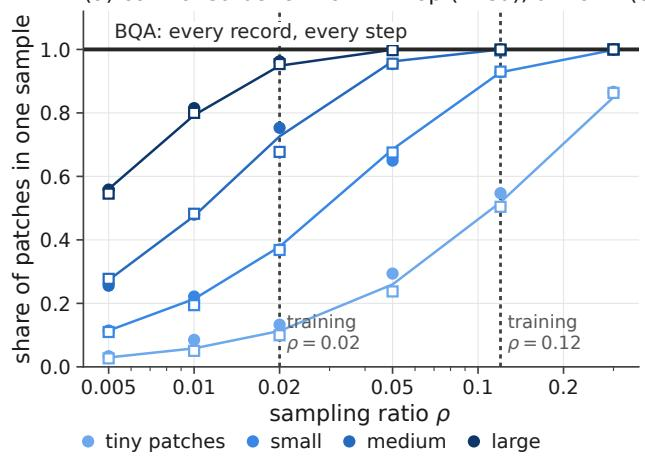

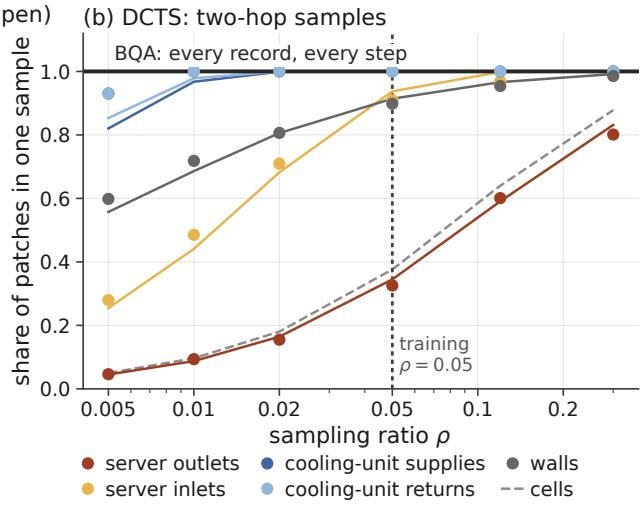  
Figure 7: Fraction of the boundary patches that a single training sample observes, against the sampling ratio ρ (Proposition 2). (a) Controlled benchmark. The observed fraction is shown for each area stratum, for k-hop subgraphs (filled) and uniform subsets (open). (b) DCTS. The observed fraction is shown for each component role under two-hop training subgraphs. The dashed line is the sampled fraction of interior cells. Markers are measurements on the sampler. Solid curves follow Proposition 2. Vertical dotted lines mark the training ratios. The top line marks BQA, which reads every patch.

Information completeness also requires the boundary type of each record. A type switch changes what a patch prescribes without changing its geometry. We trained SCANO without record types and kept everything else the same. Its response error on the type-switch interventions of the controlled benchmark roughly tripled (Table S21 of the supplementary material). Proposition S2(v) of the supplementary material implies this result.

## 5.3. C2: mesh consistency

Proposition 4 makes two predictions. Aggregating graded records by count leaves a covariance bias that does not vanish under refinement. Aggregating them by area converges. A training-free test confirms both. A fixed kernel aggregates a sequence of refined record sets on the controlled benchmark (Figure S1 of the supplementary material). Area weighting converges at second order for all mesh gradings. Count weighting on graded records stalls at the predicted plateau.

Trained models show the same separation on the reverse-graded mesh (Other mesh, the last column of Table 3). SCANO and area-weighted Transolver + LFE weight boundary records by area. Both keep their accuracy. SCANO nearly matches its error on the training mesh. Count-weighted Transolver + LFE and GNOT degrade sharply. Weighting AB-UPT’s anchors by cell volume removes most of its remeshing loss, as Proposition 3 predicts. Within SCANO itself, we also trained with records weighted by count instead of area. The error on the reverse-graded mesh roughly tripled in both sampling families. On the training mesh, it rose by about a quarter on k-hop samples and changed little on uniform samples (Table S21).

The boundary measure behind these weights can also be probed directly in a trained model. The controlled benchmark is linear. The representation (2) can therefore be tested on any trained surrogate without a numerical solver. Three tests follow from it. Shifting all Dirichlet and external Robin values by a constant should shift every interior cell by the same constant. This confirms that the weights sum to one (unit-mass test). Perturbing a single such patch should shift each cell by a fraction in [0, 1], and these fractions should sum to one over all patches. This confirms non-negativity. Doubling a Neumann flux should double the increment it causes. This confirms additivity. Figure 8 evaluates the unit-mass test over the test split. Models with BQA satisfy this unit-mass property closely. Transolver, AB-UPT and AeroGTO each move several-fold closer to the exact measure once BQA is attached. Across all trained models, the deviation from unit mass ranks the methods almost exactly as their whole-mesh error does. The test thus probes the learned quadrature without any reference solution.

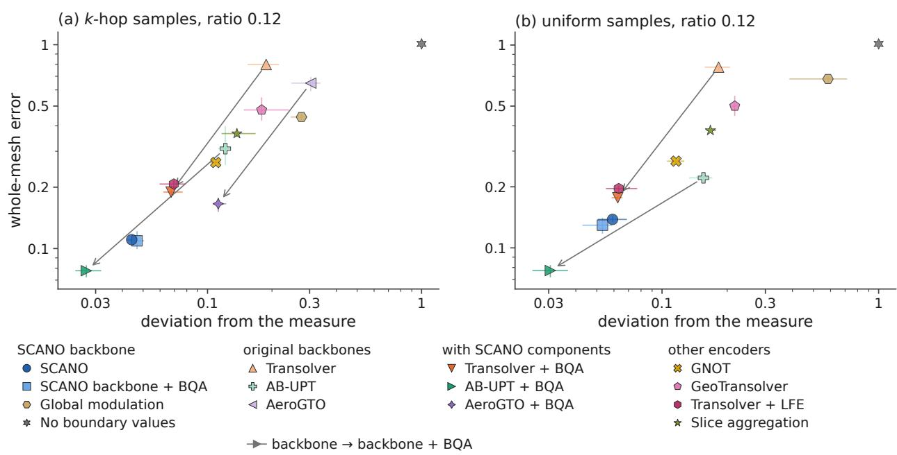  
Figure 8: Unit-mass test of the learned measure against the whole-mesh relative $L ^ { 2 }$ error on the controlled benchmark, for (a) k-hop and (b) uniform samples at ratio 0.12. Raising all Dirichlet and external Robin values by a constant tests unit mass. The horizontal axis (deviation from the measure) is 0 for exact conservation and 1 for no response. Markers and bars show the mean and range over training seeds. Arrows join each original backbone to the same backbone with BQA. Groups follow Table 3.

## 5.4. C3: sample consistency

Proposition 3 predicts how a global state computed from the deployed sample behaves. As the sample shrinks, the state shifts linearly with the change of the inclusion measure. It therefore drifts much faster on a compact region than on scattered samples that cover the mesh almost uniformly. Figure 9 confirms this on all three data sets as a function of deployment coverage. For every model whose global state is computed from the deployed sample, its drift from its own whole-mesh prediction grows as the coverage decreases. The growth is far steeper on compact regions than on scattered samples. The prediction error follows the drift. SCANO’s prediction in any deployment stays aligned with its whole-mesh prediction up to the Monte Carlo variance of its anchors. Its regional error therefore equals its whole-mesh error on the same cells. BQA lowers the error and the drift of Transolver at every coverage. Only AGS removes the dependence on the region.

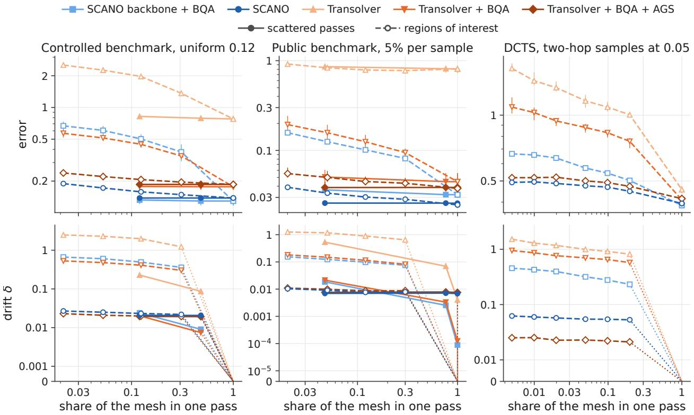  
Figure 9: Accuracy and consistency of regional deployments against the share of the mesh in one pass (Proposition 3, condition C3). The top row gives the relative $L ^ { \bar { 2 } }$ error. The bottom row gives the drift δ from each model’s own whole-mesh prediction, which is zero at full coverage (symmetric-log vertical axis). Solid curves are scattered passes. Dashed curves are compact regions of interest covering 2–30% of the cells on the benchmarks and 0.5–20% on DCTS. Training samples are uniform at ratio 0.12 on the controlled benchmark. On the public benchmark, they are one-hop subgraphs that cover about 5% of the mesh. On DCTS, they are two-hop subgraphs. Markers and bars show the mean and range over training seeds.

The regional columns of Tables 3 and 4 show the same pattern for all methods. On the controlled benchmark, SCANO’s error in compact regions down to 2% of the cells stays close to its whole-mesh error. The same holds on the reverse-graded mesh. Every method whose global state is recomputed from the queried points sufers a several-fold increase in error in the smallest region. This holds even with BQA. The SCANO backbone + BQA difers from SCANO only in how it estimates its global state. Yet it has several times SCANO’s error there. The state computed from the sample is therefore the cause.

On the public benchmark, the mesh is small enough for SCANO’s anchor set to cover all of it. SCANO’s regional drift therefore vanishes by construction. $\mathrm { A B - U P T } + \mathrm { B Q A } + \mathrm { A G S }$ with freshly drawn anchors matches its whole-mesh prediction, up to the Monte Carlo error of that draw. AB-UPT with anchors drawn from the sample loses an order of magnitude in regional accuracy. So does the SCANO backbone + BQA. We also trained on sparser samples that cover about 25% and 5% of the mesh (Table S15 of the supplementary material). The

Table 3: Controlled benchmark (512 test cases): volume-weighted relative $L ^ { 2 }$ error (seed mean ± half-width of the 95% case-bootstrap interval) across four deployments (Section 4.4): one training-sized sample, the whole mesh in one pass, compact regions of interest (30%, 12%, 5% and 2% of cells), and zero-shot transfer to the reverse-graded $\bar { 4 0 ^ { 3 } }$ mesh (other mesh). Bold indicates the best result per column; the uniform-sampling family is in Table S10 of the supplementary material. $^ { \ S } \mathrm { N o }$ boundary input.
<table><tr><td>Method</td><td></td><td></td><td colspan="4">Region, share of the cells</td><td></td></tr><tr><td></td><td>Sample</td><td>Whole mesh</td><td>0.3</td><td>0.12</td><td>0.05</td><td>0.02</td><td>Other mesh</td></tr><tr><td colspan="8">k-hop samples, ratio 0.12</td></tr><tr><td>SCANO SCANO</td><td>0.111 ± 0.009</td><td>0.111 ± 0.009</td><td>0.118 ± 0.010</td><td>0.127 ± 0.013</td><td>0.136 ± 0.018</td><td>0.145 ± 0.015</td><td> $0 . 1 1 5 \pm 0 . 0 0 8$ </td></tr><tr><td>SCANO backbone + BQA</td><td>0.112 ± 0.007</td><td>0.109 ± 0.008</td><td>0.401 ± 0.046</td><td>0.555 ± 0.064</td><td>0.697 ± 0.080</td><td>0.750 ± 0.083</td><td>0.115 ± 0.008</td></tr><tr><td colspan="8">Boundary injection on the SCANO backbone</td></tr><tr><td>SCANO, anchors outside the</td><td>0.118 ± 0.009</td><td> $0 . 1 1 8 \pm 0 . 0 0 9$ </td><td> $0 . 1 2 9 \pm 0 . 0 1 1$ </td><td> $0 . 1 3 8 \pm 0 . 0 1 3$ </td><td> $0 . 1 5 3 \pm 0 . 0 2 2$ </td><td> $0 . 1 6 7 \pm 0 . 0 2 9$ </td><td> $0 . 1 1 9 \pm 0 . 0 0 9$ </td></tr><tr><td>message passing SCANO without message</td><td> $0 . 1 3 9 \pm 0 . 0 1 0$ </td><td> $0 . 1 3 9 \pm 0 . 0 1 0$ </td><td> $0 . 1 4 9 \pm 0 . 0 1 1$ </td><td> $0 . 1 6 1 \pm 0 . 0 1 5$ </td><td> $0 . 1 7 6 \pm 0 . 0 2 3$ </td><td> $0 . 1 9 3 \pm 0 . 0 2 7$ </td><td> $0 . 1 3 9 \pm 0 . 0 1 0$ </td></tr><tr><td>passing Global modulation</td><td> $0 . 5 2 5 \pm 0 . 0 3 4$ </td><td> $0 . 4 4 2 \pm 0 . 0 3 0$ </td><td> $0 . 5 2 7 \pm 0 . 0 3 8$ </td><td> $0 . 6 1 5 \pm 0 . 0 4 9$ </td><td> $0 . 6 6 9 \pm 0 . 0 5 7$ </td><td> $0 . 7 6 2 \pm 0 . 0 6 2$ </td><td> $0 . 7 2 3 \pm 0 . 0 4 7$ </td></tr><tr><td>No boundary values§</td><td> $1 . 0 0 9 \pm 0 . 0 3 3$ </td><td> $1 . 0 0 9 \pm 0 . 0 3 3$ </td><td> $1 . 0 4 4 \pm 0 . 0 4 1$ </td><td> $1 . 0 9 1 \pm 0 . 0 5 2$ </td><td> $1 . 1 3 4 \pm 0 . 0 6 5$ </td><td> $1 . 1 9 9 \pm 0 . 0 6 8$ </td><td> $1 . 0 0 9 \pm 0 . 0 3 3$ </td></tr><tr><td colspan="8">Other boundary encoders</td></tr><tr><td>Transolver + LFE</td><td>0.206 ± 0.026</td><td>0.207 ± 0.026</td><td>0.334 ± 0.032</td><td>0.445 ± 0.044</td><td>0.514 ± 0.054</td><td>0.598 ± 0.069</td><td>0.467 ± 0.045</td></tr><tr><td>Transolver + LFE, area</td><td>0.166 ± 0.014</td><td>0.167 ± 0.014</td><td>0.294 ± 0.026</td><td>0.388 ± 0.039</td><td>0.452 ± 0.053</td><td>0.503 ± 0.054</td><td>0.176 ± 0.016</td></tr><tr><td>GNOT</td><td>0.263 ± 0.015</td><td>0.264 ± 0.015</td><td>0.423 ± 0.028</td><td>0.529 ± 0.042</td><td>0.609 ± 0.059</td><td>0.700 ± 0.072</td><td> $0 . 5 0 5 \pm 0 . 0 3 6$ </td></tr><tr><td>GeoTransolver</td><td>0.478 ± 0.029</td><td>0.479 ± 0.029</td><td>0.916 ± 0.057</td><td>1.102 ± 0.085</td><td>1.226 ± 0.132</td><td>1.352 ± 0.135</td><td> $0 . 5 4 2 \pm 0 . 0 2 7$ </td></tr><tr><td>Slice aggregation</td><td>0.364 ± 0.025</td><td>0.366 ± 0.024</td><td>0.789 ± 0.053</td><td>1.071 ± 0.084</td><td>1.136 ± 0.097</td><td>1.262 ± 0.113</td><td> $0 . 4 8 7 \pm 0 . 0 2 5$ </td></tr><tr><td>BENO</td><td>0.457 ± 0.038</td><td>0.458 ± 0.038</td><td>0.480 ± 0.044</td><td>0.514 ± 0.055</td><td>0.551 ± 0.072</td><td>0.585 ± 0.074</td><td> $0 . 7 6 8 \pm 0 . 0 3 3$ </td></tr><tr><td colspan="8">Backbones</td></tr><tr><td>Transolver</td><td> $0 . 8 4 6 \pm 0 . 0 5 5$ </td><td> $0 . 8 0 0 \pm 0 . 0 4 5$ </td><td> $1 . 3 5 4 \pm 0 . 1 0 7$ </td><td> $1 . 8 9 3 \pm 0 . 1 6 9$ </td><td> $2 . 3 2 9 \pm 0 . 2 3 1$ </td><td> $2 . 7 1 8 \pm 0 . 2 5 4$ </td><td> $0 . 7 4 3 \pm 0 . 0 3 3$ </td></tr><tr><td>Transolver + BQA</td><td>0.186 ± 0.012</td><td> $0 . 1 8 9 \pm 0 . 0 1 2$ </td><td>0.429 ± 0.026</td><td>0.538 ± 0.044</td><td>0.597 ± 0.054</td><td> $0 . 6 3 6 \pm 0 . 0 6 9$ </td><td> $0 . 2 1 6 \pm 0 . 0 1 5$ </td></tr><tr><td>AB-UPT</td><td>0.436 ± 0.044</td><td> $0 . 3 0 9 \pm 0 . 0 2 0$ </td><td> $1 . 2 4 7 \pm 0 . 0 8 9$ </td><td>1.970 ± 0.155</td><td>2.474 ± 0.213</td><td> $2 . 8 7 9 \pm 0 . 2 3 0$ </td><td> $0 . 4 7 2 \pm 0 . 0 2 8$ </td></tr><tr><td>AB-UPT + BQA</td><td>0.074± 0.008</td><td> $0 . 0 7 8 \pm 0 . 0 0 8$ </td><td> $0 . 5 0 7 \pm 0 . 0 4 6$ </td><td>0.762 ± 0.076</td><td>0.932 ± 0.089</td><td> $1 . 0 9 9 \pm 0 . 0 9 9$ </td><td> $0 . 2 2 8 \pm 0 . 0 1 9$ </td></tr><tr><td>AB-UPT, whole-mesh anchors by count</td><td> $0 . 2 5 6 \pm 0 . 0 2 9$ </td><td> $0 . 2 5 6 \pm 0 . 0 2 9$ </td><td> $0 . 4 5 8 \pm 0 . 0 4 6$ </td><td> $0 . 4 8 4 \pm 0 . 0 6 1$ </td><td> $0 . 5 2 9 \pm 0 . 0 8 0$ </td><td> $0 . 5 8 8 \pm 0 . 0 9 8$ </td><td> $0 . 4 3 9 \pm 0 . 0 3 5$ </td></tr><tr><td>AB-UPT + BQA, whole-mesh anchors by count</td><td> $0 . 0 8 3 \pm 0 . 0 1 2$ </td><td> $0 . 0 8 3 \pm 0 . 0 1 2$ </td><td> $0 . 0 9 7 \pm 0 . 0 1 5$ </td><td> $0 . 1 0 4 \pm 0 . 0 1 7$ </td><td> $0 . 1 1 9 \pm 0 . 0 3 1$ </td><td> $0 . 1 3 4 \pm 0 . 0 4 3$ </td><td> $0 . 2 0 3 \pm 0 . 0 1 5$ </td></tr><tr><td> $\mathrm { A B - U P T } ^ { \bullet } + \mathrm { B Q A } + \mathrm { A G S }$ </td><td> $\mathbf { 0 . 0 7 4 } \pm 0 . 0 0 9$ </td><td> $\mathbf { 0 . 0 7 3 \pm 0 . 0 0 9 }$ </td><td> $\mathbf { 0 . 0 8 6 \pm 0 . 0 1 1 }$ </td><td> $\mathbf { 0 . 0 9 1 } \pm 0 . 0 1 3$ </td><td> $\mathbf { 0 . 1 0 6 \pm 0 . 0 2 4 }$ </td><td> $\mathbf { 0 . 1 1 6 \pm 0 . 0 3 4 }$ </td><td> $\mathbf { 0 . 0 9 4 } \pm 0 . 0 0 8$ </td></tr><tr><td>AeroGTO</td><td> $0 . 7 0 2 \pm 0 . 0 5 6$ </td><td> $0 . 6 4 8 \pm 0 . 0 3 9$ </td><td> $1 . 3 9 1 \pm 0 . 1 1 3$ </td><td> $2 . 0 2 7 \pm 0 . 1 8 2$ </td><td> $2 . 3 0 3 \pm 0 . 1 8 7$ </td><td> $2 . 5 8 9 \pm 0 . 2 2 1$ </td><td> $0 . 6 8 5 \pm 0 . 0 4 9$ </td></tr><tr><td> $\mathrm { A e r o G T O + B Q A }$ </td><td>0.164±0.018</td><td>0.166 ± 0.018</td><td> $0 . 7 4 2 \pm 0 . 0 3 9$ </td><td>1.014 ± 0.053</td><td> $1 . 2 2 1 \pm 0 . 0 7 8$ </td><td> $1 . 5 0 3 \pm 0 . 1 1 3$ </td><td> $0 . 1 8 1 \pm 0 . 0 1 7$ </td></tr></table>

models with AGS lose far less accuracy than the variants whose state follows the sample.   
SCANO’s lead over the SCANO backbone + BQA therefore widens.

How closely AGS follows the whole-mesh state depends on the number of anchors. An independently anchored state departs from the whole-mesh state only by the Monte Carlo error of sampling (Proposition 1(iii)). We drew $N _ { a }$ fresh single-cell anchors. The mean squared drift of SCANO’s prediction decays at the finite-population rate of sampling without replacement. This holds in both sampling families and for every training seed (Figure 10d). As $N _ { a }$ grows, the drift converges to the error of the whole-mesh state (Table S21 of the supplementary material). $N _ { a }$ is thus a budget with a known rate of convergence.

Anchoring is not the only way to remove the dependence on the sample at deployment. A model whose state follows the sample in training can instead cache its global state over the whole mesh at deployment. Transolver-3 [5] does this. The cost is a full-mesh pass for every new case. With this cache, the regional prediction coincides with the whole-mesh prediction. Its error is the whole-mesh column of Tables 3 and 4. On the controlled benchmark, such a cache performs comparably to AGS. On the public benchmark, SCANO’s margin over the cached SCANO backbone + BQA widens as the training samples shrink (Table S15 of the supplementary material). The reason is that the cache evaluates the network on whole-mesh states. The network never encountered such states during training (Section 3.3).

Table 4: Public benchmark (256 test cases, training samples covering ${ \sim } 7 6 \%$ of the mesh): relative $L ^ { 2 }$ error (%) and regional drift δ (%; distance between regional and whole-mesh predictions relative to the reference) across whole-mesh, training-subgraph, and compact 5%-region deployments (Section 4.4; seed mean ± 95% case-bootstrap half-width). Because this mesh is small, SCANO uses all mesh nodes as its anchor set. Bold indicates the column best. ‡Zero by construction (whole-mesh anchors); not ranked.
<table><tr><td>Method</td><td></td><td>Whole mesh Subgraph</td><td>Region</td><td>Region drift δ</td></tr><tr><td colspan="5">Dense sampling: one training sample covers about 76% of the mesh</td></tr><tr><td>SCANO SCANO</td><td> $1 . 9 7 \pm 0 . 0 9$ </td><td> $2 . 2 0 \pm 0 . 1 0$ </td><td> $2 . 5 9 \pm 0 . 2 0$ </td><td>0‡</td></tr><tr><td>SCANO, anchors outside the message passing</td><td> $2 . 2 2 \pm 0 . 1 1$ </td><td> $2 . 4 9 \pm 0 . 1 2$ </td><td> $2 . 9 1 \pm 0 . 2 5$ </td><td>0‡</td></tr><tr><td>SCANO backbone + BQA</td><td> $2 . 0 8 \pm 0 . 1 0$ </td><td> $2 . 5 0 \pm 0 . 1 1$ </td><td> $2 2 . 7 2 \pm 1 . 7 1$ </td><td> $2 2 . 6 0 \pm 1 . 6 7$ </td></tr><tr><td>Boundary injection on the SCANO backbone without message passing</td><td></td><td></td><td></td><td></td></tr><tr><td colspan="5"></td></tr><tr><td>SCANO without message passing</td><td> $2 . 7 6 \pm 0 . 1 2$ </td><td> $3 . 0 5 \pm 0 . 1 2$ </td><td> $3 . 7 0 \pm 0 . 2 6$ </td><td> $1 . 6 8 \pm 0 . 1 4$ </td></tr><tr><td>SCANO backbone + BQA, no node values</td><td> $3 . 1 4 \pm 0 . 1 6$ </td><td> $3 . 3 0 \pm 0 . 1 6$ </td><td> $3 1 . 1 1 \pm 2 . 4 4$ </td><td> $3 0 . 8 5 \pm 2 . 4 4$ </td></tr><tr><td>Global modulation</td><td> $5 9 . 6 9 \pm 2 . 2 3$ </td><td> $5 9 . 7 8 \pm 2 . 2 4$ </td><td> $7 9 . 2 4 \pm 4 . 8 7$ </td><td> $5 8 . 6 7 \pm 3 . 1 6$ </td></tr><tr><td>Boundary as sampled nodes</td><td> $1 5 . 4 2 \pm 0 . 5 9$ </td><td> $1 9 . 9 2 \pm 0 . 7 8$ </td><td> $1 8 2 . 1 3 \pm 2 0 . 8 9$ </td><td> $1 8 4 . 5 8 \pm 1 9 . 9 5$ </td></tr><tr><td>Boundary as sampled nodes, four times the slices</td><td> $1 0 . 3 8 \pm 0 . 4 0$ </td><td> $1 4 . 2 6 \pm 0 . 6 0$ </td><td> $1 6 8 . 0 8 \pm 1 6 . 5 7$ </td><td> $1 6 9 . 5 4 \pm 1 6 . 4 8$ </td></tr><tr><td colspan="5">Other boundary encoders and message passing</td></tr><tr><td>Transolver + LFE</td><td> $5 . 0 9 \pm 0 . 2 5$ </td><td> $5 . 0 8 \pm 0 . 2 5$ </td><td> $1 8 . 1 9 \pm 1 . 1 6$ </td><td> $1 5 . 2 5 \pm 1 . 0 8$ </td></tr><tr><td>GNOT</td><td> $9 . 0 4 \pm 0 . 3 9$ </td><td> $9 . 2 1 \pm 0 . 3 9$ </td><td> $4 0 . 9 0 \pm 2 . 5 7$ </td><td> $3 9 . 8 6 \pm 2 . 6 5$ </td></tr><tr><td>GeoTransolver</td><td> $1 1 . 9 8 \pm 0 . 5 2$ </td><td> $1 2 . 0 7 \pm 0 . 5 2$ </td><td> $7 7 . 2 0 \pm 5 . 1 3$ </td><td> $7 7 . 3 1 \pm 5 . 9 8$ </td></tr><tr><td>Slice aggregation</td><td> $1 1 . 3 7 \pm 0 . 5 2$ </td><td> $1 1 . 5 4 \pm 0 . 5 2$ </td><td> $1 0 4 . 1 9 \pm 6 . 7 8$ </td><td> $1 0 3 . 5 3 \pm 6 . 7 0$ </td></tr><tr><td>MeshGraphNets</td><td> $5 3 . 5 4 \pm 1 . 9 3$ </td><td> $5 6 . 5 2 \pm 1 . 8 8$ </td><td> $6 6 . 0 0 \pm 4 . 5 8$ </td><td> $2 4 . 4 5 \pm 1 . 7 9$ </td></tr><tr><td>BENO</td><td> $9 . 7 1 \pm 0 . 3 9$ </td><td> $1 0 . 2 4 \pm 0 . 4 0$ </td><td> $1 3 . 5 6 \pm 0 . 9 3$ </td><td> $1 . 9 8 \pm 0 . 2 4$ </td></tr><tr><td>Backbones</td><td></td><td></td><td></td><td></td></tr><tr><td>Transolver</td><td> $4 6 . 8 5 \pm 1 . 2 9$ </td><td> $4 8 . 9 9 \pm 1 . 3 7$ </td><td> $1 6 3 . 3 7 \pm 1 4 . 4 3$ </td><td> $1 9 1 . 2 0 \pm 1 4 . 7 4$ </td></tr><tr><td>Transolver + BQA</td><td> $3 . 0 6 \pm 0 . 1 3$ </td><td> $3 . 2 2 \pm 0 . 1 3$ </td><td> $3 7 . 9 2 \pm 2 . 8 8$ </td><td> $3 7 . 7 2 \pm 2 . 8 3$ </td></tr><tr><td>Transolver++</td><td> $5 5 . 5 4 \pm 1 . 6 4$ </td><td> $5 7 . 5 1 \pm 1 . 7 2$ </td><td> $1 5 3 . 4 9 \pm 1 1 . 6 5$ </td><td> $1 8 5 . 9 4 \pm 1 1 . 6 2$ </td></tr><tr><td>AB-UPT</td><td> $3 . 3 5 \pm 0 . 1 6$ </td><td> $6 . 8 4 \pm 0 . 4 0$ </td><td> $1 0 6 . 8 2 \pm 9 . 8 2$ </td><td> $1 0 7 . 5 2 \pm 9 . 9 6$ </td></tr><tr><td> $\mathrm { A B - U P T } + \mathrm { B Q A }$ </td><td> $1 . 8 4 \pm 0 . 0 9$ </td><td> $2 . 0 7 \pm 0 . 1 0$ </td><td> $3 3 . 9 5 \pm 3 . 6 9$ </td><td> $3 3 . 7 8 \pm 3 . 4 9$ </td></tr><tr><td> $\mathrm { A B - U P T } + \mathrm { A G S }$ </td><td> $2 . 7 9 \pm 0 . 1 3$ </td><td> $6 . 2 3 \pm 0 . 3 9$ </td><td> $7 . 1 4 \pm 0 . 5 8$ </td><td> $6 . 2 3 \pm 0 . 5 6$ </td></tr><tr><td> $\mathrm { A B - U P T } + \mathrm { B Q A } + \mathrm { A G S }$ </td><td> $\mathbf { 1 . 7 1 \pm 0 . 0 8 }$ </td><td> ${ \bf 1 . 9 2 \pm 0 . 0 8 }$ </td><td> $\mathbf { 2 . 5 8 \pm 0 . 1 9 }$ </td><td> ${ \bf 1 . 1 6 \pm 0 . 0 8 }$ </td></tr><tr><td> $\mathrm { A e r o G T O }$ </td><td> $1 2 . 9 7 \pm 0 . 4 7$ </td><td> $1 8 . 0 2 \pm 0 . 7 2$ </td><td> $1 7 2 . 5 9 \pm 1 8 . 5 5$ </td><td> $1 7 4 . 4 0 \pm 1 7 . 8 6$ </td></tr><tr><td> $\mathrm { A e r o G T O + B Q A }$ </td><td> $2 . 7 1 \pm 0 . 1 2$ </td><td> $3 . 0 0 \pm 0 . 1 3$ </td><td> $1 4 1 . 6 5 \pm { 1 1 . 0 3 }$ </td><td> $1 4 1 . 5 1 \pm 1 0 . 9 9$ </td></tr></table>

Consistency at deployment leaves one question open. Does training on samples sacrifice accuracy relative to whole-mesh training? Proposition 1 predicts that it need not. A model with a sample-independent state, trained on subsamples, converges toward the same architecture trained on the whole mesh (Figure 10a–c). On DCTS (Figure 10c), Transolver fits on a whole room. Transolver + BQA + AGS trained on samples is slightly more accurate than when trained on whole rooms. It also needs under one third of the training time per epoch. The native Transolver, in contrast, loses markedly in accuracy. With BQA and AGS, sampled training on DCTS thus entails no loss of accuracy. On the public benchmark (Figure 10b), SCANO’s sampling gap stays small at every coverage. That of Transolver + LFE grows as the samples shrink. On the controlled benchmark (Figure 10a), SCANO and the SCANO backbone + BQA coincide under whole-mesh training. They share the same sampling gap. The gap therefore does not come from the global state (Section S16.2). Both models remain well ahead of Transolver + LFE (Tables S14, S16, S20 and S21 of the supplementary material).

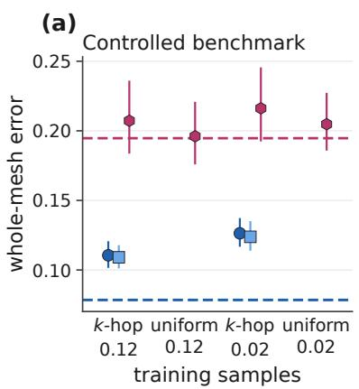

(b)  
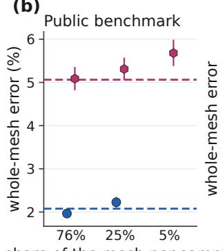

(c)  
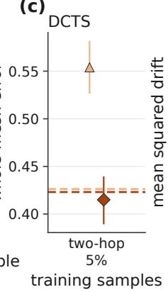

(d)  
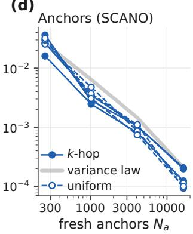  
Figure 10: Sampling gap against whole-mesh training, and convergence in the number of anchors. $\left( \mathrm { a - c } \right)$ Whole-mesh relative $L ^ { 2 }$ error of models trained on subsamples (markers with 95% bootstrap bars). Dashed horizontal lines show the same architectures trained on the full mesh. Panel (a) is the controlled benchmark. Panel (b) is the public benchmark at several training coverages (see Table S16 for SCANO at 5%). Panel (c) is DCTS, for two of the models whose training fits a full room in memory. (d) Mean squared drift of SCANO’s whole-mesh prediction on the controlled benchmark against the fresh anchor count $N _ { a }$ . The grey reference line (variance law) is the finite-population rate $1 / N _ { a } - 1 / | \Omega _ { h } |$

## 5.5. C4: response fidelity

On the controlled benchmark, the exact singular-value spectrum of the response operator gives the error floor of Proposition 5. This floor depends on the code width d. It drops by more than two orders of magnitude between d = 16 and the full dimension of the boundary data (Figure S2 of the supplementary material). Trained global modulation stays far above this floor. Even at full code width, the rank floor is negligible. Yet the whole-mesh error of global modulation is several times SCANO’s on both benchmarks. Its response error also remains high on the controlled benchmark (Tables 3, S9 and 4). Its limitation is therefore not the width of the code. It is the broadcast of one uniform summary to all points.

A model that ignores the boundary would drift as little as a correct one. Drift is therefore only meaningful next to the response. Figure 11 and Table S9 of the supplementary material evaluate the two together. They plot the regional drift against the response error to singlepatch interventions. SCANO and AB-UPT + BQA + AGS both combine low drift with a low response error. This also holds on the smallest patches and on patches outside the training sample. The SCANO backbone + BQA matches SCANO’s response but drifts by more than an order of magnitude in a region. The native backbones both drift and respond poorly. Global modulation and BENO read the boundary through a global code. They

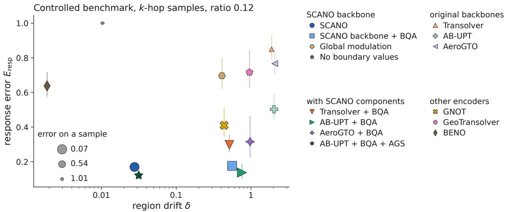  
Figure 11: Region drift δ against the response error $E _ { \mathrm { r e s p } }$ on the controlled benchmark. The drift is measured in a compact region of 12% of the cells. The response is to single-patch interventions. Samples are k-hop at ratio 0.12, and Table S9 of the supplementary material lists the values. Marker area grows as the error on a sample decreases. Error bars are 95% case-bootstrap intervals. A predictor that ignores the boundary lies at $E _ { \mathrm { r e s p } } = 1$ by construction.

respond poorly whatever their drift.

## 5.6. Fields on the two benchmarks

Figure 12 shows the mid-height plane of the cube of the controlled benchmark. SCANO and AB-UPT + BQA + AGS capture the warm and cold plumes. These plumes issue from each wall opening and are carried around by the recirculating flow. The errors of the two models stay small and without structure. Those of area-weighted Transolver + LFE are larger and concentrate along the layer diagonals. In the 95th-percentile case, one strongly driven patch sets the background level of the whole plane. The two models with BQA and AGS also have the smallest ofset in that level. On the public benchmark (Figure 13), SCANO’s error likewise stays small and without structure at all three percentiles. The error of Transolver + LFE concentrates along the boundary. It grows with the dificulty of the case.

## 6. An industrial case: the cooling of data-centre rooms

This section evaluates the models on DCTS (Section 4.1.3). Its order follows the questions of a thermal engineer. How accurate is each model over a room and in a region? What do its fields look like? How does it respond to a single changed boundary condition? How well does it rank the server inlets? What does it cost to train and to deploy?

## 6.1. Accuracy and deployment

On the whole mesh (Table 5), AB-UPT + BQA + AGS and AB-UPT + AGS reach the lowest overall error. SCANO matches GeoTransolver and the SCANO backbone + BQA. It outperforms the remaining methods. SCANO’s anchor sample can pass through the messagepassing layers or be drawn outside them. Passing it through those layers slightly lowers the error in every deployment. In the boundary-driven temperature T over the whole room, all three SCANO-backbone variants achieve lower error than every other method (Table S18 of the supplementary material). As on the benchmarks (Section 5.4), the deployment regime decides the ranking. We tested regions from 0.5% to 20% of each test room. The models with AGS keep their whole-mesh accuracy on the same cells, in both T and U. Every method whose global state is recomputed from the region degrades as the region shrinks. Its regional error reaches about three times its whole-mesh temperature error (Figure 14). Its prediction drifts several-fold further from its whole-mesh pass (Table 5). BQA reduces the error of Transolver in every deployment. It also lowers that of AB-UPT slightly. AB-UPT + BQA + AGS leads every accuracy column. These columns, however, evaluate AB-UPT with every cell as an anchor. In that deployment, its whole-mesh pass costs over a hundred times more than SCANO’s. The reason is that its anchors attend quadratically to one another. Drawing fresh anchors at the training count reduces the pass time to within a few times SCANO’s cost. The error is then slightly higher (Sections 6.4 and S16.5).

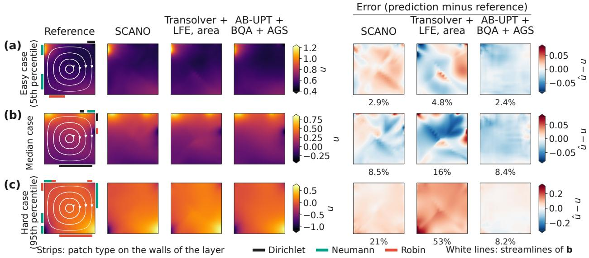  
Figure 12: Scalar field u at mid-height and its pointwise error on the controlled benchmark. The rows are (a) the 5th-, (b) the 50th- and (c) the 95th-percentile test cases of SCANO’s whole-mesh error. The first column is the finite-volume reference. It shows streamlines of b and the wall patches as strips coloured by type. The next columns are the whole-mesh predictions of SCANO, area-weighted Transolver + LFE and AB-UPT + BQA + AGS (median validation seed). The last columns show the signed error $\boldsymbol { \hat { u } } - \boldsymbol { u } ,$ with the whole-mesh relative $L ^ { 2 }$ error below each panel.

## 6.2. Flow fields

Figure 15 compares the three-dimensional temperature field T of a whole test room. It shows the CFD reference and the methods of Table 5. In the CFD solution, a distinct exhaust plume rises from each rack. The plumes feed a warm return layer below the ceiling, which flows toward the cooling units. SCANO, AB-UPT + BQA + AGS and AB-UPT + AGS reproduce these features plume by plume. The other methods that read the records capture the plumes with more difuse edges. The native Transolver sees the boundary only through sampled boundary nodes. It overheats the upper part of the room. Attaching BQA to the same backbone brings back the individual rack plumes. It also predicts the heat removed by the cooling units more accurately (Section S16.6).

Error (prediction minus reference)  
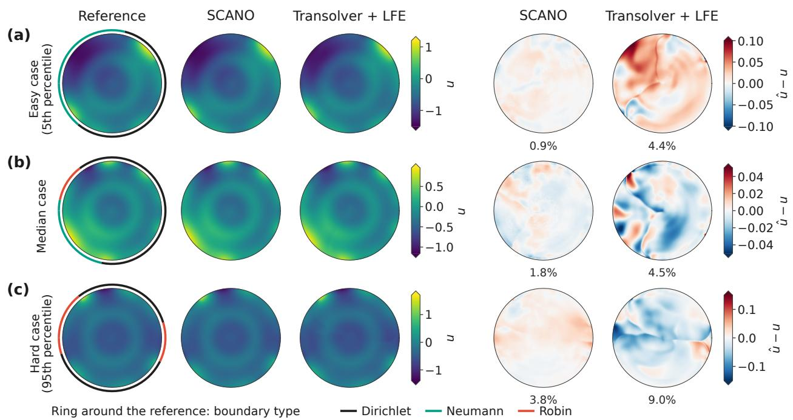  
Figure 13: Whole-mesh predictions and pointwise errors on the public benchmark. The rows are (a) the 5th-, (b) the 50th- and (c) the 95th-percentile test cases of SCANO’s error. Training covers about 76% of the mesh. The first column is the finite-element reference, with the outer ring coloured by boundary type. The next columns are the predictions of SCANO and of Transolver + LFE, each with the seed of median validation error. The last columns show $\hat { u } - u$ (prediction minus reference), with the whole-mesh relative $L ^ { 2 }$ error below each panel.

Table 5: DCTS benchmark (50 test rooms): five-field mean volume-weighted relative $L ^ { 2 }$ error, normalised by the variation of the true field about its training mean (seed $\mathrm { m e a n } \pm 9 5 \%$ case-bootstrap half-width; Section 4.1.3). Columns report a single whole-room pass, each method’s standard deployment (own deployment, coinciding with the single pass for AGS models and averaging covering passes otherwise; Section 4.4), a single training subgraph, a compact 5% region, and regional drift δ. Bold indicates the column best.
<table><tr><td>Method</td><td></td><td>Whole mesh Own deployment</td><td>Subgraph</td><td>Region</td><td>Region drift δ</td></tr><tr><td colspan="6">SCANO</td></tr><tr><td>SCANO</td><td> $0 . 3 9 5 \pm 0 . 0 2 5$ </td><td> $0 . 3 9 5 \pm 0 . 0 2 5$ </td><td> $0 . 3 9 1 \pm 0 . 0 2 5$ </td><td> $0 . 4 7 5 \pm 0 . 0 3 0$ </td><td> $0 . 0 5 5 \pm 0 . 0 0 3$ </td></tr><tr><td>SCANO, anchors outside the message passing</td><td> $0 . 3 9 7 \pm 0 . 0 2 4$ </td><td> $0 . 3 9 7 \pm 0 . 0 2 4$ </td><td> $0 . 3 9 6 \pm 0 . 0 2 4$ </td><td> $0 . 4 8 2 \pm 0 . 0 2 9$ </td><td> $\mathbf { 0 . 0 2 3 \pm 0 . 0 0 2 }$ </td></tr><tr><td>SCANO backbone + BQA</td><td> $0 . 3 9 3 \pm 0 . 0 2 6$ </td><td> $0 . 3 8 6 \pm 0 . 0 2 6$ </td><td> $0 . 3 9 1 \pm 0 . 0 2 6$ </td><td> $0 . 5 7 3 { \scriptstyle \pm 0 . 0 2 3 }$ </td><td> $0 . 3 1 8 \pm 0 . 0 2 5$ </td></tr><tr><td colspan="6">Backbones without and with BQA</td></tr><tr><td>Transolver</td><td> $0 . 5 5 4 \pm 0 . 0 2 7$ </td><td> $0 . 4 5 7 \pm 0 . 0 3 0$ </td><td> $0 . 4 5 6 \pm 0 . 0 2 9$ </td><td> $1 . 1 6 3 \pm 0 . 0 6 2$ </td><td>0.996 ± 0.069</td></tr><tr><td>Transolver + BQA</td><td> $0 . 4 3 1 \pm 0 . 0 2 3$ </td><td> $0 . 4 1 0 \pm 0 . 0 2 4$ </td><td> $0 . 4 0 8 \pm 0 . 0 2 4$ </td><td> $0 . 8 7 8 \pm 0 . 0 4 6$ </td><td> $0 . 6 9 8 \pm 0 . 0 5 9$ </td></tr><tr><td> $\mathrm { A B - U P T } + \mathrm { A G S }$ </td><td> $0 . 3 7 8 \pm 0 . 0 2 7$ </td><td> $0 . 3 7 8 \pm 0 . 0 2 7$ </td><td> $0 . 3 8 3 \pm 0 . 0 2 6$ </td><td> $0 . 4 5 4 \pm 0 . 0 3 1$ </td><td> $0 . 0 7 8 \pm 0 . 0 0 7$ </td></tr><tr><td> $\mathrm { A B - U P T } + \mathrm { B Q A } + \mathrm { A G S }$ </td><td> $\mathbf { 0 . 3 7 3 \pm 0 . 0 2 5 }$ </td><td> $\mathbf { 0 . 3 7 3 \pm 0 . 0 2 5 }$ </td><td> $\mathbf { 0 . 3 7 5 \pm 0 . 0 2 5 }$ </td><td> $\mathbf { 0 . 4 5 1 \pm 0 . 0 2 9 }$ </td><td> $0 . 0 6 9 \pm 0 . 0 0 4$ </td></tr><tr><td>AeroGTO</td><td> $0 . 4 6 9 \pm 0 . 0 4 1$ </td><td> $0 . 4 6 3 \pm 0 . 0 4 3$ </td><td> $0 . 4 6 8 \pm 0 . 0 4 3$ </td><td> $1 . 2 2 8 \pm 0 . 0 5 9$ </td><td> $1 . 0 8 7 \pm 0 . 0 5 7$ </td></tr><tr><td colspan="6">Other boundary encoders</td></tr><tr><td>Transolver + LFE</td><td> $0 . 4 6 0 \pm 0 . 0 2 0$ </td><td> $0 . 4 1 9 \pm 0 . 0 2 4$ </td><td> $0 . 4 1 7 \pm 0 . 0 2 3$ </td><td> $0 . 8 9 1 \pm 0 . 0 5 0$ </td><td>0.715 ± 0.064</td></tr><tr><td>GeoTransolver</td><td> $0 . 3 9 9 \pm 0 . 0 2 5$ </td><td> $0 . 3 9 2 \pm 0 . 0 2 5$ </td><td> $0 . 3 9 1 \pm 0 . 0 2 5$ </td><td> $0 . 8 1 3 { \scriptstyle \pm 0 . 0 3 1 }$ </td><td>0.634 ± 0.043</td></tr><tr><td>GNOT</td><td> $0 . 5 1 8 \pm 0 . 0 1 6$ </td><td> $0 . 4 4 1 \pm 0 . 0 2 2$ </td><td> $0 . 4 3 9 \pm 0 . 0 2 2$ </td><td> $0 . 8 9 0 \pm 0 . 0 5 7$ </td><td> $0 . 6 8 8 \pm 0 . 0 6 9$ </td></tr><tr><td>Slice aggregation</td><td> $0 . 4 2 3 \pm 0 . 0 2 5$ </td><td> $0 . 4 0 6 \pm 0 . 0 2 7$ </td><td> $0 . 4 0 5 \pm 0 . 0 2 6$ </td><td> $1 . 0 7 9 \pm 0 . 0 6 2$ </td><td> $0 . 9 4 2 \pm 0 . 0 6 9$ </td></tr></table>

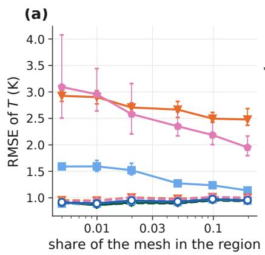

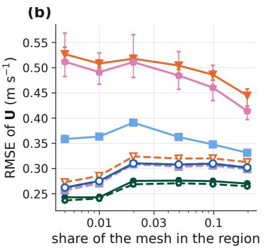

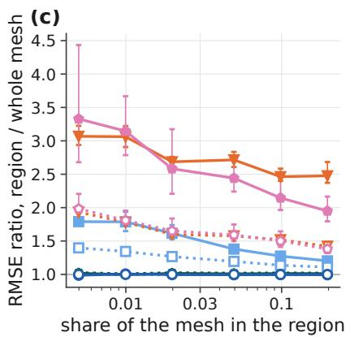  
whole-mesh prediction, same cells (c) U (solid: T)  
Figure 14: Regional deployment against the whole-mesh prediction on the same cells, over the 50 DCTS test rooms. The horizontal axis is the share of the mesh in the region. (a) Temperature RMSE (K). (b) Velocity RMSE $( \mathrm { m } \mathrm { s } ^ { - 1 } )$ . Solid lines with filled markers are standalone predictions on the region. Dashed lines with open markers are whole-mesh predictions evaluated on the same cells. (c) Ratio of the regional to the whole-mesh RMSE, for T (solid) and U (dotted). Markers and bars show the mean and range over training seeds.

Figure 16 shows the horizontal plane at the height of the server inlets in three test rooms. SCANO reproduces the solver’s floor-fed cold aisles, the hot aisles behind the racks and the individual exhaust plumes. Its errors are small and without structure away from the racks. The native Transolver shifts the temperature of entire zones and hot aisles. Its errors are structured along the rack rows. On the plane, its temperature errors are at least twice SCANO’s in each room.

Figure 17 illustrates a typical local query of an engineer. The task is to predict the compact region around the rack with the hottest inlets, 6% of the room, from a single regional pass. SCANO’s global state does not depend on the queried subset. Its regional prediction therefore closely matches its whole-mesh prediction in both T and U. The SCANO backbone + BQA recomputes its state from the region. Its regional velocity prediction shifts noticeably across the cold aisle relative to its whole-room pass. GeoTransolver matches SCANO on the whole mesh. In the region, however, it warms the entire region and drifts further from the CFD reference than in its whole-mesh pass (Proposition 3). In this particular room, the SCANO backbone + BQA happens to lie closer to the solver’s temperature on the plane. This does not hold over the test split.

## 6.3. Response to a single boundary change

The paired interventions test whether a trained surrogate captures the response to a single changed boundary condition on a fixed mesh. A rack’s heat load enters through the jump coupling of its inlet and exhaust patches (Remark 1). Every method receives the same heat-source features and the same paired-intervention training (Section 4.1.3). Table 6 reports the twenty held-out test pairs. Every method captures the response to a doubled rack power, which also enters through the domain heat-source features (Section S16.3). Over the whole room, AB-UPT + BQA + AGS leads, closely followed by the SCANO-backbone variants and AB-UPT + AGS. Halving the supply airflow of a cooling unit separates the methods more sharply. The split follows how boundary information reaches the domain. Some architectures attend to the boundary records in every layer. These are all variants of the SCANO backbone, the backbones with BQA, GeoTransolver and GNOT. They capture the room’s thermal response for every training seed. The native Transolver and AeroGTO see the boundary only through sampled boundary nodes. They fail for some seeds. So do

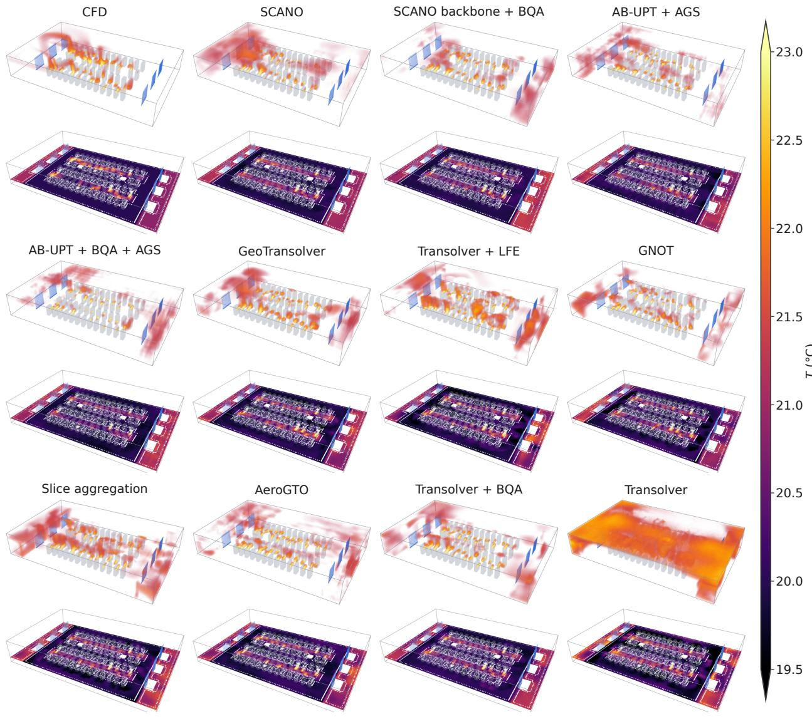  
Figure 15: Three-dimensional temperature field T in a DCTS test room (room 1 of Figure 16). The panels show the CFD reference and the whole-room predictions of the methods of Table 5. Each model uses the seed of median validation error. The top of each panel renders the thermal plumes above the 90th percentile of the CFD temperature. The bottom shows the horizontal cross-section at the height of the server inlets. Racks are grey and cooling supplies blue.

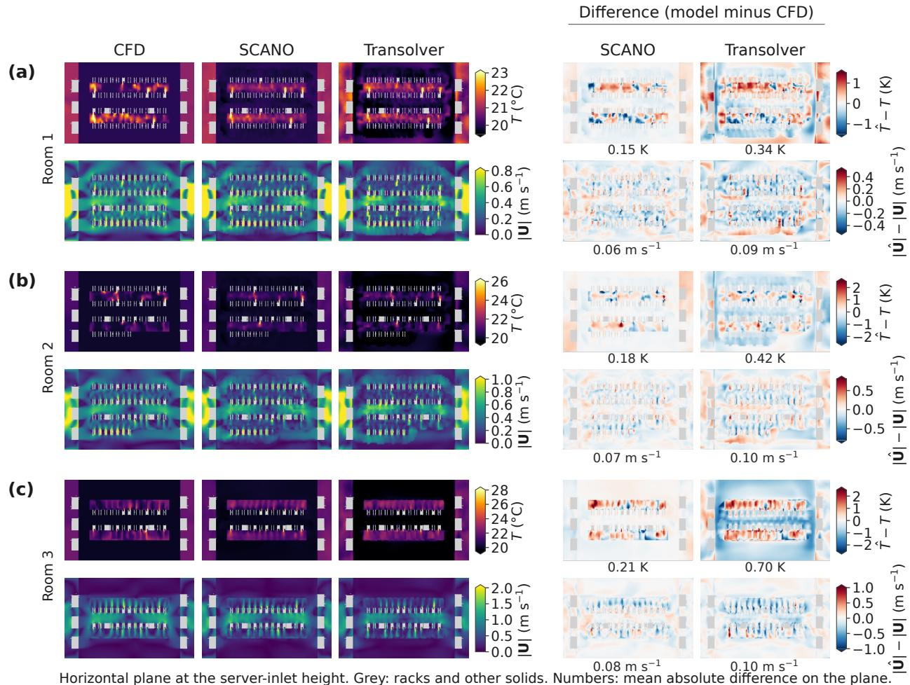  
Figure 16: Predictions on the horizontal plane at the height of the server inlets, in three held-out DCTS test rooms, (a) Room 1, (b) Room 2 and (c) Room 3. For each room, the upper row shows the temperature T and the lower row the velocity magnitude |U|. The columns are the CFD reference, SCANO and the native Transolver, followed by the pointwise diferences (model minus CFD). Each model uses the seed of median validation error. Racks and solid obstacles are grey. Numbers below the diference panels give the mean absolute diference on the plane. Table 5 summarises all 50 rooms.

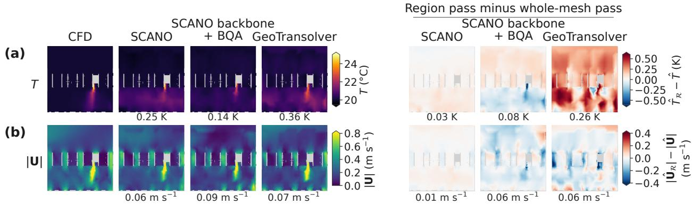  
Grey: racks and other solids. Numbers: mean absolute diference on the plane.  
Figure 17: A local query in a DCTS test room (room 1 of Figure 16). The region is a full-height box within 3 m horizontally of the rack with the hottest CFD inlets. It holds 6% of the room volume. The panels show it at the height of the server inlets. (a) Temperature T. (b) Velocity magnitude |U|. The left columns show the CFD reference and the standalone regional predictions of SCANO, the SCANO backbone + BQA and GeoTransolver. The right columns show the region pass minus the whole-mesh pass for each model (median validation seed). Numbers below the panels give the mean absolute diference on the plane.

AB-UPT + AGS, whose anchors include only a random subset of the boundary faces, and Transolver + LFE, which reads the records only at the input. With BQA, Transolver and AB-UPT respond reliably for every seed. Their response error also falls by more than half.

Table 6: Single-intervention thermal response and server-inlet temperature accuracy on DCTS across the methods of Table 5. Response: whole-room temperature response error $E _ { \mathrm { r e s p } }$ (11) (seed mean ± s.d. of the median over ten held-out pairs per intervention type). Server inlets: within-room rank correlation and MAE (K) of predicted server-inlet temperatures across the 50 test rooms (each model’s own deployment, seed mean). Bold indicates the column best.
<table><tr><td rowspan="2"></td><td colspan="2">Response  $E _ { \mathrm { r e s p } }$ </td><td colspan="2">Server inlets</td></tr><tr><td>Rack power doubled</td><td>Cooling flow halved</td><td>Rank correlation</td><td>MAE (K)</td></tr><tr><td>SCANO</td><td></td><td></td><td></td><td></td></tr><tr><td>SCANO</td><td> $0 . 6 4 3 \pm 0 . 0 2 4$ </td><td> $0 . 4 0 0 \pm 0 . 0 2 5$ </td><td>0.54</td><td>1.40</td></tr><tr><td>SCANO, anchors outside the message passing</td><td> $0 . 6 1 2 \pm 0 . 0 0 9$ </td><td> $0 . 3 9 3 \pm 0 . 0 1 2$ </td><td>0.55</td><td>1.39</td></tr><tr><td>SCANO backbone + BQA</td><td> $0 . 6 3 3 \pm 0 . 0 1 1$ </td><td> $0 . 3 8 6 \pm 0 . 0 0 8$ </td><td>0.55</td><td>1.38</td></tr><tr><td>Backbones without and with BQA</td><td></td><td></td><td></td><td></td></tr><tr><td>Transolver</td><td> $0 . 7 1 8 \pm 0 . 0 5 4$ </td><td> $0 . 8 5 4 \pm 0 . 2 5 3$ </td><td>0.47</td><td>1.53</td></tr><tr><td>Transolver + BQA</td><td> $0 . 7 3 4 \pm 0 . 0 3 1$ </td><td> $0 . 3 7 6 \pm 0 . 0 0 2$ </td><td>0.49</td><td>1.45</td></tr><tr><td> $\mathrm { A B - U P T } + \mathrm { A G S }$ </td><td> $0 . 6 1 5 \pm 0 . 0 0 3$ </td><td> $0 . 8 6 0 \pm 0 . 1 8 6$ </td><td>0.66</td><td>1.07</td></tr><tr><td> $\mathrm { A B - U P T } + \mathrm { B Q A } + \mathrm { A G S }$ </td><td> $\mathbf { 0 . 6 0 8 \pm 0 . 0 2 9 }$ </td><td> $0 . 3 9 9 \pm 0 . 0 7 7$ </td><td>0.66</td><td>1.04</td></tr><tr><td>AeroGTO</td><td> $0 . 7 6 6 \pm 0 . 0 6 2$ </td><td> $0 . 8 4 9 \pm 0 . 2 6 2$ </td><td>0.52</td><td>1.60</td></tr><tr><td>Other boundary encoders</td><td></td><td></td><td></td><td></td></tr><tr><td>Transolver + LFE</td><td> $0 . 6 5 8 \pm 0 . 0 2 5$ </td><td> $0 . 5 8 7 \pm 0 . 3 5 8$ </td><td>0.47</td><td>1.46</td></tr><tr><td>GeoTransolver</td><td> $0 . 6 5 3 \pm 0 . 0 3 8$ </td><td> $\mathbf { 0 . 3 7 1 \pm 0 . 0 1 8 }$ </td><td>0.48</td><td>1.43</td></tr><tr><td>GNOT</td><td> $0 . 7 4 6 \pm 0 . 0 1 3$ </td><td> $0 . 4 1 2 \pm 0 . 0 4 1$ </td><td>0.45</td><td>1.53</td></tr><tr><td>Slice aggregation</td><td> $0 . 6 6 1 \pm 0 . 0 2 7$ </td><td> $0 . 4 9 7 \pm 0 . 1 5 5$ </td><td>0.48</td><td>1.47</td></tr></table>

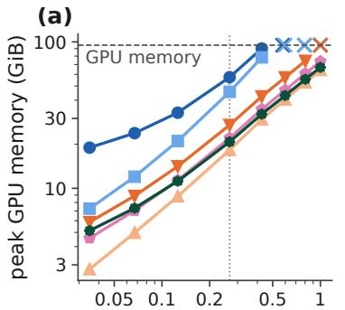

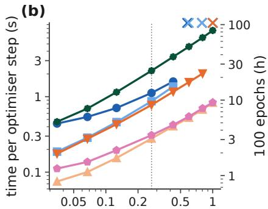

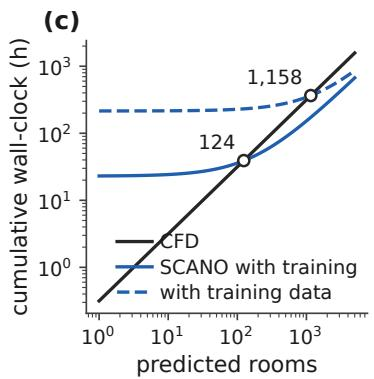

(d)  
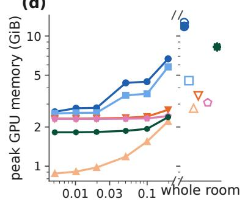

(e)  
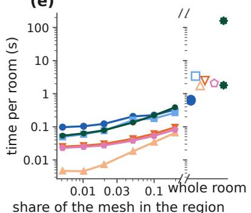

(f)  
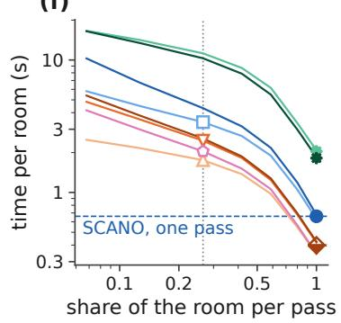  
one pass average over passes  
fresh anchors out of memory

Figure 18: Cost of training and deployment on million-cell DCTS rooms, on an NVIDIA GPU with 96 GB of memory. Values are medians over the four rooms of Table 8. (a) Peak GPU memory against the sampled fraction of the room. (b) Step time against the same fraction. The right axis converts it into the optimiser time of 100 epochs. Crosses mark runs that exceed the memory. The dotted line marks the training setting. (c) Cumulative wall-clock hours against the number of predicted rooms, for CFD and for SCANO. SCANO is counted with training alone and with training plus data generation. Markers show the break-even counts. (d) Inference memory per room. (e) Inference time per room. Curves are compact regions. Markers are full rooms, predicted in one pass with all cells as anchors, with fresh anchors, or as an average over passes. (f) Time per room of the multi-pass average on one GPU against the share of the room in one pass. The dotted line marks the training share. Open markers are the deployment of the models whose state follows the sample. Filled markers are the single pass of the models with AGS, half filled with fresh anchors. The dashed line is SCANO’s single pass.

For the operator of a data centre, the decisive question is which servers run hot. We therefore also evaluate the server inlet temperatures from each model’s own deployment (Table 6). AB-UPT + BQA + AGS and AB-UPT + AGS reach the highest rank correlation of the inlets. They also have the lowest inlet temperature error over a room. All three SCANO-backbone variants follow, ahead of all remaining methods.

## 6.4. Cost of training and deployment

In training (Figure 18a,b), peak memory and step time both grow with the share of the room in a sample. The hundred epochs of Table 5 take about one day on a single GPU. From a seed ratio of 0.2 upward, the SCANO backbone exceeds the GPU memory. Sampled training is therefore what makes million-cell rooms trainable with message passing and BQA. On Transolver, a whole room fits in memory. There, sampled training costs no accuracy once BQA and AGS are both attached (Section 5.4).

Table 7 lists the training and deployment cost of all DCTS methods. All are measured in the same way on one GPU. At the common budget of about 0.8 million parameters, a training step at the training ratio takes from a quarter of a second to a few seconds. SCANO’s step takes about one second. It carries the message passing over the sampled subgraph and over its anchor sample.

Table 7: Cost of the DCTS methods of Table 5 on one GPU. The table gives the parameters, the training step at the training ratio of 0.05 (median of six steps) with its peak memory, and the deployment of a whole room with its peak memory. The deployment time is the median over the four rooms of Table 8. For SCANO and the models with AGS, the deployment is one pass with the state over every cell. Where a fresh draw of the training anchor count is much faster, its time is given in parentheses. For the models whose state follows the sample, the deployment is the average over covering training-sized passes.
<table><tr><td></td><td></td><td colspan="2">Training step</td><td colspan="2">Whole room</td></tr><tr><td>Method</td><td>Parameters (103) Time (s) Memory (GiB)</td><td></td><td></td><td>Time (s)</td><td>Memory (GiB)</td></tr><tr><td colspan="6">SCANO</td></tr><tr><td>SCANO</td><td>811</td><td>1.13</td><td>57</td><td>0.61</td><td>13</td></tr><tr><td>SCANO, anchors outside the message</td><td>811</td><td>0.95</td><td>46</td><td>0.96</td><td>23</td></tr><tr><td>passing SCANO backbone + BQA</td><td>811</td><td>0.93</td><td>46</td><td>3.40</td><td>5</td></tr><tr><td colspan="6">Backbones without and with BQA</td></tr><tr><td>Transolver</td><td>811</td><td>0.35</td><td>18</td><td>1.76</td><td>3</td></tr><tr><td>Transolver + BQA</td><td>859</td><td>0.82</td><td>27</td><td>2.48</td><td>4</td></tr><tr><td>AB-UPT + AGS</td><td>821</td><td>2.51</td><td>15</td><td>173.30 (2.05)</td><td>9</td></tr><tr><td>AB-UPT + BQA + AGS</td><td>856</td><td>2.25</td><td>21</td><td>158.97 (1.79)</td><td>9</td></tr><tr><td>AeroGTO</td><td>798</td><td>1.23</td><td>39</td><td>5.31</td><td>6</td></tr><tr><td colspan="6">Other boundary encoders</td></tr><tr><td>Transolver + LFE</td><td>787</td><td>0.75</td><td>22</td><td>2.36</td><td>3</td></tr><tr><td>GeoTransolver</td><td>805</td><td>0.34</td><td>22</td><td>2.07</td><td>3</td></tr><tr><td>GNOT</td><td>794</td><td>0.25</td><td>23</td><td>0.86</td><td>3</td></tr><tr><td>Slice aggregation</td><td>818</td><td>0.40</td><td>23</td><td>2.54</td><td>5</td></tr></table>

At deployment (Figure 18d–f), SCANO predicts a full room in one pass of well under a second. Its global state is evaluated over all cells. A compact region of interest with its message-passing halo takes a fraction of that time and memory (Figure 5). Models whose state follows the sample instead average over several passes at the training ratio. On one GPU, this average takes about one to five seconds per room (Table 7). Larger passes make it faster (Figure 18f). Over a whole-room pass, however, the error of these models grows. It grows most for Transolver without BQA (Tables 5 and S31). The models with AGS need no average. Each predicts the whole room in a single pass. The passes of the multi-pass average can be distributed across the GPUs of a node with nearly linear speed-up. On four GPUs, they match SCANO’s wall-clock time at three to six times its total GPU time (Figure S5). AB-UPT + BQA + AGS uses a quadratic anchor self-attention. It takes under three minutes per room with all cells as anchors and under two seconds with fresh anchors (Table 7).

End to end, a SCANO prediction needs four steps: the mesh, one solver iteration for the initial boundary values, feature extraction and one forward pass. The CFD solver starts a new room from its initial fields. SCANO replaces its thousands of iterations by one and cuts the wall-clock time to less than half that of the solve (Table 8). The mesh takes about half of SCANO’s time. The CFD needs the same mesh. The extraction of the boundary attributes takes most of the rest. The forward pass itself takes under a second. The training cost is recovered after about 120 rooms, and data generation plus training after 1,200.

Table 8: Time per DCTS test room on one NVIDIA GPU with 96 GB of memory and the CPU cores attached to it. We timed four test rooms of 0.90–1.03 million cells. Each lies at the middle of one quarter of the cell-count distribution. The table gives the median and range over the four, in seconds. Software: OpenFOAM v2506, OpenMPI 5.0.8, PyTorch 2.10. Meshing, extraction and conversion run on one process. The other CFD steps run in parallel with MPI.
<table><tr><td></td><td>CFD (reference)</td><td>SCANO</td></tr><tr><td>Mesh (blockMesh, snappyHexMesh, decomposition)a</td><td>235 [225–239]</td><td rowspan="3">same mesh</td></tr><tr><td>5,000 SIMPLE iterations, decomposition and reconstructiona</td><td>904 [816–965]</td></tr><tr><td>of which the iterations (solver clock)</td><td>844 [766–891]</td></tr><tr><td>One solver iteration, for the boundary valuesª Geometry and boundary attributes, as built for the datasetb</td><td></td><td>54 [43–61] 185 [173–198]</td></tr><tr><td>Reading the converted case</td><td></td><td>0.10 [0.09–0.10]</td></tr><tr><td>Inference, one pass over the whole mesh on the GPUc Total</td><td></td><td>0.60 [0.58–0.69] 467 [458-499]</td></tr></table>

a Includes the start-up of the MPI steps (mesh 110 [99–132], solver 24 [14–40], the solver iteration 23 [14–30]). b An upper bound. It includes reading the converged field and a wall-distance field that SCANO does not use. c The SCANO model of Table 5, timed afterwards on one otherwise idle GPU of the same kind. Median of seven warm passes; loading the model and the first pass are excluded.

## 7. Discussion

## 7.1. How the two components act on the error

The experiments of Section 5 attribute each gain in accuracy and consistency to one term of (5). BQA removes the boundary term. Every patch reaches every domain point with the weight of its area. BQA most benefits backbones that otherwise see the boundary only through sampled nodes. It also lets trained models recover the measure structure of the boundary data. AGS removes the state term. Regional predictions stay aligned with wholemesh predictions, up to the Monte Carlo error of the anchors. A state recomputed from the region drifts as the region shrinks. With both modules, the bias of a sample-dependent state disappears. Transolver + BQA + AGS trained on DCTS subgraphs then matches the same model trained on whole rooms (Section 5.4). When boundary conditioning is complete, the sampling compromise forced by GPU memory entails no loss of accuracy. The SCANO backbone needs more memory for a whole-room step than a single GPU has. For it, sampled training at linear cost yields an accurate surrogate for any region of a room. This surrogate captures the response to a halved cooling airflow. It answers a room query in well under a second of network time, and end to end in under half the time of a CFD solve.

## 7.2. Scope of the construction

Our construction applies wherever boundary conditions can be written as typed face records. This covers Dirichlet, Neumann and Robin conditions, inflows and outflows. It also covers coupled heat sources such as servers, which enter as jump conditions with a measure of their own. C1 holds by design for any backbone that reads the boundary through BQA. C3 holds whenever the global state is estimated independently of the query sample. The measure representation is exact for linear transport. On the buoyant RANS flow of DCTS, it serves as a design guide, and we verified its consequences empirically. Likewise, the slice budget G bounds the resolution of single-patch responses in general. On DCTS, a modest G already matches a much larger token budget. The cost of violating C1–C4 grows with the number of small, independently varying patches and with the field’s sensitivity to them. We focus on steady states. The two benchmarks show that the conclusions carry beyond DCTS.

## 8. Conclusions

A single training pass over a million-cell engineering mesh approaches or exceeds the memory of a GPU. Neural operators are therefore trained on subsamples of the mesh as a compromise. They are then deployed on the full mesh or on any region of interest. Each pass thus sees only a fraction of the boundary conditions that govern the solution. We wrote the solution map as an integral against type-dependent boundary measures. This showed that the conditioning can fail in three ways under sampled training. It also led to four measurable consistency conditions. SCANO meets these conditions at linear cost through two plug-and-play modules that fit any operator backbone. Boundary Quadrature Attention (BQA) aggregates typed, area-weighted face records into slice tokens. Every point reads these tokens in every layer. The Anchored Global State (AGS) estimates the global state from anchors independent of the sample in training. At deployment, it uses all cells.

Our experiments confirmed all four predictions made before training. These concern the fraction of the boundary that a sample observes, the refinement plateau of count weighting, the deployment drift of a sample-dependent state and the rank floor of a global code. Encoders that read the boundary through a global code fell well short of per-point boundary readouts. We integrated BQA into seven backbones. On the two benchmarks, it reduced the whole-mesh error of every backbone over its native baseline. We integrated AGS into six backbones. On all three data sets, it kept regional predictions aligned with the whole-mesh predictions up to the error of the anchors. It also enabled sampled training of Transolver + BQA + AGS on DCTS to match training on whole rooms.

Boundary conditioning for neural operators is therefore more than a choice of input encoding. It is a question of consistency with sampled training. Once boundary conditions are written as a quadrature of type-dependent measures, the failure modes follow for any backbone. So do the consistency conditions and the architectural remedies. Together they form a quantitative checklist governed by the slice-token and anchor budgets. We expect this framework to benefit boundary-driven systems with localised sources on large meshes. Examples are electronics cooling and building ventilation.

## Data and code availability

DCTS, the controlled benchmark with its generator, and the code of SCANO and of the training-free checks will be made available upon acceptance of the paper.

## CRediT authorship contribution statement

Tianyu Li: Conceptualization, Methodology, Software, Validation, Visualization, Writing – original draft, Writing – review & editing. Zhiwei Cao: Data curation, Formal analysis, Writing – review & editing. Qingang Zhang: Data curation, Formal analysis, Writing – review & editing. Ruihang Wang: Data curation, Formal analysis, Writing – review & editing. Binyang Song: Methodology, Validation, Supervision, Writing – review & editing. Yonggang Wen: Supervision, Funding acquisition, Project administration, Writing – review & editing.

## Declaration of competing interest

The authors declare that they have no known competing financial interests or personal relationships that could have appeared to influence the work reported in this paper.

## Acknowledgements

This research is supported by the Ministry of Education (MOE), Singapore, under its Academic Research Fund Tier 1 project ‘Towards Resilient Data Centre Operations via Physics-Informed Predictive Maintenance’ (Award No. RG104/23). This research is also supported by the RIE2025 Industry Alignment Fund – Industry Collaboration Projects (IAF-ICP) (Award I2301E0026), administered by A\*STAR, as well as supported by Alibaba Group and NTU Singapore through Alibaba-NTU Global e-Sustainability CorpLab (ANGEL). The authors thank the National Supercomputing Centre (NSCC), Singapore, for additional support. T.L. gratefully acknowledges the financial support of the Interdisciplinary Graduate Programme (IGP), Graduate College, Nanyang Technological University, Singapore, through the NTU Research Scholarship.

## Role of the funding source

The funding sources provided computational resources for this work and had no other role in the study design, in the collection, analysis and interpretation of the data, in the writing of the article, or in the decision to submit it for publication.

## Declaration of generative AI and AI-assisted technologies in the manuscript preparation process

During the preparation of this work the authors used Claude (Anthropic) to assist in editing the text. After using this tool, the authors reviewed and edited the content as needed and take full responsibility for the content of the published article.

## References

[1] H. Wu, H. Luo, H. Wang, J. Wang, M. Long, Transolver: A fast transformer solver for PDEs on general geometries, in: Proceedings of the 41st International Conference on Machine Learning, Vol. 235 of Proceedings of Machine Learning Research, PMLR, 2024, pp. 53681–53705. arXiv: 2402.02366.

[2] Z. Hao, Z. Wang, H. Su, C. Ying, Y. Dong, S. Liu, Z. Cheng, J. Song, J. Zhu, GNOT: A general neural operator transformer for operator learning, in: Proceedings of the 40th International Conference on Machine Learning, Vol. 202 of Proceedings of Machine Learning Research, PMLR, 2023, pp. 12556–12569. arXiv:2302.14376.

[3] B. Alkin, M. Bleeker, R. Kurle, T. Kronlachner, R. Sonnleitner, M. Dorfer, J. Brandstetter, AB-UPT: Scaling neural CFD surrogates for high-fidelity automotive aerodynamics simulations via anchored-branched universal physics transformers, Transactions on Machine Learning Research (2025). arXiv:2502.09692.

[4] M. A. Nabian, C. Liu, R. Ranade, S. Choudhry, X-MeshGraphNet: Scalable multi-scale graph neural networks for physics simulation (2024). arXiv:2411.17164.

[5] H. Zhou, H. Wu, H. Shangguan, Y. Ma, H. Weng, J. Wang, M. Long, Transolver-3: Scaling up transformer solvers to industrial-scale geometries, in: Proceedings of the 43rd International Conference on Machine Learning, Vol. 306 of Proceedings of Machine Learning Research, PMLR, 2026, pp. 166009–166030. arXiv:2602.04940.

[6] H. Zeng, H. Zhou, A. Srivastava, R. Kannan, V. Prasanna, GraphSAINT: Graph sampling based inductive learning method, in: International Conference on Learning Representations (ICLR), 2020. arXiv:1907.04931. URL https://openreview.net/forum?id=BJe8pkHFwS

[7] S. Mousavi, S. Mishra, L. De Lorenzis, Imposing boundary conditions on neural operators via learned function extensions, in: Proceedings of the 43rd International Conference on Machine Learning, Vol. 306 of Proceedings of Machine Learning Research, PMLR, 2026, pp. 90631– 90679. arXiv:2602.04923.

[8] H. Wang, J. Li, A. Dwivedi, K. Hara, T. Wu, BENO: Boundary-embedded neural operators for elliptic PDEs, in: International Conference on Learning Representations (ICLR), 2024. arXiv:2401.09323. URL https://openreview.net/forum?id=ZZTkLDRmkg

[9] N. Saad, G. Gupta, S. Alizadeh, D. C. Maddix, Guiding continuous operator learning through physics-based boundary constraints, in: International Conference on Learning Representations (ICLR), 2023. arXiv:2212.07477. URL https://openreview.net/forum?id=gfWNItGOES6

[10] H. Gao, M. J. Zahr, J.-X. Wang, Physics-informed graph neural Galerkin networks: A unified framework for solving PDE-governed forward and inverse problems, Computer Methods in Applied Mechanics and Engineering 390 (2022) 114502. arXiv:2107.12146, doi:10.1016/j. cma.2021.114502.

[11] A. Kashi, A. Daw, M. Gopalakrishnan Meena, H. Lu, Learning the boundary-to-domain mapping using Lifting Product Fourier Neural Operators for partial diferential equations, ICML 2024 AI for Science Workshop (2024). arXiv:2406.16740.

[12] R. Li, Y. Sun, W. Wang, Generalized neural operator for parametric and boundary-value problems (2026). arXiv:2607.21932.

[13] Z. Cao, M. Li, F. Ling, J. Jia, Y. Wen, J. Yin, S. See, Transforming future data center operations and management via physical AI, IEEE Intelligent Systems 41 (3) (2026) 91–100. arXiv:2504.04982, doi:10.1109/mis.2026.3668406.

[14] T. Pfaf, M. Fortunato, A. Sanchez-Gonzalez, P. W. Battaglia, Learning mesh-based simulation with graph networks, in: International Conference on Learning Representations (ICLR), 2021. arXiv:2010.03409.

URL https://openreview.net/forum?id=roNqYL0\_XP

[15] H. Zhou, Y. Ma, H. Wu, H. Wang, M. Long, Unisolver: PDE-conditional transformers towards universal neural PDE solvers, in: Proceedings of the 42nd International Conference on Machine Learning, Vol. 267 of Proceedings of Machine Learning Research, PMLR, 2025, pp. 79061– 79088. arXiv:2405.17527.

[16] Z. Ye, Z. Liu, B. Wu, H. Jiang, L. Chen, M. Zhang, X. Huang, Q. Meng, J. Zou, H. Liu, B. Dong, PDEformer-2: A versatile foundation model for two-dimensional partial diferential equations (2025). arXiv:2507.15409.

[17] C. Lorsung, A. Barati Farimani, Explain like I’m five: Using LLMs to improve PDE surrogate models with text (2024). arXiv:2410.01137.

[18] A. Dash, L. J. Shikhman, M. Galarnyk, Does text steer neural PDE surrogates? A controlled diagnostic with OperatorCLIP, NeurIPS 2026 Workshop on Representation for the Physical Sciences (2026). arXiv:2609.38517.

[19] E. Calvello, N. B. Kovachki, M. E. Levine, A. M. Stuart, Continuum attention for neural operators, Journal of Machine Learning Research 26 (300) (2025) 1–52. arXiv:2406.06486. URL https://jmlr.org/papers/v26/24-0879.html

[20] J. Berner, M. Liu-Schiafini, J. Kossaifi, V. Duruisseaux, B. Bonev, K. Azizzadenesheli, A. Anandkumar, Principled approaches for extending neural architectures to function spaces for operator learning, Nature Machine Intelligence 8 (7) (2026) 1173–1181. arXiv:2506.10973, doi:10.1038/s42256-026-01267-z.

[21] Z. Yang, T. Du, L. Liu, Learning Laplacian eigenspace with mass-aware neural operators on point clouds, in: Proceedings of the Special Interest Group on Computer Graphics and Interactive Techniques Conference Papers (SIGGRAPH Conference Papers ’26), ACM, 2026, pp. 1–11. arXiv:2605.24390, doi:10.1145/3799902.3811185.

[22] C. Zeng, Y. Zhang, J. Zhou, Y. Wang, Z. Wang, Y. Liu, L. Wu, D. Z. Huang, Point cloud neural operator for parametric PDEs on complex and variable geometries, Computer Methods in Applied Mechanics and Engineering 443 (2025) 118022. arXiv:2501.14475, doi:10.1016/ j.cma.2025.118022.

[23] B. J. Kim, M. Kawano, Y. Iwasawa, Y. Matsuo, QuadNorm: Resolution-robust normalization for neural operators (2026). arXiv:2605.07375.

[24] Y. Du, S. Chen, Refinement symmetry in multimodal transformers (2026). arXiv:2609.32669.

[25] M. I. Khan, H.-D. Yao, Quadrature-aware complex-linear neural operator for boundary-to-field prediction in resonant acoustics (2026). arXiv:2607.04407.

[26] Y. Mei, X. Song, X. Song, N. Takeishi, M3: Reframing training measures for discretized physical simulations (2026). arXiv:2605.08843.

[27] J. Chen, T. Ma, C. Xiao, FastGCN: Fast learning with graph convolutional networks via importance sampling, in: International Conference on Learning Representations (ICLR), 2018. arXiv:1801.10247.

[28] J. Chen, J. Zhu, L. Song, Stochastic training of graph convolutional networks with variance

reduction, in: Proceedings of the 35th International Conference on Machine Learning, Vol. 80 of Proceedings of Machine Learning Research, PMLR, 2018, pp. 942–950. arXiv:1710.10568.

[29] W. Cong, R. Forsati, M. Kandemir, M. Mahdavi, Minimal variance sampling with provable guarantees for fast training of graph neural networks, in: Proceedings of the 26th ACM SIGKDD International Conference on Knowledge Discovery & Data Mining, 2020, pp. 1393– 1403. doi:10.1145/3394486.3403192.

[30] J. Lee, Y. Lee, J. Kim, A. R. Kosiorek, S. Choi, Y. W. Teh, Set Transformer: A framework for attention-based permutation-invariant neural networks, in: Proceedings of the 36th International Conference on Machine Learning, Vol. 97 of Proceedings of Machine Learning Research, PMLR, 2019, pp. 3744–3753. arXiv:1810.00825.

[31] A. Jaegle, S. Borgeaud, J.-B. Alayrac, C. Doersch, C. Ionescu, D. Ding, S. Koppula, D. Zoran, A. Brock, E. Shelhamer, O. Hénaf, M. M. Botvinick, A. Zisserman, O. Vinyals, J. Carreira, Perceiver IO: A general architecture for structured inputs & outputs, in: International Conference on Learning Representations (ICLR), 2022. arXiv:2107.14795.

[32] D. Bolya, C.-Y. Fu, X. Dai, P. Zhang, C. Feichtenhofer, J. Hofman, Token merging: Your ViT but faster, in: International Conference on Learning Representations (ICLR), 2023. arXiv: 2210.09461.

[33] K. Xu, W. Hu, J. Leskovec, S. Jegelka, How powerful are graph neural networks?, in: International Conference on Learning Representations (ICLR), 2019. arXiv:1810.00826.

[34] G. Corso, L. Cavalleri, D. Beaini, P. Liò, P. Veličković, Principal neighbourhood aggregation for graph nets, in: Advances in Neural Information Processing Systems, Vol. 33, Curran Associates, Inc., 2020. arXiv:2004.05718.

[35] E. Wagstaf, F. B. Fuchs, M. Engelcke, I. Posner, M. Osborne, On the limitations of representing functions on sets, in: Proceedings of the 36th International Conference on Machine Learning, Vol. 97 of Proceedings of Machine Learning Research, PMLR, 2019, pp. 6487–6494. arXiv: 1901.09006.

[36] H. Luo, H. Wu, H. Zhou, L. Xing, Y. Di, J. Wang, M. Long, Transolver++: An accurate neural solver for PDEs on million-scale geometries, in: Proceedings of the 42nd International Conference on Machine Learning, Vol. 267 of Proceedings of Machine Learning Research, PMLR, 2025, pp. 41432–41449. arXiv:2502.02414.

[37] C. Adams, R. Ranade, R. Cherukuri, S. Choudhry, GeoTransolver: Learning physics on irregular domains using multi-scale geometry aware physics attention transformer (2025). arXiv:2512.20399.

[38] B. Alkin, A. Fürst, S. Schmid, L. Gruber, M. Holzleitner, J. Brandstetter, Universal physics transformers: A framework for eficiently scaling neural operators, in: Advances in Neural Information Processing Systems, Vol. 37, Curran Associates, Inc., 2024. arXiv:2402.12365, doi:10.52202/079017-0793.

[39] S. Lee, T. Oh, Inducing point operator transformer: A flexible and scalable architecture for solving PDEs, Proceedings of the AAAI Conference on Artificial Intelligence 38 (1) (2024) 153–161. doi:10.1609/aaai.v38i1.27766.

[40] Z. Li, N. B. Kovachki, C. Choy, B. Li, J. Kossaifi, S. P. Otta, M. A. Nabian, M. Stadler, C. Hundt, K. Azizzadenesheli, A. Anandkumar, Geometry-informed neural operator for largescale 3D PDEs, in: Advances in Neural Information Processing Systems, Vol. 36, Curran Associates, Inc., 2023. arXiv:2309.00583, doi:10.52202/075280-1556.

[41] P. Liu, P. Wang, X. Ren, H. Yuan, Z. Hao, C. Xu, S. Cai, D. Ni, AeroGTO: An eficient graph-transformer operator for learning large-scale aerodynamics of 3D vehicle geometries,

Proceedings of the AAAI Conference on Artificial Intelligence 39 (18) (2025) 18924–18932. doi:10.1609/aaai.v39i18.34083.

[42] L. Patrignani, S. T. Pinho, Graph neural networks with hybrid local-global attention for efective prediction of mechanical response in structures, Computer Methods in Applied Mechanics and Engineering 452 (2026) 118753. doi:10.1016/j.cma.2026.118753.

[43] S. Mousavi, S. Wen, L. Lingsch, M. Herde, B. Raonić, S. Mishra, RIGNO: A graph-based framework for robust and accurate operator learning for PDEs on arbitrary domains, in: Advances in Neural Information Processing Systems, Vol. 38, Curran Associates, Inc., 2025. arXiv:2501.19205, doi:10.52202/085713-5018.

[44] S. Wen, A. Kumbhat, L. Lingsch, S. Mousavi, Y. Zhao, P. Chandrashekar, S. Mishra, Geometry aware operator transformer as an eficient and accurate neural surrogate for PDEs on arbitrary domains, in: Advances in Neural Information Processing Systems, Vol. 38, Curran Associates, Inc., 2025. arXiv:2505.18781, doi:10.52202/085713-5197.

[45] Q. Liu, W. Zhong, H. Meidani, D. Abueidda, S. Koric, P. Geubelle, Geometry-informed neural operator transformer for partial diferential equations on arbitrary geometries, Computer Methods in Applied Mechanics and Engineering 451 (2026) 118668. doi:10.1016/j.cma.2025. 118668.

[46] J. He, S. Koric, D. Abueidda, A. Najafi, I. Jasiuk, Geom-DeepONet: A point-cloud-based deep operator network for field predictions on 3D parameterized geometries, Computer Methods in Applied Mechanics and Engineering 429 (2024) 117130. arXiv:2403.14788, doi:10.1016/j. cma.2024.117130.

[47] B. Zeng, R. Zhang, R. Mao, M. Yan, X. Bai, Y. Liu, Z. X. Chen, H. Sun, NPSolver: Neural Poisson solver with iterative physics supervision, in: Proceedings of the 32nd ACM SIGKDD Conference on Knowledge Discovery and Data Mining V.2 (KDD ’26), ACM, 2026, pp. 12772– 12783. arXiv:2605.25786, doi:10.1145/3770855.3818906.

[48] S. K. Boya, D. N. Subramani, PINTO: Physics-informed transformer neural operator for learning generalized solutions of partial diferential equations for any initial and boundary condition, Computer Physics Communications 315 (2025) 109702. arXiv:2412.09009, doi:10.1016/j.cpc.2025.109702.

[49] A. de Villeroché, R.-S. Mouradi, V. Le Guen, S. Cheng, M. Bocquet, A. Farchi, P. Armand, P. Massin, Anchored-branched steady-state wind flow transformer (AB-SWIFT): A metamodel for 3D atmospheric flow in urban environments (2026). arXiv:2603.25635.

[50] R. Ranade, M. A. Nabian, K. Tangsali, A. Kamenev, O. Hennigh, R. Cherukuri, S. Choudhry, DoMINO: A decomposable multi-scale iterative neural operator for modeling large scale engineering simulations (2025). arXiv:2501.13350.

[51] Z. Li, N. Kovachki, K. Azizzadenesheli, B. Liu, A. Stuart, K. Bhattacharya, A. Anandkumar, Multipole graph neural operator for parametric partial diferential equations, in: Advances in Neural Information Processing Systems, Vol. 33, Curran Associates, Inc., 2020, pp. 6755–6766. arXiv:2006.09535.

[52] Y. Kang, G. Tran, H. De Sterck, Fast multipole attention: A scalable multilevel attention mechanism for text and images (2023). arXiv:2310.11960.

[53] X. Liu, B. Xu, S. Cao, L. Zhang, Mitigating spectral bias for the multiscale operator learning, Journal of Computational Physics 506 (2024) 112944. arXiv:2210.10890, doi:10.1016/j. jcp.2024.112944.

[54] A. Colagrande, P. Caillon, E. Feillet, A. Allauzen, Linear attention with global context: A multipole attention mechanism for vision and physics, in: Proceedings of the IEEE/CVF In-

ternational Conference on Computer Vision (ICCV) Workshops, IEEE, 2025, pp. 3130–3139. arXiv:2507.02748, doi:10.1109/iccvw69036.2025.00326.

[55] M. Zhdanov, M. Welling, J.-W. van de Meent, Erwin: A tree-based hierarchical transformer for large-scale physical systems, in: Proceedings of the 42nd International Conference on Machine Learning, Vol. 267 of Proceedings of Machine Learning Research, PMLR, 2025, pp. 78023– 78040. arXiv:2502.17019.

[56] P. M. P. Curvo, J.-W. van de Meent, M. Zhdanov, MSPT: Eficient large-scale physical modeling via parallelized multi-scale attention, in: Proceedings of the IEEE/CVF Conference on Computer Vision and Pattern Recognition (CVPR), 2026, pp. 12924–12933. arXiv:2512.01738.

[57] E. M. Fognini, M. M. Betcke, B. T. Cox, Learning Greens operators through hierarchical neural networks inspired by the fast multipole method (2025). arXiv:2509.20591.

[58] J. He, S. Wang, Y. Sun, B. Zhu, Neural harmonic measure operator, accepted at the 40th Conference on Neural Information Processing Systems (NeurIPS 2026) (2026). arXiv:2609. 35752.

[59] Z. Wu, J. Liu, W. Wang, A boundary integral-based neural operator for mesh deformation, Engineering with Computers 42 (4) (2026) 143. arXiv:2602.23703, doi:10.1007/ s00366-026-02382-6.

[60] R. Sawhney, B. Miller, I. Gkioulekas, K. Crane, Walk on stars: A grid-free Monte Carlo method for PDEs with Neumann boundary conditions, ACM Transactions on Graphics 42 (4) (2023) 1–20. doi:10.1145/3592398.

[61] E. Samadiani, Y. Joshi, Proper orthogonal decomposition for reduced order thermal modeling of air cooled data centers, Journal of Heat Transfer 132 (7) (2010) 071402. doi:10.1115/1. 4000978.

[62] S. Sarkar, A. Guillen-Perez, Z. J. Carmichael, A. Naug, R. M. Cam, V. Gundecha, A. R. Babu, S. Ghorbanpour, R. Luna Gutierrez, Fast 3D surrogate modeling for data center thermal management, Proceedings of the AAAI Conference on Artificial Intelligence 40 (46) (2026) 39201–39210. arXiv:2511.11722, doi:10.1609/aaai.v40i46.41268.

[63] J. Zhou, V. Duruisseaux, D. Huang, A. Anandkumar, Boundary-augmented neural operators for better generalization to unseen geometries, NeurIPS 2025 Workshop on AI for Science (2025). URL https://openreview.net/forum?id=DqZoWaDwfN

[64] S. Kakutani, Two-dimensional Brownian motion and harmonic functions, Proceedings of the Imperial Academy 20 (10) (1944) 706–714. doi:10.3792/pia/1195572706.

[65] M. Freidlin, Functional Integration and Partial Diferential Equations, no. 109 in Annals of Mathematics Studies, Princeton University Press, 1985. doi:10.1515/9781400881598.

[66] V. G. Papanicolaou, The probabilistic solution of the third boundary value problem for second order elliptic equations, Probability Theory and Related Fields 87 (1) (1990) 27–77. doi: 10.1007/BF01217746.

[67] A. D. Venttsel’, On boundary conditions for multidimensional difusion processes, Theory of Probability & Its Applications 4 (2) (1959) 164–177. doi:10.1137/1104014.

[68] D. G. Horvitz, D. J. Thompson, A generalization of sampling without replacement from a finite universe, Journal of the American Statistical Association 47 (260) (1952) 663–685. doi: 10.1080/01621459.1952.10483446.

[69] C.-E. Särndal, B. Swensson, J. Wretman, Model Assisted Survey Sampling, Springer Series in Statistics, Springer, 1992. doi:10.1007/978-1-4612-4378-6.

[70] R. F. Bass, P. Hsu, Some potential theory for reflecting Brownian motion in Hölder and

Lipschitz domains, The Annals of Probability 19 (2) (1991) 486–508. doi:10.1214/aop/ 1176990437.

[71] R. A. DeVore, R. Howard, C. Micchelli, Optimal nonlinear approximation, Manuscripta Mathematica 63 (4) (1989) 469–478. doi:10.1007/BF01171759.

[72] C. Eckart, G. Young, The approximation of one matrix by another of lower rank, Psychometrika 1 (3) (1936) 211–218. doi:10.1007/BF02288367.

[73] A. Cohen, R. DeVore, G. Petrova, P. Wojtaszczyk, Optimal stable nonlinear approximation, Foundations of Computational Mathematics 22 (3) (2022) 607–648. doi:10.1007/ s10208-021-09494-z.

[74] G. Petrova, P. Wojtaszczyk, Lipschitz widths, Constructive Approximation 57 (2) (2023) 759– 805. doi:10.1007/s00365-022-09576-3.

[75] E. Perez, F. Strub, H. de Vries, V. Dumoulin, A. Courville, FiLM: Visual reasoning with a general conditioning layer, Proceedings of the AAAI Conference on Artificial Intelligence 32 (1) (2018) 3942–3951. doi:10.1609/aaai.v32i1.11671.

[76] T. Li, S. Zou, X. Chang, L. Zhang, X. Deng, Predicting unsteady incompressible fluid dynamics with finite volume informed neural network, Physics of Fluids 36 (4) (2024) 043601. doi: 10.1063/5.0197425.

[77] T. Li, Y. Zou, S. Zou, X. Chang, L. Zhang, X. Deng, Learning to solve PDEs with finite volume-informed neural networks in a data-free approach, Journal of Computational Physics 530 (2025) 113919. doi:10.1016/j.jcp.2025.113919.

[78] ASHRAE TC 9.9, Thermal Guidelines for Data Processing Environments, 4th Edition, ASHRAE Datacom Series, Book 1, ASHRAE, Atlanta, GA, 2015.

[79] W. Peebles, S. Xie, Scalable difusion models with transformers, in: Proceedings of the IEEE/CVF International Conference on Computer Vision (ICCV), 2023, pp. 4195–4205. arXiv:2212.09748.

# Supplementary material

Section, table, equation and reference numbers without the prefix S refer to the manuscript; citations use its reference list.

## S1. Notation

Table S1 lists the symbols of the manuscript in the order in which its sections introduce them.

Table S1: Symbols of the manuscript, grouped by the section that introduces them.
<table><tr><td>Symbol</td><td>Meaning</td></tr><tr><td>Sampled training (Section 2.2)</td><td></td></tr><tr><td> $\Omega _ { h } , \bar { w } _ { x }$ </td><td>the cells of a mesh and the volume of cell x reference solution; prediction at x of the model with parameters θ given the</td></tr><tr><td>1  $\iota , \hat { u } _ { \theta } ( x ; S )$ </td><td>sample S</td></tr><tr><td> $S , \pi _ { x }$ </td><td>sample of a training step or a deployment; probability that the design includes x</td></tr><tr><td> $\rho , \rho _ { A } , k$ </td><td>sampling ratio of the seeds, ratio of the anchor seeds, number of hops grown around them</td></tr><tr><td> $\ell , \mathcal { L } , \mathcal { L } _ { S }$ </td><td>pointwise loss; whole-mesh and sampled objectives; minimisers  $\theta ^ { * }$  and ê </td></tr><tr><td> $N _ { a } , A$ </td><td>number of anchors and the anchor set, drawn independently of S</td></tr><tr><td>Boundary data and measures (Sections 2.3–2.4)</td><td>Dirichlet, Neumann, Robin patches; data  $u _ { D } , q , u _ { \infty } ;$  diffusivity κ, velocity b,</td></tr><tr><td> $D , N , R$ </td><td>Robin coefficient α</td></tr><tr><td> $\begin{array} { r } { g , g _ { p } , g _ { y } } \\ { \mu _ { x } ^ { \mathrm { e x i t } } , \mu _ { x } ^ { \mathrm { k i l l } } , \nu _ { x } ^ { \mathrm { l o c } } } \end{array}$ </td><td>boundary data of a case, of patch p and of record y exit, killing and local-time measures of a diffusion started at x;  $t _ { D }$ </td></tr><tr><td></td><td>its exit time through  $\tilde { D ; } L ^ { R } , L ^ { N }$  its local times on  $R$  and N</td></tr><tr><td> $P , \dot { V } , \Delta T _ { s } , \rho _ { \mathrm { a i r } } , c _ { p }$ </td><td>server power, volumetric flow, temperature rise, air density and heat capacity;  $\nu _ { s }$  normalised area measure of a server inlet</td></tr><tr><td> $H ( S ) , K _ { p } , \Sigma _ { p }$ </td><td>patches hidden from sample  $S ;$  response operator and data covariance of patch  $p ; \parallel \cdot \parallel _ { Q }$  norm over the queried cells</td></tr><tr><td> ${ } s _ { j } ( S ) , \omega _ { j } , c ( x ) , f$ </td><td>global state of slice j computed from the sample S, slice weights, context weights and features</td></tr><tr><td> $\varrho , K ( x , \cdot ) , \lambda _ { x }$ </td><td>density of the boundary records; area density of the boundary measure seen from x; aggregation logits</td></tr><tr><td> $\zeta , d , \sigma _ { i }$ </td><td>a global code of the boundary data, its width, and the singular values of the solution operator&#x27;s derivative</td></tr><tr><td>Error decomposition and conditions (Sections 2.5–2.6)</td><td>the global state a point reads and the boundary input that reaches it, as the</td></tr><tr><td> $s , \beta$ </td><td>measure  $\textstyle \sum _ { y } a _ { y } \delta _ { \phi _ { y } }$ </td></tr><tr><td> $s ^ { * } , \beta ^ { * }$   $\varepsilon ^ { * } , \gamma ( { \widehat { \theta } } )$ </td><td>state from every cell and boundary input from every record with its area class error and training term;  $L _ { s } , L _ { \beta } , L _ { \psi }$  Lipschitz constants;  $L _ { \Omega }$  domain size;</td></tr><tr><td>C1-C4</td><td> $d _ { \mathrm { B L } }$  bounded-Lipschitz distance;  $y , d _ { y }$  record space and its metric information completeness, mesh consistency, sample consistency, response</td></tr><tr><td></td><td>fidelity</td></tr><tr><td>SCANO (Section 3)  $y , \phi _ { y } , a _ { y }$ </td><td>boundary face, its record  $[ \mathbf { x } _ { y } , \mathbf { n } _ { y } , \tau _ { y } , g _ { y } ]$  (position, normal, type, value) and its</td></tr><tr><td></td><td>area</td></tr><tr><td> $h _ { y } , W , \vartheta$ </td><td>lifted record, slice projection and temperature of the slice assignment</td></tr><tr><td> $\dot { h _ { \Gamma } } , h _ { b }$   $l , L$ </td><td>size of a patch and spacing of the boundary records layer index and number of layers</td></tr><tr><td> $G , \omega _ { g } ( y ) , M _ { g } , z _ { g }$ </td><td>number of boundary tokens, slice weights, slice masses and tokens;</td></tr><tr><td> $o _ { l } , o _ { l } ^ { N } , M _ { \mathrm { r e f } }$ </td><td> $\begin{array} { r } { M _ { \mathrm { t o t } } = \sum _ { g } M _ { g } ; } \end{array}$  € regulariser normalised and unnormalised readouts in layer l; reference area of the second;</td></tr><tr><td> $s _ { l , j } , \omega _ { l , j } , c ( x ) , c$ </td><td>queries, keys and values ql, kl, vl of head width dk global state of slice j in layer l, slice weights of the domain, context weights</td></tr><tr><td></td><td>and context set</td></tr><tr><td>DCTS fields (Section 4.1.3)</td><td></td></tr><tr><td> $\mathbf { U } = ( U _ { x } , U _ { y } , \dot { U } _ { z } ) , | \mathbf { U } |$   $p ^ { \prime } , T$ </td><td>Reynolds-averaged velocity and its magnitude kinematic pressure without its hydrostatic part; temperature</td></tr><tr><td></td><td></td></tr><tr><td>Metrics (Section 4.4)  $\mathcal { R } , \mathcal { R } ^ { + }$ </td><td>a compact region of interest and the region with its message-passing halo</td></tr><tr><td> $\mathcal { D } , Q _ { \mathcal { D } }$ </td><td>a deployment and its deployed cells</td></tr><tr><td>δ</td><td>drift: relative distance of a prediction from the model&#x27;s own whole-mesh</td></tr><tr><td> $\Delta u , \Delta \hat { u } , E _ { \mathrm { r e s p } }$ </td><td>prediction true and predicted change for a paired intervention; response error</td></tr></table>

## S2. Implementation and hyperparameters

Every method is trained with the procedure of its data set (Section 4.3). It is evaluated with multiple training seeds. Table S2 lists the settings of the procedure and of SCANO. The backbones keep the hyperparameters of their authors. Their width is set so that every model lies within ten percent of SCANO’s parameter count. Algorithms S1 and S2 give one training step and the deployments.

When BQA and AGS are added to the other backbones (Section 3.5), their placement follows each backbone’s design. GeoTransolver attends to a geometry context of its own. On it, BQA adds a per-point readout of the boundary beside that context. GNOT’s cross-attention already reads every record in every layer, weighted by count. On the public benchmark, the records are evenly spaced, and BQA is added beside this attention. On the controlled benchmark and on DCTS, the records are graded, and BQA replaces it. There, two readouts of the same records weighted by count and by area disagree (Proposition 4). On MeshGraphNets, BQA is applied after every third message-passing step. AB-UPT locates points with rotary encodings. The queries and keys of BQA are rotated by the same encodings. Under AGS, its anchors are drawn from every node, boundary faces included. They are weighted by cell volume on the controlled benchmark and by count on the other two data sets. AeroGTO’s coordinates are normalised by the fixed extent of the domain instead of the sample’s bounding box. Its tokens thus attend to the same anchors. The output projection of the unnormalised readout of BQA is initialised to zero. Its exponent is bounded at $e ^ { 3 0 }$ . The bound leaves the readout unchanged below it and finite in single precision.

For whole-room training on DCTS (Section 4.4), the baselines of Table S20 recompute the layer activations in the backward pass instead of storing them. The arithmetic of the forward and backward passes stays identical to standard training. So do the losses, the gradients and the trained weights. Only the peak memory falls and the step takes longer. A whole-room step of Transolver $+ \mathrm { B Q A } + \mathrm { A G S }$ then needs roughly 32 GiB, which fits on a single GPU, and 3.5 s. Figures 2a and 18 time standard steps that store the activations. All models trained on samples use such steps. The wall-clock times per epoch in Table S21 include the recomputation.

## S3. The controlled benchmark: further details

This section specifies the controlled benchmark of Section 4.1.1. Table S3 gives the problem, its meshes, patches and interventions. Table S4 gives the two families of training samples and the boundary coverage they provide. Table S5 lists the deployments on which the trained models are evaluated. The results for sparse sampling and the sampling gaps against whole-mesh training are in Section S10 (Tables S12–S14).

## S4. Proofs and training-free checks

This section gives short proofs or proof sketches of the propositions of Section 2. Table S6 summarises the statements, their relation to known results and the experiments that test the trained models. Section S5 gives the training-free checks behind them (Table S7).

Table S2: Training procedure and SCANO’s settings on the three data sets. Each method uses the better learning rate of $1 0 ^ { - 3 }$ and $3 \times 1 0 ^ { - 4 }$ on the validation set (Section 4.3). The table gives SCANO’s rate.
<table><tr><td></td><td>Controlled benchmark</td><td>Public benchmark</td><td>DCTS</td></tr><tr><td colspan="4">Training</td></tr><tr><td rowspan="4">Sample of a step</td><td>seeds at ratio 0.12</td><td rowspan="4">seeds at 0.05 grown by two hops (sparse</td><td rowspan="4">seeds at 0.05 grown by two hops</td></tr><tr><td>grown by one hop, or a</td></tr><tr><td>uniform subset of 12% (sparse sampling: 0.02)</td></tr><tr><td>hops, 0.005 and one hop)</td></tr><tr><td rowspan="2">Loss</td><td>relative  $L ^ { 2 }$  over the sample</td><td rowspan="2">mean squared error</td><td rowspan="2">mean squared error, plus the same on the change of T over a</td></tr><tr><td></td></tr><tr><td colspan="4">Epochs</td></tr><tr><td>Optimiser</td><td>80  $\mathrm { A d a m W } .$  weight decay  $1 0 ^ { - 4 }$ </td><td> gradient norm clipped at 1, one case per step</td><td>100</td></tr><tr><td rowspan="2">Learning rate (SCANO)</td><td colspan="3"> $1 0 ^ { - 3 }$   $3 \times 1 0 ^ { - 4 }$ </td></tr><tr><td>linear warm-up over a</td><td>warm-up over 1,000</td><td> $1 0 ^ { - 3 }$  as the public</td></tr><tr><td rowspan="2"></td><td rowspan="2">tenth of the steps,</td><td>steps, cosine decay to</td><td rowspan="2">benchmark</td></tr><tr><td>zero none</td></tr><tr><td colspan="4">Weight average</td></tr><tr><td colspan="4">SCANO backbone</td></tr><tr><td>Layers, width, heads Message passing</td><td colspan="3">4 layers of width 96 with 4 heads, 32 domain slices, MLP ratio 2 one graph-network sub-layer of three hops per layer: receptive field and</td></tr><tr><td colspan="4"></td></tr><tr><td colspan="4">Parameters Boundary quadrature attention (BQA)</td></tr><tr><td>Records</td><td>6,144 boundary faces</td><td>1,000 boundary points</td><td rowspan="6">about 5 × 105 boundary faces face area (scaled by normalised |U| on</td></tr><tr><td>Measure  $a _ { y }$ </td><td>face area</td><td>arc length</td></tr><tr><td>Type</td><td>Dirichlet, Neumann,</td><td>Dirichlet, Neumann,</td></tr><tr><td>Tokens G</td><td>Robin one per record</td><td>Robin one per record</td></tr><tr><td>Readouts</td><td>normalised</td><td>normalised</td></tr><tr><td colspan="4"></td></tr><tr><td colspan="4">Anchored global state (AGS) Anchors in training</td></tr><tr><td></td><td>at the training ratio, through the message passing (uniform</td><td>through the message passing (samples of 5%: 1,024 points, stratified,</td><td>sample, seeds at 1.25% of the cells, through the message passing</td></tr><tr><td></td><td>samples: 4,096 cells, uniform)</td><td>outside it)</td><td>cell volume</td></tr><tr><td>Weights Deployment</td><td colspan="3">cell volume area of the point&#x27;s cell whole mesh: every cell; subgraph or region: fresh anchors as in training</td></tr></table>

Algorithm S1 One training step of SCANO on a sample of the mesh.   
Require: case: cells $\Omega _ { h }$ with volumes $w _ { x }$ , boundary records $\left\{ \left( \phi _ { y } , a _ { y } \right) \right\}$ , reference u; sampling   
ratio $\rho$ and hops $k ;$ anchor ratio $\rho _ { A }$   
1: $S \gets$ seeds drawn at ratio $\rho$ (cells and boundary faces; Section 4.1.1), grown by k hops   
of the mesh graph   
2: A ← seeds drawn from $\Omega _ { h }$ at ratio $\rho _ { A }$ independently of $S _ { \mathrm { { ; } } }$ , grown by k hops $( A = \Omega _ { h }$ for   
$\rho _ { A } = 1 )$ ; weights $c ( x ) = w _ { x }$ ▷ without message passing: cells drawn uniformly   
3: lift the records, $h _ { y } \gets \mathrm { M L P } ( \phi _ { y } )$ ; per head $\omega _ { g } ( y )$ , masses $M _ { g }$ and tokens $z _ { g }$ as in Section 3.2   
▷ once per pass   
4: $f _ { 0 } ( x ) \gets$ embedding of the node features, $x \in S \cup A$   
5: for $l = 1 , \ldots , L$ do   
6: $f _ { l } ( x ) \gets$ message-passing sub-layer on the graph of $S$ and, separately, on the graph   
of A ▷ no edge joins S and A   
7: global state $s _ { l , j } \gets \sum _ { x \in A } c ( x ) \omega _ { l , j } ( x ) f _ { l } ( x ) \big / \sum _ { x \in A } c ( x ) \omega _ { l , j } ( x )$   
8: $f _ { l } ( \boldsymbol { x } ) \gets f _ { l } ( \boldsymbol { x } ) + \mathrm { s l i c e ~ a t t e n t i o n } ( f _ { l } ( \boldsymbol { x } ) ; s _ { l } ) , \boldsymbol { \dot { x } } \in \widetilde { S \cup A }$   
9: $f _ { l } ( x ) \gets f _ { l } ( x ) + o _ { l } ( x ) + o _ { l } ^ { N } ( x ) , x \in S \cup A \triangleright$ readouts of the tokens $z _ { g } \ \left( o _ { l } ^ { N } \right.$ on DCTS)   
10: end for   
11: uˆ(x) ← decoder $( f _ { L } ( x ) )$ for $x \in S ;$ loss over $S ;$ one AdamW step

Algorithm S2 Deployment of a trained model.   
Require: trained model; mesh $\Omega _ { h } ;$ records; a region of interest $\mathcal { R } \subseteq \Omega _ { h }$ (optional)   
1: if whole mesh then   
2: one pass with $S = A = \Omega _ { h } \mathrm { ; }$ the state over every cell, the tokens over every record   
3: else if region R then   
4: $\mathcal { R } ^ { + }  \mathcal { R }$ grown by the receptive field of the message passing (12 hops)   
5: one pass over $\mathcal { R } ^ { + }$ with a fresh anchor sample of $\Omega _ { h }$ (Algorithm S1, lines 2–10); keep   
the prediction on $\mathcal { R }$   
6: end if   
A model whose state is computed from the sample (multi-pass average):   
7: permute $\Omega _ { h }$ , cut it into chunks at the training ratio, grow each chunk by the training   
hops   
8: predict every chunk independently and average the predictions per cell; on several GPUs   
the chunks are dealt round-robin, each GPU keeps a sum and a count per cell, and the   
sums are added at the end (the one-GPU result up to round-of)

Table S3: The controlled benchmark. Face counts refer to the training mesh. The area strata are used to report errors and responses.
<table><tr><td>Problem</td><td> $\Omega = [ 0 , 1 ] ^ { 3 } ; - \nabla \cdot ( \kappa \nabla u ) + \mathbf { b } \cdot \nabla u = 0$  with  $\kappa = 1 .$  , no source;  $\begin{array} { r } { \mathbf { b } = \mathrm { P e } \nabla \times ( 0 , \psi , 0 ) , \psi = \sin ( \pi x ) \sin ( \pi z ) ( 1 + \frac { 1 } { 2 } \cos \pi y ) / ( 1 . 5 \pi ) , } \end{array}$   $\mathrm { P e } = 1 0$ </td></tr><tr><td>Discretisation</td><td>finite volumes, central convection, face fluxes divergence-free; cell Péclet number at most about 0.26 on the truth mesh</td></tr><tr><td>Meshes</td><td>graded towards every wall (tanh stretching, factor 1.5); truth  $6 4 ^ { 3 }$  (262,144 cells, 24,576 faces); training  $3 2 ^ { 3 }$  (32,768 cells, 6,144 faces; wall cells about five times thinner than centre cells); deployment mesh  $4 0 ^ { 3 }$  graded in reverse (coarse at the walls); every mesh&#x27;s grid</td></tr><tr><td>Patches</td><td>lines are a subset of the truth mesh&#x27;s  $N _ { p } \in \{ 8 , 1 6 , 3 2 , 4 8 \}$  patches per layout, a quarter of the layouts each; rectangles on a  $1 6 \times 1 6$  lattice per wall,  $w \times h$  lattice cells</td></tr><tr><td>Area strata</td><td>with  $w , h \in \{ 1 , 2 , 4 , 8 \}$  and aspect ratio at most 4 tiny  $_ { 4 - 8 }$  faces, small 16–32, medium 64, large 128–256 Dirichlet max(2, round  $( 0 . 2 5 N _ { p } )$ </td></tr><tr><td>Types</td><td> $( 0 . 3 N _ { p } ) )$  , Robin round , Neumann the rest; Robin coefficient  $\alpha \in \{ 1 , 1 0 \}$  ; insulated wall outside the patches</td></tr><tr><td>Values</td><td>constant, plus a linear profile on half of the patches; Dirichlet amplitude  $\mathcal { N } ( 0 , 1 )$  ·min  $\left( 3 , ( A _ { \mathrm { m e d } } / A _ { p } ) ^ { 1 / 4 } \right)$  ; Neumann flux  $\pm q _ { \mathrm { t o t } } / A _ { p } ,$   $q _ { \mathrm { t o t } }$  log-uniform in [0.02, 0.5], positive with probability 0.8; Robin external value  $\mathcal { N } ( 0 , 1 )$ </td></tr><tr><td>Layouts Cases</td><td>128 for training, 16 held out, 32 siblings for the type switches training 2,048 and validation 256 (training layouts); test 256 on training layouts, 256 on held-out layouts and 256 interventions (64 base cases on 32 layouts, half of them held out, times four</td></tr><tr><td>Interventions</td><td>interventions) Dirichlet value +1 training standard deviation; Neumann total  $\times 2 ;$  Robin external value +1 training standard deviation; one Dirichlet patch switched to an insulated wall</td></tr></table>

Table S4: Training samples on the controlled benchmark. The columns give the share of the cells and of the boundary faces in one sample and the number of nodes per sample. The last column gives the share of patches that a sample misses entirely. A model that receives the boundary only as sampled nodes misses these patches (512 draws on the training mesh).
<table><tr><td>Family</td><td>Setting</td><td>Cells</td><td>Faces</td><td>Nodes</td><td>Patches missed</td></tr><tr><td>k-hop, training ratio</td><td>ratio 0.12, one hop</td><td>58%</td><td>12%</td><td>19.8k</td><td>17%</td></tr><tr><td>k-hop with the faces of its cells</td><td>ratio 0.12, one hop</td><td>58%</td><td>58%</td><td>22.6k</td><td>1%</td></tr><tr><td>uniform, training ratio</td><td>ratio 0.12</td><td>12%</td><td>12%</td><td>4.7k</td><td>18%</td></tr><tr><td>k-hop, sparse sampling</td><td>ratio 0.02, one hop</td><td>13%</td><td>2%</td><td>4.3k</td><td>52%</td></tr><tr><td>uniform, sparse sampling</td><td>ratio 0.02</td><td>2%</td><td>2%</td><td>0.8k</td><td>52%</td></tr></table>

Table S5: Deployments on the controlled benchmark (the last row only in the measure studies).
<table><tr><td>Deployment</td><td>Settings</td></tr><tr><td>Sample as in training</td><td>the training family and ratio; 5 draws</td></tr><tr><td>Larger samples</td><td>ratio ×4 and ×10 (at most the whole mesh); 3 draws</td></tr><tr><td>Whole mesh, one pass</td><td>SCANO reads its whole-mesh global state</td></tr><tr><td>Region of interest</td><td>compact regions holding 0.02, 0.05, 0.12 and 0.3 of the cells, with the halo of the message passing and fresh anchors for the models with AGS; 3 draws</td></tr><tr><td>Another mesh</td><td>the  $4 0 ^ { 3 }$  mesh graded in reverse (coarse at the walls); its grid lines are a subset of those of the truth mesh, so its reference is the volume average of the truth over each cell (exact restriction)</td></tr><tr><td>Sequence of record sets</td><td>64 test cases; 8,192 fixed query cells, half of them near the walls; 4,096 fixed anchors; sequence of record resolutions and gradings against a uniform  $2 5 6 \times 2 5 6$  reference per wall; unweighted  $L ^ { 2 }$  over the queries</td></tr></table>

## S4.1. Proof of Proposition 1

(i) For a sampling design, $\mathfrak { i } \mathbf { 1 } \{ x \in S \} = \pi _ { x }$ . Hence $\begin{array} { r } { \mathbb E _ { S } \mathcal L _ { S } ( \boldsymbol \theta ) = \sum _ { \boldsymbol { x } } ( w _ { \boldsymbol { x } } / \pi _ { \boldsymbol { x } } ) \mathbb E \big [ \mathbf 1 \{ \boldsymbol { x } \ \in \partial \boldsymbol { x } } \big ( \mathbf { \Delta }  \end{array}$ $S \} \ell ( \hat { u } _ { \boldsymbol { \theta } } ( x ; S ) , u ( x ) ) \}$ Under sample invariance, the prediction on the event $x \in \ S$ is ${ \hat { u } } _ { \theta } ( x ; \Omega _ { h } )$ . Each expectation therefore equals $\pi _ { x } \ell \bigl ( \hat { u } _ { \theta } ( x ; \Omega _ { h } ) , u ( x ) \bigr )$ , and the sum is $\mathcal { L } ( \boldsymbol { \theta } )$ Points with $\pi _ { x } = 0$ contribute to neither side when $w _ { x } \ell _ { x } = 0$ there. If the invariance holds on a neighbourhood of $\theta ,$ the two objectives coincide as functions there. The gradient then commutes with the finite expectation. The Hájek form divides by $\textstyle \sum _ { x \in S } w _ { x } / \pi _ { x }$ instead of its expectation. As a ratio estimator, it is consistent with a bias of order $1 / | S |$

(ii) Without invariance the same computation gives

$$
\sum _ { x } w _ { x } \operatorname { \mathbb { E } } \big [ \ell ( \hat { u } _ { \theta } ( x ; S ) , u ( x ) ) \mid x \in S \big ] ,
$$

whatever the length of training. Suppose a global state $s ( S )$ computed from the sample has a design-dependent limit $s ( \Pi )$ . Suppose this limit difers from the whole-mesh state $s ( \Omega _ { h } )$ Then every supervised point is predicted with the wrong state, and the gap does not shrink with the sample. If the state is a design-consistent ratio estimate, $s ( S ) \to s ( \Omega _ { h } )$ . The gap is then the ratio-estimator error, of order $1 / | S |$ . Proposition 3 gives the limit.

(iii) Given anchors A drawn independently of S, $\hat { u } _ { \theta } ( x ; S , A ) = \hat { u } _ { \theta } ( x ; A )$ for every $S \ni x$ Part (i) therefore holds conditionally on $A .$ . The anchor state is a Hájek estimate of the whole-mesh state. For $N _ { a }$ anchors drawn without replacement, its bias is of order $1 / N _ { a }$ . Its variance is of order $1 / N _ { a } - 1 / | \Omega _ { h } |$ . We expand the loss to second order in the state (the delta method). This gives an objective gap of order $1 / N _ { a }$ between training with random anchors and deployment with the whole-mesh cache.

(iv) Consider a design of nearly fixed size. The plain mean over the sample has expectation close to $\begin{array} { r } { \sum _ { x } \pi _ { x } \ell _ { x } / \sum _ { x } \pi _ { x } } \end{array}$ . This is the whole-mesh objective with point weights $\pi _ { x }$ instead of $w _ { x }$ . It is the supervision measure studied in [26]. It says nothing about whether the prediction at a supervised point is the whole-mesh prediction. More generally, point weights $\varsigma _ { x }$ give $\begin{array} { r } { \sum _ { x } \varsigma _ { x } \pi _ { x } \mathbb { E } [ \ell ( \hat { u } _ { \theta } ( x ; S ) , u ( x ) ) \mid x \in S ] } \end{array}$ . Without sample invariance, this matches the whole-mesh loss for every θ only in the degenerate case of Section S8.

<table><tr><td colspan="4">Table S6: The statements of Section 2, with their content, their relation to known results and the experiment that tests each of them. The proof sketches follow, and Table S7 lists the training-free checks.</td></tr><tr><td>Content</td><td></td><td>Relation to known results</td><td>Tested by</td></tr><tr><td>Lemma 1</td><td>the error of a model trained on samples, under any deployment, is at most its class and training error plus a state and a boundary term; C1-C4 remove the terms</td><td>elementary, new use</td><td>sampling gap against each method trained on the whole mesh; drift across deployments (Section 5.4)</td></tr><tr><td>Prop. 1</td><td>sampled training is consistent with whole-mesh training if the model is sample-invariant and the weights are design-consistent; AGS keeps error and</td><td>classical estimator, new use</td><td>deployments, the anchor count and the sampling gap on all three data sets (Section 5.4)</td></tr><tr><td>Remark 1</td><td>drift low across deployments a server is a jump condition; its load enters additively</td><td>classical condition, new use</td><td>response to a changed rack power (Section 6.3)</td></tr><tr><td>Prop. 2</td><td>hidden patches set an error floor; reading the boundary only on sampled nodes misses whole patches, whereas BQA reads every patch</td><td>classical argument, new computation</td><td>patch coverage of the samplers and models that read the boundary only on sampled nodes (Section 5.2); backbones with and</td></tr><tr><td>Prop. 3</td><td>a global state computed from the sample drifts with the design</td><td>ratio-estimator limit, new use; first order new</td><td>without BQA (Section 5.1) drift against the covered share, regions and scattered passes (Section 5.4)</td></tr><tr><td>Prop. 4</td><td>count weighting errs by a covariance and drifts with grading; area weighting converges at second order</td><td>identity, new use</td><td>sequence of record sets; trained models on the reverse-graded mesh, and SCANO trained with count weights (Section 5.3)</td></tr><tr><td>Prop. 5</td><td>a global code of any width below the data dimension caps the response</td><td>classical</td><td>global modulation against the floor of its code width, on both benchmarks (Section 5.5)</td></tr><tr><td>Prop. S1</td><td>pooled adjacent patches cannot be unmixed face records with area as the measure; patch records</td><td>exact for one layer, heuristic beyond classical (i), new (ii),</td><td>training-free check</td></tr><tr><td>Prop. S2</td><td>are the far-field monopole; the type decides between average and sum; records need types</td><td>(iv), corollary (v)</td><td>training-free checks; the measure test on trained models (Section 5.3); the type-switch interventions of the controlled benchmark, with SCANO trained without types (Section 5.2)</td></tr><tr><td>Prop. S3</td><td>slice tokens are copy-invariant; their readouts are a convex mixture of slice measures and an area-additive sum</td><td>new</td><td>verified to round-off; training-free check</td></tr></table>

Check. We use Poisson sampling on a graded one-dimensional mesh, with a quadratic loss in a global state. The invariant model with Horvitz–Thompson weights is unbiased. A sample state by count or volume without $1 / \pi _ { x }$ leaves a gap of order one. A design-consistent state leaves a gap of order $1 / | S |$ . Decoupled anchors leave a gap of order $1 / N _ { a }$ over a 64-fold range of $N _ { a }$ . The plain mean targets the π-weighted objective.

## S4.2. The other propositions

The derivations and proofs of the other statements of Section 2 are in Sections S6 and S7.

## S5. Training-free checks

Table S7 lists the checks behind the statements of Section 2. Each check evaluates a statement on an exact kernel, on the discrete operator of the controlled benchmark or on the samplers. No trained model is involved. Each check runs within minutes on a CPU. The derivations follow in Sections S6.1–S7.

## S6. Derivations of the measure representation and of the propositions of Section 2

## S6.1. The measure representation and Remark 1

Let $X _ { t }$ be the reflected difusion with generator $\kappa \Delta - \mathbf { b } { \boldsymbol { \cdot } } \nabla , \mathrm { d } X = - \mathbf { b } \mathrm { d } t + { \sqrt { 2 \kappa } } \mathrm { d } W + \mathbf { n } _ { \mathrm { i n } } \mathrm { d } L$ reflected on the insulated walls and on the N and R patches (L the boundary local time), stopped at the first hitting time $t _ { D }$ of D, and killed on R with the additive functional $\mathrm { d } \Lambda = ( \alpha / \kappa ) \mathrm { d } L ^ { R }$ for the Robin condition $- \kappa \partial _ { n } u = \alpha ( u - u _ { \infty } )$ . The Feynman–Kac formula gives

$$
u ( x ) = \mathbb { E } _ { x } \big [ e ^ { - \Lambda _ { t _ { D } } } u _ { D } ( X _ { t _ { D } } ) \big ] + \mathbb { E } _ { x } \Big [ \int _ { 0 } ^ { t _ { D } } e ^ { - \Lambda _ { t } } \frac { \alpha } { \kappa } u _ { \infty } \mathrm { d } L _ { t } ^ { R } \Big ] + \mathbb { E } _ { x } \Big [ \int _ { 0 } ^ { t _ { D } } e ^ { - \Lambda _ { t } } \frac { q } { \kappa } \mathrm { d } L _ { t } ^ { N } \Big ] ,
$$

which is (2). Its three terms are the discounted exit law on D, the killing law on R and the discounted expected local time on N. With $u _ { D } \equiv 1 , u _ { \infty } \equiv 1$ and $q \equiv 0$ , the solution is the constant one. The exit and killing measures therefore have total mass one at every x, with or without Neumann patches. The local-time part is not normalised. The representation needs four assumptions. The difusivity κ is constant; for a varying isotropic $\kappa ( x )$ , the drift becomes $\nabla \kappa - \mathbf b$ , the difusion coeficient $\sqrt { 2 \kappa ( x ) }$ , and the reflection stays normal. The drift b is bounded and Lipschitz. The set D∪R has positive measure. The domain is bounded and Lipschitz [65, 66, 70]. The conditions $\nabla \cdot \mathbf { b } = 0$ in the domain and b $\mathbf { \nabla } \cdot \mathbf { n } = 0$ on walls are not needed for the representation itself. They identify the operator with its conservative form and the Neumann data with the total flux, as in the finite-volume scheme. For boundary data that jump at the junctions of patches, the solution is not smooth there. The representation then holds in the weak sense. Bass and Hsu [70] give it for reflecting Brownian motion on Lipschitz domains. The bounded drift −b enters by a Girsanov change of measure. The walk thus runs upstream, and the measure of a patch at x is largest downstream of it. Consider now the discrete controlled benchmark. Its finite-volume operator has cell Péclet numbers well below two and discretely divergence-free face fluxes. The same Dirichlet and Robin coeficient appears on the diagonal and in the right-hand side. The operator is therefore a non-singular M-matrix. Its weights $\mathcal { W } = A _ { h } ^ { - 1 } B _ { h }$ are non-negative. Since it reproduces constants, the Dirichlet and Robin weights sum to one in every cell.

Table S7: Training-free checks of the propositions of Section 2 (column Prop.: the proposition, the measure representation (2), or a part of Propositions S2 and S3). Exponents are fitted over the far field; “round-of” means agreement to double-precision rounding. The hidden-patch row uses one DCTS room, with its faces sampled uniformly at random.
<table><tr><td>Check</td><td>Prop.</td><td>Outcome</td></tr><tr><td>measure representation</td><td>(2), S2(v)</td><td>M-matrix with non-negative weights; Dirichlet and Robin weights sum to one with a Neumann patch present; Monte Carlo with drift -b matches the finite-volume weights, +b does not; a type switch changes the ratio of two exit probabilities by a factor between 0.30 and 1.15</td></tr><tr><td>visibility bound</td><td>2</td><td>over the domain Bayes risk over the bound: 1.00 for independent constant data, 1.33 when the visible faces of a patch do not determine its data; 0.58 with</td></tr><tr><td>sampled objective 1, 3</td><td></td><td>correlated data (the bound no longer applies) invariant model with Horvitz-Thompson weights unbiased (within 1.1 standard errors); coupled state by count or by volume: gap of order one; anchors: gap times  $N _ { a }$  (finite-population corrected) between </td></tr><tr><td>global-code floor</td><td>5</td><td>0.065 and 0.090 for  $N _ { a }$  from 32 to 2,048 worst error at the antipodal coincidence 0.93 against  $\sigma _ { d + 1 } r = 0 . 3 5 ;$  Eckart-Young bound attained</td></tr><tr><td>count against area</td><td>4</td><td>covariance identity to round-off; with the exact Poisson kernel, for smooth data the area sum is exact to round-off at distance 0.5 from the wall and in error below about half a record spacing; for piecewise-constant data it is in error already at 0.5 and of order one at</td></tr><tr><td>pooled patches</td><td>S1</td><td>the wall  $\sigma _ { \mathrm { m i n } } ( \Psi ) \propto r _ { p q }$  (fitted slope 0.99), always below  $L _ { \psi } r _ { p q } / \sqrt { 2 }$ </td></tr><tr><td>far-field moments</td><td>S2(i)</td><td>far-field exponent of the relative error -2.00 for the monopole and -4.00 with second moments; face records converge as  $n _ { \Gamma } ^ { - 2 }$ </td></tr><tr><td>patch-record bias S2(ii)</td><td></td><td>far-field bias equal to  $| \Gamma | / | \mathbf { A } | - 1$  for  $| \Gamma | { \bar { \mathbf { n } } } ;$  residual exponent near -1 with the area vector and near -2 with the first-moment tensor</td></tr><tr><td>record copies and 4, S2(iii)</td><td></td><td>copy invariance of area weighting to round-off; area weighting of second order (fitted 2.00); count weighting at the predicted plateau</td></tr><tr><td>grading two readouts</td><td>S2(iv), (v)</td><td>Dirichlet weights sum to one to round-off; Neumann mass additive and growing with the patch; its spread over the cells exceeds a factor 100, whereas a normalised readout needs it constant; the two-path readout</td></tr><tr><td>hidden-patch count</td><td>2</td><td>is exact to round-off hidden patches at  $\rho = 0 . 0 5 \colon$  predicted 65.0 (standard deviation 4.7) of 373 non-empty patches, observed 64 and 66 in two draws; at  $\rho = 0 . 3 \mathrm { : }$  predicted 14.3, observed 14 and 12</td></tr></table>

Checks (measure representation, Table S7, and Proposition S2(iv)). We use a graded two-dimensional test geometry with a Neumann patch. The operator is an M-matrix. All weights are non-negative. The Dirichlet and Robin weights sum to one. A Monte Carlo simulation of the walk with drift −b reproduces the finite-volume weights. With drift +b, it does not.

Remark 1 follows in the same way. Consider the temperature equation with the flow frozen. On the exhaust $\Gamma _ { s } .$ , the server condition reads $\begin{array} { r } { T ( x ) = \int _ { \Gamma _ { s } ^ { \mathrm { i n } } } T \mathrm { d } \nu _ { s } + \Delta T _ { s } } \end{array}$ for $x \in \Gamma _ { s }$ Here $\nu _ { s }$ is the normalised area measure of the server’s inlet. In the solver, the exhaust carries a uniform fixed value. This value is the area-weighted mean temperature of the paired inlet patch plus $\Delta T _ { s }$ . The condition is the pure-jump case of the general boundary condition of Wentzell [67]. A path that hits $\Gamma _ { s }$ is restarted at a point of the inlet drawn from $\nu _ { s }$ . It collects $\Delta T _ { s }$ on the way. Hence $T ( x ) =$ (exit and killing terms) $+ \begin{array} { r } { + \sum _ { s } \Delta T _ { s } \mathbb { E } _ { x } [ n _ { s } ] } \end{array}$ , where $n _ { s }$ is the number of passages through $\Gamma _ { s }$ before absorption. Since $\nu _ { s }$ has mass one, the exit and killing measures still sum to one. The exhaust carries no exit mass. $\Delta T _ { s }$ enters with the unnormalised weight $\mathbb { E } _ { x } [ n _ { s } ]$ . Mass one also requires that every path is eventually absorbed at a supply of the cooling units. The existence theorem we cite does not cover a jump measure spread uniformly over an inlet. For this case we rely on the well-posedness of the CFD model.

## S6.2. Proposition 2

Condition on the sample S and on the data gV of the visible patches. The input, and hence $\hat { u } ,$ is then fixed. We write $\begin{array} { r } { u = u _ { V } + \sum _ { p \in H ( S ) } K _ { p } g _ { p } } \end{array}$ . The hidden data are independent of the conditioning and of each other. With $\bar { g } _ { p }$ the mean of $g _ { p }$

$$
\mathbb { E } \big [ \| \hat { u } - u \| _ { Q } ^ { 2 } \big | S , g _ { V } \big ] = \Big | \Big | \hat { u } - u _ { V } - \sum _ { p \in H ( S ) } K _ { p } \bar { g } _ { p } \Big | \Big | _ { Q } ^ { 2 } + \sum _ { p \in H ( S ) } \mathrm { t r } \big ( K _ { p } \Sigma _ { p } K _ { p } ^ { * } \big ) \big | _ { Q } ,
$$

since the cross terms of centred, independent hidden data vanish. Dropping the first term and taking the expectation gives (3). Equality needs the visible data to be determined by the visible records. Sometimes the visible faces of a patch do not determine its data, for example a linear profile observed on one face. The bound is then strict. Patch data may also be correlated. The input may also contain a quantity that depends on the hidden data, such as the first-iteration field of DCTS. In both cases the hidden part has less variance given the input. The formula is then no longer a bound. Consider now the two-point form. If $p \in H ( S )$ , the inputs under g and $g ^ { \prime }$ coincide, so uˆ is the same. The triangle inequality gives $\| \hat { u } - u _ { g } \| _ { Q } + \| \hat { u } - u _ { g ^ { \prime } } \| _ { Q } \geq \| K _ { p } ( g _ { p } - g _ { p } ^ { \prime } ) \| _ { Q }$ . Averaging over the two data sets and over S gives the bound in any norm. Dividing by max $( \| u _ { g } \| _ { Q } , \| u _ { g ^ { \prime } } \| _ { Q } )$ gives its relative form. Suppose faces are included independently with probability $\rho .$ A uniform random subset of the faces does this approximately. A patch with $n _ { p }$ faces is then hidden with probability $( 1 - \rho ) ^ { n _ { p } }$ The expected number of hidden patches is $\begin{array} { r } { \sum _ { p } ( 1 - \rho ) ^ { n _ { p } } } \end{array}$ The training sampler picks the points of a case along an arithmetic progression of a fixed permutation. Its inclusions are therefore not independent and do not follow this law exactly.

Checks (training-free checks on exact kernels and on the controlled benchmark). With independent constant data, the Bayes risk meets the bound. When the visible faces of a patch do not determine its data, the risk lies above it. With correlated data or data-dependent designs, it falls below the formula, as stated. The bound on the controlled benchmark is computed from the exact response basis. The hidden-patch count on one industrial case is compared with the prediction in Table S7.

## S6.3. Proposition 4

With $\lambda _ { x } = \log K ( x , \cdot )$ , the area-weighted aggregation is $\begin{array} { r } { \sum _ { y } a _ { y } K ( x , y ) g _ { y } \big / \sum _ { y } a _ { y } K ( x , y ) } \end{array}$ Its numerator and denominator are Riemann sums of $\textstyle \int K ( x , \cdot ) g$ da and $\textstyle \int K ( x , \cdot ) \mathrm { d } a = 1$ . The ratio therefore converges at the order of the rule. For smooth data on a regular family of faces, this is second order. Without $a _ { y } .$ a record density ϱ turns the sums into R $K ( x , \cdot ) g \varrho \mathrm { d } a$ and $\textstyle \int K ( x , \cdot ) \varrho$ da. The limit is then $\textstyle { \int g \varrho \mathrm { d } \mu _ { x } } / \int \varrho \mathrm { d } \mu _ { x }$ . Subtracting $\int g \mathrm { d } \mu _ { x }$ gives $\left( \mathbb { E } _ { \mu _ { x } } [ g \varrho ] - \right.$ $\mathbb { E } _ { \mu _ { x } } [ \bar { g } ] \mathbb { E } _ { \mu _ { x } } [ \varrho ] ) / \mathbb { E } _ { \mu _ { x } } [ \varrho ]$ . This is (4). The measure $\mu _ { x }$ is the exact boundary measure only if the learned logits equal its log density. Closer to the wall than the record spacing, $K ( x , \cdot )$ varies within one face. The Riemann sum is then in error even with the exact kernel. For piecewise data, the error is of order one. This is a nearly singular quadrature.

Checks (count against area and Proposition S2(iii), Table S7, and the sequence of record sets on the controlled benchmark). The identity holds to round-of on a graded twodimensional test geometry with Dirichlet patches. There it also gives the spatial distribution of the count error. With the exact Poisson kernel, the area sum is accurate to roundof away from the wall. It is visibly in error at distances well below the record spacing. Part (iii) of Proposition S2 and the sequence of record sets on the controlled benchmark show second-order convergence for area weighting. They also show the predicted plateau for count weighting.

## S6.4. Proposition 3

The numerator and denominator of $s _ { j } ( S )$ have expectations $\begin{array} { r } { \sum _ { x } \pi _ { x } c ( x ) \omega _ { j } f } \end{array}$ and $\textstyle \sum _ { x } \pi _ { x } c ( x ) \omega _ { j }$ . The state therefore tends to their ratio, with a ratio-estimator bias of order $1 / | S |$ . Consider two designs with induced measures $\varpi _ { x } = \pi _ { x } c ( x )$ and $\varpi _ { x } ^ { \prime } = \pi _ { x } ^ { \prime } c ( x )$ . Then $\begin{array} { r } { s _ { j } ( \varpi ^ { \prime } ) - s _ { j } ( \varpi ) = \sum _ { x } ( \varpi _ { x } ^ { \prime } - \varpi _ { x } ) \omega _ { j } ( x ) \big ( f ( x ) - s _ { j } ( \varpi ) \big ) \big / \sum _ { x } \varpi _ { x } \omega _ { j } ( x ) + O ( \lVert \varpi ^ { \prime } - \varpi \rVert ^ { 2 } ) } \end{array}$ . This is linear in the diference of the measures. The drift of the prediction follows by the chain rule. With $c ( x ) \propto w _ { x } / \pi _ { x } .$ , the measure is $w _ { x }$ for every design, and the state does not move. Conversely, suppose the limit equals the whole-mesh state for every feature $f .$ Then the normalised measures $\begin{array} { r } { \varpi _ { x } \omega _ { j } ( x ) / \sum _ { x ^ { \prime } } \varpi _ { x ^ { \prime } } \omega _ { j } ( x ^ { \prime } ) } \end{array}$ and $\begin{array} { r } { w _ { x } \omega _ { j } ( x ) / \sum _ { x ^ { \prime } } w _ { x ^ { \prime } } \omega _ { j } ( x ^ { \prime } ) } \end{array}$ coincide. Hence $\varpi _ { x } \propto w _ { x }$ wherever $\omega _ { j } > 0$ . The soft slice weights are positive everywhere, so $\pi _ { x } c ( x ) \propto w _ { x }$ Anchors drawn independently of the sample give a Hájek estimate. Its fluctuation scales as $( 1 / N _ { a } - 1 / | \Omega _ { h } | ) ^ { 1 / 2 }$ . Its bias is of order $1 / N _ { a }$

## S6.5. Propositions 5 and S1

Proposition S1 (unmixing after pooling). In a one-layer model linear in the data and modulated linearly by a code of width d, two patches $p , q$ at distance $r _ { p q }$ can be recovered from the code only through a left inverse of norm at least $\sqrt { 2 } / ( L _ { \psi } r _ { p q } )$ . Here $L _ { \psi }$ is the Lipschitz constant of the record feature map $y \mapsto \tilde { \psi } ( y )$ , and the columns of Ψ are the features $\tilde { \psi } ( y _ { p } )$ of the patches. Recovering adjacent small patches pooled into one component is therefore ill-conditioned, and their errors are coupled, as for the rows of server exhausts in a room.

The statement is exact for the linearised one-layer model and a heuristic beyond it.

Proposition ${ 5 , }$ worst case. Restrict the data to the sphere of radius r around $g _ { 0 }$ in the span of the first $d + 1$ right singular vectors of $\mathcal { G } ^ { \prime }$ , the derivative of the solution operator $\mathcal { G }$ at $g _ { 0 }$ . The encoder maps this d-sphere continuously into $\mathbb { R } ^ { d }$ . By the Borsuk–Ulam theorem, there is an η with $E ( g _ { 0 } + \eta ) = E ( g _ { 0 } - \eta )$ . The model therefore gives the same prediction uˆ for both.

Then 2 max± $\| \hat { u } - \mathcal { G } ( g _ { 0 } \pm \eta ) \| _ { Q } \ge \| \mathcal { G } ( g _ { 0 } + \eta ) - \mathcal { G } ( g _ { 0 } - \eta ) \| _ { Q } = \| 2 \mathcal { G } ^ { \prime } \eta + O ( r ^ { 3 } ) \| _ { Q } \ge 2 \sigma _ { d + 1 } r - O ( r ^ { 3 } )$ The even-order terms cancel in the symmetric diference. The remainder $O ( r ^ { 3 } )$ assumes a solution operator that is three times diferentiable, and the singular values assume Hilbert norms on the data and the outputs. Proposition 5, mean case. A linearised model has a Jacobian J of rank at most d. By Eckart–Young–Mirsky, $\begin{array} { r } { \| J - \mathcal { G } ^ { \prime } \| _ { F } ^ { 2 } \geq \sum _ { i > d } \sigma _ { i } ^ { 2 } } \end{array}$ . For isotropic perturbations η with covariance $t ^ { 2 } I$ on the discretised data, $\mathbb { E } \| ( J - \mathcal { G } ^ { \prime } ) \dot { \eta } \| ^ { 2 } = t ^ { 2 } \| J - \mathcal { G } ^ { \prime } \| _ { F } ^ { 2 }$ For an arbitrary continuous encoder, a very steep encoder can make the mean error over a finite-amplitude distribution small. Only the worst-case bound is a hard limit. Bounds on the mean error under a Lipschitz constraint exist [73, 74]. Sum-pooled set representations need a latent dimension at least the set size, for a related reason [35].

Proposition S1. Take a code $\begin{array} { r } { \zeta = \sum _ { p } \xi _ { p } \tilde { \psi } ( y _ { p } ) } \end{array}$ and linear modulation. Then ${ \hat { u } } ( x ) =$ $\textstyle \sum _ { p } \xi _ { p } { \tilde { K } } ( x , y _ { p } )$ with the separable kernel of the proposition. Recovering the $\xi _ { p }$ needs Ψ of full column rank. For two patches at distance $r _ { p q } , \ | | \Psi ( e _ { p } - e _ { q } ) | | / \sqrt { 2 } \leq L _ { \psi } r _ { p q } / \sqrt { 2 }$ . Smooth features have a numerical rank well below d. What counts is therefore the numerical rank of Ψ, not d. Per-record attention forms no code. Two nearby records receive weights whose ratio is the exponential of the diference of their logits. They are therefore separated only if the logits change by order one over their distance.

Checks (training-free checks on exact kernels and on the controlled benchmark). The antipodal coincidence is found, and the worst error there exceeds $\sigma _ { d + 1 } r$ . The rank-d Jacobian bound is attained. A steep continuous encoder drives the mean error down, while the worst case stays above the bound. $\sigma _ { \mathrm { m i n } } ( \Psi )$ falls in proportion to $r _ { p q }$ . The response spectrum and its tail energy on the controlled benchmark are computed from the exact response basis.

## S7. Proofs of the record and slice statements

## S7.1. Proposition S2

Proposition S2 (boundary records). (i) Under area quadrature a single record per planar patch is the monopole term ofthe patch integral, with far-field error $( h _ { \Gamma } / r ) ^ { 2 }$ (and $( h _ { \Gamma } / r ) ^ { 4 }$ with second moments for a centrally symmetric patch; h the size of the patch, r the distance), while records on $n _ { \mathrm { { T } } } \times n _ { \mathrm { { I } } }$ faces converge as $n _ { \Gamma } ^ { - 2 }$ . (ii) For a non-planar patch, the area times the normalised mean normal ${ \bf A } / | { \bf A } |$ leaves a bias $| \Gamma | / | \mathbf { A } | - 1$ that the area vector A removes. (iii) Copying a record into pieces that share its area leaves area weighting exactly unchanged while count weights drift. (iv) The weights of Dirichlet data form a probability measure in every cell, while a flux enters additively. A readout whose weights sum to one over the records therefore cannot represent both, and it must be paired with an area-weighted unnormalised readout. (v) Records without types map problems with diferent solutions to the same input.

Part (i) is classical. Parts (ii) and (iv) are new for boundary records. Part (iii) checks Proposition 4. Part (v) is a corollary of the measure representation. Training-free checks confirm all five.

(i). Expand the kernel about the centroid y¯ of a planar patch Γ. Since the first moment about y¯ vanishes, $\begin{array} { r } { \int _ { \Gamma } K ( x , y ) \mathrm { d } a ( y ) = | \Gamma | K ( x , \bar { y } ) + \frac { 1 } { 2 } \nabla _ { y } ^ { 2 } K ( x , \bar { y } ) : \mathbf { M } _ { 2 } + \dots . } \end{array}$ The relative error of the monopole term is of order $( h _ { \Gamma } / r ) ^ { 2 }$ . With the second moment $\mathbf { M } _ { 2 } .$ , it is of order $( h _ { \Gamma } / r ) ^ { 4 }$ ; the third moment vanishes for a centrally symmetric patch. Near the patch, the expansion fails and the error is of order one. Face records with area weights are a midpoint rule on $n _ { \Gamma } \times n _ { \Gamma }$ faces. Their error is of order $n _ { \Gamma } ^ { - 2 }$ . These orders assume derivatives of the kernel whose n-th order scales as $K / r ^ { n }$ . With drift, r is replaced by the smaller of r and the Péclet length $2 \kappa / { | \mathbf { b } | } . \mathbf { \Gamma } ( i i )$ . Take the double-layer kernel $\nabla _ { y } \Phi ( x , y ) \cdot \mathbf { n } ( y )$ , where Φ is the fundamental solution. Then $\begin{array} { r } { \int _ { \Gamma } \nabla _ { y } \Phi \cdot \mathbf { n } \mathrm { d } a = \nabla _ { y } \Phi ( x , \bar { y } ) \cdot \mathbf { A } + \nabla _ { y } ^ { 2 } \Phi ( x , \bar { y } ) : \mathbf { M } _ { 1 } + \dots . } \end{array}$ Here $\begin{array} { r } { \mathbf { A } = \int _ { \Gamma } } \end{array}$ n da is the area vector and $\begin{array} { r } { \mathbf { M } _ { 1 } = \int _ { \Gamma } \mathbf { n } ( y - \bar { y } ) ^ { \mathsf { T } } } \end{array}$ da the first-moment tensor. Replacing A by $\left| \Gamma \right| \mathbf { A } / | \mathbf { A } |$ , the area times the normalised mean normal, scales the leading term by $| \Gamma | / | \mathbf { A } |$ . This bias does not decay. With A, the remainder is the ${ { \bf { M } } _ { 1 } }$ term, of relative order $h _ { \Gamma } / r$ . Adding ${ { \bf { M } } _ { 1 } }$ leaves $( h _ { \Gamma } / r ) ^ { 2 }$ . (iii). Replacing a record of area a by n copies of area $a / n$ leaves every area-weighted sum unchanged, term by term. Refinement is a midpoint rule, of second order. Under count weights, the share of a half whose faces are split n times grows as $4 ^ { n } / ( 4 ^ { n } + 1 )$ for surface faces in three dimensions, which split into four, and as $2 ^ { n } / ( 2 ^ { n } + 1 )$ for boundary segments in two dimensions, which split into two. A patch-mean record ignores the variation of the kernel across the patch. This error does not depend on the face size. $( i v )$ . The M-matrix argument above gives the first statement. Linearity in the flux gives the additive Neumann response. Suppose a normalised readout $\begin{array} { r } { \hat { u } ( x ) = \sum _ { i } \nu _ { i } ( x ) \chi _ { \tau ( i ) } g _ { i } } \end{array}$ were exact for all data, with $\begin{array} { r } { \nu _ { i } \geq 0 , \sum _ { i } \nu _ { i } = 1 } \end{array}$ and weights independent of the values. Shifting the Dirichlet data requires $\sum _ { i \in D } \nu _ { i } \chi _ { D } = 1$ . The Neumann response requires $\begin{array} { r } { \sum _ { i \in N } \nu _ { j } \chi _ { N } = m ( x ) } \end{array}$ the Neumann mass at x. Since the weights sum to one, $1 / \chi _ { D } + m ( x ) / \chi _ { N } = 1$ for every x. Then m would be constant in x, which it is not. The argument uses weights that sum to one over the records. A readout with an extra token of value zero escapes it, at the cost of a sink weight that varies with x. A normalised readout over the Dirichlet records together with the unnormalised sum $\sum _ { j \in N } a _ { j } e ^ { \lambda _ { j } ( x ) } q _ { j }$ , with $\lambda _ { j } = \log ( \mathcal { W } _ { N } [ x , j ] / a _ { j } )$ , is exact. Its logits do not depend on the patch size. $( v )$ . Two problems with the same values and diferent types give the same untyped input. By the two-point argument of S6.2, max $\| \hat { u } - u \| \geq \frac { 1 } { 2 } \| u - u ^ { \prime } \| > 0$

Checks (Table S7): all confirmed.

## S7.2. Proposition S3

Proposition S3 (slice tokens). (i) With the area in the slice means and the readouts, both readouts are exactly invariant to copying a record into pieces that share its area; hard assignment by patch and one slice per face are the two limits; scaling the constant of the denominator with the total area, $M _ { g } + \epsilon M _ { \mathrm { { t o t } } }$ , also makes the tokens invariant to the unit of area. (ii) In one layer and attention head with a linear value map and $\epsilon = 0$ , the normalised readout is a convex combination of the G slice measures and the unnormalised readout a non-negative combination additive in area; $f o r \epsilon > 0$ , the weights of a slice sum to $M _ { g } / ( M _ { g } + \epsilon M _ { \mathrm { t o t } } )$

Part (i) holds exactly. Part (ii) holds exactly for $\epsilon = 0$ , and with $\epsilon = 1 0 ^ { - 8 }$ the deficit matters only for a nearly empty slice. The checks verify both parts to round-of. Records that share a slice fall under Proposition S1.

(i). The slice weights $\omega _ { g } ( y )$ depend on the lifted record $h _ { y }$ only. Consider n copies of a record, each with area $a _ { y } / n$ . They have the same weights. In total they contribute $a _ { y } \omega _ { g } ( y )$ to the slice mass $M _ { g }$ and $a _ { y } \omega _ { g } ( y ) h _ { y }$ to the numerator of $z _ { g } .$ . The total area $M _ { \mathrm { t o t } }$ is unchanged. With the denominator $M _ { g }$ or $M _ { g } + \epsilon M _ { \mathrm { { t o t } } }$ , the tokens and masses are therefore unchanged. Both readouts depend on the records only through them. Copying changes no mass, so a denominator $M _ { g } + \epsilon$ with an absolute ϵ is copy-invariant too. Rescaling every area by $\varkappa > 0$ multiplies $M _ { g }$ and $M _ { \mathrm { t o t } }$ by κ. The tokens are then unchanged with $M _ { g } + \epsilon M _ { \mathrm { t o t } }$ . With $M _ { g } + \epsilon$ they change by a relative amount of order $\epsilon / M _ { g }$ that depends on the unit of area. Consider hard assignment by patch, $\omega _ { g } ( y ) = \mathbf { 1 } \{ y \in \Gamma _ { g } \}$ . It gives $M _ { g } = | \Gamma _ { g } |$ , and $z _ { g }$ is the area mean of $h _ { y }$ over the patch. With one slice per face, $M _ { g } = a _ { y }$ and $z _ { g } = h _ { y }$ . The normalised readout then becomes $\sum _ { y }$ soft $\operatorname* { m a x } _ { y } ( \lambda _ { y } + \log a _ { y } ) v ( h _ { y } )$ . This is the area-weighted attention of [21]. (ii). Take a linear value map v and the denominator $M _ { g } .$ Then $\begin{array} { r l } { v ( z _ { g } ) } & { { } = } \end{array}$ $\begin{array} { r l } { \sum _ { y } \left( a _ { y } \omega _ { g } ( y ) / M _ { g } \right) v ( h _ { y } ) } \end{array}$ With the denominator $M _ { g } \mathrm { ~ + ~ } \epsilon M _ { \mathrm { t o t } }$ , the weights of a slice sum to $M _ { g } / ( M _ { g } + \epsilon M _ { \mathrm { t o t } } )$ This is a mass deficit of relative order $\epsilon M _ { \mathrm { { t o t } } } / M _ { g }$ The normalised readout weights slice g by $\begin{array} { r c l } { { v _ { g } } } & { { = } } & { { M _ { g } e ^ { \lambda _ { g } } \Big / \sum _ { q ^ { \prime } } M _ { g ^ { \prime } } e ^ { \lambda _ { g ^ { \prime } } } } } \end{array}$ It therefore equals $\begin{array} { r } { \sum _ { y } \tilde { v } _ { y } v ( h _ { y } ) } \end{array}$ with $\begin{array} { r } { \tilde { \upsilon } _ { y } \ = \ a _ { y } \sum _ { g } \omega _ { g } ( y ) e ^ { \lambda _ { g } } / \sum _ { g ^ { \prime } } M _ { g ^ { \prime } } e ^ { \lambda _ { g ^ { \prime } } } \ \geq \ 0 } \end{array}$ and $\begin{array} { r } { \sum _ { y } \tilde { v } _ { y } = \sum _ { g } v _ { g } = 1 } \end{array}$ . This is a convex combination of the G slice measures $a _ { y } \omega _ { g } ( y ) / M _ { g }$ . In the limit of one slice per face, it is the per-record area-weighted softmax. The unnormalised readout equals $\begin{array} { r } { \dot { \sum _ { y } } ( a _ { y } / \dot { M } _ { \mathrm { r e f } } ) \big ( \sum _ { g } \omega _ { g } \dot { ( \boldsymbol y ) } e ^ { \lambda _ { g } ^ { N } } \big ) { v } ^ { N } ( h _ { y } ) } \end{array}$ . It is non-negative and additive in area.

## S8. Scope of the theoretical statements and details of the design

## S8.1. What is classical and what is new

The propositions of Section 2 apply classical tools to sampled training. Table S6 records which part of each statement is known and which part is new. Four ingredients are classical, and we cite them as such. They are the Horvitz–Thompson identity behind Proposition 1(i), the ratio-estimator limit behind Proposition 3, the Feynman–Kac representation behind Eq. (2) and the width bounds behind Proposition 5. The paper adds a reading of boundary conditioning under sampling through these tools. This reading says which weights a boundary record should carry. It says which part of a model must not depend on its sample. It also names the diagnostic that exposes each violation before or after training. The four conditions are therefore design requirements derived from these statements, not new theorems. Section 5 tests each of them on trained models.

## S8.2. Proposition 1(iv) and Proposition 3 stated precisely

Part (iv) of Proposition 1 concerns a model that is not sample-invariant. For such a model, consider point weights $\varsigma _ { x }$ that depend only on the point and the design. In general, no such weights make $\begin{array} { r } { \mathbb { E } _ { S } \sum _ { x \in S } \varsigma _ { x } \ell ( \hat { u } _ { \theta } ( x ; S ) , u ( x ) ) } \end{array}$ equal to the whole-mesh loss (1) for every θ. The reason is part (ii). The expectation weights the conditional loss $\mathbb { E } [ \ell ( \hat { u } _ { \boldsymbol { \theta } } ( \boldsymbol { x } ; \boldsymbol { S } ) , u ( \boldsymbol { x } ) )$ $x \in S ]$ . Its dependence on θ difers from that of $\ell ( \hat { u } _ { \theta } ( x ; \Omega _ { h } ) , u ( x ) )$ , whatever the weights. The exception is a degenerate model whose conditional loss is a multiple of the whole-mesh loss that does not depend on θ. Weights inversely proportional to $\pi _ { x }$ and to that multiple then work. Proposition 3 contains two statements of diferent kind. The first is the limit of the ratio estimator $s _ { j } ( S )$ under a growing design, the state with weights $\pi _ { x } c ( x )$ . For a given design, this limit equals the volume-weighted whole-mesh state for every feature if and only if $\pi _ { x } c ( x ) \propto w _ { x }$ The second is a first-order expansion of the change of the state between two deployments. The expansion is in the diference of their measures $\pi _ { x } c ( x )$ . Part (iii) of Proposition 1 and Proposition 3 also refer to diferent quantities. The gap between the expected training objective and the deployment objective is of order $1 / N _ { a } . \mathrm { ~ \normalfont ~ { ~ A ~ } ~ }$ loss twice diferentiable in the state responds to an unbiased state error only through its variance. The state itself fluctuates with fresh anchors as $N _ { a } ^ { - 1 / 2 }$ . These rates hold for anchors drawn as single cells. For anchors grown as subgraphs, the number of seeds replaces $N _ { a }$

## S8.3. Lemma 1 is an organising decomposition

The lemma follows from the triangle inequality. The Lipschitz constants of a trained network are not controlled a priori. The role of the lemma is to name the four terms. Each term can then be isolated by a separate experiment, as the paragraph after the lemma describes. The bounded-Lipschitz distance is taken between the weighted empirical measures $\beta$ on the record space Y of position, normal, type and value. The metric is $d y ( ( \mathbf { x } , \mathbf { n } , \tau , g ) , ( \mathbf { x } ^ { \prime } , \mathbf { n } ^ { \prime } , \tau ^ { \prime } , g ^ { \prime } ) ) = | \mathbf { x } - \mathbf { x } ^ { \prime } | / L _ { \Omega } + | \mathbf { n } - \mathbf { n } ^ { \prime } | + | g - g ^ { \prime } | / \sigma _ { g } + \mathbf { 1 } \{ \tau \neq \tau ^ { \prime } \}$ . Here $L _ { \Omega }$ is the domain size and $\sigma _ { g }$ the scale of the values. Two records of diferent type are thus always a unit apart.

## S8.4. Where the representation holds and how it is used beyond

Eq. (2) assumes a linear operator with constant difusivity. It assumes a divergence-free drift that is tangential on walls and a Lipschitz domain. Section S6.1 gives the conventions. The reflection is inward, with local time normalised by the difusion $\sqrt { 2 \kappa }$ . The Robin condition is $- \kappa \partial _ { n } u = \alpha ( u - u _ { \infty } )$ . The Neumann flux is $q = \kappa \partial _ { n } u$ with the outward normal, so a positive q heats the domain. Junctions of patches of diferent types are allowed. The representation needs only bounded, piecewise continuous boundary data on a Lipschitz boundary. On DCTS, three assumptions do not hold exactly. First, the efective difusivity $\kappa + \kappa _ { t }$ varies in space, with the turbulent difusivity $\kappa _ { t }$ . This replaces the drift by $\nabla \kappa _ { \mathrm { e f f } } - \mathbf { U }$ , with a normal reflection. Second, the supplies, returns and server faces are inflow and outflow boundaries, not walls. A path that reaches an inflow face stops there. An inflow with prescribed temperature therefore acts as a Dirichlet patch. A server exhaust acts as the jump of Remark 1. Third, the velocity itself depends on the boundary data, through buoyancy and the supply flow rates. The measures of a room therefore change with its data. For the temperature under a given flow, the structure of Eq. (2) is preserved. For the coupled nonlinear problem, the four conditions serve as a design guide. Their value is established empirically. Section 6 uses them in this way.

## S8.5. How hidden patches harm a model at whole-mesh deployment

At whole-mesh deployment, every boundary face is in the input. The bound of Proposition 2 therefore applies to the training samples and to the regional deployments, not to the whole-mesh pass. Its efect on the whole mesh arises through training. Consider a model that reads the boundary only as sampled nodes. It is fitted to samples in which the patches that determine a point are often absent. The minimiser of the sampled objective therefore learns the conditional mean of the solution given the visible patches. This weakens its dependence on every patch that is often hidden. At deployment the patch is present, but the learned map underuses it. The visibility bound thus appears as a shift between the input distributions of training and deployment. The response of such models to patches that were often hidden measures this shift directly (Table S9).

## S8.6. Sample consistency of a message-passing backbone

C3 requires that the prediction at a point not depend on the other points of its sample. For a backbone with message passing, the receptive field of a supervised point must then lie inside its training sample. Otherwise the point sees a truncated neighbourhood in training and the full neighbourhood at deployment. Section 2.6 removes the truncation at deployment with a halo as deep as the message passing. In training, a halo of the same depth removes it too. This halo enters the forward pass but not the loss. Its cost is the memory of the larger subgraph. Section S16.2 measures both its efect on the sampling gap and this cost.

## S8.7. C4 as a requirement on the readout

Proposition 5 motivates C4 through the dimension of a global code. Figure S2, however, shows that global modulation fails well above that floor. The limitation lies less in the width of the code than in broadcasting one summary to every point. We therefore read C4 as a requirement on the readout. The readout of the boundary must depend on the point. Its resolution budget must not compress the records below the scale of the patches. Perrecord attention on the benchmarks meets this exactly. With G slice tokens, the budget is G (Proposition S1). Section S16.3 examines this budget on the controlled benchmark.

## S8.8. Details of the readouts

The term $\epsilon M _ { \mathrm { { t o t } } }$ in the token mean (Section 3.2) keeps an empty slice from dividing by zero. It scales with the total boundary area, so the tokens do not depend on the unit of area. Copy invariance (Proposition S3(i)) holds with or without this scaling. With $\epsilon = 1 0 ^ { - 8 }$ the term changes a token by a relative amount $\epsilon M _ { \mathrm { { t o t } } } / M _ { g }$ , which matters only for a nearly empty slice. Inside the logarithm of the normalised readout, the mass is bounded below by the smallest positive floating-point number. An empty slice therefore receives a vanishing weight. The exponent of the unnormalised readout is clipped at 30. Its output projection starts at zero. The path thus begins silent and grows only as training requires totals. $M _ { \mathrm { r e f } }$ fixes the unit of area in which the masses are counted. It is set once, on the order of a room’s boundary area $( 4 , 0 0 0 \mathrm { m } ^ { 2 }$ on DCTS), and is not tuned. Copy invariance is exact. Splitting a face into smaller faces also moves the centroids at which the records are read. The readouts then converge to the integral as the faces are refined. They do not stay identical. This is the sense of the main text’s statement that splitting refines the quadrature. The tokens are computed from the records alone. The domain does not update them. The coupling between a server’s exhaust and its inlet enters through the records of both patches. It also enters through the domain field, which every layer updates.

## S8.9. The records of a DCTS room

On every role, $g _ { y }$ holds the five boundary values $( U _ { x } , U _ { y } , U _ { z } , p ^ { \prime } , T )$ that the solver writes at its first iteration. Every room starts from the same uniform initial field. Where a condition is imposed, these are the prescribed values. Examples are the supply velocity and temperature of a cooling unit and the flow of a server. Where the value follows from the interior, they are the first iterate. Examples are a zero-gradient wall temperature and a server exhaust temperature equal to its inlet mean plus $\Delta T _ { s }$ . No interior field of any iteration enters the input. The weight of an exhaust record is its face area times the exhaust speed divided by a fixed reference speed. It is the same for every method that reads records. The weights therefore remain areas in unit and proportional to the mass flux through the face. On DCTS, BQA replaces GNOT’s own record attention, as on the controlled benchmark. On the public benchmark, it sits beside it. Section S16.3 reports both arrangements on both benchmarks.

## S8.10. The global-modulation baseline

Global modulation lifts every record with the same encoder as BQA. It averages the lifted records by area into one summary. It modulates every layer with this summary through FiLM or adaLN-Zero. Its strongest variant replaces the average by an attention pooling with learned queries in every layer. This is a query-independent readout of the same records that BQA reads at each point. It remains less accurate than BQA on the controlled benchmark (Section S16.3).

## S8.11. Sampling, losses and metrics

The public benchmark has about $1 . 7 \times 1 0 ^ { 4 }$ points per case and fits in memory. Its sampling regimes emulate the large-mesh setting to test the mechanism. Every model is trained with a loss that weights the sampled points equally. The models trained on the whole mesh use the same loss over all points. The sampling gap thus compares objectives of the same form. The metrics weight cells by volume on volumetric meshes. The gap is reported in that metric. Let D be a deployment and $Q _ { D }$ its deployed cells, and let $\hat { u } _ { \mathrm { r e f } }$ be the model’s own reference prediction. On the two benchmarks, the drift is $\delta = \lVert \hat { u } _ { \mathcal { D } } - \hat { u } _ { \mathrm { r e f } } \rVert _ { w , Q _ { \mathcal { D } } } / \lVert u \rVert _ { w , Q _ { \mathcal { D } } }$ . On DCTS, it is $\lVert \hat { u } _ { \mathcal { D } } - \hat { u } _ { \mathrm { r e f } } \rVert _ { w , Q _ { \mathcal { D } } } / \lVert u - \bar { u } \rVert _ { w , Q _ { \mathcal { D } } }$ , where u¯ is the training mean. Drift and error thus share one unit on every data set. The reference is the whole-mesh pass. For DCTS models whose state follows the sample, it is each model’s own deployment. On another mesh, the drift counts only the excess over the change of the reference solution. “Seven backbones” counts the six external backbones and the SCANO backbone.

## S8.12. Symbols

Table S1 lists every symbol. A few letters carry two related meanings, and the context separates them. $\omega _ { g } ( y )$ assigns boundary records to boundary slices. $\omega _ { l , j } ( \boldsymbol { x } )$ assigns domain points to domain slices. $g _ { y }$ is a record’s value. The subscript g indexes a slice. δ denotes the drift, and $\delta _ { \phi _ { y } }$ a point mass at a record. ϑ is the slice temperature, distinct from the parameters $\theta . \parallel \cdot \parallel _ { Q }$ restricts a norm to the cells of a region or sample Q.

## S8.13. Units of the cost figures

The dashed line of Figure 2a and Figure 18a marks the memory that the device reports as available. It is in GiB, like the axis. The medians of the stages in Table 8 are taken over the rooms separately. They therefore need not add up to the median of the totals.

## S9. SCANO’s components on seven backbones: every value

Table S8 gives the values of Figure 6 (Section 5.1). It also includes the combinations of backbone and data set that the figure does not draw.

## S10. The controlled benchmark: drift and response, uniform samples, sparse sampling, the cost of sampling

Table S9 gives the region drift, the response errors and the size of the models of Table 3. Figure 11 plots them. Table S10 repeats the main comparison for uniform random samples at the same ratio. Table S11 gives the drift and response there. Table S12 repeats the main

Table S8: Efect of BQA and AGS on seven operator backbones and three data sets. The table gives the values of Figure 6 in percent (100× the relative $L ^ { 2 }$ error), averaged over the training seeds, on the whole mesh in a single pass and in a compact region that holds 2% of the cells (Section 4.4). Each backbone is evaluated in its original (native) form, with BQA, and with $\mathrm { B Q A } + \mathrm { A G S }$ . On the SCANO backbone, the last form is SCANO (Section 3.5). Bold marks the best value of a column. Underlining marks the best variant of each backbone. fIncludes a run above the pre-registered validation threshold. –: not applicable or not run. AeroGTO and MeshGraphNets need subgraph connectivity and run on k-hop samples only. Their BQA variants are not run on DCTS (native AeroGTO on DCTS is in Table 5).
<table><tr><td></td><td></td><td colspan="4">Controlled benchmark</td><td colspan="4">Public benchmark</td><td colspan="2">DCTS</td></tr><tr><td></td><td></td><td colspan="2">k-hop</td><td colspan="2">uniform</td><td colspan="2">76%</td><td colspan="2">5%</td><td colspan="2"></td></tr><tr><td>Backbone</td><td>Variant</td><td>whole</td><td>region</td><td>whole</td><td>region</td><td>whole</td><td>region</td><td>whole</td><td>region</td><td>whole</td><td>region</td></tr><tr><td>Transolver</td><td>original</td><td>80.0</td><td>272</td><td>77.8</td><td>253</td><td>46.8</td><td>166</td><td>80.9f</td><td>91.6f</td><td>55.4</td><td>134</td></tr><tr><td></td><td>+ BQA</td><td>18.9</td><td>63.6</td><td>17.7</td><td>56.8</td><td>3.06</td><td>47.1 4.01</td><td>4.48 3.78</td><td>19.4 5.53</td><td>43.1 41.5</td><td>94.1 52.0</td></tr><tr><td></td><td> $+ \ \mathrm { B Q A } + \mathrm { A G S }$ </td><td>18.0</td><td>23.8</td><td>18.6</td><td>23.9</td><td>2.86</td><td></td><td></td><td></td><td></td><td></td></tr><tr><td>AB-UPT</td><td>original</td><td>30.9</td><td>288</td><td>22.1</td><td>284</td><td>3.35</td><td>118</td><td>26.5</td><td>82.8</td><td></td><td></td></tr><tr><td></td><td>+ BQA  $+ \mathrm { B Q A } + \mathrm { A G S }$ </td><td>7.78</td><td>110</td><td>7.73 8.29</td><td>102 12.6</td><td>1.84</td><td>38.4 2.98</td><td>3.48 2.01</td><td>21.3 3.31</td><td>37.3</td><td>46.1</td></tr><tr><td></td><td></td><td>7.35</td><td>11.6</td><td></td><td></td><td>1.71</td><td></td><td></td><td></td><td></td><td></td></tr><tr><td>AeroGTO</td><td>original</td><td>64.8</td><td>259</td><td></td><td></td><td>13.0</td><td>174</td><td>一</td><td></td><td></td><td>一</td></tr><tr><td></td><td>+ BQA + BQA + AGS</td><td>16.6</td><td>150</td><td></td><td>一</td><td>2.71</td><td>185 4.30</td><td>一</td><td></td><td>一</td><td></td></tr><tr><td></td><td></td><td>17.2</td><td>24.7</td><td></td><td></td><td>2.80</td><td></td><td>一</td><td></td><td></td><td></td></tr><tr><td>GNOT</td><td>original</td><td>26.4</td><td>70.0</td><td>26.8</td><td>65.7</td><td>9.04</td><td>53.0</td><td>10.1</td><td>32.0</td><td>51.8</td><td>90.9</td></tr><tr><td></td><td>+ BQA + BQA + AGS</td><td>14.8</td><td>93.7 19.5</td><td>13.9 15.0</td><td>85.7 19.5</td><td>5.81 8.10</td><td>33.7 11.9</td><td>9.82 9.10</td><td>27.1 13.9</td><td>47.7 44.0</td><td>94.4</td></tr><tr><td></td><td></td><td>14.9</td><td></td><td></td><td></td><td></td><td></td><td></td><td></td><td></td><td>53.9</td></tr><tr><td>GeoTransolver</td><td>original</td><td>47.9</td><td>135</td><td>50.0</td><td>101</td><td>12.0</td><td>89.2</td><td>13.6</td><td>61.4</td><td>39.9</td><td>87.8</td></tr><tr><td></td><td>+ BQA</td><td>14.1 15.2</td><td>60.2 20.8</td><td>14.3 14.7</td><td>50.8 19.4</td><td>2.65 2.54</td><td>20.5 3.38</td><td>3.48 3.45</td><td>10.5 4.56</td><td>41.1 39.5</td><td>85.0 49.5</td></tr><tr><td></td><td> $+ \mathrm { B Q A } + \mathrm { A G S }$ </td><td></td><td></td><td></td><td></td><td></td><td></td><td></td><td></td><td></td><td></td></tr><tr><td>MeshGraphNets</td><td>original</td><td>99.3f</td><td>119f</td><td>1</td><td>1</td><td>53.5</td><td>71.7</td><td>一</td><td>1</td><td>一</td><td></td></tr><tr><td></td><td>+ BQA</td><td>23.9</td><td>33.2</td><td></td><td></td><td>4.92</td><td>7.37</td><td>一</td><td></td><td></td><td></td></tr><tr><td>SCANO backbone</td><td>+ BQA</td><td>10.9</td><td>75.0</td><td>12.9</td><td>67.0</td><td>2.08</td><td>29.9</td><td>3.21</td><td>15.8</td><td>39.3</td><td>63.7</td></tr><tr><td></td><td> $+ \mathrm { B Q A } + \mathrm { A G S }$ </td><td>11.1</td><td>14.5</td><td>13.8</td><td>18.9</td><td>1.97</td><td>2.93</td><td>2.48</td><td>3.89</td><td>39.5</td><td>48.7</td></tr></table>

comparison at the sparse end of both families (ratio 0.02). Table S13 gives the drift and response there. Table S14 gives the sampling gap of the main methods that were also trained on the whole mesh (Section 5.4).

## S11. The public benchmark: sparse sampling and the sampling gap

Table S15 repeats the comparison of Table 4 for training samples of about 25% and 5% of the mesh. Table S16 gives the sampling gap against training on the whole mesh (Section 5.4).

## S12. The public benchmark: LFE at its published settings

The LFE variants of Section 4.1.2 are re-implementations trained under our protocol. As a reference, we also trained LFE with its oficial code, unchanged, at the settings of its paper (Table S17). We trained both published models. Their processors follow RIGNO [43] and GAOT [44]. Training used 8,192 samples and the paper’s optimiser, learning-rate schedule, gradient clipping, number of epochs and extender size. The paper leaves two details open, and the code settles them. First, the paper’s batch of eight on two GPUs is read as eight per GPU, as the code defines its batch option. This gives a global batch of sixteen, run as sixteen on one GPU. Second, the code reads the two Robin input fields in swapped order. We keep this order, since the merged encoding remains invertible. The reproduction counts as LFE at its published settings if its test error is of the paper’s order. The error is measured in the paper’s metric, the median relative $L ^ { 2 }$ error over the test cases. Both models reach this level. The RIGNO-type model comes within a few tenths of a percentage point of the error that the paper reports for it. The paper gives only a bar chart for the GAOT-type model. Our reproduction of it is slightly more accurate.

Table S9: Controlled benchmark: drift, response and size of the models of Table 3. Values are averaged over the training seeds, per case and, for $E _ { \mathrm { r e s p } } ,$ per intervention pair. ± is half the width of the 95% case-bootstrap interval; for $E _ { \mathrm { r e s p } }$ , whole base cases are resampled. The region drift δ is measured in a compact region that holds the sampling ratio’s share of the cells. It is the distance of the prediction there from the model’s own whole-mesh prediction on the region’s cells, relative to the reference. A model with AGS draws fresh anchors in the region, as in training. A message-passing model reads the halo of its receptive field. $E _ { \mathrm { r e s p } } ~ ( \mathrm { E q . ~ ( 1 1 ) } )$ is measured on one sample drawn as in training. It covers the intervention pairs whose true response exceeds five percent of the base solution. The columns give all pairs, the pairs on the smallest patches (tiny) and the far pairs, whose intervened patch has no face in the sample. ‡Equal to 1 by construction. The model has no boundary input, or it reads no boundary record while the intervened patch lies outside the sample. Parameters are in thousands. Training families and marks as in Table 3.
<table><tr><td rowspan="2">Method</td><td rowspan="2">Region drift δ</td><td colspan="3"> $E _ { \mathrm { r e s p } }$  on a sample</td><td rowspan="2">Parameters  $( 1 0 ^ { 3 } )$ </td></tr><tr><td>All</td><td>Tiny</td><td>Far</td></tr><tr><td colspan="6">k-hop samples, ratio 0.12</td></tr><tr><td>SCANO</td><td></td><td></td><td></td><td></td><td></td></tr><tr><td>SCANO SCANO backbone  $+ \ \mathrm { B Q A }$ </td><td> $0 . 0 2 8 \pm 0 . 0 0 3$   $0 . 5 5 9 \pm 0 . 0 6 5$ </td><td> $0 . 1 6 9 \pm 0 . 0 2 5$   $0 . 1 7 6 \pm 0 . 0 2 4$ </td><td>0.198±0.036 0.216 ± 0.044</td><td> $0 . 1 7 9 \pm 0 . 0 3 4$   $0 . 1 9 7 \pm 0 . 0 3 9$ </td><td>777 777</td></tr><tr><td></td><td></td><td></td><td></td><td></td><td></td></tr><tr><td colspan="6">Boundary injection on the SCANO backbone</td></tr><tr><td>SCANO, anchors outside the message passing</td><td> $0 . 0 2 3 \pm 0 . 0 0 3$ </td><td> $0 . 1 9 0 \pm 0 . 0 2 7$ </td><td> $0 . 2 2 5 \pm 0 . 0 4 7$ </td><td> $0 . 2 0 6 \pm 0 . 0 4 4$ </td><td>777</td></tr><tr><td>SCANO without message passing</td><td> $0 . 0 2 4 \pm 0 . 0 0 2$ </td><td> $0 . 2 3 0 \pm 0 . 0 3 5$ </td><td> $0 . 2 7 0 \pm 0 . 0 5 1$ </td><td> $0 . 2 4 5 \pm 0 . 0 4 4$ </td><td>787</td></tr><tr><td>Global modulation</td><td> $0 . 4 0 9 \pm 0 . 0 2 4$ </td><td> $0 . 6 9 6 \pm 0 . 0 9 1$ </td><td> $0 . 7 7 6 \pm 0 . 0 9 1$ </td><td> $0 . 7 9 2 \pm 0 . 0 7 1$ </td><td>851</td></tr><tr><td>No boundary values§</td><td> $0 . 0 1 0 \pm 0 . 0 0 1$ </td><td>1</td><td>1‡</td><td>1‡</td><td>837</td></tr><tr><td colspan="6">Other boundary encoders</td></tr><tr><td>Transolver + LFE</td><td> $0 . 3 8 3 \pm 0 . 0 3 6$ </td><td> $0 . 2 9 9 \pm 0 . 0 6 1$ </td><td> $0 . 3 4 8 \pm 0 . 0 5 6$ </td><td> $0 . 3 2 2 \pm 0 . 0 4 8$ </td><td>778</td></tr><tr><td>Transolver + LFE, area</td><td> $0 . 3 4 8 \pm 0 . 0 3 9$ </td><td> $0 . 2 7 6 \pm 0 . 0 7 3$ </td><td></td><td> $0 . 3 1 2 \pm 0 . 0 4 5 0 . 2 9 1 \pm 0 . 0 3 9$ </td><td>778</td></tr><tr><td>GNOT</td><td> $0 . 4 3 7 \pm 0 . 0 3 8$ </td><td> $0 . 4 1 0 \pm 0 . 0 8 2$ </td><td>0.478±0.067</td><td> $0 . 4 3 4 \pm 0 . 0 5 1$ </td><td>790</td></tr><tr><td>GeoTransolver</td><td> $0 . 9 5 5 \pm 0 . 0 7 7$ </td><td> $0 . 7 1 6 \pm 0 . 1 1 0$ </td><td>0.732±0.090</td><td> $0 . 7 0 3 \pm 0 . 0 7 0$ </td><td>796</td></tr><tr><td>Slice aggregation</td><td> $0 . 9 8 1 \pm 0 . 0 7 6$ </td><td> $0 . 5 4 0 \pm 0 . 1 2 0$ </td><td></td><td> $0 . 5 6 8 \pm 0 . 0 7 2 0 . 5 4 3 \pm 0 . 0 5 7$ </td><td>808</td></tr><tr><td>BENO</td><td> $0 . 0 0 2 \pm 0 . 0 0 0$ </td><td> $0 . 6 3 8 \pm 0 . 0 7 1$ </td><td>0.695 ± 0.070</td><td> $0 . 6 7 3 \pm 0 . 0 5 9$ </td><td>790</td></tr><tr><td colspan="6">Backbones</td></tr><tr><td>Transolver</td><td> $1 . 8 9 0 \pm 0 . 1 7 0$ </td><td> $0 . 8 5 0 \pm 0 . 0 7 5$ </td><td> $0 . 9 0 4 \pm 0 . 0 5 0$ </td><td>1</td><td>803</td></tr><tr><td>Transolver + BQA</td><td> $0 . 5 1 4 \pm 0 . 0 4 3$ </td><td> $0 . 2 9 7 \pm 0 . 0 5 0$ </td><td> $0 . 3 5 0 \pm 0 . 0 5 2$ </td><td> $0 . 3 1 9 \pm 0 . 0 4 2$ </td><td>800</td></tr><tr><td> $\mathrm { \ A B - U P T }$ </td><td> $2 . 0 3 6 \pm 0 . 1 6 0$ </td><td> $0 . 5 0 2 \pm 0 . 0 7 7$ </td><td> $0 . 7 1 4 \pm 0 . 0 7 4$ </td><td>1‡</td><td>817</td></tr><tr><td>AB-UPT + BQA</td><td> $0 . 7 5 8 \pm 0 . 0 7 5$ </td><td> $0 . 1 3 7 \pm 0 . 0 4 4$ </td><td> $0 . 1 6 0 \pm 0 . 0 4 6$ </td><td> $0 . 1 4 0 \pm 0 . 0 4 2$ </td><td>760</td></tr><tr><td> $\mathrm { A B \mathrm { - U P T } , }$  whole-mesh anchors by count</td><td> $0 . 3 8 6 \pm 0 . 0 4 9$ </td><td> $0 . 3 4 7 \pm 0 . 0 7 0$ </td><td> $0 . 3 9 3 \pm 0 . 0 7 8$ </td><td> $0 . 3 6 0 \pm 0 . 0 7 0$ </td><td>817</td></tr><tr><td> $\mathrm { A B \mathrm { - U P T } + B Q A } .$  whole-mesh anchors by count</td><td> $0 . 0 3 4 \pm 0 . 0 0 3$ </td><td> $0 . 1 5 2 \pm 0 . 0 5 0$ </td><td> $0 . 1 7 1 \pm 0 . 0 4 7$ </td><td> $0 . 1 5 2 \pm 0 . 0 4 5$ </td><td>760</td></tr><tr><td> $\mathrm { A B - U P T } + \mathrm { B Q A } + \mathrm { A G S }$ </td><td> $0 . 0 3 2 \pm 0 . 0 0 2$ </td><td> $0 . 1 2 1 \pm 0 . 0 2 4$ </td><td> $0 . 1 5 7 \pm 0 . 0 4 4$ </td><td> $0 . 1 3 9 \pm 0 . 0 4 0$ </td><td>760</td></tr><tr><td> $\mathrm { A e r o G T O }$ </td><td> $2 . 0 8 5 \pm 0 . 1 8 2$ </td><td> $0 . 7 6 7 \pm 0 . 0 7 2$ </td><td> $0 . 8 6 4 \pm 0 . 0 4 7$ </td><td>1</td><td>795</td></tr><tr><td> $\mathrm { A e r o G T O + B Q A }$ </td><td> $0 . 9 7 4 \pm 0 . 0 5 2$ </td><td> $0 . 3 1 5 \pm 0 . 1 2 0$ </td><td> $0 . 2 8 9 \pm 0 . 0 4 4$ </td><td> $0 . 2 6 2 \pm 0 . 0 4 2$ </td><td>799</td></tr></table>

We compare our models on the same 8,192 training cases and in the same metric. They are trained under the protocol of Section 4.1.2, on samples covering about 76% of the mesh for 60 epochs. SCANO reaches 1.10%. This is the mean over the training seeds of the per-seed medians, with a 95% case-bootstrap interval of 1.04–1.16%. It equals the error of the GAOT-type LFE model trained on whole meshes for 2,048 epochs. Transolver reaches

Table S10: The uniform-sampling family of Table 3. Controlled benchmark, 512 test cases. The table gives the volume-weighted relative $L ^ { 2 }$ error over the cells in each deployment. Errors are averaged per case over the training seeds and then over the cases. ± is half the width of the 95% case-bootstrap interval. Sample is one sample drawn as in training. Whole mesh is one pass. Region is one compact region of interest that holds the given share of the cells (Section 4.4). It is predicted from a pass over the region. Models with AGS draw fresh anchors there, and message-passing models read the halo of their receptive field. Other mesh is the reverse-graded $4 0 ^ { 3 }$ mesh. On the whole mesh, SCANO uses its whole-mesh state. Bold marks the lowest error of a column within a training family. Methods are compared within a training family, never across families (Table S4). §The model has no boundary input.
<table><tr><td></td><td></td><td></td><td colspan="4">Region, share of the cells</td><td></td></tr><tr><td>Method</td><td>Sample</td><td>Whole mesh</td><td>0.3</td><td>0.12</td><td>0.05</td><td>0.02</td><td>Other mesh</td></tr><tr><td colspan="8">Uniform samples, ratio 0.12</td></tr><tr><td>SCANO SCANO</td><td>0.138 ± 0.009</td><td>0.138 ± 0.009</td><td>0.149 ± 0.011</td><td>0.158 ± 0.013</td><td>0.172 ± 0.018</td><td>0.189 ± 0.025</td><td>0.138 ± 0.009</td></tr><tr><td>SCANO backbone + BQA</td><td>0.132 ± 0.006</td><td>0.129 ± 0.006</td><td>0.378 ± 0.035</td><td>0.503 ± 0.056</td><td>0.606 ± 0.066</td><td>0.670 ± 0.071</td><td>0.129 ± 0.006</td></tr><tr><td colspan="8">Boundary injection on the SCANO backbone</td></tr><tr><td>Global modulation</td><td>0.680 ± 0.035</td><td>0.680 ± 0.035</td><td>0.686 ± 0.040</td><td>0.746 ± 0.050</td><td>0.798± 0.065</td><td>0.863 ± 0.069</td><td>0.680 ± 0.035</td></tr><tr><td>No boundary valuesß</td><td>1.013 ± 0.033</td><td>1.013 ± 0.033</td><td>1.050 ± 0.042</td><td>1.100 ± 0.054</td><td>1.147 ± 0.067</td><td>1.217 ± 0.071</td><td>1.013 ± 0.033</td></tr><tr><td colspan="8">Other boundary encoders</td></tr><tr><td>Transolver + LFE</td><td>0.196 ± 0.022</td><td>0.196 ± 0.022</td><td>0.323 ± 0.031</td><td>0.429 ± 0.045</td><td>0.502 ± 0.062</td><td>0.577 ± 0.089</td><td>0.443 ± 0.038</td></tr><tr><td>Transolver + LFE, area</td><td>0.168 ± 0.016</td><td>0.167 ± 0.015</td><td>0.305 ± 0.028</td><td>0.406 ± 0.042</td><td>0.466 ± 0.054</td><td>0.528 ± 0.060</td><td>0.174 ± 0.015</td></tr><tr><td>GNOT</td><td>0.268 ± 0.014</td><td>0.268 ± 0.014</td><td>0.415 ± 0.028</td><td>0.501 ± 0.036</td><td>0.563 ± 0.051</td><td>0.657 ± 0.066</td><td>0.504 ± 0.037</td></tr><tr><td>GeoTransolver</td><td>0.501 ± 0.032</td><td>0.500 ± 0.032</td><td>0.688 ± 0.047</td><td>0.809 ± 0.061</td><td>0.905 ± 0.105</td><td>1.009 ± 0.118</td><td>0.559 ± 0.027</td></tr><tr><td>Slice aggregation</td><td>0.377 ± 0.026</td><td>0.379 ± 0.027</td><td>0.737 ± 0.047</td><td>0.975 ± 0.079</td><td>1.023 ± 0.086</td><td>1.129 ± 0.110</td><td>0.497 ± 0.029</td></tr><tr><td colspan="8">Backbones</td></tr><tr><td>Transolver</td><td>0.822 ± 0.045</td><td>0.778 ± 0.044</td><td>1.364 ± 0.107</td><td>1.970 ± 0.173</td><td>2.263 ± 0.187</td><td>2.528 ± 0.225</td><td>0.720 ± 0.031</td></tr><tr><td>Transolver + BQA</td><td>0.178 ± 0.011</td><td>0.177 ± 0.011</td><td>0.346 ± 0.029</td><td>0.447 ± 0.050</td><td>0.514 ± 0.056</td><td>0.568 ± 0.071</td><td>0.215 ± 0.019</td></tr><tr><td>AB-UPT</td><td>0.413 ± 0.033</td><td>0.221 ± 0.022</td><td>1.159 ± 0.097</td><td>1.871 ± 0.174</td><td>2.321 ± 0.223</td><td>2.845 ± 0.252</td><td>0.474± 0.038</td></tr><tr><td>AB-UPT + BQA</td><td>0.084 ± 0.010</td><td>0.077 ± 0.008</td><td>0.466 ± 0.039</td><td>0.704 ± 0.066</td><td>0.846 ± 0.080</td><td>1.024 ± 0.114</td><td>0.221 ± 0.017</td></tr><tr><td>AB-UPT, whole-mesh anchors by count</td><td>0.241 ± 0.022</td><td>0.241 ± 0.022</td><td>0.459 ± 0.043</td><td>0.496 ± 0.066</td><td>0.533 ± 0.079</td><td>0.589 ± 0.096</td><td>0.459 ± 0.031</td></tr><tr><td>AB-UPT + BQA, whole-mesh</td><td>0.079 ± 0.010</td><td>0.079 ± 0.010</td><td>0.094 ± 0.014</td><td>0.099 ± 0.015</td><td>0.110 ± 0.025</td><td>0.129 ± 0.038</td><td>0.209 ± 0.015</td></tr><tr><td>anchors by count AB-UPT + BQA + AGS</td><td>0.083 ± 0.010</td><td>0.083 ± 0.010</td><td>0.095 ± 0.012</td><td>0.101 ± 0.014</td><td>0.112 ± 0.021</td><td>0.126 ± 0.032</td><td>0.114 ± 0.011</td></tr></table>

1.78% with BQA and 2.95% with the LFE extender under the same protocol.

## S13. DCTS: further tables

Table S18 gives the mean absolute error of each field in physical units. It covers every method of Table 5, each in its own deployment. Table S19 varies the number of slices G of BQA in SCANO from 16 to 1,024 (Section 3.2). Table S20 gives the sampling gap of Transolver, Transolver + BQA and Transolver + BQA + AGS. These are the models that can also be trained on whole rooms (Section 5.4).

## S14. Ablations and checks behind Section 5

Table S21 gives the readings that Section 5 cites without a table in the main text. It holds two ablations of SCANO on the controlled benchmark: records without types and records weighted by count. It gives the drift of SCANO’s prediction against the number of fresh anchors. It reports BQA on Transolver on DCTS without the per-point heat-source input. It also gives the training time per epoch on samples and on whole rooms.

Table S11: The uniform-sampling family of Table 3. Controlled benchmark: drift, response and size of the models of Table S10. Values are averaged over the training seeds, per case and, for $E _ { \mathrm { r e s p } } ,$ per intervention pair. ± is half the width of the 95% case-bootstrap interval; for $E _ { \mathrm { r e s p } } .$ , whole base cases are resampled. The region drift δ is measured in a compact region that holds the sampling ratio’s share of the cells. It is the distance of the prediction there from the model’s own whole-mesh prediction on the region’s cells, relative to the reference. A model with AGS draws fresh anchors in the region, as in training. A message-passing model reads the halo of its receptive field. $E _ { \mathrm { r e s p } }$ (Eq. (11)) is measured on one sample drawn as in training. It covers the intervention pairs whose true response exceeds five percent of the base solution. The columns give all pairs, the pairs on the smallest patches (tiny) and the far pairs, whose intervened patch has no face in the sample. ‡Equal to 1 by construction. The model has no boundary input, or it reads no boundary record while the intervened patch lies outside the sample. Parameters are in thousands. Training families and marks as in Table S10.
<table><tr><td></td><td></td><td colspan="3"> $E _ { \mathrm { r e s p } }$  on a sample</td><td></td></tr><tr><td>Method</td><td>Region drift δ</td><td>All</td><td>Tiny</td><td>Far</td><td>Parameters  $( 1 0 ^ { 3 } )$ </td></tr><tr><td>Uniform samples, ratio 0.12</td><td></td><td></td><td></td><td></td><td></td></tr><tr><td>SCANO SCANO</td><td></td><td></td><td></td><td> $0 . 2 4 2 \pm 0 . 0 4 0 0 . 2 8 2 \pm 0 . 0 5 3 0 . 2 8 4 \pm 0 . 0 5 0$ </td><td>787</td></tr><tr><td>SCANO backbone + BQA</td><td> $0 . 0 2 3 \pm 0 . 0 0 3$   $0 . 4 9 4 \pm 0 . 0 5 7$ </td><td></td><td></td><td> $0 . 2 1 6 \pm 0 . 0 2 5 0 . 2 5 9 \pm 0 . 0 5 0 0 . 2 5 1 \pm 0 . 0 3 5$ </td><td>787</td></tr><tr><td></td><td></td><td></td><td></td><td></td><td></td></tr><tr><td>Boundary injection on the SCANO backbone Global modulation</td><td> $0 . 2 3 1 \pm 0 . 0 1 5$ </td><td></td><td></td><td>0.996 ± 0.185 0.802 ± 0.098 0.835 ± 0.114</td><td></td></tr><tr><td>No boundary values§</td><td> $0 . 0 1 8 \pm 0 . 0 0 1$ </td><td>1</td><td>1</td><td>1‡</td><td>808 783</td></tr><tr><td></td><td></td><td></td><td></td><td></td><td></td></tr><tr><td>Other boundary encoders</td><td></td><td></td><td></td><td></td><td></td></tr><tr><td>Transolver + LFE</td><td> $0 . 3 7 3 \pm 0 . 0 3 7$ </td><td></td><td></td><td> $0 . 3 1 1 \pm 0 . 0 7 8 0 . 3 4 6 \pm 0 . 0 5 8 0 . 3 5 3 \pm 0 . 0 6 5$ </td><td>778</td></tr><tr><td>Transolver + LFE, area</td><td> $0 . 3 7 0 \pm 0 . 0 4 1$ </td><td></td><td></td><td> $0 . 2 7 0 \pm 0 . 0 5 7 0 . 3 0 7 \pm 0 . 0 4 5 0 . 3 1 6 \pm 0 . 0 4 5$ </td><td>778</td></tr><tr><td>GNOT</td><td> $0 . 4 0 2 \pm 0 . 0 3 1$ </td><td></td><td></td><td> $0 . 4 1 8 \pm 0 . 0 9 5 0 . 4 6 7 \pm 0 . 0 6 7 0 . 4 4 6 \pm 0 . 0 4 6$ </td><td>790</td></tr><tr><td>GeoTransolver Slice aggregation</td><td> $0 . 6 0 3 \pm 0 . 0 3 3$ </td><td></td><td></td><td> $0 . 7 7 1 \pm 0 . 1 1 0 0 . 7 9 8 \pm 0 . 1 0 2 0 . 7 6 4 \pm 0 . 0 8 2$ </td><td>796</td></tr><tr><td></td><td> $0 . 8 7 5 \pm 0 . 0 7 1$ </td><td> $0 . 5 4 9 \pm 0 . 1 1 3 0 . 5 7 1 \pm 0 . 0 7 8 0 . 5 7 8 \pm 0 . 0 8 3$ </td><td></td><td></td><td>808</td></tr><tr><td>Backbones</td><td></td><td></td><td></td><td></td><td></td></tr><tr><td>Transolver</td><td> $1 . 9 7 7 \pm 0 . 1 7 6$ </td><td></td><td>0.840 ± 0.073 0.880 ± 0.047</td><td>1</td><td>803</td></tr><tr><td> $\mathrm { T r a n s o l v e r + B Q A }$ </td><td> $0 . 4 0 9 \pm 0 . 0 4 6$ </td><td></td><td></td><td> $0 . 2 8 6 \pm 0 . 0 4 5 0 . 3 3 9 \pm 0 . 0 5 3 0 . 3 3 6 \pm 0 . 0 4 6$ </td><td>800</td></tr><tr><td>AB-UPT</td><td> $1 . 8 1 8 \pm 0 . 1 6 1$ </td><td></td><td>0.502 ± 0.080 0.746 ± 0.061</td><td>1</td><td>817</td></tr><tr><td> $\mathrm { A B - U P T } + \mathrm { B Q A }$ </td><td> $0 . 6 9 5 \pm 0 . 0 6 4$ </td><td></td><td></td><td> $0 . 1 4 9 \pm 0 . 0 3 3 0 . 1 8 5 \pm 0 . 0 4 8 0 . 1 7 5 \pm 0 . 0 4 6$ </td><td>760</td></tr><tr><td>AB-UPT, whole-mesh anchors by count  $\mathrm { A B \mathrm { - U P T } + B Q A } .$  whole-mesh anchors by count</td><td> $0 . 4 1 3 \pm 0 . 0 5 8$ </td><td></td><td></td><td> $0 . 3 5 4 \pm 0 . 0 6 1 0 . 3 9 6 \pm 0 . 0 7 1 0 . 3 7 7 \pm 0 . 0 6 6$   $0 . 1 5 3 \pm 0 . 0 4 8 0 . 1 7 0 \pm 0 . 0 5 2 0 . 1 6 5 \pm 0 . 0 5 0$ </td><td>817 760</td></tr><tr><td></td><td> $0 . 0 3 4 \pm 0 . 0 0 4$ </td><td></td><td></td><td></td><td></td></tr><tr><td> $\mathrm { A B - U P T } + \mathrm { B Q A } + \mathrm { A G S }$ </td><td> $0 . 0 3 0 \pm 0 . 0 0 2$ </td><td> $0 . 1 5 8 \pm 0 . 0 4 2 0 . 1 7 5 \pm 0 . 0 4 8 0 . 1 7 5 \pm 0 . 0 5 0$ </td><td></td><td></td><td>760</td></tr></table>

## S15. Further figures

This section collects five further figures. Figure S1 belongs to Section 5.3. It compares count and area weights without training. Figure S2 belongs to Section 5.5. It shows the response spectrum of the controlled benchmark. Figures S3 and S4 belong to Section 5.1. They show all backbones and data sets in one plot and their per-case errors. Figure S5 belongs to Section 6.4. It shows the multi-pass average on several GPUs.

## S16. Further experiments and analyses

This section collects the experiments and analyses that support Sections 5 and 6. It first examines the sampling design and the visibility of patches. It then turns to the sample consistency of the SCANO backbone and to the origin of the gain of BQA. Next come the capacity and learning rate of the models and the deployment protocols. The section ends with further evidence on DCTS, the statistics of the main comparisons and the DCTS reference solutions. Every model follows the training protocol of Section 4.3 unless stated otherwise.

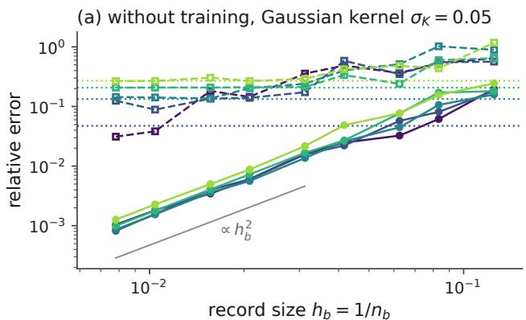

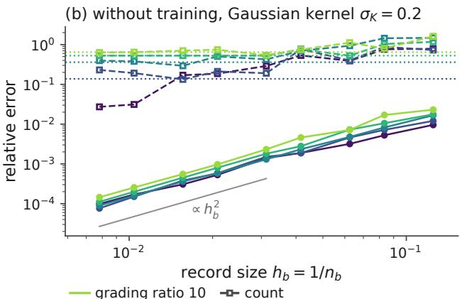  
Figure S1: Training-free comparison of count and area weights on the controlled benchmark. A fixed Gaussian kernel aggregates refined boundary records. Its width is $\sigma _ { K } = 0 . 0 5$ in (a) and $\sigma _ { K } = 0 . 2$ in (b). The records have spacing (record size) $h _ { b } = 1 / n _ { b }$ and grading ratios from 1 to 10 (dark to light). The error is relative to a fine uniform reference. Area-weighted aggregation (solid, filled markers) converges at second order for all gradings. The grey guide is $\propto h _ { b } ^ { 2 } .$ . Count-weighted aggregation (dashed, open markers) on graded records stalls at the plateau predicted by Proposition 4 (dotted). At a grading ratio of 1, patch-boundary intersections create short edge fragments. Their count-weighting error decays under refinement.

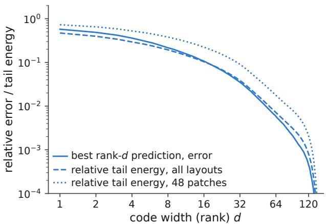  
Figure S2: Response spectrum of the controlled benchmark. The solid line is the optimal rank-d approximation error (best rank-d prediction, error) of the exact response operator. The other lines give the relative tai energy, for all layouts (dashed) and for 48 patches (dotted). These curves set the theoretical error floor of a global code of width d (Proposition 5). At the backbone’s full channel width (d = 96), the trained globa modulation model of Table 3 remains over two orders of magnitude above this floor.

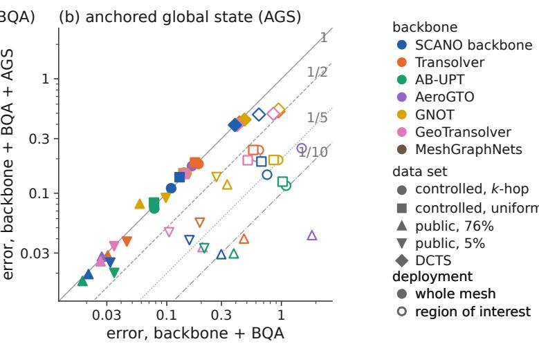

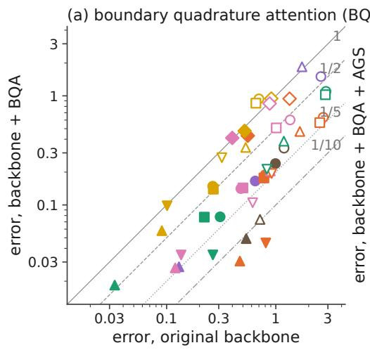  
Figure S3: Efect of BQA and AGS on all backbones (colour), data sets (marker shape) and deployments. Filled markers are the whole mesh. Open markers are a compact region of 2% of the cells. (a) Relative $L ^ { 2 }$ error with BQA against the original (native) backbone. (b) Relative ${ \check { L } } ^ { 2 }$ error with $\mathrm { B Q A } + \mathrm { A G S }$ against BQA alone. Grey reference lines mark $1 \times , 1 / 2 \times , 1 / 5 \times$ and $1 / 1 0 \times$ the error. All configurations with completed training seeds are shown.

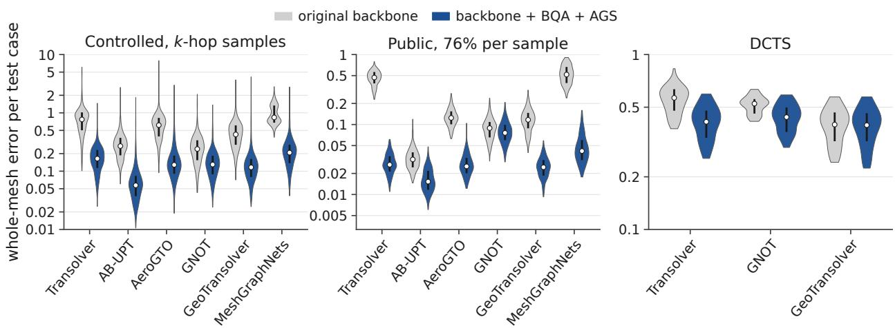  
Figure S4: Per-case whole-mesh error distributions of each original (native) backbone (grey) and of the same backbone with $\mathrm { B Q A } + \mathrm { A G S }$ (blue). Where AGS does not apply, the blue distribution is BQA alone. The panels are the controlled benchmark (k-hop samples, 512 test cases), the public benchmark (76% coverage, 256 test cases) and DCTS (50 test rooms). Bars mark interquartile ranges, and white dots mark medians (log scale).

Table S12: Sparse sampling (ratio 0.02), as Table 3. Controlled benchmark, 512 test cases. The table gives the volume-weighted relative $L ^ { 2 }$ error over the cells in each deployment. Errors are averaged per case over the training seeds and then over the cases. ± is half the width of the 95% case-bootstrap interval. Sample is one sample drawn as in training. Whole mesh is one pass. Region is one compact region of interest that holds the given share of the cells (Section 4.4). It is predicted from a pass over the region. Models with AGS draw fresh anchors there, and message-passing models read the halo of their receptive field. Other mesh is the reverse-graded $4 0 ^ { 3 }$ mesh. On the whole mesh, SCANO uses its whole-mesh state. Bold marks the lowest error of a column within a training family. Methods are compared within a training family, never across families (Table S4).
<table><tr><td></td><td></td><td></td><td colspan="4">Region, share of the cells</td><td></td></tr><tr><td>Method</td><td>Sample</td><td>Whole mesh</td><td>0.3</td><td>0.12</td><td>0.05</td><td>0.02</td><td>Other mesh</td></tr><tr><td colspan="8">k-hop samples, ratio 0.02</td></tr><tr><td>SCANO SCANO</td><td>0.126 ± 0.010</td><td>0.126 ± 0.010</td><td>0.143 ± 0.012</td><td>0.152 ± 0.015</td><td>0.167 ± 0.025</td><td>0.176 ± 0.022</td><td>0.126 ± 0.009</td></tr><tr><td>SCANO backbone + BQA</td><td>0.130 ± 0.011</td><td>0.124 ± 0.010</td><td>0.287 ± 0.037</td><td>0.409 ± 0.057</td><td>0.505 ± 0.067</td><td>0.596 ± 0.082</td><td>0.124 ± 0.010</td></tr><tr><td colspan="8">Boundary injection on the SCANO backbone</td></tr><tr><td>SCANO, anchors outside the</td><td>0.127 ± 0.011</td><td>0.127 ± 0.011</td><td></td><td>0.138 ± 0.013 0.147 ± 0.016 0.165 ± 0.026</td><td></td><td>0.177 ± 0.031</td><td> $0 . 1 2 7 \pm 0 . 0 1 1$ </td></tr><tr><td colspan="8">message passing</td></tr><tr><td>Other boundary encoders</td><td></td><td></td><td></td><td></td><td></td><td></td><td></td></tr><tr><td colspan="8">Transolver + LFE</td></tr><tr><td>Backbones</td><td></td><td></td><td></td><td></td><td></td><td></td><td></td></tr><tr><td>Transolver</td><td> $0 . 9 1 7 \pm 0 . 0 5 0$ </td><td>0.815 ± 0.037</td><td>1.080 ± 0.069</td><td>1.369 ± 0.118</td><td>1.758 ± 0.210</td><td>2.153 ± 0.213</td><td>0.772 ± 0.025</td></tr><tr><td>Transolver + BQA</td><td>0.195 ± 0.013</td><td>0.195 ± 0.013</td><td>0.307 ± 0.027</td><td>0.390 ± 0.049</td><td>0.436 ± 0.054</td><td>0.496 ± 0.064</td><td>0.209 ± 0.015</td></tr><tr><td colspan="8">Uniform samples, ratio 0.02</td></tr><tr><td>SCANO</td><td></td><td></td><td></td><td></td><td></td><td></td><td></td></tr><tr><td>SCANO SCANO backbone + BQA</td><td> ${ \bf 0 . 1 3 0 \pm 0 . 0 0 7 }$  0.148 ± 0.008</td><td>0.130 ± 0.007 0.139 ± 0.008 0.143 ± 0.007</td><td>0.270 ± 0.024</td><td>0.148 ± 0.010 0.365 ± 0.044</td><td>0.163 ± 0.015 0.454 ± 0.057</td><td>0.175±0.018 0.540 ± 0.070</td><td>0.130 ± 0.007 0.143 ± 0.007</td></tr><tr><td></td><td></td><td></td><td></td><td></td><td></td><td></td><td></td></tr><tr><td colspan="8">Other boundary encoders</td></tr><tr><td>Transolver + LFE</td><td>0.204 ± 0.020</td><td>0.205 ± 0.020</td><td>0.311 ± 0.027</td><td>0.402 ± 0.039</td><td>0.461 ± 0.046</td><td>0.528 ± 0.058</td><td> $0 . 4 5 1 \pm 0 . 0 3 9$ </td></tr><tr><td colspan="8">Backbones Transolver</td></tr><tr><td>Transolver + BQA</td><td>0.885 ± 0.045 0.189 ± 0.010</td><td>0.797 ± 0.038 0.187 ± 0.011</td><td>1.047 ± 0.063 0.295 ± 0.025</td><td>1.332 ± 0.112 0.382 ± 0.047</td><td>1.594 ± 0.151 0.434 ± 0.055</td><td>1.858 ± 0.163 0.512 ± 0.074</td><td>0.759 ± 0.030 0.203 ± 0.014</td></tr><tr><td></td><td></td><td></td><td></td><td></td><td></td><td></td><td></td></tr></table>

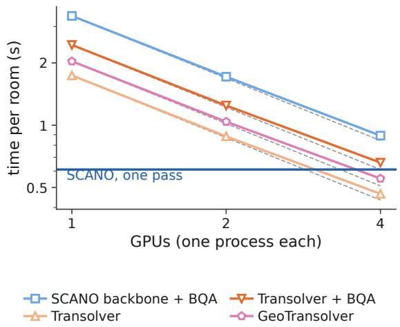  
Figure S5: The multi-pass average of the models whose state follows the sample on one, two and four GPUs. Each GPU runs one process and takes its share of the passes in turn. The grey dashed lines mark the ideal speed-up. The solid line is SCANO’s single pass on one GPU. Values are medians over the four rooms of Table 8.

Table S13: Sparse sampling (ratio 0.02), as Table 3. Controlled benchmark: drift, response and size of the models of Table S12. Values are averaged over the training seeds, per case and, for $E _ { \mathrm { r e s p } } ,$ per intervention pair. ± is half the width of the 95% case-bootstrap interval; for $E _ { \mathrm { r e s p } } ,$ whole base cases are resampled. The region drift δ is measured in a compact region that holds the sampling ratio’s share of the cells. It is the distance of the prediction there from the model’s own whole-mesh prediction on the region’s cells, relative to the reference. A model with AGS draws fresh anchors in the region, as in training. A message-passing model reads the halo of its receptive field. $E _ { \mathrm { r e s p } }$ (Eq. (11)) is measured on one sample drawn as in training. It covers the intervention pairs whose true response exceeds five percent of the base solution. The columns give all pairs, the pairs on the smallest patches (tiny) and the far pairs, whose intervened patch has no face in the sample. ‡Equal to 1 by construction. The model has no boundary input, or it reads no boundary record while the intervened patch lies outside the sample. Parameters are in thousands. Training families and marks as in Table S12.
<table><tr><td></td><td></td><td colspan="3"> $E _ { \mathrm { r e s p } }$  on a sample</td><td></td></tr><tr><td>Method</td><td>Region drift δ</td><td>All</td><td>Tiny</td><td>Far</td><td>Parameters  $( 1 0 ^ { 3 } )$ </td></tr><tr><td colspan="6">k-hop samples, ratio 0.02</td></tr><tr><td>SCANO SCANO</td><td> $0 . 0 5 3 \pm 0 . 0 0 8$ </td><td> $0 . 2 0 8 \pm 0 . 0 3 5$ </td><td> $0 . 2 3 7 \pm 0 . 0 5 0$ </td><td> $0 . 2 2 3 \pm 0 . 0 4 6$ </td><td>777</td></tr><tr><td>SCANO backbone + BQA</td><td> $0 . 5 8 4 \pm 0 . 0 7 2$ </td><td> $0 . 2 0 3 \pm 0 . 0 2 7$ </td><td> $0 . 2 5 0 \pm 0 . 0 4 7$ </td><td> $0 . 2 1 7 \pm 0 . 0 3 2$ </td><td>777</td></tr><tr><td colspan="6">Boundary injection on the SCANO backbone</td></tr><tr><td>SCANO, anchors outside the message passing</td><td>0.027 ± 0.004</td><td>0.214±0.040</td><td> $0 . 2 4 2 \pm 0 . 0 4 6$ </td><td>0.233±0.052</td><td>777</td></tr><tr><td colspan="6">Other boundary encoders</td></tr><tr><td>Transolver + LFE</td><td>0.350 ± 0.032</td><td>0.326 ± 0.081</td><td> $0 . 3 4 6 \pm 0 . 0 4 2$ </td><td>0.366±0.111</td><td>778</td></tr><tr><td colspan="6">Backbones</td></tr><tr><td>Transolver</td><td> $1 . 9 7 2 \pm 0 . 1 7 6$ </td><td> $0 . 9 3 0 \pm 0 . 0 3 1$ </td><td> $1 . 0 0 7 \pm 0 . 0 2 0$ </td><td>1</td><td>803</td></tr><tr><td>Transolver + BQA</td><td>0.426 ± 0.053 0.313 ± 0.057</td><td></td><td> $0 . 3 6 5 \pm 0 . 0 6 0$ </td><td>0.349 ± 0.075</td><td>800</td></tr><tr><td colspan="6">Uniform samples, ratio 0.02</td></tr><tr><td>SCANO</td><td> $0 . 0 2 8 \pm 0 . 0 0 5$ </td><td> $0 . 2 2 1 \pm 0 . 0 3 2$ </td><td>0.258±0.045</td><td></td><td></td></tr><tr><td>SCANO SCANO backbone + BQA</td><td> $0 . 5 1 6 \pm 0 . 0 6 0$ </td><td> $0 . 2 5 1 \pm 0 . 0 3 7$ </td><td> $0 . 2 8 1 \pm 0 . 0 4 4$ </td><td> $0 . 2 4 1 \pm 0 . 0 3 8$   $0 . 2 7 5 \pm 0 . 0 4 8$ </td><td>787 787</td></tr><tr><td colspan="6"></td></tr><tr><td>Other boundary encoders Transolver + LFE</td><td> $0 . 4 3 2 \pm 0 . 0 3 9$ </td><td> $0 . 3 1 7 \pm 0 . 0 6 9$ </td><td>0.355 ± 0.051 0.356 ± 0.090</td><td></td><td>778</td></tr><tr><td colspan="6">Backbones</td></tr><tr><td>Transolver</td><td> $1 . 6 7 4 \pm 0 . 1 3 0$ </td><td> $0 . 9 4 8 \pm 0 . 0 4 3$ </td><td> $1 . 0 3 7 \pm 0 . 0 6 4$ </td><td>1‡</td><td>803</td></tr><tr><td>Transolver + BQA</td><td> $0 . 4 5 8 \pm 0 . 0 8 1$ </td><td> $0 . 3 1 6 \pm 0 . 0 6 9$ </td><td> $0 . 3 5 6 \pm 0 . 0 5 8$ </td><td> $0 . 3 5 9 \pm 0 . 0 9 2$ </td><td>800</td></tr></table>

## S16.1. Sampling design and the visibility of patches

The k-hop sampler grows each training sample from seed cells along the cell graph. A boundary face enters a sample only when it is drawn as a seed. A sample of the controlled benchmark at ratio 0.12 therefore holds most of the cells but only a small share of the faces (Table S4). Two alternatives remove this asymmetry. In the first, every training sample contains at least one face of every patch. No patch is then ever hidden. The second is the face-inclusive sampler. Here a sample contains every boundary face owned by one of its cells. Face coverage then follows cell coverage. At the training ratio of the controlled benchmark, the face-inclusive sampler raises the share of faces in a sample from 12 to 58 per cent. This equals the share of the cells. The share of patches that a sample misses entirely falls from 17 to about one per cent. The cost is 14 per cent more nodes per sample (Table S4). Table S22 compares the backbones that read the boundary only as sampled nodes under these designs. It also lists the same backbones with BQA. On the controlled benchmark, the face-inclusive sampler lowers the whole-mesh error of every backbone. The gain is largest for AB-UPT, whose anchors are drawn from the sample (from 0.31 to 0.12). It is smallest for the backbones with BQA, which already read every face as an area-weighted record. Transolver + BQA goes from 0.19 to 0.18, and $\mathrm { A B - U P T } + \mathrm { B Q A } + \mathrm { A G S }$ from 0.073 to 0.070. The gain of BQA remains on face-inclusive samples. Transolver + BQA is about four times as accurate as the original Transolver. Its response is also far better. AB-UPT + BQA + AGS is 1.7 times as accurate as AB-UPT. The records that BQA reads at every point therefore carry more than the faces that a sample would otherwise hide.

Table S14: Sampling gap on the controlled benchmark. The gap is the whole-mesh error of a model trained on samples minus that of the same method trained on the whole mesh, paired per test case. ± is half the width of the 95% case-bootstrap interval. The range gives the gap of each training seed of the sampled model against the model trained on the whole mesh. Errors are as in Table 3. A negative gap means that the model trained on samples is the more accurate on the whole mesh. Trained on the whole mesh, SCANO and the SCANO backbone with BQA alone are one model, because the anchor sample is the mesh itself. Both are therefore compared with it, on k-hop samples only. On uniform samples, the backbone runs without its message-passing layers. The whole-mesh models chose their learning rate on validation.
<table><tr><td>Training family</td><td>Sampled model</td><td>Gap</td><td>Range over seeds</td></tr><tr><td colspan="4">SCANO: trained on the whole mesh  $0 . 0 7 8 \pm 0 . 0 0 5$ </td></tr><tr><td>k-hop samples, ratio 0.12</td><td> $0 . 1 1 1 \pm 0 . 0 0 9$ </td><td> $+ 0 . 0 3 2 \pm 0 . 0 0 6$ </td><td> $+ 0 . 0 2 7 \ \mathrm { t o \ + 0 . 0 3 7 }$ </td></tr><tr><td>k-hop samples, ratio 0.02</td><td> $0 . 1 2 6 \pm 0 . 0 1 0$ </td><td> $+ 0 . 0 4 8 \pm 0 . 0 0 6$ </td><td> $+ 0 . 0 4 2 \ \mathrm { t o } \ + 0 . 0 5 4$ </td></tr><tr><td colspan="4">SCANO backbone + BQA: trained on the whole mesh  $0 . 0 7 8 \pm 0 . 0 0 5$ </td></tr><tr><td>k-hop samples, ratio 0.12</td><td> $0 . 1 0 9 \pm 0 . 0 0 8$ </td><td> $+ 0 . 0 3 1 \pm 0 . 0 0 5$ </td><td> $+ 0 . 0 2 1 \ \mathrm { t o \ + 0 . 0 4 3 }$ </td></tr><tr><td>k-hop samples, ratio 0.02</td><td> $0 . 1 2 4 \pm 0 . 0 1 0$ </td><td> $+ 0 . 0 4 5 \pm 0 . 0 0 7$ </td><td>+0.041 to +0.050</td></tr><tr><td colspan="4">Transolver + LFE: trained on the whole mesh 0.195 ± 0.021</td></tr><tr><td>k-hop samples, ratio 0.12</td><td> $0 . 2 0 7 \pm 0 . 0 2 6$ </td><td> $+ 0 . 0 1 3 \pm 0 . 0 0 7$ </td><td> $- 0 . 0 0 4 \ \mathrm { t o \ + 0 . 0 2 3 }$ </td></tr><tr><td>Uniform samples, ratio 0.12</td><td> $0 . 1 9 6 \pm 0 . 0 2 2$ </td><td> $+ 0 . 0 0 1 \pm 0 . 0 0 4$ </td><td> $- 0 . 0 0 7 \ \mathrm { t o \ + 0 . 0 0 7 }$ </td></tr><tr><td>k-hop samples, ratio 0.02</td><td> $0 . 2 1 6 \pm 0 . 0 2 6$ </td><td> $+ 0 . 0 2 1 \pm 0 . 0 0 7$ </td><td> $+ 0 . 0 0 0 \ \mathrm { t o \ + 0 . 0 3 8 }$ </td></tr><tr><td>Uniform samples, ratio 0.02</td><td> $0 . 2 0 5 \pm 0 . 0 2 0$ </td><td> $+ 0 . 0 1 0 \pm 0 . 0 0 4$ </td><td> $+ 0 . 0 0 0 \ \mathrm { t o \ + 0 . 0 2 5 }$ </td></tr></table>

On DCTS, the face-inclusive sampler lowers the whole-room error of the original Transolver toward that of Transolver + BQA (0.43 against 0.55 in one pass, and 0.43 against 0.46 in its own deployment, Table S23). It changes that of Transolver + BQA little (0.42 against 0.43 in one pass, and 0.42 against 0.41 in its own deployment). However, it breaks the response of both models to a rack’s power. The predicted change of the room temperature becomes two to seven times the true one. The response errors are 5.5 and 2.6, against 0.72 and 0.73 on k-hop samples. The response of Transolver + BQA to a halved cooling flow also worsens, from 0.38 to 0.85. The cause is as follows. A face-inclusive sample carries every outlet face of its cells as a point of its own. The slice attention of the sample weighs these many small faces by their count. A change at one rack is thus amplified in the state. On k-hop samples the faces are rare, and this path barely acts. On DCTS, the faces are therefore no substitute for boundary records read with their areas. BQA provides such records. The two forms of AB-UPT are not afected in this way. Their state comes from anchors drawn over the whole room, not from the sample. On face-inclusive samples, their errors change by about three per cent. Their responses to a doubled rack do not change. BQA keeps its advantage in the response to a halved cooling flow on both kinds of sample. This holds for AB-UPT as for Transolver (Table S23).

Table S15: Public benchmark under sparse sampling, 256 test cases. The table gives the relative $L ^ { 2 }$ error in percent. Errors are averaged per case over the training seeds and then over the cases. ± is half the width of the 95% case-bootstrap interval. Whole mesh is one pass over the whole mesh, with SCANO in its whole-mesh state. Subgraph is one subgraph drawn as in training. Region is one compact region of interest that holds 5% of the points (Section 4.4). The last two are averaged over three draws per case. Models with AGS draw fresh anchors, and message-passing models read the halo of their receptive field. The region drift δ is the distance of the region prediction from the model’s own whole-mesh prediction on the same points, relative to the reference, in percent. Bold marks the lowest value of a column within a setting. On this small mesh, SCANO’s anchor sample is the whole mesh, passed through the message passing. For samples of about 5% of the mesh, SCANO draws its anchors stratified over the mesh, outside the message passing. So does the row with anchors outside the message passing. ‡Zero by construction (up to round-of) with whole-mesh anchors. These values are not ranked. A method marked (failed runs) has runs whose training failed by a criterion fixed before the test results were read. The criterion is a validation error of at least 0.85 times that of a model without boundary values. The row below it leaves these runs out.
<table><tr><td>Method</td><td>Whole mesh</td><td>Subgraph</td><td>Region</td><td>Region drift δ</td></tr><tr><td colspan="5">Sparse sampling: one training sample covers about 25% of the mesh SCANO</td></tr><tr><td>SCANO</td><td> $2 . 2 3 \pm 0 . 1 0$ </td><td> $2 . 4 9 \pm 0 . 1 1$ </td><td>2.91 ± 0.20</td><td>0‡</td></tr><tr><td>SCANO, anchors outside the message passing</td><td>2.32 ± 0.11</td><td> $2 . 7 0 \pm 0 . 1 2$ </td><td> $3 . 1 9 \pm 0 . 2 3$ </td><td>0.92 ± 0.07</td></tr><tr><td>SCANO backbone + BQA</td><td>2.65 ± 0.13</td><td>3.27 ± 0.15</td><td>14.09 ± 1.31</td><td>13.84±1.27</td></tr><tr><td colspan="5">Boundary injection on the SCANO backbone without message passing</td></tr><tr><td>SCANO without message passing</td><td>2.79 ± 0.12</td><td>3.07 ± 0.13</td><td>3.72 ± 0.26</td><td>1.73 ± 0.15</td></tr><tr><td colspan="5">Other boundary encoders and message passing</td></tr><tr><td>Transolver + LFE</td><td> $5 . 3 1 \pm 0 . 2 4$ </td><td> $5 . 3 6 \pm 0 . 2 5$ </td><td> $1 8 . 0 3 \pm 1 . 2 8$ </td><td> $1 6 . 1 7 \pm 1 . 2 8$ </td></tr><tr><td>GNOT</td><td> $9 . 5 3 \pm 0 . 4 3$ </td><td> $1 0 . 0 7 \pm 0 . 4 6$ </td><td> $2 8 . 2 6 \pm 2 . 0 3$ </td><td> $2 5 . 7 2 \pm 1 . 9 1$ </td></tr><tr><td>GeoTransolver</td><td> $1 2 . 9 3 \pm 0 . 5 8$ </td><td> $1 3 . 5 3 \pm 0 . 6 0$ </td><td> $5 6 . 5 8 \pm 3 . 6 3$ </td><td> $5 4 . 8 2 \pm 3 . 7 2$ </td></tr><tr><td>Slice aggregation</td><td> $1 3 . 0 6 \pm 0 . 5 5$ </td><td> $1 4 . 1 1 \pm 0 . 5 5$ </td><td>66.43 ±3.97</td><td>65.38 ± 4.22</td></tr><tr><td colspan="5">Backbones</td></tr><tr><td>Transolver (failed runs)</td><td> $6 8 . 2 9 \pm 1 . 5 3 $ </td><td> $7 3 . 6 1 \pm 1 . 8 1$ </td><td> $1 1 0 . 3 2 \pm 8 . 5 9$ </td><td> $1 5 7 . 9 8 \pm 1 1 . 6 8$ </td></tr><tr><td>without failed runs</td><td> $6 5 . 1 4 \pm 1 . 5 9$ </td><td> $7 1 . 1 4 \pm 1 . 9 2$ </td><td> $1 1 7 . 7 2 \pm 9 . 9 0$ </td><td> $1 6 7 . 7 1 \pm 1 3 . 2 8$ </td></tr><tr><td>Transolver + BQA</td><td> $3 . 3 9 \pm 0 . 1 5$ </td><td> $3 . 8 8 \pm 0 . 1 7$ </td><td> $1 7 . 8 8 \pm 1 . 5 3 $ </td><td> $1 7 . 4 6 \pm 1 . 5 6$ </td></tr><tr><td>AB-UPT</td><td> $1 0 . 1 9 \pm 0 . 5 3$ </td><td> $3 1 . 5 7 \pm 1 . 6 8$ </td><td> $9 5 . 5 8 \pm 8 . 9 9$ </td><td> $9 5 . 3 7 \pm 8 . 9 4$ </td></tr><tr><td>AB-UPT + BQA</td><td> $3 . 2 2 \pm 0 . 1 5$ </td><td> $3 . 6 3 \pm 0 . 1 8$ </td><td> $2 4 . 1 5 \pm 2 . 2 2$ </td><td> $2 4 . 0 0 \pm 2 . 2 4$ </td></tr><tr><td>AB-UPT + AGS</td><td> $2 . 8 4 \pm 0 . 1 3$ </td><td> $6 . 0 9 \pm 0 . 3 4$ </td><td> $7 . 1 9 \pm 0 . 5 9$ </td><td> $6 . 1 8 \pm 0 . 5 7$ </td></tr><tr><td>AB-UPT + BQA + AGS</td><td> ${ \bf 1 . 6 5 \pm 0 . 0 9 }$ </td><td>1.88 ± 0.09</td><td> $\mathbf { 2 . 4 5 \pm 0 . 1 7 }$ </td><td>1.10 ± 0.07</td></tr><tr><td colspan="5">Sparse sampling: one training sample covers about 5% of the mesh SCANO</td></tr><tr><td>SCANO</td><td>2.48 ± 0.11</td><td>2.75 ± 0.12</td><td>3.35 ± 0.22</td><td>0.91 ± 0.06</td></tr><tr><td>SCANO backbone + BQA</td><td>3.21 ± 0.15</td><td>3.75 ± 0.18</td><td>12.51 ± 1.16</td><td>12.37 ± 1.18</td></tr><tr><td colspan="5">Boundary injection on the SCANO backbone without message passing</td></tr><tr><td>SCANO without message passing</td><td>2.85 ± 0.13</td><td>3.14 ± 0.13</td><td>3.81 ± 0.26</td><td>1.71 ± 0.15</td></tr><tr><td colspan="5">Other boundary encoders and message passing</td></tr><tr><td>Transolver + LFE</td><td>5.68 ± 0.29</td><td> $5 . 6 5 \pm 0 . 3 0$ </td><td> $1 1 . 8 1 \pm 0 . 7 7$ </td><td>8.31 ± 0.65</td></tr><tr><td>GNOT</td><td> $1 0 . 1 0 \pm 0 . 4 6$ </td><td> $1 0 . 9 6 \pm 0 . 4 7$ </td><td> $2 5 . 6 6 \pm 2 . 0 2$ </td><td> $2 1 . 9 0 \pm 2 . 0 0$ </td></tr><tr><td>GeoTransolver</td><td> $1 3 . 5 8 \pm 0 . 5 6$ </td><td> $1 4 . 1 1 \pm 0 . 5 7$ </td><td> $4 9 . 9 0 \pm 2 . 7 4$ </td><td>48.97 ± 2.87</td></tr><tr><td>Slice aggregation</td><td> $1 3 . 5 3 \pm 0 . 5 8$ </td><td> $1 4 . 8 1 \pm 0 . 6 0$ </td><td>43.49 ± 2.51</td><td>40.53 ± 2.45</td></tr><tr><td colspan="5">Backbones</td></tr><tr><td>Transolver (failed runs)</td><td> $8 0 . 9 4 \pm 1 . 3 9$ </td><td> $8 5 . 7 1 \pm 1 . 6 5$ </td><td> $8 3 . 2 5 \pm 5 . 2 8$ </td><td> $1 1 7 . 0 5 \pm 8 . 5 7$ </td></tr><tr><td>without failed runs</td><td> $7 2 . 8 9 \pm 1 . 5 2$ </td><td> $8 0 . 8 9 \pm 1 . 8 5$ </td><td> $8 3 . 1 5 \pm 5 . 4 2$ </td><td> $1 1 4 . 0 3 \pm 8 . 4 9$ </td></tr><tr><td>Transolver + BQA</td><td> $4 . 4 8 \pm 0 . 2 0$ </td><td> $5 . 0 6 \pm 0 . 2 3$ </td><td> $1 5 . 7 4 \pm 1 . 2 7$ </td><td> $1 4 . 8 4 \pm 1 . 3 1$ </td></tr><tr><td>AB-UPT</td><td> $2 6 . 5 2 \pm 1 . 1 1$ </td><td> $6 3 . 8 7 \pm 2 . 0 5$ </td><td> $7 3 . 3 8 \pm 4 . 3 8$ </td><td> $6 9 . 6 3 \pm 4 . 4 0$ </td></tr><tr><td>AB-UPT + BQA</td><td> $3 . 4 8 \pm 0 . 1 5$ </td><td> $3 . 7 5 \pm 0 . 1 9$ </td><td> $1 7 . 9 7 \pm 1 . 7 2$ </td><td> $1 8 . 0 1 \pm 1 . 7 3$ </td></tr><tr><td> $\mathrm { A B - U P T } + \mathrm { A G S }$ </td><td> $2 . 8 3 \pm 0 . 1 3$ </td><td> $6 . 0 7 \pm 0 . 3 7$ </td><td> $7 . 2 9 \pm 0 . 6 0$ </td><td> $6 . 1 8 \pm 0 . 5 6$ </td></tr><tr><td>AB-UPT + BQA + AGS</td><td>2.01 ± 0.10</td><td> $\mathbf { 2 . 1 7 \pm 0 . 1 0 }$ </td><td>2.95 ± 0.21</td><td>1.07 ± 0.07</td></tr></table>

Table S16: Sampling gap on the public benchmark, in percent. The gap is the whole-mesh error of a model trained on samples minus that of the same method trained on the whole mesh, paired per test case. ± is half the width of the 95% case-bootstrap interval. The range gives the gap of each training seed of the sampled model against the model trained on the whole mesh. Errors are as in Table 4. A negative gap means that the model trained on samples is the more accurate on the whole mesh. Trained on the whole mesh, SCANO is the same function as the SCANO backbone with BQA alone, because the anchor sample is the mesh itself. This is its model trained on the whole mesh. For samples of about 5% of the mesh, SCANO is the form with anchors outside the message passing.
<table><tr><td>Training samples</td><td>Sampled model</td><td>Gap</td><td>Range over seeds</td></tr><tr><td colspan="4">SCANO: trained on the whole mesh  $2 . 0 8 \pm 0 . 0 9$ </td></tr><tr><td>about 76% of the mesh per sample</td><td> $1 . 9 7 \pm 0 . 0 9$ </td><td> $- 0 . 1 1 \pm 0 . 0 3$ </td><td> $- 0 . 1 4 ~ \mathrm { t o } ~ - 0 . 1 0$ </td></tr><tr><td>about 25% of the mesh per sample</td><td> $2 . 2 3 \pm 0 . 1 0$ </td><td> $+ 0 . 1 5 \pm 0 . 0 5$ </td><td> $+ 0 . 1 2 \ \mathrm { t o } \ + 0 . 1 9$ </td></tr><tr><td colspan="4">SCANO, anchors outside the message passing: trained on the whole mesh 2.15 ±0.11</td></tr><tr><td>about 76% of the mesh per sample</td><td> $2 . 2 2 \pm 0 . 1 1$ </td><td> $+ 0 . 0 7 \pm 0 . 0 5$ </td><td> $- 0 . 0 6 ~ \mathrm { t o } ~ + 0 . 1 7$ </td></tr><tr><td>about 25% of the mesh per sample</td><td> $2 . 3 2 \pm 0 . 1 1$ </td><td> $+ 0 . 1 7 \pm 0 . 0 5$ </td><td> $+ 0 . 0 8 ~ \mathrm { t o } ~ + 0 . 3 5$ </td></tr><tr><td>about 5% of the mesh per sample</td><td> $2 . 4 8 \pm 0 . 1 1$ </td><td> $+ 0 . 3 3 \pm 0 . 0 6$ </td><td> $+ 0 . 2 9 \ \mathrm { t o \ + 0 . 3 5 }$ </td></tr><tr><td colspan="4">SCANO without message passing: trained on the whole mesh</td></tr><tr><td>about 76% of the mesh per sample</td><td> $2 . 7 6 \pm 0 . 1 2$ </td><td> $2 . 7 5 \pm 0 . 1 2$   $+ 0 . 0 1 \pm 0 . 0 3$ </td><td> $- 0 . 0 7 \ \mathrm { t o \ t i 0 . 1 2 }$ </td></tr><tr><td>about 25% of the mesh per sample</td><td> $2 . 7 9 \pm 0 . 1 2$ </td><td> $+ 0 . 0 4 \pm 0 . 0 3$ </td><td> $- 0 . 0 0 \ \mathrm { t o \ t o . 1 2 }$ </td></tr><tr><td>about 5% of the mesh per sample</td><td> $2 . 8 5 \pm 0 . 1 3$ </td><td> $+ 0 . 1 0 \pm 0 . 0 3$ </td><td> $+ 0 . 0 8 ~ \mathrm { t o } ~ + 0 . 1 3$ </td></tr><tr><td colspan="4">Transolver  $+ ~ L F E ;$  trained on the whole mesh  $5 . 0 6 \pm 0 . 2 4$ </td></tr><tr><td>about 76% of the mesh per sample</td><td> $5 . 0 9 \pm 0 . 2 5$ </td><td> $+ 0 . 0 2 \pm 0 . 0 6$ </td><td> $- 0 . 5 5 \mathrm { ~ t o ~ } { + 0 . 3 6 }$ </td></tr><tr><td>about 25% of the mesh per sample</td><td> $5 . 3 1 \pm 0 . 2 4$ </td><td> $+ 0 . 2 5 \pm 0 . 1 1$ </td><td> $- 0 . 2 4 \ \mathrm { t o \ + 0 . 5 8 }$ </td></tr><tr><td>about 5% of the mesh per sample</td><td> $5 . 6 8 \pm 0 . 2 9$ </td><td> $+ 0 . 6 2 \pm 0 . 0 9$ </td><td> $+ 0 . 1 8 ~ \mathrm { t o } ~ + 0 . 8 8$ </td></tr></table>

Table S17: Settings of the oficial LFE reproduction (from the paper; details it leaves open from the code).
<table><tr><td>Data</td><td>8,192 training and 256 validation samples of the official training file; the 256 official test samples</td></tr><tr><td>Optimiser</td><td>AdamW, weight decay  $1 0 ^ { - 4 } ;$  adaptive gradient clipping 0.5</td></tr><tr><td>Learning rate</td><td>linear from  $1 0 ^ { - 5 }$  to  $2 \times 1 0 ^ { - 4 }$  over the first 5% of training, then cosine to 10−5</td></tr><tr><td>Epochs and batch</td><td>2,048 epochs; global batch 16 (the paper&#x27;s batch 8 read per GPU on its two  $\mathrm { G P U s } )$  , run on one GPU</td></tr><tr><td>Extender</td><td>6 layers, 4 heads, latent size 128, 16 output features, no masking</td></tr><tr><td>Processors</td><td>RIGNO type: 12 steps, latent size 128, edge masking 0.5; GAOT type: 32 × 32 grid, patch size 2, 4 layers, 4 heads,</td></tr><tr><td>Parameters</td><td>latent size 128 3.6 million and 3.9 million, as in the paper</td></tr></table>

Table S18: DCTS test rooms (50), models of Table 5. The table gives the mean absolute error of each field in physical units, in each model’s own deployment. Errors are averaged over the rooms and then over the training seeds. ± is the standard deviation over the seeds. $p ^ { \prime }$ is the kinematic pressure without its hydrostatic part; multiply it by the reference density to obtain Pa.
<table><tr><td>Method</td><td> $U _ { x } ~ ( \mathrm { m } \mathrm { s } ^ { - 1 } )$ </td><td> $U _ { y } ~ ( \mathrm { m } \mathrm { s } ^ { - 1 } )$ </td><td> $U _ { z } ~ ( \mathrm { m } \mathrm { s } ^ { - 1 } )$ </td><td> $p ^ { \prime } \ : ( \mathrm { m } ^ { 2 } \mathrm { s } ^ { - 2 } )$ </td><td>T (K)</td></tr><tr><td>SCANO</td><td></td><td></td><td></td><td></td><td></td></tr><tr><td>SCANO</td><td> $0 . 0 8 1 \pm 0 . 0 0 0$ </td><td> $0 . 0 5 8 \pm 0 . 0 0 0$ </td><td> $0 . 1 0 4 \pm 0 . 0 0 0$ </td><td> $0 . 1 3 8 \pm 0 . 0 0 3$ </td><td> $0 . 5 5 4 \pm 0 . 0 0 6$ </td></tr><tr><td>SCANO, anchors outside the message passing</td><td> $0 . 0 8 2 \pm 0 . 0 0 0$ </td><td> $0 . 0 5 9 \pm 0 . 0 0 0$ </td><td> $0 . 1 0 6 \pm 0 . 0 0 0$ </td><td> $0 . 1 3 4 \pm 0 . 0 0 1$ </td><td> $0 . 5 5 2 \pm 0 . 0 0 3$ </td></tr><tr><td>SCANO backbone + BQA</td><td> $0 . 0 7 8 \pm 0 . 0 0 0$ </td><td> $0 . 0 5 6 \pm 0 . 0 0 0$ </td><td> $0 . 1 0 0 \pm 0 . 0 0 1$ </td><td> $0 . 1 3 1 \pm 0 . 0 0 1$ </td><td> $0 . 5 4 8 \pm 0 . 0 1 3$ </td></tr><tr><td>Backbones without and with BQA</td><td></td><td></td><td></td><td></td><td></td></tr><tr><td>Transolver</td><td> $0 . 0 9 4 \pm 0 . 0 0 2$ </td><td> $0 . 0 6 4 \pm 0 . 0 0 1$ </td><td> $0 . 1 1 2 \pm 0 . 0 0 2$ </td><td> $0 . 1 9 9 \pm 0 . 0 2 2$ </td><td> $0 . 7 4 4 \pm 0 . 0 6 3$ </td></tr><tr><td> $\mathrm { T r a n s o l v e r + B Q A }$ </td><td> $0 . 0 8 4 \pm 0 . 0 0 0$ </td><td> $0 . 0 6 1 \pm 0 . 0 0 1$ </td><td> $0 . 1 0 7 \pm 0 . 0 0 1$ </td><td> $0 . 1 4 4 \pm 0 . 0 0 1$ </td><td> $0 . 5 9 1 \pm 0 . 0 0 1$ </td></tr><tr><td> $\mathrm { A B - U P T } + \mathrm { A G S }$ </td><td> $0 . 0 8 2 \pm 0 . 0 0 3$ </td><td> $0 . 0 5 6 \pm 0 . 0 0 1$ </td><td> $0 . 0 9 9 \pm 0 . 0 0 0$ </td><td> $0 . 1 4 1 \pm 0 . 0 1 4$ </td><td> $0 . 6 3 2 \pm 0 . 0 2 7$ </td></tr><tr><td> $\mathrm { A B - U P T } + \mathrm { B Q A } + \mathrm { A G S }$ </td><td> $0 . 0 7 9 \pm 0 . 0 0 1$ </td><td> $0 . 0 5 5 \pm 0 . 0 0 1$ </td><td> $0 . 0 9 9 \pm 0 . 0 0 2$ </td><td> $0 . 1 4 5 \pm 0 . 0 0 3$ </td><td> $0 . 5 7 8 \pm 0 . 0 5 6$ </td></tr><tr><td> $\mathrm { A e r o G T O }$ </td><td> $0 . 0 8 9 \pm 0 . 0 1 0$ </td><td> $0 . 0 6 1 \pm 0 . 0 0 5$ </td><td> $0 . 1 0 8 \pm 0 . 0 0 5$ </td><td> $0 . 2 3 0 \pm 0 . 1 3 4$ </td><td> $0 . 8 7 7 \pm 0 . 4 3 9$ </td></tr><tr><td>Other boundary encoders</td><td></td><td></td><td></td><td></td><td></td></tr><tr><td> $\mathrm { T r a n s o l v e r + L F E }$ </td><td> $0 . 0 8 7 \pm 0 . 0 0 0$ </td><td> $0 . 0 6 3 \pm 0 . 0 0 0$ </td><td> $0 . 1 0 9 \pm 0 . 0 0 0$ </td><td> $0 . 1 5 8 \pm 0 . 0 0 7$ </td><td> $0 . 6 2 7 \pm 0 . 0 1 4$ </td></tr><tr><td>GeoTransolver</td><td> $0 . 0 7 9 \pm 0 . 0 0 0$ </td><td> $0 . 0 5 7 \pm 0 . 0 0 0$ </td><td> $0 . 0 9 8 \pm 0 . 0 0 1$ </td><td> $0 . 1 3 9 \pm 0 . 0 0 2$ </td><td> $0 . 6 0 1 \pm 0 . 0 0 5$ </td></tr><tr><td>GNOT</td><td> $0 . 0 9 3 \pm 0 . 0 0 2$ </td><td> $0 . 0 6 7 \pm 0 . 0 0 2$ </td><td> $0 . 1 1 8 \pm 0 . 0 0 4$ </td><td> $0 . 1 6 3 \pm 0 . 0 0 8$ </td><td> $0 . 6 9 8 \pm 0 . 0 5 5$ </td></tr><tr><td>Slice aggregation</td><td> $0 . 0 8 1 \pm 0 . 0 0 1$ </td><td> $0 . 0 5 8 \pm 0 . 0 0 0$ </td><td> $0 . 1 0 2 \pm 0 . 0 0 1$ </td><td> $0 . 1 6 0 \pm 0 . 0 1 0$ </td><td> $0 . 6 4 7 \pm 0 . 0 4 5$ </td></tr></table>

Table S19: DCTS: the number of slices G of BQA in SCANO, with everything else as in Table 5 (50 test rooms, multiple training seeds). The error is measured in the model’s own deployment, as the mean over the five fields of the volume-weighted relative $L ^ { 2 }$ error. The response error $E _ { \mathrm { r e s p } }$ is that of the room’s temperature to one rack’s doubled power, over the ten held-out pairs of Table 6. Both are relative to $G = 6 4 .$ , the setting of the main text. ± is half the width of the 95% bootstrap interval over the test rooms and over the pairs. The last column is the median training time of one epoch on one GPU.
<table><tr><td>G</td><td>Error, own deployment</td><td>Response error  $E _ { \mathrm { r e s p } }$ </td><td>Time per epoch (min)</td></tr><tr><td>16</td><td> $1 . 0 0 0 \pm 0 . 0 0 2$ </td><td> $0 . 9 8 5 \pm 0 . 0 2 6$ </td><td>11</td></tr><tr><td>64</td><td> $1 \ ( { \mathrm { r e f e r e n c e } } )$ </td><td> $1 \ ( { \mathrm { r e f e r e n c e } } )$ </td><td>12</td></tr><tr><td>256</td><td> $1 . 0 0 2 \pm 0 . 0 0 3$ </td><td> $0 . 9 9 9 \pm 0 . 0 1 4$ </td><td>16</td></tr><tr><td>1,024</td><td> $1 . 0 0 9 \pm 0 . 0 0 2$ </td><td> $0 . 9 9 5 \pm 0 . 0 2 5$ </td><td>22</td></tr></table>

Table S20: Sampling gap on DCTS. The error is that of a single pass over the room, the metric of Table 5. The gap is the error of a model trained on samples (seeds at 5% of the cells, two hops) minus that of the same method trained on the whole room. Everything else is unchanged, and the gap is paired per test room. ± is half the width of the 95% case-bootstrap interval. The gap is the mean over multiple training seeds, and the last column gives the range of the per-seed gaps.
<table><tr><td>Training</td><td>Single pass over the room</td><td>Gap</td><td>Range over seeds</td></tr><tr><td>Transolver: trained on the whole room trained on samples</td><td> $0 . 4 2 6 \pm 0 . 0 2 7$   $0 . 5 5 4 \pm 0 . 0 2 7$ </td><td> $+ 0 . 1 2 8 \pm 0 . 0 1 7$ </td><td> $+ 0 . 0 6 7 ~ \mathrm { t o } ~ + 0 . 2 1 2$ </td></tr><tr><td>Transolver + BQA: trained on the whole room</td><td> $0 . 4 1 9 \pm 0 . 0 2 4$ </td><td></td><td></td></tr><tr><td>trained on samples</td><td> $0 . 4 3 1 \pm 0 . 0 2 3$ </td><td> $+ 0 . 0 1 2 \pm 0 . 0 0 2$ </td><td> $+ 0 . 0 0 7 \ \mathrm { t o \ + 0 . 0 1 4 }$ </td></tr><tr><td>Transolver  $+ \ B Q A \ + \ A G S \colon$ </td><td>trained on the whole room</td><td> $0 . 4 2 3 \pm 0 . 0 2 3$ </td><td></td></tr><tr><td>trained on samples</td><td> $0 . 4 1 5 \pm 0 . 0 2 4$ </td><td> $- 0 . 0 0 8 \pm 0 . 0 0 2$ </td><td> $- 0 . 0 1 1 \ \mathrm { t o \ - 0 . 0 0 2 }$ </td></tr></table>

Table S21: Ablations and checks behind Section 5. Each variant is trained with multiple seeds and paired by seed. Intervals are 95% case-bootstrap intervals, taken over the intervention pairs for the response. Ratios divide the variant by SCANO or by the original backbone. The controlled benchmark is evaluated in both sampling families at ratio 0.12. For the anchor count, the table gives the range of the slopes over the training seeds. It is the slope of the mean squared drift of the whole-mesh prediction against the number $N _ { a }$ of fresh single-cell anchors (256 to 16,384, log axes). The reference is the slope −1.16 of the variance $1 / N _ { a } - 1 / | \Omega _ { h } |$ for anchors drawn without replacement. The table also gives the error with 16,384 fresh anchors relative to the error with the whole-mesh state.
<table><tr><td>Variant</td><td>Quantity</td><td>k-hop</td><td>Uniform</td></tr><tr><td colspan="4">Controlled benchmark (Sections 5.2, 5.3, 5.4)</td></tr><tr><td>SCANO without record types/ SCANO</td><td>response error, interventions that switch</td><td>3.40 [2.67, 4.37]</td><td>3.03 [2.16, 4.30]</td></tr><tr><td>SCANO, records weighted by count / SCANO</td><td>the type of a patch error on the reverse-graded mesh</td><td>3.44 [3.21, 3.66]</td><td>2.80 [2.65, 2.95]</td></tr><tr><td>SCANO, anchors as single cells</td><td>error on the training mesh slope of the mean squared drift</td><td>1.28 [1.23, 1.33] -1.20 to -1.13</td><td>1.03 [1.00, 1.07] -1.35 to -1.30</td></tr><tr><td></td><td>error with 16,384 anchors — 1</td><td> $- 0 . 4 \mathrm { ~ t o ~ } { + 0 . 1 \% }$ </td><td> $+ 0 . 1 \ \mathrm { t o } \ + 0 . 4 \%$ </td></tr><tr><td colspan="4">DCTS (Sections 5.1, 5.4), two-hop samples Transolver + BQA / Transolver, both error, own deployment</td></tr><tr><td>without the per-point heat-source input</td><td></td><td colspan="2">0.94 [0.92, 0.96]</td></tr><tr><td></td><td>error, one pass over the room</td><td colspan="2">0.69 [0.64, 0.74]</td></tr><tr><td></td><td>error, compact region of 2% of the cells</td><td colspan="2">0.67 [0.59, 0.74]</td></tr><tr><td>Transolver  $+ \mathrm { B Q A } + \mathrm { A G S } ,$  on samples / on whole rooms</td><td>training time per epoch</td><td colspan="2">0.30</td></tr><tr><td>Transolver, on samples / on whole rooms</td><td>training time per epoch</td><td colspan="2">0.31</td></tr></table>

Table S22: Controlled benchmark: the backbones trained on k-hop samples at ratio 0.12, as in the main text, and on face-inclusive samples. A face-inclusive sample adds every boundary face owned by a sampled cell. The table gives the relative $L ^ { 2 }$ error on one sample drawn as in training and on the whole mesh, and the response error $E _ { \mathrm { r e s p } }$ on the whole mesh. Values are seed means ± half the width of the 95% case-bootstrap interval. The last row is the original Transolver with every patch present in every sample.
<table><tr><td rowspan="2">Method</td><td colspan="3">k-hop samples</td><td colspan="3">Face-inclusive samples</td></tr><tr><td>Sample</td><td>Whole mesh</td><td> $E _ { \mathrm { r e s p } }$ </td><td>Sample</td><td>Whole mesh</td><td> $E _ { \mathrm { r e s p } }$ </td></tr><tr><td>Transolver</td><td> $0 . 8 4 6 \pm 0 . 0 5 5$ </td><td> $0 . 8 0 0 \pm 0 . 0 4 5$ </td><td> $0 . 8 0 8 \pm 0 . 0 7 5$ </td><td> $0 . 7 0 2 \pm 0 . 0 4 5$ </td><td> $0 . 6 9 4 \pm 0 . 0 4 6$ </td><td> $0 . 7 8 8 \pm 0 . 1 0 4$ </td></tr><tr><td>Transolver + BQA</td><td> $0 . 1 8 6 \pm 0 . 0 1 2$ </td><td> $0 . 1 8 9 \pm 0 . 0 1 2$ </td><td> $0 . 2 9 9 \pm 0 . 0 5 1$ </td><td> $0 . 1 7 6 \pm 0 . 0 1 0$ </td><td> $0 . 1 7 6 \pm 0 . 0 1 0$ </td><td> $0 . 2 7 1 \pm 0 . 0 4 0$ </td></tr><tr><td>AB-UPT</td><td> $0 . 4 3 6 \pm 0 . 0 4 4$ </td><td> $0 . 3 0 9 \pm 0 . 0 2 0$ </td><td> $0 . 3 9 0 \pm 0 . 0 6 2$ </td><td> $0 . 1 7 7 \pm 0 . 0 1 3$ </td><td> $0 . 1 1 9 \pm 0 . 0 0 9$ </td><td> $0 . 1 9 3 \pm 0 . 0 3 3$ </td></tr><tr><td>AB-UPT, whole-mesh anchors by count</td><td> $0 . 2 5 6 \pm 0 . 0 2 9$ </td><td> $0 . 2 5 6 \pm 0 . 0 2 9$ </td><td> $0 . 3 4 4 \pm 0 . 0 7 0$ </td><td> $0 . 2 3 4 \pm 0 . 0 2 3$ </td><td> $0 . 2 3 5 \pm 0 . 0 2 2$ </td><td> $0 . 3 3 7 \pm 0 . 0 6 7$ </td></tr><tr><td> $\mathrm { A B - U P T } + \mathrm { B Q A } + \mathrm { A G S }$ </td><td> $0 . 0 7 4 \pm 0 . 0 0 9$ </td><td> $0 . 0 7 3 \pm 0 . 0 0 9$ </td><td> $0 . 1 2 0 \pm 0 . 0 2 4$ </td><td> $0 . 0 7 0 \pm 0 . 0 0 7$ </td><td> $0 . 0 7 0 \pm 0 . 0 0 7$ </td><td> $0 . 1 2 2 \pm 0 . 0 2 8$ </td></tr><tr><td>Transolver, every patch in every sample</td><td> $0 . 8 3 8 \pm 0 . 0 5 9$ </td><td> $0 . 7 9 4 \pm 0 . 0 5 0$ </td><td> $0 . 8 3 7 \pm 0 . 0 9 1$ </td><td></td><td></td><td></td></tr></table>

Table S23: DCTS: the backbones trained on k-hop samples (Table 5) and on face-inclusive samples (50 test rooms, seed means). The table gives the error in the model’s own deployment and the error on one region draw of the training sampler at the training budget. Such a draw fills a box of random size and tops it up with seeds from the whole room. It difers from the compact regions of Table 5. It also gives the response error $E _ { \mathrm { r e s p } }$ of the room temperature to one rack’s doubled power and to one cooling unit’s halved flow, as the median over the ten held-out pairs of each kind.
<table><tr><td></td><td colspan="4">k-hop samples</td><td colspan="4">Face-inclusive samples</td></tr><tr><td>Method</td><td></td><td></td><td colspan="2"> $E _ { \mathrm { r e s p } }$ </td><td colspan="2"></td><td colspan="2">Eresp</td></tr><tr><td></td><td>Error</td><td>Regional</td><td>Rack</td><td>Flow</td><td>Error</td><td>Regional</td><td>Rack</td><td>Flow</td></tr><tr><td>Transolver</td><td>0.457</td><td>0.782</td><td>0.72</td><td>0.85</td><td>0.428</td><td>0.742</td><td>5.53</td><td>1.03</td></tr><tr><td>Transolver + BQA</td><td>0.410</td><td>0.599</td><td>0.73</td><td>0.38</td><td>0.417</td><td>0.576</td><td>2.58</td><td>0.85</td></tr><tr><td> $\mathrm { A B - U P T } + \mathrm { A G S }$ </td><td>0.378</td><td>0.410</td><td>0.62</td><td>0.86</td><td>0.390</td><td>0.421</td><td>0.63</td><td>0.84</td></tr><tr><td> $\mathrm { A B - U P T } + \mathrm { B Q A } + \mathrm { A G S }$ </td><td>0.373</td><td>0.403</td><td>0.61</td><td>0.40</td><td>0.384</td><td>0.418</td><td>0.62</td><td>0.46</td></tr></table>

Even when every patch is present in every sample, the original Transolver remains far less accurate than Transolver + BQA. The whole-mesh errors are 0.79 against 0.19 on k-hop samples and 0.74 against 0.18 on uniform samples. The gain of BQA on this benchmark therefore does not come from patches that the sampler hides. Two diferences remain. The faces are weighted by count, and they enter as node values of the sampled points. BQA replaces both by area-weighted records read at every point.

## S16.2. Sample consistency of the SCANO backbone

A message-passing backbone trained on samples sees a truncated neighbourhood at points near the border of its sample. At deployment, every point sees its full receptive field (Section S8). A halo removes this diference in training. The halo is twelve hops deep, the depth of SCANO’s message passing. It enters the forward pass but not the loss. Its efect on the sampling gap therefore isolates the truncation. We trained SCANO in this way and evaluated it over the whole mesh, with its state drawn as in training. It reaches a wholemesh error of 0.109, against 0.112 without the halo. The diference lies inside the interval over the test cases. The model trained on the whole mesh reaches 0.078. The truncated neighbourhood therefore accounts for little of SCANO’s sampling gap. Twelve hops of message passing train well on one-hop samples. The halo model must be evaluated in this way. In training, its points always saw their full receptive field. Its anchor state, however, still came from a one-hop sample. A state cached from every node was never encountered during training. It raises the error by about two fifths. We also weighted the sampled anchors of AGS by ${ w _ { x } / \pi _ { x } }$ , where $\pi _ { x }$ is the inclusion probability of the k-hop design. Their estimate of the volume mean is then design-unbiased in the sense of Proposition 3. On the controlled benchmark, this leaves SCANO’s error unchanged. The whole-mesh error is 0.112 against 0.111, and every deployment is a tie. This is expected. The inclusion probabilities of this design are nearly uniform. They vary by about four per cent across the cells and fall by a tenth only next to the boundary. DCTS has refined meshes, so its cells have diferent numbers of neighbours. There, the same probabilities vary by about fourteen per cent. In training, a model with AGS reads a state estimated from its anchors. At deployment, it reads the state of the whole mesh. Consider SCANO with its anchors outside the message-passing layers. On the controlled benchmark, the state from 4,096 anchors drawn as in training difers from the whole-mesh state by 1.6 to 3 per cent of its norm. This is the variation between two independent draws of the anchors. The deployed errors change by about one per cent between the two states. The model therefore trains on a nearly unbiased and only mildly noisy version of the state it is deployed with. Weights in the training loss alone do not help, as Proposition 1(iv) states. We put the design-unbiased weights $w _ { x } / \pi _ { x }$ into the loss. The whole-mesh error of SCANO with its anchors outside the message-passing layers then rises from 0.118 to 0.140. We also weighted the state of the SCANO backbone + BQA by ${ w _ { x } / \pi _ { x } }$ . Its whole-mesh error changes little (0.116 against 0.109). Its error on a one-hop regional subgraph of 5% of the cells stays at 0.24 (0.241 against 0.238). The reason is that the state still follows the sample.

## S16.3. Where the gain of BQA comes from

The gain of BQA rests on reading the records at every point, not through one summary. To test this, we built a global code from exactly the records that BQA reads. The code is pooled in every layer by attention with learned queries and broadcast to all points. It reaches a whole-mesh error of 0.48 on the controlled benchmark. This is about four times that of SCANO. The point dependence of the readout therefore carries the gain, not the records alone (C4). Reading the records only in the first layer of Transolver keeps almost all of the gain of BQA. The whole-mesh error is 0.195, against 0.189 when the records are read in every layer and 0.80 without BQA. This variant has a quarter fewer parameters (Table S24). The gain thus lies in area-weighted records read at every point, not in reading them repeatedly. The LFE encoder with area weights reads the same records at the input. It is as accurate on this benchmark and reaches 0.167. Attaching AGS to it leaves this unchanged (0.172). Transolver + BQA reaches 0.166 at the larger of the two learning rates of the selection (Table S28). Both area-weighted readouts thus agree on the controlled benchmark. There, every record is a face of a small patch. BQA brings the same area-weighted reading to every backbone. It does so inside the attention layers and on all three data sets.

Table S24: Controlled benchmark, k-hop samples at ratio 0.12: where the records are read. The table gives the relative $L ^ { 2 }$ error and the response error $E _ { \mathrm { r e s p } } .$ both on the whole mesh. Values are seed means ± half the width of the 95% case-bootstrap interval.
<table><tr><td>Method</td><td>Parameters</td><td>Whole mesh</td><td> $E _ { \mathrm { r e s p } }$ </td></tr><tr><td>Transolver</td><td>803</td><td> $0 . 8 0 0 \pm 0 . 0 4 5$ </td><td> $0 . 8 0 8 \pm 0 . 0 7 5$ </td></tr><tr><td>Transolver + BQA, read in every layer</td><td>800</td><td> $0 . 1 8 9 \pm 0 . 0 1 2$ </td><td> $0 . 2 9 9 \pm 0 . 0 5 1$ </td></tr><tr><td>Transolver + BQA, read in the first layer only</td><td>601</td><td> $0 . 1 9 5 \pm 0 . 0 1 1$ </td><td> $0 . 3 1 4 \pm 0 . 0 6 3$ </td></tr><tr><td>Transolver + LFE, area</td><td>778</td><td> $0 . 1 6 7 \pm 0 . 0 1 4$ </td><td> $0 . 2 7 6 \pm 0 . 0 7 5$ </td></tr><tr><td> $\mathrm { T r a n s o l v e r + L F E , a r e a , + A G S }$ </td><td>778</td><td> $0 . 1 7 2 \pm 0 . 0 1 6$ </td><td> $0 . 2 7 4 \pm 0 . 0 6 4$ </td></tr></table>

A second way to isolate the readout is to remove the sampling altogether. The public benchmark allows this, because its cases fit in memory. Trained on the whole mesh, the original backbones reach the accuracy of their sampled training. They do not reach that of the same backbones with BQA. Transolver reaches a whole-mesh error of 46.6%, against 46.9% on samples and 3.1% with BQA. AB-UPT reaches 2.9%, against 2.8% on samples with whole-mesh anchors. AB-UPT + BQA + AGS reaches 1.7%. On this benchmark, the gain of BQA is therefore the gain of the boundary readout. On the controlled benchmark, BQA replaces GNOT’s own attention to the boundary records. Placed in the same way here, BQA lowers GNOT’s error to 3.1%. Added beside that attention, it gives 5.8%. GNOT alone reaches 9.0%.

On DCTS, Transolver fits on a whole room. The same separation between the two modules holds there. Trained on samples instead of whole rooms, the original Transolver’s error rises by about a third. That of Transolver + BQA rises by about three per cent. That of Transolver + BQA + AGS does not rise (Table S20). The boundary readout thus closes most of the sampling gap. The sample-independent state closes the rest.

The number of slice tokens sets how finely the boundary is resolved. The patches of the controlled benchmark are small and adjacent. There, compressing the per-face records into 64 area-consistent slice tokens keeps most of the gain of BQA on Transolver. The whole-mesh error is 0.31, against 0.19 with one token per face and 0.80 without BQA. Eight tokens keep less. The loss concentrates near the walls and on the smallest patches, as Proposition S1 predicts. On DCTS, accuracy and response do not change from 16 to 1,024 learned slices (Table S19). The value of the main text, 64, was set before this sweep. The runs and criteria of the sweep were registered before any of them was trained. The learned soft assignment never isolates a single rack on DCTS. The outlet records of a doubled rack make up less than one per cent of the mass of their slice, for every G. We therefore also gave the server outlets 256 slices of their own. This isolates every rack by construction. The error, the regional error and the response to a doubled rack still do not change. This holds with and without the per-point heat-source input (Table S25). GeoTransolver reads every boundary record in every layer. Without that input, it shows the same response (Table S26). The resolution at which the records are read therefore does not set the rack response on DCTS. Each point receives as input the load of its nearest server and its ofset to that exhaust. The response to a single rack reaches the domain through this input, which every model shares.

Table S25: DCTS: the outlet records of the servers in 256 slices of their own, with and without the per-point heat-source input (50 test rooms, seed means). The table gives the error in the model’s own deployment and its ratio to the row above, with the 95% interval over the test rooms. It gives the error on one region draw of the training sampler at the training budget. Such a draw fills a box of random size and tops it up with seeds from the whole room. It difers from the compact regions of Table 5. It also gives the response error $E _ { \mathrm { r e s p } }$ of the room temperature to one rack’s doubled power, with its ratio and the 95% interval over the held-out pairs.
<table><tr><td rowspan="2"></td><td colspan="2">Error</td><td rowspan="2">Regional error</td><td colspan="2"> $E _ { \mathrm { r e s p } } ,$  rack doubled</td></tr><tr><td>Value</td><td>Ratio</td><td>Value</td><td>Ratio</td></tr><tr><td>Method SCANO without heat-source input</td><td>0.407</td><td></td><td>0.443</td><td>0.86</td><td></td></tr><tr><td rowspan="2">with server-outlet slices</td><td>0.415</td><td>1.02 [1.00, 1.05]</td><td>0.448</td><td>0.88</td><td>1.02 [0.99, 1.14]</td></tr><tr><td>0.395</td><td></td><td>0.425</td><td>0.64</td><td></td></tr><tr><td>SCANO with server-outlet slices</td><td>0.398</td><td>1.01 [1.00, 1.01]</td><td>0.428</td><td>0.66</td><td>1.03 [0.99, 1.08]</td></tr></table>

On DCTS, the two readout paths and the measures behind them matter less for the

whole-room error. These ablations start from SCANO with its anchors outside the messagepassing layers. Removing the unnormalised readout leaves its whole-room error unchanged (ratio 1.003). Its response to a doubled rack stays nearly the same (0.62 against 0.61). Weighting the server records by area instead of by their heat flux changes the error as little (1.002). The rack response worsens slightly (0.64). We also conditioned the servers only through their records, without the per-point heat-source input. The error then rises by about seven per cent, and the rack response error rises to 0.83. On DCTS, the rack-level information that a doubled rack needs thus reaches the domain mainly through that input. The slice analysis above found the same.

The per-point heat-source input plays the same role for every model on DCTS. Without it, the error in each model’s own deployment rises by five to ten per cent. The response error to a doubled rack rises from 0.6–0.7 to 0.83–0.87. This holds for Transolver, Transolver

\+ BQA, GeoTransolver and SCANO with anchors outside the message-passing layers alike (Table S26). The response to a halved cooling flow changes little. The boundary values of the cooling units carry that response. The rack-level information therefore reaches the domain through the heat-source input, which every model shares. This also explains why BQA adds little to GeoTransolver on DCTS. GeoTransolver already reads every boundary record in each layer. The two benchmarks have no such input. There, the boundary records carry the whole forcing, and BQA helps every backbone.

Table S26: DCTS models with and without the per-point heat-source input (50 test rooms, seed means). The table gives the error in the model’s own deployment. It also gives the response error $E _ { \mathrm { r e s p } }$ of the room temperature to one rack’s doubled power and to one cooling unit’s halved flow, as the median over the ten held-out pairs of each kind.
<table><tr><td>Method</td><td colspan="2">Error</td><td colspan="2">Rack power doubled</td><td colspan="2">Cooling flow halved</td></tr><tr><td></td><td>with</td><td>without</td><td>with</td><td>without</td><td>with</td><td>without</td></tr><tr><td>Transolver</td><td>0.457</td><td>0.478</td><td>0.72</td><td>0.84</td><td>0.85</td><td>0.79</td></tr><tr><td>Transolver + BQA</td><td>0.410</td><td>0.448</td><td>0.73</td><td>0.85</td><td>0.38</td><td>0.38</td></tr><tr><td>GeoTransolver</td><td>0.392</td><td>0.419</td><td>0.65</td><td>0.87</td><td>0.37</td><td>0.42</td></tr><tr><td>SCANO, anchors outside the message passing</td><td>0.397</td><td>0.423</td><td>0.61</td><td>0.83</td><td>0.39</td><td>0.45</td></tr></table>

Weighting the records of BQA by count instead of area changes SCANO’s error on DCTS by about one per cent. Its response errors do not change. On the controlled benchmark, count weighting costs accuracy mainly when the deployment mesh is graded diferently from the training mesh (Section 5.3; Table S21). The DCTS test rooms contain no such change. They are meshed by the same procedure as the training rooms. Removing BQA from the SCANO backbone with AGS has a large efect. The error rises by about half (ratio 1.48, interval [1.31, 1.66] over the test rooms). The response to a halved cooling flow disappears $( E _ { \mathrm { r e s p } } = 1 . 0 0 ) $ . On DCTS too, the boundary records that BQA reads carry the accuracy of the field. They also carry the response to what the cooling units impose.

## S16.4. Model capacity and learning rate

We also trained larger models. At 1.37 million parameters, about 1.7 times the common budget, Transolver + BQA improves from 0.19 to 0.17 on the controlled benchmark. Transolver + LFE improves from 0.21 to 0.20. SCANO with anchors outside the message-passing layers stays at 0.12 to 0.13. The ranking of the methods therefore does not follow from the budget. At about three million parameters, four times the common budget, the picture is the same (Table S28). The original Transolver and AB-UPT with whole-mesh anchors by count do not improve (0.84 and 0.25, against 0.80 and 0.26). Transolver + BQA and AB-$\mathrm { U P T } + \mathrm { B Q A } + \mathrm { A G S }$ stay where they were (0.18 and 0.076). SCANO reaches 0.148. It was trained at the learning rate selected for its main width, without a new selection. None of the comparisons is therefore set by the parameter budget. We also tried two further learning rates. The error of every method is then at least that of the selected rate. The one exception is Transolver + BQA, which gains from the larger rate (0.17 against 0.19).

Table S27: DCTS ablations (50 test rooms, seed means). The table gives the error in each model’s own deployment and its ratio to the reference row above it, with the 95% interval over the test rooms. It also gives the response error $E _ { \mathrm { r e s p } }$ of the room temperature to one rack’s doubled power and to one cooling unit’s halved flow, as the median over the ten held-out pairs of each kind. aOne run stayed on the initial loss plateau and is left out of the mean, as in the main tables.
<table><tr><td rowspan="2">Method</td><td rowspan="2">Parameters (M)</td><td rowspan="2"></td><td rowspan="2">Ratio to reference</td><td colspan="2"> $E _ { \mathrm { r e s p } }$ </td></tr><tr><td>Rack doubled</td><td>Flow halved</td></tr><tr><td>SCANO</td><td>0.81</td><td>0.395</td><td></td><td>0.64</td><td>0.40</td></tr><tr><td>SCANO, BQA weighted by countª</td><td>0.81</td><td>0.399</td><td>1.01 [1.01, 1.02]</td><td>0.64</td><td>0.39</td></tr><tr><td>SCANO backbone + AGS, without BQA</td><td>0.62</td><td>0.584</td><td>1.48 [1.31, 1.66]</td><td>0.66</td><td>1.00</td></tr><tr><td>Transolver</td><td>0.81</td><td>0.457</td><td></td><td>0.72</td><td>0.85</td></tr><tr><td>Transolver, about 3 M parameters</td><td>3.04</td><td>0.419</td><td>0.92 [0.90, 0.94]</td><td>0.69</td><td>0.94</td></tr><tr><td>Transolver + BQA</td><td>0.86</td><td>0.410</td><td></td><td>0.73</td><td>0.38</td></tr><tr><td>Transolver + BQA, about 3 M parametersª</td><td>2.98</td><td>0.395</td><td>0.96 [0.96, 0.97]</td><td>0.67</td><td>0.37</td></tr></table>

Table S28: Controlled benchmark, k-hop samples at ratio 0.12. The table gives the whole-mesh relative $L ^ { 2 }$ error at the common budget of the main text and at about three million parameters. The wider models use the main learning rate. These values are seed means ± half the width of the 95% case-bootstrap interval. The last column gives the error at two further learning rates. aOne run stayed on the initial loss plateau and is left out of the mean, as in the main tables. bThe run stayed on the initial loss plateau.
<table><tr><td rowspan="2">Method</td><td colspan="2">Common budget</td><td colspan="2">About 3 M parameters</td><td rowspan="2"></td></tr><tr><td>Parameters (M)</td><td>Whole mesh Parameters (M)</td><td></td><td>Whole mesh Learning rate: whole mesh</td></tr><tr><td>Transolver</td><td>0.80</td><td> $0 . 8 0 0 \pm 0 . 0 4 5$ </td><td>3.02</td><td> $0 . 8 4 0 \pm 0 . 0 4 5 ^ { a }$ </td><td>3e-4 (main); 1e-3: 0.890b; 1e-4: 0.810</td></tr><tr><td>Transolver + BQA</td><td>0.80</td><td> $0 . 1 8 9 \pm 0 . 0 1 2$ </td><td>2.97</td><td> $0 . 1 8 1 \pm 0 . 0 1 0$ </td><td>3e-4 (main); 1e-3: 0.166; 1e-4: 0.309</td></tr><tr><td>AB-UPT, whole-mesh anchors by count</td><td>0.82</td><td> $0 . 2 5 6 \pm 0 . 0 2 9$ </td><td>2.92</td><td> $0 . 2 5 0 \pm 0 . 0 2 6$ </td><td>3e-4 (main)</td></tr><tr><td> $\mathrm { \dot { A B } - U P T + B Q A + A G S }$ </td><td>0.76</td><td> $0 . 0 7 3 \pm 0 . 0 0 9$ </td><td>3.02</td><td> $0 . 0 7 6 \pm 0 . 0 0 7$ </td><td>3e-4 (main); 1e-3: 0.075; 1e-4: 0.081</td></tr><tr><td>SCANO</td><td>0.78</td><td> $0 . 1 1 1 \pm 0 . 0 0 9$ </td><td>3.08</td><td> $0 . 1 4 8 \pm 0 . 0 0 9$ </td><td>1e-3 (main); 3e-4: 0.141; 1e-4: 0.238</td></tr></table>

On DCTS, the larger budget brings the error of the original Transolver closer to that

of Transolver + BQA at the common budget (0.419 against 0.410). It does not bring its response to a halved cooling flow closer. That response error stays near one (0.94 against 0.38). Transolver + BQA itself gains a few per cent from the same budget. It then reaches SCANO’s error (0.395; Table S27). On the industrial data too, the boundary information that the cooling units impose comes from BQA, not from capacity.

## S16.5. Deployment protocols

The comparisons in the main text evaluate every model in the deployment regime defined by its training (Section 4.4). A model with AGS predicts the whole mesh in one pass. Its state is computed once for the case. A model whose state follows the sample predicts the mesh as the average over training-sized samples that cover it. Each of its points is thus predicted from a context of the kind it was trained on. On DCTS, this is the column “Own deployment” of Table 5. The adjacent “Whole mesh” column evaluates every model in a single pass. Table S32 compares Transolver + BQA with Transolver in both deployments.

The same choice of deployment applies to the response. Table S9 measures it on one sample drawn as in training. There, a model meets the incomplete boundary information it was trained with. We also evaluated the response on the whole mesh, where every model sees every boundary face. On the controlled benchmark, the response error of every model then stays within a few per cent of its value on a sample. The order of the methods does not change (Table S29). Transolver and AeroGTO, whose state follows the sample, gain about five per cent from the complete boundary. Their response errors remain two to three times those of the same backbones with BQA. The gain of BQA in the response is therefore not an artefact of evaluating on a subsample.

Table S29: Controlled benchmark, k-hop samples at ratio 0.12. The table gives the response error $E _ { \mathrm { r e s p } }$ of the models of Table 3 on one sample drawn as in training and on the whole mesh. The first column repeats the column of Table S9. The pairs are those whose true response exceeds five percent of the base solution: all pairs, and the pairs on the smallest patches. Values are seed means ± half the width of the 95% interval over whole base cases.
<table><tr><td rowspan="2">Method</td><td rowspan="2">Sample All</td><td colspan="2">Whole mesh</td></tr><tr><td>All</td><td>Smallest patches</td></tr><tr><td>SCANO</td><td> $0 . 1 6 9 \pm 0 . 0 2 5$ </td><td> $0 . 1 6 8 \pm 0 . 0 2 5$ </td><td> $0 . 1 9 1 \pm 0 . 0 3 7$ </td></tr><tr><td>SCANO backbone + BQA</td><td> $0 . 1 7 6 \pm 0 . 0 2 4$ </td><td> $0 . 1 7 1 \pm 0 . 0 2 4$ </td><td> $0 . 2 0 3 \pm 0 . 0 4 5$ </td></tr><tr><td>Transolver + LFE</td><td> $0 . 2 9 9 \pm 0 . 0 6 1$ </td><td> $0 . 3 0 0 \pm 0 . 0 6 3$ </td><td> $0 . 3 4 6 \pm 0 . 0 5 6$ </td></tr><tr><td>Transolver + LFE, area</td><td> $0 . 2 7 6 \pm 0 . 0 7 3$ </td><td> $0 . 2 7 6 \pm 0 . 0 7 5$ </td><td> $0 . 3 0 7 \pm 0 . 0 4 7$ </td></tr><tr><td>GNOT</td><td> $0 . 4 1 0 \pm 0 . 0 8 2$ </td><td> $0 . 4 0 4 \pm 0 . 0 8 2$ </td><td>0.464 ± 0.068</td></tr><tr><td>GeoTransolver</td><td> $0 . 7 1 6 \pm 0 . 1 1 0$ </td><td> $0 . 7 1 2 \pm 0 . 1 1 2$ </td><td> $0 . 7 1 8 \pm 0 . 0 8 8$ </td></tr><tr><td>Slice aggregation</td><td> $0 . 5 4 0 \pm 0 . 1 2 0$ </td><td> $0 . 5 4 0 \pm 0 . 1 1 9$ </td><td> $0 . 5 7 0 \pm 0 . 0 7 6$ </td></tr><tr><td>Transolver</td><td> $0 . 8 5 0 \pm 0 . 0 7 5$ </td><td> $0 . 8 0 8 \pm 0 . 0 7 5$ </td><td> $0 . 8 2 3 \pm 0 . 0 6 8$ </td></tr><tr><td>Transolver + BQA</td><td> $0 . 2 9 7 \pm 0 . 0 5 0$ </td><td> $0 . 2 9 9 \pm 0 . 0 5 1$ </td><td> $0 . 3 5 3 \pm 0 . 0 5 8$ </td></tr><tr><td>AB-UPT, whole-mesh anchors by count</td><td> $0 . 3 4 7 \pm 0 . 0 7 0$ </td><td> $0 . 3 4 4 \pm 0 . 0 7 0$ </td><td> $0 . 3 8 1 \pm 0 . 0 8 0$ </td></tr><tr><td> $\mathrm { A B - U P T } + \mathrm { B Q A } + \mathrm { A G S }$ </td><td> $0 . 1 2 1 \pm 0 . 0 2 4$ </td><td> $0 . 1 2 0 \pm 0 . 0 2 4$ </td><td> $0 . 1 5 6 \pm 0 . 0 4 6$ </td></tr><tr><td>AeroGTO</td><td> $0 . 7 6 7 \pm 0 . 0 7 2$ </td><td> $0 . 7 2 4 \pm 0 . 0 7 4$ </td><td> $0 . 7 5 1 \pm 0 . 0 6 6$ </td></tr><tr><td> $\mathrm { A e r o G T O + B Q A }$ </td><td> $0 . 3 1 5 \pm 0 . 1 2 0$ </td><td> $0 . 3 1 2 \pm 0 . 1 2 2$ </td><td> $0 . 2 7 6 \pm 0 . 0 4 2$ </td></tr></table>

For the regional deployments, a region of interest is an axis-aligned box centred on a cell drawn uniformly at random. Its sides start as the extents of the mesh along the three axes. Each side is multiplied by a factor drawn log-uniformly between one half and two. The box is then scaled by the smallest common factor at which it holds the prescribed share of the cells. The region contains every cell and boundary face inside the box and nothing outside. The message-passing models also read a halo as deep as their receptive field. Every method is evaluated on the same three regions per case and coverage share. A model whose state follows the sample could also be deployed on a region with a state computed once from the whole mesh of the case. For a backbone without message passing, this reproduces the whole-mesh prediction inside the region exactly. The region columns of the main tables instead compute the state from the region itself. They therefore measure the deployment that a regional query is meant to provide, one that does not pass over the whole mesh. The cached alternative restores the whole-mesh accuracy only at the cost of that pass for every case. A sample-independent state avoids this cost by construction. We also compared the regional error with the whole-mesh error on the same cells. On the controlled benchmark at a share of 0.02, the error of the original Transolver is then 2.8 times larger. That of the SCANO backbone + BQA is 5.1 times larger. SCANO and Transolver + BQA + AGS keep their whole-mesh accuracy within one per cent.

AB-UPT can also be deployed over the whole room at a lower cost. Its whole-mesh results on DCTS (Table 5) use every cell as an anchor. In that deployment, the quadratic anchor attention takes under three minutes per room (Section 6.4). The anchors of AGS do not depend on the sample. The same trained models can therefore predict the whole room using a single fresh draw of anchors at the training count. The cost is then linear in the number of cells. The pass takes about two seconds, three times SCANO’s single pass in the timing of Section 6.4. The whole-room error rises by about one per cent for AB-UPT + BQA + AGS and two per cent for AB-UPT + AGS. SCANO’s error changes by less than one per cent. The sample-independent state thus gives AB-UPT, too, a deployment of linear cost at nearly the accuracy of its quadratic one.

## S16.6. Further evidence on DCTS

Beyond the field error, the predictions can be checked against conservation. The reference solutions close the energy balance of a room to within a fraction of a per cent (Section S16.8). The same boundary integral can be evaluated on a model’s whole-room prediction. It uses the predicted velocity and temperature on every boundary face. None of the compared models is trained with a conservation constraint. Their predicted fields close the balance to about 14 to 20 per cent in the median test room. The methods difer little (Table S30). The imbalance enters mainly through the velocities predicted on the boundary faces. Their volume fluxes miss the mass balance by 7 to 16 per cent. The miss is largest at the coolingunit returns. There the solver prescribes the pressure, and the velocity follows the outflow. Scaling the predicted return fluxes to carry the supplied flow removes only a small part of the imbalance. The temperatures themselves carry the heat far more accurately. We weight the predicted return temperatures by the face fluxes of the reference solution. This gives the heat removed by the cooling units to within 4 to 7 per cent in the median room. The one exception is AB-UPT without BQA, at 12 per cent. BQA lowers this error on Transolver from about 7 to 5 per cent. On AB-UPT, it lowers it from 12 to 6 per cent. A conservative output is a natural extension for applications that need the global balance of the predicted field. One example is projecting the boundary fluxes onto the prescribed flows.

Table S30: Global balances of the predicted DCTS fields over the 50 test rooms. They are computed from the volume and enthalpy fluxes through the boundary faces of each model’s whole-room prediction in its own deployment. The first column is the relative imbalance between the heat removed by the cooling units and the heat added by the servers. The second is the net volume flux relative to the supplied flow. The third is the relative error of the heat removed by the cooling units, computed from the predicted temperatures at the face fluxes of the reference solution. Values are medians over the rooms and means over the seeds, with the range over the seeds in brackets.
<table><tr><td>Method</td><td>Energy balance</td><td>Mass balance</td><td>Heat removed, known flows</td></tr><tr><td colspan="4">SCANO</td></tr><tr><td>SCANO</td><td>0.164 [0.139, 0.208] 0.102 [0.085, 0.122]</td><td></td><td>0.057 [0.035, 0.072]</td></tr><tr><td>SCANO, anchors outside the message</td><td>0.157 [0.126, 0.205] 0.127 [0.094, 0.152]</td><td></td><td>0.054 [0.028, 0.079]</td></tr><tr><td>passing SCANO backbone + BQA</td><td></td><td>0.156 [0.122, 0.187] 0.110 [0.100, 0.119]</td><td>0.054 [0.033, 0.073]</td></tr><tr><td colspan="4">Backbones without and with BQA</td></tr><tr><td>Transolver</td><td></td><td>0.165 [0.101, 0.209] 0.158 [0.090, 0.225]</td><td>0.071 [0.050, 0.099]</td></tr><tr><td>Transolver + BQA</td><td></td><td>0.147 [0.122, 0.168] 0.114 [0.087, 0.129]</td><td>0.045 [0.035, 0.058]</td></tr><tr><td>AB-UPT + AGS</td><td></td><td>0.177 [0.125, 0.205] 0.120 [0.106, 0.148]</td><td>0.122 [0.108, 0.137]</td></tr><tr><td>AB-UPT + BQA + AGS</td><td></td><td>0.198 [0.167, 0.242] 0.068 [0.066, 0.071]</td><td>0.062 [0.037, 0.080]</td></tr><tr><td>AeroGTO</td><td>0.174 [0.154, 0.195]0.119 [0.081, 0.157]</td><td></td><td>0.066 [0.043, 0.099]</td></tr><tr><td colspan="4">Other boundary encoders</td></tr><tr><td>Transolver + LFE</td><td></td><td>0.185 [0.162, 0.203] 0.106 [0.076, 0.163]</td><td>0.067 [0.050, 0.079]</td></tr><tr><td>GeoTransolver</td><td></td><td>0.142 [0.132, 0.157]0.106 [0.096, 0.125]</td><td>0.039 [0.031, 0.053]</td></tr><tr><td>GNOT</td><td></td><td>0.179 [0.156, 0.197] 0.139 [0.115, 0.175]</td><td>0.059 [0.053, 0.066]</td></tr><tr><td>Slice aggregation</td><td></td><td>0.171 [0.146, 0.193] 0.111 [0.100, 0.131]</td><td>0.057 [0.047, 0.072]</td></tr><tr><td colspan="4">CFD reference</td></tr></table>

Table S31 gives the error of the multi-pass average at each share of the room per pass. Figure 18f gives its time. On these four rooms, the error of Transolver without BQA rises steeply as one pass covers more of the room. With BQA, every model keeps its error within a few percent at every share. Figure S5 (Section S15) deals the passes of the average to several GPUs.

## S16.7. Statistics of the main comparisons

Every configuration is trained with multiple seeds. The samples of a training run depend only on the case and the epoch. The seeds therefore difer only in their initialisation and in the order of the minibatches. The intervals of the main tables resample the test cases. Table S32 adds the paired ratio for the comparisons on which the text relies. Its interval also resamples the training seeds of each model, so the variability between seeds enters it. Every gain and gap that the text reports stays on its side of one under this wider interval. The one exception is the small gain of BQA on AB-UPT on DCTS, which lies inside it. The comparison of SCANO with the SCANO backbone + BQA on the controlled benchmark remains a tie. On DCTS, SCANO and GeoTransolver difer by less than one per cent. This diference lies at the edge of the case interval and inside the wider one.

The engineering readings of Table 6 rest on fewer samples. There are ten held-out pairs of each kind of intervention and 50 rooms for the server inlets. Table S33 gives their intervals. With ten pairs, the interval of a response error spans 0.1 to 0.25. The table therefore resolves the separation that the text draws from it. Under a halved cooling flow, the models with BQA reach about 0.4 and those without about 0.85. These intervals lie far apart. The models with BQA difer among themselves by a few hundredths. They remain within one another’s intervals for both kinds of intervention. Over the 50 rooms, the two variants of AB-UPT predict the server-inlet temperatures most accurately. Their intervals of the rank correlation and of the mean absolute error barely touch those of the next models. The readings of the other models lie within one another’s intervals.

Table S31: Error of the multi-pass average against the share of the room per pass on DCTS. Each pass draws seed cells at the ratio $\rho$ and grows them by two hops. The second header row gives the share of the room in a full pass, counting its cells and boundary faces. The values are the relative error averaged over the five fields. Each is the median over the four rooms of Table 8. The training setting is $\rho = 0 . 0 5 ~ \mathrm { ( b o l d ) }$ . At $\rho = 1$ one pass covers the whole room. Figure 18f gives the time of the same averages.
<table><tr><td>Seed ratio  $\rho$  Share of the room per pass</td><td>0.01 0.07</td><td>0.02 0.13</td><td>0.05 0.27</td><td>0.1 0.42</td><td>0.2 0.59</td><td>0.5 0.80</td><td>1 1.00</td></tr><tr><td colspan="8">State that follows the sample</td></tr><tr><td>SCANO backbone + BQA</td><td>0.394</td><td>0.392</td><td>0.390</td><td>0.390</td><td>0.392</td><td>0.394</td><td>0.395</td></tr><tr><td>Transolver</td><td>0.443</td><td>0.441</td><td>0.438</td><td>0.438</td><td>0.469</td><td>0.557</td><td>0.840</td></tr><tr><td>Transolver + BQA</td><td>0.423</td><td>0.423</td><td>0.423</td><td>0.424</td><td>0.425</td><td>0.430</td><td>0.446</td></tr><tr><td>GeoTransolver</td><td>0.404</td><td>0.404</td><td>0.404</td><td>0.403</td><td>0.403</td><td>0.404</td><td>0.408</td></tr><tr><td colspan="8">Anchored global state</td></tr><tr><td>SCANO</td><td>0.399</td><td>0.397</td><td>0.394</td><td>0.395</td><td>0.396</td><td>0.395</td><td>0.399</td></tr><tr><td> $\mathrm { T r a n s o l v e r + B Q A + A G S }$ </td><td>0.439</td><td>0.439</td><td>0.438</td><td>0.438</td><td>0.437</td><td>0.439</td><td>0.442</td></tr><tr><td> $\mathrm { A B - U P T } + \mathrm { A G S }$ </td><td>0.389</td><td>0.388</td><td>0.390</td><td>0.388</td><td>0.393</td><td>0.408</td><td>0.394</td></tr><tr><td> $\mathrm { A B - U P T } + \mathrm { B Q A } + \mathrm { A G S }$ </td><td>0.381</td><td>0.380</td><td>0.381</td><td>0.381</td><td>0.381</td><td>0.382</td><td>0.383</td></tr></table>

Table S32: Paired comparisons behind the main text. Each ratio is the error of the first model over that of the second. On the controlled benchmark, the errors are evaluated on the whole mesh. On DCTS, each model is evaluated in its own deployment unless noted. The 95% intervals come from 10,000 bootstrap draws over the test cases. In the last column, the draws also resample the training seeds of each model.
<table><tr><td>Comparison</td><td>Ratio</td><td>Cases</td><td>Cases and seeds</td></tr><tr><td>Controlled benchmark, k-hop samples</td><td></td><td></td><td></td></tr><tr><td>Transolver + BQA / Transolver</td><td>0.24</td><td>[0.22, 0.25]</td><td>[0.22, 0.25]</td></tr><tr><td> $\mathrm { A B \mathrm { - } U P T + B Q A + A G S \ / \ A B \mathrm { - } U P T } ,$  whole-mesh anchors</td><td>0.29</td><td>[0.26, 0.32]</td><td>[0.25, 0.33]</td></tr><tr><td>by count</td><td></td><td></td><td></td></tr><tr><td>SCANO / Transolver + LFE, area</td><td>0.66</td><td>[0.63, 0.70]</td><td>[0.61, 0.72]</td></tr><tr><td>SCANO / SCANO backbone + BQA</td><td>1.01</td><td>[0.98, 1.05]</td><td>[0.90, 1.12]</td></tr><tr><td> $\mathrm { S C A N O \ / \ A B { \cdot } U P T + B Q A + A G S }$ </td><td>1.50</td><td>[1.34, 1.66]</td><td>[1.32, 1.70]</td></tr><tr><td>Transolver + BQA / Transolver + LFE, area</td><td>1.13</td><td>[1.05, 1.21]</td><td>[1.04, 1.24]</td></tr><tr><td>DCTS</td><td></td><td></td><td></td></tr><tr><td>Transolver + BQA / Transolver</td><td>0.90</td><td>[0.87, 0.92]</td><td>[0.86, 0.94]</td></tr><tr><td>Transolver + BQA / Transolver, one pass over the room</td><td>0.78</td><td>[0.75, 0.81]</td><td>[0.67, 0.88]</td></tr><tr><td> $\mathrm { A B \mathrm { - } U P T + B Q A + A G S \ / \ A B \mathrm { - } U P T + A G S }$ </td><td>0.99</td><td>[0.97, 1.01]</td><td>[0.95, 1.02]</td></tr><tr><td>SCANO / GeoTransolver*</td><td>1.006</td><td>[1.000, 1.013]</td><td>[0.998, 1.015]</td></tr><tr><td> $\mathrm { S C A N O } \mathrm { / \ S C A N O \ b a c k b o n e + \ B Q A }$ </td><td>1.02</td><td>[1.02, 1.03]</td><td>[1.01, 1.03]</td></tr><tr><td> $\mathrm { S C A N O \ / \ A B { \cdot } U P T + B Q A + A G S }$ </td><td>1.06</td><td>[1.04, 1.07]</td><td>[1.03, 1.08]</td></tr></table>

∗Three decimals: the case interval ends at one, and the wider interval contains it.

Table S33: The readings of Table 6 with 95% bootstrap intervals. For the response error, the intervals come from 10,000 draws of the ten held-out pairs of each kind; each reading is the median over the pairs, averaged over the seeds. For the rank correlation and the mean absolute error of the server-inlet temperatures, they come from 10,000 draws of the 50 test rooms.
<table><tr><td rowspan="2">Method</td><td colspan="2">Response  $E _ { \mathrm { r e s p } }$ </td><td colspan="2">Server inlets</td></tr><tr><td></td><td>Rack power doubled Cooling flow halved Rank correlation</td><td></td><td>MAE (K)</td></tr><tr><td>SCANO</td><td></td><td></td><td></td><td></td></tr><tr><td>SCANO</td><td>0.643 [0.593, 0.759]</td><td>0.400 [0.273, 0.520]</td><td>0.54 [0.47, 0.59]</td><td>1.40 [1.20, 1.59]</td></tr><tr><td>SCANO, anchors outside the</td><td>0.612 [0.584, 0.732]</td><td>0.393 [0.297, 0.522]</td><td>0.55 [0.49, 0.60]</td><td>1.39 [1.19, 1.58]</td></tr><tr><td>message passing SCANO backbone + BQA</td><td>0.633 [0.598, 0.742]</td><td>0.386 [0.274, 0.513]</td><td>0.55 [0.49, 0.60]</td><td>1.38 [1.19, 1.58]</td></tr><tr><td>Backbones without and with BQA</td><td></td><td></td><td></td><td></td></tr><tr><td>Transolver</td><td>0.718 [0.648, 0.830]</td><td>0.854 [0.795, 0.925]</td><td>0.47 [0.41, 0.53]</td><td>1.53 [1.34, 1.71]</td></tr><tr><td>Transolver + BQA</td><td>0.734 [0.644, 0.807]</td><td>0.376 [0.268, 0.522]</td><td>0.49 [0.43, 0.55]</td><td></td></tr><tr><td>AB-UPT + AGS</td><td>0.615 [0.588, 0.748]</td><td>0.860 [0.816, 0.906]</td><td></td><td>1.45 [1.24, 1.65]</td></tr><tr><td> $\mathrm { A B - U P T } + \mathrm { B Q A } + \mathrm { A G S }$ </td><td>0.608 [0.559, 0.733]</td><td>0.399 [0.327, 0.532]</td><td>0.66 [0.59, 0.73]</td><td>1.07 [0.93, 1.20]</td></tr><tr><td>AeroGTO</td><td>0.766 [0.678, 0.832]</td><td>0.849 [0.798, 0.885]</td><td>0.66 [0.59, 0.72] 0.52 [0.47, 0.57]</td><td>1.04 [0.90, 1.17] 1.60 [1.43, 1.75]</td></tr><tr><td></td><td></td><td></td><td></td><td></td></tr><tr><td>Other boundary encoders</td><td></td><td></td><td></td><td></td></tr><tr><td>Transolver + LFE GeoTransolver</td><td>0.658 [0.622, 0.747] 0.653 [0.621, 0.772]</td><td>0.587 [0.518, 0.701]</td><td>0.47 [0.41, 0.53]</td><td>1.46 [1.25, 1.67]</td></tr><tr><td>GNOT</td><td>0.746 [0.627, 0.808]</td><td>0.371 [0.294, 0.535] 0.412 [0.345, 0.543]</td><td>0.48 [0.42, 0.54] 0.45 [0.38, 0.51]</td><td>1.43 [1.22, 1.63]</td></tr><tr><td>Slice aggregation</td><td>0.661 [0.643, 0.761]</td><td>0.497 [0.439, 0.613]</td><td></td><td>1.53 [1.31, 1.74]</td></tr><tr><td></td><td></td><td></td><td>0.48 [0.41, 0.54]</td><td>1.47 [1.27, 1.67]</td></tr></table>

## S16.8. The DCTS reference solutions

The 500 rooms share one building envelope of height 5 m. They difer in their internal layout. Each room has 18 to 273 servers (median 109). Each server draws 400 to 2,200 W, and the total load of a room is 13 to 537 kW. Each room has two to six cooling units. Their supplies impose flow rates of 0.47 to 7.4 m3 s−1 and temperatures of 15.0 to $2 4 . 0 ^ { \circ } \mathrm { C } .$ snappyHexMesh meshes each room with a base cell size of 0.34 m. The mesh is refined three levels around the racks and up to two levels at the floor features. This gives 0.88 to 1.23 million cells. The solver integrates the steady Boussinesq RANS equations with the realizable k–ε model. Wall functions are used for the turbulent kinetic energy, its dissipation rate, the turbulent viscosity and the turbulent thermal difusivity. The laminar Prandtl number is 0.696 and the turbulent one 0.85. Convection uses bounded first-order upwinding. Difusion is linear, with a limited non-orthogonal correction. Under-relaxation is 0.3 for $p ^ { \prime } ,$ k and ε and 0.5 for U and T. Every room starts from the same uniform field and runs 5,000 SIMPLE iterations. No room was discarded. An acceptance check on the converged fields tests three things. It requires a residual plateau and plausible value ranges of U, $p ^ { \prime }$ and $T .$ . It also rejects interior speeds far above the boundary speeds. All 500 rooms pass it.

Walls, partitions and the outer surfaces of racks and pillars are adiabatic no-slip walls. A cooling-unit supply imposes its volumetric flow and temperature. Its inlet values of the turbulent kinetic energy and its dissipation rate follow from a turbulence intensity and a mixing length. A cooling-unit return imposes the pressure, and the velocity follows the outflow. A server inlet withdraws the server’s volumetric flow from the room. The server’s exhaust returns the same flow. Its temperature is the area-weighted mean temperature of the inlet raised by $\Delta T _ { s } = P / ( \rho _ { \mathrm { a i r } } c _ { p } \dot { V } )$ . An expression boundary condition imposes this temperature at every iteration (Remark 1). Perforated floor tiles and panels are pairs of coupled internal faces. They let the air pass without a pressure jump.

These solutions are converged and conservative. Over the 500 rooms, the initial residuals fall by about four orders of magnitude for U and T. For $p ^ { \prime }$ they fall by two to three orders. All residuals are flat over the last thousand iterations. Over that stretch, $T$ at the monitor points varies by about a thousandth of a kelvin in the median room. This is three to four orders of magnitude below its spread over the dataset. The converged solutions also conserve energy. We integrate the enthalpy flux $\rho _ { \mathrm { a i r } } c _ { p } ( \mathbf { U } \cdot \mathbf { n } ) ( T - T _ { 0 } )$ over the boundary faces. Here $T _ { 0 }$ is the uniform initial temperature and n the outward normal. The heat that the cooling units remove then equals the heat that the servers add to the air. The match is within 0.6 per cent in the median room and within 6 per cent in 95 per cent of the rooms. The face values close the mass balance to about one per cent of the supplied flow. The heat added by the servers exceeds their specified load by about four per cent. The reason is a diference in weighting. The exhaust condition raises the area-weighted mean temperature of a server’s inlet. The enthalpy that the inlet withdraws weights its temperature with the local flux. Evaluated with area-weighted means, as the condition is written, the exhaust reproduces every server’s specified load to within two thousandths.

The paired interventions inherit a small noise floor from the solver. A base room and its interventions are solved in separate runs. The diference of the two solutions therefore also contains the run-to-run variation of a converged solution. To measure it, we solved the ten base rooms of the evaluation pairs again. We used their unchanged settings, exactly as for the interventions. We then compared the two converged base solutions of each room. Their temperatures difer by 0.003 to 0.07 K in volume-weighted root mean square. They difer by more than 0.1 K in at most four per cent of a room’s volume. We divide this variation by the change that each intervention causes. The result is the response error of a model that reproduces the intervention’s change exactly. Its median over the ten pairs is 0.09 for a doubled rack and 0.02 for a halved cooling-unit flow (Table S34). This is an order of magnitude below the response errors of every method in Table 6. The reference therefore does not set those errors.

Finally, the solutions depend only weakly on the mesh. We meshed and solved one test room of 137 servers again from its case specification. The base cell size was 1.26 times larger and 1.26 times smaller than the dataset’s. This gives 0.81, 1.10 (the dataset) and 2.35 million cells. The solver settings were those of the dataset. The dataset’s room temperature field difers from that of the finest mesh by 0.34 K in volume-weighted mean absolute value. The coarse field difers from the dataset’s by 0.49 K. Against the finest mesh, the return temperatures of the cooling units difer by 0.16 K on the dataset’s mesh and 0.40 K on the coarse one. The mean temperatures at the server inlets difer by 1.4 K and 1.3 K. The room field and the returns are thus resolved to a few tenths of a kelvin. This is below the surrogates’ room errors of about half a kelvin (Table S18). The inlet temperatures are read on small patches next to the recirculation between the racks. They change with the mesh by as much as the surrogates’ inlet errors (Table 6). The surrogates are trained and evaluated against the dataset’s discretisation. Their inlet errors lie at the level of that discretisation’s own uncertainty. The coarse mesh has a quarter fewer cells. Yet it took almost the same computing time as the dataset’s mesh. A coarser solve is therefore no cheap substitute at this accuracy. On the dataset’s mesh, the patch-averaged $y ^ { + }$ of the walls lies between 22 and 232 (median 71). This is the range of the wall functions.

Table S34: Quality of the DCTS reference. The top block gives the run-to-run variation of a converged solution. It comes from the ten base rooms of the evaluation pairs, solved again as the interventions were. The block also gives the response error that this variation implies for a model that reproduces each intervention’s change exactly (median and range over the ten pairs of each kind). The middle block gives the global balances of the 500 converged solutions from the boundary fluxes (median over the rooms). The bottom block compares one room on three meshes from the same case specification with the finest mesh.
<table><tr><td>Quantity</td><td>Value</td></tr><tr><td>T, two converged solutions of one room,</td><td>0.003-0.07 K</td></tr><tr><td>volume-weighted RMS Share of the volume where they differ by more than</td><td>0-4%</td></tr><tr><td>0.1 K Implied response error, doubled rack</td><td>0.09 (0.02–0.22)</td></tr><tr><td>Implied response error, halved cooling-unit flow</td><td>0.02 (0.01–0.07)</td></tr><tr><td>Heat removed by the cooling units against heat added</td><td>0.6% in the median room (95% of rooms</td></tr><tr><td>by the servers, 500 rooms Mass balance of the boundary face values, 500 rooms</td><td>within 6%) 1% of the supplied flow</td></tr><tr><td>Cells: coarse / dataset / fine</td><td>0.81 / 1.10 / 2.35 million</td></tr><tr><td>Room T, mean absolute: dataset against fine / coarse</td><td>0.34 / 0.49 K</td></tr><tr><td>against dataset Return temperatures against the fine mesh: coarse /</td><td>0.40 / 0.16 K</td></tr><tr><td>dataset Server-inlet temperatures against the fine mesh: coarse</td><td>1.3 / 1.4K</td></tr><tr><td>/dataset Wall y+ on the dataset&#x27;s mesh, patch averages</td><td>22–232 (median 71)</td></tr></table>