# SKILL2STEER: One-Pass Hypernetwork for Mapping Natural-Language Skills to Low-Rank Post-Block Activation Shifts

Ran Li1 Lei Chen1,2

1Hong Kong University of Science and Technology 2Hong Kong University of Science and Technology(Guangzhou) rlibb@connect.ust.hk leichen@cse.ust.hk

## Abstract

Compiling a natural-language agent skill into model parameters removes the skill text from the prompt and leaves behind a small artifact that can be distributed and reused. Existing methods differ in where they inject the compiled quantity, and all of them assume that the artifact carries the content of the skill. We test that assumption. Through three controls on a retrieval agent, we find that a compiled skill shift carries a domain-general behavioural prior, not the content of the skill. A wrong skill document performs on par with the correct one, a single averaged bundle matches perskill routing under a two-sided equivalence test, and a same-norm random direction collapses to the no-injection baseline, which shows that the trained direction stays load-bearing. We then introduce SKILL2STEER, a one-pass hypernetwork that reads a skill document once and maps it to low-rank activation shifts added at the output of every decoder block. Each skill compiles to 2.36M parameters, 9.25 times fewer than a weight-space adapter, while the base weights stay frozen and the generator runs only at compile time. The shift can be scheduled across retrieval steps and deployed as one routing-free bundle. On SearchQA, a seven-dataset benchmark, SKILL2STEER reaches 37.9 exact match, 9.8 points above the frozen model and 2.3 points above a weight-space method that ships 9.25 times more parameters per skill. Code and compiled bundles are available at https: //github.com/rlisml/skill2steer.

## 1 Introduction

Language agents increasingly act through naturallanguage skill documents, short texts that describe how to search, when to stop, and how to answer. A recent line of work compiles such a document into model parameters, so that inference runs without the skill text and each skill becomes a small artifact that can be shipped and reused. LatentSkill (Yu et al., 2026) distils a textual skill into in-weight latent skills, and SHINE (Liu et al., 2026) generates LoRA weights from a context in a single pass. The compiled quantity may be a weight update or an activation offset, and both families report competitive accuracy on retrieval tasks.

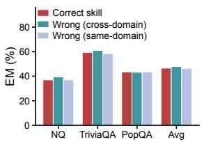

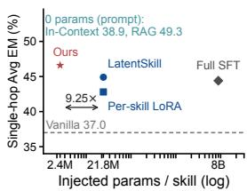  
Figure 1: Compiled skill shifts are domain-general and cheap. A wrong skill document matches the correct one, and the activation-space shift sits at the small-parameter end of the accuracy frontier.

These methods share an assumption that has not been tested. The artifact is taken to carry the content of the skill, which is why the standard recipe keeps one artifact per skill and routes each query to the matching one. We ask a more basic question. When a hypernetwork compiles a skill into parameters, what does the injection actually carry?

Three controls answer the question for a retrieval agent. Replacing the skill document with a wrong one leaves accuracy unchanged (Figure 1, left). Averaging several compiled artifacts into a single bundle matches per-skill routing under a two-sided equivalence test. Removing the trained component and substituting a random direction of the same norm drops the model back to its no-injection accuracy. The first two results point to a domain-general behavioural prior as the carrier. The third shows that the trained direction still matters, so the prior has to be reached from the training distribution. A skill document then acts as a key that triggers the prior, and the teeth of the key matter less than the distribution it is drawn from.

We build SKILL2STEER on this finding. A onepass hypernetwork reads the skill document once, through a frozen encoder, and emits low-rank factors for every decoder block. The factors are added to the residual stream at the block output, which keeps the base weights untouched and matches an injection site that inference engines already expose for steering (Adila et al., 2026; Li et al., 2026a). Each skill costs 2.36M parameters, 9.25 times fewer than a weight-space adapter, and the generator runs only at compile time, so it never enters the deployment budget.

On SearchQA, a seven-dataset retrieval benchmark with 3125 questions, SKILL2STEER reaches 37.9 exact match. That is 9.8 points above the frozen model and 2.3 points above a weight-space method that ships 9.25 times more parameters per skill. The gain is a behavioural one. The shift collapses a long, degenerate completion into a short search-then-answer action, and on multi-hop questions it can be removed after the first retrieval step to recover further points. Because the carrier is domain-general, the same shift can be deployed as a single bundle with no routing.

Our contributions are as follows.

• SKILL2STEER. A one-pass hypernetwork that maps a natural-language skill to low-rank activation shifts at the output of every decoder block. The artifact holds 2.36M parameters per skill, 9.25 times fewer than weight-space compilation, and leaves the base weights frozen.

• A behaviour-prior account of skill injection. Evidence that the compiled shift carries a domain-general behavioural prior. Wrong skill documents and a single universal bundle are equivalent to the correct per-skill artifact, while a same-norm random direction is not.

• Schedulability and routing-free deployment. A criterion that predicts when the shift should be withdrawn during a trajectory, together with a recipe in which one bundle covers every skill at no measurable cost.

## 2 Related Work

Skill injection for language agents. A skill document tells an agent how to act. One family of methods keeps the document in context, either as a retrieved passage or as an in-context instruction, which leaves the base model untouched but pays a per-query context cost (Li et al., 2026b). A second family distils the skill into parameters. SHINE (Liu et al., 2026) and Text-to-LoRA (Charakorn et al., 2025) generate LoRA weights from a context in a single pass, Doc-to-LoRA (Charakorn et al., 2026) extends this to long documents, and LatentSkill (Yu et al., 2026) maps a textual skill to in-weight latent skills. Skill-to-LoRA (Zhang and Qi, 2026), Parametric Skills (Zhao et al., 2026), and Skill0 (Lu et al., 2026) pursue the same goal from the behaviour side. A third family edits internal representations at inference, through steering vectors (Turner et al., 2023; Rimsky et al., 2024), representation finetuning (Wu et al., 2024), or hypernetwork-generated steering at scale (Sun et al., 2025; Sharma and Trivedi, 2026). SKILL2STEER sits in the third family. It conditions on a skill document, injects at every block output, and, unlike prior work, reports what the injected quantity carries.

Hypernetworks for adaptation. Hypernetworks generate the parameters of a target network from a conditioning input (Ye and Ren, 2021; Shenaj et al., 2025). Recent instantiations map a task description or a context to adapter weights (Charakorn et al., 2025; Liu et al., 2026; Tan et al., 2026) or to a steering vector (Sun et al., 2025). Our generator follows this recipe but emits a low-rank factor pair for each of the L decoder blocks, and it is trained once across a corpus of agent skills and is not retrained per task.

Activation-space intervention. Adding a vector or a low-rank term to the residual stream is an established way to control a frozen model (Turner et al., 2023; Zou et al., 2023; Li et al., 2023). Contrastive activation addition (Rimsky et al., 2024) and function vectors (Todd et al., 2024) locate such directions from data, and ReFT (Wu et al., 2024) learns low-rank edits inside a block. A recent analysis shows that a weight update can be rewritten as an activation shift and that a post-block site gives a stable intervention point (Adila et al., 2026; Li and Chen, 2026). We take that site and let a hypernetwork choose the shift from a skill document.

## 3 SKILL2STEER

The method has three parts. A frozen skill encoder compresses the document into a fixed-length summary. A trainable hypernetwork turns that summary into per-layer low-rank factors. A parameterfree module adds the resulting offset at each block output. Figure 2 shows the pipeline.

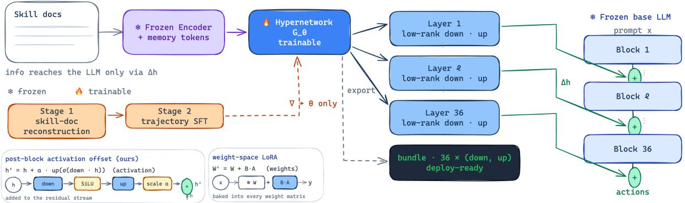  
Figure 2: SKILL2STEER. A frozen encoder reads the skill document once, a hypernetwork emits one low-rank factor pair per decoder block, and the offset is added at each block output. The exported bundle mounts on the inference engine with no change to the base weights.

## 3.1 Problem setup

Let $M _ { \varphi }$ be a frozen decoder-only transformer with L layers and hidden width H, instantiated here as Qwen3-8B with $L = 3 6$ and $H = 4 0 9 6$ (Yang et al., 2025). The parameters $\varphi$ are not updated at any point. Write Blockl for the l-th decoder block and $\it { h ^ { ( l ) } }$ for its output, the post-block residual stream. Given a skill document s, we train a compiler $\mathcal { G } _ { \theta }$ so that $M _ { \varphi }$ , with $\varphi$ fixed, behaves as if it had already acquired s. The skill text reaches the model only through the quantity Gθ(s), and never enters the prompt at inference time.

## 3.2 Skill encoder

The skill document is tokenised by the frozen tokenizer. To reduce the whole document to a fixedlength summary, we append $N = 2 r = 1 6$ learnable memory tokens and run one forward pass through the frozen base model under no\_grad. The last N hidden states of every layer form the memory states $M \in \mathbb { R } ^ { L \times N \times H }$ , where $M _ { l } \in \mathbb { R } ^ { N \times H }$ is the summary of s at layer l. The rank r defaults to 8, and the factor 2r lets the summary be split into a down and an up part later.

## 3.3 Hypernetwork generator

The generator $\mathcal { G } _ { \theta }$ is a four-layer transformer encoder with width 4096, 32 heads, and an 8192-wide feed-forward network. It mixes the $L \times N$ memory tokens across layers and across positions, and returns one low-rank factor pair per layer,

$$
\begin{array} { r l } & { \{ ( \mathbf { W } _ { l } ^ { \mathrm { d o w n } } , \mathbf { W } _ { l } ^ { \mathrm { u p } } ) \} _ { l = 1 } ^ { L } = \mathrm { s p l i t } \big ( \mathcal { G } _ { \theta } ( M ) \big ) , } \\ & { \quad \quad \quad \mathbf { W } _ { l } ^ { \mathrm { d o w n } } \in \mathbb { R } ^ { r \times H } , \quad \mathbf { W } _ { l } ^ { \mathrm { u p } } \in \mathbb { R } ^ { H \times r } . } \end{array}\tag{1}
$$

Each layer contributes 2rH = 65536 scalars, so a skill is represented by $L { \times } 2 { \times } r { \times } H = 2 , 3 5 9 , 2 9 6 \approx$

2.36M scalars. The generator itself holds about 537.3M parameters, but it runs once per skill at compile time and is not part of the deployed artifact.

## 3.4 Post-block injection

At the output of layer l the offset is added to every token position,

$$
\begin{array} { r } { \Delta { h _ { l } } = \alpha { \bf W } _ { l } ^ { \mathrm { u p } } \sigma \big ( { \bf W } _ { l } ^ { \mathrm { d o w n } } h ^ { ( l ) } \big ) , ~ \tilde { h } ^ { ( l ) } = h ^ { ( l ) } + \Delta h _ { l } , } \end{array}\tag{2}
$$

where $\sigma$ is the SiLU nonlinearity and α is an injection strength set to $1 0 ^ { - 2 }$ during training. The initial relative perturbation $\| \Delta h \| / \| h \|$ stays between 0.9% and 5.7%. The offset $\tilde { h } ^ { ( l ) }$ feeds the next block. This form matches a standard post-block low-rank adapter, so a trained product can be exported to an engine that already supports low-rank steering.

## 3.5 Two-stage training

Only θ is updated, which includes the memory tokens and the generator, while the base model stays frozen. Stage one performs skill-document pretraining on roughly 170K agent skill documents. Each document is used under two self-supervised objectives, a reconstruction objective whose evidence is the full document and a completion objective whose evidence is a random prefix. Both targets are the complete skill text, and the skill text enters only the encoder, so the information has to travel through the generated offset. Stage two adds trajectory supervision on about 8500 pairs of a skill document and an expert action trace. The loss is the cross-entropy on expert action tokens. Stage two starts from the stage-one checkpoint and uses 2400 micro-steps on a single A800, which is about one ninth of the reference training compute.

## 3.6 Export and inference

The trained strength α is folded into Wup at export time, and the bundle manifest records a unit strength with an explicit scale scalar that can be varied at inference. The per-layer factors are mounted through the native steering interface of the engine, and neither the base model nor the engine is modified. One bundle corresponds to one skill. Because the carrier turns out to be domaingeneral, the bundle can also be averaged across skills and shipped as a single artifact, which we test in Section 5.3.

## 4 Experimental Setup

Task. We evaluate on SearchQA, an interactive retrieval question-answering task. Given a question, an agent interacts with a retriever for at most K = 4 steps and chooses at each step between issuing a search query and giving a final answer. The retriever is E5 (Wang et al., 2024) over the wiki-18 corpus of about 21M passages, and each step returns the top three passages. The metric is exact match (EM) after answer normalisation. Decoding is greedy with a limit of 2048 new tokens and reasoning traces disabled.

Data. The evaluation set holds 3125 questions over seven datasets. The single-hop group has 1500 questions from Natural Questions (Kwiatkowski et al., 2019), TriviaQA (Joshi et al., 2017), and PopQA (Mallen et al., 2023), each with 500 questions and routed to a direct retrieval skill. The multi-hop group has 1625 questions from HotpotQA (Yang et al., 2018), 2WikiMultihopQA (Ho et al., 2020), and MuSiQue (Trivedi et al., 2022), each with 500 questions and routed to a multi-hop or comparison skill, plus 125 questions from Bamboogle (Press et al., 2023). Datasets that appear in the agent fine-tuning corpus are marked in-domain, and the remaining ones are unseen during training.

Comparisons. We report the frozen base model, four prompting and retrieval baselines, and seven skill-compilation methods drawn from prior work, including the weight-space methods SHINE (Liu et al., 2026), Text-to-LoRA (Charakorn et al., 2025), and LatentSkill (Yu et al., 2026). All skillcompilation methods share the same evaluation pipeline.

## 5 Results

## 5.1 Main results

Table 1 reports single-hop accuracy. SKILL2STEER reaches 46.6 average EM, which is 9.6 points above the frozen model and 1.7 points above the weight-space method LatentSkill, while shipping 9.25 times fewer parameters per skill. Every dataset improves, with the largest absolute gains on Natural Questions and PopQA. Among methods that compile a skill into a distributable artifact, SKILL2STEER is best on all four columns. Only retrieval-augmented generation scores higher, and it does so by re-reading retrieved context at every step, so it ships no artifact at all.

Table 2 reports multi-hop accuracy for the scheduled policy, and Table 6 reports the static and generation-only policies beside it. Holding the shift through the whole trajectory is weak, because it keeps the model in the short-answer mode that long chains of reasoning need to leave. Withdrawing the shift after the first retrieval step, which we call sched1, raises the sample-weighted multihop score to 30.0, above every reported baseline row and 8.5 points above the frozen model. The improvement is broad, with 2WikiMultihopQA, MuSiQue, and Bamboogle all moving up. The same schedule applied to single-hop questions is neutral to slightly negative, a contrast we return to in Section 5.4.

Table 3 gives the total over all seven datasets. SKILL2STEER reaches 37.9 EM, 9.8 points above the frozen model and 2.3 points above LatentSkill. The best configuration drops per-skill routing and reaches 38.3 with one bundle.

Two patterns hold across method families. The first is that accuracy does not track parameter count. Full SFT and Shared LoRA touch far more parameters than a per-skill adapter, yet both sit below SKILL2STEER on the single-hop average, and the per-skill adapter sits below its own shared variant. The second is that a family tends to have a weak side. Prompting and retrieval methods do well on multi-hop questions, where the retrieved context supplies the intermediate facts, and poorly on single-hop questions, where a long prompt encourages the verbose completion that the task does not need. Fine-tuning methods show the opposite profile, strong on single-hop questions and weak on the long chains. SKILL2STEER is competitive on both, which is what the behaviour account in Section 5.2 predicts, since the gain is a change of action and not a change of knowledge.

## 5.2 The shift shapes behaviour

The gain is not extra knowledge. It is a change of action. Table 4 and Figure 3 show what the compiled shift does to a single-hop trajectory. Without injection the model writes an average of 2238 characters per step and produces an invalid action in 3.33% of steps. With the shift the average falls to 45 characters and invalid actions to 0.03%. The first action flips from answer-first in 30.5% of questions to search-first in 99.9%. The model stops deliberating in prose and starts retrieving, then answering in a few words. That switch is the direct source of the single-hop gain.

The same view explains why the multi-hop schedule works. Under a static shift the model stays short at every step, which suppresses the reasoning that a multi-hop question needs. Under sched1 the first step still triggers retrieval in about 54 characters, and later steps return to long reasoning of 2400 to 2700 characters. The schedule separates the retrieval trigger from the reasoning that follows.

## 5.3 What the shift injects

We now test what the compiled shift carries. Table 5 gathers three controls, and Figure 4 shows the direction control.

A wrong skill is as good as the right one. Replacing the skill document with one from another task domain leaves single-hop accuracy unchanged, at 47.9 against 46.6 for the correct skill. A wrong skill from the same domain gives 46.3. If the artifact carried per-skill content, a wrong document should hurt. It does not.

One bundle replaces all skills. Averaging the per-layer factors of several skills into a single bundle, and deploying that bundle with no routing, reaches 47.1 on single-hop and 30.2 on multi-hop, at or above per-skill routing. A two-sided equivalence test on paired question ids cannot reject equivalence within two points for either pool. The practical reading is that one 2.36M bundle covers the whole benchmark.

A random direction does not. The two results above could suggest that any shift works. It does not. When we remove the trained component and add a random offset of the same norm, accuracy falls to the no-injection level, from 46.5 to 37.3 and 40.2 across two seeds, while the no-injection control sits at 40.5. Adding random noise on top of the trained direction, by contrast, costs almost nothing. The direction is load-bearing, and it has to come from training.

Weight-space methods behave the same way. A universal LoRA adapter, obtained by averaging perskill adapters, matches per-skill LoRA on singlehop questions, and a LoRA built from a wrong skill is again unchanged. The equivalence between a universal artifact and a per-skill artifact therefore belongs to the task and the behavioural prior, not to the activation-space parameterisation.

Taken together, the four observations describe the carrier as a domain-general behavioural prior. Any in-distribution skill document reaches it, which is why routing can be dropped. The document still has a role. It selects which mode is triggered, and that role becomes visible when a family needs more than one mode, as the next subsection shows.

## 5.4 Schedulability and routing-free deployment

The behaviour view gives a criterion for when the shift should be withdrawn. If a task’s gain can be split into a short trigger and a longer process, then removing the shift after the trigger frees the process. Multi-hop questions have this shape, and sched1 adds 4.2 points over the static shift, significant under a paired test. Single-hop questions do not, because most of them close within two steps, and removing the shift there costs 0.8 points. The criterion predicts both signs.

Deployment follows from the same finding. Since one bundle is equivalent to per-skill routing, a server can ship a single 2.36M artifact and skip the router entirely. This cuts the stored parameters from nine bundles to one and removes a per-query routing decision, with no loss in accuracy and a small gain on the aggregate.

The recipe has three consequences for a serving stack. Storage scales with the number of task families and not the number of skills, so adding a skill to a family costs nothing at deployment. Routing disappears, which removes both the label lookup and its failure mode, since a mislabelled query can no longer reach the wrong artifact. The bundle also loads in one step, so a warm server holds a single low-rank adapter per family in place of a directory of per-skill files. The cost is a small loss of control, because one bundle cannot be tuned to a single task family. For the families we test, that control is not worth keeping, and the aggregate result in Table 3 shows the trade favours the single bundle.

Table 1: Single-hop retrieval QA, grouped by method family. Bold marks the best value in a column and underline the second best; ties share a mark. A shaded row marks the best method in each family. In the parameter column, bold marks the smallest shipped artifact, and prompt-based methods ship none. ∆Avg is the change in Avg with respect to Vanilla, and “Extra input” marks whether a method needs more than the question at inference.
<table><tr><td rowspan="2">Method</td><td colspan="3">Exact match per dataset (%)</td><td colspan="3">Summary</td><td rowspan="2">Extra input</td></tr><tr><td>NQ</td><td>TriviaQA</td><td>PopQA</td><td>Avg↑</td><td>∆Avg</td><td>Params / skill</td></tr><tr><td colspan="8">Prompting, retrieval</td></tr><tr><td>Vanilla (base)</td><td>25.2</td><td>50.6</td><td>35.2</td><td>37.0</td><td>ref.</td><td></td><td>x</td></tr><tr><td>CoT</td><td>19.2</td><td>50.8</td><td>20.0</td><td>30.0</td><td>-7.0</td><td></td><td>S</td></tr><tr><td>Few-Shot</td><td>34.6</td><td>57.6</td><td>39.4</td><td>43.9</td><td>+6.9</td><td></td><td>√</td></tr><tr><td>R1-Instruct</td><td>27.0</td><td>55.0</td><td>31.6</td><td>37.9</td><td>+0.9</td><td></td><td>√</td></tr><tr><td>RAG</td><td>39.0</td><td>64.0</td><td>45.0</td><td>49.3</td><td>+12.3</td><td></td><td>√</td></tr><tr><td>In-Context Skill</td><td>27.2</td><td>56.4</td><td>33.0</td><td>38.9</td><td>+1.9</td><td>0 (in prompt)</td><td>√</td></tr><tr><td colspan="8">Fine-tuning</td></tr><tr><td>Full SFT</td><td>35.4</td><td>58.0</td><td>39.8</td><td>44.4</td><td>+7.4</td><td>all params</td><td>x</td></tr><tr><td>Shared LoRA</td><td>35.4</td><td>55.0</td><td>40.6</td><td>43.7</td><td>+6.7</td><td></td><td>x</td></tr><tr><td>Per-skill LoRA</td><td>32.8</td><td>56.6</td><td>39.0</td><td>42.8</td><td>+5.8</td><td>~21.8M</td><td>x</td></tr><tr><td colspan="8">Hypernetwork</td></tr><tr><td>SHINE</td><td>34.6</td><td>57.4</td><td>35.6</td><td>42.5</td><td>+5.5</td><td></td><td>x</td></tr><tr><td>Text-to-LoRA</td><td>32.8</td><td>43.2</td><td>25.2</td><td>33.7</td><td>-3.3</td><td></td><td>x</td></tr><tr><td>LatentSkill</td><td>36.2</td><td>57.6</td><td>41.0</td><td>44.9</td><td>+7.9</td><td>~21.8M</td><td>x</td></tr><tr><td>SKILL2STEER</td><td>37.0</td><td>59.4</td><td>43.4</td><td>46.6</td><td>+9.6</td><td>2.36M</td><td>x</td></tr></table>

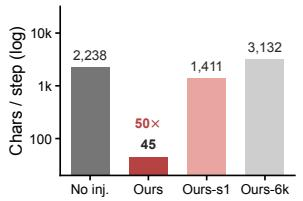

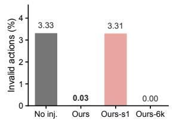

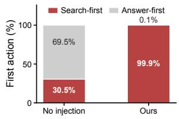

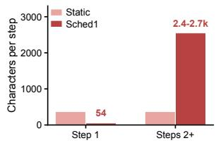  
Figure 3: What the compiled shift does. It shortens each step, removes invalid actions, flips the first action to search, and, under the schedule, keeps long reasoning after the first step.

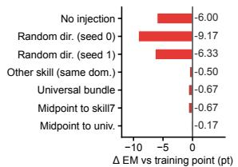

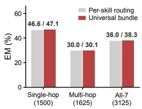  
Figure 4: Direction controls and the universal bundle. Replacing the trained component with a same-norm random offset falls back to the no-injection level, while one averaged bundle matches per-skill routing.

## 5.5 Ablations and robustness

Strength is a threshold. Scaling the shift below its trained value does not weaken the behaviour gradually. At 0.25 and 0.5 the model still writes long completions and accuracy stays near the noinjection level. Only the trained strength of 1.0 triggers the short search-then-answer mode, and 1.5 breaks the model entirely. The shift encodes a discrete mode that is switched on, not a dial.

One ninth of the compute is enough. Stage two is best at 2400 micro-steps. Training longer raises per-step length and gives the single-hop gain back, which matches the behaviour account, since more training drifts the model toward its original verbose form. The reported numbers therefore come from about one ninth of the reference compute.

Injection phase is tied to the protocol. Because SearchQA drives actions from the prompt context with reasoning disabled, the shift has to cover the prompt forward pass as well as generation. Applying it only during generation leaves the prompt unshaped and collapses accuracy. The phase is a property of the evaluation protocol, not a free

Table 2: Multi-hop retrieval QA, grouped by method family. Bold marks the best value in a column and underline the second best; ties share a mark. A shaded row marks the best method in each family. In the parameter column, bold marks the smallest shipped artifact. The static and generation-only injection policies are reported in Table 6. ∆Avg is the change in Avg with respect to Vanilla, ‡ marks sample-weighted averages, and “Extra input” marks whether a method needs more than the question at inference.
<table><tr><td></td><td colspan="4">Exact match per dataset (%)</td><td colspan="3">Summary</td><td></td></tr><tr><td>Method</td><td>HotpotQA</td><td>2Wiki</td><td>MuSiQue</td><td>Bamboogle</td><td>Avg↑</td><td>∆Avg</td><td>Params / skill</td><td>Extra input</td></tr><tr><td colspan="9">Prompting, retrieval</td></tr><tr><td>Vanilla (base)</td><td>26.2</td><td>26.8</td><td>4.2</td><td>28.8</td><td>21.5</td><td>ref.</td><td></td><td>x</td></tr><tr><td>CoT</td><td>22.4</td><td>26.2</td><td>5.0</td><td>37.6</td><td>22.8</td><td>+1.3</td><td></td><td>V</td></tr><tr><td>Few-Shot</td><td>30.0</td><td>25.8</td><td>6.0</td><td>17.6</td><td>19.9</td><td>-1.6</td><td></td><td>√</td></tr><tr><td>R1-Instruct</td><td>26.6</td><td>33.6</td><td>5.8</td><td>34.4</td><td>25.1</td><td>+3.6</td><td></td><td>√</td></tr><tr><td>RAG</td><td>32.4</td><td>21.2</td><td>6.8</td><td>27.2</td><td>21.9</td><td>+0.4</td><td></td><td>S</td></tr><tr><td>In-Context Skill</td><td>30.2</td><td>39.8</td><td>7.6</td><td>38.4</td><td>29.0</td><td>+7.5</td><td>0 (in prompt)</td><td>√</td></tr><tr><td colspan="9">Fine-tuning</td></tr><tr><td>Full SFT</td><td>38.4</td><td>25.8</td><td>10.2</td><td>24.8</td><td>24.8</td><td>+3.3</td><td>all params</td><td>X</td></tr><tr><td>Shared LoRA</td><td>38.0</td><td>27.2</td><td>9.2</td><td>22.4</td><td>24.2</td><td>+2.7</td><td></td><td>x</td></tr><tr><td>Per-skill LoRA</td><td>37.6</td><td>24.0</td><td>10.4</td><td>16.8</td><td>22.2</td><td>+0.7</td><td>~21.8M</td><td>x</td></tr><tr><td colspan="9">Hypernetwork</td></tr><tr><td>SHINE</td><td>36.2</td><td>29.4</td><td>12.4</td><td>30.4</td><td>27.1</td><td>+5.6</td><td></td><td>x</td></tr><tr><td>Text-to-LoRA</td><td>30.2</td><td>30.4</td><td>8.0</td><td>12.8</td><td>20.4</td><td>-1.1</td><td></td><td>x</td></tr><tr><td>LatentSkill</td><td>39.6</td><td>32.0</td><td>9.8</td><td>25.6</td><td>26.8</td><td>+5.3</td><td>~21.8M</td><td>x</td></tr><tr><td>SKILL2STEER</td><td>38.4</td><td>38.6</td><td>10.8</td><td>38.4</td><td>30.0$</td><td>+8.5</td><td>2.36 M</td><td>x</td></tr></table>

Table 3: All seven datasets, sample weighted. Every variant ships one small bundle, and the best one needs no routing.
<table><tr><td>Method</td><td>1-hop</td><td>Multi</td><td></td><td>All-7 Params</td></tr><tr><td>Vanilla (base) LatentSkill</td><td>37.0 44.9</td><td>21.5 27.0</td><td>28.1 35.6</td><td>21.8M</td></tr><tr><td>Ours (static / static)</td><td>46.6</td><td>25.7</td><td>35.7</td><td>2.36 M</td></tr><tr><td>Ours (static / sched1)</td><td>46.6</td><td>30.0</td><td>37.9</td><td>2.36M</td></tr><tr><td>Ours (6000 steps)</td><td>43.7</td><td>30.0</td><td>36.6</td><td>2.36 M</td></tr><tr><td>Ours (universai)</td><td>47.1</td><td>30.2</td><td>38.3</td><td>2.36M</td></tr></table>

## hyperparameter.

The artifact has a wide usable neighbourhood. Perturbing the injected content along random directions by up to 300% leaves accuracy within about one point of the trained value, whereas a weight-space adapter collapses once the perturbation passes about a third of its norm. The usable radius is roughly an order of magnitude wider. The plateau is wide in direction and narrow in magnitude, which is the signature of a mode, not a strength.

## 6 Discussion

The controls point to a single account. A hypernetwork trained across many agent skills learns a domain-general behavioural prior, and a skill document is a key that unlocks it. The teeth of the key matter less than the distribution it comes from, since any in-distribution document reaches the same prior while a random direction does not. What the model gains is a way of acting, such as retrieving before answering, and not a store of facts about the task.

Table 4: Behaviour of the compiled shift. The noinjection rows come from the same pipeline as the reported runs.
<table><tr><td>Setting</td><td>EM</td><td>Steps Inv.%</td><td></td><td>Chars</td></tr><tr><td>Single-hop (1500)</td><td></td><td></td><td></td><td></td></tr><tr><td>No injection</td><td>38.5</td><td>1.38</td><td>3.33</td><td>2238</td></tr><tr><td>SKILL2STEER</td><td>46.6</td><td>2.15</td><td>0.03</td><td>45</td></tr><tr><td>SKILL2STEER (sched1)</td><td>45.8</td><td>2.16</td><td>3.31</td><td>1411</td></tr><tr><td>Multi-hop (1625)</td><td></td><td></td><td></td><td></td></tr><tr><td>No injection</td><td>25.2</td><td>1.65</td><td>5.77</td><td>3287</td></tr><tr><td>SKILL2STEER (sched1)</td><td>30.0</td><td>2.59</td><td>6.00</td><td>2515</td></tr><tr><td>SKILL2STEER (static)</td><td>25.7</td><td>3.02</td><td></td><td>373</td></tr></table>

The domain-generality of the prior has a simple source. The generator is trained across many skill documents, and the signal that shapes it is an action trace and not a document. A document that never appears in the trace is still a valid conditioning input, so the generator learns to map a broad range of in-distribution documents to the same action mode. The document acts as a switch, and the switch is coarse by construction. This reading fits the two controls that pull in opposite directions.

Table 5: What the shift carries. A wrong skill and a universal bundle match per-skill routing, a random direction does not, and weight-space adapters follow the same pattern.  
(a) Skill routing (single-hop)
<table><tr><td>injected content</td><td>NQ Triv.</td><td>PopQA</td><td>Avg</td></tr><tr><td>Correct skill</td><td>37.0 59.4</td><td>43.4</td><td>46.6</td></tr><tr><td>Wrong (cross-dom.)</td><td>39.4 61.0</td><td>43.2</td><td>47.9</td></tr><tr><td>Wrong (same-dom.)</td><td>37.0 58.4</td><td>43.4</td><td>46.3</td></tr></table>

(b) Universal bundle (no routing)
<table><tr><td>configuration</td><td>Single</td><td>Multi</td><td>All-7</td></tr><tr><td>Per-skill routing</td><td>46.60</td><td>29.97</td><td>37.95</td></tr><tr><td>Universal (9 skills)</td><td>47.13</td><td>30.15</td><td>38.30</td></tr><tr><td>Universal (3 skills)</td><td>46.33</td><td>30.58</td><td>38.14</td></tr></table>

(c) Paired equivalence tests (two-sided exact McNemar; TOST ±2 pt)
<table><tr><td>contrast</td><td>pool</td><td> $n$ </td><td>∆ EM (pt)</td><td> $p$ </td><td>equivalent</td></tr><tr><td>Universal (9) vs per-skill routing</td><td>single-hop</td><td>1500</td><td> $+ 0 . 5 3$ </td><td>0.4752</td><td>yes</td></tr><tr><td>Universal (9) vs universal (3)</td><td>single-hop</td><td>1500</td><td> $+ 0 . 8 0$ </td><td>0.2513</td><td>yes</td></tr><tr><td>Universal (9)+sched1 vs routing+sched1</td><td>multi-hop</td><td>1625</td><td> $+ 0 . 1 8$ </td><td>0.8732</td><td>yes</td></tr><tr><td>Universal (9)+sched1 vs universal (9)+static multi-hop</td><td></td><td>1625</td><td> $+ 6 . 5 8$ </td><td> $< 1 0 ^ { - 4 }$ </td><td>no</td></tr></table>

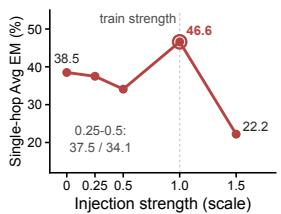

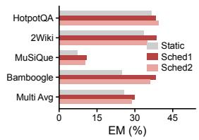  
Figure 5: Strength acts as a threshold, not a dial, and the per-step schedule improves multi-hop accuracy while the single-hop control stays flat.

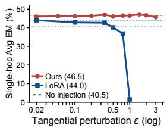

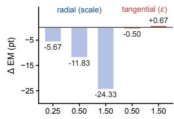  
Figure 6: The compiled shift keeps its accuracy under large random perturbations, while a weight-space adapter collapses. The plateau is wide in direction and narrow in magnitude.

The trained direction is load-bearing, while the specific document is not, so a random direction fails even when a wrong document succeeds.

This account reframes several choices that look like design details. Routing becomes optional, because one artifact reaches the prior. Per-skill storage becomes unnecessary, because averaging preserves the prior. The schedule becomes a tool for releasing the prior once it has done its work. It also explains why the shift is a threshold, not a dial. A mode is on or off, so an intermediate strength either fails to switch or overdrives the model.

The same account applies to weight-space compilation. A universal LoRA adapter matches perskill adapters, and a wrong-skill adapter is unchanged, so the equivalence is a property of the task and the prior, and not of the activation space. The advantage of the activation space is then one of cost. A low-rank post-block offset is 9.25 times smaller per skill, and its usable neighbourhood is about an order of magnitude wider, which makes it a lighter and more robust carrier for the same prior.

## 7 Conclusion

We asked what a compiled skill injection carries. On a retrieval agent, three controls show that the carrier is a domain-general behavioural prior, not the content of the skill. We built SKILL2STEER on this finding, a one-pass hypernetwork that maps a skill document to low-rank activation shifts at every block output. The artifact is 9.25 times smaller than a weight-space adapter, beats it on a sevendataset retrieval benchmark, can be withdrawn midtrajectory to release long reasoning, and can be shipped as a single routing-free bundle.

## Limitations

Our evidence comes from a single task family, retrieval question answering, and a single base model. The behavioural prior we identify is the retrievethen-answer policy that this family rewards. Tasks whose skills differ in factual content and not in policy may lean more on the document, and we do not claim that the prior dominates there. We also evaluate one base model, so the prior is measured relative to that model and its training distribution. Finally, our training corpus of agent skills is fixed, and we do not study how the prior changes when the corpus shifts.

## References

Dyah Adila, John Cooper, Alexander Yun, Avi Trost, and Frederic Sala. 2026. Weight updates as activation shifts: A principled framework for steering. arXiv preprint arXiv:2603.00425.

Rujikorn Charakorn, Edoardo Cetin, Yujin Tang, and Robert Tjarko Lange. 2025. Text-to-lora: Instant transformer adaption. arXiv preprint arXiv:2506.06105.

Rujikorn Charakorn, Edoardo Cetin, Shinnosuke Uesaka, and Robert Tjarko Lange. 2026. Doc-to-lora: Learning to instantly internalize contexts. arXiv preprint arXiv:2602.15902.

Xanh Ho, Anh-Khoa Duong Nguyen, Saku Sugawara, and Akiko Aizawa. 2020. Constructing a multi-hop qa dataset for comprehensive evaluation of reasoning steps. In Proceedings ofthe 28th International Conference on Computational Linguistics, pages 6609– 6625.

Mandar Joshi, Eunsol Choi, Daniel S Weld, and Luke Zettlemoyer. 2017. Triviaqa: A large scale distantly supervised challenge dataset for reading comprehension. In Proceedings ofthe 55th Annual Meeting of the Associationfor Computational Linguistics (Volume 1: Long Papers), pages 1601–1611.

Tom Kwiatkowski, Jennimaria Palomaki, Olivia Redfield, Michael Collins, Ankur Parikh, Chris Alberti, Danielle Epstein, Illia Polosukhin, Jacob Devlin, Kenton Lee, et al. 2019. Natural questions: a benchmark for question answering research. Transactions ofthe Association for Computational Linguistics, 7:453– 466.

Kenneth Li, Oam Patel, Fernanda Viégas, Hanspeter Pfister, and Martin Wattenberg. 2023. Inferencetime intervention: Eliciting truthful answers from a language model. Advances in neural information processing systems, 36:41451–41530.

Ran Li and Lei Chen. 2026. Learning to decide, not to reason: Parameter-efficient decision operators via low-rank activation steering. Preprint, arXiv:2610.06950.

Ran Li, Shimin Di, Zeyu Ren, Ling Yue, Jiachuan Wang, and Lei Chen. 2026a. Latent harness: Compiling agent behaviors into post-block activation shifts. Preprint, arXiv:2611.01415.

Yanchao Li, Wanhao Liu, Ben Gao, Jiaqing Xie, Zhehong Ai, Na Zou, Yuqiang Li, and Tianfan Fu. 2026b. Skillsinjector: Dynamic skill context construction for llm agents. arXiv preprint arXiv:2605.29794.

Yewei Liu, Xiyuan Wang, Yansheng Mao, Yoav Gelbery, Haggai Maron, and Muhan Zhang. 2026. Shine: A scalable in-context hypernetwork for mapping context to lora in a single pass. arXiv preprint arXiv:2602.06358.

Zhengxi Lu, Zhiyuan Yao, Jinyang Wu, Chengcheng Han, Qi Gu, Xunliang Cai, Weiming Lu, Jun Xiao, Yueting Zhuang, and Yongliang Shen. 2026. Skill0: In-context agentic reinforcement learning for skill internalization. arXiv preprint arXiv:2604.02268.

Alex Mallen, Akari Asai, Victor Zhong, Rajarshi Das, Daniel Khashabi, and Hannaneh Hajishirzi. 2023. When not to trust language models: Investigating effectiveness of parametric and non-parametric memories. In Proceedings ofthe 61st annual meeting of the associationfor computational linguistics (volume 1: Long papers), pages 9802–9822.

Ofir Press, Muru Zhang, Sewon Min, Ludwig Schmidt, Noah A Smith, and Mike Lewis. 2023. Measuring and narrowing the compositionality gap in language models. In Findings ofthe Associationfor Computational Linguistics: EMNLP 2023, pages 5687–5711.

Nina Rimsky, Nick Gabrieli, Julian Schulz, Meg Tong, Evan Hubinger, and Alexander Turner. 2024. Steering llama 2 via contrastive activation addition. In Proceedings of the 62nd Annual Meeting of the Association for Computational Linguistics (Volume 1: Long Papers), pages 15504–15522.

Kartik Sharma and Rakshit Trivedi. 2026. Cold-steer: Steering large language models via in-context onestep learning dynamics. In International Conference on Learning Representations, volume 2026, pages 27736–27756.

Donald Shenaj, Ondrej Bohdal, Mete Ozay, Pietro Zanuttigh, and Umberto Michieli. 2025. Lora. rar: Learning to merge loras via hypernetworks for subject-style conditioned image generation. In 2025 IEEE/CVF International Conference on Computer Vision (ICCV), pages 16132–16142. IEEE.

Jiuding Sun, Sidharth Baskaran, Zhengxuan Wu, Michael Sklar, Christopher Potts, and Atticus Geiger. 2025. Hypersteer: Activation steering at scale with hypernetworks. arXiv preprint arXiv:2506.03292.

Zhaoxuan Tan, Zixuan Zhang, Haoyang Wen, Zheng Li, Rongzhi Zhang, Pei Chen, Fengran Mo, Zheyuan Liu, Qingkai Zeng, Qingyu Yin, et al. 2026. Instant personalized large language model adaptation via hypernetwork. In Proceedings of the 64th Annual Meeting of the Association for Computational Linguistics (Volume 1: Long Papers), pages 23557–23580.

Eric Todd, Millicent Li, Arnab Sen Sharma, Aaron Mueller, Byron Wallace, and David Bau. 2024. Function vectors in large language models. In International conference on learning representations, volume 2024, pages 17282–17333.

Harsh Trivedi, Niranjan Balasubramanian, Tushar Khot, and Ashish Sabharwal. 2022. ♪ musique: Multihop questions via single-hop question composition. Transactions of the Association for Computational Linguistics, 10:539–554.

Alexander Matt Turner, Lisa Thiergart, Gavin Leech, David Udell, Juan J Vazquez, Ulisse Mini, and Monte MacDiarmid. 2023. Steering language models with activation engineering. arXiv preprint arXiv:2308.10248.

Liang Wang, Nan Yang, Xiaolong Huang, Linjun Yang, Rangan Majumder, and Furu Wei. 2024. Multilingual e5 text embeddings: A technical report. arXiv preprint arXiv:2402.05672.

Zhengxuan Wu, Aryaman Arora, Zheng Wang, Atticus Geiger, Dan Jurafsky, Christopher D Manning, and Christopher Potts. 2024. Reft: Representation finetuning for language models. Advances in Neural Information Processing Systems, 37:63908–63962.

An Yang, Anfeng Li, Baosong Yang, Beichen Zhang, Binyuan Hui, Bo Zheng, Bowen Yu, Chang Gao, Chengen Huang, Chenxu Lv, et al. 2025. Qwen3 technical report. arXiv preprint arXiv:2505.09388.

Zhilin Yang, Peng Qi, Saizheng Zhang, Yoshua Bengio, William Cohen, Ruslan Salakhutdinov, and Christopher D Manning. 2018. Hotpotqa: A dataset for diverse, explainable multi-hop question answering. In Proceedings of the 2018 conference on empirical methods in natural language processing, pages 2369–2380.

Qinyuan Ye and Xiang Ren. 2021. Learning to generate task-specific adapters from task description. In Proceedings ofthe 59th Annual Meeting ofthe Associationfor Computational Linguistics and the 11th International Joint Conference on Natural Language Processing (Volume 2: Short Papers), pages 646– 653.

Aofan Yu, Chenyu Zhou, Tianyi Xu, Zihan Guo, Rong Shan, Zhihui Fu, Jun Wang, Weiwen Liu, Yong Yu, Weinan Zhang, et al. 2026. Latentskill: From incontext textual skills to in-weight latent skills for llm agents. arXiv preprint arXiv:2606.06087.

Tianyi Zhang and Zhonghao Qi. 2026. Skill-tolora: From using skills to learning behaviors for token-efficient llm agents. arXiv preprint arXiv:2606.16769.

Xuan Zhao, Haonan He, Qingyu Yang, Minglei Li, Jingqi Ye, Zelin Tan, Bo Wan, and Peng Ye. 2026. Parametric skills. arXiv preprint arXiv:2606.30015.

Andy Zou, Long Phan, Sarah Chen, James Campbell, Phillip Guo, Richard Ren, Alexander Pan, Xuwang Yin, Mantas Mazeika, Ann-Kathrin Dombrowski, et al. 2023. Representation engineering: A topdown approach to ai transparency. arXiv preprint arXiv:2310.01405.

## A Appendix

## A.1 Ablation details

Table 6 collects the four sweeps behind Section 5.2.

Injection strength. The scale sweep has one valid operating point. At scale 0.00 the no-injection control reaches 38.5 average EM and writes 2238 characters per step. Scaling to 0.25 and 0.50 leaves the model in its verbose mode, at 2247 and 2315 characters per step, and accuracy stays at 37.5 and 34.1. A partial strength does not weaken the behaviour, it fails to trigger it. At the trained strength of 1.00 accuracy rises to 46.6 and per-step length collapses to 45 characters. At 1.50 the model overdrives, writing 5790 characters per step and falling to 22.2. The sweep is a threshold, and the trained value is the only point that both switches the mode and keeps it stable.

Stage-two training budget. The best single-hop checkpoint is 2400 micro-steps at 46.60, and a rerun of the same checkpoint gives 46.33, which places the run-to-run spread near 0.3 points. Training further lowers single-hop accuracy to 42.00 at 3200 steps and 40.00 at 4000 steps, while per-step length climbs back to 1309 and 1630 characters. At 6000 steps the bundle recovers to 43.67 and holds multi-hop at 30.03. The pattern matches the behaviour account, since more training drifts the model toward its original verbose form and undoes the short action mode. Every reported result therefore comes from about one ninth of the reference compute.

Injection phase. Covering only the generation phase drops single-hop accuracy from 46.6 to 23.9 and multi-hop accuracy from 25.7 to 14.2, while per-step length rises to 3697 and 5108 characters. SearchQA drives actions from the prompt context with reasoning disabled, so the prompt forward pass has to be shaped as well. The phase is a property of the protocol and not a free hyperparameter.

Per-step schedule. Static injection reaches 25.7 on multi-hop questions. Withdrawing the shift after step 1, which we call sched1, raises the score to 30.0, and holding it for two steps, sched2, gives 28.8. The gain of sched1 is largest on Bamboogle, from 24.8 to 38.4, and on 2WikiMultihopQA, from 33.6 to 38.6. The single-hop control moves the other way, from 46.6 under static injection to 45.8 under sched1, because most single-hop questions close within two steps and there is no long reasoning left to release.

Table 6: Ablations over injection strength, training budget, injection phase, and per-step schedule.  
(a) Injection strength (scale)
<table><tr><td>scale</td><td>NQ</td><td>Triv.</td><td>PopQA</td><td>Avg</td><td>Chars</td></tr><tr><td>0.00 0.25 0.50 1.00 37.0 1.50 16.2</td><td>28.2 26.4 22.4 59.4</td><td>56.4 57.2 52.0</td><td>31.0 29.0 27.8</td><td>38.5 37.5 34.1</td><td>2238 2247 2315</td></tr></table>

(c) Injection phase
<table><tr><td>phase</td><td>Single Multi</td><td></td><td>Chars</td></tr><tr><td>both (full)</td><td>46.6</td><td>25.7</td><td>45/373</td></tr><tr><td>gen-only</td><td>23.9</td><td>14.2</td><td>3697 / 5108</td></tr></table>

## A.2 Robustness of the compiled artifact

Table 7 reports the perturbation study on a shared set of 600 single-hop questions. Every configuration runs on the same question ids and through the same evaluation script as the main results.

Tangential scan. Adding noise along random directions keeps SKILL2STEER within 0.83 points of the training point at every ε up to 3.0, which changes the injected content by up to 207%. Perstep length stays in the short mode across the whole range, from 44 to 409 characters. A weight-space adapter behaves differently. It loses 1.33 points at ε = 0.35, 7.17 points at 0.75, and collapses to 1.50 EM at 1.0. The usable neighbourhood of the activation shift is about an order of magnitude wider than that of the weight-space adapter. This is a property of the artifact and not of the evaluation, since both are measured on the same ids with the same script.

Direction controls. Replacing the trained component with a same-norm random offset drops accuracy to 37.33 and 40.17 across two seeds, at or below the no-injection control at 40.50. Swapping in another skill from the same domain costs 0.50 points, a universal bundle costs 0.67, and two interpolations toward other training points cost 0.67 and 0.17. The trained direction is necessary, while the specific training point is not. The contrast between these two rows is the central evidence for the behaviour-prior account.

Radial against tangential. The plateau around the trained point is wide in direction and narrow in magnitude. Scaling the shift radially to 0.25 and 0.50 costs 5.67 and 11.83 points, and 1.50 costs 24.33 points. Tangential perturbations of comparable size cost under one point. A mode that is switched on has this shape, because the direction decides which mode is entered while the magnitude decides whether the mode is entered at all.

(b) Stage-2 training budget
<table><tr><td>micro-steps</td><td>Single-hop</td><td>Multi-hop</td><td>Chars</td></tr><tr><td>2400</td><td>46.60</td><td>29.97</td><td>45</td></tr><tr><td>2400 (rerun)</td><td>46.33</td><td></td><td>47</td></tr><tr><td>3200</td><td>42.00</td><td></td><td>1309</td></tr><tr><td>4000</td><td>40.00</td><td></td><td>1630</td></tr><tr><td>6000</td><td>43.67</td><td>30.03</td><td>3132</td></tr></table>

(d) Per-step injection schedule
<table><tr><td>schedule</td><td>Hotpot 2Wiki</td><td></td><td>MuSiQ.</td><td>Bamboo</td><td>Multi</td></tr><tr><td>static</td><td>36.6</td><td>33.6</td><td>7.2</td><td>24.8</td><td>25.7</td></tr><tr><td>gen-only</td><td>17.2</td><td>21.2</td><td>2.0</td><td>23.2</td><td>14.2</td></tr><tr><td>sched1</td><td>38.4</td><td>38.6</td><td>10.8</td><td>38.4</td><td>30.0</td></tr><tr><td>sched2</td><td>39.4</td><td>34.8</td><td>10.4</td><td>36.0</td><td>28.8</td></tr></table>

## A.3 Routing, universal bundles, and equivalence

Table 5 reports the routing study behind Section 5.3.

Skill routing. On single-hop questions the correct skill gives 46.6, a cross-domain wrong skill gives 47.9, and a same-domain wrong skill gives 46.3. The spread across the three is smaller than the run-to-run variation reported above, so the document does not carry per-skill content that the model can use.

Universal bundle. Averaging the per-layer factors of nine skills into one bundle reaches 47.13 on single-hop questions and 30.15 on multi-hop questions, at or above per-skill routing at 46.60 and 29.97. A bundle averaged over the three SearchQA skills reaches 46.33 and 30.58. Raising the retrieval budget from top-3 to top-5 leaves the single-hop result at 47.53, while lowering it to top-1 falls to 43.27, so top-3 is close to saturated and the default budget is a reasonable choice.

Equivalence. A two-sided exact McNemar test with a margin of two points finds the universal bundle equivalent to per-skill routing on single-hop questions at a difference of 0.53 points, and on multi-hop questions at a difference of 0.18 points. The same test separates the schedule from the static policy at 6.58 points and from the two-step policy at 4.68 points, and it separates the top-1 retrieval budget from the default at 3.87 points. Equivalence therefore holds where the differences are small, and significance holds where the schedule or the retrieval budget actually changes behaviour.

Table 7: Robustness of the compiled artifact on a shared question set.  
(a) Tangential scan ε
<table><tr><td>ε</td><td>0</td><td>0.02</td><td>0.10</td><td>0.35</td><td>0.50 0.75</td></tr><tr><td>Ours</td><td>46.50</td><td>46.00</td><td>46.17 47.00</td><td>46.00</td><td>46.50</td></tr><tr><td>Weight LoRA</td><td>44.00</td><td>44.00</td><td>42.83 42.67</td><td>40.17</td><td>36.83</td></tr><tr><td>ε</td><td>1.00</td><td>1.50</td><td>2.00 3.00</td><td></td><td></td></tr><tr><td>Ours</td><td>46.50</td><td>47.17</td><td>46.67 45.67</td><td></td><td></td></tr><tr><td>Weight LoRA</td><td>1.50</td><td>一</td><td>一 一</td><td></td><td></td></tr></table>

Table 8: Behaviour statistics for the longer-budget variants.
<table><tr><td>Setting</td><td>EM</td><td>Steps</td><td>Inv.%</td><td>Chars</td></tr><tr><td>Ours (6000 steps)</td><td>43.7</td><td>1.93</td><td>0.00</td><td>3132</td></tr><tr><td>Ours (gen-only, multi)</td><td>14.2</td><td>1.01</td><td>一</td><td>5108</td></tr></table>

## A.4 Behaviour statistics for longer budgets

Table 8 restates the behaviour statistics for the two settings that Section 5.2 does not cover. At 6000 training steps the bundle reaches 43.7 single-hop EM at 1.93 steps per question and 3132 characters per step, close to the no-injection length of 2238, which shows the return to the verbose mode. The generation-only policy on multi-hop questions gives 14.2 EM at 5108 characters per step.

## A.5 Training and export details

For completeness we list the settings that produce the reported bundles. The base model is Qwen3-8B with 36 decoder blocks and a hidden width of 4096. The skill encoder appends 16 memory tokens and runs a single frozen forward pass. The generator is a four-layer transformer encoder with width 4096, 32 heads, and an 8192-wide feed-forward network, and it holds about 537.3M parameters that are used only at compile time. Stage one trains on about 170K skill documents under the reconstruction and completion objectives, and the skill text enters only the encoder. Stage two trains on about 8500 skill and trace pairs for 2400 micro-steps on a single A800, with the injection strength fixed at $1 0 ^ { - 2 }$ and the rank fixed at 8. The loss is the cross-entropy on expert action tokens, and the base model stays frozen throughout. At export the strength is folded into the up factor, so a deployed bundle is a set of 36 low-rank factor pairs, or 2.36M scalars. The bundle mounts through the native steering interface of the inference engine with an explicit scale, and the engine and the base model are never modified.

(b) Direction controls (single-hop)
<table><tr><td>perturbation</td><td>EM</td><td>∆ EM (pt)</td></tr><tr><td>No injection</td><td>40.50</td><td>-6.00</td></tr><tr><td>Random dir. (seed 0)</td><td>37.33</td><td>-9.17</td></tr><tr><td>Random dir. (seed 1)</td><td>40.17</td><td>-6.33</td></tr><tr><td>Other skill (same dom.)</td><td>46.00</td><td>-0.50</td></tr><tr><td>Universal bundle</td><td>45.83</td><td>-0.67</td></tr><tr><td>Midpoint to skill7</td><td>45.83</td><td>-0.67</td></tr><tr><td>Midpoint to universal</td><td>46.33</td><td>-0.17</td></tr></table>

## B LLM usage

Large-language-model tools were used for editing and formatting support during manuscript preparation.