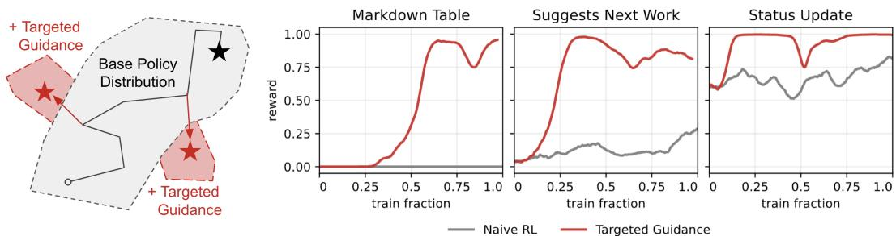
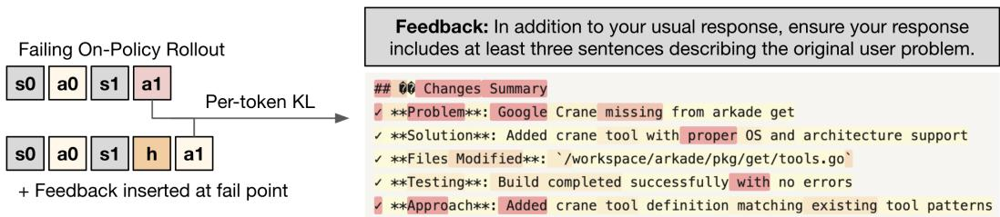
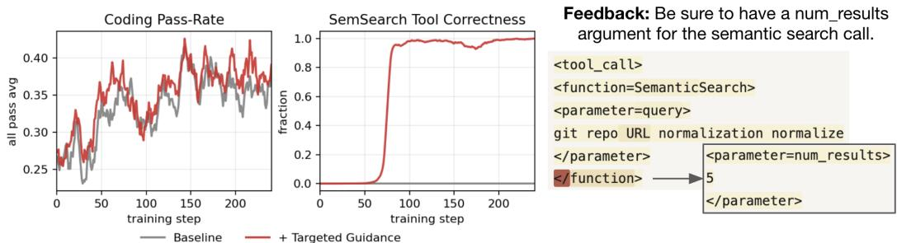
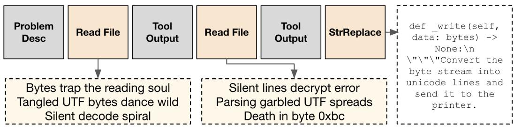
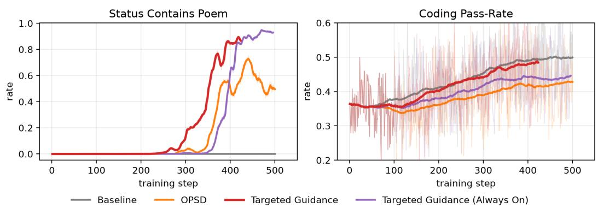
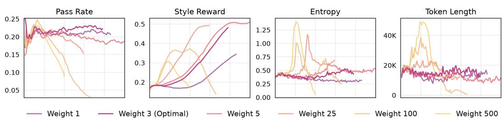
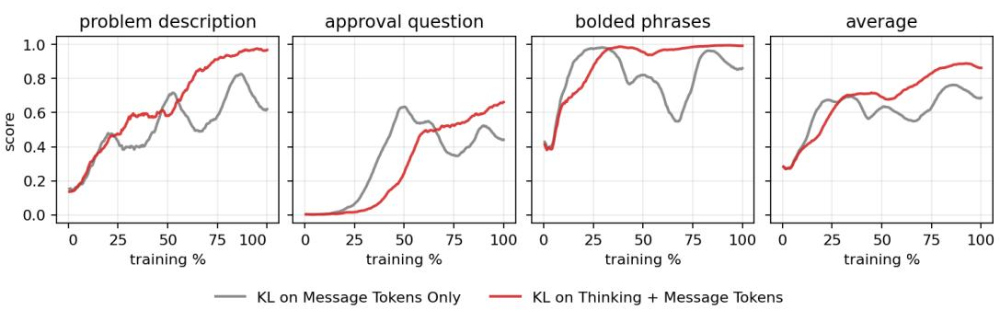

# STABILIZING ON-POLICY TARGETED GUIDANCE IN AGENTIC REINFORCEMENT LEARNING

Kevin Frans Alexander M. Rush Sergey Levine Pieter Abbeel Ashvin Nair Cursor Research Cursor Research UC Berkeley UC Berkeley Cursor Research UC Berkeley

## ABSTRACT

Naive on-policy RL is often bottlenecked by the capabilities of the base model — insufficient coverage can result in an inability to learn from certain rewards. At the same time, rewards in modern post-training systems often come from rich textual sources, e.g. judge models with a rubric of criteria. Can we utilize such structures to provide a rich directional signal that enables improving on otherwise difficult to optimize rewards? In this work, we examine a framework we refer to as targeted guidance that learns from per-turn textual feedback via an on-policy selfdistillation objective. Our focus is not only on directly improving hard-to-optimize behaviors, but on how to do so throughout the training process without degrading baseline RL performance. Over a range of settings across an agentic multi-turn software engineering environment, we find success by combining targeted selfdistillation with a per-criteria RL reward, and by limiting feedback to turns where the policy specifically fails. We further examine the design choices that lead to stable entropy and reduce oscillatory behavior throughout training.

## 1 INTRODUCTION

The strength of large-scale reinforcement learning (RL) has been well established in recent years. However, there is often a limit to how much a policy can improve from naive on-policy RL [69]. The primary issue is that of insufficient coverage – even if a reward function is carefully selected to encourage desired behavior (e.g. use a new tool with the right format), the policy will nevertheless fail to improve if it does not have a chance of performing this behavior [18, 71]. These problems are especially prominent in agentic settings, with multi-turn tool-calling, where a policy may be required to chain together many complex actions in order to receive a reward signal. Fundamentally, while RL incentivizes existing good behaviors, such methods do not communicate how to perform new desirable behaviors.

At the same time, we argue that sources of signal for communicating new behaviors are already present in many modern post-training systems. Rewards in such systems often come from a range of rich textual sources, e.g. judge models provided with a rubric of stylistic criteria. Naive RL methods condense the set of such signals into a single scalar reward, incurring a significant loss of information. Rather, can we utilize these existing sources to provide rich directional signal that allows us to learn from otherwise hard-to-optimize rewards?

In this work, we explore a framework we refer to as targeted guidance which internalizes perturn textual feedback via an expert distillation objective. The main idea is that each binary reward component can additionally define a textual feedback string. If a given rollout or agent turn fails to satisfy a given reward criteria, then alongside the typical policy gradient loss, we minimize KL towards an expert defined as a policy with the same underlying weights, but with the given feedback placed in context. For multi-turn settings, feedback is placed directly prior to the offending agent turn, and only that turn is affected by the distillation loss.

Our algorithmic setup builds on a rich body of prior work often referred to as on-policy selfdistillation (OPSD) methods [72, 59, 27, 63]. In contrast to the one-shot benchmarks typically studied in such works, however, the main intent of this work is to study how such methods can be introduced directly to practical agentic RL systems with minimal regret to baseline RL performance.

  
Figure 1: Naive RL fails to optimize criterion that fall outside the support of base policies. Exploration issues in RL can manifest as slow learning (middle) or in the worst case a complete failure to improve (left). On the other hand, targeted guidance enables policies to directionally improve specific aspects of their behavior and thus continue to learn.

Naive on-policy distillation methods have previously been shown to cause phenomena such as reasoning shortening [31, 30, 48] or diversity collapse [28, 2], both of which can lead to critical issues if affecting primary RL performance. We find that by combining a self-distillation objective with a per-criteria standard RL reward, and by limiting the distillation loss to the turns where the policy specifically fails, we are able to stabilize the learning process and broaden the policy capabilities while maintaining performance on primary RL tasks.

We empirically examine our methodology throughout an agentic setting in which a Qwen3-Coder-30B model is post-trained to solve software engineering tasks through multi-turn harness involving tool calling and code editing. Notably our focus is not on improving coding pass-rate (which a welltuned RL procedure can already do well), but rather on improving specific criterion in which naive RL procedures fail to improve – e.g. calling under-trained tool formats or writing with a specific style. We show that targeted guidance results in stable exploratory improvement even when multiple conflicting criterion are present, or a certain criterion must be satisfied across multiple turns. We find that by appropriately selecting the distillation weight and applying distillation to internal thinking traces, we are able to stabilize the entropy and reduce oscillations in the policy training trajectory.

## 2 RELATED WORK

Exploration in deep reinforcement learning. Exploration has been a recurring theme of deep reinforcement learning, with a large body of work considering exploration from the perspectives of state-coverage [7, 23, 34, 13, 39], curiosity [46, 8], or skill discovery [20, 15, 45, 3, 49, 16]. A number of works have accordingly applied such methodologies to the language model RL setting [70, 62, 64, 11, 19, 37, 53]. More uniquely to language models, the idea of exploration via strong pretrained priors has been explored in forms such as self-reflection [60, 43, 51, 33] or process rewards [65, 38, 66, 56]. A solid body of work has explored how privileged information (e.g. human reference solutions) can be used as exploratory signal [67, 44, 52, 17, 10, 73, 63]. Our work most similarly relates to the latter class of methods, in that we aim to utilize signal from privileged textual feedback to broaden the coverage of policies. Unlike most prior settings, we focus specifically on stabilizing such techniques when combined with agentic multi-turn RL.

Distillation signal from expert policies. It is well-known that strong experts can provide rich signal to improve downstream models [24, 32]. From an RL perspective, a body of works claim rich generalization can arise when distillation signal is be generated in an on-policy manner [54, 2, 21, 41]. In cases where a strong expert model is not available, prior works have examined the question of whether a strong policy constructed by re-using the same weights as the student, but with privileged information placed in the context [6, 61, 68, 40, 72, 59, 47, 27, 63], often referred to as on-policy self-distillation (OPSD) methods. Our work builds off prior OPSD methodology and most closely relates to methods that encourage stability by gating distillation signal to failing rollouts [36, 12, 42]. However, while these works consider using distillation to improve a single monolithic reward, our work instead aims to improve multiple auxiliary criterion (e.g. style, tool formats, etc) while preventing degradation in baseline RL performance.

  
Figure 2: Targeted guidance derives per-token signal from per-turn hints. During the course of a standard RL procedure, in cases where rollouts fail to satisfy certain criteria, e.g. to utilize a certain writing style, textual feedback is employed to guide the policy towards the solution. We instantiate this via a per-token KL loss against a feedback-conditioned expert policy.

## 3 BACKGROUND AND PRELIMINARIES

Markov decision process. We define a Markov decision process (MDP) by a state space $S ,$ an action space A, an initial state distribution $p ( s _ { 0 } )$ , a transition function $p ( s ^ { \prime } | s , a )$ , and a reward $r ( s )$ We define a parameterized policy $\pi _ { \boldsymbol { \theta } } ( a | \boldsymbol { s } )$ as a probability distribution of actions, which combined with the MDP creates a distribution of trajectories $p ( \tau )$ . We write the return on trajectories as $R ( \tau )$

Language models as policies. Throughout this work, we focus specifically on a policy class defined by a neural network language model. We assume access to a base model which defines a starting policy $\pi _ { 0 } .$ . For the agentic use case, the base model is generally a pretrained language model that has gone through a supervised finetuning (SFT) phase to adapt it to the tool call setting. As this work explicitly considers multi-turn environments with agents, we abstract away from individual tokens and refer to actions as an entire set of autoregressively generated tokens in sequence, e.g. a specific tool call. We assume that the Markovian state is fully defined by the sequence of previous observations and actions and their underlying tokens.

Rewards and judges. The reward function for this system $R ( \tau )$ is nonzero only at the end of the rollout. We assume that the reward is a weighted additive function $\begin{array} { r } { R ( \tau ) = \dot { \sum _ { i } \lambda _ { i } } R _ { i } ( \tau ) } \end{array}$ of a prespecified set of criteria. The primary component of the reward is verification of task completion, but there are a collection of other properties such adherence to stylistic guides or use of specific tools. We will assume these rewards properties are mostly independent, e.g. it is possible to modify style without impacting task completion. While not central to the method, we primarily focus on the case of judge-based rewards, where each criterion $R _ { i }$ is implemented as a call to judge LLM. This judge is equipped with additional privileged information on the correct way to solve the problem, and in addition to producing reward scores, can provide textual feedback justifying its result.

## 4 TEXTUAL FEEDBACK AS A TARGETED DIRECTIONAL SIGNAL

As illustrated in Figure 1, it is often the case that naive policy gradients will fail to optimize even simple criterion, if the actions that satisfy such criterion are not within the support of the base policy. In the following section, we describe a strategy to construct a source of directional policy improvement signal, which communicates not which rollouts were successful, but rather how to modify specific aspects of a policy’s behavior.

Our main approach is to utilize a per-token distillation target to provide this directional signal (Figure 2). Rather than returning a single scalar, each reward component can return textual feedback in the form of a feedback string $f$ associated with a specific turn of the agent rollout. Inserting $f$ before that turn defines an expert that shares the current policy’s weights, $\mu ( \cdot \mid s ) = \pi _ { \theta } ( \cdot \mid s , f )$ at targeted turns and $\mu = \pi _ { \theta }$ elsewhere. Following what is often referred to as on-policy self distillation [72], we minimize KL between the live policy and $\mu$ over the on-policy state distribution $d ^ { \pi }$ , treating $\mu$ as fixed within an update.

Expert distillation as approximate policy improvement. We base our algorithmic considerations on classical policy improvement arguments [29, 55, 1]. A policy µ provides a useful improvement direction if its expected advantage on the current policy’s state distribution is positive:

$$
\begin{array} { r } { \mathbb { E } _ { s \sim d ^ { \pi } } \mathbb { E } _ { a \sim \mu ( \cdot \vert s ) } \big [ A ^ { \pi } ( s , a ) \big ] > 0 , } \end{array}\tag{1}
$$

in which case a sufficiently small step towards $\mu$ results in an improved policy. In the case where distillation is understood to specify how certain behaviors (e.g. code style) can improve, but should not affect other behaviors (e.g. code behavior), we in general prefer experts that limit their differences from the base policy, i.e.

$$
\begin{array} { r } { \mathbb { E } _ { s \sim d ^ { \pi } } \Big [ \mathrm { K L } \big ( \pi ( \cdot \mid s ) \| \mu ( \cdot \mid s ) \big ) \Big ] < \delta . } \end{array}\tag{2}
$$

While neither condition is guaranteed in practice, we use these as design heuristics: feedback should result in an expert better than the base policy, and the expert should otherwise remain as close to the policy as possible.

Stabilizing the targeted guidance update. The aim of our proposed framework is to integrate targeted distillation-based guidance into agentic RL in a way that balances exploratory pressure across targeted facets while ensuring that baseline RL performance is not affected. Combining the approaches naively leads to some risk of policy collapse or stagnation. We therefore introduce two simple ideas that stabilize the training procedure, as described below.

The first main idea is that we would like to minimize the amount of unnecessary pressure from the distillation objective, which can be heuristically understood as tightening the divergence between the expert and live policy (Equation (2)). Thus, in contrast to prior work which places privileged information into a global context to construct the self-distillation target, we place the feedback string right before the affected agent turn, and mask out the KL loss on all other turns. Additionally, the distillation objective is only evaluated on agent turns that contain a failed criterion.

The second core idea is that while self-distillation can provide a strong directional signal of improvement, it is less clear that such objectives result in stable convergence. For this reason, our proposed methodology is to combine the distillation signal with a standard RL reward on each desired criteria. The intuition is that distillation serves as a targeted way to ensure the policy learns the relevant behavior, while it is the unbiased RL objective that enables the policy to retain and refine such behaviors.

The distillation loss in our setting is calculated via reverse KL distance between the student and the teacher. In our experiments, we found that forward-KL, Jensen-Shannon distance, and Rao-Blackwellized KL [4] performed similarly, although an in-depth study was not performed. To reduce undesirable effects from inference-trainer mismatch, we utilize a full-vocabulary KL loss computed entirely on the trainer side, rather than a sample-based estimator. The combined objective is there fore:

$$
\mathcal { L } ( \theta ) = \mathcal { L } _ { \mathrm { G R P O } } ( \theta ) + \lambda \sum _ { t \in \mathcal { F } } \mathrm { K L } \bigl ( \pi _ { \theta } ( \cdot  { | } s _ { t } )  { | | } \mathrm { s g } ( \pi _ { \theta } ( \cdot  { | } s _ { t } , f _ { t } ) ) \bigr ) ,\tag{3}
$$

where $\mathcal { F }$ is the set of agent turns that fail a criterion, $f _ { t }$ is the feedback for turn t, λ is the distillation weight. The $\cdot _ { \mathrm { s g } } \cdot$ operator represents stop gradient. Additionally, we normalize the distillation KL term across all tokens present in a given rollout, reducing the impact of long rollouts with high KL distances, which often correspond to undesirable states such as looped reasoning.

How should one design the textual feedback content? Recall that an important criterion for expert guidance to be an effective improvement operator is that the expert itself must have higher expected reward (Equation (1)). As experts in our case are defined as the same model but with certain information in the context, we can iterate on this context via a simple procedure – query the base model with a considered feedback string, measure average performance against the contextless model, and only allow prompts which show an average improvement. Note that although we evaluate the feedback via autoregressive generation in this procedure, the actual application of this feedback is for per-token on-policy distillation.

Is targeted guidance asymptotically unbiased? While auxiliary signals can be necessary to solve hard exploration problems, they can at times prevent policies from converging to the optimal policy. As an example, it is possible that $\mathrm { K L } \big ( \pi _ { \boldsymbol { \theta } } ( \cdot \hat { \textbf { \textit { 1 } } } s _ { t } ) \| \hat { \pi } _ { \boldsymbol { \theta } } ( \cdot \textbf { \textit { | } } s _ { t } , f _ { t } ) \big )$ is nonzero even for an optimal policy due to spurious affects of conditioning on feedback. For this reason, we instead argue that by gating the distillation loss to only affect failing turns, the loss function simplifies to a simple policy gradient loss in the case that all feedback criterion are consistently satisfied, and our procedure will converge to the optimal policy assuming that such a policy exists.

  
Figure 3: Didactic example: Targeted guidance teaches new tool call formats. In cases where the base policy fails to fulfill certain criterion, e.g. to utilize a certain tool call format, textual feedback is utilized to guide the policy towards the solution. We instantiate this via a per-token KL loss against a feedback-conditioned expert policy. As shown on the right in red, only the token in which the student and expert diverge (in this case, the tool format delimiter) receives a strong signal.

What is the computational cost of targeted guidance? For many practical RL systems, the main computational cost is in sampling rollouts rather than training on them. A benefit of the on-policy distillation formulation is that the teacher is used purely for logit-level guidance and does not require autoregressive generation. The memory requirements of full-logit distillation can be alleviated via kernels that materialize only the last hidden layer representation [25, 22]. In this way, the main cost of adding targeted guidance to a standard RL procedure is a single additional forward pass to gather expert logit targets.

## 5 EMPIRICAL EXPERIMENTS WITH TARGETED GUIDANCE

## 5.1 DIDACTIC EXAMPLE: TOOL FORMAT CORRECTION

As a motivating example, we examine an auxiliary criterion that agent policies struggle with: learning to use new tools. Oftentimes, one may want to introduce new tools or tool arguments during the RL phase, even when the base model has already been through a supervised fine-tuning phase that did not include this tool. We show now that targeted guidance provides a natural way to address this problem without performance regression.

Our specific setup is the optimization of a multi-turn agentic coding policy, in which an agent utilizes a series of tool calls to solve a given problem, as evaluated by hidden test cases. We train such a model with standard policy gradient methods, assigning each rollout a weighted sum of pass-rate, tool format, and length-penalty rewards. We consider the setting in which we are introducing a new tool-calling format to the “semantic search” tool. This format involves specifying an additional parameter: the number of lines that the search should return. Naively, the base model fails to utilize this new format at all, even when example usage is placed in the prompt, in part due to SFT not including this new format.

To fix this behavior, we can utilize targeted guidance. During training, whenever the agent uses the semantic search tool without the correct format, we inject a feedback string right before the turn with the error. The policy conditioned on the feedback string then becomes an expert to serve as a source of guidance signal, which we combine with the standard policy gradient loss during RL training.

As shown in Figure 3, a policy trained with targeted guidance learns the new tool calling format, without suffering a regression on the primary coding performance. We attribute this to the guidance signal being targeted and minimal – as shown on the right, only tokens which show strong disagreement to the expert receive a large signal. Importantly, guidance is always done on on-policy rollouts exactly where the error occurs, to reduce any spurious distillation effects. As the model fixes the undesired behavior, the guidance signal accordingly drops to near zero.

Table 1: A comparison of methods that aim to learn a suite of stylistic criteria (main columns), while maintaining primary coding pass-rate (right column). Errors represent standard deviation over the last 32 steps of training.
<table><tr><td>Method</td><td>Markdown Sol. Desc Req. Order Approval</td><td></td><td></td><td></td><td>Bolded</td><td></td><td>Cmd Ran Suggest Work</td><td>Pass Rate</td></tr><tr><td>Baseline</td><td> $0 . 0 0 { \scriptstyle \pm . 0 0 }$ </td><td> $0 . 7 0 { \scriptstyle \pm . 0 6 }$ </td><td> $0 . 0 4 _ { \pm . 0 3 }$ </td><td> $0 . 0 0 { \scriptstyle \pm . 0 0 }$ </td><td> $0 . 4 3 _ { \pm . 0 7 }$ </td><td> $0 . 0 0 { \scriptstyle \pm . 0 0 }$ </td><td> $0 . 0 3 { \scriptstyle \pm . 0 3 }$ </td><td> $\mathbf { 0 . 3 3 _ { \pm . 0 5 } }$ </td></tr><tr><td>GRPO</td><td> $0 . 0 0 { \scriptstyle \pm . 0 0 }$ </td><td> $\mathbf { 0 . 9 6 _ { \pm . 0 2 } }$ </td><td> $0 . 4 8 { \scriptstyle \pm . 0 8 }$ </td><td> $0 . 0 0 { \scriptstyle \pm . 0 0 }$ </td><td> ${ \bf 0 . 9 5 { \scriptstyle \pm . 0 1 } }$ </td><td> $0 . 0 0 { \scriptstyle \pm . 0 0 }$ </td><td> $0 . 2 0 { \scriptstyle \pm . 0 7 }$ </td><td> $\mathbf { 0 . 3 3 _ { \pm . 0 7 } }$ </td></tr><tr><td>OPSD</td><td> $0 . 7 7 { \scriptstyle \pm . 0 4 }$ </td><td> $0 . 8 8 { \scriptstyle \pm . 0 3 }$ </td><td> $0 . 2 9 { \scriptstyle \pm . 0 3 }$ </td><td> $0 . 2 5 { \scriptstyle \pm . 0 9 }$ </td><td> $0 . 9 0 { \scriptstyle \pm . 0 2 }$ </td><td> $0 . 0 1 { \scriptstyle \pm . 0 0 }$ </td><td> $0 . 4 4 { \scriptstyle \pm . 0 4 }$ </td><td> $0 . 3 0 { \scriptstyle \pm . 0 5 }$ </td></tr><tr><td>Online SFT</td><td> $0 . 0 1 { \scriptstyle \pm . 0 1 }$ </td><td> $0 . 7 8 { \scriptstyle \pm . 0 3 }$ </td><td> $0 . 2 9 { \scriptstyle \pm . 0 3 }$ </td><td> $0 . 0 2 { \scriptstyle \pm . 0 1 }$ </td><td> $0 . 6 9 { \scriptstyle \pm . 0 3 }$ </td><td> $0 . 0 0 { \scriptstyle \pm . 0 0 }$ </td><td> $0 . 2 8 { \scriptstyle \pm . 0 7 }$ </td><td> $0 . 2 6 _ { \pm . 0 5 }$ </td></tr><tr><td>LaTRO</td><td> $0 . 0 0 { \scriptstyle \pm . 0 0 }$ </td><td> $0 . 5 7 { \scriptstyle \pm . 1 9 }$ </td><td> $0 . 0 3 { \scriptstyle \pm . 0 2 }$ </td><td> $0 . 0 0 { \scriptstyle \pm . 0 0 }$ </td><td> $0 . 2 1 { \scriptstyle \pm . 1 1 }$ </td><td> $0 . 0 0 { \scriptstyle \pm . 0 0 }$ </td><td> $0 . 0 7 { \scriptstyle \pm . 0 4 }$ </td><td> $0 . 1 4 { \scriptstyle \pm . 0 9 }$ </td></tr><tr><td>Verifree</td><td> $0 . 0 1 { \scriptstyle \pm . 0 2 }$ </td><td> $0 . 8 3 { \scriptstyle \pm . 0 4 }$ </td><td> $0 . 2 6 _ { \pm . 1 4 }$ </td><td> $0 . 0 1 { \scriptstyle \pm . 0 1 }$ </td><td> $0 . 6 5 { \scriptstyle \pm . 1 9 }$ </td><td> $0 . 0 0 { \scriptstyle \pm . 0 0 }$ </td><td> $0 . 1 5 { \scriptstyle \pm . 1 1 }$ </td><td> $0 . 2 0 { \scriptstyle \pm . 0 6 }$ </td></tr><tr><td>TG (ours)</td><td> $\mathbf { 0 . 8 5 _ { \pm . 0 9 } }$ </td><td> $\mathbf { 0 . 9 5 _ { \pm . 0 1 } }$ </td><td> $\mathbf { 0 . 7 7 _ { \pm . 0 5 } }$ </td><td> $\mathbf { 0 . 5 5 } \pm . 0 6$ </td><td> $\mathbf { 0 . 9 9 } _ { \pm . 0 0 }$ </td><td> $\mathbf { 0 . 6 4 _ { \pm . 1 3 } }$ </td><td> $\mathbf { 0 . 8 5 _ { \pm . 0 3 } }$ </td><td> $\mathbf { 0 . 3 3 _ { \pm . 0 5 } }$ </td></tr></table>

## 5.2 CAN TARGETED GUIDANCE WORK WHEN CONSIDERING A SUITE OF CRITERIA?

We now examine applying targeted guidance in a more complex setting, in which we desire to optimize a suite of criteria, some of which may conflict with each other. Specifically, we focus on the problem of improving the communication style of coding agents. We first define a set of binary stylistic criterion to be verified by an external judge, such as “include a markdown $\mathrm { \ t a b l { e } ^ { \prime } } $ or “describe the user problem”. For each criterion, we define a binary reward function along with an associated static feedback string.

The aim is to enable policies to reliably satisfy the stylistic criterion, while also maintaining performance levels on the primary coding tasks. In particular, our goal is that policies trained via targeted guidance should explore, while also not showing any degradation on coding pass-rate as compared to a baseline policy trained without any style criterion at all.

Our base policy is a Qwen3-Coder-30B model further SFT’d for agentic coding in our harness. In all methods below, we combine various style-optimization methodologies with a baseline GRPO algorithm that optimizes for coding pass-rate and regularizes total output length. We train for 200 steps with a batch size of 32 groups with 32 rollouts each, using Adam and a learning rate of 3e-6. The training dataset is a single-epoch set of software engineering problems, i.e. the same prompt is only ever trained on once. We utilize an asynchronous RL pipeline [50] where the inference policy may be older than the currently trained policy. For all distillation-style methods, we implement the same distillation operator of a full KL distance over the entire vocabulary, and we include both thinking and tool call tokens in the loss. We sweep the distillation weight and RL style reward weight hyperparameters.

We compare against a variety of representative methods:

• Baseline represents a policy that only optimizes the standard coding reward. This serves as a baseline for the expected coding pass-rate when we do not take style criteria into account.

• GRPO [57] shows the performance of a standard RL policy where each stylistic criteria is assigned a binary reward, whose sum is optimized as part of the standard GRPO objective.

• OPSD [72], a representative on-policy distillation method, which makes use of the percriterion feedback to provide distillation signal. Unlike our proposed method, no additional RL reward is used beyond the baseline.

• Online SFT, a representative iterated SFT method, in which the feedback is used to construct an explicit teacher policy which autoregressively generates alternative teacher turns to replace turns that fail a criterion. These alternative turns are then used as SFT targets for the live policy during the RL process.

• LaTRO [10], a representative likelihood-as-reward method. Similarly to online SFT, we construct alternative turns from a teacher. The log-likelihood of the alternative turns are then assigned as a reward for all previous turns in the rollout.

• Verifree [73], which we instantiate as using the same framework as LaTRO except using the raw likelihood as the reward.

  
Figure 4: A haiku-style poem produced by a policy trained via targeted guidance. Feedback is inserted at every turn in which the desired criterion is not achieved.

  
Figure 5: Targeted guidance and alternatives as used to train models that for each agent turn report status updates as a poem. The baseline GRPO run fails to optimize this out-of-support objective entirely. Naive OPSD learns, but is unstable. A variant of targeted feedback where feedback is always provided (rather than only on failing turns) results in a regression in coding pass-rate.

• Targeted Guidance (ours), in which both GRPO and distillation are combined. A distillation loss is only applied to turns in which a nonzero set of criterion are unfulfilled.

As shown in Table 1, policies trained with targeted guidance are able to improve on a wide range of evaluation criteria, while maintaining a coding pass-rate similar to that of standard GRPO. Naive OPSD maintains a relatively healthy coding pass-rate, however, the improvements on style criteria are less consistent, resulting in a worse final performance.

On the other hand, the online SFT, Verifree, and LaTRO policies result in a non-trivial degradation in coding pass-rate. In the case of online SFT, this may be because the continual SFT loss during RL limits how much the policy can change at each step, especially in an asynchronous setting. Verifree and LaTRO result in a further degradation in coding pass-rate. We hypothesize that the instability of these methods comes from the fact that unlike the on-policy methods, these three rely on sampling entirely new actions from the feedback-conditioned expert. While increasing the likelihood of such actions may help in terms of style, such actions may have unintended consequences in terms of primary coding pass-rate. Thus, it is likely that instability arises from increasing likelihood of potentially suboptimal actions, especially in an asynchronous regime where such actions may become stale.

## 5.3 DOES TARGETED GUIDANCE REMAIN STABLE EVEN WHEN OPTIMIZING MULTI-TURN INTERLEAVED FEEDBACK?

The above experimental setting considered stylistic criteria on the final message style, which only occurs at the end of an agentic rollout. We are also interested in improving the behavior of non-final actions that occur throughout an agent’s rollout.

  
Figure 6: Entropy spikes can occur if distillation weight is too high. In our setting, this results in a spike in average token length, followed shortly by a collapse in pass-rate. With low enough distillation weight, the policy is stable throughout RL and style rewards can continue to improve without coding pass-rate degradation.

  
Figure 7: Including thinking tokens in the distillation objective is crucial for stability. In cases where the thinking is excluded from distillation signal, style criterion tend to display oscillatory behavior where certain criterion may improve, but later fall back down.

To examine this, we construct a setting where each agent turn is graded on verifiable auxiliary criteria. To study this setting, we adopt a criterion that requires significant deviation from the base model behavior: each turn must include a status report in the form of a poem. This is an out-of distribution behavior that lies outside the support of the base model.

Figure 5 showcases the learning trajectories of targeted guidance and baseline methods under the every-turn criterion setting. The GRPO baseline here results in a consistent coding pass-rate improvement, as expected, but completely fails to optimize the poem reward criterion. In comparison, the policy trained with targeted guidance is able to adopt the poem output style while minimizing regression on coding performance.

Ablations on two aspects of the framework reveal their necessity. In the OPSD run, where expert distillation guidance is applied but not combined with a corresponding reward for poem-correction, the model does learn to output poems at a reasonable rate, but the policy itself is unstable and fails to consistently hold this behavior. In addition, there is a significant regression to coding passrate. A similar regression also occurs when utilizing a variant in which the poem feedback is always applied, regardless of whether that particular rollout was successful or not, highlighting the necessity of gating distillation only to failing turns.

## 5.4 WHAT ARE THE FAILURE CASES OF THE METHOD, AND HOW CAN THEY BE ALLEVIATED?

Stabilizing entropy. We find that an early predictor of collapse when utilizing distillation signal is a sharp increase in policy entropy. In our setting, this is accompanied with a steady increase in the average output length, and is quickly followed by a decrease in the coding pass-rate.

An increase in entropy from exploratory signal is expected, to some degree. As by nature the behaviors that require exploratory signal are low likelihood under the live policy, increasing the likelihood of such behaviors will cause an increase in entropy. The issue is not entropy increase in general, but rather a spike in entropy that implies an over-correction or collapse. One possible explanation of the severity of such spikes is due to the recursive nature of self-distillation – not only does the student increase in entropy, but the expert distribution may also increase as both policies share the same underlying weights. Continual self-distillation in this manner can thus result in a sharp spike as entropy increase is consistently reinforced.

As shown in Figure 6, we can replicate entropy spiking settings by increasing the weight of the distillation signal. While high distillation weight runs display a higher style reward at the start, they quickly collapse and end up failing in both pass rate and in style criterion. On the other hand, lower distillation weights do not show this type of instability, but in turn improve on style at a slower rate. We find that a static parameter is enough to remain in the stable regime, but further efficiency may be gained via dynamic weighting [35, 58].

Stabilizing intra-reward oscillations. A phenomenon that appears when examining the set of stylistic rewards is that the policy oscillates between satisfying a subset of the criterion, improving on some criterion while degrading on others. We hypothesize this behavior arises from the competing pressure for all stylistic rewards – when a distillation signal is present to push the model towards a certain style, the model may in turn be disincentivized to use a different style.

We find that such oscillatory behavior becomes much less noticeable when the distillation signal is applied also to the thinking tokens before the final agent message. Without distillation pressure on the thinking tokens, the policy shows highly oscillatory behavior. When thinking token KL is enabled, the behavior is instead a stable curve and increasing monotonically (Figure 7).

To examine this phenomenon qualitatively, we look at the thinking traces for a model trained with and without distillation pressure on the thinking tokens. In the absence of distillation on thinking, the thinking trace for the final message does not mention style at all:

Okay, I’ve modified the code to support arrays of state patterns. The original issue was that the user was trying to use multiple conditions with the same key (’active’), which doesn’t work in JavaScript objects because duplicate keys aren’t allowed.

On the other hand, if distillation is applied to the thinking tokens as well, then the thinking content of the final message includes a range of self-reminders to include specific stylistic components:

Now I should provide a clear summary to the user about what I did. I should explain the issue, the solution, and ask for their confirmation to proceed or just implement it. I should format this nicely with proper markdown.

As shown in Figure 7, by distilling feedback into the thinking tokens, policies can incorporate a variety of feedback sources in a compositional manner, reducing oscillation and instead learning to follow the entire set of criterion.

## 6 DISCUSSION AND CONCLUSION

In this work, we introduced a simple targeted guidance approach that combines textual feedback selfdistillation with standard on-policy RL. This allows for optimization of rewards criteria that may be difficult or impossible to optimize with policy gradients alone, while remaining stable enough to not interfere with baseline RL performance.

Limitations. One limitation of our proposed framework is that each reward in the suite requires a designed static feedback string. Follow-up work may examine whether strong feedback can be automatically learned, perhaps via a tied RL process. Such processes may also see whether a gating process or weighting between RL signal and distillation signal can be automatically learned.

Experimentally, the settings studied in this work focus solely on the multi-turn software engineering setup, and our targets for guidance largely revolve around style and formatting rather than primary intelligence. We note that there exist prior works which span a wide set of OPSD variants [72, 59, 47, 27, 63, 36, 12, 42] which we were unable to port and compare to head-to-head under our experimental setting. A breakdown of which atomic design choices matter in the style of [26, 14, 5] would likely be of interest.

Future work. Central to this method is the use of language as communicative medium between the reward and the policy, i.e. the reward judge needs a method for producing targeted textual feedback and the teacher model needs to condition on this information in an effective manner. In this work, we rely on the zero-shot ability of the policy to process this information and human prompting for the judge to produce effective feedback. We anticipate that further SFT on the policy can improve the effectiveness of distillation signal, and that the reward judges themselves could be fine tuned to produce more targeted hints that minimize reward interference. Both operations above could potentially be optimized via an interleaved meta optimization loop.

The approach in this work focused specifically on a per-token distillation approach to utilizing feedback. However, there may be strong benefits from allowing the teacher to autoregressively generate alternative turns, or otherwise rewrite the on-policy rollouts. Recent work on teacher generation approaches, such as pedagogical RL [9], suggest that training teacher models to provide guidance that is closer to the student distribution might be an effective way forward.

Finally, the feedback sources in this work focuses on targeted guidance at the turn-level. This approach fits with the reward criteria that were targeted for this work. A natural question is whether a similar approach could be used for dense guidance on the full rollout. While RL is a strong baseline in this setting, these results indicate that with the right stabilization text feedback may be able to complement with global exploration.

## REFERENCES

[1] Joshua Achiam, David Held, Aviv Tamar, and Pieter Abbeel. Constrained policy optimization. In International Conference on Machine Learning (ICML), 2017.

[2] Rishabh Agarwal, Nino Vieillard, Yongchao Zhou, Piotr Stanczyk, Sabela Ramos Garea, Matthieu Geist, and Olivier Bachem. On-policy distillation of language models: Learning from self-generated mistakes. In International Conference on Learning Representations (ICLR), 2024.

[3] Anurag Ajay, Aviral Kumar, Pulkit Agrawal, Sergey Levine, and Ofir Nachum. OPAL: Offline primitive discovery for accelerating offline reinforcement learning. In International Conference on Learning Representations (ICLR), 2021.

[4] Afra Amini, Tim Vieira, and Ryan Cotterell. Better estimation of the kullback–leibler divergence between language models. Advances in Neural Information Processing Systems, 38: 112092–112124, 2026.

[5] Marcin Andrychowicz, Anton Raichuk, Piotr Stanczyk, Manu Orsini, Sertan Girgin, Raphael´ Marinier, Leonard Hussenot, Matthieu Geist, Olivier Pietquin, Marcin Michalski, et al. What´ matters in on-policy reinforcement learning? a large-scale empirical study. arXiv preprint arXiv:2006.05990, 2020.

[6] Amanda Askell, Yuntao Bai, Anna Chen, Dawn Drain, Deep Ganguli, Tom Henighan, Andy Jones, Nicholas Joseph, Ben Mann, Nova DasSarma, et al. A general language assistant as a laboratory for alignment. arXiv preprint arXiv:2112.00861, 2021.

[7] Marc G. Bellemare, Sriram Srinivasan, Georg Ostrovski, Tom Schaul, David Saxton, and Remi´ Munos. Unifying count-based exploration and intrinsic motivation. In Advances in Neural Information Processing Systems (NeurIPS), 2016.

[8] Yuri Burda, Harrison Edwards, Amos Storkey, and Oleg Klimov. Exploration by random network distillation. In International Conference on Learning Representations (ICLR), 2019.

[9] Souradip Chakraborty, Noah Ziems, Furong Huang, Meng Jiang, Amrit Singh Bedi, and Omar Khattab. Pedagogical rl: Teaching models to teach themselves from privileged information. 2026. https://noahziems.com/pedagogical-rl.

[10] Haolin Chen, Yihao Feng, Zuxin Liu, Weiran Yao, Akshara Prabhakar, Shelby Heinecke, Ricky Ho, Phil Mui, Silvio Savarese, Caiming Xiong, et al. Language models are hidden reasoners: Unlocking latent reasoning capabilities via self-rewarding. arXiv preprint arXiv:2411.04282, 2024.

[11] Runpeng Dai, Linfeng Song, Haolin Liu, Zhenwen Liang, Dian Yu, Haitao Mi, Zhaopeng Tu, Rui Liu, Tong Zheng, Hongtu Zhu, and Dong Yu. CDE: Curiosity-driven exploration for efficient reinforcement learning in large language models. arXiv preprint arXiv:2509.09675, 2025.

[12] Ken Ding. Hdpo: Hybrid distillation policy optimization via privileged self-distillation. arXiv preprint arXiv:2603.23871, 2026.

[13] Adrien Ecoffet, Joost Huizinga, Joel Lehman, Kenneth O. Stanley, and Jeff Clune. First return, then explore. Nature, 590:580–586, 2021.

[14] Logan Engstrom, Andrew Ilyas, Shibani Santurkar, Dimitris Tsipras, Firdaus Janoos, Larry Rudolph, and Aleksander Madry. Implementation matters in deep policy gradients: A case study on ppo and trpo. arXiv preprint arXiv:2005.12729, 2020.

[15] Benjamin Eysenbach, Abhishek Gupta, Julian Ibarz, and Sergey Levine. Diversity is all you need: Learning skills without a reward function. In International Conference on Learning Representations (ICLR), 2019.

[16] Kevin Frans, Seohong Park, Pieter Abbeel, and Sergey Levine. Unsupervised zero-shot reinforcement learning via functional reward encodings. In International Conference on Machine Learning (ICML), 2024.

[17] Preston Fu, Kevin Frans, Oleh Rybkin, Sergey Levine, and Aviral Kumar. Long-horizon language model reinforcement learning via progressive point matching. arXiv preprint arXiv:2609.07303, 2026.

[18] Kanishk Gandhi, Ayush Chakravarthy, Anikait Singh, Nathan Lile, and Noah D Goodman. Cognitive behaviors that enable self-improving reasoners, or, four habits of highly effective stars. arXiv preprint arXiv:2503.01307, 2025.

[19] J. Gao, L. Pan, Y. Wang, R. Zhong, C. Lu, Q. Cai, P. Jiang, and X. Zhao. Navigate the unknown: Enhancing LLM reasoning with intrinsic motivation guided exploration. arXiv preprint arXiv:2505.17621, 2025.

[20] Karol Gregor, Danilo Jimenez Rezende, and Daan Wierstra. Variational intrinsic control. arXiv preprint arXiv:1611.07507, 2016.

[21] Yuxian Gu, Li Dong, Furu Wei, and Minlie Huang. MiniLLM: Knowledge distillation of large language models. In International Conference on Learning Representations (ICLR), 2024.

[22] Wentao Guo, Ted Zadouri, and Tri Dao. QuACK: A quirky assortment of CuTe kernels. https://github.com/Dao-AILab/quack, 2025. Accessed: 2026-10-18.

[23] Elad Hazan, Sham Kakade, Karan Singh, and Abby Van Soest. Provably efficient maximum entropy exploration. In International Conference on Machine Learning (ICML), 2019.

[24] Geoffrey Hinton, Oriol Vinyals, and Jeff Dean. Distilling the knowledge in a neural network. arXiv preprint arXiv:1503.02531, 2015.

[25] Pin-Lun Hsu, Yun Dai, Vignesh Kothapalli, Qingquan Song, Shao Tang, Siyu Zhu, Steven Shimizu, Shivam Sahni, Haowen Ning, Yanning Chen, and Zhipeng Wang. Liger-kernel: Efficient triton kernels for LLM training. In Championing Open-source DEvelopment in ML Workshop @ ICML25, 2025. URL https://openreview.net/forum?id=36SjAIT42G.

[26] Shengyi Huang, Rousslan Fernand Julien Dossa, Antonin Raffin, Anssi Kanervisto, and Weixun Wang. The 37 implementation details of proximal policy optimization. The ICLR Blog Track 2023, 2022.

[27] Jonas Hubotter, Frederike L¨ ubeck, Lejs Behric, Anton Baumann, Marco Bagatella, Daniel¨ Marta, Ido Hakimi, Idan Shenfeld, Thomas Kleine Buening, Carlos Guestrin, et al. Reinforcement learning via self-distillation. arXiv preprint arXiv:2601.20802, 2026.

[28] Woogyeol Jin, Taywon Min, Yongjin Yang, Swanand Ravindra Kadhe, Yi Zhou, Dennis Wei, Nathalie Baracaldo, and Kimin Lee. Entropy-aware on-policy distillation of language models. arXiv preprint arXiv:2603.07079, 2026.

[29] Sham Kakade and John Langford. Approximately optimal approximate reinforcement learning. In International Conference on Machine Learning (ICML), 2002.

[30] Simran Kaur, Narutatsu Ri, Yinghui He, Liam Fowl, and Sanjeev Arora. Rethinking on-policy self-distillation for thinking models. arXiv preprint arXiv:2607.05184, 2026.

[31] Jeonghye Kim, Xufang Luo, Minbeom Kim, Sangmook Lee, Dohyung Kim, Jiwon Jeon, Dongsheng Li, and Yuqing Yang. Why does self-distillation (sometimes) degrade the reasoning capability of LLMs? arXiv preprint arXiv:2603.24472, 2026.

[32] Yoon Kim and Alexander M. Rush. Sequence-level knowledge distillation. In Conference on Empirical Methods in Natural Language Processing (EMNLP), 2016.

[33] Aviral Kumar, Vincent Zhuang, Rishabh Agarwal, Yi Su, John D. Co-Reyes, Avi Singh, Kate Baumli, Shariq Iqbal, Colton Bishop, Rebecca Roelofs, Lei M. Zhang, Kay McKinney, Disha Shrivastava, Cosmin Paduraru, George Tucker, Doina Precup, Feryal Behbahani, and Aleksandra Faust. Training language models to self-correct via reinforcement learning. In International Conference on Learning Representations (ICLR), 2025.

[34] Lisa Lee, Benjamin Eysenbach, Emilio Parisotto, Eric Xing, Sergey Levine, and Ruslan Salakhutdinov. Efficient exploration via state marginal matching. arXiv preprint arXiv:1906.05274, 2019.

[35] Sergey Levine and Vladlen Koltun. Guided policy search. In International conference on machine learning, pp. 1–9. PMLR, 2013.

[36] Gengsheng Li, Tianyu Yang, Junfeng Fang, Mingyang Song, Mao Zheng, Haiyun Guo, Dan Zhang, Jinqiao Wang, and Tat-Seng Chua. Unifying group-relative and self-distillation policy optimization via sample routing. arXiv preprint arXiv:2604.02288, 2026.

[37] T. Li, Y. Zhang, P. Yu, S. Saha, D. Khashabi, J. Weston, J. Lanchantin, and T. Wang. Jointly reinforcing diversity and quality in language model generations. arXiv preprint arXiv:2509.02534, 2025.

[38] Hunter Lightman, Vineet Kosaraju, Yuri Burda, Harrison Edwards, Bowen Baker, Teddy Lee, Jan Leike, John Schulman, Ilya Sutskever, and Karl Cobbe. Let’s verify step by step. In International Conference on Learning Representations (ICLR), 2024.

[39] Hao Liu and Pieter Abbeel. Behavior from the void: Unsupervised active pre-training. In Advances in Neural Information Processing Systems (NeurIPS), 2021.

[40] David Lopez-Paz, Leon Bottou, Bernhard Sch ´ olkopf, and Vladimir Vapnik. Unifying distil-¨ lation and privileged information. In International Conference on Learning Representations (ICLR), 2016.

[41] Kevin Lu and Thinking Machines Lab. On-policy distillation. Thinking Machines Lab: Connectionism, 2025. https://thinkingmachines.ai/blog/ on-policy-distillation/.

[42] Zhengxi Lu, Zhiyuan Yao, Zhuowen Han, Zi-Han Wang, Jinyang Wu, Qi Gu, Xunliang Cai, Weiming Lu, Jun Xiao, Yueting Zhuang, et al. Self-distilled agentic reinforcement learning. arXiv preprint arXiv:2605.15155, 2026.

[43] Aman Madaan, Niket Tandon, Prakhar Gupta, Skyler Hallinan, Luyu Gao, Sarah Wiegreffe, Uri Alon, Nouha Dziri, Shrimai Prabhumoye, Yiming Yang, Shashank Gupta, Bodhisattwa Prasad Majumder, Katherine Hermann, Sean Welleck, Amir Yazdanbakhsh, and Peter Clark. Self-refine: Iterative refinement with self-feedback. In Advances in Neural Information Processing Systems (NeurIPS), 2023.

[44] Vaskar Nath, Elaine Lau, Anisha Gunjal, Manasi Sharma, Nikhil Baharte, and Sean Hendryx. Adaptive guidance accelerates reinforcement learning of reasoning models. arXiv preprint arXiv:2506.13923, 2025.

[45] Seohong Park, Oleh Rybkin, and Sergey Levine. METRA: Scalable unsupervised RL with metric-aware abstraction. In International Conference on Learning Representations (ICLR), 2024.

[46] Deepak Pathak, Pulkit Agrawal, Alexei A. Efros, and Trevor Darrell. Curiosity-driven exploration by self-supervised prediction. In International Conference on Machine Learning (ICML), 2017.

[47] Emiliano Penaloza, Dheeraj Vattikonda, Nicolas Gontier, Alexandre Lacoste, Laurent Charlin, and Massimo Caccia. Privileged information distillation for language models. arXiv preprint arXiv:2602.04942, 2026.

[48] Keqin Peng, Chen Li, Yuanxin Ouyang, Yancheng Yuan, and Liang Ding. Diagnosing and mitigating thinking collapse in on-policy self-distillation. arXiv preprint arXiv:2607.10805, 2026.

[49] Karl Pertsch, Youngwoon Lee, and Joseph J. Lim. Accelerating reinforcement learning with learned skill priors. In Conference on Robot Learning (CoRL), 2020.

[50] Alexandre Piche, Ehsan Kamalloo, Rafael Pardinas, Xiaoyin Chen, and Dzmitry Bahdanau.´ Pipelinerl: Faster on-policy reinforcement learning for long sequence generation. arXiv preprint arXiv:2509.19128, 2025.

[51] Yuxiao Qu, Tianjun Zhang, Naman Garg, and Aviral Kumar. Recursive introspection: Teaching language model agents how to self-improve. In Advances in Neural Information Processing Systems (NeurIPS), 2024.

[52] Yuxiao Qu, Amrith Setlur, Virginia Smith, Ruslan Salakhutdinov, and Aviral Kumar. POPE: Learning to reason on hard problems via privileged on-policy exploration. arXiv preprint arXiv:2601.18779, 2026.

[53] Yuxiao Qu, Anikait Singh, Yoonho Lee, Amrith Setlur, Ruslan Salakhutdinov, Chelsea Finn, and Aviral Kumar. RLAD: Training LLMs to discover abstractions for solving reasoning problems. In International Conference on Learning Representations (ICLR), 2026. arXiv:2510.02263.

[54] Stephane Ross, Geoffrey Gordon, and Drew Bagnell. A reduction of imitation learning and´ structured prediction to no-regret online learning. In International Conference on Artificial Intelligence and Statistics (AISTATS), pp. 627–635, 2011.

[55] John Schulman, Sergey Levine, Pieter Abbeel, Michael Jordan, and Philipp Moritz. Trust region policy optimization. In International Conference on Machine Learning (ICML), 2015.

[56] Amrith Setlur, Chirag Nagpal, Adam Fisch, Xinyang Geng, Jacob Eisenstein, Rishabh Agarwal, Alekh Agarwal, Jonathan Berant, and Aviral Kumar. Rewarding progress: Scaling automated process verifiers for LLM reasoning. In International Conference on Learning Representations (ICLR), 2025. arXiv:2410.08146.

[57] Zhihong Shao, Peiyi Wang, Qihao Zhu, Runxin Xu, Junxiao Song, Xiao Bi, Haowei Zhang, Mingchuan Zhang, Y. K. Li, Y. Wu, and Daya Guo. Deepseekmath: Pushing the limits of mathematical reasoning in open language models. arXiv preprint arXiv:2402.03300, 2024.

[58] Idan Shenfeld, Zhang-Wei Hong, Aviv Tamar, and Pulkit Agrawal. Tgrl: An algorithm for teacher guided reinforcement learning. In International Conference on Machine Learning, pp. 31077–31093. PMLR, 2023.

[59] Idan Shenfeld, Mehul Damani, Jonas Hubotter, and Pulkit Agrawal. Self-distillation enables¨ continual learning. arXiv preprint arXiv:2601.19897, 2026.

[60] Noah Shinn, Federico Cassano, Ashwin Gopinath, Karthik Narasimhan, and Shunyu Yao. Reflexion: Language agents with verbal reinforcement learning. In Advances in Neural Information Processing Systems (NeurIPS), 2023.

[61] Charlie Snell, Dan Klein, and Ruiqi Zhong. Learning by distilling context. arXiv preprint arXiv:2209.15189, 2022.

[62] Yuda Song, Julia Kempe, and Remi Munos. Outcome-based exploration for LLM reasoning.´ arXiv preprint arXiv:2509.06941, 2025.

[63] Yuda Song, Lili Chen, Fahim Tajwar, Remi Munos, Deepak Pathak, J Andrew Bagnell, Aarti Singh, and Andrea Zanette. Expanding the capabilities of reinforcement learning via text feedback. arXiv preprint arXiv:2602.02482, 2026.

[64] Haoran Sun, Yekun Chai, Shuohuan Wang, Yu Sun, Hua Wu, and Haifeng Wang. Curiositydriven reinforcement learning from human feedback. In Annual Meeting of the Association for Computational Linguistics (ACL), 2025. arXiv:2501.11463.

[65] Jonathan Uesato, Nate Kushman, Ramana Kumar, Francis Song, Noah Siegel, Lisa Wang, Antonia Creswell, Geoffrey Irving, and Irina Higgins. Solving math word problems with process- and outcome-based feedback. arXiv preprint arXiv:2211.14275, 2022.

[66] Peiyi Wang, Lei Li, Zhihong Shao, Runxin Xu, Damai Dai, Yifei Li, Deli Chen, Yu Wu, and Zhifang Sui. Math-shepherd: Verify and reinforce LLMs step-by-step without human annotations. In Annual Meeting of the Association for Computational Linguistics (ACL), 2024.

[67] Jianhao Yan, Yafu Li, Zican Hu, Zhi Wang, Ganqu Cui, Xiaoye Qu, Yu Cheng, and Yue Zhang. Learning to reason under off-policy guidance. arXiv preprint arXiv:2504.14945, 2025.

[68] Tianzhu Ye, Li Dong, Xun Wu, Shaohan Huang, and Furu Wei. On-policy context distillation for language models. arXiv preprint arXiv:2602.12275, 2026.

[69] Yang Yue, Zhiqi Chen, Rui Lu, Andrew Zhao, Zhaokai Wang, Yang Yue, Shiji Song, and Gao Huang. Does reinforcement learning really incentivize reasoning capacity in LLMs beyond the base model? In Advances in Neural Information Processing Systems (NeurIPS), 2025.

[70] Xuan Zhang, Ruixiao Li, Zhijian Zhou, Long Li, Yulei Qin, Ke Li, Xing Sun, Xiaoyu Tan, Chao Qu, and Yuan Qi. Count counts: Motivating exploration in LLM reasoning with countbased intrinsic rewards. In International Conference on Learning Representations (ICLR), 2026. arXiv:2510.16614.

[71] Rosie Zhao, Alexandru Meterez, Sham Kakade, Cengiz Pehlevan, Samy Jelassi, and Eran Malach. Echo chamber: Rl post-training amplifies behaviors learned in pretraining. arXiv preprint arXiv:2504.07912, 2025.

[72] Siyan Zhao, Zhihui Xie, Mengchen Liu, Jing Huang, Guan Pang, Feiyu Chen, and Aditya Grover. Self-distilled reasoner: On-policy self-distillation for large language models. arXiv preprint arXiv:2601.18734, 2026.

[73] Xiangxin Zhou, Zichen Liu, Anya Sims, Haonan Wang, Tianyu Pang, Chongxuan Li, Liang Wang, Min Lin, and Chao Du. Reinforcing general reasoning without verifiers. In International Conference on Learning Representations, volume 2026, pp. 69689–69712, 2026.