# STRUCTURE, DIMENSIONALITY, AND DISTRIBUTION SHAPE

WHAT MAKES PRETRAINING DATA TRANSFERABLE, AND WHY THE INPUTPIPELINE DECIDES WHICH

Sangyoon Bae   
Interdisciplinary Program in Artificial Intelligence   
Seoul National University   
Seoul, 08826, South Korea   
stellasybae@snu.ac.kr

Jiook Cha Department of Psychology Seoul National University Seoul, 08826, South Korea connectome@snu.ac.kr

## ABSTRACT

What makes a pretraining corpus transferable? We describe a corpus by three properties: its structure, its dimensionality, and the distribution shape of each unit’s values. We propose the Transfer-Invariance Principle: the same property can be irrelevant to transfer under one input transform and decisive under another, so the model’s input transform, not the data modality, decides which properties can matter. To test it we build TransferForge, a generator that places a synthetic population at any prescribed structure, dimensionality, and distribution shape. KernelSynth, the synthetic prior of Chronos, cannot, because it draws independent series. When the model z-scores each input window (PatchTST on UCR), the distribution shape is inert and the structural setting governs. Synthetic pretraining then matches a real corpus of the same size and exceeds it once scaled. When the model encodes calcium ∆F/F unnormalized (POYO+), the shape becomes a governing constraint, and a shape-matched synthetic corpus replaces real pretraining with zero real neural activity. Flipping only the input normalization, with the model and data fixed, changes the effect of a shape manipulation 5.3×, so the pipeline, not the modality, sets the switch. The principle yields a recipe that chooses what to synthesize before any training. Pretraining data then becomes something to manufacture for the model, most valuably where real data is scarce, expensive, or private.

## 1 INTRODUCTION

Time-series foundation models are known to pretrain well entirely on synthetic data (Xie et al., 2026). Pretraining data can therefore be designed to do its job: to teach the model structure that transfers when it is finetuned on real data. Which property of a corpus achieves this, and whether that holds across models, is not known. A partial answer exists for one modality: in calcium imaging, predictable-first pretraining improves neural transfer (Bae et al., 2026). Extending that analysis across modalities (Appendix A), we distill two structural properties of a corpus, structure (how reconstructable a unit is from the rest) and dimensionality (the number of independent modes), which describe how the units relate. A third is the per-unit distribution shape (the shape of each unit’s own values, the marginal).

These properties alone do not predict transfer. The same Gaussian synthetic generator gives opposite results on two targets. Pretraining PatchTST for UCR classification, its corpus matches a real forecasting corpus of the same size and, scaled up, exceeds it by 4.2%. Pretraining POYO+ for calcium decoding, mixed with a small real pool, it transfers 27% worse than no pretraining, while a calcium-shaped corpus in the same mixture transfers 14% better. Either the target modality or the model decides which property matters.

We show that the model decides, through its input pipeline. PatchTST z-scores each input window; POYO+ encodes $\Delta F / F$ unnormalized. We call this the Transfer-Invariance Principle (Figure 1): the same corpus property can be irrelevant to transfer under one input transform and decisive under another, so the model’s input transform, not the data modality, decides which properties can matter. Flipping only the input normalization, on one model and one dataset, reproduces the switch.

One generator - TransferForge

Z-score each window PatchTST · UCR Distribution shape → IGNORED

Synthetic data EXCEEDS real data

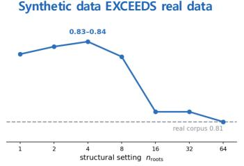  
Encodes ΔF/F directly POYO+ Distribution shape → USED  
Synthetic data REPLACES real data

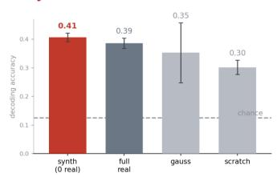  
Figure 1: The Transfer-Invariance Principle. A pretraining corpus is a point on three axes (top): two structural (structure, dimensionality) and the per-unit distribution shape. The model’s input pipeline sets which axes can govern transfer (middle). Under per-window normalization, synthetic data exceeds a real corpus once scaled (bottom left, PatchTST on UCR). Under unnormalized input, shape-matched synthetic data replaces real pretraining (bottom right, POYO+ on calcium imaging). To test the principle we build TransferForge, a generator that places a population at any prescribed structure and dimensionality. A few independent latent sources set the dimensionality ceiling, and a controllable fraction of derived, reconstructable nodes sets embeddedness. Together they span the (effective rank, coupling) plane of real neural populations (Section 3).

## Our contributions are:

• Which data property transfers depends on the model’s input pipeline. Flipping only the input normalization changes the measured effect of the distribution-shape manipulation 5.3×.

• Structure, dimensionality, and distribution shape characterize transferable pretraining data. Under per-window normalization, the structural axes govern, with an interior optimum. Under unnormalized input, the distribution shape becomes a governing constraint.

• A generator that sets each property on its own. TransferForge places a synthetic population anywhere from coupling 0.06 to 0.67 and effective rank 1.8 to 41, and matches a target distribution shape separately. KernelSynth, which draws independent series, occupies one point on these axes and cannot make a coupled population.

• Synthesizing along the governing property helps real-data finetuning. A shape-matched corpus replaces full-real calcium pretraining with zero real neural activity (0.407 vs. 0.386), and a structure-set corpus matches a real corpus of equal size on UCR and exceeds it once scaled up.

## 2 RELATED WORK

Synthetic pretraining data. Time-series and tabular foundation models are increasingly pretrained on hand-designed priors: KernelSynth in Chronos (Ansari et al., 2024), ForecastPFN (Dooley et al., 2023), TabPFN (Hollmann et al., 2023), and domain randomization (Tobin et al., 2017). CauKer (Xie et al., 2026), a Gaussian-process-plus-structural-causal-model (GP+SCM) generator, is closest. It shows that classification time-series foundation models can be pretrained purely on synthetic data. We start from this result. CauKer establishes that a synthetic corpus can work, and we ask which property of that corpus makes it transfer and what decides that property. To answer this, TransferForge extends the GP+SCM construction of CauKer so that structure, dimensionality, and distribution shape can each be set on their own (Section 3).

Choosing training data. Which training data helps a model has also been studied from several angles. Curriculum learning orders examples from easy to hard (Bengio et al., 2009). Data pruning and online batch selection keep the examples most worth training on, to improve accuracy or speed on the same task (Sorscher et al., 2022; Mindermann et al., 2022). Both act on data that already exist. Neither identifies which corpus property makes pretraining transfer. We identify that property and synthesize data that has it. Remaining connections (population coupling, intrinsic dimension, scaling) are deferred to Appendix B.

## 3 METHODS

## 3.1 THREE CORPUS PROPERTIES

Structure and dimensionality. We describe a population $\boldsymbol { X } \in \mathbb { R } ^ { T \times N }$ by two structural axes, its structure (embeddedness) and its dimensionality (effective rank):

$$
\underbrace { \mathrm { c o u p } ( X ) = \underset { i \neq j } { \mathrm { m e a n ~ } } \left| \mathrm { c o r r } ( x _ { i } , x _ { j } ) \right| } _ { \mathrm { s t r u c t u r e ~ ( e m b e d d e d n e s s ) } } \qquad \underbrace { \mathrm { e r } ( X ) = \frac { \left( \sum _ { k } \lambda _ { k } \right) ^ { 2 } } { \sum _ { k } \lambda _ { k } ^ { 2 } } } _ { \mathrm { d i m e n s i o n a l i t y ~ ( e f f e c t i v e ~ r a n k ) } }\tag{1}
$$

Structure is the mean absolute off-diagonal correlation. It summarizes at the population level how well each unit is reconstructed from the rest, which Appendix A also reports per unit as a crossvalidated $R ^ { 2 }$ . Dimensionality is the participation ratio of the correlation eigenspectrum $\left\{ \lambda _ { k } \right\}$ and counts the independent modes. Within a real recording, structure and dimensionality are strongly anticorrelated: across random neuron pools from one C. elegans whole-brain session, $\rho \approx - 0 . 8 5$ Most of the plane therefore cannot be reached by collecting real data, and TransferForge is built to span it. Both axes come from a prior cross-modality analysis summarized in Appendix A.

Distribution shape. The third axis is the per-unit distribution shape, the shape of each unit’s own values. We summarize it by skewness, excess kurtosis, and the peak-to-baseline signal-to-noise ratio standard for calcium traces,

$$
\mathrm { S N R } ( x ) = \frac { \mathrm { P } _ { 9 9 } ( x ) - \mathrm { m e d i a n } ( x ) } { \mathrm { s t d } \big ( x < \mathrm { m e d i a n } ( x ) \big ) } ,\tag{2}
$$

the transient amplitude over the baseline noise. The 99th percentile estimates the peak without being driven by single-sample spikes, the median estimates the baseline, and the standard deviation of the below-median samples estimates the baseline noise. Structure and dimensionality describe how units relate to each other. The distribution shape describes each unit’s own values. The model’s input pipeline decides whether the shape must be matched (Section 4.5).

## 3.2 REAL MODALITIES ON THE THREE AXES

Real modalities occupy very different regions of the three axes (Table 1; data sources in $\mathsf { A p } \cdot$ pendix C). Human macro-scale data (fMRI, EEG) has low rank and high coupling. Cellular and sensor data spread across the plane. Only calcium, and to a lesser degree spikes, is heavy-tailed. Every other time-ordered modality is near-Gaussian. A generator must therefore cover far more than any single modality occupies. Section 4.6 uses the table to predict the governing axis for modalities we did not test.

## 3.3 THE TRANSFERFORGE GENERATOR

Construction. TransferForge adapts the structural-causal-model construction over Gaussianprocess sources of CauKer (Xie et al., 2026) and makes it axis-controlled. We draw $n _ { \mathrm { r o o t s } }$ s inde-

Table 1: The three axes measured across modalities. Tail and SNR are computed per unit and summarized by the median. They are defined only for time-ordered data (vision and language: “–”).
<table><tr><td colspan="2"></td><td rowspan="2">Dimensionality</td><td colspan="2">Distribution shape</td></tr><tr><td>Modality</td><td>Structure (embeddedness)</td><td>Tail (excess kurtosis)</td><td>SNR</td></tr><tr><td>fMRI (task)</td><td>0.54</td><td>(effective rank) 2.6</td><td>-0.4</td><td>3.4</td></tr><tr><td>EEG</td><td>0.47</td><td>3.2</td><td>0.1</td><td>3.7</td></tr><tr><td>fMRI (resting)</td><td>0.40</td><td>4.3</td><td>-0.1</td><td>3.9</td></tr><tr><td>weather</td><td>0.32</td><td>31</td><td>0.4</td><td>3.5</td></tr><tr><td>C. elegans</td><td>0.28</td><td>7.0</td><td>-0.1</td><td>6.5</td></tr><tr><td>vision</td><td>0.21</td><td>40</td><td>一</td><td></td></tr><tr><td>spikes</td><td>0.08</td><td>54</td><td>3.7</td><td>12.9</td></tr><tr><td>calcium</td><td>0.04</td><td>50</td><td>12.0</td><td>5.6</td></tr><tr><td>language</td><td>0.019</td><td>1063</td><td>一</td><td></td></tr></table>

pendent latent source signals, which set the ceiling on dimensionality. We then form $N \mathrm { ~ - ~ } n _ { \mathrm { r o o t s } }$ derived nodes. Each derived node applies an activation to a random linear mix of earlier nodes and adds a private-noise term:

$$
x _ { j } = \phi \Big ( \sum _ { p \in \mathrm { { p a } } ( j ) } w _ { j p } x _ { p } + b _ { j } \Big ) + \underbrace { \mathrm { p r i v } \cdot \sigma ( x _ { j } ) \eta _ { j } } _ { \mathrm { p r i v a t e n o i s e } } ,\tag{3}
$$

where $\operatorname { p a } ( j )$ is a random subset of earlier nodes and $\eta _ { j }$ is white noise. A derived node is reconstructable from its parents by construction, so it is embedded. The fraction of derived nodes sets embeddedness, and the private-noise weight priv sets coupling strength independently of that fraction. With $n _ { \mathrm { r o o t s } } = 1$ and $\mathrm { \ p r i v } = 0$ the population is close to rank one. Raising $n _ { \mathrm { r o o t s } }$ or priv makes the population richer (implementation details in Appendix D).

The structural setting spans the real plane. We call the pair $( n _ { \mathrm { r o o t s } } , \mathrm { p r i v } )$ the structural setting. Sweeping it covers the (effective rank, coupling) plane rather than a single diagonal. Across the grid, effective rank and coupling correlate at $\rho \approx - 0 . 8 7 .$ , close to the real within-recording value. The generator parameters are controls, not axis definitions. Every analysis uses the structure and effective rank measured on the built corpus. An existing synthetic prior cannot be steered this way. KernelSynth draws each series independently, so a population of 128 KernelSynth series occupies one point (coupling 0.075, effective rank 35). At the same size, TransferForge spans an eleven-fold range in coupling and a twenty-three-fold range in effective rank, and sets the distribution shape separately.

## 3.4 TEMPLATING INTO A REAL MODEL’S DATA FORMAT

To pretrain an existing model on synthetic data without changing its loader, we copy a real session file and overwrite only its neural traces. The replacement is a TransferForge population of the same shape $( T , N )$ , amplitude-matched per unit to the real column it replaces. The file keeps every field the loader needs: domain, stimulus intervals, unit ids, sampling rate, and masks. No real neural activity remains. Only the file format, the stimulus metadata, and each unit’s mean and standard deviation come from the real session. A split file marks the synthetic sessions as the pretraining pool and the untouched real sessions as the finetuning pool.

## 4 RESULTS

## 4.1 DATASETS AND SETUP

Two pipelines. We evaluate transfer under the two input pipelines the principle distinguishes. The normalizing pipeline is a PatchTST encoder that z-scores each input window. The unnormalized pipeline is POYO+ (Azabou et al., 2025), a calcium population model that consumes $\Delta F / F$ without per-window normalization. Chronos, a second backbone with a different tokenizer, tests the principle on another architecture (Section 4.5).

Downstream tasks. For the normalizing pipeline, we pretrain on a source corpus and train a frozen logistic-regression probe on each of 22 datasets of the UCR archive (Dau et al., 2019). We report accuracy averaged over the datasets. For the unnormalized pipeline, we pretrain and then fully finetune an 8-way drifting-gratings orientation decoder on a held-out pool of 139 real calcium sessions. We report held-out test accuracy (chance 0.125).

Pretraining corpora. Every synthetic corpus is a TransferForge population placed at a prescribed structure, dimensionality, and distribution shape (Section 3). We compare each against the real corpus a practitioner would use in that pipeline: a real forecasting corpus for UCR, and full real calcium pretraining for the decoder. Random init, and chance for the decoder, bound every comparison from below. Corpora compared directly are budget- or step-matched, so the corpus is the only thing that varies. The scaling analysis varies corpus size on purpose.

Why these datasets. UCR and calcium imaging lie at opposite ends of the input-pipeline spectrum. UCR is the standard univariate classification archive, and its 22 datasets span many domains. The real forecasting corpus, FRED-MD macroeconomic series (McCracken & Ng, 2016; Godahewa et al., 2021) and daily exchange rates (Lai et al., 2018), is disjoint from UCR, so pretraining cannot leak the evaluation sets. Calcium $\Delta F / F$ is sparse and heavy-tailed, and POYO+ takes it unnormalized. Real recordings are costly, so replacing them matters most. We decode drifting-grating orientation from the Allen Brain Observatory (de Vries et al., 2020).

## 4.2 STRUCTURE GOVERNS UNDER PER-WINDOW NORMALIZATION (PATCHTST ON UCR)

We first ask which property of the corpus governs transfer for a generic time-series model. We pretrain a PatchTST encoder and probe transfer on the UCR archive (setup in Section 4.1, budget in Appendix E).

The structural setting governs transfer, and it has an interior optimum. Here $n _ { \mathrm { r o o t s } }$ is the number of independent latent sources, which largely sets the effective rank. As $n _ { \mathrm { r o o t s } }$ increases, transfer rises, peaks at $n _ { \mathrm { r o o t s } } = 4$ , and falls again (Figure 1). The high-dimensional extreme transfers clearly worse than the middle, and the rank-one extreme slightly worse. At a fixed corpus size, the interior optimum $( n _ { \mathrm { r o o t s } } = 4 )$ improves UCR accuracy by 4% over both the high-dimensional extreme and random init. KernelSynth draws each series independently and has no parameter that sets structure, so it cannot make this choice.

Pretrained on the synthetic corpus, PatchTST achieves 4.2% higher UCR accuracy than with the real forecasting corpus (Table 2). The real corpus itself transfers no better than training from scratch. The gain comes from quantity. Cut to the 1776 windows of the real corpus and trained for the same steps, the synthetic corpus matches the real one (paired t-test over seeds, $p = 0 . 6 0 )$ . At about ten thousand windows, our corpus outperforms KernelSynth, the synthetic prior of Chronos, by 1.3% (8 of 10 seeds; paired t-test, $p \ : = \ : 0 . 0 1 5 )$ . The margin is not uniform across datasets (13 of 22; Wilcoxon, $p = 0 . 0 7 )$

Table 2: UCR classification accuracy after pretraining. PatchTST is pretrained on each corpus, then a frozen probe is trained on each UCR dataset; mean ± SD over 3 seeds (10 for the ∼10k synthetic rows), averaged over 22 UCR datasets. Ours is TransferForge at the interior optimum $( n _ { \mathrm { r o o t s } } = 4 )$ . Rows with the same window count pretrain for the same number of steps; 1776 is the size of the real corpus.
<table><tr><td>Pretraining corpus</td><td>Classification accuracy</td></tr><tr><td>Synthetic</td><td></td></tr><tr><td>Ours (～10k windows)</td><td> $\mathbf { 0 . 8 4 2 \pm 0 . 0 0 6 }$ </td></tr><tr><td>KernelSynth (～10k windows)</td><td> $0 . 8 3 1 \pm 0 . 0 0 8$ </td></tr><tr><td>Ours (1776 windows)</td><td> $0 . 8 1 3 \pm 0 . 0 1 4$ </td></tr><tr><td>KernelSynth (1776 windows)</td><td> $0 . 8 0 8 \pm 0 . 0 0 3$ </td></tr><tr><td>Real</td><td></td></tr><tr><td>FRED-MD + exchange rate (1776 windows)</td><td> $0 . 8 0 8 \pm 0 . 0 1 3$ </td></tr><tr><td>No pretraining</td><td> $0 . 8 0 5 \pm 0 . 0 0 8$ </td></tr></table>

Synthetic transfer scales with corpus size. A synthetic corpus can grow where a real one is fixed. At the interior optimum $( n _ { \mathrm { r o o t s } } = 4 )$ , UCR accuracy stays at the level of the real corpus up to about four thousand windows and then exceeds it (Figure 2). At 16384 windows it is 4.2% higher. KernelSynth rises the same way, somewhat earlier, and ends at the same accuracy, so the gain from scale comes from synthetic data in general. Our generator decides what to synthesize, and corpus size separately decides how much the corpus helps.

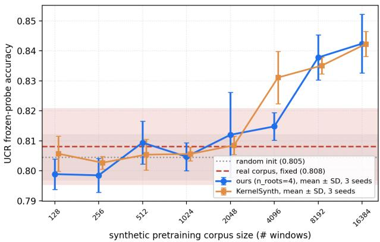  
Figure 2: UCR classification accuracy vs. synthetic corpus size. PatchTST, frozen probe, at the interior optimum $( n _ { \mathrm { r o o t s } } \ : = \ : 4 ) ;$ mean ± SD over 3 seeds, averaged over 22 UCR datasets. Blue: our corpus. Orange: KernelSynth at the same sizes and seeds. Dashed: the fixed real corpus (1776 windows). Dotted: random init.

## 4.3 DISTRIBUTION SHAPE BECOMES A GOVERNING CONSTRAINT UNDER UNNORMALIZED INPUT (POYO+ ON CALCIUM IMAGING)

We next test replacement and supplementation on calcium imaging data with POYO+ (Azabou et al., 2025) (setup in Section 4.1, budget in Appendix E). The rows of Table 3 differ only in the pretraining pool composition. All synthetic corpora use $n _ { \mathrm { r o o t s } } = 6 4$ . Under the calcium transform the choice of $n _ { \mathrm { { r o o t s } } }$ barely changes decoding (Section 4.4), so we fix it rather than tune it.

Table 3: Drifting-gratings decoding accuracy after pretraining. POYO+, 15-epoch full finetune; held-out test accuracy, mean ± SD. Chance = 0.125. Rows are over 3 seeds, except the three rows that use scarce real data (5 seeds each, including chance-stalled runs, which widens their spread).
<table><tr><td>Pretraining corpus</td><td>Decoding accuracy</td></tr><tr><td>Synthetic only (0 real traces)</td><td></td></tr><tr><td>Calcium-shaped synthetic</td><td> $\mathbf { 0 . 4 0 7 \pm 0 . 0 1 5 }$ </td></tr><tr><td>Gaussian synthetic</td><td> $0 . 3 5 3 \pm 0 . 1 0 5$ </td></tr><tr><td>Synthetic + scarce real</td><td></td></tr><tr><td>Calcium-shaped synthetic + scarce real</td><td> $0 . 3 4 3 \pm 0 . 0 5 2$ </td></tr><tr><td>Gaussian synthetic + scarce real</td><td> $0 . 2 2 0 \pm 0 . 1 0 6$ </td></tr><tr><td>Real only</td><td></td></tr><tr><td>Full real</td><td> $0 . 3 8 6 \pm 0 . 0 1 8$ </td></tr><tr><td>Scarce real</td><td> $0 . 2 3 9 \pm 0 . 1 1 4$ </td></tr><tr><td>No pretraining</td><td> $0 . 3 0 2 \pm 0 . 0 2 5$ </td></tr></table>

Shape-matched synthetic pretraining replaces real pretraining. With no real neural data, the calciumshaped synthetic corpus scores 5% higher than full-real pretraining, a difference that is not significant $( p = 0 . 2 0$ , Welch). It scores 35% higher than no pretraining $( p = 0 . 0 0 7$ , Welch; Table 3). Like full-real pretraining, it rises above chance on every seed, and its spread is the smallest in the table.

Synthetic data also supplements a small real pool. On their own, 19 real sessions fall 21% below no pretraining. Adding 50 calcium-shaped synthetic sessions improves them by 44%. The distribution shape matters most when synthetic data is mixed with real data. With the same scarce real pool, the calcium-shaped corpus transfers 56% better than the Gaussian one, which falls below no pretraining (Table 3). Without real data, the Gaussian corpus also transfers above no pretraining on average, but only on some seeds. Two of its seeds match the calcium-shaped corpus, and one rises above chance only late in finetuning. The calcium-shaped corpus succeeds on all three seeds with a seven-fold smaller spread. The Gaussian corpus is not structureless. It comes from the same generator setting, and because it skips the calcium transform it keeps more of that structure. At the model’s input window its coupling is 60% higher than that of the calcium-shaped corpus. Its success on two seeds may come from this retained structure, which we do not isolate here. Every row shares the same finetuning, so these differences come from pretraining (Appendix E).

Why the distribution shape matters here. POYO+ takes unnormalized $\Delta F / F$ values through a patch of size one and a plain linear value embedding. Real $\Delta F / F$ is sparse and spiky. Over its full trace, the session the synthetic corpus is calibrated on has median skew ≈ 6.8 and median excess kurtosis ≈ 97 across units. A Gaussian TransferForge population, matched only in mean and standard deviation, has skew and excess kurtosis near zero. Without normalization these higher moments reach the model unchanged, and the mismatch enters as a distribution shift.

The transient-to-baseline SNR must also match the real level (≈ 6.8 for the calibration session, and 5.6 for the calcium median in Table 1). Our calcium distribution-shape transform maps a TransferForge latent to a calcium-like signal. It brings skewness, excess kurtosis, and SNR to the level of the calibration session at once (Figure 5; construction in Appendix D). The result is somewhat heavier-tailed than the calibration session and than a typical session (excess kurtosis ≈ 140).

Which component of the distribution shape matters. At the structural setting of all calcium corpora $( n _ { \mathrm { r o o t s } } = 6 4 )$ , we vary how the per-unit distribution is matched: Gaussian, shape only, SNR only, or both. Matching both gives the highest and most reliable decoding (Figure 3c). Matching shape only or SNR only falls below no pretraining, and below the Gaussian corpus. In calcium, the transform changes shape, SNR, and effective rank together, so Table 3 credits the transform as a whole. On Chronos, whose inputs are dense series, the tail shape carries the effect and SNR matters only near the noise floor (Section 4.5).

## 4.4 ONCE THE HEAVY TAIL IS MATCHED, THE STRUCTURAL AXES DO NOT IMPROVE TRANSFER (POYO+ ON CALCIUM IMAGING)

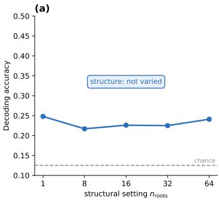

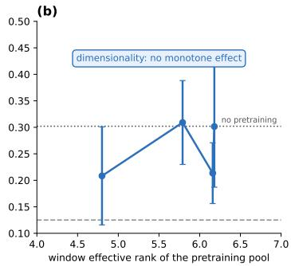

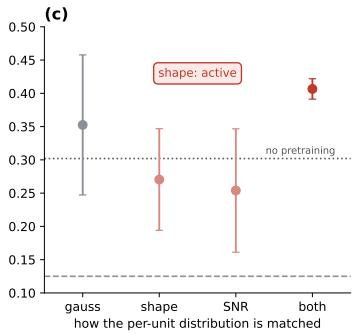  
Figure 3: Calcium drifting-gratings decoding accuracy (chance 0.125) as one property is varied. (a) structural setting $( n _ { \mathrm { r o o t s } } ) .$ , (b) window effective rank of the pretraining pool (real sessions span 2.1–16.8, 5th–95th percentile), (c) per-unit distribution shape match (gauss/shape/SNR/both). Held-out test accuracy. The distribution shape is re-matched in (a) and (b). (a) is single-seed at a 5-epoch budget, so its levels are not comparable to the other panels; (b) and (c) show mean ± SD over 3 seeds after 10-epoch pretraining; drifting-gratings finetuning ran 15 epochs, except runs that hit the time limit and were rerun at 12 (7 of the 12 runs in (b); the seed-43 and seed-44 runs of shape and SNR in (c)). The dotted line is the 15-epoch no-pretraining level.

Matching the calcium shape erases the structure we set. We set structure with $n _ { \mathrm { r o o t s } }$ from 1 to 64 and then applied the calcium transform, and decoding stays flat (Figure 3a). The transform explains this. Before it, coupling changes more than fifty-fold across $n _ { \mathrm { r o o t s } }$ . After it, coupling changes less than two-fold, within the variation between real sessions (Figure 6). The corpora the model sees therefore differ little in structure, and the flat sweep does not show that structure is irrelevant. The transform cannot be dropped, because POYO+ encodes values unnormalized and the corpus must carry the calcium shape (Section 4.3). Matching the shape and varying structure therefore conflict (Appendix E).

Effective rank, varied directly, shows no systematic effect. We therefore varied effective rank directly through the event density q of the transform. At each level we re-matched the distribution shape and kept coupling fixed across levels (Appendix E). Varying q moves effective rank only within a narrow band, about a tenth of the range of real sessions (Figure 3b). Within that band decoding shows no systematic trend and stays within the seed spread of each level. Every level is shape-matched, yet none rises clearly above no pretraining, and all stay well below the default shape-matched corpus (Figure 3c). Matching the distribution shape is therefore not sufficient on its own.

## 4.5 THE PIPELINE, NOT THE MODALITY, DECIDES WHICH PROPERTIES CAN MATTER(PATCHTST AND CHRONOS ON TIME SERIES)

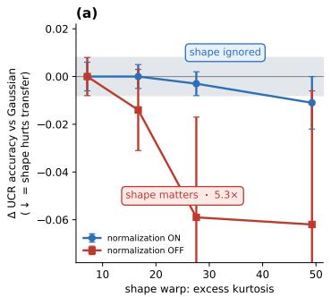

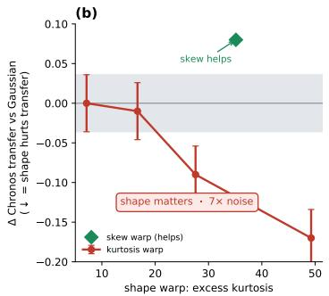

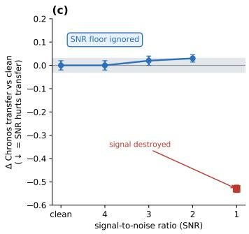  
Figure 4: Distribution-shape effect with and without per-window normalization. Each panel plots the transfer change from the Gaussian anchor, oriented so down = shape hurts. The grey band is within seed noise. (a) PatchTST, per-window normalization on vs. replaced by a corpus-wide scale (10 seeds). (b) Chronos with its native tokenizer, no intervention (3 seeds). (c) Chronos, an SNR sweep with tail shape held Gaussian (3 seeds). Panels use different tasks and metrics.

UCR and calcium differ in modality as well as pipeline, so the contrast between them could still reflect the data rather than the normalization. We therefore fix the model and the data and flip only the input normalization.

On PatchTST at the interior optimum $( n _ { \mathrm { r o o t s } } = 4 )$ , we warp one synthetic corpus with a pointwise monotone map. The map keeps the temporal order of each series and changes only its distribution shape (post-normalization excess kurtosis from about 7 to 49). With per-window normalization on, the warp has no effect. UCR accuracy stays within seed noise (Figure 4a), while changing the structural setting moves it by 4% (Section 4.2). We then replace per-window normalization with a single corpus-wide scale, so each window’s scale also reaches the model. The same warp then matters. Accuracy falls monotonically with kurtosis, and the spread grows 5.3-fold. The model, the data, and the warp stay the same, and only the normalization changes. Without normalization the warp also changes each window’s scale, and this experiment does not separate shape from scale.

The flip also holds on real data. On real forecasting series (FRED-MD and exchange rates), the warp is again inert with normalization on and active without it, with a 2.9-fold larger spread. On a KernelSynth base, normalization again makes the warp inert. Without normalization the spread doubles, less than on the other two bases (Appendix G).

This is not a tautology, because z-scoring keeps the higher moments. A second model with a different tokenizer, Chronos, responds to the warp without any intervention. Its forecasting error rises monotonically with tail heaviness, a spread seven times the seed noise (Figure 4b). Chronos also separates the two components of the distribution shape. Lowering SNR from clean down to 2 leaves forecasting flat, and it degrades only at SNR 1, where the signal variance equals the noise (Figure 4c). The tail shape therefore carries the effect (details in Appendix G).

## 4.6 A RECIPE FOR WHICH AXIS TO SYNTHESIZE ALONG

Algorithm 1 Choosing what to synthesize for a target model   
Require: target model M with input transform $T ;$ real sample X from the target modality; genera  
tor G with parameters θ; threshold $\epsilon _ { a }$ for each axis a   
1: for each axis $a \in$ {structure, dimensionality, tail, SNR} do   
2: $s _ { a }$ ← spread of $a ( T ( X ) )$ across real sessions ▷ no training   
3: mark a live if $s _ { a } > \epsilon _ { a } ,$ else dead   
4: end for   
5: for each live axis a do   
6: find the parameter $\theta _ { a }$ that moves $a ( T ( G ( \theta ) ) )$ across the real range ▷ in silico   
7: end for   
8: pretrain M on G at low, mid, and high $\theta _ { a } ;$ keep a if transfer tracks it   
9: return the best $\theta _ { a } ;$ then scale the corpus size

Our results turn into a procedure for a new target model (Algorithm 1). Its first two steps need no training. The axes are measured on real data after the model’s own input transform, and a generator parameter is calibrated in silico. Only the last step trains, with one small sweep. UCR and calcium are two worked cases. On UCR, the distribution shape survives z-scoring, but the confirming sweep shows that transfer does not track it, while it does track structure (Sections 4.2 and 4.5). On calcium, matching the shape fixes coupling, so the first step marks structure dead. Varying the event density moves effective rank only within a narrow band, over which transfer does not track it (Section 4.4).

Predictions for the untested modalities. Applying the principle to the modalities of Table 1 nominates the likely governing axis without training (Table 4). Each prediction assumes the input transform a foundation model for that modality would typically use. These predictions are falsifiable: each needs only that foundation model and a matched TransferForge corpus.

Table 4: Candidate governing axis. Tail is the excess kurtosis of Table 1.
<table><tr><td>Modality</td><td>Typical input transform</td><td>Tail</td><td>Candidate governing axis</td></tr><tr><td>EEG, fMRI, weather</td><td>per-window normalization</td><td>≈0</td><td>structure</td></tr><tr><td>spikes</td><td>unnormalized counts</td><td>3.7</td><td>distribution shape (weaker)</td></tr><tr><td>calcium</td><td>unnormalized  $\Delta F / F$ </td><td>12.0</td><td>distribution shape (shown here)</td></tr></table>

## 5 DISCUSSION

A pretraining corpus has three properties that can shape transfer: its structure, its dimensionality, and the distribution shape of each unit’s values. Which of them can matter is set by the model’s input pipeline, not by the data. When the model z-scores each input window, the distribution shape is inert and structure governs, and synthetic data matches a real corpus of equal size and exceeds it once more is generated. When the model encodes calcium $\Delta F / \bar { F }$ unnormalized, the distribution shape becomes a governing constraint, and a shape-matched synthetic corpus replaces real pretraining with no real neural data. Flipping only the input normalization, with the model and data fixed, moves the distribution-shape manipulation from inert to active, so the pipeline, not the modality, decides whether it matters.

This changes how pretraining data can be obtained. Instead of collecting more real data and hoping it transfers, one can measure which properties survive a model’s input transform, synthesize a corpus that has the right ones, and generate as much of it as needed. The first steps need no training, so the choice of what to synthesize is made before any compute is spent. The gain is largest where real data is scarce, costly, or private, as neural recordings are. There is no corpus that suits every model, only a corpus matched to a pipeline.

## REPRODUCIBILITY STATEMENT

This paragraph points to where the information needed to reproduce our results lives. The TransferForge generator and the calcium distribution-shape transform are specified in Section 3, with full implementation details (GP/SCM construction, GCaMP kernel, event-density q, noise floor) in Appendix D; the axis definitions and their cross-modality validation are in Appendix A. Accuracies for each pretraining corpus, seed counts, and step-/budget-matching are reported with each experiment in Section 4. Code and configuration files will be released as supplementary material on acceptance.

## AI USE STATEMENT

The authors used a generative AI coding assistant for implementation scaffolding (data-generation and figure code), experiment orchestration, and drafting/editing of this manuscript. All code was reviewed and executed by the authors, all numerical results were produced by the authors’ runs, and the authors take responsibility for the final content.

## REFERENCES

Dora Angelaki, Brandon Benson, Julius Benson, Daniel Birman, Niccolo Bonacchi, Kc\` enia´ Bougrova, Sebastian A Bruijns, Matteo Carandini, Joana A Catarino, et al. A brain-wide map of neural activity during complex behaviour. Nature, 645(8079):177–191, 2025.

Abdul Fatir Ansari, Lorenzo Stella, Caner Turkmen, Xiyuan Zhang, Pedro Mercado, Huibin Shen, Oleksandr Shchur, Syama Sundar Rangapuram, Sebastian Pineda Arango, Shubham Kapoor, et al. Chronos: Learning the language of time series. arXiv preprint arXiv:2403.07815, 2024.

Alessio Ansuini, Alessandro Laio, Jakob H Macke, and Davide Zoccolan. Intrinsic dimension of data representations in deep neural networks. Advances in Neural Information Processing Systems, 32, 2019.

Mehdi Azabou, Vinam Arora, Venkataramana Ganesh, Ximeng Mao, Santosh Nachimuthu, Michael Mendelson, Blake Richards, Matthew Perich, Guillaume Lajoie, and Eva Dyer. A unified, scalable framework for neural population decoding. Advances in Neural Information Processing Systems, 36:44937–44956, 2023.

Mehdi Azabou, Krystal Pan, Vinam Arora, Ian Knight, Eva Dyer, and Blake A Richards. Multisession, multi-task neural decoding from distinct cell-types and brain regions. In International Conference on Learning Representations, volume 2025, pp. 59654–59677, 2025.

Sangyoon Bae, Mehdi Azabou, Blake A Richards, and Jiook Cha. Decoding dynamic visual experience from calcium imaging via cell-pattern-aware pretraining. In International Conference on Learning Representations, volume 2026, pp. 142661–142685, 2026.

Yoshua Bengio, Jer´ ome Louradour, Ronan Collobert, and Jason Weston. Curriculum learning. Inˆ Proceedings ofthe 26th annual international conference on machine learning, pp. 41–48, 2009.

Xinlei Chen and Kaiming He. Exploring simple siamese representation learning. In 2021 IEEE/CVF conference on computer vision and pattern recognition (CVPR), pp. 15745–15753. IEEE, 2021.

Mark M Churchland, John P Cunningham, Matthew T Kaufman, Justin D Foster, Paul Nuyujukian, Stephen I Ryu, and Krishna V Shenoy. Neural population dynamics during reaching. Nature, 487 (7405):51–56, 2012.

Hoang Anh Dau, Anthony Bagnall, Kaveh Kamgar, Chin-Chia Michael Yeh, Yan Zhu, Shaghayegh Gharghabi, Chotirat Ann Ratanamahatana, and Eamonn Keogh. The ucr time series archive. IEEE/CAA Journal ofAutomatica Sinica, 6(6):1293–1305, 2019.

Saskia EJ de Vries, Jerome A Lecoq, Michael A Buice, Peter A Groblewski, Gabriel K Ocker, Michael Oliver, David Feng, Nicholas Cain, Peter Ledochowitsch, Daniel Millman, et al. A large-scale standardized physiological survey reveals functional organization of the mouse visual cortex. Nature neuroscience, 23(1):138–151, 2020.

Jia Deng, Wei Dong, Richard Socher, Li-Jia Li, Kai Li, and Li Fei-Fei. Imagenet: A large-scale hierarchical image database. In 2009 IEEE conference on computer vision and pattern recognition, pp. 248–255. Ieee, 2009.

Jacob Devlin, Ming-Wei Chang, Kenton Lee, and Kristina Toutanova. Bert: Pre-training of deep bidirectional transformers for language understanding. In Proceedings of the 2019 conference of the North American chapter of the association for computational linguistics: human language technologies, volume 1 (long and short papers), pp. 4171–4186, 2019.

Samuel Dooley, Gurnoor Singh Khurana, Chirag Mohapatra, Siddartha V Naidu, and Colin White. Forecastpfn: Synthetically-trained zero-shot forecasting. Advances in Neural Information Processing Systems, 36:2403–2426, 2023.

Raymond Dunn, Daniel Sprague, and Saul Kato. C. elegans whole-brain NeuroPAL and immobilized calcium imaging. DANDI Archive, DANDI:000565, version 0.241009.1504, 2024.

Alexander S Ecker, Philipp Berens, R James Cotton, Manivannan Subramaniyan, George H Denfield, Cathryn R Cadwell, Stelios M Smirnakis, Matthias Bethge, and Andreas S Tolias. State dependence of noise correlations in macaque primary visual cortex. Neuron, 82(1):235–248, 2014.

Peiran Gao and Surya Ganguli. On simplicity and complexity in the brave new world of large-scale neuroscience. Current opinion in neurobiology, 32:148–155, 2015.

Rakshitha Godahewa, Christoph Bergmeir, Geoffrey I. Webb, Rob J. Hyndman, and Pablo Montero-Manso. Monash time series forecasting archive. In Neural Information Processing Systems (NeurIPS) Track on Datasets and Benchmarks, 2021.

Tao Han, Zhibin Wen, Zhenghao Chen, Dazhao Du, Song Guo, and Lei Bai. Benchmarking physicsinformed time-series models for operational global station weather forecasting. arXiv preprint arXiv:2406.14399, 2024.

Kaiming He, Xinlei Chen, Saining Xie, Yanghao Li, Piotr Dollar, and Ross Girshick. Masked´ autoencoders are scalable vision learners. In 2022 IEEE/CVF conference on computer vision and pattern recognition (CVPR), pp. 15979–15988. IEEE, 2022.

Jordan Hoffmann, Sebastian Borgeaud, Arthur Mensch, Elena Buchatskaya, Trevor Cai, Eliza Rutherford, Diego de Las Casas, Lisa Anne Hendricks, Johannes Welbl, Aidan Clark, et al. Training compute-optimal large language models. In Advances in Neural Information Processing Systems (NeurIPS), 2022.

Noah Hollmann, Samuel Muller, Katharina Eggensperger, and Frank Hutter. Tabpfn: A transformer ¨ that solves small tabular classification problems in a second. In International Conference on Learning Representations (ICLR), 2023.

Li Jing, Pascal Vincent, Yann LeCun, and Yuandong Tian. Understanding dimensional collapse in contrastive self-supervised learning. In International Conference on Learning Representations (ICLR), 2022.

Jared Kaplan, Sam McCandlish, Tom Henighan, Tom B Brown, Benjamin Chess, Rewon Child, Scott Gray, Alec Radford, Jeffrey Wu, and Dario Amodei. Scaling laws for neural language models. arXiv preprint arXiv:2001.08361, 2020.

Guokun Lai, Wei-Cheng Chang, Yiming Yang, and Hanxiao Liu. Modeling long- and short-term temporal patterns with deep neural networks. In The 41st International ACM SIGIR Conference on Research & Development in Information Retrieval, pp. 95–104, 2018.

Elizaveta Levina and Peter Bickel. Maximum likelihood estimation of intrinsic dimension. Advances in neural information processing systems, 17, 2004.

Michael W McCracken and Serena Ng. Fred-md: A monthly database for macroeconomic research. Journal ofBusiness & Economic Statistics, 34(4):574–589, 2016.

Soren Mindermann, Jan M Brauner, Muhammed T Razzak, Mrinank Sharma, Andreas Kirsch, Win-¨ nie Xu, Benedikt Holtgen, Aidan N Gomez, Adrien Morisot, Sebastian Farquhar, et al. Prioritized¨ training on points that are learnable, worth learning, and not yet learnt. In International Conference on Machine Learning, pp. 15630–15649. PMLR, 2022.

Yuqi Nie, Nam H. Nguyen, Phanwadee Sinthong, and Jayant Kalagnanam. A time series is worth 64 words: Long-term forecasting with transformers. In International Conference on Learning Representations (ICLR), 2023.

Iyad Obeid and Joseph Picone. The temple university hospital eeg data corpus. Frontiers in neuroscience, 10:196, 2016.

Michael Okun, Nicholas A Steinmetz, Lee Cossell, M Florencia Iacaruso, Ho Ko, Peter Barth´ o,´ Tirin Moore, Sonja B Hofer, Thomas D Mrsic-Flogel, Matteo Carandini, et al. Diverse coupling of neurons to populations in sensory cortex. Nature, 521(7553):511–515, 2015.

Phil Pope, Chen Zhu, Ahmed Abdelkader, Micah Goldblum, and Tom Goldstein. The intrinsic dimension of images and its impact on learning. In International Conference on Learning Representations (ICLR), 2021.

Olivier Roy and Martin Vetterli. The effective rank: A measure of effective dimensionality. In 2007 15th European signal processing conference, pp. 606–610. IEEE, 2007.

Ben Sorscher, Robert Geirhos, Shashank Shekhar, Surya Ganguli, and Ari Morcos. Beyond neural scaling laws: beating power law scaling via data pruning. Advances in Neural Information Processing Systems, 35:19523–19536, 2022.

Carsen Stringer, Marius Pachitariu, Nicholas Steinmetz, Matteo Carandini, and Kenneth D Harris. High-dimensional geometry of population responses in visual cortex. Nature, 571(7765):361– 365, 2019.

Josh Tobin, Rachel Fong, Alex Ray, Jonas Schneider, Wojciech Zaremba, and Pieter Abbeel. Domain randomization for transferring deep neural networks from simulation to the real world. In 2017 IEEE/RSJ international conference on intelligent robots and systems (IROS), pp. 23–30. IEEE, 2017.

David C. Van Essen, Stephen M. Smith, Deanna M. Barch, Timothy E. J. Behrens, Essa Yacoub, Kamil Ugurbil, and WU-Minn HCP Consortium. The WU-Minn Human Connectome Project: An overview. NeuroImage, 80:62–79, 2013.

Shifeng Xie, Vasilii Feofanov, Jianfeng Zhang, Themis Palpanas, and Ievgen Redko. Cauker: Classification time series foundation models can be pretrained on synthetic data. In International Conference on Learning Representations, volume 2026, pp. 68606–68634, 2026.

## A BACKGROUND: THE STRUCTURAL AXES ACROSS MODALITIES

TransferForge did not choose its two structural axes arbitrarily. They are the distillation of an extensive prior analysis, across the data modalities of Table 1, of what makes data predictable/learnable and which candidate “predictability” metrics are genuine versus confounded. This appendix substantiates the two structural axes used in the main text; it is background that informs the generator, not a claim of this paper.

The two axes. We characterize a population $\boldsymbol { X } \in \mathbb { R } ^ { T \times N }$ (T timepoints, N units) by two quantities. Embeddedness (structure axis) is how reconstructable a unit is from the rest of the population; at the population level we summarize it by the mean off-diagonal coupling $\operatorname { c o u p } ( X ) \ =$ mean $\mathsf { \iota } _ { i \neq j } \vert \mathrm { c o r r } ( x _ { i } , x _ { j } ) \vert$ |, and at the unit level by the cross-validated $R ^ { 2 }$ of reconstructing a unit from the rest. Effective rank (dimensionality axis) is the participation ratio of the correlation spectrum, $\begin{array} { r } { \operatorname { e r } ( X ) = ( \sum _ { k } \lambda _ { k } ) ^ { 2 } / \sum _ { k } \lambda _ { k } ^ { 2 } . } \end{array}$ : the number of independent modes the population carries.

The axes measured across modalities. Computing the axes across modalities (Table 1) shows they span a wide plane and that modalities occupy very different regions. Human macro-scale recordings (task/resting fMRI, EEG) are low-dimensional and high-coupling, nearly collapsed, so there is little diversity to select from and their intrinsic predictability is already near ceiling. Cellularresolution recordings (spikes, calcium) and broad multivariate sensor data (weather, vision) span far more of the plane: they have a small embedded scaffold plus a rich private complement, which is exactly the regime where the composition of a pretraining pool can matter. This is why a generator that can place data anywhere on the plane is useful.

The table also reports the distribution shape, summarized by its tail (excess kurtosis) and by the transient-to-baseline SNR used for calcium distribution shape matching. Both are invariant to the per-series affine normalization that pipelines like UCR/PatchTST apply, so they are properties of each modality, not artifacts of preprocessing. Whether the shape matters for transfer is set not by its level but by the model’s input pipeline (Section 4.5).

Embeddedness is a genuine structural invariant, not an amplitude artifact. A recurring trap is that continuous “predictability” metrics (kurtosis, forward-prediction $R ^ { 2 }$ , participation ratio) collapse onto signal amplitude/SNR or a recording attribute such as unit count. Embeddedness survives this scrutiny as a confound-matched contrast: (i) on spikes, with firing rate matched by decile, moreembedded units are more reconstructable than less-embedded ones (narrow-waveform inhibitory 0.179 vs. wide 0.112, Wilcoxon $p = 1 . 5 \times 1 0 ^ { - 2 0 } ) ;$ (ii) a per-unit cross-unit information-theoretic predictability equals coupling $( \rho = + 0 . 7 6 3 , n { = } 4 5 , 5 9 3$ units) and strengthens $\mathrm { t o + 0 . 8 1 5 }$ after partialling out firing rate and remains +0.751 after also partialling out temporal predictability, so it is not a rate or single-axis rename; (iii) against a ground-truth wiring diagram (C. elegans connectome), unit embeddedness aligns with anatomical synaptic degree $( \rho = + 0 . 3 0$ pooled, sign-consistent in 4/4 sessions).

As a free per-unit score embeddedness stays partly amplitude-entangled (C. elegans partial $\rho $ 0.10), so it is used as an axis to span, not a scalar to maximize (the rank-1 pure-embedded extreme is degenerate; see Section 4.2).

The axes trade off, so real data cannot be set freely. Across 220 random neuron pools (30–90 neurons) drawn from the largest C. elegans whole-brain session (Dunn et al., 2024), the two axes are strongly negatively correlated (Pearson $\rho \approx - 0 . 8 5$ with both axes on the correlation matrix): more coupling comes with lower effective rank. One therefore cannot obtain, from real recordings alone, a population at an arbitrary (structure, dimensionality) setting, and most of the plane is empty. This is the gap TransferForge spans: a generator that places a population off the trade-off diagonal, at a prescribed structural setting.

## B EXTENDED RELATED WORK

Curriculum learning and data selection. Curriculum learning (Bengio et al., 2009) and data pruning by an example’s learning value (Sorscher et al., 2022; Mindermann et al., 2022) score or reorder existing data; we instead identify the properties that make data transfer and synthesize data that has them.

Objective, structure, and dimensionality. Our objective is masked reconstruction (Devlin et al., 2019; He et al., 2022). Self-supervised representations are known to collapse to a low-dimensional subspace (Chen & He, 2021; Jing et al., 2022). The $n _ { \mathrm { r o o t s } } = 1$ extreme of our dimensionality axis is a low-rank corpus, the data-side analogue of that failure; it transfers worse than the interior optimum (Section 4.2), but we do not measure the rank of the learned representation.

The structure axis rests on population activity concentrating in a few shared, cell-type-dependent modes (Gao & Ganguli, 2015; Stringer et al., 2019; Churchland et al., 2012; Okun et al., 2015; Ecker et al., 2014); the dimensionality axis on effective rank / participation ratio (Roy & Vetterli, 2007; Levina & Bickel, 2004) and the link between low intrinsic dimension and better learning (Ansuini et al., 2019; Pope et al., 2021), with data quality known to shift scaling (Kaplan et al., 2020; Hoffmann et al., 2022). Our neural experiments use population-decoding models (Azabou et al., 2023; Nie et al., 2023) and recast the finding that predictable-first pretraining aids neural transfer (Bae et al., 2026) as a statement about where data sits on these axes.

## C MODALITY DATA FOR TABLE 1

Table 5: Data behind Table 1. Units and lengths are those used for tail and SNR. For spikes and calcium, structure and dimensionality are computed on larger session sets (24 IBL sessions; 432 Allen sessions).
<table><tr><td>Modality</td><td>Dataset</td><td>Unit</td><td>Units</td><td>Lengt</td></tr><tr><td>fMRI (task)</td><td>HCP EMOTION task (Van Essen et al., 2013)</td><td>voxel</td><td>24 × 24 subj.</td><td>88 TR</td></tr><tr><td>EEG</td><td>TUH abnormal EEG (TUAB) (Obeid &amp; Picone, 2016)</td><td>channel</td><td>40 × 23 windows</td><td>2000 sample</td></tr><tr><td>fMRI (resting)</td><td>HCP S1200 resting, 360 ROIs (Van Essen et al., 2013)</td><td>ROI</td><td>24 × 40 subj.</td><td>1200 TR</td></tr><tr><td>weather</td><td>WEATHER-5K, hourly stations (Han et al., 2024)</td><td>station× variable</td><td>2500</td><td>8760</td></tr><tr><td>C. elegans</td><td>DANDI:000565, whole-brain calcium (Dunn et al., 2024)</td><td>neuron</td><td>431 (4 sessions)</td><td>1500 frame</td></tr><tr><td>vision</td><td>ImageNet-1k validation, 16 × 16 grayscale (Deng et al., 2009)</td><td>pixel</td><td>256</td><td></td></tr><tr><td>spikes calcium</td><td>IBL Neuropixels, 50 ms bins (Angelaki et al., 2025)</td><td>sorted unit</td><td>23,220</td><td>36,000 bir</td></tr><tr><td>language</td><td>Allen Brain Observatory ∆F/F (de Vries et al., 2020)</td><td>ROI</td><td>2846 (40 sessions)</td><td>20,000 frame</td></tr><tr><td></td><td>PPMI word-context matrix, Project Gutenberg</td><td>word</td><td>4000</td><td></td></tr></table>

## D GENERATOR IMPLEMENTATION DETAILS

TransferForge draws root nodes from an O(T) AR(1)-smoothed white-noise process with a timescale of 3 samples. Derived nodes are linear-plus-nonlinear reconstructions of their parents (structural-causal-model edges over a Gaussian-process root construction), with a private-noise term priv · $\sigma ( x _ { j } )$ η per derived node that decouples coupling strength from the embedded fraction. The calcium distribution-shape transform maps a latent to a calcium-like signal via high-quantile sparseevent thresholding, a double-exponential GCaMP kernel, a rare-huge-event mixture for the extreme tail, and a baseline-noise floor for SNR; the effective-rank ablation drives built-window participation ratio through the event-density parameter q while re-matching excess kurtosis and SNR at each level.

## E EXPERIMENTAL DETAILS

UCR (normalizing pipeline). We pretrain a PatchTST encoder and probe transfer with a frozen logistic-regression classifier on the 22-dataset UCR archive, reporting mean accuracy across datasets. The $n _ { \mathrm { r o o t s } }$ sweep uses 3 seeds at a fixed budget (40 epochs, 128 source channels). The budget-matched comparison against the real forecasting corpus uses 1776 z-scored length-256 windows, cut with stride 64 from economic series long enough for that length, so neighbouring windows overlap. That real corpus transfers to UCR classification no better than random init.

Neural drifting-gratings decoding (unnormalized pipeline). We pretrain POYO+ (stepmatched across pretraining corpora) and then run a 15-epoch full finetune (unfrozen encoder) of an 8-way drifting-gratings orientation decoder (chance 0.125) on a held-out pool of 139 real calcium sessions, reporting mean held-out test accuracy. Runs that hit the time limit were rerun at 12 epochs (listed in the caption of Figure 3). Each pretraining corpus is run with 3 seeds, except the three that use scarce real data (5 seeds each, including chance-stalled runs).

Calcium pretraining corpora. The scarce-real corpora model a lab with few recordings of its own: the scarce pool holds 19 real sessions, a quarter of the 77 used for full-real pretraining, and the supplemented corpus adds 50 calcium-shaped synthetic sessions, step-matched to the others. The calcium- and Gaussian-synthetic pools share the generator setting and differ in the per-unit transform, which sets the distribution shape and also lowers coupling (Section 4.4). Every model is finetuned on the same 139 sessions with the same decoder and trainable capacity, so the spread across pretraining corpora (0.220 to 0.407 at fixed finetuning) comes from pretraining.

Calcium structural sweeps. The $n _ { \mathrm { { r o o t s } } }$ sweep spans {1, 8, 16, 32, 64} under the fixed matched calcium distribution shape. The dimensionality sweep varies the calcium transform’s event-density q, re-matching the distribution shape at each level. Its effective rank is measured at pool level: for each of the 50 synthetic sessions, the participation ratio of the singular values of centered 60-sample windows, median over 200 windows, then the median across sessions (4.8–6.2 across levels). Real sessions measured the same way span 2.1–16.8 (5th–95th percentile).

Why matching the calcium shape collapses the structure axis. Two transforms that make the distribution shape real cause the collapse. The high-quantile sparse-event thresholding needed for the heavy tail drops coupling 0.89 → 0.18 (rare co-firing among sparse events), and the baselinenoise floor needed for the anchor session’s SNR (≈ 6.8) drops it further to ≈ 0.05. A zero-noise floor restores structure but sends SNR to ∼ 174, far from real. Matching the distribution shape and spanning the structure axis are therefore in direct tension.

## F ADDITIONAL FIGURES

The following figures support the calcium results of Sections 4.3 and 4.4.

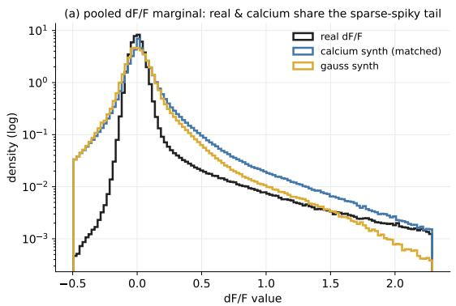

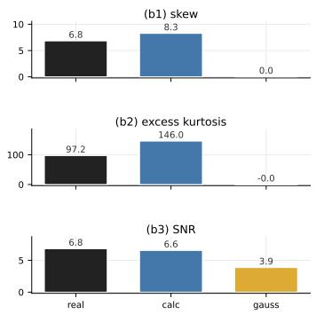

Figure 5: Matching the calcium distribution shape. Left: pooled $\Delta F / F$ value distribution (log scale); real and calcium-transformed synthetic share the heavy sparse-spiky tail, while Gaussian synthetic does not. Right: per-unit summary statistics (skew, excess kurtosis, SNR); calcium synthetic is close to the calibration session on all three, though heavier-tailed, while Gaussian synthetic matches none.  
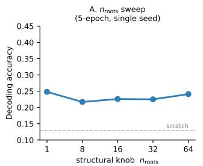

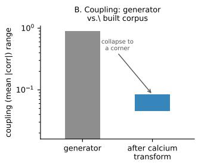

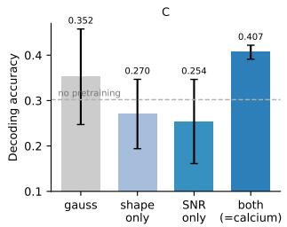  
Figure 6: Calcium sweeps (drifting-gratings decoding accuracy, chance 0.125). (A) Decoding accuracy vs. $n _ { \mathrm { r o o t s } }$ (5-epoch, single seed). (B) coupling range of the generator vs. the built corpus after the calcium distribution-shape transform. (C) Decoding accuracy as the per-unit distribution match is varied (gauss / shape-only / SNR-only / both=calcium; mean ± SD over 3 seeds, held-out test accuracy).

## G NORMALIZATION FLIP: FURTHER DETAILS

Real-data replication. Each FRED-MD and exchange-rate series is rank-Gaussianized, preserving its temporal order while setting its marginal, then warped with the same monotone map across the same kurtosis range; the identical PatchTST is pretrained both ways (5 seeds, 22 UCR datasets).

With normalization on, the accuracy range is 0.005, inside seed noise. Without it the spread is 2.9× wider. On this base the sign of the effect is dataset-dependent (a heavier tail mildly helps before turning down at the extreme), unlike the monotone decline on the synthetic base: normalization decides whether the manipulation matters, not the direction in which it then moves transfer.

KernelSynth base. We repeat the same flip on 137 KernelSynth series (Ansari et al., 2024) (length 1024, cut into 1781 windows, matching the real base), rank-Gaussianized and warped across the same kurtosis range (5 seeds, 22 UCR datasets). With normalization on, accuracy stays within 0.811–0.816 (range 0.004, inside seed noise). Without it the range is 0.009, 2.0× wider, but close to the seed spread and not monotone in kurtosis. The invariance under normalization therefore holds for all three bases (ours, real, KernelSynth); the strength of the activation without it depends on the base.

Why the null under normalization is not a tautology. Because z-scoring is affine, skewness and kurtosis reach the model unchanged either way; the null with normalization on is an invariance of the model, not an erased input. This also explains why UCR never needed distribution-shape matching: its pipeline makes the shape inert, and its series are near-Gaussian anyway. Calcium is the one modality that is both strongly non-Gaussian and fed to the model unnormalized. The reverse manipulation, adding per-unit normalization on the calcium side, is not usable: z-scoring removes the transient amplitude that carries the drifting-gratings signal, so decoding collapses to chance.

Chronos. Chronos (Ansari et al., 2024) scales each series by its mean absolute value and maps values into uniformly spaced bins, a tokenizer that, unlike per-window z-scoring, keeps each window’s scale relative to its series. We pretrain a Chronos-T5 (t5-efficient-tiny, random init, 3000 steps) from scratch on the same warped corpora $( n _ { \mathrm { r o o t s } } = 4 )$ and evaluate its native forecasting. The warp is active: forecasting error rises monotonically with tail heaviness, while a right-skew warp instead helps, a spread 7× the seed noise (Figure 4b).

Tail shape versus signal-to-noise ratio. Because Chronos consumes dense series, it separates the two components of the distribution shape that the calcium window entangles. From the same Gaussian anchor we sweep tail shape with SNR held clean, and SNR with tail shape held Gaussian. Lowering SNR from clean down to 2 leaves forecasting flat; it collapses only at SNR 1, where the signal variance equals the injected noise (Figure 4c; medians over 3 seeds). Transfer change gradually with tail shape, and the noise floor matters only where it destroys the signal.

## H LIMITATIONS

The calcium structural axes are not shown to matter, but structure was never varied at calcium’s input and dimensionality only over pool window effective rank 4.8–6.2, so whether a wider range matters is open; what separates the default calcium corpus from the effective-rank corpora, its event density or the training budget, is not isolated; their positive effect is established on UCR (Section 4.2). Shape and SNR separate only on the dense Chronos backbone, not within the calcium window (Appendix G). On the neural replacement the difference from full-real pretraining is not significant (5% higher; p = 0.20, Welch, 3 seeds); we claim neither superiority nor equivalence. The normalization flip lets both the distribution shape and each window’s scale reach the model, so it does not separate the two; a control that restores per-window scale with the shape held fixed is left to future work. The neural evidence rests on a single downstream task, 8-way drifting-gratings orientation decoding; continuous trajectory decoding and spike-based modalities remain untested.