# Sample-Grained Approximate Unlearning with Provable Per-Sample Bounds

Yaxin Xiao The Hong Kong Polytechnic University samin-yaxin.xiao@polyu.edu.hk

Haoyang LI The Hong Kong Polytechnic University hao-yang9905.li@connect.polyu.hk

Qingqing Ye The Hong Kong Polytechnic University qqing.ye@polyu.edu.hk

Yulin Jin The Hong Kong Polytechnic University

Li Tang Yunnan University

yulin.jin@connect.polyu.hk tangli@ynu.edu.cn

Huadi Zheng Huawei Technologies Co., Ltd. zhenghuadi@huawei.com

Haibo Hu∗   
The Hong Kong Polytechnic University   
Research Centre for Privacy and Security Technologies in Future Smart Systems haibo.hu@polyu.edu.hk

## Abstract

Machine unlearning aims to erase the influence of a designated forget set from a trained model while preserving strong utility on the retain set. Approximate unlearning methods efficiently achieve this goal without full retraining, but their effectiveness is primarily assessed using dataset-level aggregate metrics. These aggregate metrics can mask deviations from retraining at the level of individual samples.

In this work, we focus on per-sample unlearning effectiveness. We introduce SALA (Sample-grained Likelihoods ALignment), a plug-in optimization framework that enables approximate unlearning methods to operate at the level of individual samples by steering each example toward its correct target distribution. To quantitatively assess this behavior, we further propose the sample-grained distribution gap, a metric that captures per-sample discrepancies between approximate unlearning and exact retraining output distributions. We provide theoretical guarantees showing that SALA contracts this gap and yields a bounded per-sample discrepancy to retraining. To make this framework practical, we develop a low-cost estimation method for the member and non-member target distributions. Extensive experiments on classification and generation tasks demonstrate that SALA reduces the sample-grained distribution gap by up to 86.67% when paired with existing approximate unlearning baselines, while also improving robustness to unlearning hyperparameters.

## 1 Introduction

Motivated by the legal data-deletion requirement known as the “right to be forgotten” [11], machine unlearning is introduced to remove the influence of a designated forget set from a trained model [2, 5, 14] while preserving utility on the retain set. The most direct way to achieve this goal is to retrain the model from scratch using only the retain set. This exact retraining procedure is the gold standard for unlearning. However, because exact retraining is often too expensive for deployment, recent work has increasingly shifted to approximate unlearning (AU) [15, 21], which updates a pretrained model with small compute overhead to closely match the result of exact retraining. Accordingly, the efficacy of AU is commonly evaluated by gap-to-retrain [4], which measures how close the AU model distribution is to the exact-retraining (ER) distribution under a chosen observable metric.

However, existing works usually rely on dataset-level average observables, such as prediction accuracy over a dataset, which can mask unlearning failures at the sample level. To capture per-sample unlearning performance, we measure distribution non-overlap $( \mathrm { D N O } ^ { 2 } )$ , defined as the discrepancy between the output distributions estimated over multiple runs of unlearning a given sample x and exact retraining without x, as illustrated in Figure 1. Figure 2a shows that state-of-the-art AU methods can achieve a small dataset-level gap-to-retrain, measured by $1 - \mathrm { T o W } ^ { 3 }$ , while still exhibiting a large persample gap-to-retrain, i.e., DNO. Figure 2b further shows that this per-sample gap is associated with greater privacy leakage on forget samples, as evaluated here by the representative attack RULI [30].

These findings highlight a key research gap: sample-grained approximate unlearning remains insufficiently studied and far from well achieved. We address this gap with SALA (Sample-grained Likelihoods Alignment), a plug-in framework that equips AU with explicit per-sample targets. SALA assigns each sample a role-specific target distribution: retain samples align to $Q _ { \mathrm { i n } } ( \cdot \mid x )$ , which represents member behavior, while forget samples align to $Q _ { \mathrm { o u t } } ( \cdot \mid x )$ , which represents non-member

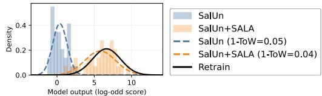  
Figure 1: Output log-odds distributions for a selected forgotten sample. We compare retraining with AU (i.e., SalUn [12]) with and without SALA under the score in Eq. (5). SALA moves the distribution closer to the retraining reference.

behavior. For each sample x, SALA minimizes the sample’s z-score to its assigned target distribution, driving the output toward the prescribed distribution.

Beyond empirically reducing the per-sample gap-to-retrain of AU methods, SALA provides a provable upper bound on this gap measured by DNO. Moreover, it reduces the strong hyperparameter sensitivity of existing AU methods, which are often tuned heuristically and can degrade sharply under poor configurations. SALA mitigates this issue through its z-score, which serves as an explicit per-sample alignment signal. From this signal, we define InDist, the fraction of samples whose outputs lie within a preset z-band around their assigned targets. InDist supports two complementary automated

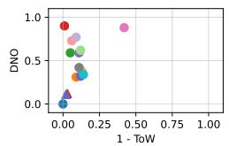

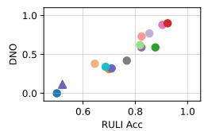  
(a) DNO vs ToW  
(b) DNO vs RULI  
Figure 2: Gap-to-retrain evaluations for AU. ToW measures comprehensive dataset-average gap (see (1)). Triangles denote AU results assisted by SALA.

mechanisms: hyperparameter selection and a stop criterion. For the former, SALA runs a fast probe with only a few unlearning steps and chooses the configuration that maximizes InDist. For the latter, SALA stops once InDist exceeds a high threshold, such as 0.95. This improves AU robustness to hyperparameters and avoids unnecessary updates. Finally, since InDist imposes an explicit distributional constraint, it also yields a theoretical upper bound on SALA’s DNO.

However, constraining InDist in SALA requires access to the full original training set, which may be unrealistic in some settings. We therefore introduce a forget-target-only variant that aligns only forget samples to $Q _ { \mathrm { o u t } } ( \cdot \mid x )$ , for AU methods with limited access to the retain set. When the underlying AU method satisfies the utility preservation condition in Eq. 16, this variant still yields an upper bound on DNO under a single InDist constraint on forget samples.

The main bottleneck of SALA is estimating $Q _ { \mathrm { i n } } ( \cdot \mid x )$ and $Q _ { \mathrm { o u t } } ( \cdot \mid x )$ for each training sample x. These targets can be estimated once during model development and reused across unlearning requests. One direct solution uses shadow-model estimation [13], which trains models under different forget-retain splits and aggregates their outputs. This pipeline resembles the memorization-estimation step used by AU methods such as SUM [40]. If compatible member and non-member score statistics already exist, SALA can reuse them for target estimation. However, shadow-model estimation is expensive and costs tens of standard training runs. To avoid this overhead, we propose an efficient estimator that obtains both targets and the model in a single training run. It uses a split–merge training scheme. In the middle stage, two models train on complementary subsets, so each sample is in-training for one model and out-of-training for the other. In the late stage, Federated Averaging merges the two models [23]. Finally, checkpoint ensembles collected during training then estimate $Q _ { \mathrm { i n } } ( \cdot \mid x )$ and $Q _ { \mathrm { o u t } } ( \cdot \mid x )$

In summary, this work makes the following contributions:

• We propose a sample-grained approximate unlearning (AU) framework. It monitors and guides alignment to retraining at the individual-sample level.

• SALA provides a theoretical upper bound on the sample-grained gap-to-retrain metric $( i . e .$ DNO), yielding guarantees for AU at the sample level.

• We introduce SMSE, which estimates per-sample member and non-member distributions with split–merge training and segment ensembles. SMSE reduces preparation from multiple shadow-model trainings to a single model training run.

• We evaluate SALA on classification and generative tasks with diverse AU methods. Figure 2 shows that SALA reduces DNO by up to 86.67%, keeps a small dataset-level gap to retraining (i.e., 1-ToW), and remains robust without manual hyperparameter tuning.

## 2 Problem Definition

## 2.1 Machine Unlearning Notations

Machine unlearning studies how to update a trained model so that the influence of a designated subset of its training data is removed. Let $f _ { \theta }$ denote a model with parameters $\theta ,$ trained on a dataset $D \sim \mathcal { D }$ Upon a deletion request supported by the right to beforgotten (Article 17 of the GDPR [11]), a forget set $D _ { \mathrm { f } } \subseteq D$ is specified and the remaining retain set is denoted as $D _ { \mathrm { r } } = D \backslash D _ { \mathrm { f } }$ . Let $\mathcal { A } : D  \mathcal { R }$ be a learning algorithm that maps a dataset to a model in the output space R (e.g., neural network parameters), and let U be an approximate unlearning (AU) algorithm. The retrained model is defined as $f _ { \theta ^ { \ast } }$ , with $\theta ^ { * } = \mathcal { A } ( D _ { \mathrm { r } } )$ . The unlearned model is $f _ { \theta _ { u } } = \mathcal { U } \big ( A ( D ) , D _ { \mathrm { f } } , D \big )$ . AU aims to make $\theta _ { u }$ behave similarly to $\theta ^ { * }$ while being substantially more efficient than rerunning A from scratch on $D _ { \mathrm { r } }$

## 2.2 Evaluation for Approximate Unlearning (AU)

We evaluate approximate unlearning (AU) along four dimensions [4, 27]: (i) efficacy, i.e., how close the unlearned model is to the exact-retraining result and how much utility it keeps; (ii) privacy, i.e., whether deleted samples can be detected by inference attacks; and (iii) efficiency, i.e., the compute cost of unlearning, commonly summarized by run-time. In addition, we propose (iv) robustness, which captures AU sensitivity to hyperparameters and run-to-run variance.

## 2.2.1 Efficacy Metrics for AU

Efficacy is assessed at two levels: dataset-level and sample-grained. Most existing metrics are dataset-level and quantify the gap-to-retrain under a chosen observable. For an AU unlearned model $f _ { \theta _ { u } }$ , smaller gaps to the retrained model $f _ { \theta ^ { \ast } }$ ∗ indicate higher unlearning efficacy.

Dataset-level metrics. This gap is measured between $f _ { \boldsymbol { \theta } _ { \imath } }$ and $f _ { \theta ^ { \ast } }$ on three datasets: test $D _ { \mathrm { t } }$ , retain $D _ { \mathrm { r } }$ , and forget $D _ { \mathrm { f } }$ . For classification, the metrics are accuracy: test accuracy (TA), retain accuracy (RA), and forget accuracy (FA). For text generative tasks, the metrics are text perplexity (PPL): T-PPL, R-PPL, and F-PPL. These gaps are aggregated by the Tug-of-War (ToW) score [40]:

$$
\mathrm { T o W } ( M _ { 1 } , M _ { 2 } , M _ { 3 } ) = \prod _ { i = 1 } ^ { 3 } \left( 1 - \frac { d ( M _ { i } ( \theta _ { u } ) , M _ { i } ( \theta ^ { * } ) ) } { M _ { i } ( \theta ^ { * } ) } \right) ,\tag{1}
$$

where $M _ { i } ( \theta )$ is a metric value of model $f _ { \theta }$ (e.g., TA/RA/FA or T-PPL/R-PPL/F-PPL), and $d ( \cdot , \cdot )$ is the absolute difference between two metric values.

Sample-grained metrics reveal finer gaps. Sample-grained metrics compare AU with exact retraining at the level of individual samples. For a fixed sample x, they measure the discrepancy between the distribution of an observable score s induced by the AU model output and the corresponding distribution under exact retraining. This paper introduces Distribution Non-Overlap (DNO) to quantify individual-sample distributional deviations of AU from retraining under both the retain and forget roles. Let $\bar { P _ { \mathrm { r } } ( s \mid x ) }$ and $P _ { \mathrm { f } } ( s \mid x )$ denote the estimated score distributions produced by AU when x is treated as a retain sample (member) and a forget sample (non-member), respectively. $P _ { \mathrm { r } } ( s \mid x )$ and $P _ { \mathrm { f } } ( s \mid x )$ are estimated over N independent runs in which x repeatedly takes the corresponding role. Let $Q _ { \mathrm { i n } } ( s \mid x )$ and $Q _ { \mathrm { o u t } } ( s \mid x )$ be their exact-retraining counterparts. For reporting, DNO summarizes these individual-sample discrepancies as

$$
\mathrm { D N O } = \mathbb { E } _ { x } \frac { 1 } { 2 } \Bigg [ \left( 1 - \int \operatorname* { m i n } \bigl ( P _ { \mathrm { r } } ( s \mid x ) , Q _ { \mathrm { i n } } ( s \mid x ) \bigr ) d s \right) + \left( 1 - \int \operatorname* { m i n } \bigl ( P _ { \mathrm { f } } ( s \mid x ) , Q _ { \mathrm { o u t } } ( s \mid x ) \bigr ) d s \right) \Bigg ] .\tag{2}
$$

Smaller DNO indicates smaller sample-level distributional discrepancies from retraining on average.

## 2.2.2 Privacy Metrics for AU

This paper considers two AU privacy evaluation cases that differ in the attacker’s knowledge of the unlearning procedure: a legacy attacker that ignores unlearning, and an unlearning-aware attacker that knows the unlearning algorithm [18]. Both cases are evaluated via membership inference attack (MIA) [34], which takes forget samples as positives and held-out test samples as negatives. The legacy setting is reported as MIA efficacy [21]. The unlearning-aware setting is instantiated with RULI [30], a recent unlearning-specific MIA evaluation framework. For both settings, we use the best MIA accuracy as the primary metric. In both cases, the attacker estimates score densities from shadow models and applies the same likelihood-ratio rule; the hypotheses $( H _ { 1 } , H _ { 0 } )$ change with attacker knowledge. Specifically, the legacy case compares the member state $( x \in D )$ against the non-member state $( x \notin D )$ , as in LiRA [6], while the unlearning-aware case compares the trained-then-unlearned state $( x \in D _ { \mathrm { f } } )$ against the never-trained state $( x \notin D )$ , using scores computed on the unlearned model, as in RULI [30]. Concretely,

$$
\Lambda ( x ) = \frac { p \big ( s ( x ) \mid H _ { 1 } \big ) } { p \big ( s ( x ) \mid H _ { 0 } \big ) } , \mathrm { p r e d i c t m e m b e r i f } \Lambda ( x ) > \tau _ { \mathrm { M I } } .\tag{3}
$$

For the legacy case, $( H _ { 1 } , H _ { 0 } ) = ( x \in D , x \notin D )$ ; for the unlearning-aware case, $( H _ { 1 } , H _ { 0 } ) = ( x \in$ $D _ { f } , \ x \notin \mathbf { \bar { \cal D } } )$ with score $s ( x )$ computed on the unlearned model.

## 2.2.3 Robustness Criteria

Robustness measures sensitivity to hyperparameter choices. Let ${ \cal K } \triangleq \{ \arg _ { i } \} _ { i = 1 } ^ { n }$ denote the set of evaluated hyperparameter settings. For an efficacy metric $\textit { M } ( e . g .$ , ToW or DNO), robustness is measured by the worst–best range (i.e., fluctuation) over $\kappa \colon$

$$
\begin{array} { r } { \operatorname { R a n g e } ( M ) = \operatorname* { m a x } _ { \operatorname { a r g } \in { \mathcal K } } M _ { \mathrm { a r g } } - \operatorname* { m i n } _ { \operatorname { a r g } \in { \mathcal K } } M _ { \mathrm { a r g } } . } \end{array}\tag{4}
$$

Smaller Range(M) indicates higher robustness.

## 3 Sample-Grained Unlearning Framework

This section introduces sample-grained likelihood alignment (SALA), an auxiliary framework that improves approximate unlearning (AU) by explicitly aligning the predicted likelihood of each sample with its target distribution, as shown in Figure 3. For a forget sample $x \in D _ { \mathrm { f } }$ , SALA aligns the prediction with the non-member distribution $Q _ { \mathrm { o u t } } ( \cdot \mid x )$ . For a retain sample $x \in D _ { \mathrm { r } }$ , SALA aligns the prediction with the member distribution $Q _ { \mathrm { i n } } ( \cdot \mid x )$ . SALA measures this alignment with a per-sample z-score, which both defines the guidance loss and serves as a sample-level stopping criterion (Section 3.2). When a sufficiently large fraction of samples satisfy this criterion, SALA bounds the per-sample gap to retraining, as measured by DNO (Section 3.3). We also provide a related SALA variant that constrains only forget samples and admits a DNO upper bound under additional conditions on the base unlearning algorithm (Section 3.4).

SALA Framework. Figure 3 shows the four-step SALA workflow. First, SALA prepares per-sample reference statistics for ${ \bar { Q } } _ { \mathrm { i n } } ( \cdot \mid x )$ and $Q _ { \mathrm { o u t } } ( \cdot \mid \bar { x } )$ . It also identifies a hard-forget subset $\mathbf { \bar { \mathit { D } } _ { \mathrm { h f } } } \subseteq \mathbf { \bar { \mathit { D } } _ { \mathrm { f } } }$ whose member and non-member distributions are more separable and thus harder to erase. Second, a fast probe screens candidate hyperparameters ${ \mathcal { K } } \triangleq \{ \arg _ { i } \} _ { i = 1 } ^ { n }$ with a few unlearning steps. The probe selects the candidate that best satisfies InDist (Eq. 8), which measures the fraction of samples whose outputs fall within the target z-band. Third, SALA uses the selected arg in the full unlearning stage and augments the base update rule U with a per-sample guidance loss. Finally, SALA monitors full-data InDist online and returns $\theta _ { u }$ once InDist exceeds a preset threshold. Appendix A provides the pseudo-code.

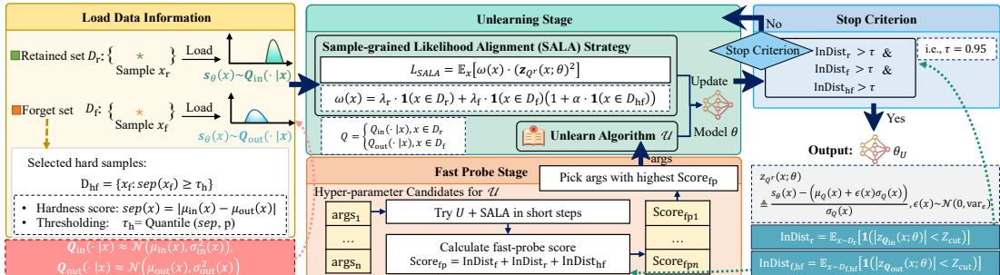  
Figure 3: Overview of SALA. SALA augments a base unlearning U with sample-wise distributionalignment guidance losses, fast-probe hyperparameter selection, and sample-level stop criterion.

## 3.1 Definitions

Score $s _ { \theta } ( x )$ . SALA uses an output score $s _ { \theta } ( x )$ for distribution alignment, abbreviated as $s ( x )$ or s when clear from context. For classification with logits $g _ { \theta } ( x ) \in \mathbb { R } ^ { C }$ and label $y ,$ we define $g _ { \theta } ( x ) \in \mathbb { R } ^ { C }$ and label $y ,$ define

$$
s _ { \theta } ( x ) \triangleq \log { \frac { p _ { \theta } ( y \mid x ) } { 1 - p _ { \theta } ( y \mid x ) } } ,\tag{5}
$$

where $p _ { \theta } ( y \mid x ) = \operatorname { s o f t m a x } ( g _ { \theta } ( x ) ) _ { y }$ is the predicted probability of the true class. The log-odds score is unbounded and retains distinctions when the probability is close to 0 or 1. Prior empirical evidence [6] shows that the score distribution for a fixed sample across runs is approximately Gaussian, motivating Gaussian modeling of the per-sample reference scores. For generation, we define the score as the per-token cross-entropy loss. We further validate this Gaussian approximation experimentally in Appendix F.1.

Per-sample reference distributions. Following prior empirical findings [6], we define the member and non-member target output distributions for each sample x as

$$
\begin{array} { r } { Q _ { \mathrm { i n } } ( \cdot \mid x ) \approx \mathcal { N } \big ( \mu _ { \mathrm { i n } } ( x ) , \sigma _ { \mathrm { i n } } ^ { 2 } ( x ) \big ) , \qquad Q _ { \mathrm { o u t } } ( \cdot \mid x ) \approx \mathcal { N } \big ( \mu _ { \mathrm { o u t } } ( x ) , \sigma _ { \mathrm { o u t } } ^ { 2 } ( x ) \big ) , } \end{array}\tag{6}
$$

z-score with shifted mean for distribution match. Let $\mu _ { Q } ( x )$ and $\sigma _ { Q } ( x )$ denote the mean and standard deviation of the target distribution for x, where $Q = Q _ { \mathrm { i n } }$ for retain samples and $Q = Q _ { \mathrm { o u t } }$ for forget samples. To avoid the degenerate solution where $s _ { \theta } ( x )$ matches $\mu _ { Q } ( x )$ and the effective variance collapses, for each unlearning run, we compute the z-score with a shifted mean:

$$
z _ { Q ^ { r } } ( x ; \theta ) \triangleq \frac { s _ { \theta } ( x ) - \mu _ { Q } ^ { r } ( x ) } { \sigma _ { Q } ( x ) } , \qquad \mu _ { Q } ^ { r } ( x ) \triangleq \mu _ { Q } ( x ) + \epsilon ( x ) \sigma _ { Q } ( x ) ,\tag{7}
$$

where $\epsilon ( x ) \sim { \mathcal { N } } ( 0 , \operatorname { v a r } _ { \epsilon } )$ is a fixed random offset sampled once per x for each run. Small $\left| z _ { Q r } ( x ; \theta ) \right|$ means the current output $s _ { \theta } ( x )$ lies in a high-density region of the (regularized) target.

InDist metric. To explicitly monitor distribution alignment at the sample level, we define InDist as the fraction of samples whose outputs lie within a fixed z-band:

$$
\mathrm { I n D i s t } ( S ; \theta ) = \mathbb { E } _ { x \sim S } \left[ { \bf 1 } \big ( \vert z _ { Q ^ { r } } ( x ; \theta ) \vert < Z _ { \mathrm { c u t } } \big ) \right] ,\tag{8}
$$

where $S \in \{ D _ { \mathrm { r } } , ~ D _ { \mathrm { f } } , ~ D _ { \mathrm { h f } } \}$ and $Z _ { \mathrm { c u t } }$ is a fixed cutoff. InDist takes values in [0, 1], and a larger value indicates that more samples fall within their target distributions.

## 3.2 SALA Hyper-parameter Fast Probe, Unlearning Guidance, and Stop Criterion

Hyper-parameter fast probe. Each candidate arg $\in \kappa$ is evaluated by running only a few unlearning steps from the same pre-unlearning state and scoring coverage, $e . g .$ , InDist $( D _ { \mathrm { r } } ; \theta )$ + InDist $( D _ { \mathrm { f } } ; \theta )$ + InDist $( D _ { \mathrm { h f } } ; \theta )$ . The best candidate with the highest score is then used for the unlearning, while all probe updates are discarded.

SALA guidance in unlearning. SALA augments the unlearning objective with the following sample-wise distribution-alignment loss:

$$
L _ { \mathrm { S A L A } } ( \boldsymbol { \theta } ) = \mathbb { E } _ { \boldsymbol { x } } \big [ \boldsymbol { \omega } ( \boldsymbol { x } ) z _ { Q ^ { r } } ( \boldsymbol { x } ; \boldsymbol { \theta } ) ^ { 2 } \big ] .\tag{9}
$$

The $z _ { Q r } ( x ; \theta ) ^ { 2 }$ term pulls outputs toward the target shifted mean. Sample weights are

$$
\omega ( x ) = \lambda _ { \mathrm { r } } { \bf 1 } [ x \in D _ { \mathrm { r } } ] + \lambda _ { \mathrm { f } } ( 1 + \alpha { \bf 1 } [ x \in D _ { \mathrm { h f } } ] ) { \bf 1 } [ x \in D _ { \mathrm { f } } ] ,\tag{10}
$$

where $\lambda _ { \mathrm { r } } , \lambda _ { \mathrm { f } } > 0$ balance retain and forget guidance, and $\alpha \geq 0$ emphasizes on hard forget samples.

InDist-guided stop criterion. Unlearning stops once coverage exceeds a target threshold τ:

$$
\mathrm { I n D i s t } ( S ; \theta ) \ge \tau , \forall S \in \{ D _ { \mathrm { r } } , D _ { \mathrm { f } } , D _ { \mathrm { h f } } \}\tag{11}
$$

This makes the stopping decision explicit at the sample level and avoids ad-hoc step budgets.

## 3.3 Theoretical Guarantee for SALA’s DNO Upper Bound

This section derives an upper bound on DNO in (2) from the InDist constraint imposed by the SALA stop criterion. We first bound the overlap gap for each sample and then average over the set.

Setup. Fix a sample x with target distribution Q. Let the SALA-unlearned model distribution induce

$$
X \sim Q ^ { \mathrm { S A L A } } ( \cdot \mid x ) = \mathcal { N } \big ( \mu ^ { \mathrm { S A L A } } ( x ) , ( \sigma ^ { \mathrm { S A L A } } ( x ) ) ^ { 2 } \big ) .
$$

Define $\begin{array} { r } { \Delta ( x ) \triangleq \frac { \mu ^ { \mathrm { S A L A } } ( x ) - \mu _ { Q } ( x ) } { \sigma _ { Q } ( x ) } , \rho ( x ) \triangleq \frac { \sigma ^ { \mathrm { S A L A } } ( x ) } { \sigma _ { Q } ( x ) } , \eta ( x ) \triangleq \frac { X - \mu ^ { r } ( x ) } { \sigma _ { Q } ( x ) } . } \end{array}$

Theorem 3.1 (DNO upper bound from $\mathrm { S A L A } )$ . Assume that SALA makes the InDist constraint hold for x:

$$
\mathbb { P } _ { X \sim Q ^ { \mathrm { S A L A } } ( \cdot | x ) } \left( \left| \frac { X - \mu _ { Q } ^ { r } ( x ) } { \sigma _ { Q } ( x ) } \right| < Z _ { \mathrm { c u t } } \right) \ \ge \ \tau .\tag{12}
$$

The mean shift in (7) induces variance expansion, which gives a non-degenerate lower bound on the effective scale:

$$
\begin{array} { r } { \rho _ { \mathrm { m i n } } \triangleq \operatorname* { m a x } \Bigl ( 0 , \mathrm { v a r } _ { \epsilon } - \mathrm { C o v } \bigl ( \epsilon ( x ) , \eta ( x ) \bigr ) \Bigr ) . } \end{array}
$$

$\begin{array} { r } { I f \rho ( x ) \in [ \rho _ { \operatorname* { m i n } } , \frac { Z _ { \mathrm { c u t } } } { q } ] } \end{array}$ with $\rho _ { \mathrm { m i n } } > 0 ,$ , then the per-sample overlap gap satisfies

$$
1 - \int \operatorname* { m i n } \bigl ( Q ^ { \mathrm { S A L A } } ( s \mid x ) , Q ( s \mid x ) \bigr ) d s \leq \sqrt { 2 \bigl ( 1 - \mathrm { B C } _ { \mathrm { m i n } } \bigr ) } ,\tag{13}
$$

where $\mathrm { B C } _ { \mathrm { m i n } }$ is the worst-case Bhattacharyya coefficient [22] over thefeasible $( \Delta , \rho )$ region:

$$
\mathrm { B C } _ { \mathrm { m i n } } = \operatorname* { m i n } _ { \rho \in [ \rho _ { \mathrm { m i n } } , \frac { Z _ { \mathrm { c u t } } } { \sigma } ] } \left[ \sqrt { \frac { 2 \rho } { 1 + \rho ^ { 2 } } } \ \exp \left( - \frac { ( Z _ { \mathrm { c u t } } - \rho q ) ^ { 2 } } { 4 ( 1 + \rho ^ { 2 } ) } \right) \right] , \qquad q \triangleq \Phi ^ { - 1 } \left( \frac { 1 + \tau } { 2 } \right) .\tag{14}
$$

Consequently, the sample-averaged DNO in (2) is bounded by the same right-hand side as (13):

$$
\begin{array} { r } { \mathrm { D N O } \le \sqrt { 2 \bigl ( 1 - \mathrm { B C } _ { \mathrm { m i n } } \bigr ) } . } \end{array}\tag{15}
$$

The proof of Theorem 3.1 is provided in Appendix B.

Instantiation. For a sanity check, a simplifying assumption $\mathrm { C o v } ( \epsilon , \eta ) = 0$ is adopted. Under an easy-to-achieve setting $( \tau = 0 . 9 5 , Z _ { \mathrm { c u t } } \bar { = } 2 , \epsilon = \mathrm { c l i p } ( \bar { \mathcal { N } } ( 0 , 1 ) , \pm 1 . 8 ) )$ , and assuming exact access to $Q _ { \mathrm { i n } } ( \cdot \mid x )$ and $Q _ { \mathrm { o u t } } ( \cdot \mid x )$ , Theorem 3.1 yields a closed-form DNO upper bound of about 0.10. This bound matches the empirical DNO of SALA, about 0.11, in Section 5.3.

## 3.4 SALA with Access Only to the Forget Set and Its DNO Guarantees

To accommodate unlearning settings with no access to retain samples, we further relax SALA by removing its dependence on the retain set in all stages where it is used, including the fast probe, the unlearning guidance, and the stop criterion. In other words, in this variant, SALA no longer explicitly optimizes any term involving $x \in D _ { \mathrm { r } }$

Even under this one-sided constraint, SALA still admits DNO guarantees as long as the base unlearning algorithm U provides a condition on $D _ { \mathrm { r } }$ that can equivalently replace InDist $( D _ { \mathrm { r } } ; \theta )$ criterion. Corollary 3.2 summarizes this claim, with the proof given in Appendix C.

Corollary 3.2 (DNO upper bound for $\mathrm { S A L A }$ with forget-set access only). Assume that the base unlearning algorithm U satisfies thefollowing retain-consistency condition:

$$
L _ { r } ( \theta ) \triangleq \mathbb { E } _ { x \sim D _ { \mathrm { r } } } \left[ \left( \frac { s _ { \theta } ( x ) - s _ { \theta _ { 0 } } ( x ) } { \sigma _ { \mathrm { i n } } ( x ) } \right) ^ { 2 } \right] \leq ( 1 - \tau ) Z _ { \mathrm { c u t } } ^ { 2 } ,\tag{16}
$$

where $\theta _ { 0 }$ denotes the model before unlearning. Then the DNO upper bound in Theorem 3.1 continues to hold for SALA with access only to the forget set.

## 4 Efficient Estimation of Per-Sample (Non-)Member Distributions

SALA requires the per-sample member and non-member output distributions in Eq. (6). A straightforward baseline is the shadow-model estimation [6], which trains multiple models on different forget-retain splits and aggregates their outputs. Compatible member and non-member score statistics retained from a shadow-model memorization pipeline, as used in SUM [40], can be reused to estimate these distributions. However, the shadow-model approach itself is generally too expensive. Therefore, the technical challenge for SALA is to estimate the per-sample distributions for all training samples at a cost comparable to a single training run, while also producing the target model itself.

## 4.1 Method: Split–Merge Training with Segment Ensemble (SMSE) Estimation

This paper proposes SMSE to estimate the distributions for every x using one structured training run that also produces the final model. In standard training, estimating $\bar { Q } _ { \mathrm { o u t } } ( \cdot \mid x )$ is challenging: every sample is always in-training, so no true non-member state exists. SMSE estimates non-member behavior by splitting the training set into two complementary halves and training two branches from shared warmup weights; each sample is excluded from one branch during half-data training. A merge stage then recovers a single final model via Federated Averaging [23]. To capture training randomness and approximate training-induced variability, SMSE uses an ensemble of late-stage checkpoints rather than many independent full retrains.

Overview. SMSE consists of four stages: (1) Split and warmup: the training set D is split into two disjoint subsets A and $B ,$ followed by a warmup training on D that initializes shared weights; (2) Half-data training: two models are trained independently, producing $\theta _ { A }$ from A and $\theta _ { B }$ from B; (3) Merge: $\theta _ { A }$ and $\theta _ { B }$ are merged using Federated Averaging [23], and the merged model is then fine-tuned on $A \cup B ; ( 4 )$ Segment ensemble: checkpoints from the A-model and B-model are aggregated as an ensemble to estimate per-sample score moments. Appendix A provides the SMSE pseudo-code.

Segment-ensemble estimation of per-sample moments. Let $s _ { \theta } ( x )$ denote the scalar score in (5). Let $\{ \theta _ { A } ^ { ( m ) } \} _ { m = 1 } ^ { M }$ and $\{ \theta _ { B } ^ { ( m ) } \} _ { m = 1 } ^ { M }$ be M late-stage checkpoints from the two half-data trainings. For each sample x, define role-specific checkpoints $\theta _ { t } ^ { ( m ) } ( x )$ for $t \in \{ \mathrm { i n , o u t } \}$ : if $x \in A$ , then $\theta _ { \mathrm { i n } } ^ { ( m ) } ( x ) = \theta _ { A } ^ { ( m ) }$ and $\theta _ { \mathrm { o u t } } ^ { ( m ) } ( x ) = \theta _ { B } ^ { ( m ) } ; \mathrm { i f } x \in B$ , the two roles are reversed. SMSE then estimates

$$
\begin{array} { r } { \hat { \mu } _ { t } ( x ) = \cfrac { 1 } { M } \sum _ { m = 1 } ^ { M } s _ { \theta _ { t } ^ { ( m ) } ( x ) } ( x ) , \qquad \hat { \sigma } _ { t } ^ { 2 } ( x ) = \cfrac { 1 } { M } \sum _ { m = 1 } ^ { M } \binom { s } { \theta _ { t } ^ { ( m ) } ( x ) } ( x ) - \hat { \mu } _ { t } ( x ) \big ) ^ { 2 } , } \end{array}\tag{17}
$$

for $t \in \{ \mathrm { i n , o u t } \}$ . These estimates define ${ \hat { Q } } _ { \mathrm { i n } } ( \cdot \mid x )$ and $\hat { Q } _ { \mathrm { o u t } } ( \cdot \mid x )$ in (6) for all x, at a cost close to a single training run.

## 4.2 Effect of Distribution Estimation Error on SALA’s DNO Bound in Theorem 3.1

The DNO bound in Theorem 3.1 assumes exact target distributions from multiple retrained shadow models. In practice, SALA uses lightweight SMSE estimates instead, which introduces distribution estimation error and thereby affects the bound. Next, we quantify that effect and derive the corresponding adjusted DNO bound.

The key point is that Theorem 3.1 still controls the discrepancy induced by SALA, but now with respect to the estimated target distribution ${ \hat { Q } } ( \cdot \mid x )$ by SMSE rather than the exact target distribution $Q ( \cdot \mid x )$ . Consequently, the DNO with respect to ${ \hat { Q } } ( \cdot \mid x )$ can be decomposed into two parts: an estimation error term and a SALA-induced term. This is summarized in the following corollary.

Corollary 4.1 (Adjusted DNO Bound under Distribution Estimation Error). For afixed sample x and afixed role (member or non-member), let $Q ( \cdot \mid x )$ denote the true target distribution, let ${ \hat { Q } } ( \cdot \mid x )$ denote its estimate, and let $Q ^ { \operatorname { S A L A } } ( \cdot \mid x )$ denote the distribution induced by SALA. Then

$$
\mathrm { D N O } ( x ) \triangleq \mathrm { T V } \big ( Q ^ { \mathrm { S A L A } } ( \cdot \ | \ x ) , Q ( \cdot \ | \ x ) \big ) \leq \underbrace { \mathrm { T V } \big ( Q ( \cdot \ | \ x ) , \hat { Q } ( \cdot \ | \ x ) \big ) } _ { \mathrm { D N O } _ { \mathrm { e s t } } ( x ) } + \underbrace { \mathrm { T V } \big ( Q ^ { \mathrm { S A L A } } ( \cdot \ | \ x ) , \hat { Q } ( \cdot \ | \ x ) \big ) } _ { \mathrm { D N O } _ { \hat { Q } } ( x ) } .\tag{18}
$$

Here, $\mathrm { D N O } _ { \mathrm { e s t } } ( x )$ is the distribution estimation error, which is explicitly bounded in Appendix D. $\mathrm { D N O } _ { \hat { Q } } ( x )$ is the per-sample DNO component with respect to the estimated ${ \hat { Q } } ( x )$ . By Theorem 3.1 applied to ${ \hat { Q } } ( \cdot \mid x )$ , we have $\mathrm { D N O } _ { \hat { Q } } ( \cdot \mid x ) \le \sqrt { 2 \big ( 1 - \widehat { \mathrm { B C } } _ { \mathrm { m i n } } \big ) }$

## 5 Experiments

We evaluate whether SALA enables sample-grained approximate unlearning. Specifically, we test whether dataset-level aggregate metrics hide per-sample deviation from exact retraining, whether SALA reduces this deviation under DNO while preserving utility, privacy, and efficiency, and whether SMSE provides accurate target estimates for SALA. Code is available at https: $: / / \mathsf { g } \dot { \mathsf { 1 } }$ thub.com/ SALA-Unlearning/Sala-unlearning.

## 5.1 Experimental Setup

Datasets and models. We evaluate SALA on classification and generation tasks. For classification, we use CIFAR-10 [25] with ResNet-18 [19], and ImageNet-1000 [32] with ResNet-50. For generation, we use WikiText-103 [28] with GPT-2 [31]. Appendix E provides implementation details.

Table 1: Estimation evaluation of per-sample member and non-member distribution parameters.
<table><tr><td rowspan="2">Dataset</td><td rowspan="2">Method</td><td colspan="2"> ${ \pmb \mu _ { \mathrm { i n } } }$ </td><td colspan="2"> $\pmb { \mu _ { \mathrm { o u t } } }$ </td><td colspan="2"> $\pmb { \sigma _ { \mathrm { i n } } }$ </td><td colspan="2"> $\sigma _ { \mathrm { o u t } }$ </td><td rowspan="2"> $\mathrm { D N O } _ { \mathrm { e s t } } \downarrow$ </td><td rowspan="2">Cost↓</td></tr><tr><td></td><td>MSE↓ Pearson r↑</td><td></td><td>MSE↓ Pearson r↑ MSE↓</td><td></td><td></td><td>Pearson r↑ MSE↓ Pearson r↑</td><td></td></tr><tr><td rowspan="2">CIFAR-10</td><td>Laplace + SI</td><td>2.80</td><td>0.48</td><td>9.48</td><td>0.41</td><td>0.78</td><td>0.04</td><td>2.45</td><td>0.05</td><td>0.4580</td><td>1.24×</td></tr><tr><td>SMSE (Ours)</td><td>1.29</td><td>0.79</td><td>1.90</td><td>0.92</td><td>0.67</td><td>0.58</td><td>0.52</td><td>0.63</td><td>0.1801</td><td>1.00×</td></tr><tr><td rowspan="2">ImageNet-1000</td><td>Laplace + SI</td><td>0.74</td><td>0.90</td><td>4.23</td><td>0.45</td><td>0.92</td><td>0.03</td><td>2.72</td><td>0.04</td><td>0.4835</td><td>1.08×</td></tr><tr><td>SMSE (Ours)</td><td>0.28</td><td>0.98</td><td>0.31</td><td>0.98</td><td>0.59</td><td>0.62</td><td>0.67</td><td>0.52</td><td>0.1064</td><td>1.00×</td></tr><tr><td rowspan="2">WikiText-103</td><td>Laplace + SI</td><td>0.15</td><td>0.92</td><td>1.56</td><td>0.48</td><td>0.85</td><td>0.05</td><td>1.14</td><td>-0.08</td><td>0.3913</td><td>1.16×</td></tr><tr><td>SMSE (Ours)</td><td>0.0065</td><td>0.99</td><td>0.0067</td><td>0.99</td><td>0.47</td><td>0.65</td><td>0.56</td><td>0.68</td><td>0.0935</td><td>1.00×</td></tr></table>

Unlearning setup and metrics. We evaluate three unlearning scenarios: random sample unlearning [2], class-wise unlearning [12] for classification, and sequence unlearning [30] for generation. Sequence unlearning uses contiguous text segments as forget sets. We evaluate unlearning from efficacy, privacy, and runtime perspectives, following Section 2.2. DNO is computed over multiple unlearning tasks, with 64 tasks on CIFAR-10 and 16 tasks on ImageNet-1000 and WikiText-103. We compare against 12 approximate unlearning baselines on CIFAR-10. Due to memory constraints, we include five representative baselines on ImageNet-1000 and WikiText-103. All baselines use manually tuned hyperparameters, and Appendix E provides the baseline configurations and search protocol.

SALA and SMSE configuration. SALA is an auxiliary objective for iterative unlearning, so we pair it with SalUn [12] in the main experiments. Results on other AU backbones are consistent and are reported in Appendix F.7. We evaluate three variants: SALA with shadow-model targets, SALA-SMSE with SMSE-estimated targets, and SALA w/ $D _ { \mathrm { f } }$ only, which constrains only the forget set. Appendix E gives the full SALA and SMSE configurations, and Appendices F.3 and F.5 report the corresponding parameter ablations.

## 5.2 Evaluation of SMSE Estimation

We evaluate SMSE by comparing its estimates of $( \mu _ { \mathrm { i n } } , \sigma _ { \mathrm { i n } } , \mu _ { \mathrm { o u t } } , \sigma _ { \mathrm { o u t } } )$ in (6) against expensive shadow-model references and a lightweight single-run baseline. The shadow-model reference trains 64 models on CIFAR-10 and 16 models on ImageNet-1000 and WikiText-103 under different forget-retain splits, which incurs high computational cost. The single-run baseline uses a Laplace approximation to estimate $( \mu _ { \mathrm { i n } } , \sigma _ { \mathrm { i n } } )$ [9], sets $\mu _ { \mathrm { o u t } } ( x ) \approx \mu _ { \mathrm { i n } } ( x ) - \Delta \mu _ { \mathrm { S I } } ( x )$ using the self-influence shift $\Delta \mu _ { \mathrm { S I } } ( x )$ , and obtains $\sigma _ { \mathrm { o u t } } ( x )$ through the same uncertainty propagation [3].

Results. We measure estimation quality by MSE, Pearson correlation, and $\mathrm { D N O } _ { \mathrm { e s t } }$ against shadowmodel references, and report training cost relative to a standard training run. Table 1 shows that SMSE improves over Laplace+SI across all datasets and moments with 1.00× nominal training process. Appendix F.4 supplements the experiments with comprehensive computational costs. The gains are largest for non-member and variance estimates: on CIFAR-10, SMSE raises the correlation of $\mu _ { \mathrm { o u t } }$ from 0.41 to 0.92 and lowers $\mathrm { D N O } _ { \mathrm { e s t } }$ from 0.4580 to 0.1801. Figure 4 visualizes the per-sample agreement between SMSE estimates and shadow-model references, and Table 13 in Appendix F.6 reports the utility of SMSE-trained models. It indicates that SMSE preserves utility, with at most a 0.18% accuracy drop on vision tasks and a 0.99 PPL increase on WikiText-103 compared with standard training.

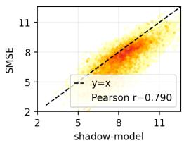  
(a) $\mu _ { \mathrm { i n } }$

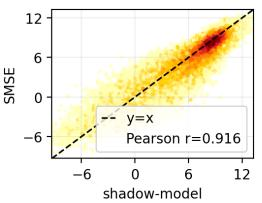  
(b) $\mu _ { \mathrm { o u t } }$

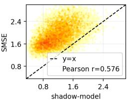  
(c) $\sigma _ { \mathrm { i n } }$

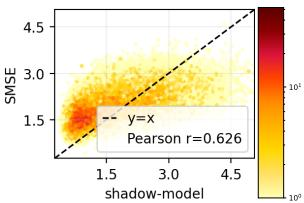  
(d) $\sigma _ { \mathrm { o u t } }$  
Figure 4: Per-sample agreement between SMSE-estimated moments and shadow-model references on CIFAR-10.

Table 2: Comprehensive comparison of approximate unlearning methods.
<table><tr><td>Method</td><td>TA(%) (T-PPL)</td><td>FA(%) (F-PPL)</td><td>RA(%) (R-PPL)</td><td>ToW ↑</td><td>DNO ↓</td><td>MIA efficacy (%)↓</td><td>RULI (%)↓</td><td>Time (s)↓</td></tr><tr><td colspan="9">CIFAR-10 (ResNet-18)</td></tr><tr><td>Retrain</td><td>93.84±0.21</td><td>93.68±0.28</td><td>100.00±0.01</td><td>1.00±0.00</td><td>0.0646±0.0022</td><td>50.57±0.25</td><td>50.00±0.00</td><td>1625.53±5.33</td></tr><tr><td>FT</td><td>89.04±1.13</td><td>92.32±1.20</td><td>95.84±1.10</td><td>0.90±0.01</td><td>0.3388±0.0053</td><td>52.09±0.22</td><td>70.01±0.73</td><td>242.01±42.25</td></tr><tr><td>GA</td><td>86.01±1.42</td><td>85.93±2.10</td><td>95.13±1.20</td><td>0.80±0.01</td><td>0.6228±0.0054</td><td>51.04±0.52</td><td>87.69±0.86</td><td>149.30±2.02</td></tr><tr><td>RL</td><td>88.94±0.71</td><td>87.63±0.90</td><td>98.08±0.60</td><td>0.87±0.02</td><td>0.6875±0.0059</td><td>55.10±0.21</td><td>82.35±14.31</td><td>321.32±7.70</td></tr><tr><td>IU</td><td>86.90±5.61</td><td>93.17±6.25</td><td>93.52±6.26</td><td>0.86±0.03</td><td>0.3982±0.0090</td><td>52.35±2.13</td><td>64.52±5.17</td><td>41.59±0.51</td></tr><tr><td>FF</td><td>76.11±7.42</td><td>80.85±8.08</td><td>80.83±8.11</td><td>0.57±0.03</td><td>0.8947±0.0234</td><td>53.30±0.15</td><td>90.39±8.41</td><td>2408.39±105.19</td></tr><tr><td>MinNorm-OG</td><td>88.12±1.28</td><td>94.90±1.19</td><td>94.91±1.22</td><td>0.88 ±0.02</td><td>0.6355±0.0075</td><td>57.31±0.49</td><td>81.81±1.75</td><td>60.20±7.75</td></tr><tr><td>SEMU</td><td>92.66±0.34</td><td>95.56±0.35</td><td>99.82±0.03</td><td>0.96±0.01</td><td>0.7390±0.0050</td><td>53.53±0.49</td><td>82.42±0.86</td><td>48.15 ±5.76</td></tr><tr><td>l1 sparsity</td><td>88.18±3.47</td><td>91.94±4.48</td><td>95.80±2.98</td><td>0.88±0.02</td><td>0.3376±0.0098</td><td>53.09±2.72</td><td>70.03±5.24</td><td>150.28±28.45</td></tr><tr><td>SalUn</td><td>92.36±0.45</td><td>95.29±0.57</td><td>98.61±0.36</td><td>0.95±0.01</td><td>0.9009±0.0015</td><td>51.87±0.21</td><td>92.38±0.28</td><td>221.92±96.37</td></tr><tr><td>RUM</td><td>91.66±0.47</td><td>92.96±0.49</td><td>96.89±0.39</td><td>0.94±0.01</td><td>0.7826±0.0062</td><td>50.88±0.22</td><td>85.35±1.37</td><td>375.29±83.05</td></tr><tr><td>SFRon</td><td>87.31±1.64</td><td>90.39±2.45</td><td>96.77±1.05</td><td>0.87±0.01</td><td>0.4518±0.0091</td><td>54.23±0.98</td><td>76.75±2.04</td><td>67.97±0.70</td></tr><tr><td>SCRUB</td><td>90.29±2.31</td><td>94.06±3.15</td><td>95.74±3.00</td><td>0.92±0.03</td><td>0.3644±0.0086</td><td>52.23±0.57</td><td>68.67±3.62</td><td>101.93±11.98</td></tr><tr><td>SALA</td><td>94.44±0.28</td><td>95.58±0.21</td><td>100.00±0.00</td><td>0.97±0.02</td><td>0.1365±0.0055</td><td>52.42±0.16</td><td>52.15±1.30</td><td>53.22±3.21</td></tr><tr><td>SALA-SMSE</td><td>94.25±0.27</td><td>95.13±0.17</td><td>99.97±0.01</td><td>0.98±0.01</td><td>0.2508±0.0056</td><td>54.28±0.36</td><td>55.97±0.53</td><td>56.47±5.35</td></tr><tr><td>SALA w/ Df only</td><td>93.75±0.29</td><td>94.49±0.30</td><td>99.75±0.08</td><td>0.99±0.01</td><td>0.2453±0.0042</td><td>53.37±0.34</td><td>56.75±2.49</td><td>59.35±6.26</td></tr><tr><td colspan="9">ImageNet-1000 (ResNet-50)</td></tr><tr><td>retrain</td><td>71.26±0.47</td><td>71.27±0.52</td><td>89.45±0.48</td><td>1.00±0.00</td><td>0.0277±0.0032</td><td>50.53±0.09</td><td>50.01±0.01</td><td>1.42e5±5.47e3</td></tr><tr><td>FT</td><td>68.36±0.39</td><td>72.65±0.64</td><td>80.89±0.15</td><td>0.85±0.02</td><td>0.3497±0.0090</td><td>52.31±0.14</td><td>65.42±0.42</td><td>1.93e4±7.52e2</td></tr><tr><td>GA</td><td>75.71±0.40</td><td>87.11±0.40</td><td>87.22±0.38</td><td>0.71±0.03</td><td>0.3931±0.0077</td><td>51.43±0.25</td><td>67.66±1.21</td><td>2.92e3±2.12e2</td></tr><tr><td>RL</td><td>74.64±1.33</td><td>74.95±0.25</td><td>76.28±1.87</td><td>0.77±0.05</td><td>0.7048±0.0052</td><td>54.96±0.35</td><td>86.29±1.15</td><td>2.76e4±1.10e4</td></tr><tr><td>l1 sparsity</td><td>67.92±0.43</td><td>71.50±1.70</td><td>80.65±0.28</td><td>0.86±0.03</td><td>0.3294±0.0093</td><td>52.20±0.18</td><td>69.40±1.55</td><td>9.65e3±1.05e3</td></tr><tr><td>SalUn</td><td>70.95±0.70</td><td>73.35±0.65</td><td>88.15±0.36</td><td>0.95±0.01</td><td>0.9256±0.0020</td><td>52.05±0.12</td><td>92.30±2.80</td><td>6.02e3±3.20e2</td></tr><tr><td>SALA</td><td>71.13±1.63</td><td>72.33±0.69</td><td>88.36±1.14</td><td>0.97±0.01</td><td>0.1268±0.0049</td><td>51.05±0.25</td><td>52.35±0.17</td><td>3.08e3±1.56e2</td></tr><tr><td>SALA-SMSE</td><td>71.79±4.43</td><td>73.92±3.31</td><td>88.06±1.05</td><td>0.94±0.01</td><td>0.1845±0.0056</td><td>52.35±0.44</td><td>54.33±0.47</td><td>2.72e3±3.32e2</td></tr><tr><td>SALA w/ Df only</td><td>71.49±0.92</td><td>73.31±1.43</td><td>88.25±0.85</td><td>0.95±0.01</td><td>0.2247±0.0061</td><td>52.12±0.13</td><td>54.42±0.35</td><td>2.84e3±1.65e2</td></tr><tr><td colspan="9">WikiText-103 (GPT-2)</td></tr><tr><td>Retrain</td><td>63.72±5.47</td><td>63.73±5.50</td><td>56.86±6.14</td><td>1.00±0.00</td><td>0.0178±0.0027</td><td>50.43±0.13</td><td>50.08±0.04</td><td>6.14e4±4.35e3</td></tr><tr><td>FT</td><td>61.25±0.47</td><td>58.85±0.53</td><td>56.85±0.48</td><td>0.89±0.02</td><td>0.2496±0.0052</td><td>52.08±0.52</td><td>52.66±0.11</td><td>1.72e3±2.15e2</td></tr><tr><td>GA</td><td>60.73±0.44</td><td>58.76±0.51</td><td>55.85±0.45</td><td>0.86±0.04</td><td>0.2421±0.0046</td><td>51.45±0.13</td><td>51.86±0.09</td><td>3.99e3±3.54e2</td></tr><tr><td>RL</td><td>63.80±4.10</td><td>60.61±4.28</td><td>59.88±3.88</td><td>0.90±0.03</td><td>0.2783±0.0061</td><td>52.73±0.52</td><td>53.69±0.63</td><td>6.02e2±9.47e1</td></tr><tr><td>l1 sparsity</td><td>61.25±0.47</td><td>58.85±0.53</td><td>56.85±0.48</td><td>0.89±0.03</td><td>0.2567±0.0083</td><td>51.35±0.43</td><td>52.66±0.11</td><td>2.16e3±1.49e2</td></tr><tr><td>SalUn</td><td>62.90±0.49</td><td>60.40±0.93</td><td>58.70±0.85</td><td>0.90±0.03</td><td>0.3014±0.0070</td><td>52.10±0.20</td><td>58.40±1.42</td><td>6.25e3±3.10e2</td></tr><tr><td>SALA</td><td>62.18±0.91</td><td>61.18±0.90</td><td>57.24±0.88</td><td>0.93±0.03</td><td>0.1048±0.0043</td><td>50.15±0.08</td><td>50.92±0.14</td><td>6.42e2+2.53e2</td></tr><tr><td>SALA-SMSE</td><td>62.70±0.76</td><td>60.90±0.93</td><td>57.40±0.95</td><td>0.93±0.02</td><td>0.1965±0.0058</td><td>51.20±0.18</td><td>51.96±0.33</td><td>7.90e2±1.62e2</td></tr><tr><td>SALA w/ Df only</td><td>63.63±0.46</td><td>61.29±0.85</td><td>58.12±0.74</td><td>0.94±0.02</td><td>0.2217±0.0064</td><td>51.72±0.21</td><td>51.79±0.14</td><td>7.69e2±1.86e2</td></tr></table>

## 5.3 Comprehensive Evaluation for Unlearning Methods

Table 2 compares SALA with representative approximate unlearning baselines on random sample unlearning and sequence unlearning. Class-wise unlearning is reported in Appendix F.9. The results show that aggregate gap-to-retraining metrics alone are insufficient to characterize approximate unlearning. On CIFAR-10, SalUn reaches ToW = 0.95, but its DNO remains 0.9009 and its RULI remains 92.38%. The same pattern appears on ImageNet-1000, where SalUn reaches ToW = 0.95 but still has DNO = 0.9256 and RULI = 92.30%. Thus, dataset-level similarity to retraining does not necessarily eliminate sample-level deviation or unlearning-aware privacy leakage.

SALA consistently reduces the sample-grained distributional gap while preserving utility and efficiency. Across CIFAR-10, ImageNet-1000, and WikiText-103, SALA achieves the lowest DNO among approximate methods, with DNO = 0.1365, 0.1268, and 0.1048, respectively. It also keeps RULI close to random guessing, with 52.15%, 52.35%, and 50.92% on the three datasets. Across all three datasets, SALA reduces runtime by more than an order of magnitude relative to retraining. SALA-SMSE and SALA w/ $D _ { \mathrm { f } }$ only have higher DNO than full SALA, which is consistent with estimation error and relaxed retain-side constraints, but they still keep DNO substantially below the corresponding SalUn baseline.

## 5.4 Robustness Evaluation for SALA and Baselines

Unlike Section 5.3, which reports tuned configurations, this subsection evaluates unlearning robustness under a broad learning-rate sweep. We test SalUn [12], SCRUB [26], and $\ell _ { 1 }$ sparsity [21] with five log-spaced learning rates from $1 0 ^ { - 4 }$ to $1 0 ^ { - 1 }$ and fix the epoch budget to 10.

Results. Figure 5 shows that the performance of base unlearning methods changes sharply across the sweep. SalUn has a ToW range of 0.55, and SCRUB has a DNO range of 0.28, which indicates unstable dataset-level and sample-level unlearning quality. SALA reduces this variation through fast-probe hyperparameter selection and InDist-based stopping. The red clouds show kernel density estimates of the baseline evaluation points and darker regions indicate higher density. In detail, with

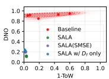

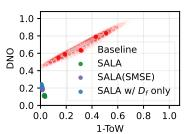  
(a) SalUn

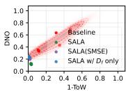  
(b) SCRUB  
(c) ℓ1 sparsity  
Figure 5: Robustness under hyperparameter sweeps for three unlearning methods. SALA substantially reduces performance fluctuation.

SALA and its variants, the ToW range drops to 0.03 for SalUn and 0.04 for SCRUB and $\ell _ { 1 }$ sparsity. Furthermore, the DNO range drops to 0.04 for SalUn and SCRUB and 0.06 for $\ell _ { 1 }$ sparsity. Overall, SALA stabilizes unlearning quality through automatic selection among the prescribed candidate configurations. Appendix F.2 reports the full results.

## 6 Related Work

Exact unlearning removes designated forget data by ensuring that it never participates in training. Retraining from scratch on the retain set gives the gold standard. Sharding-based methods such as SISA [2] reduce deletion cost, but exact unlearning remains expensive at modern scale. This cost motivates approximate unlearning [15].

Approximate unlearning keeps the pretrained model and updates it to reduce the influence of the forget set. This family can be divided into certified and empirical routes, depending on whether the update gives a formal indistinguishability guarantee with respect to exact retraining. Certified unlearning pursues this goal in parameter space and often converts unlearning error into a boundable indistinguishability gap with tools related to differential privacy [17]. These guarantees usually require extra assumptions and calibrated noise injection, which can limit performance on large and complex models [7, 24, 29]. Since these conditions are often impractical, empirical approximate unlearning has become the default route. It supports flexible updates and can match retraining under empirical metrics, so it is widely used in large-scale settings such as large language models [10, 38]. Common designs include fine-tuning [16], gradient ascent [36, 39], relabeling objectives [8, 16], and influence-based unlearning [15, 37]. However, this flexibility leaves two practical gaps. Empirical approximate unlearning usually lacks a theory-backed upper bound on the gap to retraining, and its performance can change sharply with hyperparameters. These gaps motivate SALA, which stabilizes approximate unlearning and provides a computable upper bound on the per-sample gap to retraining.

## 7 Conclusion

Approximate unlearning can reduce dataset-level gap to retraining, but our experiments show that small dataset-level discrepancy can still hide large sample-level deviations. We address this issue with SALA, a plug-in framework that uses per-sample likelihood alignment to steer each sample toward its role-dependent target distribution. Under the InDist criterion, SALA gives a computable upper bound on the sample-grained distribution gap measured by DNO. We further introduce SMSE, a low-overhead estimator for the per-sample member and non-member target distributions required by SALA. Across classification and generation tasks, SALA reduces DNO by up to 86.67% and improves robustness to unlearning hyperparameters.

## Acknowledgments and Disclosure of Funding

This work was supported by the Ministry of Science and Technology of the People’s Republic of China (National Key Research and Development Programme, Grant No: 2025YFE0200100), and the Research Grants Council (Grant No: 15208923, 15224124, and 25207224), Hong Kong SAR, China.

## References

[1] Jacob L. Block, Aryan Mokhtari, and Sanjay Shakkottai. Machine unlearning under overparameterization. CoRR, abs/2505.22601, 2025. doi: 10.48550/ARXIV.2505.22601. URL https://doi.org/10.48550/arXiv.2505.22601.

[2] Lucas Bourtoule, Varun Chandrasekaran, Christopher A Choquette-Choo, Hengrui Jia, Adelin Travers, Baiwu Zhang, David Lie, and Nicolas Papernot. Machine unlearning. In 2021 IEEE symposium on security and privacy (SP), pages 141–159. IEEE, 2021.

[3] Jonathan Brophy, Zayd Hammoudeh, and Daniel Lowd. Adapting and evaluating influenceestimation methods for gradient-boosted decision trees. Journal ofMachine Learning Research, 24(154):1–48, 2023.

[4] Xavier F Cadet, Anastasia Borovykh, Mohammad Malekzadeh, Sara Ahmadi-Abhari, and Hamed Haddadi. Deep unlearn: Benchmarking machine unlearning. arXiv preprint arXiv:2410.01276, 2024.

[5] Yinzhi Cao and Junfeng Yang. Towards making systems forget with machine unlearning. In 2015 IEEE symposium on security and privacy, pages 463–480. IEEE, 2015.

[6] Nicholas Carlini, Steve Chien, Milad Nasr, Shuang Song, Andreas Terzis, and Florian Tramer. Membership inference attacks from first principles. In 2022 IEEE symposium on security and privacy (SP), pages 1897–1914. IEEE, 2022.

[7] Eli Chien, Haoyu Wang, Ziang Chen, and Pan Li. Certified machine unlearning via noisy stochastic gradient descent. Advances in Neural Information Processing Systems, 37:38852– 38887, 2024.

[8] Vikram S. Chundawat, Ayush K. Tarun, Murari Mandal, and Mohan S. Kankanhalli. Can bad teaching induce forgetting? unlearning in deep networks using an incompetent teacher. In Brian Williams, Yiling Chen, and Jennifer Neville, editors, Thirty-Seventh AAAI Conference on Artificial Intelligence, AAAI 2023, Thirty-Fifth Conference on Innovative Applications of Artificial Intelligence, IAAI 2023, Thirteenth Symposium on Educational Advances in Artificial Intelligence, EAAI 2023, Washington, DC, USA, February 7-14, 2023, pages 7210–7217. AAAI Press, 2023. doi: 10.1609/AAAI.V37I6.25879.

[9] Erik Daxberger, Agustinus Kristiadi, Alexander Immer, Runa Eschenhagen, Matthias Bauer, and Philipp Hennig. Laplace redux – effortless bayesian deep learning. In Advances in Neural Information Processing Systems, volume 34, 2021.

[10] Taha Entesari, Arman Hatami, Rinat Khaziev, Anil Ramakrishna, and Mahyar Fazlyab. Constrained entropic unlearning: A primal-dual framework for large language models. arXiv preprint arXiv:2506.05314, 2025.

[11] European Parliament and Council of the European Union. Regulation (eu) 2016/679 of the european parliament and of the council of 27 april 2016. Official Journal of the European Union, 2016.

[12] Chongyu Fan, Jiancheng Liu, Yihua Zhang, Dennis Wei, Eric Wong, and Sijia Liu. Salun: Empowering machine unlearning via gradient-based weight saliency in both image classification and generation. In International Conference on Learning Representations, 2024.

[13] Vitaly Feldman and Chiyuan Zhang. What neural networks memorize and why: Discovering the long tail via influence estimation. Advances in neural information processing systems, 33: 2881–2891, 2020.

[14] Antonio Ginart, Melody Guan, Gregory Valiant, and James Y Zou. Making ai forget you: Data deletion in machine learning. Advances in neural information processing systems, 32, 2019.

[15] Aditya Golatkar, Alessandro Achille, and Stefano Soatto. Eternal sunshine of the spotless net: Selective forgetting in deep networks. In 2020 IEEE/CVF Conference on Computer Vision and Pattern Recognition, CVPR 2020, Seattle, WA, USA, June 13-19, 2020, pages 9301–9309. Computer Vision Foundation / IEEE, 2020. doi: 10.1109/CVPR42600.2020.00932.

[16] Laura Graves, Vineel Nagisetty, and Vijay Ganesh. Amnesiac machine learning. In Proceedings ofthe AAAI Conference on Artificial Intelligence, volume 35, pages 11516–11524, 2021.

[17] Chuan Guo, Tom Goldstein, Awni Hannun, and Laurens Van Der Maaten. Certified data removal from machine learning models. In Proceedings ofthe 37th International Conference on Machine Learning, volume 119 of Proceedings ofMachine Learning Research, pages 3832–3842, 2020.

[18] Jamie Hayes, Ilia Shumailov, Eleni Triantafillou, Amr Khalifa, and Nicolas Papernot. Inexact unlearning needs more careful evaluations to avoid a false sense of privacy. In 2025 IEEE Conference on Secure and Trustworthy Machine Learning (SaTML), pages 497–519. IEEE, 2025.

[19] Kaiming He, Xiangyu Zhang, Shaoqing Ren, and Jian Sun. Deep residual learning for image recognition. In 2016 IEEE Conference on Computer Vision and Pattern Recognition, CVPR 2016, Las Vegas, NV, USA, June 27-30, 2016, pages 770–778. IEEE Computer Society, 2016. doi: 10.1109/CVPR.2016.90.

[20] Zhehao Huang, Xinwen Cheng, JingHao Zheng, Haoran Wang, Zhengbao He, Tao Li, and Xiaolin Huang. Unified gradient-based machine unlearning with remain geometry enhancement. In Amir Globersons, Lester Mackey, Danielle Belgrave, Angela Fan, Ulrich Paquet, Jakub M. Tomczak, and Cheng Zhang, editors, Advances in Neural Information Processing Systems 38: Annual Conference on Neural Information Processing Systems 2024, NeurIPS 2024, Vancouver, BC, Canada, December 10 - 15, 2024, 2024.

[21] Jinghan Jia, Jiancheng Liu, Parikshit Ram, Yuguang Yao, Gaowen Liu, Yang Liu, Pranay Sharma, and Sijia Liu. Model sparsity can simplify machine unlearning. In Alice Oh, Tristan Naumann, Amir Globerson, Kate Saenko, Moritz Hardt, and Sergey Levine, editors, Advances in Neural Information Processing Systems 36: Annual Conference on Neural Information Processing Systems 2023, NeurIPS 2023, New Orleans, LA, USA, December 10 - 16, 2023, 2023.

[22] Thomas Kailath. The divergence and bhattacharyya distance measures in signal selection. IEEE transactions on communication technology, 15(1):52–60, 1967.

[23] Peter Kairouz, H Brendan McMahan, Brendan Avent, Aurélien Bellet, Mehdi Bennis, Arjun Nitin Bhagoji, Kallista Bonawitz, Zachary Charles, Graham Cormode, Rachel Cummings, et al. Advances and open problems in federated learning. Foundations and trends in machine learning, 14(1–2):1–210, 2021.

[24] Anastasia Koloskova, Youssef Allouah, Animesh Jha, Rachid Guerraoui, and Sanmi Koyejo. Certified unlearning for neural networks. arXiv preprint arXiv:2506.06985, 2025.

[25] Alex Krizhevsky, Geoffrey Hinton, et al. Learning multiple layers of features from tiny images. Technical report, Citeseer, 2009.

[26] Meghdad Kurmanji, Peter Triantafillou, Jamie Hayes, and Eleni Triantafillou. Towards unbounded machine unlearning. Advances in neural information processing systems, 36:1957– 1987, 2023.

[27] Xiang Li, Wenqi Wei, and Bhavani Thuraisingham. Mubox: A critical evaluation framework of deep machine unlearning [systematization of knowledge paper]. In Proceedings of the 30th ACM Symposium on Access Control Models and Technologies, pages 175–188, 2025.

[28] Stephen Merity, Caiming Xiong, James Bradbury, and Richard Socher. Pointer sentinel mixture models. arXiv preprint arXiv:1609.07843, 2016.

[29] Siqiao Mu and Diego Klabjan. Rewind-to-delete: Certified machine unlearning for nonconvex functions. arXiv preprint arXiv:2409.09778, 2024.

[30] Nima Naderloui, Shenao Yan, Binghui Wang, Jie Fu, Wendy Hui Wang, Weiran Liu, and Yuan Hong. Rectifying privacy and efficacy measurements in machine unlearning: A new inference attack perspective. arXiv preprint arXiv:2506.13009, 2025.

[31] Alec Radford, Jeffrey Wu, Rewon Child, David Luan, Dario Amodei, Ilya Sutskever, et al. Language models are unsupervised multitask learners. OpenAI blog, 1(8):9, 2019.

[32] Olga Russakovsky, Jia Deng, Hao Su, Jonathan Krause, Sanjeev Satheesh, Sean Ma, Zhiheng Huang, Andrej Karpathy, Aditya Khosla, Michael Bernstein, et al. Imagenet large scale visual recognition challenge. International journal ofcomputer vision, 115(3):211–252, 2015.

[33] Marcin Sendera, Lukasz Struski, Kamil Ksiazek, Kryspin Musiol, Jacek Tabor, and Dawid Damian Rymarczyk. SEMU: singular value decomposition for efficient machine unlearning. In Aarti Singh, Maryam Fazel, Daniel Hsu, Simon Lacoste-Julien, Felix Berkenkamp, Tegan Maharaj, Kiri Wagstaff, and Jerry Zhu, editors, Forty-second International Conference on Machine Learning, ICML 2025, Vancouver, BC, Canada, July 13-19, 2025, Proceedings of Machine Learning Research. PMLR / OpenReview.net, 2025. URL https://proceedings.mlr.press/v267/sendera25a.html.

[34] Nexhi Sula, Abhinav Kumar, Jie Hou, Han Wang, and Reza Tourani. Silver linings in the shadows: Harnessing membership inference for machine unlearning. arXiv preprint arXiv:2407.00866, 2024.

[35] Ayush K Tarun, Vikram S Chundawat, Murari Mandal, and Mohan Kankanhalli. Fast yet effective machine unlearning. IEEE Transactions on Neural Networks and Learning Systems, 35(9):13046–13055, 2023.

[36] Anvith Thudi, Gabriel Deza, Varun Chandrasekaran, and Nicolas Papernot. Unrolling sgd: Understanding factors influencing machine unlearning. In 2022 IEEE 7th European Symposium on Security and Privacy (EuroS&P), pages 303–319. IEEE, 2022.

[37] Jing Wu and Mehrtash Harandi. Scissorhands: Scrub data influence via connection sensitivity in networks. In European Conference on Computer Vision, pages 367–384. Springer, 2024.

[38] Xiaojian Yuan, Tianyu Pang, Chao Du, Kejiang Chen, Weiming Zhang, and Min Lin. A closer look at machine unlearning for large language models. arXiv preprint arXiv:2410.08109, 2024.

[39] Ruiqi Zhang, Licong Lin, Yu Bai, and Song Mei. Negative preference optimization: From catastrophic collapse to effective unlearning. arXiv preprint arXiv:2404.05868, 2024.

[40] Kairan Zhao, Meghdad Kurmanji, George-Octavian Barbulescu, Eleni Triantafillou, and Peter Triantafillou. What makes unlearning hard and what to do about it. In Amir Globersons, Lester Mackey, Danielle Belgrave, Angela Fan, Ulrich Paquet, Jakub M. Tomczak, and Cheng Zhang, editors, Advances in Neural Information Processing Systems 38: Annual Conference on Neural Information Processing Systems 2024, NeurIPS 2024, Vancouver, BC, Canada, December 10 - 15, 2024, 2024.

## A Algorithm

In Algorithm $1 , z ( x ; \theta )$ denotes the shifted z-score in Eq. (7); in Algorithm 2, $D _ { A } = A$ and $D _ { B } = B$ The experimental offset clipping and scale stabilization follow Appendix E.

Algorithm 1 SALA: sample-grained likelihood alignment   
Require: $\theta , D = D _ { \mathrm { r } } \cup D _ { \mathrm { f } } ;$ target distributions $( \mu _ { \mathrm { i n / o u t } } ( x ) , \sigma _ { \mathrm { i n / o u t } } ( x ) )$ ; unlearning algorithm $\mathcal { U } ( \cdot ; \mathsf { a r g } )$   
hyper-parameter candidates $\mathcal { K } ; Z _ { \mathrm { c u t } } , \tau ; \lambda _ { r } , \bar { \lambda } _ { f } , \alpha .$   
Ensure: $\theta _ { u } .$   
1: Set $( \mu ( x ) , \sigma ( x ) ) \gets ( \mu _ { \mathrm { i n } } ( x ) , \sigma _ { \mathrm { i n } } ( x ) )$ for $x \in D _ { \mathrm { r } } ; ( \mu _ { \mathrm { o u t } } ( x ) , \sigma _ { \mathrm { o u t } } ( x ) )$ for $x \in D _ { \mathrm { f } }$   
2: Sample fixed $\epsilon ( x ) \sim \mathcal { N } ( 0 , \mathrm { v a r } _ { \epsilon } )$ , set $\mu ^ { r } ( x )  \mu ( x ) + \epsilon ( x ) \sigma ( x )$   
3: Choose hard subset $D _ { \mathrm { h f } } \subseteq D _ { \mathrm { f } }$ (top-p by hardness $\triangleq \left| \mu _ { \mathrm { i n } } ( x ) - \mu _ { \mathrm { o u t } } ( x ) \right| )$   
4: Define InDist $( S ; \theta ) = \mathbb { E } _ { x \sim S } [ 1 ( | \bar { z } ( \bar { x } ; \theta ) | < Z _ { \mathrm { c u t } } ) ]$   
5: Store the pre-probe state $\theta ^ { 0 }  \theta$   
6: for all $\mathrm { a r g } \in \mathcal { K }$ do   
7: Initialize a probe copy $\theta _ { \mathrm { a r g } }  \theta ^ { 0 }$   
8: Run $T _ { \mathrm { f p } }$ unlearning probe steps from $\theta _ { \mathrm { a r g } }$ with arg   
9: score $\begin{array} { r } { \mathbf { \dot { \gamma } } _ { \mathrm { f p } } ( \arg ) \gets \sum _ { S \in \{ D _ { r } , D _ { f } , D _ { h f } \} } } \end{array}$ InDist $( S ; \theta _ { \mathrm { a r g } } )$   
10: end for   
11: $\mathrm { a r g } ^ { \star } \gets$ arg $\operatorname* { m a x } _ { - } { \mathrm { a r g } } \in \mathcal { K }$ scorefp(arg)   
12: Reset $\theta  \theta ^ { 0 }$   
13: while $\exists S \in \{ D _ { \mathrm { r } } , D _ { \mathrm { f } } , D _ { \mathrm { h f } } \} \mathrm { s . t . } \mathrm { I n D i s t } ( S ; \theta ) < \tau$ do   
14: sample minibatch $B \subseteq D$   
15: $\begin{array} { r } { L _ { \mathrm { S A L A } } ( \theta ) \gets \frac { 1 } { | B | } \sum _ { x \in B } \omega ( x ) \Big ( \frac { s _ { \theta } ( x ) - \mu ^ { r } ( x ) } { \sigma ( x ) } \Big ) ^ { 2 } } \end{array}$   
16: where $\omega ( x ) = \lambda _ { r } { \bf 1 } [ x \in D _ { \mathrm { r } } ] + \dot { \lambda } _ { f } ( 1 + \alpha { \bf 1 } [ x \in D _ { \mathrm { h f } } ] ) { \bf 1 } [ x \in D _ { \mathrm { f } } ]$   
17: $\theta  U ( \dot { \theta } ; \operatorname { a r g } ^ { \star } )$ using (unlearning los $\mathsf { \Omega } + L _ { \mathrm { S A L A } } )$   
18: end while   
19: return $\theta _ { u } \gets \theta$

Algorithm 2 SMSE: split–merge segment ensemble estimation for member and non-member distri  
butions   
Require: Dataset $D ;$ training algorithm $\mathcal { A } ;$ warmup epoch $e _ { w } ;$ merge finetune epoch $e _ { m } ;$ checkpoints   
per branch M.   
Ensure: $\{ \hat { \mu } _ { \mathrm { i n } } ( x ) , \hat { \sigma } _ { \mathrm { i n } } ( x ) , \hat { \mu } _ { \mathrm { o u t } } ( x ) , \hat { \sigma } _ { \mathrm { o u t } } ( x ) \} _ { x \in D } , \theta .$   
1: Split D into disjoint halves $( A , B ) ;$ warmup $\theta _ { \mathrm { w a r m } }  A ( D ;$ epochs $= e _ { w } )$   
2: Train branches: $\theta _ { A } \gets \mathcal { A } ( A ; \mathrm { i n i t } = \theta _ { \mathrm { w a r m } } ) , \mathsf { \bar { \theta } } _ { B } \gets A ( B ; \mathrm { i n i t } = \theta _ { \mathrm { w a r m } } )$   
3: Record late checkpoints $\{ \theta _ { A } ^ { ( m ) } \} _ { m = 1 } ^ { M } , \{ \theta _ { B } ^ { ( m ) } \} _ { m = 1 } ^ { M }$   
4: for all $x \in A ( \operatorname { o r } x \in B )$ do   
5: let b $\mathbf { \langle } x \mathbf { ) } = A \operatorname { i f } x \in A$ else $B ,$ and ${ \overline { { \operatorname { b r } } } } ( x )$ be the other branch   
6: $u _ { m } \gets s _ { \theta _ { \mathrm { b r } ( x ) } ^ { ( m ) } } ( x ) , v _ { m } \gets s _ { \theta _ { \mathrm { b r } ( x ) } ^ { ( m ) } } ( x )$ for $\stackrel { \cdot } { m } = 1 . . M$   
7: $\begin{array} { r } { \hat { \mu } _ { \mathrm { i n } } ( x ) \gets \frac { 1 } { M } \sum _ { m } u _ { m } , ~ \hat { \sigma } _ { \mathrm { i n } } ^ { 2 } ( x ) \gets \frac { 1 } { M } \sum _ { m } ( u _ { m } - \hat { \mu } _ { \mathrm { i n } } ( x ) ) ^ { 2 } } \end{array}$   
8: $\begin{array} { r } { \hat { \mu } _ { \mathrm { o u t } } ( x ) \gets \frac { 1 } { M } \sum _ { m } v _ { m } , ~ \hat { \sigma } _ { \mathrm { o u t } } ^ { 2 } ( x ) \gets \frac { 1 } { M } \sum _ { m } ( v _ { m } - \hat { \mu } _ { \mathrm { o u t } } ( x ) ) ^ { 2 } } \end{array}$   
9: end for   
10: $\begin{array} { r } { \hat { \sigma } _ { \mathrm { i n } } ( x ) \gets \sqrt { \hat { \sigma } _ { \mathrm { i n } } ^ { 2 } ( x ) } , \hat { \sigma } _ { \mathrm { o u t } } ( x ) \gets \sqrt { \hat { \sigma } _ { \mathrm { o u t } } ^ { 2 } ( x ) } } \end{array}$ for all x   
11: merge: $\theta \xleftarrow { } \ddot { \mathcal { A } } ( D ; \operatorname { i n i t } = \operatorname { F e d A v g } ( \theta _ { A } , \theta _ { B } )$ , epochs $= e _ { m } )$   
12: where Fed $\begin{array} { r } { \mathrm { A v g } ( \theta _ { A } , \theta _ { B } ) = \frac { | D _ { A } | } { | D _ { A } | + | D _ { B } | } \theta _ { A } + \frac { | D _ { B } | } { | D _ { A } | + | D _ { B } | } \theta _ { B } } \end{array}$   
13: return per-sample moments and θ

## B Proof of Theorem 3.1

Proof. Step 1 (DNO term is total variation). For two densities $Q ^ { \mathrm { S A L A } } , Q$ on the same space,

$$
\mathrm { D N O } = 1 - \int \operatorname * { m i n } ( Q ^ { \mathrm { S A L A } } , Q ) = \frac { 1 } { 2 } \int | Q ^ { \mathrm { S A L A } } - Q | ~ = ~ \mathrm { T V } ( Q ^ { \mathrm { S A L A } } , Q ) .
$$

Step 2 (TV bound by Bhattacharyya coefficient). The Hellinger distance satisfie $H ^ { 2 } ( Q ^ { \mathrm { S A L A } } , Q ) =$ $\begin{array} { r } { 1 - \int \sqrt { Q ^ { \mathrm { S A L A } } Q } = 1 - \mathrm { B C } ( Q ^ { \mathrm { S A L A } } , Q ) } \end{array}$ and $\mathrm { T V } ( Q ^ { \mathrm { S A L A } } , Q ) \leq \sqrt { 2 } H ( Q ^ { \mathrm { S A L A } } , Q )$ , hence

$$
\mathrm { T V } ( Q ^ { \mathrm { S A L A } } , Q ) \leq { \sqrt { 2 \left( 1 - \mathrm { B C } ( Q ^ { \mathrm { S A L A } } , Q ) \right) } } .\tag{19}
$$

Step 3 (closed form BC for Gaussians). For $Q = { \mathcal { N } } ( \mu , \sigma ^ { 2 } )$ and $Q ^ { \mathrm { S A L A } } = \mathcal { N } ( \mu ^ { \mathrm { S A L A } } , ( \sigma ^ { \mathrm { S A L A } } ) ^ { 2 } )$

$$
\mathrm { B C } ( Q ^ { \mathrm { S A L A } } , Q ) = \sqrt { \frac { 2 \rho } { 1 + \rho ^ { 2 } } } \ \exp \left( - \frac { \Delta ^ { 2 } } { 4 ( 1 + \rho ^ { 2 } ) } \right) ,
$$

with $\Delta , \rho$ defined above.

Step 4 (InDist implies a feasible region for $( \Delta , \rho ) )$ . Under $X \sim Q ^ { \mathrm { S A L A } }$

$$
Y \triangleq { \frac { X - \mu } { \sigma } } \sim { \mathcal { N } } ( \Delta , \rho ^ { 2 } ) .
$$

Constraint (12) becomes

$$
\Phi \left( \frac { Z _ { \mathrm { c u t } } - \Delta } { \rho } \right) - \Phi \left( \frac { - Z _ { \mathrm { c u t } } - \Delta } { \rho } \right) \ \ge \ \tau .
$$

A sufficient (closed-form) condition is obtained by symmetry:

$$
\Phi \left( \frac { Z _ { \mathrm { c u t } } - | \Delta | } { \rho } \right) \ge \frac { 1 + \tau } { 2 } ,
$$

which is equivalent to

$$
| \Delta | \le Z _ { \mathrm { c u t } } - \rho q , \qquad \rho \le \rho _ { \mathrm { m a x } } = \frac { Z _ { \mathrm { c u t } } } { q } ,\tag{20}
$$

with $q = \Phi ^ { - 1 } ( ( 1 + \tau ) / 2 )$

Step 5 (worst case over the region). For fixed $\rho ,$ BC decreases with $| \Delta |$ , so the smallest BC occurs at the boundary $| \Delta | = Z _ { \mathrm { c u t } } - \rho q$ . Minimizing over $\rho \in [ \rho _ { \mathrm { m i n } } , \rho _ { \mathrm { m a x } } ]$ yields (14). Plugging $\mathrm { B C } \geq \mathrm { B C _ { \operatorname* { m i n } } }$ into (19) proves (13).

If the same argument holds for both $Q _ { \mathrm { i n } } ( \cdot \mid x )$ and $Q _ { \mathrm { o u t } } ( \cdot \mid x )$ , each overlap gap is bounded by (13), and their averaged DNO is bounded as well. □

## C Proof of Corollary 3.2

By Markov’s inequality,

$$
\mathbb { P } _ { x \sim D _ { \mathrm { r } } } \left( \left| \frac { s _ { \theta } ( x ) - s _ { \theta _ { 0 } } ( x ) } { \sigma _ { \mathrm { i n } } ( x ) } \right| \geq Z _ { \mathrm { c u t } } \right) \leq \frac { L _ { r } ( \theta ) } { Z _ { \mathrm { c u t } } ^ { 2 } } \leq 1 - \tau .\tag{21}
$$

Equivalently,

$$
\mathbb { P } _ { x \sim D _ { \mathrm { r } } } \left( \left| \frac { s _ { \theta } ( x ) - s _ { \theta _ { 0 } } ( x ) } { \sigma _ { \mathrm { i n } } ( x ) } \right| < Z _ { \mathrm { c u t } } \right) \ge \tau .\tag{22}
$$

Hence, the retain-side condition required by the DNO analysis is recovered without explicitly applying $\mathbf { S A L A }$ to $D _ { \mathrm { r } }$ . Therefore, the retain-side coverage requirement in Theorem 3.1 can be equivalently replaced by the condition in (16), and the same DNO upper bound continues to hold.

## D Explicit Bound of the Estimation Error

Bounding the estimation term $\mathrm { D N O } _ { \mathrm { e s t } }$ . $\mathrm { D N O } _ { \mathrm { e s t } }$ is bounded by the Bhattacharyya coefficient:

$$
\mathrm { D N O } _ { \mathrm { e s t } } = \mathrm { T V } \big ( Q , \hat { Q } \big ) \leq \sqrt { 2 \big ( 1 - \mathrm { B C } _ { \mathrm { m i n } } ( Q , \hat { Q } ) \big ) } ,\tag{23}
$$

Since BC decreases with $| \mu - \hat { \mu } |$ , the worst case of $| \mu - \hat { \mu } |$ |is defined as ε . Let $\varepsilon _ { \mu }$ $\rho \triangleq { \frac { \sigma } { \hat { \sigma } } }$ and $\begin{array} { r } { \Delta _ { \mathrm { m a x } } \triangleq \frac { \varepsilon _ { \mu } } { \hat { \sigma } } } \end{array}$ Then $\rho \in [ \rho _ { L } , \rho _ { U } ]$ with $\begin{array} { r } { \rho _ { L } = \frac { \sigma _ { L } } { \hat { \sigma } } } \end{array}$ and $\begin{array} { r } { \rho _ { U } = \frac { \sigma _ { U } } { \hat { \sigma } } } \end{array}$ , and

$$
\mathrm { B C } _ { \operatorname* { m i n } } ( Q , \hat { Q } ) = \operatorname* { m i n } _ { \rho \in [ \rho _ { L } , \rho _ { U } ] } \left[ \sqrt { \frac { 2 \rho } { 1 + \rho ^ { 2 } } } \exp \left( - \frac { \Delta _ { \operatorname* { m a x } } ^ { 2 } } { 4 ( 1 + \rho ^ { 2 } ) } \right) \right] .\tag{24}
$$

Combining (23)–(24) gives an explicit bound for $\mathrm { D N O } _ { \mathrm { e s t } }$

## E Supplementary Experimental Setups

Dataset and model training. Training follows common setups in prior unlearning work on three benchmarks of increasing scale: CIFAR-10 (50,000 training images) with ResNet-18, ImageNet-1000 (1,281,167 training images) with ResNet-50, and WikiText-103 (1,165,029 training sequences) with GPT-2. CIFAR-10 trains for 150 epochs with SGD and learning rate 0.1. ImageNet-1000 trains for 90 epochs with SGD and learning rate 0.1. WikiText-103 trains for 22 epochs with AdamW and learning rate $5 \times 1 0 ^ { - 4 }$

Unlearning scenarios and evaluation protocol. We evaluate three unlearning scenarios. In random sample-wise unlearning, the forget set $D _ { \mathrm { f } }$ contains individual training examples sampled across classes [2]. In class-wise unlearning, $D _ { \mathrm { f } }$ contains all training samples from one or more target classes [12, 35]. In sequence unlearning, $D _ { \mathrm { f } }$ contains contiguous target token sequences from the corpus [30]. For each random sample-wise unlearning task, we construct task-specific held-out, forget, and retain subsets from the original training split.

On CIFAR-10, we reserve 20% of the training samples as the task-level held-out subset and 20% as the forget subset, with the remaining 60% used as the retain subset. On ImageNet-1000 and WikiText-103, we reserve 33% of the training samples or sequences as the task-level held-out subset and 33% as the forget subset, with the remaining 34% used as the retain subset. These proportions provide observations in both membership roles over repeated tasks for estimating the per-sample score distributions. For class-wise unlearning, the forget set contains one entire target class, and the retain set contains all remaining classes. DNO is computed over 64 tasks on CIFAR-10 and 16 tasks on ImageNet-1000 and WikiText-103.

Baseline coverage. We compare SALA with direct update-based baselines and optimized approximate unlearning (AU) frameworks. The full set of 12 baselines is evaluated on CIFAR-10. Due to memory constraints, ImageNet-1000 and WikiText-103 use the five representative baselines reported in Table 2. All baselines use tuned hyperparameters to maximize their own performance under the same evaluation protocol.

Unlearning baselines. The evaluated baselines are configured as follows.

• Fine-tuning (FT) [21]. The pretrained model $f _ { \theta }$ is further trained only on the retain set $D _ { \mathrm { r } }$ . Forgetting emerges from catastrophic forgetting because samples in $D _ { \mathrm { f } }$ are no longer reinforced. On CIFAR-10, we use learning rate 0.04 for 10 epochs. On ImageNet-1000, we use learning rate $1 0 ^ { - 4 }$ for 15 epochs. On WikiText-103, we use AdamW with learning rate $5 \times 1 0 ^ { - 5 }$ and max steps 10,000.

• Gradient Ascent (GA) [16, 36]. GA approximates unlearning by ascending the loss on $D _ { \mathrm { f } } .$ , which reverses part of the optimization signal induced by the deleted samples. On CIFAR-10, we use learning rate 0.04 for 8 epochs, with retain and forget weights 0.69 and 0.31, $\lambda = 2 0$ , and gradient clipping threshold 5. On ImageNet-1000, we use learning rate $1 0 ^ { - 4 }$ for 2 epochs. On WikiText-103, we use AdamW with learning rate $5 \times 1 0 ^ { - 5 }$ and max steps $1 0 { , } 0 0 0$ , with $\alpha = 0 . 8 5 , \ell _ { 2 }$ weight decay 0.02, and forget threshold $\tau _ { \mathrm { f } } = 6 . 0$

• Random Label (RL) [8, 16]. RL randomizes the labels of $D _ { \mathrm { f } }$ and trains the model on corrupted targets, which disrupts the association between forget samples and their original labels. On CIFAR-10, we optimize the relabeling objective with learning rate $1 . 5 \times \mathrm { \check { 1 } 0 ^ { - 4 } }$ for 8 epochs. On ImageNet-1000, we use Adam with learning rate $5 \times \mathrm { 1 \bar { 0 } ^ { - 3 } }$ for 2 epochs. On WikiText-103, we use AdamW with learning rate $5 \times 1 0 ^ { - 5 }$ and max steps $1 0 { , } 0 0 0$ , with amnesiac weight 0.35.

• Influence Unlearning (IU) [21]. IU uses WoodFisher-style influence estimation to approximate how $D _ { \mathrm { f } }$ contributes to the learned parameters, and then applies a compensatory parameter perturbation to remove this contribution from θ. On CIFAR-10, we instantiate IU with the WoodFisher variant and set the WoodFisher coefficient to $\alpha = 2 0 \sim 5 0$

• FisherForgetting (FF) [15]. FF perturbs parameters with Gaussian noise whose covariance is derived from the fourth root of the Fisher information matrix. This perturbation scrubs information associated with the forgotten data while approximately preserving retained behavior. On CIFAR-10, we set the noise-scale parameter to $\epsilon = 7 \times \mathrm { \dot { 1 0 } ^ { - 8 } }$

• MinNorm-OG [1]. MinNorm-OG solves for a minimum-norm parameter perturbation under an orthogonal-gradient constraint on $D _ { \mathrm { r } }$ , followed by descent steps on the retain loss. On CIFAR-10, the retain-loss descent uses learning rate 0.001 for 5 epochs, and the regularization weight is $\alpha = 1 . 8$ in the minimum-norm perturbation subproblem.

• SEMU [33]. SEMU uses truncated singular value decomposition of forget-set gradients to identify a low-dimensional critical subspace of weights, and restricts unlearning updates to this compact projection. On CIFAR-10, the fine-tuning stage uses learning rate 0.01 for 3 epochs, and the truncated-rank hyperparameter defaults to ${ \bar { 5 } } .$

$\ell _ { 1 }$ sparsity [21]. This method adds an $\ell _ { 1 }$ penalty to retain-set fine-tuning, so the unlearning trajectory favors sparse parameter changes. On CIFAR-10, we use learning rate 0.026 for 9 epochs and disable data augmentation, with $\ell _ { 1 }$ penalty weight $5 \times 1 0 ^ { - 5 }$ . On ImageNet-1000, we use learning rate $1 0 ^ { - 4 }$ for 15 epochs. On WikiText-103, we use AdamW with learning rate $5 \times 1 0 ^ { - 5 }$ and max steps 10,000, with $\ell _ { 1 }$ penalty weight $2 \times 1 0 ^ { - 5 }$

• SalUn [12]. SalUn uses a gradient-based saliency mask to localize updates on parameters that are most relevant to the forgetting objective. On CIFAR-10, we run saliency-guided unlearning with learning rate $9 \times 1 0 ^ { - 4 }$ for 14 epochs and use a precomputed saliency mask with ratio 0.2. On ImageNet-1000, we use Adam with learning rate $5 \times 1 0 ^ { - 3 }$ for 2 epochs. On WikiText-103, we use AdamW with learning rate $5 \times 1 0 ^ { - 5 }$ and max steps 10,000.

• SCRUB [26]. SCRUB uses a teacher–student distillation objective. The student deviates from the teacher on $D _ { \mathrm { f } }$ and stays close to the teacher on $D _ { \mathrm { r } }$ . On CIFAR-10, we run stochastic gradient ascent–descent with learning rate $1 . 5 \times 1 0 ^ { - 4 }$ for 8 epochs.

• SFRon [20]. SFRon decomposes gradient-based unlearning into weighted forgetting gradient ascent, retaining gradient descent, and saliency-guided weighting. It further uses remain-geometry information to modulate the update trajectory. On CIFAR-10, we use learning rate 0.0035 for 5 epochs and set the forgetting-update frequency to 1.

• Refined-Unlearning Meta-algorithm (RUM) [40]. RUM first refines the forget set into more homogeneous subsets and then applies different unlearning strategies across these subsets. On CIFAR-10, we instantiate the pipeline with a fine-tuning stage at learning rate 0.1 followed by a SalUn stage at learning rate $5 \times 1 0 ^ { - 4 }$ . We use 5 fine-tuning epochs and 3 SalUn epochs.

Supplementary setups of SALA and SMSE. We provide the default hyperparameters used for SALA and SMSE. Unless otherwise specified, the main experiments pair SALA with SalUn because SALA acts as an auxiliary objective for iterative unlearning. Additional base unlearning methods are evaluated in Appendix F.7.

SALA setup. We evaluate three variants: SALA with shadow-model targets, SALA-SMSE with SMSE-estimated targets, and SALA w/ $D _ { \mathrm { f } }$ only, which constrains only the forget set. Unless otherwise specified, we set $\lambda _ { f } = 1 . 0 , \lambda _ { r } = 0 . 2$ , and $\alpha = 2 . 0$ . We use $Z _ { \mathrm { c u t } } = \mathrm { \bar { 2 } } . 0 , \tau = 0 . 9 5$ $\epsilon _ { \mathrm { s c a l e } } = 1 . 0$ , and $\epsilon _ { \mathrm { c l i p } } = Z _ { \mathrm { c u t } } { \dot { - } } 0 . 2 = 1 . 8$ . These settings provide stable guidance and keep the target perturbation within the theoretically motivated range. We ablate SALA weights in Appendix F.3.1, and we ablate τ and $Z _ { \mathrm { c u t } }$ in Appendix F.3.2.

SMSE setup. SMSE allocates 20% of the total epochs to warmup, 70% to half-data training, and 10% to fine-tuning after merging. We use segment ensemble size $M = 3 0$ . Checkpoints are recorded once per epoch on CIFAR-10 and ImageNet-1000, and eight times per epoch on WikiText-103. We ablate SMSE epoch allocation, segment ensemble size, and stochastic estimation method in Appendix F.5.2, Appendix F.5.3, and Appendix F.5.4.

SMSE setup with σˆ stabilization. To tighten the adjusted DNO bound in (18), SMSE reduces the estimation term $\mathrm { D N O } _ { \mathrm { e s t } }$ by stabilizing the estimated scale $\hat { \sigma } ( x )$ . The Gaussian-form analysis in Appendix D shows that $\mathrm { D N O } _ { \mathrm { e s t } }$ increases when $\hat { \sigma } ( x )$ deviates too far from a plausible range of the true scale $\sigma ( x ) ;$ ; see Eq. (24). We therefore shrink each per-sample estimate toward a global scale and clip it to a safe interval:

$$
\begin{array} { r } { \hat { \sigma } ( x ) \gets \mathrm { c l i p } \Big ( \lambda _ { \sigma } \hat { \sigma } ( x ) + \left( 1 - \lambda _ { \sigma } \right) \bar { \sigma } , \sigma _ { \mathrm { m i n } } , \sigma _ { \mathrm { m a x } } \Big ) , } \end{array}\tag{25}
$$

where $\lambda _ { \sigma } \in [ 0 , 1 ]$ controls the shrinkage strength, σ¯ is the global average of $\hat { \sigma } ( x )$ over the training set, and $( \sigma _ { \mathrm { m i n } } , \sigma _ { \mathrm { m a x } } )$ prevent unrealistically small or large scales. In all experiments, we set the shrinkage coefficient to $\lambda _ { \sigma } = 0 . 8 ,$ and clip the stabilized scale to $[ \sigma _ { \mathrm { m i n } } , \sigma _ { \mathrm { m a x } } ] = [ 1 \mathrm { e } - 2 , 5 ]$ . This correction reduces variance in per-sample scale estimates and yields a tighter adjusted DNO estimate. We ablate σˆ stabilization in Appendix F.5.1.

Implementation. CIFAR-10 runs on $2 \times$ RTX 4090 GPUs. ImageNet-1000 and WikiText-103 run on 8× RTX 4090 GPUs. All reported runtimes are measured under these hardware settings.

Hyperparameter selection. Each SALA variant evaluates ten candidate configurations using the fast probe and selects by InDist. For SalUn, the learning rates are $\{ 1 0 ^ { - 4 } , 4 \times 1 0 ^ { - 4 } , 7 \times$ $1 0 ^ { - 4 } , 1 0 ^ { \dot { - } 3 } , 1 . 5 \times 1 0 ^ { - 3 } , 2 . 5 \times 1 0 ^ { - 3 } , 4 \times 1 0 ^ { - 3 } , 6 \times 1 0 ^ { - 3 } , 8 \times 1 0 ^ { \dot { - } 3 } , 1 0 ^ { - 2 } \}$ . For $\ell _ { 1 }$ sparsity, the pool combines $\{ 1 0 ^ { - 4 } , 1 0 ^ { - 3 } , 2 . 5 \times 1 0 ^ { - 3 } , 4 \times 1 0 ^ { - 3 } , 1 0 ^ { - 2 } \}$ with regularization weights $\{ 5 ^ { - } \times 1 0 ^ { - 5 } , 1 0 ^ { - 4 } \}$ SCRUB uses the same five learning rates with teacher-KL weights {0.1, 0.3}. Baselines use methodspecific manual searches covering at least $1 0 ^ { - 4 } – 1 0 ^ { - 2 }$ when learning rate is tuned, with approximately ten full runs per method and selection favoring the largest ToW at a practical runtime. SALA’s search budget consists of short probes; baseline tuning uses full unlearning runs.

## F Supplementary Experiments

## F.1 Empirical Validation of the Gaussian Approximation

To empirically evaluate the Gaussian approximation of the per-sample reference distributions in Section 3, we examine how closely the scores follow a Gaussian distribution under each membership role. We evaluate log-odds on CIFAR-10 and ImageNet-1000 and per-token cross-entropy on WikiText-103, using the models and training settings in Appendix E.

Setup. This experiment uses 64, 32, and 32 models for CIFAR-10, ImageNet-1000, and WikiText-103, respectively. For each sample, we collect its scores across models separately for member and non-member roles, fit a Gaussian using the sample mean and standard deviation, and measure the fit using the Kolmogorov–Smirnov distance

$$
D _ { \mathrm { g a u s s } } = \operatorname* { s u p } _ { z } \left| F _ { n } ( z ) - \Phi \left( { \frac { z - { \hat { \mu } } } { \hat { \sigma } } } \right) \right| ,\tag{26}
$$

where $F _ { n }$ is the empirical CDF, Φ is the standard Gaussian CDF, $\hat { \mu }$ is the sample mean, and $\hat { \sigma }$ is the sample standard deviation with one degree-of-freedom correction. A smaller $D _ { \mathrm { g a u s s } }$ indicates a closer fit. To interpret the distance at finite sample sizes, we also draw observations from a Gaussian distribution and apply the same fitting and distance computation.

Table 3: Gaussian-fit evaluation of scalar scores. The last column gives the mean distance for the finite-sample Gaussian reference.
<table><tr><td>Dataset</td><td>Score</td><td>Role</td><td>Mean  $D _ { \mathrm { g a u s s } }$ </td><td>Median  $D _ { \mathrm { g a u s s } }$ </td><td>Gaussian reference</td></tr><tr><td rowspan="6">CIFAR-10</td><td>Log-odds</td><td>Member</td><td>0.1098</td><td>0.1059</td><td rowspan="6"></td></tr><tr><td>Log-odds</td><td>Non-member</td><td>0.1162</td><td>0.1116</td></tr><tr><td>Probability</td><td>Member</td><td>0.2646</td><td>0.2606</td></tr><tr><td>Probability</td><td>Non-member</td><td>0.2919</td><td>0.2888</td></tr><tr><td>Probability margin</td><td>Member</td><td>0.2714</td><td>0.2680</td></tr><tr><td>Probability margin</td><td>Non-member</td><td>0.2890</td><td>0.2862</td></tr><tr><td rowspan="6">ImageNet-1000</td><td>Log-odds</td><td>Member</td><td>0.1514</td><td>0.1457</td><td rowspan="6">0.1651</td></tr><tr><td>Log-odds</td><td>Non-member</td><td>0.1524</td><td>0.1461</td></tr><tr><td>Probability</td><td>Member</td><td>0.2326</td><td>0.2225</td></tr><tr><td>Probability</td><td>Non-member</td><td>0.2367</td><td>0.2269</td></tr><tr><td>Probability margin</td><td>Member</td><td>0.2330</td><td>0.2217</td></tr><tr><td>Probability margin</td><td>Non-member</td><td>0.2282</td><td>0.2157</td></tr><tr><td rowspan="2">WikiText-103</td><td>Cross-entropy</td><td>Member</td><td>0.1629</td><td>0.1532</td><td rowspan="2">0.1651</td></tr><tr><td>Cross-entropy</td><td>Non-member</td><td>0.1690</td><td>0.1554</td></tr></table>

Results. Table 3 compares the scores used by SALA with the finite-sample Gaussian references and alternative classification scores $( i . e .$ , the probability and the probability margin). It indicates that the log-odds and cross-entropy distances are close to their respective Gaussian references. These results empirically support approximating the per-sample log-odds and cross-entropy distributions as Gaussian.

## F.2 Supplementary experimental results of Section 5.4

To quantify the robustness observed in Section 5.4, Table 4 reports the detailed results of 1 − ToW and DNO across the five settings. The SALA candidate pools and selection protocol are given in Appendix E. For all three baselines, adding SALA or its variants reduces the standard deviation of both metrics, indicating more stable unlearning quality.

Table 4: Robustness statistics for Section 5.4.
<table><tr><td>Method</td><td>Configuration</td><td>1 − ToW</td><td>95% interval</td><td>DNO</td><td>95% interval</td></tr><tr><td rowspan="4">SalUn</td><td>No SALA</td><td>0.2740±0.2409</td><td>[-0.0251,0.5731]</td><td>0.9120±0.0377</td><td>[0.8652, 0.9588]</td></tr><tr><td>SALA</td><td>0.0322±0.0033</td><td>[0.0280, 0.0364]</td><td>0.1146±0.0076</td><td>[0.1051, 0.1241]</td></tr><tr><td>SALA-SMSE</td><td>0.0218±0.0029</td><td>[0.0182, 0.0254]</td><td>0.2060±0.0119</td><td>[0.1912, 0.2208]</td></tr><tr><td>SALA w/ Df only</td><td>0.0100±0.0016</td><td>[0.0080, 0.0120]</td><td>0.2270±0.0135</td><td>[0.2102, 0.2438]</td></tr><tr><td rowspan="4">SCRUB</td><td>No SALA</td><td>0.3180±0.1561</td><td>[0.1242, 0.5118]</td><td>0.6780±0.1246</td><td>[0.5233, 0.8327]</td></tr><tr><td>SALA</td><td>0.0322±0.0036</td><td>[0.0278, 0.0366]</td><td>0.1094±0.0075</td><td>[0.1000, 0.1188]</td></tr><tr><td>SALA-SMSE</td><td>0.0150±0.0022</td><td>[0.0122, 0.0178]</td><td>0.1940±0.0160</td><td>[0.1742, 0.2138]</td></tr><tr><td>SALA w/ Df only</td><td>0.0080±0.0016</td><td>[0.0060, 0.0100]</td><td>0.2290±0.0129</td><td>[0.2129, 0.2451]</td></tr><tr><td rowspan="4">l1 sparsity</td><td>No SALA</td><td>0.3020±0.1771</td><td>[0.0821, 0.5219]</td><td>0.4920±0.1721</td><td>[0.2783, 0.7057]</td></tr><tr><td>SALA</td><td>0.0322±0.0030</td><td>[0.0284, 0.0360]</td><td>0.1178±0.0073</td><td>[0.1087, 0.1269]</td></tr><tr><td>SALA-SMSE</td><td>0.0180±0.0022</td><td>[0.0152, 0.0208]</td><td>0.2110±0.0119</td><td>[0.1962, 0.2258]</td></tr><tr><td>SALA w/ Df only</td><td>0.0090±0.0016</td><td>[0.0070, 0.0110]</td><td>0.2340±0.0129</td><td>[0.2179, 0.2501]</td></tr></table>

## F.3 Ablation Study of SALA

## F.3.1 SALA weights

SALA introduces three weighting hyperparameters: $\lambda _ { f }$ (forget guidance weight), $\lambda _ { r }$ (retain guidance weight), and α (extra emphasis on hard-forget samples). In the default pipeline, early stopping is triggered by the InDist threshold, so these weights do not change the stopping criterion itself; instead, they mainly control (i) how quickly InDist reaches the threshold, and (ii) the trade-off between retaining and forgetting during the transient phase before termination. This ablation quantifies how sensitive the final outcome is to these weights and whether SALA remains stable across a broad, practical range.

Setup. A grid search is conducted with $\lambda _ { f } \in \{ 0 . 3 , 1 . 0 , 2 . 0 \} , \lambda _ { r } \in \{ 0 . 2 , 0 . 5 , 1 . 0 \}$ , and $\alpha \in$ {0.0, 1.0, 2.0}. For each α, a 3×3 heatmap is plotted over $\left( \lambda _ { f } , \lambda _ { r } \right)$ . Three rows are reported: the first row is ToW (higher is better), the second row is DNO (lower is better), and the third row is runtime (lower is better). All other settings follow Section 5.1, and results are averaged over the same unlearning task suite.

Results. Figure 6 shows that SALA is stable across a broad range of weighting choices. Across all values of $\alpha ,$ ToW remains consistently high, mostly between 0.97 and 0.99, while DNO stays within a narrow range of approximately 0.11 to 0.14. This indicates that the final unlearning quality is not highly sensitive to moderate changes in $\lambda _ { f } , \lambda _ { r }$ , or α once InDist-based stopping is used. The main variation appears in runtime mainly with $\lambda _ { f }$ and $\lambda _ { r } \colon$ smaller weights tend to slow convergence to about 75 to 84 seconds, while stronger guidance reduces it to roughly 47 to 58 seconds.

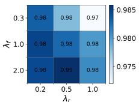  
(a) ToW(α = 0)

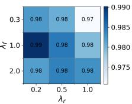  
(b) ToW(α = 1.0)

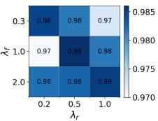  
(c) ToW(α = 2.0)

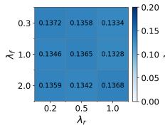  
(d) DNO(α = 0)

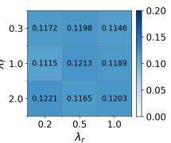  
(e) DNO(α = 1.0)

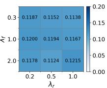  
(f) DNO(α = 2.0)

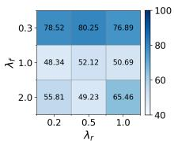  
(g) Time(α = 0)

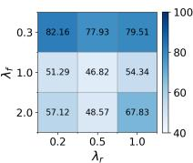  
(h) Time(α = 1.0)

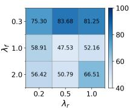  
(i) Time(α = 2.0)  
Figure 6: Ablation on SALA weights. Columns correspond to α. Within each panel, the heatmap axes are $\lambda _ { f }$ (y-axis) and $\lambda _ { r }$ (x-axis). Rows report ToW, DNO, and runtime, respectively.

## F.3.2 Stop threshold τ and $Z _ { \mathrm { c u t } }$ of SALA

We further examine the sensitivity of SALA to the InDist stopping threshold τ and the cutoff $Z _ { \mathrm { c u t } }$ Overall, Table 5 shows that SALA remains stable across the tested stopping-threshold and cutoff settings. For the full SALA variant, DNO is consistently low at 0.12–0.13. The main effect of the sweep is on runtime rather than final unlearning quality. A smaller cutoff, $Z _ { \mathrm { c u t } } = 1$ , leads to substantially longer runtime, while $Z _ { \mathrm { c u t } } = 2$ or 3 reaches the stopping condition much faster. Increasing τ from 0.95 to 0.99 generally makes stopping stricter and increases runtime. The default setting, $\bar { Z } _ { \mathrm { c u t } } = 2$ and $\tau = 0 . 9 5$ , achieves a favorable balance, with low DNO, competitive leakage metrics, and short runtime.

Table 5: Parameter sweep over $Z _ { \mathrm { c u t } }$ and inDist threshold τ for SALA variants.
<table><tr><td>Method</td><td> ${ z _ { \mathrm { c u t } } }$ </td><td>T</td><td>TA(%)</td><td>FA(%)</td><td>RA(%)</td><td>ToW↑</td><td>DNO↓</td><td>MIA efficacy(%)↓</td><td>RULI(%)↓</td><td>Time(s)↓</td></tr><tr><td rowspan="6">SALA</td><td>1</td><td>0.95</td><td>94.73±0.23</td><td>95.59±0.20</td><td>100.00±0.00</td><td>0.97±0.01</td><td>0.13</td><td>52.13±0.57</td><td>52.88±0.74</td><td>163.92±14.67</td></tr><tr><td>1</td><td>0.99</td><td>94.73±0.24</td><td>94.69±0.21</td><td>100.00±0.00</td><td>0.98±0.01</td><td>0.13</td><td>52.09±0.73</td><td>53.55±0.68</td><td>209.64±9.61</td></tr><tr><td>2</td><td>0.95</td><td>94.44±0.28</td><td>95.58±0.21</td><td>100.00±0.00</td><td>0.97±0.01</td><td>0.12</td><td>52.42±0.16</td><td>52.15±1.30</td><td>53.22±3.21</td></tr><tr><td>2</td><td>0.99</td><td>94.59±0.24</td><td>95.15±0.23</td><td>100.00±0.00</td><td>0.98±0.01</td><td>0.12</td><td>52.23±0.49</td><td>52.56±0.53</td><td>101.37±10.29</td></tr><tr><td>3</td><td>0.95</td><td>94.57±0.26</td><td>96.33±0.36</td><td>100.00±0.00</td><td>0.95±0.02</td><td>0.13</td><td>53.52±0.35</td><td>51.29±0.72</td><td>47.67±0.52</td></tr><tr><td>3</td><td>0.99</td><td>94.54±0.27</td><td>95.82±0.41</td><td>100.00±0.00</td><td>0.96±0.02</td><td>0.13</td><td>53.44±0.65</td><td>51.36±0.43</td><td>55.83±7.60</td></tr><tr><td rowspan="6">SALA+SMSE</td><td>1</td><td>0.95</td><td>94.55±0.24</td><td>96.06±0.21</td><td>100.00±0.00</td><td>0.95±0.03</td><td>0.24</td><td>53.34±0.46</td><td>56.48±0.36</td><td>204.28±10.30</td></tr><tr><td>1</td><td>0.99</td><td>94.56±0.27</td><td>96.06±0.20</td><td>100.00±0.00</td><td>0.95±0.03</td><td>0.24</td><td>53.32±0.25</td><td>56.50±0.75</td><td>212.64±2.57</td></tr><tr><td>2</td><td>0.95</td><td>94.25±0.27</td><td>95.13±0.17</td><td>99.97±0.01</td><td>0.98±0.01</td><td>0.21</td><td>54.28±0.36</td><td>55.97±0.53</td><td>56.47±5.35</td></tr><tr><td>2</td><td>0.99</td><td>94.35±0.27</td><td>95.63±0.20</td><td>99.99±0.00</td><td>0.97±0.01</td><td>0.22</td><td>53.50±0.26</td><td>55.83±0.63</td><td>135.14±9.56</td></tr><tr><td>3</td><td>0.95</td><td>94.37±0.28</td><td>95.86±0.27</td><td>99.99±0.00</td><td>0.97±0.01</td><td>0.28</td><td>54.15±0.46</td><td>53.52±0.72</td><td>48.52±1.15</td></tr><tr><td>3</td><td>0.99</td><td>94.35±0.26</td><td>95.52±0.21</td><td>99.99±0.01</td><td>0.97±0.01</td><td>0.25</td><td>53.96±0.64</td><td>54.88±0.83</td><td>74.81±5.42</td></tr><tr><td rowspan="6">SALA w/  $D _ { \mathrm { f } }$  only</td><td></td><td>0.95</td><td>93.96±0.31</td><td>95.70±0.24</td><td>99.75±0.11</td><td>0.97±0.01</td><td>0.27</td><td>53.80±0.36</td><td>56.69±1.13</td><td>139.11±26.55</td></tr><tr><td>1 1</td><td>0.99</td><td>93.96±0.28</td><td>95.69±0.27</td><td>99.77±0.10</td><td>0.99±0.01</td><td>0.26</td><td>53.78±0.44</td><td>56.71±0.72</td><td>135.68±24.88</td></tr><tr><td>2</td><td>0.95</td><td>93.75±0.29</td><td>94.49±0.30</td><td>99.75±0.08</td><td>0.99±0.01</td><td>0.23</td><td>53.37±0.34</td><td>56.75±2.49</td><td>59.35±6.26</td></tr><tr><td>2</td><td>0.99</td><td>93.90±0.26</td><td>94.85±0.63</td><td>99.77±0.11</td><td>0.98±0.01</td><td>0.24</td><td>53.79±0.65</td><td>56.07±0.43</td><td>129.29±29.09</td></tr><tr><td>3</td><td>0.95</td><td>93.92±0.28</td><td>95.37±0.50</td><td>99.85±0.06</td><td>0.98±0.01</td><td>0.26</td><td>53.77±0.37</td><td>54.29±0.82</td><td>74.74±18.05</td></tr><tr><td>3</td><td>0.99</td><td>93.91±0.31</td><td>95.22±0.47</td><td>99.80±0.09</td><td>0.98±0.01</td><td>0.24</td><td>53.76±0.42</td><td>54.98±0.75</td><td>118.27±25.01</td></tr></table>

The same trend holds for the relaxed SALA variants. SALA-SMSE remains stable across the sweep, with the default setting giving the lowest DNO among the SMSE configurations. Similarly, the D -only variant releases the retain-side constraint and therefore produces moderately higher DNO, but it does not cause excessive DNO inflation across the tested settings.

## F.4 Computational and storage overhead of SMSE

We quantify the computational and storage overhead of estimating the per-sample target distributions, comparing SMSE with the shadow-model estimator evaluated in Section 5.2.

Storage overhead. Both estimators store four FP32 statistics per sample, $( \mu _ { \mathrm { i n } } , \sigma _ { \mathrm { i n } } , \mu _ { \mathrm { o u t } } , \sigma _ { \mathrm { o u t } } )$ adding 16N bytes for N samples. Table 6 reports this persistent storage alongside the size of one trained model. During estimation, models or checkpoints can be processed sequentially.

Table 6: Storage of the model and estimated distribution parameters (MiB).
<table><tr><td>Dataset</td><td>Model</td><td>Distribution parameters</td></tr><tr><td>CIFAR-10</td><td>42.70</td><td>0.763</td></tr><tr><td>ImageNet-1000</td><td>97.78</td><td>19.55</td></tr><tr><td>WikiText-103</td><td>201.94</td><td>17.78</td></tr></table>

Computational overhead. We measure computational overhead in two stages: training the models, and collecting their output scores to estimate the target-distribution parameters. SMSE obtains the trained model and checkpoint ensemble within the 1× training budget in Table 1. Table 7 compares nominal training work and measured time relative to regular training on the same dataset and hardware. SMSE’s training time remains close to regular training, while shadow-model estimation requires training multiple models.

After training, evaluating scores from K models or checkpoints over N samples requires $O ( K \lceil N / B \rceil \bar { C } _ { \mathrm { f w d } } ( B ) )$ work, where B is the inference batch size and $C _ { \mathrm { f w d } } ( B )$ is the forward-pass cost per batch. Computing the distribution statistics then requires $O ( N K )$ work. Table 8 separates these two components: forward inference dominates, while the statistical reduction takes seconds. For SMSE, this additional estimation time is 3.59%–13.48% of a regular training run, on top of the training time in Table 7.

Table 7: Training cost of shadow-model estimation and SMSE in Section 5.2. Ratios in parentheses are relative to regular training.
<table><tr><td>Method</td><td colspan="2">CIFAR-10</td><td colspan="2">ImageNet-1000</td><td colspan="2">WikiText-103</td></tr><tr><td></td><td>Cost</td><td>Training time</td><td>Cost</td><td>Training time</td><td>Cost</td><td>Training time</td></tr><tr><td>Regular training</td><td>1×</td><td>23.12 min</td><td>1×</td><td>42.50 h</td><td>1×</td><td>29.09 h</td></tr><tr><td>Shadow models</td><td>32×</td><td>13.21 h (34.28×)</td><td>8×</td><td>307.73 h (7.24×)</td><td>8×</td><td>195.82 h (6.73×)</td></tr><tr><td>SMSE</td><td>1×</td><td>20.72 min (0.90 ×)</td><td>1×</td><td>45.72 h (1.08×)</td><td>1×</td><td>30.58 h (1.05×)</td></tr></table>

Table 8: Time to estimate distribution parameters from the trained models. Ratios are relative to regular training in Table 7.
<table><tr><td>Dataset</td><td>Method</td><td>Forward inference</td><td>Statistics</td><td>Total</td><td>Time ratio</td></tr><tr><td rowspan="2">CIFAR-10</td><td>Shadow models</td><td>51.90 s</td><td>1.10 s</td><td>53.00 s</td><td>0.0382×</td></tr><tr><td>SMSE</td><td>48.70 s</td><td>1.12 s</td><td>49.82 s</td><td>0.0359×</td></tr><tr><td rowspan="2">ImageNet-1000</td><td>Shadow models</td><td>1.72 h</td><td>7.12 s</td><td>1.72 h</td><td>0.0405×</td></tr><tr><td>SMSE</td><td>5.72 h</td><td>26.54 s</td><td>5.73 h</td><td>0.1348×</td></tr><tr><td rowspan="2">WikiText-103</td><td>Shadow models</td><td>39.45 min</td><td>6.43 s</td><td>39.56 min</td><td>0.0227×</td></tr><tr><td>SMSE</td><td>2.19 h</td><td>24.10 s</td><td>2.20 h</td><td>0.0756×</td></tr></table>

## F.5 Ablation Study of SMSE

## F.5.1 σˆ stabilization of SMSE

SMSE estimates per-sample standard deviations $\hat { \sigma } _ { \mathrm { i n } } ( x )$ and $\hat { \sigma } _ { \mathrm { o u t } } ( x )$ from a limited ensemble, which can produce overly small or overly dispersed values for a subset of samples. This matters because SALA uses $\hat { \sigma } ( x )$ to standardize scores and to form the InDist constraint; extreme σˆ(x) values can inflate the effective mismatch term and lead to a systematic DNO offset (Section 4.2). To mitigate this, SMSE applies a sigma stabilization step that shrinks per-sample $\hat { \sigma } ( x )$ toward a global reference scale and clips it into a bounded range, preventing collapse and heavy tails. The ablation compares SALA-SMSE with and without sigma stabilization, keeping all other components fixed. Results are reported under the same unlearning task suite as the main experiments.

Results. Table 9 shows that sigma stabilization consistently improves sample-level alignment: it reduces DNO by about 0.01 and RULI accuracy by about 0.49% on average, with negligible change to ToW. This supports the interpretation in Section $4 . 2 \colon$ bounding $\hat { \sigma } ( x )$ directly reduces the estimation-induced term in the DNO decomposition and tightens the achievable DNO under SALA-SMSE.

Table 9: Ablation study of SMSE sigma stabilization mechanism
<table><tr><td>Method</td><td>Sigma Stable TA(%)↑</td><td></td><td>FA(%)↑</td><td>RA(%)↑</td><td>ToW↑</td><td></td><td>DNO↓ MIA efficacy(%)↓ RULI(%)↓</td><td></td><td>Time(s)↓</td></tr><tr><td>SALA-SMSE + Salun</td><td>√</td><td>94.25±0.27</td><td>95.13±0.17</td><td>99.97±0.01</td><td>0.98±0.01</td><td>0.21</td><td>54.28±0.36</td><td>55.97±0.53</td><td>56.47±5.35</td></tr><tr><td>SALA-SMSE + SCRUB</td><td>√</td><td>94.01±0.23</td><td>94.03±0.16</td><td>99.97±0.02</td><td>0.98±0.01</td><td>0.23</td><td>54.43±0.16</td><td>55.25±0.27</td><td>46.45±2.79</td></tr><tr><td>SALA-SMSE + l1</td><td>√</td><td>93.13±0.31</td><td>93.52±0.42</td><td>99.99±0.00</td><td>0.99±0.01</td><td>0.20</td><td>53.25±0.27</td><td>52.93±0.31</td><td>125.52±9.14</td></tr><tr><td>SALA-SMSE + Salun</td><td>x</td><td>93.80±0.19</td><td>94.74±0.22</td><td>100.00±0.00</td><td>0.97±0.01</td><td>0.23</td><td>54.74±0.25</td><td>56.00±0.31</td><td>76.73±7.15</td></tr><tr><td>SALA-SMSE + SCRUB</td><td>x</td><td>93.76±0.21</td><td>94.43±0.35</td><td>99.97±0.02</td><td>0.97±0.00</td><td>0.23</td><td>54.76±0.19</td><td>56.47±0.21</td><td>44.35±2.21</td></tr><tr><td>SALA-SMSE + l1 sparsity</td><td>x</td><td>93.92±0.27 94.14±0.31</td><td></td><td>99.99±0.01</td><td>0.97±0.01</td><td>0.23</td><td>54.41±0.08</td><td>53.16±0.13</td><td>108.70±9.15</td></tr></table>

## F.5.2 Epoch allocation of SMSE

We further study how the epoch allocation in SMSE affects per-sample distribution estimation. In the main experiments, the training budget is divided into 20% warmup, 70% half-data training, and 10% fine-tuning after merging. To examine the sensitivity of this schedule, we vary the warmup and merge allocations. Estimation quality is evaluated using the same metrics as in Table 1, including Pearson correlation, MSE for the four estimated moments and $\mathrm { D N O } _ { \mathrm { e s t } }$ . We also report the final test accuracy of each trained model.

Table 10: Ablation on warmup and merge scheduling in SMSE on CIFAR-10.
<table><tr><td rowspan="2">Warmup Epoch Ratio (%)</td><td rowspan="2">Merge Epoch Ratio (%)</td><td colspan="2"> ${ \pmb \mu _ { \mathrm { i n } } }$ </td><td colspan="2"> $\scriptstyle \mu _ { \mathrm { o u t } }$ </td><td colspan="2"> $\pmb { \sigma _ { \mathrm { i n } } }$ </td><td colspan="2"> $\pmb { \sigma _ { o u t } }$ </td><td rowspan="2"> $\mathrm { D N O } _ { \mathrm { e s t } }$  ↓</td><td rowspan="2">Final Acc.↑</td></tr><tr><td>r↑</td><td>MSE↓</td><td>r↑</td><td>MSE↓</td><td>r↑</td><td>MSE↓</td><td>MSE↓</td><td></td></tr><tr><td>0</td><td>10</td><td>0.75</td><td>1.57</td><td>0.90</td><td>2.34</td><td>0.59</td><td>0.42</td><td>0.70</td><td>0.40</td><td>0.2464</td><td>94.87</td></tr><tr><td>10</td><td>10</td><td>0.79</td><td>1.27</td><td>0.91</td><td>1.95</td><td>0.56</td><td>0.70</td><td>0.60</td><td>0.57</td><td>0.1999</td><td>94.49</td></tr><tr><td>20</td><td>10 (Main setup)</td><td>0.79</td><td>1.29</td><td>0.92</td><td>1.90</td><td>0.58</td><td>0.67</td><td>0.63</td><td>0.52</td><td>0.1801</td><td>94.79</td></tr><tr><td>20</td><td>20</td><td>0.79</td><td>0.91</td><td>0.92</td><td>2.07</td><td>0.60</td><td>1.27</td><td>0.65</td><td>0.79</td><td>0.1822</td><td>94.78</td></tr><tr><td>20</td><td>0</td><td>0.74</td><td>0.97</td><td>0.92</td><td>1.90</td><td>0.58</td><td>0.67</td><td>0.64</td><td>0.53</td><td>0.1832</td><td>83.59</td></tr></table>

Table 10 reports the results on CIFAR-10. Warmup mainly improves the calibration of per-sample moment estimates. Without warmup, SMSE obtains the worst $\mathrm { D N O } _ { \mathrm { e s t } }$ of 0.2464 and lower Pearson correlation for $\mu _ { \mathrm { i n } }$ , although the final accuracy remains high. Introducing a moderate warmup substantially improves estimation quality: 10% warmup reduces $\mathrm { D N O } _ { \mathrm { e s t } }$ to 0.1999, while the main 20% warmup setting further reduces it to 0.1801.

The merge stage has a different role. With the warmup ratio fixed at 20%, removing fine-tuning after merging sharply reduces final accuracy from 94.79% to 83.59%, while leaving the estimation metrics relatively competitive. Thus, merging is primarily needed to recover the predictive utility of the final model rather than to improve moment estimation alone. Overall, the main schedule with 20% warmup and 10% merge achieves the lowest $\mathrm { D N O } _ { \mathrm { e s t } }$ while maintaining high final accuracy, and is therefore used as the default SMSE configuration.

## F.5.3 Segment ensemble size M of SMSE

We further ablate the segment ensemble size M, defined as the number of checkpoints per half-data training trajectory used to estimate per-sample score moments. In the main experiments, we set $M = 3 0$ . To examine sensitivity to this choice, we vary $M \in \{ 1 0 , 2 0 , 3 0 , 4 0 \}$ and evaluate estimation quality using the same metrics as in Table 1.

Table 11 reports the results on CIFAR-10. Increasing M from 10 generally improves estimation stability, particularly for the variance terms: the MSE of $\sigma _ { \mathrm { o u t } }$ decreases from 2.69 at $M = 1 0$ to 0.52 at $M = 3 0$ . However, using a larger ensemble does not uniformly improve all metrics. Although $M = 4 0$ achieves the best correlation for $\sigma _ { \mathrm { i n } } ,$ it worsens the MSE of all four moments compared with $M = 3 0$ . The main setting $M = 3 0$ therefore provides the best overall balance, achieving the strongest mean estimation for $\mu _ { \mathrm { o u t } }$ and the lowest MSE for both $\mu _ { \mathrm { o u t } }$ and $\sigma _ { \mathrm { o u t } }$

Table 11: Ablation on the segment ensemble size M in SMSE on CIFAR-10.
<table><tr><td rowspan="2">M</td><td colspan="2"> ${ \pmb \mu _ { \mathbf { i n } } }$ </td><td colspan="2"> $\pmb { \mu _ { \mathrm { o u t } } }$ </td><td colspan="2"> $\pmb { \sigma _ { \mathrm { i n } } }$ </td><td colspan="2"> $\pmb { \sigma _ { \mathrm { o u t } } }$ </td></tr><tr><td>r↑</td><td>MSE↓</td><td>r↑</td><td>MSE↓</td><td>r↑</td><td>MSE↓</td><td>r↑</td><td>MSE↓</td></tr><tr><td>10</td><td>0.77</td><td>1.30</td><td>0.89</td><td>2.47</td><td>0.53</td><td>1.06</td><td>0.73</td><td>2.69</td></tr><tr><td>20</td><td>0.78</td><td>1.19</td><td>0.90</td><td>2.24</td><td>0.57</td><td>0.42</td><td>0.70</td><td>1.38</td></tr><tr><td>30 (Main setup)</td><td>0.79</td><td>1.29</td><td>0.92</td><td>1.90</td><td>0.58</td><td>0.67</td><td>0.63</td><td>0.52</td></tr><tr><td>40</td><td>0.77</td><td>1.70</td><td>0.92</td><td>2.08</td><td>0.60</td><td>0.85</td><td>0.65</td><td>0.58</td></tr></table>

## F.5.4 Estimation methods of SMSE

We examine alternative ways of constructing the stochastic ensemble used by SMSE for moment estimation. The default design uses a checkpoint ensemble, where checkpoints collected along the two half-data training trajectories are aggregated to estimate per-sample score moments. We compare this strategy with two lightweight alternatives that induce stochasticity from a single trained model, namely Monte Carlo dropout and repeated stochastic data augmentation.

Table 12: Ablation on different stochastic estimation methods in SMSE on CIFAR-10.
<table><tr><td rowspan="2">Method</td><td colspan="2"> ${ \pmb \mu _ { \mathrm { i n } } }$ </td><td colspan="2"> $\pmb { \mu _ { \mathrm { o u t } } }$ </td><td colspan="2"> $\pmb { \sigma _ { \mathrm { i n } } }$ </td><td colspan="2"> $\pmb { \sigma _ { o u t } }$ </td></tr><tr><td>r↑</td><td>MSE↓</td><td>r↑</td><td>MSE↓</td><td>r↑</td><td>MSE↓</td><td>r↑</td><td>MSE↓</td></tr><tr><td>Checkpoint ensemble (Main setup)</td><td>0.79</td><td>1.29</td><td>0.92</td><td>1.90</td><td>0.58</td><td>0.67</td><td>0.64</td><td>0.52</td></tr><tr><td>Dropout</td><td>0.72</td><td>1.18</td><td>0.89</td><td>2.55</td><td>-0.15</td><td>0.35</td><td>-0.42</td><td>1.84</td></tr><tr><td>Data augmentation</td><td>0.71</td><td>1.55</td><td>0.91</td><td>2.48</td><td>0.61</td><td>0.41</td><td>0.76</td><td>1.00</td></tr></table>

Table 12 reports the results on CIFAR-10. The checkpoint ensemble provides the most balanced estimation quality across the four target moments. It achieves the strongest correlations for both mean statistics, with $r = 0 . 7 9$ for $\mu _ { \mathrm { i n } }$ and $r = 0 . 9 2$ for $\mu _ { \mathrm { o u t } }$ , and also attains the lowest MSE for $\mu _ { \mathrm { o u t } }$ and $\sigma _ { \mathrm { o u t } }$ . Data augmentation produces competitive variance correlations, but its mean estimation is weaker and its $\sigma _ { \mathrm { o u t } }$ MSE remains higher than that of the checkpoint ensemble. Monte Carlo dropout achieves low MSE on some individual terms, but yields negative correlations for both $\sigma _ { \mathrm { i n } }$ and $\sigma _ { \mathrm { o u t } } ,$ indicating that its induced randomness does not preserve the variance structure required by SMSE.

## F.6 Utility of Models Produced by SMSE

Table 13: Utility of models produced by SMSE.
<table><tr><td>Dataset</td><td>Standard Training</td><td>SMSE</td></tr><tr><td>CIFAR-10 (ACC↑)</td><td>94.68±0.35</td><td>94.79±0.13</td></tr><tr><td>ImageNet-1000 (ACC↑)</td><td>73.55±0.13</td><td>73.37±0.23</td></tr><tr><td>WikiText-103 (PPL↓)</td><td>53.36±0.61</td><td>54.35±1.05</td></tr></table>

## F.7 Experiments of SALA combined with various approximate unlearning algorithms

Results. Table 14 evaluates whether SALA can act as a stable plug-in mechanism for different approximate unlearning algorithms. Across SalUn, SCRUB, and $\ell _ { 1 }$ sparsity unlearning, SALA consistently improves the corresponding base unlearning methods: DNO drops by 0.78, 0.23, and 0.21, respectively, while RULI is reduced by 40.23%, 16.55%, and 17.98%. SALA also maintains nearly perfect ToW across all three base methods and keeps runtime far below full retraining.

When using only $D _ { \mathrm { f } }$ , DNO remains within 0.22 to 0.23, which is still lower than the corresponding base unlearning methods. Similarly, although SALA-SMSE uses an imperfect reference distribution with additional estimation error, its DNO remains within 0.20 to 0.23 and consistently improves over the baselines.

Table 14: Comprehensive evaluation of SALA-assisted approximate unlearning methods.
<table><tr><td>Method</td><td>TA(%)↑</td><td>FA(%)↑</td><td>RA(%)↑</td><td>ToW↑</td><td>DNO↓</td><td>MIA efficacy(%)↓</td><td>RULI(%)↓</td><td>Time(s)↓</td></tr><tr><td>Retrain</td><td>93.84±0.21</td><td>93.68±0.28</td><td>100.00±0.01</td><td>1.00±0.00</td><td>0.07</td><td>50.57±0.25</td><td>50.00±0.00</td><td>1625.53±5.33</td></tr><tr><td>SalUn</td><td>92.36±0.45</td><td>95.29±0.57</td><td>98.61±0.36</td><td>0.95±0.01</td><td>0.90</td><td>51.87±0.21</td><td>92.38±0.28</td><td>221.92±96.37</td></tr><tr><td>SCRUB</td><td>90.29±2.31</td><td>94.06±3.15</td><td>95.74±3.00</td><td>0.92±0.03</td><td>0.34</td><td>52.23±0.57</td><td>68.67±3.62</td><td>101.93±11.98</td></tr><tr><td>l1 sparsity</td><td>88.18±3.47</td><td>91.94±4.48</td><td>95.80±2.98</td><td>0.88±0.02</td><td>0.32</td><td>53.09±2.72</td><td>70.03±5.24</td><td>150.28±28.45</td></tr><tr><td>SALA + Salun</td><td>94.44±0.28</td><td>95.58±0.21</td><td>100.00±0.00</td><td>0.97±0.02</td><td>0.12</td><td>52.42±0.16</td><td>52.15±1.30</td><td>53.22±3.21</td></tr><tr><td>SALA + SCRUB</td><td>94.35±0.15</td><td>94.03±0.14</td><td>99.99±0.00</td><td>0.99±0.01</td><td>0.11</td><td>52.46±0.11</td><td>52.12±0.07</td><td>50.31±6.62</td></tr><tr><td>SALA + l1</td><td>94.31±0.19</td><td>94.75±0.27</td><td>99.99±0.01</td><td>0.98±0.01</td><td>0.11</td><td>51.23±0.02</td><td>52.05±0.14</td><td>97.36±4.14</td></tr><tr><td>SALA-SMSE + Salun</td><td>94.25±0.27</td><td>95.13±0.17</td><td>99.97±0.01</td><td>0.98±0.01</td><td>0.21</td><td>54.28±0.36</td><td>55.97±0.53</td><td>56.47±5.35</td></tr><tr><td>SALA-SMSE + SCRUB</td><td>95.01±0.23</td><td>94.03±0.16</td><td>99.97±0.02</td><td>0.98±0.01</td><td>0.23</td><td>54.43±0.16</td><td>55.25±0.27</td><td>46.45±2.79</td></tr><tr><td>SALA-SMSE + l1</td><td>93.13±0.31</td><td>93.52±0.42</td><td>99.99±0.00</td><td>0.99±0.01</td><td>0.20</td><td>53.25±0.27</td><td>52.93±0.31</td><td>125.52±9.14</td></tr><tr><td>SALA w/ Df only + Salun</td><td>93.75±0.29</td><td>94.49±0.30</td><td>99.75±0.08</td><td>0.99±0.01</td><td>0.23</td><td>53.37±0.34</td><td>56.75±2.49</td><td>59.35±6.26</td></tr><tr><td>SALA w/ Df only + SCRUB</td><td>93.41±0.16</td><td>93.89±0.34</td><td>99.97±0.02</td><td>0.99±0.01</td><td>0.23</td><td>53.43±0.53</td><td>55.25±0.64</td><td>51.45±5.24</td></tr><tr><td>SALA w/ Df only + l1</td><td>93.13±0.53</td><td>93.52±0.49</td><td>99.99±0.00</td><td>0.99±0.01</td><td>0.22</td><td>51.25±0.15</td><td>53.03±0.28</td><td>115.52±6.35</td></tr></table>

## F.8 Sensitivity to the forget-set size

The main sample-wise and sequence unlearning experiments use forget ratios of 20% on CIFAR-10 and 33% on ImageNet-1000 and WikiText-103, providing observations in both membership roles over repeated tasks. We additionally evaluate 5%, 10%, and 50% on CIFAR-10, keeping the other settings fixed and using eight independent unlearning runs for each ratio. Table 15 reports the same utility, efficacy, privacy, and runtime metrics as Table 2. Across the three ratios, SALA and its variants obtain lower DNO and RULI than SalUn, with comparable or higher ToW.

Table 15: CIFAR-10 results under different forget ratios.
<table><tr><td>Method</td><td>TA(%)</td><td>FA(%)</td><td>RA(%)</td><td>ToW</td><td>DNO</td><td>MIA(%)</td><td>RULI(%)</td><td>Time(s)</td></tr><tr><td colspan="9">Forget ratio: 5%</td></tr><tr><td>Retrain</td><td>94.65±0.37</td><td>94.33±0.21</td><td>100.00±0.00</td><td>1.00±0.00</td><td>0.06</td><td>51.15±0.08</td><td>50.23±0.07</td><td>1457.39±10.74</td></tr><tr><td>SalUn</td><td>94.45±0.08</td><td>95.72±0.14</td><td>100.00±0.00</td><td>0.96±0.01</td><td>0.56</td><td>53.15±0.14</td><td>74.42±0.57</td><td>94.45±5.47</td></tr><tr><td>SALA</td><td>94.10±0.24</td><td>93.90±0.13</td><td>100.00±0.00</td><td>0.99±0.00</td><td>0.09</td><td>51.03±0.11</td><td>52.14±0.29</td><td>38.49±1.52</td></tr><tr><td>SALA-SMSE</td><td>94.05±0.13</td><td>94.21±0.18</td><td>100.00±0.00</td><td>0.97±0.01</td><td>0.24</td><td>52.14±0.12</td><td>59.15±0.75</td><td>34.08±2.47</td></tr><tr><td>SALA w/ Df only</td><td>93.91±0.15</td><td>94.33±0.16</td><td>100.00±0.00</td><td>0.97±0.01</td><td>0.25</td><td>52.28±0.14</td><td>59.87±0.68</td><td>35.36±2.21</td></tr><tr><td colspan="9">Forget ratio: 10%</td></tr><tr><td>Retrain</td><td>94.12±0.12</td><td>94.02±0.25</td><td>100.00±0.00</td><td>1.00±0.00</td><td>0.04</td><td>51.03±0.09</td><td>50.10±0.35</td><td>1572.27±6.35</td></tr><tr><td>SalUn</td><td>94.41±0.25</td><td>94.43±0.11</td><td>100.00±0.00</td><td>0.96±0.01</td><td>0.76</td><td>54.35±0.05</td><td>82.79±0.28</td><td>115.72±19.15</td></tr><tr><td>SALA</td><td>94.20±0.15</td><td>93.78±0.47</td><td>100.00±0.00</td><td>0.98±0.01</td><td>0.10</td><td>50.79±0.35</td><td>51.95±0.51</td><td>36.20±1.13</td></tr><tr><td>SALA-SMSE</td><td>93.95±0.12</td><td>93.92±0.47</td><td>100.00±0.00</td><td>0.98±0.00</td><td>0.25</td><td>52.75±0.41</td><td>58.37±1.54</td><td>33.79±1.63</td></tr><tr><td>SALA w/ Df only</td><td>94.08±0.14</td><td>94.26±0.39</td><td>100.00±0.00</td><td>0.98±0.01</td><td>0.26</td><td>52.52±0.36</td><td>57.91±1.42</td><td>34.27±1.81</td></tr><tr><td colspan="9">Forget ratio: 50%</td></tr><tr><td>Retrain</td><td>92.68±0.25</td><td>92.53±0.18</td><td>100.00±0.00</td><td>1.00±0.00</td><td>0.07</td><td>51.10±0.05</td><td>50.25±0.11</td><td>1625.53±5.33</td></tr><tr><td>SalUn</td><td>89.88±0.48</td><td>92.40±0.54</td><td>98.05±0.38</td><td>0.95±0.00</td><td>0.91</td><td>52.35±0.10</td><td>94.30±2.22</td><td>221.92±96.37</td></tr><tr><td>SALA</td><td>93.71±0.23</td><td>94.25±0.30</td><td>99.99±0.01</td><td>0.97±0.01</td><td>0.11</td><td>50.27±0.04</td><td>52.34±0.35</td><td>53.22±3.21</td></tr><tr><td>SALA-SMSE</td><td>93.48±0.20</td><td>93.49±0.24</td><td>99.98±0.02</td><td>0.97±0.01</td><td>0.24</td><td>52.27±0.13</td><td>59.96±0.22</td><td>63.90±3.59</td></tr><tr><td>SALA w/ Df only</td><td>93.62±0.18</td><td>93.31±0.27</td><td>100.00±0.00</td><td>0.96±0.01</td><td>0.24</td><td>52.44±0.15</td><td>59.71±0.25</td><td>62.84±3.21</td></tr></table>

## F.9 SALA on Class-wise Unlearning

Main experiments focus on sample-wise unlearning (classification) and sequence unlearning (generation). This subsection extends SALA to class-wise unlearning to test whether per-sample distributional targets remain effective when the forget set is structured and highly correlated. Class-wise unlearning is evaluated on the classification benchmarks by selecting one target class as the forget set $D _ { \mathrm { f } }$ and treating all remaining classes as the retain set $\dot { D } _ { \mathrm { r } }$ . SALA is applied on top of iterative baselines in the same way as in Section 5.3: forget-class samples are driven toward their $Q _ { \mathrm { o u t } } ( \cdot \mid x )$ targets, and retain-class samples are driven toward $Q _ { \mathrm { i n } } ( \cdot \mid x )$ targets, with the same InDist-guided stopping rule. For class-wise unlearning, exact retraining yields FA = 0.00%, making the original ToW undefined if FA is included. We therefore compute ToW using only TA and RA, and report FA separately as the forgetting measure on the target class.

Table 16: Comprehensive comparison of approximate unlearning methods in class-wise unlearning scenario.
<table><tr><td>Method</td><td>TA(%)↑</td><td>FA(%)↑</td><td>RA(%)↑</td><td>ToW↑</td><td>DNO↓</td><td>MIA efficacy(%)↓</td><td>RULI(%)↓</td><td>Time(s)↓</td></tr><tr><td>Retrain</td><td>91.87±2.09</td><td>0.00±0.00</td><td>100.00±0.00</td><td>1.00±0.00</td><td>0.03</td><td>50.62±0.29</td><td>50.15±0.08</td><td>1627.24±12.10</td></tr><tr><td>Salun</td><td>95.79±1.02</td><td>0.02±0.09</td><td>99.78±0.13</td><td>0.96±0.01</td><td>0.45</td><td>51.15±0.09</td><td>77.90±2.89</td><td>23.43±0.20</td></tr><tr><td>SCRUB</td><td>94.43±1.15</td><td>0.00±0.00</td><td>97.42±0.16</td><td>0.95±0.01</td><td>0.39</td><td>51.36±0.05</td><td>69.49±1.14</td><td>73.39±7.47</td></tr><tr><td>l1 sparsity</td><td>90.57±1.69</td><td>0.00±0.00</td><td>99.92±0.04</td><td>0.99±0.00</td><td>0.27</td><td>50.35±0.04</td><td>66.45±2.12</td><td>92.92±4.21</td></tr><tr><td>SALA + Salun</td><td>91.31±1.72</td><td>0.00±0.00</td><td>99.98±0.01</td><td>0.99±0.00</td><td>0.06</td><td>50.41±0.14</td><td>53.25±0.16</td><td>62.47±3.35</td></tr><tr><td>SALA + SCRUB</td><td>91.16±2.15</td><td>0.00±0.00</td><td>99.99±0.00</td><td>0.99±0.01</td><td>0.09</td><td>50.92±0.25</td><td>52.76±0.24</td><td>64.35±2.15</td></tr><tr><td>SALA + l1 sparsity</td><td>90.69±1.72</td><td>0.00±0.00</td><td>100.00±0.00</td><td>0.99±0.00</td><td>0.11</td><td>50.34±0.10</td><td>52.15±0.16</td><td>74.57±6.41</td></tr><tr><td>SALA-SMSE + Salun</td><td>91.35±1.43</td><td>0.00±0.00</td><td>100.00±0.00</td><td>0.99±0.00</td><td>0.27</td><td>50.54±0.16</td><td>60.43±0.65</td><td>69.62±4.47</td></tr><tr><td>SALA-SMSE + SCRUB</td><td>91.15±3.43</td><td>0.00±0.00</td><td>100.00±0.00</td><td>0.99±0.00</td><td>0.25</td><td>50.35±0.21</td><td>62.24±0.16</td><td>66.48±2.26</td></tr><tr><td>SALA-SMSE + l1 sparsity</td><td>92.23±1.47</td><td>0.00±0.00</td><td>99.99±0.00</td><td>0.99±0.01</td><td>0.27</td><td>50.31±0.19</td><td>64.45±1.31</td><td>70.92±4.43</td></tr></table>

Why class-wise is different. Compared to random sample-wise deletion, class-wise deletion changes the distribution of the remaining data and induces a larger representation shift: many samples share class-level features, so forgetting one class can affect model outputs on neighboring classes. This makes dataset-level scores alone especially unreliable, and stresses whether SALA can maintain retain behavior while enforcing strong non-membership behavior on a coherent subset.

Results. As shown in Table 16, SALA remains compatible with class-wise unlearning and preserves the same qualitative benefits: it improves sample-level alignment on the forgotten class (lower DNO and lower RULI accuracy) while keeping ToW competitive.

## F.10 Repeated deletion requests

To evaluate unlearning quality and cumulative cost when target distributions are reused across deletion requests, we compare Retrain, SALA, and SALA-SMSE over eight sequential requests on CIFAR-10. Each request removes 1,000 samples, totaling 8,000 deletions. SALA and SALA-SMSE estimate their target distributions once and reuse them across requests; Retrain trains on the remaining retain set after each request.

Cumulative cost. After the common initial model training, Table 17 counts target estimation at K = 0 and adds the time to process each completed request. Shadow-model estimation dominates SALA’s cumulative time, which remains above repeated retraining after eight requests. With SMSE, the cumulative time for eight requests is 461.09 s, compared with 9,854.16 s for retraining.

Unlearning quality. Table 18 compares performance after the first and eighth requests. After eight requests, both variants maintain ToW near 0.965 and retain accuracy above 99.5%. SALA achieves lower DNO, while SALA-SMSE maintains comparable ToW with substantially lower cumulative cost.

Table 17: Cumulative time (seconds) over repeated deletion requests. $K = 0$ records the targetestimation cost.
<table><tr><td>Method</td><td> $K = 0$ </td><td> $K = 1$ </td><td> $K = 2$ </td><td> $K = 3$ </td><td> $K = 4$ </td><td> $K = 5$ </td><td> $K = 6$ </td><td> $K = 7$ </td><td> $K = 8$ </td></tr><tr><td>Retrain</td><td>0.00</td><td>1,264.78</td><td>2,540.88</td><td>3,757.28</td><td>4,930.74</td><td> $^ { 6 , 0 7 3 . 3 2 }$ </td><td> $7 , 1 8 5 . 7 2$ </td><td> $^ { 8 , 2 7 4 . 2 4 }$ </td><td>9,854.16</td></tr><tr><td>SALA</td><td>46,211.80</td><td>46,418.71</td><td>46,618.79</td><td>46,819.77</td><td>47,020.85</td><td>47,188.40</td><td>47,369.07</td><td>47,546.77</td><td>47,715.27</td></tr><tr><td>SALA-SMSE</td><td>49.82</td><td>110.61</td><td>166.30</td><td>222.20</td><td>281.67</td><td>329.76</td><td>376.10</td><td>420.77</td><td>461.09</td></tr></table>

Table 18: CIFAR-10 results after the first and eighth deletion requests.
<table><tr><td>K</td><td>Method</td><td>TA(%)</td><td>FA(%)</td><td>RA(%)</td><td>ToW</td><td>DNO</td><td>RULI(%)</td></tr><tr><td>1</td><td>Retrain</td><td>94.57±0.19</td><td>94.45±0.72</td><td>100.000±0.001</td><td>1.0000±0.0000</td><td>0.0000±0.0000</td><td>50.00±0.00</td></tr><tr><td></td><td>SALA</td><td>94.44±0.26</td><td>94.01±0.98</td><td>99.88±0.02</td><td>0.9871±0.0057</td><td>0.1725±0.0641</td><td>56.72±4.13</td></tr><tr><td></td><td>SALA-SMSE</td><td>94.34±0.29</td><td>94.54±0.39</td><td>99.96±0.01</td><td>0.9917±0.0031</td><td>0.3469±0.0850</td><td>59.44±7.62</td></tr><tr><td></td><td>Retrain</td><td>93.70±0.25</td><td>93.77±0.37</td><td>100.00±0.00</td><td>1.0000±0.0000</td><td>0.0000±0.0000</td><td>50.00±0.00</td></tr><tr><td>8</td><td>SALA</td><td>92.57±1.51</td><td>94.73±1.63</td><td>99.55±0.43</td><td>0.9643±0.0144</td><td>0.1486±0.0791</td><td>56.93±1.42</td></tr><tr><td></td><td>SALA-SMSE</td><td>94.33±0.20</td><td>96.40±0.21</td><td>99.97±0.01</td><td>0.9650±0.0052</td><td>0.2854±0.0975</td><td>57.38±0.99</td></tr></table>

## G Limitations and Broader Impact

Limitations. The main limitation of SALA is its dependence on per-sample target distributions, namely $Q _ { \mathrm { i n } } ( \cdot \mid x )$ and $Q _ { \mathrm { o u t } } ( \cdot \mid x )$ . When memorization statistics or shadow-model estimates have already been collected for a task or dataset, SALA can directly reuse them. Otherwise, these target distributions must be obtained through the proposed SMSE procedure, which requires a split–merge training schedule and checkpoint ensembles during model development. Thus, SALA imposes requirements on the training pipeline and is less convenient for models that have already been trained without saving the necessary statistics, though SMSE reduces this preparation cost to roughly one structured training run.

Broader impact. This additional training-time requirement is worthwhile because it enables approximate unlearning to be monitored and controlled at the individual-sample level. SALA helps reveal and reduce sample-level gap-to-retrain that can be hidden by dataset-level averaged metrics, thereby reducing privacy leakage after unlearning. More broadly, this work supports more reliable data deletion workflows under right-to-be-forgotten requirements. We expect SALA to help practitioners move from average-case unlearning evaluation towards privacy-preserving individuals and verifiable unlearning systems.

## NeurIPS Paper Checklist

## 1. Claims

Question: Do the main claims made in the abstract and introduction accurately reflect the paper’s contributions and scope?

Answer: [Yes]

Justification: The abstract and introduction explicitly state the paper’s main claims: SALA is a sample-grained approximate unlearning framework, DNO measures per-sample gap-toretrain, SALA provides a computable upper bound on this gap, and SMSE estimates the required per-sample target distributions.

Guidelines:

• The answer [N/A] means that the abstract and introduction do not include the claims made in the paper.

• The abstract and/or introduction should clearly state the claims made, including the contributions made in the paper and important assumptions and limitations. A [No] or [N/A] answer to this question will not be perceived well by the reviewers.

• The claims made should match theoretical and experimental results, and reflect how much the results can be expected to generalize to other settings.

• It is fine to include aspirational goals as motivation as long as it is clear that these goals are not attained by the paper.

## 2. Limitations

Question: Does the paper discuss the limitations of the work performed by the authors?

Answer: [Yes]

Justification: We discuss limitations in Appendix G.

Guidelines:

• The answer [N/A] means that the paper has no limitation while the answer [No] means that the paper has limitations, but those are not discussed in the paper.

• The authors are encouraged to create a separate “Limitations” section in their paper.

• The paper should point out any strong assumptions and how robust the results are to violations of these assumptions (e.g., independence assumptions, noiseless settings, model well-specification, asymptotic approximations only holding locally). The authors should reflect on how these assumptions might be violated in practice and what the implications would be.

• The authors should reflect on the scope of the claims made, e.g., if the approach was only tested on a few datasets or with a few runs. In general, empirical results often depend on implicit assumptions, which should be articulated.

• The authors should reflect on the factors that influence the performance of the approach. For example, a facial recognition algorithm may perform poorly when image resolution is low or images are taken in low lighting. Or a speech-to-text system might not be used reliably to provide closed captions for online lectures because it fails to handle technical jargon.

• The authors should discuss the computational efficiency of the proposed algorithms and how they scale with dataset size.

• If applicable, the authors should discuss possible limitations of their approach to address problems of privacy and fairness.

• While the authors might fear that complete honesty about limitations might be used by reviewers as grounds for rejection, a worse outcome might be that reviewers discover limitations that aren’t acknowledged in the paper. The authors should use their best judgment and recognize that individual actions in favor of transparency play an important role in developing norms that preserve the integrity of the community. Reviewers will be specifically instructed to not penalize honesty concerning limitations.

## 3. Theory assumptions and proofs

Question: For each theoretical result, does the paper provide the full set of assumptions and a complete (and correct) proof?

Answer: [Yes]

Justification: The paper states the assumptions for each theoretical result, including the per-sample Gaussian score modeling, the InDist constraint, the scale feasibility condition, the retain-consistency condition for the forget-set-only variant, and the estimation-error decomposition. Theorem 3.1, Corollary 3.2, and Corollary 4.1 are accompanied by complete proofs or derivations in Appendices B, C and D.

Guidelines:

• The answer [N/A] means that the paper does not include theoretical results.

• All the theorems, formulas, and proofs in the paper should be numbered and crossreferenced.

• All assumptions should be clearly stated or referenced in the statement of any theorems.

• The proofs can either appear in the main paper or the supplemental material, but if they appear in the supplemental material, the authors are encouraged to provide a short proof sketch to provide intuition.

• Inversely, any informal proof provided in the core of the paper should be complemented by formal proofs provided in appendix or supplemental material.

• Theorems and Lemmas that the proof relies upon should be properly referenced.

## 4. Experimental result reproducibility

Question: Does the paper fully disclose all the information needed to reproduce the main experimental results of the paper to the extent that it affects the main claims and/or conclusions of the paper (regardless of whether the code and data are provided or not)?

Answer: [Yes]

Justification: The paper discloses the datasets, models, unlearning scenarios, metrics, number of unlearning tasks, baseline coverage, and SALA/SMSE variants used to obtain the main experimental results. A complete code repository is provided with the implementation, configurations, and reproduction scripts needed to reproduce the main experiments.

Guidelines:

• The answer [N/A] means that the paper does not include experiments.

• If the paper includes experiments, a [No] answer to this question will not be perceived well by the reviewers: Making the paper reproducible is important, regardless of whether the code and data are provided or not.

• If the contribution is a dataset and/or model, the authors should describe the steps taken to make their results reproducible or verifiable.

• Depending on the contribution, reproducibility can be accomplished in various ways. For example, if the contribution is a novel architecture, describing the architecture fully might suffice, or if the contribution is a specific model and empirical evaluation, it may be necessary to either make it possible for others to replicate the model with the same dataset, or provide access to the model. In general. releasing code and data is often one good way to accomplish this, but reproducibility can also be provided via detailed instructions for how to replicate the results, access to a hosted model (e.g., in the case of a large language model), releasing of a model checkpoint, or other means that are appropriate to the research performed.

• While NeurIPS does not require releasing code, the conference does require all submissions to provide some reasonable avenue for reproducibility, which may depend on the nature of the contribution. For example

(a) If the contribution is primarily a new algorithm, the paper should make it clear how to reproduce that algorithm.

(b) If the contribution is primarily a new model architecture, the paper should describe the architecture clearly and fully.

(c) If the contribution is a new model (e.g., a large language model), then there should either be a way to access this model for reproducing the results or a way to reproduce the model (e.g., with an open-source dataset or instructions for how to construct the dataset).

(d) We recognize that reproducibility may be tricky in some cases, in which case authors are welcome to describe the particular way they provide for reproducibility. In the case of closed-source models, it may be that access to the model is limited in some way (e.g., to registered users), but it should be possible for other researchers to have some path to reproducing or verifying the results.

## 5. Open access to data and code

Question: Does the paper provide open access to the data and code, with sufficient instructions to faithfully reproduce the main experimental results, as described in supplemental material?

Answer: [Yes]

Justification: We provide open-source code at the repository linked in Section 5.

Guidelines:

• The answer [N/A] means that paper does not include experiments requiring code.

• Please see the NeurIPS code and data submission guidelines (https://neurips.cc/ public/guides/CodeSubmissionPolicy) for more details.

• While we encourage the release of code and data, we understand that this might not be possible, so [No] is an acceptable answer. Papers cannot be rejected simply for not including code, unless this is central to the contribution (e.g., for a new open-source benchmark).

• The instructions should contain the exact command and environment needed to run to reproduce the results. See the NeurIPS code and data submission guidelines (https: //neurips.cc/public/guides/CodeSubmissionPolicy) for more details.

• The authors should provide instructions on data access and preparation, including how to access the raw data, preprocessed data, intermediate data, and generated data, etc.

• The authors should provide scripts to reproduce all experimental results for the new proposed method and baselines. If only a subset of experiments are reproducible, they should state which ones are omitted from the script and why.

• At submission time, to preserve anonymity, the authors should release anonymized versions (if applicable).

• Providing as much information as possible in supplemental material (appended to the paper) is recommended, but including URLs to data and code is permitted.

## 6. Experimental setting/details

Question: Does the paper specify all the training and test details (e.g., data splits, hyperparameters, how they were chosen, type of optimizer) necessary to understand the results?

Answer: [Yes]

Justification: The main text in Section 5.1 describes the experimental setup, including datasets, models, unlearning scenarios, metrics, and evaluated variants, while Appendix E provides detailed configurations.

Guidelines:

• The answer [N/A] means that the paper does not include experiments.

• The experimental setting should be presented in the core of the paper to a level of detail that is necessary to appreciate the results and make sense of them.

• The full details can be provided either with the code, in appendix, or as supplemental material.

## 7. Experiment statistical significance

Question: Does the paper report error bars suitably and correctly defined or other appropriate information about the statistical significance of the experiments?

Answer: [Yes]

Justification: We report std values in the experimental tables, and Appendix E states that these values denote one standard deviation over independent unlearning tasks and random seeds. The same paragraph also specifies the number of independent tasks used for DNO computation on CIFAR-10, ImageNet-1000, and WikiText-103.

## Guidelines:

• The answer [N/A] means that the paper does not include experiments.

• The authors should answer [Yes] if the results are accompanied by error bars, confidence intervals, or statistical significance tests, at least for the experiments that support the main claims of the paper.

• The factors of variability that the error bars are capturing should be clearly stated (for example, train/test split, initialization, random drawing of some parameter, or overall run with given experimental conditions).

• The method for calculating the error bars should be explained (closed form formula, call to a library function, bootstrap, etc.)

• The assumptions made should be given (e.g., Normally distributed errors).

• It should be clear whether the error bar is the standard deviation or the standard error of the mean.

• It is OK to report 1-sigma error bars, but one should state it. The authors should preferably report a 2-sigma error bar than state that they have a 96% CI, if the hypothesis of Normality of errors is not verified.

• For asymmetric distributions, the authors should be careful not to show in tables or figures symmetric error bars that would yield results that are out of range (e.g., negative error rates).

• If error bars are reported in tables or plots, the authors should explain in the text how they were calculated and reference the corresponding figures or tables in the text.

## 8. Experiments compute resources

Question: For each experiment, does the paper provide sufficient information on the computer resources (type of compute workers, memory, time of execution) needed to reproduce the experiments?

Answer: [Yes]

Justification: Appendix E, Implementation, reports the compute resources used for the experiments, including the GPU configurations for CIFAR-10, ImageNet-1000, and WikiText-103. It also states that all reported runtimes are measured under these hardware settings.

## Guidelines:

• The answer [N/A] means that the paper does not include experiments.

• The paper should indicate the type of compute workers CPU or GPU, internal cluster, or cloud provider, including relevant memory and storage.

• The paper should provide the amount of compute required for each of the individual experimental runs as well as estimate the total compute.

• The paper should disclose whether the full research project required more compute than the experiments reported in the paper (e.g., preliminary or failed experiments that didn’t make it into the paper).

## 9. Code of ethics

Question: Does the research conducted in the paper conform, in every respect, with the NeurIPS Code of Ethics https://neurips.cc/public/EthicsGuidelines?

Answer: [Yes]

Justification: The research conforms to the NeurIPS Code of Ethics. It uses standard public benchmarks, does not involve human subjects or private user data, and is intended to improve the evaluation and privacy protection of machine unlearning methods.

Guidelines:

• The answer [N/A] means that the authors have not reviewed the NeurIPS Code of Ethics.

• If the authors answer [No], they should explain the special circumstances that require a deviation from the Code of Ethics.

• The authors should make sure to preserve anonymity (e.g., if there is a special consideration due to laws or regulations in their jurisdiction).

## 10. Broader impacts

Question: Does the paper discuss both potential positive societal impacts and negative societal impacts of the work performed?

Answer: [Yes]

Justification: We discuss broader impacts in Appendix G.

Guidelines:

• The answer [N/A] means that there is no societal impact of the work performed.

• If the authors answer [N/A] or [No], they should explain why their work has no societal impact or why the paper does not address societal impact.

• Examples of negative societal impacts include potential malicious or unintended uses (e.g., disinformation, generating fake profiles, surveillance), fairness considerations (e.g., deployment of technologies that could make decisions that unfairly impact specific groups), privacy considerations, and security considerations.

• The conference expects that many papers will be foundational research and not tied to particular applications, let alone deployments. However, if there is a direct path to any negative applications, the authors should point it out. For example, it is legitimate to point out that an improvement in the quality of generative models could be used to generate Deepfakes for disinformation. On the other hand, it is not needed to point out that a generic algorithm for optimizing neural networks could enable people to train models that generate Deepfakes faster.

• The authors should consider possible harms that could arise when the technology is being used as intended and functioning correctly, harms that could arise when the technology is being used as intended but gives incorrect results, and harms following from (intentional or unintentional) misuse of the technology.

• If there are negative societal impacts, the authors could also discuss possible mitigation strategies (e.g., gated release of models, providing defenses in addition to attacks, mechanisms for monitoring misuse, mechanisms to monitor how a system learns from feedback over time, improving the efficiency and accessibility of ML).

## 11. Safeguards

Question: Does the paper describe safeguards that have been put in place for responsible release of data or models that have a high risk for misuse (e.g., pre-trained language models, image generators, or scraped datasets)?

Answer:[N/A]

Justification: [N/A]

Guidelines:

• The answer [N/A] means that the paper poses no such risks.

• Released models that have a high risk for misuse or dual-use should be released with necessary safeguards to allow for controlled use of the model, for example by requiring that users adhere to usage guidelines or restrictions to access the model or implementing safety filters.

• Datasets that have been scraped from the Internet could pose safety risks. The authors should describe how they avoided releasing unsafe images.

• We recognize that providing effective safeguards is challenging, and many papers do not require this, but we encourage authors to take this into account and make a best faith effort.

## 12. Licenses for existing assets

Question: Are the creators or original owners of assets (e.g., code, data, models), used in the paper, properly credited and are the license and terms of use explicitly mentioned and properly respected?

Answer: [Yes]

Justification: We use standard existing assets, including public benchmark datasets, model architectures, and baseline methods, and properly credit their original creators through citations in the paper. The released repository further documents the assets used in the experiments and follows their corresponding terms of use.

Guidelines:

• The answer [N/A] means that the paper does not use existing assets.

• The authors should cite the original paper that produced the code package or dataset.

• The authors should state which version of the asset is used and, if possible, include a URL.

• The name of the license (e.g., CC-BY 4.0) should be included for each asset.

• For scraped data from a particular source (e.g., website), the copyright and terms of service of that source should be provided.

• If assets are released, the license, copyright information, and terms of use in the package should be provided. For popular datasets, paperswithcode.com/datasets has curated licenses for some datasets. Their licensing guide can help determine the license of a dataset.

• For existing datasets that are re-packaged, both the original license and the license of the derived asset (if it has changed) should be provided.

• If this information is not available online, the authors are encouraged to reach out to the asset’s creators.

## 13. New assets

Question: Are new assets introduced in the paper well documented and is the documentation provided alongside the assets?

Answer: [Yes]

Justification: The paper introduces new code assets for SALA and SMSE.

Guidelines:

• The answer [N/A] means that the paper does not release new assets.

• Researchers should communicate the details of the dataset/code/model as part of their submissions via structured templates. This includes details about training, license, limitations, etc.

• The paper should discuss whether and how consent was obtained from people whose asset is used.

• At submission time, remember to anonymize your assets (if applicable). You can either create an anonymized URL or include an anonymized zip file.

## 14. Crowdsourcing and research with human subjects

Question: For crowdsourcing experiments and research with human subjects, does the paper include the full text of instructions given to participants and screenshots, if applicable, as well as details about compensation (if any)?

Answer: [N/A]

Justification: [N/A]

Guidelines:

• The answer [N/A] means that the paper does not involve crowdsourcing nor research with human subjects.

• Including this information in the supplemental material is fine, but if the main contribution of the paper involves human subjects, then as much detail as possible should be included in the main paper.

• According to the NeurIPS Code of Ethics, workers involved in data collection, curation, or other labor should be paid at least the minimum wage in the country of the data collector.

## 15. Institutional review board (IRB) approvals or equivalent for research with human subjects

Question: Does the paper describe potential risks incurred by study participants, whether such risks were disclosed to the subjects, and whether Institutional Review Board (IRB) approvals (or an equivalent approval/review based on the requirements of your country or institution) were obtained?

Answer: [N/A]

Justification: [N/A]

Guidelines:

• The answer [N/A] means that the paper does not involve crowdsourcing nor research with human subjects.

• Depending on the country in which research is conducted, IRB approval (or equivalent) may be required for any human subjects research. If you obtained IRB approval, you should clearly state this in the paper.

• We recognize that the procedures for this may vary significantly between institutions and locations, and we expect authors to adhere to the NeurIPS Code of Ethics and the guidelines for their institution.

• For initial submissions, do not include any information that would break anonymity (if applicable), such as the institution conducting the review.

## 16. Declaration of LLM usage

Question: Does the paper describe the usage of LLMs if it is an important, original, or non-standard component of the core methods in this research? Note that if the LLM is used only for writing, editing, or formatting purposes and does not impact the core methodology, scientific rigor, or originality of the research, declaration is not required.

Answer: [N/A]

Justification: [N/A]

Guidelines:

• The answer [N/A] means that the core method development in this research does not involve LLMs as any important, original, or non-standard components.

• Please refer to our LLM policy in the NeurIPS handbook for what should or should not be described.