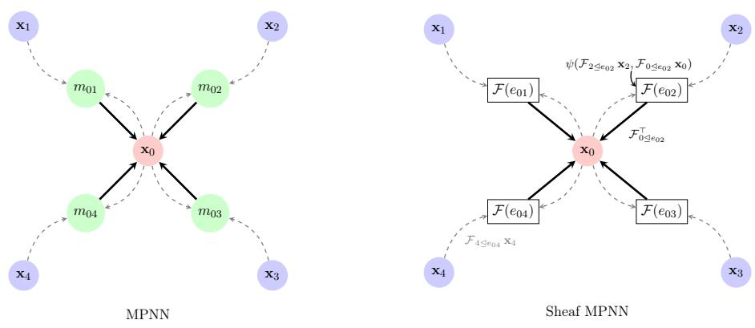

# Sheaf-MPNN: A Library for Sheaf Neural Networks as Message Passing

Alessio Borgi<sup>1,2,∗</sup> [alessio.borgi@uniroma1.it, ab3352@cam.ac.uk] Mario Severino<sup>1</sup> [ms3413@cam.ac.uk] Luke Braithwaite<sup>1</sup> [lb2027@cam.ac.uk] Steve Azzolin<sup>3</sup> [steve.azzolin@unitn.it] Rémi Bourgerie<sup>4</sup> [remibo@kth.se] Olga Zaghen<sup>5</sup> [o.zaghen@uva.nl] Emanuele Mule<sup>6</sup> [emanuele.mule@telecom-paris.fr] Riccardo Ali<sup>1</sup> [rma55@cam.ac.uk] Leo Minh Kustermann<sup>7</sup> [lkustermann@ethz.ch] Edoardo Coppola<sup>1</sup> [ec2013@cam.ac.uk] Antonio Purificato<sup>2</sup> [purificato@diag.uniroma1.it] Stefano Fiorini<sup>8</sup> [s.fiorini1994@gmail.com] Christopher Irwin<sup>1</sup> [cli23@cam.ac.uk] Filippo Spiga<sup>9</sup> [fspiga@nvidia.com] Fabrizio Silvestri<sup>2</sup> [fsilvestri@diag.uniroma1.it] Michael Bronstein<sup>10,11</sup> [michael.bronstein@cs.ox.ac.uk] Pietro Liò<sup>1</sup> [pl219@cam.ac.uk]

<sup>2</sup>Department of Computer, Control and Management Engineering, Sapienza University of Rome, Rome, Italy

<sup>3</sup>Department of Information Engineering and Computer Science, University of Trento, Trento, Italy <sup>4</sup>KTH Royal Institute of Technology, Stockholm, Sweden

<sup>5</sup>AMLab, University of Amsterdam, Amsterdam, Netherlands

<sup>6</sup>Télécom Paris, Institute Polythechnique de Paris, Paris, France

<sup>8</sup>Independent researcher

<sup>10</sup>Department of Computer Science, University of Oxford, Oxford, UK

<sup>11</sup>AITHYRA, Vienna, Austria

Corresponding Author.

## Abstract

Standard Graph Neural Networks (GNNs) implicitly assume that neighboring nodes share the same feature space, which contributes to oversmoothing and poor performance on heterophilic graphs. Sheaf Neural Networks (SNNs) remove this assumption by giving each node and edge its own vector space and learning restriction maps that transform features as they move between neighbors. These maps define a sheaf Laplacian that drives difusion over the graph, but existing implementations often assemble it explicitly as a global sparse block matrix, which adds memory and computational overhead and can hinder scalability. In this paper, we introduce Sheaf-MPNN, a PyTorch Geometric library that reformulates sheaf difusion as

local incidence-wise transport and aggregation, eliminating the need to construct the global Laplacian. Sheaf-MPNN implements fifteen families of SNNs under a unified message-passing framework, each supporting both homogeneous and heterogeneous graphs, and directed and undirected settings, with diagonal, general, orthogonal, and low-rank restriction maps and attention-based predictors. We further provide a unified benchmarking suite covering nodeand graph-level tasks, heterogeneous graph learning, and computational eficiency, enabling systematic and reproducible comparisons across architectures. We establish theoretical equivalence between these message-passing formulations and their original counterparts and identify the architectural mechanisms needed to preserve their propagation dynamics. This unified perspective provides a principled foundation for implementing, comparing, and extending sheaf-based architectures within standard graph learning frameworks. Source code is available at https://github.com/alessioborgi/sheaf-mpnn.

Keywords: Sheaf neural networks, Cellular sheaves, Message passing, Graph neural networks, Heterophily, Open source software, PyTorch Geometric

## 1 Introduction

Graph Neural Networks (GNNs) typically learn graph-structured representations through the message-passing paradigm, in which nodes update their representations by aggregating information from their neighbours (Gilmer et al., 2017). Sheaf Neural Networks (SNNs) enrich graph learning with cellular sheaves, which assign local vector spaces, or stalks, to nodes and edges, together with linear restriction maps for each node–edge incidence. These maps transport node representations into a shared edge stalk, where neighbouring signals can be compared. SNNs use this structure to define propagation operators, commonly based on the sheaf Laplacian, that allow neighbouring representations to remain consistent after transport even when their original features difer (Hansen and Gebhart, 2020; Bodnar et al., 2022). Subsequent research has explored how sheaves are constructed (Barbero et al., 2022a; Caralt et al., 2024; Gillespie et al., 2024), how information propagates through them (Suk et al., 2022; Barbero et al., 2022b; Zaghen et al., 2024; Bamberger et al., 2025; Borgi et al., 2026b; Bourgerie et al., 2026a), and extensions to diferent graph structures and feature spaces (Braithwaite et al., 2026; Fiorini et al., 2026a; Duta et al., 2023b; Mule et al., 2026; Borgi et al., 2026a; Ribeiro et al., 2026b; Ali et al., 2026; Van Looy et al., 2026). Despite their common foundations, these models difer in their restriction maps, propagation operators, normalization schemes, and update rules. Appendix A surveys these developments.

A common computational challenge arises from the explicit construction of sheaf operators. Existing SNN implementations assemble the global sheaf Laplacian as a sparse block matrix and apply it to the stacked node representations. For a graph with n nodes and d-dimensional stalks, this produces an nd × nd operator whose nonzero blocks may contain dense d × d matrices. Constructing and storing this operator introduces additional memory and computational overhead, particularly for large graphs or higher-dimensional stalks. Yet the action of the sheaf Laplacian is inherently local: each edge compares its endpoint representations after transport into a shared stalk, and the resulting contributions are mapped back to the incident nodes and aggregated. This suggests that sheaf propagation can be implemented directly through local message passing, without explicitly assembling the global Laplacian. Such a formulation removes the need for operator assembly, although its practical eficiency depends on the implementation and must be evaluated empirically.

Motivated by this observation, we introduce Sheaf-MPNN, a PyTorch Geometric library that implements sheaf propagation through local incidence-wise transport and aggregation. By expressing diferent SNN architectures within a common computational interface, Sheaf-MPNN facilitates their implementation, reuse, and comparison while integrating them with established graph learning tools. The library provides 15 families of SNNs, each with homogeneous and heterogeneous variants, and supports directed and undirected graph settings. It includes diagonal, general, orthogonal, and low-rank restriction maps, together with attention-based map predictors where applicable. To enable systematic evaluation, we also provide a unified benchmarking suite, covering more than 20 datasets, including nodeand graph-level learning, heterogeneous graph benchmarks, and computational eficiency, with shared experimental configurations and reproducible evaluation protocols.

Beyond the library itself, we also develop the unified Sheaf Message Passing Neural Network (Sheaf-MPNN) theoretical framework that characterises how existing sheaf architectures can be expressed through local message passing. We derive explicit message-passing formulations for 15 architecture configurations and establish their theoretical equivalence to the original models, identifying the mechanisms required to preserve their propagation dynamics. These include augmented node states, type-conditioned restriction maps, and directed aggregation rules. We further show that the SheafPool graph-level readout (Braithwaite et al., 2026) can be formulated within the same framework by aggregating locally aligned node representations into a receive-only virtual node. Together, our contribution provides a common theoretical and computational foundation for implementing, comparing, and extending sheaf-based graph learning. Appendix C details the supported architectures, implementation choices, and normalization conventions.

## 2 Sheaf Message Passing in a Nutshell

Let $\mathcal { G } = ( \nu , \mathcal { E } )$ be a finite undirected graph without self-loops, and let $\mathcal { F }$ be a cellular sheaf assigning finite-dimensional inner-product spaces $\mathcal { F } ( u )$ and $\mathcal { F } ( e )$ to nodes and edges, with linear restriction maps $\mathcal { F } _ { u \leq e } : \mathcal { F } ( u )  \mathcal { F } ( e )$ for each incidence u ⊴ e (Curry, 2014; Hansen and Gebhart, 2020). Node signals belong to $C ^ { 0 } ( \mathcal { G } , \mathcal { F } ) = \oplus _ { u \in \mathcal { V } } \mathcal { F } ( u )$ . In orthonormal stalk bases, the sheaf Laplacian acts on $\mathbf { x } \in C ^ { 0 } ( { \mathcal { G } } , { \mathcal { F } } )$ as:

$$
( L _ { \mathcal { F } } \mathbf { x } ) _ { u } = \sum _ { e = \{ u , v \} \in \mathcal { E } } \mathcal { F } _ { u \supseteq e } ^ { \top } \left( \mathcal { F } _ { u \exists e } \mathbf { x } _ { u } - \mathcal { F } _ { v \exists e } \mathbf { x } _ { v } \right) .\tag{1}
$$

Here, each term measures disagreement in the shared edge stalk and transports it back to the receiving node, revealing the Laplacian as a local aggregation operator. We generalise this observation into a Sheaf Message Passing Neural Network (Sheaf-MPNN). Assuming stalks of dimension d and f feature channels, each node has state $\mathbf { x } _ { u } ^ { ( k ) } \in \mathbb { R } ^ { d \times f }$ at layer k. A SheafMPNN transforms node states, computes interactions in edge stalks, aggregates the resulting messages, and updates node representations as:

$$
\mathbf { z } _ { u } ^ { ( k ) } = \mathbf { W } _ { 1 } ^ { ( k ) } \mathbf { x } _ { u } ^ { ( k ) } \mathbf { W } _ { 2 } ^ { ( k ) } ,\tag{2}
$$

$$
\mathbf { m } _ { u \leq e } ^ { ( k ) } = \psi _ { e } \Big ( \mathcal { F } _ { v \leq e } \mathbf { z } _ { v } ^ { ( k ) } , \mathcal { F } _ { u \leq e } \mathbf { z } _ { u } ^ { ( k ) } , \mathbf { e } _ { u v } \Big ) ,\tag{3}
$$

$$
\mathbf { m } _ { u } ^ { ( k + 1 ) } = \bigoplus _ { e = \{ u , v \} \in \mathcal { E } } \omega _ { u v } ^ { ( k ) } \mathcal { F } _ { u \leq e } ^ { \top } \mathbf { m } _ { u \leq e } ^ { ( k ) } ,\tag{4}
$$

  
Figure 1: Sheaf Message Passing Neural Network (SheafMPNN). Neighbourhood update at node 0 (red), with neighbouring nodes in blue. (Left) A standard MPNN computes messages $m _ { 0 i }$ (green) from neighbouring node states and aggregates them at node 0. (Right) A SheafMPNN transports both endpoint representations into the shared edge stalk $\mathcal { F } ( e _ { 0 i } )$ (boxes) through restriction maps (dashed grey arrows). The function ψ computes their interaction, and the resulting message is pulled back through $\mathcal { F } _ { 0 \leq e _ { 0 i } } ^ { \top }$ and aggregated at node 0 (solid black arrows).

$$
\mathbf { x } _ { u } ^ { ( k + 1 ) } = \varphi _ { u } \Big ( \mathbf { x } _ { u } ^ { ( k ) } , \mathbf { m } _ { u } ^ { ( k + 1 ) } \Big ) .\tag{5}
$$

Here, $\mathbf { W } _ { 1 } ^ { ( k ) } \in \mathbb { R } ^ { d \times d }$ and $\mathbf { W } _ { 2 } ^ { ( k ) } \in \mathbb { R } ^ { f \times f }$ mix stalk coordinates and feature channels, respectively. The function $\psi _ { e }$ computes interactions between transported representations, optionally incorporating edge features ${ \bf e } _ { u v }$ . Each message is weighted by $\omega _ { u v } ^ { ( k ) }$ , pulled back through $\mathcal { F } _ { u \leq e } ^ { \top } ,$ aggregated by L, and combined with the current state through $\varphi _ { u }$ . Restriction maps may be learned at each layer, with their layer index omitted for clarity. The construction is equivariant to node relabelling when aggregation is permutation invariant, and the map predictors and update functions are shared and independent of node ordering. Figure 1 illustrates the distinction from standard message passing. Sheaf difusion is recovered by setting $\psi _ { e } ( a , b ) = b - a , \omega _ { u v } ^ { ( k ) } = 1$ , and using sum aggregation, yielding Equation (1) on the transformed features. Normalization is incorporated through $\mathcal { F } _ { u \underline { { { \le } } } e } N _ { u }$ and its transpose, where the implementation uses $N _ { u } = ( D _ { u } + I ) ^ { - 1 / 2 }$ with $\begin{array} { r } { D _ { u } = \sum _ { e \ni u } \mathcal { F } _ { u \underleftarrow { 1 } e } ^ { \top } \mathcal { F } _ { u \underleftarrow { 1 } e } } \end{array}$ (Appendix C.3). Conversely, identity restrictions and identity pre-transformations recover standard MPNNs. The framework also accommodates heterogeneous graphs through type-conditioned restrictionmap predictors (Appendix B.3) and directed graphs through incoming-arc aggregation (Appendix B.4). Explicit directed propagation is necessary because an undirected edge yields cross-edge blocks $\mathcal { F } _ { u \leq e } ^ { \top } \mathcal { F } _ { v \leq e }$ and $\mathcal { F } _ { v \leq e } ^ { \top } \mathcal { F } _ { u \leq e }$ that are transposes, rather than independent directional operators. We formalise the recovery of existing architectures below.

Theorem 1 The following architectures admit the SheafMPNN representation in Equations (2)–(5), with matching normalization and updates: (i) Neural Sheaf Difusion; (ii) standard MPNNs, via identity restrictions and identity pre-transform; (iii) SheafAN, Res-SheafAN, and sheaf adjacency propagation; and (iv) Neural Sheaf Propagation, on an augmented sheaf with node stalks $\mathbb { R } ^ { 2 d }$ and edge stalks $\mathbb { R } ^ { d }$

Appendix B proves Theorem 1 and extends the framework to diagonal, general, orthogonal, low-rank, and attention-generated NSD restrictions, as well as to all the sheaf-variants (Theorems 6, 10, 13, 15, and 19–23).

The computational cost of SheafMPNN reflects the locality of its propagation operator: the transport and aggregation require $O ( | \mathcal { E } | d ^ { 2 } f )$ operations, with $O ( | \mathcal { E } | d ^ { 2 } + | \mathcal { E } | d f + n d f )$ memory for restriction maps, edge messages, and node states when messages are materialised. These bounds exclude map prediction, channel mixing, and block normalization. So, at the end, we evaluate the sheaf Laplacian entirely through local operations, without assembling its global nd × nd matrix representation (Remark 9).

## 3 Library Design and Usage

Built on PyTorch (Paszke et al., 2019) and PyTorch Geometric (Fey et al., 2025), Sheaf-MPNN provides reusable sheaf message-passing layers and end-to-end model wrappers through a unified interface (Appendix C.2). The following example illustrates node classification using orthogonal Neural Sheaf Difusion:

```python
from torch_geometric.datasets import HeterophilousGraphDataset
from sheaf_mpnn.nsd import NSDModel, NSDVariant
data = HeterophilousGraphDataset("data", name="Roman-empire")[0]
model = NSDModel(in_channels=data.num_features, out_channels=18,
hidden_dim=16, num_layers=4, stalk_dim=4,
variant=NSDVariant.ORTHOGONAL)
out = model(data.x, data.edge_index) # [num_nodes, 18]
```

The accompanying sheaf command-line interface supports reproducible experiments across more than 20 datasets, Optuna-based hyperparameter optimization (Akiba et al., 2019), and computational eficiency comparisons against reference implementations. Appendix C details the package structure, model interfaces, and experimental tooling.

## 4 Related Software

General-purpose frameworks such as PyTorch Geometric (Fey et al., 2025) and DGL (Wang et al., 2019) provide message-passing abstractions without native support for cellular sheaves. TopoX (Hajij et al., 2024) supports higher-order topological domains, including operatorbased sheaf models, while existing SNN implementations (Bodnar et al., 2022; Barbero et al., 2022b; Braithwaite et al., 2026) primarily target individual architectures and often rely on explicit sheaf-Laplacian assembly. In contrast, Sheaf-MPNN provides a reusable, Laplacian-free message-passing implementation across a broad family of SNNs, complemented by unified benchmarking tools and theoretical equivalence results.

## 5 Availability

Sheaf-MPNN is publicly available at https://github.com/alessioborgi/sheaf-mpnn under the CC-BY 4.0 license, together with documentation and tutorial notebooks. Appendix C provides implementation details, supported architectures, and experimental configurations.

# Sheaf-MPNN: A Library for Sheaf Neural Networks as Message Passing Supplementary Material

## Contents

A Primer on Cellular Sheaves and Sheaf Neural Networks 7   
A.1 From Message Passing to Sheaves 7   
A.2 Sheaf Neural Network Literature 8   
B The SheafMPNN Blueprint Recovers Existing Sheaf Architectures 10   
B.1 Polynomial Neural Sheaf Difusion 13   
B.2 SheafPool as Graph-Level Sheaf Message Passing 15   
B.3 Heterogeneous NSD and NSP as SheafMPNNs 16   
B.4 Directed Extension 18   
B.5 Cooperative Sheaf Neural Networks 19   
B.6 Joint Sheaf Neural Networks 19   
B.7 Bundle Neural Networks 20   
B.8 Bayesian Sheaf Neural Networks 20   
C Library Design and Usage: Additional Details 21   
C.1 Package Layout 21   
C.2 Model Families and Restriction Maps . 21   
C.3 Anatomy of an NSD Layer . 22   
C.4 End-to-End Models and Direct Layer Use 23   
C.5 Experiment Tooling 25   
C.6 Development and Reproducibility 26   
Acknowledgements 26

## Appendix A. Primer on Cellular Sheaves and Sheaf Neural Networks

This appendix introduces in a deeper way the Sheaf Neural Networks (SNNs) and places the Sheaf-MPNN library within the literature. It first explains how a cellular sheaf generalizes the graph Laplacian and why difusion on a sheaf avoids the classical failure modes of message passing, and then reviews how the field has developed. For fuller treatments we refer to Curry (2014) and Rosiak (2022) for cellular sheaf theory, to Hansen and Ghrist (2019b) for the spectral theory of the sheaf Laplacian, and to the survey of Ayzenberg et al. (2025) for sheaf theory in machine learning more broadly.

## A.1 From Message Passing to Sheaves

Message Passing Neural Networks. A message passing neural network (Gilmer et al., 2017) updates the representation $\mathbf { x } _ { u }$ of each node u of a graph $\mathcal { G } = ( \nu , \mathcal { E } )$ by aggregating the states of its neighbours $\mathcal { N } ( u )$

$$
\mathbf { x } _ { u } ^ { ( t + 1 ) } = \mathrm { U p d a t e } ^ { ( t ) } \Big ( \mathbf { x } _ { u } ^ { ( t ) } , \ \mathrm { A g g r e g a t e } ^ { ( t ) } \big ( \Big \{ \mathbf { x } _ { v } ^ { ( t ) } : v \in \mathcal { N } ( u ) \Big \} \Big ) \Big ) .\tag{6}
$$

This update assumes that all node features live in one shared vector space, so that neighbouring features can be compared and averaged directly. The assumption is harmless when connected nodes tend to be similar, but it underlies two well-known failures. Repeated low-pass averaging drives features towards a constant signal as depth grows, a phenomenon known as oversmoothing (Cai and Wang, 2020; Rusch et al., 2023); and on heterophilic graphs, where neighbours tend to belong to diferent classes, averaging erases the very signal that separates them. Cellular sheaves remove the assumption at its source: every node and every edge receives its own vector space, and learnable linear maps decide how signals are compared across each edge.

Cellular Sheaves. A sheaf attaches data to the pieces of a space, together with rules stating how the data on overlapping pieces must agree. It therefore describes when local information can be glued into a consistent global picture. Cellular sheaves make this idea discrete by attaching vector spaces to the cells of a cell complex and linear maps to the relations between them. On a graph, the cells are the vertices and the edges, and each incidence $u \leq e ,$ read as $^ { 6 6 } u$ is a face of $e ^ { \mathfrak { s } } ,$ carries a linear map that moves data from the vertex to the edge where it is compared with data from the other endpoint.

Definition 2 (Cellular Sheaf on a Graph) A cellular sheaf (Shepard, 1985; Curry, ${ 2 0 1 4 }$ on an undirected graph $\mathcal { G } = ( \nu , \mathcal { E } )$ assigns a finite-dimensional inner-product space (the stalk) $\mathcal { F } ( u )$ to each vertex $u \in \mathcal V$ and $\mathcal { F } ( e )$ to each edge $e \in { \mathcal { E } }$ , together with linear restriction maps $\mathcal { F } _ { u \leq e } : \mathcal { F } ( u )  \mathcal { F } ( e )$ for each incident node–edge pair $u \leq e$ . Stacking vertex and edge stalks yields the 0- and 1-cochain spaces $C ^ { 0 } ( { \mathcal { G } } , { \mathcal { F } } ) : = \bigoplus _ { u \in \mathcal { V } } { \mathcal { F } } ( u )$ and $C ^ { 1 } ( \mathcal { G } , \mathcal { F } ) : = \oplus _ { e \in \mathcal { E } } \mathcal { F } ( e )$ , respectively.

An intuitive reading comes from opinion dynamics (Hansen and Ghrist, 2021). Each node stalk is a private opinion space, each edge stalk is a shared space for the conversation along that edge, and $\mathcal { F } _ { u \le e }$ describes how u expresses its opinion in that conversation. This means that two neighbours, instead of agreeing when their raw features do, they agree along e when their expressed opinions coincide, $\mathcal { F } _ { u \preceq e } \mathbf { x } _ { u } = \mathcal { F } _ { v \lrcorner e } \mathbf { x } _ { v }$ , Disagreement is therefore measured only after both signals have been aligned in a common space, which is exactly what a heterophilic edge requires.

Orienting each edge as $e = ( u  v )$ , the coboundary is $\delta : C ^ { 0 } ( { \mathcal { G } } , { \mathcal { F } } ) \to C ^ { 1 } ( { \mathcal { G } } , { \mathcal { F } } )$ , and the $\delta ( \mathbf { x } ) _ { e } : = \mathcal { F } _ { v \leq e } \mathbf { x } _ { v } - \mathcal { F } _ { u \leq e } \mathbf { x } _ { u }$ records this disagreement edge by edge. Resulting from this, the 0-cochain with $\delta ( { \bf x } ) = 0$ is a global section: a configuration that is consistent across the whole graph. The sheaf Laplacian $L _ { \mathcal { F } } : = \delta ^ { \top } \delta$ (Hansen and Ghrist, 2019b) acts node-wise as:

$$
L _ { \mathcal { F } } ( \mathbf { x } ) _ { u } = \sum _ { u , v \leq e } \mathcal { F } _ { u \leq e } ^ { \top } ( \mathcal { F } _ { u \leq e } \mathbf { x } _ { u } - \mathcal { F } _ { v \leq e } \mathbf { x } _ { v } ) .\tag{7}
$$

It is symmetric positive semi-definite, with diagonal blocks $\begin{array} { r } { \sum _ { u \leq e } \mathcal { F } _ { u \leq e } ^ { \top } \mathcal { F } _ { u \leq e } e } \end{array}$ and of-diagonal blocks $- \mathcal { F } _ { u \triangleleft e } ^ { \top } \mathcal { F } _ { v \triangleleft e }$ , and its kernel is exactly the space of global sections. Its normalized form is $\Delta _ { \mathcal { F } } : = D ^ { - 1 / 2 } L _ { \mathcal { F } } D ^ { - 1 / 2 }$ , where D is the block diagonal of $L _ { \mathcal { F } }$ . We take all stalks to be $\mathbb { R } ^ { d } .$ so that $L _ { \mathcal { F } } \in \mathbb { R } ^ { n d \times n d }$ for a graph with n nodes. When every restriction map is the identity, Equation (7) reduces to the graph Laplacian $\textstyle \sum _ { v \in { \mathcal { N } } ( u ) } \bigl ( \mathbf { x } _ { u } - \mathbf { x } _ { v } \bigr )$ and the global sections are the constant signals. Classical graph learning is thus the special case of the constant sheaf, which is how the blueprint of Section 2 recovers standard MPNNs (Theorem 1).

Sheaf Difusion and Neural Sheaf Difusion. The sheaf Laplacian generates the difusion $\dot { { \mathbf { x } } } ( t ) = - \Delta \boldsymbol { \mathcal { F } } { \mathbf { x } } ( t )$ , which decreases the sheaf Dirichlet energy $\mathbf { x } ^ { \top } L _ { \mathcal { F } } \mathbf { x } = \| \delta \mathbf { x } \| ^ { 2 }$ and converges to the projection of the initial signal onto the global sections. For the constant sheaf these are the constant signals, so deep difusion oversmooths. For a general sheaf they are shaped by the restriction maps, and may assign diferent features to neighbouring nodes as long as these agree after transport. Bodnar et al. (2022) turned this observation into Neural Sheaf Difusion (NSD). They proved that suitable sheaves let difusion linearly separate classes in settings, including heterophilic ones, where graph difusion provably cannot, and they made the sheaf learnable. NSD stacks the stalk signals into $\mathbf { X } \in \mathbb { R } ^ { n d \times f }$ with f feature channels, predicts the map of every incidence from the features of its two endpoints, $\mathcal { F } _ { u \leq e } ^ { ( t ) } = \Phi ^ { ( t ) } ( \mathbf { x } _ { u } \parallel \mathbf { x } _ { v } )$ , as a diagonal, orthogonal, or general matrix, and performs the step:

$$
\begin{array} { r } { \mathbf { X } ^ { ( t + 1 ) } = \mathbf { X } ^ { ( t ) } - \sigma \left( \Delta _ { \mathcal { F } ^ { ( t ) } } \left( \mathbf { I } _ { n } \otimes \mathbf { W } _ { 1 } ^ { ( t ) } \right) \mathbf { X } ^ { ( t ) } \mathbf { W } _ { 2 } ^ { ( t ) } \right) , } \end{array}\tag{8}
$$

where $\mathbf { W } _ { 1 } ^ { ( t ) }$ and $\mathbf { W } _ { 2 } ^ { ( t ) }$ act on the stalk and channel dimensions, respectively. This is the update that Sheaf-MPNN evaluates without materializing $\Delta _ { \mathcal { F } ^ { ( t ) } }$ (Theorem 1 and Appendix C.3).

## A.2 Sheaf Neural Network Literature

Sheaf-based learning grew out of applied topology. Hansen and Ghrist (2019b) developed the spectral theory of the sheaf Laplacian, Hansen and Ghrist (2019a) showed how to learn it from smooth signals, and Hansen and Ghrist (2021) interpreted sheaf difusion as opinion dynamics. Hansen and Gebhart (2020) then proposed the first sheaf neural networks, with hand-crafted sheaves, and Gebhart et al. (2023) recast knowledge-graph embedding as learning an approximate global section of a knowledge sheaf, an idea later used to embed new entities by harmonic extension (Cobb and Gebhart, 2023). NSD (Bodnar et al., 2022) made the sheaf itself learnable and supplied the theory on which most subsequent work builds.

A first line of work asks how the sheaf should be obtained. Connection-Laplacian networks (Barbero et al., 2022a) compute orthogonal maps in preprocessing by aligning local tangent spaces, and tangent-bundle networks (Battiloro et al., 2024) show that discretizing convolution on a manifold’s tangent bundle yields a principled sheaf model. Signal-processing methods learn restriction maps, or entire connection graphs, directly from data (Di Nino et al., 2024, 2026). Bayesian SNNs (Gillespie et al., 2024) place a variational distribution over sheaves, PAC-Bayes bounds guide the spectral optimization of the learned operator (Choi et al., 2026), and eigenvectors of a learned sheaf Laplacian serve as positional encodings for ordinary GNNs (He et al., 2023). To interpret what a learned sheaf encodes, the Bochner– Weitzenböck decomposition of Guadagnuolo et al. (2026) splits the sheaf Laplacian into a positive semi-definite part and a block-diagonal curvature term, which describes the learned geometry locally rather than through the global spectrum. However, two recent studies temper the enthusiasm: Caralt et al. (2026) find that the fixed identity sheaf is competitive on the standard heterophily benchmarks, and the inductive benchmark of Fiorini et al. (2026b) finds that the choice of restriction maps matters most, yet that SNNs do not surpass the strongest baselines. Both suggest that the value of a learned sheaf depends strongly on the task.

A second line changes how signals move on the sheaf. Continous NSD models the dynamics of Eq. (8) as continuous time difusion (Bodnar et al., 2022), Sheaf attention networks weight the transported neighbours (Barbero et al., 2022b), Neural Sheaf Propagation adopts a second-order recurrence (Suk et al., 2022), and nonlinear (Zaghen et al., 2024) and joint (Caralt et al., 2024) difusion modify the interaction law itself. Polynomial filters of the sheaf Laplacian enlarge the receptive field of a single layer (Borgi et al., 2026b), while Deep NSD replaces the Laplacian with a sheaf adjacency operator, complemented with per-stalk gating, odd activation and layer normalization, to keep signals informative across many layers (Bourgerie et al., 2026a). Long-range communication has become a central theme. Cooperative SNNs let each node decide independently whether to send or receive information (Ribeiro et al., 2026a); SheafDEQ formulate sheaf propagation as an equilibrium with convergence guarantees (Bourgerie et al., 2026b); oscillatory dynamics over sheaves propagate information through second-order, wave-like updates (Van Looy et al., 2026); and sheaf efective resistance shows that over-squashing can be reduced by changing the sheaf rather than rewiring the graph (Guimarães et al., 2026). Bundle neural networks (Bamberger et al., 2025) restrict the sheaf to flat vector bundles and replace message passing with heat-kernel difusion, and topological attention (Ali et al., 2026) reinterprets multi-head attention as transport through quiver representations, whose of-diagonal routes mix heads before aggregation.

Sheaves also ofer a natural place to encode richer relational structure. Heterogeneous SNNs condition the restriction maps on node and edge types and introduce the gaugeinvariant SheafPool readout for graph classification (Braithwaite et al., 2026). Directed SNNs generalize the cellular sheaf to account for edge orientation (Fiorini et al., 2026a), temporal SNNs give each node a time-varying orthogonal frame for link prediction on dynamic graphs (Asif et al., 2026), and hierarchical sheaf pooling coarsens graphs using low-frequency modes of cluster-internal sheaf Laplacians (Naddeo et al., 2026). Further work leaves graphs or Euclidean stalks behind. Sheaf hypergraph networks (Duta et al., 2023a) extend incidencebased transport to group interactions; follow-ups construct hypergraph sheaf Laplacians from symmetric simplicial lifts (Choi et al., 2025), add directed hyperedges (Mule et al., 2026), and bring sheaves to higher-order message passing in topological deep learning (Hume and Liò, 2025). Copresheaf networks (Hajij et al., 2025) place sheaf models within a broader framework that also covers other deep learning architectures. Other models change the stalks themselves, carrying Gaussian distributions (Ribeiro et al., 2026b), symmetric positivedefinite matrices with manifold-compatible operators (Peng et al., 2026), Cliford-algebra multivectors (Kamiya and Nicholls, 2026), or Euclidean-equivariant vector features (Borgi et al., 2026a). In each case the restriction maps, and not only the aggregation, must respect the structure of the stalks.

## Appendix B. The SheafMPNN Blueprint Recovers Existing Sheaf Architectures

This appendix proves Theorem 1: each architecture listed there is an instance of the blueprint in Equations (2)–(5), so its layers can be evaluated by local message passing without materializing the sheaf Laplacian. It then extends the construction to polynomial, graph-level, heterogeneous, directed, cooperative, joint, bundle, and Bayesian models.

Throughout, σ denotes a pointwise nonlinearity, $\begin{array} { r } { \mathbf { D } _ { u } = \sum _ { u \leq e } \mathcal { F } _ { u \leq e } ^ { \top } \mathcal { F } _ { u \leq e } } \end{array}$ the block degree of node u, and $\Delta _ { \mathcal { F } } = \mathbf { D } ^ { - 1 / 2 } L _ { \mathcal { F } } \mathbf { D } ^ { - 1 / 2 }$ the normalized sheaf Laplacian. As in Section $^ { 2 , }$ normalization is absorbed into the restriction maps by writing $\hat { \mathcal { F } } _ { u \le e } : = \mathcal { F } _ { u \le e } \mathbf { D } _ { u } ^ { - 1 / 2 }$ , so that:

$$
[ \Delta _ { \mathcal { F } } \mathbf { z } ] _ { u } = \sum _ { u , v \leq e } \hat { \mathcal { F } } _ { u \leq e } ^ { \top } \big ( \hat { \mathcal { F } } _ { u \leq e } \mathbf { z } _ { u } - \hat { \mathcal { F } } _ { v \leq e } \mathbf { z } _ { v } \big ) .\tag{9}
$$

The release instead normalizes with $\mathbf { N } _ { u } = ( \mathbf { D } _ { u } + \mathbf { I } _ { d } ) ^ { - 1 / 2 }$ (Appendix C.3). Since $\mathbf { D } _ { u } + \mathbf { I } _ { d }$ is positive definite, this needs no invertible restriction map, and every construction below holds verbatim with ${ { \bf { N } } _ { u } }$ in place of $\mathbf { D } _ { u } ^ { - 1 / 2 }$

Theorem 1 The following architectures admit the SheafMPNN representation in Equations (2)–(5), with matching normalization and updates: (i) Neural Sheaf Difusion; (ii) standard MPNNs, via identity restrictions and identity pre-transform; (iii) SheafAN, Res-SheafAN, and sheaf adjacency propagation; and (iv) Neural Sheaf Propagation, on an augmented sheaf with node stalks $\mathbb { R } ^ { 2 d }$ and edge stalks $\mathbb { R } ^ { d }$

In the following, we proof each part of Theorem 1 in turn, showing that the layer update of each architecture can be expressed in the form of Equation (5) with a suitable choice of message $\psi _ { e }$ , aggregation L, and update $\varphi _ { u }$

Proof of Theorem 1, Parts (i)–(ii): Neural Sheaf Difusion. A layer of Neural Sheaf Difusion (NSD) (Bodnar et al., 2022) computes:

$$
\begin{array} { r } { \begin{array} { r } { \mathbf { Z } ^ { ( k ) } = \left( \mathbf { I } _ { n } \otimes \mathbf { W } _ { 1 } ^ { ( k ) } \right) \mathbf { X } ^ { ( k ) } \mathbf { W } _ { 2 } ^ { ( k ) } , \quad \quad } \\ { \mathbf { X } ^ { ( k + 1 ) } = ( 1 + \pmb { \varepsilon } ^ { ( k ) } ) \odot \mathbf { X } ^ { ( k ) } - \alpha \sigma \left( \Delta _ { \mathcal { F } ^ { ( k ) } } \mathbf { Z } ^ { ( k ) } \right) } \end{array} } \end{array}\tag{10}
$$

where $\pmb { \mathcal { E } } ^ { ( k ) } \in \mathbb { R } ^ { d }$ rescales each stalk dimension, broadcast across nodes and channels, and α is the difusion step size. By Equation (9), the update at node u is:

$$
\mathbf { x } _ { u } ^ { ( k + 1 ) } = \left( 1 + \varepsilon ^ { ( k ) } \right) \odot \mathbf { x } _ { u } ^ { ( k ) } - \alpha \sigma \Big ( \sum _ { u , v \le e } \hat { \mathcal { F } } _ { u \le e } ^ { \top } \big ( \hat { \mathcal { F } } _ { u \le e } \mathbf { z } _ { u } ^ { ( k ) } - \hat { \mathcal { F } } _ { v \le e } \mathbf { z } _ { v } ^ { ( k ) } \big ) \Big )
$$

with $\mathbf { z } _ { u } ^ { ( k ) } = \mathbf { W } _ { 1 } ^ { ( k ) } \mathbf { x } _ { u } ^ { ( k ) } \mathbf { W } _ { 2 } ^ { ( k ) }$ . This is the blueprint with the normalized maps ${ \hat { \mathcal { F } } } _ { : }$ , the message function $\psi _ { e } ( a , b ) = b - a$ in Equation (3), unit weights and sum aggregation in Equation (4), and the update $\varphi _ { u } ( \mathbf { x } _ { u } , \mathbf { m } _ { u } ) = \left( 1 + \pmb { \varepsilon } ^ { ( k ) } \right) \odot \mathbf { x } _ { u } - \alpha \sigma ( \mathbf { m } _ { u } )$ in Equation (5). For part (ii), take every restriction map and both weight matrices to be identities. The transported states are then the raw node states, the message $\psi _ { e } ( \mathbf { x } _ { v } , \mathbf { x } _ { u } , \mathbf { e } _ { u v } )$ and the aggregation $\oplus$ are arbitrary, and the pullback is the identity, so the blueprint reduces to the general MPNN of Gilmer et al. (2017).

Proof of Theorem 1, part (iii): Sheaf Attention. Let $\mathbf { A } _ { \mathcal { F } }$ be the block matrix whose (u, v) block is $\mathcal { F } _ { u \leq e } ^ { \top } \mathcal { F } _ { v \leq e }$ for every edge $e = \{ u , v \}$ and zero otherwise, and let $\hat { \Lambda } ^ { ( k ) }$ collect the attention coeficients $\Lambda _ { u v } = \mathrm { A t t n } ( \mathbf { x } _ { u } ^ { ( k ) } , \mathbf { x } _ { v } ^ { ( k ) } )$ , normalized over the neighbours of u. A SheafAN layer (Barbero et al., 2022b) computes:

$$
\mathbf { X } ^ { ( k + 1 ) } = \sigma \Big ( \Big ( ( \hat { \boldsymbol { \Lambda } } ^ { ( k ) } \otimes \mathbf { 1 } _ { d } \mathbf { 1 } _ { d } ^ { \top } ) \odot \mathbf { A } _ { \mathcal { F } ^ { ( k ) } } \Big ) \mathbf { Z } ^ { ( k ) } \Big )\tag{11}
$$

which at node u reads $\begin{array} { r } { \mathbf { x } _ { u } ^ { ( k + 1 ) } = \sigma \big ( \sum _ { u , v \ll e } \Lambda _ { u v } \mathcal { F } _ { u \ll e } ^ { \top } \mathcal { F } _ { v \ll e } \mathbf { z } _ { v } ^ { ( k ) } \big ) } \end{array}$ . This is the blueprint with the message $\psi _ { e } ( a , b ) = a _ { \mathrm { { } } }$ , so that $\mathbf { m } _ { u \leq e } ^ { ( k ) } = \mathcal { F } _ { v \leq e } \mathbf { z } _ { v } ^ { ( k ) }$ , the weights $\omega _ { u v } ^ { ( k ) } = \Lambda _ { u v }$ , sum aggregation, and the update $\varphi _ { u } ( \mathbf { x } _ { u } , \mathbf { m } _ { u } ) = \sigma ( \mathbf { m } _ { u } )$ . When the attention coeficients are normalized by a softmax over the neighbourhood, the normalization is itself local: each edge also sends its unnormalized score, both quantities are summed, and the update divides one by the other, as in graph attention.

Res-SheafAN adds a residual connection and a skip rescaling to the SheafAN update, so that the layer computes:

$$
\mathbf { X } ^ { ( k + 1 ) } = ( 1 + \pmb \varepsilon ^ { ( k ) } ) \odot \mathbf { X } ^ { ( k ) } + \sigma \Big ( \left( ( \hat { \Lambda } ^ { ( k ) } \otimes \mathbf { 1 } _ { d } \mathbf { 1 } _ { d } ^ { \top } ) \odot \mathbf { A } _ { \mathcal { F } ^ { ( k ) } } - \mathbf { I } \right) \mathbf { Z } ^ { ( k ) } \Big )
$$

so that $\begin{array} { r } { \mathbf { x } _ { u } ^ { ( k + 1 ) } ~ = ~ ( 1 + \varepsilon ^ { ( k ) } ) \odot \mathbf { x } _ { u } ^ { ( k ) } + \sigma \big ( \sum _ { u , v \ll e } \Lambda _ { u v } \mathcal { F } _ { u \ll e } ^ { \top } \mathcal { F } _ { v \ll e } \mathbf { z } _ { v } ^ { ( k ) } - \mathbf { z } _ { u } ^ { ( k ) } \big ) } \end{array}$ . The messages and the aggregation are those of SheafAN. The term $\mathbf { z } _ { u } ^ { ( k ) } = \mathbf { W } _ { 1 } ^ { ( k ) } \mathbf { x } _ { u } ^ { ( k ) } \mathbf { W } _ { 2 } ^ { ( k ) }$ depends only on the state of u, so it belongs to the node-local update $\varphi _ { u } ( \mathbf { x } _ { u } , \mathbf { m } _ { u } ) = ( 1 + \varepsilon ^ { ( k ) } ) \odot \mathbf { x } _ { u } + \sigma \big ( \mathbf { m } _ { u } - \mathbf { W } _ { 1 } ^ { ( k ) } \mathbf { x } _ { u } \mathbf { W } _ { 2 } ^ { ( k ) } \big )$

Proof of Theorem 1, part (iii): Sheaf Adjacency. Sheaf adjacency propagation (Bourgerie et al., 2026a) replaces the Laplacian with the normalized sheaf adjacency $\hat { \bf A } _ { \mathcal { F } }$ , whose $( u , v )$ block is $\mathbf { D } _ { u } ^ { - 1 / 2 } \mathcal { F } _ { u \cong e } ^ { \top } \mathcal { F } _ { v \cong e } \mathbf { D } _ { v } ^ { - 1 / 2 } = \hat { \mathcal { F } } _ { u \cong e } ^ { \top } \hat { \mathcal { F } } _ { v \cong e } \mathrm { . }$

$$
\mathbf { X } ^ { ( k + 1 ) } = ( 1 + \pmb { \varepsilon } ^ { ( k ) } ) \odot \mathbf { X } ^ { ( k ) } + \alpha \sigma \Big ( \hat { \mathbf { A } } _ { \mathcal { F } ^ { ( k ) } } \mathbf { Z } ^ { ( k ) } \Big ) .\tag{12}
$$

At node u the argument of $\sigma$ is $\begin{array} { r } { \sum _ { u , v \leq e } \hat { \mathcal { F } } _ { u \leq e } ^ { \top } \hat { \mathcal { F } } _ { v \leq e } \mathbf { z } _ { v } ^ { ( k ) } } \end{array}$ This is the blueprint with the normalized maps ${ \hat { \mathcal { F } } } .$ , the message $\psi _ { e } ( a , b ) = a ,$ sum aggregation, and the update $\varphi _ { u } ( \mathbf { x } _ { u } , \mathbf { m } _ { u } ) = \left( 1 + \pmb { \varepsilon } ^ { ( k ) } \right) \odot \mathbf { x } _ { u } + \alpha \sigma ( \mathbf { m } _ { u } )$ ■

Proof of Theorem 1, part (iv): Neural Sheaf Propagation. Neural Sheaf Propagation (NSP) (Suk et al., 2022) follows the second-order recurrence:

$$
{ \bf X } ^ { ( k + 1 ) } = 2 { \bf X } ^ { ( k ) } - { \bf X } ^ { ( k - 1 ) } - \sigma \Big ( \Delta _ { \mathcal { F } ^ { ( k ) } } { \bf Z } ^ { ( k ) } \Big ) , \qquad { \bf X } ^ { ( - 1 ) } = { \bf 0 }\tag{13}
$$

with $\mathbf { Z } ^ { ( k ) }$ as in Equation (10). Because the update depends on $\mathbf { X } ^ { ( k - 1 ) }$ , it is not directly of the form of Equation (5), where $\varphi _ { u }$ receives only the current state and the aggregated message. We remove this dependence by augmenting the state. Define $\tilde { \mathbf { x } } _ { u } ^ { ( k ) } : = \big ( \mathbf { x } _ { u } ^ { ( k ) } , \mathbf { x } _ { u } ^ { ( k - 1 ) } \big ) \in \mathbb { R } ^ { 2 d \times f }$ , with $\tilde { \mathbf { x } } _ { u } ^ { ( 0 ) } = ( \mathbf { x } _ { u } ^ { ( 0 ) } , \mathbf { 0 } )$ , and let $\pi _ { 1 } , \pi _ { 2 }$ project onto the current and history blocks. The augmented sheaf has node stalks $\mathbb { R } ^ { 2 d }$ , edge stalks $\mathbb { R } ^ { d }$ and restriction maps $\tilde { \mathcal { F } } _ { u \preceq e } : = \hat { \mathcal { F } } _ { u \preceq e } \circ \pi _ { 1 } : \mathbb { R } ^ { 2 d } \to \mathbb { R } ^ { d }$ , which read the current block and apply the normalized original map. The transform uses $\tilde { \mathbf { W } } _ { 1 } ^ { ( k ) } = \mathrm { d i a g } ( \mathbf { W } _ { 1 } ^ { ( k ) } , \mathbf { 0 } )$ , so that $\tilde { \mathbf { z } } _ { u } ^ { ( k ) } = ( \mathbf { z } _ { u } ^ { ( k ) } , \mathbf { 0 } )$ . With the message $\psi _ { e } ( a , b ) = b - a$ and sum aggregation:

$$
\mathbf { m } _ { u } ^ { ( k + 1 ) } = \sum _ { u , v \leq { e } } \tilde { \mathcal { F } } _ { u \leq { e } } ^ { \top } \big ( \tilde { \mathcal { F } } _ { u \leq { e } } \tilde { \mathbf { z } } _ { u } ^ { ( k ) } - \tilde { \mathcal { F } } _ { v \leq { e } } \tilde { \mathbf { z } } _ { v } ^ { ( k ) } \big ) = \big ( [ \Delta _ { \mathcal { F } ^ { ( k ) } } \mathbf { Z } ^ { ( k ) } ] _ { u } , \mathbf { 0 } \big )
$$

by Equation (9), since $\tilde { \mathcal { F } } _ { u \leq e } ^ { \top } = \pi _ { 1 } ^ { \top } \hat { \mathcal { F } } _ { u \leq e } ^ { \top }$ embeds into the current block. The update then reads:

$$
\varphi _ { u } \big ( \tilde { \mathbf { x } } _ { u } , \mathbf { m } _ { u } \big ) = \Big ( 2 \pi _ { 1 } ( \tilde { \mathbf { x } } _ { u } ) - \pi _ { 2 } ( \tilde { \mathbf { x } } _ { u } ) - \sigma \big ( \pi _ { 1 } ( \mathbf { m } _ { u } ) \big ) , \ \pi _ { 1 } ( \tilde { \mathbf { x } } _ { u } ) \Big )
$$

and it is a deterministic function of the augmented state and the aggregated message. By induction on $k , \tilde { \mathbf { x } } _ { u } ^ { ( k ) } = ( \mathbf { x } _ { u } ^ { ( k ) } , \mathbf { x } _ { u } ^ { ( k - 1 ) } )$ for all k: the base case holds by the initialization, and if it holds at step k, then $\pi _ { 1 } ( \tilde { \mathbf { x } } _ { u } ^ { ( k + 1 ) } ) = 2 \mathbf { x } _ { u } ^ { ( k ) } - \mathbf { x } _ { u } ^ { ( k - 1 ) } - \sigma ( [ \Delta _ { \mathcal { F } ^ { ( k ) } } \mathbf { Z } ^ { ( k ) } ] _ { u } ) = \mathbf { x } _ { u } ^ { ( k + 1 ) }$ by Equation (13) and $\pi _ { 2 } ( \tilde { \mathbf { x } } _ { u } ^ { ( k + 1 ) } ) = \mathbf { x } _ { u } ^ { ( k ) }$ . The current block therefore reproduces NSP exactly.

Remark 3 The augmented restriction maps $\mathcal { \tilde { F } } _ { u \triangleleft e } : \mathbb { R } ^ { 2 d } \to \mathbb { R } ^ { d }$ are not square, which the blueprint allows but which places NSP in a diferent sheaf regime from NSD, whose maps are endomorphisms. The degree of the augmented sheaf vanishes on the history block, so its own normalization is undefined; this is why the normalization of the original sheaf is folded into $\tilde { \mathcal { F } }$

Remark 4 (Learnable Skip Rescaling) . Any update that keeps a residual connection to the current state can be extended with learnable per-dimension rescalings, since these are constants shared by all nodes and leave $\varphi _ { u }$ a deterministic function of the state and the aggregated message. For NSP, the library’s add\_eps option uses two rescalings $\pmb { \varepsilon } _ { 1 } , \pmb { \varepsilon } _ { 2 } \in [ - 1 , 1 ] ^ { d }$ , one for each block:

$$
\pi _ { 1 } ( \widetilde { \mathbf { x } } _ { u } ^ { ( k + 1 ) } ) = ( 2 + \pmb { \varepsilon } _ { 1 } ) \odot \pi _ { 1 } ( \widetilde { \mathbf { x } } _ { u } ^ { ( k ) } ) - ( 1 + \pmb { \varepsilon } _ { 2 } ) \odot \pi _ { 2 } ( \widetilde { \mathbf { x } } _ { u } ^ { ( k ) } ) - \sigma \big ( \pi _ { 1 } ( \mathbf { m } _ { u } ^ { ( k + 1 ) } ) \big )
$$

which recovers Equation (13) at $\pmb { \varepsilon } _ { 1 } = \pmb { \varepsilon } _ { 2 } = \mathbf { 0 }$

## B.1 Polynomial Neural Sheaf Difusion

Polynomial Neural Sheaf Difusion $\left( \mathrm { P o l y N S D } \right)$ (Borgi et al., 2026b) replaces the single Laplacian application of NSD with a degree-K polynomial filter, evaluated through the Chebyshev recurrence without eigendecomposition. We show that a PolyNSD layer is a sequence of K SheafMPNN steps followed by a node-wise readout.

Setting. The spectrum of $\Delta { \_ }$ lies in $[ 0 , \lambda _ { \operatorname* { m a x } } ]$ with $\lambda _ { \operatorname* { m a x } } = 2$ for the symmetric normalization. The rescaled Laplacian:

$$
\widehat { \Delta } _ { \mathcal { F } } : = \frac { 2 } { \lambda _ { \operatorname* { m a x } } } \Delta _ { \mathcal { F } } - \mathbf { I } _ { n d } , \qquad \mathrm { s p e c } \big ( \widehat { \Delta } _ { \mathcal { F } } \big ) \subseteq [ - 1 , 1 ]\tag{14}
$$

maps the spectrum onto the interval on which the Chebyshev polynomials $T _ { 0 } ( x ) = 1$ $T _ { 1 } ( x ) = x$ , and $T _ { k + 1 } ( x ) = 2 x T _ { k } ( x ) - T _ { k - 1 } ( x )$ satisfy $\left| T _ { k } \right| \leq 1$

PolyNSD Update Rule. At layer $\ell ,$ let $\mathbf { z } _ { u } = \mathbf { W } _ { 1 } ^ { ( \ell ) } \mathbf { x } _ { u } ^ { ( \ell ) } \mathbf { W } _ { 2 } ^ { ( \ell ) }$ and define the Chebyshev iterates over the rescaled Laplacian:

$$
\begin{array} { r } { \mathbf T _ { 0 } = \mathbf z , \qquad \mathbf T _ { 1 } = \widehat { \Delta } _ { \mathcal { F } } \mathbf z , \qquad \mathbf T _ { k + 1 } = 2 \widehat { \Delta } _ { \mathcal { F } } \mathbf T _ { k } - \mathbf T _ { k - 1 } \quad ( k \geq 1 ) . } \end{array}\tag{15}
$$

The layer combines them with a high-pass skip term and a learnable convex combination:

$$
\begin{array} { r } { \mathbf { h } _ { u } = \alpha _ { \mathrm { h p } } \Big ( \mathbf { z } _ { u } - \frac { 1 } { \lambda _ { \mathrm { m a x } } } [ \boldsymbol { \Delta } _ { \mathcal { F } } \mathbf { z } ] _ { u } \Big ) , } \end{array}\tag{16}
$$

$$
\mathbf { x } _ { u } ^ { ( \ell + 1 ) } = \operatorname { d i a g } ( \gamma ) ~ \mathbf { x } _ { u } ^ { ( \ell ) } - \sigma \Big ( \sum _ { k = 0 } ^ { K } \theta _ { k } [ \mathbf { T } _ { k } ] _ { u } + \mathbf { h } _ { u } \Big ) ,\tag{17}
$$

where $\pmb \theta = \mathrm { s o f t m a x } ( \pmb \theta _ { \mathrm { r a w } } )$ , so that $\theta _ { k } \ge 0$ and $\begin{array} { r } { \sum _ { k } \theta _ { k } = 1 , \gamma = 1 + \operatorname { t a n h } ( \pmb { \varepsilon } ) } \end{array}$ with $\pmb \varepsilon \in \mathbb R ^ { d }$ shared by all nodes, and $\alpha _ { \mathrm { h p } } \in \mathbb { R }$ is learnable. Since $\begin{array} { r } { [ \Delta _ { \mathcal { F } } \mathbf { z } ] _ { u } = \frac { \lambda _ { \operatorname* { m a x } } } { 2 } ( [ \mathbf { T } _ { 1 } ] _ { u } + \mathbf { z } _ { u } ) } \end{array}$ , the skip term equals $\begin{array} { r } { \mathbf { h } _ { u } = \frac { \alpha _ { \mathrm { h p } } } { 2 } ( [ \mathbf { T } _ { 0 } ] _ { u } ^ { \cdot } - [ \mathbf { T } _ { 1 } ] _ { u } ) } \end{array}$ for any $\lambda _ { \mathrm { m a x } }$ , a combination of the first two iterates.

Definition 5 (Augmented PolyNSD State) . For $k \in \{ 1 , \ldots , K \}$ , the augmented state of node u is:

$$
\tilde { \mathbf { x } } _ { u } ^ { ( k ) } : = \left( [ \mathbf { T } _ { k } ] _ { u } , [ \mathbf { T } _ { k - 1 } ] _ { u } , \mathbf { S } _ { u } ^ { ( k ) } \right) \in \mathbb { R } ^ { 3 d \times f } , \qquad \mathbf { S } _ { u } ^ { ( k ) } : = \sum _ { j = 0 } ^ { k } \theta _ { j } [ \mathbf { T } _ { j } ] _ { u } + \mathbf { h } _ { u }\tag{18}
$$

where the accumulator $\mathbf { S } _ { u } ^ { ( k ) }$ already contains the skip term. The augmented sheaf $\tilde { \mathcal { F } }$ has node stalks $\mathbb { R } ^ { 3 d }$ , edge stalks $\mathbb { R } ^ { d }$ , and restriction maps $\tilde { \mathcal { F } } _ { u \preceq e } : = \mathcal { \hat { F } } _ { u \preceq e } \circ \pi _ { 1 } : \mathbb { R } ^ { 3 \bar { d } } \to \mathbb { R } ^ { d }$ where $\pi _ { 1 } , \pi _ { 2 } , \pi _ { 3 }$ project onto the three blocks.

Theorem 6 (PolyNSD is a SheafMPNN) . A PolyNSD layer of degree $K \geq 1$ (Equation $( 1 \gamma ) )$ equals K SheafMPNN steps on the augmented sheaf $( \mathcal G , \tilde { \mathcal F } )$ , which compute $\mathbf { \dot { x } } _ { u } ^ { ( K ) } f r o m \left( \mathbf { z } _ { u } , \mathbf { 0 } , \mathbf { 0 } \right)$ , followed by the node-wise readout $\mathbf { x } _ { u } ^ { ( \ell + 1 ) } = \mathrm { d i a g } ( \gamma ) ~ \mathbf { x } _ { u } ^ { ( \ell ) } - \sigma \big ( \pi _ { 3 } ( \tilde { \mathbf { x } } _ { u } ^ { ( \bar { K } ) } ) \big )$ Every step uses identity weight matrices, the message $\psi _ { e } ( a , b ) = b - a$ , and sum aggregation; the steps difer only in their node-local updates.

Proof Messages and Aggregation. At every step, the first block of the state holds the current iterate T. Since $\tilde { \mathcal { F } } _ { u \leq e }$ reads only that block, Equation (9) gives the aggregated message:

$$
\mathbf { m } _ { u } = \sum _ { u , v \leq e } \tilde { \mathcal { F } } _ { u \leq e } ^ { \top } \big ( \tilde { \mathcal { F } } _ { u \leq e } \tilde { \mathbf { x } } _ { u } - \tilde { \mathcal { F } } _ { v \leq e } \tilde { \mathbf { x } } _ { v } \big ) = \big ( [ \Delta _ { \mathcal { F } } \mathbf { T } ] _ { u } , \mathbf { 0 } , \mathbf { 0 } \big )\tag{19}
$$

one message per incidence and one propagation per step. The node can then form $\begin{array} { r } { [ \widehat { \Delta } _ { \mathcal { F } } \mathbf { T } ] _ { u } = \frac { 2 } { \lambda _ { \mathrm { m a x } } } \pi _ { 1 } ( \mathbf { m } _ { u } ) - \pi _ { 1 } ( \tilde { \mathbf { x } } _ { u } ) } \end{array}$ locally.

Updates. The first step maps $( { \bf z } _ { u } , { \bf 0 } , { \bf 0 } )$ to $\begin{array} { r l r } { \tilde { \mathbf { x } } _ { u } ^ { ( 1 ) } } & { = } & { \big ( [ \mathbf { T } _ { 1 } ] _ { u } , \mathbf { z } _ { u } , \boldsymbol { \theta } _ { 0 } \mathbf { z } _ { u } + \boldsymbol { \theta } _ { 1 } [ \mathbf { T } _ { 1 } ] _ { u } \ + \ } \end{array}$ $\frac { \alpha _ { \mathrm { h p } } } { 2 } ( \mathbf { z } _ { u } - [ \mathbf { T } _ { 1 } ] _ { u } ) )$ with $[ \mathbf { T } _ { 1 } ] _ { u } = [ \widehat { \Delta } _ { \mathcal { F } } \mathbf { z } ] _ { u }$ . Each later step $k = 1 , \ldots , K - 1$ applies the Chebyshev recurrence to the first two blocks and adds $\theta _ { k + 1 } [ \mathbf { T } _ { k + 1 } ] _ { u }$ to the accumulator:

$$
\varphi _ { u } \big ( \tilde { \mathbf { x } } _ { u } ^ { ( k ) } , \mathbf { m } _ { u } \big ) = \big ( 2 [ \widehat { \Delta } _ { \mathcal { F } } \mathbf { T } _ { k } ] _ { u } - [ \mathbf { T } _ { k - 1 } ] _ { u } , ~ [ \mathbf { T } _ { k } ] _ { u } , ~ \mathbf { S } _ { u } ^ { ( k ) } + \theta _ { k + 1 } \big ( 2 [ \widehat { \Delta } _ { \mathcal { F } } \mathbf { T } _ { k } ] _ { u } - [ \mathbf { T } _ { k - 1 } ] _ { u } \big ) \big ) .\tag{20}
$$

Both updates are deterministic functions of the current augmented state and the aggregated message, as Equation (5) requires.

Correctness. By Equation (15), the first component of Equation (20) is $\mathbf { T } _ { k + 1 }$ , the second is $\mathbf { T } _ { k } .$ , and the third adds $\theta _ { k + 1 } \mathbf { T } _ { k + 1 }$ to the accumulator. Since $\mathbf { T } _ { k }$ is generated by the Chebyshev recurrence in the matrix $\widehat { \Delta } _ { \mathcal { F } }$ , induction gives $\mathbf { T } _ { k } = T _ { k } ( \widehat { \Delta } _ { \mathcal { F } } )$ z, and after K steps $\begin{array} { r } { \pi _ { 3 } ( \tilde { \mathbf { x } } _ { u } ^ { ( K ) } ) = \sum _ { k = 0 } ^ { K } \theta _ { k } [ \mathbf { T } _ { k } ] _ { u } + \mathbf { h } _ { u } } \end{array}$ , the argument of σ in Equation (17). The readout uses only $\mathbf { x } _ { u } ^ { ( \ell ) }$ and the state of $u ,$ so it is node-wise and requires no further propagation.

Remark 7 (Reduction to NSD) . For $K = 1$ and $\lambda _ { \operatorname* { m a x } } = 2$ , the argument of σ is $\begin{array} { r } { ( \theta _ { 0 } - \theta _ { 1 } + \alpha _ { \mathrm { h p } } ) { \bf z } _ { u } + ( \theta _ { 1 } - \frac { \alpha _ { \mathrm { h p } } } { 2 } ) [ \Delta _ { \mathcal { F } } { \bf z } ] _ { u } } \end{array}$ . Choosing $\alpha _ { \mathrm { h p } } = \theta _ { 1 } - \theta _ { 0 }$ cancels the first term and leaves $\frac { 1 } { 2 } [ \Delta \mathcal { F } { \bf z } ] _ { u }$ , because $\theta _ { 0 } + \theta _ { 1 } = 1$ . Doubling $\mathbf { W } _ { 2 } ^ { ( \ell ) }$ absorbs the factor ${ \frac { 1 } { 2 } } .$ , so the layer computes diag(γ) $\mathbf { x } _ { u } - \sigma ( [ \Delta \mathcal { F } \mathbf { z } ] _ { u } )$ : the NSD update of Equation (10) with unit step size, which is the original update of Bodnar et al. (2022). Every such NSD layer is therefore a degree-one PolyNSD layer.

Remark 8 (Restriction-map Variants) . The proof uses only the linearity of the restriction maps, so Theorem 6 holds for all six NSD map variants (Table 3). For orthogonal maps $\mathcal { F } _ { u \triangleleft e } ^ { \top } \mathcal { F } _ { u \triangleleft e } = \mathbf { I } _ { d } , s o \mathbf { D } _ { u } = \deg ( u ) \mathbf { I } _ { d }$ and the normalization reduces to a scalar per node.

Remark 9 (Laplacian-free Filter Evaluation) . Each product $\widehat { \Delta } \mathcal { F } \mathbf { T } _ { k }$ is evaluated through Equation (19), which needs only the state of u, the states of its neighbours, and the maps on its incidences, so the nd × nd operator is never assembled. Per layer, the library stores the restriction-map products, of total size $O ( | \mathcal { E } | d ^ { 2 } )$ , computed once by the map predictor and reused in all K steps; the half-degree matrices $\mathbf { D } _ { u } ^ { - 1 / 2 }$ , of size $O ( n d ^ { 2 } )$ ; and three stalk tensors of size $O ( n d f )$ , namely the two live iterates and the accumulator. A degree-K layer therefore costs $O ( K | \mathcal { E } | d ^ { 2 } f )$ operations and $O ( | \mathcal { E } | d ^ { 2 } + n d ^ { 2 } + n d f )$ memory, excluding map prediction. By contrast, the original NSD implementation of Bodnar et al. (2022) assembles a sparse nd×nd Laplacian with $O ( n d ^ { 2 } + | \mathcal { E } | d ^ { 2 } )$ non-zeros and multiplies it with the features, and spectral filters based on eigendecomposition additionally pay $O ( ( n d ) ^ { 3 } )$ for the factorization. Both message passing and sparse multiplication perform the same $O ( | \mathcal { E } | d ^ { 2 } f )$ arithmetic per step; the diference lies in avoiding the assembly and storage of the global operator.

## B.2 SheafPool as Graph-Level Sheaf Message Passing

SheafPool (Braithwaite et al., 2026) produces a graph-level representation from the node stalks of a sheaf backbone. We show that it is a single SheafMPNN layer in which every graph sends its aligned node stalks to a receive-only virtual node.

Setting. Let $B = \{ \mathcal { G } _ { 1 } , \ldots , \mathcal { G } _ { B } \}$ be a batch of graphs, $\mathcal { G } _ { g } = ( \mathcal { V } _ { g } , \mathcal { E } _ { g } )$ , and let $\mathbf { H } _ { i } \in \mathbb { R } ^ { d \times f }$ be the stalk embedding of node i produced by the backbone. The pooling graph $\mathcal { G } ^ { + }$ adds one virtual node $\star _ { g }$ per graph and the arcs:

$$
\mathcal { E } ^ { + } = \{ ( i  \star _ { g } ) : i \in \mathcal { V } _ { g } , g = 1 , \ldots , B \}\tag{21}
$$

and the pooling sheaf ${ \mathcal { F } } ^ { + }$ uses the stalk $\mathbb { R } ^ { d }$ at every node and edge, with identity restriction maps:

$$
\mathcal { F } _ { i \leq e } = \mathcal { F } _ { \star _ { g } \leq e } = \mathbf { I } _ { d } \qquad \mathrm { ~ f o r ~ e v e r y ~ a r c ~ } e = ( i  \star _ { g } ) .\tag{22}
$$

Messages are aggregated only along incoming arcs, as in the directed extension of $\mathrm { A p \mathrm { - } }$ pendix B.4, so the real nodes receive nothing and each virtual node is receive-only. Before pooling, SheafPool canonicalizes each node stalk. It whitens the stalk and aligns it to a learnable anchor $\mathbf { A } \in \mathbb { R } ^ { d \times f }$ by orthogonal Procrustes:

$$
\mathbf { Z } _ { i } = \left( \mathbf { H } _ { i } \mathbf { H } _ { i } ^ { \top } + \varepsilon \mathbf { I } _ { d } \right) ^ { - 1 / 2 } \mathbf { H } _ { i } , \qquad \mathbf { R } _ { i } ^ { \star } = \underset { \mathbf { R } \in \cup ( d ) } { \arg \operatorname* { m i n } } \| \mathbf { R } ^ { \top } \mathbf { Z } _ { i } - \mathbf { A } \| _ { F } ^ { 2 } , \qquad \widetilde { \mathbf { Z } } _ { i } = \mathbf { R } _ { i } ^ { \star ^ { \top } } \mathbf { Z } _ { i }\tag{23}
$$

and scores it through the channel energies $\mathbf { u } _ { i } = \mathrm { d i a g } ( \mathbf { Z } _ { i } ^ { \top } \mathbf { Z } _ { i } ) \in \mathbb { R } ^ { f }$ , which are invariant under orthogonal changes of stalk basis:

$$
\alpha _ { i } = \frac { \exp ( s _ { \theta } ( \mathbf { u } _ { i } ) ) } { \sum _ { j \in \mathcal { V } _ { g } } \exp ( s _ { \theta } ( \mathbf { u } _ { j } ) ) } , \qquad i \in \mathcal { V } _ { g } .\tag{24}
$$

The pooled stalk, the update of a learnable graph token $\mathbf { T } \in \mathbb { R } ^ { d \times f }$ , and the invariant readout are of the form:

$$
\mathbf { P } _ { g } = \sum _ { i \in \mathcal { V } _ { g } } \alpha _ { i } \widetilde { \mathbf { Z } } _ { i } ,\tag{25}
$$

$$
\widehat { \mathbf { T } } _ { \boldsymbol { g } } = \operatorname { L a y e r N o r m } \bigl ( \phi ( [ \mathbf { T } , \mathbf { P } _ { \boldsymbol { g } } ] ) \bigr ) ,\tag{26}
$$

$$
\mathbf { g } _ { g } = \rho ( \widehat { \mathbf { T } } _ { g } ) = \operatorname { d i a g } \big ( \widehat { \mathbf { T } } _ { g } ^ { \top } \widehat { \mathbf { T } } _ { g } \big ) \in \mathbb { R } ^ { f }\tag{27}
$$

where $\phi$ is a channel-wise MLP. As Braithwaite et al. (2026) stress, the token only receives information: it does not take part in the node-level difusion and cannot act as a shortcut between nodes.

Proposition 10 (SheafPool is a Graph-level SheafMPNN) . SheafPool is a single SheafMPNN layer on the pooling graph $\mathcal { G } ^ { + }$ with the sheaf of Equation (22), followed by the node-wise readout $\rho$ at the virtual nodes.

Proof The canonicalization in Equation (23) and the scores $s _ { \boldsymbol { \theta } } ( \mathbf { u } _ { i } )$ depend only on $\mathbf { H } _ { i } ,$ so they are node-local and can be computed by the update of the preceding layer; we take the pre-pooling state of node i to be $( \widetilde { \mathbf Z } _ { i } , s _ { \theta } ( \mathbf { u } _ { i } ) )$ . On each arc $( i \mathrm { ~  ~ } \star _ { g } )$ the identity map transports $\widetilde { \mathbf { Z } } _ { i }$ unchanged, and the message function sends the pair $\left( \exp ( s _ { \theta } ( \mathbf { u } _ { i } ) ) \widetilde { \mathbf { Z } } _ { i } , \exp ( s _ { \theta } ( \mathbf { u } _ { i } ) ) \right)$ , which depends only on the source. Sum aggregation over the incoming arcs gives, at $\star _ { g }$ , the pair $\begin{array} { r } { \left( \sum _ { i \in \mathcal { V } _ { q } } \exp ( s _ { \theta } ( \mathbf { u } _ { i } ) ) \widetilde { \mathbf { Z } } _ { i } , \sum _ { i \in \mathcal { V } _ { q } } \exp ( s _ { \theta } ( \mathbf { u } _ { i } ) ) \right) } \end{array}$ . The update at $\star _ { g }$ divides the first component by the second, which yields ${ \mathbf { P } } _ { g }$ of Equation (25) with the softmax weights of Equation (24), and then applies Equation (26). Real nodes have no incoming arcs and keep their states. Applying $\rho$ at each virtual node gives Equation (27).

Remark 11 The readout is permutation invariant when all node-wise choices are shared and deterministic. Invariance to general linear changes of stalk basis is not guaranteed $b y$ the regularized whitening: already for $d = f = 1 , \mathbf { H } = h$ gives $h / \sqrt { h ^ { 2 } + \varepsilon }$ , whose magnitude changes under $h \mapsto a h$ , and exact unregularized whitening requires full row rank. Orthogonal invariance additionally requires a unique Procrustes solution or an equivariant tie-breaking rule, which arbitrary SVD choices at degeneracies do not provide. Proposition 10 therefore establishes locality, not unconditional gauge invariance.

## B.3 Heterogeneous NSD and NSP as SheafMPNNs

Heterogeneous extensions of NSD and NSP (Braithwaite et al., 2026) condition the restrictionmap predictor on the type structure of the graph. Since the blueprint is parameterized by the restriction maps themselves and not by the mechanism that predicts them, any type-conditioned predictor yields a valid SheafMPNN.

Heterogeneous Graph Structure. Let $\mathcal { G } = ( \nu , \mathcal { E } )$ be a graph with a node-type map $\tau : \mathcal { V }  \mathcal { T }$ and an edge-relation map $\rho : \mathcal { E }  \mathcal { R }$ into finite sets of types. Every node and edge carries the stalk $\mathbb { R } ^ { d }$

Definition 12 (Type-conditioned Restriction-map Predictor) . A typeconditioned predictor at layer k produces, for each incidence $u \leq e$ with $e = \{ u , v \}$ , a map $\mathcal { F } _ { u \leq e } ^ { ( k ) } = \Phi _ { \rho ( e ) } ^ { ( k ) } \big ( \mathbf { c } ^ { ( k ) } ( u , v , e ) \big ) \in \mathbb { R } ^ { d \times d }$ , where the context $\mathbf { c } ^ { ( k ) }$ combines any non-empty subset of the node features $[ \mathbf { x } _ { u } ^ { ( k ) } \parallel \mathbf { x } _ { v } ^ { ( k ) } ]$ , the node-type one-hot encodings $\left[ \mathbf { 1 } _ { \tau ( u ) } \parallel \mathbf { 1 } _ { \tau ( v ) } \right]$ , and the relation one-hot encoding $\mathbf { 1 } _ { \rho ( e ) }$ . The predictor is either a single MLP shared by all edges, which may receive the relation encoding as input, or an ensemble $\{ \Phi _ { r } ^ { ( k ) } \} _ { r \in \mathcal { R } }$ with one MLP per relation type. Its output parameterizes a diagonal, general, attention-based, orthogonal, or low-rank map as in the homogeneous case.

The type-conditioned Laplacian $L \mathcal { F } _ { \mathrm { h e t } }$ and its normalization $\Delta \mathcal { F } _ { \mathrm { h e t } }$ are defined as in the homogeneous case, with the type-conditioned maps in place of the original ones.

Het-NSD update rule. At layer k, Het-NSD computes the next state $\mathbf { x } _ { u } ^ { ( k + 1 ) }$ from the current state $\bar { \mathbf { x } } _ { u } ^ { ( k ) }$ and the normalized Laplacian of the transformed state $\mathbf { z } _ { u } ^ { ( k ) }$ as:

$$
\begin{array} { r } { \mathbf { x } _ { u } ^ { ( k + 1 ) } = \mathbf { x } _ { u } ^ { ( k ) } - \alpha \sigma \big ( [ \boldsymbol { \Delta } _ { \mathcal { F } _ { \mathrm { h e f } } ^ { ( k ) } } \mathbf { z } ^ { ( k ) } ] _ { u } \big ) , \qquad \mathbf { z } _ { u } ^ { ( k ) } = \mathbf { W } _ { 1 } ^ { ( k ) } \mathbf { x } _ { u } ^ { ( k ) } \mathbf { W } _ { 2 } ^ { ( k ) } } \end{array}\tag{28}
$$

with a learnable step size α and restriction maps from a type-conditioned predictor.

Theorem 13 (Het-NSD is a SheafMPNN) . Het-NSD (Equation (28)) is a SheafMPNN on the type-conditioned sheaf $( \mathcal { G } , \mathcal { F } _ { \mathrm { h e t } } )$ , with the stalk transform $\mathbf { z } _ { u } ^ { ( k ) } = \mathbf { \Phi }$ $\mathbf { W } _ { 1 } ^ { ( k ) } \mathbf { x } _ { u } ^ { ( k ) } \mathbf { W } _ { 2 } ^ { ( k ) }$ , the normalized maps $\hat { \mathcal { F } } _ { u \leq e } ^ { ( k ) } = \mathcal { F } _ { u \leq e } ^ { ( k ) } \mathbf { D } _ { u } ^ { - 1 / 2 }$ , the message $\psi _ { e } ( a , b ) = b - a ,$ sum aggregation, and the update $\varphi _ { u } ( \mathbf { x } _ { u } , \mathbf { m } _ { u } ) = \mathbf { x } _ { u } - \alpha \sigma ( \mathbf { m } _ { u } )$ . Equivalently, after pullback, each edge contributes:

$$
\begin{array} { r } { \hat { \mathbf { A } } _ { u u } ^ { ( k ) } \mathbf { z } _ { u } ^ { ( k ) } - \hat { \mathbf { A } } _ { u v } ^ { ( k ) } \mathbf { z } _ { v } ^ { ( k ) } , \qquad \hat { \mathbf { A } } _ { u u } ^ { ( k ) } = \hat { \mathcal { F } } _ { u \triangleleft e } ^ { ( k ) \top } \hat { \mathcal { F } } _ { u \triangleleft e } ^ { ( k ) } , \quad \hat { \mathbf { A } } _ { u v } ^ { ( k ) } = \hat { \mathcal { F } } _ { u \triangleleft e } ^ { ( k ) \top } \hat { \mathcal { F } } _ { v \triangleleft e } ^ { ( k ) }  } \end{array}\tag{29}
$$

which is how the library evaluates it from precomputed products.

Proof By Equation (9) applied to the type-conditioned maps, we have:

$$
[ \Delta _ { \mathcal { F } _ { \mathrm { h e t } } ^ { ( k ) } } \mathbf { z } ^ { ( k ) } ] _ { u } = \sum _ { u , v \leq e } \hat { \mathcal { F } } _ { u \leq e } ^ { ( k ) \top } \big ( \hat { \mathcal { F } } _ { u \leq e } ^ { ( k ) } \mathbf { z } _ { u } ^ { ( k ) } - \hat { \mathcal { F } } _ { v \leq e } ^ { ( k ) } \mathbf { z } _ { v } ^ { ( k ) } \big )\tag{30}
$$

which is the message $\psi _ { e } ( a , b ) = b - a$ on the transported states, pulled back and summed; expanding the pullback gives Equation (29). The update $\mathbf { x } _ { u } - \alpha \sigma ( \mathbf { m } _ { u } )$ is a deterministic function of the state and the aggregated message. The argument uses only that each $\mathcal { F } _ { u \leq e } ^ { ( k ) }$ is a linear map $\mathbb { R } ^ { d } \to \mathbb { R } ^ { d }$ , which Definition 12 guarantees for every context and map family.

Het-NSP Update Rule. Het-NSP keeps the second-order recurrence of NSP with typeconditioned maps:

$$
\begin{array} { r } { \mathbf { x } _ { u } ^ { ( k + 1 ) } = 2 \mathbf { \Delta x } _ { u } ^ { ( k ) } - \mathbf { x } _ { u } ^ { ( k - 1 ) } - \sigma \big ( [ \Delta _ { \mathcal { F } _ { \mathrm { h e f } } ^ { ( k ) } } \mathbf { z } ^ { ( k ) } ] _ { u } \big ) , \qquad \mathbf { x } _ { u } ^ { ( - 1 ) } = \mathbf { 0 } } \end{array}\tag{31}
$$

and stores the augmented state $\tilde { \mathbf { x } } _ { u } ^ { ( k ) } = ( \mathbf { x } _ { u } ^ { ( k ) } , \mathbf { x } _ { u } ^ { ( k - 1 ) } )$ as a single tensor of shape $[ n , 2 d , f ]$

Definition 14 (Augmented Het-NSP Sheaf) . The augmented sheaf $\tilde { \mathcal { F } } _ { \mathrm { h e t } }$ has node stalks $\mathbb { R } ^ { 2 d }$ , edge stalks $\mathbb { R } ^ { d }$ , and restriction maps $\tilde { \mathcal { F } } _ { u \preceq e } ^ { ( k ) } : = \hat { \mathcal { F } } _ { u \preceq e } ^ { ( k ) } \circ \pi _ { 1 } : \mathbb { R } ^ { 2 d } \to \mathbb { R } ^ { d }$ , where π<sub>1</sub>

extracts the current block. The map predictor receives only the current block, so the history is never exposed to it.

Theorem 15 (Het-NSP is a SheafMPNN) . Het-NSP (Equation $( \mathcal { B } \varLambda ) )$ is a SheafMPNN on the augmented sheaf $( \mathcal { G } , \tilde { \mathcal { F } } _ { \mathrm { h e t } } )$ , with the transform $\tilde { \mathbf { W } } _ { 1 } ^ { ( k ) } = \mathrm { d i a g } ( \mathbf { W } _ { 1 } ^ { ( k ) } , \mathbf { 0 } )$ the message $\psi _ { e } ( a , b ) = b - a ,$ , sum aggregation, and the update:

$$
\varphi _ { u } \big ( \tilde { \mathbf { x } } _ { u } , \mathbf { m } _ { u } \big ) = \Big ( 2 \pi _ { 1 } ( \tilde { \mathbf { x } } _ { u } ) - \pi _ { 2 } ( \tilde { \mathbf { x } } _ { u } ) - \sigma \big ( \pi _ { 1 } ( \mathbf { m } _ { u } ) \big ) , \ \pi _ { 1 } ( \tilde { \mathbf { x } } _ { u } ) \Big ) .\tag{32}
$$

Proof The proof of Theorem 1, part (iv), applies verbatim with the type-conditioned maps: the aggregated message is $\big ( [ \dot { \Delta } _ { \mathcal { F } _ { \mathrm { h e t } } ^ { ( k ) } } \mathbf { z } ^ { ( k ) } ] _ { u } , \mathbf { 0 } \big )$ by Equation (30), and the same induction shows that the current block of Equation (32) reproduces Equation (31) while the second block stores the history. As for Het-NSD, only the linearity of the type-conditioned maps is used.

Remark 16 (Reduction to the Homogeneous Models) . With a single node type and a single relation type, the context reduces to the node features and the ensemble to one $M L P ,$ so the type-conditioned maps become the NSD maps of Bodnar et al. (2022). Het-NSD then coincides with NSD without skip rescaling $( { \pmb \varepsilon } = { \bf 0 }$ in Equation (10)), and Het-NSP with NSP.

Remark 17 (Type Conditioning preserves the Structure) . All context strategies of Definition $\begin{array} { r } { \boldsymbol { { 1 2 } } , } \end{array}$ and their combinations, produce restriction maps that are deterministic functions of the current node features and the graph structure. The theorems therefore hold for every map family and for every combination of the library options use\_features, use\_node\_types, use\_edge\_types, and ensemble.

Remark 18 (Stalk Geometry of Het-NSP) . As in Remark 3, the augmented maps are not square, and the degree of the augmented sheaf, $\begin{array} { r } { \sum _ { u \le e } ( \mathcal { F } _ { u \le e } ^ { ( k ) \top } \mathcal { F } _ { u \le e } ^ { ( k ) } ) \oplus \mathbf { 0 } \in \mathbb { R } ^ { 2 d \times 2 d } } \end{array}$ vanishes on the history block. Only the current block takes part in the Laplacian action, and the normalization is taken from the original type-conditioned sheaf.

## B.4 Directed Extension

For a directed edge $e \ = \ ( u  v )$ , the source and target incidences may carry diferent predictors, $\mathcal { F } _ { u \prec e } ^ { ( k ) } = \Phi _ { \mathrm { s r c } } ^ { ( k ) } ( \mathbf { x } _ { u } \parallel \mathbf { x } _ { v } )$ and $\mathcal { F } _ { v \triangleleft e } ^ { ( k ) } = \Phi _ { \mathrm { d s t } } ^ { ( k ) } ( \mathbf { x } _ { u } \parallel \mathbf { x } _ { v } )$ , and both the predictors and the message function may depend on the order of the endpoints.

Theorem 19 (Directed SheafMPNN) . Any directed sheaf layer whose messages are computed independently on each arc and whose node update aggregates the incoming messages with a permutation-invariant operator is an instance of the SheafMPNN blueprint, including layers with asymmetric source and target predictors and an asymmetric message function.

Proof For each arc $( v  u )$ , set $\mathbf { m } _ { v  u } ^ { ( k ) } = \psi _ { v  u } ^ { ( k ) } \big ( \mathcal { F } _ { v \leq e } ^ { ( k ) } \mathbf { z } _ { v } ^ { ( k ) } , \mathcal { F } _ { u \leq e } ^ { ( k ) } \mathbf { z } _ { u } ^ { ( k ) } , \mathbf { e } _ { u v } \big )$ . Pulling it back through $\mathcal { F } _ { u \leq e } ^ { ( k ) \top }$ and aggregating over the incoming arcs of u gives Equation (4), and the node-local update gives Equation (5). Neither equation requires the maps, the messages, or the neighbourhood relation to be symmetric.

## B.5 Cooperative Sheaf Neural Networks

Cooperative Sheaf Neural Networks (CSNNs) (Ribeiro et al., 2026a) use directed cellular sheaves to separate sending from receiving. On a directed graph, their out- and in-degree sheaf Laplacians act as:

$$
[ L _ { \mathcal { F } } ^ { \mathrm { o u t } } \mathbf { x } ] _ { u } = \sum _ { v \in N ^ { + } ( u ) } \left( \mathcal { F } _ { u \exists u v } ^ { \top } \mathcal { F } _ { u \exists u v } \mathbf { x } _ { u } - \mathcal { F } _ { u \ b { \\\leq } v u } ^ { \top } \mathcal { F } _ { v \bot v u } \mathbf { x } _ { v } \right) ,
$$

$$
[ L _ { \mathcal { F } } ^ { \mathrm { i n } } \mathbf { x } ] _ { u } = \sum _ { v \in N ^ { - } ( u ) } \left( \mathcal { F } _ { u \leq v u } ^ { \top } \mathcal { F } _ { u \leq v u } \mathbf { x } _ { u } - \mathcal { F } _ { u \leq u v } ^ { \top } \mathcal { F } _ { v \leq u v } \mathbf { x } _ { v } \right)
$$

and learned gates select and combine these directed transports locally.

Theorem 20 (Cooperative SNNs are SheafMPNNs) . A CSNN layer built from $L _ { \mathcal { F } } ^ { \mathrm { o u t } }$ and $L _ { \mathcal { F } } ^ { \mathrm { i n } }$ , with arbitrary node-local gates and update, is a directed SheafMPNN.

Proof Each summand of either Laplacian is a message on one directed incidence: the diference between a self transport and a neighbour transport, pulled back to the receiving stalk. Each operator is therefore realized by the message and sum-aggregation stages of Theorem 19. A gate computed from the state of a node and its aggregated messages can enter the weights $\omega _ { u v }$ or the update $\varphi _ { u }$ , and combining the two aggregated messages in that update is again a SheafMPNN layer. The independently parameterized in- and out-maps are what allow a node to control sending and receiving separately.

## B.6 Joint Sheaf Neural Networks

Joint Sheaf Neural Networks (JSNNs) (Caralt et al., 2024) infer the restriction maps through a joint difusion process inspired by opinion dynamics, rather than through an unrestricted map learner. We model the map-generating process abstractly by an edge state ${ \bf s } _ { e }$ , updated as $\begin{array} { r } { \mathbf { s } _ { e } ^ { ( k + 1 ) } = g _ { e } ^ { ( k ) } ( \mathbf { s } _ { e } ^ { ( k ) } , \mathbf { x } _ { u } ^ { ( k ) } , \mathbf { x } _ { v } ^ { ( k ) } ) } \end{array}$ ), from which the maps are read as $\mathcal { F } _ { u \triangleleft e } ^ { ( k ) } = \Phi _ { u \triangleleft e } ^ { ( k ) } ( \mathbf { s } _ { e } ^ { ( k ) } )$

Theorem 21 (JSNNs are SheafMPNNs) . Every JSNN layer whose joint process yields linear incidence maps and whose feature update is sheaf difusion is a SheafMPNN; if the joint process has memory, the result holds on the augmented state $\left( \mathbf { x } _ { u } , \mathbf { s } _ { e } \right)$

Proof At a fixed layer, the state $\mathbf { s } _ { e } ^ { ( k ) }$ determines linear maps $\mathcal { F } _ { u \triangleleft e } ^ { ( k ) }$ , and the feature update is the local transport, diference, pullback, and sum of part (i) of Theorem 1. The state update is edge-local and only determines the maps of the next layer, so it does not change this computation. When the state is recurrent, keeping ${ \bf s } _ { e }$ as an auxiliary edge state gives an augmented local transition, as for NSP.

## B.7 Bundle Neural Networks

Bundle Neural Networks (BuNNs) (Bamberger et al., 2025) difuse features on a flat orthogonal vector bundle. In a local trivialization, each node carries an orthogonal frame $\mathbf { Q } _ { u } \in \mathrm { O } ( d )$ and parallel transport along $\{ u , v \}$ is $\mathbf { P } _ { u  v } = \mathbf { Q } _ { u } ^ { \top } \mathbf { Q } _ { v }$ , which is path-independent by flatness.

Theorem 22 (BuNN Message Difusion is a SheafMPNN) . When the heat kernel is evaluated by a truncated Taylor series, a BuNN layer is a sequence of SheafMPNN steps on the flat orthogonal sheaf with restriction-map products $\mathcal { F } _ { u \leq e } ^ { \top } \mathcal { F } _ { v \leq e } = \mathbf { P } _ { u  v } ,$ followed by a node-wise update.

Proof Choose the restriction maps in the frame of each edge so that their products equal $\mathbf { P } _ { u  v } ;$ for instance, $\mathcal { F } _ { u \leq e } ~ = ~ \mathbf { Q } _ { u }$ The bundle Laplacian then acts at u as $\begin{array} { r } { \sum _ { v \sim u } ( \mathbf { z } _ { u } - \mathbf { P } _ { u  v } \mathbf { z } _ { v } ) } \end{array}$ , which is the coboundary message of Equation (3), pulled back and summed as in Equation (4). The truncated Taylor series of the heat kernel is a polynomial in this Laplacian, so it is evaluated by repeated propagation with a running accumulator, exactly as in Theorem 6. Orthogonality and flatness restrict the map family and enable the factorization of BuNNs, but do not change the local form of the computation. The exact spectral evaluation of the heat kernel instead eigendecomposes the graph Laplacian and is not a local computation.

## B.8 Bayesian Sheaf Neural Networks

Bayesian Sheaf Neural Networks (BSNNs) (Gillespie et al., 2024) treat the sheaf as a latent random variable with a learned variational distribution $q _ { \phi } ( \mathcal { F } \mid \mathbf { X } , \mathbf { y } )$ . At each layer, a sampled sheaf $\mathcal { F } ^ { ( k ) } \sim q _ { \phi }$ supplies the maps of an otherwise standard sheaf difusion layer.

Theorem 23 (BSNNs are Conditionally SheafMPNNs) . Conditional on every draw of its latent sheaf, a BSNN layer is a SheafMPNN, and its posterior-predictive output is the Monte Carlo average of these SheafMPNN evaluations.

Proof Fix a draw $\mathcal { F } ^ { ( k ) }$ . Its restriction maps are ordinary linear maps on the incidences, so part (i) of Theorem 1 applies verbatim. Reparameterized sampling changes how the maps are learned and how gradients are estimated, not the local computation once the maps are drawn. For S draws, the posterior-predictive estimate $\begin{array} { r } { S ^ { - \bar { 1 } } \sum _ { s = 1 } ^ { S } f _ { \mathcal { F } _ { s } } ( \mathbf { X } ) } \end{array}$ averages the conditional SheafMPNN outputs, which amounts to a final permutation-invariant aggregation over samples.

## Appendix C. Library Design and Usage: Additional Details

This appendix complements Section 3. Sheaf-MPNN separates three concerns: predicting the restriction maps, propagating stalk-valued states by local message passing, and training models on specific tasks. We describe the package layout, the implemented model families, the anatomy of an NSD layer in terms of the blueprint of Equations (2)–(5), the end-to-end models, the experiment tooling, and the development workflow.

## C.1 Package Layout

The source tree contains three packages (Table 1): sheaf\_mpnn implements the homogeneous models and their convolutions, hetsheaf\_mpnn their type-conditioned counterparts, and exp the data loading, model construction, training, and evaluation. Because the experiment code is kept apart, a convolution can be used in any PyTorch Geometric model without adopting the supplied training loop.

Each architecture family pairs a layer module, which defines propagation on stalk-valued states, with a model module, which adds the feature encoder and the prediction head. Most homogeneous convolutions derive from BaseSheafConv, itself a subclass of PyTorch Geometric’s MessagePassing. Directed convolutions derive from BaseDirectedSheafConv, and heterogeneous layers add type-aware restriction predictors. The base classes share the stalk transforms and common utilities, but leave each family free to define its own propagation rule.

Table 1: Sheaf-MPNN Main Modules.
<table><tr><td>Module</td><td>Responsibility</td></tr><tr><td>sheaf_mpnn.base_conv</td><td>Shared stalk transforms, map-predictor inputs, and propagation interfaces.</td></tr><tr><td>sheaf_mpnn.&lt;family&gt;</td><td>Architecture-specific convolutions and end-to-end models.</td></tr><tr><td>sheaf_mpnn.utils</td><td>Normalization, orthogonal parameterizations, connection maps, and training utilities.</td></tr><tr><td>sheaf_mpnn.sheaf_pool</td><td>Graph-level pooling of stalk-valued representations.</td></tr><tr><td>hetsheaf_mpnn</td><td>Type-conditioned layers and model wrappers.</td></tr><tr><td>exp.config, exp.registries</td><td>Typed experiment settings and factories for models, datasets, and presets.</td></tr><tr><td>exp.run, exp.het_run,</td><td>Runners for homogeneous node classification, heterogeneous</td></tr><tr><td>exp.gc_run</td><td>node classification, and graph classification.</td></tr><tr><td>exp.sweeps, exp.benchmark</td><td>Hyperparameter search and benchmarks against reference implementations.</td></tr></table>

## C.2 Model Families and Restriction Maps

The model registry contains 15 homogeneous families, each with its heterogeneous counterpart, for 29 selectable model types (Table 2). Following Braithwaite et al. (2026), the heterogeneous models condition their restriction-map predictors on type information (Appendix B.3). Their registry keys prefix the homogeneous name with het\_, except for polynomial difusion, whose key is poly\_het\_nsd.

NSD, PolyNSD, Deep NSD, NSP, sheaf adjacency, and directed NSD share the six restrictionmap variants of NSD: diagonal, general, orthogonal, low-rank, general-attention, and orthogonal-attention (Appendix C.3). The two attention variants change only how the maps are generated and are unrelated to the SheafAN and Res-SheafAN architectures. Bayesian and nonlinear difusion support the four variants without attention; for nonlinear difusion, the general and low-rank maps extend the diagonal and orthogonal maps of the reference model. The remaining families define their own parameterizations, such as the fixed maps of connection-Laplacian NSD, the flat bundle transports of BuNN, and the joint update of joint difusion.

Table 2: Homogeneous Architecture Families. The table lists the 15 homogeneous families and their corresponding model types and restriction-map options. In the last column, “six” denotes the six NSD restriction-map variants of Table 3, and “four” the diagonal, general, orthogonal, and low-rank maps.
<table><tr><td>Family</td><td>Model type</td><td>Map and model options</td></tr><tr><td>Neural Sheaf Diffusion</td><td>nsd</td><td>Six</td></tr><tr><td>Polynomial NSD</td><td>poly_nsd</td><td>Six</td></tr><tr><td>Connection-Laplacian NSD</td><td>conn_nsd</td><td>Precomputed maps</td></tr><tr><td>Deep NSD</td><td>dnsd</td><td>Six</td></tr><tr><td>Neural Sheaf Propagation</td><td>nsp</td><td>Six</td></tr><tr><td>Sheaf adjacency</td><td>sheaf_adj</td><td>Six</td></tr><tr><td>Sheaf attention</td><td>sheaf_attn</td><td>SheafAN, Res-SheafAN</td></tr><tr><td>Bayesian sheaf networks</td><td>bsnn</td><td>Four</td></tr><tr><td>Nonlinear sheaf diffusion</td><td>nlsd</td><td>Four</td></tr><tr><td>Bundle neural networks</td><td>bunn</td><td>Taylor or spectral solver</td></tr><tr><td>Directed NSD</td><td>directed_nsd</td><td>Six</td></tr><tr><td>Cooperative sheaf networks</td><td>csnn</td><td>Conformal or non-conformal</td></tr><tr><td>Identity sheaf</td><td>id_sheaf</td><td>Identity restrictions</td></tr><tr><td>Joint diffusion</td><td>joint_diff</td><td>Joint update</td></tr><tr><td>Rotation-invariant sheaf</td><td>rot_inv</td><td>Rotation-invariant update</td></tr></table>

The directed families modify the propagation rule as well as the map predictor (Appendix B.4). Also, every family propagates information through local messages and never assembles a global sheaf Laplacian. Only the optional spectral solver of BuNN departs from this, since it computes eigenpairs of the graph Laplacian with a full or truncated eigendecomposition, depending on the graph size and the configuration. The default BuNN solver stays local and evaluates a truncated Taylor expansion of the heat kernel instead (Appendix B.7).

## C.3 Anatomy of an NSD Layer

An NSD convolution is called as layer(x\_feat, x\_stalk, edge\_index). The tensor x\_stalk holds the node states $\mathbf { x } _ { u } \in \mathbb { R } ^ { d \times f }$ and has shape $[ n , d , f ]$ , while x\_feat holds the context vectors from which the restriction maps are predicted and has shape $[ n , c ]$ , where c is context\_dim. The end-to-end model flattens the current state, so that $c = d f$ , but any context can be supplied. When the fixed channels of Table 4 are enabled, the stalk dimension grows to $d _ { \mathrm { t o t } } = d + \bf { 1 } _ { \mathrm { a d d } } \Gamma _ { \mathrm { l p } } + \bf { 1 } _ { \mathrm { a d d } } \Gamma _ { \mathrm { h p } } ,$ which replaces d in all tensor shapes.

Following PyTorch Geometric, an entry $( v , u )$ of edge\_index sends a message from the source v to the receiver $u ,$ so an undirected graph must list both orientations of every edge. The predictor evaluates the two endpoint contexts in both orders to obtain the two restriction maps of each edge. It is a bias-free linear layer followed by tanh, except in the attention variants, which pass its output through a softmax-based construction (Table 3).

The forward pass first applies the transform of Equation (2), $\mathbf { z } _ { u } = \mathbf { W } _ { 1 } \ \mathrm { d r o p } ( \mathbf { x } _ { u } ) \ \mathbf { W } _ { 2 }$ , where dropout acts on the difusion input but not on the residual state; at initialization, $\mathbf { W } _ { 1 }$ is the identity and $\mathbf { W } _ { 2 }$ a random orthogonal matrix. Instead of applying the restriction maps separately in every message, the layer precomputes the per-edge products:

$$
\begin{array} { r } { S _ { u e } = \mathcal { F } _ { u \leq e } ^ { \top } \mathcal { F } _ { u \leq e } , \qquad C _ { u v e } = \mathcal { F } _ { u \leq e } ^ { \top } \mathcal { F } _ { v \leq e } . } \end{array}
$$

With the block degree $\begin{array} { r } { D _ { u } = \sum _ { e \ni u } S _ { u e } } \end{array}$ and $N _ { u } = ( D _ { u } + I ) ^ { - 1 / 2 }$ , the pulled-back message of Equations (3)–(4), with $\psi _ { e } ( a , b ) = b - a$ and normalized maps $\mathcal { F } _ { u \underline { { { \le } } } e } N _ { u }$ , becomes:

$$
{ \bf m } _ { v  u } = N _ { u } S _ { u e } N _ { u } { \bf z } _ { u } - N _ { u } C _ { u v e } N _ { v } { \bf z } _ { v } .\tag{33}
$$

Summing these messages at u yields the action of the augmented normalized sheaf Laplacian $N L _ { \mathcal { F } } N$ without forming the nd × nd operator, and the identity term keeps $N _ { u }$ well defined even when the restriction maps are singular. Two numerical safeguards, adapted from the reference implementation of Bodnar et al. (2022), modify these products: for general and low-rank maps, the identity term receives a small jitter during training, and the normalized products of general maps are clipped entrywise to $[ - 1 , 1 ]$ . Equation (33) is therefore exact at evaluation time whenever the clipping is inactive.

With the default residual connection, the layer then instantiates Equation (5) as:

$$
\mathbf { x } _ { u } ^ { \mathrm { n e w } } = ( 1 + \operatorname { t a n h } ( \varepsilon ) ) \odot \mathbf { x } _ { u } - \alpha \operatorname { E L U } ( \sum _ { v  u } \mathbf { m } _ { v  u } )\tag{34}
$$

where $\boldsymbol \varepsilon \in \mathbb { R } ^ { d }$ is a learnable skip scaling, initialized at zero and broadcast across channels, and the step size α is learned by default in NSDModel. When the residual is disabled, the layer returns only the difusion term $- \alpha \mathrm { E L U } ( \cdot )$ , so that the caller can supply its own update. The orthogonal class ofers four strategies through orth\_strategy. The cayley strategy uses a clamped half-Cayley transform, and fasth composes Householder reflections given by d free reflector vectors. The fasthpp and householder strategies use compact reflector parameters; householder calls torch\_householder when it is installed and otherwise falls back to a native implementation. For unweighted orthogonal maps, $S _ { u e } = I$ and the normalization reduces to $( \deg ( u ) + 1 ) ^ { - 1 / 2 } I ;$ learned edge weights replace $\deg ( u )$ by a weighted degree. Connection-Laplacian NSD uses a separate convolution whose orthogonal transports are precomputed from local geometric estimates rather than learned.

## C.4 End-to-End Models and Direct Layer Use

NSDModel applies input dropout, a linear encoder, an ELU, and dropout, and then reshapes the representation into stalks; an optional second encoder layer acts before the reshape. Each difusion layer receives the current stalk state together with its flattened context, and from the second layer onwards the context also receives dropout. A linear decoder maps the final flattened state to the predictions, or the concatenation of all layer outputs when jumping knowledge is enabled. Table 4 lists the remaining options. The other families keep their own states and update rules, and hence their own options.

Table 3: NSD Restriction-map Variants. The last column gives the number of predictor outputs per restriction map, excluding fixed channels and edge weights. Low-rank maps need fewer outputs, but their products $S _ { u e }$ and $C _ { u v e }$ are still stored as dense d × d blocks.
<table><tr><td>Variant</td><td>Restriction parameterization</td><td>Outputs</td></tr><tr><td>DIAGONAL</td><td>diag(w), with  $w \in ( - 1 , 1 ) ^ { d }$ </td><td>d</td></tr><tr><td>GENERAL</td><td>Dense matrix with entries in (−1, 1)</td><td> $d ^ { 2 }$ </td></tr><tr><td>GENERAL_ATTENTION</td><td> $I - \mathrm { s o f t m a x } ( P )$  , with row-wise softmax</td><td> $d ^ { 2 }$ </td></tr><tr><td>ORTHOGONAL</td><td>Cayley or Householder construction</td><td> $\textstyle { \binom { d } { 2 } } \ { \mathrm { o r } } \ d ^ { 2 }$ </td></tr><tr><td>ORTHOGONAL_ATTENTION</td><td>Cayley transform of the skew part of  $I - \mathrm { s o f t m a x } ( P )$ </td><td></td></tr><tr><td>LOW_RANK</td><td> $A B ^ { \top }$  , with  $\overset { \cdot } { A } , \overset { \cdot } { B } \in \mathbb { R } ^ { d \times r }$ </td><td>2dr</td></tr></table>

Table 4: Options of NSDModel beyond the core dimensions in\_channels, out\_channels, stalk\_dim, hidden\_dim, and num\_layers.
<table><tr><td>Option</td><td>Effect</td></tr><tr><td>variant, rank,</td><td>Select the restriction-map variant and its parameterization.</td></tr><tr><td>orth_strategy</td><td></td></tr><tr><td>alpha, learn_alpha, add_eps</td><td>Set the diffusion step and enable the learnable skip scaling.</td></tr><tr><td>use_edge_weights add_1p, add_hp</td><td>Enable learned symmetric edge weights for orthogonal maps. Append a fixed channel with signless  $( D + A )$  or standard</td></tr><tr><td></td><td> $( D - A )$  graph-Laplacian blocks, respectively.</td></tr><tr><td>sparse_learner</td><td>Sum the paired contexts over the stalk axis, reducing the predictor width from  $2 d _ { \mathrm { t o t } } f$  to  $2 f$  for flattened stalk inputs.</td></tr><tr><td>second_linear</td><td>Add a second encoder layer.</td></tr><tr><td>input_dropout, dropout normalize_output, jknet</td><td>Set the input and internal dropout rates.</td></tr><tr><td></td><td>Normalize the output representations, and concatenate the representations of all diffusion layers.</td></tr><tr><td>add_self_loops</td><td>Insert self-loops; off by default, since  $N _ { u }$  already includes the identity term.</td></tr></table>

Convolutions can also be used on their own. In the following example, the caller supplies the encoder and the context, and no fixed channels are used:

```python
from torch import nn
from sheaf_mpnn.nsd import GeneralNSDConv
d, f = 4, 16
```

```python
encoder = nn.Linear(x.size(-1), d * f)
layer = GeneralNSDConv(stalk_dim=d, in_channels=f,
hidden_dim=f, context_dim=d * f)
x_stalk = encoder(x).reshape(-1, d, f)
x_feat = x_stalk.reshape(x_stalk.size(0), d * f)
x_stalk = layer(x_feat, x_stalk, edge_index)
```

Here x and edge\_index are the node features and edges of the input graph. The hidden\_dim argument is kept for interface compatibility and adds no hidden layer to the linear restriction predictor of NSD.

## C.5 Experiment Tooling

The sheaf command provides four tools: run, splits, sweep, and benchmark. sheaf run trains homogeneous node-classification models, while heterogeneous node classification and graph classification have their own entry points, exp.het\_run and exp.gc\_run, which share the same configuration components:

```shell
sheaf run --preset texas --model.variant orthogonal --model.stalk-dim 5
sheaf splits --datasets cora texas
sheaf sweep --yaml-path configs/cora/nsd/general.yaml --preset cora_nsd_general
python -m exp.het_run --help
python -m exp.gc_run --help
sheaf benchmark report --manifest configs/benchmark/nsd_vs_original.yaml
```

Typed configurations describe the data, model, training procedure, hardware, and logging, and presets supply defaults that can be overridden from the command line. Training uses Adam, with a separate weight decay for the restriction-map predictors, and early stopping on a validation criterion. Results are summarized over the folds or seeds of each dataset’s split protocol; for example, the OGB node datasets have a single oficial split, whereas Pokec has five.

The homogeneous runner covers the citation and heterophily benchmarks, the filtered Chameleon and Squirrel graphs, the five datasets of Platonov et al. (2023), the OGB node-property datasets, Pokec, Telegram, and a grid of synthetic directed graphs. Edges are symmetrized by default, and the –directed flag preserves the loaded orientation where one is available, so an experiment must state which of the two settings it uses. The heterogeneous runner supports the HGB datasets IMDB, DBLP, ACM, and Freebase, and the graph-classification runner supports the TU datasets with mean, sum, max, SAG, and SheafPool readouts. Data modules and a training module for link prediction are also included, although no runner exposes them yet.

Search spaces are stored as YAML files under configs/. The sweep tool uses the TPE sampler and median pruner of Optuna, supports shared study storage and optional Weights & Biases logging, and re-evaluates the best configuration over ten seeds or folds. Each file fixes its own search space and number of trials, so comparisons across models should report both.

The benchmark manifest configs/benchmark/nsd\_vs\_original.yaml compares diagonal, orthogonal, and general NSD with the original implementation of Bodnar et al. (2022), which is included as a git submodule. The benchmark tool submits the runs as SLURM jobs, collects their outputs, and generates tables and plots of convergence, epoch time, peak GPU memory, and inference latency.

## C.6 Development and Reproducibility

The environment is managed with uv and pins Python 3.13, PyTorch 2.8.0, and Lightning 2.6.0, with CUDA 12.8 wheels on Linux and Windows and CPU wheels on macOS. Linting and formatting use ruff, and type checking uses ty. GitHub Actions runs the unit tests with coverage on pushes and pull requests, the integration tests daily, and the benchmark integration tests weekly.

Ten tutorial notebooks accompany the code, from the basics of GNNs to the principal sheaf model families; two of them cover hypergraph and directed hypergraph sheaves, which are not yet registered model types. Reproducing an experiment requires the code version, environment, dataset and preprocessing, model and map variant, splits and seeds, tuning budget, and checkpoint-selection rule. Numerical comparisons with a reference implementation additionally require matched weights, normalization, random choices, and error tolerances. As noted in Section 3, this paper reports neither test coverage nor numerical parity with reference implementations.

## Acknowledgements

We thank Gabriele Onorato, Dario Loi, Ferran Hernandez Caralt, and James Rowbottom for their help in developing Sheaf-MPNN. Their contributions range from implementing and testing model families to preparing experiment configurations and maintaining the continuous-integration workflows, and we are grateful for their feedback and discussions throughout the project.

## References

Takuya Akiba, Shotaro Sano, Toshihiko Yanase, Takeru Ohta, and Masanori Koyama. Optuna: A next-generation hyperparameter optimization framework. In Proceedings of the 25th ACM SIGKDD International Conference on Knowledge Discovery and Data Mining, 2019.

Riccardo Ali, Alessio Borgi, Mario Severino, Alessio Gravina, Davide Bacciu, Pietro Liò, and Christopher Irwin. Let the heads talk: Beyond diagonal graph attention, 2026. URL https://arxiv.org/abs/2610.01494.

Md Sadek Hossain Asif, Tanzila Khan, and Md. Mosaddek Khan. Temporal sheaf neural networks with dynamic orthogonal transport, 2026. URL https://arxiv.org/abs/2606. 10071.

Anton Ayzenberg, Thomas Gebhart, German Magai, and Grigory Solomadin. Sheaf theory: from deep geometry to deep learning, 2025. URL https://arxiv.org/abs/2502.15476.

Jacob Bamberger, Federico Barbero, Xiaowen Dong, and Michael M. Bronstein. Bundle neural network for message difusion on graphs. In The Thirteenth International Conference on Learning Representations, 2025. URL https://openreview.net/forum?id=scI9307PLG.

Federico Barbero, Cristian Bodnar, Haitz Sáez de Ocáriz Borde, Michael Bronstein, Petar Veličković, and Pietro Liò. Sheaf Neural Networks with Connection Laplacians. In Proceedings of Topological, Algebraic, and Geometric Learning Workshops 2022, pages 28–36. PMLR, 2022a.

Federico Barbero, Cristian Bodnar, Haitz Sáez de Ocáriz Borde, and Pietro Liò. Sheaf attention networks. In NeurIPS 2022 Workshop on Symmetry and Geometry in Neural Representations, 2022b. URL https://openreview.net/forum?id=LIDvgVjpkZr.

Claudio Battiloro, Zhiyang Wang, Hans Riess, Paolo Di Lorenzo, and Alejandro Ribeiro. Tangent bundle convolutional learning: From manifolds to cellular sheaves and back. IEEE Transactions on Signal Processing, 72:1892–1909, 2024. doi: 10.1109/TSP.2024.3379862.

Cristian Bodnar, Francesco Di Giovanni, Benjamin Paul Chamberlain, Pietro Liò, and Michael M. Bronstein. Neural sheaf difusion: A topological perspective on heterophily and oversmoothing in gnns. In Advances in Neural Information Processing Systems, 2022.

Alessio Borgi, Mario Severino, Fabrizio Silvestri, and Pietro Liò. Equivariant sheaf neural networks: Learning geometric transport on graphs, 2026a. URL https://arxiv.org/abs/ 2608.28853.

Alessio Borgi, Fabrizio Silvestri, and Pietro Liò. Polynomial neural sheaf difusion: A spectral filtering approach on cellular sheaves, 2026b. URL https://arxiv.org/abs/2512.00242.

Rémi Bourgerie, Šar¯unas Girdzijauskas, and Viktoria Fodor. Deep neural sheaf difusion. In ICML 2026 Workshop on Graph Foundation Models, 2026a. URL https://arxiv.org/ abs/2605.19021.

Rémi Bourgerie, Šar¯unas Girdzijauskas, and Viktoria Fodor. Fixed points without fixed difusion: Implicit neural sheaves for convergent test-time computation. In Learning on Graphs Conference, 2026b. URL https://arxiv.org/abs/2609.30277.

Luke Braithwaite, Alessio Borgi, Gabriele Onorato, Kristjan Tarantelli, Iulia Duta, Francesco Restuccia, Fabrizio Silvestri, and Pietro Liò. Heterogeneous sheaf neural networks, 2026. URL https://arxiv.org/abs/2409.08036.

Chen Cai and Yusu Wang. A note on over-smoothing for graph neural networks. arXiv preprint arXiv:2006.13318, 2020.

Ferran Hernandez Caralt, Guillermo Bernardez, Iulia Duta, Eduard Alarcon, and Pietro Liò. Joint difusion processes as an inductive bias in sheaf neural networks. In ICML 2024 Workshop on Geometry-grounded Representation Learning and Generative Modeling, 2024. URL https://openreview.net/forum?id=0xkPQvpXIS.

Ferran Hernandez Caralt, Mar Gonzàlez I Català, Adrián Bazaga, and Pietro Liò. On the necessity of learnable sheaf laplacians. In ICLR 2026 Workshop on Geometry-grounded Representation Learning and Generative Modeling, 2026. URL https://openreview.net/ forum?id=IuXTYO5ggp.

Seongjin Choi, Gahee Kim, and Yong-Geun Oh. Hypergraph neural sheaf difusion: A symmetric simplicial set framework for higher-order learning. IEEE Access, 13:131823– 131838, 2025.

Yoonhyuk Choi, Jiho Choi, Taewook Ko, JongWook Kim, and Chong-Kwon Kim. Sheaf graph neural networks via pac-bayes spectral optimization. In Proceedings of the AAAI Conference on Artificial Intelligence, volume 40, pages 20570–20578, 2026.

John Cobb and Thomas Gebhart. Feature propagation on knowledge graphs using cellular sheaves, 2023. URL https://arxiv.org/abs/2309.03773.

Justin Michael Curry. Sheaves, Cosheaves and Applications. PhD thesis, University of Pennsylvania, 2014.

Leonardo Di Nino, Sergio Barbarossa, and Paolo Di Lorenzo. Learning sheaf laplacian optimizing restriction maps. In 2024 58th Asilomar Conference on Signals, Systems, and Computers, pages 59–63, 2024. doi: 10.1109/IEEECONF60004.2024.10942997.

Leonardo Di Nino, Gabriele D’Acunto, Sergio Barbarossa, and Paolo Di Lorenzo. Structured sheaf learning of consistent connection graphs, 2026. URL https://arxiv.org/abs/2608. 08710.

Iulia Duta, Giulia Cassarà, Fabrizio Silvestri, and Pietro Lio. Sheaf Hypergraph Networks. In Thirty-seventh Conference on Neural Information Processing Systems, NeurIPS 2023, 2023a.

Iulia Duta, Giulia Cassarà, Fabrizio Silvestri, and Pietro Liò. Sheaf hypergraph networks. In Thirty-seventh Conference on Neural Information Processing Systems, 2023b. URL https://openreview.net/forum?id=NvcVXzJvhX.

Matthias Fey, Jinu Sunil, Akihiro Nitta, Rishi Puri, Manan Shah, Blaž Stojanovič, Ramona Bendias, Alexandria Barghi, Vid Kocijan, Zecheng Zhang, et al. Pyg 2.0: Scalable learning on real world graphs. arXiv preprint arXiv:2507.16991, 2025.

Stefano Fiorini, Hakan Aktas, Iulia Duta, Pietro Morerio, Alessio Del Bue, Pietro Liò, and Stefano Coniglio. Sheaves reloaded: A direction awakening. In The Fourteenth International Conference on Learning Representations, 2026a. URL https://openreview.net/forum? id=iDiiETH7Qv.

Stefano Fiorini, Edoardo Coppola, and Pietro Liò. Benchmarking sheaf neural networks for inductive tasks, 2026b. URL https://arxiv.org/abs/2608.02558.

Thomas Gebhart, Jakob Hansen, and Paul Schrater. Knowledge sheaves: A sheaf-theoretic framework for knowledge graph embedding. In Proceedings of the 26th International Conference on Artificial Intelligence and Statistics, volume 206 of Proceedings of Machine Learning Research, pages 9094–9116, 2023.

Patrick Gillespie, Layal Bou Hamdan, Ioannis Schizas, David L. Boothe, and Vasileios Maroulas. Bayesian sheaf neural networks. arXiv preprint arXiv:2410.09590, 2024.

Justin Gilmer, Samuel S. Schoenholz, Patrick F. Riley, Oriol Vinyals, and George E. Dahl. Neural message passing for quantum chemistry. In Proceedings of the 34th International Conference on Machine Learning - Volume 70, ICML’17, page 1263–1272. JMLR.org, 2017.

Francesco Maria Guadagnuolo, Alessio Borgi, Dorina Thanou, and Pietro Liò. A bochner weitzenböck decomposition for cellular sheaf laplacians, curvature and neural sheaf difusion, 2026. URL https://arxiv.org/abs/2610.28455.

André Ribeiro Guimarães, Germano Barcelos, Amauri Souza, Diego Mesquita, and Ana Luiza Tenório. Mitigating over-squashing without rewiring: A sheaf efective resistance perspective. In The Fortieth Annual Conference on Neural Information Processing Systems, 2026.

Mustafa Hajij, Mathilde Papillon, Florian Frantzen, Jens Agerberg, Ibrahem AlJabea, Rubén Ballester, Claudio Battiloro, Guillermo Bernárdez, Tolga Birdal, Aiden Brent, et al. TopoX: A suite of Python packages for machine learning on topological domains. Journal of Machine Learning Research, 25(374):1–8, 2024.

Mustafa Hajij, Lennart Bastian, Sarah Osentoski, Hardik Kabaria, John L. Davenport, Sheik Dawood, Balaji Cherukuri, Joseph G. Kocheemoolayil, Nastaran Shahmansouri, Adrian Lew, Theodore Papamarkou, and Tolga Birdal. Copresheaf topological neural networks: A generalized deep learning framework. In The Thirty-ninth Annual Conference on Neural Information Processing Systems, 2025. URL https://openreview.net/forum? id=3G56xClPYg.

Jakob Hansen and Thomas Gebhart. Sheaf neural networks. In NeurIPS Workshop on TDA & Beyond, 2020. URL https://openreview.net/forum?id=GgcgIJsT8HD.

Jakob Hansen and Robert Ghrist. Learning sheaf laplacians from smooth signals. In ICASSP 2019 - 2019 IEEE International Conference on Acoustics, Speech and Signal Processing (ICASSP), pages 5446–5450, 2019a. doi: 10.1109/ICASSP.2019.8683709.

Jakob Hansen and Robert Ghrist. Toward a spectral theory of cellular sheaves. Journal of Applied and Computational Topology, 3(4):315–358, 2019b.

Jakob Hansen and Robert Ghrist. Opinion dynamics on discourse sheaves. SIAM Journal on Applied Mathematics, 81(5):2033–2060, 2021.

Yu He, Cristian Bodnar, and Pietro Lio. Sheaf-based Positional Encodings for Graph Neural Networks. In NeurIPS 2023 Workshop on Symmetry and Geometry in Neural Representations, 2023.

Jacob Hume and Pietro Liò. On the sheafification of higher-order message passing, 2025. URL https://arxiv.org/abs/2509.23020.

Kotaro Kamiya and Joel Nicholls. Cliford sheaf neural networks, 2026. URL https: //arxiv.org/abs/2610.01322.

Emanuele Mule, Stefano Fiorini, Antonio Purificato, Federico Siciliano, Stefano Coniglio, and Fabrizio Silvestri. Directional sheaf hypergraph networks: Unifying learning on directed and undirected hypergraphs. In The Fourteenth International Conference on Learning Representations, 2026. URL https://openreview.net/forum?id=d1hQkcDy7c.

Dionisia Naddeo, Carlo Abate, Pietro Liò, Nicola Toschi, and Filippo Maria Bianchi. Hierarchical pooling for sheaf neural networks, 2026. URL https://arxiv.org/abs/2606.20932.

Adam Paszke, Sam Gross, Francisco Massa, Adam Lerer, James Bradbury, Gregory Chanan, Trevor Killeen, Zeming Lin, Natalia Gimelshein, Luca Antiga, Alban Desmaison, Andreas Köpf, Edward Yang, Zachary DeVito, Martin Raison, Alykhan Tejani, Sasank Chilamkurthy, Benoit Steiner, Lu Fang, Junjie Bai, and Soumith Chintala. PyTorch: An imperative style, high-performance deep learning library. In Advances in Neural Information Processing Systems, volume 32, 2019.

Yuhan Peng, Junwen Dong, Yuzhi Zeng, Hao Li, Ce Ju, Huitao Feng, Diaaeldin Taha, Anna Wienhard, and Kelin Xia. Sheaf neural networks on spd manifolds: Second-order geometric representation learning, 2026. URL https://arxiv.org/abs/2604.20308.

Oleg Platonov, Denis Kuznedelev, Michael Diskin, Artem Babenko, and Liudmila Prokhorenkova. A critical look at the evaluation of GNNs under heterophily: Are we really making progress? In The Eleventh International Conference on Learning Representations, 2023. URL https://openreview.net/forum?id=tJbbQfw-5wv.

André Ribeiro, Ana Luiza Tenorio, Juan Belieni, Amauri H. Souza, and Diego Mesquita. Cooperative sheaf neural networks. In International Conference on Learning Representations, 2026a.

André Ribeiro, Ana Luiza Tenório, Tiago da Silva, and Diego Mesquita. Gaussian sheaf neural networks, 2026b. URL https://arxiv.org/abs/2605.21435.

Daniel Rosiak. Sheaf Theory through Examples. The MIT Press, 10 2022. ISBN 9780262370424. doi: 10.7551/mitpress/12581.001.0001. URL https://doi.org/10.7551/ mitpress/12581.001.0001.

T Konstantin Rusch, Michael M Bronstein, and Siddhartha Mishra. A survey on oversmoothing in graph neural networks. arXiv preprint arXiv:2303.10993, 2023.

Allen D. Shepard. A Cellular Description of the Derived Category of a Stratified Space. PhD thesis, Brown University, 1985.

Julian Suk, Lorenzo Giusti, Tamir Hemo, Miguel Lopez, Konstantinos Barmpas, and Cristian Bodnar. Surfing on the neural sheaf. In NeurIPS 2022 Workshop on Symmetry and Geometry in Neural Representations, 2022. URL https://openreview.net/forum?id= xOXFkyRzTlu.

Jan-Willem Van Looy, Alessandro Trenta, Alessio Gravina, Alessio Borgi, Ferdinando Zanchetta, Pietro Liò, Davide Bacciu, and Rita Fioresi. Oscillatory neural dynamics over sheaves, 2026. URL https://arxiv.org/abs/2610.10018.

Minjie Wang, Da Zheng, Zihao Ye, Quan Gan, Mufei Li, Xiang Song, Jinjing Zhou, Chao Ma, Lingfan Yu, Yu Gai, Tianjun Xiao, Tong He, George Karypis, Jinyang Li, and Zheng Zhang. Deep graph library: A graph-centric, highly-performant package for graph neural networks, 2019.

Olga Zaghen, Antonio Longa, Steve Azzolin, Lev Telyatnikov, Andrea Passerini, and Pietro Liò. Sheaf difusion goes nonlinear: Enhancing GNNs with adaptive sheaf laplacians. In ICML 2024 Workshop on Geometry-grounded Representation Learning and Generative Modeling, 2024. URL https://openreview.net/forum?id=MGQtGV5gPO.