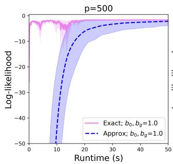
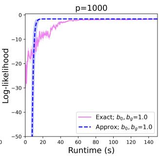
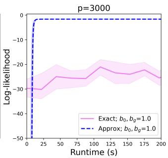
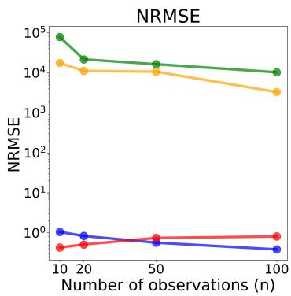
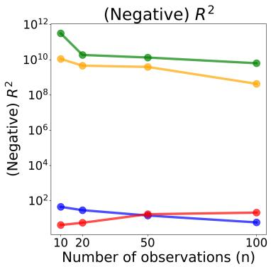
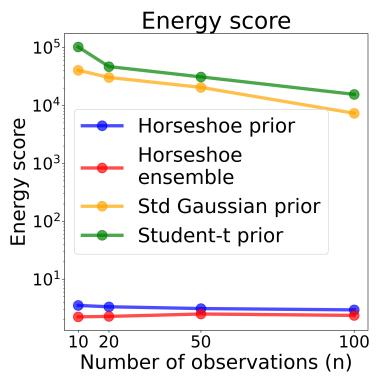
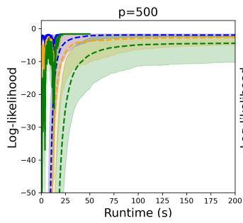
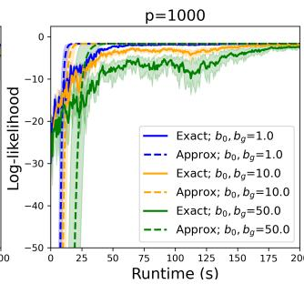
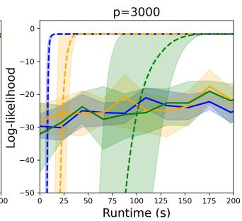

# Shrinkage prior for implicit generative models

Shreya Sinha Roy Christian P. Robert∗ Ritabrata Dutta

Department of Statistics, University of Warwick   
Coventry, CV4 7AL   
United Kingdom

shreya.sinha-roy@warwick.ac.uk c.a.m.robert@warwick.ac.uk ritabrata.dutta@warwick.ac.uk

## Editor:

## Abstract

Implicit generative models based on deep neural networks have revolutionized many scientific fields, from weather research to language generation. They successfully model complex random objects arising in real-world problems. In this work, we propose a sampleeficient training mechanism for these models. Our approach leverages regularized inference with shrinkage priors and generalized Bayes. In the large p (parameter dimension) and small n (sample size) setting, sparsity-inducing priors have been successfully used for linear regression when $p \gg n$ . However, their application to implicit generative models remains challenging due to the intractability of the likelihood function. To address this, we adapt a scoring rule posterior based on a strictly proper scoring rule, following the generalized Bayes framework. We then propose a block SGMCMC within Gibbs sampling mechanism. This enables eficient exploration of high-dimensional parameter spaces by identifying a sparse representation of neural implicit generative models. We demonstrate the performance of our proposed method through experiments on p ≫ n linear regression and an application of neural generative models.

## 1 Introduction

Implicit generative models are increasingly used to model complex random objects arising in scientific and real-world applications, including weather forecasting (Price et al., 2025), population genetics (Yelmen and Jay, 2023; Huang et al., 2024), protein structure and molecular design (Anand and Achim, 2022), and image generation (Goodfellow et al., 2014b; Ho et al., 2020). Their ability to generate realistic samples without requiring an explicit likelihood has made them a powerful modelling paradigm. However, the lack of a tractable likelihood also creates significant challenges for statistical inference and model assessment.

In this work, we consider statistical inference for such models. Implicit generative models introduce a latent random variable $\mathbf { z } \in \mathbb { R } ^ { k } \sim q ( \mathbf { z } )$ , where q is a fixed, tractable distribution on $\mathbb { R } ^ { k }$ , together with a deterministic nonlinear map $G _ { \theta } : \mathbb { R } ^ { k }  \mathbb { R } ^ { d }$ , parameterized by $\theta \in \mathbb { R } ^ { p }$ The model generates samples through

$$
\mathbf { x } = G _ { \theta } ( \mathbf { z } ) ,
$$

with distribution

$$
P _ { \theta } = G _ { \theta } { \sharp } q ,
$$

the pushforward distribution of $q .$ While traditional approaches often focus on scientific models that incorporate prior knowledge of the underlying process, we consider high-dimensional implicit models where the data-generating mechanism is unknown. In particular, we focus on deep generative models, where $G _ { \theta }$ is represented by a neural network (Mohamed and Lakshminarayanan, 2017). For conditional tasks, where the objective is to model random objects given an observed variable $\mathbf { w } \in \mathbb { R } ^ { m }$ , we instead consider the map $G _ { \theta } : \mathbb { R } ^ { k } \times \mathbb { R } ^ { m }  \mathbb { R } ^ { d }$ which generates

$$
\begin{array} { r } { \mathbf { x } = G _ { \theta } ( \mathbf { z } , \mathbf { w } ) , } \end{array}
$$

with conditional distribution $P _ { \theta } ( \cdot \mid \mathbf { w } )$ , as in conditional GANs (Mirza and Osindero, 2014).

When $G _ { \theta }$ is represented by a large neural network and trained on an observed dataset ${ \mathcal { D } } _ { n } = \{ y _ { 1 } , . . . , y _ { n } \}$ with limited sample size, statistical inference becomes a large-p, small-n problem $( p \gg n )$ . Bayesian methods based on shrinkage priors are well established for this setting in linear regression (Bhadra et al., 2019). However, these methods cannot be applied directly to implicit generative models because the probability density of $P _ { \theta }$ is unavailable. Building on the generalized Bayesian framework of Pacchiardi et al. (2024b), which replaces the likelihood with a scoring rule, we develop a sparsity-inducing generalized Bayesian approach using the horseshoe prior (Carvalho et al., 2010). We further introduce a blocked Gibbs sampler based on preconditioned adjusted stochastic gradient Langevin dynamics (prec-adjSGLD) to eficiently sample from the resulting high-dimensional posterior. To the best of our knowledge, while Bayesian regularization has been extensively studied for deterministic neural networks (Gal and Ghahramani, 2016; Ghosh et al., 2019; Mohammed and Kora, 2023), this is the first work to develop a sparsity-inducing Bayesian framework for neural implicit generative models.

We first study the large- $^ { - p , }$ small-n sparse linear regression problem. Although standard Bayesian methods are available, Markov chain Monte Carlo algorithms are often prohibitively expensive in this setting (Johndrow et al., 2020). Our proposed method achieves strong sparsity recovery while providing the best predictive performance at a substantially lower computational cost. We also consider a sample-eficient training of a conditional implicit generative model for the Hopper, a reinforcement learning benchmark (from the OpenAI Gymnasium package (Kwiatkowski et al., 2025)), which mimics a Markov decision process.

The rest of the chapter is structured as follows. Section 2 defines a generalized posterior over the parameters of an implicit generative model using the adaptive shrinkage horseshoe prior. We then introduce an approximate blocked Gibbs sampling scheme to sample from the proposed posterior. Section 3 presents simulation studies demonstrating the application and advantages of the proposed sampler over fixed priors. We consider two examples: high-dimensional sparse linear regression, and a conditional deep generative model for the reinforcement learning environment Hopper. Finally, Section 4 concludes the chapter.

## 2 Generalized Bayesian regularization for implicit generative neural models

Due to the intractibility of the likelihood functions for the implicit generative neural models, they are trained by matching the pushforward distribution $P _ { \theta }$ to the data distribution using adversarial objectives (Goodfellow et al., 2014a), f-divergences (Nowozin et al., 2016), proper scoring rules (Pacchiardi and Dutta, 2022; Heng et al., 2024) or using prequential scoring rules (Pacchiardi et al., 2024a) for conditional generative models. Despite their empirical success, such training procedures are data-intensive and provide limited quantification of uncertainty. This is specially problematic in over-parameterized settings or when data are scarce, well known from many studies for $p \gg n$ sparse linear regression (Donoho and Tanner, 2009).

To account for parameter uncertainty in this setup, we propose to adopt a Bayesian approach. Let $\mathcal { G } = \{ G _ { \theta } : \theta \in \Theta \subseteq \mathbb { R } ^ { p } \}$ denote the model class and place a prior distribution $\pi ( \theta )$ over parameters. Given observed data $\mathcal { D } _ { n }$ and a likelihood function $l ( \boldsymbol { \theta } ; \mathcal { D } _ { n } )$ under the model $G _ { \theta }$ , Bayesian inference yields the posterior distribution

$$
\pi ( \theta \mid \mathcal { D } _ { n } ) = \frac { \pi ( \theta ) l ( \theta ; \mathcal { D } _ { n } ) } { \int _ { \theta } \pi ( \theta ) l ( \theta ; \mathcal { D } _ { n } ) d \theta } .
$$

In the absence of a tractable likelihood $l ( \boldsymbol { \theta } ; \mathcal { D } _ { n } )$ , we follow Pacchiardi et al. (2024a) and replace the likelihood with the exponential of the negative of a strictly proper scoring rule, yielding a scoring-rule posterior. To further regularize the model, we place a sparsityinducing horseshoe prior (Carvalho et al., 2010; Ghosh et al., 2019) on θ. We discuss the details in the following sections.

## 2.1 Generalized Bayesian likelihood-free Inference

Likelihood-free Bayesian methods, such as approximate Bayesian computation (ABC) (Beaumont et al., 2002) and neural network–based surrogate approaches (Lueckmann et al., 2017) often consider low-dimensional models with low dimensional parameters. However, they struggle to scale to the high-dimensional parameter spaces typical of deep generative models. Motivated by generalized Bayesian framework with loss functions (Bissiri et al., $2 0 1 6 ;$ Jewson et al., 2018; Knoblauch et al., 2022), (Pacchiardi et al., 2024b), we propose to define scoring rule posterior by choosing proper scoring rules (Dawid, 2007) as the loss function. These scoring rules can be unbiasedly estimated from the easily available simulations of the implicit generative models, as shown in the previous chapters.

Scoring rules (Gneiting and Raftery, 2007) were originally proposed as a diagnostic of a probabilistic forecast, which provides a penalty $( S ( P , Y ) )$ to the forecast (P) evaluated at an observed outcome $( Y )$ . If $Y \sim Q$ denotes the true data-generating distribution, the expected score is defined as $\mathbf { S } ( P , Q ) : = \mathbb { E } _ { Y \sim Q } [ S ( P , Y ) ]$ ]. A scoring rule is proper with respect to a class of distributions P if

$$
\mathbf { S } ( Q , Q ) \leq \mathbf { S } ( P , Q ) , \quad \forall P , Q \in \mathcal { P } ,
$$

which ensures that truthful forecasting is optimal. A scoring rule is said to be strictly proper if ${ \bf S } ( P , Q )$ is uniquely minimized when $P = Q$ , the true data-generating distribution.

Strictly proper scoring rules induce statistical divergences between probability measures (Dawid, 2007).

Given data ${ \mathcal { D } } _ { n } = \{ y _ { 1 } , . . . , y _ { n } \}$ , an implicit generative model $G _ { \theta }$ , a prior $\pi ( \theta )$ , and a weight parameter $\omega > 0$ , the scoring-rule posterior (Pacchiardi et al., 2024b) becomes

$$
\pi _ { S } ( \theta \mid \mathcal { D } _ { n } ) \propto \pi ( \theta ) \exp \left\{ - \omega \sum _ { i = 1 } ^ { n } S ( P _ { \theta } , y _ { i } ) \right\} ,\tag{1}
$$

where $P _ { \theta }$ corresponds to the pushforward distribution induced by $G _ { \theta }$ and, $\omega > 0$ is called the learning rate which determines the influence of the loss with respect to the prior. ω can be selected to achieve diferent goals (often, to match some frequentist property, see Lyddon et al., 2019; Syring and Martin, 2019; Matsubara et al., 2024, or to ensure two diferent scoring-rule posteriors have same scale (Pacchiardi et al., 2024b)). However, we keep $\omega = 1$ fixed for our simulation studies.

When a proper scoring rule is used to define the posterior in Equation (1), the resulting distribution satisfies a Bernstein–von Mises–type result under mild regularity conditions (Pacchiardi, 2022), which we state here.

Theorem 1 [(Pacchiardi, 2022)] Suppose, Q is the true underlying data-generation distribution, meaning that $\mathcal { D } _ { n } \sim Q$ . Assume the expected scoring rule $\mathbf { S } ( P _ { \theta } , Q )$ has a unique minimizer $\theta ^ { \star }$ and the prior $\pi ( \theta )$ is continuous and positive at $\theta ^ { \star }$ . Further, denote now by $\pi _ { S } ^ { * } \left( \cdot | \mathcal { D } _ { n } \right)$ the density of ${ \sqrt { n } } \left( \theta - { \hat { \theta } } ^ { ( n ) } \left( { \mathcal { D } } _ { n } \right) \right)$ when $\theta \sim \pi _ { S } \left( \cdot | \mathcal { D } _ { n } \right)$ , where $\hat { \theta } ^ { \left( n \right) } \left( D _ { n } \right)$ is a sequence which converges almost surely to $\theta ^ { \star }$ as $n  \infty$ . Then, under some technical assumptions, as $n \to \infty$ , with probability 1 over $\mathcal { D } _ { n }$ :

$$
\int _ { \mathbb { R } ^ { p } } \left. \pi _ { S } ^ { * } \left( s \lvert \mathcal { D } _ { n } \right) - \mathcal { N } \left( s \lvert 0 , H _ { \star } ^ { - 1 } \right) \right. d s \to 0 ,
$$

where $\mathcal { N } ( \cdot | 0 , \Sigma )$ denotes the density of a multivariate normal distribution with zero mean vector and covariance matrix Σ. Here $H _ { \star } = \nabla _ { \theta } ^ { 2 } { \bf S } ( P _ { \theta } , Q ) | _ { \theta = \theta } ,$ ∗ is the asymptotic covariance matrix.

In particular, the scoring-rule posterior concentrates almost surely on the parameter value that minimizes the expected scoring rule, provided the minimizer is unique. In well-specified models with strictly proper scoring rules, this minimizer coincides with the true parameter value, yielding posterior consistency. Uniqueness of the minimizer, however, may also hold under model misspecification or for non-strictly proper scoring rules.

To facilitate computation in the likelihood-free scenario, we should choose a strictly proper scoring rule for which we can easily compute an unbiased estimate. From many alternative scoring rules (Gneiting and Raftery, 2007), here we choose energy score (Rizzo and Székely, 2016) defined as

$$
S _ { \mathrm { E } } ^ { ( \beta ) } ( P _ { \theta } , y ) = 2 \mathbb { E } \Big [ \| X - y \| _ { 2 } ^ { \beta } \Big ] - \mathbb { E } \Big [ \| X - X ^ { \prime } \| _ { 2 } ^ { \beta } \Big ] ,
$$

where $X \perp X ^ { \prime } \sim P _ { \theta }$ and $\beta \in ( 0 , 2 )$ . In this work, we will keep $\beta$ fixed at 1. It is strictly proper for distributions satisfying $\mathbb { E } _ { X \sim P _ { \theta } } \| X \| ^ { \beta } < \infty$ . Given samples $\mathbf { x } _ { m } = \{ x _ { j } \} _ { j = } ^ { m }$ 1 with

$x _ { j } \sim P _ { \theta }$ , the energy score can be unbiasedly estimated as,

$$
\hat { S } _ { \mathrm { E } } ^ { ( \beta ) } ( \mathbf { x } _ { m } , y ) = \frac { 2 } { m } \sum _ { j = 1 } ^ { m } \| x _ { j } - y \| _ { 2 } ^ { \beta } - \frac { 1 } { m ( m - 1 ) } \sum _ { \substack { j , k = 1 } \atop j \neq k } ^ { m } \| x _ { j } - x _ { k } \| _ { 2 } ^ { \beta } .
$$

## 2.2 Sparsity inducing horseshoe prior

Most works applying Bayesian inference for deterministic neural networks (Fortuin et al., 2022), adopt simple isotropic Gaussian priors or heavy-tailed t-distribution. However, the “Bad Prior Hypothesis” (Wenzel et al., 2020) highlights the limitations of such priors in overparameterized models, which can be especially hazardous in data-scarce regimes. Gaussian priors implicitly correspond to $\ell _ { \mathrm { 2 } } { \mathrm { - t y p e } }$ regularization (Bhadra et al., 2019), which may be insuficient to control model complexity in high-dimensional settings.

To address this, shrinkage priors have been proposed as alternatives. One class consists of discrete mixture priors, such as spike-and-slab (Johnstone and Silverman, 2004; Castillo and Van Der Vaart, 2012), which combine a point mass at zero with a difuse continuous component. However, spike-and-slab priors pose substantial computational challenges, as posterior inference involves a combinatorial model space with discrete inclusion indicators and prevents eficient block updates of model parameters. An alternative class comprises continuous global-local shrinkage priors (Polson and Scott, 2010), which adaptively shrink small signals while preserving large ones. Among these, the horseshoe prior (Carvalho et al., 2010) has emerged as a popular and efective choice, enabling eficient block sampling strategies. In the context of Bayesian neural networks, (Ghosh et al., 2019) demonstrated that horseshoe priors can induce sparsity at the level of network nodes, enabling automatic model selection and improved interpretability. Motivated by these results, we employ horseshoe priors over the parameters of generative neural networks to encourage sparse representation.

Let θ denote the vector of all weights and biases in the network. The horseshoe prior is specified hierarchically as

$$
\begin{array} { c } { { \theta _ { j } \mid \lambda _ { j } , \tau \sim { \cal N } \Big ( 0 , \lambda _ { j } ^ { 2 } \tau ^ { 2 } \Big ) \forall j = 1 , \ldots p , } } \\ { { \lambda _ { j } \sim C ^ { + } ( 0 , b _ { 0 } ) \forall j = 1 , \ldots p , \qquad \tau \sim C ^ { + } ( 0 , b _ { g } ) , } } \end{array}\tag{2}
$$

where $\theta = ( \theta _ { 1 } , \ldots , \theta _ { p } )$ . Here, $\lambda _ { j }$ are parameter-specific local shrinkage parameters for all $j = 1 , \dotsc , p ;$ and $\tau$ is a global shrinkage parameter that controls the overall degree of shrinkage. $C ^ { + }$ denotes the half-Cauchy distribution, and $b _ { 0 }$ and $b _ { g }$ are hyperparameters governing the prior distributions of the local and global shrinkage parameters, respectively.

## 2.3 Blocked Gibbs sampler

Combining Equation (1) and Equation (2), we can define the generalized posterior over the hierarchical model parameters as following,

$$
\theta \mid D _ { n } , ( \lambda _ { j } : j = 1 , \dots , p ) , \tau \sim \pi ( \theta ) \exp \left\{ - \omega \sum _ { i = 1 } ^ { n } S ( P _ { \theta } , y _ { i } ) \right\} \prod _ { j = 1 } ^ { p } { \cal N } ( \theta _ { j } | 0 , \lambda _ { j } ^ { 2 } \tau ^ { 2 } ) ~ ,\tag{3}
$$

where $\lambda _ { j } \sim C ^ { + } ( 0 , b _ { 0 } ) \forall j = 1 , \ldots p$ and $\tau \sim C ^ { + } ( 0 , b _ { g } )$ . Here, exact block sampling would require conjugacy between prior and likelihood, which breaks down for parameters θ as we have replaced log-likelihood with proper scoring rules. The posterior on the hyperparameters, however, still remains conjugate. Thus, we propose an approximate sampling scheme based on stochastic gradient Monte Carlo Markov chain (SGMCMC) (Nemeth and Fearnhead, 2021) for $\theta$ conditional on hyperparameters and an exact conditional update for the hyperparameters conditional on $\theta .$ This is an approximate blocked SGMCMC within the Gibbs algorithm.

When $\theta = ( \theta _ { j } ) _ { j }$ are the network parameters and $\alpha = ( ( \lambda _ { j } ^ { 2 } ) _ { j } , \tau ^ { 2 } )$ are the hyperparameters, to perform the Gibbs sampling we update θ and α in an iterative manner using the following update equations.

Block 1: Update parameter θ conditional on hyperparameters α and data $\mathcal { D } _ { n }$

$$
\begin{array} { l } { { \displaystyle \pi ( \theta \mid \alpha , { \mathcal { D } } _ { n } ) \propto \exp \left( - \sum _ { i = 1 } ^ { n } S _ { E } ( P _ { \theta } , y _ { i } ) \right) \prod _ { j = 1 } ^ { p } \frac { 1 } { \sqrt { 2 \pi \lambda _ { j } ^ { 2 } \tau ^ { 2 } } } \exp \left( - \frac { 1 } { 2 \lambda _ { j } ^ { 2 } \tau ^ { 2 } } \theta _ { j } ^ { 2 } \right) } } \\ { { \displaystyle \propto \exp \left( - \sum _ { i = 1 } ^ { n } S _ { E } \left( P _ { \theta } , y _ { i } \right) - \sum _ { j = 1 } ^ { p } \frac { 1 } { 2 \lambda _ { j } ^ { 2 } \tau ^ { 2 } } \theta _ { j } ^ { 2 } \right) . } } \end{array}\tag{4}
$$

We update θ by using a variant of stochastic gradient Monte Carlo Markov chain algorithm (SGMCMC), specifically preconditioned adjusted stochastic gradient Langevin dynamics (prec-adjSGLD) described in Section 2.4

Block 2: Update hyperparameters conditional on θ Half-Cauchy priors on $\lambda _ { j }$ and $\tau$ break conjugacy. However, a scale-mixture representation of the Half-Cauchy prior proposed by (Makalic and Schmidt, 2015), can be used to arrive at the following update equations using the auxiliary variables $\nu _ { 0 } , \nu _ { 1 } , \dots \nu _ { p } \sim \mathcal { I G } ( 1 / 2 , 1 )$ ,

$$
\lambda _ { j } ^ { 2 } | \cdot \sim \mathcal { I G } ( 1 , \frac { \theta _ { j } ^ { 2 } } { 2 \tau ^ { 2 } } + \frac { 1 } { \nu _ { j } } )\tag{5}
$$

$$
\tau ^ { 2 } | \cdot \sim \mathcal { I G } ( \frac { p + 1 } { 2 } , \sum _ { j } \frac { \theta _ { j } ^ { 2 } } { 2 \lambda _ { j } ^ { 2 } } + \frac { 1 } { \nu _ { 0 } } )
$$

$$
\nu _ { j } | \cdot \sim \mathcal { I G } ( 1 , \frac { 1 } { b _ { 0 } ^ { 2 } } + \frac { 1 } { \lambda _ { j } ^ { 2 } } )
$$

$$
\nu _ { 0 } | \cdot \sim \mathcal { I G } ( 1 , \frac { 1 } { b _ { g } ^ { 2 } } + \frac { 1 } { \tau ^ { 2 } } ) ,
$$

for all $j = 1 , 2 , . . . p$ , where $\mathcal { T G } ( a , b )$ is the inverse-gamma distribution with shape parameter $a > 0$ and scale parameter $b > 0$ . Hence, we can update hyperparameters α exactly, using the above update equations.

## 2.4 Prec-adjSGLD to update Block 1

We propose a variant of the SGMCMC algorithm to update the model parameters in Block 1. SGMCMC methods are based on continuous-time difusion processes using gradients of the negative log target distribution (or the potential function $U ( \theta ) )$ ; whose stationary distribution matches the target distribution. In our case, $\begin{array} { r } { U ( \theta ) = \sum _ { i = 1 } ^ { n } S _ { E } \left( P _ { \theta } , y _ { i } \right) + \sum _ { j = 1 } ^ { p ^ { \prime } } \frac { 1 } { 2 \lambda _ { j } ^ { 2 } \tau ^ { 2 } } \theta _ { j } ^ { 2 } } \end{array}$ for which the gradient is not analytically tractable.

But we can compute an unbiased estimate of the gradient, by first noticing that $S _ { E } ( P _ { \theta } , y ) =$ $\underset { X , X ^ { \prime } \sim P _ { \theta } } { \mathbb { E } } f \left( X , X ^ { \prime } , y \right)$ for a smooth diferentiable function $f .$ Thus, the scoring rule is defined through an expectation over (possibly multiple) samples from $P _ { \theta }$ . Hence the gradient of the scoring rule reduces to,

$$
\begin{array} { r l } & { \nabla _ { \theta } S _ { E } ( P _ { \theta } , y ) = \nabla _ { \theta } \underset { X , X ^ { \prime } \sim P _ { \theta } } { \mathbb { E } } f \left( X , X ^ { \prime } , y \right) } \\ & { \quad \quad \quad = \nabla _ { \theta } \underset { Z , Z ^ { \prime } \sim q } { \mathbb { E } } f \left( G _ { \theta } ( Z ) , G _ { \theta } ( Z ^ { \prime } ) , y \right) } \\ & { \quad \quad \quad = \underset { Z , Z ^ { \prime } \sim q } { \mathbb { E } } \nabla _ { \theta } f \left( G _ { \theta } ( Z ) , G _ { \theta } ( Z ^ { \prime } ) , y \right) , } \end{array}
$$

where $q$ stands for an auxiliary distribution independent of $\theta .$ In the latter equality, the exchange between expectation and gradient is not a trivial step. Luckily, Theorem 5 in (Bińkowski et al., 2018) proved the above step to be valid almost surely with respect to a measure on $\theta ,$ under mild conditions on $G _ { \theta }$ (such conditions are satisfied if the function is diferentiable, which holds for all the maps defined by neural networks considered in this work). Based on this, we can unbiasedly estimate the gradient of the scoring rule as follow:

$$
\widehat { \nabla _ { \theta } } S _ { E } ( P _ { \theta } , y ) = \frac { 1 } { m ( m - 1 ) } \sum _ { \stackrel { i , j = 1 } { i \neq j } } ^ { m } \nabla _ { \theta } f \left( G _ { \theta } ( Z _ { i } ) , G _ { \theta } ( Z _ { j } ^ { \prime } ) , y \right)\tag{6}
$$

where $Z _ { i } \perp \perp Z _ { j } ^ { \prime } \sim q$ . In practice, this can be easily obtained by implementing the function $G _ { \theta }$ using automatic-diferentiation libraries (Paszke et al., 2019).

The bias due to this approximate stochastic gradient of $U ( \theta )$ in SGMCMC algorithms can be mitigated by incorporating momentum $( p )$ and friction (ξ) terms, resulting in the adjusted stochastic gradient Langevin dynamics (adjSGLD) (Leimkuhler and Shang, 2016). adjSGLD operates in an extended state space consisting of the model parameters, and the auxiliary momentum and friction variables. This has been successfully applied in Bayesian inference (Ding et al., 2014) as well.

To improve the eficiency of SGMCMC in the high-dimensional parameter space of $\theta ,$ we can use preconditioning strategies (Girolami and Calderhead, 2011; Chen et al., 2016) using the squared gradient of $U ( \theta )$ , similar to adaptive optimizers like RMSprop (Tieleman, 2012) and Adam (Kingma and Ba, 2015). Here we use a preconditioned version of the adjSGLD scheme (prec-adjSGLD) to sample $\theta _ { ; }$ , for which the stochastic diferential equation (SDE) defining the difusion becomes,

$$
\left\{ \begin{array} { l l } { d \pmb { \theta } = H ( \pmb { \theta } ) p d t } \\ { d \pmb { p } = ( - H ( \pmb { \theta } ) \nabla _ { \pmb { \theta } } U ( \pmb { \theta } ) - \pmb { \xi } \pmb { p } ) d t + ( 2 H ( \pmb { \theta } ) ) ^ { 1 / 2 } d W _ { t } } \\ { d \pmb { \xi } = \left( \frac { 1 } { p } \pmb { p } ^ { \top } \pmb { p } - 1 \right) d t } \end{array} \right.\tag{7}
$$

where $W$ denotes a standard Brownian motion and $H ( \pmb \theta )$ encodes geometric information of the potential energy $U ( \theta )$ , called the Riemannian metric (Girolami and Calderhead, 2011), which is commonly defined by the Fisher information matrix. Theoretical properties and convergence of adSGLD and prec-adjSGLD algorithm have been studied in (Leimkuhler and Shang, 2016; Leimkuhler et al., 2020) and (Ding et al., 2014) correspondingly.

The other source of error in SGMCMC arises due to the time discretization of the above SDE. For example, when the first order Euler–Maruyama discretization scheme is used. To further reduce these numerical errors in SDE integration, we use a symmetric splitting scheme (SSS) (Chen et al., 2016), described in Appendix A. This 2nd-order integrator provides higher accuracy with minimal extra computation, and we arrive at Algorithm 1 presented below.

Algorithm 1: Preconditioned adjusted stochastic gradient Langevin dynamics   
Input: Learning rate $\eta ,$ parameters $( \lambda _ { 0 } = 0 . 9 9 , \lambda _ { 1 } = 1 0 ^ { - 6 } )$ , noise $\{ \zeta _ { t } \sim \mathcal { N } ( \mathbf { 0 } , \mathbf { I } _ { p } ) \}$   
Initialize: $\pmb { \theta } _ { 0 } , \mathbf { u } _ { 0 } = \sqrt { \eta } \cdot \mathcal { N } ( 0 , \mathbf { I } _ { p } ) , \pmb { a } _ { 0 } = \sqrt { \eta } , \mathbf { v } _ { 0 } = \mathbf { 0 }$   
for $t = 1 , 2 , \dots { } \mathbf { d o }$   
Compute stochastic gradient: $\tilde { \mathbf { f } } _ { t } \gets \nabla _ { \pmb { \theta } } \tilde { U } ( \pmb { \theta } _ { t - 1 } )$   
$\begin{array} { r } { \mathbf { v } _ { t }  \lambda _ { 0 } \mathbf { v } _ { t - 1 } + \frac { 1 - \lambda _ { 0 } } { n ^ { 2 } } \tilde { \mathbf { f } } _ { t } \odot \tilde { \mathbf { f } } _ { t } } \end{array}$   
$\mathbf { g } _ { t }  1 \oslash \sqrt { \lambda _ { 1 } + \sqrt { \mathbf { v } _ { t } } }$   
$\begin{array} { r } { \pmb { \theta } _ { t }  \pmb { \theta } _ { t - 1 } + \frac { 1 } { 2 } \mathbf { g } _ { t } \odot \mathbf { u } _ { t - 1 } } \end{array}$ −1   
$\begin{array} { r } { \pmb { a } _ { t }  \pmb { a } _ { t - 1 } + \frac { 1 } { 2 } ( \mathbf { u } _ { t - 1 } \odot \mathbf { u } _ { t - 1 } - \eta ) } \end{array}$   
${ \bf u } _ { t } \gets \exp ( - { \pmb a } _ { t } / 2 ) \odot { \bf u } _ { t - 1 }$   
$\mathbf { u } _ { t } \gets \mathbf { u } _ { t } - \eta \cdot \mathbf { g } _ { t } \odot \tilde { \mathbf { f } } _ { t } + \sqrt { 2 \cdot \mathbf { g } _ { t - 1 } \eta ^ { 3 / 2 } } \odot \zeta _ { t }$   
${ \mathbf { u } } _ { t } \gets \exp ( - { \mathbf { a } } _ { t } / 2 ) \odot { \mathbf { u } } _ { t }$   
$\begin{array} { r } { \pmb { a } _ { t }  \pmb { a } _ { t } + \frac { 1 } { 2 } ( \mathbf { u } _ { t } \odot \mathbf { u } _ { t } - \boldsymbol { \eta } ) } \end{array}$   
$\begin{array} { r } { \pmb { \theta } _ { t }  \pmb { \theta } _ { t } + \frac { 1 } { 2 } \mathbf { g } _ { t } \odot \mathbf { u } _ { t } } \end{array}$   
end

## 3 Simulation studies

To evaluate our method, we first consider a sparse linear regression task with a small number of observations and varying numbers of regressors. In this setting, we assume Gaussian noise, which allows access to the exact likelihood. We compare the performance of the (likelihoodbased) exact Gibbs sampler with our proposed (likelihood-free) approximate sampler under the horseshoe prior. Finally, we consider a Markov decision process, called Hopper. Here, the simulator model is a conditional generative model and we analyze the efect of diferent priors on the model parameters compared to the horseshoe prior.

## 3.1 Bayesian sparse high-dimensional linear regression

Let us consider a high-dimensional linear regression problem,

$$
\begin{array} { r } { \mathbf { y } _ { n \times 1 } = \mathbf { W } _ { \mathbf { n } \times \mathbf { p } } \theta _ { p \times 1 } + \epsilon _ { 1 \times n } , } \end{array}\tag{8}
$$

where $\epsilon \sim { \mathcal { N } } ( \mathbf { 0 } , \sigma ^ { 2 } \mathbf { I } _ { n } ) , \mathbf { I } _ { n }$ is $n \times n$ identity matrix and $p \gg n$ . Inference for θ under sparsity has been widely addressed using penalized estimation methods. Classical examples include ridge regression (Hoerl and Kennard, 1970), LASSO (Tibshirani, 1996), and elastic net (Zou and Hastie, 2005), among many other regularization approaches. Similarly, Bayesian inference for θ can be performed by using a shrinkage-inducing prior, like a horseshoe prior.

Although the true likelihood function is available in this case, the traditionally used Gibbs sampler is prohibitively expensive, and approximations to sample from the posterior is an active research area (Bhadra et al., 2019; Johndrow et al., 2020).

Considering sparse linear regression as an implicit generative model, we demonstrate inference on θ by sampling from a scoring-rule posterior using our proposed methodology. It is scalable and achieves superior predictive performance. In our experiments, we fix the sample size at $n = 5 0$ and consider three settings with $p = 5 0 0 , 1 0 0 0$ , and 3000.

Our experimental setup follows that of Johndrow et al. (2020). We set $\sigma ^ { 2 } = 4$ , and generate W from a standard Gaussian distribution. We define the true sparse parameter vector θ as

$$
\theta _ { j } = { \left\{ \begin{array} { l l } { 2 ^ { - ( j / 4 - 9 / 4 ) } , } & { { \mathrm { i f ~ } } j < 2 4 , } \\ { 0 , } & { { \mathrm { o t h e r w i s e } } . } \end{array} \right. }
$$

We compare the proposed sampler with an exact Gibbs sampler, which is feasible in this setting since the likelihood is available in closed form. For both methods, we use $b _ { 0 } = b _ { g } = 1$ to define the horseshoe prior. The sensitivity to these hyperparameters is investigated in Appendix B, where we also consider $( b _ { 0 } , b _ { g } ) = ( 1 0 , 1 0 )$ and (50, 50). We set the learning rate to $\eta = 1 0 ^ { - 8 }$ in Algorithm 1 and we use $m = 1 0$ simulations to estimate the gradient in Equation (6) for the approximate sampler. Both the samplers are run under matched time budgets. In Figure 1, we report the log likelihood of the posterior samples.

  
Figure 1: Exact versus approximate sampler for sparse linear regression. Log likelihood of the samples obtained from the exact (in pink) and the approximate (in blue) sampler versus runtime plot. The solid line represents the mean performance over 10 independent runs, and the 90 % confidence intervals are shown in a lighter shade.

Figure 1 illustrates that our method exhibits improved sample eficiency as the dimensionality p increases, while the exact Gibbs sampler struggles in higher-dimensional settings. All experiments are repeated across ten independently generated datasets, and the results are averaged.

For comparison, we also implement ridge regression, LASSO, and elastic net for the linear regression model. For these methods, we evaluate the log-likelihood at the estimated parameter. For the Bayesian approach with the horseshoe prior, we compute the mean loglikelihood over posterior samples obtained from both the exact and the proposed approximate samplers. To ensure a fair comparison, we discard the initial samples corresponding to the first 25, 75, and 100 seconds of runtime for p = 500, 1000, and 3000, respectively.

The mean log-likelihood is then computed using the remaining samples. Table 1 reports the results averaged over the 10 simulated datasets.
<table><tr><td>Method</td><td> $p = 5 0 0$ </td><td> $p = 1 0 0 0$ </td><td> $p = 3 0 0 0$ </td></tr><tr><td>Ridge</td><td>-30.79 (45.52)</td><td>-36.62 (65.32)</td><td>-127.20 (165.12)</td></tr><tr><td>LASSO</td><td>-34.70 (36.70)</td><td>-98.18 (80.73)</td><td>-111.54 (116.90)</td></tr><tr><td>Elastic Net</td><td>-34.34 (37.00)</td><td>-88.61 (84.56)</td><td>-92.38 (124.10)</td></tr><tr><td>Horseshoe (exact Gibbs)</td><td>-1.616 (0.001)</td><td>-1.830 (0.032)</td><td>-23.290 (1.169)</td></tr><tr><td>Horseshoe (approximate, ours)</td><td>-2.805 (1.486)</td><td>-1.626 (0.035)</td><td>-1.612  $( 2 \times 1 0 ^ { - 5 } )$ </td></tr></table>

Table 1: Mean log-likelihood (standard deviation ) across 10 simulated datasets for the linear regression example. For the first three methods, the log-likelihood at the estimated parameter value is computed. For the Bayesian methods, the mean log-likelihood is computed over posterior samples after discarding the initial burn-in period. Higher values indicate better predictive performance.

The Bayesian methods consistently outperform the three frequentist regularization methods in this example. Moreover, the approximate sampler performs better in larger dimensions, consistent with the trends observed in Figure 1.
<table><tr><td></td><td colspan="2">p = 500</td><td colspan="2">p = 1000</td><td colspan="2"> $p = 3 0 0 0$ </td></tr><tr><td>Exact Sampler</td><td></td><td>0.0987 (0.0019)</td><td></td><td>0.6736 (0.0218)</td><td>21.9139 (1.8124)</td><td></td></tr><tr><td>Approximate Sampler</td><td></td><td>0.0309 (0.0025)</td><td></td><td>0.0310 (0.0015)</td><td>0.0345 (0.0005)</td><td></td></tr></table>

Table 2: Mean runtime (in seconds) per iteration across 10 seeds for exact and approximate samplers for linear regression. Standard deviation over the 10 runs are shown in parentheses.

Next, we report the runtime comparison of each iteration of the exact and approximate samplers in Table 2. The runtime of the exact sampler blows up with dimension, whereas the proposed approximate sampler does not have that trend.

## 3.2 Neural generative Markov processes: Hopper

Next, we consider a model-based reinforcement learning (RL) task. In model-based RL, the environment dynamics are first learned from interactions with the environment. The learned model is then used to train a sample-eficient policy. Therefore, improving model learning with fewer interactions can directly benefit the final policy performance. This motivates the use of shrinkage priors, which are known to perform well in data-scarce settings.

We consider the ‘Hopper’ environment from the OpenAI Gymnasium package (Kwiatkowski et al., 2025). The task is to move a two-dimensional, single-legged structure forward by applying forces to three joints connecting its four body parts. The action space consists of torques applied to the three joints, with values ranging from −1 Nm to 1 Nm. The state is represented by a 12-dimensional real-valued vector containing joint angles, angular velocities, and the positions and velocities of the body parts. The reward function encourages forward movement while penalizing large torques that may destabilize the system.

We generate a trajectory of state-action-next state from the above system using a random policy. We wish to model this Markov process by a deep generative model following the setup of Sinha-Roy et al. (2024). Here, we consider the following conditional generative model,

$$
f _ { \theta } ( s _ { t } , a _ { t } , z ) = s _ { t + 1 }
$$

where z is a Gaussian noise, $a _ { t }$ and $s _ { t }$ are action and state at time t and $f _ { \theta }$ is fully connected feedforward neural network with four hidden layers of 100 neurons each and swish activation function, which amounts to a total number of parameters approximately 33,000.

To infer the model parameters $\theta ,$ we consider a scoring-rule prequential posterior (Sinha Ro et al., 2026) under three diferent priors: a horseshoe prior with hyperparameters $b _ { 0 } = b _ { g } = 1$ an independent standard Gaussian prior, and an independent Student-t prior with 10 degrees of freedom on each network parameter. We focus on the data-scarce regime with $n = 1 0 , 2 0 , 5 0$ , and 100 observations, in contrast to the conventional setting where thousands of observations are used for training. For sampling, we set the learning rate to $\eta = 1 0 ^ { - 1 2 }$ in Algorithm 1 and use $m = 1 0$ simulations to estimate the gradient in Equation (6). Each sampler is run for 10000 iterations, and the last 1000 samples are retained to evaluate predictive performance.

  
Figure 2: Predictive performance on the Hopper environment. We report the normalized root mean squared error (NRMSE), coeficient of determination $R ^ { 2 }$ , and average energy score on a test set of length 1000. Results are shown for the horseshoe prior (blue), standard Gaussian prior (yellow), Student-t prior with 10 degrees of freedom (green), and an ensemble model initialized from the horseshoe prior and optimized using Adam (red). For visual clarity, the negative adjusted $R ^ { 2 }$ is plotted.

Figure 2 reports the NRMSE, coeficient of determination $R ^ { 2 }$ , and average energy score on an independent test set of 1000 observations. We also consider an ensemble model in which the network parameters are initialized from the horseshoe prior and optimized using Adam. The objective function is estimated using $m = 1 0$ simulations. The horseshoe prior consistently outperforms the Gaussian and Student-t priors, especially when the number of training observations is small. The ensemble model also performs well for small values of $n ,$ suggesting that the horseshoe prior helps recover the sparse structure of the dynamics model. In contrast, the Gaussian and Student-t priors produce substantially larger prediction errors, indicating poorer calibration when only fewer observations are available.

<table><tr><td>n</td><td>NRMSE</td><td> $\overline { { R ^ { 2 } } }$ </td><td>Energy score</td></tr><tr><td>50</td><td>16998.45 (3058.44)</td><td>-2.31e10 (8.50e9)</td><td>78153.29 (16198.17)</td></tr><tr><td>100</td><td>17301.19 (2740.90)</td><td>-2.58e10 (6.68e9)</td><td>80490.82 (13381.43)</td></tr><tr><td>500</td><td>16442.49 (3102.66)</td><td>-2.74e10 (1.05e10)</td><td>63382.63 (9684.82)</td></tr><tr><td>1000</td><td>18561.19 (2940.66)</td><td>-3.27e10 (1.11e10)</td><td>70151.97 (12845.99)</td></tr></table>

Table 3: Predictive performance of the posterior samples under a standard Gaussian prior for diferent training set sizes (n). The Markov chain is run for 10000 iterations, and the last 1000 samples are used to compute the predictive metrics. Results are reported as mean (standard deviation) over five independent runs.

<table><tr><td>n</td><td>NRMSE</td><td> $\overline { { R ^ { 2 } } }$ </td><td>Energy score</td></tr><tr><td>50</td><td>0.212 (0.070)</td><td>-3.070 (3.260)</td><td>3.001 (0.079)</td></tr><tr><td>100</td><td>0.215 (0.074)</td><td>-3.120 (3.750)</td><td>2.984 (0.065)</td></tr><tr><td>500</td><td>0.152 (0.073)</td><td>-1.550 (3.200)</td><td>2.934 (0.046)</td></tr><tr><td>1000</td><td>0.115 (0.055)</td><td>-0.470 (1.890)</td><td>2.914 (0.031)</td></tr></table>

Table 4: Predictive performance of the posterior samples under the horseshoe prior with $b _ { 0 } = b _ { g } = 1 0 0$ . The Markov chain is run for 10000 iterations, and the last 1000 samples are used to compute the predictive metrics. Results are reported as mean (standard deviation) over five independent runs.

We next study the sensitivity of the horseshoe hyperparameters for additional cases when $n = 5 0 0$ and 1000. We consider five independently generated trajectories and compare the standard Gaussian prior with horseshoe priors using five diferent choices of $( b _ { 0 } , b _ { g } )$ . Table 3 reports the results for the Gaussian prior, while Table 4 reports the results for the horseshoe prior with $b _ { 0 } = b _ { g } = 1$ . The remaining results are provided in Appendix C. Overall, the predictive performance is mostly insensitive to the choice of horseshoe hyperparameters when $b _ { 0 } , b _ { g } \geq 1$ . Finally, Table 5 reports the average runtime per iteration for the Gaussian and horseshoe priors.
<table><tr><td>Method</td><td> $n = 5 0$ </td><td> $n = 1 0 0$ </td><td> $n = 5 0 0$ </td><td> $n = 1 0 0 0$ </td></tr><tr><td>Gaussian prior</td><td>0.062 (0.002)</td><td>0.105 (0.006)</td><td>0.487 (0.022)</td><td>1.077 (0.006)</td></tr><tr><td>Horseshoe prior</td><td>0.118 (0.016)</td><td>0.153 (0.012)</td><td>0.517 (0.028)</td><td>1.208 (0.050)</td></tr></table>

Table 5: Average runtime (seconds) per iteration for the Gaussian and horseshoe priors. Values are reported as mean (standard deviation) over repeated runs.

Table 5 reports the runtime of the approximate sampler using the Gaussian and horseshoe priors. The horseshoe prior requires slightly more computational time due to the additional componentwise updates of the shrinkage parameters. However, this increase in runtime is small compared to the substantial predictive improvements obtained. These results highlight the advantage of using adaptive shrinkage priors, such as the horseshoe prior, in severely data-poor settings.

## 4 Discussion and conclusion

In recent years, neural implicit generative models have been rapidly adopted across many application domains. This work extends their applicability to settings with limited training data, which may arise due to data collection constraints or high acquisition costs. We achieve this by incorporating shrinkage priors within the scoring-rule posterior framework.

First, we demonstrate the strong predictive performance of the proposed methodology on a high-dimensional sparse linear regression. Next, we implement our method on a neural generative model, motivated by applications in meteorology and reinforcement learning. Beyond enabling scalable training of larger neural architectures with fewer observations, our approach also helps identify sparse structures within generative neural networks due to the shrinkage prior. Further investigation in this direction may lead to more meaningful and potentially interpretable neural network architectures for specific applications.

In this work, we fix the scaling parameter of the scoring-rule posterior, ω. Future work could investigate the use of multivariate scaling parameters or data-driven approaches, such as cross-validation, to select ω and obtain more informative scoring rules. Another interesting direction is to develop model selection approaches for implicit generative models, or for combinations of models and scoring rules viewed as approximate likelihoods, through comparisons of their marginal scoring-rule posteriors.

## 5 Acknowledgment

We thank Sherman Khoo for his initial investigations into the horseshoe prior and for many fruitful discussions.

## References

Namrata Anand and Tudor Achim. Protein sequence and structure generation with equivariant denoising difusion probabilistic models. arXiv preprint arXiv:2205.15019, 2022.

Mark A Beaumont, Wenyang Zhang, and David J Balding. Approximate Bayesian computation in population genetics. Genetics, 162(4):2025–2035, 2002.

Anindya Bhadra, Jyotishka Datta, Nicholas G Polson, and Brandon Willard. Lasso meets horseshoe. Statistical Science, 34(3):405–427, 2019.

Mikołaj Bińkowski, Danica J Sutherland, Michael Arbel, and Arthur Gretton. Demystifying MMD GANs. In International Conference on Learning Representations, 2018.

Pier Giovanni Bissiri, Chris C Holmes, and Stephen G Walker. A general framework for updating belief distributions. Journal of the Royal Statistical Society: Series B (Statistical Methodology), 78(5):1103–1130, 2016.

Carlos M Carvalho, Nicholas G Polson, and James G Scott. The horseshoe estimator for sparse signals. Biometrika, pages 465–480, 2010.

Ismaël Castillo and Aad Van Der Vaart. Needles and straw in a haystack: Posterior concentration for possibly sparse sequences. The Annals of Statistics, pages 2069–2101, 2012.

Changyou Chen, David Carlson, Zhe Gan, Chunyuan Li, and Lawrence Carin. Bridging the gap between stochastic gradient MCMC and stochastic optimization. In Artificial Intelligence and Statistics, pages 1051–1060. PMLR, 2016.

A Philip Dawid. The geometry of proper scoring rules. Annals of the Institute of Statistical Mathematics, 59(1):77–93, 2007.

Nan Ding, Youhan Fang, Ryan Babbush, Changyou Chen, Robert D Skeel, and Hartmut Neven. Bayesian sampling using stochastic gradient thermostats. Advances in neural information processing systems, 27, 2014.

David Donoho and Jared Tanner. Observed universality of phase transitions in highdimensional geometry, with implications for modern data analysis and signal processing. Philosophical Transactions of the Royal Society A: Mathematical, Physical and Engineering Sciences, 367(1906):4273–4293, 2009.

Vincent Fortuin, Adrià Garriga-Alonso, Sebastian W. Ober, Florian Wenzel, Gunnar Ratsch, Richard E Turner, Mark van der Wilk, and Laurence Aitchison. Bayesian neural network priors revisited. In International Conference on Learning Representations (ICLR), 2022.

Yarin Gal and Zoubin Ghahramani. Dropout as a Bayesian approximation: Representing model uncertainty in deep learning. In international conference on machine learning, pages 1050–1059. PMLR, 2016.

Soumya Ghosh, Jiayu Yao, and Finale Doshi-Velez. Model selection in bayesian neural networks via horseshoe priors. Journal of Machine Learning Research, 20(182):1–46, 2019.

Mark Girolami and Ben Calderhead. Riemann manifold Langevin and Hamiltonian Monte Carlo methods. Journal of the Royal Statistical Society Series B: Statistical Methodology, 73(2):123–214, 2011.

Tilmann Gneiting and Adrian E Raftery. Strictly proper scoring rules, prediction, and estimation. Journal of the American statistical Association, 102(477):359–378, 2007.

Ian J. Goodfellow, Jean Pouget-Abadie, Mehdi Mirza, Bing Xu, David Warde-Farley, Sherjil Ozair, Aaron Courville, and Yoshua Bengio. Generative adversarial networks. In Advances in Neural Information Processing Systems 27 (NeurIPS 2014), pages 2672–2680, 2014a.

Ian J. Goodfellow, Jean Pouget-Abadie, Mehdi Mirza, Bing Xu, David Warde-Farley, Sherjil Ozair, Aaron Courville, and Yoshua Bengio. Generative adversarial networks. Advances in Neural Information Processing Systems 27 (NeurIPS 2014), pages 2672–2680, 2014b.

Jeremy Heng, Valentin De Bortoli, and Arnaud Doucet. Difusion schrödinger bridges for Bayesian computation. Statistical Science, 39(1):90–99, 2024.

Jonathan Ho, Ajay Jain, and Pieter Abbeel. Denoising difusion probabilistic models. Advances in Neural Information Processing Systems, 33:6840–6851, 2020.

Arthur E Hoerl and Robert W Kennard. Ridge regression: Biased estimation for nonorthogonal problems. Technometrics, 12(1):55–67, 1970.

Xin Huang, Aigerim Rymbekova, Olga Dolgova, Oscar Lao, and Martin Kuhlwilm. Harnessing deep learning for population genetic inference. Nature Reviews Genetics, 25(1): 61–78, 2024.

Jack Jewson, Jim Q Smith, and Chris Holmes. Principles of Bayesian inference using general divergence criteria. Entropy, 20(6):442, 2018.

James Johndrow, Paulo Orenstein, and Anirban Bhattacharya. Scalable approximate MCMC algorithms for the horseshoe prior. Journal of Machine Learning Research, 21 (73):1–61, 2020.

Iain M Johnstone and Bernard W Silverman. Needles and straw in haystacks: Empirical bayes estimates of possibly sparse sequences. The Annals of Statistics, 32(4):1594–1649, 2004.

Diederik P Kingma and Jimmy Ba. Adam: A method for stochastic optimization. In International Conference on Learning Representations, 2015.

Jeremias Knoblauch, Jack Jewson, and Theodoros Damoulas. An optimization-centric view on bayes’ rule: Reviewing and generalizing variational inference. Journal of Machine Learning Research, 23(132):1–109, 2022.

Ariel Kwiatkowski, Mark Towers, Jordan Terry, John U. Balis, Gianluca De Cola, Tristan Deleu, Manuel Goulão, Andreas Kallinteris, Markus Krimmel, Arjun KG, Rodrigo Perez-Vicente, Andrea Pierré, Sander Schulhof, Jun Jet Tai, Hannah Tan, and Omar G. Younis. Gymnasium: A standard interface for reinforcement learning environments. In Advances in Neural Information Processing Systems 38 (NeurIPS 2025), Datasets and Benchmarks Track, 2025. Spotlight.

Benedict Leimkuhler and Xiaocheng Shang. Adaptive thermostats for noisy gradient systems. SIAM Journal on Scientific Computing, 38(2):A712–A736, 2016.

Benedict Leimkuhler, Matthias Sachs, and Gabriel Stoltz. Hypocoercivity properties of adaptive Langevin dynamics. SIAM Journal on Applied Mathematics, 80(3):1197–1222, 2020.

Jan-Matthis Lueckmann, Pedro J. Goncalves, Giacomo Bassetto, Kaan Öcal, Marcel Nonnenmacher, and Jakob H. Macke. Flexible statistical inference for mechanistic models of neural dynamics. In Advances in Neural Information Processing Systems 30 (NeurIPS 2017), 2017.

SP Lyddon, CC Holmes, and SG Walker. General Bayesian updating and the loss-likelihood bootstrap. Biometrika, 106(2):465–478, 2019.

Enes Makalic and Daniel F Schmidt. A simple sampler for the horseshoe estimator. IEEE Signal Processing Letters, 23(1):179–182, 2015.

Takuo Matsubara, Jeremias Knoblauch, François-Xavier Briol, Chris Oates, et al. Generalised Bayesian inference for discrete intractable likelihood. Journal of the American Statistical Association, 119(547):2345–2355, 2024.

Mehdi Mirza and Simon Osindero. Conditional generative adversarial nets. arXiv preprint arXiv:1411.1784, 2014.

Shakir Mohamed and Balaji Lakshminarayanan. Learning in implicit generative models, 2017.

Ammar Mohammed and Rania Kora. A comprehensive review on ensemble deep learning: Opportunities and challenges. Journal of King Saud University-Computer and Information Sciences, 35(2):757–774, 2023.

Christopher Nemeth and Paul Fearnhead. Stochastic gradient Markov chain Monte Carlo. Journal of the American Statistical Association, 116(533):433–450, 2021.

Sebastian Nowozin, Botond Cseke, and Ryota Tomioka. f-GAN: Training generative neural samplers using variational divergence minimization. In Advances in Neural Information Processing Systems 29 (NeurIPS 2016), pages 271–279, 2016.

Lorenzo Pacchiardi. Statistical inference in generative models using scoring rules. PhD thesis, University of Oxford, 2022.

Lorenzo Pacchiardi and Ritabrata Dutta. Score matched neural exponential families for likelihood-free inference. Journal of Machine Learning Research, 23(38):1–71, 2022.

Lorenzo Pacchiardi, Rilwan Adewoyin, Peter Dueben, and Ritabrata Dutta. Probabilistic forecasting with generative networks via scoring rule minimization. Journal of Machine Learning Research, 25:1–64, 2024a.

Lorenzo Pacchiardi, Sherman Khoo, and Ritabrata Dutta. Generalized Bayesian likelihoodfree inference. Electronic Journal of Statistics, 18(2):3628–3686, 2024b.

Adam Paszke, Sam Gross, Francisco Massa, Adam Lerer, James Bradbury, Gregory Chanan, Trevor Killeen, Zeming Lin, Natalia Gimelshein, Luca Antiga, Alban Desmaison, Andreas Kopf, Edward Yang, Zachary DeVito, Martin Raison, Alykhan Tejani, Sasank Chilamkurthy, Benoit Steiner, Lu Fang, Junjie Bai, and Soumith Chintala. PyTorch: An imperative style, high-performance deep learning library. In H. Wallach, H. Larochelle, A. Beygelzimer, F. d’Alché Buc, E. Fox, and R. Garnett, editors, Advances in Neural Information Processing Systems 32, pages 8024–8035. Curran Associates, Inc., 2019.

Nicholas G Polson and James G Scott. Shrink globally, act locally: Sparse bayesian regularization and prediction. Bayesian statistics, 9(501-538):105, 2010.

Ilan Price, Alvaro Sanchez-Gonzalez, Ferran Alet, Tom R. Andersson, Andrew El-Kadi, Dominic Masters, Timo Ewalds, Jacklynn Stott, Shakir Mohamed, Peter Battaglia, Remi Lam, and Matthew Willson. Probabilistic weather forecasting with machine learning. Nature, 637(8044):84–90, 2025. Preprint title: “GenCast: Difusion-based ensemble forecasting for medium-range weather.”.

Maria L Rizzo and Gábor J Székely. Energy distance. wiley interdisciplinary reviews: Computational statistics, 8(1):27–38, 2016.

Shreya Sinha-Roy, Richard G Everitt, Christian P Robert, and Ritabrata Dutta. Generalized Bayesian deep reinforcement learning. arXiv preprint arXiv:2412.11743, 2024.

Shreya Sinha Roy, Richard G. Everitt, Christian P. Robert, and Ritabrata Dutta. Prequential posteriors. Japanese Journal of Statistics and Data Science, 2026. ISSN 2520-8764. doi: 10.1007/s42081-026-00374-w. URL http://dx.doi.org/10.1007/ s42081-026-00374-w.

Nicholas Syring and Ryan Martin. Calibrating general posterior credible regions. Biometrika, 106(2):479–486, 2019.

Robert Tibshirani. Regression shrinkage and selection via the LASSO. Journal of the Royal Statistical Society Series B: Statistical Methodology, 58(1):267–288, 1996.

Tijmen Tieleman. Lecture 6.5-rmsprop: Divide the gradient by a running average of its recent magnitude. COURSERA: Neural networks for machine learning, 4(2):26, 2012.

Florian Wenzel, Kevin Roth, Bastiaan S. Veeling, Jakub Świątkowski, Linh Tran, Stephan Mandt, Jasper Snoek, Tim Salimans, Rodolphe Jenatton, and Sebastian Nowozin. How good is the Bayes posterior in deep neural networks really? In Proceedings of the 37th International Conference on Machine Learning, volume 119, pages 10248–10259. PMLR, 2020.

Burak Yelmen and Flora Jay. An overview of deep generative models in functional and evolutionary genomics. Annual Review of Biomedical Data Science, 6(1):173–189, 2023.

Hui Zou and Trevor Hastie. Regularization and variable selection via the elastic net. Journal of the Royal Statistical Society Series B: Statistical Methodology, 67(2):301–320, 2005.

## Appendix A. Splitting scheme for preconditioned adjusted stochastic gradient Langevin dynamics

To generate more accurate samples, we resort to an easily implemented 2nd-order symmetric splitting scheme (SSS). The idea of SSS is to split an infeasible SDE into several sub-SDEs, with each part analytically solvable; approximate samples are then generated by sequentially evolving parameters via these sub-SDEs. Specifically, we split the SDE in Equation (7) into the following three sub-SDEs:

$$
A : \left\{ \begin{array} { r l } { d \pmb { \theta } } & { = \boldsymbol { H } ( \pmb { \theta } ) \mathbf { \mathit { p } } d t , } \\ { d \pmb { p } } & { = 0 } \\ { d \pmb { \xi } } & { = \left( \frac { 1 } { p } \pmb { p } ^ { T } \pmb { p } - 1 \right) d t } \end{array} \right. , B : \left\{ \begin{array} { r l } { d \pmb { \theta } } & { = 0 } \\ { d \pmb { p } } & { = - \pmb { \xi } \pmb { p } d t } \\ { d \pmb { \xi } } & { = 0 } \end{array} \right.
$$

$$
O : \left\{ \begin{array} { r l } { d \pmb { \theta } } & { = 0 } \\ { d \pmb { p } } & { = - H ( \pmb { \theta } ) \nabla _ { \pmb { \theta } } U ( \pmb { \theta } ) d t + \sqrt { 2 } H ( \pmb { \theta } ) ^ { \frac { 1 } { 2 } } d W } \\ { d \pmb { \xi } } & { = 0 } \end{array} \right.
$$

We then use the order ABOBA to solve the above sub-SDEs to generate approximate samples. Specifically, based on the splitting, parameters first evolve following A for time $\eta / 2$ , then B for time $\eta / 2$ , O for time η, B again for time $\eta / 2$ , and finally A again for time $\eta / 2$ , resulting in the update equations in Algorithm 1. The resulting parameters then serve as approximate samples from the target ditribution.

## Appendix B. Sensitivity analysis of prior choices for sparse linear regression

  
Figure 3: Exact and approximate horseshoe sampler for linear regression with fixed $n = 5 0$ We have considered 3 pairs of diferent values of the hyperparameters $( b _ { 0 } , b _ { g } )$ to define the horseshoe prior.

We present the impact of the choice of the hyperparameters $( b _ { 0 } , b _ { g } )$ on the exact and the approximate sampler for linear regression in Figure 3. The choice of hyperparameters has very little impact on the exact sampler; however, the approximate sampler performs the best when $b _ { 0 } , b _ { g } = 1$

## Appendix C. Sensitivity analysis of prior choices for Hopper

For the Hopper experiment we provide the ablation study on $b _ { 0 } , b _ { g }$ in Table 6.

We observe similar predictive performance via horseshoe prior when $b _ { 0 } , b _ { g } \geq 1$ . However, the performance slightly deteriorates when the hyperparameters are set to values smaller than 1.

<table><tr><td>n</td><td>NRMSE</td><td> $\overline { { R ^ { 2 } } }$ </td><td>Energy score</td></tr><tr><td colspan="4"> $\mathbf { \overline { { b _ { 0 } , b _ { g } = 1 / p } } }$ </td></tr><tr><td>50</td><td>0.543 (0.155)</td><td>-27.810 (23.520)</td><td>3.295 (0.155)</td></tr><tr><td>100</td><td>0.626 (0.157)</td><td>-38.750 (28.170)</td><td>3.407 (0.172)</td></tr><tr><td>500</td><td>0.674 (0.189)</td><td>-45.410 (30.210)</td><td>3.470 (0.150)</td></tr><tr><td>1000</td><td>0.651 (0.219)</td><td>-46.080 (31.280)</td><td>3.431 (0.148)</td></tr><tr><td colspan="4"> $\mathbf { b _ { 0 } } , \mathbf { b _ { g } } = \mathbf { 0 . 0 1 }$ </td></tr><tr><td>50</td><td>0.319 9 (0.136)</td><td>-9.580 (11.300)</td><td>3.046 (0.129)</td></tr><tr><td>100</td><td>0.333 3 (0.135)</td><td>-10.990 (12.190)</td><td>3.051 (0.116)</td></tr><tr><td>500</td><td>0.281 (0.124)</td><td>-8.770 (9.170) -6.600 (9.880)</td><td>2.996 (0.079) 2.982 (0.105)</td></tr><tr><td colspan="4">1000 0.227 (0.145)</td></tr><tr><td>50</td><td>0.212 (0.070)</td><td> $\mathbf { b _ { 0 } } , \mathbf { b _ { g } } = \mathbf { 1 }$  -3.070 (3.260)</td><td>3.001 (0.079)</td></tr><tr><td>100</td><td>0.215 (0.074)</td><td>-3.120 (3.750)</td><td>2.984 (0.065)</td></tr><tr><td>500</td><td>0.152 (0.073)</td><td>-1.550 (3.200)</td><td>2.934 (0.046)</td></tr><tr><td>1000</td><td>0.115 (0.055)</td><td>-0.470 (1.890)</td><td>2.914 (0.031)</td></tr><tr><td colspan="4"> $\mathbf { b _ { 0 } } , \mathbf { b _ { g } } = \mathbf { 1 0 }$ </td></tr><tr><td>50 100</td><td>0.204 (0.070)</td><td>-3.010 (3.380)</td><td>2.995 (0.071)</td></tr><tr><td>500</td><td>0.202 (0.071) 0.135 (0.075)</td><td>-2.930 (3.920) -1.400 (3.740)</td><td>2.979 (0.060) 2.926 (0.035)</td></tr><tr><td>1000</td><td>0.098</td><td>-0.320 (2.130)</td><td>2.908 (0.023)</td></tr><tr><td></td><td>(0.061)</td><td> $\mathbf { b _ { 0 } } , \mathbf { b _ { g } } = \mathbf { 1 0 0 }$ </td><td></td></tr><tr><td colspan="4"></td></tr><tr><td>50</td><td>0.205 (0.071)</td><td>-3.060 (3.270)</td><td>2.995 (0.068)</td></tr><tr><td>100</td><td>0.204 (0.072)</td><td>-3.070 (3.690)</td><td>2.980 (0.055)</td></tr><tr><td>500</td><td>0.154 (0.082)</td><td>-1.810 (3.430)</td><td>2.935 (0.032)</td></tr><tr><td>1000</td><td>0.121 (0.079)</td><td>-0.740 (2.020)</td><td>2.916 (0.032)</td></tr><tr><td></td><td></td><td></td><td></td></tr></table>

Table 6: Predictive performance across diferent values of the horseshoe hyperparameters $\{ b _ { 0 } , b _ { g } \}$ and observation sizes n for the Hopper experiment. Values are reported as mean (standard deviation) across independent runs.