# Solving the Nonlinear Westervelt Equation in Ultrasound Propagation Using Physics-Informed Neural Networks

Luke Oluwaseye Joel ∗1

1Department of Mathematics and Applied Mathematics, University of Johannesburg, South Africa

## Abstract

Modeling the nonlinear acoustic wave propagation in biological tissues needs accuracy, especially in ultrasound imaging and therapeutic applications. The 1D Westervelt equation, $p _ { x x } - p _ { t t } + \gamma p _ { t t t } + \eta ( p ^ { 2 } ) _ { t t } = 0 .$ , could be used to describe a finite-amplitude ultrasound propagation in these tissues. This equation accounts for nonlinearity, η and attenuation, γ. To solve this equation, we observe that traditional solvers may struggle to do so correctly. This is due to the dificulties arising from the nonlinear nature of the equation. We solve the equation by defining three synthetic cases - linear $( \ \eta = 0 . 0 0 1 , \gamma = 1 0 ^ { - 6 } )$ う shock-dominated $( \ \eta = 0 . 0 2 , \gamma = 1 0 ^ { - 6 } )$ , and dissipation-dominated $\textit { ( \eta = 0 . 0 1 }$ 2 $\gamma = 5 \times 1 0 ^ { - 4 } )$ , and using Physics-Informed Neural Networks (PINNs) to showcase the solution. A sinusoidal activation function is used to capture the oscillatory behavior of the problem. The results of our study, with PDE residual converging to at least $1 0 ^ { - 6 }$ , bundary condition loss to $1 0 ^ { - 5 }$ and the PINN loss converges to $1 0 ^ { - 5 }$ for each case at 30 000 epochs, show that γ scales the rate of amplitude decay), while η governs frequency-dependent phase speeds.

Keywords: Physics-informed neural networks, Westervelt equation, High-intensity focused ultrasound, Nonlinear acoustics.

## 1 Introduction

Nonlinear acoustic wave propagation [1, 2] is central to many modern scientific and engineering fields. These include high-intensity focused ultrasound (HIFU) [3, 4, 5, 6, $7 ]$ , medical imaging [8, 9, 10] , lithotripsy [11, 12, 13], nondestructive testing [14, 15], and underwater acoustics [16, 17]. A mathematical model for finite-amplitude sound propagation in thermoviscous fluids is described the Westervelt equation [1, 18, 19],

$$
\frac { \partial ^ { 2 } p } { \partial t ^ { 2 } } - c _ { 0 } ^ { 2 } \nabla ^ { 2 } p - b \nabla ^ { 2 } \frac { \partial p } { \partial t } = \frac { \beta } { \rho _ { 0 } c _ { 0 } ^ { 2 } } \frac { \partial ^ { 2 } p ^ { 2 } } { \partial t ^ { 2 } } ,\tag{1}
$$

where $p$ is the pressure, $c _ { 0 }$ is the small-signal sound speed, b is thermoviscous diffusivity, and $\beta$ is the nonlinearity coeficient. For one-dimensional motion along the x-axis, the equation is given by

$$
\frac { \partial ^ { 2 } p } { \partial x ^ { 2 } } - \frac { 1 } { c _ { 0 } ^ { 2 } } \frac { \partial ^ { 2 } p } { \partial t ^ { 2 } } + \frac { \delta } { c _ { 0 } ^ { 4 } } \frac { \partial ^ { 3 } p } { \partial t ^ { 3 } } + \frac { \beta } { \rho _ { 0 } c _ { 0 } ^ { 4 } } \frac { \partial ^ { 2 } ( p ^ { 2 } ) } { \partial t ^ { 2 } } = 0 ,\tag{2}
$$

The third term $\frac { \delta } { c _ { 0 } ^ { 4 } } \frac { \partial ^ { 3 } { p } } { \partial { t } ^ { 3 } }$ is the frequency-dependent attenuation while the fourth term $\frac { \beta } { \rho _ { 0 } c _ { 0 } ^ { 4 } } \frac { \partial ^ { 2 } ( p ^ { 2 } ) } { \partial t ^ { 2 } }$ is the quadratic nonlinearity. This latter term is responsible for harmonic generation and waveform distortion. The coeficient $\beta$ relates to the standard nonlinearity parameter $B / A$ through $\beta = 1 + B / ( 2 A )$ .

The initial conditions are

$$
p ( x , 0 ) = 0 , \qquad p _ { t } ( x , 0 ) = 0 , \qquad p _ { t t } ( x , 0 ) = 0 , \quad \forall x \in [ 0 , L ] ,\tag{3}
$$

A pulsed ultrasound source is applied at the transducer face. To avoid numerical artifacts from sharp discontinuities, we use a smooth Gaussian-enveloped cosine pulse. This models a physically realistic transducer response

$$
p ( 0 , t ) = A _ { p } \exp \left( - \frac { ( t - t _ { c } ) ^ { 2 } } { 2 \sigma ^ { 2 } } \right) \cos \left[ \omega _ { 0 } ( t - t _ { c } ) \right] .\tag{4}
$$

Here, $A _ { p }$ is pressure amplitude, $\omega _ { 0 }$ is the fundamental angular frequency, $t _ { c }$ is pulse center time, and $\sigma$ is pulse width (the standard deviation of the Gaussian envelope). This source model is common in nonlinear acoustics. It represents transducers with Gaussian beam profiles and agrees well with experimental measurements of pulsed ultrasound fields.

At the far end of the domain $( x = L )$ , we apply an absorbing (radiation) boundary condition. This minimizes unphysical reflections

$$
p _ { t } ( L , t ) + c _ { 0 } \frac { \partial p } { \partial x } ( L , t ) = 0 .\tag{5}
$$

This Sommerfeld-type condition lets waves exit the domain with minimal reflection. It efectively simulates an infinite or semi-infinite medium. We now introduce the following parameters

$$
\alpha = \frac { 1 } { c _ { 0 } ^ { 2 } } , \qquad \gamma = \frac { \delta } { c _ { 0 } ^ { 4 } } , \qquad \eta = \frac { \beta } { \rho _ { 0 } c _ { 0 } ^ { 4 } } .\tag{6}
$$

Substituting these into equation (2) and $c _ { 0 } = 1$ gives this normalized form

$$
p _ { x x } - p _ { t t } + \gamma p _ { t t t } + \eta ( p ^ { 2 } ) _ { t t } = 0 .\tag{7}
$$

Hence, the complete initial-boundary value problem for the nonlinear Westervelt equation is given as follows.

$$
\begin{array} { r l } { p _ { x x } - p _ { t t } + \gamma p _ { t t } + \eta ( p ^ { 2 } ) _ { t t } = 0 , \quad } & { ( x , t ) \in [ 0 , L ] \times ( 0 , T ] , } \\ { p ( x , 0 ) = 0 , \quad } & { x \in [ 0 , L ] , } \\ { p _ { t } ( x , 0 ) = 0 , \quad } & { x \in [ 0 , L ] , } \\ { p _ { t t } ( x , 0 ) = 0 , \quad } & { x \in [ 0 , L ] , } \\ { p ( 0 , t ) = A _ { p } \exp \left( - \displaystyle \frac { ( t - t _ { c } ) ^ { 2 } } { 2 \sigma ^ { 2 } } \right) \cos \left[ \omega _ { 0 } ( t - t _ { c } ) \right] , \quad } & { t \in ( 0 , T ] , } \\ { p _ { t } ( L , t ) + c _ { 0 } \displaystyle \frac { \partial p } { \partial x } ( L , t ) = 0 , \quad } & { t \in ( 0 , T ] . } \end{array}\tag{8}
$$

where the parameters $\gamma$ and η are relative to the cases we are studying.

PINNs have been applied to ultrasound wave propagation. However, existing studies seems not to be physically complete. Alkhadhr and Almekkawy [20, 21, 22] developed a PINNs frameworks for multi-element transducers. The linear wave equation was used for this without attenuation, $\gamma$ or nonlinearity, η. Soft-soft constraint combinations were found to outperform hard constraint. Li and Pinton [7] developed PINNs to solve a nonlinear wave equation, achieving about 12× speedup. However, the tissue attenuation, γ, was neglected. Wang et al. [23] also solved the transcranial propagation with a linear 2D wave equation with PINNs. Tube acoustic fields were reconstructed by Luan et al. [24] as a 1D inverse problem. This problem is fundamentally diferent from the nonlinear attenuating forward problem. Other related works that use PINNs to non-equivalent equations include the Helmholtz equation [25], guided waves in solids [26], laser ultrasonics [27], and bimaterial elastodynamics [28]. From these studies, we observe that no study has solved the full Westervelt equation stated above. Also, no direct PINNs counterpart exists that showcase the diferent cases as we shall do in this study. Hence, the gap this work seeks to fill.

## 2 Physics-Informed Neural Network

We approximate the solution of the Westervelt equation in (8) using PINNs [29, 30, 31, 32]. The idea of PINNs is to embed the PDE, along with its initial and boundary conditions directly into the neural network’s loss function. Then, we train the network to yield the PDE solution. This is achieved by minimizing both the PDE residual and the violations of the imposed constraints. We use the following network configuration of 3 hidden layers, 64 neurons/layer, and sin activation function.

A neural network approximation for the acoustic pressure field, $p ( x , t )$

$$
p ( x , t ) \approx p _ { \theta } ( x , t ) ,\tag{9}
$$

where θ represents the trainable parameters. The network receives spatial and temporal coordinates as input and produces the predicted pressure. Automatic diferentiation computes all derivatives required by the governing equation. This allows exact diferentiation of the network with respect to its inputs. To enforce the governing equation within this framework, we define the PDE residual from (7) as

$$
\mathcal { R } ( x , t ) = p _ { x x } - \alpha p _ { t t } + \gamma p _ { t t t } + \eta ( p ^ { 2 } ) _ { t t } .\tag{10}
$$

The PINNs’ objective is to minimize this residual along with any deviations from the initial and boundary conditions. Training proceeds by minimizing a composite loss function. This total loss, Equation (11), has four components namely the PDE residual, the initial condition, the source boundary condition, and the absorbing boundary condition losses. We do not assign weight to the losses.

$$
\mathcal { L } = \mathcal { L } _ { \mathrm { { P D E } } } + \mathcal { L } _ { \mathrm { { I C } } } + \mathcal { L } _ { \mathrm { { B C } , \mathrm { { s o u r c e } } } } + \mathcal { L } _ { \mathrm { { B C } , \mathrm { { a b s o r b i n g } } } } .\tag{11}
$$

With each term defined as

$$
\mathcal { L } _ { \mathrm { P D E } } = \frac { 1 } { N _ { f } } \sum _ { i = 1 } ^ { N _ { f } } \left| \mathcal { R } ( x _ { i } , t _ { i } ) \right| ^ { 2 } ,\tag{12}
$$

$$
\mathcal { L } _ { \mathrm { I C } } = \frac { 1 } { N _ { i } } \sum _ { i = 1 } ^ { N _ { i } } \left( \left| p _ { \theta } ( x _ { i } , 0 ) \right| ^ { 2 } + \left| p _ { t , \theta } ( x _ { i } , 0 ) \right| ^ { 2 } + \left| p _ { t t , \theta } ( x _ { i } , 0 ) \right| ^ { 2 } \right) ,\tag{13}
$$

$$
\mathcal { L } _ { \mathrm { B C , s o u r c e } } = \frac { 1 } { N _ { b 1 } } \sum _ { i = 1 } ^ { N _ { b 1 } } \left. p _ { \theta } ( 0 , t _ { i } ) - g ( t _ { i } ) \right. ^ { 2 } ,\tag{14}
$$

$$
\mathcal { L } _ { \mathrm { B C , a b s o r b i n g } } = \frac { 1 } { N _ { b 2 } } \sum _ { i = 1 } ^ { N _ { b 2 } } \left| p _ { t , \theta } ( L , t _ { i } ) + c _ { 0 } \frac { \partial p _ { \theta } } { \partial x } ( L , t _ { i } ) \right| ^ { 2 } .\tag{15}
$$

Where $N _ { f } , N _ { i } , N _ { b 1 }$ , and $N _ { b 2 }$ are the numbers of collocation points. We use $N _ { f } = N _ { i } =$ $N _ { b 1 } = N _ { b 2 } = 6 0 0$ in our simulation. The function $g ( t _ { i } )$ is the prescribed transducer source

$$
g ( t ) = A _ { p } \exp \left( - \frac { ( t - t _ { c } ) ^ { 2 } } { 2 \sigma ^ { 2 } } \right) \cos ( \omega _ { 0 } ( t - t _ { c } ) ) .\tag{16}
$$

We optimize the network parameters θ by minimizing the total loss. This is done with Adam gradient-based algorithm (learning rat $\mathrm { e { = } 1 0 ^ { - 3 } }$ and 30 000 epochs). During training, collocation points are sampled across the spatio-temporal domain. This ensures that the PDE residual is minimized globally. Once training converges, the trained PINNs gives a continuous approximation of the acoustic pressure field over the entire domain. It is should noted that this requires no predefined numerical mesh. We implement the neural network using the PyTorch deep learning framework.

## 3 Results and Discussion

This section presents and discusses our results. We solved Equation (8) for three distinct cases. The PINN framework successfully captured the characteristic wave phenomena unique to each case. It also revealed clinically diferences in harmonic generation and acoustic energy distribution with depth.

Table 1 summarizes the parameters used in this study. These values are normalized and dimensionless for the computational model. The normalization follows standard practice in nonlinear acoustics. Spatial coordinates are scaled by the wavelength, and time is scaled by the period.

Table 2 lists the cases [33, 34, 35, 36] we use in our study. They span the range of tissue properties found in medical ultrasound. Case 1 represents tissues with low attenuation and weak nonlinearity. Examples include water-like media or homogeneous soft tissues at low acoustic pressures. Case 2 represents typical soft tissue properties. Case 3 represents tissues with significant attenuation and strong nonlinearity. These include highly attenuating or dense tissues, which are often encountered in high-intensity therapeutic ultrasound applications.

Table 1: Normalized Parameters for the Simulation
<table><tr><td>Parameter</td><td>Symbol</td><td>Value</td></tr><tr><td>Wave propagation coefficient</td><td>α</td><td>1.0</td></tr><tr><td>Sound speed</td><td> $c _ { 0 }$ </td><td>1.0</td></tr><tr><td>Amplitude</td><td> $A _ { p }$ </td><td>1.0</td></tr><tr><td>Fundamental frequency</td><td> $\omega _ { 0 }$ </td><td>4.0</td></tr><tr><td>Pulse center time</td><td> $t _ { c }$ </td><td>2.0</td></tr><tr><td>Pulse width</td><td> $\sigma$ </td><td> $0 . 8 / \sqrt { 2 }$ </td></tr><tr><td>Domain depth</td><td> $L$ </td><td>6.0</td></tr><tr><td>Simulation time</td><td> $T$ </td><td>8.0</td></tr></table>

Table 2: Parameter Cases for the Simulation
<table><tr><td>Case</td><td>γ η</td></tr><tr><td>1</td><td> $1 . 0 \times 1 0 ^ { - 6 }$  0.001</td></tr><tr><td>2</td><td> $1 . 0 \times 1 0 ^ { - 6 }$  0.02</td></tr><tr><td>3</td><td> $6 . 0 \times 1 0 ^ { - 4 }$  0.01</td></tr></table>

## 3.1 Case 1: Weak Nonlinearity, Low Attenuation

Figures 1a and 1b present the loss component plots and the acoustic propagation field $p ( x , t )$ for this case. Figures 2a and 2b reveal that the wave travels with very little distortion. The waveform retains its Gaussian-modulated cosine shape across the entire domain. The waveforms are identical copy of the source pulse, just shifted later in time. The peak amplitude stays locked at 1.0 across depth, and the trough stays at 0.43 also. This means at low η, propagation is essentially non-distorting.

Figure 3a shows that the near-field and deep-target curves are nearly the same across the entire frequency range. Both curves peak at about $f = 0 . 6 5$ , reaching a normalized amplitude of 1.0 (near field) and about 0.99 (deep target). Above $f \approx 1 . 3 .$ both curves collapse rapidly to near zero and stay flat out to $f = 2 . 5$ . This reveals that with low $\gamma$ and weak η, dissipative/difusive losses are minimal. Meaning that no new high-frequency harmonic energy is generated or retained during propagation to depth. The deep target spectrum is just a damped copy of the near-field spectrum.

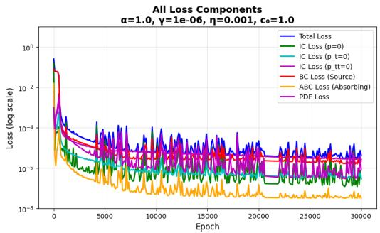  
(a) Loss Components

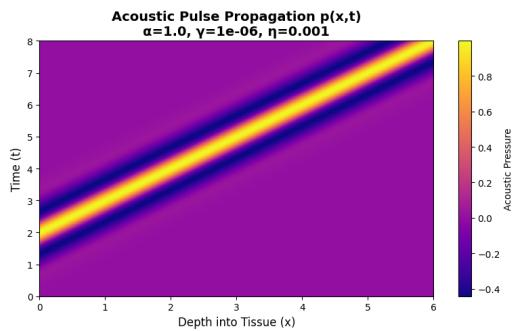  
(b) Acoustic Propagation

Figure 1: Case 1: Loss components and acoustic propagation field.  
  
(a) Waveform at Diferent Depths

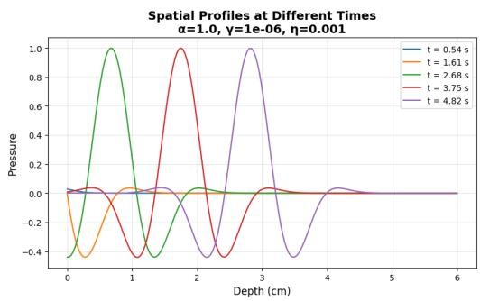  
(b) Waveform at Diferent Times

Figure 2: Case 1: Waveform evolution in space and time.  
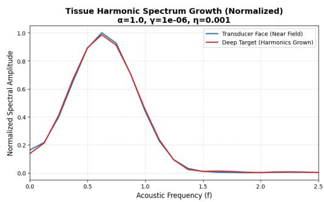  
(a) Tissue Harmonic Spectrum

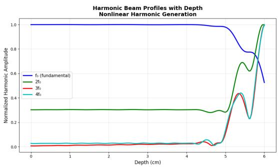  
(b) Harmonic Beam Profile  
Figure 3: Case 1: Frequency analysis and beam profiles.

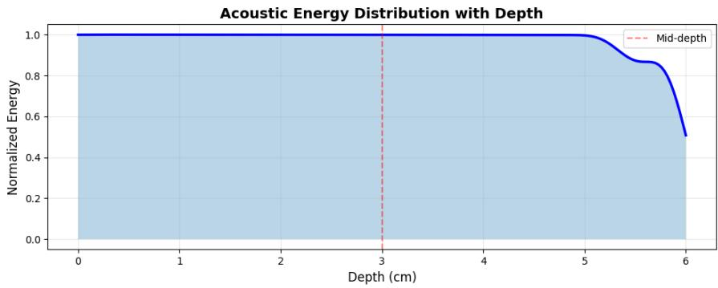  
Figure 4: Case 1: Acoustic energy distribution

In Figure 3b, the fundamental harmonic is flat at amplitude 1.0 from 0 − 4.2 cm, then a decline and rebound before a final drop to 0.52 at 6 cm. The second harmonic amplitude is stable at 0.30 through the whole near field, dips slightly to 0.285 around 4.6 cm, then rises steeply starting at 4.9 cm with a brief dip at 5.6 cm before finally climbs to 1.0 at 6 cm. Both the third and fourth harmonic amplitude stay low and nearly flat (0.01 − 0.03) through 4 cm, with a small, shared bump around 4.5 cm and a brief dip near 4.7 cm. Then, both rise together after 4.9 cm, peaking almost identically at 0.44 around 5.3 − 5.4 cm, dipping to 0.23 at 5.6 cm, and rise together to 1.0 at 6 cm. The acoustic energy distribution for this case is shown in Figure 4.

## 3.2 Case 2: Stronger Nonlinearity, Low Attenuation

Figures 5a and 5b present the loss component plots and the acoustic propagation field $p ( x , t )$ for this case. In Figures 6a, we observe from the source pulse (peak 1.0, trough 0.43) that the waveforms change progressively with depth. The peak amplitude creeps above 1.0, reaching roughly 1.03 − 1.04 at the middle depths $( x = 2 . 4 1 - 3 . 6 2 \ \mathrm { c m } )$ before reducing gradually. We notice also that a slowly decaying residual tail appears after each trough and grows somehow larger and longer-lived with depth. This is due to the high value of $\eta .$ Higher $\eta$ introduces cumulative, depth-dependent distortion. This reflects that energy is being fed into the waveform as it propagates (consistent with Figure 7a below). Figure 6b shows that waveform at diferent times.

In Figure ${ \mathrm { 7 a } } ,$ the low-frequency behavior $( f < 1 . 1 )$ shows some minimal distortion unlike in Case 1. However, at higher frequencies $f > 1 . 1$ , the distortion is notable. The deep-target curve (red) separates from the near-field curve (blue) and decays slower. The deep-target curve flattens into a broad plateau around $0 . 1 2 ^ { \cup } 0$ .14 spanning roughly $f = 1 . 5$ to $f = 2 . 5$ , while the near-field curve continues down to $\approx 0 . 0 1 ^ { \circ } 0 . 0 2$ . This shows that increasing η (with γ still the same) does not change the fundamental/near-field spectrum much, but it substantially boosts and sustains higher-harmonic content at the deep target.

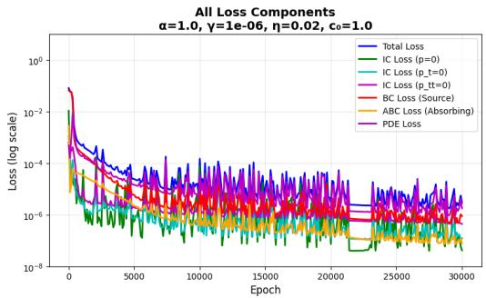  
(a) Loss Components

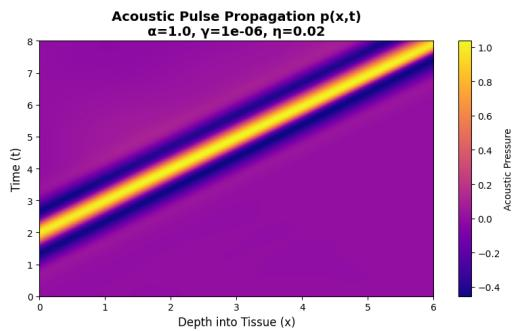  
(b) Acoustic Propagation

Figure 5: Case 2: Loss components and acoustic propagation field.  
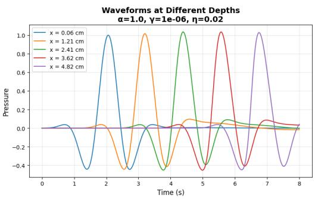  
(a) Waveform at Diferent Depths

  
(b) Waveform at Diferent Times

Figure 6: Case 2: Waveform evolution in space and time.  
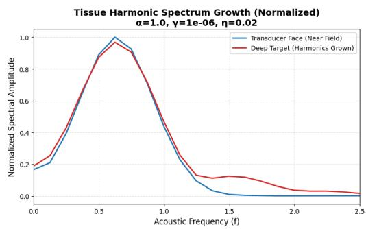  
(a) Tissue Harmonic Spectrum

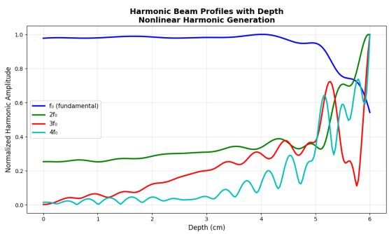  
(b) Harmonic Beam Profile  
Figure 7: Case 2: Frequency analysis and beam profiles.

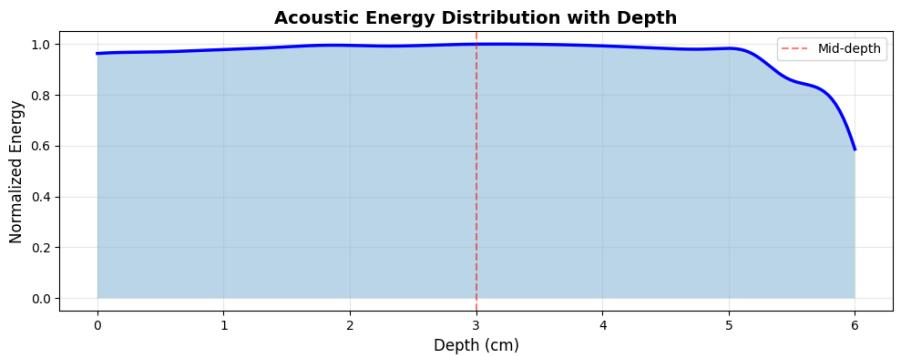  
Figure 8: Case 2: Acoustic energy distribution

For this case, the fundamental harmonic, in Figure 7b, starts around 0.98, and rises to a peak of 1.0 around 4 cm. It then dips to 0.95, and further declines with partial rebounds till it falls to 0.54 at 6 cm. The second harmonic is much noisier than in Case 1. It oscillates between 0.25 − 0.31 in the near field before trending upward, reaching 0.39 near 4.3 cm. It then dips and climbs again twice, before rising to 1.0 at 6 cm. The third and fourth harmonics show growing multiple oscillations with the fourth harmonic having the most multi-peak oscillatory behavior before they finally rise to 1.0 at 6cm. The acoustic energy distribution for this is presented in Figure 8.

## 3.3 Case 3: Strong Nonlinearity, High Attenuation

Figures 9a and 9b present the loss component plots and the acoustic propagation field $p ( x , t )$ for it. This case sits between Case 1 and Case 2. In Figure 10a, the source pulse, unlike Case 2, drifts gradually downward with depth. The trailing residual tail is present but much more modest than in Case 2. And it is not the same as in Case 1. This intermediate case behaves like a blend of cases 1 and 2. It is observed that while η drives distortion, γ drives amplitude decay. With a less strong η (0.01, half of Case 2) and high $\gamma ,$ the waveform is less distorted and the amplitude decays gradually. Figure 10b present the waveform propagation at diferent times.

In Figure 11a, the low-frequency onset is similar to case 1 but with a slightly wider gap. The peak is with amplitude of 1.0 for near field and 0.93 for deep target. And like Case 2, the deep-target curve pulls away from the near-field curve around $f \approx 1 . 2 1$ , forming an elevated tail. However, the plateau here sits a bit lower, around $0 . 0 9 - 0 . 1 0$ , as compared to Case 2. The result shows that with $\gamma$ being raised but η reduced slightly as compared to Case 2, the elevated high-frequency tail at depth still appears. This reveals that this behavior is governed primarily by η rather than $\gamma .$ . However, the magnitude is smaller due to the increase in the value of $\gamma .$

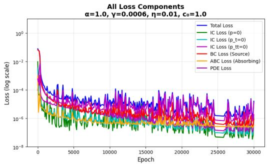  
(a) Loss Components

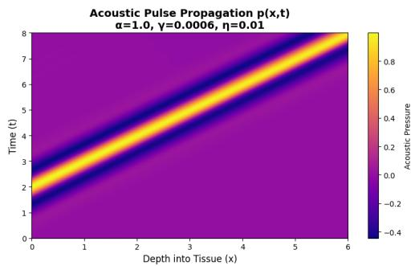  
(b) Acoustic Propagation

Figure 9: Case 3: Loss components and acoustic propagation field.  
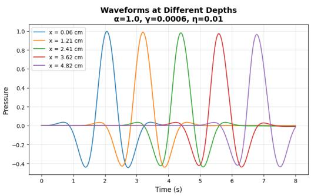  
(a) Waveform at Diferent Depths

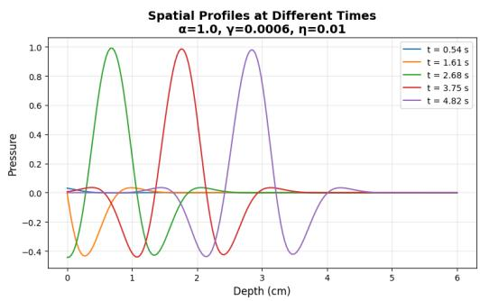  
(b) Waveform at Diferent Times

Figure 10: Case 3: Waveform evolution in space and time.  
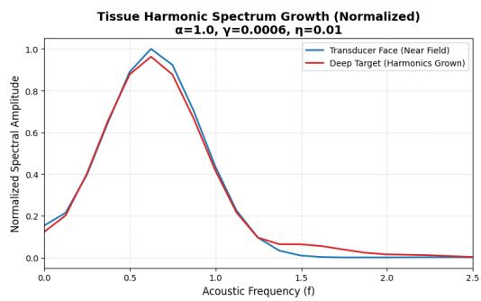  
(a) Tissue Harmonic Spectrum

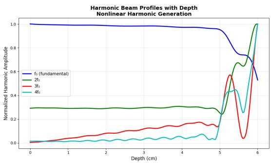  
(b) Harmonic Beam Profile  
Figure 11: Case 3: Frequency analysis and beam profiles.

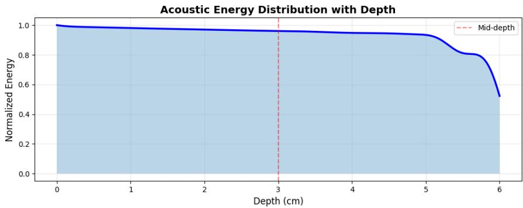  
Figure 12: Case 3: Acoustic energy distribution

Here, the fundamental harmonic (see Figure 11b ) starts at 1.0, declines gradually and smoothly (less oscillation than Case 2) to 0.95 by 5 cm, then drops with partial rebound before a final drop to 0.52 at 6 cm. The second harmonic starts about 0.20 only mild oscillation. It dips to 0.24 near 5 cm. It then rises and dips again before finally climbs to 1.0 at 6 cm. The third harmonic amplitude rises more steadily and smoothly than in Case 2. It reaches 0.17 by 4.5 cm and dips to 0.13 near 4.9 cm before surging to a peak of 0.57 at 5.3 cm. It crashes to 0.04 at 5.75 cm (the deepest dip of the three cases) and a final rise to 1.0. The fourth harmonic amplitude has mild oscillation through the near field (staying under 0.07 until 4.5 cm). It experiences a small dip near 4.8 cm and another dip at 5.6 cm before a steep rise to 1.0 at 6 cm. The acoustic energy distribution for this case is shown in Figure 12.

## 4 Conclusion

We solved the Westervelt equation (8) with PINNs for three synthetic cases to separate regimes that overlap in real tissues (Water/Brain/Fat $\eta = 0 . 0 0 3 5 - 0 . 0 0 8$ within 2% at 6 cm depth). PINNs enables direct enforcement of the nonlinear wave physics. It requires neither mesh generation nor traditional numerical discretization. Through the study of three cases, we demonstrate the PINNs’ capability to capture some nonlinear phenomena. These include harmonic generation and waveform steepening.

The near-field spectrum is invariant across all three parameter sets. η controls whether harmonics survive/grow at depth. At $\eta = 0 . 0 0 1$ , deep-target and near-field curves are nearly identical (no harmonic growth). At $\eta = 0 . 0 2$ and $\eta = 0 . 0 1$ , a broad elevated curve appears in the deep-target spectrum above $f \approx 1 . 1 - 1 . 5$ (as seen in cases 2 and 3), indicating $\eta$ drives sustained harmonic generation/energy transfer to higher frequencies as the wave travels to the deep target. However, the value of $\gamma$ appears to add an efect in lowering the magnitude of the rise as shown in Case 3.

The study has some limitations. These suggest directions for future research. First, we use one-dimensional geometry, which is good for fundamental understanding. However, it does not capture the full three-dimensional complexity of clinical HIFU applications. Extending the study to two or three dimensions would enable simulation of these applications. Second, we normalized the parameters for demonstrating the method. Yet they do not correspond directly to physical tissue properties. Future work will incorporate tissue parameters based on experimental measurements. Third, we assume homogeneous media. Incorporating spatially varying parameters would enable simulation of tissue heterogeneity especially for clinical applications.

The Loss components reached at least $1 0 ^ { - 5 }$ across all cases. These results demonstrate that $\gamma$ scales the rate of energy absorption (amplitude decay), while η governs frequency-dependent phase speeds (dispersion). These two parameters dictate whether a nonlinear pressure pulse can successfully transfer energy through deep fluid layers or if it degrades into low-frequency environmental noise. This is useful for both diagnostic and therapeutic ultrasound applications.

## References

[1] Peter J Westervelt. Rotational splitting of degenerate acoustic modes. The Journal of the Acoustical Society of America, 35(5\_Supplement):795–795, 1963.

[2] Vanja Nikolic and Barbara Wohlmuth. A priori error estimates for the finite element approximation of westervelt’s quasi-linear acoustic wave equation. SIAM Journal on Numerical Analysis, 57(4):1897–1918, 2019.

[3] Gail ter Haar and Constantin Coussios. High intensity focused ultrasound: physical principles and devices. International journal of Hyperthermia, 23(2):89–104, 2007.

[4] IA Shehata Elhelf, H Albahar, U Shah, A Oto, E Cressman, and M Almekkawy. High intensity focused ultrasound: The fundamentals, clinical applications and research trends. Diagnostic and interventional imaging, 99(6):349–359, 2018.

[5] Kevin D Evans, Brandon Weiss, and Michael Knopp. High-intensity focused ultrasound (hifu) for specific therapeutic treatments: a literature review. Journal of Diagnostic Medical Sonography, 23(6):319–327, 2007.

[6] EA Filonenko and VA Khokhlova. Efect of acoustic nonlinearity on heating of biological tissue by high-intensity focused ultrasound. Acoustical Physics, 47(4):468–475, 2001.

[7] Gianmarco Pinton, Jean-Francois Aubry, Mathias Fink, and Mickael Tanter. Effects of nonlinear ultrasound propagation on high intensity brain therapy. Medical physics, 38(3):1207–1216, 2011.

[8] B Ward, AC Baker, and VF Humphrey. Nonlinear propagation applied to the improvement of resolution in diagnostic medical ultrasound. The Journal of the Acoustical Society of America, 101(1):143–154, 1997.

[9] Maxim Shishlenin, Andrey Kozelkov, and Nikita Novikov. Nonlinear medical ultrasound tomography: 3d modeling of sound wave propagation in human tissues. Mathematics, 12(2):212, 2024.

[10] Armen P Sarvazyan, Matthew W Urban, and James F Greenleaf. Acoustic waves in medical imaging and diagnostics. Ultrasound in medicine & biology, 39(7):1133–1146, 2013.

[11] Laurens Howle, David G Schaefer, Michael Shearer, and Pei Zhong. Lithotripsy: the treatment of kidney stones with shock waves. SIAM review, 40(2):356–371, 1998.

[12] AJ Coleman and JE Saunders. A review of the physical properties and biological efects of the high amplitude acoustic fields used in extracorporeal lithotripsy. Ultrasonics, 31(2):75–89, 1993.

[13] Robin O Cleveland and Oleg A Sapozhnikov. Modeling elastic wave propagation in kidney stones with application to shock wave lithotripsy. The Journal of the Acoustical Society of America, 118(4):2667–2676, 2005.

[14] D Donskoy, A Sutin, and A Ekimov. Nonlinear acoustic interaction on contact interfaces and its use for nondestructive testing. Ndt & E International, 34(4):231–238, 2001.

[15] Amir Nasrollahi, Wen Deng, Piervincenzo Rizzo, Alex Vuotto, and Julie M Vandenbossche. Nondestructive testing of concrete using highly nonlinear solitary waves. Nondestructive Testing and Evaluation, 32(4):381–399, 2017.

[16] PV Yuldashev, OA Sapozhnikov, MM Karzova, SA Tsysar, AV Kvashennikova, EO Konnova, and VA Khokhlova. Numerical models of nonlinear acoustic wave propagation in medical ultrasound problems and certain applications of aeroacoustics and underwater acoustics. Moscow University Physics Bulletin, 80(2):195–225, 2025.

[17] María Campo-Valera, Dídac Diego-Tortosa, Ignacio Rodríguez-Rodríguez, Jorge Useche-Ramírez, and Rafael Asorey-Cacheda. Signal processing to characterize and evaluate nonlinear acoustic signals applied to underwater communications. Electronics, 13(21):4192, 2024.

[18] Igor Shevchenko and Barbara Kaltenbacher. Absorbing boundary conditions for the westervelt equation. In Conference Publications, volume 2015, pages 1000– 1008. Conference Publications, 2015.

[19] Igor Shevchenko and Barbara Kaltenbacher. Absorbing boundary conditions for nonlinear acoustics: The westervelt equation. Journal of Computational Physics, 302:200–221, 2015.

[20] Shaikhah Alkhadhr and Mohamed Almekkawy. Physics-informed neural networks with resampling technique to model ultrasound wave propagation of a multi-element transducer. In 2022 IEEE International Ultrasonics Symposium (IUS), pages 1–4. IEEE, 2022.

[21] Shaikhah Alkhadhr and Mohamed Almekkawy. Modeling a multi-element ultrasound transducer via component-focused physics-informed neural networks. In 2023 IEEE International Ultrasonics Symposium (IUS), pages 1–4. IEEE, 2023.

[22] Shaikhah Alkhadhr and Mohamed Almekkawy. Wave equation modeling via physics-informed neural networks: Models of soft and hard constraints for initial and boundary conditions. Sensors, 23(5):2792, 2023.

[23] Linfeng Wang, Hao Wang, Lin Liang, Jian Li, Zhoumo Zeng, and Yang Liu. Physics-informed neural networks for transcranial ultrasound wave propagation. Ultrasonics, 132:107026, 2023.

[24] Xinmeng Luan, Kazuya Yokota, and Gary Scavone. Acoustic field reconstruction in tubes via physics-informed neural networks. arXiv preprint arXiv:2505.12557, 2025.

[25] Johannes Schmid. Physics-informed neural networks for solving the helmholtz equation. In Inter-Noise and Noise-Con Congress and Conference Proceedings, volume 267, pages 265–268. Institute of Noise Control Engineering, 2023.

[26] Thomas Stone. Physics informed neural networks for ultrasonic guided wave propagation in solid media. Master’s thesis, San Diego State University, 2023.

[27] Baoding Wang, Jiuzhang Li, Haodong Chen, Liequan Wu, Pan Ma, Bin Yang, and Jun Zhang. Sparse wavefield reconstruction and defect indication in lowsnr laser ultrasonics using physics-informed neural networks. Ultrasonics, page 108194, 2026.

[28] Sonal Ankush Chibire, Jenn-Terng Gau, and Bo Zhang. A physics-informed neural network framework for elastodynamic wave propagation in bimaterial systems. arXiv preprint arXiv:2607.06479, 2026.

[29] Maziar Raissi. Deep hidden physics models: Deep learning of nonlinear partial diferential equations. Journal of Machine Learning Research, 19(25):1–24, 2018.

[30] Maziar Raissi, Paris Perdikaris, and George E Karniadakis. Physics-informed neural networks: A deep learning framework for solving forward and inverse problems involving nonlinear partial diferential equations. Journal of Computational physics, 378:686–707, 2019.

[31] Xiao Wang Klapa Antonion, Maziar Raissi, and Laurn Joshie. Machine learning through physics–informed neural networks: Progress and challenges. Academic Journal of Science and Technology, 9(1):2024, 2024.

[32] Luke Oluwaseye Joel, Charis Harley, and Ebrahim Momoniat. Solving laneemden-type eigenvalue problems with physics-informed neural networks. International Journal of Theoretical Physics, 64(12):328, 2025.

[33] Robert D Purrington and Guy V Norton. A numerical comparison of the westervelt equation with viscous attenuation and a causal propagation operator. Mathematics and Computers in Simulation, 82(7):1287–1297, 2012.

[34] Christopher W Connor and Kullervo Hynynen. Bio-acoustic thermal lensing and nonlinear propagation in focused ultrasound surgery using large focal spots: a parametric study. Physics in Medicine & Biology, 47(11):1911–1928, 2002.

[35] Pragya Gupta and Atul Srivastava. Numerical analysis of thermal response of tissues subjected to high intensity focused ultrasound. International Journal of Hyperthermia, 35(1):419–434, 2018.

[36] Ibrahim M Hallaj, Robin O Cleveland, and Kullervo Hynynen. Simulations of the thermo-acoustic lens efect during focused ultrasound surgery. The Journal of the Acoustical Society of America, 109(5):2245–2253, 2001.