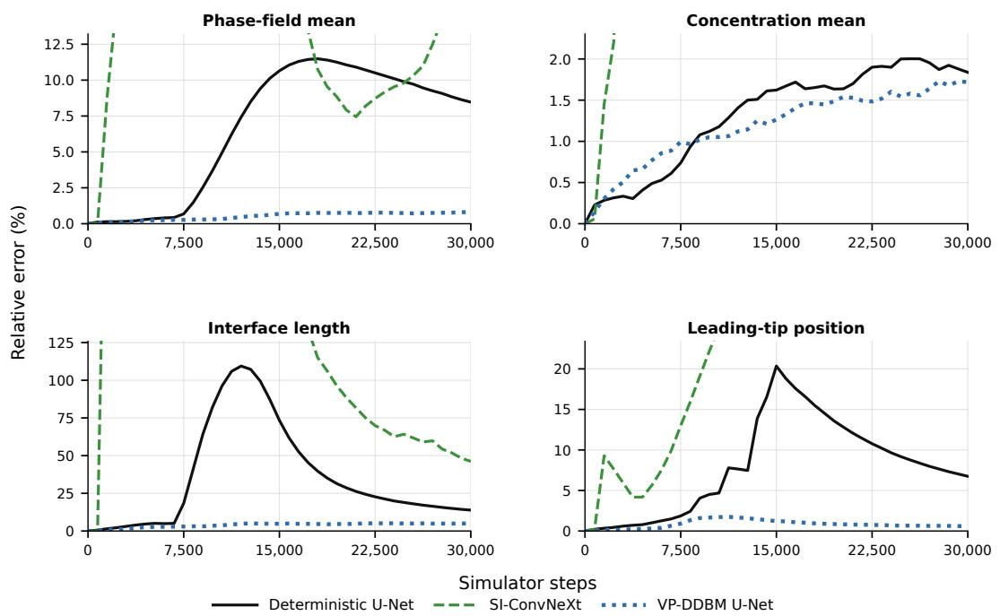
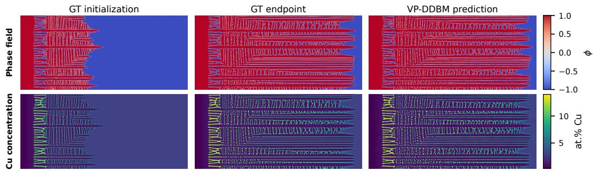
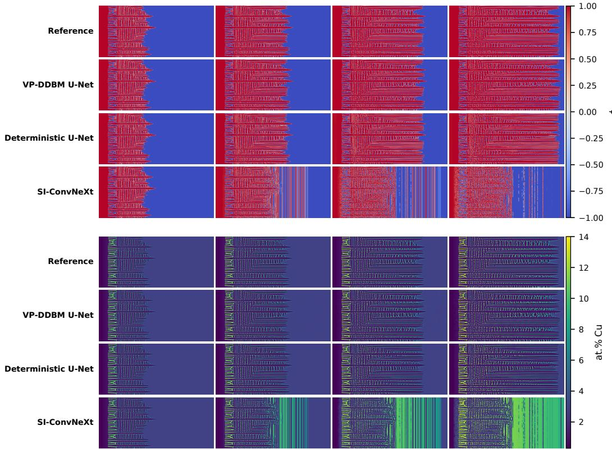
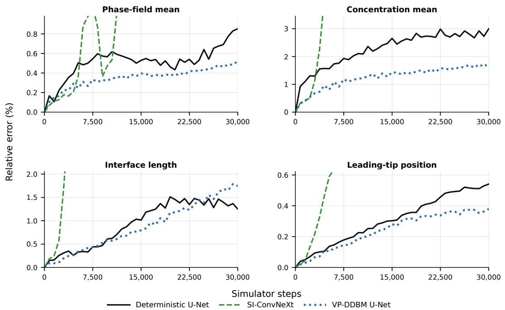

# Surrogate Models for Stochastic Al–Cu Phase-Field Solidification

Simon Savukoski Tatu Pinomaa VTT Technical Research Centre of Finland Ltd Espoo, Finland

## Abstract

Phase-field models resolve microstructural evolution during rapid alloy solidification, but their computational cost limits long trajectories, stochastic ensembles, and studies across process conditions. We present a variance-preserving denoising diffusion bridge model (VP-DDBM) for state-conditioned prediction of two-dimensional Al–Cu solidification. Given the current phase, concentration, and prescribed temperature fields, the model predicts the subsequent state and is applied autoregressively. Across two held-out thermal gradients, VP-DDBM produces lower long-horizon errors than deterministic U-Net and SI-ConvNeXt baselines in domain-mean phase, domain-mean Cu concentration, and leadingtip position. It also retains fine dendritic structure over long rollouts, whereas the deterministic U-Net progressively smooths the morphology. VP-DDBM predicts the phase and concentration evolution approximately 73× faster than the phase-field solver, showing potential for faster process-condition screening and ensemble-based microstructure studies.

## 1 Introduction

Phase-field (PF) models resolve diffuse solid–liquid interfaces and their coupling to solute transport effectively. Formulations have been developed for both near-equilibrium alloy solidification [1, 2] and rapid solidification [3, 4], including conditions relevant to metal additive manufacturing [5]. However, resolving the phase-field equations at the required spatial and temporal scales makes long trajectories, and large parameter studies computationally expensive.

Machine-learning surrogates can reduce the cost of PDE-governed simulation, as demonstrated in applications including fluid dynamics and weather forecasting [6–9]. Convolutional, recurrent, and operator-based surrogates have similarly been developed for phase-field evolution [10–14].

In the Al–Cu simulator considered here, Gaussian perturbations enter the phase-evolution update. These fluctuations influence interfacial instabilities and dendritic sidebranching, such that multiple future morphologies are plausible under the same realized state and prescribed thermal forcing [15]. Probabilistic autoregressive models have been explored for stochastic mesoscopic crystallization [16], but stochastic surrogate prediction has received limited attention for coupled phase–solute evolution under a moving temperature field.

We therefore formulate surrogate modeling of stochastic Al–Cu solidification as state-conditioned forward prediction. Given the current phase and concentration fields and the prescribed spatial temperature field, each surrogate predicts the next stored state and is applied recursively. We compare two deterministic predictors, a U-Net and SI-ConvNeXt, with a variance-preserving denoising diffusion bridge model [17]. All models use the same state variables, temperature information, trajectory split, 750-step transition interval, and autoregressive evaluation protocol. On thermal-gradient families excluded from training, we evaluate long-horizon errors in bulk field quantities, interface morphology, front advancement, rollout stability, and inference cost. Because stochastic forcing can shift individual sidebranches, the evaluation emphasizes physically meaningful morphology and bulk quantities rather than exact branch-by-branch agreement. This comparison tests whether a stochastic diffusion bridge can improve long-horizon physical fidelity while retaining a practical computational advantage, thereby enabling faster process-condition screening and ensemble-based microstructure studies.

## 2 Phase-field model for rapid solidification

At the continuum level, the dilute-alloy phase-field model follows the formulations in Refs. [3, $1 8 ] .$ , which describe the co-evolution of a solid-liquid order parameter (ϕ) and alloying element concentration field (c) under a prescribed temperature field $T ( x , y , t )$ . The order parameter equation is of the form

$$
\tau ( \mathbf { n } ) \frac { \partial \phi } { \partial t } = \nabla \cdot \left[ W ( \mathbf { n } ) ^ { 2 } \nabla \phi + \mathbf { f } _ { W } ( \mathbf { n } ) \right] + \phi - \phi ^ { 3 } + f _ { D } ( T , \phi , c ) + \eta _ { \phi } ,\tag{1}
$$

where $\mathbf { n } = \nabla \phi / | \nabla \phi |$ is the interface normal, $W$ and τ are anisotropic interface width and attachment time, respectively, ${ \bf f } _ { W }$ is an additional anisotropy term, $f _ { D } ( T , \phi , c )$ is the driving force term, and $\eta _ { \phi }$ is a Gaussian stochastic forcing term following Ref. [15].

The concentration follows a nonlinear diffusion equation according to

$$
\frac { \partial c } { \partial t } = \nabla \cdot \left[ D _ { L } c q ( \phi ) \nabla u ( c , \phi ) + f _ { a } ( \phi , c ) \frac { \partial \phi } { \partial t } { \bf n } \right] ,\tag{2}
$$

where $D _ { L }$ is the solute diffusion coefficient in the liquid phase, $q ( \phi )$ is an interpolation function, $u ( c , \phi )$ is the chemical potential, and $f _ { \mathrm { a } } ( \phi , c )$ is a prefactor to an antitrapping current used to impose controlled rapid solidification kinetics.

The imposed temperature field is prescribed as a moving linear temperature profile,

$$
T ( x , y , t ) = T _ { 0 } + G \left[ x - V t \right] ,\tag{3}
$$

where $x$ is the solidification direction coordinate, $T _ { 0 }$ is an appropriate reference shift, G is the imposed thermal gradient, and $V$ is the pulling speed. The PF simulator uses an explicit Euler time integration scheme with a constant time step size ∆t. The implementation details and model parameters for the dilute Al–Cu alloy are given in Ref. [19].

## 3 Surrogate models

Let $\mathbf { x } _ { k } = [ \phi _ { k } , c _ { k } ]$ denote the phase and Cu-concentration fields at stored state $k ,$ , and let $T _ { k }$ denote the prescribed temperature field. All surrogates model the one-step transition from $\left( \mathbf { x } _ { k } , T _ { k } \right)$ to $\mathbf { x } _ { k + 1 }$ Temperature is prescribed and is not predicted.

We compare two deterministic surrogates with a probabilistic diffusion-bridge model. The deterministic U-Net predicts $\mathbf { x } _ { k + 1 }$ using a residual encoder–decoder architecture with skip connections [20]. SI-ConvNeXt provides an alternative deterministic baseline based on resolution-preserving ConvNeXt blocks without an encoder–decoder bottleneck [21, 13]. It receives the phase, concentration, and temperature fields as three stacked channels and directly predicts the next phase and concentration fields.

VP-DDBM instead models a conditional distribution over possible next states using the variancepreserving formulation of Denoising Diffusion Bridge Models [17]. During training, the known current and next states form the endpoints of a stochastic bridge. An intermediate bridge state is sampled as

$$
\begin{array} { r } { \mathbf { z } _ { s } = a _ { s } \mathbf { x } _ { k } + b _ { s } \mathbf { x } _ { k + 1 } + c _ { s } \pmb { \epsilon } , \qquad \pmb { \epsilon } \sim \mathcal { N } ( \mathbf { 0 } , \mathbf { I } ) , } \end{array}\tag{4}
$$

where $s \in [ 0 , 1 ]$ is the bridge time and $a _ { s } , b _ { s } ,$ , and $c _ { s }$ are determined by the variance-preserving schedule. The schedule satisfies $\mathbf { z } _ { 1 } ~ = ~ \mathbf { x } _ { k }$ and ${ \bf z } _ { 0 } = { \bf x } _ { k + 1 }$ , with $c _ { s }$ vanishing at both endpoints. Intermediate states are therefore noisy mixtures of the current and next states. The network is trained to recover the clean next state from $\mathbf { z } _ { s }$ , conditioned on $\mathbf { x } _ { k } , T _ { k }$ , and s.

At inference, $\mathbf { x } _ { k + 1 }$ is unknown. We use Diffusion Bridge Implicit Models (DBIM) [22] to traverse the learned bridge from the known current-state endpoint toward a sampled next state. A Gaussian boot perturbation is introduced near the current-state endpoint. With $\eta = 0$ , the remaining DBIM updates are deterministic.

The deterministic U-Net and the VP-DDBM denoiser use residual U-Net backbones with the same temperature-conditioning design. Temperature enters through two pathways. First, its spatial mean and standard deviation are embedded and used by FiLM to rescale and shift feature channels, providing global thermal conditioning [23]. Second, the complete temperature field is processed by a five-resolution convolutional encoder and injected at the corresponding U-Net resolutions through zero-initialized 1 × 1 residual projections. These projections are analogous to the zero-convolution connections used by ControlNet [24]. Unlike ControlNet, however, our architecture does not freeze or duplicate a pretrained backbone; all backbone and conditioning parameters are trained jointly. In VP-DDBM, the global temperature representation is combined with a separate bridge-time embedding before feature modulation. Spatial convolutions use periodic padding along y and nonperiodic padding along x, consistent with the simulator boundary conditions.

## 4 Training and evaluation

The dataset contains 70 independently generated phase-field trajectories on a uniform $5 1 2 \times 7 6 8$ grid. Simulations use a pulling speed of $0 . 2 \mathrm { m s } ^ { \frac { \cdot } { - 1 } }$ and 14 thermal gradients from $1 . 1 \times 1 0 ^ { 6 }$ to $\mathrm { { 2 . 4 \times 1 0 ^ { 6 } K m ^ { - 1 } } }$ in increments of $\mathrm { { \dot { 0 } . 1 \times 1 0 ^ { 6 } \mathrm { K m ^ { - 1 } } } }$ , with five trajectories per gradient. The dataset comprises 26,940 stored states and 26,870 adjacent transitions, each spanning 750 phase-field Euler steps.

Complete gradient families are assigned to the data splits before transition pairs are formed. Gradients 1.3 and 1.9 are used for validation and 1.6 and 2.2 for testing, in units of $\mathrm { ^ { 1 0 ^ { 6 } K m ^ { - 1 } } }$ ; the remaining ten gradients are used for training. This produces 50, 10, and 10 trajectories containing 19,275, 3,990, and 3,605 transitions, respectively. Models are selected according to the best validation loss.

At test time, predictions are recursively returned as inputs while the prescribed temperature field is advanced according to the thermal schedule. We evaluate relative errors in domain-mean phase, domain-mean Cu concentration, interface length [25], and leading-tip position [26]. Because stochas tic perturbations can shift individual branches over long horizons, these physical quantities are interpreted together with qualitative spatial comparisons rather than exact pixel-wise similarity.

For the wall-clock comparison, the phase-field solver was timed on 12 CPU nodes of CSC’s Mahti supercomputer using 1,536 MPI ranks, corresponding to one rank per physical core. Surrogate inference was measured at batch size one on a single AMD MI250X Graphics Compute Die (GCD) of LUMI [27, 28]. Timings compare advancement over the same 750-step interval.

## 5 Results

Figure 1 compares error accumulation over 30,000 phase-field Euler steps at the lower held-out thermal gradient. VP-DDBM yields lower errors than the deterministic baselines across all four quantities. The same ordering is observed at the upper held-out gradient for domain-mean phase, domain-mean Cu concentration, and leading-tip position, but not for interface length. Complete results for the upper gradient are provided in Appendix A.

Figure 2 shows a spatial evolution and autoregressive prediction rollout. VP-DDBM reproduces similar front advancement and Cu redistribution while retaining a densely branched morphology. A spatial comparison with the deterministic U-Net and SI-ConvNeXt is provided in Appendix A.

For an equivalent advancement of 750 phase-field Euler steps, the median phase-field runtime is 46.29 s, compared with 0.111 s for the deterministic U-Net and 0.634 s for VP-DDBM using five DBIM network evaluations. Under the reported hardware configurations, these values correspond to wall-clock speedups of approximately 417× and 73×, respectively.

In conclusion, VP-DDBM demonstrates the potential to accelerate stochastic phase-field simulations of Al–Cu solidification. Future work should evaluate the model across a broader range of thermal histories and processing conditions relevant to additive manufacturing.

  
Figure 1: Long-horizon autoregressive errors. Each curve shows the mean relative error across 15 held-out rollouts at $G = 1 . 6 \times \mathrm { \breve { 1 0 ^ { 6 } } K m ^ { - 1 } }$ . The rollouts begin at simulator steps 220,000, 230,000, and 240,000 in each of five independently generated phase-field trajectories, one per simulator seed, giving 15 rollouts. The panels report errors in domain-mean phase, domain-mean Cu concentration, interface length, and leading-tip position over 30,000 phase-field Euler steps. SI-ConvNeXt values outside the displayed ordinate ranges are clipped.

  
Figure 2: VP-DDBM autoregressive rollout. Phase field ϕ (top) and Cu concentration in at. % (bottom) at the rollout initialization, the phase-field reference endpoint, and one sampled VP-DDBM endpoint. Each surrogate transition advances the state by 750 phase-field Euler steps. The 65- transition rollout therefore spans 48,750 Euler steps, from simulator step 244,500 to 293,250. The trajectory uses the lower held-out thermal gradient, $G = 1 . 6 \times 1 0 ^ { 6 } \mathrm { K m } ^ { - 1 }$

## References

[1] Alain Karma. Phase-field formulation for quantitative modeling of alloy solidification. Physical Review Letters, 87(11):115701, 2001. doi: 10.1103/PhysRevLett.87.115701.

[2] Blas Echebarria, Roger Folch, Alain Karma, and Mathis Plapp. Quantitative phase-field model of alloy solidification. Physical Review E, 70(6):061604, 2004. doi: 10.1103/PhysRevE.70.061604.

[3] Tatu Pinomaa and Nikolas Provatas. Quantitative phase-field modeling of solute trapping and continuous growth kinetics in quasi-rapid solidification. Acta Materialia, 168:167–177, 2019. doi: 10.1016/j.actamat. 2019.02.009.

[4] Kaihua Ji, Mingwang Zhong, and Alain Karma. Phase-field model of alloy solidification far from chemical equilibrium at the solid–liquid interface. Physical Review Research, 7(3):033128, 2025. doi: 10.1103/vyd6-nj4h.

[5] Neng Ren, Jun Li, Ruiyao Zhang, Chinnapat Panwisawas, Mingxu Xia, Hongbiao Dong, and Jianguo Li. Solute trapping and non-equilibrium microstructure during rapid solidification of additive manufacturing. Nature Communications, 14(1):7990, 2023. doi: 10.1038/s41467-023-43563-x.

[6] Zongyi Li, Nikola Kovachki, Kamyar Azizzadenesheli, Burigede Liu, Kaushik Bhattacharya, Andrew Stuart, and Anima Anandkumar. Fourier neural operator for parametric partial differential equations. In International Conference on Learning Representations, 2021. URL https://arxiv.org/abs/2010. 08895.

[7] Dmitrii Kochkov, Jamie A. Smith, Ayya Alieva, Qing Wang, Michael P. Brenner, and Stephan Hoyer. Machine learning–accelerated computational fluid dynamics. Proceedings of the National Academy of Sciences, 118(21):e2101784118, 2021. doi: 10.1073/pnas.2101784118.

[8] Jaideep Pathak, Shashank Subramanian, Peter Harrington, Sanjeev Raja, Ashesh Chattopadhyay, Morteza Mardani, Thorsten Kurth, David Hall, Zongyi Li, Kamyar Azizzadenesheli, Pedram Hassanzadeh, Karthik Kashinath, and Animashree Anandkumar. FourCastNet: A global data-driven high-resolution weather model using adaptive fourier neural operators, 2022. URL https://arxiv.org/abs/2202.11214.

[9] Phillip Lippe, Bastiaan S. Veeling, Paris Perdikaris, Richard E. Turner, and Johannes Brandstetter. PDE-refiner: Achieving accurate long rollouts with neural PDE solvers. In Advances in Neural Information Processing Systems, volume 36, pages 67398–67433, 2023. URL https://proceedings.neurips.cc/paper\_files/paper/2023/hash/ d529b943af3dba734f8a7d49efcb6d09-Abstract-Conference.html.

[10] David Montes de Oca Zapiain, James A. Stewart, and Rémi Dingreville. Accelerating phase-field-based microstructure evolution predictions via surrogate models trained by machine learning methods. npj Computational Materials, 7(1):3, 2021. doi: 10.1038/s41524-020-00471-8.

[11] Christophe Bonneville, Nathan Bieberdorf, Arun Hegde, Mark Asta, Habib N. Najm, Laurent Capolungo, and Cosmin Safta. Accelerating phase field simulations through a hybrid adaptive Fourier neural operator with U-net backbone. npj Computational Materials, 11(1):14, 2025. doi: 10.1038/s41524-024-01488-z.

[12] Christophe Bonneville, Nathan Bieberdorf, Pieterjan Robbe, Mark Asta, Habib N. Najm, Laurent Capolungo, and Cosmin Safta. Extrapolating phase-field simulations in space and time with purely convolutional architectures, 2025. URL https://arxiv.org/abs/2509.20770. NeurIPS 2025 Workshop: ML for the Physical Sciences.

[13] Kaihua Ji, Luning Sun, Shusen Liu, Fei Zhou, and Tae Wook Heo. Scalable autoregressive deep surrogates for complex microstructure dynamics. Machine Learning: Science and Technology, 7(4):045050, 2026. doi: 10.1088/2632-2153/ae94e4.

[14] Damien Pinto, Michael Greenwood, and Nikolas Provatas. LeapFrog: Getting the jump on multi-scale materials simulations using machine learning, 2024. URL https://arxiv.org/abs/2406.15326.

[15] Alain Karma and Wouter-Jan Rappel. Phase-field model of dendritic sidebranching with thermal noise. Physical Review E, 60(4):3614–3625, 1999. doi: 10.1103/PhysRevE.60.3614.

[16] Pol Timmer, Koen Minartz, and Vlado Menkovski. Efficient probabilistic modeling of crystallization at mesoscopic scale. In Sašo Džeroski, Jurica Levatic, Gianvito Pio, and Nikola Simidjievski, editors,´ Discovery Science, volume 16090 of Lecture Notes in Computer Science, pages 3–16, Cham, 2025. Springer. doi: 10.1007/978-3-032-05461-6\_1.

[17] Linqi Zhou, Aaron Lou, Samar Khanna, and Stefano Ermon. Denoising diffusion bridge models. In International Conference on Learning Representations, 2024. URL https://arxiv.org/abs/2309. 16948.

[18] Tatu Pinomaa, Joseph M. McKeown, Jörg M. K. Wiezorek, Nikolas Provatas, Anssi Laukkanen, and Tomi Suhonen. Phase field modeling of rapid resolidification of Al–Cu thin films. Journal ofCrystal Growth, 532:125418, 2020. doi: 10.1016/j.jcrysgro.2019.125418.

[19] Tatu Pinomaa, Adriana Eres-Castellanos, Pascal Thome, Joni Kaipainen, I-Ting Ho, Scott Hunter, Jeff Squier, Kamel Fezzaa, Abhishek Biswas, Sammy Tin, Nikolas Provatas, Amy J. Clarke, Joseph McKeown, and Thomas Voisin. Multi-scale in situ experiment/simulation integration to predict rapid solidification microstructures in additively manufactured AlCu, 2025. URL https://ssrn.com/abstract=5402093. SSRN preprint.

[20] Olaf Ronneberger, Philipp Fischer, and Thomas Brox. U-net: Convolutional networks for biomedical image segmentation. In Medical Image Computing and Computer-Assisted Intervention – MICCAI 2015, volume 9351 of Lecture Notes in Computer Science, pages 234–241. Springer, 2015. doi: 10.1007/ 978-3-319-24574-4\_28.

[21] Zhuang Liu, Hanzi Mao, Chao-Yuan Wu, Christoph Feichtenhofer, Trevor Darrell, and Saining Xie. A ConvNet for the 2020s. In 2022 IEEE/CVF Conference on Computer Vision and Pattern Recognition (CVPR), pages 11966–11976. IEEE, 2022. doi: 10.1109/CVPR52688.2022.01167.

[22] Kaiwen Zheng, Guande He, Jianfei Chen, Fan Bao, and Jun Zhu. Diffusion bridge implicit models. In The Thirteenth International Conference on Learning Representations, 2025. URL https://arxiv.org/ abs/2405.15885.

[23] Ethan Perez, Florian Strub, Harm de Vries, Vincent Dumoulin, and Aaron Courville. FiLM: Visual reasoning with a general conditioning layer. Proceedings ofthe AAAI Conference on Artificial Intelligence, 32(1):3942–3951, 2018. doi: 10.1609/aaai.v32i1.11671.

[24] Lvmin Zhang, Anyi Rao, and Maneesh Agrawala. Adding conditional control to text-to-image diffusion models. In 2023 IEEE/CVF International Conference on Computer Vision (ICCV), pages 3813–3824. IEEE, 2023. doi: 10.1109/ICCV51070.2023.00355.

[25] Anh Tran, Dehao Liu, Hoang A. Tran, and Yan Wang. Quantifying uncertainty in the process–structure relationship for Al–Cu solidification. Modelling and Simulation in Materials Science and Engineering, 27 (6):064005, 2019. doi: 10.1088/1361-651X/ab2690.

[26] Andrea M. Jokisaari, Peter W. Voorhees, Jonathan E. Guyer, James A. Warren, and Olle G. Heinonen. Phase field benchmark problems for dendritic growth and linear elasticity. Computational Materials Science, 149:336–347, 2018. doi: 10.1016/j.commatsci.2018.03.015.

[27] CSC – IT Center for Science. Technical details about mahti. https://docs.csc.fi/computing/ systems-mahti/, 2026. Accessed 2026-08-30.

[28] LUMI Consortium. GPU nodes – LUMI-G. https://docs.lumi-supercomputer.eu/hardware/ lumig/, 2026. Accessed 2026-08-30.

[29] Ying Sun and Christoph Beckermann. Sharp interface tracking using the phase-field equation. Journal of Computational Physics, 220(2):626–653, 2007. doi: 10.1016/j.jcp.2006.05.025.

## A Supplementary materials

## A.1 Model and training hyperparameters

The selected production runs used AdamW with constant learning rates, an 800-epoch training horizon, and an effective global batch size of 128. Model-specific settings are summarized in Table S1.

Table S1: Model-specific training and inference settings. Trainable parameter counts and modelspecific optimization and inference settings for the three evaluated surrogates.
<table><tr><td>Model</td><td>Parameters</td><td>Objective</td><td>LR</td><td>Weight decay</td><td>EMA decay</td><td>Inference</td></tr><tr><td>Deterministic U-Net</td><td>214,154,338</td><td>Next-state MSE</td><td> $1 \times 1 0 ^ { - 4 }$ </td><td> $1 \times 1 0 ^ { - 2 }$ </td><td>None</td><td>1 evaluation</td></tr><tr><td>VP-DDBM</td><td>229,859,778</td><td>Weighted endpoint MSE</td><td> $1 \times 1 0 ^ { - 4 }$ </td><td>0</td><td>0.9999</td><td>DBIM-5  $( \eta = 0 )$ </td></tr><tr><td>SI-ConvNeXt</td><td>1,265,459</td><td>Next-state MSE</td><td> $4 \times 1 0 ^ { - 4 }$ </td><td> $1 \times 1 0 ^ { - 4 }$ </td><td>None</td><td>1 evaluation</td></tr></table>

For VP-DDBM, bridge times were sampled independently as $s \sim \mathcal { U } ( 1 0 ^ { - 4 }$ , 1), using the variance-preserving schedule $\beta _ { \mathrm { m i n } } = 0 . 1$ and $\beta _ { d } = 2 . 0$ . At inference, we used DBIM with $\eta = 0$ and five network evaluations. The corresponding bridge-time grid was

$$
\mathbf { s } = [ 0 . 9 9 9 , 0 . 6 6 6 0 3 3 3 , 0 . 3 3 3 0 6 6 7 , 0 . 0 0 0 1 , 0 ] .
$$

A Gaussian initialization perturbation was sampled at the first bridge time. The subsequent DBIM updates were deterministic conditional on this initial perturbation.

## A.2 Evaluation details

For fields sampled on the uniform computational grid, the domain-mean phase and Cu concentration are defined as

$$
\overline { { \phi } } ( t ) = \frac { 1 } { N _ { \Omega } } \sum _ { i = 1 } ^ { N _ { \Omega } } \phi _ { i } ( t ) , \qquad \overline { { c } } ( t ) = \frac { 1 } { N _ { \Omega } } \sum _ { i = 1 } ^ { N _ { \Omega } } c _ { i } ( t ) ,\tag{A.1}
$$

where $N _ { \Omega }$ is the number of grid points.

Following the phase-field convention, the solid–liquid interface is identified with the zero contour of the phase field [29]:

$$
\Gamma _ { t } = \{ \mathbf { x } \in \Omega : \phi ( \mathbf { x } , t ) = 0 \} .\tag{A.2}
$$

In two dimensions, the interface length is defined as

$$
\begin{array} { r } { L _ { \Gamma } ( t ) = \mathcal { H } ^ { 1 } ( \Gamma _ { t } ) , } \end{array}\tag{A.3}
$$

where $\mathcal { H } ^ { 1 }$ denotes one-dimensional Hausdorff measure.

Taking x as the growth direction, the leading-tip position is defined as

$$
x _ { \mathrm { t i p } } ( t ) = \operatorname* { m a x } _ { ( x , y ) \in \Gamma _ { t } } x .\tag{A.4}
$$

The rollout evaluation uses three starting states at simulator steps 220,000, 230,000, and 240,000 from each of five independently generated phase-field trajectories, one per simulator seed. The reported errors are therefore averaged over 15 rollouts at each held-out thermal gradient.

Figure S1 provides a spatial comparison of the predicted microstructures. Figure S2 complements this comparison by reporting error accumulation at the upper held-out thermal gradient.

  
Figure S1: Representative held-out rollouts for all evaluated surrogates. Rows show the phasefield reference, VP-DDBM, deterministic U-Net, and SI-ConvNeXt. The upper and lower blocks show the phase field ϕ and Cu concentration in at. %, respectively. Columns show the common initialization and three later rollout states, ending after 65 autoregressive transitions, corresponding to 48,750 phase-field Euler steps. The rollout spans simulator steps 244,500–293,250 at $G \overset { \cdot } { = } 1 . 6 \times \mathsf { \bar { 1 0 } ^ { 6 } K m ^ { - 1 } }$ The VP-DDBM row shows one sampled realization.

  
Figure S2: Long-horizon autoregressive errors at the upper held-out thermal gradient. Each curve shows the mean relative error across 15 held-out rollouts at $G = 2 . 2 \times 1 0 ^ { 6 } \mathrm { K } \mathrm { m } ^ { - 1 }$ . The rollouts begin at simulator steps 220,000, 230,000, and 240,000 in each of five independently generated phase-field trajectories, one per simulator seed, giving $3 \times 5 = 1 5$ rollouts. The panels report errors in domain-mean phase, domain-mean Cu concentration, interface length, and leading-tip position over 30,000 phase-field Euler steps. SI-ConvNeXt values outside the displayed ordinate ranges are clipped.