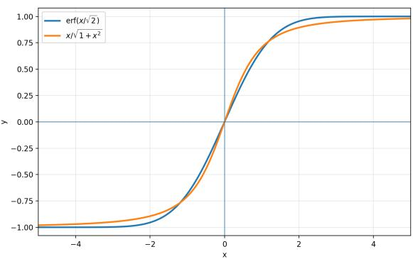
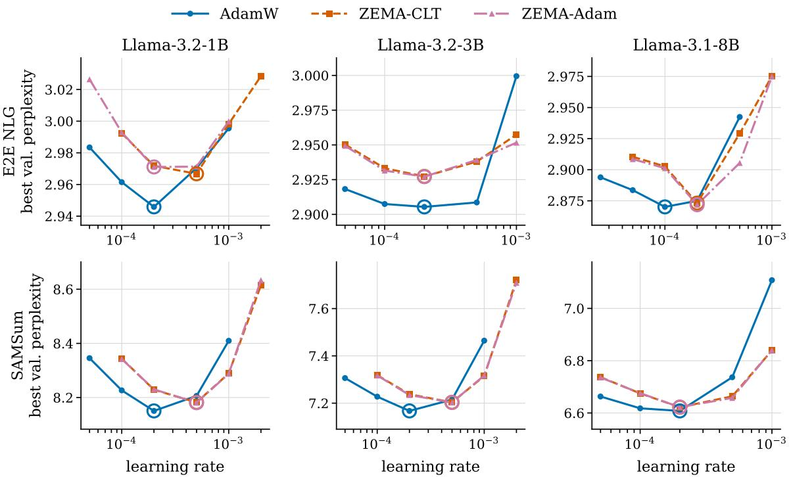
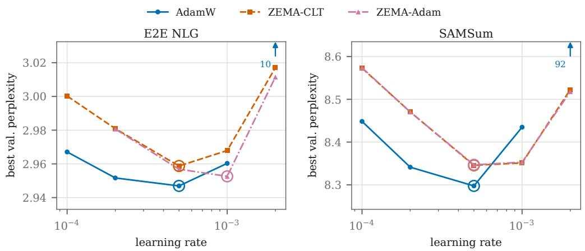
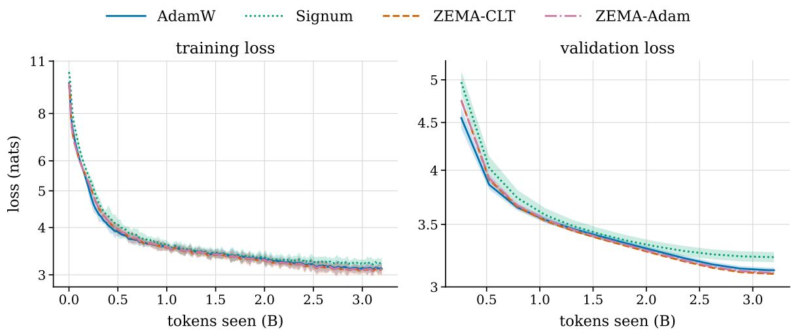
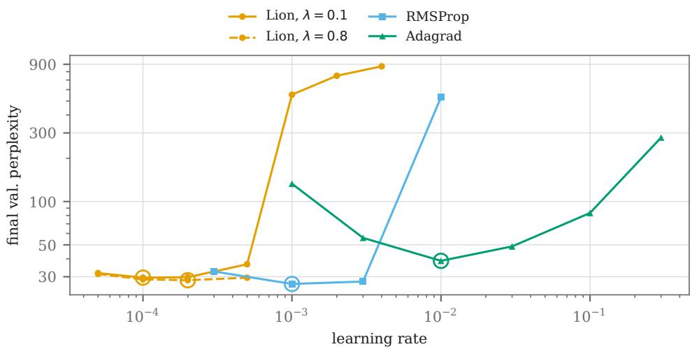
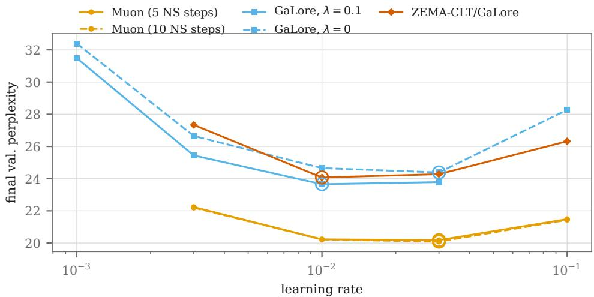
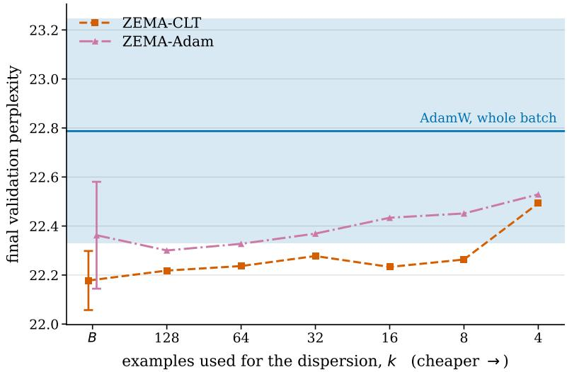

# ZEMA: confidence-calibrated signed descent with only one state.

Ali Dadsetan

Domenic Rosati

Frank Rudzicz

Dalhousie University and Vector Institute

Ali.Dadsetan@dal.ca

Domenic.Rosati@dal.ca

Frank@dal.ca

## Abstract

Recent work characterizes the Adam optimizer as sign descent modulated by gradient uncertainty: the update is the sign of the batch gradient, scaled by how strongly the batch supports that sign. We apply this view directly and introduce ZEMA (Z-score Evidence Momentum Adaptation), which measures that support with a per-coordinate zscore computed from the per-example gradients in the current batch, converts it into a sign probability, and smooths the resulting update with a single exponential moving average. Because the probability is formed before smoothing rather than after, ZEMA keeps one state per parameter instead of Adam’s two, at a 4.6% increase in per-step time; the perexample variance it requires can also be estimated from a small fraction of the batch. In fine-tuning and pretraining experiments, ZEMA is competitive with Adam, reduces the variability of the validation loss, and in some settings recovers the sign of the full-dataset gradient more consistently. We close with two directions this opens: extending confidence adaptation beyond the sign geometry, to methods such as Muon, and to diferentially private training.

## 1. Introduction

Sign descent dynamics explain a considerable part of Adam’s success Bernstein et al. (2018); Kunstner et al. (2023); Kunstner and Bach (2025); Tomihari and Sato (2025); Zhao et al. (2025), alongside recent geometric accounts that are outside the scope of this paper (Xie et al., 2025; Bernstein and Newhouse, 2024). However, sign descent methods degrade at smaller batch sizes relative to Adam Semenov et al. (2025); Kunstner et al. (2023), which suggests a greater sensitivity to gradient noise: even extensively tuned Signum underperforms Adam Orvieto and Gower (2025).

Adam as uncertainty-aware adaptation One explanation for this gap is that Adam scales its step by the uncertainty in the sign. If the sign of the stochastic batch gradient, $m _ { i } = B ^ { - 1 } \textstyle \sum _ { n } g _ { i } ^ { n }$ for per-example gradients $g _ { i } ^ { n }$ with respect to the ith parameter, is positive with probability $\rho _ { i } .$ , then the ith component of the Adam update is approximately $2 \rho _ { i } - 1 ^ { 1 }$ When the sign is deterministic, i.e., $\rho _ { i } = 0 \mathrm { o r } \rho _ { i } = 1$ , this reduces to sign descent; when both signs are equally likely, i.e., $\rho _ { i } ~ = ~ 0 . 5$ , the update is zero. Prior work interprets Adam as a three-stage procedure for estimating ρi: (i) assume a normal distribution for the stochastic batch gradient Balles and Hennig (2020); Orvieto and Gower (2025); (ii) estimate its mean and standard deviation, $m _ { i }$ and $\sigma _ { i } .$ , by variational inference, implemented as an exponential moving average (EMA) Orvieto and Gower (2025); and (iii) compute the update $2 \rho _ { i } - 1$ from these estimates using an approximation to the error function, since $2 \rho _ { i } - 1 = \mathrm { e r f } ( z _ { i } / \sqrt { 2 } ) = \mathrm { e r f } ( m _ { i } / ( \sqrt { 2 } \sigma _ { i } ) )$ for the z-score $z _ { i } = m _ { i } / \sigma _ { i }$ Balles and Hennig (2020).

Contributions. We take the magnitude of a signed update to reflect how strongly the batch supports that sign, and we measure that support per coordinate with a z-score. ZEMA computes $z _ { i }$ from the spread of the per-example gradients in the current batch, converts it to the probability $\rho _ { i }$ that the full-dataset gradient is positive, and smooths the resulting update with a single exponential moving average (Algorithm 1). Adam forms this probability after smoothing, whereas ZEMA forms it before, and therefore needs only one state per parameter. The per-example variance this requires costs 4.6% more per step (Table 14, Appendix E), and can be estimated from a small fraction of the batch (Appendix E.7). ZEMA matches AdamW on LoRA fine-tuning to within 0.04 perplexity (Table 1) and improves on it by 0.6 perplexity at 160M-parameter pretraining, at roughly a quarter of AdamW’s seed-to-seed standard deviation and at the learning rate chosen for AdamW (Table 2).

Related work Previous adaptive methods store only the first moment (Signum Bernstein et al. (2018), Lion Chen et al. (2023)) or only the second (AdaGrad Duchi et al. (2011), RMSProp Hinton et al. (2012)), whereas ZEMA keeps a single statistic, the z-score, that combines the information both provide. Muon Jordan et al. (2024), which works in a diferent geometry, and GaLore Zhao et al. (2024), which projects gradients into a lowrank subspace, are also used for training large language models, but their connection to signed descent is currently unclear and outside the scope of this paper; we include both in Appendix C.6 for a broad comparison. Variance-reduction strategies such as MARS (Yuan et al., 2024) could be applied on top of ZEMA, which we leave to future work. Finally, ours is not the first work to use per-example variance, or to motivate Adam in terms of a z-score-like statistic (Kunze et al., 2021; Balles and Hennig, 2020; Patitucci and Mokhtari, 2026), but these works do not use it to reduce the number of optimizer states, nor do they evaluate extensively in the LLM regime, where large-batch pretraining involves non-stationary gradients from rare tokens.

## 2. ZEMA: Z-score Evidence Momentum Adaptation

Adaptivity as evidence and confidence. Adam estimates $\rho _ { i }$ indirectly, through two moments smoothed across steps. We estimate it directly from the current batch. The batch-level evidence is the z-score $z _ { i } = m _ { i } / \sigma _ { i }$ , which measures how far the batch mean sits from zero relative to its sampling error. Under the Gaussian assumption, the probability that the full-dataset gradient is positive is then $\rho _ { i } = \Phi ( z _ { i } )$ , where Φ is the CDF of $\mathcal { N } ( 0 , 1 )$ ; we call this probability the confidence in the sign. The confidence-adapted sign descent direction is $u _ { i } = 2 \rho _ { i } - 1 = \mathrm { e r f } ( z _ { i } / \sqrt { 2 } )$ , which we smooth over time to obtain the direction $\hat { u } _ { i }$ we actually apply. Two changes relative to Adam follow: the evidence comes from statistics of the current batch rather than from moments accumulated across steps (Section 2.1), and the smoothing acts on the confidence rather than on the moments it is computed from (Section 2.2). The second is what leaves ZEMA with one state per parameter instead of two.

Because $\mathbb { E } [ u _ { i } ]$ vanishes when the evidence does, coordinates with weak evidence take proportionally smaller steps than under Signum (Proposition 3); and because $z _ { i }$ grows as $\sqrt { B }$ for any fixed non-zero gradient, the step saturates to the sign of the full-dataset gradient as B grows (Proposition 2). Adam’s denominator retains the variation of the gradient across steps and so does not saturate the same way (Appendix A); Appendix B.2 develops the evidence view further.

## 2.1. Estimating the z-score from batch statistics

At iteration t we estimate the standard error of the batch mean, $\sigma _ { t } .$ , from the per-example gradients (Algorithm 1, line 5). This adds computation on top of the batch gradient mt alone, but most of it can be shared with the usual backpropagation (Dangel et al., 2019, BackPack). The overhead is largest in the pretraining setting of Section 3.2, where a direct implementation costs 1.59× AdamW per step; the implementation of Appendix E reduces this to 1.046×, a 4.6% increase in per-step time (Table 14). Appendix E.7 discusses a subsampling approach that reduces the cost of the dispersion further.

The evidence is then $z _ { t } = m _ { t } / ( \sigma _ { t } + \sigma _ { 0 } )$ , clipped $\tan \pm z _ { \mathrm { m a x } }$ (line 6), where $\sigma _ { 0 } > 0$ prevents division by a vanishing standard error. It is a property of the current batch alone, with no dependence on earlier steps.

## 2.2. Smoothing the confidence over time

Two links turn $z _ { t }$ into a confidence. Equation 5 gives $\begin{array} { r } { \rho _ { t } ^ { \mathrm { C L T } } = \frac { 1 } { 2 } + \frac { 1 } { 2 } } \end{array}$ erf $\left( z _ { t } / \sqrt { 2 } \right)$ (Algorithm 1, line 8), and the rational approximation of Equation 7 gives $\pmb { \rho } _ { t } ^ { \mathrm { A d a m } } = \frac { 1 } { 2 } + \frac { 1 } { 2 } \big ( z _ { t } / \sqrt { 1 + z _ { t } ^ { 2 } } \big )$ (line 10), the form in which Adam’s own update can be written.

Since $\rho _ { t }$ is estimated from a single batch, we smooth it over time. Our variational inference formulation is

$$
\begin{array} { r } { \hat { \rho } _ { t , i } = \underset { \hat { \rho } _ { i } } { \arg \operatorname* { m i n } } \mathrm { K L } \left( \mathrm { B e r n } ( \rho _ { t , i } ^ { \mathrm { M E T H O D } } ) | | \mathrm { B e r n } ( \hat { \rho } _ { i } ) \right) + \lambda \mathrm { K L } \left( \mathrm { B e r n } ( \hat { \rho } _ { t - 1 , i } ) | | \mathrm { B e r n } ( \hat { \rho } _ { i } ) \right) } \end{array}\tag{1}
$$

whose solution is available in closed form as the exponential moving average

$$
\hat { \pmb { \rho } } _ { t } = \beta \hat { \pmb { \rho } } _ { t - 1 } + ( 1 - \beta ) \pmb { \rho } _ { t } ^ { \mathrm { M E T H O D } }\tag{2}
$$

with $\begin{array} { r } { \beta = \frac { \lambda } { 1 + \lambda } ; } \end{array}$ ; a proof is given in Appendix B.1. The update direction is $\hat { \mathbf { u } } _ { t } = 2 \hat { \rho } _ { t } - 1$ Because the smoothing and the map $\rho \mapsto 2 \rho - 1$ commute, Algorithm 1 equivalently forms ${ \mathbf { } } u _ { t } = 2 { \rho _ { t } } - 1$ first (lines 8 and 10) and smooths that instead, so uˆ is the only state it carries.

## 3. Experiments

We focus exclusively on LLM settings, where Adam has consistently been shown to be of particular importance (Kunstner et al., 2023; Tomihari and Sato, 2025; Zhang et al., 2024). In the main paper, we present both fine-tuning and pretraining settings, to show the advantages and the limitations of ZEMA; experiments on non-stationarity (rare tokens and task mixtures) are in Appendix C.3. Further experiments with diferent optimizers, with the choice of k in batch subsampling, and on computational overhead are in Appendix C. These include a probe of how often each optimizer recovers the sign of the full-dataset gradient, where ZEMA is ahead of AdamW by 9–12 points on the output head in pretraining, but not separable from it on the other tensors we probed (Appendix C.4).

Algorithm 1: ZEMA, in its CLT and Adam-shaped variants.   
Input: step size $\eta ;$ smoothing $\overline { { \beta \in [ 0 , 1 ) } } ;$ weight decay λ; $\sigma _ { 0 } , z _ { \mathrm { m a x } } ;$ link   
$\in \{ \mathrm { C L T } , \mathrm { A D A M } \}$   
Output: parameters $\pmb { \theta } _ { T }$   
1 $\hat { \pmb u } _ { 0 }  { \bf 0 }$ $/ /$ the only state, one scalar per parameter   
2 for $t \gets 1$ to $T$ do   
3 sample a batch of size $B ;$ form per-example gradients $\pmb { g } _ { t } ^ { ( 1 ) } , \ldots , \pmb { g } _ { t } ^ { ( B ) }$   
4 $\begin{array} { r } { m _ { t } \gets \frac { 1 } { B } \sum _ { n } { \pmb { g } _ { t } ^ { ( n ) } } } \end{array}$ $/ /$ batch mean   
5 $\begin{array} { r } { \pmb { \sigma } _ { t }  [ \frac { 1 } { B ( B - 1 ) } \sum _ { n } ( \pmb { g } _ { t } ^ { ( n ) } - \pmb { m } _ { t } ) ^ { 2 } ] ^ { 1 / 2 } } \end{array}$ $/ /$ standard error of $\mathbf { \nabla } m _ { t }$   
6 $z _ { t } \gets \mathrm { c l i p } \big ( m _ { t } / ( \pmb { \sigma } _ { t } + \sigma _ { 0 } ) , \pm z _ { \mathrm { m a x } } \big )$ // z-score, this batch alone   
7 if $\mathrm { l i n k } = \mathrm { C L T }$ then   
8 ${ \pmb u } _ { t } \gets \mathrm { e r f } ( z _ { t } / \sqrt { 2 } )$ $/ / \ 2 \pmb { \rho } _ { t } ^ { \mathrm { C L T } } - 1$   
9 else   
10 ${ \pmb u } _ { t } \gets z _ { t } ( 1 + z _ { t } ^ { 2 } ) ^ { - 1 / 2 }$ $/ / \ 2 \rho _ { t } ^ { \mathrm { A d a m } } - 1$   
11 end   
12 $\hat { \mathbf { u } } _ { t } \gets \beta \hat { \mathbf { u } } _ { t - 1 } + \left( 1 - \beta \right) \mathbf { u } _ { t }$ // smooth the belief, not z   
13 $\pmb { \theta } _ { t } \gets \left( 1 - \eta \lambda \right) \pmb { \theta } _ { t - 1 } - \eta \hat { \pmb { u } } _ { t }$ // decoupled decay, then step   
14 end

## 3.1. Fine-tuning

We compare both ZEMA variants against AdamW on LoRA (Hu et al., 2022) fine-tuning across three model scales—Llama-3.2-1B, Llama-3.2-3B and Llama-3.1-8B—and two generation tasks, E2E NLG (Novikova et al., 2017) and SAMSum (Gliwa et al., 2019). We add Qwen3-1.7B (Yang et al., 2025) at a single scale as a check that the result is not specific to one model family. Each optimizer is tuned on its own learning-rate grid, wide enough that the selected rate is interior, and the selected rate is then rerun with two further seeds. The setup, the rate-selection procedure, and the full sweeps are in Appendix C.1.

Table 1 reports the best validation perplexity over epochs, averaged over three seeds. Both optimizers see the same seeds, so each diference is formed per seed; the reported interval is a paired 95% Student-t interval.

The two optimizers are separated by at most 0.05 validation perplexity. Across all sixteen comparisons the gap lies between +0.009 and +0.047 perplexity, against absolute values of 2.9–3.0 on E2E and 6.6–8.3 on SAMSum, or 0.3% to 0.7%; six of the sixteen are indistinguishable from seed noise at the 95% level. We read the fine-tuning result as practical parity, with ZEMA carrying one state variable per parameter instead of two.

The seed-to-seed spread is also smaller for both ZEMA variants in four of the six Llama cells, most clearly on SAMSum at 8B (0.003 and 0.004 perplexity against AdamW’s 0.011); it is comparable at 3B/E2E and larger at 8B/E2E.

Table 1: LoRA fine-tuning: best validation perplexity over epochs, mean of three seeds. The first three blocks are a Llama scale ladder; Qwen3-1.7B is a single-scale check on a second family and its perplexities are not comparable across families. ∆ is the paired diference from AdamW at the same seed, with a 95% Student-t interval; positive favours AdamW. Learning rates are selected per cell (Appendix C.1).
<table><tr><td rowspan="2">Model</td><td rowspan="2">Optimizer</td><td colspan="2">E2E NLG</td><td colspan="2">SAMSum</td></tr><tr><td>ppl</td><td>∆ vs. AdamW</td><td>ppl</td><td>∆ vs. AdamW</td></tr><tr><td rowspan="3">Llama-3.2-1B</td><td>AdamW</td><td>2.959</td><td></td><td>8.134</td><td></td></tr><tr><td>ZEMA-CLT</td><td>2.971</td><td> $+ 0 . 0 1 1 \pm 0 . 0 3 8$ </td><td>8.173</td><td> $+ 0 . 0 3 9 \pm 0 . 0 1 7$ </td></tr><tr><td>ZEMA-Adam</td><td>2.975</td><td> $+ 0 . 0 1 5 \pm 0 . 0 2 6$ </td><td>8.172</td><td> $+ 0 . 0 3 8 \pm 0 . 0 1 7$ </td></tr><tr><td rowspan="3">Llama-3.2-3B</td><td>AdamW</td><td>2.911</td><td></td><td>7.157</td><td></td></tr><tr><td>ZEMA-CLT</td><td>2.932</td><td> $+ 0 . 0 2 1 \pm 0 . 0 1 2$ </td><td>7.197</td><td> $+ 0 . 0 4 0 \pm 0 . 0 0 8$ </td></tr><tr><td>ZEMA-Adam</td><td>2.931</td><td> $+ 0 . 0 2 0 \pm 0 . 0 1 1$ </td><td>7.194</td><td> $+ 0 . 0 3 7 \pm 0 . 0 0 7$ </td></tr><tr><td rowspan="3">Llama-3.1-8B</td><td>AdamW</td><td>2.878</td><td></td><td>6.595</td><td></td></tr><tr><td>ZEMA-CLT</td><td>2.889</td><td> $+ 0 . 0 1 1 \pm 0 . 0 1 8$ </td><td>6.622</td><td> $+ 0 . 0 2 6 \pm 0 . 0 2 6$ </td></tr><tr><td>ZEMA-Adam</td><td>2.887</td><td> $+ 0 . 0 0 9 \pm 0 . 0 1 7$ </td><td>6.621</td><td> $+ 0 . 0 2 5 \pm 0 . 0 2 4$ </td></tr><tr><td rowspan="3">Qwen3-1.7B</td><td>AdamW</td><td>2.953</td><td></td><td>8.297</td><td></td></tr><tr><td>ZEMA-CLT</td><td>2.968</td><td> $+ 0 . 0 1 5 \pm 0 . 0 2 2$ </td><td>8.344</td><td> $+ 0 . 0 4 7 \pm 0 . 0 0 6$ </td></tr><tr><td>ZEMA-Adam</td><td>2.967</td><td> $+ 0 . 0 1 4 \pm 0 . 0 2 8$ </td><td>8.343</td><td> $+ 0 . 0 4 5 \pm 0 . 0 0 9$ </td></tr></table>

## 3.2. Pretraining

For pretraining, we replicate the 160M-parameter setting of Orvieto and Gower (2025): a 162.2M-parameter decoder-only transformer trained from scratch on 3.2B tokens of SlimPajama at context 2048 and global batch 256, three seeds per arm. AdamW and Signum run at the peak learning rates that paper selects, $8 \cdot 1 0 ^ { - 3 }$ and $1 0 ^ { - 3 }$ . The two ZEMA arms are not tuned and both run at AdamW’s. Table 2 adds the three one-state coordinate-wise baselines named in Section 1—Lion, Adagrad and RMSProp—each swept on its own grid. Appendix C.2 gives the architecture, the schedule and the corpus, and Appendix C.2.1 the rate grids and the configuration choices behind these rows.

Both ZEMA variants finish ahead of AdamW, by 0.61 and 0.43 validation perplexity; both paired diferences resolve at the 95% level. ZEMA therefore matches or exceeds AdamW at AdamW’s own learning rate, with a smaller seed spread and one state variable per parameter instead of two. A second pretraining setting supports reading this as parity or better: at 9.31M parameters on TinyStories, run to the same 3.2B tokens, the two optimizers finish level (Appendix D). Both settings show the same shape over training. AdamW leads early in validation loss—by 21.5 perplexity at 0.26B tokens here—after which ZEMA catches up, takes the lead by about 1.1B tokens, and holds it to the end, finishing level on TinyStories and 0.61 ahead here (Table 4). Which optimizer is ahead therefore depends on where training stops, which is a caution for comparisons made at a fixed update budget.

ZEMA is the only one-state method in Table 2 that gives up no validation loss for the reduction; the others trail AdamW by between 2.5 and 15.5 perplexity (Appendix C.2.1).

Table 2: Pretraining, replicating the 160M setting of Orvieto and Gower (2025): final validation perplexity after 3.2B tokens, mean of three seeds. The interval on $\Delta$ is a 95% Student-t interval on the per-seed paired diference from AdamW; negative favours ZEMA. AdamW and Signum use the rates that paper reports; the ZEMA arms copy AdamW’s without a sweep; Lion, RMSProp and Adagrad are each swept on their own grid (Appendix C.2.1). All arms use weight decay 0.1. Optimizers from other families are in Appendix C.6.
<table><tr><td>Optimizer</td><td>states/param</td><td>learning rate</td><td>val. ppl</td><td>∆ vs. AdamW</td></tr><tr><td>AdamW</td><td>2</td><td> $8 { \cdot } 1 0 ^ { - 3 }$ </td><td> $2 2 . 7 9 \pm 0 . 4 6$ </td><td></td></tr><tr><td>ZEMA-CLT</td><td>1</td><td> $8 { \cdot } 1 0 ^ { - 3 }$ </td><td> ${ \bf 2 2 . 1 8 \pm 0 . 1 2 }$ </td><td> $- 0 . 6 1 \pm 0 . 5 5$ </td></tr><tr><td>ZEMA-Adam</td><td>1</td><td> $8 { \cdot } 1 0 ^ { - 3 }$ </td><td> $2 2 . 3 6 \pm 0 . 2 2$ </td><td> $- 0 . 4 3 \pm 0 . 3 6$ </td></tr><tr><td>Signum</td><td>1</td><td> $1 { \cdot } 1 0 ^ { - 3 }$ </td><td> $2 5 . 2 5 \pm 1 . 0 2$ </td><td> $+ 2 . 4 6 \pm 0 . 6 0$ </td></tr><tr><td>RMSProp</td><td>1</td><td> $1 { \cdot } 1 0 ^ { - 3 }$ </td><td> $2 6 . 7 1 \pm 0 . 1 1$ </td><td> $+ 3 . 9 3 \pm 0 . 3 9$ </td></tr><tr><td>Lion</td><td>1</td><td> $1 { \cdot } 1 0 ^ { - 4 }$ </td><td> $2 9 . 1 0 \pm 1 . 5 1$ </td><td> $+ 6 . 3 2 \pm 1 . 3 5$ </td></tr><tr><td>Adagrad</td><td>1</td><td> $1 { \cdot } 1 0 ^ { - 2 }$ </td><td> $3 8 . 3 1 \pm 1 . 2 3 $ </td><td> $+ 1 5 . 5 3 \pm 1 . 1 0$ </td></tr></table>

Keeping one state instead of two also halves what the optimizer stores: 84.9M values on the bound weights against AdamW’s 169.9M (Appendix C.6).

## 4. Conclusion

Discussion & Limitations ZEMA trades computation for memory at little to no cost in quality: it halves the optimizer state for a few percent more time per step (Appendix E), and at every endpoint we measured it is at parity with AdamW or ahead of it. Which to prefer depends on which resource is scarce—ZEMA when memory is, as in training a large model on limited VRAM, AdamW when step time is. Two limitations qualify this: the z-score is formed within a single batch, so ZEMA does not accumulate the across-step gradient variation that Adam’s second moment carries, though this costs no validation loss in our experiments; and ZEMA converges more slowly early in pretraining, with AdamW leading until about a third of the way through our longest run (Table 4, Appendix D).

Conclusion We introduce ZEMA, an uncertainty-aware sign-based algorithm for training transformer-based language models. It forms the confidence in the sign of the gradient from the statistics of the current batch rather than from moments accumulated across steps, and because that confidence is formed before smoothing, one state per parameter does the work of Adam’s two. In our experiments this costs little or nothing in quality: parity with AdamW on LoRA fine-tuning, to within 0.05 validation perplexity, and 0.61 perplexity ahead at 160M-parameter pretraining at AdamW’s own learning rate, with a smaller seedto-seed spread. Where the optimizer state is what limits training, dropping one of its two tensors for a few percent of step time is a favourable trade.

Future work We see three directions of future work. First, our work highlights that the choices inside the confidence adaptation of sign descent itself are still open. The link function assumes a Gaussian distribution for the stochastic gradient; the Student-t link noted in Appendix B.2 is one alternative, and heavier-tailed per-example distributions Battash et al. (2024) are another. The target is a choice as well: the step $2 \rho _ { i } - 1$ minimizes the mean squared error to the gradient sign (Theorem 1), and a diferent loss—a more robust one, for instance—would map the same confidence to a diferent step.

Second, the construction is not tied to the sign geometry. Operator-norm optimizers such as Muon (Jordan et al., 2024) and Shampoo Gupta et al. (2018), which can be read as steepest descent under a norm (Bernstein and Newhouse, 2024), have no built-in confidence adaptation and are in that respect closer to Signum than to Adam. Adding it requires deciding how per-coordinate evidence should scale a matrix-valued step rather than one coordinate at a time; attempts exist Si et al. (2025); Liu et al. (2026); Zhang et al. (2026, 2025), but we are not aware of a principled derivation.

Third, diferential privacy. Tang et al. (2024) show that in DP-Adam the privacy noise dominates the second moment, so that the optimizer behaves like DP-SGD unless that noise is corrected out of the denominator; from the confidence view, such a correction discards the uncertainty the noise itself introduces into the sign. A confidence formed directly from batch statistics, i.e., from the $z _ { i }$ computed in ZEMA, is a more natural target for privatization.

## References

Lukas Balles and Philipp Hennig. Dissecting Adam: The Sign, Magnitude and Variance of Stochastic Gradients, December 2020. URL http://arxiv.org/abs/1705.07774. arXiv:1705.07774 [cs].

Barak Battash, Lior Wolf, and Ofir Lindenbaum. Revisiting the noise model of stochastic gradient descent. In Sanjoy Dasgupta, Stephan Mandt, and Yingzhen Li, editors, Proceedings of The 27th International Conference on Artificial Intelligence and Statistics, volume 238 of Proceedings of Machine Learning Research, pages 4780–4788. PMLR, 02–04 May 2024. URL https://proceedings.mlr.press/v238/battash24a.html.

Jeremy Bernstein and Laker Newhouse. Old Optimizer, New Norm: An Anthology, December 2024. URL http://arxiv.org/abs/2409.20325. arXiv:2409.20325 [cs.LG].

Jeremy Bernstein, Yu-Xiang Wang, Kamyar Azizzadenesheli, and Anima Anandkumar. signSGD: Compressed Optimisation for Non-Convex Problems, August 2018. URL http: //arxiv.org/abs/1802.04434. arXiv:1802.04434 [cs.LG].

Xiangning Chen, Chen Liang, Da Huang, Esteban Real, Kaiyuan Wang, Hieu Pham, Xuanyi Dong, Thang Luong, Cho-Jui Hsieh, Yifeng Lu, et al. Symbolic discovery of optimization algorithms. Advances in neural information processing systems, 36:49205–49233, 2023.

Felix Dangel, Frederik Kunstner, and Philipp Hennig. Backpack: Packing more into backprop. arXiv preprint arXiv:1912.10985, 2019.

John Duchi, Elad Hazan, and Yoram Singer. Adaptive subgradient methods for online learning and stochastic optimization. Journal of machine learning research, 12(7), 2011.

Bogdan Gliwa, Iwona Mochol, Maciej Biesek, and Aleksander Wawer. SAMSum corpus: A human-annotated dialogue dataset for abstractive summarization. In Proceedings of the 2nd Workshop on New Frontiers in Summarization, pages 70–79, 2019.

Vineet Gupta, Tomer Koren, and Yoram Singer. Shampoo: Preconditioned stochastic tensor optimization. In International Conference on Machine Learning, pages 1842–1850. PMLR, 2018.

Geofrey Hinton, Nitish Srivastava, and Kevin Swersky. Neural networks for machine learning—lecture 6e—rmsprop: Divide the gradient by a running average of its recent magnitude, 2012.

Edward J. Hu, Yelong Shen, Phillip Wallis, Zeyuan Allen-Zhu, Yuanzhi Li, Shean Wang, Lu Wang, and Weizhu Chen. LoRA: Low-rank adaptation of large language models. In International Conference on Learning Representations, 2022.

Keller Jordan, Yuchen Jin, Vlado Boza, Jiacheng You, Franz Cesista, Laker Newhouse, and Jeremy Bernstein. Muon: An optimizer for hidden layers in neural networks, 2024. URL https://kellerjordan.github.io/posts/muon/.

Frederik Kunstner and Francis Bach. Scaling Laws for Gradient Descent and Sign Descent for Linear Bigram Models under Zipf’s Law, May 2025. URL https://arxiv.org/abs/ 2505.19227v1.

Frederik Kunstner, Jacques Chen, Jonathan Wilder Lavington, and Mark Schmidt. Noise Is Not the Main Factor Behind the Gap Between SGD and Adam on Transformers, but Sign Descent Might Be, April 2023. URL https://arxiv.org/abs/2304.13960v1.

Julius Kunze, James Townsend, and David Barber. Adaptive optimization with examplewise gradients. arXiv preprint arXiv:2112.00174, 2021.

Ziyue Liu, Ruijie Zhang, Zhengyang Wang, Yequan Zhao, Yupeng Su, Zi Yang, and Zheng Zhang. Muon2: Boosting muon via adaptive second-moment preconditioning. arXiv preprint arXiv:2604.09967, 2026.

Jekaterina Novikova, Ondˇrej Duˇsek, and Verena Rieser. The E2E dataset: New challenges for end-to-end generation. In Proceedings of the 18th Annual SIGdial Meeting on Discourse and Dialogue, pages 201–206, 2017.

Antonio Orvieto and Robert M. Gower. In Search of Adam’s Secret Sauce, December 2025. URL http://arxiv.org/abs/2505.21829. arXiv:2505.21829 [cs].

Francisco Patitucci and Aryan Mokhtari. Adaptive optimization via momentum on variancenormalized gradients. arXiv preprint arXiv:2602.10204, 2026.

Andrei Semenov, Matteo Pagliardini, and Martin Jaggi. Benchmarking Optimizers for Large Language Model Pretraining, September 2025. URL http://arxiv.org/abs/ 2509.01440. arXiv:2509.01440 [cs.LG].

Chongjie Si, Debing Zhang, and Wei Shen. Adamuon: Adaptive muon optimizer. arXiv preprint arXiv:2507.11005, 2025.

Qiaoyue Tang, Frederick Shpilevskiy, and Mathias L´ecuyer. Dp-adambc: Your dp-adam is actually dp-sgd (unless you apply bias correction). In Proceedings of the AAAI Conference on Artificial Intelligence, volume 38, pages 15276–15283, 2024.

Akiyoshi Tomihari and Issei Sato. Understanding Why Adam Outperforms SGD: Gradient Heterogeneity in Transformers, January 2025. URL http://arxiv.org/abs/2502. 00213. arXiv:2502.00213 [cs.LG] version: 1.

Shuo Xie, Mohamad Amin Mohamadi, and Zhiyuan Li. Adam exploits ℓ∞-geometry of loss landscape via coordinate-wise adaptivity. In The Thirteenth International Conference on Learning Representations, 2025.

An Yang, Anfeng Li, Baosong Yang, Beichen Zhang, Binyuan Hui, Bo Zheng, Bowen Yu, Chang Gao, Chengen Huang, Chenxu Lv, et al. Qwen3 technical report. arXiv preprint arXiv:2505.09388, 2025.

Huizhuo Yuan, Yifeng Liu, Shuang Wu, Xun Zhou, and Quanquan Gu. Mars: Unleashing the power of variance reduction for training large models. arXiv preprint arXiv:2411.10438, 2024.

Minxin Zhang, Yuxuan Liu, and Hayden Schaefer. Adagrad meets muon: Adaptive stepsizes for orthogonal updates. arXiv preprint arXiv:2509.02981, 2025.

Minxin Zhang, Yuxuan Liu, and Hayden Schaefer. Adam improves muon: Adaptive moment estimation with orthogonalized momentum. arXiv preprint arXiv:2602.17080, 2026.

Yushun Zhang, Congliang Chen, Tian Ding, Ziniu Li, Ruoyu Sun, and Zhi-Quan Luo. Why Transformers Need Adam: A Hessian Perspective, October 2024. URL http://arxiv. org/abs/2402.16788. arXiv:2402.16788 [cs].

Jiawei Zhao, Zhenyu Zhang, Beidi Chen, Zhangyang Wang, Anima Anandkumar, and Yuandong Tian. Galore: Memory-eficient llm training by gradient low-rank projection. arXiv preprint arXiv:2403.03507, 2024.

Rosie Zhao, Depen Morwani, David Brandfonbrener, Nikhil Vyas, and Sham Kakade. Deconstructing What Makes a Good Optimizer for Language Models, February 2025. URL http://arxiv.org/abs/2407.07972. arXiv:2407.07972 [cs.LG].

## Appendix A. Adam as an uncertainty-aware sign descent algorithm

In this section we review the approaches from previous literature that treat Adam as an uncertainty-aware sign descent algorithm, together with the proofs and derivations they rest on.

## A.1. Uncertainty adaptation of the sign descent algorithm

Theorem 1 (Best MSE sign estimator) Suppose g is a random variable taking values in $\mathbb { R } ^ { d }$ , and suppose sign $( g _ { i } ) \in \{ - 1 , + 1 \}$ for each i. Let

$$
[ \pmb { \rho } ] _ { i } = \rho _ { i } = \mathbb { P } \big ( \mathrm { s i g n } ( g _ { i } ) = + 1 \big ) .
$$

Then:

1. The expectation of the sign vector satisfies

$$
\mathbb { E } [ \mathrm { s i g n } ( \mathbf { g } ) ] = 2 \pmb { \rho } - 1 .\tag{3}
$$

2. Among all deterministic vectors $\pmb { x } \in \mathbb { R } ^ { d }$ , the vector minimizing the mean squared error to sign(g) is $( 2 \rho _ { 1 } - 1 , \ldots , 2 \rho _ { d } - 1 )$ . That is,

$$
\begin{array} { r } { \pmb { x } ^ { \star } = \underset { \pmb { x } \in \mathbb { R } ^ { d } } { \arg \operatorname* { m i n } } \mathbb { E } \Big [ \| \pmb { x } - \mathrm { s i g n } ( \mathbf { g } ) \| _ { 2 } ^ { 2 } \Big ] = 2 \pmb { \rho } - 1 . } \end{array}\tag{4}
$$

The proof is given in Appendix A.2 below. 2

## A.2. Proof of Theorem 1

While this theorem generalizes Balles and Hennig (2020, Lemma 1) as it does not assume that g is normally distributed, it is itself a special case of the well-known fact that the mean of a random variable is the unique minimizer of the mean squared error to that random variable. For the first statement, since sign(gi) takes the value +1 with probability $\rho _ { i }$ and the value −1 with probability $1 - \rho _ { i }$ 2

$$
\mathbb { E } [ \mathrm { s i g n } ( g _ { i } ) ] = \rho _ { i } ( + 1 ) + ( 1 - \rho _ { i } ) ( - 1 ) = 2 \rho _ { i } - 1 .
$$

Applying this argument coordinate-wise gives

$$
\mathbb { E } [ \mathrm { s i g n } ( \mathbf { g } ) ] = ( 2 \rho _ { 1 } - 1 , \ldots , 2 \rho _ { d } - 1 ) .
$$

For the second statement, let

$$
\mathbf { S } = \mathrm { s i g n } ( \mathbf { g } )
$$

and consider the objective

$$
L ( \pmb { x } ) = \mathbb { E } \big [ \| \pmb { x } - \mathbf { S } \| _ { 2 } ^ { 2 } \big ] .
$$

Expanding the squared norm,

$$
L ( \pmb { x } ) = \mathbb { E } \Big [ \| \pmb { x } \| _ { 2 } ^ { 2 } - 2 \pmb { x } ^ { \top } \mathbf { S } + \| \mathbf { S } \| _ { 2 } ^ { 2 } \Big ] .
$$

Since x is deterministic,

$$
L ( \pmb { x } ) = \| \pmb { x } \| _ { 2 } ^ { 2 } - 2 \pmb { x } ^ { \top } \mathbb { E } [ \pmb { \mathrm { S } } ] + \mathbb { E } [ \| \pmb { \mathrm { S } } \| _ { 2 } ^ { 2 } ] .
$$

The last term does not depend on x. Completing the square gives

$$
L ( \pmb { x } ) = \| \pmb { x } - \mathbb { E } [ \mathbf { S } ] \| _ { 2 } ^ { 2 } + \mathbb { E } [ \| \mathbf { S } \| _ { 2 } ^ { 2 } ] - \| \mathbb { E } [ \mathbf { S } ] \| _ { 2 } ^ { 2 } .
$$

Therefore the unique minimizer is

$$
\pmb { x } ^ { \star } = \mathbb { E } [ \mathbf { S } ] .
$$

Using the first part,

$$
\pmb { x } ^ { \star } = ( 2 \rho _ { 1 } - 1 , \ldots , 2 \rho _ { d } - 1 ) .
$$

## A.3. Distribution of sign of stochastic batch gradient

Assuming gradients are normally distributed, $g _ { i } \sim \mathcal { N } ( m _ { i } , \sigma _ { i } ^ { 2 } )$ , the probability of the sign of $g _ { i }$ being positive is given by

$$
\rho _ { i } = \mathbb { P } ( g _ { i } > 0 ) = \frac { 1 } { 2 } + \frac { 1 } { 2 } \operatorname { e r f } \left( \frac { m _ { i } } { \sqrt { 2 } \sigma _ { i } } \right) .\tag{5}
$$

A derivation of Equation 5 is given in Appendix A.4 below. Interestingly, this only depends on the ratio $\begin{array} { r } { z _ { i } = \frac { m _ { i } } { \sigma _ { i } } } \end{array}$ , and with this notation, the uncertainty-aware sign descent direction, $2 \rho _ { i } - 1$ , can be expressed as

$$
2 \rho _ { i } - 1 = \mathrm { e r f } \left( \frac { z _ { i } } { \sqrt { 2 } } \right) .\tag{6}
$$

Now, a central assumption to uncertainty-aware interpretation of Adam is the following approximation to the erf function.

$$
\mathrm { e r f } \left( \frac { z _ { i } } { \sqrt { 2 } } \right) \approx \frac { z _ { i } } { \sqrt { 1 + z _ { i } ^ { 2 } } } .\tag{7}
$$

A comparison plot for these two functions is given in Figure 1 in Appendix A.5 below.

Also, we can multiply the numerator and denominator of the approximation by $\sigma _ { i } .$ , which changes the expression to

$$
{ \frac { z _ { i } } { \sqrt { 1 + z _ { i } ^ { 2 } } } } = { \frac { m _ { i } } { \sqrt { m _ { i } ^ { 2 } + \sigma _ { i } ^ { 2 } } } } .\tag{8}
$$

Which starts to resemble the Adam update. If we expand the denominator to see that using the definition of expectation and variance we have

$$
m _ { i } ^ { 2 } + \sigma _ { i } ^ { 2 } = \mathbb { E } ( g _ { i } ) ^ { 2 } + \left( \mathbb { E } ( g _ { i } ^ { 2 } ) - \mathbb { E } ( g _ { i } ) ^ { 2 } \right) = \mathbb { E } ( g _ { i } ^ { 2 } )\tag{9}
$$

So if we replace the average of the gradient $m _ { i }$ by the EMA of the stochastic gradient, and $\sigma _ { i } ^ { 2 }$ by the EMA of the squared stochastic gradient, we get very close to the Adam update.

$$
2 \rho _ { i } - 1 \approx \frac { \mathbb { E } ( g _ { i } ) } { \sqrt { \mathbb { E } ( g _ { i } ^ { 2 } ) } } \approx \frac { \mathtt { E M A } _ { \beta _ { 1 } } [ g _ { i } ] } { \sqrt { \mathtt { E M A } _ { \beta _ { 2 } } [ g _ { i } ^ { 2 } ] } }\tag{10}
$$

The justification for the latter approximation is the topic of the next section.

## A.4. Derivation of Equation 5

Let

$$
Z = \frac { g _ { i } - m _ { i } } { \sigma _ { i } } \sim { \mathcal { N } } ( 0 , 1 ) ,\tag{11}
$$

and denote the cumulative distribution function of a standard normal random variable by Φ. Since $\sigma _ { i } > 0$ , standardizing $g _ { i }$ gives

$$
\rho _ { i } = \mathbb { P } ( g _ { i } > 0 )\tag{12}
$$

$$
= \mathbb { P } \bigg ( \frac { g _ { i } - m _ { i } } { \sigma _ { i } } > - \frac { m _ { i } } { \sigma _ { i } } \bigg )\tag{13}
$$

$$
= 1 - \Phi \left( - { \frac { m _ { i } } { \sigma _ { i } } } \right)\tag{14}
$$

$$
= \Phi \left( { \frac { m _ { i } } { \sigma _ { i } } } \right) ,\tag{15}
$$

where the last equality follows from the symmetry of the standard normal distribution. Finally, using

$$
\Phi ( x ) = \frac { 1 } { 2 } \left[ 1 + \mathrm { e r f } \left( \frac { x } { \sqrt { 2 } } \right) \right] ,\tag{16}
$$

we obtain

$$
\rho _ { i } = \frac { 1 } { 2 } + \frac { 1 } { 2 } \mathrm { e r f } \left( \frac { m _ { i } } { \sqrt { 2 } \sigma _ { i } } \right) ,\tag{17}
$$

which is Equation 5.

## A.5. Error-function Approximation

Figure 1 compares the error function with its rational approximation. In Balles and Hennig (2020), a similar plot is shown but is expressed in terms of $z _ { i } ^ { - 1 }$ , and is only shown when $z _ { i } > 0$

  
Figure 1: Comparison of the error function and its approximation.

## A.6. Adam’s EMA as variational inference

Orvieto and Gower (2025) give a variational inference interpretation of the EMA used in Adam optimizer. First, they show empirically that setting $\beta _ { 1 } = \beta _ { 2 }$ recovers most of the performance gap between Adam and Signum. Then, they formulate a variational inference problem

$$
m _ { t + 1 , i } \ \sigma _ { t + 1 , i } ^ { 2 } = \underset { m , \sigma ^ { 2 } } { \arg \operatorname* { m i n } } \ \Big [ - \log p ( g _ { t + 1 , i } \ | \ m , \sigma ^ { 2 } ) + \frac { 1 } { \lambda } \operatorname { K L } \left( \mathcal { N } ( m _ { t , i } , \sigma _ { t , i } ^ { 2 } ) | | \mathcal { N } ( m , \sigma ^ { 2 } ) \right) \Big ]\tag{18}
$$

and show that the result of plugging in the solution of this optimization problem into the equation 8 gives the same formulation of adam update, namely $\mathtt { E M A } _ { \beta } [ g _ { i } ] / \sqrt { \mathtt { E M A } _ { \beta } [ g _ { i } ^ { 2 } ] }$

This last formulation has a simple interpretation, the parameterization of the Adam update tries to fit the mean and variance of the gradient distribution to the current batch gradient, while also keeping the distribution close to the previous one. The KL divergence term acts as a smoothness penalty, and the λ parameter controls how much weight is given to the previous distribution versus the current batch gradient. This regularized variational inference approach is a design choice that we are going to use.

Note that, in Adam, first the mean and variance of the stochastic batch gradient are estimated using smoothed out variational inference, and then the signal-to-noise ratio $z _ { i }$ and the update direction $2 \rho _ { i }$ −1 are computed using Gaussian assumption and the approximation to the erf function. This ordering of operations is not necessary, and we can reverse the order of operations, and first compute $z _ { i }$ and $\rho _ { i }$ from the batch statistics, and then use variational inference to smooth out the estimated $\rho _ { i }$ over time. This is the main idea behind our new optimizer, ZEMA. By this change of ordering of operations, we can reduce the number of state variables per parameter from two to one, while maintaining the variance adaptation properties of Adam.

## Appendix B. Additional proofs and mathematical details

In this section we collect the proofs and mathematical details specific to ZEMA.

## B.1. Proof of Equation 2

The problem in Equation 1 is separable across coordinates, so fix a coordinate i and a step t, and abbreviate the two fixed probabilities and the optimization variable by

$$
\begin{array} { r } { p = \rho _ { t , i } ^ { \mathrm { M E T H O D } } , \qquad q = \hat { \rho } _ { t - 1 , i } , \qquad r = \hat { \rho } _ { i } \in ( 0 , 1 ) . } \end{array}
$$

Writing out the two Bernoulli divergences, the objective is

$$
J ( r ) = \mathrm { K L } \left( \mathrm { B e r n } ( p ) | | \mathrm { B e r n } ( r ) \right) + \lambda \mathrm { K L } \left( \mathrm { B e r n } ( q ) | | \mathrm { B e r n } ( r ) \right)\tag{19}
$$

$$
= p \log { \frac { p } { r } } + ( 1 - p ) \log { \frac { 1 - p } { 1 - r } } + \lambda \left[ q \log { \frac { q } { r } } + ( 1 - q ) \log { \frac { 1 - q } { 1 - r } } \right] .\tag{20}
$$

The terms p log $p + ( 1 - p ) \log ( 1 - p )$ and $\lambda \bigl [ q \log q + ( 1 - q ) \log ( 1 - q ) \bigr ]$ do not involve $r ;$ collecting them into a constant C and grouping the rest by log r and $\log ( 1 - r )$ gives

$$
J ( r ) = - { \bigl ( } p + \lambda q { \bigr ) } \log r - { \bigl ( } ( 1 - p ) + \lambda ( 1 - q ) { \bigr ) } \log ( 1 - r ) + C .\tag{21}
$$

Note that this is where the direction of the two divergences matters: because the optimization variable appears as the second argument of both, it enters only through log r and $\log ( 1 - r )$ , and the two fixed probabilities enter only through the coeficients.

Diferentiating Equation 21,

$$
J ^ { \prime } ( r ) = - \frac { p + \lambda q } { r } + \frac { ( 1 - p ) + \lambda ( 1 - q ) } { 1 - r } .\tag{22}
$$

Setting $J ^ { \prime } ( r ) = 0$ and multiplying by $r ( 1 - r ) > 0$

$$
\left( p + \lambda q \right) ( 1 - r ) = \left( ( 1 - p ) + \lambda ( 1 - q ) \right) r ,\tag{23}
$$

$$
p + \lambda q = r \Big [ \big ( p + \lambda q \big ) + \big ( ( 1 - p ) + \lambda ( 1 - q ) \big ) \Big ] = r ( 1 + \lambda ) ,\tag{24}
$$

where the last equality uses that the two bracketed coeficients sum to $1 + \lambda$ . Hence the unique stationary point is

$$
r ^ { \star } = \frac { p + \lambda q } { 1 + \lambda } .\tag{25}
$$

It is a minimum, and the only one: the second derivative

$$
J ^ { \prime \prime } ( r ) = \frac { p + \lambda q } { r ^ { 2 } } + \frac { ( 1 - p ) + \lambda ( 1 - q ) } { ( 1 - r ) ^ { 2 } }\tag{26}
$$

is strictly positive for every $r \in ( 0 , 1 )$ , since both coeficients are nonnegative and sum to $1 + \lambda > 0$ , so J is strictly convex on (0, 1).

Finally, substituting $\begin{array} { r } { \beta = \frac { \lambda } { 1 + \lambda } } \end{array}$ , so that $\begin{array} { r } { 1 - \beta = \frac { 1 } { 1 + \lambda } } \end{array}$ , Equation 25 reads

$$
\begin{array} { r } { \hat { \rho } _ { t , i } = \beta \hat { \rho } _ { t - 1 , i } + \left( 1 - \beta \right) \rho _ { t , i } ^ { \mathrm { M E T H O D } } , } \end{array}\tag{27}
$$

which applied coordinate-wise is Equation 2. As λ ranges over $( 0 , \infty )$ the smoothing parameter $\beta = \lambda / ( 1 + \lambda )$ ranges over (0, 1), so every smoothing level used in Algorithm 1 corresponds to some penalty weight λ.

The minimizer is interior. Equation 25 is a convex combination of p and $q ,$ so $r ^ { \star } \in ( 0 , 1 )$ whenever $p , q \in ( 0 , 1 )$ , and the argument above applies as stated. Both conditions hold in ZEMA: the z-score is clipped to $\pm z _ { \mathrm { m a x } }$ before either link function is applied (Algorithm 1, line 6), so $\rho _ { t } ^ { \mathrm { C L T } }$ and $\rho _ { t } ^ { \mathrm { A d a m } }$ are bounded away from 0 and 1, and the state is initialized at $\hat { \mathbf { u } } _ { 0 } = \mathbf { 0 }$ , that is $\begin{array} { r } { \hat { \pmb \rho } _ { 0 } = \frac { 1 } { 2 } } \end{array}$

Why the update is an average of probabilities. Had both divergences been taken in the opposite direction, with the fitted distribution as the first argument, the same calculation would have given a weighted average of the log-odds rather than of the probabilities,

$$
\log { \frac { r ^ { \star } } { 1 - r ^ { \star } } } = ( 1 - \beta ) \log { \frac { p } { 1 - p } } + \beta \log { \frac { q } { 1 - q } } ,\tag{28}
$$

with the same $\beta .$ The direction chosen in Equation 1 is therefore what makes the smoothing a plain exponential moving average in probability space.

Smoothing ρ and smoothing u agree. Because $u = 2 \rho - 1$ is afine in $\rho ,$ applying it to Equation 2 gives

$$
\hat { u } _ { t } = 2 \hat { { \rho } } _ { t } - 1 = \beta \big ( 2 \hat { { \rho } } _ { t - 1 } - 1 \big ) + ( 1 - \beta ) \big ( 2 { { \rho } } _ { t } - 1 \big ) = \beta \hat { u } _ { t - 1 } + ( 1 - \beta ) u _ { t } ,\tag{29}
$$

the same recursion with the same $\beta .$ This justifies computing the batch-level update direction first and smoothing it afterwards, which is what Algorithm 1 does.

## B.2. Two properties of the confidence-scaled step $u _ { t }$ in ZEMA

Fix a coordinate and drop the index i. The per-example gradients $g ^ { ( 1 ) } , \ldots , g ^ { ( B ) }$ are i.i.d. with mean $\mu$ and finite variance $s ^ { 2 } > 0 ;$ m is their mean, $\sigma = { s } / { \sqrt { B } }$ its standard error, $z = m / \sigma _ { ; }$ , and $u = h ( z )$ with $h ( z ) = \mathrm { e r f } ( z / \sqrt { 2 } )$ . Write $\zeta = \sqrt { B } \mu / s$ for the population evidence. All statements hold for any link h that is continuous, odd, strictly increasing and bounded by 1 with $h ( z ) \to \pm 1 \mathrm { ~ a s ~ } z \to \pm \infty$ , which includes the Adam-shaped link $z ( 1 + z ^ { 2 } ) ^ { - 1 / 2 }$ ; the closed forms are for erf.

Proposition 2 (Saturation at large batch) $I f \ \mu \ne 0$ , then $u \to \mathrm { s i g n } ( \mu )$ almost surely as $B  \infty$ . The same holds when $\sigma$ is replaced by any consistent estimate $\hat { \sigma }$

Proof By the strong law of large numbers $m \to \mu { \mathrm { ~ a . s . , ~ s o ~ } } z = { \sqrt { B } } m / s \to \operatorname { s i g n } ( \mu ) \cdot \infty { \mathrm { ~ a . s ~ } }$ Since h is continuous with $h ( z ) \to \pm 1 , h ( z ) \to \operatorname { s i g n } ( \mu )$ a.s. With $\hat { \sigma } = \hat { s } / \sqrt { B }$ and $\hat { s }  s \mathrm { a . s . } $ the ratio $m / \hat { \sigma }$ has the same limit.

Hence for every coordinate with a non-zero full-dataset gradient, the ZEMA step converges to the Signum step, and the damping in Proposition 3 disappears. Adam’s step $m / \sqrt { v }$ does not share this limit: v is a temporal average of squared batch gradients, so $v \approx \bar { \mu } ^ { 2 } + \mathrm { V a r } _ { t } ( \mu _ { t } ) + s ^ { 2 } / B$ where $\mathrm { V a r } _ { t } ( \mu _ { t } )$ is the variation of the mean gradient across steps. As $B  \infty$ the last term vanishes but the middle one does not, so $| m / \sqrt { v } |$ stays strictly below one whenever the gradient moves during training.

Proposition 3 (Damping at weak evidence) Assume the per-example gradients are Gaussian, so that $z \sim \mathcal { N } ( \zeta , 1 )$ . Then

1. $| u | < 1$ for every finite z, whereas the Signum step satisfies $| u | = 1$ ;

2. $\mathbb { E } [ u ] = \operatorname { e r f } ( \zeta / 2 )$ , which is odd, strictly increasing in $\zeta ,$ has the sign of $\mu ,$ and vanishes $a t \zeta = 0 ,$

3. at $\begin{array} { r } { \zeta = 0 , \mathbb { E } [ u ^ { 2 } ] = \frac { 1 } { 3 } } \end{array}$

Proof (1) is immediate from $| \operatorname { e r f } ( \cdot ) | < 1$ on R. For (2), write $u = 2 \Phi ( z ) - 1$ . For $z \sim \mathcal { N } ( \zeta , 1 )$ and an independent $W \sim \mathcal { N } ( 0 , 1 ) , \mathbb { E } [ \Phi ( z ) ] = \mathbb { P } ( W \le z ) = \mathbb { P } ( W - z \le 0 ) =$ $\Phi ( \zeta / \sqrt { 2 } )$ , since $W - z \sim \mathcal { N } ( - \zeta , 2 )$ . Hence $\mathbb { E } [ u ] = 2 \Phi ( \zeta / \sqrt { 2 } ) - 1 = \operatorname { e r f } ( \zeta / 2 )$ ; the listed properties are those of erf. For (3), at $\zeta = 0$ the variable $\Phi ( z )$ is uniform on (0, 1), so $\begin{array} { r } { \mathbb { E } [ ( 2 \Phi ( z ) - 1 ) ^ { 2 } ] = \mathbb { E } [ ( 2 U - 1 ) ^ { 2 } ] = \frac { 1 } { 3 } } \end{array}$

Property (2) says the expected per-coordinate step is $\eta \ \mathrm { e r f } ( \zeta / 2 )$ : the learning rate is scaled down exactly where the batch gives weak evidence, and the scaling is a fixed function of the evidence rather than of the gradient magnitude. Property (3) quantifies the damping at a stationary coordinate: ZEMA’s mean squared step there is one third of Signum’s, which is the mechanism we associate with the reduced seed-to-seed variance in Tables 1 and 2. Monotonicity in (2) holds without the Gaussian assumption for any symmetric noise, since z then belongs to a location family and h is increasing; the closed form does not. When σ is estimated from k examples, z is Student-t with $k - 1$ degrees of freedom rather than Gaussian; replacing Φ by the corresponding t distribution gives the ZEMA-t which we have not showed empirically since it performs approximately the same as ZEMA-CLT.

## Appendix C. Experimental details and additional experiments

In this section we report the fine-tuning, instruction fine-tuning and pretraining details, and add a number of additional experiments to further validate ZEMA.

## C.1. E2E and SAMSum fine-tuning details

Setup. LoRA adapters of rank 16 with $\alpha = 3 2$ are attached to seven projections per block; the base weights are frozen in bfloat16 and the adapters held in float32. E2E NLG is trained for five epochs at batch 64 with a linear schedule (3,290 steps); SAMSum for two epochs at batch 16 with a cosine schedule and 6% warmup (1,842 steps). The batch is held fixed across all four models, because the ZEMA statistic is a z-score of a B-sample mean and changing B between cells would change the estimator rather than only the model. This is also why the Qwen3-1.7B numbers here supersede any run of ours at a diferent batch: at a diferent B the arm is not the same estimator, so such runs cannot be placed on the same axis. All arms share $\beta = 0 . 9 5$ (the ZEMA smoothing and AdamW’s $\beta _ { 1 } = \beta _ { 2 } ) , \sigma _ { 0 } = 1 0 ^ { - 8 }$ and $z _ { \mathrm { m a x } } = 1 0$ . Runs are on a single NVIDIA L40S.

Selection metric. We select on the minimum validation perplexity over epochs, not the final-epoch value. On E2E every cell turns over between epochs two and four, so the finalepoch value measures where a run happened to sit on its own overfitting curve rather than the quality of the rate; ranking on it bends the sweep curves into a shape that is an artifact of the epoch budget. On SAMSum, which trains for two epochs and never turns over, the minimum and the final value coincide in every cell, so the choice changes nothing there.

Rate selection. Each optimizer is swept independently on each (model, task) cell, at a single seed, with generation metrics disabled. On the six Llama cells the initial grid is $\{ 2 , 5 \} \cdot 1 0 ^ { - 4 }$ and $\{ 1 , 2 \} \cdot 1 0 ^ { - 3 }$ ; it was then extended downwards—through $1 0 ^ { - 4 } , 5 \cdot 1 0 ^ { - 5 }$ $2 . 5 \cdot 1 0 ^ { - 5 } , 1 0 ^ { - 5 }$ and $5 \cdot 1 0 ^ { - 6 } $ —for whichever cells needed it, until every cell’s argmin had two finished grid points on each side. We adopted this counting rule rather than a significance test on the neighbouring point, because the question a bracket has to answer is whether anything below the current edge is better, not whether the edge beats its neighbour by more than noise. The two Qwen cells were swept in a single pass on the wider grid those extensions had established, $\{ 5 \cdot 1 0 ^ { - 5 } , 1 0 ^ { - 4 } , 2 \cdot 1 0 ^ { - 4 } , 5 \cdot 1 0 ^ { - 4 } , 1 0 ^ { - 3 } , 2 \cdot 1 0 ^ { - 3 } \}$ ; every argmin is interior, and all but one have two points on each side. The exception is ZEMA-Adam on E2E, whose argmin of $1 0 ^ { - 3 }$ has two points below and only one above; we report it as selected because the point above it is worse by 0.058 perplexity, roughly ten times the seed standard deviation of that cell, but it is a weaker bracket than every other cell in this table.

The selected rate is then frozen and rerun with seeds 2 and 3; it is not re-derived at report time, so a later extension of the grid cannot silently repoint a seed that has already run.

Figure 2 shows the resulting sweeps and Table 3 the rate each cell selected. The perplexities in the figure are single-seed, from the sweep stage, and are therefore not directly comparable to the three-seed means in Table 1; they establish that every optimum is interior and give the scale of one grid step. Signum was also swept on every cell but is omitted from the tables: on Llama its optimum sits an order of magnitude below every other arm and it loses at every rung, so it is not part of this comparison. We note in passing that on Qwen3-1.7B it does not lose—its paired diferences from AdamW $\mathrm { a r e + 0 . 0 0 2 \pm 0 . 0 3 2 }$ on E2E and $+ 0 . 0 0 3 \pm 0 . 0 0 6$ on SAMSum, both indistinguishable—at an optimum of $1 0 ^ { - 4 }$ , five times below AdamW’s rather than ten. We have not investigated this and do not draw a conclusion from a single model.

  
Figure 2: Learning-rate sweep, single seed. Each panel is one (model, task) cell; the marker is the best validation perplexity over epochs at that rate and the ring marks the selected rate. Each arm is shown as its optimum plus the two grid points on either side; grids were extended downwards per arm until that was possible, so the arms do not all span the same range. Note the vertical scales difer between panels.

Two features of Figure 2 are worth noting. The curves are locally flat near their minima, so on most cells one grid step costs between 0.002 and 0.02 perplexity—of the same order as, and usually larger than, the entire gap between AdamW and ZEMA in Table 1. And the two ZEMA variants track each other almost exactly at every rate, which is expected: their links, er $\div ( z / \sqrt { 2 } )$ and $z ( 1 + z ^ { 2 } ) ^ { - 1 / 2 }$ , agree closely over the range of z these runs occupy (Appendix A.5).

  
Figure 3: Qwen3-1.7B learning-rate sweep, single seed, plotted on the same conventions as Figure 2: the marker is the best validation perplexity over epochs and the ring marks the selected rate. AdamW diverges at $2 \cdot 1 0 ^ { - 3 }$ on both tasks; those two points are drawn as arrows with their values rather than clipped, since they set the top of the grid. Note the vertical scales difer between panels and from Figure 2.

Table 3: Selected learning rate per cell, from the sweeps in Figures 2 and 3. These rates are frozen and reused for the three-seed runs in Table 1.
<table><tr><td>Model</td><td>Task</td><td>AdamW</td><td>ZEMA-CLT</td><td>ZEMA-Adam</td></tr><tr><td rowspan="2">Llama-3.2-1B</td><td>E2E</td><td> $2 { \cdot } 1 0 ^ { - 4 }$ </td><td> $5 { \cdot } 1 0 ^ { - 4 }$ </td><td> $2 { \cdot } 1 0 ^ { - 4 }$ </td></tr><tr><td>SAMSum</td><td> $2 { \cdot } 1 0 ^ { - 4 }$ </td><td> $5 { \cdot } 1 0 ^ { - 4 }$ </td><td> $5 { \cdot } 1 0 ^ { - 4 }$ </td></tr><tr><td rowspan="2">Llama-3.2-3B</td><td>E2E</td><td> $2 { \cdot } 1 0 ^ { - 4 }$ </td><td> $2 { \cdot } 1 0 ^ { - 4 }$ </td><td> $2 { \cdot } 1 0 ^ { - 4 }$ </td></tr><tr><td>SAMSum</td><td> $2 { \cdot } 1 0 ^ { - 4 }$ </td><td> $5 { \cdot } 1 0 ^ { - 4 }$ </td><td> $5 { \cdot } 1 0 ^ { - 4 }$ </td></tr><tr><td rowspan="2">Llama-3.1-8B</td><td>E2E</td><td> $1 { \cdot } 1 0 ^ { - 4 }$ </td><td> $2 { \cdot } 1 0 ^ { - 4 }$ </td><td> $2 { \cdot } 1 0 ^ { - 4 }$ </td></tr><tr><td>SAMSum</td><td> $2 { \cdot } 1 0 ^ { - 4 }$ </td><td> $2 { \cdot } 1 0 ^ { - 4 }$ </td><td> $2 { \cdot } 1 0 ^ { - 4 }$ </td></tr><tr><td rowspan="2">Qwen3-1.7B</td><td>E2E</td><td> $5 { \cdot } 1 0 ^ { - 4 }$ </td><td> $5 { \cdot } 1 0 ^ { - 4 }$ </td><td> $1 { \cdot } 1 0 ^ { - 3 }$ </td></tr><tr><td>SAMSum</td><td> $5 { \cdot } 1 0 ^ { - 4 }$ </td><td> $5 { \cdot } 1 0 ^ { - 4 }$ </td><td> $5 { \cdot } 1 0 ^ { - 4 }$ </td></tr></table>

## C.2. SlimPajama details

Setup. A decoder-only transformer with 12 layers, $d _ { \mathrm { m o d e l } } = 7 6 8$ , 12 heads, SwiGLU feed-forward of width 2048, RoPE, context 2048 and an untied embedding and output head over the GPT-NeoX 50,280-token vocabulary: 162,183,936 parameters, matching the configuration of Orvieto and Gower (2025). Global batch 256 sequences (8 micro-batches of 8 on each of four ranks), 6,103 steps, 3.2B tokens. Linear warmup over 610 steps then cosine decay to $1 0 ^ { - 5 } \colon$ ; weight decay 0.1 on matrices only, gradient clipping 1.0, and $\beta = 0 . 9 5$ for every arm—AdamW in the equal- $\cdot \beta _ { 1 } = \beta _ { 2 }$ form that paper identifies as the strong baseline. Four NVIDIA L40S.

As in the fine-tuning campaign the ZEMA arms are hybrid: the estimator covers the body linears (84.9M parameters) while the embedding, the untied head and the norm gains stay on AdamW at the same rate, leaving each arm a single learning-rate knob.

Corpus. The paper’s cerebras/SlimPajama-627B no longer resolves, so we use instead DKYoon/SlimPajama-6B, a published subset of the same source corpus, with its own held-out validation split (9.2M tokens) rather than a resampled tail of the training data.

What was and was not tuned. AdamW at $8 \cdot 1 0 ^ { - 3 }$ and Signum at $1 0 ^ { - 3 }$ are the rates Orvieto and Gower (2025) select at this scale; we ran no search of our own. The ZEMA arms have no published rate to copy, and rather than sweep them—which would have given them an advantage the baselines did not get—both were run at AdamW’s rate. The result in Table 2 is therefore a lower bound on what ZEMA does here.

Distance from the published number. Our AdamW reaches $2 2 . 7 9 \pm 0 . 4 6$ against the 21.86 that paper reports, so this setup runs somewhat harder than theirs—plausibly the corpus substitution above. That ofset applies to every arm equally and does not afect the within-table comparison, which is why Table 2 is reported as paired diferences against our own AdamW rather than against the published value.

Distributed correctness. All four arms trained on four L40S under DDP. The ZEMA arms do not use DistributedDataParallel: the bound weights carry no .grad, and their evidence statistic is pooled across ranks by a hand-written all-reduce, verified against a single-GPU run to $4 \cdot 1 0 ^ { - 8 }$ relative error in fp32 before the campaign was launched.

Curves. Figure 4 shows the full trajectories. Signum separates from the other three within the first 0.5B tokens and never rejoins them; AdamW and the two ZEMA arms stay together until roughly 1.5B, after which the ZEMA curves sit marginally below. The seed bands are widest early and narrow as the runs converge—at the end the ZEMA-CLT band is about a fifth the width of AdamW’s, the same ordering of seed-to-seed spread that Table 2 reports.

Paired diferences over the run. Table 4 tabulates what Figure 4 plots, as paired diferences at matched seed. The run has the same three phases as the TinyStories campaign of Appendix D: AdamW leads by 21.45 perplexity at the first checkpoint, the arms cross at about 1.1B tokens, and from 1.31B onward all three seeds favour ZEMA-CLT at every checkpoint. The diference then settles at −0.6 perplexity and stays there, resolving at the 95% level over the final four checkpoints. Unlike TinyStories, where the gap closes as the cosine anneals, here it persists to the endpoint of Table 2.

  
Figure 4: Training and validation loss over the replication run, mean of three seeds, on a logarithmic vertical scale. The shaded band is the 95% Student-t interval on the seed mean, the same interval as Table 2. Training loss is logged every 10 steps and is shown under a centred 50-step rolling mean, applied identically to the mean and to both band edges; validation is evaluated every 500 steps and is unsmoothed.

Table 4: SlimPajama, validation perplexity against token budget, three seeds per cell. ∆ is ZEMA-CLT minus AdamW at matched seed, with a two-sided 95% t-interval over the three paired diferences; negative favours ZEMA. The final column counts seeds favouring ZEMA. Bold marks intervals excluding zero. ZEMA-t2 is shown for reference and does not enter the paired test. The final row is the endpoint reported in Table 2.
<table><tr><td>Tokens</td><td>AdamW</td><td>ZEMA-CLT</td><td>ZEMA-t2</td><td>Δ</td><td>95% CI</td><td>seeds</td></tr><tr><td>0.26B</td><td>94.76</td><td>116.22</td><td>115.84</td><td>+21.45</td><td>[+8.18, +34.73]</td><td>0/3</td></tr><tr><td>0.52B</td><td>47.49</td><td>49.94</td><td>50.57</td><td>+2.45</td><td>[−0.60, +5.50]</td><td>0/3</td></tr><tr><td>0.79B</td><td>38.49</td><td>38.73</td><td>39.24</td><td>+0.24</td><td>[−1.46, +1.94]</td><td>1/3</td></tr><tr><td>1.05B</td><td>34.50</td><td>34.20</td><td>34.64</td><td>-0.29</td><td>[−1.64, +1.06]</td><td>1/3</td></tr><tr><td>1.31B</td><td>31.90</td><td>31.37</td><td>31.70</td><td>-0.52</td><td>[−1.50, +0.46]</td><td>3/3</td></tr><tr><td>1.57B</td><td>29.89</td><td>29.26</td><td>29.52</td><td>-0.62</td><td>[−1.54, +0.30]</td><td>3/3</td></tr><tr><td>1.83B</td><td>28.09</td><td>27.48</td><td>27.71</td><td>-0.61</td><td>[−1.44, +0.22]</td><td>3/3</td></tr><tr><td>2.10B</td><td>26.49</td><td>25.85</td><td>26.07</td><td>-0.64</td><td>[−1.36, +0.08]</td><td>3/3</td></tr><tr><td>2.36B</td><td>25.02</td><td>24.40</td><td>24.59</td><td>-0.63</td><td>[−1.29, +0.03]</td><td>3/3</td></tr><tr><td>2.62B</td><td>23.84</td><td>23.22</td><td>23.41</td><td>-0.62</td><td>[−1.21, −0.03]</td><td>3/3</td></tr><tr><td>2.88B</td><td>23.07</td><td>22.45</td><td>22.64</td><td>-0.62</td><td>[−1.18, -0.05]</td><td>3/3</td></tr><tr><td>3.15B</td><td>22.80</td><td>22.19</td><td>22.37</td><td>-0.61</td><td>[−1.16, −0.06]</td><td>3/3</td></tr><tr><td>3.20B</td><td>22.79</td><td>22.18</td><td>22.36</td><td>-0.61</td><td>[−1.16, −0.06]</td><td>3/3</td></tr></table>

## C.2.1. SlimPajama learning-rate selection

Every rate in Table 2 is either taken from Orvieto and Gower (2025) or is the argmin of a sweep at seed 1 over the grid below. We report the whole grid, not only the winner: a rate quoted without its neighbours cannot be checked, and a selection procedure that stops at the first interior-looking point is exactly how a sweep reports a boundary as an optimum. Every argmin below is interior to its own grid. Table 5 lists the values and Figure 5 plots them.

Table 5: Pretraining learning-rate sweeps. Validation perplexity at seed 1; ∗ marks the selected rate, which is then rerun with seeds 2 and 3. AdamW and Signum are not swept—they use the rates Orvieto and Gower (2025) reports—and the ZEMA arms deliberately copy AdamW’s rate, so that the arm is the only thing that difers from the baseline.
<table><tr><td>Arm</td><td colspan="6">validation perplexity by learning rate (seed 1)</td></tr><tr><td>Lion, λ = 0.1</td><td>31.8 *29.6 29.8 5.10-5</td><td>10-4 2.10-4</td><td>36.7 5.10-4</td><td>554 10⁻3</td><td>749 2.10-3</td><td>871 4.10-3</td></tr><tr><td>Lion,  $\lambda = 0 . 8$ </td><td>5.10-5</td><td>31.4 28.8 *28.4 29.5 10-4 2.10-4</td><td>5.10-4</td><td></td><td></td><td></td></tr><tr><td>RMSProp</td><td>3.10-4</td><td>32.7 *26.7 27.8 10⁻3 3.10-3</td><td>531 10⁻2</td><td></td><td></td><td></td></tr><tr><td>Adagrad</td><td>133 10-3</td><td>55.9 *38.7 3.10-3 10-2</td><td>48.8 3.10-2</td><td>83.3 10⁻¹</td><td>279 3.10-1</td><td></td></tr></table>

Lion’s grid is an order of magnitude below its published one. Lion’s recommended rate for language-model pretraining is 3–10× smaller than AdamW’s, which at AdamW’s $8 \cdot 1 0 ^ { - 3 }$ would put it near $1 0 ^ { - 3 }$ . Every rate in that band diverged here: $1 0 ^ { - 3 } , 2 \cdot 1 0 ^ { - 3 }$ and $4 \cdot 1 0 ^ { - 3 }$ finish at perplexity 554, 749 and 871. The grid had to be moved a full decade down before Lion trained at all, and its optimum sits at $1 0 ^ { - 4 }$ , 80× below AdamW’s. We report this because a reader reproducing Lion from its published guidance at this scale will see divergence, not a weak result.

Weight decay: $\lambda = 0 . 1$ is reported, $\lambda = 0 . 8$ is a control. Lion is normally run with a decoupled decay several times larger than $\mathrm { A d a m W } \mathrm { : }$ , because its update is a sign and so has a fixed magnitude that does not shrink as gradients do. Table 2 reports $\lambda = 0 . 1$ , the value every other arm uses, so that the table varies one thing. We also ran Lion’s own $\lambda = 0 . 8$ with its own sweep: it selects $2 \cdot 1 0 ^ { - 4 }$ and reaches $2 7 . 9 7 \pm 1 . 5 3$ , a paired improvement of $1 . 1 3 \pm 0 . 2 4$ over the matched-decay row. So the larger decay does help, and materially—but it does not change the ordering in Table 2, where Lion trails AdamW by $6 . 3 2 ; \lambda = 0 . 8$ would still trail by 5.19. Promoting the $\lambda = 0 . 8$ row into the main table would silently put an 8× regularization diference inside a comparison whose point is that only the optimizer changes.

Lion with $\beta _ { 1 } = \beta _ { 2 }$ is Signum, exactly. This is an algebraic identity, not an approximation, and it is worth stating because it constrains what a Lion baseline can show. Lion forms its update from an interpolation and then updates its momentum,

$$
u _ { t } = \mathrm { s i g n } \bigl ( \beta _ { 1 } m _ { t - 1 } + ( 1 - \beta _ { 1 } ) g _ { t } \bigr ) , \qquad m _ { t } = \beta _ { 2 } m _ { t - 1 } + ( 1 - \beta _ { 2 } ) g _ { t } .
$$

  
Figure 5: Pretraining sweeps for the tuned baselines of Table 2; the ring marks the selected rate and the values are those of Table 5. Both axes are logarithmic. A linear vertical axis is unusable here: the diverged cells reach perplexity 871 against optima near 30, and the divergence is the finding for Lion rather than something to clip away. A weight decay is a knob on an optimizer and not a diferent optimizer, so Lion’s two decays share a colour and are separated by the dash pattern. Note that the arms operate at genuinely diferent rate scales—Lion’s optimum is 80× below AdamW’s and Adagrad’s is above it—which is why the horizontal span is so wide.

Setting $\beta _ { 1 } = \beta _ { 2 } = \beta$ makes the two expressions the same tensor, so $u _ { t } = \mathrm { s i g n } ( m _ { t } )$ with $m _ { t }$ the Signum momentum: the arms coincide for every input, at every step. Running Lion at the $\beta = 0 . 9 5$ this paper’s other arms share would therefore not have produced a Lion baseline at all, only a second copy of the Signum row. Lion is run at its own published $( \beta _ { 1 } , \beta _ { 2 } ) \ = \ ( 0 . 9 , 0 . 9 9 )$ for this reason, and it is the one arm in Table 2 not matched to $\beta = 0 . 9 5$

Adagrad has no decay to match. Adagrad accumulates an undecayed sum of squared gradients; adding a decay to it is what makes it RMSProp. It therefore has no β to set to 0.95, and the two arms together span that axis: RMSProp is the same second-moment normalization at $\rho = 0 . 9 5$ , and is also exactly AdamW at $\beta _ { 1 } = \beta _ { 2 } = 0 . 9 5$ with the first moment removed. That makes the pair a clean ablation of the two AdamW moments taken separately, which is how they should be read—not as competitive optimizers at this scale.

Reading the one-state baselines. The four one-state arms of Table 2 separate widely, and which moment they keep does not predict where they land: keeping a first moment and taking its sign gives 25.25 (Signum) and 29.10 (Lion), while keeping a second and normalizing by it gives 26.71 (RMSProp) and 38.31 (Adagrad). Signum is the informative arm, as the one that takes the sign without scaling it by a confidence: its 2.46 deficit is what dropping that scaling costs in this setting (Appendix A.1). ZEMA’s single state is of a diferent kind from any of these—the smoothed confidence, formed from the batch mean and its standard error together—which is why it is the only one-state arm in the table that does not pay for the reduction.

Table 6: Validation perplexity for instruction fine-tuning at fixed update count (48 steps), with the independently selected learning rate for each cell. ∆ is ZEMA-CLT minus AdamW; positive values favour AdamW. † marks a cell whose selected learning rate is the largest searched, so its optimum is not bracketed above.
<table><tr><td>Batch</td><td>AdamW</td><td>lr</td><td>ZEMA-CLT</td><td>lr</td><td>∆</td><td>Δ%</td></tr><tr><td colspan="7">Tulu-3 drift, Qwen2.5-0.5B, rank-8 LoRA</td></tr><tr><td>8</td><td>2.4568</td><td> $4 \times 1 0 ^ { - 4 }$ </td><td>2.4594</td><td> $1 \times 1 0 ^ { - 3 }$ </td><td>+0.0026</td><td>+0.11</td></tr><tr><td>32</td><td>2.4247</td><td> $2 \times 1 0 ^ { - 4 }$ </td><td>2.4266</td><td> $5 \times 1 0 ^ { - 4 }$ </td><td>+0.0019</td><td>+0.08</td></tr><tr><td>128</td><td>2.3968</td><td> $5 \times 1 0 ^ { - 4 }$ </td><td>2.3915</td><td> $1 \times 1 0 ^ { - 3 }$ </td><td>-0.0053</td><td>-0.22</td></tr><tr><td>512</td><td>2.3739</td><td> $5 \times 1 0 ^ { - 4 }$ </td><td>2.3720</td><td> $1 \times 1 0 ^ { - 3 }$ </td><td>-0.0020</td><td>-0.08</td></tr><tr><td colspan="7">MATH rare-token split, Llama-3.2-1B, rank-16 LoRA</td></tr><tr><td>8</td><td>2.7018</td><td> $2 \times 1 0 ^ { - 4 }$ </td><td>2.6997</td><td> $1 \times 1 0 ^ { - 3 }$ </td><td>-0.0021</td><td>-0.08</td></tr><tr><td>32</td><td>2.6364</td><td> $5 \times 1 0 ^ { - 4 }$ </td><td>2.6373</td><td> $2 \times 1 0 ^ { - 3 }$ </td><td>+0.0009</td><td>+0.03</td></tr><tr><td>128</td><td>2.5503</td><td> $1 \times 1 0 ^ { - 3 }$ </td><td>2.5577</td><td> $2 \times 1 0 ^ { - 3 }$ </td><td>+0.0074</td><td>+0.29</td></tr><tr><td>512</td><td>2.5116</td><td> $1 \times 1 0 ^ { - 3 }$ </td><td> $2 . 5 1 6 5 ^ { \dagger }$ </td><td> $2 \times 1 0 ^ { - 3 }$ </td><td>+0.0048</td><td>+0.19</td></tr></table>

## C.3. Instruction fine-tuning details (MATH and TULU)

In this section we present additional instruction fine-tuning experiments to evaluate nonstationarity. Instruction fine-tuning illustrates this because task mixtures can introduce significant drift (TULU) and rare tokens (MATH). We fine-tune Qwen2.5-0.5B (non-instructiontuned) on a controlled dialogue/math/code Tulu-3 drift mixture using rank-8 LoRA adapters (4.40M trainable parameters, sequence length 512, 128 validation examples per source), and Llama-3.2-1B on the rare-token MATH split using rank-16 LoRA adapters (11.27M trainable parameters, sequence length 1024, 754 validation examples). Each cell performs exactly 48 optimizer updates at a global batch drawn from {8, 32, 128, 512}, drawing examples with replacement where the cell’s example budget exceeds the dataset, and is evaluated at eight checkpoints; we report the best validation loss over those checkpoints, exponentiated to a token-level perplexity. Adapters are held in float32 with weight decay 0.01 and β = 0.95 for both optimizers. Both campaigns use a single selection seed (11), so the tables below carry no confidence intervals and diferences should be compared against the scale of seed variation rather than treated as resolved.

In the parameter-eficient setting the two optimizers are indistinguishable. Every difference in Table 6 falls within ±0.3%, and the sign is not consistent: ZEMA is nominally ahead at the two largest Tulu-3 batches and at the smallest MATH batch, behind elsewhere. With a single selection seed these margins are smaller than the seed variation one should expect from a 48-update run, and we therefore read the fine-tuning results as parity rather than as evidence for either method. Two observations survive this caveat. First, the fixed-update budget removes the large-batch degradation seen in the fixed-token setting: ZEMA does not fall behind as the batch grows, and at B = 128 and B = 512 on Tulu-3 it is marginally ahead, so the degradation reported elsewhere is at least partly attributable to update count rather than to batch size as such. Second, ZEMA’s selected learning rate is consistently two to four times AdamW’s at matched batch, a systematic ofset rather than per-cell scatter; a shared grid would have handicapped ZEMA, and we recommend independent selection for any comparison of this kind. We note that the MATH B = 512 ZEMA cell remains unbracketed above, so its already small deficit may narrow further.

Table 7: Sign agreement with a fixed 256-sequence oracle on SlimPajama, global batch 256, three seeds. At the first probe the two optimizers’ state is still identical by construction, so the matching accuracies there serve as a sanity check on the setup.
<table><tr><td></td><td colspan="3">Body QKV</td><td colspan="3">Output head</td></tr><tr><td>Step</td><td>AdamW</td><td>ZEMA-CLT</td><td> $\Delta$ </td><td>AdamW</td><td>ZEMA-CLT</td><td> $\Delta$ </td></tr><tr><td>1</td><td>68.30</td><td>68.30</td><td> $+ 0 . 0 0 \pm 0 . 0 0$ </td><td>69.84</td><td>69.84</td><td> $+ 0 . 0 0 \pm 0 . 0 0$ </td></tr><tr><td>48</td><td>50.38</td><td>55.30</td><td> $+ 4 . 9 2 \pm 7 . 6 0$ </td><td>52.34</td><td>61.68</td><td> $\mathbf { + 9 . 3 5 \pm 0 . 9 0 }$ </td></tr><tr><td>96</td><td>53.53</td><td>54.62</td><td> $+ 1 . 0 9 \pm 3 . 2 5$ </td><td>54.09</td><td>63.68</td><td> $\mathbf { + 9 . 5 9 \pm 0 . 7 3 }$ </td></tr><tr><td>144</td><td>55.44</td><td>51.62</td><td> $- 3 . 8 2 \pm 5 . 6 5$ </td><td>52.20</td><td>63.73</td><td> $\mathbf { + 1 1 . 5 3 \pm 0 . 6 7 }$ </td></tr><tr><td>190</td><td>56.13</td><td>53.65</td><td> $- 2 . 4 8 \pm 6 . 3 7$ </td><td>52.69</td><td>62.10</td><td> ${ \bf \tau } + { \bf 9 . 4 1 \pm 1 . 4 5 }$ </td></tr></table>

## C.4. Sign estimation accuracy in SlimPajama pre-training

To isolate sign estimation from trajectory divergence, a separate probe trains one shared AdamW trajectory. At every checkpoint, shadow AdamW and ZEMA states receive the same training batch at the same parameter vector; neither shadow state changes the trajectory. We instrument the QKV matrix in block zero and the untied output head. The reference direction is a deterministic held-out gradient, disjoint from training and reused at every checkpoint to compute the trget gradient at that checkpoint.

For direction d and held-out gradient $g ^ { \star }$ , accuracy is the coordinate mean of 1 $\{ \mathrm { s i g n } ( d _ { i } ) =$ $\mathrm { s i g n } ( g _ { i } ^ { \star } ) \}$ . The $\Delta$ columns are ZEMA minus AdamW in absolute percentage points; positive values favour ZEMA.

We run the probe on a SlimPajama model (12 layers, $d _ { \mathrm { m o d e l } } = 7 6 8$ , 12 heads, FFN width 2048, vocabulary 50,280, context 2048) trained at global batch 256 for 100M tokens, probing every 48 updates against a fixed 256-sequence oracle, with three seeds. Table 7 reports every probe rather than only the last, since the two layer groups evolve diferently over training.

The two layer groups separate sharply. The output head shows a large and stable gain, between +9.4 and +11.5 points at every probe after the first, with seed standard deviations below 1.5 points; this is the clearest sign-recovery result we obtain anywhere. Body QKV, by contrast, is not separable from zero at any probe: the seed standard deviation exceeds the mean at all four, and the point estimate changes sign over training, drifting from +4.92 at step 48 to −2.48 at step 190. We therefore report a sign-recovery advantage for this model only on the output head, and explicitly not on the body, and we do not claim a general mechanism.

Table 8: Sign agreement on LoRA adapter tensors at the final probe, three seeds. Tensor names abbreviate lora B projections by layer index.
<table><tr><td>Task</td><td>Tensor</td><td>AdamW</td><td>ZEMA-CLT</td><td>∆</td></tr><tr><td>E2E</td><td>L0 q-proj</td><td>51.50</td><td>51.29</td><td> $- 0 . 2 1 \pm 0 . 4 3$ </td></tr><tr><td>E2E</td><td>L31 down_proj</td><td>51.61</td><td>51.54</td><td> $- 0 . 0 7 \pm 0 . 6 0$ </td></tr><tr><td>SAMSum</td><td>L0 q-proj</td><td>48.28</td><td>48.82</td><td> $+ 0 . 5 4 \pm 0 . 4 4$ </td></tr><tr><td>SAMSum</td><td>L31 down-proj</td><td>52.58</td><td>52.05</td><td> $- 0 . 5 4 \pm 0 . 3 6$ </td></tr><tr><td>E2E</td><td>pooled</td><td></td><td></td><td> $- 0 . 1 4 \pm 0 . 3 7$ </td></tr><tr><td>SAMSum</td><td>pooled</td><td></td><td></td><td> $+ 0 . 0 0 \pm 0 . 3 7$ </td></tr></table>

## C.5. Sign estimation accuracy in fine-tuning

We repeat the probe on the LoRA setting of the main text: Llama-3.1-8B-Instruct SAMSum (B = 16, 1,842 updates), probing every 460 updates against a 64-example oracle with three seeds. Two adapter tensors are tracked, an early attention projection and a late MLP projection.

Neither method recovers held-out gradient signs on adapter tensors: absolute accuracies lie between 48.3% and 52.6%, that is, within a few points of chance, and every diference is smaller than its seed standard deviation. The pooled efect is $- 0 . 1 4 \pm 0 . 3 7$ points on E2E and $+ 0 . 0 0 \pm 0 . 3 7$ on SAMSum. We read this as a null result rather than as weak evidence in either direction, and note that where ZEMA governs only a thin adapter atop a frozen backbone, it achieves nothing measurable. Sign recovery on LoRA adapters should not be ofered as evidence for the method.

## C.6. Optimizers from other families: Muon, GaLore, and ZEMA inside GaLore

The arms in this appendix are not coordinate-wise sign methods, so they do not belong in Table 2; but they are the two best-known ways to train a transformer on less than two optimizer states per parameter, and leaving them out would make the memory claim in this paper look less contested than it is. They run in the identical setting: same architecture, corpus, schedule, batch, decay and three seeds.

All three use the same hybrid split ZEMA uses. Only the 84.9M body linear weights (52.4% of the model) go to the arm; the embedding, the untied head and the norms stay on AdamW, because Muon and GaLore both require matrices and neither the reference implementations nor ours applies them to an embedding table. State totals therefore include an AdamW pair on the remaining 77.2M parameters.

Muon. One momentum bufer per matrix, whose direction is replaced by its nearest semiorthogonal matrix through a five-step Newton–Schulz iteration in bfloat16, at the reference coeficients. It is the same one-state budget as ZEMA and it wins this comparison outright, by 2.65 perplexity against AdamW, four times ZEMA’s margin. We report this plainly because it bounds what the rest of the paper claims: a single state per parameter is clearly suficient to beat Adam at this scale, and ZEMA is not the only way to get there. What ZEMA and Muon do is diferent in kind—Muon changes the geometry the step is measured in, and is defined only for matrices; ZEMA changes the per-coordinate scale, and applies to any parameter—and nothing in our results says the two cannot be combined. Its rate was swept on $\{ 3 \cdot 1 0 ^ { - 3 } , 1 0 ^ { - 2 } , 3 \cdot \overset { \cdot } { 1 } 0 ^ { - 2 } , 1 0 ^ { - 1 } \}$ , selecting $3 \cdot 1 0 ^ { - 2 }$ (perplexities 22.2, 20.2, ∗20.2,

Table 9: Optimizers from other families, same setting as Table 2: final validation perplexity after 3.2B tokens, mean of three seeds, 95% Student-t interval on the per-seed paired diference. “Body state” counts optimizer coordinates over the 84.9M body weights; “total” adds the AdamW pair carried on the remaining 77.2M parameters. AdamW and ZEMA-CLT are repeated from Table 2 for reference.
<table><tr><td>Optimizer</td><td>lr</td><td>body state</td><td>total state</td><td>val. ppl</td><td>∆ vs. AdamW</td></tr><tr><td>AdamW</td><td> $8 { \cdot } 1 0 ^ { - 3 }$ </td><td>169.9M</td><td>324.4M</td><td> $2 2 . 7 9 \pm 0 . 4 6$ </td><td></td></tr><tr><td>ZEMA-CLT</td><td> $8 { \cdot } 1 0 ^ { - 3 }$ </td><td>84.9M</td><td>239.4M</td><td> $2 2 . 1 8 \pm 0 . 1 2$ </td><td> $- 0 . 6 1 \pm 0 . 5 5$ </td></tr><tr><td>Muon</td><td> $3 { \cdot } 1 0 ^ { - 2 }$ </td><td>84.9M</td><td>239.4M</td><td> ${ \bf 2 0 . 1 4 \pm 0 . 1 1 }$ </td><td> $- 2 . 6 5 \pm 0 . 4 0$ </td></tr><tr><td>GaLore</td><td> $1 { \cdot } 1 0 ^ { - 2 }$ </td><td>73.1M</td><td>227.6M</td><td> $2 3 . 5 8 \pm 0 . 2 2$ </td><td> $+ 0 . 7 9 \pm 0 . 2 8$ </td></tr><tr><td>ZEMA-CLT/GaLore</td><td> $1 { \cdot } 1 0 ^ { - 2 }$ </td><td>44.8M</td><td>199.3M</td><td> $2 4 . 1 0 \pm 0 . 0 7$ </td><td> $+ 1 . 3 1 \pm 0 . 5 2$ </td></tr><tr><td>ZEMA-Adam/GaLore</td><td> $1 { \cdot } 1 0 ^ { - 2 }$ </td><td>44.8M</td><td>199.3M</td><td> $2 4 . 1 4 \pm 0 . 0 9$ </td><td> $+ 1 . 3 6 \pm 0 . 5 4$ </td></tr></table>

  
Figure 6: Pretraining sweeps for the arms of Table 9; the ring marks the selected rate. Every argmin is interior to its own grid. As in Figure 5, a variant of an optimizer keeps that optimizer’s colour and is separated by the dash pattern: Muon’s two Newton–Schulz depths lie within 0.10 perplexity of each other at every rate, which is why the five-step reference configuration is the one reported, and GaLore’s two weight decays select diferent rates. ZEMA-CLT/GaLore carries ZEMA-CLT’s colour from Table 2 because it is that arm, run inside GaLore’s subspace; it tracks GaLore-Adam’s curve shape but sits above it at every rate, including at the $1 0 ^ { - 2 }$ both arms select.

21.5; Figure 6), inside the published 0.02–0.05 band. A ten-step Newton–Schulz variant was also run and finished within 0.10 of the five-step arm at every rate, so the five-step reference configuration is what we report.

GaLore. Adam run inside a rank-r subspace of each gradient, taken from that gradient’s own SVD and refreshed every 200 steps. $\mathrm { A t } \ r = 2 5 6$ its state is r(min +2 max) per matrix, which for a $7 6 8 \times 7 6 8$ matrix is exactly $d ^ { 2 }$ : the published rank for $d _ { \mathrm { m o d e l } } = 7 6 8$ and the rank at which GaLore matches ZEMA’s state coincide, so this is GaLore at its own setting, not squeezed to fit our comparison. It trails AdamW by 0.79 and ZEMA by 1.40, at 0.86× ZEMA’s body state. We swept both weight decays: $\lambda = 0 . 1$ (matched to every other arm) selects $1 0 ^ { - 2 }$ and is the row above; the reference’s own pretraining default $\lambda = 0$ selects a diferent rate, $3 \cdot 1 0 ^ { - 2 } $ , and is worse by 0.85 at $2 4 . 4 5 \pm 0 . 1 5$ . Running only the published default would have made GaLore the sole unregularized arm here and cost it most of a perplexity point.

ZEMA inside GaLore. The two memory mechanisms compose in principle: GaLore keeps three states of a smaller shape, ZEMA keeps one state of full shape, and running ZEMA as the inner optimizer keeps one state of the smaller shape. This is the cheapest arm we ran, at $0 . 5 3 \times \mathrm { { Z E M A } ^ { \prime } \mathrm { { s } } }$ body state and $0 . 2 6 \times \mathrm { \ A d a m W ` _ { S } }$ . It is cheap to compute as well as to store: projecting a per-example gradient requires projecting only one of its two operands, since $G _ { i } = \delta _ { i } ^ { \top } x _ { i }$ gives $G _ { i } P ^ { \top } = \delta _ { i } ^ { \top } ( x _ { i } P ^ { \top } )$ for a tall matrix and $P ^ { \top } G _ { i } = ( \delta _ { i } P ) ^ { \top } x _ { i }$ for a wide one, so ZEMA’s per-example reduction is unchanged and simply runs at the smaller shape.

It does not compose in practice. Against GaLore-Adam at the same rate, decay and subspace—the comparison in which only the inner optimizer changes—the swap costs +0.52± 0.29 (CLT) and $+ 0 . 5 7 \pm 0 . 2 8 \ ( t _ { 2 } )$ , paired over three seeds. The rate is not the explanation: we swept it over $\{ 3 \cdot 1 0 ^ { - 3 } , 1 0 ^ { - 2 } , 3 \cdot 1 0 ^ { - 2 } , 1 0 ^ { - 1 } \}$ (Figure 6) and both arms optimize at the same $1 0 ^ { - 2 }$ , with the swap costing 0.42–0.49 at every rate near the optimum and 1.90 at a rate 3× too small.

Two observations point the same way. ZEMA’s advantage inverts under projection: at full shape ZEMA-CLT beats AdamW by 0.61, inside a rank-256 subspace it loses to Adam by 0.52. And the choice of link, which separates the two ZEMA variants by 0.18 at ful shape, stops mattering inside the subspace—the paired diference between them there is $+ 0 . 0 4 5 \pm 0 . 0 6 1$ , an interval containing zero. Both are consistent with the projection having already discarded the per-coordinate structure that ZEMA’s standardization exploits: the top-r directions of the gradient are not where the two links disagree.

## Appendix D. Training horizon in TinyStories pretraining

The comparison in Section 3.2 is made at a single token budget. This appendix asks how much the outcome depends on that budget, in a second and much smaller pretraining setting: a 9.31M-parameter model on TinyStories, trained to 3.2B tokens at two batch sizes with three seeds per arm. The comparison there has three phases. AdamW leads early, ZEMA leads through the middle of training, and the two finish level, so a run stopped early can report either optimizer ahead. The same configuration stopped at a fixed update count also produces an apparent growth of AdamW’s margin with batch size, which the full horizon shows to be an efect of where training stops rather than of batch size.

## D.1. Setup

The model is a 9.31M-parameter decoder-only transformer (6 layers, $d _ { \mathrm { m o d e l } } = 2 5 6$ , 8 heads, FFN width 768, context 128) trained on TinyStories with a native 8,192-token BPE vocabulary, with exact within-batch dispersion, body-only ZEMA coverage, and a micro-batch of 64 sequences. Each run trains for 3.2B tokens under a cosine schedule with 10% linear warmup over the full horizon, and is evaluated every 0.1B tokens on 4M held-out tokens, giving 32 checkpoints per run. Validation batches are drawn from a generator reseeded identically at every checkpoint, so all checkpoints of all runs are scored on the same held-out sequences and the training stream is unafected by the evaluation cadence.

We run $B \ : = \ : 2 5 6$ and $B = 1 0 2 4$ with three seeds per optimizer, twelve runs total. Learning rates are the bracketed optima of a six-point grid, searched separately for each optimizer at 2,000 updates at that batch: 0.006 at $B \ = \ 2 5 6$ and 0.012 at $B = 1 0 2 4$ At both batches the two optimizers selected the same value, so a single learning rate is simultaneously each one’s own optimum and neither arm is advantaged by the choice. Runs used one NVIDIA H100 each on Trillium.

## D.2. Results

Table 10 shows the same three-phase structure at both batch sizes. AdamW leads early by a margin that is significant at 0.10B and larger at the larger batch (+0.235 versus +0.090). The curves cross at approximately 0.4B tokens. ZEMA then leads for the remainder of training, by 0.01 to 0.03 perplexity, with all three seeds agreeing at every checkpoint from 0.8B onward and several intervals excluding zero. As the cosine anneals the gap closes, and at 3.2B the two are level: −0.004 [−0.015, +0.008] at B = 256 and −0.011 [−0.030, +0.008] at $B = 1 0 2 4$ , neither separable from zero.

Two points follow for short-horizon comparisons. First, measured at 3.2B tokens the diference is −0.1% at B = 256 and −0.2% at $B = 1 0 2 4$ , whereas the same configuration stopped at 2,000 optimizer updates—0.065B tokens at $B = 2 5 6$ and 0.26B at $B = 1 0 2 4 -$ puts AdamW ahead by 2.09% and 3.56%. Second, a fixed update budget also generates an apparent batch-size trend: AdamW’s early advantage is itself larger at the larger batch, and every cell is sampled inside that early window, so a horizon efect is read of as a batch efect. At the full horizon the trend does not survive, because there is no advantage to either method.

The crossover is determined by tokens rather than by updates. It occurs near 0.4B tokens at both batch sizes, which is 12,207 optimizer steps at B = 256 but only 3,052 at $B = 1 0 2 4$ . Any explanation resting on optimizer-state warm-up would predict a fixed step count; the data instead tracks data seen, consistent with ZEMA’s evidence weighting becoming useful once gradient noise grows relative to the gradient mean.

Finally, note that $B = 1 0 2 4$ reaches a lower perplexity than B = 256 at matched tokens for both optimizers (4.53 and 4.52 versus 4.59 for both), so the larger batch is not harmful in this setting once training is long enough.

Table 10: Validation perplexity against token budget, three seeds per cell. ∆ is ZEMA-CLT minus AdamW at matched seed, with a two-sided 95% t-interval over the three paired diferences; negative favours ZEMA. The final column counts seeds favouring ZEMA. Bold marks intervals excluding zero.
<table><tr><td>Tokens</td><td>AdamW</td><td>ZEMA-CLT</td><td>∆</td><td>95% CI</td><td>seeds</td></tr><tr><td>B = 256, lr 0.006</td><td></td><td></td><td></td><td></td><td></td></tr><tr><td>0.10B</td><td>7.2566</td><td>7.3466</td><td>+0.0900</td><td>[+0.036, +0.144]</td><td>0/3</td></tr><tr><td>0.20B</td><td>6.6933</td><td>6.7274</td><td>+0.0341</td><td>[-0.002, +0.070]</td><td>0/3</td></tr><tr><td>0.40B</td><td>6.4488</td><td>6.4458</td><td>-0.0030</td><td>[−0.044, +0.038]</td><td>2/3</td></tr><tr><td>0.80B</td><td>6.2208</td><td>6.1947</td><td>-0.0261</td><td>[-0.083, +0.031]</td><td>3/3</td></tr><tr><td>1.20B</td><td>6.0241</td><td>5.9959</td><td>-0.0282</td><td>[−0.055,-0.002]</td><td>3/3</td></tr><tr><td>1.60B</td><td>5.7759</td><td>5.7559</td><td>-0.0200</td><td>[-0.035, -0.005]</td><td>3/3</td></tr><tr><td>2.00B</td><td>5.5002</td><td>5.4793</td><td>-0.0209</td><td>[−0.050, +0.008]</td><td>3/3</td></tr><tr><td>2.40B</td><td>5.1610</td><td>5.1492</td><td>-0.0117</td><td>[−0.038, +0.015]</td><td>2/3</td></tr><tr><td>2.80B</td><td>4.7832</td><td>4.7736</td><td>-0.0095</td><td>[−0.021, +0.002]</td><td>3/3</td></tr><tr><td>3.20B</td><td>4.5885</td><td>4.5850</td><td>-0.0035</td><td>[-0.015, +0.008]</td><td>2/3</td></tr><tr><td>B = 1024, lr 0.012</td><td></td><td></td><td></td><td></td><td></td></tr><tr><td>0.10B</td><td>7.3837</td><td>7.6183</td><td>+0.2346</td><td>[+0.152, +0.317]</td><td>0/3</td></tr><tr><td>0.20B</td><td>6.5267</td><td>6.6138</td><td>+0.0871</td><td>[+0.029, +0.146]</td><td>0/3</td></tr><tr><td>0.40B</td><td>6.0843</td><td>6.0821</td><td>-0.0022</td><td>[-0.032, +0.027]</td><td>1/3</td></tr><tr><td>0.80B</td><td>5.7894</td><td>5.7766</td><td>-0.0127</td><td>[-0.056, +0.030]</td><td>3/3</td></tr><tr><td>1.20B</td><td>5.6291</td><td>5.6011</td><td>-0.0280</td><td>[−0.064, +0.008]</td><td>3/3</td></tr><tr><td>1.60B</td><td>5.4257</td><td>5.3933</td><td>-0.0324</td><td>[-0.046, -0.019]</td><td>3/3</td></tr><tr><td>2.00B</td><td>5.1954</td><td>5.1694</td><td>-0.0260</td><td>[-0.041,-0.011]</td><td>3/3</td></tr><tr><td>2.40B</td><td>4.9196</td><td>4.9021</td><td>-0.0175</td><td>[-0.031, -0.005]</td><td>3/3</td></tr><tr><td>2.80B</td><td>4.6519</td><td>4.6357</td><td>-0.0162</td><td>[−0.046, +0.014]</td><td>3/3</td></tr><tr><td>3.20B</td><td>4.5319</td><td>4.5208</td><td>-0.0112</td><td>[−0.030, +0.008]</td><td>3/3</td></tr></table>

## D.3. Smoothing rule ablation

The belief EMA in Algorithm 1 applies an update of much smaller magnitude than the perstep belief it smooths: at B = 256 the recorded mean absolute belief is 0.50–0.83 while the mean absolute applied update is 0.07–0.085, a factor of 6.5–9.8, and the ratio is largest early in training. This invites the hypothesis that the shrinkage is a defect and that correcting it would remove ZEMA’s early disadvantage. It does not. Table 11 compares the four alternative smoothing rules implemented alongside the paper’s, each with its own learning rate selected from a common six-point grid spanning $2 . 5 \times 1 0 ^ { - 4 }$ to $8 \times 1 0 ^ { - 3 }$ at B = 256 and 2,000 updates.

Every alternative is worse, and the ordering is monotone in how aggressively the variant removes the shrinkage: the selected learning rate falls from 0.006 to 0.0005 across the table as the efective update grows, and perplexity degrades in step, with the most thorough corrector worst by 1.6 perplexity. The damping is therefore doing useful work. Averaging bounded beliefs cancels coordinates whose sign disagrees between steps, and the variants that undo it trade that evidence weighting for larger, noisier updates. We keep the post-link EMA of Algorithm 1 on this evidence.

Table 11: Smoothing rule ablation, B = 256, 2,000 updates, seed 7. Each variant’s learning rate is selected independently; all optima are interior to the grid searched.
<table><tr><td>Variant</td><td>Rule</td><td>Val. PPL</td><td>lr</td></tr><tr><td>AdamW</td><td></td><td>6.2607</td><td>0.006</td></tr><tr><td>ZEMA-CLT</td><td>EMA of the belief (Algorithm 1)</td><td>6.3917</td><td>0.006</td></tr><tr><td>ZEMA-CLT-z</td><td>EMA of  $z ,$  then link</td><td>7.1721</td><td>0.002</td></tr><tr><td>ZEMA-pool</td><td>pooled bias corrected by  $\sqrt { 1 - \beta ^ { 2 t } }$   $z ,$ </td><td>7.3559</td><td>0.001</td></tr><tr><td>ZEMA-logodds</td><td>accumulate log-odds, squash with tanh</td><td>7.5795</td><td>0.001</td></tr><tr><td>ZEMA-kalman</td><td>posterior mean, bias corrected by  $1 - \beta ^ { t }$ </td><td>8.0148</td><td>0.0005</td></tr></table>

## D.4. Caveats

Intermediate checkpoints are mid-schedule: the cosine is tied to the full 3.2B horizon, so the value at 0.4B in these runs is not what a run terminating at 0.4B with a fully annealed learning rate would produce. The comparison between arms at each checkpoint is unaffected, since both share the schedule, but these intermediate numbers are not comparable to annealed endpoints. The learning rates were selected at 2,000 updates and reused at 97,656; both arms carry the same value at each batch, so the comparison remains fair, but absolute perplexities may be of-optimum. The 3.2B horizon is roughly 7.7 epochs over the 416M-token training split; validation perplexity is still decreasing at the final checkpoint, so neither optimizer has been trained to saturation. Finally, perplexity is specific to the 8,192- token vocabulary used here and is not comparable to published TinyStories perplexities obtained with diferent tokenizers.

## Appendix E. Eficient implementation of ZEMA

Section 3.2 reports ZEMA at a per-step cost of 1.046× AdamW. A direct implementation of Algorithm 1 costs 1.59×. This appendix specifies the three changes that close that gap and the end-to-end runs that validate them. Two of the three are exact rearrangements of the same computation; the third replaces one estimator of $\sigma _ { t }$ with another estimator of the same quantity, at a cost of three degrees of freedom out of 255. Section E.7 then treats subsampling, which is an independent and larger reduction available on top of these.

## E.1. Where the overhead comes from

Fix one bound linear weight of shape $d _ { \mathrm { o u t } } \times d _ { \mathrm { i n } }$ , and let L be the context length, B the global batch of sequences, and W the number of data-parallel ranks. For example n write $\pmb { x } ^ { ( n ) } \in \mathbb { R } ^ { L \times d _ { \mathrm { i n } } }$ for the layer input, $\pmb { \delta } ^ { ( n ) } \in \mathbb { R } ^ { L \times d _ { \mathrm { o u t } } }$ for the gradient of the loss with respect to the layer output, and

$$
\pmb { g } ^ { ( n ) } = \pmb { \delta } ^ { ( n ) \top } \pmb { x } ^ { ( n ) } \in \mathbb { R } ^ { d _ { \mathrm { o u t } } \times d _ { \mathrm { i n } } }\tag{30}
$$

for that example’s own weight gradient. Algorithm 1 needs the mean ${ \mathbf { } } m _ { t }$ and, through line 5, the dispersion

$$
M _ { 2 } = \sum _ { n = 1 } ^ { B } ( { \pmb g } ^ { ( n ) } - { \pmb m } _ { t } ) ^ { 2 } , \qquad { \pmb \sigma } _ { t } ^ { 2 } = \frac { M _ { 2 } } { B ( B - 1 ) } .\tag{31}
$$

The asymmetry. $\mathbf { \nabla } m _ { t }$ is the ordinary weight gradient that any backward pass already produces, and costs nothing extra. $M _ { 2 }$ is a function of the spread across examples, which the usual batched backward destroys the instant it sums over the batch. Every cost below follows from that one fact, and it appears twice. In arithmetic, AdamW’s weight-gradient GEMM contracts over all $B { \cdot } L$ tokens at once, whereas any per-example statistic must stop at every example boundary. In communication, AdamW’s second moment ${ \pmb v } _ { t } = \beta _ { 2 } { \pmb v } _ { t - 1 }$ + $( 1 - \beta _ { 2 } ) \pmb { g } _ { t } ^ { 2 }$ is a pure function of the already reduced gradient, which every rank holds after the gradient all-reduce, so it costs no extra bytes; $M _ { 2 }$ is a function of the pre-reduction spread, which that same reduction has destroyed.

The direct implementation. Written literally, Equation 31 materializes the $[ B , d _ { \mathrm { o u t } } , d _ { \mathrm { i n } } ]$ per-example gradient tensor, writes it once and reads it at least twice; and because $M _ { 2 }$ is defined against the global mean, it forces three serialized collectives per step—reduce the mean, agree a common scale, then reduce the rescaled dispersion—of which the second cannot begin until the first has finished. Table 12 gives the resulting ladder.

## E.2. Rank-local pooling of the dispersion

The change. Pool the dispersion within each rank only. Partition the batch into the W rank-sized blocks it is already sliced into, write $\bar { \mathbf { g } } _ { w }$ for the mean over the $B / W$ examples resident on rank $w ,$ and decompose the exact sum of squares:

$$
\underbrace { \sum _ { n } \bigl ( g ^ { ( n ) } - m _ { t } \bigr ) ^ { 2 } } _ { \mathrm { t o t a l } } = \underbrace { \sum _ { w } \sum _ { n \in w } \bigl ( g ^ { ( n ) } - \bar { g } _ { w } \bigr ) ^ { 2 } } _ { \mathrm { w i t h i n ~ r a n k s } } + \underbrace { \frac { B } { W } \sum _ { w } \bigl ( \bar { g } _ { w } - m _ { t } \bigr ) ^ { 2 } } _ { \mathrm { b e t w e e n ~ r a n k s } } .\tag{32}
$$

Table 12: Cumulative efect of the changes in this appendix, on the setting of Section 3.2. Each row is a complete 6,103-step run at seed 1. Times are training only; the separate validation pass, 156–158 s in every row, is excluded. The perplexities carry no interval of their own and should be read against the three-seed spread of $\pm 0 . 0 4 9$ reported for this arm in Table $2 ;$ the numerical changes are gated separately in Table 13. †These runs were launched to gate the numerical changes, so the final row is the configuration current at that time: it additionally carried the variant discarded in §E.4 and predates the host-side cleanup described in §E.6. It is therefore not the configuration of Table 14.
<table><tr><td>Configuration</td><td>Train time</td><td>Tokens/s</td><td>vs. AdamW</td></tr><tr><td>AdamW</td><td>3.572 h</td><td>248,815</td><td>1.000×</td></tr><tr><td>Direct implementation of Algorithm 1</td><td>5.643 h</td><td>157,496</td><td>1.580×</td></tr><tr><td>+ bfloat16 statistic accumulation</td><td>4.828 h</td><td>184,103</td><td>1.352×</td></tr><tr><td>+ rank-local pooling (§E.2)</td><td>4.322 h</td><td>205,644</td><td>1.210×</td></tr><tr><td>+ overlapped reduction (§E.4) and fused per-example kernel  $( \ S \mathrm { E . 3 } ) ^ { \dagger }$ </td><td>3.862 h</td><td>230,129</td><td>1.081×</td></tr></table>

If examples are i.i.d. across ranks, the three terms have expectations $( B - 1 ) \varsigma ^ { 2 } , ( B - W ) \varsigma ^ { 2 }$ and $( W { - } 1 ) \varsigma ^ { 2 }$ for a per-example variance $\varsigma ^ { 2 }$ . Discarding the between-rank term and dividing by $B - W$ rather than $B - 1$ therefore leaves an unbiased estimator of the same quantity:

$$
\sigma _ { t , i } ^ { 2 } = \frac { 1 } { B ( B - W ) } \sum _ { w } \sum _ { n \in w } \bigl ( g _ { i } ^ { ( n ) } - \bar { g } _ { w , i } \bigr ) ^ { 2 } .\tag{33}
$$

As with subsampling (Equation 35), the estimand is unchanged—it is still the standard error of the B-example mean—and $\mathbf { \nabla } m _ { t }$ itself is untouched, still the exact global mean formed by an all-reduce over every example. Only the sample used for the dispersion changes, and with it the relative error of $\sigma _ { t } ,$ which for a $\chi ^ { 2 }$ estimator on ν degrees of freedom is $1 / \sqrt { 2 \nu } \colon$

<table><tr><td>Estimator of  $\sigma _ { t }$ </td><td> $\nu$   $\operatorname { r e l } .$ </td><td>error</td></tr><tr><td>Exact pooling (Algorithm 1)</td><td>255</td><td>4.43%</td></tr><tr><td>Rank-local pooling, W = 4</td><td>252</td><td>4.45%</td></tr><tr><td>Subsampling at k = 32 (§E.7)</td><td>31</td><td>12.70%</td></tr></table>

Why it is cheaper. With no between-rank term, nothing in the dispersion depends on the pooled mean, so the three-deep chain collapses to two independent sums:

$$
\begin{array} { r l } { \mathrm { e x a c t : } } & { \mathrm { S U M ( m e a n s ) } \to \mathrm { M A X ( s c a l e ) } \to \mathrm { S U M ( r e s c a l e d ~ } M _ { \mathrm { 2 } } ) , } \\ { \mathrm { r a n k \mathrm { - } l o c a l : } } & { \mathrm { S U M } ( m ) \parallel \mathrm { S U M } ( M _ { \mathrm { 2 } } ) , } \end{array}
$$

where ∥ denotes two collectives issued back to back with no dependency between them. Because each rank’s window holds only $B / W$ examples, the partials can further be carried as raw sums $\begin{array} { r } { { \pmb S } _ { 1 } = \sum _ { n \in w } { \pmb g } ^ { ( n ) } } \end{array}$ and $\begin{array} { r } { S _ { 2 } = \sum _ { n \in w } ( \pmb { g } ^ { ( n ) } ) ^ { 2 } } \end{array}$ , converted locally by $M _ { 2 } = S _ { 2 } -$ $S _ { 1 } ^ { 2 } W / B$ with no collective at all, which removes the max round that the factored form needs for underflow protection. The cancellation this invites is bounded by the identity $S _ { 2 } = M _ { 2 } \left( 1 + z ^ { 2 } / ( B / W - 1 ) \right)$ : at $z _ { \mathrm { m a x } } = 1 0$ and $B / W = 6 4 $ the worst attainable ratio is 2.6, under one bit of float32, and at the $| z | \approx 0 . 5 1$ these runs actually exhibit it is 1.004.

Assumptions, and when they fail. Two conditions are load-bearing. First, unbiasedness in Equation 33 requires the between-rank term to be pure noise. Here the global permutation is drawn once per step and then sliced across ranks, so rank membership carries no information and the condition holds by construction; an implementation that instead gave each rank its own shard, or sorted examples by length, would discard real between-rank spread, report $\sigma _ { t }$ low, $\left| z _ { t } \right|$ high, and be overconfident. Second, the raw-sum form assumes no underflow. It is safe at pretraining scale—the fraction of coordinates reporting zero variance is exactly 0 on every run reported here—but not universally: LoRA initializes one factor at zero, producing gradients of order 10−22 whose squares underflow float32 to exactly zero and read as unanimous agreement among examples. The fine-tuning experiments of Section 3.1 therefore retain the factored form and its max round.

## E.3. A fused per-example kernel

Why the ordinary GEMM structure does not apply. A matrix-product kernel tiles the output $[ d _ { \mathrm { o u t } } , d _ { \mathrm { i n } } ]$ and streams the whole B·L contraction into a register accumulator that is written once. The per-example square in Equation 31 requires the sum over the L token positions to complete at every example boundary, so the accumulator must be finalized B times rather than once—which is why the direct path falls back to a batched product and materializes $[ B , d _ { \mathrm { o u t } } , d _ { \mathrm { i n } } ]$

The change. Reorder the contraction so that the example index is the outer loop and finalize in registers, never writing the per-example tensor (Algorithm 2). Each program owns a disjoint tile of the output, so the final accumulation is a plain read–modify–write rather than an atomic. Operands are loaded in their own precision with a float32 accumulator— the same arithmetic the ordinary weight gradient performs—so tensor cores are retained; upcasting both operands before the product instead forces the float32 CUDA-core path and is 4.7–6.5× slower than the plain weight gradient.

It replaces work rather than only adding it. $S _ { 1 }$ is the weight gradient, so the kernel subsumes the backward pass’s own weight-gradient product for that layer, which must then be suppressed. On the setting of Section 3.2 the kernel costs 181 ms of device time per step while removing a 148 ms product, a marginal cost of about 33 ms; an accounting that prices it as pure addition overstates it roughly fivefold. The extra arithmetic proper is $B d _ { \mathrm { o u t } } d _ { \mathrm { i n } }$ squares against B $\textit { L d } _ { \mathrm { o u t } } d _ { \mathrm { i n } }$ multiply–accumulates, smaller by a factor of $L .$ The binding constraint is registers: three float32 tiles are live at once, which caps tile size well below what a plain GEMM would choose.

When it pays. The saving is the trafic of the $[ B , d _ { \mathrm { o u t } } , d _ { \mathrm { i n } } ]$ tensor, weighed against operands that are read either way, so the governing ratio is

$$
r ~ = ~ { \frac { B d _ { \mathrm { o u t } } d _ { \mathrm { i n } } } { B L ( d _ { \mathrm { o u t } } + d _ { \mathrm { i n } } ) } } ~ = ~ { \frac { d _ { \mathrm { o u t } } d _ { \mathrm { i n } } } { L ( d _ { \mathrm { o u t } } + d _ { \mathrm { i n } } ) } } .\tag{34}
$$

Algorithm 2: Fused per-example first and second sums, for one bound weight and   
one rank. Replaces line 3 of Algorithm 1; $S _ { 1 }$ is the rank’s weight gradient and $S _ { 2 }$   
feeds Equation 33. The $[ B , d _ { \mathrm { o u t } } , d _ { \mathrm { i n } } ]$ tensor is never formed.   
Input: activations x, output sensitivities $\delta ;$ tile sizes $( b _ { \mathrm { o u t } } , b _ { \mathrm { i n } } , b _ { L } )$   
Output: $S _ { 1 } , S _ { 2 }$   
1 foreach tile T of size $b _ { o u t } \times b _ { i n }$ of the output, in parallel do   
2 $\pmb { s } _ { 1 } \gets \mathbf { 0 } ; s _ { 2 } \gets \mathbf { 0 }$ $/ /$ float32, in registers   
3 for $n \gets 1$ to B do   
4 $\mathbf { \nabla } _ { \mathbf { \mathcal { p } } }  \mathbf { \nabla } \mathbf { 0 }$ $/ /$ this example’s own gradient tile   
5 for each block $o f b _ { L }$ token positions do   
6 $\begin{array} { r l } { \mathbf { \Pi } } & { { } \pmb { p }  \pmb { p } + \pmb { \delta } _ { \mathrm { b l o c k } } ^ { ( n ) \top } \pmb { x } _ { \mathrm { b l o c k } } ^ { ( n ) } } \end{array}$ // tensor-core product   
7 end   
8 $\pmb { \mathscr { s } } _ { 1 } \gets \pmb { \mathscr { s } } _ { 1 } + \pmb { \mathscr { p } } ; ~ \pmb { \mathscr { s } } _ { 2 } \gets \pmb { \mathscr { s } } _ { 2 } + \pmb { \mathscr { p } } ^ { 2 }$ // finalize at the example boundary   
9 end   
10 write $s _ { 1 } , s _ { 2 }$ into T of $S _ { 1 } , S _ { 2 }$   
11 end

Here $r = 0 . 1 9  – 0 . 2 7$ , but $r > 1$ whenever the context is short and the layer wide—1.94 for a [8192, 256] head at $L = 1 2 8$ . Short context and wide layers favour the kernel; long context and narrow layers do not.

## E.4. Overlapping the reduction with the backward pass

With gradient accumulation, a weight’s $S _ { 1 }$ and $S _ { 2 }$ are complete only once the last microbatch’s backward has passed it. Reducing everything after the accumulation window closes leaves the collective fully exposed at the end of the step. But weights become final in reverse layer order, so the reduction for the last layer can be launched while the earlier layers are still computing. Grouping weights into byte-sized buckets and launching each bucket asynchronously as it fills—the scheme DistributedDataParallel uses for gradients—recovers 59 ms per step here. It changes only when bytes move, not what is computed.

Two conditions are required. Bucket boundaries must be identical on every rank, or ranks issue mismatched collectives and deadlock; this holds because weights complete in the same deterministic order everywhere and buckets fill by the same byte rule. And the scheme requires rank-local pooling: under the exact three-round chain of §E.2, round two depends on round one and round three on round two, so only the first could be launched early. Removing the between-rank term is what makes both payloads independent, and therefore launchable as soon as they exist.

A variant we discarded. One can go further and use the previous step’s dispersion with the current step’s mean, leaving the current dispersion in flight across the step boundary. We do not recommend it. Once the kernel and the bucketing above had shrunk the surrounding work, bucketed overlap alone hid the dispersion collective essentially completely, and the stale variant measured −1 ms—within noise—while costing a persistent $[ d _ { \mathrm { o u t } } , d _ { \mathrm { i n } } ]$ float32 bufer, +0.32 GiB, which is precisely the footprint of AdamW’s v. ZEMA’s claim is one state against Adam’s two; that variant buys a second full-size state for no speed.

## E.5. What remains, and why it cannot reach zero

After all three changes, ZEMA moves two weight-shaped payloads per step on the bound parameters where AdamW moves one:
<table><tr><td>Per step, bound parameters Bytes vs. AdamW</td></tr><tr><td></td><td>1.00×</td></tr><tr><td>AdamW (gradient only) ZEMA, rank-local (mean + dispersion + auxiliary) 988,474,368</td><td>648,735,744</td></tr></table>

One of the two is not a premium: the mean is the gradient, the same bytes data-paralle training moves anyway. The second has no AdamW counterpart and cannot acquire one, for the reason given in §E.1: ${ \mathbf { } } v _ { t }$ is recoverable from the reduced gradient and $M _ { 2 }$ is not. 1.52× of AdamW’s collective trafic is therefore the floor for this statistic as specified, not a target to optimize past. Reducing it further means computing a diferent statistic—which is what subsampling (§E.7) does, and it is priced in degrees of freedom accordingly.

## E.6. Validation

Of the four changes in Table 12, two alter the numbers the optimizer sees—bfloat16 accumulation of the statistic, through rounding, and rank-local pooling, through three degrees of freedom—and two do not. The fused kernel computes Equation 30 exactly in exact arithmetic and is pinned against a batched-product reference in unit tests; bucketed overlap changes only scheduling.

Both numerical changes were carried to a complete run—6,103 steps and 3.2B tokens, ending in a full validation pass over the 9.2M held-out tokens—rather than to a short smoke, and compared against the exact baseline with a tolerance of $\pm 2 \varsigma$ , where $\varsigma = 0 . 0 0 2 1 8 9$ nats is that baseline’s own three-seed standard deviation.

Table 13: End-to-end validation of the numerical changes, on the setting of Section 3.2, seed 1. Tolerance $\pm 2 \varsigma = \pm 0 . 0 0 4 3 7 8$ nats.
<table><tr><td>Configuration</td><td>Val. loss</td><td>∆</td><td>Perplexity</td><td>Verdict</td></tr><tr><td>Exact baseline</td><td>3.096886</td><td></td><td>22.129</td><td></td></tr><tr><td>+ bfloat16 statistic</td><td>3.099870</td><td>+0.002984</td><td>22.195</td><td>pass</td></tr><tr><td>+ rank-local pooling</td><td>3.100192</td><td>+0.003306</td><td>22.202</td><td>pass</td></tr><tr><td>+ fused kernel</td><td>3.096976</td><td>+0.000090</td><td>22.131</td><td>pass</td></tr></table>

Short runs are not a substitute. A rounding change and a three-degree-of-freedom change both produce drift that is invisible early and only interpretable against a sameschedule multi-seed band, which exists only at the end of training. A 20-step smoke of this configuration reported a negative-variance fraction of 0.142 where the completed runs give 3.9 · 10−9, because the smoke’s compressed warmup pooled 8 examples where the real schedule pools 256.

Measured throughput. Table 14 gives per-step training times for the two endpoints. AdamW’s own step time varies by about 7% across nodes of this cluster, so each block is one job on one node and ratios are taken within a block, never across. Peak memory is below AdamW’s in every ZEMA row, because ZEMA carries one persistent state tensor on the bound parameters where AdamW carries two.

Reconciling the two ratios. Table 12 ends at 1.081× and Table 14 at 1.046×. Both are training-time measurements and the diference is configuration, not metric. The complete runs of Table 12 exist to gate the two numerical changes, and were launched before the implementation settled: that final row still carries the stale-dispersion variant of §E.4 and predates a set of host-side cleanups—chiefly the removal of 672 per-step device-to-host synchronizations—together worth 90 ms per step, taking 2,278 ms down to the 2,188 ms of Table 14. The configuration we recommend has been measured per step but not carried to a complete run. We therefore report 1.046× as its per-step cost and 1.081× as the only ratio backed by a full 3.2B-token run, rather than quoting one number for both.

Table 14: Per-step training time and peak memory, four L40S, global batch 256 at context 2048. Each block is a single job on a single node; the two blocks are separate jobs, which is why AdamW appears twice. The middle row of the second block isolates the 59 ms recovered by overlapping the reduction (§E.4).
<table><tr><td>Configuration ms/step</td><td>vs. AdamW</td><td>Peak GiB</td></tr><tr><td>AdamW</td><td>2109 1.000×</td><td>22.20</td></tr><tr><td>Direct implementation of Algorithm 1</td><td>3359 1.593×</td><td>21.79</td></tr><tr><td>AdamW</td><td>2091 1.000×</td><td>22.20</td></tr><tr><td rowspan="2">Rank-local pooling + fused kernel, no overlap All three changes</td><td>2247 1.075×</td><td>21.15</td></tr><tr><td>2188</td><td>1.046× 21.15</td></tr></table>

Diagnostics for a reimplementation. Three quantities are worth monitoring. The fraction of coordinates reporting zero variance must be 0; a nonzero value means the rawsum cancellation bound of §E.2 has failed for that regime and the factored form is required. The mean |z|, about 0.51 here, sets the realized cancellation ratio and should be checked before trusting the raw-sum path. And the assignment of examples to ranks must be verified to be exchangeable, or Equation 33 is biased rather than merely wider. Kernel tile sizes are register-bound and shape-dependent, so they should be retuned per architecture—after computing Equation 34, which decides whether the kernel is worth using at all.

## E.7. Subsampling the per-batch variance

The standard error $\sigma _ { t }$ is the only statistic in ZEMA that needs per-example gradients, and it does not need all of them: the mean can be taken over the whole batch while the variance is estimated from a fraction of it. Figure 7 sweeps that fraction on the setting of Section 3.2.

Down to $k = 8$ of $B = 2 5 6$ examples both arms stay within seed noise of their whole-batch result, and at every k we tried they remain below AdamW. Details of the estimator and the Algorithm 3 can be found below.

  
Figure 7: Estimating the variance from k of the $B \ = \ 2 5 6$ examples, on the setting of Section 3.2. Left to right is dearer to cheaper. The leftmost point uses every example and is the three-seed mean of Table 2 with its 95% interval; every other point is a single seed and so carries no bar. The AdamW line and band are its own whole-batch three-seed mean and 95% interval. Signum, at 25.25, is of the top of the scale.

The estimator. The mean $\mathbf { \nabla } m _ { t }$ and the standard error $\sigma _ { t }$ need not be estimated from the same examples. We keep the mean over all B examples and estimate the dispersion from a subset S of size k:

$$
\sigma _ { t , i } ^ { 2 } = \frac { 1 } { B ( k - 1 ) } \sum _ { j \in S } \bigl ( g _ { j , i } - \bar { g } _ { S , i } \bigr ) ^ { 2 } , \qquad \bar { g } _ { S , i } = \frac { 1 } { k } \sum _ { j \in S } g _ { j , i } .\tag{35}
$$

The divisor is $B ( k - 1 )$ , not $k ( k - 1 )$ . The sum over $S$ divided by $k - 1$ estimates the per-example variance from k draws; dividing by B instead rescales that to the standard error of the B-example mean, which is the quantity $z _ { t }$ is defined against. The estimand is therefore unchanged—only the sample used to estimate it shrinks, and with it the relative error of $\pmb { \sigma } _ { t }$ , which grows as roughly $1 / \sqrt { 2 ( k - 1 ) }$

This is not a smaller batch. Every example still enters $m _ { t } .$ , so the direction the optimizer follows is formed from the full batch, and the n behind the standard error remains B. A batch of k would change both.

Why it is cheaper. Algorithm 3 gives the replacement. The saving is in trafic, not arithmetic. The full path materializes a [B, out, in] per-example gradient tensor and makes several elementwise passes over it; here the mean comes from a single matrix product over all B·T tokens—the same contraction, and the same floating-point operations, as the ordinary weight gradient—and only k examples ever enter the batched product that forms per-example gradients. Arithmetic rises by a factor $( B + k ) / B ;$ the intermediate tensor shrinks by $B / k$

Algorithm 3: Subsampled variance. Replaces lines $3 \mathrm { - 5 }$ of Algorithm $1 ;$ everything   
from $z _ { t }$ onwards is unchanged.   
Input: batch size $\overline { { B ; } }$ variance sample size ${ \overline { { k } } } \leq B ;$ activations x and output   
sensitivities $\delta$ for the batch   
1 sample a batch of size $B$   
2 $\begin{array} { r } { \pmb { m } _ { t }  \frac { 1 } { B } \pmb { \delta } ^ { \top } } \end{array}$ x $/ /$ one product over all B·T tokens; no per-example tensor   
3 $S \gets$ the first k examples of the batch // the batch is shuffled, so S is a   
random draw from the data   
4 form per-example gradients $\pmb { g } _ { t } ^ { ( j ) }$ for $j \in S$ only // a [k, out, in] tensor, not   
[B, out, in]   
5 $\begin{array} { r } { \bar { \pmb { g } } _ { S }  \frac { 1 } { k } \sum _ { j \in S } \pmb { g } _ { t } ^ { ( j ) } } \end{array}$ $/ /$ centre on the subsample’s own mean   
6 $\begin{array} { r } { \pmb { \sigma } _ { t }  [ \frac { 1 } { B ( k - 1 ) } \sum _ { j \in S } ( \pmb { g } _ { t } ^ { ( j ) } - \hat { \pmb { g } } _ { S } ) ^ { 2 } ] ^ { 1 / 2 } } \end{array}$ $/ /$ still the standard error of the   
B-example mean

Results. Figure 7 sweeps k from 256 down to 4, one seed per k. From $k = 1 2 8$ down to k = 8—a 32× reduction in the per-example tensor—ZEMA-CLT moves between 22.22 and 22.28 against its whole-batch 22.18, and ZEMA-Adam between 22.30 and 22.45 against 22.36; in both cases the excursion is at or below the seed-to-seed spread at that point, which is 0.05 and 0.09 in standard deviation over the three whole-batch seeds. Only at k = 4 does a penalty appear that is clearly bigger than noise, and it remains small: ZEMA-CLT rises to 22.49 and ZEMA-Adam to 22.53. At every $k ,$ , including $k = 4$ , both arms sit below AdamW’s whole-batch mean of 22.79, though at k = 4 they are inside AdamW’s 95% interval and we do not claim a separation there.