# ΦasmaNet: A Staged Spectral Token-Refinement Architecture for Fast Gravitational-Wave Signal-to-Noise Ratio Prediction

Ioannis Tsioulis1,2, Anastasios Tefas3, Nikolaos Stergioulas1

1Department of Physics, Aristotle University of Thessaloniki, Greece

2School of Computing, Mediterranean College (University of Derby), Athens, Greece

## Abstract

3Department of Informatics, Aristotle University of Thessaloniki, Greece

October 31, 2026

Quantifying selection efects in gravitational-wave population studies requires the signal-tonoise ratio (SNR) of millions of simulated compact binaries, each conventionally obtained by generating a waveform and computing a noise-weighted inner product, a cost that is modest per source but becomes prohibitive in aggregate at the scale of 106–107 injections. We present ΦasmaNet (from Greek φασµα´ , spectrum), a compact neural architecture for structured tabular regression whose novelty is to make staged spectral representation refinement an explicit architectural prior: learned input tokens are refined by an ordered cascade of attention-based Φ-Stages, each augmented by the new Φ-Refractor subspace-mixing module, and then revisited through gated topdown Φ-Feedback iterations. Instantiated as a surrogate mapping the 11-dimensional parameters of precessing, higher-mode binary black hole signals (IMRPhenomXPHM) to the phase-averaged optimal SNR in a single detector at fixed Advanced LIGO design sensitivity, ΦasmaNet outperforms MLP, 1D-ResNet, and Transformer-encoder baselines under a matched training protocol at every dataset scale from 105 to 106 samples, while using only 732k parameters. At 106 samples it reaches 100  MAPE = 98.73% on the held-out test set, 99.29% after a rank-preserving monotonic (PCHIP) calibration, and 99.39% $\left( R ^ { 2 } = 0 . 9 9 9 8 \right)$ in the detection-relevant regime $\rho > 8 ,$ , with accuracy stable across independently generated dataset realizations. Sustaining $1 . 2 \times 1 0 ^ { 5 }$ SNR evaluations per second on a single GPU, which processes a 106-injection catalogue end-to-end in 8.3 s, about two orders of magnitude faster than the conventional waveform-and-inner-product calculation on a 16-core CPU, and exactly rescalable in distance through $\rho \propto 1 / d _ { L } ,$ , the surrogate is fast enough for the repeated, catalogue-wide detectability evaluations that selection-efect stud ies demand. The fully documented pipeline is intended as a reproducible benchmark for future SNR surrogates, and out-of-the-box results on public tabular benchmarks indicate that the staged inductive bias remains competitive beyond the gravitational-wave setting. Although demonstrated here for a fixed single-detector configuration, the construction extends directly to detector networks and epoch-specific sensitivities, positioning staged neural surrogates as a practical route to keeping selection-efect estimation tractable as detector upgrades raise event rates, and with them injection-campaign demands, by orders of magnitude.

## 1 Introduction

The field of Gravitational-Wave (GW) astronomy, ushered in by the Advanced LIGO, Advanced Virgo, and KAGRA detectors (collectively the LVK Collaboration) [1, 11, 12], has opened an unprecedented observational window onto the dynamics of compact objects, principally through the detection of Compact Binary Coalescences (CBCs), beginning with GW150914 [6]. As successive observing runs have enlarged the catalogue of confirmed events from a handful of detections to of order four hundred across the Gravitational-Wave Transient Catalogs [7, 8, 10, 9, 4, 5], the scientific emphasis has shifted from the detection and characterization of individual sources towards the statistical inference of the underlying astrophysical population of mergers. This shift places a new computational demand at the heart of the analysis: population properties can only be recovered without bias once the survey’s selection efects, the fact that louder, nearer, and more favourably oriented sources are preferentially detected, are accurately quantified and corrected for [19, 29]. Because the next generation of detector upgrades is expected to raise the event rate by orders of magnitude, the methods used to evaluate these selection efects must remain eficient when scaled to very large synthetic populations.

Quantifying selection efects reduces, at its core, to repeatedly asking whether a source with given parameters would have been detected, a question that is almost universally answered through its signal-to-noise ratio (SNR). Estimating the detectable fraction of a proposed population, and doing so afresh at every likelihood evaluation of a hierarchical Bayesian analysis, therefore requires the SNR (or a detectability proxy derived from it) to be evaluated for millions of synthetic sources [19, 16, 15]. As each such evaluation conventionally entails generating a waveform and computing a noise-weighted inner product, the cumulative cost can grow prohibitive at the scale of a full population analysis. This is the gap that fast, accurate surrogate models for the SNR are designed to close, and it is the setting in which the present work is positioned.

Building on preliminary eforts to accelerate SNR computations for binary black hole (BBH) injections using simulated datasets [36], this work introduces ΦasmaNet, a compact neural surrogate that enforces staged spectral representation refinement through a cascade-based architectural organization. The SNR is computed as phase-averaged optimal for a single detector assuming a specific waveform approximant and a fixed representative noise power spectral density (PSD). Each waveform, for which the SNR is calculated, depends on 11 parameters, when projected onto the antenna pattern of the chosen detector. Our model is intended for high-throughput simulation-driven applications under matched assumptions, and not as a drop-in replacement for end-to-end low-latency search pipelines.

Evaluated on datasets from 100k to 1M BBH simulations, ΦasmaNet achieves the best performance among several diferent evaluated neural architectures. At 1M samples, it reaches an accuracy (defined as 100 MAPE) of 98.73%, rising to 99.29% after a rank-preserving deploy-time calibration, with the post-calibration accuracy improving monotonically with sample size, while sustaining $\sim 1 . 2 \times 1 0 ^ { 5 }$ SNR evaluations per second on a single GPU, which processes a 106-injection catalogue end-to-end in 8.3 s, about two orders of magnitude faster than the conventional waveform-and-innerproduct calculation on a 16-core CPU. Creating diferent realizations of the training and test datasets, we find very consistent accuracy results. Here, we focus on the BBH SNR regression setting under specific assumptions. Broader generalization (e.g., varying PSDs and detector networks) is left for future work.

While existing architectures can learn hierarchical representations implicitly through depth or attention mechanisms, ΦasmaNet encodes staged representation refinement as an explicit architectural prior, organizing standard neural components into non-exchangeable Φ-Stages. Our results are consistent with the view that the staged organization of ΦasmaNet can act as a useful inductive bias for this surrogate task under the matched protocol used here. However, more exhaustive ablations would be required to attribute gains to individual components.

Our paper is organized as follows. Section 2 reviews the computational bottlenecks in direct SNR evaluation and motivates fast surrogates. Section 3 summarizes recent ML/DL approaches for accelerating SNR and related GW inference tasks. Section 4 describes our dataset construction and experimental protocol. Section 5 introduces the baseline deep learning architectures used for comparison, while Section 6 presents ΦasmaNet. Section 7 discusses the architectural design choices and their motivation. Section 8 details the training protocol and hyperparameter selection. Section 9 reports the scaling results across dataset sizes and compares model performance under a matched evaluation procedure. Section 10 presents diagnostics for the best model: training stability, residual structure, accuracy in the detection-relevant regime, and end-to-end inference timing, together with the mapping from SNR predictions to detection probability (Section 10.5). Section 11 summarizes our findings and outlines future directions. Finally, Appendix 14 reports out-of-the-box results on standard public tabular benchmarks, probing the transferability of the architecture beyond the gravitational-wave setting.

## 2 The Challenge of Signal-to-Noise Ratio Calculation

A foundational requirement for almost all GW data analysis tasks including detection significance estimation, performing accurate parameter estimation, and executing large-scale population studies is the frequent and accurate calculation of the Signal-to-Noise Ratio (SNR), ρ(θ). The SNR quantifies the

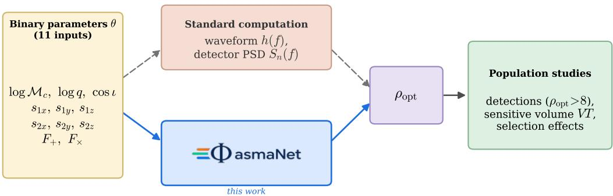  
Figure 1: Role of the SNR surrogate. For a set of binary parameters θ, the optimal SNR $\rho _ { \mathrm { o p t } }$ governs detectability. Evaluating it directly for a large number of injections is computationally demanding and can become a bottleneck in population and selection-efect studies that require very large numbers of evaluations. ΦasmaNet replaces this per-source computation with a neural-network surrogate that maps θ directly to $\rho _ { \mathrm { o p t } }$ , enabling high-throughput injection campaigns in which the detectability $\left( \rho _ { \mathrm { o p t } } > 8 \right)$ , the sensitive volume VT, and selection efects are evaluated for large populations.

strength of a potential GW signal, characterized by a vector of parameters θ, against the detector’s background noise PSD $S _ { n } ( f )$ . This calculation involves a noise-weighted integral of the waveform $\tilde { h } ( f ; \pmb \theta )$ in the Fourier domain:

$$
\rho ( \pmb \theta ) = \left[ 4 \int _ { f _ { \mathrm { m i n } } } ^ { f _ { \mathrm { m a x } } } \frac { \tilde { h } ^ { * } ( f ; \pmb \theta ) \tilde { h } ( f ; \pmb \theta ) } { S _ { n } ( f ) } d f \right] ^ { 1 / 2 } .\tag{1}
$$

To illustrate the regime the surrogate operates in, Fig. 2 shows four real events from the Gravitational-Wave Transient Catalogs [4, 5], chosen to span its extremes: the loudest detection to date (GW250114 [3]) the heaviest binary (GW231123, 236 $M _ { \odot } \ [ 2 ] )$ , and two strongly unequal-mass systems that contrast a precessing configuration (GW200302, $\chi _ { p } \approx 0 . 5 \ [ 9 ] )$ ) with an aligned-spin one (GW190403, $\chi _ { \mathrm { e f f } } \approx 0 . 7 .$ $\chi _ { p } \approx 0 . 1 \ [ 1 0 ] )$ . For each event we take the maximum-likelihood sample of the public posterior data release and reconstruct the frequency-domain signal with exactly the configuration used to generate the training set (IMRPhenomXPHM, $f _ { \mathrm { l o w } } = 1 0 ~ \mathrm { H z }$ $f _ { \mathrm { N y q } } = 1 0 2 4$ Hz, $\Delta f = 1 / 2 0 ~ \mathrm { H z } )$ , projecting onto the LIGO-Hanford detector at the event’s inferred sky position and coalescence time. Plotted as characteristic strain against the aLIGO design noise curve, the four signals make the meaning of the SNR concrete: the area by which each curve rises above the noise is its $\rho ^ { 2 }$ , ranging here from $\rho _ { \mathrm { H 1 } } \approx 6 8 $ for the loudest system down to $\rho _ { \mathrm { H 1 } } \approx 9$ for the most distant. The visible amplitude modulations are genuine higher-order-mode and spin-precession features, precisely the structure, absent from non-precessing dominant-mode models, that the IMRPhenomXPHM-based surrogate must reproduce across the parameter space. We emphasise that these waveforms are projected onto a single detector at fixed design sensitivity rather than the actual detector network and noise, so $\rho _ { \mathrm { H 1 } }$ difers from the network SNRs at which the events were observed.

While the direct evaluation of this integral for a single event is feasible, the necessary waveform construction can be time-consuming. In particular, high-fidelity waveform models, such as efectiveone-body (EOB) models, often necessitate the integration of diferential equations. Even the closedform, frequency-domain phenomenological model used to generate our labels (IMRPhenomXPHM) is not free of this cost: capturing generic spin precession and higher-order modes requires assembling and rotating many harmonic contributions, each evaluated on the fine frequency grid $( \Delta f = 1 / 2 0$ Hz up to 1024 Hz, i.e. $\sim 2 \times 1 0 ^ { 4 }$ bins) needed to resolve the in-band signal, and this per-source cost is incurred afresh at every one of the millions of evaluations a population analysis requires. This computational cost is felt most acutely when detectability must be established for an entire synthetic population. Robust population models require large synthetic catalogs, often millions of sources, to quantify selection efects and detection eficiency [29, 28]. In a hierarchical Bayesian analysis the detectable fraction of such a catalog must moreover be recomputed at every likelihood evaluation, so that even individually inexpensive SNR calculations accumulate into a prohibitive total. This motivates fast surrogate models tailored to the same fixed analysis configuration used to generate the labels. Furthermore, conventional computational methods, such as simple polynomial interpolation or look-up tables, become ineficient or inappropriate once the intrinsic parameter space includes generic, precessing spins, for which the SNR no longer factorizes into a simple intrinsic normalization times an analytic distance–orientation scaling [19, 39].

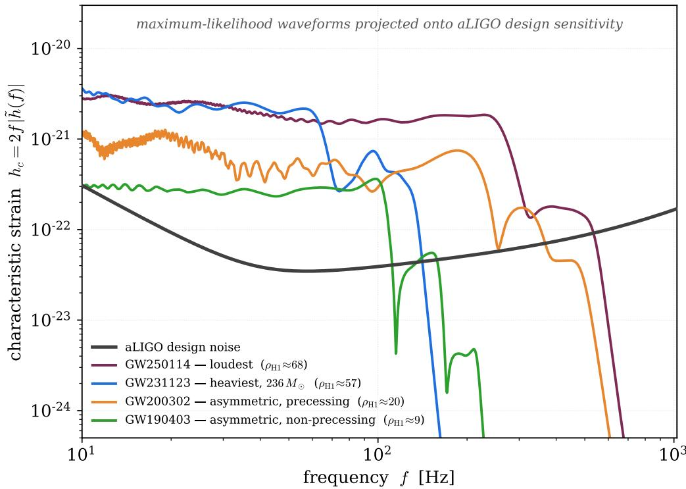  
Figure 2: Four real GWTC events reconstructed with the same waveform model and noise curve used to build the training set. Each curve is the characteristic strain $h _ { c } = 2 f | \tilde { h } ( f )$ of the maximum-likelihood posterior sample (IMRPhenomXPHM, projected onto H1 at the event’s sky position and GPS time). The black curve is the aLIGO design noise $h _ { n } = { \sqrt { f S _ { n } ( f ) } }$ . The events span the loudest, heaviest, and two unequal-mass systems with and without precession.

Deep Learning (DL) presents a robust alternative to overcome these computational hurdles. Feedforward Neural Networks (NNs), specifically Multilayer Perceptrons (MLPs), are mathematically established as universal approximators capable of accurately modeling virtually any continuous, complex function over a defined parameter space. Beyond standard MLPs, more advanced architectures such as Convolutional Neural Networks (CNNs), residual networks (ResNets), and Transformer models can also be employed, especially when the SNR function exhibits structured dependencies (e.g., local correlations, multi-scale behavior, or attention-like relationships among parameters).

The core strategy is to replace the slow, direct calculation of the SNR function, $\rho ( \pmb \theta )$ , with a fast, accurate interpolation performed by a pre-trained NN. Although the initial training phase can be computationally intensive, once the chosen architecture (MLP, CNN, ResNet, or Transformer) is trained and validated for suficient accuracy, the computational cost associated with a single prediction (inference) is constant and significantly lower than solving the complex integral required by Eq. (1). This approach efectively transforms the challenging problem of numerically evaluating an integral in a high-dimensional space into an eficient function evaluation, while allowing the use of more expressive and specialized network architectures when beneficial.

## 3 Related Work

Deep learning has by now been applied across essentially the entire gravitational-wave analysis chain: signal detection, waveform modelling, parameter estimation, and population inference [29, 19]. The strand most relevant to the present work is the use of neural networks as fast interpolants: surrogates that replace an expensive physical computation with a cheap, pre-trained function evaluation. We organise the prior art into three overlapping themes and then position ΦasmaNet against it.

Fast surrogates for the SNR. The proposal to replace the noise-weighted inner product of Eq. (1) with a learned interpolant was introduced by Wong, Ng and Berti [39], who trained a simple multilayer perceptron to map the four intrinsic parameters of aligned-spin binaries $( M _ { \mathrm { t o t } } , q , \chi _ { 1 } , \chi _ { 2 } )$ to the optimal SNR. Their network evaluated $1 0 ^ { 6 }$ SNRs in roughly one minute on a four-core CPU, with median fractional errors below $1 0 ^ { - 3 }$ and speed-ups of $1 2 0 { - } 7 . 5 \times 1 0 ^ { 4 }$ relative to direct waveform generation, while compressing a 100 MB look-up table into a 5 MB model. These figures illustrate why SNR interpolation, although conceptually simple, is an attractive target for DL. More recently, the gwsnr package [31] has turned this idea into a production tool, combining a partial-scaling interpolation of the optimal SNR with an artificial-neural-network estimator and a hybrid recalculation scheme that falls back to the exact inner product for sources near the detection threshold, where approximation errors matter most.

Learned detectability and selection functions. A complementary line of work models the detection probability directly rather than the SNR. Gerosa, Pratten and Vecchio [19] trained neural-network classifiers to predict whether a compact-binary signal would be detected, including the efects of spin precession, higher-order modes, and multiple detectors that are awkward to capture with a single semi-analytic SNR threshold. Mould, Gerosa and Taylor [29] embedded such learned ingredients in a hierarchical Bayesian framework for inferring black-hole populations. Most recently, Callister, Essick and Holz [15] trained a neural-network emulator of the Advanced LIGO/Virgo selection function on real pipeline injections, learning a continuous P(det θ) across the 13-dimensional space of binary masses, spins, and extrinsic parameters, and demonstrating that it captures detection-pipeline efects that a fixed SNR threshold misses, such as noise non-stationarity and signal-consistency cuts. Such emulators are valuable precisely because detectability must be re-evaluated for a fresh population at every step of a population-inference sampler, a setting in which a fast surrogate removes an otherwise prohibitive cost. The same motivation drives space-based applications: for Extreme Mass Ratio Inspirals (EMRIs) observable by LISA, Chapman-Bird, Berry and Woan [16] chained an SNR-interpolating network with a second network that learns the selection function, accelerating detectability estimation by up to six orders of magnitude relative to direct computation. Underpinning all such detectability models, the simple optimal-SNR threshold they refine has itself been calibrated against observed catalogues: Mould, Moore and Gerosa [30] infer single-detector thresholds that justify the $\rho > 8 \mathrm { - t y p e }$ criteria routinely used to define detectable populations [28].

Waveform-level surrogates. A distinct but related strategy interpolates the waveform itself, yielding the SNR as a by-product. Magee et al. [26] trained networks to interpolate the singular-valuedecomposition reconstruction coeficients used by matched-filter search pipelines, generating waveforms, and equivalently SNR time series, in milliseconds and enabling low-latency enrichment of candidate events. In a related data-driven variant, Ma et al. [25] replace the matched-filtering template bank with a deep-learning model bank that predicts the waveform template embedded in the detector strain, then recovers the matched-filtering SNR as a by-product by correlating that predicted template with the data. Whereas these models reconstruct the signal across a local patch of the template bank or directly from the strain, our surrogate predicts the scalar optimal SNR directly across the full projected parameter space from the binary parameters alone.

This work. Against this backdrop, two observations motivate ΦasmaNet. First, the SNR surrogates above almost exclusively employ plain MLPs over low-dimensional intrinsic-parameter inputs. The more expressive architectures that have reshaped structured/tabular regression, residual connections and attention, remain largely unexplored for this task. This gap persists even in the production package gwsnr [31], the closest existing tool: its neural SNR estimator, trained on the same IMRPhenomXPHM waveform family we adopt, is a compact perceptron with two 32-unit hidden layers that predicts the optimal SNR from only five engineered scalar inputs, in which the spin degrees of freedom are compressed into a single efective spin $\chi _ { \mathrm { e f f } }$ . ΦasmaNet instead regresses the SNR from the full 11-dimensional parameter vector, retaining all six spin components, through a deep staged-refinement network, allowing it to represent the genuine precession- and higher-mode-induced structure that a χef parametrization cannot capture. Second, the quantity we target is the phase-averaged, single-detector optimal SNR for a fixed waveform model and noise PSD, but evaluated over the full 11-dimensional projected parameter vector, a substantially harder regression than the four-dimensional aligned-spin setting of [39]. Crucially, our target is the continuous optimal SNR itself rather than a particular pipeline’s detection probability P(det θ) [15]: because the SNR is a deterministic physical quantity, a single trained surrogate supports any downstream detection threshold, an exact distance rescaling $( \rho \propto 1 / d _ { L } )$ , and any noise-averaged $P _ { \mathrm { d e t } }$ model, whereas a learned $P _ { \mathrm { d e t } }$ fixes these choices at training time. We characterise ΦasmaNet’s accuracy and scaling behaviour under a controlled, fixedconfiguration protocol against representative neural baselines (MLP, ResNet, and Transformer). We do not claim an exhaustive benchmark against all strong tabular regressors. Our aim is a controlled, like-for-like comparison among neural surrogates for this regression problem.

## 4 Methodology

To develop an efective NN interpolator for the SNR $\rho ( \pmb \theta )$ as a function of binary parameters $\theta ,$ we first construct a comprehensive training dataset that spans the relevant parameter space of spinning BBH mergers (including generic spin orientations). This dataset is generated using the PyCBC library [14], which enables eficient computation of frequency-domain waveforms and optimal SNR values. The process leverages uniform random sampling in the component masses (with a quasi-random Sobol scheme available as an alternative, see below) and uniform random sampling for spins and extrinsic parameters, ensuring broad and uniform coverage while respecting physical constraints. Below, we detail the parameter selection, waveform generation, SNR computation, and dataset assembly.

## 4.1 Parameter Space and Sampling Strategy

The parameter vector θ includes intrinsic binary properties: detector-frame chirp mass $\mathcal { M } _ { c } ,$ mass ratio $q \geq 1$ , and dimensionless component spins $s _ { 1 , 2 } .$ , alongside extrinsic orientation parameters such as the cosine of inclination cos $\iota ,$ right ascension $\alpha ,$ declination $\delta ,$ polarization angle ψ, coalescence time $t _ { c } ,$ and luminosity distance $d _ { L }$ . The masses are detector-frame (redshifted) quantities: the waveform generator applies no cosmology, so the value passed sets the observed frequencies directly, and a source-frame population at redshift z must be queried with $m ^ { \mathrm { d e t } } = ( 1 + z ) m ^ { \mathrm { s r c } }$ . For this proof-of-concept, we focus on the LIGO-Hanford (H1) detector with the Advanced LIGO zero-detuned high-power (aLIGOZeroDetHighPower) PSD. The full parameter vector θ includes both intrinsic parameters and extrinsic projections (via the antenna pattern functions $F _ { + }$ and $F _ { \times } )$ , as well as distance and a coalescence-time ofset as tabulated features. In this configuration the luminosity distance and coalescence time are held fixed at $d _ { L } = 1 0 0 0 ~ \mathrm { M p c }$ and $t _ { c } = 0 $ . They are therefore constant (zero-variance) quantities excluded from the model input rather than treated as informative features. Because the optimal SNR scales exactly as $\rho \propto 1 / d _ { L }$ , the labels computed at the reference distance can be rescaled to any $d _ { L }$ at query time (see Sec. 10.5), so fixing $d _ { L }$ during generation incurs no loss of generality. The low-frequency cutof is $f _ { \mathrm { l o w } } = 1 0 \ : \mathrm { H z } .$ , with a sampling rate of 2048 Hz and signal duration of 20 ${ \mathrm { s } } ,$ yielding a frequency resolution $\Delta f = 1 / 2 0 ~ \mathrm { H z }$

Mass parameters are drawn uniformly in the component masses, $m _ { 1 } , m _ { 2 } \sim \mathcal { U } ( 3 , 1 7 0 ) M _ { \odot }$ , with the pair reordered to enforce $3 \leq m _ { 2 } \leq m _ { 1 } \leq 1 7 0 M _ { \odot }$ (hence $q = m _ { 1 } / m _ { 2 } \geq 1 )$ . The chirp mass and mass ratio used as features are then derived from each pair, spanning $\log _ { 1 0 } q \ \in \ [ 0 , \log _ { 1 0 } ( 1 7 0 / 3 ) ]$ and the corresponding $\log _ { 1 0 } \mathcal { M } _ { c }$ range. This uniform- $( m _ { 1 } , m _ { 2 } )$ scheme requires no rejection step, since every reordered draw satisfies the mass bounds by construction. As an alternative, a quasi-random Sobo sampler [35] (via SciPy’s QMC module) in the log-uniform $( \log _ { 1 0 } \mathcal { M } _ { c } , \log _ { 1 0 } q )$ plane is also provided. The desired number of valid draws $N _ { s }$ ranges from $1 0 ^ { 5 }$ to $1 0 ^ { 6 }$ samples in the experiments reported here. We verified that, for detection-oriented accuracy $( \rho > 8 )$ , the two samplers perform comparably across the mass range at $1 0 ^ { 6 }$ samples, with the default uniform- $( m _ { 1 } , m _ { 2 } )$ scheme being the more distribution robust of the two. Spin magnitudes follow uniform distributions in [0, 0.99], with polar and azimuthal angles in $[ 0 , \pi ]$ and [0, 2π], respectively, converted to Cartesian components via spherical-to-Cartesian transformation. We note that uniform sampling of the polar (tilt) angle over $[ 0 , \pi ]$ is not the isotropic measure (which is uniform in cos $\theta )$ . It mildly over-weights aligned configurations and under-covers in-plane (precessing) spins. This is a deliberate training-coverage choice rather than an astrophysical prior: the surrogate is a function $\rho ( \pmb \theta )$ evaluated on injections drawn from the desired population, so the astrophysical spin distribution is imposed at query time and the training measure only controls where the emulator is accurate. At $1 0 ^ { 6 }$ samples the in-plane region remains densely populated, so this choice costs the surrogate nothing. Extrinsic parameters are uniformly sampled: cos $\iota \in [ - 1 , 1 ]$ sin $\delta \in [ - 1 , 1 ] , \alpha \in [ 0 , 2 \pi ] , \psi \in [ 0 , \pi ]$

Table 1: Parameter sampling for the training dataset. Component masses are drawn uniformly and reordered to $m _ { 1 } \geq m _ { 2 }$ . The chirp mass $\mathcal { M } _ { c }$ and mass ratio q used as features are derived from each pair. Spins and extrinsic angles are drawn uniformly in the listed variables.
<table><tr><td>Parameter</td><td>Symbol</td><td>Distribution</td><td>Range</td></tr><tr><td>Component masses</td><td> $m _ { 1 } , m _ { 2 }$ </td><td>uniform  $\left( m _ { 1 } \geq m _ { 2 } \right)$ </td><td> $[ 3 , 1 7 0 ] M _ { \odot }$ </td></tr><tr><td>(derived)</td><td> $\mathcal { M } _ { c } , q$ </td><td></td><td> $q \in [ 1 , 1 7 0 / 3 ]$ </td></tr><tr><td>Spin magnitudes</td><td> $\left| s _ { 1 , 2 } \right|$ </td><td>uniform</td><td>[0,0.99] [0, π]</td></tr><tr><td>Spin polar angles</td><td> $\theta _ { 1 , 2 }$ </td><td>uniform</td><td></td></tr><tr><td>Spin azimuthal angles Inclination</td><td> $\phi _ { 1 , 2 }$ </td><td>uniform</td><td>[0, 2π]</td></tr><tr><td></td><td> $\scriptstyle \cos \iota$ </td><td>uniform</td><td>[−1, 1]</td></tr><tr><td>Right ascension</td><td> $\alpha$ </td><td>uniform</td><td>[0,2π]</td></tr><tr><td>Declination</td><td> $\sin \delta$ </td><td>uniform</td><td>[−1, 1]</td></tr><tr><td>Polarization</td><td> $\psi$ </td><td>uniform</td><td>[0, π]</td></tr><tr><td>Coalescence phase</td><td> $\phi _ { c }$ </td><td>marginalized  $\left( K { = } 7 \ \mathrm { a v g . } \right)$ </td><td>[0, 2π)</td></tr><tr><td>Luminosity distance</td><td> $d _ { L }$ </td><td>fixed</td><td>1000 Mpc</td></tr><tr><td>Coalescence time</td><td> $t _ { c }$ </td><td>fixed</td><td>0</td></tr></table>

This yields 11 informative input features per sample (log Mc, log q, cos ι, six spin components, and antenna patterns $F _ { + } , F _ { \times } )$ . The luminosity distance and coalescence time are held fixed during data generation $( d _ { L } = 1 0 0 0$ Mpc, $t _ { c } = 0 )$ and excluded from the model input: $d _ { L }$ is reintroduced analytically through the exact $\rho \propto 1 / d _ { L }$ rescaling (Sec. 10.5), and $t _ { c }$ leaves the optimal SNR invariant. The sky position and polarization enter only through the precomputed $F _ { + } , F _ { \times }$ rather than as raw angles. For reproducibility, the random-number generators are seeded with 42 (a NumPy default rng(42) stream for the masses and a seed(42) stream for the remaining parameters). The sampling ranges and priors used for each parameter are summarized in Table 1.

For precessing, higher-mode waveforms the coalescence phase $\phi _ { c }$ induces a real, structured variation in the SNR. For astrophysically realistic (LVK-inferred, low-spin) populations, however, the resulting sensitive-volume bias is sub-percent. As described in Sec. 4.2, we marginalize $\phi _ { c }$

The distribution of the SNR labels is shown in Fig. 3. At the reference distance $d _ { L } = 1 0 0 0$ Mpc the optimal SNR ranges from $\rho _ { \mathrm { o p t } } \lesssim 0 . 1$ for the lightest, least favorably oriented binaries to $\sim 1 0 ^ { 2 }$ for the heaviest systems, with a median of 12.3 and a strongly right-skewed shape. This wide dynamic range is the primary motivation for regressing $y = \log _ { 1 0 } ( \rho _ { \mathrm { o p t } } + 1 0 ^ { - 1 2 } )$ rather than $\rho _ { \mathrm { o p t } }$ directly: it compresses the target to a comparable scale across the mass range and prevents the loud, heavy-mass systems from dominating the loss. Because the labels are evaluated at the fixed reference distance, the fraction exceeding the threshold there ( 64% at $\rho _ { \mathrm { o p t } } > 8 )$ characterizes the reference configuration rather than a population detection rate. The latter follows from the $\rho _ { \mathrm { o p t } } \propto 1 / d _ { L }$ rescaling.

## 4.2 Waveform Generation and SNR Computation

For each parameter draw, we generate the plus $( h _ { + } )$ and cross $( h _ { \times } )$ polarizations using the IMR PhenomXPHM approximant [33, 32], which includes inspiral-merger-ringdown dynamics, generic spinprecession efects, and higher-order modes. The training labels therefore inherit the fidelity of this approximant. Our uniform mass sampling reaches $q \approx 5 7$ , in the range that IMRPhenomXHM/XPHM bridges between its numerical-relativity calibration $( q \leq 1 8 )$ and its Teukolsky calibration $( q \ge 2 0 0 )$ .

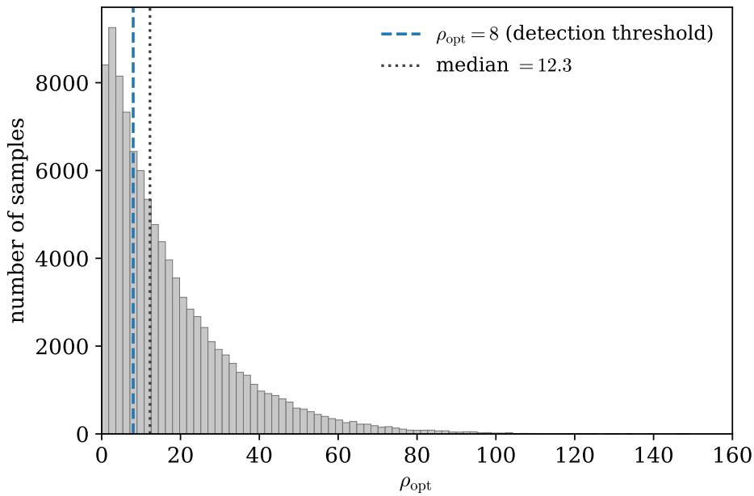  
Figure 3: Distribution of the training labels: the phase-averaged optimal SNR $\rho _ { \mathrm { o p t } }$ at the reference distance $d _ { L } \ = \ 1 0 0 0$ Mpc (shown for the $\mathrm { 1 0 ^ { 5 } { - } s a m p l e \ s e t ) }$ , on a linear scale. The label is strongly right-skewed, ranging from $\rho _ { \mathrm { o p t } } \lesssim 0 . 1$ for the lightest, least favorably oriented binaries to $\sim 1 0 ^ { 2 }$ for the heaviest systems, with a median of 12.3. This wide dynamic range motivates the $\log _ { 1 0 } \rho _ { \mathrm { o p t } }$ regression target. The single-detector detection threshold $\rho _ { \mathrm { o p t } } = 8$ is shown as a dashed line. At this reference distance  64% of the samples exceed the detection threshold. The detectability of an astrophysical population follows from the $\rho _ { \mathrm { o p t } } \propto 1 / d _ { L }$ rescaling.

Labels in this high-q corner and at large in-plane spin, where the twisting-up precession description is least constrained, carry the model’s larger systematic uncertainty. Since the surrogate is trained to reproduce the approximant rather than nature, this concerns the physical interpretation of the labels, not the emulation accuracy we report. Waveforms are computed in the frequency domain up to $f _ { \mathrm { N y q u i s t } } = 1 0 2 4 ~ \mathrm { H z }$ , padded or cropped to match the PSD length. At this Nyquist frequency the ringdown of the lightest systems (total mass few $M _ { \odot }$ , whose quasi-normal frequencies approach kHz) is mildly truncated. The associated SNR loss is negligible because the detector PSD is poor in that band, but it can be removed by raising the sampling rate to 4096 Hz.

The projected detector strain is $h = F _ { + } h _ { + } + F _ { \times } h _ { \times }$ , where antenna patterns depend on sky lo cation, polarization, and coalescence time through the detector orientation. Here $F _ { \mathrm { + } } , F _ { \times }$ are treated as constant over the (short, $\lesssim$ minutes) in-band signal, the standard static-detector approximation, which is well satisfied for the second-generation BBH regime considered here. To mitigate phase dependence, we average the SNR over $K = 7$ uniformly spaced coalescence phases $\phi _ { c } \in [ 0 , 2 \pi )$ , which equals the zeroth Fourier coeficient $\left( a _ { 0 } \right)$ of the sampled sequence. This identity is exact for $\rho ^ { 2 }$ , a finite trigonometric polynomial in $\phi _ { c }$ . For $\rho$ itself it is an approximation, but the $K = 7$ average reproduces a finely sampled $( K = 6 4 )$ phase average to better than 0.2% [18]. The optimal (single-detector) SNR, Eq. (1), is then computed via $\operatorname { P y C B C ^ { \prime } s } \ \sigma ^ { 2 }$ (sigmasq) function, with fallback to explicit summation $4 \sum | \tilde { h } | ^ { 2 } / S _ { n } \Delta f$ over finite, positive-PSD bins for robustness against non-finite values.   
The. NN but

The NN surrogate regresses not $\rho ,$ but $y = \log _ { 1 0 } ( \rho + 1 0 ^ { - 1 2 } )$ for numerical stability.

Computations are parallelized across $N _ { c } ~ = ~ 4 { - } 1 6$ cores using Joblib, with per-process Detector instantiation to avoid pickling issues. Dataset generation time scales approximately linearly with $N _ { s }$ and depends on waveform settings and available parallelism. We therefore omit a single headline timing here and focus on the modeling and evaluation protocol for dataset sizes up to 1M samples.

## 4.3 Dataset Assembly and Validation

The resulting dataset comprises $N _ { s }$ samples stored as a Pandas DataFrame in pickle format, with columns $d _ { L }$ , log $\mathcal { M } _ { c } ,$ , log q, cos ι, the six spin components, $F _ { + } , \ F _ { \times } , \ t _ { c } , \ F _ { }$ and log ρ. Before training/evaluation splits, we apply an upper-SNR truncation and retain only samples with $\rho < 2 0 0 \ ( \mathrm { i . e . }$ $\log _ { 1 0 } \rho < \log _ { 1 0 } 2 0 0 )$ , as described in Section 8. We visualize summary distributions post-generation to confirm that the sampling covers the intended parameter ranges and does not exhibit pathological clustering. The $\mathrm { P y C B C } .$ -computed SNR values serve as reference labels for neural network training, and we validate consistency by spot-checking predictions against direct $\mathrm { P y C B C }$ evaluations on held-out samples.

This approach draws inspiration from prior SNR interpolation eforts [39, 19] but extends to full precessing spins and phase-averaging for increased astrophysical realism under a fixed analysis configuration. The resulting surrogate is intended primarily for high-throughput simulation-driven workflows (e.g., injection campaigns for selection efects), rather than end-to-end low-latency inference from detector strain. The single-detector restriction is not a fundamental limitation: the network optimal SNR combines the per-detector values exactly in quadrature, $\rho _ { \mathrm { n e t } } = \sqrt { \sum _ { d } \rho _ { d } ^ { 2 } }$ (there are no inter-detector cross terms), so a network selection function can be assembled by training one surrogate per detector, each with its own PSD and antenna pattern evaluated at a common GPS time, and summing. This static-detector, quadrature-sum construction holds for the short BBH signals studied here but breaks for hour-to-day duration signals (low-mass binaries in $\mathrm { E T / C E ) }$ , where the antenna response varies over the signal and must be treated as time-dependent. Future extensions could incorporate multi-detector networks and time-varying PSDs [30].

Rather than traditional k-fold cross-validation, which is impractical at this training scale, we assess robustness to the dataset realization directly: all headline results use a single generation seed (42) and a fixed training/split seed (1337) for reproducibility, and we separately verify that the absolute accuracy and the architecture ranking are stable across two additional, independently generated datasets (generation seeds 43 and 44, Sec. 9).

## 5 Classic Deep Learning Architectures

This section introduces the three classic deep-learning architectures used in our SNR-regression study (to be compared to our novel architecture we introduce in Sec. 6), progressing from simple baselines to more structured inductive biases. Sec. 5.1 describes a multilayer perceptron that serves as a lightweight reference model for mapping the 11-dimensional parameter vector θ to $\log _ { 1 0 } \rho .$ . Sec. 5.2 then considers a 1D ResNet variant, which adds hierarchical feature extraction via convolutional residual blocks. Finally, Sec. 5.3 presents our Transformer-based regressor, leveraging self-attention to capture global, high-order interactions between source parameters. Together, these models provide complementary trade-ofs in capacity, generalization, and computational cost that we evaluate in the subsequent results.

## 5.1 Multilayer Perceptron

Multilayer Perceptrons, foundational feed-forward networks composed of stacked linear layers interleaved with nonlinear activations, underpin much of modern supervised learning due to their universal approximation capabilities for continuous functions on compact domains [23]. Their simplicity, which lacks strong inductive biases such as locality or translation invariance, renders them particularly suited to tabular data, where raw features $( \mathrm { e . g . }$ , binary masses and spins) require no spatial preprocessing. This allows rapid prototyping and facilitates interpretability via gradient-based attribution.

Our MLPRegressor uses a shallow four-hidden-layer architecture to predict $\log _ { 1 0 } \rho$ from the 11- feature parameter vector θ. Inputs are mapped through four width-256 hidden layers: $1 1  2 5 6 $ $2 5 6 \to 2 5 6 \to 2 5 6 \to 1$ , with GELU activations and 0.1 dropout per layer for regularization, mitigating overfitting. The network comprises 200k parameters, a deliberately modest capacity for this lowdimensional regression, where larger networks tend to overfit. Each hidden layer applies a linear map followed by a GELU nonlinearity and dropout, with no internal feature normalization. Weights are Xavier-uniform initialized and optimization is performed with AdamW (weight decay 10−4). A summary of the main architectural choices is shown in Table 2.

Batch normalization is omitted, as is common for shallow MLPs on tabular inputs. Training employs Huber loss $( \delta = 0 . 0 3 )$ with histogram-based sample weighting over 150 epochs, using early

Table 2: MLPRegressor (width $w { = } 2 5 6 .$ depth d=4) used for SNR regression. Here B denotes batch size. Each hidden layer applies Linear  GELU  Dropout (p=0.1).
<table><tr><td>Layer</td><td>Operation</td><td>Output shape Notes</td><td></td></tr><tr><td>Input</td><td></td><td>[B, 11]</td><td>standardized parameter vector θ</td></tr><tr><td>1</td><td> $\mathrm { L i n e a r ~ } 1 1  2 5 6$ </td><td>[B,256]</td><td> $\mathrm { G E L U } \to \mathrm { D r o p o u t } \ ( p { = } 0 . 1 )$ </td></tr><tr><td>2</td><td> $\mathrm { L i n e a r ~ 2 5 6 \to 2 5 6 }$ </td><td>[B,256]</td><td> $\mathrm { G E L U } \to \mathrm { D r o p o u t } \ ( p { = } 0 . 1 )$ </td></tr><tr><td>3</td><td> $\mathrm { L i n e a r ~ 2 5 6 \to 2 5 6 }$ </td><td>[B,256]</td><td> $\mathrm { G E L U } \to \mathrm { D r o p o u t } \ ( p { = } 0 . 1 )$ </td></tr><tr><td>4</td><td>Linear  $2 5 6  2 5 6$ </td><td>[B,256]</td><td> $\mathrm { G E L U } \to \mathrm { D r o p o u t } \ ( p { = } 0 . 1 )$ </td></tr><tr><td>Output Linear</td><td> $2 5 6  1$ </td><td>[B, 1]</td><td> $\mathrm { p r e d i c t s ~ l o g } _ { 1 0 } \hat { \rho }$ </td></tr></table>

stopping and plateau-reduced learning rates to stabilize convergence.

## 5.2 ResNet

Residual Networks (ResNets), introduced in the landmark work of He et al. [21], transformed deep learning by addressing the degradation problem in very deep architectures through the use of identitybased shortcut (skip) connections. In the original formulation, let H(x) denote the (unknown) target mapping a stack of layers would ideally implement. ResNets instead parameterize a residual function $F ( { \pmb x } ) : = H ( { \pmb x } ) - { \pmb x }$ and output ${ \pmb y } = { \pmb x } + F ( { \pmb x } )$ , so each block learns a correction to the identity. This reparameterization stabilizes gradient propagation and facilitates the training of very deep networks with a large number of layers. Their clean identity-mapping formulation acts as an implicit regularizer and has led to broad adoption across scientific domains, whenever hierarchical feature extraction is beneficial [22, 38].

In gravitational-wave (GW) data analysis, ResNets are particularly efective for processing noisy strain time series and for tasks such as event detection and denoising, where 1D convolutions naturally extract multi-resolution waveform motifs [34, 27]. For SNR interpolation on tabular parameter inputs, ResNets ofer a natural step up in structure from plain MLPs: by treating the ordered physical parameters as a 1D sequence, convolutions can capture local interactions (e.g., within mass or spin subsets) while depth and downsampling build progressively more global dependencies.

Our model, ResNetRegressor, adapts a ResNet-18-style backbone to 1D tabular regression over GW parameters. The 11-dimensional input vector θ is treated as a univariate sequence of shape [B, 1, 11] (where B is the batch size), in the fixed feature order of Section 4, in which the mass and spin parameters each occupy contiguous positions that short convolutional kernels can exploit. The network begins with a lightweight stem consisting of a 3 1 convolution (64 channels, stride 1, padding 1), followed by batch normalization and a ReLU nonlinearity, producing a feature map of shape [B, 64, 11].

The residual core comprises four stages with two residual blocks (BasicBlock1D) per stage $( N _ { B } =$ 2). Each block contains two 3 1 convolutions with batch normalization and ReLU, combined with identity or projection shortcuts (1 1 convolution + batch normalization) when resolution or channel count changes. Downsampling is implemented via stride-2 convolutions in the first block of stages 2–4, with channel dimensions progressing as $6 4 \to 1 2 8 \to 2 5 6 \to 5 1 2$

After the final stage, adaptive average pooling aggregates over the length dimension, yielding [B, 512]. A small fully connected regressor then maps $5 1 2  2 5 6  1$ with GELU activation and dropout $( p = 0 . 1 )$ to predict $\hat { y } = \log _ { 1 0 } \hat { \rho } .$ As in standard ResNets, we use BasicBlock1D (no bottlenecks) to keep the model compact for short 1D inputs. Convolutional weights use Kaiming-normal (He) initialization in fan-out mode with a ReLU gain, batch-normalization layers are initialized to unit scale and zero shift, and the fully-connected regression head uses PyTorch’s default initialization. A summary of the main architectural choices is shown in Table 3.

Relative to conventional 2D ResNets, our implementation makes four changes. First, it uses 1D convolutions along the parameter axis (e.g., kernels sliding over spin triplets to exploit local vectorial structure). Second, it down-samples primarily via strides, avoiding aggressive pooling that would collapse the already short sequence. Third, it replaces the final softmax classifier with a regression output. Fourth, it operates on a fixed-length 11-feature input sequence (no variable-length masking).

With roughly 3.98M parameters and 2 ms inference time per batch on GPU, the model is suitable for high-throughput inference in simulation-driven workflows [39, 26]. In our experiments, residual (skip) connections improve optimization stability and validation convergence relative to a plain 1D CNN variant under the same training protocol, consistent with prior findings on residual learning in deep networks.

Table 3: ResNet1DRegressor architecture (1D ResNet-18-ish, 2 blocks per stage) used for SNR regression. Shapes are shown as $[ B , C , L ]$ until pooling. After pooling we use $[ B , D ]$ . The 11D feature vector is reshaped to a length-11 1D input with one channel. Downsampling is implemented via stride-2 convolutions in the first block of stages 2–4.
<table><tr><td>Component</td><td>Operation</td><td>Output shape Notes</td><td></td></tr><tr><td>Input</td><td>reshape</td><td>[B,1,11]</td><td>11D feature vector θ</td></tr><tr><td>Stem</td><td>Conv 3 × 1, C=64, stride 1 → BN → ReLU</td><td>[B, 64, 11]</td><td>padding 1</td></tr><tr><td>Stage 1</td><td> $\mathrm { 2 } \times \mathtt { B a s i c B l o c k 1 D } , \ C \mathrm { = } 6 4$ </td><td>[B, 64, 11]</td><td>stride 1</td></tr><tr><td>Stage 2</td><td> $\mathrm { 2 } \times \mathrm { 8 a s i c B l o c k 1 D , } C \mathrm { = } 1 2 8$ </td><td>[B, 128, 6]</td><td>stride-2 in first block</td></tr><tr><td>Stage 3</td><td> $\scriptstyle 2 \times \mathtt { B a s i c B l o c k 1 D } , C = 2 5 6$ </td><td>[B,256, 3]</td><td>stride-2 in first block</td></tr><tr><td>Stage 4</td><td>2× BasicBlock1D, C=512</td><td>[B, 512, 2]</td><td>stride-2 in first block</td></tr><tr><td>Pooling</td><td>AdaptiveAvgPool1d(1)</td><td>[B, 512, 1]</td><td>global average over L</td></tr><tr><td>Flatten</td><td>squeeze</td><td>[B,512]</td><td>remove length dim</td></tr><tr><td>Regressor</td><td>Linear  $5 1 2  2 5 6  1$ </td><td>[B, 1]</td><td>GELU + Dropout (p=0.1)</td></tr></table>

The main architectural hyperparameters follow a standard ResNet-18 design and are kept fixed rather than tuned for this task: block counts (two per stage), kernel sizes (3 1), dropout (0.1, in the regression head), and channel widths. The shared training hyperparameters are inherited from the MLP baseline (Section 8). Under the shared training configuration (Huber loss with $\delta = 0 . 0 3$ and histogram-based sample weighting, as described in Section 8), the model serves as a competitive convolutional baseline for this structured regression task, benefiting from residual connections and a local inductive bias along the feature axis.

## 5.3 Transformer

Transformers constitute a major shift in deep learning, originally introduced to replace recurrent neural networks (RNNs) in sequence modeling through the mechanism of scaled dot-product self-attention [37]. By computing pairwise interactions between all tokens in parallel, Transformers capture longrange dependencies without the sequential bottlenecks inherent to RNNs, enabling eficient training on large datasets and long contexts. Following their widespread success in natural language processing (powering models such as BERT and GPT) Transformer architectures have been adapted to computer vision (e.g., Vision Transformers) and even to tabular data regression [17, 20].

In our setting, a Transformer encoder provides a convenient attention-based baseline for modeling non-linear interactions among the 11 input features. Self-attention can represent feature–feature couplings without imposing locality assumptions, making it a reasonable comparator for structured regression in this fixed-size tabular surrogate task. We therefore include a tailored TransformerRegressor as a strong attention baseline under the same training protocol.

Our architecture, TransformerRegressor, is a tailored Transformer encoder optimized for SNR regression on fixed-size tabular GW data. Unlike Transformers designed for variable-length sequences, our model fixes the sequence length to $S = 1 1$ to match the dimensionality of the physical parameter vector θ, avoiding padding and improving computational eficiency. Each scalar feature, including intrinsic parameters $( \log _ { 1 0 } \mathcal { M } _ { c } , \log _ { 1 0 } q )$ , spin components $( s _ { 1 } , s _ { 2 } )$ , and extrinsic parameters (cos ι, $F _ { + }$ $F _ { \times } , d _ { L } )$ , is embedded into a $d _ { \mathrm { m o d e l } } = 1 2 8$ -dimensional token via a linear projection (input dim: $1 $ 128).

To encode feature identity/ordering information and break permutation symmetry (e.g., distinguishing primary vs. secondary spin vectors), we employ learnable positional embeddings of shape $[ 1 , S , d _ { \mathrm { m o d e l } } ]$ , initialized with small Gaussian noise $( \mu = 0 , \sigma = 0 . 0 2 )$ . The encoder comprises $N _ { L } = 4$ layers, each containing multi-head self-attention with $N _ { h } = 8$ heads and a position-wise feed-forward sublayer with $d _ { \mathrm { f f } } = 2 5 6$ and a GELU activation. We use pre-layer normalization to enhance training stability, especially important in deeper stacks [13]. Dropout $( p = 0 . 1 )$ is applied within both the attention and MLP blocks to reduce overfitting. The encoder output of shape $[ B , S , d _ { \mathrm { m o d e l } } ]$ is aggregated using global mean pooling over the sequence dimension, followed by a LayerNorm, yielding a single representation $[ B , d _ { \mathrm { m o d e l } } ]$ more suitable for tabular inputs than CLS-token approaches. The pooled representation feeds a lightweight regression head consisting of two linear layers (128 64 1) with GELU and dropout. Token projection layers use Xavier-uniform initialization to maintain stable variance propagation. A summary of the main architectural choices is shown in Table 4.

Table 4: TransformerRegressor architecture used for SNR regression. Shapes are shown as [B, S, d] for batch size B, sequence length S=11, and embedding dimension $d = d _ { \mathrm { m o d e l } } = 1 2 8$
<table><tr><td>Component</td><td>Operation</td><td>Output shape Notes</td><td></td></tr><tr><td>Input</td><td></td><td>[B, 11]</td><td>parameter vector θ</td></tr><tr><td>Reshape</td><td> $\pmb \theta \mapsto \pmb \theta [ : , : , N o n e ]$ </td><td>[B, 11, 1]</td><td>treat each feature as a token</td></tr><tr><td>Tokenization Linear</td><td> $1  1 2 8$  (per token)</td><td>[B, 11, 128]</td><td>scalar → token embedding</td></tr><tr><td></td><td>Position enc. Learnable embeddings</td><td>[B, 11, 128]</td><td>added to tokens  $N _ { h } { = } 8 ;$ </td></tr><tr><td>Encoder</td><td> $N _ { L } { = } 4$  Transformer layers</td><td>[B, 11, 128]</td><td>pre-LN; MHA: FFN:  $d _ { \mathrm { f f } } = 2 5 6 ;$  GELU; dropout  $p { = } 0 . 1$ </td></tr><tr><td>Pooling</td><td>Mean over S → LayerNorm</td><td>[B, 128]</td><td>global mean pooling  $+ \ \mathrm { L N }$ </td></tr><tr><td>Regressor</td><td>Linear  $1 2 8 \to 6 4 \to 1$ </td><td>[B, 1]</td><td> $\mathrm { G E L U } + \mathrm { d r o p o u t } \ ( p { = } 0 . 1 )$ </td></tr></table>

Compared to the standard Transformer encoder, our model difers in three key respects. First, it uses no decoder, as the task is direct regression. Second, it applies mean pooling instead of CLS-token aggregation, promoting more holistic feature fusion. Third, it uses a batch-first layout for seamless PyTorch integration. The model is lightweight and computationally eficient for fixed-length tabular regression. We use it as a strong attention-based baseline under the same data splits and training protocol used for the other architectures employed in this study.

The training hyperparameters (learning rate $\eta = 1 0 ^ { - 3 }$ , batch size $B = 1 2 8$ , maximum epochs 150, early-stopping patience 20) are the shared settings tuned on the MLP baseline (Section 8) and applied here unchanged rather than re-tuned for this model. We train using Huber loss with $\delta = 0 . 0 3$ in $\log _ { 1 0 } \rho$ space, together with the same histogram-based sample weighting scheme described in Section 8. This weighting is computed on the training split only, clipped to [0.2, 5.0], and renormalized to mean 1.0 for numerical stability, and is applied uniformly across all architectures.

## 5.4 Post-processing

As a post-processing step, common to all architectures we implement, we apply a monotonic, shapepreserving calibrator based on a monotonic Piecewise Cubic Hermite Interpolation (PCHIP) fitted on the validation set and applied to test predictions. This mapping can reduce global systematic bias without changing the rank order of predictions, providing a simple correction that is computationally negligible at inference time. We report results both before and after this calibration procedure.

## 6 ΦasmaNet: A Staged Spectral Token-Refinement Network with Recursive Feedback

This section introduces ΦasmaNet, our novel architecture for fast, accurate SNR regression from low-dimensional GW source parameters. The key idea is to represent the 11 input features as a small set of learned tokens and refine them progressively through a short, ordered sequence of Φ-Stages, each combining a standard Transformer encoder layer with the novel Φ-Refractor (spectral subspace mixing module), augmented with a small number of Φ-Feedback (gated top-down feedback) iterations. This design aims to combine the global interaction modeling of Transformers with the hierarchical inductive bias of staged computation, while remaining eficient on fixed-length tabular inputs.

As shown in Figure 4, ΦasmaNet implements a staged-refinement computation pattern tailored to short, fixed-length structured inputs. The network begins with a linear tokenizer that maps the input feature vector to a compact token set of size T with embedding dimension D. These tokens are then processed by an ordered sequence of K Φ-Stages, where each Φ-Stage combines a standard Transformer encoder layer (multi-head self-attention for token–token interaction followed by an FFN, with residual connections and normalization) and the Φ-Refractor that re-mixes embedding subspaces via parallel subspace transforms and learned gating. After the initial forward pass through the ordered Φ-Stages reaches the top level, the model unrolls R Φ-Feedback iterations: a top-down gated feedback pass injects higher-level context into lower levels, followed by a forward recomputation through all Φ- Stages to propagate the updates consistently. Finally, a readout module aggregates the refined tokens (LayerNorm + mean pooling in our default configuration) to produce a single representation, which is passed to a lightweight task head (e.g., a small MLP regressor) to output the prediction (here, $\log _ { 1 0 } ( \rho )$ for SNR regression).

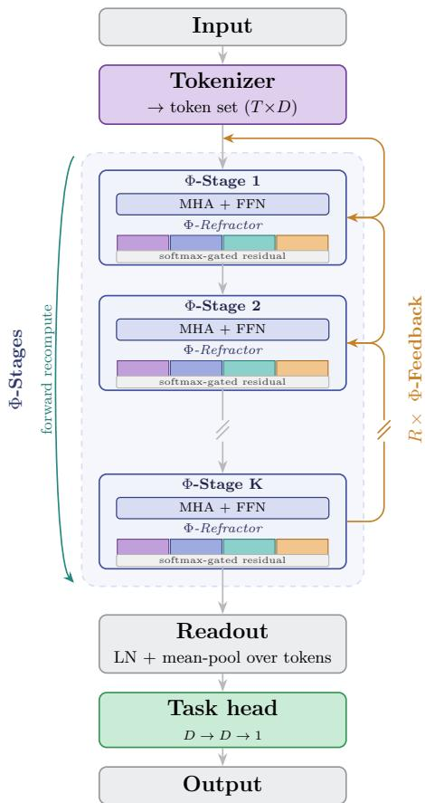  
Figure 4: ΦasmaNet overview. A fixed-dimensional structured input is tokenized into a learned token set of shape $( T \times D )$ and processed by an ordered sequence of K Φ-Stages (each Φ-Stage: standard Transformer encoder layer + Φ-Refractor). The model then performs R Φ-Feedback passes (top-down gated feedback with forward recomputation), before token pooling (readout) and a taskspecific head produce the final output.

## 6.1 Tokenization: From Tabular Parameters to Pseudo-Sequence

The tokenization module forms ΦasmaNet’s entry point, translating 11-dimensional BBH parameters θ into a compact pseudo-sequence of $T = 8$ learnable tokens embedded in D = 128 dimensions:

$$
\pmb { { E } } _ { 0 } = \pmb { { W } } _ { T } \pmb { \theta } + \pmb { b } _ { T } \in \mathbb { R } ^ { \pmb { B } \times T \times D }\tag{2}
$$

with $W _ { T } \in \mathbb { R } ^ { T D \times 1 1 }$ initialized via PyTorch’s default Kaiming-uniform scheme. This projection distributes features across tokens and can encourage specialization across the token set. We do not explicitly interpret individual tokens.

Converting θ into a short sequence enables self-attention to capture non-local dependencies among physical parameters without requiring hand-crafted feature interactions. No explicit positional encod-

ings are used. The network relies on the tokenizer projection and the learned attention weights to distinguish feature roles. We treat this tokenization as a design choice for compactness. Isolating its marginal impact would require additional ablations beyond the scope of this manuscript.

## 6.2 Φ-Stages: Progressive Abstraction via Attention, FFN, and Spectral Mixing

ΦasmaNet stacks K = 3 Φ-Stages to transform raw tokens into hierarchical embeddings. Let LN denote LayerNorm, MHA multi-head self-attention with $N _ { h } = 4$ heads, GELU the GELU activation applied elementwise, and $\mathcal { D } _ { p }$ dropout with probability $p = 0 . 1$ . Each Φ-Stage consists of two sublayers. First, a standard Transformer encoder layer processes $\pmb { x } \in \mathbb { R } ^ { B \times T \times D }$ via self-attention followed by a position-wise feed-forward network (FFN), with residual connections and post-layer normalization:

$$
\begin{array} { r } { \pmb { x } ^ { \prime } = \mathrm { L N } \big ( \pmb { x } + \mathcal { D } _ { p } \big ( \mathrm { M H A } ( \pmb { x } , \pmb { x } , \pmb { x } ) \big ) \big ) , } \end{array}\tag{3}
$$

$$
{ \pmb x } ^ { \prime \prime } = \mathrm { L N } ( { \pmb x } ^ { \prime } + \mathcal { D } _ { p } ( W _ { 2 } \mathrm { G E L U } ( W _ { 1 } { \pmb x } ^ { \prime } + b _ { 1 } ) + b _ { 2 } ) ) ,\tag{4}
$$

where $W _ { 1 } \in \mathbb { R } ^ { 4 D \times D }$ and $W _ { 2 } \in \mathbb { R } ^ { D \times { 4 D } }$ are the FFN expansion and projection weights, with biases $b _ { 1 } \in$ $\mathbb { R } ^ { 4 D }$ and $\pmb { b } _ { 2 } \in \mathbb { R } ^ { D }$ . Second, the Φ-Refractor (described below) performs multi-perspective subspace mixing on ${ \pmb x } ^ { \prime \prime }$

Stacking Φ-Stages is intended to refine representations progressively, with earlier stages encouraged to capture more local parameter interactions (for instance among spin components, or between mass and spin) and later stages to assemble these into the more global structure that sets the SNR. We stress that this local-to-global ordering is the design motivation rather than a verified property: as with the individual tokens, we do not probe what each stage encodes, and any such specialization would emerge from training rather than being imposed. Within each stage, residual connections and normalization support stable optimization across the stack.

## 6.3 Φ-Refractor: Multi-Perspective Subspace Mixing

The Φ-Refractor is a switchable component within each Φ-Stage that introduces multi-perspective subspace processing. It partitions the token embeddings into P parallel subspaces, applies independent subspace-specific transformations to promote diverse feature specializations, and fuses the resulting representations via learned gating. This design encourages the network to explore multiple complementary “views” of the input, which we find beneficial for structured low-dimensional regression tasks such as BBH SNR estimation. In this work we use Φ-Refractor ON as the default configuration for our primary SNR regression experiments, and treat Φ-Refractor OFF as a controlled architectural ablation under an otherwise matched protocol (Section 8).

Formally, let $\pmb { h } \in \mathbb { R } ^ { B \times T \times D }$ denote the token embedding at a given Φ-Stage, where B is the batch size, T the number of tokens, and D the embedding dimension. The Φ-Refractor operates by partitioning the embedding dimension into P disjoint subspaces with sizes $\{ D _ { p } \} _ { p = 1 } ^ { P }$ such that $\begin{array} { r } { \sum _ { p = 1 } ^ { \tilde { P } } D _ { p } = D } \end{array}$ In our experiments we use equal-sized subspaces $D _ { p } = D / P$ for all $p .$ Writing the partition as a channel-wise concatenation,

$$
\begin{array} { r } { \pmb { h } = \big [ \pmb { h } ^ { ( 1 ) } \big | \big | \pmb { h } ^ { ( 2 ) } \big | \big | \cdots \big | \big | \pmb { h } ^ { ( P ) } \big ] , \qquad \pmb { h } ^ { ( p ) } \in \mathbb { R } ^ { B \times T \times D _ { p } } , } \end{array}\tag{5}
$$

each subspace is transformed independently by a lightweight two-layer MLP $\varphi _ { p } \mathrm { : }$

$$
{ \bf \nabla } { \bf t } ^ { ( p ) } = \varphi _ { p } \Big ( { \pmb h } ^ { ( p ) } \Big ) , \qquad p = 1 , \ldots , P ,\tag{6}
$$

and the transformed subspaces are concatenated back into a unified representation:

$$
{ \pmb t } = \left[ { \pmb t } ^ { ( 1 ) } \parallel { \pmb t } ^ { ( 2 ) } \parallel \cdots \parallel { \pmb t } ^ { ( P ) } \right] \in \mathbb { R } ^ { B \times T \times D } .\tag{7}
$$

Feature-wise gating weights are computed via a softmax-normalized linear map applied along the embedding dimension D:

$$
\pmb { w } = \mathrm { s o f t m a x } ( \pmb { W } _ { r } \pmb { t } + \pmb { b } _ { r } ) \in \mathbb { R } ^ { \pmb { B } \times \pmb { T } \times \pmb { D } } ,\tag{8}
$$

and the final output is produced by a gated residual recombination:

$$
\Phi \mathrm { - R e f r a c t o r } ( h ) = t + { \mathcal { D } } _ { p } \bigl ( { \pmb w } \odot { \pmb t } \bigr ) .\tag{9}
$$

where denotes element-wise multiplication. This design encourages specialization across subspaces (via independent $\varphi _ { p } )$ while retaining stable optimization through residual routing. In practice, it acts as a structured subspace mixing and gating module that improves representational flexibility without changing the token length T or the embedding dimension D.

On the Covertype benchmark (see Appendix 14), enabling the Φ-Refractor also improves accuracy. A broader ablation study isolating the marginal contribution of each component across regimes is left for future work.

## 6.4 Φ-Feedback: Recursive Top-Down Gated Refinement

ΦasmaNet employs R = 2 Φ-Feedback passes, propagating top-down feedback via learnable gates:

$$
\begin{array} { r } { \pmb { g } _ { l } = \{ \sigma ( \pmb { W } _ { g } ^ { l } \pmb { E } _ { l } ) , l = 1 , \ldots , K - 1 ,  } \\ { \sigma ( \pmb { E } _ { l } ) , l = K , \qquad } \\ { \pmb { E } _ { l - 1 }  \pmb { E } _ { l - 1 } + \pmb { g } _ { l } \odot \pmb { E } _ { l } , l = K , \ldots , 1 . } \end{array}\tag{10}
$$

where $W _ { g } ^ { l }$ denotes a learned linear projection mapping the level-l token embeddings $\pmb { { \cal E } } _ { l } \in \mathbb { R } ^ { B \times T \times D }$ to gate logits for the lower $K - 1$ links, while the topmost link $( l \ = \ K )$ applies a parameterless sigmoid gate $\sigma ( { \pmb E } _ { K } )$ . Here $\sigma ( \cdot )$ is the sigmoid applied elementwise, so $\pmb { g } _ { l } \in \mathbf { \bar { \Gamma } } [ 0 , \bar { 1 } ] ^ { B \times T \times D }$ . ΦasmaNet therefore carries $K - 1$ learned gate projections, shared across the R feedback passes. This top-down flow allows global embeddings to modulate local motifs selectively. In this paper we keep Φ-Feedback enabled in ΦasmaNet, and treat the Φ-Refractor as a switchable component (default Φ-Refractor ON for SNR regression, with OFF reported as an ablation, and enabled where beneficial for tabular classification). Isolating the marginal contribution of each component and analyzing regime-specific efects (e.g., low-SNR subsets) are left for future work.

## 6.5 Regression Head: Holistic Pooling and Output Projection

The regression head aggregates the top-level token embeddings $\pmb { { E } } _ { K } \in \mathbb { R } ^ { B \times T \times D }$ via per-token layer normalization followed by mean pooling over the token axis:

$$
z \ = \ \frac { 1 } { T } \sum _ { t = 1 } ^ { T } \bigl [ \mathrm { L N } ( E _ { K } ) \bigr ] _ { t } ,\tag{11}
$$

where $\boldsymbol { z } \in \mathbb { R } ^ { B \times D }$ and $[ \cdot ] _ { t }$ denotes the t-th slice along the token axis. The pooled representation is mapped to the scalar prediction by a compact two-layer MLP:

$$
\hat { y } \ = \ \log _ { 1 0 } \hat { \rho } \ = \ w _ { o } ^ { \top } \ \mathrm { G E L U } \big ( W _ { h } z + b _ { h } \big ) + b _ { o } ,\tag{12}
$$

with hidden weights $W _ { h } \in \mathbb { R } ^ { D \times D }$ and $\boldsymbol { b } _ { h } \in \mathbb { R } ^ { D }$ , and output weights $\pmb { w } _ { o } \in \mathbb { R } ^ { D } , b _ { o } \in \mathbb { R }$ . Mean pooling provides a simple and robust aggregation of token information for fixed-length structured inputs, yielding stable performance in our setting.

Algorithm 1 ΦasmaNet forward pass with ordered Φ-Stages and Φ-Feedback.   
Require: Input features $\overline { { \boldsymbol { x } \in \mathbb { R } ^ { B \times F } } } ;$ tokenizer Tok; Transformer encoder layers $\overline { { \{ \mathrm { C } _ { i } \} _ { i = 0 } ^ { K - 1 } } } ;$ Φ-Refractors   
$\mathrm { \bar { \{ P } }  _ { i } \} _ { i = 0 } ^ { K - 1 } ;$ Φ-Feedback gates $\{ \mathrm { G } _ { \ell } \} _ { \ell = 0 } ^ { K - 2 }$ ; recursion steps R   
Ensure: Prediction $\hat { y } \in \mathbb { R } ^ { \sim _ { B \times 1 } } \left( \mathrm { { e . g . , } \log _ { 1 0 } ( \hat { \rho } ) } \right)$   
1: $E _ { 0 } \gets \mathrm { T o k } ( x )$ ▷ $E _ { 0 } \in \mathbb { R } ^ { B \times T \times D }$   
2: ${ \mathcal E } \gets [ E _ { 0 } ]$ ▷ Store all levels   
3: Initial forward ordered staged refinement (K ordered Φ-Stages)   
4: for $i \gets 0$ to $K - 1$ do   
5: $H \gets \mathrm { C } _ { i } ( \mathcal { E } [ i ] )$ ▷ Standard Transformer encoder layer   
6: if Φ-Refractor ON then   
7: $H \gets \mathrm { P } _ { i } ( H )$ ▷ Spectral subspace mixing   
8: end if   
9: .append(H)   
10: end for   
11: Φ-Feedback (unrolled R times)   
12: for $r \gets 1$ to R do   
▷ Backward (top-down) gated feedback   
13: for $\ell \gets K$ down to 1 do   
14: $E _ { \mathrm { h i g h } }  \mathcal { E } [ \ell ]$   
15: $E _ { \mathrm { l o w } }  \mathcal { E } [ \ell - 1 ]$   
16: if $\ell - 1 \leq K - 2$ then   
17: $g \gets \mathrm { G } _ { \ell - 1 } ( E _ { \mathrm { h i g h } } )$ ▷ Learned gate, $g \in \mathbb { R } ^ { B \times T \times D }$   
18: else   
19: $g  \sigma ( E _ { \mathrm { h i g h } } )$ ▷ Fallback gate on topmost link   
20: end if   
21: $\mathcal { E } [ \ell - 1 ] \gets E _ { \mathrm { l o w } } + g \odot E _ { \mathrm { h i g h } }$   
22: end for   
▷ Forward recompute through all Φ-Stages   
23: for $i \gets 0$ to $K - 1$ do   
24: $H \gets \mathrm { C } _ { i } ( \mathcal { E } [ i ] )$   
25: if Φ-Refractor ON then   
26: $H \gets \mathrm { P } _ { i } ( H )$   
27: end if   
28: $\mathcal { E } [ i + 1 ]  H$   
29: end for   
30: end for   
31: Readout and regression head   
32: $Z \gets \mathrm { L N } ( \mathcal { E } [ K ] )$   
33: z MeanPool(Z, tokens)   
34: yˆ  Regressor(z)   
35: return yˆ

Algorithm 1 summarizes the complete ΦasmaNet forward pass in a single pseudocode listing. In particular, it makes explicit the bookkeeping over the hierarchy (via the level list ) and the unrolled schedule that alternates top-down Φ-Feedback updates with a full forward recomputation, as well as the conditional execution of the Φ-Refractor used in our ablation settings.

## 6.6 Model Summary

Having described each component in turn, we summarize the concrete ΦasmaNet instantiation used throughout our SNR-regression experiments (Table 5). The $F = 1 1$ standardized input features are mapped by the tokenizer to a set of $T = 8$ tokens of embedding dimension $D \ = \ 1 2 8$ We then apply $K = 3$ ordered Φ-Stages, each pairing a standard Transformer encoder layer $( N _ { h } = 4$ attention heads, FFN expansion $d _ { \mathrm { f f } } = 4 D = 5 1 2$ , GELU, dropout $p = 0 . 1 )$ with a Φ-Refractor that splits the embedding into $P = 4$ equal subspaces $( D _ { p } = 3 2 )$ , transforms each by an independent two-layer MLP, and recombines them through a softmax-gated residual. The model unrolls $R = 2 { \mathrm { ~ ‰ ~ } }$ -Feedback passes, each a top-down gated update $( K - 1 = 2$ learned gate projections and a parameterless gate on the topmost link) followed by a forward recomputation through all Φ-Stages. A per-token LayerNorm and mean-pooling readout feeds a two-layer regression head (128 128 1, GELU) that outputs $\log _ { 1 0 } { \hat { \rho } } .$ The Φ-Refractor is enabled by default and treated as a switchable ablation. The full model totals 732k trainable parameters (Table 9).

Table 5: ΦasmaNet architecture used for SNR regression. Shapes are shown as $[ B , T , D ]$ for batch size B, token count $T { = } 8 ,$ and embedding dimension $D { = } 1 2 8$
<table><tr><td>Component</td><td>Operation</td><td>Output shape Notes</td><td></td></tr><tr><td>Input</td><td></td><td>[B,11]</td><td>standardized parameter vector θ</td></tr><tr><td>Tokenizer</td><td>Linear  $1 1  T D ,$  reshape</td><td>[B, 8, 128]</td><td>learned token set  $\scriptstyle { E _ { 0 } }$ </td></tr><tr><td>Φ-Stage (×3)</td><td> $\mathrm { E n c . ~ l a y e r + \Phi { \mathrm { - } } R e f r a c t o r }$ </td><td>[B, 8, 128]</td><td>MHA  $N _ { h } { = } 4 ,$  FFN  $d _ { \mathrm { f f } } = 5 1 2 ,$  GELU; Φ-Refractor  $P { = } 4 \ \left( D _ { p } { = } 3 2 \right)$  , softmax-</td></tr><tr><td></td><td>Φ-Feedback (×2) Gated update + recompute</td><td>[B, 8, 128]</td><td>gated residual; dropout 0.1  $K - 1 = 2$  learned gates + parameter-</td></tr><tr><td>Readout</td><td>Per-token LN → mean over T [B, 128]</td><td></td><td>less top gate global mean pooling</td></tr><tr><td>Reg. head</td><td>Linear  $1 2 8 \to 1 2 8 \to 1$ </td><td>[B, 1]</td><td>GELU; outputs  $\log _ { 1 0 } \hat { \rho }$ </td></tr></table>

The Φ-Refractor-OFF ablation is implemented by removing the Φ-Refractor (i) from the initial forward pass through the ordered Φ-Stages and (ii) from the recomputation step inside each Φ-Feedback pass, yielding a fully matched comparison.

## 7 Architectural Novelty and Design Rationale

Most contemporary deep learning architectures are designed around a single dominant paradigm: Transformers apply self-attention uniformly across depth, residual networks rely on identity-based skip connections without enforcing semantic diferentiation across layers, and MLPs apply homogeneous transformations difering only in width or depth. For structured regression tasks such as SNR estimation, where representations may benefit from being refined incrementally from local signal characteristics to stable global descriptors, these uniform-depth assumptions may not provide the most efective inductive bias.

ΦasmaNet addresses this by organizing computation into an ordered sequence of Φ-Stages coupled by an explicit top-down pathway. Unlike a standard Transformer encoder, whose layers are architecturally symmetric by design and provide hierarchy only through depth, ΦasmaNet’s stages are non-exchangeable: the Φ-Feedback mechanism propagates context from higher to lower stages, so that the stage order is architecturally meaningful, while the Φ-Refractor adds multi-perspective subspace diversification after each attention layer. This explicit top-down refinement pathway is absent from conventional Transformer, ResNet, and MLP designs. The staged organization is intended to encourage a directional, local-to-global refinement of the representation. As discussed in Section 6, we treat this division of labor as the design motivation rather than a demonstrated property, and defer its empirical verification (e.g., reorder/collapse ablations) to future work.

For our current application, under identical training and evaluation conditions, ΦasmaNet outperforms the evaluated Transformer-, ResNet-, and MLP-based neural baselines across the dataset scales considered, consistent with the staged organization acting as a useful inductive bias for this surrogate task. While ΦasmaNet is evaluated here in the context of SNR estimation, its architectural principles are not inherently domain-specific and may be applicable to other structured tabular regression and classification tasks that benefit from staged, hierarchical refinement, as the out-of-the-box benchmarks of Appendix 14 preliminarily indicate.

We emphasize that the contribution of ΦasmaNet lies in architectural organization and inductivebias enforcement, that is, in how standard components are composed and trained together to impose a non-homogeneous, staged bias, rather than in proposing new neural primitives or optimization tech-

niques.

We note that the Φ-Refractor is mechanistically related to several established design patterns: its partition of the embedding dimension into disjoint subgroups with independent per-group transformations follows the split-transform-merge paradigm introduced by ResNeXt [40] and, more broadly, grouped processing designs. Its learned softmax-weighted recombination shares the spirit of channel gating mechanisms such as Squeeze-and-Excitation [24]. The Φ-Refractor also difers from multi-head self-attention, which splits the embedding into subspaces but applies dot-product attention across tokens within each head and recombines by concatenation followed by a linear projection [37]. By contrast, the Φ-Refractor applies independent position-wise MLPs within each subspace and recombines via element-wise softmax-weighted gating with a residual connection. To our knowledge, the specific combination of these elements, namely disjoint embedding-dimension partitioning, independent subspace-specific MLP transforms, and softmax-gated residual recombination, applied as a postattention module within each Φ-Stage, has not appeared in prior work in this form.

Note also that the ‘spectral’ and ‘refractor’ terminology is used as an architectural metaphor for subspace diversification and does not imply spectral decomposition in the signal-processing or linearalgebraic sense. The design is motivated by the physical heterogeneity of the input parameter space: the 11-dimensional feature vector comprises quantities from distinct physical domains (masses governing waveform morphology, spin vectors encoding precession dynamics, and antenna-pattern projections capturing geometric orientation efects), which enter the SNR through qualitatively diferent coupling mechanisms. Although the Φ-Refractor partitions the learned embedding dimension rather than the raw input features, and therefore does not enforce an explicit alignment between subspaces and physica parameter groups, the intent is to provide the network with a structural incentive for developing multiple complementary processing pathways within each Φ-Stage, that may reflect this underlying physical heterogeneity. Whether the learned subspaces develop interpretable physical specialization is an empirical question that we leave for future investigation.

## 8 Training Protocol, Hyperparameters, and Evaluation Metrics

All models are trained under a matched protocol: identical data split, preprocessing, loss definition, sample weighting, optimizer, learning-rate schedule, and early stopping. Architecture-specific interna regularization (e.g., dropout) follows each model’s fixed configuration. The key shared settings are summarized below, while full details appear in the remainder of this section.

Our primary goal is a controlled comparison among neural surrogates that share a matched optimization protocol and are diferentiable end-to-end, allowing them to be embedded directly into larger diferentiable analysis pipelines. We therefore compare against three representative neural regressors (MLP, 1D-ResNet, Transformer encoder) trained under identical splits, preprocessing, loss, scheduling, and early stopping. We note that strong non-neural tabular baselines such as gradient-boosted decision trees (e.g., LightGBM/CatBoost) can perform competitively on low-dimensional structured data. An explicit comparison to such methods is an important extension and is left for future work.

Per-architecture tuning. The shared training hyperparameters (optimizer, learning rate, weight decay, schedule, batch size, loss, weighting, and early stopping) were tuned on the MLP baseline and then held fixed and unchanged for the 1D-ResNet, the Transformer encoder, and ΦasmaNet, each of which is used at a fixed architectural configuration (for ΦasmaNet, $T { = } 8 , \ D { = } 1 2 8 , \ K { = } 3$ $R { = } 2 , \ P { = } 4$ , inherited unchanged for the cross-domain benchmarks of Appendix 14) with no permodel hyperparameter optimization. ΦasmaNet’s advantage is therefore obtained under optimization settings selected for a diferent, simpler model, with no tuning carried out in its favor.

Before splitting the data, we retain samples with $\rho < 2 0 0$ and discard events with $\rho \ge 2 0 0$ . We treat this as a definition $o f$ the target operating distribution for the surrogate model studied here: it removes extremely loud outliers that can dominate weighted regression objectives and allows us to focus evaluation on the bulk of the simulated SNR range under the fixed-PSD, single-detector setup. This filter is applied uniformly to all architectures and to all splits. All reported dataset sizes refer to the filtered distribution unless explicitly stated otherwise.

The dataset was partitioned into training, validation, and held-out test subsets in proportions of

70%, 15%, and 15%, respectively. All splits $\left( 7 0 / 1 5 / 1 5 \right)$ are applied after preprocessing (including the upper-SNR cut). Therefore the absolute number of samples in each split reflects the efective dataset size after filtering.

To facilitate efective learning, all input features are standardised to zero mean and unit variance, using mean and variance computed exclusively from the training split and then applied to the validation and test splits to prevent data leakage. The target variable, log $_ { 1 0 } \rho _ { \mathrm { o p t } }$ , is left in its natural logarithmic scale to preserve interpretability and numerical stability. Training was conducted in mini-batches of 128 samples, over a maximum of 150 epochs. Early stopping was employed based on the validation Huber loss, with a patience of 20 epochs, to prevent overfitting while allowing suficient opportunity for convergence. Dropout of 0.1 was applied wherever applicable to further regularise the models.

Optimisation was performed using AdamW with a learning rate of $1 0 ^ { - 3 }$ and a weight decay coefficient of $1 0 ^ { - 4 }$ for all architectures (MLP, ResNet, Transformer, and ΦasmaNet). In all cases, a ReduceLROnPlateau scheduler reduced the learning rate by a factor of 0.5 if the validation loss did not improve for five consecutive epochs. The Huber loss function with $\delta = 0 . 0 3$ in logarithmic $\rho$ space was used to balance robustness to outliers with sensitivity to small deviations.

To mitigate imbalance across the target distribution, we use a histogram-based weighting scheme computed on the training split only (by hist). We bin the training targets $\log _ { 1 0 } \rho$ into fixed bins and assign each sample a weight inversely proportional to the empirical bin frequency. We clip weights to [0.2, 5.0] and renormalize them to have mean 1.0 for numerical stability. This weighting is applied uniformly across all architectures.

We evaluate all models using the Mean Absolute Percentage Error (MAPE) computed in linear SNR space on the held-out test set as the main metric

$$
\mathrm { M A P E } = 1 0 0 \times \frac { 1 } { N } \sum _ { i = 1 } ^ { N } \left| \frac { \rho _ { \mathrm { p r e d } } ^ { ( i ) } - \rho _ { \mathrm { t r u e } } ^ { ( i ) } } { \rho _ { \mathrm { t r u e } } ^ { ( i ) } } \right| .\tag{13}
$$

We also define

$$
\mathrm { A c c u r a c y } = 1 0 0 - \mathrm { M A P E } ,\tag{14}
$$

(in percentage points) as a complementary metric only, not as a classification-style accuracy metric. Because MAPE carries $\rho _ { \mathrm { t r u e } }$ in the denominator, it is most sensitive to the faintest sources. We therefore additionally report accuracy conditional on the detection-relevant regime $\rho _ { \mathrm { t r u e } } > 8$ in Section 10.

Although ΦasmaNet operates as a unified system, the Φ-Refractor and Φ-Feedback are implemented as independent, switchable components to enable controlled ablations. We report SNR regression with Φ-Refractor ON as the default configuration. The corresponding ON/OFF ablation across dataset scales is presented in Section 9.1 (Table 8), where the two settings are found to difer only marginally on the SNR task.

## 9 Architectures Comparison Across Dataset Sizes

To evaluate the relative performance and scalability of the four architectures (MLP, ResNet, Transformer, and ΦasmaNet), we conducted experiments using datasets of varying sizes: 100k, 500k, and 1M samples. All models were trained under the matched protocol described in Section 8, ensuring a controlled and reproducible comparison. This setup allows us to investigate how each architecture leverages increasing amounts of training data under the fixed-configuration surrogate setting studied here.

Table 6 summarizes the test-set accuracy across dataset sizes, reported before and after monotonic calibration, respectively (for data set realization with seed 42 and training seed 1337). After calibration, ΦasmaNet shows the strongest large-scale performance, reaching 99.16% at 500k and 99.29% at 1M. ResNet improves to 98.06% at 1M after calibration, while the Transformer reaches 97.40% and the MLP 95.64% at 1M, see also Figure 5. Overall, ΦasmaNet is the best-performing model across all evaluated dataset sizes under the shared protocol. We note a slight pre-calibration dip for ΦasmaNet from 500k to 1M (Table 6). The efect is small ( 0.2 percentage points) and confined to the precalibration metric: after the rank-preserving monotonic PCHIP calibration (fit on validation only), which we treat as the primary deployment metric, accuracy increases monotonically with dataset size (Table 6). We do not over-interpret this small pre-calibration non-monotonicity.

Table 6: Accuracy (%) before and after monotonic PCHIP calibration (fit on validation, applied to test), reported side-by-side, for the seed-42 dataset realization and training seed 1337. ΦasmaNet uses the default Φ-Refractor-ON configuration at all sizes. At 100k the OFF variant is marginally better (Table 8), so the 100k entry is conservative.
<table><tr><td rowspan="2">Architecture</td><td colspan="2">100k</td><td colspan="2">500k</td><td colspan="2">1M</td></tr><tr><td>Pre</td><td>Post</td><td>Pre</td><td>Post</td><td>Pre</td><td>Post</td></tr><tr><td>ΦASMANET</td><td>98.32</td><td>98.37</td><td>98.92</td><td>99.16</td><td>98.73</td><td>99.29</td></tr><tr><td>Transformer</td><td>96.39</td><td>96.79</td><td>97.04</td><td>97.43</td><td>96.03</td><td>97.40</td></tr><tr><td>ResNet</td><td>97.38</td><td>97.63</td><td>97.73</td><td>97.90</td><td>97.96</td><td>98.06</td></tr><tr><td>MLP</td><td>95.62</td><td>96.14</td><td>94.67</td><td>95.98</td><td>94.49</td><td>95.64</td></tr></table>

Accuracy vs. Number of Data points  
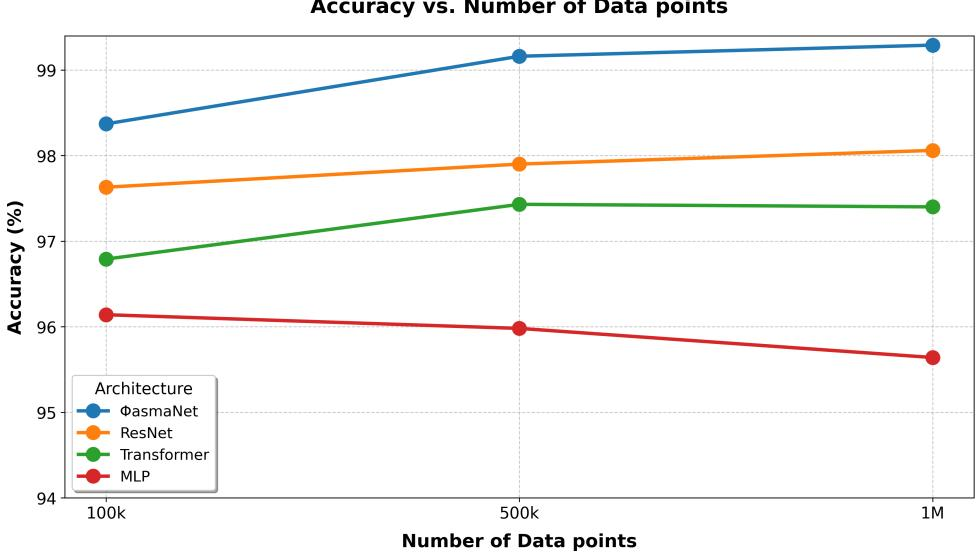  
Figure 5: Post-calibration accuracy versus dataset size for all architectures.

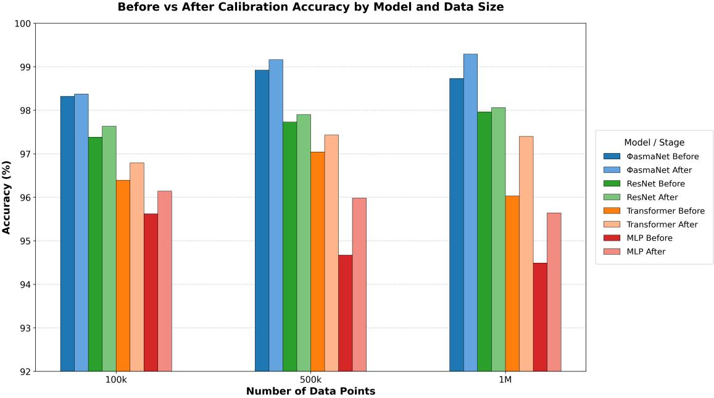  
Figure 6: Before vs. after calibration performance (100 MAPE, %) by model and dataset size. The same monotonic PCHIP calibration procedure is fitted on the validation set and applied uniformly to all models. Diferences between pre- and post-calibration bars indicate how much each model benefits from this lightweight correction under the simulated setting considered here.

As shown in Figure 6, calibration has a dataset-size-dependent efect across models. For ΦasmaNet, calibration produces a small change at 100k but a sizeable improvement at larger scales (500k and 1M), while the other architectures benefit from the same monotonic correction to varying degrees.

As a lightweight robustness check on the 100k setting, we repeated training with a diferent internal training seed (2024) while keeping the dataset generation fixed (seed 42) and the protocol unchanged. Note that this check uses the Φ-Refractor OFF setting of ΦasmaNet, since at the 100k setting it still performs better than the default ON setting. The resulting test-set accuracy (pre-/post-calibration) was: ΦasmaNet 98.39/98.49, Transformer 96.41/96.64, ResNet 97.58/97.70, and MLP 95.73/96.34, see Table 7, confirming that the performance ordering of the diferent architectures is stable under this seed change. A dataset-realization check at 1M for ΦasmaNet using additional generation seeds 43 and 44 yielded accuracies of 98.72%/99.17% and 98.70%/99.29% (pre-/post-calibration), respectively, under the same protocol.

These results suggest that ΦasmaNet is the best-performing model among the evaluated architectures in the 100k–1M regime under the matched protocol considered here.

Table 7: Robustness checks on test accuracy (100 MAPE, %, pre-/post-calibration): a training-seed change at 100k (all architectures, with ΦasmaNet using Φ-Refractor OFF, the better setting at that scale) and two additional dataset realizations at 1M (generation seeds 43 and 44, ΦasmaNet).
<table><tr><td>Setting</td><td>Architecture</td><td>Pre</td><td>Post</td></tr><tr><td>100k (seed-change check)</td><td></td><td></td><td></td></tr><tr><td>Train seed 2024</td><td>ΦASMANET (Refractor OFF)</td><td>98.39</td><td>98.49</td></tr><tr><td>Train seed 2024</td><td>Transformer</td><td>96.41</td><td>96.64</td></tr><tr><td>Train seed 2024</td><td>ResNet</td><td>97.58</td><td>97.70</td></tr><tr><td>Train seed 2024</td><td>MLP</td><td>95.73</td><td>96.34</td></tr><tr><td>1M (dataset-realization check)</td><td></td><td></td><td></td></tr><tr><td>Gen seed 43</td><td>ΦASMANET</td><td>98.72</td><td>99.17</td></tr><tr><td>Gen seed 44</td><td>ΦASMANET</td><td>98.70</td><td>99.29</td></tr></table>

## 9.1 Φ-Refractor ablation

Table 8 isolates the contribution of the Φ-Refractor on the SNR task by comparing the default ON configuration against an OFF variant under an otherwise identical protocol (same dataset realization, splits, preprocessing, loss, weighting, optimizer, schedule, early stopping, and post-hoc calibration). Before calibration the ablation shows a regime-dependent trend: Φ-Refractor OFF is better at 100k (by 0.24 pp), whereas ON is better at 500k and 1M (by 0.19 and 0.12 pp). The monotonic PCHIP calibration we adopt as the primary deployment metric compresses these gaps at the larger scales: post-calibration, OFF remains ahead at 100k (+0.20 pp) and marginally at 500k (+0.06 pp), while ON leads only at 1M (+0.06 pp). For context, the seed-to-seed variation of a single configuration is of the same order (the OFF@100k accuracy shifts by 0.1–0.2 pp between training seeds 1337 and 2024, Table 7). We therefore regard the 500k and 1M diferences as within run-to-run variation, and the only robust SNR-task signal as a modest OFF advantage at 100k. We nonetheless adopt Φ-Refractor ON as the default ΦasmaNet configuration, motivated by its consistent and larger benefit on the public tabular benchmarks (e.g. Covertype, 0.9634 0.9664, Table 10), where the efect clearly exceeds the SNR-task noise level.

Table 8: Φ-Refractor ablation (ON vs. OFF) on the SNR task: test accuracy (100 MAPE, %) before and after monotonic PCHIP calibration, under the otherwise matched protocol of Section 8. ON is the default ΦasmaNet configuration. All entries use generation seed 42 and training/split seed 1337.
<table><tr><td rowspan="2">Configuration</td><td colspan="2">100k</td><td colspan="2">500k</td><td colspan="2">1M</td></tr><tr><td>Pre</td><td>Post</td><td>Pre</td><td>Post</td><td>Pre</td><td>Post</td></tr><tr><td>Φ-Refractor ON</td><td>98.32</td><td>98.37</td><td>98.92</td><td>99.16</td><td>98.73</td><td>99.29</td></tr><tr><td>Φ-Refractor OFF</td><td>98.56</td><td>98.57</td><td>98.73</td><td>99.22</td><td>98.61</td><td>99.23</td></tr></table>

## 10 Best-model Diagnostics

Having established ΦasmaNet as the best-performing architecture under the matched protocol in the 100k–1M regime (Section 9), we report a compact set of diagnostics for the best model on the 1M setting (dataset seed 42, split/training seed 1337). These plots complement the aggregate metrics by characterizing training stability, residual structure in linear-SNR space, and the efect of the monotonic calibration used throughout this paper.

## 10.1 Training dynamics and convergence

Figure 7 reports the evolution of the training and validation loss across epochs. The loss decreases rapidly in early epochs and then approaches a stable plateau, indicating efective optimization under the shared training configuration (AdamW, ReduceLROnPlateau, and early stopping). The train– validation gap remains small and stable, consistent with controlled generalization under the fixed regularization settings.

Training and validation losses closely track each other during the first epochs. This behavior is expected in the 1M-sample regime under an independent and identically distributed random split, where the model is initially underfitting and the error is bias-dominated rather than variance-dominated. Moreover, the validation set is large, providing a low-variance estimate of the generalization loss. Regularization (dropout and weight decay), together with learning-rate scheduling and early stopping, further limits the train–validation gap. We note that the training loss is evaluated using the same histogram-based sample weights used for optimization (normalized to unit mean), while validation loss is reported unweighted. Their close agreement indicates stable optimization without evidence of patho logical overfitting.

Figure 8 complements this view with an application-facing metric: the fraction of samples within 1% relative error in linear-SNR space. This strict within-tolerance curve is more sensitive to tail events and target imbalance (amplified by histogram-based weighting), and therefore exhibits larger fluctuations than the averaged loss. Nevertheless, it stabilizes in later epochs, consistent with convergence of the fitted surrogate.

Loss vs. Epoch (loss=huber, weighting=by\_hist)  
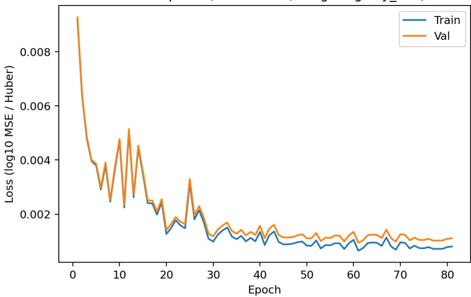  
Figure 7: Training and validation loss versus epoch for ΦasmaNet on the 1M dataset (seed 42, split/training seed 1337), using Huber loss in $\log _ { 1 0 } \rho$ space with histogram-based weighting by hist. The trajectories show rapid early improvement followed by a stable plateau under the shared learningrate scheduling and early-stopping protocol.

Within-tolerance vs. Epoch  
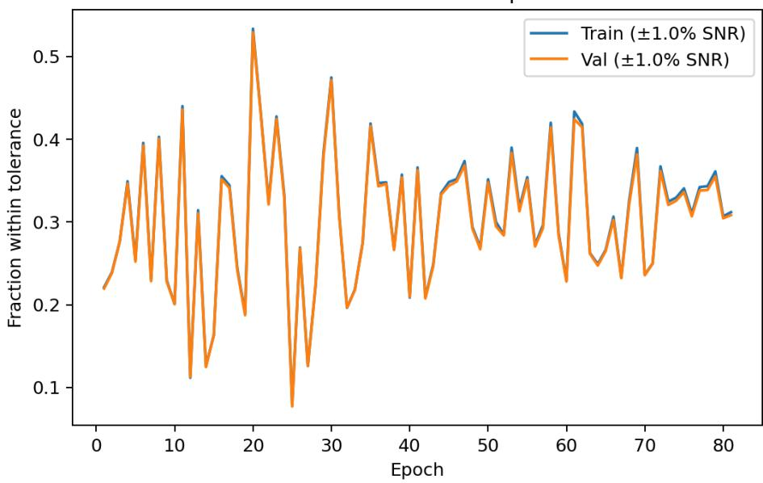  
Figure 8: Within-tolerance fraction versus epoch for ΦasmaNet on the 1M dataset (seed 42, split/training seed 1337). We report the fraction of samples with $| \rho _ { \mathrm { p r e d } } - \rho _ { \mathrm { t r u e } } | / \rho _ { \mathrm { t r u e } } \leq 1 \%$ in linear-SNR space on train and validation splits. This strict metric stabilizes at later epochs, consistent with convergence under the matched training protocol.

## 10.2 Residual structure and the efect of calibration

To directly visualize the efect of the monotonic PCHIP calibration (fit on validation, applied to test), Figure 9 compares test residual histograms in linear-SNR space before and after calibration. The calibrated residuals are more tightly concentrated around zero, indicating a reduction in globa systematic bias while preserving rank ordering by construction.

Calibration residuals vs True SNR (calibrated)  
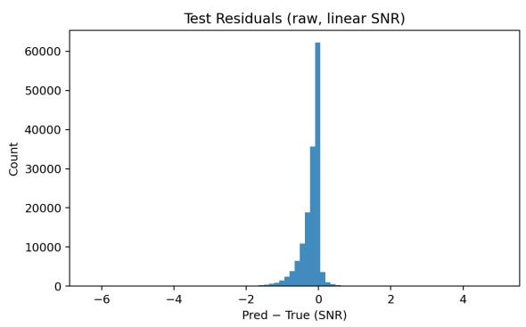

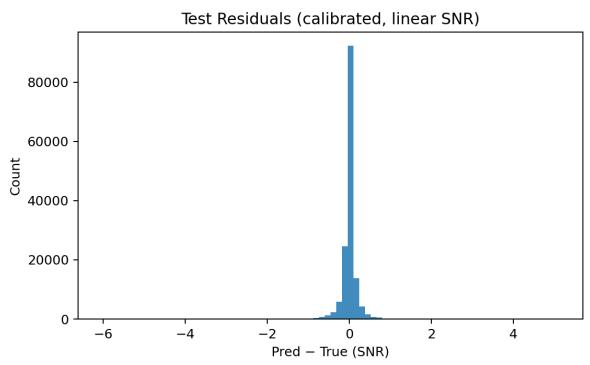  
Figure 9: Test residual histograms for ΦasmaNet on the 1M dataset (seed 42, split/training seed 1337) in linear-SNR space. Left: raw residuals $( \rho _ { \mathrm { p r e d } } - \rho _ { \mathrm { t r u e } } )$ . Right: residuals after monotonic PCHIP calibration (fit on validation, applied to test).

Beyond marginal residual distributions, it is important to check for SNR-dependent structure that could matter for selection-efect workflows. Figure 10 plots calibrated test residuals versus the true SNR in linear space. Residuals remain centered close to zero across the bulk of the SNR range, suggesting that calibration removes most global bias without inducing a strong SNR-dependent drift. The remaining spread reflects heteroscedasticity expected in this regression setting.

Finally, Figures 11–12 provide a qualitative check via predicted-versus-true scatter plots in linear-SNR space, before and after calibration. The calibrated mapping preserves monotone ordering while reducing systematic deviations, consistent with the post-calibration improvements reported in Section 9.

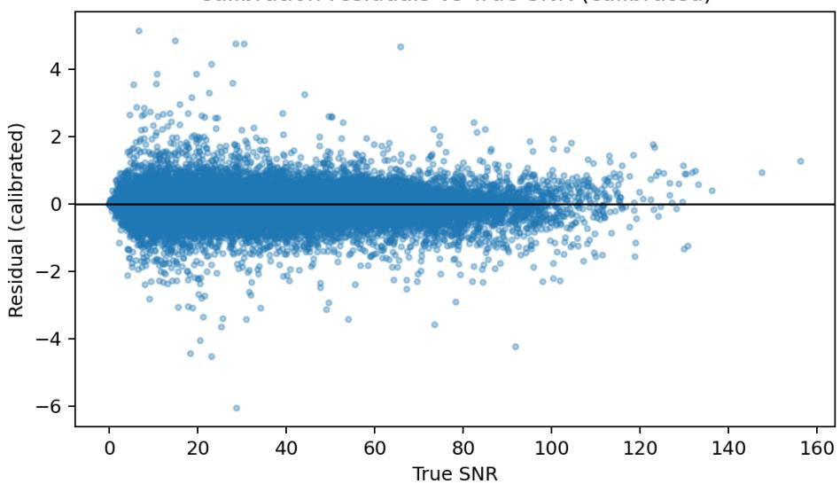  
Figure 10: Calibrated test residuals versus true SNR for ΦasmaNet on the 1M dataset (seed 42, split/training seed 1337), shown in linear-SNR space. This plot checks for SNR-dependent structure after applying the monotonic PCHIP mapping (fit on validation, applied to test).

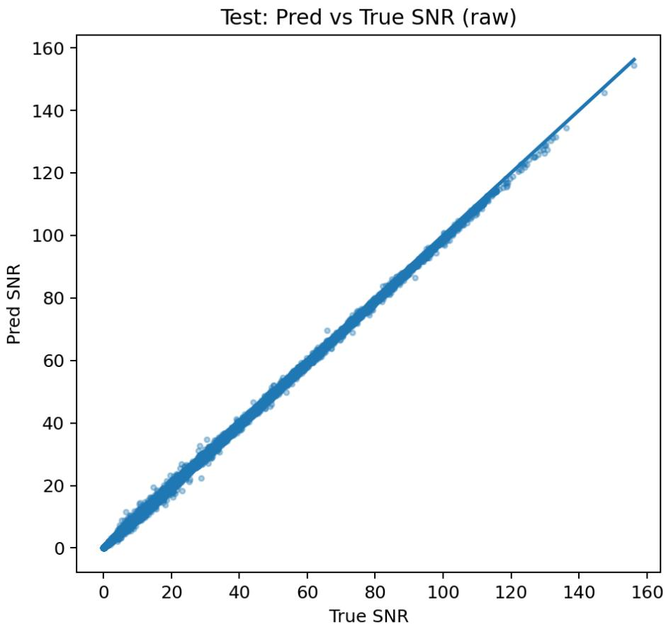  
Figure 11: Predicted versus true SNR for ΦasmaNet on the 1M test set (seed 42, split/training seed 1337), shown in linear-SNR space (raw predictions).

Test: Pred vs True SNR (calibrated)  
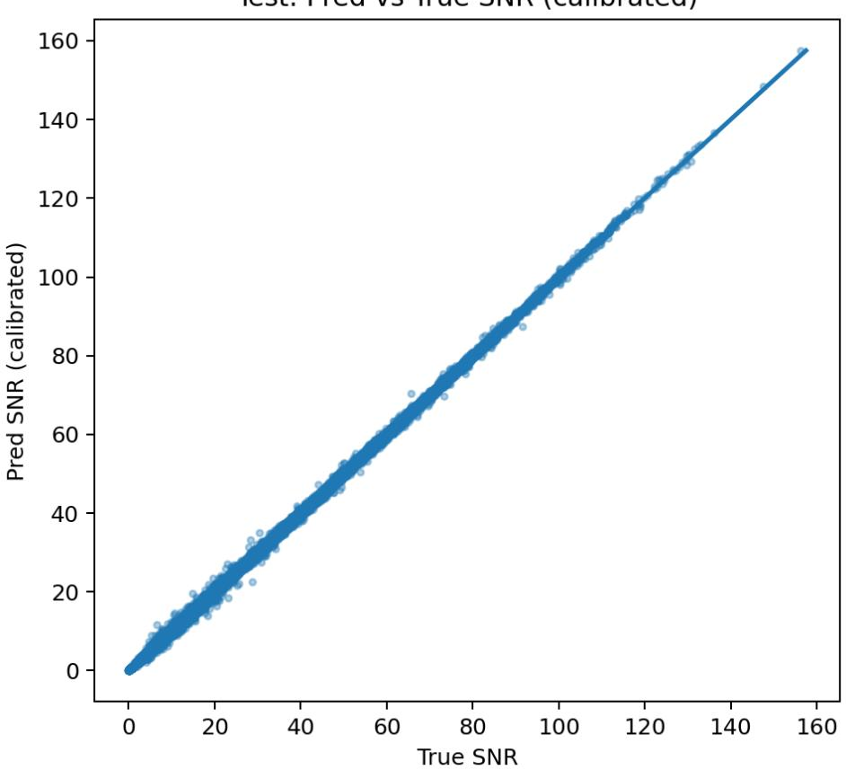  
Figure 12: Predicted versus true SNR for ΦasmaNet on the 1M test set (seed 42, split/training seed 1337), shown in linear-SNR space after monotonic PCHIP calibration (fit on validation, applied to test).

Table 9: Trainable parameter counts for each architecture under the default configurations used in this work. All counts refer to the models as instantiated for the 11-feature SNR regression task.
<table><tr><td>Architecture</td><td>Params</td><td>Relative</td><td>Key sizing</td></tr><tr><td>MLP</td><td>~201 k</td><td>1.0×</td><td> $\mathrm { w i d t h \ } w { = } 2 5 6 , \mathrm { d e p t h \ } d { = } 4$ </td></tr><tr><td>Transformer</td><td>~540k</td><td>2.7×</td><td> $d _ { \mathrm { m o d e l } } { = } 1 2 8 , N _ { L } { = } 4 , N _ { h } { = } 8 , d _ { \mathrm { f f } } { = } 2 5 6$ </td></tr><tr><td>ΦASMANET</td><td>~732k</td><td>3.7×</td><td> $T { = } 8 , D { = } 1 2 8 , K { = } 3 , R { = } 2 , P { = } 4$ </td></tr><tr><td>ResNet (1D)</td><td>~3.98M</td><td>19.8×</td><td>width w=64, 4 stages × 2 blocks</td></tr></table>

## 10.3 Accuracy in the detection-relevant regime

Because MAPE is a relative-error metric, samples with very small $\rho _ { \mathrm { t r u e } }$ can numerically dominate the aggregate error. Following common practice in selection-efect analyses [30], we additionally report accuracy conditional on the canonical single-detector detection threshold $\rho _ { \mathrm { t r u e } } > 8$ . On the 1M test set (dataset seed 42, split/training seed 1337), this subset comprises $N = 9 6 { , } 0 4 7$ samples (64.0% of the held-out test set). Under the same monotonic PCHIP calibration procedure described in Section 8 (fit on the validation split, applied to the test split), ΦasmaNet attains $1 0 0 { - } \mathrm { M A P E } = 9 8 . 7 1 \%$ precalibration and 99.39% post-calibration on this subset, with $R ^ { 2 } = 0 . 9 9 9 8$ in linear-SNR space. The detection-relevant accuracy is thus comparable to the full-set value pre-calibration (98.71% vs. 98.73%) and slightly higher post-calibration (99.39% vs. 99.29%), confirming that the surrogate’s predictive quality in the astrophysically detectable regime is at least as high as on the full distribution.

## 10.4 Computational eficiency

To quantify end-to-end inference cost, we perform a full evaluation pass on an independent $1 0 ^ { 6 } .$ -sample dataset using a saved checkpoint from the 1M-sample training run. The evaluation was executed on a single GPU (RTX 4080) with batch size $B = 1 0 2 4$ . The total wall-clock time for the complete pass, including data loading, forward passes, metric computation, and calibration, was approximately 8.3 s, corresponding to an efective throughput of $\approx 1 . 2 \times 1 0 ^ { 5 }$ samples per second. The corresponding wall-clock time of a traditional calculation of the SNR was 980s on a 16-core CPU with paralle execution. Using ΦasmaNet on a modern GPU is therefore about two orders of magnitude faster than the traditional SNR computation on a 16-core CPU, or more than three orders of magnitude faster than a single-core CPU implementation. This demonstrates that ΦasmaNet can provide rapid SNR predictions suitable for large-scale simulation and selection-efect studies.

Turning from throughput to model size, Table 9 summarizes the total number of trainable parameters for each architecture under the default hyperparameter configurations used throughout this work (see Sections 5.1–6). ΦasmaNet and the Transformer encoder are the most compact models, with approximately 732k and 540k parameters, respectively. The MLP baseline is the lightest at roughly 201k parameters owing to its simple stacked-linear design $( 1 1 \to 2 5 6 \to 2 5 6 \to 2 5 6 \to 2 5 6 \to 1 )$ , while the 1D-ResNet is the largest at approximately 3.98M parameters, dominated by its deepest convolutiona stage (Stage 4, C=512), which alone accounts for roughly 73% of the total. Notably, the recursive Φ-Feedback passes in ΦasmaNet reuse the same Φ-Stage and gate weights at every iteration, so increasing R adds no extra parameters. The computational cost grows only in FLOPs per forward pass. Overall, ΦasmaNet achieves the best accuracy–parameter trade-of among the evaluated architectures: with 5.4 fewer parameters than the ResNet and only 1.4 more than the Transformer, it attains the highest post-calibration 100 MAPE at every dataset scale considered (Section 9).

## 10.5 From SNR Predictions to Detection Probability

The application that motivates a fast SNR surrogate is the estimation of selection efects in population studies, where the detectability of every source in a large synthetic catalogue must be evaluated, and re-evaluated at each step of a hierarchical inference [19, 16, 15]. The single-detector restriction and fixed reference distance adopted here are not obstacles to this use: because the optimal SNR scales as $\rho \propto 1 / d _ { L } , \mathrm { ~ a ~ }$ label computed at $d _ { L } ^ { \mathrm { r e f } } = 1 0 0 0$ Mpc can be rescaled to any luminosity distance at query time, $\dot { \rho } ( d _ { L } ) = \rho ^ { \mathrm { r e f } } d _ { L } ^ { \mathrm { r e f } } / d _ { L }$ , so a surrogate trained at a single reference distance already returns the SNR for a population drawn over distance.

In the present work we adopt the simplest detectability model, a hard threshold on the optimal SNR,

$$
P _ { \mathrm { d e t } } ( \pmb \theta ) = P ( \mathrm { d e t } \mid \pmb \theta ) = \Theta ( \rho ( \pmb \theta ) - \rho _ { \mathrm { t h } } ) , \qquad \rho _ { \mathrm { t h } } = 8 ,\tag{15}
$$

not to carry out a population analysis, but as an additional, detection-oriented check on the surrogate. Applying Eq. (15) to the predicted and to the true SNRs assigns each test source a binary detectability label, and the two labels can be compared directly. Mislabellings can occur only for sources whose true SNR falls within the surrogate’s error band of the threshold, so the strong near-threshold fidelity reported above $( R ^ { 2 } \ : = \ : 0 . 9 9 9 8$ and $1 0 0 \mathrm { ~ - ~ } \mathrm { M A P E } = 9 9 . 3 9 \%$ on the $\rho _ { \mathrm { t r u e } } \ > \ 8$ subset) implies that the predicted and reference detection labels coincide for all but a small fraction of sources near $\rho _ { \mathrm { t h } }$ and hence that the predicted detectable fraction closely tracks the ground-truth value ( 64% at the reference distance).

We stress that Eq. (15) is a deterministic, optimal-SNR proxy, used here purely as an accuracy diagnostic. A realistic detection probability instead averages over noise realizations, modelling the observed SNR as a non-central $\chi ^ { 2 }$ variate about $\rho ,$ and, ideally, over search-pipeline efects such as non-stationarity and signal-consistency cuts that a single SNR threshold cannot capture [15, 30, 31]. Embedding ΦasmaNet in such a noise-averaged selection-function pipeline, and quantifying the resulting bias on the sensitive volume VT and on inferred population hyperparameters, is the subject of planned follow-up work. Here we report Eq. (15) only as a complementary check on the surrogate’s accuracy in the detection-relevant regime.

## 11 Discussion

We introduced ΦasmaNet, a staged spectral token-refinement architecture with Φ-Stages, the Φ- Refractor subspace mixing module, and Φ-Feedback top-down gated refinement, evaluated as a surrogate model for fast SNR prediction in a controlled, simulation-based setting. The learning task is to map a fixed-dimensional vector of intrinsic and extrinsic parameters (including distance and antennapattern projections) to the phase-averaged optimal PyCBC SNR under a fixed representative PSD and waveform approximant. We do not infer SNR from noisy strain time series.

Across dataset scales from 100k to 1M simulated binary black hole injections, ΦasmaNet consistently outperforms the evaluated Transformer-, ResNet-, and MLP-based neural baselines under the matched protocol described in Section 8. At the 1M-sample scale, ΦasmaNet reaches $1 0 0 \mathrm { ~ - ~ } \mathrm { M A P E } = 9 8 . 7 3 \%$ before calibration and 99.29% after monotonic PCHIP calibration on the held-out test set under the simulated configuration considered here. These figures are stable under dataset-realization variation: two additional independently generated 1M datasets (generation seeds 43 and 44) yield $9 8 . 7 2 \% / 9 9 . 1 7 \%$ and 98.70%/99.29% pre-/post-calibration (Section 9). They are obtained with a compact model of $\sim 7 3 2 \mathrm { k }$ trainable parameters, the most favorable accuracy–parameter trade-of among the evaluated architectures (Table 9).

With a sustained throughput of $\sim 1 . 2 \times 1 0 ^ { 5 }$ SNR evaluations per second on a single GPU ${ \mathrm { ( a ~ 1 0 ^ { 6 } . } }$ injection set processed end-to-end in $\sim 8 . 3 \ \mathrm { s }$ , Section 10), orders of magnitude faster than traditional methods, the approach is suitable for high-throughput simulation workflows under the assumptions described in Section 4. Accuracy is highest precisely where these workflows need it: conditional on the detection-relevant regime $\rho _ { \mathrm { t r u e } } > 8 ,$ , the calibrated surrogate attains $1 0 0 - \mathrm { { M A P E } = 9 9 . 3 9 \% }$ with $R ^ { 2 } = 0 . 9 9 9 8$ in linear-SNR space (Section 10).

These results support the use of ΦasmaNet as a compact surrogate for fast SNR evaluation in simulation-driven workflows where many SNR computations are required. The primary intended application is the estimation of selection efects in population inference, where the detectability of every source in a large synthetic catalogue must be evaluated repeatedly. The $\rho \propto 1 / d _ { L }$ rescaling and threshold-based $P _ { \mathrm { d e t } }$ construction of Section 10.5 make the present single-distance surrogate directly usable for this purpose.

A direct, apples-to-apples comparison against earlier neural SNR surrogates is not currently possible: prior studies adopt smaller input parametrizations (with correspondingly stronger approximations), diferent parameter ranges, and diferent detector noise curves, so no common external benchmark exists. Rather than claim superiority over such heterogeneous setups, we therefore report performance only against neural baselines trained under an identical, fully specified protocol. This study documents the full surrogate pipeline (sampling priors, waveform settings, data splits, training protocol, and calibration) at a level intended to make it reproducible end-to-end. Together with our public code release (Section 12), it is intended to provide a concrete, well-defined benchmark against which future surrogates, including non-neural tabular regressors such as gradient-boosted trees and packages such as gwsnr [31], can be compared.

We also stress the scope of the present study. The surrogate is trained for a single detector (LIGO-Hanford) under a fixed representative PSD and waveform approximant, operates on a 11- dimensional parameter/projection vector rather than detector strain, and is fitted over a bounded operating range $( \rho < 2 0 0 )$ . Within these assumptions it is accurate and fast, but its predictions are tied to the configuration used to generate the labels: transfer to other PSDs, observing epochs, or detector networks is not established here, and end-to-end detection from noisy strain is a diferent problem that a parameter-to-SNR surrogate does not address. Future work will therefore concentrate on extensions that remain within the surrogate setting while broadening its reach. First, we will cover detector networks by training one surrogate per detector and combining the per-detector SNRs in quadrature (Section 4), together with retraining for, or conditioning on, the PSDs of diferent observing epochs. Second, we will replace the hard $\rho _ { \mathrm { t h } } = 8$ proxy with a noise-averaged detection probability and quantify the induced bias on the sensitive volume VT and on inferred population hyperparameters, as outlined in Section 10.5. Third, we will broaden the architectural ablations and add strong non-neural tabular baselines, such as gradient-boosted trees, to isolate which components drive the observed gains. Finally, we will assess ΦasmaNet as a general-purpose architecture for structured tabular prediction, for which the out-of-the-box benchmarks of Appendix 14 provide encouraging preliminary evidence.

## 12 Code Availability

The training code for ΦasmaNet (with and without the Φ-Refractor) and for the MLP, ResNet and Transformer baselines is publicly available at https://github.com/giannis00/PhasmaNet-SNR.

## 13 Acknowledgments

We are grateful to Grigorios Papigkiotis, Alexandra Koloniari and Georgios Vardakas for comments. Virgo is funded through the European Gravitational Observatory (EGO), by the French Centre National de Recherche Scientifique (CNRS), the Italian Istituto Nazionale di Fisica Nucleare (INFN) and the Dutch Nikhef, with contributions by institutions from Belgium, Germany, Greece, Hungary, Ireland, Japan, Monaco, Poland, Portugal, Spain. Results presented in this work have been produced using the AUTh Computing Infrastructure and Resources.

The authors used ChatGPT-5/5.1 and Claude Opus 4.5 in parts of this manuscript for code generation, text generation, enhancing the clarity and structure of the work, and creation of explanatory figures. The authors have critically revised any generated text to ensure it is accurate and free from plagiarism. The authors are responsible for the interpretation, reasoning and conclusions presented in the manuscript. The authors ensured that AI-assisted explanatory figures did not alter, distort or misrepresent the underlying data.

## 14 Appendix

The main text evaluates ΦasmaNet as a surrogate for a single, tightly controlled task: phase-averaged optimal SNR regression under a fixed PSD, waveform approximant, and detector configuration. A natural concern is whether the gains we attribute to the staged inductive bias of ΦasmaNet are specific to this 11-dimensional, smooth-target regime, or whether they reflect a more general property of the architecture. To probe this, we report out-of-the-box results on three standard public tabular benchmarks spanning regression (YearPredictionMSD), multiclass classification (Covertype), and binary classification on a high-dimensional dense input (Epsilon, 2,000 features), and compare against the nine deep tabular architectures benchmarked under identical splits in [20].

We emphasize that these experiments are deliberately conducted without any dataset-specific hyperparameter tuning: the model configuration, tokenizer, and training protocol are inherited unchanged from the SNR regression setup of Section 6, whereas the reference architectures in [20] are individually tuned per-dataset via Bayesian optimization. The Epsilon benchmark, whose input dimensionality is two orders of magnitude larger than the regime the ΦasmaNet tokenizer was sized for, additionally serves as a deliberate stress test of transferability rather than a like-for-like comparison. Our goal in this appendix is therefore not to claim state-of-the-art results on standard tabular benchmarks, but to provide controlled evidence that the ΦasmaNet inductive bias (staged Φ-Stages, Φ-Refractor subspace mixing, and Φ-Feedback top-down refinement) transfers beyond the gravitational-wave SNR surrogate task.

Table 10: Covertype test performance of ΦasmaNet (mean  SEM over seeds). No hyperparameter tuning was performed. The configuration is inherited from the SNR regression experiments in Section 6.
<table><tr><td>ΦasmaNet variant</td><td>Accuracy</td><td>Cross-entropy</td></tr><tr><td>Φ-Refractor ON</td><td> $0 . 9 6 6 4 \pm 0 . 0 0 0 2$ </td><td> $0 . 2 8 2 8 \pm 0 . 0 0 4 9$ </td></tr><tr><td>Φ-Refractor OFF</td><td>0.9634</td><td></td></tr></table>

Out-of-the-box performance on YearPredictionMSD (regression). To contextualize these numbers, we compare against the nine deep tabular architectures benchmarked on YearPrediction-MSD in [20] (MLP, SNN, TabNet, GrowNet, DCN2, AutoInt, NODE, ResNet, and FT-Transformer), evaluated on the same train/validation/test split we use here. Under our out-of-the-box configuration, ΦasmaNet (Refractor ON) attains $\mathrm { R M S E } = 8 . 8 7 3 8$ , which outperforms 4 out of 9 reference architectures (TabNet at 8.909, SNN at 8.895, DCN2 at 8.890, and AutoInt at 8.882), placing it at rank ${ \bf 6 } / { \bf 1 0 }$ (the nine references plus ΦasmaNet) on this benchmark, within 0.09 RMSE points of the top deep baseline (NODE at 8.784). We emphasize that this result is obtained without any hyperparameter tuning on YearPredictionMSD, whereas the reference architectures in [20] are individually tuned per-dataset via Bayesian optimization. A task-specific hyperparameter search for ΦasmaNet would likely improve its relative position further.

Out-of-the-box performance on Covertype (multiclass classification). We compare against the deep tabular architectures benchmarked on Covertype in [20] under the same split and evaluation protocol. Of these, eight report a Covertype number (GrowNet does not). Under our out-of-the-box configuration, ΦasmaNet (Refractor ON) attains a test accuracy of 0.9664, which outperforms 7 out of 8 reference architectures (DCN2 at 0.965, ResNet at 0.964, MLP at 0.962, SNN at 0.961, NODE at 0.958, TabNet at 0.957, and AutoInt at 0.934), placing it at rank $\mathbf { 2 / 9 } .$ . The only architecture that surpasses it is FT-Transformer (0.970). As in the regression case, this result is obtained without any dataset-specific hyperparameter search, while the reference architectures in [20] are individually tuned per dataset. This reinforces our view that the observed performance reflects the inductive bias of ΦasmaNet itself rather than careful tuning.

Out-of-the-box performance on Epsilon (binary classification). We evaluate ΦasmaNet on the Epsilon binary classification benchmark and contextualize the results against the nine deep tabular architectures reported in [20], evaluated under the same train/validation/test split. Table 11 summarizes test performance (mean SEM over seeds): ΦasmaNet attains a scaled log loss of $2 5 . 9 7 4 1 \pm 0 . 1 2 8 9$ , accuracy $0 . 8 9 1 5 \pm 0 . 0 0 0 5$ , and $\mathrm { R O C - A U C } = 0 . 9 9 5 0 \pm 0 . 0 0 0 3$ . The near-perfect ROC-AUC indicates strong and stable discrimination on this high-dimensional dense tabular input.

In terms of accuracy, ΦasmaNet places near the bottom of the ranking on this dataset, outperforming only TabNet (0.8896) and trailing the top tuned architecture (FT-Transformer at 0.8982). However, the spread between the best and worst deep architectures on Epsilon is small: all nine reference architectures lie within approximately 0.9 percentage points of each other (0.8896–0.8982), and ΦasmaNet’s accuracy is within 0.67 percentage points of the best tuned model.

As noted above, this is a deliberate stress test rather than a like-for-like comparison: the tokenizer (a single linear projection to $T = 8$ tokens) and the full configuration are inherited unmodified from the 11-dimensional SNR task and applied untuned to a 2,000-dimensional input. Even so, ΦasmaNet remains within the same performance band as the tuned deep tabular baselines. A dedicated tokenizer and hyperparameter search for high-dimensional dense inputs would be the natural next step to improve its competitiveness in this regime.

Table 11: Epsilon test performance of ΦasmaNet $( \mathrm { m e a n } \pm \mathrm { S E M }$ over seeds). Log loss is scaled by 100 as is customary for this dataset. No hyperparameter tuning was performed. The configuration is inherited from the SNR regression experiments in Section 6.
<table><tr><td>ΦasmaNet variant</td><td> $\mathbf { L o g L o s s \times 1 0 0 }$ </td><td>Accuracy</td><td>ROC-AUC</td></tr><tr><td>Default (Refractor ON)</td><td> $2 5 . 9 7 4 1 \pm 0 . 1 2 8 9$ </td><td> $0 . 8 9 1 5 \pm 0 . 0 0 0 5$ </td><td> $0 . 9 9 5 0 \pm 0 . 0 0 0 3$ </td></tr></table>

Discussion of the tabular benchmarks. Taken together, the three benchmarks (one regression, two classification) indicate that the ΦasmaNet inductive bias (staged Φ-Stages, Φ-Refractor subspace mixing, and Φ-Feedback top-down refinement) transfers beyond the gravitational-wave SNR surrogate task to standard public tabular problems, without any dataset-specific hyperparameter tuning. On YearPredictionMSD it attains competitive RMSE, landing in the middle of the tuned reference architectures reported in [20] (rank 6/10). On Covertype it attains high multiclass accuracy and low cross-entropy, ranking near the top (rank 2/9, surpassed only by FT-Transformer), with a modest Φ- Refractor ON/OFF diference (Table 10) consistent with the Φ-Refractor acting as a task-dependent representational enhancer. The strong ranking suggests that the Φ-Stage and Φ-Feedback hierarchy can capture non-linear feature interactions at scale. On Epsilon, whose 2,000-dimensional input is far outside the regime the ΦasmaNet tokenizer was designed for, it still achieves strong discrimination (near-perfect AUC) and remains within roughly 0.7 percentage points of the best tuned deep baseline. We emphasize that our goal here is not an exhaustive benchmark study but a controlled demonstration of transferability: a full per-dataset tuning study, together with a tokenizer variant adapted to high-dimensional dense inputs, is left for future work and would be the natural next step to establish ΦasmaNet as a competitive general-purpose tabular architecture.

## References

[1] J Aasi, B P Abbott, R Abbott, T Abbott, M R Abernathy, K Ackley, C Adams, Adams, et al. Advanced ligo. Classical and Quantum Gravity, 32(7):074001, March 2015.

[2] A. G. Abac et al. GW231123: a binary black hole merger with total mass 190–265 m . arXiv preprint arXiv:2507.08219, 2025.

[3] A. G. Abac et al. GW250114: Testing hawking’s area law and the kerr nature of black holes. Physical Review Letters, 135(11):111403, 2025.

[4] A. G. Abac et al. GWTC-4.0: Updating the gravitational-wave transient catalog with observations from the first part of the fourth LIGO–Virgo–KAGRA observing run. arXiv preprint arXiv:2508.18082, 2025.

[5] A. G. Abac et al. GWTC-5.0: Observations from the second part of the fourth LIGO–Virgo– KAGRA observing run and updates to the gravitational-wave transient catalog. arXiv preprint arXiv:2605.27225, 2026.

[6] B. P. Abbott et al. Observation of gravitational waves from a binary black hole merger. Physical Review Letters, 116(6):061102, 2016.

[7] B. P. Abbott et al. GWTC-1: A gravitational-wave transient catalog of compact binary mergers observed by LIGO and Virgo during the first and second observing runs. Physical Review X, 9(3):031040, 2019.

[8] R. Abbott et al. GWTC-2: Compact binary coalescences observed by LIGO and Virgo during the first half of the third observing run. Physical Review X, 11(2):021053, 2021.

[9] R. Abbott et al. GWTC-3: Compact binary coalescences observed by LIGO and Virgo during the second part of the third observing run. Physical Review X, 13(4):041039, 2023.

[10] R. Abbott et al. GWTC-2.1: Deep extended catalog of compact binary coalescences observed by LIGO and Virgo during the first half of the third observing run. Physical Review D, 109(2):022001, 2024.

[11] F Acernese, M Agathos, K Agatsuma, D Aisa, N Allemandou, A Allocca, J Amarni, Astone, et al. Advanced virgo: a second-generation interferometric gravitational wave detector. Classical and Quantum Gravity, 32(2):024001, December 2014.

[12] T Akutsu, M Ando, K Arai, Y Arai, S Araki, A Araya, N Aritomi, Y Aso, et al. Overview of kagra: Detector design and construction history. Progress of Theoretical and Experimental Physics, 2021(5), August 2020.

[13] Jimmy Lei Ba, Jamie Ryan Kiros, and Geofrey E. Hinton. Layer normalization. arXiv preprint arXiv:1607.06450, 2016.

[14] Christopher M Biwer, Collin D Capano, Soumi De, Miriam Cabero, Duncan A Brown, Alexander H Nitz, and Vivien Raymond. Pycbc inference: A python-based parameter estimation toolkit for compact binary coalescence signals. Publications of the Astronomical Society of the Pacific, 131(1001):024503, 2019.

[15] Thomas A. Callister, Reed Essick, and Daniel E. Holz. Neural network emulator of the advanced ligo and advanced virgo selection function. Physical Review D, 110(12):123041, 2024.

[16] Christian EA Chapman-Bird, Christopher PL Berry, and Graham Woan. Rapid determination of lisa sensitivity to extreme mass ratio inspirals with machine learning. Monthly Notices of the Royal Astronomical Society, 522(4):6043–6054, 2023.

[17] Alexey Dosovitskiy, Lucas Beyer, Alexander Kolesnikov, Dirk Weissenborn, Xiaohua Zhai, Thomas Unterthiner, Mostafa Dehghani, Matthias Minderer, Georg Heigold, Sylvain Gelly, Jakob Uszkoreit, and Neil Houlsby. An image is worth 16x16 words: Transformers for image recognition at scale. arXiv preprint arXiv:2010.11929, 2020.

[18] Stephen Fairhurst. Localizing compact binary coalescences with post-linear parameter estimation. New Journal of Physics, 12(12):123034, 2010.

[19] Davide Gerosa, Geraint Pratten, and Alberto Vecchio. Gravitational-wave selection efects using neural-network classifiers. Physical Review D, 102(10):103020, 2020.

[20] Yury Gorishniy, Ivan Rubachev, Valentin Khrulkov, and Artem Babenko. Revisiting deep learning models for tabular data. Advances in Neural Information Processing Systems, 34:18932–18943, 2021.

[21] Kaiming He, Xiangyu Zhang, Shaoqing Ren, and Jian Sun. Deep residual learning for image recognition. In Proceedings of the IEEE Conference on Computer Vision and Pattern Recognition (CVPR), pages 770–778, 2016.

[22] Kaiming He, Xiangyu Zhang, Shaoqing Ren, and Jian Sun. Identity mappings in deep residual networks. arXiv preprint arXiv:1603.05027, 2016.

[23] Kurt Hornik, Maxwell Stinchcombe, and Halbert White. Multilayer feedforward networks are universal approximators. Neural Networks, 2(5):359–366, 1989.

[24] Jie Hu, Li Shen, and Gang Sun. Squeeze-and-excitation networks. In Proceedings of the IEEE Conference on Computer Vision and Pattern Recognition (CVPR), pages 7132–7141, 2018.

[25] CunLiang Ma, Sen Wang, Wei Wang, and Zhoujian Cao. Using deep learning to predict matched signal-to-noise ratio of gravitational waves. Physical Review D, 109(4):043009, 2024.

[26] Ryan Magee, Richard George, Alvin Li, and Ritwik Sharma. Neural network-based gravitational wave interpolant with applications to low-latency analyses. arXiv preprint arXiv:2408.02470, 2024.

[27] Emilio A Moreno, Alexander H Nitz, and Collin D Capano. Detecting and denoising gravitational wave signals from binary black holes using deep learning. Physical Review D, 108(4):043024, 2023.

[28] Matthew Mould, Davide Gerosa, Marco Dall’Amico, and Michela Mapelli. One to many: comparing single gravitational-wave events to astrophysical populations. Monthly Notices of the Royal Astronomical Society, 525(3):3986–3997, 2023.

[29] Matthew Mould, Davide Gerosa, and Stephen R Taylor. Deep learning and bayesian inference of gravitational-wave populations: Hierarchical black-hole mergers. Physical Review D, 106(10):103013, 2022.

[30] Matthew Mould, Christopher J Moore, and Davide Gerosa. Calibrating signal-to-noise ratio detection thresholds using gravitational-wave catalogs. Physical Review D, 109(6):063013, 2024.

[31] Hemantakumar Phurailatpam and Otto Akseli Hannuksela. gwsnr: A python package for eficient signal-to-noise calculation of gravitational-waves. Journal of Open Source Software, 2024. submitted.

[32] Geraint Pratten, Cecilio Garc´ıa-Quir´os, H´ector Estell´es, Sascha Husa, Antoni Ramos-Buades, Rafel Jaume, and Marta Colleoni. Imrphenomxhm: A multi-mode frequency-domain model for generic non-precessing black-hole binaries. Physical Review D, 104(8):084059, 2021.

[33] Geraint Pratten, Sascha Husa, Cecilio Garc´ıa-Quir´os, Marta Colleoni, Antoni Ramos-Buades, H´ector Estell´es, and Rafel Jaume. Setting the cornerstone for a family of models for gravitational waves from compact binaries: The dominant harmonic for nonprecessing quasi-circular black holes. Physical Review D, 102(6):064001, 2020.

[34] Marlin B Sch¨afer, Alexander H Nitz, et al. Deep residual networks for gravitational wave detection. arXiv preprint arXiv:2211.01520, 2022.

[35] Ilya M Sobol. On the distribution of points in a cube and the approximate evaluation of integrals. USSR Computational Mathematics and Mathematical Physics, 7(4):86–112, 1967.

[36] Ioannis Tsioulis. Rapid calculation of the signal-to-noise ratio of gravitational-wave sources using artificial neural networks. Master’s thesis, University of Piraeus, Piraeus, Greece, 2023. Available at Dione - Institutional Repository of the University of Piraeus.

[37] Ashish Vaswani, Noam Shazeer, Niki Parmar, Jakob Uszkoreit, Llion Jones, Aidan N Gomez, Lukasz Kaiser, and Illia Polosukhin. Attention is all you need. Advances in Neural Information Processing Systems, 30, 2017.

[38] Andreas Veit, Michael J Wilber, and Serge Belongie. Residual networks behave like ensembles of relatively shallow networks. Advances in Neural Information Processing Systems, 29, 2016.

[39] Kaze WK Wong, Ken KY Ng, and Emanuele Berti. Gravitational-wave signal-to-noise interpolation via neural networks. Physical Review D, 102(4):043002, 2020.

[40] Saining Xie, Ross Girshick, Piotr Doll´ar, Zhuowen Tu, and Kaiming He. Aggregated residual transformations for deep neural networks. In Proceedings of the IEEE Conference on Computer Vision and Pattern Recognition (CVPR), pages 1492–1500, 2017.