# Risk-Sensitive Non-Parametric and Kernel Bandits

Devdan Dey <sup>∗</sup> Sujoy Bhore <sup>†</sup> Avishek Ghosh <sup>‡</sup>

## Abstract

We study the non-parametric bandit problem where actions are evaluated using Cumulative Prospect Theory (CPT) rather than expected reward. We consider the above problem over continuous action spaces with arm-dependent noise. We propose and analyze Non-Parametric CPT Bandits (NPCB), which chooses the actions in an optimistic fashion with CPT weights. Notably, NPCB decouples the mean estimation task from CPT weight-based decision making, which makes it modular. We show that the appropriately defined (CPT) regret of NPCB is $\widetilde { O } \Big ( \sqrt { T \ \mathrm { d i m } _ { E } ( \mathcal { F } , T ^ { - 2 } ) \ \log N ( \mathcal { F } , T ^ { - 2 } , \| \cdot \| _ { \infty } ) } \Big )$ , where dim<sub>�</sub> is the Eluder-dimension of the non-parametric function class F, � is the learning horizon and $N ( \mathcal { F } , T ^ { - 2 } , \| \cdot \| _ { \infty } )$ is the covering number of F in the sup norm with precision $T ^ { - 2 }$ . This matches the usual regret of classical non-parametric bandits [RR13], which proves that adding risk-sensitiveness to the formulation is order-wise free.

We further extend NPCB to unknown noise CDFs. The regret bound retains the known-CDF meanlearning term and adds a CDF-learning cost governed by a distributional Eluder dimension. As an instantiation, we study Kernel-CPT bandits. Using information gain, we obtain regret bounds for a large variety of kernels. This bound matches the corresponding risk-neutral kernel upper rate up to logarithmic factors.

## 1 Introduction

The Multi-Armed Bandit framework is a fundamental paradigm for sequential decision-making under uncertainty. In the vast majority of this literature [LS20, BCB<sup>+</sup>12], the objective is to minimize appropriately defined regret, which depends simply on the mean of the reward distribution associated with the arm pulled. However, in real-world applications—ranging from clinical trials to financial portfolio optimization—the mean does not satisfactorily capture the merits of certain actions, especially when humans are involved in the decision. See [TAJ22] for a recent survey.

In such applications, risk plays an important role, and a risk-aware performance measure is often preferred over the average reward. Consequently, significant research has focused on diverse risk measures, including mean-variance (MV) [Mar52], Value-at-Risk (VaR) [ADEH99], Conditional Value-at-Risk (CVaR) [ADEH99, RU00], spectral risk measures [Ace02], and utility-based shortfall risk [ADEH99, HZ18]. While these measures satisfy axioms of coherence or convexity, they often fail to model the nuances of human behavior, such as loss aversion and asymmetric preferences, which are best captured by the celebrated (and Nobel prize-winning) risk measure Cumulative Prospect Theory (CPT) [TK92]. The failure of standard risk measures is structural. MV penalizes all variance equally, treating rare massive gains and catastrophic losses identically. CVaR only examines the lower tail of the reward distribution, so rare disasters are averaged with ordinary outcomes when their probability is below the chosen tail level, while attractive lottery gains are not its focus. CPT avoids both failures through nonlinear probability weighting — a 1% chance of a fatal crash carries disproportionate psychological weight far exceeding 0.01. This amplification of rare events means CPT simultaneously penalizes hidden disasters and values rare large gains, capturing the two asymmetric behaviors that characterize human decision-making under uncertainty.

To further motivate the necessity of CPT risk, consider the challenge of automated policy design motivated by the Asian Disease Problem [Kah11]. Consider an agent tasked with optimizing a Public Health Score � (e.g., the number of lives saved). The agent must choose between two policies: a “Safe” protocol guaranteeing that 200 lives are saved $( r = 2 0 0 )$ , and a “Risky” protocol with a 35% chance of saving 600 lives $( r = 6 0 0 )$ and a 65% chance of saving none $( r = 0 )$ . A standard risk-neutral agent calculates the averages as $\mu _ { \mathrm { R i s k y } } = 2 1 0 > \mu _ { \mathrm { S a f e } } = 2 0 0$ , therefore identifying the risky protocol as optimal. However, empirical evidence shows that the vast majority of human decision-makers reject this gamble [TK92] and choose the safe protocol. This reveals a critical insight: the standard method of maximizing the mean reward is misaligned with human ethical and behavioral preferences.

CPT addresses this misalignment by evaluating actions not through a simple average, but through a distorted value $\begin{array} { r } { \mathcal { V } _ { a } ( f ) : = \int _ { 0 } ^ { \infty } \mathbb { w } ( 1 - F _ { a } ^ { f } ( z ) ) d z - \int _ { 0 } ^ { \infty } \mathbb { w } \left( F _ { a } ^ { f } ( - z ) \right) } \end{array}$ ��, where $\mathbb { w } ( \cdot )$ is a non-linear weight (distortion) function applied to the cumulative distribution $F _ { X } ( . )$ . Note that if w(·) is an identity function, we get the standard average, i.e., $\mathcal V ( X ) = \mathbb E ( X )$ . In the above-mentioned example, $\mathcal { V } _ { \mathrm { S a f e } } = 2 0 0$ while $\mathcal { V } _ { \mathrm { R i s k y } } = 6 0 0 \ w ( 0 . 3 5 )$ . Hence the safe action is the subjective optimum precisely when $\mathbb { w } ( 0 . 3 5 ) < 1 / 3$ . For instance, using the Tversky–Kahneman weighting form with $\gamma = 0 . 5 \mathrm { g i v e s } \mathbb { w } ( 0 . 3 5 ) \approx 0 . 3 0 3$ , and therefore $\mathcal { V } _ { \mathrm { R i s k y } } \approx 1 8 2 < 2 0 0 = \mathcal { V } _ { \mathrm { S a f e } }$ . In general, with distorted weights, the sequence of actions chosen may difer from that under the risk-neutral measure. To demonstrate this distinction empirically, we construct instances in which risk-neutral and risk-sensitive objectives lead to systematically diferent decisions, with the separation persisting across repeated trials (see, Figure 1 (a)-(b)).

Significant research has focused on diverse risk measures in the multi-armed bandit setting. For instance, [SLM13, VZ16, HCGS24] study the Mean-Variance setup extensively for �-armed bandits. [VZ15] analyzes Value-at-Risk (VaR) in the context of the total reward sequence. [GST14, TKB19, TW22, KAJ19] utilize the Conditional Value-at-Risk (CVaR) measure in �- armed Bandit setting. [KNJ19] proposes a distributionoblivious algorithm for optimizing a linear combination of mean and CVaR, specifically for unbounded reward distributions in the best-arm identification setting. For Kernel bandits, [Tak22] study the standard Upper Confidence Bound (UCB) type algorithms for CVaR and Mean-Variance risk measures and prove nearoptimal results. To provide a systematic analysis of such metrics, [CMZ18] introduced a unified framework for multi-armed bandits under general risk satisfying a Lipschitz continuity condition with respect to probability distributions (e.g., in the Wasserstein distance). However, the CPT functional is generally not Lipschitz continuous [TAJ22], often causing the value to fluctuate wildly with small distribution changes. This lack of stability prevents the direct application of existing unified frameworks to CPT.

To the best of our knowledge, bandit optimization with CPT-based risk measures has been limited. Prior works have used CPT-based risk-sensitive measures for simple �-armed and linear bandits [GPFM17], and achieve near-optimal regret bounds. Recently, $\mathrm { [ T M A ^ { + } 2 5 ] }$ proposes a unified framework for distortion risk measures in the �-armed bandit setting, covering both monotone and non-monotone distortions and showing that, for certain non-monotone objectives, an optimal policy may require a mixture of arms. However, their analysis is primarily focused on finite �-armed bandits, whereas our interest is in continuous action spaces and general non-parametric reward functions. Moreover, CPT introduces a distinct nonlinear probability distortion that is not covered by their mixture-based analysis. This leaves a theoretical gap in

CPT optimization for non-parametric function classes. This prompts the central question of our work:

Is it possible to learn (general) non-parametric (including Kernel) bandits with CPT risk measure?

In this paper, we answer this question afirmatively. We analyze a learning algorithm, namely Non-Parametric CPT-Bandits (NPCB), that works for general functional bandits with the CPT risk measure. Notably, NPCB is agnostic to (non-parametric) function class and uses the Eluder Dimension [RR13] to characterize the complexity of the learning task. As a primary instantiation of our framework, we study Kernel bandits and obtain guarantees for Kernel CPT (KCB) algorithm. To the best of our knowledge, this is the first work to study Kernel Bandits (RKHS) under a CPT-based risk measure.

## 1.1 Summary of contributions

Non-parametric CPT bandits: We propose a learning algorithm with CPT-based risk for general, nonparametric bandits, namely NPCB. Our formulation captures continuous action spaces with arm-dependent noise. For this general setup, we derive the regret bound (refer to Theorem 4.2) which matches the order-wise performance of risk-neutral non-parametric bandits [RR13]. This demonstrates that non-linear humancentric risk measures can be incorporated into infinite-dimensional function learning without incurring a regret penalty.

Kernel CPT bandits: For an RKHS mean-reward class and known arm-dependent noise CDFs, we give kernel algorithms for CPT regret. Our phasewise procedure achieves $\widetilde { O } ( \sqrt { T \gamma _ { T } ( \lambda ) } )$ regret, matching the standard risk-neutral dependence on information-gain.

Modular Algorithm: Our algorithms decouple the Learning Module (mean estimation from undistorted rewards) from the Decision Module (CPT valuation). This makes our framework function-class-agnostic, allowing it to be seamlessly applied to any function class (e.g., Linear, RKHS, or Neural Nets), provided a valid confidence set can be constructed.

CPT stability for non-parametric learning: Building on the translation stability of [GPFM17], we connect CPT uncertainty to confidence widths for general mean-function classes. Under additive noise, the CPT value is uniformly 2-Lipschitz in the mean, even without Hölder continuity of the weighting function <sup>1</sup>. This connects CPT regret to the Eluder dimension and covering numbers, and supports our kernel instantiations.

Removing Known CDF assumption: For the case of linear bandits, $\mathrm { [ K A G ^ { + } 2 3 }$ , Section V, Remark 10] require the knowledge of the cumulative distribution function of the noise, remarking that online estimation of the CDF is an open problem left for future work. We learn the noise CDF online using a joint likelihood confidence set. The regret keeps the mean-learning term and adds a cost governed by joint distributional complexities. We bound these complexities for an explicit linear family and its RKHS extension.

## 2 Problem Formulation

We consider the sequential decision-making problem over a finite time horizon �, characterized by a compact and continuous action space $\mathcal { A } \subseteq \mathbb { R } ^ { d }$ , which may be infinite. The environment is governed by an unknown true mean-reward function $f ^ { * } : \mathcal { A }  \mathbb { R }$ , which belongs to a known class of non-parametric functions of real-valued functions F. The value $f ^ { * } ( a )$ represents the expected reward associated with action $a \in { \mathcal { A } } . { \mathrm { A t } }$ each step �, the agent selects an action $a _ { t } \in \mathcal A$ based on the history of previous observations $\mathcal { D } _ { t - 1 } = \{ ( a _ { \tau } , r _ { \tau } ) \} _ { \tau = 1 } ^ { t - 1 }$ . The environment then reveals a realized physical reward $r _ { t } = f ^ { * } ( a _ { t } ) + \epsilon _ { t }$

Unlike the standard bandit formulation, we allow arm-dependent noise. Conditional on the history and the selected arm $a _ { t } = a$ , the noise $\epsilon _ { t }$ has a fixed distribution $F _ { \epsilon _ { a } }$ with mean zero. For a candidate $f \in { \mathcal { F } }$ , the corresponding reward CDF is $F _ { a } ^ { f } ( z ) = F _ { \epsilon _ { a } } ( z - f ( a ) )$ . We assume that these candidate reward distributions are supported in [−�, �].

While the agent observes undistorted rewards $r _ { t }$ drawn from the distribution defined by $F _ { \epsilon _ { a } }$ , its decision is governed by a subjective distortion of these probabilities. This distortion is parameterized by weight function $\mathbb { W } : [ 0 , 1 ] \to [ 0 , 1 ]$ . We define the weight-distorted reward, denoted by $\mathcal { V } _ { a } ( f )$ , by applying the distortion w to the cumulative probabilities of the reward distribution as

$$
\mathcal { V } _ { a } ( f ) : = \int _ { 0 } ^ { \infty } \mathbb { w } \left( 1 - F _ { a } ^ { f } ( z ) \right) d z - \int _ { 0 } ^ { \infty } \mathbb { w } \left( F _ { a } ^ { f } ( - z ) \right) d z
$$

The weight function $\mathbb { W } : [ 0 , 1 ] \to [ 0 , 1 ]$ is the behavioral core of CPT. Beyond the minimal conditions $\mathbb { w } ( 0 ) = 0 , \mathbb { w } ( 1 ) = 1$ , and monotone increasing [TK92, GPFM17], we impose no additional assumptions. Together with the bounded-reward assumption above, $\mathbb { W } ( 0 ) = 0$ ensures that $\mathcal { V } _ { a } ( f )$ is finite. Several families of w satisfying these properties are widely used in behavioral economics, including the Tversky–Kahneman function $\mathrm { [ T K 9 2 ] } \ \mathbb { w } ( p ) = p ^ { \gamma } / ( p ^ { \gamma } + ( 1 - p ) ^ { \gamma } ) ^ { 1 / \gamma }$ , the Prelec function $\left[ \mathrm { P r e } 9 8 \right] \ l \ l \ l \ l \ l \ l \ l \ l \ l \ l \ l \ l \ l \ l \ l \ l \ l \ l \ l \ l \ l \ l \ l \ l \ l \ l \ l \ l \ l \ l \ l \ l \ l \ l \ l \ l \ l \ l \ l \ l \ l \ l \ l \ l \ l \ l \ l \ l \ l \ l \ l \ l \ l \ l \ l \ l \ l \ l \ l \ l \ l \ l \ l \ l \ l \ l \ l \ l \ l \ l \ l \ l \ l \ l \ l \ l \ l \ l \ l \ l \ l \ l \ l \ l \ l \ l \ l \ l \ l \ l \ l \ l \ l \ l \ l \ l \ l \ l \ l \ l \ l \ l \ l \ l \ l \ l \ l \ l \ l \ l \ l \ l \ l \ l \ l \ l \ l \ l \ l \ l \ l \ l \ l \ l \ l \ l \ l \ l \ l \ l \ l \ l \ l \ l \ l \ l \ l \ l \ l \ l \ l \ l \ l \ l \ l \ l \ l \ l \ l \ l \ l \ l \ l \ l \ l \ l \ l \ l \ l \ l \ l \ l \ l \ l \ l \ l \ l \ l \ l \ l \ l \ l \ l \ l \ l \ l \ l \ l \ l \ l \ l \ l \ l \ l \ l \ l \ l \ l \ l \ l \ l \ l \ l \ l \ l \ l \ l \ l \ l \ l \ l \ l \ l \ l \ l \ l \ l \ l \ l \ l \ l \ l \ l \ l \ l \ l \ l \ l \ l \ l \ l \ l \ l \ l \ l \ l \ l \ l \ l \ l \ l \ l \ l \ l \ l \ l \ l \ l \ l \ l \ l \ l \ l \ l \ l \ l \ l \ l \ l \ l \ l \ l \ l \ l \ l \ l \ l \ l \ l \ l \ l \ l \ l \ l \ l \ l \ l \ l \ l \ l \ l \ l \ l \ l \ l \ l \ l \ l \ l \ l \ l \ l \ l \ l \ l \ l \ l \ l \ l \ l \ l \ l \ l \ l \ l \ l \ l \ l \ l \ l \ l \ l \ l \ l \ l \ l \ l \ l \ l \ l \ l \ l \ l \ l \ l \ l \ l \ l \ l \ l \ l \ l \ l \ l \ l \ l \ l \ l \ l \ l \ l \ l \ l \ l \ l \ l \ l \ l \ l \ l \ l \ l \ l \ l \ l \ l \ l \ l \ l \ l \ l \ l \ l \ l \ l \ l \ l \ l \ l \ l \ l \ l \ l \ l \ l \ l \ l \ l \ l \ l \ l \ l \ l \ l \ l \ l $ , and the Gonzalez–Wu function $[ \mathrm { G W 9 9 } ] _ { \mathbb { W } } ( p ) = \delta p ^ { \gamma } / ( \delta p ^ { \gamma } + ( 1 - p ) ^ { \gamma } )$ . Our framework accommodates all of these. A detailed discussion of the behavioral interpretation of $\mathbb { W } ,$ its efect on $_ \textmd { ‰}$ is provided in Appendix G.

Remark 2.1. For simplicity, we use reference point 0, identity utility, and a common probability weight for gains and losses. The theory extends to a fixed reference point $x _ { 0 }$ , separate weights $\mathbb { W } ^ { \pm }$ , and nondecreasing �<sup>±</sup>-Lipschitz gain/loss utilities. These extensions change only constant factors, as detailed in Appendix C.2.

CPT Regret. The agent’s objective is to maximize the cumulative subjective, weight-distorted value of the rewards gathered over the horizon. Formally, under the true mean-reward function $f ^ { * }$ and distortion mapping $\mathbb { w } ( \cdot )$ , we denote the subjectively optimal arm as, $a ^ { * } \in$ arg $\operatorname* { m a x } _ { a \in \mathcal { A } } \mathcal { V } _ { a } ( f ^ { * } )$ . The goal of learning is to maintain a policy that competes with this optimum through sequential interaction with the environment. The performance of the learning policy is evaluated by its cumulative weight-distorted regret (CPT regret), given by

$$
R ( T ) = \sum _ { t = 1 } ^ { T } \left( \mathcal { V } _ { a ^ { * } } ( f ^ { * } ) - \mathcal { V } _ { a _ { t } } ( f ^ { * } ) \right) .
$$

Remark 2.2. Designing such an algorithm is challenging because the agent observes samples from the undistorted distribution but must optimize the distorted value $\mathcal { V } _ { a } ( f ^ { \ast } )$ . The non-linear transformation $\mathbb { w } ( \cdot )$ prevents the estimation of $\mathcal { V } _ { a }$ through the sample mean of $\dot { \boldsymbol { r } } _ { t }$ . The distortion can inflate the impact of tail events in $F _ { \epsilon _ { a } }$ , potentially changing the preference order between arms.

## 3 Non-parametric CPT bandits (NPCB)

We now present our learning algorithm. Our approach follows the general template of optimistic exploration for general function classes, as discussed by [RR13], but fundamentally deviates from it in the arm-selection step to accommodate the agent’s behavioral preferences.

Algorithm 1: Non-Parametric CPT Bandits (NPCB)   
1: Input: $\mathcal { F }$ , known noise CDFs, and $\{ \beta _ { t } \}$   
2: for $t = 1$ to $T$ do   
3: Set $\hat { f } _ { t } ^ { L S } \in$ arg min $\begin{array} { r } { f \in \mathcal { F } \sum _ { s < t } ( r _ { s } - f ( a _ { s } ) ) ^ { 2 } . } \end{array}$   
4: Set $C _ { t } = \{ f \in \mathscr { F } : \sum _ { s < t } ( f ( a _ { s } ) - \hat { f } _ { t } ^ { L S } ( a _ { s } ) ) ^ { 2 } \leq \beta _ { t } \}$   
$5 { : }$ Choose $a _ { t } \in \arg \operatorname* { m a x } _ { a \in \mathcal { A } } \operatorname* { s u p } _ { f \in C _ { t } } \mathcal { V } _ { a } ( f ) .$   
6: Observe $r _ { t } .$   
7: end for

Design Philosophy. At the start of each round �, the algorithm constructs a least squares estimate, $\hat { f } _ { t } ^ { L S } \ \bar { \in }$ arg min $\smash { f \in \mathcal { F } ^ { \sum _ { \tau = 1 } ^ { t - 1 } ( f ( a _ { \tau } ) - r _ { \tau } ) ^ { 2 } } }$ , which minimizes the cumulative squared prediction error on the history of observations $\mathcal { D } _ { t - 1 }$ . To quantify the uncertainty around this estimate, we employ the empirical $2 \ – n o r m , \parallel \cdot \parallel _ { 2 , \mathcal { D } _ { t } }$ . For any function �, this is defined as $\begin{array} { r } { \| g \| _ { 2 , \mathcal { D } _ { t } } ^ { 2 } \ = \ \sum _ { \tau = 1 } ^ { t - 1 } g ^ { 2 } ( a _ { \tau } ) } \end{array}$ . Using this metric, we construct a confidence set $C _ { t }$ centered at the estimate: $C _ { t } : = \Big \{ f \in \mathscr { F } : \| f - \hat { f } _ { t } ^ { L S } \| _ { 2 , \mathcal { D } _ { t - 1 } } \leq \sqrt { \beta _ { t } } \Big \}$ . Here, $\beta _ { t }$ is an appropriately chosen confidence parameter that ensures the true function $f ^ { * }$ lies within $C _ { t }$ with high probability. The algorithm operates by maintaining this statistically plausible set of environments and selecting actions based on the principle of Optimism in the Face $o f$ Uncertainty. However, unlike standard algorithms that select the arm with the highest optimistic mean, our algorithm selects the arm $a _ { t }$ that maximizes the optimistic weight-distorted reward feasible within the confidence set $C _ { t } \colon a _ { t } \ =$ arg $\begin{array} { r } { \operatorname* { m a x } _ { a \in \mathcal { A } } \operatorname* { s u p } _ { f \in C _ { t } } \mathcal { V } _ { a } ( f ) } \end{array}$ . The pseudocode for the proposed method is provided in Algorithm 1.

Modular Design and Function-Class Agnostic Extension. As mentioned earlier, NPCB is modular, which strictly separates the CPT-based behavioral preferences from the statistical learning of the environment (e.g., [GPFM17]). In Algorithm 1, lines 3-4 are for confidence set construction and environment learning, whereas lines 5-6 are used for CPT valuation and choice of action.

Computational Complexity. We note that for general function classes, solving ma $\mathsf { \tilde { \Pi } } _ { a \in \mathcal { A } } \mathsf { s u p } _ { f \in C _ { t } } \mathcal { V } _ { a } ( f )$ is computationally hard in general [RR13]. For the kernel algorithms, posterior updates use the usual kernel matrices. We focus on statistical regret and assume access to the displayed arm maximizers; for the phasewise continuous-domain result, we use the finite discretization described in Section 5.2.

## 4 Main Results

In this section, we provide the theoretical analysis of our algorithm. We first introduce a complexity measure for general function classes, then construct valid confidence sets, and finally derive the regret bounds in terms of Eluder Dimension.

Complexity Measure: We utilize the concept of Eluder dimension, first introduced by [RR13]. Intuitively, this measure captures the worst-case dificulty of inferring unobserved values. A low Eluder dimension implies that observing a few points allows for accurate global predictions, whereas a high dimension suggests the function can exhibit “surprising” variations even after many observations.

Definition 4.1 (Eluder Dimension [RR13]). An action � is �-independent of a history $\{ a _ { 1 } , \ldots , a _ { n } \}$ with respect to $\mathcal { F }$ if there exist $f , { \tilde { f } } \in { \mathcal { F } }$ that are close on the history $( { \sqrt { \textstyle \sum _ { i = 1 } ^ { n } ( f ( a _ { i } ) - { \tilde { f } } ( a _ { i } ) ) ^ { 2 } } } \leq \varepsilon )$ yet difer significantly at the new action $( | f ( a ) - { \tilde { f } } ( a ) | > \varepsilon )$ . The Eluder dimension dim� $( \mathcal { F } , \varepsilon )$ is the length of the longest sequence $a _ { 1 } , \ldots , a _ { d }$ such that for some $\varepsilon ^ { \prime } \geq \varepsilon ,$ every element $a _ { k }$ is �<sup>′</sup>-independent of its predecessors $\{ a _ { 1 } , \dotsc , a _ { k - 1 } \}$

To bound the regret of NPCB, we maintain a set $C _ { t }$ of functions that are consistent with the observed data. The agent picks the action that looks best under the most optimistic function in $C _ { t }$ , so the regret at each round is simply how uncertain we are about the chosen arm. We refer to this gap as the distorted width, formally defined as $\begin{array} { r } { w _ { C _ { t } } ^ { \mathcal { V } } ( a ) : = \operatorname* { s u p } _ { f \in C _ { t } } \mathcal { V } _ { a } ( f ) - \operatorname* { i n f } _ { f \in C _ { t } } \mathcal { V } _ { a } ( f ) } \end{array}$ . The central technical challenge is controlling this width: since $\dot { \mathcal { V } } _ { a } ( f )$ involves a non-linear distortion $\mathbb { w } ( \cdot )$ , it is not obvious that shrinking the statistical uncertainty in $f$ translates to shrinking the subjective CPT uncertainty. We resolve this by establishing that the CPT functional is uniformly 2-Lipschitz in the mean reward without any assumption on $\mathbb { w } ( \cdot )$ (Proposition B.3), which immediately bounds the distorted width by the plain statistical width of $C _ { t }$ up to a constant factor (Appendix B, Lemma B.2). This reduces CPT regret to a standard width-shrinkage problem on $w _ { C _ { t } } ( a )$ , to which the Eluder dimension machinery applies directly.

## 4.1 Regret for NPCB

Theorem 4.2 (General Regret for NPCB). Under the additive reward model, with probability at least $1 - \delta _ { \mathrm { { z } } }$ the cumulative CPT regret �(� ) satisfies

$$
R ( T ) \leq { \widetilde { O } } \Big ( \sqrt { T \ \mathrm { d i m } _ { E } ( \mathcal { F } , T ^ { - 2 } ) } \cdot \sqrt { \log N ( \mathcal { F } , T ^ { - 2 } , \| \cdot \| _ { \infty } ) + \log ( 1 / \delta ) } \Big ) .
$$

Remark 4.3 (Comparison with risk-neutral regret). Theorem 4.2 has the same dependence on Eluder dimension and covering numbers as the corresponding risk-neutral analysis. It is sublinear when these complexities grow slowly enough with � .

Remark 4.4. The covering number uses the standard distance metric sup-norm with precision $T ^ { - 2 }$

ProofStrategy: The bound follows by invoking the cumulative width bound of [RR13] on the standard width, after absorbing the CPT distortion via the 2-Lipschitz stability of Proposition B.3. The CPT factor of 2 does not afect the leading rate.

A discussion of lower bounds and tightness is provided in Appendix D.

## 4.2 Extension: Learning the Noise CDF Online (NPCB-Learned)

We now drop the assumption that the arm-dependent noise CDF is known. The mean-reward class remains $\mathcal { F } _ { : }$ , while the true noise CDF � belongs to a known class H. For each $h \in { \mathcal { H } } _ { : }$ , let $p _ { h } ( \cdot \mid a )$ denote its noise density at arm �. Every $p _ { h } ( \cdot \mid a )$ is zero mean, supported on the common interval $[ - s , s ]$ , and satisfies $0 < p _ { \operatorname* { m i n } } \le p _ { h } ( z \mid a ) \le p _ { \operatorname* { m a x } }$ on this support. We also assume $| f ( a ) | \le B _ { f }$ for all $f \in { \mathcal { F } }$ and $a \in \mathcal { A }$ , so rewards are bounded by $\boldsymbol { B } _ { f } + \boldsymbol { s }$ . The assumptions on the CPT weight w are unchanged.

A candidate pair $( f , h )$ induces reward density $q _ { f , h } ( r \mid a ) = p _ { h } ( r - f ( a ) \mid a )$ and reward CDF $G _ { f , h } ( z \mid$ $a ) = h ( z - f ( a ) \mid a )$ . Let $\boldsymbol { Q }$ and $\mathcal { G }$ denote the resulting density and CDF classes. Write $N _ { \mathrm { o p t } } ( Q , 1 / T )$ for the upper-density covering number ofQ, and define $\begin{array} { r } { \beta ^ { \mathcal { H } } = \log \frac { 2 N _ { \mathrm { o p t } } ( Q , 1 / T ) } { \delta _ { 0 } } + 1 } \end{array}$ , and $D = \operatorname* { m i n } \{ \dim _ { E } ( \mathcal G , d . , 1 / T ) , T \}$ where, $d _ { a } ( G _ { 1 } , G _ { 2 } ) = \operatorname* { s u p } _ { z } \left| G _ { 1 } ( z \mid a ) - G _ { 2 } ( z \mid a ) \right|$

At round �, NPCB-Learned keeps the usual mean confidence set $C _ { t }$ and additionally forms a joint likelihood set $\boldsymbol { M } _ { t } \subseteq \mathcal { F } \times \mathcal { H }$ . The latter retains all pairs whose log-likelihood is at most $\beta ^ { \mathcal { H } }$ below the maximum likelihood. The algorithm then chooses the arm with the largest CPT value over pairs that are plausible under both confidence sets. The full algorithm is given in Appendix H. Write $w _ { C _ { t } } ( a ) \ =$ $\begin{array} { r } { \operatorname* { s u p } _ { f _ { 1 } , f _ { 2 } \in C _ { t } } | f _ { 1 } ( a ) - f _ { 2 } ( a ) | } \end{array}$

Theorem 4.5 (NPCB-Learned regret). Suppose $f ^ { * } \in C _ { t }$ for every $t \leq T$ with probability at least $1 - \delta .$ . Then, with probability at least $1 - \delta - \delta _ { 0 }$ (for a constant �),

$$
R ( T ) \leq C \left( 1 + \frac { \hat { p } _ { \operatorname* { m a x } } } { \hat { p } _ { \operatorname* { m i n } } } \right) \sum _ { t = 1 } ^ { T } w _ { C _ { t } } ( a _ { t } ) + \frac { C } { \hat { p } _ { \operatorname* { m i n } } } \left( 1 + D + \sqrt { D \beta ^ { \mathcal { H } } T } \right) .
$$

The first term is the usual mean-learning contribution; the second is the additional cost of learning the noise distribution. For the least-squares confidence sets, the first term uses the same mean-width analysis as in the known-CDF case, with reward bound $B _ { f } + s$

The density constants are explicit in the bound and can be large for sparse-tail distributions. Thus the theorem gives a uniform guarantee over the stated class, but need not give a tight numerical prediction for rare-event instances.

Concrete linear example. Let $f _ { u } ( a ) = \langle u , x ( a ) \rangle$ , with $\left\| u \right\| _ { 2 } \leq B$ and $\| x ( a ) \| _ { 2 } \leq 1$ , and let $\| \psi ( a ) \| _ { 2 } \leq 1$ For $v \in \mathbb { R } ^ { k } , \| v \| _ { 2 } \leq 1$ , consider

$$
p _ { v } ( z \mid a ) = { \frac { 1 } { 2 s } } \left[ 1 + \langle v , \psi ( a ) \rangle \left( { \frac { z ^ { 2 } } { s ^ { 2 } } } - { \frac { 1 } { 3 } } \right) \right] \mathbf { 1 } \{ | z | \leq s \} .
$$

These are zero-mean arm-dependent densities. For fixed �, �, log $N _ { \mathrm { o p t } } ( Q , 1 / T ) = O ( ( d + k ) \log T )$ and $D = O ( ( d + k ) \log T )$ , giving $R ( T ) = \widetilde { \cal O } ( ( d + k ) \sqrt { T } )$ . Thus, when $k = O ( d )$ , learning the noise preserves the known-CDF linear rate. This symmetric family illustrates the complexity calculation; symmetry is not an assumption of the general theorem. Asymmetric zero-mean noise classes are also permitted when they satisfy the stated density and complexity conditions.

## 5 Special cases: Linear & Kernel CPT bandits

## 5.1 Linear CPT Bandits

For the linear bandit setting, $\mathcal { F } = \{ \langle \cdot , \theta \rangle : \theta \in \Theta \}$ with $f _ { \theta } ( a ) = \langle \theta , a \rangle , \theta \in \mathbb { R } ^ { d }$ , where $\boldsymbol { \theta } \in \mathbb { R } ^ { d }$ is an unknown parameter vector, and $\mathcal { A } \subseteq \mathbb { R } ^ { d }$ . Since both $\dim _ { E } ( { \mathcal { F } } , \varepsilon )$ and log $N ( \mathcal { F } , \varepsilon , \| \cdot \| _ { \infty } )$ scale as $O ( d \log ( 1 / \varepsilon ) )$ [RR13], substituting $\varepsilon = T ^ { - 2 }$ into Theorem 4.2 yields:

Corollary 5.1 (Linear CPT Regret). Let F be the unit ball of linear functions in $\mathbb { R } ^ { d }$ . Then, with probability at least $1 - \delta , R ( T ) = \widetilde { O } \Big ( d \sqrt { T } + \sqrt { d T \log ( 1 / \delta ) } \Big )$ .

Remark 5.2. For fixed confidence level, our general theorem recovers the $\widetilde { O } ( d \sqrt { T } )$ linear CPT regret order of [GPFM17].

## 5.2 Kernel CPT bandits

Let K be a positive semidefinite kernel on A with $\textstyle { \mathcal { K } } ( a , a ) \leq 1$ for all �. Let $f ^ { * } \in \mathcal { H } _ { \mathcal { K } }$ with $\| f ^ { * } \| _ { \mathcal { K } } \leq B$ . The noise CDF $F _ { \epsilon _ { a } }$ is known for every arm �.

For $n \geq 1$ and $\rho > 0$ , define

$$
\gamma _ { n } ( \rho ) = \operatorname* { s u p } _ { a _ { 1 } , \ldots , a _ { n } \in \mathcal { A } } \frac 1 2 \log \operatorname* { d e t } ( I + \rho ^ { - 1 } K _ { n } ) ,
$$

where $( K _ { n } ) _ { i j } = \mathcal { K } ( a _ { i } , a _ { j } )$ , and set $\gamma _ { 0 } ( \rho ) = 0$

## 5.2.1 General NPCB for RKHS balls

We first ask what the general NPCB guarantee gives when $\mathcal { F }$ is an RKHS ball. A class of arbitrary continuous functions can have infinite Eluder dimension. On any finite set of distinct arms, one can construct a continuous function that vanishes at all previously chosen arms and takes a nonzero value at a new arm. Thus continuity alone does not prevent arbitrarily long independent sequences.

An RKHS norm bound restricts this behavior. For ${ \mathcal { F } } = \{ f \in { \mathcal { H } } _ { \mathcal { K } } : \| f \| _ { \mathcal { K } } \leq B \}$ }, the Eluder dimension can be controlled through the kernel information gain, as follows.

Lemma 5.1 (Eluder dimension of an RKHS ball). Let $B > 0$ and ${ \mathcal { F } } = \{ f \in { \mathcal { H } } _ { \mathcal { K } } : \| f \| _ { \mathcal { K } } \leq B \}$ . For every $\varepsilon > 0 , i f \gamma _ { n } ( ( \varepsilon / 2 B ) ^ { 2 } ) \leq n \log ( 3 / 2 ) / 2$ for some $n \geq 1$ , then $\dim _ { E } ( { \mathcal { F } } , \varepsilon ) < n$

Consequently, if �<sub>�</sub> ( (�/2�)<sup>2</sup>) = � (�) as $n  \infty ,$ then $\dim _ { E } ( { \mathcal { F } } , \varepsilon ) < \infty$

We now substitute these RKHS complexity bounds into the general NPCB guarantee. At $\varepsilon = T ^ { - 2 }$ Lemma 5.1 evaluates information gain at the auxiliary scale $\rho = T ^ { - 4 } / ( 4 B ^ { 2 } )$ . For standard compact domains and fixed �, this gives $\widetilde { O } ( d \sqrt { T } )$ regret for a linear kernel and ${ \widetilde { O } } ( { \sqrt { T } } ( \log T ) ^ { d + 1 } )$ for a squared exponential kernel.

For a Matérn kernel, however, the same generic reduction is much more conservative. Under the stated spectral conditions, [VKP21] gives $\mathrm { d i m } _ { E } ( { \mathcal F } , T ^ { - 2 } ) = \widetilde { \cal O } ( T ^ { 2 d / \nu } )$ , and [YJW<sup>+</sup>20, Lemma D.2] gives log $N ( \mathcal { F } , T ^ { - 2 } , \Vert \cdot \Vert _ { \infty } ) = \widetilde { O } ( T ^ { 2 d / \nu } )$ . Theorem 4.2 therefore gives at most $\widetilde { O } ( T ^ { 1 / 2 + 2 d / \nu } )$ , which may be vacuous. This motivates exploiting the kernel structure directly.

## 5.2.2 Kernel-specific confidence: KCB

For an arm � and scalar mean �, let $\mathcal { V } _ { a } ( m )$ denote the distorted value of the reward $m + \epsilon _ { a } .$ . Here we relax the bounded-support assumption of Section 2. The noise need only be conditionally mean zero and �-sub-Gaussian. We additionally assume that $\int _ { 0 } ^ { \infty } \mathbb { w } ( 1 - F _ { \epsilon _ { a } } ( z ) )$ �� and $\int _ { 0 } ^ { \infty } \wint _ { } ^ { } \ d z w ( F _ { \epsilon _ { a } } ( - z ) )$ �� are finite for every arm �. This ensures that CPT values are finite at every finite mean shift. Rather than using the generic NPCB confidence set, we estimate $f ^ { * }$ by kernel ridge regression. For KCB, set $\lambda = 1 + 2 / T$

At round �, let $\boldsymbol { r } _ { t - 1 } = ( \boldsymbol { r } _ { 1 } , \ldots , \boldsymbol { r } _ { t - 1 } ) ^ { \intercal }$ and $\pmb { k } _ { t - 1 } ( a ) = ( \mathcal { K } ( a _ { 1 } , a ) , \dots , \mathcal { K } ( a _ { t - 1 } , a ) ) ^ { \top }$ . Kernel ridge regression gives the predictor $\mu _ { t - 1 } ( a )$ and uncertainty $\sigma _ { t - 1 } ( a )$ . The algorithm forms an upper confidence bound $U _ { t } ( a )$ on the mean and chooses the arm with the largest optimistic distorted value $\mathcal { V } _ { a } ( U _ { t } ( a ) )$ .

The estimator $\mu _ { t - 1 }$ is the kernel ridge-regression estimator, rather than the constrained least-squares estimator used in Algorithm 1. By [CG17, Theorem 2], with probability at least $1 - \delta ,$ , simultaneously for all � and $a , | f ^ { * } ( a ) - \mu _ { t - 1 } ( a ) | \leq \sqrt { \beta _ { t } } \sigma _ { t - 1 } ( a )$ . Since $\mathcal { V } _ { a } ( m )$ is nondecreasing in $m , \mathcal { V } _ { a } ( U _ { t } ( a ) )$ is an upper confidence value for the true distorted reward of arm �.

Theorem 5.3 (Kernel CPT regret). With probability at least $1 - \delta ,$ , Algorithm 2 satisfies

$$
R ( T ) \leq 4 \sqrt { C _ { \lambda } T \gamma _ { T } ( \lambda ) } \bigg [ B + \eta \sqrt { 2 \big ( \gamma _ { T - 1 } ( \lambda ) + 1 + \log ( 1 / \delta ) \big ) } \bigg ] ,
$$

where $\begin{array} { r } { C _ { \lambda } = \frac { 2 } { \log ( 1 + 1 / \lambda ) } } \end{array}$

Algorithm 2: Kernel CPT Bandits (KCB)   
1: Input: $\overline { { \mathcal { K } , B , \eta , \delta , \lambda } }$ and the known noise CDFs.   
2: for $t = 1$ to � do   
3: Compute $\mu _ { t - 1 } ( a ) = k _ { t - 1 } ( a ) ^ { \top } ( K _ { t - 1 } + \lambda I ) ^ { - 1 } r _ { t - 1 } .$   
4: Compute $\sigma _ { t - 1 } ^ { 2 } ( a ) = { \mathcal K } ( a , a ) - \pmb { k } _ { t - 1 } ( a ) ^ { \top } ( \pmb { K } _ { t - 1 } + \lambda I ) ^ { - 1 } \pmb { k } _ { t - 1 } ( a ) .$   
5: Set $\sqrt { \beta _ { t } } = B + \eta \sqrt { 2 ( \gamma _ { t - 1 } ( \lambda ) + 1 + \log ( 1 / \delta ) ) }$   
6: Set $U _ { t } ( a ) = \mu _ { t - 1 } ( a ) + \sqrt { \beta _ { t } } \sigma _ { t - 1 } ( a ) .$   
7: Choose $a _ { t } \in \arg \operatorname* { m a x } _ { a \in { \mathcal { A } } } \mathcal { V } _ { a } ( U _ { t } ( a ) )$ and observe $r _ { t }$   
8: end for

Unlike the generic NPCB bound, this result uses neither an Eluder dimension nor a covering number. For fixed $B , \eta , \delta ,$ , it gives $\widetilde { O } ( d \sqrt { T } )$ for the linear kernel and $\widetilde { O } ( \sqrt { T } ( \log T ) ^ { d + 1 } )$ for the squared exponential kernel. For Matérn kernels it improves the generic bound to $\widetilde { O } ( T ^ { 1 / 2 + d / ( 2 \nu + d ) } )$ .

The remaining loss comes from the confidence multiplier: $\sqrt { \beta _ { T } }$ itself contains a $\sqrt { \gamma _ { T } ( \lambda ) }$ term, while summing the posterior standard deviations contributes another $\sqrt { T \gamma _ { T } ( \lambda ) }$ factor. Thus the dominant term scales as $\sqrt { T } \gamma _ { T } ( \lambda )$ . The phasewise refinement below removes this extra information-gain factor.

## 5.2.3 Phasewise confidence refinement

We adapt the batched pure-exploration strategy of [LS22]. Starting from all arms, our proposed algorithm CPT Batched Pure Exploration (CPT-BPE) runs phases of increasing length. Within each phase, arms are selected greedily by posterior variance using only the arms pulled in that phase; rewards from the phase are used only after the phase ends. A kernel confidence band is then fitted, and arms whose optimistic CPT value is below the best pessimistic CPT value are eliminated. The full procedure is given in Algorithm 3 in Appendix E.

Theorem 5.4 (Phasewise kernel CPT regret). Under the assumptions above, let $| r _ { t } | \le M$ almost surely. For finite A, with probability at least $1 - \delta ,$

$$
R ( T ) \leq 2 M \lceil \sqrt { T } \rceil + 8 c \sqrt { C _ { \lambda } \gamma _ { T } ( \lambda ) } \sum _ { i = 2 } ^ { m } \frac { n _ { i } } { \sqrt { n _ { i - 1 } } } .
$$

Here a final truncated phase uses its actual length in the sum. In particular, this is $\widetilde { O } ( \sqrt { T \gamma _ { T } ( \lambda ) } )$ for fixed $B , \eta , M , \lambda$ and polynomial |A|.

The proof is in Appendix E. For a Matérn kernel, the information-gain bound gives $\widetilde { O } ( T ^ { ( \nu + d ) / ( 2 \nu + d ) } )$ This is the risk-neutral Matérn upper-bound exponent. It holds for a finite arm set, including a finite discretization.

To extend CPT-BPE to a continuous arm space, let A be a compact subset of $\mathbb { R } ^ { d }$ and take a grid with mesh $T ^ { - 1 / ( 2 \alpha ) }$ for some $\alpha > 0$ . Assume the true CPT objective satisfies $| \mathcal { V } _ { a } ( f ^ { * } ) - \mathcal { V } _ { b } ( f ^ { * } ) | \leq L \| a - b \| ^ { \alpha }$ Then the grid has polynomial size and introduces at most $L \sqrt { T }$ additional regret, up to a domain constant. Moreover, $\left| \mathcal { R } _ { T } \right| = O ( T ^ { d / ( 2 \alpha ) } )$ , so the log $| \mathcal { A } _ { T } |$ term in the confidence multiplier contributes only logarithmic factors, and the same Matérn exponent follows. This spatial regularity condition accounts for variation in both the mean and the arm-dependent noise law, and is needed to compare the continuous optimizer with its nearest grid arm. For example, it holds if $f ^ { * }$ is �-Hölder and $\mathcal { V } _ { a } ( m )$ is �-Hölder in $^ { a , }$ uniformly over the relevant means. The construction and regret decomposition are given in Appendix E.3.

<table><tr><td>Kernel</td><td> $\gamma _ { T } ( 1 )$ </td><td>General NPCB</td><td>CPT-BPE</td></tr><tr><td>Linear</td><td> $O ( d \log T )$ </td><td> $\widetilde { O } ( d \sqrt { T } )$ </td><td> $\widetilde { O } ( d \sqrt { T } )$ </td></tr><tr><td>Sq. Exp.</td><td> $O ( ( \log T ) ^ { d + 1 } )$ </td><td> $\widetilde { O } ( \sqrt { T } )$ </td><td> $\widetilde { O } ( \sqrt { T } )$ </td></tr><tr><td>Matérn</td><td> $\widetilde { O } ( T ^ { d / ( 2 \nu + d ) } )$ </td><td>_  $\widetilde { O } ( T ^ { 1 / 2 + 2 d / \nu } )$ </td><td> $\widetilde { O } ( T ^ { ( \nu + d ) / ( 2 \nu + d ) } )$ </td></tr></table>

Table 1: Comparison of known-CDF kernel regret bounds for general NPCB and CPT-BPE under standard spectral assumptions. The CPT-BPE column is highlighted in green. The Matérn entry for general NPCB is highlighted in red to indicate that this bound can be vacuous.

## 5.2.4 Kernel means with learned noise CDFs

Keep the �-parameter noise family above and replace the linear mean class by the RKHS ball $\mathcal { F } = \{ f \in$ $\mathcal { H } _ { \mathcal { K } } : \| f \| _ { \mathcal { K } } \leq B \}$ . NPCB-Learned (Algorithm 4) applies unchanged.

For this RKHS specialization, the two distributional complexity terms in Theorem 4.5 can be controlled by the complexity of the mean class and the �-dimensional noise family. In particular, log $N _ { \mathrm { o p t } } ( Q , 1 / T ) \leq$ log $N ( \mathcal { F } , c / T , \| \cdot \| _ { \infty } ) + k \log ( C T )$ , while min{dim $\phantom { } _ { E } ( \mathcal G , d . , 1 / T ) , T \} \leq C [ \gamma _ { T } ( c _ { 0 } / T ^ { 2 } ) + k \log ( 1 + \ ' C T ^ { 3 } / k ) ]$ , for fixed $B ,$ � and constants $c , c _ { 0 } , C > 0$

Together with the kernel mean-width bound $\begin{array} { r } { \sum _ { t = 1 } ^ { T } w _ { C _ { t } } ( a _ { t } ) = O ( \sqrt { T \beta _ { T } \gamma _ { T } ( \lambda ) } ) } \end{array}$ , Theorem 4.5 gives an explicit learned-CDF kernel guarantee. Details are given in Appendix H.1. The distributional Eluder term uses information gain at scale $c _ { 0 } / T ^ { 2 }$ , rather than �, so this argument does not recover the strongest known-CDF Matérn rate.

## 6 Experiments

We examine how risk criteria rank arms with rare losses or gains, how kernel algorithms learn the CPToptimal arm, and the additional cost of learning unknown noise laws.

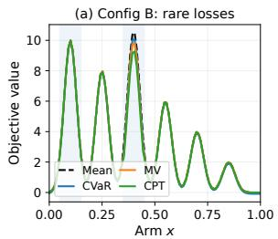

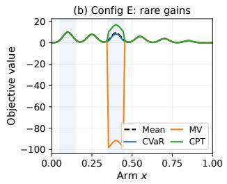

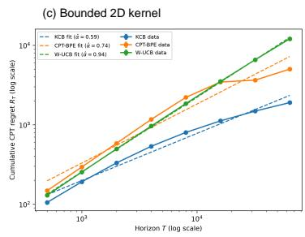  
Figure 1: Risk preferences and CPT learning. (a)–(b) Population objective scores in Config B (rare loss) and Config E (rare gain). CVaR uses $\alpha = 0 . 1 0$ , MV uses � = $c = 1$ , and CPT uses identity utility and Tversky–Kahneman weighting with $\gamma = 0 . 5 0 .$ . (c) Bounded 2D kernel comparison on logarithmic axes: mean cumulative CPT regret ± one standard error over 30 paired trials. Dashed lines are descriptive power-law fits.

Risk preferences. We consider 100 candidate routes (arms), each yielding a stochastic reward. The arms are equally spaced in [0, 1], and their mean rewards form six Gaussian-shaped peaks. We compare Mean, lower-tail CVaR, mean–variance (MV), and CPT. Each risk metric assigns a score to every arm; the arm with the highest score is its preferred choice.

We study five experimental configurations, labelled A–E. Configs A–D vary the probability and magnitude of a rare loss for arms near the third peak; config E instead introduces a rare large gain for those arms. The remaining arms have Gaussian background noise. These settings illustrate contrasting human preferences associated with small probabilities: avoiding a rare large loss while favoring a rare large gain.

In config B, shown in Figure 1(a), arms near the third peak have higher mean rewards but carry a small chance of a large loss. CPT lowers their risk scores suficiently to favor a safer arm near the first peak, consistent with avoidance of rare severe outcomes. MV also favors this safer alternative, whereas Mean and CVaR retain their preference for the third peak.

Interestingly, the preference reverses for rare gains. In config E, shown in Figure 1(b), arms near the third peak have lower mean rewards but ofer a small chance of a large gain. CPT increases their scores suficiently to favor them, capturing the attraction of rare large gains. Although MV favors the safer alternative in B, it also penalizes the variability introduced by the rare gain in E and therefore prefers an arm near the first peak, as do Mean and CVaR. Thus, at the tested settings, CPT captures both contrasting preferences within the same framework. The remaining settings, parameter sensitivity, and learning trajectories appear in Appendix I.1.

Kernel learning. We compare KCB, CPT-BPE, and empirical-CDF W-UCB under the same CPT objective on a bounded 49-arm grid in $[ 0 , 1 ] ^ { 2 }$ . The first two methods receive the noise CDFs and use their respective analyzed confidence constructions; W-UCB estimates each arm’s reward CDF from samples. We run 30 paired trials at eight horizons from � = 500 to 64000. Figure 1(c) shows that KCB has the lowest mean regret throughout this range. CPT-BPE exhibits slower growth at larger horizons and has lower mean regret than W-UCB from � = 16000 onward. Its regret per round decreases from 0.296 to 0.078. Appendix I.1 gives the confidence diagnostics, numerical results, and additional 1D kernel and linear WOFUL comparisons.

Learning unknown noise laws. We evaluate NPCB-Learned (Algorithm 4) on a finite realizable class containing the true mean and noise model. Configurations A–D contain rare losses and E contains rare gains. Table 2 compares it with a known-law specialization and a greedy plug-in MLE baseline.

NPCB-Learned has lower mean CPT regret than plug-in MLE in every configuration and reaches the CPT-optimal reporting region in all 30 trials, compared with 0–20% for plug-in MLE. The known-law specialization incurs substantially less regret, demonstrating the additional cost of learning the noise law.

The finite model construction, convergence curves, and confidence-set diagnostics appear in Appendix I.2.

Table 2: Unknown-CDF mean CPT regret ± s.e. over 30 trials; � = (20000, 10000, 5000, 5000, 30000) for A–E.
<table><tr><td></td><td colspan="3">Mean CPT regret (± s.e.)</td></tr><tr><td>Cfg</td><td>Known law</td><td>Plug-in MLE</td><td>NPCB-Learned</td></tr><tr><td>A</td><td> $3 5 . 2 \pm 0 . 1$ </td><td> $2 6 9 2 . 1 \pm 2 4 8 . 3$ </td><td> $9 0 1 . 7 \pm 5 0 . 7$ </td></tr><tr><td>B</td><td> $3 3 . 4 \pm 0 . 0$ </td><td> $5 3 5 4 . 7 \pm 4 4 2 . 8$ </td><td> $6 8 1 . 3 \pm 3 4 . 2$ </td></tr><tr><td>C</td><td> $3 3 . 6 \pm 0 . 1$ </td><td> $1 8 4 6 . 2 \pm 1 3 3 . 0$ </td><td> $8 2 1 . 5 \pm 2 9 . 7$ </td></tr><tr><td>D</td><td> $3 3 . 4 \pm 0 . 0$ </td><td> $2 7 0 1 . 0 \pm 1 9 5 . 4$ </td><td> $6 5 2 . 4 \pm 1 4 . 4$ </td></tr><tr><td>E</td><td> $5 0 . 1 \pm 0 . 0$ </td><td> $2 0 4 2 2 5 . 3 \pm 0 . 9$ </td><td> $9 8 4 5 8 . 2 \pm 8 8 7 . 7$ </td></tr></table>

## 7 Conclusion

We study risk-sensitive bandits beyond linear structure. For known arm-dependent noise CDFs, we derive general Eluder-dimension bounds and a pointwise kernel UCB bound; our phase-wise kernel algorithm matches the risk-neutral upper-bound exponent for finite arms, and for continuous domains under spatial regularity of the CPT objective. We further extend to learned noise CDFs via a joint likelihood approach, with explicit complexity bounds for linear and RKHS mean models. Open questions include extending CPT to RL, identifying complexity measures beyond the Eluder dimension suited to CPT, and designing implementable (approximate) algorithms for non-parametric CPT bandits.

## AI Use Statement

In this work, we used generative AI tools to write the Python code for the experiments and plots in Section 6 and Appendix I. The experimental design, including which experiments to run and which questions to investigate, was conceived entirely by the authors, and the generated code was manually verified for correctness by one of the authors. Additionally, we used generative AI tools for editing and grammarchecking the manuscript text. We have reviewed all AI-assisted work and take responsibility for the final content of this work, including text, claims, and artifacts.

## References

[AB22] P. L. A. and S. P. Bhat. A wasserstein distance approach for concentration of empirical risk estimates, 2022. URL: https://arxiv.org/abs/1902.10709.

[Ace02] C. Acerbi. Spectral measures of risk: A coherent representation of subjective risk aversion. Journal of Banking & Finance, 26(7):1505–1518, 2002. DOI: https://doi.org/10.1016/S0378- 4266(02)00281-9.

[ADEH99] P. Artzner, F. Delbaen, J.-M. Eber, and D. Heath. Coherent measures of risk. Mathematical Finance, 9(3):203–228, 1999. DOI: https://doi.org/10.1111/1467-9965.00068.

[AJF<sup>+</sup>16] P. L. A., C. Jie, M. Fu, S. Marcus, and C. Szepesvári. Cumulative prospect theory meets reinforcement learning: Prediction and control, 2016. URL: https://arxiv.org/abs/1506 .02632.

[BCB<sup>+</sup>12] S. Bubeck, N. Cesa-Bianchi, et al. Regret analysis of stochastic and nonstochastic multiarmed bandit problems. Foundations and Trends® in Machine Learning, 5(1):1–122, 2012. URL: https://arxiv.org/abs/1204.5721.

[BGKM20] D. Baudry, R. Gautron, E. Kaufmann, and O.-A. Maillard. Optimal thompson sampling strategies for support-aware cvar bandits. In International Conference on Machine Learning, 2020. URL: https://api.semanticscholar.org/CorpusID:235826048.

[Bor01] V. Borkar. A sensitivity formula for risk-sensitive cost and the actor–critic algorithm. Systems & Control Letters, 44(5):339–346, 2001. DOI: https://doi.org/10.1016/S0167-6911(01)00152-9.

[CEG07] A. Chateauneuf, J. Eichberger, and S. Grant. Choice under uncertainty with the best and worst in mind: Neo-additive capacities. Journal ofEconomic Theory, 137(1):538–567, 2007. URL: https://www.sciencedirect.com/science/article/pii/S0022053107000300.

[CG17] S. R. Chowdhury and A. Gopalan. On kernelized multi-armed bandits. In D. Precup and Y. W. Teh, editors, Proceedings of the 34th International Conference on Machine Learning, ICML 2017, Sydney, NSW, Australia, 6-11 August 2017, volume 70 of Proceedings of Machine Learning Research, pages 844–853. PMLR, 2017. URL: http://proceedings.mlr.press/v70/chowdhury17a.html.

[CGJP17] Y. Chow, M. Ghavamzadeh, L. Janson, and M. Pavone. Risk-constrained reinforcement learning with percentile risk criteria, 2017. URL: https://arxiv.org/abs/1512.01629.

[CMZ18] A. Cassel, S. Mannor, and A. Zeevi. A general approach to multi-armed bandits under risk criteria. In S. Bubeck, V. Perchet, and P. Rigollet, editors, Proceedings ofthe 31st Conference On Learning Theory, volume 75 of Proceedings ofMachine Learning Research, pages 1295–1306. PMLR, 06–09 Jul 2018. URL: https://proceedings.mlr.press/v75/cassel18a.html.

[CT21] J. Q. L. Chang and V. Y. F. Tan. A unifying theory of thompson sampling for continuous risk-averse bandits. In AAAI Conference on Artificial Intelligence, 2021. URL: https://api.se manticscholar.org/CorpusID:237290094.

[GPFM17] A. Gopalan, L. Prashanth, M. Fu, and S. Marcus. Weighted bandits or: How bandits learn distorted values that are not expected. In Proceedings ofthe AAAI Conference on Artificial Intelligence, volume 31, 2017. URL: https://ojs.aaai.org/index.php/AAAI/article/vi ew/10922.

[GST14] N. Galichet, M. Sebag, and O. Teytaud. Exploration vs exploitation vs safety: Risk-averse multi-armed bandits. CoRR, abs/1401.1123, 2014. URL: http://arxiv.org/abs/1401.1123.

[GW99] R. Gonzalez and G. Wu. On the shape of the probability weighting function. Cognitive psychology, 38(1):129–166, 1999.

[HCGS24] H. Hu, A. Charpentier, M. Ghossoub, and A. Schied. Multiarmed bandits problem under the mean-variance setting, 2024. URL: https://arxiv.org/abs/2212.09192.

[HKLL21] K. Huang, S. M. Kakade, J. D. Lee, and Q. Lei. A short note on the relationship of information gain and eluder dimension. CoRR, abs/2107.02377, 2021. URL: https://arxiv.org/abs/21 07.02377.

[HM72] R. A. Howard and J. E. Matheson. Risk-sensitive markov decision processes. Management Science, 18(7):356–369, 1972. URL: http://www.jstor.org/stable/2629352.

[HZ18] Z. Hu and D. Zhang. Utility-based shortfall risk: Eficient computations via monte carlo. Naval Research Logistics (NRL), 65:378 – 392, 2018. URL: https://api.semanticscholar.org/Co rpusID:126005263.

[KAG<sup>+</sup>23] R. K. Kolla, P. L. A., A. Gopalan, K. Jagannathan, M. Fu, and S. Marcus. Bandit algorithms to emulate human decision making using probabilistic distortions, 2023. URL: https://arxiv. org/abs/1611.10283.

[Kah11] D. Kahneman. Thinking, Fast and Slow. Farrar, Straus and Giroux, New York: New York, 2011.

[KAJ19] R. K. Kolla, P. L. A., and K. P. Jagannathan. Risk-aware multi-armed bandits using conditional value-at-risk. CoRR, abs/1901.00997, 2019. URL: http://arxiv.org/abs/1901.00997.

[KNJ19] A. Kagrecha, J. Nair, and K. P. Jagannathan. Distribution oblivious, risk-aware algorithms for multi-armed bandits with unbounded rewards. CoRR, abs/1906.00569, 2019. URL: http: //arxiv.org/abs/1906.00569.

[KT79] D. Kahneman and A. Tversky. Prospect theory: An analysis of decision under risk. Econometrica, 47(2):263–291, 1979. DOI: 10.2307/1914185.

[LqL23] H. Liang and Z. quan Luo. A distribution optimization framework for confidence bounds of risk measures, 2023. URL: https://arxiv.org/abs/2306.07059.

[LS20] T. Lattimore and C. Szepesvári. Bandit algorithms. Cambridge University Press, 2020.

[LS22] Z. Li and J. Scarlett. Gaussian process bandit optimization with few batches. In International Conference on Artificial Intelligence and Statistics, pages 92–107. PMLR, 2022. URL: https: //proceedings.mlr.press/v151/li22a.html.

[Mar52] H. Markowitz. Portfolio selection. The Journal of Finance, 7(1):77–91, 1952. URL: http: //www.jstor.org/stable/2975974.

[PG13] L. A. Prashanth and M. Ghavamzadeh. Actor-critic algorithms for risk-sensitive mdps. In Proceedings of the 27th International Conference on Neural Information Processing Systems - Volume 1, NIPS’13, page 252–260, Red Hook, NY, USA, 2013. Curran Associates Inc. URL: https://proceedings.neurips.cc/paper\_files/paper/2013/file/eb163727917cb ba1eea208541a643e74-Paper.pdf.

[Pre98] D. Prelec. The probability weighting function. Econometrica, pages 497–527, 1998. URL: https://www.jstor.org/stable/2998573.

[RR13] D. Russo and B. V. Roy. Eluder dimension and the sample complexity of optimistic exploration. In C. J. C. Burges, L. Bottou, Z. Ghahramani, and K. Q. Weinberger, editors, Advances in Neural Information Processing Systems 26: 27th Annual Conference on Neural Information Processing Systems 2013. Proceedings of a meeting held December 5-8, 2013, Lake Tahoe, Nevada, United States, pages 2256–2264, 2013. URL: https://proceedings.neurips.cc/paper/2013/ha sh/41bfd20a38bb1b0bec75acf0845530a7-Abstract.html.

[RU00] R. T. Rockafellar and S. Uryasev. Optimization of conditional value-at risk. Journal ofRisk, 3:21–41, 2000. URL: https://api.semanticscholar.org/CorpusID:854622.

[SBC17] J. Scarlett, I. Bogunovic, and V. Cevher. Lower bounds on regret for noisy Gaussian process bandit optimization. In Proceedings of the 30th Conference on Learning Theory (COLT), volume 65 of Proceedings of Machine Learning Research, pages 1723–1742. PMLR, 2017. URL: https: //proceedings.mlr.press/v65/scarlett17a.html.

[SLM13] A. Sani, A. Lazaric, and R. Munos. Risk-aversion in multi-armed bandits. CoRR, abs/1301.1936, 2013. URL: http://arxiv.org/abs/1301.1936.

[Sob82] M. J. Sobel. The variance of discounted markov decision processes. Journal of Applied Probability, 19(4):794–802, 1982. DOI: 10.2307/3213832.

[TAJ22] V. Y. F. Tan, P. L. A., and K. Jagannathan. A survey of risk-aware multi-armed bandits, 2022. URL: https://arxiv.org/abs/2205.05843.

[Tak22] S. Takemori. Distributionally-aware kernelized bandit problems for risk aversion. In K. Chaudhuri, S. Jegelka, L. Song, C. Szepesvári, G. Niu, and S. Sabato, editors, International Conference on Machine Learning, ICML 2022, 17-23 July 2022, Baltimore, Maryland, USA, volume 162 of Proceedings of Machine Learning Research, pages 20933–20959. PMLR, 2022. URL: https://proceedings.mlr.press/v162/takemori22a.html.

[TGM14] A. Tamar, Y. Glassner, and S. Mannor. Optimizing the cvar via sampling, 2014. URL: https: //arxiv.org/abs/1404.3862.

[TK92] A. Tversky and D. Kahneman. Advances in prospect theory: Cumulative representation of uncertainty. Journal of Risk and uncertainty, 5(4):297–323, 1992. URL: https://doi.org/10 .1007/BF00122574.

[TKB19] A. Tamkin, R. Keramati, and E. Brunskill. Distributionally-aware exploration for cvar bandits. In NeurIPS 2019 Workshop on Safety and Robustness on Decision Making, 2019. URL: https: //api.semanticscholar.org/CorpusID:219544525.

[TMA<sup>+</sup>25] M. Tatlı, A. Mukherjee, P. L. A., K. Shanmugam, and A. Tajer. Risk-sensitive bandits: Arm mixture optimality and regret-eficient algorithms. In Y. Li, S. Mandt, S. Agrawal, and E. Khan, editors, Proceedings of The 28th International Conference on Artificial Intelligence and Statistics, volume 258 of Proceedings of Machine Learning Research, pages 3871–3879. PMLR, 03–05 May 2025. URL: https://proceedings.mlr.press/v258/tatli25a.html.

[TW22] C. Tan and P. Weng. Cvar-regret bounds for multi-armed bandits. In Asian Conference on Machine Learning, 2022. URL: https://api.semanticscholar.org/CorpusID:259093003.

[VKP21] S. Vakili, K. Khezeli, and V. Picheny. On information gain and regret bounds in gaussian process bandits. In International Conference on Artificial Intelligence and Statistics, pages 82–90. PMLR, 2021. URL: https://proceedings.mlr.press/v130/vakili21a.html.

[VZ15] S. Vakili and Q. Zhao. Mean-variance and value at risk in multi-armed bandit problems. In 2015 53rd Annual Allerton Conference on Communication, Control, and Computing (Allerton), pages 1330–1335, 2015. DOI: 10.1109/ALLERTON.2015.7447162.

[VZ16] S. Vakili and Q. Zhao. Risk-averse multi-armed bandit problems under mean-variance measure. CoRR, abs/1604.05257, 2016. URL: http://arxiv.org/abs/1604.05257.

[YJW<sup>+</sup>20] Z. Yang, C. Jin, Z. Wang, M. Wang, and M. I. Jordan. Bridging exploration and general function approximation in reinforcement learning: Provably eficient kernel and neural value iterations. CoRR, abs/2011.04622, 2020. URL: https://arxiv.org/abs/2011.04622.

## A Other Related Works

Much of the recent progress in the multi-armed bandit setup has focused on adopting risk-sensitive measures like VaR and CVaR. [GST14] introduced CVaR in the K-armed bandit setting, which was later studied extensively by [TKB19, TW22, KAJ19]. [BGKM20] established the first asymptotically optimal Thompson Sampling strategies for support-aware CVaR bandits. Several works have sought to develop unified frameworks as well. [CMZ18] proposed a general framework using abstract norms, though their stability criteria are limited to Lipschitz-continuous measures and fail for singular functionals like Cumulative Prospect Theory (CPT). [AB22, TMA<sup>+</sup>25] address this gap under the Wasserstein metric to handle non-Lipschitz and heavy-tailed distributions. [CT21] established a Bayesian unification for “continuous" risk functionals. [LqL23] introduced a distributional optimization framework that yields tighter confidence bounds by avoiding global Lipschitz constants. Despite these advancements, all these approaches remain confined to the finite-arm setting, leaving the optimization of singular risk measures like CPT in nonparametric contextual bandits as an unaddressed challenge.

[TMA<sup>+</sup>25] consider a diferent benchmark in which a distortion riskmetric is applied to the reward distribution induced by a mixture of arms. For mixture �, their type of objective evaluates the risk functional after forming the mixed reward distribution. Our regret instead compares the per-round CPT value of the selected arm with that of the best individual arm. In particular, $\begin{array} { r } { \int _ { \mathcal { A } } \mathcal { V } _ { a } ( f ^ { * } ) \pi ( d a ) \leq \operatorname* { s u p } _ { a \in \mathcal { A } } \mathcal { V } _ { a } ( f ^ { * } ) } \end{array}$ , so randomization cannot improve our benchmark. Applying CPT to the mixed reward distribution $\int _ { \mathcal { R } } F _ { a } ^ { f ^ { * } } \pi ( d a )$ is a diferent objective and is not considered here.

An adjacent but distinct field is reinforcement learning(RL), where these risk measures have also been extensively utilized to manage uncertainty in sequential decision-making. The foundation of risk-sensitive control in RL was established through entropic utility and variance-penalized objectives [HM72, Sob82]. These were subsequently adapted into policy gradient and actor-critic algorithms to optimize exponential costs and minimize volatility by [Bor01, PG13]. To ensure safety in high-stakes environments, research has increasingly adopted tail-risk measures like CVaR [TGM14, CGJP17]. Behavioral measures, specifically CPT, have also been integrated to align agent behavior with human decision-making and probability distortions $\left[ \mathrm { A J F ^ { + } } 1 6 \right]$

## B Technical Details for Section 4

In this section, we provide the technical details supporting the regret analysis of Section 4. We detail the confidence set construction, formalize the mapping from statistical uncertainty to subjective distorted uncertainty, and present the key intermediate results that underpin Theorem 4.2. The proofs of all results in this section are provided in Appendix C.

## B.1 Complexity Measure

We utilize the concept of Eluder dimension, first introduced by [RR13]. Intuitively, this measure captures the worst-case dificulty of inferring unobserved values. A low Eluder dimension implies that observing a few points allows for accurate global predictions, whereas a high dimension suggests the function can exhibit “surprising" variations even after many observations.

## B.2 Confidence Sets

A defining characteristic of our algorithm is its modularity. Since the statistical validity of the confidence set depends exclusively on the additive noise properties, we can adopt the construction from [RR13], ensuring that the reward function’s mean concentrates objectively regardless of the agent’s subjective bias. We denote the confidence set at time � as an empirical ball centered at the least-squares estimate:

$$
C _ { t } : = \left\{ f \in \mathcal { F } : \| f - \hat { f } _ { t } ^ { L S } \| _ { 2 , \mathcal { D } _ { t - 1 } } \leq \sqrt { \beta _ { t } } \right\} .
$$

Here, $\begin{array} { r } { \Vert g \Vert _ { 2 , \mathcal { D } _ { t - 1 } } ^ { 2 } : = \sum _ { j < t } g ( a _ { j } ) ^ { 2 } } \end{array}$

For the confidence-set construction, it is enough that the noise is conditionally mean zero and uniformly �-sub-Gaussian: $\mathbf { \bar { \Gamma } } [ e ^ { u \epsilon _ { t } } \mid \mathcal { D } _ { t - 1 } , a _ { t } ] \ \leq \ e ^ { u ^ { 2 } \eta ^ { 2 } / 2 }$ , with $u ~ \in ~ \mathbb { R }$ . Under the bounded-reward assumption of Section 2, Hoefding’s lemma allows us to take $\eta = M$ . Moreover, every $f \in { \mathcal { F } }$ takes values in $[ - M , M ]$ , so the range condition of [RR13] holds with $C = 2 M$

We set $\alpha = T ^ { - 2 }$ and assume $N ( \mathcal { F } , \alpha , \| \cdot \| _ { \infty } ) < \infty$ . Following Proposition 2 of [RR13], we use

$$
\beta _ { t } = 8 \eta ^ { 2 } \log \left( \frac { N ( \mathcal { F } , \alpha , \| \cdot \| _ { \infty } ) } { \delta } \right) + 2 \alpha t \left( 1 6 M + \sqrt { 8 \eta ^ { 2 } \ln ( 4 t ^ { 2 } / \delta ) } \right) .
$$

This radius explicitly accounts for the function class complexity (via �-covering numbers in sup-norm) and the discretization error inherent in continuous spaces.

No convexity of $\mathcal { F }$ is required for this confidence construction. This is the general-function-class setting of [RR13]; for completeness, the following direct argument also gives the desired $1 - \delta$ confidence statement under our standing bounded-reward assumptions.

Lemma B.1 (Least-squares confidence for general function classes). Let $\mathcal { F } _ { \alpha } \subseteq \mathcal { F }$ be a finite �-cover in the sup norm, and write $N _ { \alpha } = | \mathcal { F } _ { \alpha } |$ . Then, with probability at least $1 - \delta _ { \mathrm { i } }$ , simultaneously for every $t \leq T$

$$
\sum _ { j < t } \bigl ( \hat { f } _ { t } ^ { L S } ( a _ { j } ) - f ^ { * } ( a _ { j } ) \bigr ) ^ { 2 } \leq 8 \eta ^ { 2 } \log \frac { N _ { \alpha } } { \delta } + 1 2 M \alpha ( t - 1 ) .
$$

In particular, with $\eta = M ,$ the radius $\beta _ { t }$ above implies $f ^ { * } \in C _ { t }$ for every $t \leq T$

Proof. For fixed $g \in { \mathcal { F } } _ { \alpha } .$ , define

$$
Q _ { t } ( g ) : = \sum _ { j < t } \bigl ( g ( a _ { j } ) - f ^ { * } ( a _ { j } ) \bigr ) ^ { 2 } , \qquad S _ { t } ( g ) : = \sum _ { j < t } \epsilon _ { j } \bigl ( g ( a _ { j } ) - f ^ { * } ( a _ { j } ) \bigr ) .
$$

Conditional sub-Gaussianity implies that

$$
\exp \Biggl \{ \frac { S _ { t } ( g ) } { 2 \eta ^ { 2 } } - \frac { Q _ { t } ( g ) } { 8 \eta ^ { 2 } } \Biggr \}
$$

is a nonnegative supermartingale starting at one. Hence, by Ville’s inequality and a union bound over $\mathcal { F } _ { \alpha }$ with probability at least $1 - \delta ,$ , simultaneously for all $\boldsymbol { g } \in \mathcal { F } _ { \alpha }$ and all $t \leq T$

$$
S _ { t } ( g ) \leq \frac { 1 } { 4 } Q _ { t } ( g ) + 2 \eta ^ { 2 } \log \frac { N _ { \alpha } } { \delta } .
$$

Work on this event and put $h = \hat { f } _ { t } ^ { L S }$ . Least-squares optimality gives

$$
Q _ { t } ( h ) \leq 2 S _ { t } ( h ) .
$$

Choose $\boldsymbol { g } \in \mathcal { F } _ { \alpha }$ such that $\| g - h \| _ { \infty } \leq \alpha$ . Since $r _ { j } , f ^ { * } ( a _ { j } ) \in [ - M , M ]$ , we have $| \epsilon _ { j } | \le 2 M$ , and since $g , h , f ^ { * }$ take values in $[ - M , M ]$ ，

$$
| S _ { t } ( h ) - S _ { t } ( g ) | \leq 2 M \alpha ( t - 1 ) , \qquad | Q _ { t } ( h ) - Q _ { t } ( g ) | \leq 4 M \alpha ( t - 1 ) .
$$

Therefore

$$
\begin{array} { l } { \displaystyle { \mathcal { Q } _ { t } ( h ) \leq \frac { 1 } { 2 } \mathcal { Q } _ { t } ( g ) + 4 \eta ^ { 2 } \log \frac { N _ { \alpha } } { \delta } + 4 M \alpha ( t - 1 ) } } \\ { \displaystyle { \qquad \leq \frac { 1 } { 2 } \mathcal { Q } _ { t } ( h ) + 4 \eta ^ { 2 } \log \frac { N _ { \alpha } } { \delta } + 6 M \alpha ( t - 1 ) . } } \end{array}
$$

Rearranging proves the claim.

We further define the standard width of the confidence set at action � as the maximum variation in prediction:

$$
w _ { C _ { t } } ( a ) : = \operatorname* { s u p } _ { f _ { 1 } , f _ { 2 } \in C _ { t } } | f _ { 1 } ( a ) - f _ { 2 } ( a ) | .
$$

Crucially, the Eluder dimension governs the shrinkage of this width.

## B.3 Mapping confidence set to distorted value

While the confidence set $C _ { t }$ captures the statistical uncertainty surrounding the environment’s mean reward function $f ^ { * }$ (learned from observed undistorted rewards), the agent’s decisions are governed by the subjective weight-distorted value functional $\mathcal { V } _ { a } ( f )$ . To bridge these, we define the optimistic and pessimistic weight-distorted rewards for any action � at time �, respectively, as

$$
\tilde { \mathcal { V } } _ { t } ( a ) : = \operatorname* { s u p } _ { f \in C _ { t } } \mathcal { V } _ { a } ( f ) , \qquad \underline { { \mathcal { V } } } _ { t } ( a ) : = \operatorname* { i n f } _ { f \in C _ { t } } \mathcal { V } _ { a } ( f ) .
$$

Based on these boundary estimates, we define the distorted width of the confidence set for action $^ { a , }$ denoted by $w _ { C _ { t } } ^ { \mathcal { V } } ( a )$ , as the subjective uncertainty gap: $w _ { C _ { t } } ^ { \mathcal { V } } ( a ) : = \tilde { \mathcal { V } } _ { t } ( a ) - \underline { { \mathcal { V } } } _ { t } ( a )$

It is important to emphasize that the confidence set $C _ { t }$ is constructed purely through square-loss estimation and is “blind" to the specific weight distortion function $\mathbb { w } ( \cdot )$ . The distorted width $w _ { C _ { t } } ^ { \mathcal { V } } ( a )$ is introduced strictly as an analytical tool to quantify uncertainty relative to the agent’s subjective preference. This decoupling ensures that our framework maintains its modularity, learn the environment using standard statistical techniques while optimizing for non-linear behavioral values.

## B.4 Regret Decomposition

Proposition B.1 (Regret Decomposition for Distorted Rewards). Assume that the true mean rewardfunction $f ^ { * }$ is contained in the confidence set $C _ { t }$ for all rounds $t = 1 , \dots , T$ . Then, the cumulative distorted regret $R ( T )$ is (almost surely) bounded by the sum of the distorted widths of the selected actions: $\begin{array} { r } { R ( T ) \leq \sum _ { t = 1 } ^ { T } \hat w _ { C _ { t } } ^ { \mathcal { V } } ( a _ { t } ) } \end{array}$

Remark B.2. Although the agent cannot observe the true distorted rewards $\mathcal { V } _ { a } ( f ^ { * } )$ , the regret bound in Proposition B.1 remains valid because the agent selects actions based on the optimistic estimator $\tilde { \mathcal { V } } _ { t }$ By choosing $a _ { t } = \arg \operatorname* { m a x } _ { a \in \mathcal { A } } \tilde { \mathcal { V } } _ { t } ( a )$ , the algorithm guarantees that $\tilde { \mathcal { V } } _ { t } ( a _ { t } ) \geq \tilde { \mathcal { V } } _ { t } ( a ^ { * } )$ . This selection rule ensures that the instantaneous regret is entirely dominated by the uncertainty, quantified as the distorted width $w _ { C _ { t } } ^ { \mathcal { V } } ( a _ { t } )$ , thereby converting the problem of minimizing unknown regret into the problem of reducing subjective uncertainty.

Following Proposition B.1, the theoretical core of our analysis hinges on relating the subjective distorted width $w _ { C _ { t } } ^ { \mathcal { V } } ( a )$ to the standard width $w _ { C _ { t } }$ (�) of a confidence set. This modularity allows us to leverage existing concentration results for general function classes while accounting for the non-linear transformation of rewards.

## B.5 Connecting distorted width to standard width

The confidence set $C _ { t }$ controls uncertainty in the mean, whereas our regret decomposition involves the distorted width $w _ { C _ { t } } ^ { \mathcal { V } } ( a )$ . Using the translation-stability bound of [GPFM17, Lemma 5], we relate these widths for general mean-function classes. This allows mean-estimation confidence guarantees to control CPT regret.

Proposition B.3 (Uniform Lipschitz Stability of Distorted Rewards). Assume the additive reward model, with both gain and loss CPT integrals finite at one mean for each arm. Let w : $[ 0 , 1 ]  [ 0 , 1 ]$ be Borel measurable with $\mathbb { W } ( 0 ) = 0$ . Then, for every arm � and $f _ { 1 } , f _ { 2 } \in \mathcal { F }$

$$
| \mathcal { V } _ { a } ( f _ { 1 } ) - \mathcal { V } _ { a } ( f _ { 2 } ) | \leq 2 | f _ { 1 } ( a ) - f _ { 2 } ( a ) | .
$$

Lemma B.2 (Bound on Distorted Width). Under the assumptions of Proposition B.3, for any action �, the distorted width satisfies $w _ { C _ { t } } ^ { \mathcal { V } } ( a ) \leq 2 w _ { C _ { t } } ( a )$

## C Omitted Proofs from Section 4

## C.1 Proof of Proposition B.1 (Regret Decomposition for Distorted Rewards)

Proof. The instantaneous regret at round � is $i r _ { t } = \mathcal { V } _ { a ^ { \ast } } ( f _ { \theta ^ { \ast } } ) - \mathcal { V } _ { a _ { t } } ( f _ { \theta ^ { \ast } } )$ . Since we assume true mean reward function $f _ { \theta } \in C _ { t }$ for all round �, with high probability, the true distorted reward for any action is bounded by its optimistic and pessimistic estimates: $\underline { { \mathcal { V } } } _ { t } ( a ) \leq \mathcal { V } _ { a } ( f _ { \theta ^ { * } } ) \leq \tilde { \mathcal { V } } _ { t } ( a )$ . We can therefore bound the instantaneous regret as follows:

$$
\begin{array} { r l } & { i r _ { t } = \dot { \mathcal { V } } _ { a ^ { * } } ( f _ { \theta ^ { * } } ) - \dot { \mathcal { V } } _ { a _ { t } } ( f _ { \theta ^ { * } } ) } \\ & { \quad \le \dot { \mathcal { V } } _ { t } ( a ^ { * } ) - \underbrace { \mathcal { V } _ { t } ( a _ { t } ) } _ { = \dot { \mathcal { V } } _ { t } ( a _ { t } ) + \underbrace { ( \mathrm { \tilde { \mathcal { V } } _ { t } } ( a ^ { * } ) - \tilde { \mathcal { V } } _ { t } ( a _ { t } ) \Big ) } _ { \le 0 \mathrm { ~ b y ~ t h e ~ a c t i o n ~ s e l e c t i o n ~ r u l e } } } } \\ & { \quad \le \dot { \mathcal { V } } _ { t } ( a _ { t } ) - \underbrace { \mathcal { V } _ { t } ( a _ { t } ) } _ { \le \dot { \mathcal { V } } _ { t } ( a _ { t } ) } } \\ & { \quad = w _ { C _ { t } } ^ { \mathcal { V } } ( a _ { t } ) . } \end{array}
$$

Summing this inequality over $t = 1 , \dots , T$ yields the desired result.

## C.2 Proof of Proposition B.3 (Uniform Lipschitz Stability of Distorted Rewards)

Proof. Fix an arm � and write $V _ { a } ( m ) = \mathcal { V } _ { a } ( m + \epsilon _ { a } )$ . For $m _ { 2 } \geq m _ { 1 }$ , a change of variables in the two tail integrals gives

$$
V _ { a } ( m _ { 2 } ) - V _ { a } ( m _ { 1 } ) = \int _ { - m _ { 2 } } ^ { - m _ { 1 } } \left[ \mathbb { w } \big ( 1 - F _ { \epsilon _ { a } } ( u ) \big ) + \mathbb { w } \big ( F _ { \epsilon _ { a } } ( u ) \big ) \right] d u .
$$

The integrand lies in [0, 2]. Therefore $0 \leq V _ { a } ( m _ { 2 } ) - V _ { a } ( m _ { 1 } ) \leq 2 ( m _ { 2 } - m _ { 1 } )$ . The same bound with the arguments exchanged proves the result. This argument also covers noise atoms and discontinuous weight functions. Bounded rewards ensure that both tail integrals are finite. More generally, the same argument applies whenever both tail integrals are finite at one mean, since they then remain finite under every finite mean shift.

Extension to reference points, separate weights, and Lipschitz utilities. Let $X _ { m } = m + \epsilon _ { a } ,$ fix a reference point $x _ { 0 } .$ , and define

$$
U _ { m } = u ^ { + } ( ( X _ { m } - x _ { 0 } ) ^ { + } ) , \qquad W _ { m } = u ^ { - } ( ( X _ { m } - x _ { 0 } ) ^ { - } ) ,
$$

where $u ^ { \pm } : [ 0 , \infty )  [ 0 , \infty )$ are nondecreasing, �<sup>±</sup>-Lipschitz, and satisfy $u ^ { \pm } ( 0 ) = 0$ . Let $\mathbb { w } ^ { \pm } : [ 0 , 1 ] \to [ 0 , 1 ]$ be nondecreasing with $\mathbb { W } ^ { \pm } ( 0 ) = 0$ and $\mathbb { W } ^ { \pm } ( 1 ) = 1$ , and set

$$
\mathcal { V } _ { a } ( m ) = \int _ { 0 } ^ { \infty } \mathbb { w } ^ { + } ( \mathbb { P } \left[ \left( \right] U _ { m } > z \right) ) \ d z - \int _ { 0 } ^ { \infty } \mathbb { w } ^ { - } ( \mathbb { P } \left[ \left( \right] W _ { m } > z \right) ) \ d z .
$$

Couple $X _ { m + \Delta } = X _ { m } + \Delta$ for $\Delta \geq 0$ . Since $x \mapsto u ^ { + } ( ( x - x _ { 0 } ) ^ { + } )$ is nondecreasing and ${ \cal L } ^ { + } { \mathrm { - L i p s c h i t z } } ,$

$$
U _ { m } \leq U _ { m + \Delta } \leq U _ { m } + L ^ { + } \Delta .
$$

Define

$$
g ( z ) = \mathbb { W } ^ { + } ( \mathbb { P } \left[ ( \right] U _ { m } > z ) ) , \qquad z \in \mathbb { R } .
$$

For $z < 0 , \mathbb { P } \left[ \left( \right] U _ { m } > z \right) = 1$ , while � vanishes above the bounded support of $U _ { m }$ . Hence

$$
0 \leq \int _ { 0 } ^ { \infty } \left[ \ l { \ l { \mathbb { w } } } ^ { + } ( { \mathbb { P } } \left[ ( \right] U _ { m + \Delta } > z ) ) - g ( z ) \right] d z \leq \int _ { 0 } ^ { \infty } \left[ g ( z - L ^ { + } \Delta ) - g ( z ) \right] d z \leq L ^ { + } \Delta .
$$

Similarly,

$$
W _ { m + \Delta } \leq W _ { m } \leq W _ { m + \Delta } + L ^ { - } \Delta ,
$$

so the loss integral decreases by at most $L ^ { - } \Delta$ . Therefore

$$
0 \leq \mathcal { V } _ { a } ( m + \Delta ) - \mathcal { V } _ { a } ( m ) \leq ( L ^ { + } + L ^ { - } ) \Delta .
$$

Thus

$$
| \mathcal { V } _ { a } ( m _ { 1 } ) - \mathcal { V } _ { a } ( m _ { 2 } ) | \leq \bigl ( L ^ { + } + L ^ { - } \bigr ) | m _ { 1 } - m _ { 2 } | .
$$

Taking $x _ { 0 } = 0 , u ^ { \pm } ( x ) = x .$ and $\mathbb { w } ^ { + } = \mathbb { w } ^ { - } = \mathbb { w }$ recovers the factor 2 above.

The same CDF-sandwich argument used in Lemma H.2 therefore gives

$$
\left| \mathcal { V } _ { a } ^ { h _ { 1 } } ( f ) - \mathcal { V } _ { a } ^ { h _ { 2 } } ( f ) \right| \leq \frac { L ^ { + } + L ^ { - } } { \beta _ { \operatorname* { m i n } } } \operatorname* { s u p } _ { z } | h _ { 1 } ( z \mid a ) - h _ { 2 } ( z \mid a ) | .
$$

Consequently, the regret guarantees extend with the Lipschitz factor 2 replaced throughout by $L ^ { + } + L ^ { - }$

## C.3 Proof of Lemma B.2 (Bound on Distorted Width)

Proof. The distorted width is defined as the maximum possible diference in the distorted reward between any two functions in the confidence set:

$$
w _ { C _ { t } } ^ { \mathcal { V } } ( a ) = \operatorname* { s u p } _ { f _ { 1 } , f _ { 2 } \in C _ { t } } | \mathcal { V } _ { a } ( f _ { 1 } ) - \mathcal { V } _ { a } ( f _ { 2 } ) |
$$

From Proposition B.3, we have the pointwise bound for any pair of functions $f _ { 1 } , f _ { 2 } \in C _ { t }$

$$
| \mathcal { V } _ { a } ( f _ { 1 } ) - \mathcal { V } _ { a } ( f _ { 2 } ) | \le 2 | f _ { 1 } ( a ) - f _ { 2 } ( a ) |
$$

Since this inequality holds for any pair, it must also hold for the supremum over all pairs. We can therefore substitute this bound into the definition of the distorted width:

$$
w _ { C _ { t } } ^ { \mathcal { V } } ( a ) \leq 2 \cdot \operatorname* { s u p } _ { f _ { 1 } , f _ { 2 } \in C _ { t } } \left( | f _ { 1 } ( a ) - f _ { 2 } ( a ) | \right)
$$

The term inside the parentheses is the definition ofthe standard width, $\begin{array} { r } { w _ { C _ { t } } ( a ) = \operatorname* { s u p } _ { f _ { 1 } , f _ { 2 } \in C _ { t } } \left| f _ { 1 } ( a ) - f _ { 2 } ( a ) \right| } \end{array}$ Substituting this in yields the final result:

$$
w _ { C _ { t } } ^ { \mathcal { V } } ( a ) \leq 2 \left( w _ { C _ { t } } ( a ) \right) .
$$

## C.4 Proof of Theorem 4.2 (General Regret for NPCB)

Proof. By Lemma B.1, with probability at least $1 - \delta , f ^ { * } \in C _ { t }$ for every $t \leq T$ . On this event, Proposition B.1 and Lemma B.2 give $\begin{array} { r } { R ( T ) \leq 2 \sum _ { t = 1 } ^ { T } w _ { C _ { t } } ( a _ { t } ) } \end{array}$ . The cumulative-width bound of [RR13], applied with accuracy $\alpha ,$ confidence radius $\beta _ { T }$ , and $w _ { C _ { t } } ( a ) \leq 2 M$ , yields

$$
\sum _ { t = 1 } ^ { T } w _ { C _ { t } } ( a _ { t } ) \leq T \alpha + 2 M \operatorname* { m i n } \{ \dim _ { E } ( \mathcal { F } , \alpha ) , T \} + 4 \sqrt { T \beta _ { T } \operatorname* { m i n } \{ \dim _ { E } ( \mathcal { F } , \alpha ) , T \} } .
$$

Indeed, when dim<sub>�</sub> $\langle { \mathcal { F } } , \alpha ) \leq T$ this is the standard Eluder-width bound, while otherwise the same inequality follows from the trivial bound $w _ { C _ { t } } ( a _ { t } ) \leq 2 M$ . Substituting $\alpha = T ^ { - 2 }$ and multiplying by 2 gives $R ( T ) \leq 2 T ^ { - 1 } +$ $4 M D _ { T } + 8 \sqrt { T \beta _ { T } D _ { T } }$ , where $D _ { T } = \operatorname* { m i n } \{ \dim _ { E } ( \mathcal { F } , T ^ { - 2 } ) , T \}$ . The displayed $\widetilde { O }$ bound follows by substituting the definition of $\beta _ { T }$ □

## D Lower Bounds

When $\mathbb { W } ( p ) = p ;$ the distorted value equals the mean reward. Thus any risk-neutral instance that obeys the assumptions of our model is also a CPT instance with a known noise CDF. This gives a reduction for minimax lower bounds on that same instance class. It does not lower-bound the realized regret of every algorithm on every instance.

[SBC17] give the Matérn minimax lower-bound exponent $( \nu + d ) / ( 2 \nu + d )$ for a Gaussian-noise RKHS bandit model. Their Gaussian noise has unbounded support. Our bounded-reward assumption does not contain that model as a special case. We therefore do not claim that this result alone proves a matching lower bound for the bounded-reward model studied here. Nor does our KCB theorem attain that exponent: its Matérn upper-bound exponent is $1 / 2 + d / ( 2 \nu + d )$ . The two exponents difer by $d / [ 2 ( 2 \nu + d ) ]$ . Theorem 5.4 attains the same upper-bound exponent on its stated domain. The Gaussian-noise lower bound still does not directly establish a lower bound for our bounded-reward class.

## E Kernel CPT Regret Proof

The algorithm uses the kernel ridge predictor from Algorithm 2. The confidence statement needed here is pointwise. It holds for every arm and every round on one common event.

Lemma E.1 (Pointwise kernel confidence). Assume ${ \mathcal { K } } ( a , a ) \leq 1 , \| f ^ { * } \| _ { \mathcal { K } } \leq B ,$ , and conditionally mean-zero �-sub-Gaussian noise. Use $\lambda = 1 + 2 / T$ and the definitions in Algorithm 2. With probability at least $1 - \delta _ { : }$ simultaneously for all $t \leq T$ and $a \in { \mathcal { A } }$

$$
| f ^ { * } ( a ) - \mu _ { t - 1 } ( a ) | \leq \sqrt { \beta _ { t } } \sigma _ { t - 1 } ( a ) , \qquad \sqrt { \beta _ { t } } = B + \eta \sqrt { 2 \bigl ( \gamma _ { t - 1 } ( \lambda ) + 1 + \log ( 1 / \delta ) \bigr ) } .
$$

Proof. Apply [CG17, Theorem 2] with its regularization $1 + 2 / T$ . The theorem is simultaneous in the arm and round. It applies to conditionally mean-zero sub-Gaussian noise. □

Lemma E.2 (Optimistic distorted value). On the event of Lemma E.1,

$$
\mathcal { V } _ { a } ( f ^ { * } ) \leq \mathcal { V } _ { a } ( U _ { t } ( a ) ) \qquad f o r e { \nu } e r y { a \in \mathcal { A } \ a n d t } \leq T .
$$

Proof. The pointwise confidence bound gives $f ^ { * } ( a ) \leq U _ { t } ( a )$ . The integral identity in the proof of Proposition B.3 shows that $\mathcal { V } _ { a } ( m )$ is increasing in �. Apply this fact to the two means. □

Lemma E.3 (Instantaneous CPT regret). On the same event, for the arm selected by Algorithm 2,

$$
\begin{array} { r } { \mathcal { V } _ { a ^ { * } } ( f ^ { * } ) - \mathcal { V } _ { a _ { t } } ( f ^ { * } ) \leq 4 \sqrt { \beta _ { t } } \sigma _ { t - 1 } ( a _ { t } ) . } \end{array}
$$

Proof. Optimism and the choice of $a _ { t }$ give

$$
\begin{array} { r } { \mathcal { V } _ { a ^ { * } } ( f ^ { * } ) \leq \mathcal { V } _ { a ^ { * } } ( U _ { t } ( a ^ { * } ) ) \leq \mathcal { V } _ { a _ { t } } ( U _ { t } ( a _ { t } ) ) . } \end{array}
$$

The distorted value is 2-Lipschitz in the mean. Thus the regret is at most $2 ( U _ { t } ( a _ { t } ) - f ^ { * } ( a _ { t } ) )$ . The two sides of the pointwise confidence bound give $U _ { t } ( a _ { t } ) - f ^ { * } ( a _ { t } ) \leq 2 \sqrt { \beta _ { t } } \sigma _ { t - 1 } ( a _ { t } )$ □

## E.1 Proof of Theorem 5.3 (Kernel CPT regret)

Proof. Sum Lemma E.3 and apply Cauchy–Schwarz:

$$
R ( T ) \leq 4 \sqrt { \beta _ { T } } \sqrt { T \sum _ { t = 1 } ^ { T } \sigma _ { t - 1 } ^ { 2 } ( a _ { t } ) } .
$$

The determinant identity gives

$$
\frac { 1 } { 2 } \log \operatorname * { d e t } ( I + \lambda ^ { - 1 } \mathbf { K } _ { T } ) = \frac { 1 } { 2 } \sum _ { t = 1 } ^ { T } \log ( 1 + \sigma _ { t - 1 } ^ { 2 } ( a _ { t } ) / \lambda ) .
$$

Since $0 \leq \sigma _ { t - 1 } ^ { 2 } ( a _ { t } ) \leq 1$ , concavity of the logarithm gives

$$
\begin{array} { r } { \log ( 1 + \sigma _ { t - 1 } ^ { 2 } ( a _ { t } ) / \lambda ) \geq \sigma _ { t - 1 } ^ { 2 } ( a _ { t } ) \log ( 1 + 1 / \lambda ) . } \end{array}
$$

The selected sequence has information gain at most $\gamma _ { T } ( \lambda )$ . Therefore

$$
\sum _ { t = 1 } ^ { T } \sigma _ { t - 1 } ^ { 2 } ( a _ { t } ) \leq \frac { 2 \gamma _ { T } ( \lambda ) } { \log ( 1 + 1 / \lambda ) } .
$$

Substitute this bound and the definition of $\beta _ { T }$ .

Algorithm 3: CPT Batched Pure Exploration. (CPT-BPE)   
1: Input: finite arm set ${ \overline { { \mathcal { A } } } } ,$ horizon � , kernel ${ \overline { { \mathcal { K } } } } ,$ norm bound $B ,$ noise bound �, regularization $\lambda > 0 ,$   
confidence level $\delta ,$ weight $\mathbb { W } ,$ and known noise CDFs $\{ F _ { \epsilon _ { a } } \} _ { a \in \mathcal { A } } .$   
2: Set $\mathcal { A } _ { 1 } = \mathcal { A } , n _ { 0 } = 1 .$ , and $n _ { i } = \lceil \sqrt { T n _ { i - 1 } } \rceil$ for $i \geq 1 ,$   
3: Let � be the smallest integer such that $\textstyle \sum _ { i = 1 } ^ { m } n _ { i } \geq T$ , and set   
$c = B + \frac { \eta } { \sqrt { \lambda } } \sqrt { 2 \log \frac { 2 m | \mathcal { A } | } { \delta } } .$   
4: Set the global round counter $t = 1 .$   
5: for $i = 1 , \ldots , m$ do   
6: Set the phase length $N _ { i } = \operatorname* { m i n } \{ n _ { i } , T - t + 1 \}$   
7: Initialize the phase design with no sampled locations.   
8: for $j = 1 , \ldots , N _ { i }$ do   
9: Compute the kernel posterior variance $\sigma _ { i , j - 1 } ^ { 2 } ( a )$ using only the arms pulled earlier in phase �.   
10: Choose   
$a _ { t } \in \arg \operatorname* { m a x } _ { a \in \mathcal { A } _ { i } } \sigma _ { i , j - 1 } ( a ) .$   
11: Observe $r _ { t }$ and store $\left( { { a _ { t } } , { r _ { t } } } \right)$ for this phase.   
12: Set $t  t + 1 .$   
13: end for   
14: Fit kernel ridge regression using only the rewards and arms from phase �; denote the resulting   
predictor and posterior standard deviation by $\mu _ { i }$ and $\sigma _ { i } .$   
15: if $t \leq T$ then   
16: Set   
$\mathcal { R } _ { i + 1 } = \Big \{ a \in \mathcal { A } _ { i } : \mathcal { V } _ { a } ( \mu _ { i } ( a ) + c \sigma _ { i } ( a ) ) \geq \operatorname* { m a x } _ { b \in \mathcal { A } _ { i } } \mathcal { V } _ { b } ( \mu _ { i } ( b ) - c \sigma _ { i } ( b ) ) \Big \} .$   
17: end if   
18: end for

Remark E.1 (Fixed design within each phase). Ties in the variance rule are broken independently of the current-phase rewards. Conditional on the earlier phases, the arms pulled in phase � are therefore determined without using the rewards from that phase. Hence the phase-� data form the fixed-design setting used in Lemma E.4.

Lemma E.4 (Confidence from one phase). Fix a phase whose sampling locations do not use the rewards from that phase. Conditional on the earlier phases, for each arm � and each $u > 0 ,$

$$
\mathbb { P } \left\{ | f ^ { * } ( a ) - \mu _ { i } ( a ) | > \left( B + \frac { \eta } { \sqrt \lambda } \sqrt { 2 u } \right) \sigma _ { i } ( a ) \right\} \le 2 e ^ { - u } .
$$

$$
\phi ( a ) = \mathcal { K } ( \cdot , a )
$$

$$
\begin{array} { r } { V = \lambda I + \sum _ { j = 1 } ^ { n _ { i } } \phi ( a _ { j } ) \otimes \phi ( a _ { j } ) } \end{array}
$$

$$
\sigma _ { i } ^ { 2 } ( a ) = \lambda \langle \phi ( a ) , V ^ { - 1 } \phi ( a ) \rangle
$$

$$
B \sigma _ { i } ( a )
$$

$$
\sum _ { j } b _ { j } \epsilon _ { j }
$$

$$
b _ { j } = \langle \phi ( a ) , V ^ { - 1 } \phi ( a _ { j } ) \rangle
$$

$$
\begin{array} { r } { \sum _ { j } b _ { j } ^ { 2 } \le } \end{array}
$$

$\sigma _ { i } ^ { 2 } ( a ) / \lambda$ . Hence its conditional sub-Gaussian variance proxy is at most $\eta ^ { 2 } \sigma _ { i } ^ { 2 } ( a ) / \lambda$ . Conditional sub-Gaussian concentration proves the claim. □

## E.2 Proof of Theorem 5.4 (Phasewise kernel CPT regret)

Proof. Use Lemma E.4 with $u = \log ( 2 m | \mathcal { A } | / \delta )$ . A union bound gives, in every phase and for every arm,

$$
| f ^ { * } ( a ) - \mu _ { i } ( a ) | \leq c \sigma _ { i } ( a )
$$

with probability at least $1 - \delta .$ The inequality also holds when earlier phases and their surviving sets depend on past rewards: condition on that past.

Fix this event. The optimal arm $a ^ { * }$ is never eliminated. Indeed, its upper CPT bound is at least its true value, which is at least every lower CPT bound. For any $a \in \mathcal { A } _ { i + 1 }$ , the elimination rule and the 2-Lipschitz property give

$$
\mathcal { V } _ { a ^ { * } } ( f ^ { * } ) - \mathcal { V } _ { a } ( f ^ { * } ) \leq 4 c \sigma _ { i } ( a ^ { * } ) + 4 c \sigma _ { i } ( a ) \leq 8 c \operatorname* { m a x } _ { b \in \mathcal { A } _ { i } } \sigma _ { i } ( b ) .
$$

For clarity, each confidence interval for the CPT value has total width at most $4 c \sigma _ { i } ( a )$

The variance-greedy choice gives

$$
n _ { i } \operatorname* { m a x } _ { a \in \mathcal { A } _ { i } } \sigma _ { i } ^ { 2 } ( a ) \le \sum _ { j = 1 } ^ { n _ { i } } \sigma _ { i , j - 1 } ^ { 2 } ( a _ { j } ) \le C _ { \lambda } \gamma _ { n _ { i } } ( \lambda ) , \qquad C _ { \lambda } = \frac { 2 } { \log ( 1 + 1 / \lambda ) } .
$$

The first inequality holds because variance decreases as locations are added. The second follows from the determinant identity and $\mathcal { K } ( a , a ) \leq 1$ . Thus every action in phase $i + 1$ has regret at most $8 c \sqrt { C _ { \lambda } \gamma _ { T } ( \lambda ) / n _ { i } }$ The first phase has at most $2 M n _ { 1 }$ regret. Sum these bounds over phases. The planned lengths obey $n _ { i } / \sqrt { n _ { i - 1 } } \le \sqrt { T } + 1$ . Truncating the last phase can only decrease its contribution. The schedule reaches the horizon in �(log log�) phases [LS22]. This proves the displayed bound. □

## E.3 From finite arms to a continuous domain

Let $\mathcal { A } \subset \mathbb { R } ^ { d }$ be nonempty and compact. Write $g ( a ) = \mathcal { V } _ { a } ( f ^ { * } ( a ) )$ for the true CPT value. In addition to the assumptions of Theorem 5.4, assume $| g ( a ) - g ( b ) | \leq L \| a - b \| ^ { \alpha }$ for all $a , b \in { \mathcal { A } }$ , with fixed $L < \infty$ and $\alpha > 0$ . The norm is Euclidean. This assumption makes � continuous, so it attains its maximum on $\mathcal { A }$

A finite set of feasible arms. For $0 ~ < ~ h ~ \leq ~ 1$ , partition a bounding box of $\mathcal { A }$ into cubes of side $h / { \sqrt { d } } .$ Choose one representative in A from each cube that intersects ${ \mathcal { A } } .$ . The resulting deterministic set $\mathcal { A } _ { h } \subset \mathcal { A }$ satisfies $| \mathcal { A } _ { h } | \leq C _ { \mathcal { A } } h ^ { - d }$ , where $C _ { \mathcal { A } }$ depends only on the domain and $d .$ Every $a \in \mathcal { A }$ has a representative in $\mathcal { A } _ { h }$ at distance at most ℎ. Set $h _ { T } = T ^ { - 1 / \left( 2 \alpha \right) }$ and $\mathcal { A } _ { T } = \mathcal { A } _ { h _ { 1 } }$ before collecting rewards. Thus $| \mathcal { A } _ { T } | \leq C _ { \mathcal { A } } T ^ { d / ( 2 \alpha ) }$ . Run Algorithm 3 on $\mathcal { A } _ { T }$ , using the original kernel and noise law at each representative. The restriction of $f ^ { * }$ to $\mathcal { A } _ { T }$ belongs to the RKHS of the restricted kernel and has RKHS norm at most �.

Regret against the continuous optimum. Let $a ^ { * } \in \arg \operatorname* { m a x } _ { a \in \mathcal { A } } g ( a )$ and $a _ { T } ^ { * } \in \arg \operatorname* { m a x } _ { a \in { \mathcal { A } } _ { T } } g ( a )$ Taking a representative of $a ^ { * }$ gives $0 \le g ( a ^ { * } ) - g ( a _ { T } ^ { * } ) \le L h _ { T } ^ { \alpha }$ . For the actions $a _ { t } \in \mathcal A _ { T }$ selected by the algorithm, define $\begin{array} { r } { R _ { \mathrm { g r i d } } ( T ) = \sum _ { t = 1 } ^ { T } [ g ( a _ { T } ^ { * } ) - g ( a _ { t } ) ] } \end{array}$ . Then

$$
\begin{array} { r l } {  { R _ { \mathrm { c o n t } } ( T ) = \sum _ { t = 1 } ^ { T } [ g ( a ^ { * } ) - g ( a _ { t } ) ] } } \\ & { = R _ { \mathrm { g r i d } } ( T ) + T [ g ( a ^ { * } ) - g ( a _ { T } ^ { * } ) ] } \\ & { \le R _ { \mathrm { g r i d } } ( T ) + L \sqrt { T } . } \end{array}
$$

Applying the finite-arm theorem. Use the phase schedule of Algorithm 3 and set

$$
c _ { T } = B + \frac { \eta } { \sqrt { \lambda } } \sqrt { 2 \log \frac { 2 m | \mathcal { A } _ { T } | } { \delta } } .
$$

The confidence union bound is over the � phases and the finite set $\mathcal { A } _ { T }$ . No union bound over the continuous domain is needed. The information gain over $\mathcal { A } _ { T }$ is at most $\gamma _ { T } ( \lambda )$ , since every sequence of arms in $\mathcal { A } _ { T }$ is also a sequence in ${ \mathcal { A } } .$ . Theorem 5.4 therefore gives, with probability at least $1 - \delta ,$

$$
\begin{array} { r l r } {  { R _ { \mathrm { c o n t } } ( T ) \le L \sqrt { T } + 2 M \lceil \sqrt { T } \rceil } } \\ & { } & { + \ 8 c _ { T } \sqrt { C _ { \lambda } \gamma _ { T } ( \lambda ) } \sum _ { i = 2 } ^ { m } \frac { n _ { i } } { \sqrt { n _ { i - 1 } } } . } \end{array}
$$

The final phase uses its actual length in this sum. Polynomial grid size contributes only a logarithmic factor to $c _ { T }$ . Hence the bound is $\widetilde { O } ( \sqrt { T \gamma _ { T } ( \lambda ) } + \sqrt { T } )$ for fixed model and regularity constants. Under the stated Matérn information-gain bound, this is ${ \widetilde { O } } ( T ^ { ( \nu + d ) / ( 2 \nu + d ) } )$ .

When the regularity assumption holds. The exponent � describes variation across arms, not regularity of the probability-weighting function. Smoothness of $f ^ { * }$ alone does not control arbitrary arm-dependent noise laws. A suficient condition is $| f ^ { * } ( a ) - f ^ { * } ( b ) | \leq L _ { f } \Vert a - b \Vert ^ { \alpha }$ and $| \mathcal { V } _ { a } ( m ) - \mathcal { V } _ { b } ( m ) | \leq L _ { \epsilon } \| a - b \| ^ { \alpha }$ uniformly over $m \in f ^ { \ast } ( { \mathcal { A } } )$

For example, if the kernel satisfies $\| \mathcal { K } ( \cdot , a ) - \mathcal { K } ( \cdot , b ) \| _ { \mathcal { K } } \leq L _ { \mathcal { K } } \| a - b \| ^ { \alpha }$ , then the reproducing property and $\| f ^ { * } \| _ { \mathcal { K } } \leq B \mathrm { g i v e } | f ^ { * } ( a ) - f ^ { * } ( b ) | \leq B L _ { \mathcal { K } } \| a - b \| ^ { \alpha }$ . Thus one may take $L _ { f } = B L _ { \mathcal { K } }$ . This kernel regularity is an additional suficient condition and does not follow from $\textstyle { \mathcal { K } } ( a , a ) \leq 1$ alone.

Using the established 2-Lipschitz property in the mean,

$$
\begin{array} { r l } & { \lvert g ( a ) - g ( b ) \rvert \le \lvert \mathcal { V } _ { a } ( f ^ { * } ( a ) ) - \mathcal { V } _ { a } ( f ^ { * } ( b ) ) \rvert } \\ & { \quad \quad \quad + \lvert \mathcal { V } _ { a } ( f ^ { * } ( b ) ) - \mathcal { V } _ { b } ( f ^ { * } ( b ) ) \rvert } \\ & { \quad \quad \le ( 2 L _ { f } + L _ { \epsilon } ) \lVert a - b \rVert ^ { \alpha } . } \end{array}
$$

If all arms share the same additive noise law, the second term vanishes and one may take $L = 2 L _ { f }$

## F Omitted Proofs from Section 5

## F.1 Kernel ridge estimator

Lemma F.1 (Regularized least squares). For every fixed $\lambda > 0$ , the function

$$
\mu _ { t - 1 } = \arg \operatorname* { m i n } _ { f \in \mathcal { H } _ { \mathcal { K } } } \left\{ \sum _ { s < t } ( r _ { s } - f ( a _ { s } ) ) ^ { 2 } + \lambda \| f \| _ { \mathcal { K } } ^ { 2 } \right\}
$$

satisfies $\mu _ { t - 1 } ( a ) = k _ { t - 1 } ( a ) ^ { \top } ( K _ { t - 1 } + \lambda I ) ^ { - 1 } r _ { t - 1 }$ . This need not be the minimizer of unregularized square loss over the fixed ball $\| f \| _ { \mathcal { K } } \leq B .$

Proof. The representer theorem puts the minimizer in the span of the kernel sections at the observed arms. Set $\pmb { \alpha } = ( \pmb { K } _ { t - 1 } + \lambda I ) ^ { - 1 } \pmb { r } _ { t - 1 }$ and $\begin{array} { r } { f = \sum _ { s < t } \alpha _ { s } \mathcal { K } ( \cdot , a _ { s } ) } \end{array}$ . This � satisfies the normal equation for the regularized objective. That objective is strictly convex because $\lambda > 0$ . Hence � is its unique minimizer, even if $\pmb { K } _ { t - 1 }$ is singular. Evaluating � at � gives the formula. □

## F.2 Proof of Lemma 5.1 (Eluder Dimension and Information Gain)

Proof. Fix $\varepsilon > 0$ and put $\rho = ( \varepsilon / 2 B ) ^ { 2 }$ . Suppose, toward a contradiction, that dim $\mathbf { \sigma } _ { E } ( { \mathcal { F } } , \varepsilon ) \geq n$ . Then there are $\varepsilon ^ { \prime } \geq \varepsilon$ and arms $a _ { 1 } , \ldots , a _ { n }$ such that, for every �, some $f _ { i } , \tilde { f } _ { i } \in \mathcal { F }$ satisfy $\begin{array} { r } { \sum _ { j < i } ( f _ { i } ( a _ { j } ) - \tilde { f } _ { i } ( a _ { j } ) ) ^ { 2 } \le ( \varepsilon ^ { \prime } ) ^ { 2 } } \end{array}$ and $\vert f _ { i } ( a _ { i } ) - \tilde { f } _ { i } ( a _ { i } ) \vert > \varepsilon ^ { \prime } .$

Let $g _ { i } = f _ { i } - f _ { i }$ . Since $\| g _ { i } \| _ { \mathcal { K } } \leq 2 B .$ , define $\begin{array} { r } { V _ { i - 1 } = \rho I + \sum _ { j < i } \mathcal { K } ( \cdot , a _ { j } ) \otimes \mathcal { K } ( \cdot , a _ { j } ) } \end{array}$ . Then

$$
\begin{array} { r l r } {  { \| g _ { i } \| _ { V _ { i - 1 } } ^ { 2 } = \rho \| g _ { i } \| _ { \mathcal { K } } ^ { 2 } + \sum _ { j < i } g _ { i } ( a _ { j } ) ^ { 2 } } } \\ & { } & { \leq \varepsilon ^ { 2 } + ( \varepsilon ^ { \prime } ) ^ { 2 } \leq 2 ( \varepsilon ^ { \prime } ) ^ { 2 } . } \end{array}
$$

By the reproducing property and Cauchy–Schwarz,

$$
g _ { i } ( a _ { i } ) ^ { 2 } \leq \| g _ { i } \| _ { V _ { i - 1 } } ^ { 2 } \| \mathcal { K } ( \cdot , a _ { i } ) \| _ { V _ { i - 1 } ^ { - 1 } } ^ { 2 } .
$$

Hence $\Vert \mathcal { K } ( \cdot , a _ { i } ) \Vert _ { V _ { i - 1 } ^ { - 1 } } ^ { 2 } > 1 / 2 .$

The determinant identity therefore gives

$$
\begin{array} { l } { \displaystyle \log \operatorname* { d e t } ( I + \rho ^ { - 1 } { K _ { n } } ) = \sum _ { i = 1 } ^ { n } \log \left( 1 + \| \mathcal { K } ( \cdot , a _ { i } ) \| _ { V _ { i - 1 } ^ { - 1 } } ^ { 2 } \right) } \\ { \displaystyle > n \log ( 3 / 2 ) . } \end{array}
$$

For the particular sequence $a _ { 1 } , \ldots , a _ { n }$ constructed above,

$$
{ \frac { 1 } { 2 } } \log \operatorname* { d e t } ( I + \rho ^ { - 1 } K _ { n } ) > { \frac { n } { 2 } } \log ( 3 / 2 ) .
$$

Since $\gamma _ { n } ( \rho )$ is the supremum of this quantity over all sequences of � arms, $\gamma _ { n } ( \rho ) > n \log ( 3 / 2 ) / 2$ . This contradicts the assumption $\gamma _ { n } ( \rho ) \leq n \log ( 3 / 2 ) / 2$ . Therefore dim ${ \_ } ( \mathcal { F } , \varepsilon ) < n .$

If $\gamma _ { n } ( \rho ) = o ( n )$ , there exists an integer � such that $\gamma _ { N } ( \rho ) \leq N \log ( 3 / 2 ) / 2$ . The result just proved then yields dim ${ \mathfrak { z } } ( { \mathcal { F } } , \varepsilon ) < N < \infty$ □

This comparison follows from [HKLL21, Theorem 3.1], with the factor $1 / 2$ accounting for our definition of $\gamma _ { n }$

For completeness, put $p = d / ( 2 \nu + d )$ . Under the Matérn spectral conditions of [VKP21, Theorem 3 and Corollary 1], their information-gain estimate, with explicit dependence on the positive regularization scale �, gives $\gamma _ { n } ( \lambda ) = \widetilde { O } ( ( n / \lambda ) ^ { p } )$ , where $p = d / ( 2 \nu + d )$ . Choose � of order $\lambda ^ { - } P ^ { / ( 1 - p ) }$ up to logarithmic factors. The information gain is then at most � log $\cdot ( 3 / 2 ) / 2$ after increasing the constant. Since $p / ( 1 - p ) = d / ( 2 \nu )$ and $\lambda = ( \varepsilon / 2 B ) ^ { 2 }$ , the lemma gives dim $\mathbf { \xi } _ { E } ( \mathcal { F } , \varepsilon ) = \widetilde { O } ( ( B / \varepsilon ) ^ { d / \nu } )$ . At $\varepsilon = T ^ { - 2 }$ this is $\widetilde { O } ( T ^ { 2 d / \nu } )$ for fixed �.

## G The CPT Weight Function: Behavioral Interpretation and Examples

The weight function $\mathbb { W } : [ 0 , 1 ] \to [ 0 , 1 ]$ governs the physical meaning of the distorted value $V _ { a } ( f )$ . The key behavioral properties required to capture human decision-making are: $\mathbb { w } ( 0 ) = 0 , \mathbb { w } ( 1 ) = 1$ (boundary conditions); $\mathbb { W } ( p ) > p$ for small $\boldsymbol { p }$ (overweighting of rare events); $\mathbb { W } ( p ) < p$ for large $\boldsymbol { p }$ (underweighting of common events); monotone increasing; and an inverse S-shape with inflection near the endpoints. Our framework requires only that w is monotone increasing with $\mathbb { w } ( 0 ) = 0 , \mathbb { w } ( 1 ) = 1 - \mathrm { a l l }$ l other properties are behavioral desiderata, not mathematical requirements.

The choice of w directly governs the physical meaning of $V _ { a } ( f )$ . When w is the identity, $V _ { a } ( f )$ reduces to the standard expectation (risk-neutral). An S-shaped w penalizes heavy tails and rare catastrophic losses, favoring safe arms over high-mean-but-risky ones. A more distorted w moves $V _ { a } ( f )$ further from the mean, potentially reversing the preference order entirely. Several families satisfying these properties are widely used in practice:

$$
\bullet \ [ \mathrm { T K } 9 2 ] \colon \mathbb { w } ( p ) = p ^ { \gamma } / ( p ^ { \gamma } + ( 1 - p ) ^ { \gamma } ) ^ { 1 / \gamma }
$$

• [Pre98]: w(�) = exp(−(− ln �)<sup>�</sup>)

$$
\bullet \ \lbrack \mathrm { G W 9 9 } ] \colon \mathbb { w } ( p ) = \delta p ^ { \gamma } / ( \delta p ^ { \gamma } + ( 1 - p ) ^ { \gamma } )
$$

• Neo-additive [CEG07]: for $p \in ( 0 , 1 ) , \mathbb { w } ( p ) = \delta _ { 0 } + ( 1 - \delta _ { 0 } - \delta _ { 1 } ) p ,$ , with $\mathbb { W } ( 0 ) = 0$ and $\mathbb { W } ( 1 ) = 1$ , where $\delta _ { 0 } , \delta _ { 1 } \geq 0$ and $\delta _ { 0 } + \delta _ { 1 } \leq 1$ . It has endpoint jumps whenever $\delta _ { 0 } > 0 \mathrm { o r } \delta _ { 1 } > 0$

On removing Hölder continuity. Prior bandit work [GPFM17] assumes w to be �-Hölder continuous. This assumption is a mathematical convenience, not a behavioral necessity. Kahneman and Tversky explicitly discuss “apparent discontinuities at the endpoints” in their original prospect-theory treatment [KT79]. Neo-additive capacities provide an explicit discontinuous example: for $p \in ( 0 , 1 ) , w ( p ) = \delta _ { 0 } + ( 1 - \delta _ { 0 } - \delta _ { 1 } ) p$ with $w ( 0 ) = 0$ and $w ( 1 ) = 1$ . Such endpoint jumps violate every Hölder condition on [0, 1]. Proposition B.3 and our learned-CDF analysis do not require Hölder continuity; monotonicity together with the endpoint conditions is suficient.

## H Learning the noise online: CPT bandits without a known noise CDF

The algorithm 1 in the main paper uses the noise CDF at each arm. Here we learn that CDF from the observed rewards. We keep the additive model $r _ { t } = f ^ { * } ( a _ { t } ) + \epsilon _ { t }$ . Conditional on the past and the chosen arm, $\epsilon _ { t }$ has the specified arm-dependent law. The actions may be chosen adaptively.

Assumptions. Let H be a known class of conditional noise CDFs, with true member �. For each $h \in { \mathcal { H } }$ let $\mathcal { P } h$ be its density and write $\begin{array} { r } { \begin{array} { r } { h ( z \mid a ) = \int _ { - s } ^ { z } \mathcal { P } h ( u \mid a ) } \end{array} } \end{array}$ ��, extended by 0 and 1 outside $S = \left[ - s , s \right]$ . We assume that every $p _ { h } ( \cdot \mid a )$ is supported on $S ,$ , has mean zero, and satisfies

$$
0 < p _ { \operatorname* { m i n } } \leq p _ { h } ( z \mid a ) \leq p _ { \operatorname* { m a x } } < \infty , \qquad z \in S , \quad a \in \mathcal { A } .
$$

We also assume $\begin{array} { r } { \operatorname* { s u p } _ { f \in \mathcal { F } , a \in \mathcal { A } } | f ( a ) | \le B _ { f } } \end{array}$ and $( f ^ { \ast } , F ) \in \mathcal { F } \times \mathcal { H }$ . Thus $| r _ { t } | \le B _ { f } + s _ { \mathrm { t } }$ , and the noise is �-sub-Gaussian. For the mean confidence set $C _ { t } ,$ we may use the full-history set of Section B.2, with its radius $\beta _ { t }$ chosen using these bounds. More generally, we choose $C _ { t }$ so that $f ^ { * } \in C _ { t }$ for every $t \leq T$ with probability

at least $1 - \delta .$ . We assume the weight $\mathbb { W } : [ 0 , 1 ] \to [ 0 , 1 ]$ is nondecreasing, with $\mathbb { \sim } ( 0 ) = 0 \mathrm { a n d } \mathbb { \sim } ( 1 ) = 1$ . No continuity is required.

For $( f , h ) \in \mathcal { F } \times \mathcal { H }$ , define the conditional reward density and CDF by

$$
q _ { f , h } ( r \mid a ) = p _ { h } ( r - f ( a ) \mid a ) , \qquad G _ { f , h } ( z \mid a ) = h ( z - f ( a ) \mid a ) .
$$

Let $\boldsymbol { Q }$ and $\mathcal { G }$ be the resulting density and CDF classes. We use an upper density cover of Q. At precision $\varepsilon > 0$ , it is a finite set of nonnegative measurable functions $\overline { { \alpha } }$ such that, for every $q \in { \cal Q }$ , some $\bar { q } \in \mathcal { Q }$ satisfies, for all $a , r ,$

$$
\bar { q } ( r \mid a ) \ge q ( r \mid a ) , \qquad \int \left( \bar { q } ( r \mid a ) - q ( r \mid a ) \right) d r \le \varepsilon .
$$

The cover functions need not integrate to one. Write $N _ { \mathrm { o p t } } ( Q , \varepsilon )$ for the smallest cover size, and assume $N _ { \mathrm { o p t } } ( Q , 1 / T ) < \infty$ . This is a condition on the shifted reward densities. A cover of the unshifted CDFs alone does not control their likelihoods when the support moves with $f ( a )$

For $G _ { 1 } , G _ { 2 } \in { \mathcal { G } }$ , put $d _ { a } ( G _ { 1 } , G _ { 2 } ) = \operatorname* { s u p } _ { z } \left| G _ { 1 } ( z \mid a ) - G _ { 2 } ( z \mid a ) \right|$ . We use $\dim _ { E } ( { \mathcal { G } } , d . , \varepsilon )$ as in Definition 4.1, with the scalar diference replaced by $d _ { a } .$ . In particular, a new action is �-independent if two members of $\mathcal { G }$ difer there by more than some $\varepsilon ^ { \prime } \geq \varepsilon _ { \mathrm { : } }$ , while the sum of their squared distances at earlier actions is at most $( \varepsilon ^ { \prime } ) ^ { 2 }$

Algorithm. Let $\delta _ { 0 } \in ( 0 , 1 )$ , and set

$$
\beta ^ { \mathcal { H } } = \log \frac { 2 N _ { \mathrm { o p t } } ( Q , 1 / T ) } { \delta _ { 0 } } + 1 .
$$

Using the raw rewards, form the likelihood set

$$
\mathcal { M } _ { t } = \left\{ \left( f , h \right) \in \mathcal { F } \times \mathcal { H } : \sum _ { \tau < t } \log q _ { f , h } ( r _ { \tau } \mid a _ { \tau } ) \geq \operatorname* { s u p } _ { ( f ^ { \prime } , h ^ { \prime } ) \in \mathcal { F } \times \mathcal { H } } \sum _ { \tau < t } \log q _ { f ^ { \prime } , h ^ { \prime } } ( r _ { \tau } \mid a _ { \tau } ) - \beta ^ { \mathcal { H } } \right\} .
$$

At round �, choose an arm maximizing

$$
\mathcal { \widetilde { V } } _ { t } ( a ) = \operatorname* { s u p } _ { ( f , h ) \in \mathcal { M } _ { t } , f \in C _ { t } } \mathcal { V } _ { a } ^ { h } ( f ) .
$$

Here $\mathcal { V } _ { a } ^ { h } ( f )$ is the CPT value defined in the main paper, using $h ( z - f ( a ) \mid a )$ as the reward CDF. We assume the displayed suprema are attained. The analysis also permits approximate maximizers, with their optimization errors added to the regret. See, Algorithm 4 for the pseudocode.

Lemma H.1 (Likelihood confidence set). With probability at least $1 - \delta _ { 0 } .$ , simultaneously for all $t \leq T$ $( f ^ { * } , F ) \in { \cal M } _ { t }$ . On the same event, every $( f , h ) \in M _ { t }$ satisfies

$$
\sum _ { \tau < t } d _ { a _ { \tau } } ( G _ { f , h } , G _ { f ^ { * } , F } ) ^ { 2 } \leq C \beta ^ { \mathcal { H } }
$$

for a numerical constant $C .$

Proof. Write $q ^ { * } = q _ { f ^ { * } , F } , N = N _ { \mathrm { o p t } } ( Q , 1 / T ) , L = \log ( 2 N / \delta _ { 0 } )$ , and $\beta ^ { \mathcal { H } } = L + 1$ . For each upper cover member ${ \bar { q } } ,$ define $Z _ { \bar { q } } ( a ) = \int \bar { q } ( r \mid a )$ �� and $\widetilde { q } ( r \mid a ) = \bar { q } ( r \mid a ) / Z _ { \bar { q } } ( a )$ . Then $1 \leq Z _ { \bar { q } } ( a ) \leq 1 + 1 / T$ . Under the true law, the likelihood-ratio process

$$
\Lambda _ { t } ( \widetilde { q } ) = \prod _ { j < t } \frac { \widetilde { q } ( r _ { j } \mid a _ { j } ) } { q ^ { * } ( r _ { j } \mid a _ { j } ) }
$$

```latex
Algorithm 4: NPCB-Learned
1: Input: $\mathcal { F } , \mathcal { H } ,$ , confidence schedules $\{ \beta _ { t } \}$ and $\beta ^ { \mathcal { H } }$
2: for $t = 1 , \dots , T$ do
3: Construct the mean confidence set $C _ { t }$ from all observations before round �.
4: For $( f , h ) \in \mathcal { F } \times \mathcal { H }$ , compute
$\ell _ { t } ( f , h ) = \sum _ { \tau < t } \log p _ { h } ( r _ { \tau } - f ( a _ { \tau } ) \mid a _ { \tau } ) .$
5: Form the likelihood confidence set
$\boldsymbol { \mathcal { M } _ { t } } = \left\{ ( \boldsymbol { f } , \boldsymbol { h } ) : \boldsymbol { \ell _ { t } } ( \boldsymbol { f } , \boldsymbol { h } ) \geq \operatorname* { s u p } _ { ( \boldsymbol { f ^ { \prime } } , \boldsymbol { h ^ { \prime } } ) \in \mathcal { F } \times \mathcal { H } } \boldsymbol { \ell _ { t } } ( \boldsymbol { f ^ { \prime } } , \boldsymbol { h ^ { \prime } } ) - \boldsymbol { \beta } ^ { \mathcal { H } } \right\}$
6: Choose $a _ { t } \in$ arg max<sub>�∈A</sub> $\mathsf { s u p } _ { ( f , h ) \in { \mathscr { M } } _ { t } } \mathcal { V } _ { a } ^ { h } ( f )$
� ∈ C<sub>�</sub>
7: Observe $r _ { t } .$
8: end for
```

is a nonnegative supermartingale. Its conditional expected multiplier is $\textstyle \int _ { \{ q ^ { * } > 0 \} } { \widetilde { q } } ( r \mid a _ { t } ) d r \le 1$ ; the inequality may be strict when $\widetilde { q }$ places mass outside the support of $q ^ { * }$ . Ville’s inequality and a union bound imply log $\Lambda _ { t } ( \widetilde { q } ) \leq L$ for all cover members and all $t \leq T$ , except on an event of probability $\delta _ { 0 } / 2 . \mathrm { I f } q \leq \bar { q }$ then

$$
\ell _ { t } ( q ) - \ell _ { t } ( q ^ { * } ) \leq \log \Lambda _ { t } ( \widetilde { q } ) + \sum _ { j < t } \log Z _ { \bar { q } } ( a _ { j } ) \leq L + 1 = \beta ^ { \mathcal { H } } .
$$

Hence the true pair belongs to $M _ { t }$

Define $\begin{array} { r } { H ^ { 2 } ( p , q ) = \int ( \sqrt { p } - \sqrt { q } ) ^ { 2 } } \end{array}$ and $H _ { a } ^ { 2 } = H ^ { 2 } ( \widetilde { q } ( \cdot \mid a ) , q ^ { * } ( \cdot \mid a ) )$ . The process

$$
\Lambda _ { t } ( \widetilde { q } ) ^ { 1 / 2 } \exp \left\{ \frac { 1 } { 2 } \sum _ { j < t } H _ { a _ { j } } ^ { 2 } \right\}
$$

is also a nonnegative supermartingale, because its one-step conditional expectation is $e ^ { H _ { a } ^ { 2 } / 2 } \bigl ( 1 - H _ { a } ^ { 2 } / 2 \bigr ) \leq 1$ A second maximal inequality, with failure probability $\delta _ { 0 } / 2 ,$ , gives simultaneously

$$
\begin{array} { r } { \frac 1 2 \log \Lambda _ { t } ( \widetilde { q } ) + \frac 1 2 \displaystyle \sum _ { j < t } H _ { a _ { j } } ^ { 2 } \leq L . } \end{array}
$$

For $q \in M _ { t }$ , its normalized upper cover satisfies log $\Lambda _ { t } ( \widetilde { q } ) \geq - \beta ^ { \mathcal { H } } - 1$ . Thus $\begin{array} { r } { \sum _ { j < t } H _ { a _ { j } } ^ { 2 } \le 3 \beta ^ { \mathcal { H } } } \end{array}$ . Furthermore, $\mathrm { T V } ( q ( \cdot \mid a ) , \widetilde { q } ( \cdot \mid a ) ) \le 1 / T$ . Using $H ^ { 2 } \leq 2 \mathrm { T V }$ and the Hellinger triangle inequality,

$$
\sum _ { j < t } H ^ { 2 } ( q ( \cdot  { | } \ a _ { j } ) , q ^ { * } ( \cdot  { | } \ a _ { j } ) ) \leq 6 \beta ^ { \mathcal { H } } + 4 \leq 1 0 \beta ^ { \mathcal { H } } .
$$

Finally, Kolmogorov distance is at most total variation, which is at most � under this convention. The claimed bound follows. All conditional arguments allow adaptively selected arms. □

Lemma H.2 (Stability without a smooth weight). For any �, � and $h _ { 1 } , h _ { 2 } \in \mathcal { H }$

$$
| \mathcal { V } _ { a } ^ { h _ { 1 } } ( f ) - \mathcal { V } _ { a } ^ { h _ { 2 } } ( f ) | \leq \frac { 2 } { \mathfrak { p } _ { \operatorname* { m i n } } } \operatorname* { s u p } _ { z } | h _ { 1 } ( z \mid a ) - h _ { 2 } ( z \mid a ) | .
$$

For a fixed noise CDFℎ, the value is nondecreasing and 2-Lipschitz in the mean $f ( a )$

Proof. Write $m = f ( a )$ . If $m _ { 1 } \geq m _ { 2 }$ , a change of variables in the two CPT integrals gives

$$
\mathcal { V } _ { a } ^ { h } ( m _ { 1 } ) - \mathcal { V } _ { a } ^ { h } ( m _ { 2 } ) = \int _ { - m _ { 1 } } ^ { - m _ { 2 } } \left\{ \ w ( 1 - h ( u \mid a ) ) + \ w ( h ( u \mid a ) ) \right\} d u .
$$

The integrand belongs to [0, 2]. This proves the claim about the mean, including for discontinuous weights.

Now let $\begin{array} { r } { \xi = \operatorname* { s u p } _ { z } \left| h _ { 1 } ( z \mid a ) - h _ { 2 } ( z \mid a ) \right| } \end{array}$ and $\Delta = \xi / p _ { \mathrm { m i n } }$ . The common support and the density lower bound give

$$
h _ { 1 } ( z - \Delta \mid a ) \leq h _ { 2 } ( z \mid a ) \leq h _ { 1 } ( z + \Delta \mid a ) , \qquad z \in \mathbb { R } .
$$

At either end of the support, the relevant CDF is 0 or 1. Pointwise CDF order reverses CPT value order because w is nondecreasing. The preceding mean bound therefore sandwiches $\mathcal { V } _ { a } ^ { h _ { 2 } } ( f )$ between $\mathcal { V } _ { a } ^ { h _ { 1 } } ( m - \Delta )$ and $\mathcal { V } _ { a } ^ { h _ { 1 } } ( m + \Delta )$ . The result follows. □

Lemma H.3 (Stability for Lipschitz weights). Suppose w is $L _ { \infty } { - } L$ ipschitz. Let $h _ { 1 } ( \cdot \mid a )$ and $h _ { 2 } ( { \cdot } \ | \ a )$ be noise CDFs supported on $[ - s , s ]$ , and let $\xi \ = \ \operatorname* { s u p } _ { z } | h _ { 1 } ( z \ | \ a ) \ - \ h _ { 2 } ( z \ | \ a ) |$ . For every fixed mean �, $| \mathcal { V } _ { a } ^ { h _ { 1 } } ( m ) - \mathcal { V } _ { a } ^ { h _ { 2 } } ( m ) | \leq 2 s L _ { \mathbb { w } } \xi .$ . No density assumption is needed.

Remark H.1. Lemma H.3 permits atomic noise laws but requires Lipschitz weights. Lemma H.2 instead permits discontinuous weights under the stated density assumptions. These are alternative suficient conditions for stability. The Lipschitz-weight lemma alone does not establish a learned-CDF regret theorem for atomic models; their likelihood confidence sets and distributional complexities require separate analysis.

Proof. Apply the Lipschitz inequality inside the gain and loss integrals. After changing variables, their domains partition the real line, up to the single point −�. Hence the sum is bounded by $L _ { \mathbb { w } } \int _ { \mathbb { R } } | h _ { 1 } ( u \mid$ $a ) - h _ { 2 } ( u \mid a ) |$ ��. The CDFs agree outside $[ - s , s ]$ , giving the claimed bound. □

Theorem H.2 (Regret with a learned noise CDF). Let $\begin{array} { r } { w _ { C _ { t } } ( a ) = \operatorname* { s u p } _ { f _ { 1 } , f _ { 2 } \in C _ { t } } | f _ { 1 } ( a ) - f _ { 2 } ( a ) | } \end{array}$ , and put

$$
D = \operatorname* { m i n } \{ \dim _ { E } ( { \mathcal G } , d . , 1 / T ) , T \} .
$$

Under the assumptions above, with probability at least $1 - \delta - \delta _ { 0 }$ , the algorithm satisfies

$$
R ( T ) \leq C \left( 1 + \frac { \hat { p } _ { \operatorname* { m a x } } } { \hat { p } _ { \operatorname* { m i n } } } \right) \sum _ { t = 1 } ^ { T } w _ { C _ { t } } ( a _ { t } ) + \frac { C } { \hat { p } _ { \operatorname* { m i n } } } \left( 1 + D + \sqrt { D \beta ^ { \mathcal { H } } T } \right) .
$$

For the least-squares sets, the first sum has the mean-width bound of [RR13, Lemma $2 ] ,$ using the new reward bound $B _ { f } + s$ . No bound on � follows from the mean-function complexity alone.

Proof. Work on the intersection of the two confidence events, which holds with probability at least $1 - \delta - \delta _ { 0 }$ Thus $f ^ { * } \in C _ { t }$ and $( f ^ { * } , F ) \in \mathcal { M } _ { t }$ for every $t \leq T$

By optimism and the choice of $a _ { t }$ ,

$$
\mathcal { V } _ { a ^ { * } } ^ { F } ( f ^ { * } ) - \mathcal { V } _ { a _ { t } } ^ { F } ( f ^ { * } ) \leq \operatorname* { s u p } _ { ( f , h ) \in \mathcal { M } _ { t } \atop f \in C _ { t } } \left\{ \mathcal { V } _ { a _ { t } } ^ { h } ( f ) - \mathcal { V } _ { a _ { t } } ^ { F } ( f ^ { * } ) \right\} .
$$

Lemma H.2 therefore gives

$$
\mathcal { V } _ { a ^ { * } } ^ { F } ( f ^ { * } ) - \mathcal { V } _ { a _ { t } } ^ { F } ( f ^ { * } ) \leq 2 w _ { C _ { t } } ( a _ { t } ) + \frac { 2 } { \{ p _ { \operatorname* { m i n } } \atop f \in C _ { t } }  \operatorname* { s u p } _ { \stackrel { \displaystyle \operatorname* { s u p } } { \operatorname { s u p } } } \operatorname* { s u p } _ { z } | h ( z \mid a _ { t } ) - F ( z \mid a _ { t } ) | .
$$

For every $( f , h ) \in \mathcal { M } _ { t }$ with $f \in C _ { t }$ , the density upper bound and $f ^ { * } \in C _ { t }$ imply

$$
\operatorname* { s u p } _ { z } | h ( z \mid a _ { t } ) - F ( z \mid a _ { t } ) | \leq d _ { a _ { t } } ( G _ { f , h } , G _ { f ^ { * } , F } ) + p _ { \operatorname* { m a x } } w _ { C _ { t } } ( a _ { t } ) .
$$

Hence

$$
R ( T ) \leq 2 \left( 1 + \frac { \mathcal { P } _ { \operatorname* { m a x } } } { \mathcal { P } _ { \operatorname* { m i n } } } \right) \sum _ { t = 1 } ^ { T } w _ { C _ { t } } ( a _ { t } ) + \frac { 2 } { \mathcal { P } _ { \operatorname* { m i n } } } \sum _ { t = 1 } ^ { T } \operatorname* { s u p } _ { ( f , h ) \in M _ { t } } d _ { a _ { t } } ( G _ { f , h } , G _ { f ^ { * } , F } ) .
$$

It remains to bound the second sum. By Lemma H.1, every $( f , h ) \in \mathcal { M } _ { t }$ satisfies

$$
\sum _ { j < t } d _ { a _ { j } } ( G _ { f , h } , G _ { f ^ { * } , F } ) ^ { 2 } \leq 1 0 \beta ^ { \mathcal { H } } .
$$

Fix $\epsilon \geq 1 / T$ . Whenever

$$
\operatorname* { s u p } _ { ( f , h ) \in { \mathscr { M } _ { t } } } d _ { a _ { t } } \mathopen { } \mathclose \bgroup \left( G _ { f , h } , G _ { f ^ { * } , F } \aftergroup \egroup \right) > \epsilon ,
$$

choose a witnessing pair $( f , h ) \in M _ { t }$ . The preceding historical bound and the standard independentsequence counting argument give

$$
\# \left\{ t : \operatorname* { s u p } _ { ( f , h ) \in { \cal M } _ { t } } d _ { a _ { t } } ( G _ { f , h } , G _ { f ^ { * } , F } ) > \epsilon \right\} \leq D \left( 1 + \frac { 1 0 \beta ^ { \mathscr { H } } } { \epsilon ^ { 2 } } \right) .
$$

Indeed, the relevant rounds can be partitioned into at most $1 + 1 0 \beta ^ { \mathcal { H } } / \epsilon ^ { 2 }$ subsequences on each of which successive actions are �-independent; each such subsequence has length at most �.

Since $d _ { a }$ is the Kolmogorov distance between two CDFs, $d _ { a } ( G _ { 1 } , G _ { 2 } ) \leq 1$ . Integrating the preceding counting bound over $\epsilon \in \left[ 1 / T , 1 \right]$ , together with the trivial count � below the optimizing threshold, yields

$$
\sum _ { t = 1 } ^ { T } \operatorname* { s u p } _ { ( f , h ) \in \mathcal { M } _ { t } } d _ { a _ { t } } \mathopen { } \mathclose \bgroup \left( G _ { f , h } , G _ { f ^ { * } , F } \aftergroup \egroup \right) \leq C \mathopen { } \mathclose \bgroup \left( 1 + D + \sqrt { D \beta ^ { \mathcal { H } } T } \aftergroup \egroup \right)
$$

for a numerical constant �. If the optimizing threshold exceeds one, the same conclusion follows from the trivial bound by � .

Substituting this estimate above gives

$$
\begin{array} { r l } {  { R ( T ) \le C ( 1 + \frac { \displaystyle \hat { p } _ { \operatorname* { m a x } } } { \displaystyle \hat { p } _ { \operatorname* { m i n } } } ) \sum _ { t = 1 } ^ { T } w _ { C _ { t } } ( a _ { t } ) } } \\ & { \quad + \frac { C } { \displaystyle \hat { p } _ { \operatorname* { m i n } } } ( 1 + D + \sqrt { D \beta ^ { \mathcal { H } } T } ) , } \end{array}
$$

which proves the claim.

Remark H.3 (Density constants and rare events). If a tail region of width $w _ { \tau }$ has mass $\boldsymbol { p }$ and a bulk region of width $w _ { b }$ has mass $1 - p ,$ , then $p _ { \mathrm { m i n } } \leq p / w _ { \mathrm { i } }$ <sub>�</sub> and $p _ { \operatorname* { m a x } } \geq ( 1 - p ) / w _ { b }$ . Hence $\smash { p _ { \mathrm { m a x } } / p _ { \mathrm { m i n } } \geq ( 1 - p ) w _ { \tau } / ( p w _ { b } ) }$ For fixed positive widths, this ratio is at least of order $1 / p ;$ it can be larger. The bound can therefore be conservative for sparse-tail laws. We do not claim that this density dependence is minimax optimal. The expected waiting time $1 / p$ concerns pulls of the relevant arm, not global rounds. It does not alone establish a regret lower bound: non-tail observations or shared structure may also distinguish candidate noise laws.

Remark H.4. The factor $ { p _ { \mathrm { m a x } } } /  { p _ { \mathrm { m i n } } }$ arises when converting uncertainty in the shifted reward CDF into uncertainty in the noise CDF. The density upper bound controls the uncertain mean shift, and the density lower bound converts CDF error into CPT-value error. We do not claim that this factor is necessary.

Remark H.5 (Kernel mean confidence sets). In the RKHS case, one may instead use the pointwise confidence band

$$
C _ { t } = \left\{ f \in \mathcal { F } : | f ( a ) - \mu _ { t - 1 } ( a ) | \leq \sqrt { \beta _ { t } } \sigma _ { t - 1 } ( a ) { \mathrm { ~ f o r ~ e v e r y ~ } } a \in \mathcal { A } \right\}
$$

With $\beta _ { t }$ and the regularization chosen as in the uniform kernel confidence theorem of $\left[ \mathrm { C G 1 7 } \right]$ , it contains $f ^ { * }$ with probability at least $1 - \delta$ . Its width is at most $2 \sqrt { \beta _ { t } } \sigma _ { t - 1 } ( a )$ , so its contribution to the regret bound is $O ( ( 1 + p _ { \operatorname* { m a x } } / p _ { \operatorname* { m i n } } ) \sqrt { T \beta _ { T } \gamma _ { T } } )$ . The learned-CDF term still depends on $D$ and $N _ { \mathrm { o p t } } ( Q , 1 / T )$ . These complexities need separate bounds for a given noise model.

Lemma H.4 (An arm-dependent family with explicit complexity). Suppose $f _ { u } ( a ) = \langle u , x ( a ) \rangle$ , where $u \in \mathbb { R } ^ { d } .$ $\begin{array} { r } { \| u \| _ { 2 } \leq B _ { \mathrm { \ell } } } \end{array}$ , and $\| x ( a ) \| _ { 2 } \leq 1$ . Let $\psi ( a ) \in \mathbb { R } ^ { k }$ satisfy $\| \psi ( a ) \| _ { 2 } \leq 1$ . For $\begin{array} { r } { \| v \| _ { 2 } \leq 1 } \end{array}$ , put $\theta _ { v } ( a ) = \langle v , \psi ( a ) \rangle$ and

$$
p _ { v } ( z \mid a ) = \frac { 1 } { 2 s } \left( 1 + \theta _ { v } ( a ) \left( \frac { z ^ { 2 } } { s ^ { 2 } } - \frac 1 3 \right) \right) \mathbf { 1 } \{ | z | \leq s \} .
$$

This is a zero-mean, arm-dependent density. It satisfies $p _ { \mathrm { m i n } } = 1 / ( 6 s )$ and $p _ { \operatorname* { m a x } } = 5 / ( 6 s )$ . Forfixed �, � and $T \geq 2 ,$

$$
\begin{array} { r } { \log N _ { \mathrm { o p t } } ( Q , 1 / T ) = O ( ( d + k ) \log T ) , \qquad \operatorname* { m i n } \{ \dim _ { E } ( \mathcal { G } , d , 1 / T ) , T \} = O ( ( d + k ) \log T ) . } \end{array}
$$

Consequently, the theorem gives $R ( T ) = \widetilde { \cal O } ( ( d + k ) \sqrt { T } )$ , with constants depending on �, � and the confidence levels.

Proof. The densities have uniformly bounded variation, including their jumps at −� and �. A uniform grid for � and $v ,$ followed by a pointwise upper envelope over each grid cell, gives an upper density cover. Moving � by $\rho$ changes the location by at most $\rho .$ . The extra mass in its envelope is $O ( \rho )$ by bounded variation. Moving � by $\rho$ adds $O ( \rho )$ mass as well. Taking $\rho$ of order $1 / T$ gives a cover of size at most $( C T ) ^ { d + k }$

For the Eluder bound, let $\begin{array} { r } { m = f _ { u } ( a ) } \end{array}$ and $\theta = \theta _ { v } ( a )$ . All reward laws are supported on $[ - B - s , B + s ]$ and have mean $m .$ Thus a Kolmogorov gap $\xi$ between two reward laws implies $| m - m ^ { \prime } | \leq 2 ( B + s ) \xi . \mathrm { A t }$ $z = s / 2$ , the noise CDFs difer by $\left| \theta - \theta ^ { \prime } \right| / 1 6$ . Shifting their arguments by $m - m ^ { \prime }$ changes a CDF by at most $p _ { \operatorname* { m a x } } | m - m ^ { \prime } |$ . Hence, for constants $c , C > 0$

$$
c \sqrt { ( m - m ^ { \prime } ) ^ { 2 } + ( \theta - \theta ^ { \prime } ) ^ { 2 } } \leq d _ { a } ( G _ { u , v } , G _ { u ^ { \prime } , v ^ { \prime } } ) \leq C \sqrt { ( m - m ^ { \prime } ) ^ { 2 } + ( \theta - \theta ^ { \prime } ) ^ { 2 } } .
$$

The right side is a two-coordinate linear prediction error in the parameter $( u , v ) \in \mathbb { R } ^ { d + k }$ . For a sequence independent at scale $\varepsilon ^ { \prime } \ge 1 / T$ , apply the determinant argument to $\begin{array} { r } { \lambda I + \sum _ { \tau < t } \mathrm { d i a g } ( x ( a _ { \tau } ) x ( a _ { \tau } ) ^ { \top } , \psi ( a _ { \tau } ) \psi ( a _ { \tau } ) ^ { \top } ) } \end{array}$ with $\lambda$ proportional to $( \varepsilon ^ { \prime } ) ^ { 2 }$ . Each independent action increases its log determinant by a fixed positive

amount. Its total increase over at most $T$ actions is $O ( ( d + k ) \log T )$ . This proves the second bound. The linear mean-confidence width has sum $\widetilde { O } ( d \sqrt { T } )$ by [RR13, Lemma 2]. Substitution proves the regret claim. When $k = O ( d )$ , the rate is $\widetilde { O } ( d \sqrt { T } )$ . Thus this family retains the known-CDF linear horizon rate. □

The complexity bounds above apply to this particular family. We do not assert that they hold for arbitrary skewed families. The experimental finite noise class is a separate instantiation and is not justified by this lemma.

## H.1 Kernel means with learned noise CDFs

Lemma H.5 (Kernel means with the explicit noise family). Replace the linear mean in Lemma H.4 by ${ \mathcal { F } } = \{ f \in { \mathcal { H } } _ { \mathcal { K } } : \| f \| _ { \mathcal { K } } \leq B \}$ . Assume $\textstyle { \mathcal { K } } ( a , a ) \leq 1$ and $k \geq 1$ . Assume the sup-norm cover below is finite. Keep its noise densities $\varPhi \sb { v }$ and $\| \psi ( a ) \| _ { 2 } \leq 1$ . For constants depending only on � and �,

$$
\begin{array} { r } { \log N _ { \mathrm { o p t } } ( Q , 1 / T ) \leq \log N ( \mathcal { F } , c / T , \lVert \cdot \rVert _ { \infty } ) + k \log ( C T ) , } \end{array}
$$

where $c , C > 0$ are fixed. Moreover, for a fixed $c _ { 0 } > 0$

$$
\operatorname* { m i n } \{ \dim _ { E } ( \mathcal G , d , 1 / T ) , T \} \leq C \left\{ \gamma _ { T } ^ { \mathcal K } ( c _ { 0 } / T ^ { 2 } ) + k \log ( 1 + C T ^ { 3 } / k ) \right\} .
$$

Here $\gamma _ { T } ^ { \mathcal { K } } ( \lambda )$ is the information gain ofK at regularization �.

Proof. Take a sup-norm $c / T$ -net of $\mathcal { F }$ and a Euclidean �/�-net of the unit ball for �. For each pair of net points, take the pointwise supremum of $p _ { v ^ { \prime } } ( r - f ^ { \prime } ( a ) \mid a )$ over the corresponding net cell. This function dominates every reward density in that cell. The densities $\varPhi \sb { v }$ have uniformly bounded variation in �. A shift of size $c / T$ therefore adds at most $C / T$ to the integral of the supremum. Varying � adds at most $C / T$ Choose � small enough that the combined excess is at most $1 / T$ . There are at most $N ( \mathcal { F } , c / T , \| \cdot \| _ { \infty } ) ( C T ) ^ { k }$ envelopes. This proves the first bound.

Write $\theta _ { v } ( a ) = \langle v , \psi ( a ) \rangle$ . The proof of Lemma H.4 shows, with fixed positive constants $c _ { 1 } , C _ { 1 }$ , that

$$
\begin{array} { r } { c _ { 1 } \sqrt { \big ( f ( a ) - f ^ { \prime } ( a ) \big ) ^ { 2 } + ( \theta _ { v } ( a ) - \theta _ { v ^ { \prime } } ( a ) ) ^ { 2 } } \le d _ { a } ( G _ { f , v } , G _ { f ^ { \prime } , v ^ { \prime } } ) \le C _ { 1 } \sqrt { \big ( f ( a ) - f ^ { \prime } ( a ) \big ) ^ { 2 } + ( \theta _ { v } ( a ) - \theta _ { v ^ { \prime } } ( a ) ) ^ { 2 } } . } \end{array}
$$

Use the two feature vectors $( \mathcal { K } ( \cdot , a ) , 0 )$ and $( 0 , \psi ( a ) )$ in $\mathcal { H } _ { \mathcal { K } } \oplus \mathbb { R } ^ { k }$ . Their squared prediction errors add to the expression above. For the diference of two parameters, the squared norm is at most $4 ( B ^ { 2 } + 1 )$ . Put $\lambda = { c _ { 0 } } / { T ^ { 2 } }$ and define the block operator

$$
V _ { i - 1 } = \operatorname { d i a g } \left( \lambda I + \sum _ { j < i } \phi ( a _ { j } ) \otimes \phi ( a _ { j } ) , \lambda I + \sum _ { j < i } \psi ( a _ { j } ) \psi ( a _ { j } ) ^ { \top } \right) , \qquad \phi ( a ) = \mathcal K ( \cdot , a ) .
$$

For an independent sequence at accuracy $\varepsilon ^ { \prime } \ge 1 / T$ , its witness satisfies

$$
\begin{array} { r } { \| ( f - f ^ { \prime } , v - v ^ { \prime } ) \| _ { V _ { i - 1 } } ^ { 2 } \le \big ( 4 c _ { 0 } ( B ^ { 2 } + 1 ) + c _ { 1 } ^ { - 2 } \big ) ( \varepsilon ^ { \prime } ) ^ { 2 } . } \end{array}
$$

Write $g = f - f ^ { \prime }$ and $z = v - v ^ { \prime }$ , and let $V _ { \phi , i - 1 }$ and $V _ { \psi , i - 1 }$ denote the two diagonal blocks of $V _ { i - 1 }$ . Define

$$
\ell _ { \phi , i } = \Vert \phi ( a _ { i } ) \Vert _ { V _ { \phi , i - 1 } ^ { - 1 } } ^ { 2 } , \qquad \ell _ { \psi , i } = \Vert \psi ( a _ { i } ) \Vert _ { V _ { \psi , i - 1 } ^ { - 1 } } ^ { 2 } .
$$

Applying Cauchy–Schwarz separately to the two prediction coordinates,

$$
\begin{array} { r l } & { g ( a _ { i } ) ^ { 2 } + \langle z , \psi ( a _ { i } ) \rangle ^ { 2 } \leq \Vert g \Vert _ { V _ { \phi , i - 1 } } ^ { 2 } \ell _ { \phi , i } + \Vert z \Vert _ { V _ { \psi , i - 1 } } ^ { 2 } \ell _ { \psi , i } } \\ & { \qquad \leq \Vert ( g , z ) \Vert _ { V _ { i - 1 } } ^ { 2 } ( \ell _ { \phi , i } + \ell _ { \psi , i } ) . } \end{array}
$$

On the other hand, the upper metric-comparison bound and $d _ { a _ { i } } ( G _ { f , v } , G _ { f ^ { \prime } , v ^ { \prime } } ) > \varepsilon ^ { \prime }$ imply $g ( a _ { i } ) ^ { 2 } + \langle z , \psi ( a _ { i } ) \rangle ^ { 2 } >$ $\frac { ( \varepsilon ^ { \prime } ) ^ { 2 } } { C _ { 1 } ^ { 2 } }$

Combining the preceding inequalities gives

$$
\begin{array} { r } { \ell _ { \phi , i } + \ell _ { \psi , i } > \frac { 1 } { C _ { 1 } ^ { 2 } \left( 4 c _ { 0 } ( B ^ { 2 } + 1 ) + c _ { 1 } ^ { - 2 } \right) } . } \end{array}
$$

The corresponding increase in the sum of the two log determinants is

$$
\log ( 1 + \ell _ { \phi , i } ) + \log ( 1 + \ell _ { \psi , i } ) \geq \log ( 1 + \ell _ { \phi , i } + \ell _ { \psi , i } ) ,
$$

and is therefore bounded below by a fixed positive constant. Over $n \leq T$ independent arms, their total increase is at most

$$
2 \gamma _ { T } ^ { \mathcal { K } } ( \lambda ) + k \log \left( 1 + \frac { T } { k \lambda } \right) .
$$

For the finite block, use its rank at most � and trace at most�. For the RKHS block, use the Gram determinant identity. This proves the bound for an independent sequence of length at most �. If the dimension exceeds � , apply the argument to its first � arms. Substitute $\lambda = { c _ { 0 } } / { T ^ { 2 } }$ to conclude. □

Remark H.6 (What the kernel bounds imply). The theorem now gives an explicit learned-CDF bound after substituting the two estimates above. For a kernel confidence band, this is

$$
\begin{array} { l } { \displaystyle R ( T ) \leq C \left( 1 + \frac { \hat { p } _ { \operatorname* { m a x } } } { \hat { p } _ { \operatorname* { m i n } } } \right) \sqrt { T \beta _ { T } \gamma _ { T } ^ { \mathcal { K } } ( \lambda ) } + \frac { C } { \hat { p } _ { \operatorname* { m i n } } } ( 1 + D ) } \\ { \displaystyle \qquad + \frac { C } { \hat { p } _ { \operatorname* { m i n } } } \sqrt { T D \left[ \log N ( \mathcal { F } , c / T , \| \cdot \| _ { \infty } ) + k \log ( C T ) + \log ( 2 / \delta _ { 0 } ) \right] } . } \end{array}
$$

where � is bounded by Lemma H.5. The bound on � uses information gain at $c _ { 0 } / T ^ { 2 }$ , not at the constant regularization used for the known-CDF kernel algorithm. Hence this argument alone does not preserve that algorithm’s Matérn regret exponent. A sharper learned-CDF analysis would be needed to make that claim.

Remark H.7 (When learning preserves the rate). The mean-width term has the same complexity dependence as in known-CDF learning, up to the density constants. The total rate is unchanged only when the added term fits within that mean-width bound. For fixed $p _ { \operatorname* { m i n } } , p _ { \operatorname* { m a x } }$ , it sufices that $1 + D + \sqrt { D \beta ^ { \mathcal { H } } T }$ has at most that order. The explicit linear family satisfies this condition when $k = O ( d )$ . A finite-parameter noise class does not by itself establish this condition for every kernel mean class.

Remark H.8 (Scope of the learned-CDF guarantee). The common support, density bounds, finite upperdensity cover, and distributional Eluder dimension are substantive assumptions. The density lower bound converts a CDF error into a horizontal shift, which permits discontinuous probability weights. The theorem does not promise sublinear regret for every density class. For fixed density bounds, sublinearity follows when the mean-width sum is $o ( T ) , D = o ( T )$ , and $D \beta ^ { \mathcal { H } } = o ( T )$ .

## I Experiments

Our experiments study the efect of the risk objective and the cost of learning under that objective. Part I assumes known noise CDFs. It compares risk criteria under a common practical exploration rule and evaluates KCB and CPT-BPE with their analyzed confidence constructions, together with CPT-aware baselines, on bounded kernel and Gaussian linear instances. Part II studies the finite-sample cost of learning unknown noise laws using Algorithm 4, with a known-law specialization and a plug-in MLE baseline.

Table 3: Part I instances. A route groups nearby arms for reporting; it is not a separate selectable object. Noise laws are supplied to the known-CDF methods. W-UCB estimates each arm’s reward distribution from samples.
<table><tr><td>Instance</td><td>Arms</td><td>Noise</td><td>Compared methods</td></tr><tr><td>Six-route configurations 100 in [0, 1] A-E</td><td></td><td>Gaussian background; two- Mean, CVaR, MV, KCB (2σ) point tails</td><td></td></tr><tr><td>Bounded 1D kernel</td><td>50 in [0, 1]</td><td>Centered two-point laws</td><td>KCB, CPT-BPE</td></tr><tr><td>Bounded 2D kernel</td><td> $7 \times 7 \mathrm { i n } [ 0 , 1 ] ^ { 2 }$ </td><td>Centered two-point laws</td><td>KCB, CPT-BPE, W-UCB</td></tr><tr><td>Gaussian linear</td><td>50 arms with vary- ing norms in  $\mathbb { R } ^ { 3 }$ </td><td>Gaussian noise</td><td>in-parameter Linear KCB, WOFUL, OFUL</td></tr></table>

The experiments use distinct statistical models. The practical comparison in Part I uses a kernel-ridge mean estimator; the additional kernel and linear instances evaluate the analyzed known-CDF algorithms. Part II uses a finite realizable mean–noise class so that confidence-set membership and joint optimistic optimization can be computed directly.

All experiments were run on a server with Ubuntu 24.04.3 LTS, an AMD EPYC 9124 16-core processor (32 hardware threads), and 125 GiB of RAM. The software environment used Python 3.12.14 with NumPy 2.5.3, SciPy 1.18.1, and Matplotlib 3.11.2. The reported experiments use only CPU computation.

## I.1 Part I: Known-CDF Risk Criteria and Algorithms

Part I asks how risk criteria change the preferred arm and how CPT-aware algorithms learn that arm. We use four constructions (Table 3). The six-route construction compares Mean, CVaR, mean–variance (MV), and CPT on common reward distributions. The bounded kernel and Gaussian linear constructions evaluate the analyzed algorithms and CPT-aware comparators. All regret uses the population CPT objective with identity utility and the Tversky–Kahneman weight $\mathbb { w } ( p ) = p ^ { \gamma } / ( p ^ { \gamma } + ( 1 - p ) ^ { \gamma } ) ^ { 1 / \gamma }$ , with reference parameter $\gamma = 0 . 5 0$

Six-route environment. The arms are 100 equally spaced points in [0, 1]. An arm’s route is the region of its nearest center among $c = ( 0 . 1 0 , 0 . 2 5 , 0 . 4 0 , 0 . 5 5 , 0 . 7 0 , 0 . 8 5 )$ ; R1–R6 denote these regions. The mean is the sum of six Gaussian bumps, $\begin{array} { r } { f ^ { \star } ( a ) = \sum _ { i = 1 } ^ { 6 } h _ { j } \exp ( - ( a - c _ { j } ) ^ { 2 } / ( 2 ( 0 . 0 3 ) ^ { 2 } ) ) } \end{array}$ . Configs A–D use ℎ = (10, 8, 10.6, 6, 4, 2); Config E changes $h _ { 3 }$ to 9.5. Arms in [0.35, 0.45] receive the rare-event noise law; all other arms have $N ( 0 , 0 . 0 5 ^ { 2 } )$ noise. The rare-event interval is a subset of the R3 reporting region. For a downside event, noise is −� with probability � and $p L / ( 1 - p )$ otherwise. For an upside event, it is � with probability � and $- p L / ( 1 - p )$ otherwise. Both laws are centered. A–D use downside pairs $( p , L ) = ( 0 . 0 0 1 , 1 5 )$ , (0.003, 15), (0.018, 5), (0.030, 5); E uses the upside pair (0.010, 100).

Criteria, practical decisions, and evaluation. Lower-tail CVaR is $\begin{array} { r } { \mathrm { C V a R } _ { \alpha } ( X ) = \alpha ^ { - 1 } \int _ { 0 } ^ { \alpha } F _ { X } ^ { - 1 } ( u ) } \end{array}$ ��, with $F _ { X } ^ { - 1 } ( u ) = \operatorname* { i n f } \{ x : F _ { X } ( x ) \geq u \}$ ; this definition handles atoms. MV is $\operatorname { M V } _ { c } ( X ) = \operatorname { \mathbb { E } } [ X ] - c \operatorname { V a r } ( X )$ . The default parameters are $\alpha = 0 . 1 0 , c = 1$ , and $\gamma = 0 . 5 0$ . Population scores use the true mean and noise laws. Gaussian CVaR and variance are analytic, two-point scores are exact, and Gaussian CPT uses 32,768 deterministic midpoint quantiles.

For the practical comparison, each method uses kernel-ridge estimation with squared-exponential lengthscale 0.05, regularization 0.01, and $U _ { t } ( a ) = \mu _ { t - 1 } ( a ) + 2 \sigma _ { t - 1 } ( a )$ . It selects the arm maximizing its criterion for $U _ { t } ( a ) + \epsilon _ { a } .$ Each trial starts with six pulls at the grid arms nearest the route centers. We run 60 paired trials of length $T = 2 0 0$ . The fixed multiplier 2 is a practical exploration choice, rather than the confidence multiplier of Algorithm 2; its recorded all-arm mean-confidence coverage is zero. We denote this implementation by KCB (2�).

Table 4: Population-optimal routes on the 100-arm grid in Part I. CVaR uses $\alpha = 0 . 1 0 \mathrm { : }$ , and CPT uses $\gamma = 0 . 5 0$ The MV column with � = 2 supports the sensitivity discussion. These are population optima, not learned final routes.
<table><tr><td> $\mathbf { C f g }$ </td><td>Mean</td><td> $\mathbf { C V a R } ( . 1 )$ </td><td>MV(1)</td><td>MV(2)</td><td>CPT(.5)</td></tr><tr><td>A</td><td>R3</td><td>R3</td><td>R3</td><td>R3</td><td>R1</td></tr><tr><td>B</td><td>R3</td><td>R3</td><td>R1</td><td>R1</td><td>R1</td></tr><tr><td>C</td><td>R3</td><td>R1</td><td>R3</td><td>R1</td><td>R1</td></tr><tr><td>D</td><td>R3</td><td>R1</td><td>R1</td><td>R1</td><td>R1</td></tr><tr><td>E</td><td>R1</td><td>R1</td><td>R1</td><td>R1</td><td>R3</td></tr></table>

Table 5: Practical six-route comparison over 60 paired trials at $T = 2 0 0$ . Regret entries are cumulative reference-CPT regret, mean ± one standard error. Success entries are native/CPT route-success percentages. All methods use the common 2� exploration rule. Native optima are given in Table 4.
<table><tr><td>Cfg</td><td>Metric</td><td>Mean-UCB</td><td>CVaR-UCB</td><td>MV-UCB</td><td>KCB (2σ)</td></tr><tr><td>A</td><td>Regret Success (native/CPT)</td><td> $6 3 . 5 \pm 0 . 3 8$  97/3</td><td> $6 3 . 2 \pm 0 . 6 9$  95/5</td><td> $6 3 . 2 \pm 0 . 6 9$  95/5</td><td>_  $2 4 . 2 \pm 0 . 0 3$  100/100</td></tr><tr><td>B</td><td>Regret Success (native/CPT)</td><td> $1 5 1 . 6 \pm 3 . 3 5$  95/5</td><td> $1 4 3 . 2 \pm 5 . 0 8$  88/12</td><td> $2 5 . 7 \pm 0 . 0 3$  100/100</td><td> $2 2 . 0 \pm 0 . 0 3$  100/100</td></tr><tr><td>C</td><td>Regret Success (native/CPT)</td><td> $9 9 . 5 \pm 4 . 3 9$  82/18</td><td> $2 5 . 2 \pm 0 . 0 8$  100/100</td><td> $4 2 . 0 \pm 4 . 5 4$  18/82</td><td> $2 1 . 9 \pm 0 . 0 6$  100/100</td></tr><tr><td>D</td><td>Regret Success (native/CPT)</td><td> $1 4 2 . 0 \pm 4 . 8 7$  90/10</td><td> $2 1 . 9 \pm 0 . 0 2$  100/100</td><td> $2 5 . 8 \pm 0 . 1 0$  100/100</td><td>_  $2 1 . 9 \pm 0 . 0 2$  100/100</td></tr><tr><td>E</td><td>Regret Success (native/CPT)</td><td> $1 3 6 2 . 2 \pm 1 8 . 3 2$  100/0</td><td> $1 3 7 2 . 0 \pm 1 1 . 0 0$  100/0</td><td>1387.8 ± 0.66 100/0</td><td> $5 8 . 6 \pm 1 . 9 6 $  100/100</td></tr></table>

For selected arms $\displaystyle a _ { t } ,$ cumulative CPT pseudo-regret is $\begin{array} { r } { R _ { T } \ = \ \sum _ { t = 1 } ^ { T } [ g ( a ^ { \star } ) - g ( a _ { t } ) ] } \end{array}$ , where � is the population reference CPT value and $a ^ { \star }$ maximizes it on the actual arm grid. A trial’s final route is its modal route over the last 20% of rounds. Native success measures agreement with the learner’s own populationoptimal route; CPT success measures agreement with the reference CPT-optimal route. These are route-level diagnostics, not exact-arm identification guarantees. When a native optimum has a positive CPT gap, a learner can accumulate linear CPT regret despite learning its own objective successfully. Thus these cross-objective curves measure the cost of decisions under the specified CPT preference; the CPT-aware comparisons below assess learning on the CPT task.

The population comparisons explain several diferent preferences (Table 4). In A, Mean, CVaR, and MV prefer R3 while CPT prefers R1; B and C separate CVaR and MV in opposite directions. In E, R3 has lower mean and larger variance than R1 but a rare large upside: Mean, lower-tail CVaR, and MV prefer R1, whereas CPT prefers R3. The practical CPT learner reaches its reference-optimal route in every defaultparameter trial. Native success prevents other learners’ CPT regret from being mistaken for unsuccessful native-objective learning; for example, MV-UCB in C reaches R1 in 82% of trials although its native optimum is R3.

Parameter sensitivity. We also test $\alpha \in \{ 0 . 0 5 , 0 . 1 0 , 0 . 2 0 \} , c \in \{ 0 . 5 , 1 , 2 \}$ , and $\gamma \in \{ 0 . 4 , 0 . 5 , 0 . 6 \}$ . Changing a parameter changes the corresponding population objective. In B, CVaR prefers R1 at $\alpha = 0 . 0 5$ and R3 at 0.10 and 0.20; in C it prefers R1 at 0.05 and 0.10, and R3 at 0.20. In A, MV still prefers R3 at $c = 2$ (best scores 10.0539 versus 9.9894 on R1), although its practical learner finishes on R1 in all trials. CPT in A prefers R1 at $\gamma = 0 . 4$ and 0.5, but R3 at $0 . 6 ;$ the latter runs have 80% native success and 20% reference-CPT success. In E, all tested CVaR and MV parameters prefer R1, while all tested CPT parameters prefer R3; the corresponding practical learners reach those routes in every trial. These findings concern specified preferences and finite-horizon decisions, rather than universal dominance or a human-subject validation of the chosen CPT parameters.

Kernel instances and theoretical confidence rules. The bounded 1D instance has 50 equally spaced arms and $k ( a , b ) = \exp ( - ( a - b ) ^ { 2 } / ( 2 ( 0 . 1 2 ) ^ { 2 } ) )$ ). Its mean is $f ^ { \star } ( a ) = 0 . 5 4 k ( a , 0 . 2 5 ) + 0 . 6 0 k ( a , 0 . 7 2 )$ . Arms in $\left[ 0 . 6 2 , 0 . 8 2 \right]$ have noise −0.30 with probability 0.05 and $0 . 0 5 \cdot 0 . 3 0 / 0 . 9 5$ otherwise; other arms have symmetric noise ±0.02. The explicit kernel-section representation certifies $B = 0 . 8 0 7 4$ , Hoefding’s lemma gives $\eta = 0 . 1 5 7 9$ , and all rewards lie in [−�, �] with $M = 0 . 6 1 5 4$ . The mean/CPT optima are $0 . 7 1 4 / 0 . 2 4 5$ on the grid.

The bounded 2D instance uses a $7 \times 7$ grid, $k _ { 0 } ( a , b ) = \exp ( - \| a - b \| ^ { 2 } / ( 2 ( 0 . 1 6 ) ^ { 2 } ) )$ , and $\mathcal { K } = 0 . 2 0 + 0 . 8 0 k _ { 0 }$ With $c _ { s } = ( 0 . 2 5 , 0 . 2 5 )$ and $c _ { r } = ( 0 . 7 5 , 0 . 7 5 )$ , its mean is $f ^ { \star } ( a ) = 0 . 1 0 + 0 . 5 4 k _ { 0 } ( a , c _ { s } ) + 0 . 6 0 k _ { 0 } ( a , c _ { r } )$ . Arms within distance 0.17 of $c _ { r }$ use the risky law above; the others have noise ±0.02. The direct-sum kernel representation gives

$$
B ^ { 2 } = \frac { 0 . 1 0 ^ { 2 } } { 0 . 2 0 } + \frac { 0 . 5 4 ^ { 2 } + 0 . 6 0 ^ { 2 } + 2 ( 0 . 5 4 ) ( 0 . 6 0 ) k _ { 0 } ( c _ { s } , c _ { r } ) } { 0 . 8 0 } .
$$

Thus $B = 0 . 9 2 9 8$ and $\eta = 0 . 1 5 7 9$ . All reward endpoints lie in [0, �], with � the largest endpoint on the grid. The mean/CPT optima are $( 2 / 3 , 2 / 3 ) / ( 1 / 3 , 1 / 3 )$

On both instances, KCB implements Algorithm 2 with $\lambda = 1 + 2 / T , \delta = 0 . 1 0$ , and its theoretical confidence multiplier:

$$
\begin{array} { l } { { \displaystyle \sqrt { \beta _ { t } } = B + \eta \sqrt { 2 \big ( \bar { \gamma } _ { t - 1 } ( \lambda ) + 1 + \log ( 1 / \delta ) \big ) } \mathrm { , } } } \\ { { \displaystyle \bar { \gamma } _ { n } ( \lambda ) = \frac { r _ { n } } { 2 } \log \biggl ( 1 + \frac { n } { r _ { n } \lambda } \biggr ) , \quad r _ { n } = \mathrm { m i n } \{ n , r \} , \quad n \geq 1 . } } \end{array}
$$

Here $\bar { \gamma } _ { 0 } = 0$ and � is the finite kernel matrix rank bound. The trace and rank bounds imply $\gamma _ { n } ( \lambda ) \leq \bar { \gamma } _ { n } ( \lambda )$ for every design, since $\mathcal { K } ( a , a ) \ \leq \ 1$ . KCB selects the arm maximizing the supplied-law CPT value at $\mu _ { t - 1 } + \sqrt { \beta _ { t } } \sigma _ { t - 1 }$ , with no fitted confidence scale. CPT-BPE implements Algorithm 3 with $n _ { 0 } = 1 , n _ { i } = \lceil \sqrt { T n _ { i - 1 } } \rceil$ and $c _ { T } = B + ( \eta / \sqrt { \lambda } ) \sqrt { 2 \log ( 2 m | \mathcal { A } | / \delta ) }$ , where � is the prescribed number of phases. Each phase’s design uses posterior variance and surviving arms, independently of current-phase rewards. Estimates use only that phase’s observations; CPT upper/lower scores determine elimination at its end. Both constructions have centered bounded noise and valid norm/noise certificates, satisfying the assumptions of the compared kernel procedures.

Table 6: Cumulative CPT regret, mean ± one standard error over 30 paired trials at each horizon. KCB and CPT-BPE use their analyzed confidence constructions, rather than the practical 2� rule in Table 5. W-UCB estimates each arm’s CDF from observations. Values are rounded to two decimal places.
<table><tr><td rowspan=1 colspan=7>Bounded 1D kernel                   Bounded 2D kernel                 Gaussian linear $( d = 3 )$ </td></tr><tr><td rowspan=1 colspan=1>T</td><td rowspan=1 colspan=1>KCB</td><td rowspan=1 colspan=1> $\mathrm { C P T - B P E }$ </td><td rowspan=1 colspan=1>KCB         $\mathrm { C P T - B P E }$ </td><td rowspan=1 colspan=1>W-UCB</td><td rowspan=1 colspan=2>Linear KCB    WOFUL</td></tr><tr><td rowspan=1 colspan=1>500</td><td rowspan=1 colspan=2> $5 2 . 3 0 \pm 0 . 0 9$    $1 2 8 . 5 2 \pm 0 . 0 0$ </td><td rowspan=1 colspan=1> $1 0 5 . 3 4 \pm 0 . 1 3$    $1 4 7 . 9 5 \pm 0 . 0 0$ </td><td rowspan=1 colspan=1> $1 2 9 . 4 7 \pm 0 . 1 6$ </td><td rowspan=1 colspan=2> $5 7 . 8 3 \pm 1 . 8 7$    $5 1 . 5 1 \pm 1 . 2 3$ </td></tr><tr><td rowspan=1 colspan=1>1000</td><td rowspan=1 colspan=1> $8 7 . 4 1 \pm 0 . 1 2$ </td><td rowspan=1 colspan=1> $2 4 5 . 2 3 \pm 0 . 0 0$ </td><td rowspan=1 colspan=1> $1 9 1 . 3 8 \pm 0 . 1 2$    $2 9 4 . 1 8 \pm 0 . 0 0$ </td><td rowspan=1 colspan=1> $2 5 3 . 7 1 \pm 0 . 2 9$ </td><td rowspan=1 colspan=1> $8 3 . 6 1 \pm 2 . 5 1 $ </td><td rowspan=1 colspan=1> $7 9 . 2 9 \pm 2 . 3 8$ </td></tr><tr><td rowspan=1 colspan=1>2000</td><td rowspan=1 colspan=1> $1 4 1 . 5 3 \pm 0 . 1 3$ </td><td rowspan=1 colspan=1> $4 4 8 . 9 3 \pm 0 . 5 5$ </td><td rowspan=1 colspan=1> $3 3 0 . 9 4 \pm 0 . 2 1$    $5 8 3 . 4 5 \pm 0 . 0 0$ </td><td rowspan=1 colspan=1> $4 9 5 . 7 4 \pm 0 . 2 4$ </td><td rowspan=1 colspan=1> $1 1 8 . 2 1 \pm 2 . 6 0$ </td><td rowspan=1 colspan=1> $1 0 9 . 9 2 \pm 2 . 4 3$ </td></tr><tr><td rowspan=1 colspan=1>4000</td><td rowspan=1 colspan=1> $2 2 0 . 0 6 \pm 0 . 1 9$ </td><td rowspan=1 colspan=1> $7 1 3 . 5 6 \pm 0 . 0 0$ </td><td rowspan=1 colspan=1> $5 3 5 . 0 0 \pm 0 . 3 2$   $1 1 6 4 . 5 3 \pm 0 . 0 0$ </td><td rowspan=1 colspan=1> $9 6 1 . 2 1 \pm 0 . 2 5$ </td><td rowspan=1 colspan=1> $1 5 6 . 2 8 \pm 2 . 4 5$ </td><td rowspan=1 colspan=1> $1 4 3 . 7 4 \pm 2 . 8 4$ </td></tr><tr><td rowspan=1 colspan=1>8000</td><td rowspan=1 colspan=1> $3 3 3 . 3 3 \pm 0 . 3 4$ </td><td rowspan=1 colspan=1> $1 1 1 3 . 1 0 \pm 1 . 8 5$ </td><td rowspan=1 colspan=1> $7 9 9 . 9 3 \pm 0 . 4 1$   $2 2 0 8 . 7 4 \pm 4 . 8 1$ </td><td rowspan=1 colspan=1> $1 8 4 5 . 0 1 \pm 0 . 6 8$ </td><td rowspan=1 colspan=1> $2 1 5 . 7 1 \pm 4 . 4 0$ </td><td rowspan=1 colspan=1> $1 9 8 . 8 7 \pm 4 . 0 2 $ </td></tr><tr><td rowspan=1 colspan=1>16000</td><td rowspan=1 colspan=1> $4 8 9 . 6 5 \pm 0 . 5 6$ </td><td rowspan=1 colspan=1> $1 7 5 3 . 3 4 \pm 5 . 3 3$ </td><td rowspan=1 colspan=1> $1 1 1 8 . 1 3 \pm 0 . 4 9$   $3 4 4 8 . 4 0 \pm 0 . 0 0$ </td><td rowspan=1 colspan=1> $3 5 0 7 . 0 0 \pm 0 . 9 8$ </td><td rowspan=1 colspan=1> $2 8 9 . 0 4 \pm 6 . 4 5$ </td><td rowspan=1 colspan=1> $2 5 9 . 7 7 \pm 5 . 8 4$ </td></tr><tr><td rowspan=1 colspan=1>32000</td><td rowspan=1 colspan=1> $6 9 9 . 6 8 \pm 0 . 8 9$ </td><td rowspan=1 colspan=1> $2 5 7 1 . 9 2 \pm 0 . 0 0$ </td><td rowspan=1 colspan=1> $1 4 8 4 . 3 8 \pm 0 . 6 7$   $3 6 4 0 . 8 7 \pm 0 . 0 0$ </td><td rowspan=1 colspan=1> $6 5 6 5 . 9 4 \pm 1 . 3 2$ </td><td rowspan=1 colspan=1> $3 5 6 . 7 7 \pm 7 . 5 5$ </td><td rowspan=1 colspan=1> $3 0 7 . 6 2 \pm 7 . 0 3$ </td></tr><tr><td rowspan=1 colspan=1>64000</td><td rowspan=1 colspan=1> $9 6 8 . 4 9 \pm 1 . 3 5$ </td><td rowspan=1 colspan=1> $3 8 6 4 . 1 8 \pm 4 . 7 3$ </td><td rowspan=1 colspan=1> $1 8 9 9 . 1 9 \pm 1 . 1 9$  $5 0 1 4 . 4 9 \pm 0 . 0 0$ </td><td rowspan=1 colspan=1> $1 2 0 6 8 . 3 6 \pm 2 . 4 2$ </td><td rowspan=1 colspan=2> $4 3 7 . 3 6 \pm 1 0 . 0 7$   $3 6 5 . 2 1 \pm 8 . 6 1$ </td></tr></table>

CPT-aware comparators. In 2D we additionally run empirical-CDF W-UCB [GPFM17]. It pulls every arm once, then maximizes its empirical CPT value plus $L _ { w } M ( 3 \log t / ( 2 n _ { a } ) ) ^ { \alpha _ { w } / 2 }$ , using the valid conservative weight constants $\alpha _ { w } = 0 . 5 0$ and $L _ { w } = 5$ . The empirical CPT calculation handles atoms and ties directly. W-UCB uses neither the kernel nor the supplied noise CDFs, and learns each arm’s distribution separately; KCB and CPT-BPE form the matched known-CDF kernel comparison.

The linear comparison uses 50 arms in $\mathbb { R } ^ { 3 }$ with heterogeneous norms and $\theta _ { \star } = \left( 2 , 0 , 0 \right)$ . Rewards follow $r _ { t } = x _ { t } ^ { \top } ( \theta _ { \star } + N _ { t } )$ , where $N _ { t } \sim { \cal N } ( 0 , I _ { 3 } )$ independently across rounds. Thus the noise standard deviation at arm � is ∥�∥<sub>2</sub>. For linear KCB, we use $B = \lVert \theta _ { \star } \rVert _ { 2 } = 2$ and $\eta = \operatorname* { m a x } _ { a } \| x _ { a } \| _ { 2 } = 1$

The CPT-optimal arm is $x _ { \mathrm { C P T } } = ( 0 . 3 0 0 , 0 , 0 )$ . The mean-optimal arm is $x _ { \mathrm { m e a n } } = ( 0 . 3 0 5 , \sqrt { 1 - 0 . 3 0 5 ^ { 2 } } , 0 )$ Their means are 0.600 and 0.610, respectively, but their CPT values at $\gamma = 0 . 5 0$ are approximately 0.4628 and 0.4355. The remaining arms comprise four coordinate-direction controls and 44 deterministically generated arms with norms in [0.35, 0.95] and means below 0.58. We compare linear KCB, WOFUL, and OFUL on this same instance.

The arm norms vary, so the projected Gaussian noise has arm-dependent variance. Consequently, CPT scores need not preserve mean ordering, and WOFUL need not select the same arms as OFUL. We include OFUL as a risk-neutral comparison and evaluate all three methods using the same CPT regret. This Gaussian comparison uses the sub-Gaussian KCB setting and finite Gaussian CPT integrals; the CPT-BPE comparisons use bounded rewards.

Algorithmic results. Table 6 reports the numerical results corresponding to Figure 3. Figure 4 additionally shows the decrease in regret per round on the bounded 2D instance. We run 30 paired trials at each $T \in \{ 5 0 0 , 1 0 0 0 , 2 0 0 0 , 4 0 0 0 , 8 0 0 0 , 1 6 0 0 0 , 3 2 0 0 0 , 6 4 0 0 0 \}$ , with independently configured horizon-dependent parameters. KCB has lower mean regret than CPT-BPE on both bounded instances at every tested horizon. In 1D, regret per round decreases from 0.105 to 0.015 for KCB and from 0.257 to 0.060 for CPT-BPE. In 2D, it decreases from 0.211 to 0.030 for KCB, from 0.296 to 0.078 for CPT-BPE, and from 0.259 to 0.189 for W-UCB. CPT-BPE exhibits a pronounced slowdown at larger horizons and overtakes W-UCB at $T = 1 6 0 0 0$ . The descriptive log–log slopes over the combined 2D range are 0.593, 0.742, and 0.937, respectively; these fits describe finite-horizon growth rather than establish asymptotic theoretical exponents.

On the varying-norm linear instance, WOFUL has slightly lower mean regret at $T = 5 0 0 \mathrm { : }$ while linear KCB has lower mean regret at every larger tested horizon. Both CPT-aware methods have lower mean CPT regret than OFUL throughout the tested range. Their descriptive log–log slopes are 0.527 for linear KCB, 0.621 for WOFUL, and 0.672 for OFUL.

Recorded KCB all-arm mean-confidence coverage and CPT-BPE phase-end mean-confidence coverage are 1.000 on the bounded runs.

On the varying-norm linear instance, the recorded mean-confidence coverage is 1.000 in every trial for all three methods. These are observed confidence diagnostics for the tested runs. Some CPT-BPE standard errors round to zero because trials can produce identical sampling sequences when their phase-end elimination decisions coincide.

## I.2 Part II: Learning the Noise CDF

Part II measures the additional learning cost when the regional noise laws are unknown. We evaluate NPCB-Learned (Algorithm 4) in a finite realizable mean–noise class, where confidence-set membership and optimistic maximization can be computed directly. This experiment tests the finite-class algorithm rather than the computational scalability or regret rates of the continuous kernel extension.

Environment and objectives. The selectable arms are 100 equally spaced points $x _ { a } ~ \in ~ [ 0 , 1 ]$ . An arm belongs to the route with nearest center among $( 0 . 1 0 , 0 . 2 5 , 0 . 4 0 , 0 . 5 5 , 0 . 7 0 , 0 . 8 5 )$ ; routes group arms for reporting and are not separate selectable objects. For region $r ( a )$ , the mean is $f _ { \theta } ( a ) ~ = ~ \theta _ { r ( a ) } \phi _ { a } ,$ where $\phi _ { a } ~ = ~ \exp ( - ( x _ { a } - c _ { r ( a ) } ) ^ { 2 } / ( 2 ( 0 . 0 4 ) ^ { 2 } ) )$ . The true route heights are $\left( 1 0 , 8 . 5 , 1 0 . 6 , 7 , 5 , 3 . 5 \right)$ in A–D and $\left( 1 0 , 8 . 5 , 9 . 5 , 7 , 5 , 3 . 5 \right)$ in E. Route 3 carries the rare-event noise; the other routes use the no-tail law described below. In A–D, rare losses make Route 1 CPT-optimal despite Route 3’s higher mean. In $\mathrm { E , }$ rare gains make Route 3 CPT-optimal despite its lower mean. All methods are evaluated using cumulative population CPT regret $\begin{array} { r } { R _ { T } = \sum _ { t = 1 } ^ { T } [ g ( a ^ { * } ) - g ( a _ { t } ) ] } \end{array}$ , with identity utility and the reference Tversky–Kahneman weight parameter $\gamma = 0 . 5 0$

Finite mean and noise classes. Each candidate route height belongs to $\Theta = \{ 0 , 0 . 1 , . . . , 1 4 \}$ , giving $\vert \mathcal { F } \vert = 1 4 1 ^ { 6 }$ . The true route-height vector lies in this product grid. Each regional noise law belongs to a family with $\begin{array} { r } { \rho \in \{ 0 . 0 0 1 , 0 . 0 0 2 , 0 . 0 0 3 , 0 . 0 0 5 , 0 . 0 1 0 , 0 . 0 1 8 , 0 . 0 3 0 , 0 . 0 5 0 \} , L \in \{ 5 , 1 0 , 1 5 , 3 0 , 6 0 , 1 0 0 \} } \end{array}$ , and a no-tail law. The tail sign is supplied: downside in A–D and upside in E. Thus each region has 49 candidate laws and $| \mathcal { H } | = 4 9 ^ { 6 }$ ; the regional assignments, tail probabilities, and magnitudes are unknown.

The laws are continuous densities on the common support $[ - s , s ]$ , with $s = 1 0 6$ . Each combines a uniform component of mass $\kappa = 1 0 ^ { - 6 }$ with two truncated, normalized Gaussian components of standard deviation 0.1. For a downside law, the component centers are $\hbar L / ( 1 - p )$ and $- L ,$ with respective mixture weights $( 1 - \kappa ) ( 1 - p )$ and $( 1 - \kappa ) p ;$ for an upside law, both centers change sign. The no-tail law has one Gaussian component centered at zero and the same uniform component. The untruncated mixtures are centered; the truncation changes their means by less than floating-point resolution at these settings. Sampling, likelihood evaluation, and CPT evaluation use the same normalized compact-support law. The density bounds are $ { p _ { \mathrm { m i n } } } = \kappa / ( 2 s ) \simeq 4 . 7 2 \times 1 0 ^ { - 9 }$ and the valid common upper bound $ { p _ { \mathrm { m a x } } } = 4$ . Every candidate mean lies in [0, 14], so every candidate reward lies in $[ - 1 0 6 , 1 2 0 ] \subseteq [ - 1 2 0 , 1 2 0 ]$

Methods and implementation. We compare four methods using the same six-round initialization, one pull at the arm nearest each route center. Mean-UCB maximizes the optimistic mean over the joint likelihood and mean confidence sets. NPCB (known law) is the known-law specialization of the finite-class CPT learner: the true regional noise laws are supplied, while the means remain unknown. NPCB-Learned learns both components and maximizes CPT value over the joint feasible set. Plug-in MLE selects an arm using CPT values at the current regional joint maximum-likelihood estimates, without a confidence-set optimism bonus. It uses the same candidate mean and noise families. This baseline isolates point-estimate decisions from optimistic decisions within the specified model family; it is not a nonparametric empirical-CDF estimator.

Table 7: Part II: cumulative CPT regret, mean ± one standard error over 30 paired trials. Parentheses give the most frequent final route across trials; each trial’s final route is measured over its last 20% of rounds. The final column reports CPT-optimal final-route success for plug-in MLE/NPCB-Learned. A–D have rare losses; E has rare gains.
<table><tr><td>Cfg</td><td></td><td>L</td><td>T</td><td></td><td>Mean-UCB</td><td>NPCB (known law)</td><td>Plug-in MLE</td><td>NPCB-Learned</td><td>Success (%) plug-in/learned</td></tr><tr><td>A</td><td>0.001</td><td>15</td><td>20000</td><td></td><td> $3 5 7 2 . 2 \pm 0 . 6 \ : ( \mathrm { R 3 } )$ </td><td> $3 5 . 2 \pm 0 . 1 \ : ( \mathrm { R 1 } )$ </td><td> $2 6 9 2 . 1 \pm 2 4 8 . 3 ( \mathrm { R } 3 )$ </td><td> $9 0 1 . 7 \pm 5 0 . 7 \ : ( \mathrm { R } 1 )$ </td><td> $2 0 . 0 / 1 0 0$ </td></tr><tr><td>B</td><td>0.003</td><td>15</td><td>10000</td><td></td><td> $6 6 1 0 . 2 \pm 0 . 6 \ : ( \mathrm { R } 3 )$ </td><td> $3 3 . 4 \pm 0 . 0 \left( \mathrm { R 1 } \right)$ </td><td> $5 3 5 4 . 7 \pm 4 4 2 . 8 \ : ( \mathrm { R } 3 )$ </td><td> $6 8 1 . 3 \pm 3 4 . 2 ( \mathrm { R } 1 )$ </td><td> $1 6 . 7 / 1 0 0$ </td></tr><tr><td>C</td><td>0.018</td><td>5</td><td>5000</td><td></td><td> $2 3 2 3 . 1 \pm 0 . 8 \ : ( \mathrm { R } 3 )$ </td><td> $3 3 . 6 \pm 0 . 1 \left( \mathrm { R 1 } \right)$ </td><td> $1 8 4 6 . 2 \pm 1 3 3 . 0 ( \mathrm { R } 3 )$ </td><td> $8 2 1 . 5 \pm 2 9 . 7 \ : ( \mathrm { R } 1 )$ </td><td>13.3/100</td></tr><tr><td>D</td><td>0.030</td><td>5</td><td>5000</td><td></td><td> $3 2 9 6 . 7 \pm 0 . 8 \ : ( \mathrm { R } 3 )$ </td><td> $3 3 . 4 \pm 0 . 0 \left( \mathrm { R 1 } \right)$ </td><td> $2 7 0 1 . 0 \pm 1 9 5 . 4 ( \mathrm { R } 3 )$ </td><td> $6 5 2 . 4 \pm 1 4 . 4 ( \mathrm { R } 1 )$ </td><td> $1 3 . 3 / 1 0 0$ </td></tr><tr><td>E</td><td>0.010 100 30000</td><td></td><td></td><td></td><td> $2 1 1 7 8 7 . 4 \pm 2 1 4 . 7$  (R1)</td><td> $5 0 . 1 \pm 0 . 0 \left( \mathrm { R } 3 \right)$ </td><td>204225.3± 0.9 (R1)</td><td> $9 8 4 5 8 . 2 \pm 8 8 7 . 7 \ : ( \mathrm { R } 3 )$ </td><td> $0 . 0 / 1 0 0$ </td></tr></table>

For a global pair $( f , h )$ , the log-likelihood factorizes as $\begin{array} { r } { \ell _ { t } ( f , h ) \ = \ \sum _ { r = 1 } ^ { 6 } \ell _ { t , r } ( \theta _ { r } , h _ { r } ) } \end{array}$ . The likelihood set is $\begin{array} { r } { M _ { t } = \{ ( f , h ) : \ell _ { t } ( f , h ) \ge \operatorname* { s u p } _ { f ^ { \prime } , h ^ { \prime } } \ell _ { t } ( f ^ { \prime } , h ^ { \prime } ) - \beta ^ { \mathcal { H } } \} } \end{array}$ . We use $\delta _ { 0 } ~ = ~ 0 . 0 5$ and the finite-class radius $\beta ^ { \mathcal { H } } = \log ( 2 \vert \mathcal { F } \vert \vert \mathcal { H } \vert / \delta _ { 0 } ) + 1 = 5 7 . 7 3 2$ . The finite shifted-density class supplies a valid upper cover with $N _ { \mathrm { o p t } } ( Q , 1 / T ) \leq | \mathcal { F } | | \mathcal { H } |$ ; this need not be the smallest cover. For the known-law specialization, the noise class is a singleton, so the corresponding radius is $\beta ^ { \mathcal { H } } = \log ( 2 | \mathcal { F } | / \delta _ { 0 } ) + 1 = 3 4 . 3 8 1$ . The mean set $C _ { t }$ is the product of regional grid sets whose empirical squared losses are within $8 s ^ { 2 } \log ( 6 | \Theta | / \delta _ { 0 } )$ of the corresponding regional least-squares minimum.

For each arm, NPCB-Learned computes $\widetilde { \mathcal { V } } _ { t } ( a ) = \operatorname* { s u p } \{ \mathcal { V } _ { h _ { r ( a ) } } ( f ( a ) ) : ( f , h ) \in \mathcal { M } _ { t } , f \in C _ { t } \}$ . Regional factorization permits this optimization without enumerating all $1 4 1 ^ { 6 } 4 9 ^ { 6 }$ global pairs: other regions are assigned their best mean-feasible likelihood values when testing a candidate regional pair. The CPT score uses the same mean–noise pair that passes both constraints. The implementation reconstructs a full feasible global witness for the selected arm each round. Finite-set optimization is exact; CPT integrals are evaluated using deterministic quadrature and interpolation tables, with integration and mean-grid spacings 0.005.

Trials and reporting. The horizons and true tail parameters are listed in Table 7. We use 30 paired trials with base seed 0. For each configuration and trial, a common table of potential noise realizations for every arm and round is supplied to all methods. A trial’s final route is its modal route over the last 20% of rounds. Learned success is the fraction of NPCB-Learned trials whose final route is CPT-optimal. This route statistic is distinct from exact-arm identification. Table entries report mean regret and one standard error; curve shading reports one standard deviation, showing variation across trials.

Learning cost and the plug-in comparison. The known-law specialization quickly selects the CPTpreferred route and incurs only a small initialization and mean-learning cost. NPCB-Learned incurs additional regret while resolving uncertainty about the regional noise laws, then selects the CPT-preferred route in all recorded trials. In A–D, its final mean regret ranges from 652 to 902, compared with approximately 33–35 when the true laws are supplied. The especially rare downside event in A has probability $1 0 ^ { - 3 }$ observing such an event requires substantial sampling of its region.

E illustrates a larger finite-sample cost. NPCB-Learned incurs mean regret 98458, compared with 50.1 for the known-law specialization and 211787 for Mean-UCB, while reaching the CPT-optimal final route in all trials. The route-convergence curves show that this outcome follows a prolonged learning period rather than immediate identification.

NPCB-Learned has lower mean CPT regret than plug-in MLE in every configuration (Table 7). Its CPT-optimal final-route success is 100% throughout, whereas plug-in MLE achieves 20.0%, 16.7%, 13.3%, 13.3%, and 0% in A–E, respectively. Because both methods optimize CPT under the same unknown-law model, this comparison distinguishes confidence-set optimism from point-estimate decisions rather than disagreement between risk objectives. This observation concerns this plug-in rule and these instances; it does not establish superiority over all distribution-learning methods. Mean-UCB optimizes a diferent objective, so its continuing CPT regret primarily reflects the preference reversal rather than failed mean learning.

For NPCB-Learned, the median last round selecting a route other than the CPT-optimal route is approximately 3865, 788, 1461, 848, and 11519 in A–E, respectively; the corresponding maxima over trials are 8225, 1608, 2255, 1085, and 12446. All are before the final 20% of their respective horizons. The recorded regret trajectories also plateau over that final interval. Route selection alone would not imply zero regret within a region; the plateau is a separate observation from the arm-level regret records.

Confidence and feasibility diagnostics. For the confidence-set methods, the recorded fraction ofrounds in which the generating model belongs to both confidence sets is 1.000 in every configuration and trial. For NPCB-Learned, the reconstructed global witness passes the likelihood and mean-confidence constraints at every selected arm; the recorded number of feasibility violations is zero. These are sample-path diagnostics for the tested runs, not a statement that a high-probability confidence event occurs on every possible run.

For NPCB-Learned, the mean confidence set excludes at least one regional candidate height in 37.84%, 5.17%, 0%, 0%, and 30.11% of rounds in configurations A–E, respectively. These frequencies measure candidate exclusion, not its efect on arm selection.

## I.3 Experimental conclusions

The two parts support complementary conclusions.

Part I demonstrates that the choice of risk objective can qualitatively change the preferred route. Under the common practical exploration rule, KCB (2�) reaches the CPT-optimal final route in every trial at the reference parameters across the downside-trap and upside-lottery instances. The sensitivity analysis shows that CVaR and MV behavior depends on their tuning parameters; it does not support a parameterindependent claim that MV fails every rare-loss configuration. The additional known-CDF experiments evaluate KCB and CPT-BPE using their analyzed confidence constructions, include CPT-aware comparisons in two-dimensional kernel and linear instances, and report regret across multiple horizons. These scaling diagnostics do not establish theoretical regret exponents.

Part II isolates the statistical cost of learning the noise CDF within the finite realizable model. NPCB-Learned (Algorithm 4) reaches the CPT-optimal final route in every recorded trial, while paying a substantial, instance-dependent cost relative to the known-law specialization. It also achieves lower mean CPT regret than plug-in MLE in every configuration, with final-route success of 100% versus 0–20%. The large Config E gap illustrates the finite-sample cost of learning rare-upside laws when the mean favors another route. The confidence and feasibility diagnostics support the finite-class implementation; these experiments do not verify the continuous-class learned-CDF regret rates or their inverse-density dependence.

Uncertainty visualization. In the practical Part I comparison, learning-curve shading shows mean cumulative CPT regret ± one standard error across 60 trials. The additional Part I scaling experiments use 30 paired trials, with error bars of one standard error. In Part II, learning-curve shading shows mean cumulative CPT regret ± one standard deviation across 30 paired trials. Numerical regret tables report means ± one standard error.

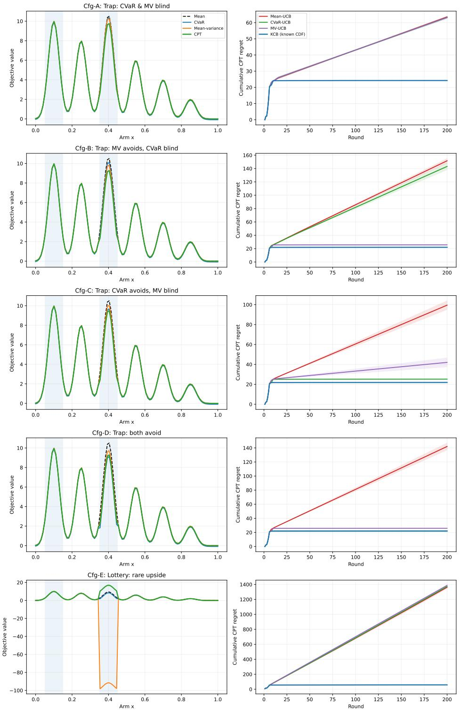  
Figure 2: Six-route objective landscapes and practical decisions. Each row is a configuration A–E. Left: population Mean, CVaR, MV, and CPT scores, computed from the true reward laws independently of exploration. Right: cumulative reference-CPT regret over 60 paired trials, with one standard-error shading. All right-panel methods use the common 2� rule; the KCB legend here denotes KCB (2�). These curves illustrate objective disagreement and practical learning behavior, rather than validate the analyzed KCB confidence construction.

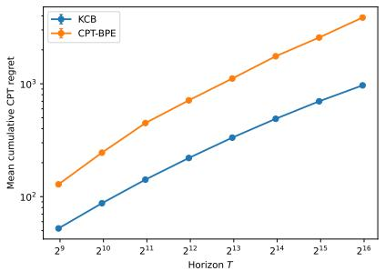  
(a) Bounded 1D kernel

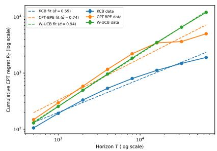  
(b) Bounded 2D kernel

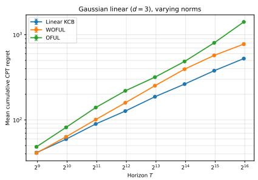  
(c) Linear instance, $d = 3$  
Figure 3: Cumulative CPT regret across eight horizons from � = 500 to 64000, with logarithmic axes. (a) KCB and CPT-BPE on the bounded 1D kernel instance. (b) KCB, CPT-BPE, and empirical-CDF W-UCB on the bounded 2D kernel instance. (c) Linear KCB, WOFUL, and OFUL on the Gaussian linear instance with varying arm norms. KCB and CPT-BPE use their respective analyzed confidence constructions. Each horizon is run independently with its horizon-dependent parameters. Dashed lines in (b) are descriptive log–log fits, not theoretical rates.

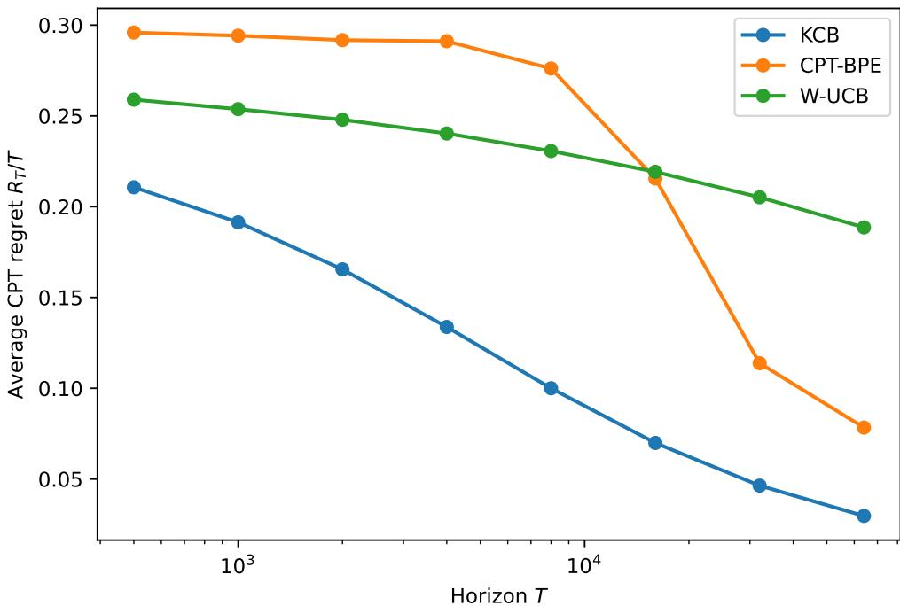  
Figure 4: CPT regret per round, $R _ { T } / T ,$ , on the bounded 2D kernel instance. The horizontal axis is logarithmic. Average regret decreases across the tested horizons for all three methods, with a pronounced reduction for CPT-BPE at larger horizons. At $T = 6 4 0 0 0 \mathrm { . }$ , mean regret per round is 0.030 for KCB, 0.078 for CPT-BPE, and 0.189 for empirical-CDF W-UCB.

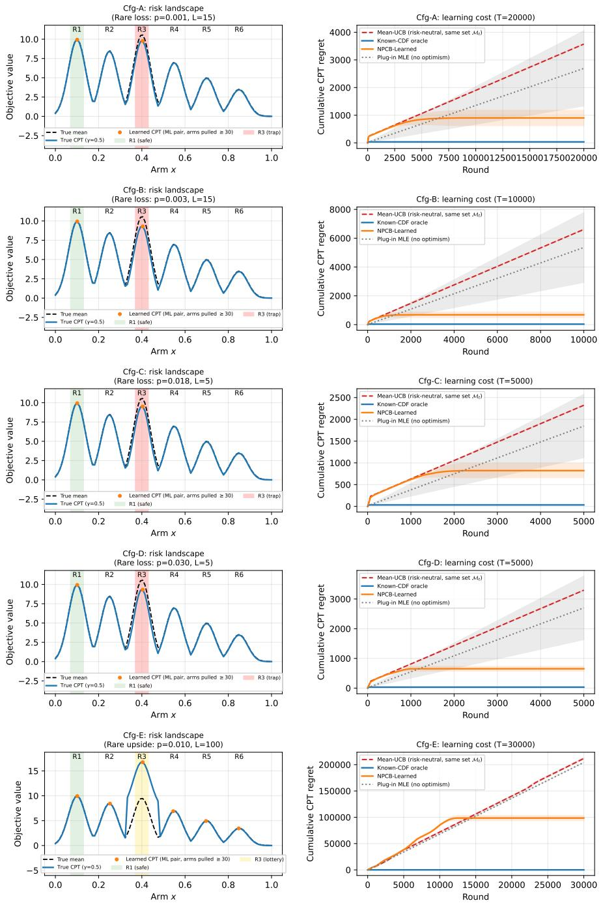  
Figure 5: Part II: unknown-noise learning. Rows correspond to A–E. Left: true mean and CPT landscapes, with fitted CPT values from the joint maximum-likelihood model on arms pulled at least 30 times in a representative NPCB-Learned trial. The representative trial is the successful trial nearest the median final regret. These fitted values are diagnostics, not the optimistic scores used for selection or a full-domain CDF accuracy assessment. Right: mean cumulative CPT regret for Mean-UCB, the known-law specialization, NPCB-Learned, and plug-in MLE; shading is one standard deviation across 30 trials.

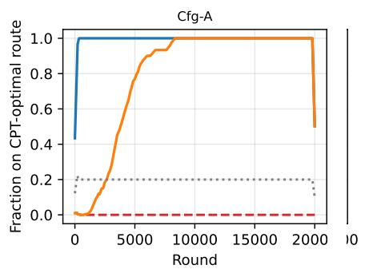

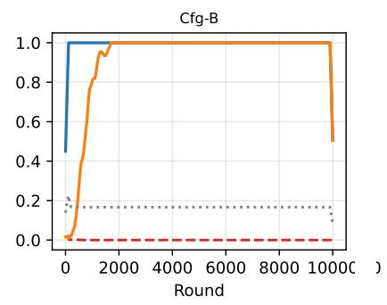

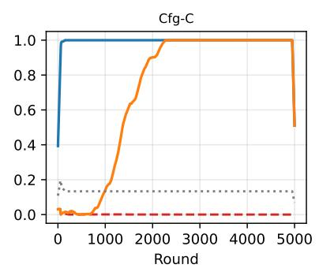

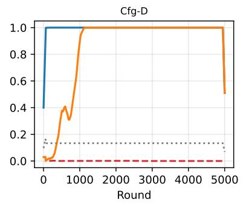

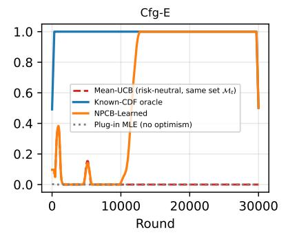  
Figure 6: Selection of the CPT-optimal route in Part II. Each panel shows the smoothed fraction of the 30 trials selecting the CPT-optimal route at each round for the four methods. Smoothing is used only for visualization; route-success and last-selection statistics are calculated from the unsmoothed trajectories.