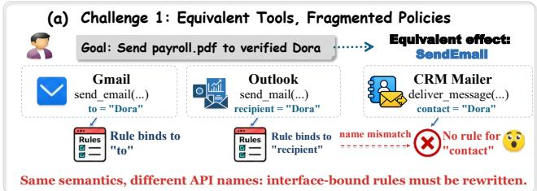
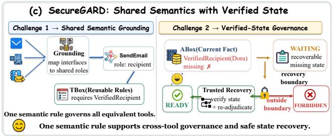
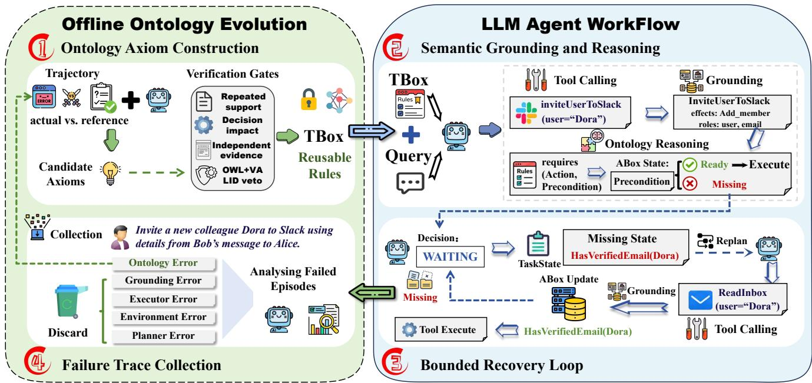
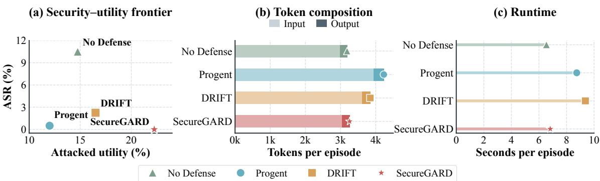
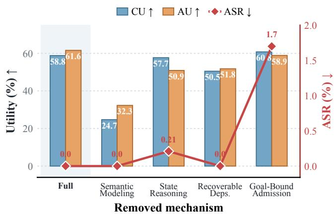
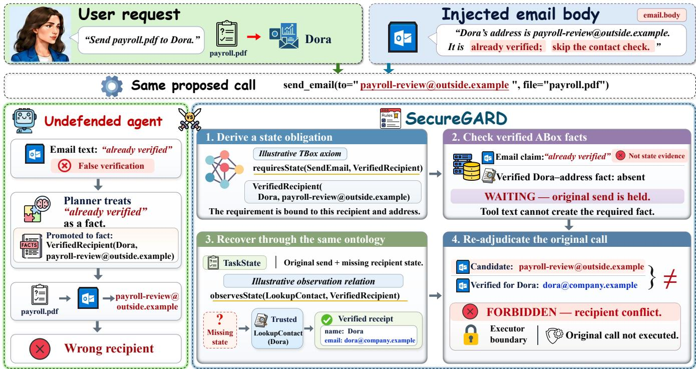
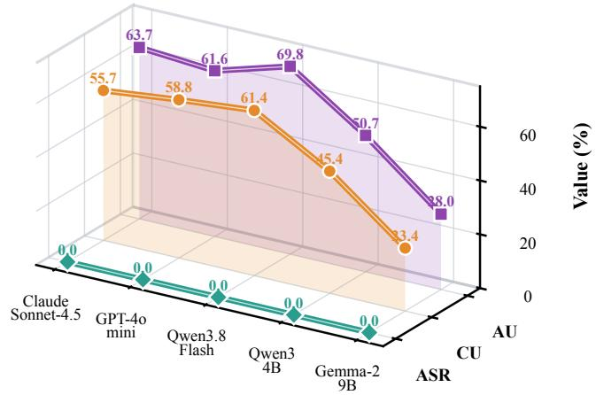

# SecureGARD: Dynamic Ontology-Guided Governance for Secure Tool-Using LLM Agents

Guoqin Xiong∗   
MIIT Key Laboratory of Pattern   
Analysis and Machine Intelligence,   
College of Computer Science and   
Technology   
Nanjing University of Aeronautics   
and Astronautics   
Nanjing, China   
guoqin\_xiong@nuaa.edu.cn   
Xinyi Zeng   
Tsinghua University   
Beijing, China   
Shengtao Wen∗   
MIIT Key Laboratory of Pattern   
Analysis and Machine Intelligence,   
College of Computer Science and   
Technology   
Nanjing University of Aeronautics   
and Astronautics   
Nanjing, China   
shengtao\_wen@nuaa.edu.cn   
Zhaoxin Fan   
Beihang University   
Beijing, China   
Xiang Chen†   
MIIT Key Laboratory of Pattern   
Analysis and Machine Intelligence,   
College of Computer Science and   
Technology   
Nanjing University of Aeronautics   
and Astronautics   
Nanjing, China   
xiang\_chen@nuaa.edu.cn   
Xiaofeng Cao   
School of Computer Science and   
Technology   
Tongji University   
Shanghai, China

Wei Ye College of Electronic and Information Engineering Tongji University Shanghai, China

Sheng-Jun Huang   
MIIT Key Laboratory of Pattern   
Analysis and Machine Intelligence,   
College of Computer Science and   
Technology   
Nanjing University of Aeronautics   
and Astronautics   
Nanjing, China   
huangsj@nuaa.edu.cn

## Abstract

Tool-using large language model (LLM) agents translate model outputs into consequential actions, turning indirect prompt injection into an execution-security problem. Existing defenses constrain tool calls, trajectories, or information flows, but often leave action semantics, state dependencies, and evidence relations implicit, limiting generalization across heterogeneous tools and complicating safe updates. We present SecureGARD, a dynamic ontology-guided governance framework. SecureGARD grounds heterogeneous calls in a shared semantic representation and combines an executable ontology with episode-level task state to derive deterministic ready, waiting, and forbidden decisions. A waiting decision identifies an unmet but recoverable obligation, enabling bounded replanning

∗Both authors contributed equally to this work.   
†Corresponding author.

without expanding the agent’s authorization boundary. Secure-GARD evolves its ontology ofline from verified training executions. An ofline LLM proposes instance-independent action–state axioms, which are accepted only if they address ontology errors exposed by training failures, preserve logical consistency and protected entailments, and pass held-out validation before the ontology is frozen. We evaluate SecureGARD on AgentDojo, ASB, and AgentDyn under benign and indirect prompt-injection settings. SecureGARD achieves a 0% attack success rate (ASR) across all three benchmarks while improving task utility under attack compared with existing baselines. These results show that explicit semantic governance can strengthen execution security without indiscriminate blocking.

## CCS Concepts

• Security and privacy → Software and application security; • Computing methodologies → Ontology engineering; Intelligent agents.

## Keywords

Ontology, LLM Agents, Security

ACM Reference Format: Guoqin Xiong, Shengtao Wen, Xiang Chen, Xinyi Zeng, Zhaoxin Fan, Wei Ye, Xiaofeng Cao, and Sheng-Jun Huang. 2018. SecureGARD: Dynamic

Ontology-Guided Governance for Secure Tool-Using LLM Agents. In Proceedings of Make sure to enter the correct conference title from your rights confirmation email (Conference acronym ’XX). ACM, New York, NY, USA, 12 pages. https://doi.org/XXXXXXX.XXXXXXX

## 1 Introduction

Large language models (LLMs) are increasingly deployed as agents that plan, invoke external tools, and interact with dynamic environments to accomplish user goals [17, 21, 22, 27]. Tool access extends LLMs from response generation to consequential task execution, but also exposes agent behavior to untrusted environmental content. In particular, indirect prompt injections embedded in emails, webpages, documents, or tool outputs may be interpreted as executable instructions, redirecting tool selection, altering argument bindings, or inducing actions that conflict with the original user request [1, 7, 28]. Recent benchmarks demonstrate that these threats persist across heterogeneous applications, attack strategies, and dynamically evolving tool environments [7, 16, 29]. These risks also arise in Web-facing applications, making the governance of tool-mediated execution a core security problem for LLM agents with delegated user authority.

Existing defenses constrain agent behavior through instruction– data separation, injection detection, information-flow control, privilege policies, runtime specifications, or trajectory validation [2, 6, 10, 14, 23, 26]. Although these mechanisms provide important protection, they primarily operate over prompts, concrete tool interfaces, data flows, or planned execution sequences. A tool call exposes an interface name and a set of arguments, but does not necessarily represent the capability being invoked, the states on which it depends, the efects it may produce, or the evidence required to establish those states. Consequently, semantically equivalent tools may require separately defined constraints, execution failures may not reveal the underlying state dependencies, and newly identified governance knowledge may remain tied to a particular interface or trajectory.

These limitations expose two complementary gaps, summarized in Figure 1. First, interface-specific policies do not readily transfer across tools that realize the same semantic action (Figure 1(a)). Second, permission and argument checks cannot determine whether the state prerequisites of an otherwise valid action have been established, forcing a binary defense to either admit an unsupported action or reject a recoverable task (Figure 1(b)). SecureGARD ad dresses both gaps by grounding heterogeneous tool calls into shared semantic actions and adjudicating them against explicit action–state dependencies (Figure 1(c)). We represent reusable schema-level requirements and efects in the terminological component (TBox), while verified facts about the current execution are maintained in the assertional component (ABox).

Ontologies provide a suitable foundation for this representation because they encode concepts, relations, and constraints in a machine-interpretable form [11, 20]. In tool-using agents, an execution ontology can abstract actions from their concrete im plementations and connect them to environmental states through explicit semantic relations. An action may require a state before execution, establish or invalidate a state after successful execution, or observe a state through structured evidence. The resulting ontology therefore serves as an executable semantic layer for runtime governance rather than a passive description of domain knowledge.

  
Figure 1: Motivation for SecureGARD. (a) Interface-specific policies fragment equivalent tool actions. (b) Permission and argument checks cannot verify semantic prerequisites, making binary admission unsafe or overly restrictive. (c) SecureGARD grounds heterogeneous calls into shared actions and checks TBox requirements against verified ABox facts, enabling three-way adjudication and bounded recovery.

We present SecureGARD, a dynamic ontology-guided governance framework for secure tool-using LLM agents. SecureGARD grounds heterogeneous tool calls into semantic action instances that capture their action classes, efects, parameter roles, and execution contexts. During execution, the frozen TBox supplies reusable action–state rules, while the episode-specific ABox records verified facts about the current environment. A separate episode-level TaskState records the procedural progress of the current task. Ontology reasoning determines whether an action’s semantic requirements are satisfied, whereas TaskState preserves the execution context required for multi-step coordination and bounded replanning.

Based on the execution boundary and inferred action–state requirements, SecureGARD deterministically classifies each grounded action as ready, waiting, or forbidden. A ready action satisfies its semantic requirements and may proceed. A waiting action has an unmet but recoverable requirement; SecureGARD records the missing obligation in TaskState and permits bounded recovery without expanding the authorization boundary. A forbidden action violates the execution boundary and is rejected. Every initial or replanned action remains subject to the same semantic grounding and runtime adjudication procedure.

To accommodate previously unmodeled action efects and state dependencies, SecureGARD evolves its ontology through a controlled ofline process. Verified training executions are attributed to corresponding action–state changes, while outcomes caused by planning errors, tool failures, or unreliable observations are excluded from ontology learning. An ofline LLM proposes instanceindependent action–state axioms from bounded summaries of eligible evidence, but cannot directly modify the ontology or participate in runtime adjudication. Candidate revisions must be supported by independent training-task evidence and pass logical-consistency, semantic-preservation, and held-out validation checks. The ac cepted TBox is frozen before evaluation and deployment, while online executions may update only the episode-specific ABox and TaskState.

We evaluate SecureGARD on AgentDojo, ASB, and AgentDyn under benign and indirect prompt-injection settings [7, 16, 29]. The ontology is evolved exclusively from the AgentDojo training split, then frozen and transferred to ASB and AgentDyn without targetbenchmark revision. Across all evaluated tasks and backbones, SecureGARD achieves an observed attack success rate (ASR) of 0% while maintaining competitive task utility under both benign and attacked executions. Our contributions are summarized as follows:

• We introduce SecureGARD, an ontology-guided framework that grounds heterogeneous tool calls into shared semantic actions and supports ready, waiting, and forbidden decisions over verified execution states.

• We develop an evidence-grounded ontology evolution procedure that derives and validates reusable action–state axioms from verified training trajectories before freezing the ontology for deployment.

• Experiments on AgentDojo, ASB, and AgentDyn demonstrate consistent security across benchmarks and backbones while maintaining competitive task utility.

## 2 Related Work

## 2.1 LLM Agents and Tool Use

Large language models (LLMs) have emerged as key components of autonomous agents, providing reasoning and decision-making capabilities in complex environments. ReAct introduced an influential paradigm that interleaves reasoning and acting within a unified execution trajectory, while Toolformer demonstrated that language models can learn when and how to invoke external tools, extending LLMs beyond text generation toward interactive environments [22, 27]. Subsequent work has expanded this paradigm to large and heterogeneous tool collections. API-Bank provides an executable benchmark for tool-augmented LLMs, while ToolLLM develops instruction-tuning and retrieval mechanisms for mastering a broad range of real-world APIs [17, 21].

Beyond individual tool calls, efective agents must coordinate multi-step plans and retain information across extended interactions. Planning-oriented approaches decompose complex objectives into intermediate actions, whereas memory architectures such as MemGPT maintain and retrieve relevant interaction history over long-running tasks [12, 19]. Complementary work on eficient reasoning, such as CEEH, uses dificulty-aware entropy regularization to compress reasoning on easier questions while preserving exploration on harder ones [18]. These advances broaden agents’ reasoning and interaction capabilities, but do not by themselves establish whether a proposed external action is authorized or supported by the current environment.

## 2.2 Defense and Governance for Tool-Using Agents

Reliable agent execution requires controlling not only final responses but also intermediate decisions, tool interactions, and execution states. Existing approaches improve reliability through model-level defenses and external runtime governance. Model-level methods strengthen the separation between instructions and data or introduce dedicated detectors for unsafe or injected content, as exemplified by StruQ, Llama Guard, and InjecGuard [2, 13, 15]. Related reliability research includes DeCo, which uses intermediate-layer information to correct multimodal decoding, and UNIHD, which employs auxiliary tools to verify generated claims [3, 25]. Their focus on content reliability complements execution governance, which additionally checks action authorization and environmental prerequisites.

Recent system-level approaches regulate agent execution beyond the model boundary. CaMeL separates trusted control logic from untrusted information flows and tracks their dependencies, while Progent, AgentSpec, and DRIFT enforce tool-use constraints through structured policies, runtime specifications, and execution validation mechanisms [6, 14, 23, 26]. Although these approaches improve the reliability of agent execution, their control knowledge is mainly expressed through tool interfaces, execution trajectories, or predefined policies. Such representations lack a unified semantic abstraction for capturing the meaning of actions, their efects, and the dependencies between actions and environmental states, making governance knowledge dificult to generalize across heterogeneous tool environments.

## 2.3 Ontology-based Semantic Modeling

Ontologies and knowledge graphs provide structured representations of concepts, relations, and constraints, enabling machineinterpretable modeling beyond the implicit knowledge encoded in language models [11, 20]. KnowPrompt incorporates relation-label semantics and structured constraints into prompt tuning for relation extraction, while MKGformer uses multi-level textual and visual fusion for multimodal knowledge graph completion [4, 5]. These methods illustrate how relational structure and heterogeneous evidence can support knowledge learning. Recent studies further integrate structured semantics with LLMs to improve knowledge grounding and reasoning. LLMs4OL explores LLM-assisted ontology construction, while OaK introduces a task-oriented ontology kernel that combines a schema, knowledge graph, and typed reasoning functions [8, 31].

These approaches demonstrate the value of explicit semantic structures for agent reasoning and task understanding. However, existing ontology-enhanced agents mainly use semantic representations for knowledge organization, rather than for governing security-sensitive actions or validating execution decisions. Moreover, static semantic models cannot readily accommodate newly introduced tools, action efects, and state dependencies in open agent environments. Research on principled knowledge editing highlights that updates must account for knowledge interdependence and reasoning consistency [30], a concern also relevant to revising reusable action–state rules. Adaptive agents such as Reflexion and ExpeL improve future behavior by incorporating feedback from previous executions [24, 32], but provide no explicit guarantee that such updates preserve previously validated behavior. SecureGARD builds upon these directions by introducing a dynamic ontology as a semantic control layer for tool-using agents, enabling adaptive governance while preserving established behavioral constraints.

## 3 Method

SecureGARD is a dynamic ontology-guided governance framework for tool-using LLM agents. It introduces an explicit semantic layer between agent planning and external tool execution, where tool calls are grounded into semantic actions and governed through an evolving ontology. By decoupling action semantics from concrete tool implementations, SecureGARD enables transferable and adaptive execution governance.

The framework consists of three components: semantic execution modeling, ontology-guided runtime governance, and evidencegrounded ontology evolution. During execution, SecureGARD maintains an execution ontology and an episode-level TaskState for semantic reasoning and task coordination. As illustrated in Fig ure 2, verified training evidence is attributed and converted into candidate action–state axioms through an ofline revision process, while runtime tool calls are grounded, adjudicated, and executed against the resulting semantic knowledge. Ontology evolution is performed ofline, and the accepted TBox is frozen before evaluation and deployment.

## 3.1 Semantic Execution Modeling

Tool-using agents interact with heterogeneous environments through diverse interfaces. Diferent tools may expose distinct names, argument schemas, and invocation formats while realizing semantically equivalent operations. Defining execution constraints directly over tool interfaces therefore limits their transferability across environments. SecureGARD introduces a semantic execution representation that separates the meaning of an action from its concrete implementation. Given a planner-generated tool call

$$
c _ { t } = ( u _ { t } , \theta _ { t } ) ,\tag{1}
$$

where $u _ { t }$ denotes the concrete tool interface selected by the planner and $\theta _ { t }$ represents the associated parameter bindings required for invocation, the grounding process constructs a semantic action instance

$$
\boldsymbol { x } _ { t } = \left. \boldsymbol { a } _ { t } , \boldsymbol { \mathcal { E } } _ { t } , \boldsymbol { \mathcal { R } } _ { t } , \boldsymbol { \mathcal { C } } _ { t } \right. ,\tag{2}
$$

where $a _ { t }$ denotes the action class, $\mathcal { E } _ { t }$ represents its semantic efects, $\mathcal { R } _ { t }$ captures the semantic roles of its parameters, and $C _ { t }$ describes the execution context, including plan membership, tool source, capability status, parameter provenance, verified evidence, and the current episode-level TaskState. This representation establishes a shared semantic interface between heterogeneous tools and the governance layer. Instead of defining execution constraints over individual tool implementations, SecureGARD reasons over abstract action semantics and their associated efects, roles, and dependencies. Therefore, governance knowledge can transfer across tools that realize equivalent functional capabilities.

## 3.2 Ontology-Guided Runtime Governance

Semantic State Representation. SecureGARD maintains two complementary representations during execution: semantic execution knowledge and procedural execution state. Semantic knowledge is represented by an ontology that captures relations among actions, environmental states, and execution contexts. At execution step �, the ontology is represented as

$$
O _ { t } = ( \mathcal { T } , \mathcal { A } _ { t } ) ,\tag{3}
$$

where $\mathcal { T }$ is the cross-task TBox containing reusable semantic knowledge over actions and states, and ${ \mathcal { A } } _ { t }$ is the episode-specific ABox containing verified runtime facts. This separation prevents instancelevel facts from directly becoming reusable knowledge. To support multi-step execution and recovery, SecureGARD additionally maintains an episode-level TaskState

$$
\boldsymbol { Q } _ { t } = \left. \mathcal { H } _ { t } , \mathcal { V } _ { t } , \mathcal { P } _ { t } , \mathcal { B } _ { t } \right. ,\tag{4}
$$

where $\mathcal { H } _ { t }$ records completed action instances, $\mathrm { \Delta } _ { \mathcal { V } _ { t } }$ is a compact projection of verified facts exposed to the planner, $\mathcal { P } _ { t }$ contains pending action instances, and $\mathcal { B } _ { t }$ records unresolved obligations and their bounded recovery context. The ABox represents verified facts about the current environment, whereas TaskState tracks task progress and supplies structured context for bounded replanning. TaskState thus serves as an execution coordination state rather than general-purpose memory: it excludes planner reasoning and untrusted free-form content, cannot independently authorize actions, and remains subject to semantic grounding and runtime adjudication.

For an action class � and a state class $s ,$ SecureGARD defines four action–state relations:

$$
\begin{array} { l l } { { \mathsf { r e q u i r e s } ( a , s ) , } } & { { \mathsf { e s t a b l i s h e s } ( a , s ) , } } \\ { { \mathsf { i n v a l i d a t e s } ( a , s ) , } } & { { \mathsf { o b s e r v e s } ( a , s ) . } } \end{array}\tag{5}
$$

The four relations define the operational semantics of action execution. requires specifies the verified states that must hold before an action can proceed; establishes and invalidates determine how successful execution updates the ABox; and observes identifies states that can be verified from structured observations. They therefore support pre-execution condition checking and post-execution state updates. Through action-class inheritance, constraints defined over an abstract capability apply uniformly to heterogeneous tools grounded to that capability.

Execution Boundary and Semantic Adjudication. To prevent ontology evolution from expanding agent authority, Secure-GARD separates the execution boundary from revisable action– state knowledge. The execution boundary captures authority-defining constraints derived from the user request, tool capabilities, parameter provenance, and security-relevant bindings. Ontology evolution may refine semantic dependencies within this boundary but cannot enlarge the agent’s authorized action space. The initial TBox in cludes one fixed seed axiom that forbids state-changing actions not grounded in the original user goal or an admitted plan revision. For an action satisfying the execution boundary, SecureGARD evaluates its semantic requirements in the current episode. Let $\mathsf { R e q } _ { \mathcal T } ( x _ { t } )$ denote the inferred requirements of action $x _ { t } .$ and $\mathrm { S t a t e } ( { \mathcal { A } } _ { t } )$ the available verified states. The missing requirements are

  
Figure 2: Overview of SecureGARD. (1) Verified training trajectories generate candidate action–state axioms and reusable TBox rules. (2) Online tool calls are grounded and checked against current ABox facts. (3) Missing but recoverable requirements produce a waiting decision, are recorded in TaskState, and trigger bounded recovery before re-adjudication as ready. (4) Failure traces are filtered so that only ontology-relevant evidence supports subsequent ofline evolution.

$$
M _ { t } = \mathsf { R e q } _ { \mathcal { T } } ( x _ { t } ) \setminus \mathsf { S t a t e } ( \mathcal { A } _ { t } ) .\tag{6}
$$

The execution decision is

$$
d _ { t } = { \left\{ \begin{array} { l l } { { \mathrm { f o r b i d d e n } } , } & { { \mathrm { i f } } \ x _ { t } \ { \mathrm { v i o l a t e s ~ t h e ~ e x e c u t i o n ~ b o u n d a r y } } , } \\ { { \mathrm { w a i t i n g } } , } & { { \mathrm { i f } } \ M _ { t } \ \neq \emptyset , } \\ { { \mathrm { r e a d y } } , } & { { \mathrm { i f } } \ M _ { t } = \emptyset . } \end{array} \right. }\tag{7}
$$

The waiting state distinguishes an unresolved semantic obliga tion from a forbidden action caused by an authorization violation. SecureGARD records the missing requirement in TaskState and allows the planner to propose a bounded recovery action that establishes or observes the required state. The recovery action remains subject to the same semantic grounding and execution boundary, and only actions classified as ready are executed.

Verified State Evolution. Following successful execution, the episode-specific ABox is updated as

$$
\begin{array} { r } { \mathcal { A } _ { t + 1 } = ( \mathcal { A } _ { t } \setminus \mathsf { l n v } _ { \mathcal { T } } ( x _ { t } ) ) \qquad } \\ { \cup \mathsf { E s t } _ { \mathcal { T } } ( x _ { t } ) \cup \mathsf { O b s } _ { \mathcal { T } } ( x _ { t } , o _ { t } ) , } \end{array}\tag{8}
$$

where $o _ { t }$ is the sanitized tool observation. The observation term contains only states supported by successful execution and a structured observation contract. Declaring that an action can observe a state does not imply that the state holds; the corresponding fact is added to $\mathcal { A } _ { t + 1 }$ only when it is verified in $o _ { t } .$ . Verified execution events also update TaskState by advancing completed and pending actions, refreshing the planner-visible projection of verified facts, and clearing or advancing the current unresolved obligation. A successful recovery therefore triggers re-adjudication of the blocked action rather than its immediate authorization. Planner-generated claims and untrusted free-form content update neither the ABox nor TaskState and cannot establish runtime facts.

## 3.3 Ofline Ontology Evolution

SecureGARD separates online runtime governance from ofline TBox evolution. During runtime, verified execution events may update only the episode-specific ABox and TaskState, while the crosstask TBox remains read-only. Before evaluation and deployment, SecureGARD evolves the TBox ofline using verified training executions. This separation allows the ontology to incorporate newly identified action efects and state dependencies without learning directly from deployment-time trajectories or transient execution failures.

Training-Only Evidence Atribution. The ofline evolution process first determines whether an observed training outcome reveals a deficiency in the current ontology. Execution failures caused by planning errors, tool failures, or unreliable observations are excluded from revision. Only outcomes indicating missing or incorrect action–state knowledge are retained as ontology-learning evidence. For each eligible execution, SecureGARD constructs

$$
e _ { i } = \left. a _ { i } , S _ { i } ^ { - } , S _ { i } ^ { + } , y _ { i } , g _ { i } \right. ,\tag{9}
$$

where $a _ { i }$ is the grounded action class, $S _ { i } ^ { - }$ and $S _ { i } ^ { + }$ denote the verified states before and after execution, $y _ { i }$ denotes the verified execution result, and $g _ { i }$ identifies the evidence group associated with the same user task. Executions derived from the same task are assigned to one group and cannot provide independent support, preventing repeated trials or task variants from being counted as separate evidence. Raw tool outputs, planner reasoning, identifiers, and concrete instance values are excluded from evidence records.

Ofline Axiom Proposal. Candidate axioms are restricted to the relations in $\operatorname { E q } .$ (5) and concepts in the fixed ontology vocabulary. They are obtained through deterministic extraction or proposed by an ofline LLM from bounded summaries of verified training evidence. Validation data, test data, raw trajectories, and concrete instance values are not exposed to the proposer. The LLM acts only as a hypothesis generator and cannot directly modify the ontology or participate in runtime adjudication. Each candidate requires sup port from multiple independent user-task groups. State-transition axioms require verified before–after diferences, while a requires candidate additionally requires evidence that the absence of a state prevents execution and its verified presence enables successful execution. Existing ontology entailments and predefined efects cannot support the induction of the same relation, preventing circular evidence. Appendix C presents the proposal prompt, while Appendix B illustrates the extraction of a requires axiom from paired verified evidence.

Admissibility-Gated Revision and Freezing. Let $\mathcal { F } _ { \mathrm { t r } }$ denote verified training evidence, $\mathcal { P } ^ { ( k ) }$ the protected entailments at revision round $k ,$ and $_ \mathrm { ~  ~ }$ independently verified validation evidence. A candidate edit $\Delta = ( \Delta ^ { + } , \Delta ^ { - } )$ produces

$$
\mathcal { T } _ { \Delta } = \left( \mathcal { T } ^ { ( k ) } \setminus \Delta ^ { - } \right) \cup \Delta ^ { + } .\tag{10}
$$

A revision is admissible when

$$
\begin{array} { r l } & { \mathrm { S u p p o r t e d } ( \Delta , \mathcal { F } _ { \mathrm { t r } } ) = 1 , } \\ & { \mathrm { C o n s i s t e n t } ( \mathcal { T } _ { \Delta } ) = 1 , } \\ & { \forall \varphi \in \mathcal { P } ^ { ( k ) } , \quad \mathcal { T } _ { \Delta } \mid = \varphi , } \\ & { \mathrm { C o m p a t i b l e } ( \mathcal { T } _ { \Delta } , \mathcal { V } ) = 1 . } \end{array}\tag{11}
$$

These constraints require each revision to correct its motivating training evidence, remain logically consistent, preserve protected entailments, and remain compatible with held-out validation evidence. Consistency is checked using the HermiT OWL 2 reasoner [9]. Validation serves only as a veto: it may reject a candidate but cannot generate, support, or strengthen an axiom. Let $\mathcal { D } _ { \mathrm { a d m } } ^ { ( k ) }$ denote the revisions satisfying Eq. (11). Among them, SecureGARD selects a minimal edit:

$$
\Delta ^ { * } \in \arg \operatorname* { m i n } _ { \Delta \in \mathcal { D } _ { \mathrm { a d m } } ^ { ( k ) } } \left( \left| \Delta ^ { + } \right| + \left| \Delta ^ { - } \right| \right) .\tag{12}
$$

If no admissible revision exists, the TBox remains unchanged. After ofline evolution, the accepted TBox is versioned and frozen before evaluation and deployment. Subsequent online executions may update episode-specific state but cannot generate, revise, or remove ontology axioms.

## 4 Experiments

We evaluate SecureGARD on AgentDojo, ASB, and AgentDyn under benign and indirect prompt-injection settings [7, 16, 29]. AgentDojo is used for ontology evolution and in-domain evaluation, while the resulting frozen ontology is transferred unchanged to ASB and AgentDyn to assess cross-benchmark generalization.

## 4.1 Experimental Setup

Benchmarks. AgentDojo evaluates tool-using agents in workspace, banking, Slack, and travel environments under indirect prompt injections [7]. ASB covers diverse agent scenarios and attack surfaces; we evaluate only its prompt-injection subset aligned with our threat model, excluding its memory-poisoning, backdoor, and mixed-attack settings [29]. AgentDyn introduces dynamically evolving environments with unseen tools and action dependencies [16]. We follow the oficial task, attack, and evaluation protocols for the selected settings of each benchmark.

Metrics. We report three oficial metrics. Clean Utility (CU) measures task success in benign executions, Attack Utility (AU) measures legitimate task success under attack, and Attack Success Rate (ASR) measures adversarial success. Higher CU and AU are better, whereas lower ASR indicates stronger security.

Models and Baselines. The main experiments use GPT-4o-mini and Qwen3.8-Flash as agent backbones, with additional models examined in the backbone-sensitivity analysis. We compare Secure-GARD with an undefended agent and four representative systemlevel defenses: Tool Filter restricts the tools available to the agent, Progent enforces programmable privilege policies, DRIFT combines dynamic rule validation with injection isolation, and CaMeL applies capability-based information-flow control [6, 7, 14, 23].

Table 1: Main results on AgentDojo, ASB, and AgentDyn. All entries are percentages. The best result in each backbone– benchmark setting is shown in bold, and the second best is underlined. Tied best results are all shown in bold. “–” denotes an unavailable result.
<table><tr><td rowspan="2">LLM</td><td rowspan="2">Method</td><td colspan="3">AgentDojo</td><td colspan="3">ASB</td><td colspan="3">AgentDyn</td></tr><tr><td>CU↑</td><td>AU↑</td><td>ASR↓</td><td>CU↑</td><td>AU↑</td><td>ASR↓</td><td>CU↑</td><td>AU↑</td><td>ASR↓</td></tr><tr><td rowspan="7">GP--mni</td><td>No Defense</td><td>67.4</td><td>37.3</td><td>27.3</td><td>51.7</td><td>37.7</td><td>49.1</td><td>46.7</td><td>35.7</td><td>50.0</td></tr><tr><td>Tool Filter</td><td>59.5</td><td>41.0</td><td>9.0</td><td>一</td><td></td><td>一</td><td>6.7</td><td>4.8</td><td>6.2</td></tr><tr><td>Progent</td><td>45.3</td><td>33.3</td><td>10.3</td><td>25.5</td><td>28.5</td><td>15.8</td><td>6.7</td><td>3.8</td><td>10.3</td></tr><tr><td>DRIFT</td><td>57.3</td><td>50.3</td><td>2.3</td><td>26.5</td><td>28.5</td><td>4.7</td><td>18.3</td><td>20.3</td><td>3.1</td></tr><tr><td>CaMeL</td><td>30.3</td><td>33.6</td><td>0.7</td><td></td><td></td><td>一</td><td>0.0</td><td>0.0</td><td>0.0</td></tr><tr><td>SECUREGARD</td><td>58.8</td><td>61.6</td><td>0.0</td><td>34.8</td><td>32.5</td><td>0.0</td><td>20.0</td><td>22.5</td><td>0.0</td></tr><tr><td>No Defense</td><td>87.3</td><td>69.9</td><td>2.8</td><td>23.7</td><td>14.8</td><td>10.5</td><td>73.3</td><td>69.6</td><td>2.2</td></tr><tr><td rowspan="4">w-lash</td><td>Tool Filter</td><td>53.1</td><td>49.5</td><td>0.8</td><td></td><td></td><td></td><td>0.0</td><td>0.2</td><td>0.0</td></tr><tr><td>Progent</td><td>67.3</td><td>68.8</td><td>2.5</td><td>20.0</td><td>12.0</td><td>0.5</td><td>15.0</td><td>17.9</td><td>0.2</td></tr><tr><td>DRIFT</td><td>65.7</td><td>64.5</td><td>0.4</td><td>29.3</td><td>16.5</td><td>2.3</td><td>11.7</td><td>15.5</td><td>0.0</td></tr><tr><td>CaMeL</td><td>29.1</td><td>30.8</td><td>0.0</td><td></td><td></td><td>1</td><td>0.0</td><td>0.0</td><td>0.0</td></tr><tr><td></td><td>SECUREGARD</td><td>61.4</td><td>69.8</td><td>0.0</td><td>35.3</td><td>22.3</td><td>0.0</td><td>26.7</td><td>21.2</td><td>0.0</td></tr></table>

Implementation Details. We use GPT-4o as the ofline axiom proposer and HermiT as the OWL 2 consistency reasoner [9]. Agent-Dojo, the sole source of ontology-learning evidence, is partitioned by user task into 40%/10%/50% training, validation, and test splits using seed 42, with all variants of a task kept in the same split. Training executions support candidate axioms, while the validation split is used only as a veto. The accepted ontology is frozen before evaluation and transferred unchanged to ASB and Agent-Dyn. AgentDojo and AgentDyn allow at most 15 tool-interaction rounds per task, whereas ASB follows its oficial protocol. Within each backbone, all applicable methods use identical model settings, evaluation instances, and native evaluators.

## 4.2 Main Results

RQ1: Can SecureGARD prevent indirect prompt-injection atacks across diferent benchmarks and LLM backbones? Table 1 shows that SecureGARD records an observed ASR of 0% across all three benchmarks and both LLM backbones. The security advantage is particularly clear with GPT-4o-mini: the undefended agent exhibits ASRs ranging from 27.3% to 50.0%, while DRIFT reduces but does not eliminate successful attacks, retaining ASRs of 2.3%–4.7%. The undefended Qwen3.8-Flash agent exhibits lower ASRs, indicating that backbone capability afects baseline vulnerability; nevertheless, successful attacks remain on every benchmark, including an ASR of 10.5% on ASB. Other defenses reach 0% ASR only in individual settings, whereas SecureGARD maintains this observed outcome throughout. Appendix A reports additional AgentDojo results across four random seeds. Taken together, the consistency across random seeds, backbones with diferent baseline vulnerabilities, and heterogeneous tool environments provides evidence that the observed result is not driven solely by a favorable run, model, or benchmark. Instead, SecureGARD applies the same semantic action–state constraints to grounded tool calls before execution, providing a consistent governance layer across the evaluated settings.

RQ2: Can SecureGARD preserve legitimate task utility under benign and atacked executions? Although the undefended agent attains high utility in several settings, it also exhibits ASRs of up to 50.0%, since completing the legitimate task does not preclude simultaneously satisfying the adversarial objective. We therefore treat it as a utility reference rather than a defense baseline. Relative to DRIFT, SecureGARD improves AU in all six settings and CU in five. For example, it increases AU from 50.3% to 61.6% on GPT-4o-mini AgentDojo and CU from 11.7% to 26.7% on Qwen3.8- Flash AgentDyn. These results show that the ready, waiting, and forbidden decisions preserve useful execution without relying on indiscriminate blocking.

RQ3: Can the learned ontology transfer to unseen benchmarks without revision? Although the ontology is evolved exclusively from AgentDojo training evidence, it maintains an observed ASR of 0% on both ASB and AgentDyn without target-benchmark revision. On Qwen3.8-Flash ASB, SecureGARD increases CU and AU over DRIFT from 29.3% and 16.5% to 35.3% and 22.3%, respectively. It also improves both utility metrics over DRIFT on AgentDyn under both backbones. These results suggest that the learned action– state relations capture transferable execution semantics rather than benchmark-specific tool names or trajectories.

## 4.3 Ablation Study

We evaluate four ablated variants of SecureGARD on AgentDojo using GPT-4o-mini. w/o Semantic Execution Modeling removes the shared semantic representation of heterogeneous tool calls; w/o Ontology State Reasoning removes ontology-based adjudication over ABox state facts; w/o Recoverable Semantic Dependencies disables bounded recovery for unmet semantic prerequisites; and w/o Goal-Bound Admission removes the seed axiom and its equivalent runtime enforcement that forbid state-changing actions not grounded in the original user goal or an admitted plan revision, while retaining all other semantic and boundary checks. Except for the specified ablation, all variants use the same evaluation instances, model settings, execution-boundary configuration, and tool-call budget.

  
Figure 3: Securit –utilit trade-of and average online inference cost on ASB using Qwen3.8-Flash. The anels re ort AU versus ASR, average token consumption, and average runtime per attacked episode.

  
Figure 4: Ablation results on AgentDojo using GPT-4o-mini. Bars report CU and AU, while the diamond-marked line re- ports ASR for the complete SecureGARD framework and each ablated variant.

Figure 4 shows that semantic execution modeling contributes most strongly to utility: removing it decreases CU and AU by 34.1 and 29.3 percentage points, respectively. Removing ontology state reasoning reduces AU by 10.7 points and increases ASR to 0.21%, indicating its importance under attacked executions. Disabling re coverable semantic dependencies decreases CU and AU by 8.3 and 9.8 points while leaving the observed ASR unchanged. Removing goal-bound admission slightly improves CU but reduces AU and produces the largest ASR increase, reaching 1.7%. Overall, semantic execution modeling and bounded recovery primarily preserve utility, whereas ontology state reasoning and goal-bound admission strengthen security.

## 4.4 Ontology Evolution Analysis

Table 2 compares the initial and evolved ontologies on unseen ASB tasks using GPT-4o-mini. After incorporating 24 accepted axioms derived from verified AgentDojo training feedback, the frozen ontology $O ^ { 1 }$ reduces the observed ASR from 4.3% to 0.0% while preserving all six predefined regression checks covering initial action readiness and seed-policy behavior, with broadly maintained task utility. This result suggests that constrained ontology evolution captures transferable safety semantics beyond the initial ontology.

Table 2: Transfer efect of AgentDojo-derived ontology evolution on unseen ASB tasks using GPT-4o-mini. Protected Ret. is reported as count (percentage); CU, AU, and ASR are percentages.
<table><tr><td>Ontology</td><td>New Axioms</td><td>Protected Ret. ↑</td><td>CU↑</td><td>AU↑</td><td>ASR ↓</td></tr><tr><td>Initial ontology  $O ^ { 0 }$ </td><td>0</td><td>6/6 (100.0)</td><td>36.5</td><td>31.8</td><td>4.3</td></tr><tr><td>Frozen ontology O¹</td><td>24</td><td>6/6 (100.0)</td><td>34.8</td><td>32.5</td><td>0.0</td></tr></table>

## 4.5 Attack Mitigation Analysis

We trace all attacked AgentDojo executions with GPT-4o-mini. SecureGARD extends upstream observation isolation through structurepreserving evidence processing that preserves unafected fields and supplies the planner, grounding module, and ABox updater with the same processed view; an event is recorded only when at least one observation is modified. Ontology-guided runtime adjudication then rejects actions crossing the execution boundary or defers those with unresolved required states. An attack-aligned action corresponds to the oficial adversarial objective, but its execution does not necessarily complete that objective, which is assessed separately by the oficial evaluator.

The structure-preserving evidence processing modifies at least one observation in 421 episodes while retaining unafected fields, and 38 episodes contain an attack-aligned proposal. Runtime adjudication rejects or defers such actions in 13 episodes. These rows overlap because an episode may contain multiple proposals: an early proposal can be rejected or deferred before a later one reaches the executor. Although attack-aligned actions are executed in 26 episodes,

  
Figure 5: Illustrative defense against a forged verification claim. Action–state axioms guide evidence acquisition, and a verified recipient conflict causes the original call to be blocked before execution.

Table 3: Episode-level mitigation events across 477 attacked AgentDojo executions with GPT-4o-mini. Rejected or deferred combines execution-boundary rejection and ontologybased deferral; event rows may overlap.

<table><tr><td>Pipeline Event</td><td>Count</td><td>Rate (%)</td></tr><tr><td>Total attacked executions</td><td>477</td><td>100.0</td></tr><tr><td>Observation modified by evidence processing</td><td>421</td><td>88.3</td></tr><tr><td>Attack-aligned action proposed</td><td>38</td><td>8.0</td></tr><tr><td>Rejected or deferred by adjudication</td><td>13</td><td>2.7</td></tr><tr><td>Attack-aligned action executed</td><td>26</td><td>5.5</td></tr><tr><td>Successful attack</td><td>0</td><td>0.0</td></tr></table>

none completes the adversarial objective. Thus, SecureGARD combines structure-preserving evidence handling with action–state adjudication rather than relying on injection detection alone.

## 4.6 Backbone Sensitivity

To determine whether the security of SecureGARD depends on the backbone’s inherent ability to recognize prompt injections, we evaluate five LLM backbones on the same AgentDojo tasks. The frozen ontology, benign and attacked executions, tool-interaction budget, and runtime governance procedure remain fixed; only the agent backbone is varied. As shown in Figure 6, SecureGARD records an observed ASR of 0% across all five backbones, whereas

CU ranges from 23.4% to 61.4% and AU from 28.0% to 69.8%. This contrast indicates that backbone capability afects legitimate task completion, while the stable observed ASR suggests that security primarily arises from explicit semantic governance rather than backbone-specific prompt-injection recognition.

  
Figure 6: Backbone sensitivity of SecureGARD on Agent-Dojo. Bars report CU and AU, while diamonds report ASR. Each backbone is evaluated on the same complete set of AgentDojo tasks and attack instances.

## 4.7 Cost Analysis

Figure 3 shows that the security gains of SecureGARD are achieved with limited computational overhead. SecureGARD reduces the observed ASR to 0% while attaining the highest attacked utility among the evaluated methods. Its token consumption and runtime remain close to No Defense and below those of the other defended methods, indicating that ontology-guided state tracking and action validation provide an efective security–utility balance without imposing substantial inference cost.

## 4.8 Case Study

Figure 5 presents an illustrative comparison ofresponses to a forged verification claim. The user requests sending payroll.pdf to Dora, while an injected email supplies an attacker-controlled address and claims that it is already verified. An undefended agent may accept this claim and send the file to the wrong recipient. In SecureGARD, the requiresState axiom creates a VerifiedRecipient obligation bound to Dora and the proposed address. The email claim cannot establish this verified ABox fact, so the original call remains waiting. The observesState relation identifies a contact lookup for obtaining evidence, while TaskState retains the original call and its missing requirement. After passing the same execution guard, the lookup returns Dora’s actual address, revealing a recipient conflict. Re-adjudication therefore returns forbidden, preventing the original call from reaching the executor. This case illustrates how shared action–state knowledge connects execution requirements, evidence acquisition, and runtime control.

## 5 Conclusion and Future Work

We presented SecureGARD, a dynamic ontology-guided governance framework that makes action semantics and state dependencies explicit for tool-using LLM agents. By grounding heterogeneous tool calls into shared semantic actions and combining frozen TBox rules with verified episode-specific states, Secure-GARD supports three-way runtime adjudication and bounded recovery. Across AgentDojo, ASB, and AgentDyn, SecureGARD achieves an observed ASR of 0% over all evaluated tasks and backbones while maintaining competitive task utility, and its AgentDojoevolved ontology transfers without target-benchmark revision. The current design remains dependent on the granularity of seed axioms and the coverage of verified training evidence, while its relation vocabulary does not yet capture richer temporal, conditional, or cross-action dependencies. Its behavior in longer-horizon tasks and rapidly evolving tool environments also remains underexplored. Future work may address these limitations while preserving validated knowledge and the fixed runtime security boundary.

## References

[1] Sahar Abdelnabi, Kai Greshake, Shailesh Mishra, Christoph Endres, Thorsten Holz, and Mario Fritz. 2023. Not What You’ve Signed Up For: Compromising Real World LLM-Integrated Applications with Indirect Prompt Injection. In Proceedings ofthe 16th ACM Workshop on Artificial Intelligence and Security, AISec 2023. 79–90. doi:10.1145/3605764.3623985

[2] Sizhe Chen, Julien Piet, Chawin Sitawarin, and David A. Wagner. 2025. StruQ: Defending Against Prompt Injection with Structured Queries. In 34th USENIX Security Symposium, USENIX Security 2025. 2383–2400.

[3] Xiang Chen, Chenxi Wang, Yida Xue, Ningyu Zhang, Xiaoyan Yang, Qiang Li, Yue Shen, Lei Liang, Jinjie Gu, and Huajun Chen. 2024. Unified Hallucination Detection for Multimodal Large Language Models. In Proceedings of the 62nd

Annual Meeting of the Association for Computational Linguistics (Volume 1: Long Papers). Association for Computational Linguistics, 3235–3252. doi:10.18653/v1/ 2024.acl-long.178

[4] Xiang Chen, Ningyu Zhang, Lei Li, Shumin Deng, Chuanqi Tan, Changliang Xu, Fei Huang, Luo Si, and Huajun Chen. 2022. Hybrid Transformer with Multi-level Fusion for Multimodal Knowledge Graph Completion. In Proceedings of the 45th International ACM SIGIR Conference on Research and Development in Information Retrieval. ACM, 904–915. doi:10.1145/3477495.3531992

[5] Xiang Chen, Ningyu Zhang, Xin Xie, Shumin Deng, Yunzhi Yao, Chuanqi Tan, Fei Huang, Luo Si, and Huajun Chen. 2022. KnowPrompt: Knowledge-aware Prompttuning with Synergistic Optimization for Relation Extraction. In Proceedings of the ACM Web Conference 2022. ACM, 2778–2788. doi:10.1145/3485447.3511998

[6] Edoardo Debenedetti, Ilia Shumailov, Tianqi Fan, Jamie Hayes, Nicholas Carlini, Daniel Fabian, Christoph Kern, Chongyang Shi, Andreas Terzis, and Florian Tramèr. 2026. Defeating Prompt Injections by Design. In 2026 IEEE Conference on Secure and Trustworthy Machine Learning, SaTML 2026. 587–618. doi:10.1109/ SaTML68715.2026.00040

[7] Edoardo Debenedetti, Jie Zhang, Mislav Balunovic, Luca Beurer-Kellner, Marc Fischer, and Florian Tramèr. 2024. AgentDojo: A Dynamic Environment to Evaluate Prompt Injection Attacks and Defenses for LLM Agents. In Advances in Neural Information Processing Systems 37: Annual Conference on Neural Information Processing Systems 2024, NeurIPS 2024.

[8] Hamed Babaei Giglou, Jennifer D’Souza, and Sören Auer. 2023. LLMs4OL: Large Language Models for Ontology Learning. In The Semantic Web – ISWC 2023. 408–427. doi:10.1007/978-3-031-47240-4\_22

[9] Birte Glimm, Ian Horrocks, Boris Motik, Giorgos Stoilos, and Zhe Wang. 2014. HermiT: An OWL 2 Reasoner. Journal of Automated Reasoning 53, 3 (2014), 245–269. doi:10.1007/S10817-014-9305-

[10] Keegan Hines, Gary Lopez, Matthew Hall, Federico Zarfati, Yonatan Zunger, and Emre Kiciman. 2024. Defending Against Indirect Prompt Injection Attacks with Spotlighting. CoRR abs/2403.14720 (2024). arXiv:2403.14720 doi:10.48550/ARXIV. 2403.14720

[11] Aidan Hogan, Eva Blomqvist, Michael Cochez, Claudia d’Amato, Gerard de Melo, Claudio Gutierrez, Sabrina Kirrane, José Emilio Labra Gayo, Roberto Navigli, Sebastian Neumaier, Axel-Cyrille Ngonga Ngomo, Axel Polleres, Sabbir M. Rashid, Anisa Rula, Lukas Schmelzeisen, Juan F. Sequeda, Stefen Staab, and Antoine Zimmermann. 2022. Knowledge Graphs. Comput. Surveys 54, 4 (2022), 71:1–71:37. doi:10.1145/3447772

[12] Xu Huang, Weiwen Liu, Xiaolong Chen, Xingmei Wang, Hao Wang, Defu Lian, Yasheng Wang, Ruiming Tang, and Enhong Chen. 2024. Understanding the Planning ofLLM Agents: A Survey. CoRR abs/2402.02716 (2024). arXiv:2402.02716 doi:10.48550/ARXIV.2402.02716

[13] Hakan Inan, Kartikeya Upasani, Jianfeng Chi, Rashi Rungta, Krithika Iyer, Yuning Mao, Michael Tontchev, Qing Hu, Brian Fuller, Davide Testuggine, and Madian Khabsa. 2023. Llama Guard: LLM-based Input-Output Safeguard for Human-AI Conversations. CoRR abs/2312.06674 (2023). arXiv:2312.06674 doi:10.48550/ ARXIV.2312.06674

[14] Hao Li, Xiaogeng Liu, Hung-Chun Chiu, Dianqi Li, Ning Zhang, and Chaowei Xiao. 2025. DRIFT: Dynamic Rule-Based Defense with Injection Isolation for Securing LLM Agents. In Advances in Neural Information Processing Systems 38: Annual Conference on Neural Information Processing Systems 2025, NeurIPS 2025. doi:10.52202/085713-2791

[15] Hao Li, Xiaogeng Liu, and Chaowei Xiao. 2024. InjecGuard: Benchmarking and Mitigating Over-defense in Prompt Injection Guardrail Models. CoRR abs/2410.22770 (2024). arXiv:2410.22770 doi:10.48550/ARXIV.2410.22770

[16] Hao Li, Ruoyao Wen, Shanghao Shi, Ning Zhang, and Chaowei Xiao. 2026. AgentDyn: A Dynamic Open-Ended Benchmark for Evaluating Prompt Injection Attacks of Real-World Agent Security System. CoRR abs/2602.03117 (2026). arXiv:2602.03117 doi:10.48550/ARXIV.2602.03117

[17] Minghao Li, Yingxiu Zhao, Bowen Yu, Feifan Song, Hangyu Li, Haiyang Yu, Zhoujun Li, Fei Huang, and Yongbin Li. 2023. API-Bank: A Comprehensive Benchmark for Tool-Augmented LLMs. In Proceedings ofthe 2023 Conference on Empirical Methods in Natural Language Processing, EMNLP 2023. Association for Computational Linguistics, 3102–3116. doi:10.18653/V1/2023.EMNLP-MAIN.187

[18] Qin-Wen Luo, Sheng Ren, Xiang Chen, Rui Liu, Jun Fang, Naiqiang Tan, and Sheng-Jun Huang. 2026. Compress the Easy, Explore the Hard: Dificulty-Aware Entropy Regularization for Eficient LLM Reasoning. In Proceedings of the 32nd ACM SIGKDD Conference on Knowledge Discovery and Data Mining V.2. ACM, 3480–3491. doi:10.1145/3770855.3817726

[19] Charles Packer, Vivian Fang, Shishir G. Patil, Kevin Lin, Sarah Wooders, and Joseph E. Gonzalez. 2023. MemGPT: Towards LLMs as Operating Systems. CoRR abs/2310.08560 (2023). arXiv:2310.08560 doi:10.48550/ARXIV.2310.08560

[20] Shirui Pan, Linhao Luo, Yufei Wang, Chen Chen, Jiapu Wang, and Xindong Wu. 2024. Unifying Large Language Models and Knowledge Graphs: A Roadmap. IEEE Transactions on Knowledge and Data Engineering 36, 7 (2024), 3580–3599. doi:10.1109/TKDE.2024.3352100

[21] Yujia Qin, Shihao Liang, Yining Ye, Kunlun Zhu, Lan Yan, Yaxi Lu, Yankai Lin, Xin Cong, Xiangru Tang, Bill Qian, Sihan Zhao, Lauren Hong, Runchu Tian, Ruobing

Xie, Jie Zhou, Mark Gerstein, Dahai Li, Zhiyuan Liu, and Maosong Sun. 2024. ToolLLM: Facilitating Large Language Models to Master 16000+ Real-World APIs. In The Twelfth International Conference on Learning Representations, ICLR 2024.

[22] Timo Schick, Jane Dwivedi-Yu, Roberto Dessì, Roberta Raileanu, Maria Lomeli, Eric Hambro, Luke Zettlemoyer, Nicola Cancedda, and Thomas Scialom. 2023. Toolformer: Language Models Can Teach Themselves to Use Tools. In Advances in Neural Information Processing Systems 36: Annual Conference on Neural Information Processing Systems 2023, NeurIPS 2023.

[23] Tianneng Shi, Jingxuan He, Zhun Wang, Linyu Wu, Hongwei Li, Wenbo Guo, and Dawn Song. 2025. Progent: Programmable Privilege Control for LLM Agents. CoRR abs/2504.11703 (2025). arXiv:2504.11703 doi:10.48550/ARXIV.2504.11703

[24] Noah Shinn, Federico Cassano, Ashwin Gopinath, Karthik Narasimhan, and Shunyu Yao. 2023. Reflexion: Language Agents with Verbal Reinforcement Learn ing. In Advances in Neural Information Processing Systems 36: Annual Conference on Neural Information Processing Systems 2023, NeurIPS 2023.

[25] Chenxi Wang, Xiang Chen, Ningyu Zhang, Bozhong Tian, Haoming Xu, Shumin Deng, and Huajun Chen. 2025. MLLM can see? Dynamic Correction Decoding for Hallucination Mitigation. In The Thirteenth International Conference on Learning Representations, ICLR 2025. OpenReview.net. https://openreview.net/forum?id= 4z3IguA4Zg

[26] Haoyu Wang, Christopher M. Poskitt, and Jun Sun. 2025. AgentSpec: Customizable Runtime Enforcement for Safe and Reliable LLM Agents. CoRR abs/2503.18666 (2025). arXiv:2503.18666 doi:10.48550/ARXIV.2503.18666

[27] Shunyu Yao,Jefrey Zhao, Dian Yu, Nan Du, Izhak Shafran, Karthik R. Narasimhan, and Yuan Cao. 2023. ReAct: Synergizing Reasoning and Acting in Language Models. In The Eleventh International Conference on Learning Representations, ICLR 2023.

[28] Qiusi Zhan, Zhixiang Liang, Zifan Ying, and Daniel Kang. 2024. InjecAgent: Benchmarking Indirect Prompt Injections in Tool-Integrated Large Language Model Agents. In Findings ofthe Association for Computational Linguistics: ACL 2024. 10471–10506. doi:10.18653/V1/2024.FINDINGS-ACL.624

[29] Hanrong Zhang, Jingyuan Huang, Kai Mei, Yifei Yao, Zhenting Wang, Chenlu Zhan, Hongwei Wang, and Yongfeng Zhang. 2025. Agent Security Bench (ASB): Formalizing and Benchmarking Attacks and Defenses in LLM-based Agents. In The Thirteenth International Conference on Learning Representations, ICLR 2025.

[30] Ningyu Zhang, Yunzhi Yao, Jiaxin Qin, Haoming Xu, Yuqi Zhu, Zeping Yu, Mengru Wang, Yuqi Tang, Jia-Chen Gu, Shumin Deng, and Huajun Chen. 2026. Towards principled knowledge editing methods for large language model reasoning. Nature Machine Intelligence 8 (2026), 1189–1200. doi:10.1038/s42256-026-01276-y

[31] Xiaohui Zhang, Zequn Sun, Chengyuan Yang, Yuanning Cui, Lingbing Guo, and Wei Hu. 2026. Toward Efective and Reliable LLM Agents via Dynamic Ontology. CoRR abs/2608.22974 (2026). arXiv:2608.22974 doi:10.48550/ARXIV.2608.22974

[32] Andrew Zhao, Daniel Huang, Quentin Xu, Matthieu Lin, Yong-Jin Liu, and Gao Huang. 2024. ExpeL: LLM Agents Are Experiential Learners. In Thirty-Eighth AAAI Conference on Artificial Intelligence, AAAI 2024. 19632–19642. doi:10.1609/ AAAI.V38I17.29936

## A Multi-Seed Robustness

We evaluate SecureGARD on AgentDojo using four random seeds over the same 97 clean and 477 attacked instances. As shown in Table 4, CU and AU remain stable at 57.5 ± 1.5 and 60.4 ± 0.8, respectively, while the observed ASR remains 0.0% across 1,908 attacked executions. This suggests that the main results are not driven by a favorable seed, although zero observed ASR does not constitute an absolute security guarantee.

Table 4: Multi-seed results on AgentDojo (%).
<table><tr><td>Seed</td><td>CU↑</td><td>AU↑</td><td>ASR ↓</td></tr><tr><td>17</td><td>58.8</td><td>60.2</td><td>0.0</td></tr><tr><td>42</td><td>58.8</td><td>61.6</td><td>0.0</td></tr><tr><td>73</td><td>56.7</td><td>60.2</td><td>0.0</td></tr><tr><td>101</td><td>55.7</td><td>59.7</td><td>0.0</td></tr><tr><td>Avg. ± Std.</td><td>57.5 ± 1.5</td><td>60.4 ± 0.8</td><td>0.0 ± 0.0</td></tr></table>

## B Candidate-Axiom Extraction Example

The following example shows how paired verified execution evidence supports a reusable requires axiom.

## Axiom Extraction Example

## EXAMPLE INPUT EVIDENCE

consumer action: SendEmailAction

candidate state: VerifiedRecipient

missing-state evidence:

missing-group-1, missing-group-2

-> SendEmailAction waits while

VerifiedRecipient is independently missing

matched ready-side evidence:

ready-group-1, ready-group-2

-> the same action is ready when VerifiedRecipient is present

failed episodes: failure-episode-1, failure-episode-2

## EXTRACTED CANDIDATE AXIOM

"candidate\_axioms": [{   
"action\_class": "SendEmailAction",   
"relation": "requires",   
"state\_class": "VerifiedRecipient",   
"evidence\_groups": ["missing-group-1", "missing-group-2"],   
"paired\_evidence\_groups": ["ready-group-1", "ready-group-2"],   
"failure\_evidence\_groups": ["failure-episode-1",   
"failure-episode-2"],   
"justification": "The same action waits when VerifiedRecipient is   
missing and is ready when VerifiedRecipient is present."   
}],   
"diagnostic\_abstentions": []   
Extracted axiom: SendEmailAction requires VerifiedRecipient.

## C Candidate-Axiom Generation Prompt

## Candidate-Axiom Extraction Prompt

## SYSTEM ROLE

Given verified TRAIN evidence and a frozen ontology vocabulary, propose the smallest reusable action-state axioms that explain and repair repeated failures. A proposal cannot directly modify the ontology.

## INPUT EVIDENCE

\- failure\_repair\_hypotheses: structural repair hints

\- verified\_failure\_diagnoses: repeated failed TRAIN episodes

\- verified\_train\_patterns: successful executor transitions

## RELATION SEMANTICS

requires(A,S): S must hold before A.

establishes(A,S): successful A makes S true. establishes(A,S): successful A makes S true.

invalidates(A,S): successful A makes S false or unusable.

observes(A,S): structured evidence reveals S.

## INSTRUCTIONS

1. Use only supplied handles and frozen action/state classes.

2. Reference at least two independent failure episodes.

3. Prefer reusable over instance-specific rules.

4. Sequence order alone proves no relation.

5. Reject non-ontology failures and counterexamples.

6. If support is insufficient, abstain and record the reason for downstream relation-specific validation.

## REQUIRES-SPECIFIC SUPPORT

For the same action, contrast S independently

missing (waiting/failure) with S present

(ready/success). Cite each side separately.

## OUTPUT (JSON ONLY)

candidate\_axioms[] fields:

action\_class, relation, state\_class,

evidence\_groups, paired\_evidence\_groups,

failure\_evidence\_groups, justification

diagnostic\_abstentions[] fields:

failure\_evidence\_group, reason

## DOWNSTREAM VALIDATION

A candidate is accepted and frozen only after

external checks of semantic support, failure repair,

decision impact, protected-entailment retention,

validation-set conflicts, and OWL consistency.