# Separation Is a Riesz Energy: How Many Environments Does ICA Need?

Yuda Bi <sup>\*</sup> <sup>1</sup> Yubo Guo <sup>\*</sup> <sup>2</sup> Jiaxiao Cai <sup>3</sup> Xiaonai Li <sup>4</sup> Zhuolin Li <sup>5</sup> Vince D. Calhoun <sup>1</sup>

## Abstract

Can independent components be recovered when all of them are Gaussian? Yes, if their variances change across environments; but how many environments, and how many samples as the number of components d grows? We answer both for the joint diagonalization of K covariances. Each component has a signature, its variances across the environments. Separating component j costs the Riesz 2-energy $E _ { j }$ of this signature, a sum, over the other components, of inverse pairwise Fisher informations. For Gaussian sources no estimator in $\mathrm { O } ( d )$ beats $c E _ { j } / ( n + E _ { j } )$ at any n and d, and above an explicit sample size a spectral estimator attains $E _ { j } / n$ up to a constant, for every mixing and without the signatures (given a lower bound on the pairwise information). Since signatures live in $K - 1$ dimensions, the rate obeys a dimension law: $d ^ { 2 } / n$ , d log d/n and $d / n$ for $K = 2 ,$ 3 and $K \geq 4$ well-spread environments. What counts is the dimension the signatures span, not their number, and log d well-designed environments make d log d samples suffice. Projecting the covariances onto one linear combination pays $d ^ { 2 } / n$ at first order instead. In simulations up to $d = 1 0 0 0$ the predictions hold and joint diagonalization with $K \geq 4$ attains the rate once $n / d$ is in the hundreds; on task fMRI the energy says which components are hard to separate.

## 1. Introduction

Independent component analysis (ICA; Hyvärinen et al., 2001) recovers independent sources from a linear mixture

<sup>\*</sup>Equal contribution <sup>1</sup>Tri-institutional Center for Translational Research in Neuroimaging and Data Science (TReNDS), Georgia State University, Georgia Institute of Technology, Emory University, Atlanta, GA, USA <sup>2</sup>Huazhong University of Science and Technology, Wuhan, China <sup>3</sup>University of Pennsylvania, Philadelphia, PA, USA <sup>4</sup>Lancaster University, Lancaster, $\mathrm { U K }$ <sup>5</sup>Georgia Institute of Technology, Atlanta, GA, USA. Correspondence to: Yuda Bi <ybi3@gsu.edu>.

$x = A s ,$ with $A \in \mathbb { R } ^ { d \times d }$ invertible. Non-Gaussian sources are identified from i.i.d. samples by higher-order statistics (Comon, 1994). Gaussian sources are not: i.i.d. samples determine A only up to a rotation. Diversity rescues them (Tong et al., 1991; Adalı et al., 2014). Suppose the source variances change across K environments, be they segments of a nonstationary recording (Matsuoka et al., 1995; Pham & Cardoso, 2001), time lags (Belouchrani et al., 1997) or datasets (Anderson et al., 2014). The covariances $\Sigma _ { k } = A \Lambda _ { k } A ^ { \top }$ then share the mixing and differ in the variances, and A is identifiable from second-order statistics alone unless two sources share a variance profile. The same idea underlies nonlinear ICA with auxiliary variables and causal representation learning, where environments or interventions must be varied enough (“sufficient variability”) (Hyvärinen & Morioka, 2016; Hyvärinen et al., 2019; Khemakhem et al., 2020; Squires et al., 2023; Jin & Syrgkanis, 2024). Such conditions are qualitative: they say when identification is possible, not how many samples it takes or which environments to collect (finite-sample results: Appendix I).

For the non-Gaussian route, Auddy & Yuan (2025) showed that the minimax rate in dimension d is $d / n$ for the squared angle, and that no low-degree polynomial estimator succeeds with $n \lesssim d ^ { 2 }$ . For the diversity route, classical theory gives asymptotic variances at fixed dimension (Pham & Cardoso, 2001; Tichavský & Yeredor, 2009; Yeredor, 2010; Miettinen et al., 2016; Afsari, 2008), and Chang et al. (2018) analyse one reduction in growing dimension. How the rate depends on d, K and the sources’ spread across environments was open. The question is practical. Group ICA pipelines in neuroimaging estimate $d = 1 0 0 { - } 3 0 0$ components (Calhoun et al., 2001; Calhoun & Adalı, 2012; Du et al., 2020; Iraji et al., 2023), and in time series many lags (SOBI) are preferred to one (AMUSE) (Belouchrani et al., 1997; Miettinen et al., 2016); lags and independent vector analysis (IVA; Kim et al., 2006) are outside our theorems.

This paper. Second-order statistics see source $j$ only through its signature $\mathbf { p } _ { j } = ( \mathbf { p } _ { j } ( 1 ) , \ldots , \mathbf { p } _ { j } ( K ) )$ ), the vector of its variances across environments. We show that the diversity route is governed by the geometry of these d points.

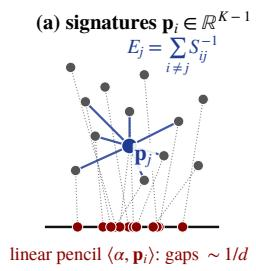

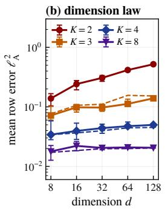

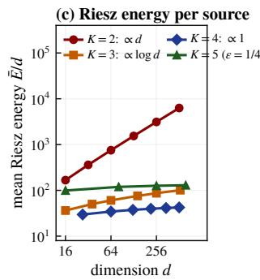

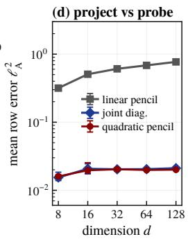  
Figure 1. Separation is a Riesz energy. (a) Each source is a point $\mathbf { p } _ { i }$ in the $( K - 1 )$ )-dimensional space of signatures; separating source j costs the inverse-square energy of its interactions (blue), which a quadratic pencil centred at $\mathbf { p } _ { j }$ measures, while a linear pencil $\bar { \sum _ { k } } \alpha _ { k } \boldsymbol { \Sigma } _ { k }$ projects the signatures onto a line (red), where gaps are $\sim 1 / d .$ (b) The dimension law, simulated: mean row error of joint diagonalization for random signatures at $n = 4 0 0 d \cdot$ ; dashed: $\vec { E } ^ { \mathrm { w } } / n$ (Proposition $2 ) .$ (c) $\bar { E } / d$ for lattice signatures grows like $\dot { d } \left( K = \bar { 2 } \right)$ and log d $( K = 3 )$ and saturates $( K \geq 4 )$ . (d) Projecting versus probing: on identical data $( K = 8 , n = 4 0 0 d )$ the eigenvectors of one random linear pencil degrade with d; joint diagonalization and the quadratic pencil of Theorem 2 do not. Details: Appendix J.

Let

$$
S _ { i j } = { \frac { 1 } { K } } \sum _ { k = 1 } ^ { K } { \frac { \left( \mathbf { p } _ { i } ( k ) - \mathbf { p } _ { j } ( k ) \right) ^ { 2 } } { \mathbf { p } _ { i } ( k ) \mathbf { p } _ { j } ( k ) } } , \qquad E _ { j } = \sum _ { i \neq j } S _ { i j } ^ { - 1 } .\tag{1}
$$

Here $S _ { i j }$ is the Fisher information per sample, averaged over the environments, about the rotation that mixes sources i and $j , E _ { j }$ is the Riesz 2-energy of the point $\mathbf { p } _ { j }$ in the configuration of signatures. A toy case shows why the dimension of the configuration matters. With two environments the signatures are d numbers in an interval. Some neighbours are then $1 / d$ apart, and $E _ { j }$ is of order $d ^ { 2 }$ . With four, they are d points in a 3-dimensional body. Neighbours are then $d ^ { - 1 / 3 }$ apart and the many far sources dominate the inverse-square sum, so $E _ { j }$ is of order d.

## Contributions.

1. Separation costs a Riesz energy (Section 3). For Gaussian sources and every n and d, no estimator in $\mathrm { O } ( d )$ recovers the j-th mixing direction with worstcase squared-angle risk below c $: E _ { j } / ( n + E _ { j } )$ (Theorem 1). Conversely, a spectral estimator attains $E _ { j } / n$ up to a constant for every mixing, uniformly in d, once n $\gtrsim K ( d + \log n ) / S _ { \mathrm { m i n } }$ , where $S _ { \mathrm { m i n } }$ is the smallest divergence (Theorem 2). It needs the signatures, and it may estimate the whitening from the data. The estimator is the bottom eigenvector of a sample version of $\begin{array} { r } { \sum _ { k } w _ { k } ( \Sigma _ { k } - { \bf p } _ { j } ( k ) I ) ^ { 2 } } \end{array}$ , a matrix that vanishes only along source j. A grid of such matrices also finds the signatures, given a lower bound $s _ { 0 }$ on $S _ { \mathrm { m i n } }$ (Theorem 3). In this regime the energy is the minimax rate (Corollary 1).

2. Dimension, not number (Section 4). Counting how many signatures lie at each distance from p<sub>j</sub> gives $E _ { j } \asymp$ $d ^ { 2 }$ , d log d and d for $K = 2 , 3$ and $K \geq 4$ well-spread environments (Theorem 4). Combined with Theorem 1, the lower bounds on $E _ { j }$ make $n \gtrsim d ^ { 2 }$ , d log d and d samples necessary, for every configuration (Corollary 2). With $K \asymp$ log d environments in which every pair of sources differs by a fixed factor in a constant fraction of them, n $\gtrsim$ d log d samples are sufficient for the estimator of Theorem 2. Eight environments whose signatures lie on a line behave like two (Remark 1, Figure 2(a)).

3. Projecting versus probing (Section 5). The eigenvectors of one combination $\textstyle \sum _ { k } \alpha _ { k } \hat { \Sigma } _ { k }$ (AMUSE, generalised eigenproblems, random pencils) have a first-order error whose mean over sources is $\gtrsim d ^ { 2 } / n$ for every K (Theorem 5): the combination projects the signatures onto a line. Probing one signature at a time avoids this. The first-order error of joint diagonalization is again of Riesz type (Proposition 2).

In simulations up to d = 1000 the predicted errors match the observed ones in the first-order regime. Joint diagonalization attains the Riesz rate with $n / d$ nearly constant (Section 6, Conjecture 1). On task fMRI the energy says which components are hard to separate, but not how large their error is.

Relation to prior work. Inverse-square error formulas are classical at fixed d: for eigenvectors (Anderson, 1963) and, pair by pair, for joint diagonalization (Cardoso, 1994; Miettinen et al., 2016). The structure is visible in Kuleshov et al. (2015, Lemma 1), and Afsari (2007; 2008) showed that nearly collinear signatures make joint diagonalization ill-conditioned. What was missing is a quantitative role for the dimension of the configuration, and a minimax theory that holds as d grows. Matrices $\begin{array} { r } { \sum _ { k } ( X _ { k } - \lambda _ { k } I ) ^ { 2 } } \end{array}$ are a known numerical device for approximate joint eigenvectors (Loring & Vides, 2022; Cerjan et al., 2023); we supply their statistics. Table 1 lists every result with its conditions, a reader’s guide follows the notation table of the appendix, and Appendix I discusses further related work.

Why this model. We work in the linear Gaussian model with K environments, the common-principal-components model of Flury (1984). First, it is the least informative case. Its lower bounds transfer to every class of sources containing the Gaussian ones, and within a fixed non-Gaussian family the Fisher information of a rotation is at least as large (Appendix A). Second, it is the case in which upper and lower bounds match (Corollary 1), as in sparse-PCA minimax theory (Vu & Lei, 2013; Cai et al., 2013), whose lower bounds are also proved in the Gaussian model. Non-Gaussian sources and real data: Section 6, Appendix J.

## 2. Setting and signature geometry

Model. There are K environments. In environment k we observe $n _ { k } = n / K$ independent copies of $x ^ { ( k ) } = A s ^ { ( k ) }$ with $A \in \mathbb { R } ^ { d \times d }$ invertible and independent, centred coordinates $s _ { j } ^ { ( k ) }$ of variance $\mathbf { p } _ { j } ( k )$ . We normalise $\begin{array} { r } { \frac { 1 } { K } \sum _ { k } \mathbf { p } _ { j } ( k ) = } \end{array}$ 1 and assume $\mathbf { p } _ { j } ( k ) \in [ 1 / B , B ]$ , so the pooled covariance is $A A ^ { \top }$ . After whitening, $A = Q \in \mathrm { O } ( d )$ and $\Sigma _ { k } = Q \Lambda _ { k } Q ^ { \top }$ with $\Lambda _ { k } = \operatorname { d i a g } ( \mathbf { p } _ { 1 } ( k ) , \ldots , \mathbf { p } _ { d } ( k ) ) ; \hat { \Sigma } _ { k }$ is the sample covariance of environment k.

Scope. Lower bounds: Gaussian sources, and estimators in $\mathrm { O } ( d )$ that may use the signatures. Non-asymptotic upper bounds (Theorems 2 and 3): Gaussian sources and equal sizes $n _ { k } = n / K$ ; each theorem has a part for known and a part for estimated whitening. First-order results: independent sources with finite fourth moments. Unequal sizes $n _ { k } = \pi _ { k } n$ replace $\textstyle { \frac { 1 } { K } } \sum _ { k }$ by $\sum _ { k } \pi _ { k }$ in the lower bounds, the first-order results and the dimension law. An environment with very few samples (two in Appendix A’s example) can, however, break the estimators of the upper bounds.

Loss. Estimators take values in the orthogonal group $\mathrm { O } ( d )$ as every orthogonal joint diagonalizer does, and may be randomised. For an estimate $\hat { Q } \in \operatorname { O } ( d )$ with columns $\hat { q } _ { a }$ and the truth $Q$ with columns $q _ { j }$ , let

$$
\rho _ { j } ( \hat { Q } ) = 1 - \operatorname* { m a x } _ { a } \langle \hat { q } _ { a } , q _ { j } \rangle ^ { 2 } , \qquad \ell _ { \mathrm { A } } ^ { 2 } = \frac { 1 } { d } \sum _ { j = 1 } ^ { d } \rho _ { j } ,\tag{2}
$$

and $\ell _ { \mathrm { M } } ^ { 2 } = \operatorname* { m a x } _ { j } \rho _ { j } . \mathrm { S o } \rho _ { j }$ is the squared sine of the angle between $q _ { j }$ and the closest estimated direction, in whitened coordinates, and $\ell _ { \mathrm { A } } ^ { 2 }$ is permutation invariant but decomposes by source. When the signatures are known, an estimator may also be labelled: one unit vector $\hat { q } _ { j }$ per source, with $\rho _ { j } =$ $1 - \langle \hat { q } _ { j } , q _ { j } \rangle ^ { 2 }$ . Values of $\ell _ { \mathrm { A } } ^ { 2 }$ above $1 / 2$ are only lower bounds for a permutation-matched loss, since two sources may then share their closest estimate (other losses: Appendix A).

Notation: sym $( X ) = { \textstyle { \frac { 1 } { 2 } } } ( X + X ^ { \top } ) ; a \lesssim b$ means $a \leq C b$ with C depending only on the stated constants, and $a \asymp b$ means both $a \lesssim b$ and $b \lesssim a ; \Rightarrow$ is convergence in law; a polar factor is a nearest orthogonal matrix.

Signatures. The signature $\mathbf { p } _ { j } \in \mathbb { R } ^ { K }$ lies on the hyperplane $\begin{array} { r } { \sum _ { k } \mathbf { p } _ { j } ( k ) = K , \mathbf { a } ( K - \bar { 1 } ) } \end{array}$ )-dimensional space. Each summand of (1) equals $r + 1 / r - 2$ with $r = { \bf p } _ { i } ( k ) / { \bf p } _ { j } ( k )$ the symmetrised Itakura–Saito divergence of the two variances, so under bounded ratios

$$
{ \frac { \| \mathbf { p } _ { i } - \mathbf { p } _ { j } \| ^ { 2 } } { K B ^ { 2 } } } \leq S _ { i j } \leq { \frac { B ^ { 2 } \| \mathbf { p } _ { i } - \mathbf { p } _ { j } \| ^ { 2 } } { K } } :\tag{3}
$$

$S _ { i j }$ is comparable to a squared Euclidean distance, and $E _ { j }$ to a Euclidean Riesz 2-energy. Each term $r { + } 1 / r { - } 2$ is at most $B ^ { 2 } + B ^ { - 2 } - 2$ , so $E _ { j } \ge ( d - 1 ) / ( B ^ { 2 } + B ^ { - 2 } - 2 )$ for every configuration and every K. Moreover, $S _ { i j } = 0$ iff the two signatures coincide, which is exactly the non-identifiable case of Pham & Cardoso (2001). We write $\begin{array} { r } { \bar { E } = \frac { 1 } { d } \sum _ { j } E _ { j } } \end{array}$ $\begin{array} { r } { E _ { \operatorname* { m a x } } = \operatorname* { m a x } _ { j } E _ { j } , S _ { \mathrm { n n } } ( j ) = \operatorname* { m i n } _ { i \neq j } S _ { i j } } \end{array}$ for a fixed source $j ,$ , and $\begin{array} { r } { S _ { \mathrm { m i n } } = \operatorname* { m i n } _ { j } S _ { \mathrm { n n } } ( j ) } \end{array}$ . For Gaussian sources this is exact: the Kullback–Leibler divergence between the laws under Q and QR, with R a rotation by θ in the plane (i, j), is $\textstyle { \frac { n } { 2 } } \sin ^ { 2 } \theta S _ { i j }$ , and the information is diagonal across planes and orthogonal to the variances (Lemma 1, Appendix A). Figure 1(a) shows the geometry, and a shell count shows why its dimension matters. The number of signatures at distance t from $\mathbf { p } _ { j }$ grows like $t ^ { K - 2 }$ , each contributes $t ^ { - 2 }$ and $\int t ^ { K - 4 }$ dt converges at zero iff $K \geq 4$

## 3. The Riesz rate

## 3.1. A lower bound for every n and d

Theorem 1 (Riesz rate). For Gaussian sources and $K \geq 2$ there is $c > 0$ , depending only on B, such thatfor every n and d, every source $j$ and every estimator $\hat { Q } \in \operatorname { O } ( d )$ , which may use the signatures,

$$
\operatorname* { s u p } _ { Q \in \operatorname { O } ( d ) } \mathbb { E } \rho _ { j } ( \hat { Q } ) \geq c \frac { E _ { j } } { n + E _ { j } } .\tag{4}
$$

The same bound holds for $\ell _ { \mathrm { A } } ^ { 2 }$ and for $\ell _ { \mathrm { M } } ^ { 2 }$ , with $E _ { j } / ( n + E _ { j } )$ replaced by its average and by its maximum over j. If $S _ { i j } = 0 f o r$ some $i \neq j ,$ , then $E _ { j } = \infty$ and the bound reads c. (Full statement: Theorem B.1, Appendix B.)

The risk is additive over pairs: $E _ { j } / n$ sums the variances of the rotation angles in the planes $( j , i )$ Since $\begin{array} { r } { E _ { j } / ( n + E _ { j } ) \ge \frac { 1 } { 2 } } \end{array}$ min $( 1 , E _ { j } / n )$ , source $j$ cannot be recovered from fewer than order $E _ { j }$ samples. The constant is qualitative $( c = 3 / ( 4 0 9 6 B ^ { 4 } )$ in the proof). At fixed $d ,$ with $S _ { i j } > 0$ for all pairs, the rate $E _ { j } / n$ is attained with constant one: for the Gaussian maximum-likelihood joint diagonalizer, $\begin{array} { r } { n \rho _ { j } \Rightarrow \sum _ { i \neq j } S _ { i j } ^ { - 1 } Z _ { i } ^ { 2 } } \end{array}$ with $Z _ { i }$ i.i.d. standard normal (Theorem B.1(b); Flury, 1986; Pham & Cardoso, 2001). This fixes the constant but not the d-dependence. The proof (Appendix B) applies Assouad’s lemma to a hypercube of rotations in all planes $( j , i )$ , ordered by decreasing $S _ { j i }$ . Neighbouring hypotheses then differ by a rotation that only moves sources at least as close to $\mathbf { p } _ { j }$ as the flipped one, and no truncation is needed. For one covariance matrix, lower bounds of this form are due to Wahl (2022; 2023). Here the information is averaged over environments, and the loss matches sources to estimates (Appendix I). The average bound follows by Haar symmetrisation, and all three bounds hold for labelled estimators.

Table 1. What is known about $\ell _ { \mathrm { A } } ^ { 2 }$ and under which conditions (T: Theorem, C: Corollary, P: Proposition). Orders in d for well-spread signatures (row 2: every configuration); constants depend on K, B and the spreading constants. The upper bounds (rows $3 { \ - } 4 )$ are for equal environment sizes. Row 2: no estimator in $\bar { \mathrm { O } ( d ) }$ has risk below c min(1, $f _ { K } ( d ) / n )$ $f _ { K } ( d )$ the listed order; <sup>†</sup>any mixing for labelled estimators and under the matched loss (Corollary 1). Rows 2–4 are non-asymptotic, 5–6 first order at fixed d, 7 simulation (E<sup>¯</sup>: Section $2 ; \bar { E } ^ { \mathrm { w } } \colon$ Section 5).
<table><tr><td></td><td> $K = 2 \ K = 3$ </td><td></td><td> $K \geq 4$ </td><td> $K { \asymp } \log d , { \mathrm { s e p . } }$ </td><td>sources</td><td>whitening</td><td>signatures</td></tr><tr><td>energy  $E _ { j } ( \mathrm { T } 4 ; \mathrm { S e c . } 4 )$ </td><td> $d ^ { 2 }$ </td><td>dlog d</td><td> $d$ </td><td> $d$ </td><td colspan="3">(geometry of the signatures only)</td></tr><tr><td>necessary:  $n \gtrsim ( \mathrm { T 1 } , \mathrm { C 2 } )$ </td><td> $d ^ { 2 }$ </td><td>dlog d</td><td> $d$ </td><td> $d$ </td><td>Gaussian</td><td> $\mathrm { k n o w n } ^ { \dag }$ </td><td>may be used</td></tr><tr><td> $\bar { E } / n \mathrm { f o r } n \gtrsim ( \mathrm { T } 2 , \mathrm { C } 1 )$  sufficient:</td><td> $d ^ { 3 }$ </td><td> $d ^ { 2 }$ </td><td> $d ^ { \frac { K + 1 } { K - 1 } }$ </td><td> $d \log d$ </td><td></td><td>Gaussian known or est. known</td><td></td></tr><tr><td>without signatures (T3)</td><td> $d ^ { 3 }$ </td><td> $d ^ { 2 }$ </td><td> $d ^ { \frac { K + 1 } { K - 1 } }$ </td><td> $d \log d$ </td><td></td><td>Gaussian known or est.</td><td> $s _ { 0 } \le S _ { \mathrm { m i n } }$ </td></tr><tr><td>one linear pencil (T5)</td><td></td><td></td><td> $\gtrsim d ^ { 2 } / n \mathrm { f o r e v e r y } K$ </td><td></td><td>4th mom. known</td><td></td><td>not used</td></tr><tr><td>joint diagonalization (P2)</td><td></td><td></td><td> $\asymp \bar { E } / n$ </td><td></td><td></td><td>4th mom. known or est. not used</td><td></td></tr><tr><td>Jacobi (simulation,  $n \geq 2 0 0 d )$ </td><td></td><td></td><td> $\leq 1 . 5 \bar { E } ^ { \mathrm { w } } / n , d \leq 1 0 0 0$ </td><td></td><td></td><td>Gaussian estimated</td><td>not used</td></tr></table>

Algorithm 1 Quadratic pencil at a probe $g \in \mathbb { R } ^ { K }$ (Theo  
rem 2(b); ${ \boldsymbol { g } } = \mathbf { p } _ { j }$ for known signatures)   
split each environment’s sample into three equal parts 0,   
1, 2; C<sup>ˆ</sup> ← pooled covariance of part 0   
$\hat { \Sigma } _ { k } ^ { \left( i \right) }$ ← covariance of part $i \in \{ 1 , 2 \}$ in environment $k ,$   
whitened by $\hat { C } ^ { - 1 / 2 }$   
$\begin{array} { r } { \hat { H } \gets \sum _ { k } \dot { g } ( k ) ^ { - 2 } \operatorname { s y m } \big [ ( \hat { \Sigma } _ { k } ^ { ( 1 ) } - g ( k ) I ) ( \hat { \Sigma } _ { k } ^ { ( 2 ) } - g ( k ) I ) \big ] } \end{array}$   
$\hat { q } \gets$ unit eigenvector of H<sup>ˆ</sup> for its smallest eigenvalue   
(Lanczos: $\bar { O ( d ^ { 2 } ) }$ per iteration)   
return the unmixing direction $\hat { b } = \hat { C } ^ { - 1 / 2 } \hat { q }$ (with known   
whitening: no part 0, return $\hat { q } )$

## 3.2. Attainment by a quadratic pencil

To attain the bound uniformly in d we probe one signature at a time. For source j, let $\begin{array} { r } { \dot { H } _ { j } = \sum _ { k } \bar { w } _ { k } ( \Sigma _ { k } - \mathbf { p } _ { j } ( k ) I ) ^ { 2 } } \end{array}$ Then $H _ { j } = Q \mathrm { d i a g } ( \lambda _ { a } ) Q ^ { \top }$ with $\begin{array} { r } { \lambda _ { a } ^ { \mathrm { ~ . ~ . ~ } } = \sum _ { k } w _ { k } ( \mathbf { p } _ { a } ( k ) - } \end{array}$ ${ \bf p } _ { j } ( k ) ) ^ { 2 }$ , zero at $a = j$ . With $w _ { k } = { \bf p } _ { j } ( k ) ^ { - 2 } , B ^ { - 2 } K S _ { a j } \le$ $\begin{array} { r } { \lambda _ { a } ~ \le ~ B ^ { 2 } K S _ { a j } \colon } \end{array}$ the gap at $q _ { j }$ is the nearest-neighbour divergence, not a spacing on a line. Algorithm 1 computes a sample version from two parts of the data and estimates the whitening on a third.

Theorem 2 (Attainment, uniformly in $d ;$ simplified). Let the sources be Gaussian and the signatures known. Let $\hat { q } _ { j }$ be a unit eigenvectorfor the smallest eigenvalue of

$$
\hat { H } _ { j } = \sum _ { k } w _ { k } \mathrm { s y m } \big [ ( \hat { \Sigma } _ { k } ^ { ( 1 ) } - { \bf p } _ { j } ( k ) I ) ( \hat { \Sigma } _ { k } ^ { ( 2 ) } - { \bf p } _ { j } ( k ) I ) \big ] ,
$$

with $w _ { k } \ = \ \mathbf { p } _ { j } ( k ) ^ { - 2 }$ and $\hat { \Sigma } _ { k } ^ { ( 1 ) } , \hat { \Sigma } _ { k } ^ { ( 2 ) }$ the covariances of two disjoint parts of each environment’s sample (halves in $( a ) ,$ , thirds in $( b ) )$ . There are $c , C ~ > ~ 0 ,$ depending only on B, such that the following hold $i f \gamma _ { j } = K ( d +$ $6 \log n ) / ( n S _ { \mathrm { n n } } ( j ) ) \leq c .$

(a) (Known whitening.) For $A \ = \ Q \ \in \ \mathrm { O } ( d ) , \ \mathbb { E } \big [ 1 \ -$ $\begin{array} { r } { \langle \hat { q } _ { j } , q _ { j } \rangle ^ { 2 } ] \leq C E _ { j } / n . } \end{array}$

(b) (Estimated whitening.) Let A be invertible. Split the sample into three equal parts,form the pencilfrom parts 1 and 2 whitened by the pooled covariance C<sup>ˆ</sup> ofpart 0 (Algorithm 1), and let $\hat { \hat { b } } _ { j } = \hat { C } ^ { - 1 / 2 } \hat { q } _ { j }$ . Then $\mathbb { E } \rho _ { j } \ \leq$ $C E _ { j } / n ,$ , where $\rho _ { j }$ is the share of the pooled variance of the estimated source $\hat { b } _ { j } ^ { \top }$ x due to the other sources.

(Full statement, with the first-order coefficients and the cost ofestimating the whitening: Theorem C.1, Appendix C.)

The proof rests on three facts. First, the two halves remove the bias of the squared noise. Second, the noise is small relative to $H _ { j }$ (cf. Jirak & Wahl, 2018): a direction at divergence $\lambda _ { a }$ from source j receives noise of order $\sqrt { \lambda _ { a } \nu }$ with $\nu \lesssim K ^ { 2 } ( d + \log n ) / n$ . The noise therefore only has to be small against the gap to the nearest signature, not against the spread of the $\lambda _ { a }$ . Third, the first-order error in direction a is the $( a , j )$ noise entry divided by $\lambda _ { a } .$ , with variance of order $K / ( n \lambda _ { a } )$ . The squared errors thus sum to $E _ { j } / n _ { ! }$ , not to $\begin{array} { r } { E _ { j } ^ { ( 4 ) } = \sum _ { i \neq j } S _ { i j } ^ { - 2 } } \end{array}$ , and the second-order terms have moments that are again energies. Any probe within $1 / ( 8 B ^ { 4 } )$ of the nearest-neighbour distance from $\mathbf { p } _ { j } .$ , independent of the halves, gives the same rate (Lemma 3); Theorem 3 exploits this. In (b), whitening acts on the pencil by a congruence, so the risk does not depend on the mixing. The constants are qualitative: the first-order coefficient $E _ { j } ^ { \mathrm { q p } }$ of Theorem C.1 satisfies $E _ { j } \le E _ { j } ^ { \mathrm { q p } } \le \kappa _ { B } E _ { j }$ with $\kappa _ { B } = \textstyle { \frac { 1 } { 4 } } ( B ^ { 2 } + B ^ { - 2 } ) ^ { 2 }$ and for the random signatures of Table $2 \left( B = 2 \right)$ it averages 1.08–1.24 times $E _ { j }$ over sources, against $\kappa _ { B } = 4 . 5$

Theorem 3 (Unknown signatures; simplified). Let the sources be Gaussian, and let only B and a lower bound $s _ { 0 } \le S _ { \mathrm { m i n } }$ be known. Algorithm $2 \ ( A p p e n d i x D )$ scores every point g of a grid in signature space by $\lambda _ { \operatorname* { m i n } } \big ( \sum _ { k } ( \hat { \Sigma } _ { k } -$ $g ( k ) I ) ^ { 2 } )$ on one part of the sample, and keeps the points below a threshold, which, under the condition below, form one cluster per source. It then runs Algorithm 1 on the other parts, at one probe per cluster. There are $c , C > 0$ depending only on B, such that thefollowing holdfor every configuration with $S _ { \operatorname* { m i n } } \geq s _ { 0 } i f K ( d + 6 \log n ) / ( n s _ { 0 } ) \leq c .$

(a) (Known whitening.) For $A = Q \in \mathrm { O } ( d )$ , the polar factor Q<sup>ˆ</sup> of the d vectors satisfies sup<sub>Q</sub> $\mathbb { E } \ell _ { \mathrm { A } } ^ { 2 } ( \hat { Q } ) \leq C \bar { E } / n$

(b) (Estimated whitening.) With the whitening estimated on a further part, $\mathbb { E } \ell _ { \mathrm { A } } ^ { 2 } \le C \bar { E } / n$ for every invertible A, where each source is matched to its closest estimate: $\begin{array} { r } { \ell _ { \mathrm { A } } ^ { 2 } = \frac { 1 } { d } \sum _ { j } \operatorname* { m i n } _ { a } ( 1 - z _ { a , j } ^ { 2 } / \Vert z _ { a } \Vert ^ { 2 } ) } \end{array}$ with $z _ { a } = A ^ { \top } \widehat { b } _ { a }$

The grid has at most $( C / \sqrt { s _ { 0 } } ) ^ { K }$ points. (Full statement: Theorem D.1.)

The grid has $O ( d ^ { K / ( K - 1 ) } )$ points for well-spread signatures and fixed $K ,$ , and $d ^ { O ( 1 ) }$ points for separated signatures with $K \asymp \log d$ . Algorithm 2 is a construction for polynomialtime attainability, with a qualitative constant, not a practical algorithm. In practice, a coarse grid with local refinement works, with $s _ { 0 }$ taken from a Jacobi pilot and reduced by a safety factor (Appendix J).

Corollary 1 (Minimax rate). Let the sources be Gaussian and $\gamma = K ( d + 6 \log n ) / ( n S _ { \operatorname* { m i n } } ) \leq c .$ Then, for every configuration, the minimax risk $i s \asymp \bar { E } / n$ with constants depending only on B, in three settings. (i) Labelled estimators and any invertible mixing, with $\ell _ { \mathrm { A } } ^ { 2 }$ the average of the $\rho _ { j }$ of Theorem 2(b). (ii) Known whitening, with labelled estimators or estimators in O(d). (iii) Any invertible mix ing and estimators that return d unmixing directions, with the matched loss of Theorem 3(b). The upper bounds are attained by Theorem 2(b) and by the polar factor of the vectors ofTheorem 2(a). Without the signatures, the estimator of Theorem 3 with $s _ { 0 } = S _ { \mathrm { m i n } }$ attains the bounds of (ii) in $\mathrm { O } ( d )$ and of(iii) with the matched loss.

The lower bound is the average bound of Theorem 1, since $E _ { \mathrm { m a x } } \leq d / S _ { \mathrm { m i n } } \leq$ n under $\gamma \leq c .$ . The polar factor loses at most a factor 8 (Appendix C). In (iii) the estimates need not be orthogonal; in whitened coordinates their polar factor loses at most a factor 16 in the matched loss (Lemma 5, Appendix D).

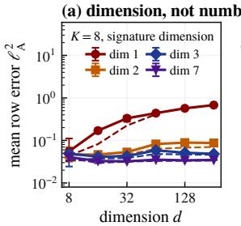

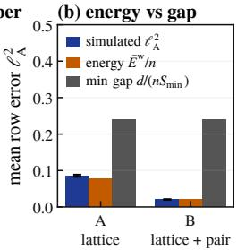

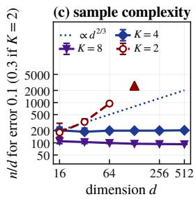

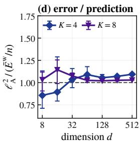  
Figure 2. The mechanism. (a) Dimension, not number: $K = 8 ,$ signatures well-spread (Halton points, fixed scale) in an affine subspace of dimension 1, 2, 3 or $7 ; n = 1 6 0 0 d ;$ dashed: $\bar { E } ^ { \mathrm { w } } / n$ (b) Energy beats the smallest gap: two configurations with the same $S _ { \operatorname* { m i n } { \mathit { \Phi } } } \left( K = 4 , d = 2 7 , n = 4 0 0 d \right)$ , a lattice (A) and a coarser lattice plus one close pair (B): simulated $\ell _ { \mathrm { A } } ^ { 2 }$ with standard errors, $\bar { E } ^ { \mathrm { w } } / n$ and $( d / n ) / S _ { \mathrm { m i n } } ^ { \mathrm { ~ - ~ } } .$ (c) Sample complexity: $n / d$ at which the median $\mathrm { \dot { \ell } _ { A } ^ { 2 } }$ reaches $0 . 1 \ : ( K = 4 , 8 )$ or 0.3 $( K = 2 ;$ triangle: not reached by $n = 1 6 0 0 d )$ , from Figure 8, with 90% bootstrap intervals; dotted: the growth $d ^ { 2 / ( K - 1 ) }$ of the proved threshold, $K = 4$ . (d) First order explains the curves: error divided by $\bar { E } ^ { \mathrm { w } } / n$ at $n = 4 0 0 d ,$ , per draw (draws: Appendix J).

## 4. The dimension law

Riesz energies $\begin{array} { r } { \sum _ { i \neq j } \| \mathbf { p } _ { i } - \mathbf { p } _ { j } \| ^ { - \beta } } \end{array}$ of N points on a Ddimensional set have three regimes (Hardin & Saff, 2004; 2005; Borodachov et al., 2019). The total energy grows like $N ^ { 2 }$ for $\beta < D$ , like $N ^ { 2 }$ log N for $\beta = D$ , and like $N ^ { 1 + \beta / D }$ for $\beta > D$ , where nearest neighbours dominate (the shell count of Section 2). Here $\beta = 2 , D = K - 1$ and $N = d .$

Definition 1 (Well-spread signatures). Let $r _ { d } = d ^ { - 1 / ( K - 1 ) }$ and let Ω be a fixed convex body in $\{ \textstyle \sum _ { k } \mathbf p ( k ) = K \} \cap$ $[ 1 / B , B ] ^ { K }$ containing the signatures. The signatures are well-spread with constants $( c _ { 1 } , C _ { 1 } )$ if they are $c _ { 1 } r _ { d ^ { - } }$ separated and every point of Ω is within $C _ { 1 } r _ { d }$ of one of them.

The covering condition rules out voids, which would make the per-source lower bound fail for $K \leq 3 ;$ lattices in a box satisfy it.

Theorem 4 (Dimension law). Fix K. For well-spread signatures, uniformly in j and with constants depending only

on $( K , B , c _ { 1 } , C _ { 1 } , \Omega )$

$$
E _ { j } \ \asymp \ \left\{ \begin{array} { l l } { d ^ { 2 } , } & { K = 2 , } \\ { d \log d , } & { K = 3 , } \\ { d , } & { K \geq 4 . } \end{array} \right.\tag{5}
$$

The upper bounds need only the separation $c _ { 1 } r _ { d } ,$ , and the lower bounds for $\bar { E }$ hold for every configuration, by minimal-energy asymptotics (Hardin & Saff, 2005).

The constants depend on K (Figure 1(c) shows the three regimes on lattices): a lattice needs $m ^ { K - 1 }$ points, so Definition 1 needs $2 ^ { K - 1 } \lesssim d .$ . For $K \geq 4$ the lower bound is the floor $E _ { j } \ge ( d - 1 ) \bar { / } ( B ^ { 2 } + B ^ { - 2 } - 2 )$ , that is, parameter counting; the geometry enters the upper bound, and the lower bounds only for $K = 2 , 3$

Remark 1 (Dimension, not number). If the signatures lie in an affine subspace of dimension $D ^ { \prime } { } .$ , Theorem 4 holds with $D ^ { \prime }$ in place of $K - 1$ (Definition 1 taken in that subspace, $r _ { d } = \dot { d } ^ { - 1 / D ^ { \prime } } )$ . Corollary 2 then holds with $D ^ { \prime } + 1$ for $K$ Appendix E reads an effective dimension at each scale.

Combined with Theorem 1, the lower bounds give necessary sample sizes for every configuration.

Corollary 2 (Necessary sample size). Let d $\geq ~ 2$ and $f _ { K } ( d ) = d ^ { 2 }$ , d log d, d for $K = 2 , 3 , \geq 4$ . For Gaussian sources there is $c > 0$ depending only on $( K , B )$ such that, for every configuration of signatures and every estimator $\hat { Q } \in \operatorname { O } ( d )$

$$
\operatorname* { s u p } _ { Q } \mathbb { E } \ell _ { \mathrm { A } } ^ { 2 } ( \hat { Q } ) \geq c \operatorname* { m i n } _ { \bf \epsilon } \big ( 1 , \ : f _ { K } ( d ) / n \big ) .
$$

No estimator recovers an average source consistently unless $n / f _ { K } ( d ) \to \infty ,$ however the environments are chosen (with variance ratios in $[ 1 / B , B ] )$ .

The proof (Appendix E) shows that in every configuration at least half of the sources have $E _ { j } \ \gtrsim \ f _ { K } ( d )$ . For wellspread signatures $\bar { E } \asymp f _ { K } ( d )$ , so the bound has the order of the maximum-likelihood limit $\bar { E } / n$ . For i.i.d. random signatures with a bounded density, E<sup>¯</sup> has the same orders for $K \geq 3$ with high probability $( d ^ { 3 }$ for $K = 2 )$ . The worst source, however, needs five environments to be linear: $E _ { \mathrm { m a x } } \asymp d ^ { 4 / 3 }$ for $K = 4$ (Proposition 1, Appendix E).

Sufficient sample sizes. Corollary 1 gives the other side. Well-spread signatures have $S _ { \mathrm { m i n } } \stackrel { \cdot } { \ } \stackrel { \cdot } { \sim } \stackrel { \cdot } { d ^ { - 2 / ( K - 1 ) } }$ , so the minimax risk $\mathrm { i s } \asymp \bar { E } / n$ , of order $d / n$ for $K \geq 4$ , once $n \gtrsim d ^ { ( K + 1 ) / ( K - 1 ) }$ . Separated signatures, with $S _ { \mathrm { m i n } } \geq s _ { 0 }$ for a constant $s _ { 0 }$ (unlike Definition 1’s c<sub>1</sub>r<sub>d</sub>-separation, whose scale shrinks with $d )$ , need $K \gtrsim \log d$ by packing. And $K \asymp \log d$ suffices. With balanced binary codes as signatures, every pair of sources differs by a fixed factor in a constant fraction of the environments $( K \geq 3 2 \log d ,$

Appendix C). Then $E _ { j } \asymp d ,$ and the minimax risk is $\asymp d / n$ once $n \gtrsim K ( d + \log n ) / s _ { 0 }$ . Thus log d environments make the sample size linear in d up to a logarithm: $n \gtrsim d$ is necessary and $n \gtrsim$ d log d sufficient (Corollary 2, Theorems 2–3).

Necessary versus sufficient. For fixed K, the proved sufficient size $d ^ { ( K + 1 ) / ( K - 1 ) }$ (Table 1) exceeds the necessary $f _ { K } ( d )$ by a power of d. The sufficient side is the condition $\gamma _ { j } \leq c \mathrm { o f }$ Theorem 2. For well-spread signatures and $K \geq 4$ it says that $E _ { j } / n$ is below a fraction of $S _ { \mathrm { n n } } ( j ) / K$ (the factor $K$ partly reflects the two halves’ noise product, Appendix H). By (4) no estimator is that accurate with fewer samples: a risk below $\eta S _ { \mathrm { n n } } ( j )$ at source $j$ needs $n \geq c E _ { j } / ( 2 \eta S _ { \mathrm { n n } } ( j ) )$ (Proposition 3, Appendix H). For $K \geq 4$ and $\eta \asymp 1 / K$ this is Corollary 1’s threshold, which suggests why Theorem $2 \mathrm { { } s }$ operator-norm argument stops there.

Open problem. For well-spread signatures and fixed $K , \mathrm { i s }$ the Riesz rate attained between the necessary sample size $f _ { K } ( d )$ and the proved sufficient size $d ^ { ( K + 1 ) / ( K - 1 ) } ?$ Below that threshold the quadratic pencil drifts (Appendix H), while joint diagonalization shows no such threshold in simulations (Section 6). For $K \geq 4$ we conjecture (for $K = 2 , 3$ we make no conjecture):

Conjecture 1 (Linear regime). For well-spread signatures and $K \ \geq \ 4 ,$ , the output U<sup>ˆ</sup> of Jacobi sweeps from the identity attains the Riesz rate, $\mathbb { E } \ell _ { \mathrm { A } } ^ { 2 } ( \hat { U } ) \leq \bar { C } \bar { E } / n ,$ , as soon as $n \geq C ^ { \prime } d \mathrm { p o l y l o g } ( d )$

## 5. Projecting versus probing

A common way to use several covariances is to take the eigenvectors of one matrix $\begin{array} { r } { \hat { M } _ { \alpha } = \sum _ { k } \alpha _ { k } \hat { \Sigma } _ { k } } \end{array}$ , for a fixed or random $\alpha \in \mathbb { R } ^ { K }$ . Two-environment generalised eigenproblems, AMUSE, and the random-pencil initialisations of He & Kressner (2024a;b) are of this form.

Theorem 5 (A linear pencil pays $d ^ { 2 }$ at first order). Assume known whitening. Fix $\alpha \in \mathbb { R } ^ { K }$ , or draw it independently of the data, with the eigenvalues $\lambda _ { j } = \langle \alpha , \mathbf { p } _ { j } \rangle$ of $M _ { \alpha } =$ $Q \mathrm { d i a g } ( \lambda ) Q ^ { \top }$ pairwise distinct. $L e t ~ \hat { q } _ { j }$ be the eigenvector of $\hat { M } _ { \alpha } f o r$ its j-th eigenvalue in the order of the $\lambda _ { j } ,$ , and let $\rho _ { j } ( \hat { q } _ { j } ) = 1 - \langle \hat { q } _ { j } , q _ { j } \rangle ^ { 2 }$ . As n → ∞ at fixed d,

$$
n \rho _ { j } ( \hat { q } _ { j } ) \Rightarrow \sum _ { i \neq j } \frac { v _ { i j } ( \alpha ) } { ( \lambda _ { i } - \lambda _ { j } ) ^ { 2 } } Z _ { i } ^ { 2 } ,
$$

with $\begin{array} { r } { v _ { i j } ( { \boldsymbol \alpha } ) = K \sum _ { k } \alpha _ { k } ^ { 2 } \mathbf { p } _ { i } ( k ) \mathbf { p } _ { j } ( k ) } \end{array}$ and $Z _ { i }$ i.i.d. standard normal. For every configuration and every $K ,$ the means of these limit laws average over j to at least $( d - 1 ) ^ { 3 } / ( d B ^ { 4 } )$ oforder d<sup>2</sup> uniformly in K and α. (The sharper bound (22), in terms ofthe range ofthe $\lambda _ { j } ,$ , is in Appendix F.)

The proof (Appendix F) combines the eigenvector expansion of Anderson (1963) with a power-mean inequality on the spacings of d points in an interval. A linear pencil collapses the configuration onto the line spanned by α, where the Riesz 2-energy is always hypersingular $( \beta = 2 > D =$ 1). The barrier is the projection, not the use of a pencil. For $K = 2$ nothing is lost; for well-spread signatures the projection loses a factor of order at least $d / \log d ( K =$ 3) and d $( K \geq 4 )$ . The theorem concerns the limit law of $n \rho _ { j }$ at fixed $d ,$ not $\mathbb { E } \rho _ { j }$ , and one combination that is fixed or drawn independently of the data; adaptively chosen or iterated combinations are not covered. The quadratic pencil of Theorem 2 probes instead. Its eigenvalues are the divergences of all signatures from p<sub>j</sub>, in all $K - 1$ directions, and $E _ { j } / B ^ { 2 } \le K$ tr $H _ { j } ^ { + } \leq B ^ { 2 } \bar { E } _ { j } ^ { + }$ for its pseudo-inverse $H _ { j } ^ { + }$

Joint diagonalization. Orthogonal joint diagonalization (Bunse-Gerstner et al., 1993; Cardoso & Souloumiac, 1996) minimises $\begin{array} { r } { \hat { \boldsymbol f } ( \boldsymbol U ) ~ = ~ \sum _ { k = 1 } ^ { K } \| \operatorname { o f f } ( \boldsymbol U ^ { \top } \hat { \boldsymbol \Sigma } _ { k } \boldsymbol U ) \| _ { F } ^ { 2 } } \end{array}$ over $U \in$ $\mathrm { O } ( d )$ , of(X) the off-diagonal part of $X$ . The weighted criterion of Tichavský & Yeredor (2009) and the Gaussian likelihood of Pham & Cardoso (2001) replace the Frobenius norm by Fisher weights. For independent sources with finite fourth moments and $S _ { i j } > 0$ , the global minimiser $\hat { U }$ satisfies $\begin{array} { r } { n \rho _ { j } ( \hat { U } ) \Rightarrow \sum _ { i \neq j } v _ { i j } Z _ { i } ^ { 2 } } \end{array}$ at fixed d. The coefficients are explicit and, for known and for estimated whitening alike, satisfy $S _ { i j } ^ { - 1 } \leq v _ { i j } \leq C _ { B } S _ { i j } ^ { - 1 }$ with $C _ { B }$ depending only on B. With known whitening, Fisher weights give $v _ { i j } = S _ { i j } ^ { - 1 }$ (Proposition 2, Appendix G). Both facts are classical at fixed d (Cardoso, 1994; Yeredor, 2000; Pham & Cardoso, 2001; Tichavský & Yeredor, 2009). What is new is that the coefficients are of Riesz type, so the dimension law applies to them. We write $\bar { E } ^ { \mathrm { w } } / n$ for the resulting first-order prediction with estimated whitening, the pipeline of Section 6.

## 6. Experiments

Setup. All experiments use the model of Section 2 with a Haar-distributed $A , n / K$ samples per environment and covariances drawn from their Wishart law. Details, draw counts, code and raw results: Appendix J and the supplement. The default pipeline whitens with the pooled sample covariance $\hat { C }$ and runs Jacobi sweeps (Cardoso & Souloumiac, 1996) from the identity (Algorithm 3; at most 100 sweeps). The estimators of Theorems 2 and 3 use the true whitening unless stated. The loss is $\ell _ { \mathrm { A } } ^ { 2 }$ of the unitnormalised rows of $\hat { U } ^ { \top } \hat { C } ^ { - 1 / 2 }$ against the columns of A, in observation coordinates. Predictions use $v ^ { \mathrm { w } }$ of (24) (Appendix G). The range $\bar { E } ^ { \mathrm { w } } / n \lesssim 0 . 1$ , where Jacobi follows this prediction, is the first-order regime. Random signatures are i.i.d. uniform on $\begin{array} { r } { \{ \mathbf { p } \in [ \frac { 1 } { 2 } , \overline { { \frac { 3 } { 2 } } } ] ^ { K } : \sum _ { k } \mathbf { p } ( k ) = \overline { { K } } \} } \end{array}$ $( B = 2 )$

The error follows the dimension of the signatures, not the number of environments. $\Delta { \sf t } n = 4 0 0 d$ , from $d = 8$ to 128, the error grows from 0.14 to 0.52 for $K = 2$ and from 0.072 to 0.14 for $K = 3 ,$ , but stays between 0.018 and 0.022 for $K = 8$ (Figure 1(b)). The rise for $K = 4$ is first order: 0.86–1.09 times $\bar { E } ^ { \mathrm { w } } / n$ up to $d = 5 1 2$ (Figure 2(d); 1.02– 1.14 for $K = 8 )$ . With K = 8, n = 1600d and signatures in a subspace of dimension 1, 2, 3 or 7, the error follows the dimension. From $d = 8$ to 256 it grows from 0.055 to 0.68 in dimension 1, and stays near 0.049 and 0.035 in dimensions 3 and 7 (Figure 2(a)).

Energy, not the smallest gap, predicts the error. Two configurations with equal $S _ { \mathrm { m i n } }$ and energies 3.8 times apart have errors 4.1 times apart, within 8% and 1% of $\bar { E } ^ { \mathrm { w } } / n$ (Figure 2(b)).

For $K \geq 4 ,$ joint diagonalization stays on its prediction down to $n \approx 2 0 0 d .$ , and the $n / d$ it needs barely grows with d. The sample size at which $\ell _ { \mathrm { A } } ^ { 2 }$ reaches 0.1 is 92d– 110d for $K = 8$ and 188d–205d for $K = 4 ,$ from $d = 1 6$ to 512 (Figure 2(c)). The proved threshold $d ^ { ( K + 1 ) / ( K - 1 ) }$ would instead multiply $n / d$ by 2.7 and 10.1. On fixed $K =$ 4 lattices, with only the mixing and the data redrawn, the mean error reaches 0.1 at n ≈ 360d–490d from $d = 2 7$ to 1000 (Appendix J, Figure 7); their energy per source is about three times that of the random signatures of Figure 2(c). There $n / d$ grows by 1.4, against 1.5 for $\bar { E } ^ { \mathrm { w } } / d$ and 11.1 for the proved threshold. Since 0.1 lies in the first-order regime, this is the evidence for Conjecture 1. For $K = 2$ the n needed for an error of 0.3 grows with d (Figure 2(c)). Below 100d $( \bar { E } ^ { \mathrm { w } } / n \gtrsim 0 . 1 5 )$ longer runs and restarts do not change the error. Pham’s likelihood algorithm is 28%– 34% more accurate at $K = 8 , n = 5 0 d$ , yet above $\bar { E } ^ { \mathrm { w } } / n$ (Figure 4(d), Appendix J).

The estimator of Theorem 2 attains its rate, also with estimated whitening; a practical variant of the grid of Theorem 3 finds the signatures. With $K = 1 6$ code signatures, the estimator of Theorem 2 gives the same error at the same $n / d$ for d = 64 to 512. It approaches its first-order prediction (1.06–1.07 times it at $n = 8 0 0 d ;$ Figure 4(b)). With the whitening estimated on a third of the sample, the error (the loss $\rho _ { j }$ of Theorem 2(b)) is the same for every mixing. It is within 2% of its first-order prediction per source at $\gamma \leq 0 . 0 3$ (Appendix J, Table 6). Without the signatures, a coarse grid with three refinement steps finds all d probes in every run with $n \geq 6 4 0 0 d ( K = 4$ lattices, $d \leq 2 1 6 )$ . The estimator is then within 4% of the same estimator at the true signatures (Appendix J, Table 7). Below its proved regime, the estimator of Theorem 2 stays within a small factor of $\bar { E } / n$ (Appendix J, Table 5).

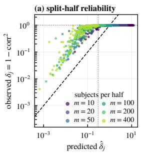

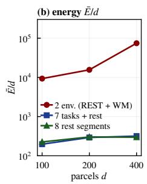  
Figure 3. Real data (HCP task fMRI, d = 200). (a) Split-half discrepancy $\delta _ { j } = 1 - \mathrm { c o r r } ^ { 2 }$ of each component between two disjoint groups of m subjects, against its first-order prediction (colour: subjects per half; dashed: $y = x ;$ dotted: $\hat { \delta } = 0 . 3$ and $\delta = 1 )$ . (b) $\bar { E } / d$ against d for two environments (rest and working memory; noise-limited), the seven tasks and rest, and eight rest segments.

One linear pencil degrades with $d ;$ every joint diagonalizer sits on its first-order prediction. On identical data $( K = 8 , n = 4 0 0 d ;$ Figures 1(d) and 4(a), Table 2), Pham’s algorithm (Pham, 2001) is within a factor 1.00–1.15 of its Cramér–Rao bound, while one linear pencil degrades from 0.47 to 0.84. As an initialisation, however, the pencil costs nothing. Three Jacobi sweeps from its eigenvectors come within 13% (in median, $d \leq 2 5 6 )$ of the converged run, which is the same minimiser as from the identity (Appendix J). Appendix J adds $B = 1 0$ , unequal sizes, non-Gaussian sources, departures from the model and, outside the theorems, the lag route: on MA(8) sources AMUSE degrades with d, SOBI with $\geq 3$ lags does not.

Real data: the energy says which fMRI components are hard to separate, not how large their error is. We separate the cortical fMRI of 813 Human Connectome Project (HCP) subjects (Van Essen et al., 2013; Barch et al., 2013) into $d = 2 0 0$ temporally independent components (Schaefer parcels, Schaefer et al., 2018; cf. Smith et al., 2012). The seven tasks and rest are the $K = 8$ environments, each with 352 frames per subject (Appendix J). Reliability is the split-half discrepancy $\delta _ { j }$ of a component between two disjoint groups of m subjects (0: identical, 1: unrelated). The first-order theory predicts it from the estimated signatures, with an autocorrelation correction $( \hat { \delta } _ { j } , \mathrm { A p p e n d i x \ : J ) }$ The signatures vary little across tasks $( \bar { E } / \bar { d } = 2 9 2 )$ , so the prediction is in its first-order range, below 0.3, for only 26% of the components with 50 subjects per half. Where it is, it ranks the observed discrepancies (Spearman 0.92), and the energy ranks them better than the nearest-neighbour gap alone (0.89 for $E _ { j } , 0 . 7 2$ for $1 / S _ { \mathrm { n n } } ( j ) )$ . It does not predict their size: with 400 subjects per half the mean discrepancy is 0.723 against a predicted 0.118. Fitted over $m ,$ the discrepancies have a floor (median 0.59) that carries most of the ranking, and two joint diagonalizers disagree on near-degenerate pairs (Appendix J). A common mixing of independent sources thus describes these components only roughly. With rest and working memory as the only environments the energy is about 53 times larger $( \bar { E } / d = 1 5 6 0 8$ noise-limited). Eight rest segments, whose signatures vary mainly along one direction (participation ratio 1.54 against 4.69), carry about as much energy as the seven tasks and rest. The energy depends on the nearest-neighbour spread, not on the global one (Appendix E; Figure 3).

## 7. Discussion

Diversity versus non-Gaussianity. In the non-Gaussian route the information cost is of order $d ,$ but low-degree estimators pay $d ^ { 2 }$ (Auddy & Yuan, 2025). In the diversity route it is the Riesz energy: $d ^ { 2 }$ for two environments and d for four well-spread ones. It is attained in polynomial time for fixed K once $n \gtrsim d ^ { ( K + 1 ) / ( K - 1 ) }$ , given the signatures or a separation bound (below that: the open problem of Section 4). Two environments suffice for identifiability (Pham & Cardoso, 2001); for efficiency the signatures’ dimension counts. Our codewords are analogous to the $K \asymp \log d$ unknown interventions that identify the model in linear causal representation learning (Lee et al., 2026), under different assumptions and with a sample size attached.

Practical takeaways. (1) Read the signatures off a Jacobi pilot and compute $\bar { E } ^ { \mathrm { w } } / n ;$ in our simulations joint diago nalization follows it below about 0.1, so it is a sample-size diagnostic. (2) Choose environments or lags that spread the signatures in new directions; eight environments on a line are worth two. (3) $K \asymp \log a$ conditions in which every pair of sources differs by a fixed factor in a constant fraction of them make $n \gtrsim d \log d$ samples enough for the pencil of Theorem 2. (4) Do not take the eigenvectors of one linear combination of the covariances as the final estimate in high dimension; as an initialisation they cost nothing in our simulations. (5) Autocorrelation rescales the error, a shared factor or subject-specific mixings add a floor, and the ranking of the sources survives (Appendix J).

Limitations. The scope is deliberate (Section 1). Theorems 2–3 assume Gaussian sources and equal environment sizes (Section 2). Theorem 3 needs the oracle s<sub>0</sub> (not adaptively), and its grid is polynomial in d only when K log $( C / s _ { 0 } ) = O ( \log d )$ . For fixed K, the gap between the necessary and the proved sufficient sample size is open (Section 4, Conjecture 1). Practical algorithms are covered at first order only (Proposition 2). Independence excludes lags and spatially correlated parcels. The fMRI analysis assumes a mixing shared across subjects, corrects autocorrelation only through Bartlett factors, may place relatives on both sides of a split, and tests the energy as a diagnostic, not the theorems.

## Impact Statement

We foresee no negative societal consequences specific to this methodological work on source separation; the fMRI data are the open-access HCP data, used under their data use terms, and no attempt is made to identify subjects.

## Acknowledgements

Data were provided by the Human Connectome Project, WU-Minn Consortium (Principal Investigators: David Van Essen and Kamil Ugurbil; 1U54MH091657) funded by the 16 NIH Institutes and Centers that support the NIH Blueprint for Neuroscience Research, and by the McDonnell Center for Systems Neuroscience at Washington University.

## References

Acartürk, E., Varıcı, B., Shanmugam, K., and Tajer, A. Sample complexity of interventional causal representation learning. In Advances in Neural Information Processing Systems, 2024.

Adalı, T., Anderson, M., and Fu, G.-S. Diversity in independent component and vector analyses: Identifiability, algorithms, and applications in medical imaging. IEEE Signal Processing Magazine, 31(3):18–33, 2014.

Afsari, B. What can make joint diagonalization difficult? In IEEE International Conference on Acoustics, Speech and Signal Processing (ICASSP), 2007.

Afsari, B. Sensitivity analysis for the problem of matrix joint diagonalization. SIAM Journal on Matrix Analysis and Applications, 30(3):1148–1171, 2008.

Amari, S.-i. and Cardoso, J.-F. Blind source separation— semiparametric statistical approach. IEEE Transactions on Signal Processing, 45(11):2692–2700, 1997.

Anderson, M., Fu, G.-S., Phlypo, R., and Adalı, T. Independent vector analysis: Identification conditions and performance bounds. IEEE Transactions on Signal Processing, 62(17):4399–4410, 2014.

Anderson, T. W. Asymptotic theory for principal component analysis. The Annals ofMathematical Statistics, 34(1): 122–148, 1963.

Auddy, A. and Yuan, M. Large-dimensional independent component analysis: Statistical optimality and computational tractability. The Annals of Statistics, 53(2):477– 505, 2025.

Barch, D. M., Burgess, G. C., Harms, M. P., et al. Function in the human connectome: Task-fMRI and individual differences in behavior. NeuroImage, 80:169–189, 2013.

Bartlett, M. S. Some aspects of the time-correlation problem in regard to tests of significance. Journal of the Royal Statistical Society, 98(3):536–543, 1935.

Belouchrani, A., Abed-Meraim, K., Cardoso, J.-F., and Moulines, E. A blind source separation technique using second-order statistics. IEEE Transactions on Signal Processing, 45(2):434–444, 1997.

Bhaskara, A., Charikar, M., Moitra, A., and Vijayaraghavan, A. Smoothed analysis of tensor decompositions. In Proceedings of the 46th Annual ACM Symposium on Theory ofComputing (STOC), 2014.

Borodachov, S. V., Hardin, D. P., and Saff, E. B. Discrete energy on rectifiable sets. Springer, 2019.

Buchholz, S., Rajendran, G., Rosenfeld, E., Aragam, B., Schölkopf, B., and Ravikumar, P. Learning linear causal representations from interventions under general nonlinear mixing. In Advances in Neural Information Processing Systems, volume 36, 2023.

Bunse-Gerstner, A., Byers, R., and Mehrmann, V. Numerical methods for simultaneous diagonalization. SIAM Journal on Matrix Analysis and Applications, 14(4):927– 949, 1993.

Cai, T. T., Ma, Z., and Wu, Y. Sparse PCA: Optimal rates and adaptive estimation. The Annals of Statistics, 41(6): 3074–3110, 2013.

Calhoun, V. D. and Adalı, T. Multisubject independent component analysis of fMRI: A decade of intrinsic networks, default mode, and neurodiagnostic discovery. IEEE Reviews in Biomedical Engineering, 5:60–73, 2012.

Calhoun, V. D., Adalı, T., Pearlson, G. D., and Pekar, J. J. A method for making group inferences from functional MRI data using independent component analysis. Human Brain Mapping, 14(3):140–151, 2001.

Cardoso, J.-F. Perturbation of joint diagonalizers. Technical Report 94D027, Télécom Paris, 1994.

Cardoso, J.-F. and Souloumiac, A. Jacobi angles for simultaneous diagonalization. SIAM Journal on Matrix Analysis and Applications, 17(1):161–164, 1996.

Cerjan, A., Loring, T. A., and Vides, F. Quadratic pseudospectrum for identifying localized states. Journal of Mathematical Physics, 64(2):023501, 2023.

Chang, J., Guo, B., and Yao, Q. Principal component analysis for second-order stationary vector time series. The Annals ofStatistics, 46(5):2094–2124, 2018.

Chen, A. and Bickel, P. J. Efficient independent component analysis. The Annals ofStatistics, 34(6):2825–2855, 2006.

Comon, P. Independent component analysis, a new concept? Signal Processing, 36(3):287–314, 1994.

Damian, A., Pillaud-Vivien, L., Lee, J. D., and Bruna, J. Computational-statistical gaps in Gaussian single-index models. In Conference on Learning Theory, 2024.

Davis, C. and Kahan, W. M. The rotation of eigenvectors by a perturbation. III. SIAM Journal on Numerical Analysis, 7(1):1–46, 1970.

Diakonikolas, I., Kane, D. M., and Stewart, A. Statistical query lower bounds for robust estimation of highdimensional Gaussians and Gaussian mixtures. In IEEE Symposium on Foundations ofComputer Science, 2017.

Diakonikolas, I., Hopkins, S. B., Pensia, A., and Tiegel, S. Sum-of-squares lower bounds for non-Gaussian component analysis. arXiv preprint arXiv:2410.21426, 2024.

Du, Y., Fu, Z., Sui, J., Gao, S., Xing, Y., Lin, D., Salman, M., Abrol, A., Rahaman, M. A., Chen, J., Hong, L. E., Kochunov, P., Osuch, E. A., and Calhoun, V. D. Neuro-Mark: An automated and adaptive ICA based pipeline to identify reproducible fMRI markers of brain disorders. NeuroImage: Clinical, 28:102375, 2020.

Flury, B. N. Common principal components in k groups. Journal ofthe American Statistical Association, 79(388): 892–898, 1984.

Flury, B. N. Asymptotic theory for common principal component analysis. The Annals ofStatistics, 14(2):497–507, 1986.

Genc, E. I., Demir, S., and Dogan, Z. Learnability and competition in high-dimensional multi-component ICA. arXiv preprint arXiv:2605.08552, 2026.

Glasser, M. F., Sotiropoulos, S. N., Wilson, J. A., Coalson, T. S., Fischl, B., Andersson, J. L., Xu, J., Jbabdi, S., Webster, M., Polimeni, J. R., Van Essen, D. C., and Jenkinson, M. The minimal preprocessing pipelines for the Human Connectome Project. NeuroImage, 80:105–124, 2013.

Goyal, N., Vempala, S., and Xiao, Y. Fourier PCA and robust tensor decomposition. In Proceedings ofthe 46th Annual ACM Symposium on Theory of Computing (STOC), 2014.

Hälvä, H. and Hyvärinen, A. Hidden Markov nonlinear ICA: Unsupervised learning from nonstationary time series. In Proceedings of the 36th Conference on Uncertainty in Artificial Intelligence, volume 124 of PMLR, pp. 939–948, 2020.

Hardin, D. P. and Saff, E. B. Discretizing manifolds via minimum energy points. Notices of the AMS, 51(10): 1186–1194, 2004.

Hardin, D. P. and Saff, E. B. Minimal Riesz energy point configurations for rectifiable d-dimensional manifolds. Advances in Mathematics, 193(1):174–204, 2005.

He, H. and Kressner, D. Randomized joint diagonalization of symmetric matrices. SIAM Journal on Matrix Analysis and Applications, 45(1):661–684, 2024a.

He, H. and Kressner, D. A randomized algorithm for simultaneously diagonalizing symmetric matrices by congruence. arXiv preprint arXiv:2402.16557, 2024b.

Hoeffding, W. Probability inequalities for sums of bounded random variables. Journal of the American Statistical Association, 58(301):13–30, 1963.

Hyvärinen, A. and Morioka, H. Unsupervised feature extraction by time-contrastive learning and nonlinear ICA. In Advances in Neural Information Processing Systems, 2016.

Hyvärinen, A., Karhunen, J., and Oja, E. Independent Component Analysis. Wiley, New York, 2001.

Hyvärinen, A., Sasaki, H., and Turner, R. Nonlinear ICA using auxiliary variables and generalized contrastive learning. In Artificial Intelligence and Statistics, 2019.

Hyvärinen, A., Khemakhem, I., and Morioka, H. Nonlinear independent component analysis for principled disentanglement in unsupervised deep learning. Patterns, 4(10), 2023.

Ipsen, I. C. F. Relative perturbation results for matrix eigenvalues and singular values. Acta Numerica, 7:151–201, 1998.

Iraji, A., Fu, Z., Faghiri, A., Duda, M., Chen, J., Rachakonda, S., DeRamus, T., Kochunov, P., et al. Identifying canonical and replicable multi-scale intrinsic connectivity networks in 100k+ resting-state fMRI datasets. Human Brain Mapping, 44(17):5729–5748, 2023.

Jiang, Y. Finite-sample analysis of nonlinear independent component analysis: Sample complexity and identifiability bounds. arXiv preprint arXiv:2604.08850, 2026.

Jin, J. and Syrgkanis, V. Learning causal representations from general environments: Identifiability and intrinsic ambiguity. In Advances in Neural Information Processing Systems, volume 37, 2024.

Jirak, M. and Wahl, M. Relative perturbation bounds with applications to empirical covariance operators. arXiv preprint arXiv:1802.02869, 2018.

Khemakhem, I., Kingma, D., Monti, R., and Hyvärinen, A. Variational autoencoders and nonlinear ICA: A unifying framework. In Artificial Intelligence and Statistics, 2020.

Kim, T., Eltoft, T., and Lee, T.-W. Independent vector analysis: An extension of ICA to multivariate components. In Independent Component Analysis and Blind Signal Separation (ICA 2006), volume 3889 of Lecture Notes in Computer Science, pp. 165–172. Springer, 2006.

Kuijlaars, A. B. J. and Saff, E. B. Asymptotics for minimal discrete energy on the sphere. Transactions of the American Mathematical Society, 350(2):523–538, 1998.

Kuleshov, V., Chaganty, A., and Liang, P. Tensor factorization via matrix factorization. In Artificial Intelligence and Statistics, pp. 507–516, 2015.

Lee, I., Jin, T., and Aragam, B. Beyond identifiability: Learning causal representations with few environments and finite samples. arXiv preprint arXiv:2603.25796, 2026.

Loring, T. A. and Vides, F. Computing truncated joint approximate eigenbases for model order reduction. arXiv preprint arXiv:2201.05928, 2022.

Matsuoka, K., Ohya, M., and Kawamoto, M. A neural net for blind separation of nonstationary signals. Neural Networks, 8(3):411–419, 1995.

Miettinen, J., Nordhausen, K., Oja, H., and Taskinen, S. Statistical properties of a blind source separation estimator for stationary time series. Statistics & Probability Letters, 82(11):1865–1873, 2012.

Miettinen, J., Illner, K., Nordhausen, K., Oja, H., Taskinen, S., and Theis, F. J. Separation of uncorrelated stationary time series using autocovariance matrices. Journal of Time Series Analysis, 37(3):337–354, 2016.

Nordhausen, K. and Ruiz-Gazen, A. On the usage of joint diagonalization in multivariate statistics. Journal ofMultivariate Analysis, 188:104844, 2022.

Pham, D.-T. Joint approximate diagonalization of positive definite Hermitian matrices. SIAM Journal on Matrix Analysis and Applications, 22(4):1136–1152, 2001.

Pham, D.-T. and Cardoso, J.-F. Blind separation of instantaneous mixtures of nonstationary sources. IEEE Transactions on Signal Processing, 49(9):1837–1848, 2001.

Rathod, A., Belsare, S., Nautiyal, S. K., Laad, D., and Kumaraguru, P. Sample complexity of causal identification with temporal heterogeneity. arXiv preprint arXiv:2602.06899, 2026.

Ricci, F., Bardone, L., and Goldt, S. Feature learning from non-Gaussian inputs: the case of independent component analysis in high dimensions. arXiv preprint arXiv:2503.23896, 2025.

Schaefer, A., Kong, R., Gordon, E. M., Laumann, T. O., Zuo, X.-N., Holmes, A. J., Eickhoff, S. B., and Yeo, B. T. T. Local-global parcellation of the human cerebral cortex from intrinsic functional connectivity MRI. Cerebral Cortex, 28(9):3095–3114, 2018.

Smith, S. M., Fox, P. T., Miller, K. L., Glahn, D. C., Fox, P. M., Mackay, C. E., Filippini, N., Watkins, K. E., Toro, R., Laird, A. R., and Beckmann, C. F. Correspondence of the brain’s functional architecture during activation and rest. Proceedings of the National Academy of Sciences, 106(31):13040–13045, 2009.

Smith, S. M., Miller, K. L., Moeller, S., Xu, J., Auerbach, E. J., Woolrich, M. W., Beckmann, C. F., Jenkinson, M., Andersson, J., Glasser, M. F., Van Essen, D. C., Feinberg, D. A., Yacoub, E. S., and Ugurbil, K. Temporallyindependent functional modes of spontaneous brain activity. Proceedings of the National Academy of Sciences, 109(8):3131–3136, 2012.

Squires, C., Seigal, A., Bhate, S. S., and Uhler, C. Linear causal disentanglement via interventions. In Proceedings of the 40th International Conference on Machine Learning, volume 202 of PMLR, pp. 32540–32560, 2023.

Tichavský, P. and Yeredor, A. Fast approximate joint diagonalization incorporating weight matrices. IEEE Transactions on Signal Processing, 57(3):878–891, 2009.

Tong, L., Liu, R.-W., Soon, V. C., and Huang, Y.-F. Indeterminacy and identifiability of blind identification. IEEE Transactions on Circuits and Systems, 38(5):499–509, 1991.

Tripuraneni, N., Jin, C., and Jordan, M. I. Provable metalearning of linear representations. In International Conference on Machine Learning, 2021.

Troedsson, E., Falkowski, D., Lidgren, C.-F., Wendt, H., and Carlsson, M. On joint eigen-decomposition of matrices. arXiv preprint arXiv:2409.10292, 2024.

Tsybakov, A. B. Introduction to nonparametric estimation. Springer Series in Statistics. Springer, 2009.

Usevich, K., Li, J., and Comon, P. Approximate matrix and tensor diagonalization by unitary transformations: convergence of Jacobi-type algorithms. SIAM Journal on Optimization, 30(4):2998–3028, 2020.

Van Essen, D. C., Smith, S. M., Barch, D. M., Behrens, T. E. J., Yacoub, E., and Ugurbil, K. The WU-Minn

Human Connectome Project: An overview. NeuroImage, 80:62–79, 2013.

Vershynin, R. Introduction to the non-asymptotic analysis of random matrices. In Eldar, Y. C. and Kutyniok, G. (eds.), Compressed Sensing: Theory and Applications, pp. 210–268. Cambridge University Press, 2012.

von Kügelgen, J., Besserve, M., Wendong, L., Gresele, L., Kekic, A., Bareinboim, E., Blei, D. M., and Schölkopf,´ B. Nonparametric identifiability of causal representations from unknown interventions. In Advances in Neural Information Processing Systems, volume 36, 2023.

Vu, V. Q. and Lei, J. Minimax sparse principal subspace estimation in high dimensions. The Annals of Statistics, 41(6):2905–2947, 2013.

Wahl, M. Lower bounds for invariant statistical models with applications to principal component analysis. Annales de l’Institut Henri Poincaré, Probabilités et Statistiques, 58 (3):1565–1589, 2022.

Wahl, M. Van Trees inequality, group equivariance, and estimation of principal subspaces. In Foundations of Modern Statistics, Springer Proceedings in Mathematics & Statistics, pp. 301–321. Springer, 2023.

Yeredor, A. Blind separation of Gaussian sources via secondorder statistics with asymptotically optimal weighting. IEEE Signal Processing Letters, 7(7):197–200, 2000.

Yeredor, A. Non-orthogonal joint diagonalization in the least-squares sense with application in blind source separation. IEEE Transactions on Signal Processing, 50(7): 1545–1553, 2002.

Yeredor, A. Blind separation of Gaussian sources with general covariance structures: Bounds and optimal estimation. IEEE Transactions on Signal Processing, 58(10): 5057–5068, 2010.

Yu, Y., Wang, T., and Samworth, R. J. A useful variant of the Davis–Kahan theorem for statisticians. Biometrika, 102(2):315–323, 2015.

Ziehe, A., Laskov, P., Nolte, G., and Müller, K.-R. A fast algorithm for joint diagonalization with non-orthogonal transformations and its application to blind source separation. Journal ofMachine Learning Research, 5:777–800, 2004.

## Notation

<table><tr><td> $\mathbf { p } _ { j } \in \mathbb { R } ^ { K } , \mathbf { p } _ { j } ( k ) \in [ 1 / B , B ]$ </td><td>signature of source j (variances across environments),  $\begin{array} { r } { \frac { 1 } { K } \sum _ { k } \mathbf { p } _ { j } ( k ) = 1 } \end{array}$ </td></tr><tr><td> $\dot { S _ { i j } } \left( 1 \right) ; S _ { \mathrm { m i n } } , \dot { S _ { \mathrm { n n } } } ( \dot { j } )$ </td><td>Fisher information of the  $( i , j )$  rotation; its minimum over pairs, over i for fixed j</td></tr><tr><td> $\begin{array} { r } { E _ { j } = \sum _ { \substack { i \neq j } } S _ { i j } ^ { - 1 } ; \bar { E } , E _ { \mathrm { m a x } } } \end{array}$ </td><td>Riesz 2-energy of  $\mathbf { p } _ { j } ;$  its average and maximum over sources</td></tr><tr><td> $\begin{array} { r } { \delta _ { a } = \mathbf { p } _ { a } - \mathbf { p } _ { j } ; r _ { j } = \operatorname* { m i n } _ { i \neq j } \| \delta _ { i } \| } \end{array}$ </td><td>signature differences from source  $j ;$  distance to the nearest signature</td></tr><tr><td> $\delta _ { j } , \hat { \delta } _ { j }$  (Section 6, Appendix J only)</td><td>split-half discrepancy of fMRI component j and its prediction</td></tr><tr><td> $\dot { H } _ { j } , \lambda _ { a } , \lambda _ { \ast }$ </td><td>quadratic pencil at  $\mathbf { p } _ { j } ,$  its eigenvalues, its gap (Section 3.2, Appendix C)</td></tr><tr><td> $v _ { i j } ^ { \mathrm { { \scriptsize { \dot { o p } } } } } ; E _ { j } ^ { \mathrm { { q p } } } , \bar { E } ^ { \mathrm { { q p } } } ; \hat { E } _ { j } ^ { \mathrm { { q p } } }$ </td><td>first-order coefficients of the estimator of Theorem 2; with a perturbed probe (Lemma 3)</td></tr><tr><td></td><td>first-order coefficient of the estimated whitening in Theorem C.1(b)</td></tr><tr><td> $v _ { i j } ^ { \mathrm { { \check { w h } } } } ; E _ { j } ^ { \mathrm { { w h } } }$ </td><td> $K ( d + 6 \log n ) / ( n S _ { \mathrm { n n } } ( j ) )$  and  $K ( d + 6 \log n ) / ( n S _ { \operatorname* { m i n } } )$ </td></tr><tr><td> $\gamma _ { j } , \gamma$  S0</td><td>known lower bound on  $S _ { \mathrm { m i n } }$  (Theorem 3)</td></tr><tr><td> $\check { v } _ { i j } ^ { \mathrm { F } } , v _ { i j } ^ { \mathrm { w } } ; \bar { E } ^ { \mathrm { F } } , \bar { E } ^ { \mathrm { w } }$ </td><td></td></tr><tr><td> $v _ { i i } ^ { \mathrm { { \tiny ~ \vec { P } C } } } ; \bar { \bar { E } } ^ { \mathrm { { \tiny { P C } } } }$ </td><td>first-order coefficients of joint diagonalization, known/estimated whitening (23)–(24)</td></tr><tr><td></td><td>Cramér-Rao coefficient of the non-orthogonal problem (Appendix G)</td></tr><tr><td> $\rho _ { j } , \ell _ { \mathrm { A } } ^ { 2 } , \ell _ { \mathrm { M } } ^ { 2 }$ </td><td>squared sine of the angle for source  $j ;$  average and maximal loss</td></tr><tr><td> $f _ { K } ( d )$ </td><td> $d ^ { \hat { 2 } } .$  , d log d, d for  $K = 2 , 3 , \geq 4$ </td></tr></table>

## Reader’s guide

Each result of the main text with its full statement, its conditions and its proof. “Gaussian”: Gaussian sources; “4th mom.”: independent sources with finite fourth moments; “equal” and $\mathbf { \tilde { \tau } } ^ { 6 6 } \mathbf { a n y } ^ { 5 3 } \mathbf { : }$ the environment sizes $n _ { k } ~ ( ^ { \ast } \mathrm { a n y ^ { \ast } }$ with the weighted divergence of Appendix $\begin{array} { r } { \mathrm { A } ) ; \gamma _ { j } = K ( d + 6 \log n ) / ( \dot { n } S _ { \mathrm { n n } } ( j ) ) , \gamma = \operatorname* { m a x } _ { j } \gamma _ { j } } \end{array}$ and $\gamma _ { 0 } = K ( d + \ddot { 6 } \log n \dot { ) } / ( n s _ { 0 } )$
<table><tr><td>Result (main text)</td><td>Full proof</td><td>statement; Sources; sizes</td><td></td><td>whitening; Signatures</td><td>Regime</td><td>Not covered</td><td></td></tr><tr><td>Theorem 1, bound</td><td>lower Theorem App. B</td><td>B.1(a); Gaussian; known; any may be used; estima- every n, d</td><td></td><td>tors in</td><td> $\mathrm { O } ( d )$  or labelled; d directions under the matched loss, average</td><td></td><td>the per-source and maximal losses  $\rho _ { j } ,$   $\ell _ { \mathrm { M } }$  non-orthogonal</td></tr><tr><td>Theorem 1, attainment Theorem at fixed d</td><td>App. B</td><td></td><td>B.1(b); Gaussian; known; any</td><td></td><td>bound only (Lemma 5)  $S _ { i j } > 0$  d</td><td> $n  \infty ,$ </td><td>estimators fixed the d-dependence</td></tr><tr><td>Theorem  ${ 2 } ( { \mathrm { a } } ) ,$  known whitening</td><td>pencil, Theorem App. C</td><td rowspan="4">C.1(a); Gaussian;</td><td colspan="2">known; known equal</td><td></td><td> $\gamma _ { j } \leq c$ </td><td colspan="2">unequal sizes (App. A)</td></tr><tr><td>Theorem 2(b), esti- Theorem mated whitening</td><td></td><td>a third; equal</td><td>C.1(b); Gaussian; estimated on known</td><td></td><td> $\gamma _ { j } \leq c$ </td><td>unequal sizes</td></tr><tr><td>Lemmas 3, 4, perturbed App. C, D probes</td><td>App. C, Lemma 2</td><td>mated; equal</td><td>Gaussian; known / esti- a probe within</td><td> $\eta / B ^ { 4 }$  of the nearest-neighbour</td><td> $\gamma _ { j } \leq c$ </td><td></td></tr><tr><td>Theorem 3(a), grid, Theorem</td><td></td><td></td><td>distance known; only B and</td><td> $( \eta \leq 1 / 8 ) ,$  in- dependent of the halves  $s _ { 0 } \le S _ { \mathrm { m i n } }$ </td><td></td><td>adaptivity in  $s _ { 0 } ;$  the</td></tr><tr><td>D.1(a); Gaussian; known whitening</td><td>App. D</td><td>equal</td><td></td><td></td><td>γ0  $\leq c$ </td><td> $\bar { K }$ </td><td>grid is exponential in</td></tr><tr><td>mated whitening Corollary 1, minimax App. C; (iii): Gaussian; known or es- known;</td><td></td><td>App. D, Lemma 4 a fourth; equal</td><td></td><td></td><td>D.1(b); Gaussian; estimated on only B and  $s _ { 0 } \leq S _ { \mathrm { m i n } }$   $s _ { 0 } = S _ { \mathrm { m i n } }$  for  $\gamma \leq c$ </td><td> $\gamma _ { 0 } \leq c$ </td><td></td></tr><tr><td>rate Theorem 4, dimension App. E</td><td></td><td>App. D, Lemma 5 timated; equal</td><td>geometry only</td><td>Theorem 3 well-spread</td><td>(Def- fixed K</td><td></td><td>constants depend on</td></tr><tr><td>law</td><td></td><td></td><td></td><td>bounds for configuration</td><td>inition 1); lower  $\bar { E } \colon$  every</td><td>K</td><td></td></tr><tr><td>Corollary 2, necessary App. E size</td><td></td><td></td><td>Gaussian; known; any</td><td></td><td>every configuration</td><td>every n, d</td><td></td></tr><tr><td>Proposition 1, random App. E signatures</td><td></td><td></td><td>geometry only</td><td></td><td>i.i.d., bounded density w.h.p.</td><td></td><td></td></tr><tr><td>Theorem 5, linear pen- App. F cil</td><td></td><td></td><td></td><td>dent of the data</td><td>4th mom.; known; any not used; α indepen- d</td><td> $n  \infty ,$ </td><td>fixed adaptive or iterated α; the pencil as an ini-</td></tr><tr><td>Proposition 2, joint di- App. G</td><td></td><td></td><td>4th mom.; known or es- not used; global min-</td><td></td><td></td><td> $n  \infty ,$ </td><td>tialisation (App. J) fixed Jacobi&#x27;s output (Con-</td></tr><tr><td>agonalization Proposition 3, barrier App. H</td><td></td><td></td><td>timated; any Gaussian; known; any</td><td>imiser</td><td>d every n, d</td><td></td><td>jecture 1)</td></tr></table>

Separation Is a Riesz Energy
<table><tr><td>Result (main text)</td><td>Full proof</td><td></td><td>statement; Sources; sizes</td><td>whitening; Signatures</td><td></td><td>Regime</td><td>Not covered</td></tr><tr><td>Conjecture 1, linear Section 6, App. J regime</td><td></td><td></td><td>equal</td><td>simulation; estimated; well-spread,</td><td> $\begin{array} { r } { K \ \geq \ 4 \ n \quad \geq \ } \end{array}$  (not used by Jacobi)</td><td> $d \leq 1 0 0 0$ </td><td>200d, a proof</td></tr></table>

## A. Fisher information of a rotation (proof of Lemma 1), unequal sizes and non-Gaussian sources

Lemma 1 (Fisher information of a rotation). For Gaussian sources and $R \in \mathrm { O } ( d )$ , with $Q ^ { \prime } = Q R$ and $P _ { Q }$ the law ofthe full sample,

$$
\mathrm { K L } \left( P _ { Q } \parallel P _ { Q ^ { \prime } } \right) = \frac { n } { 2 K } \sum _ { k = 1 } ^ { K } \sum _ { a \neq b } R _ { a b } ^ { 2 } \Bigl ( \frac { \mathbf { p } _ { a } ( k ) } { \mathbf { p } _ { b } ( k ) } - 1 \Bigr ) .\tag{6}
$$

If R is a rotation by θ in the coordinate plane $( i , j )$ , the divergence equals $\textstyle { \frac { n } { 2 } } \sin ^ { 2 } \theta S _ { i j }$ exactly. Hence $S _ { i j }$ is the Fisher information per sample, averaged over environments, for the rotation angle in plane $( i , j )$ . The information is diagona across planes and orthogonal to the variance parameters.

For centred Gaussians, $\mathrm { K L } ( N ( 0 , \Sigma ) \| N ( 0 , \Sigma ^ { \prime } ) ) ~ = ~ \frac { 1 } { 2 } [ \mathrm { t r } ( \Sigma ^ { \prime - 1 } \Sigma ) - d - \log \operatorname * { d e t } ( \Sigma ^ { \prime - 1 } \Sigma ) ] ~$ . With $\Sigma _ { k } \ : = \ : Q \Lambda _ { k } Q ^ { \top }$ and $\Sigma _ { k } ^ { \prime } = Q R \Lambda _ { k } R ^ { \top } Q ^ { \top }$ the determinants agree and t $\begin{array} { r } { \cdot \big ( \Sigma _ { k } ^ { \prime - 1 } \Sigma _ { k } \big ) = \mathrm { t r } \big ( R \Lambda _ { k } ^ { - 1 } R ^ { \top } \Lambda _ { k } \big ) = \sum _ { a , b } R _ { a b } ^ { 2 } \mathbf { p } _ { a } ( k ) / \mathbf { p } _ { b } ( k ) } \end{array}$ . Since $\begin{array} { r } { \sum _ { b } R _ { a b } ^ { 2 } = 1 } \end{array}$ , subtracting $\begin{array} { r } { d = \sum _ { a , b } R _ { a b } ^ { 2 } } \end{array}$ gives $\begin{array} { r } { \sum _ { a \neq b } R _ { a b } ^ { 2 } ( { \bf p } _ { a } ( k ) / { \bf p } _ { b } ( k ) - 1 ) } \end{array}$ , and summing the $n _ { k } = n / K$ samples of each environment gives (6). With $n _ { k } ~ = ~ \pi _ { k } n$ the same computation gives (6) with $\textstyle { \frac { 1 } { K } } \sum _ { k }$ replaced by $\sum _ { k } \pi _ { k }$ , hence $\begin{array} { r } { S _ { i j } = \sum _ { k } \pi _ { k } \big ( \mathbf { p } _ { i } ( k ) / \mathbf { p } _ { j } ( k ) + \mathbf { p } _ { j } ( k ) / \mathbf { p } _ { i } ( k ) - 2 \big ) } \end{array}$ . For a planar rotation in (i, j), $R _ { i j } ^ { 2 } = R _ { j i } ^ { 2 } = \sin ^ { 2 } \theta$ and all other offdiagonal entries vanish, so the sum equals si $\mathrm { ~ } _ { 1 } ^ { 2 } \ d \theta \left( \mathbf { p } _ { i } ( k ) / \mathbf { p } _ { j } ( k ) + \mathbf { p } _ { j } ( k ) / \mathbf { p } _ { i } ( k ) - 2 \right)$ , whose average over k is $S _ { i j } { \mathrm { : } }$ the Fisher information is the coefficient of $\theta ^ { 2 } / 2$ in KL per sample, i.e. $S _ { i j }$ . For the orthogonality statements, the score for the rotation angle in plane $( i , j )$ at θ = 0 is $\begin{array} { r } { \sum _ { t } s _ { i , t } s _ { j , t } \big ( \mathbf { p } _ { j } ( k _ { t } ) ^ { - 1 } - \mathbf { p } _ { i } ( \bar { k _ { t } } ) ^ { - 1 } \big ) } \end{array}$ ), the score for the variance ${ \bf p } _ { l } ( k )$ is a function of $s _ { l , t } ^ { 2 }$ alone, and the cross-expectations $\mathbb { E } \big [ s _ { i } s _ { j } s _ { i ^ { \prime } } s _ { j ^ { \prime } } \big ] , \mathbb { E } \big [ s _ { i } s _ { j } \big ( s _ { l } ^ { 2 } - \mathbf { p } _ { l } \big ) \big ]$ vanish by independence unless $\{ i , j \} = \{ i ^ { \prime } , j ^ { \prime } \}$ . □

Unequal sizes. With $n _ { k } = \pi _ { k } n$ , the proofs of Theorems 1 and 4, Corollary 2 and Propositions 3 and 1 use only Lemma 1 and (3) with $\| \cdot \| ^ { 2 }$ replaced by $\textstyle \sum _ { k } \pi _ { k } ( \cdot ) _ { k } ^ { 2 }$ and K by 1, so they hold with the weighted divergence. The comparison of the weighted norm with $\| \cdot \| ^ { 2 } / K$ makes the constants of the upper bounds in Theorem 4 and Proposition 1 depend also on min<sub>k</sub> $K \pi _ { k }$ (an environment with $\pi _ { k }  0$ collapses one dimension); their lower bounds and Corollary 2 hold uniformly in the sizes, since they need only $S _ { i j } \leq B ^ { 2 } \sum _ { k } \pi _ { k } ( \mathbf { p } _ { i } ( k ) - \mathbf { p } _ { j } ( k ) ) ^ { 2 } \leq B ^ { 2 } \| \mathbf { p } _ { i } - \mathbf { p } _ { j } \| ^ { 2 }$ . The first-order results hold as well: Theorem B.1(b) through the weighted Fisher information, and Theorem 5 and Proposition 2, whose proofs use only $\mathrm { V a r } ( N _ { k , a b } ) = \mathbf { p } _ { a } ( k ) \mathbf { p } _ { b } ( k ) / n _ { k }$ , for the π-weighted pencils and criteria; Appendix G gives the coefficients used in Figure 6(c). The final bound $( d - 1 ) ^ { 3 } / ( d B ^ { 4 } )$ ) of Theorem 5 holds for every $\pi ,$ since then $\begin{array} { r } { v _ { i j } ( { \boldsymbol { \alpha } } ) { \stackrel { - } { = } } \sum _ { k } \alpha _ { k } ^ { 2 } \mathbf { p } _ { i } ( k ) \mathbf { p } _ { j } ( k ) / \pi _ { k } \geq { \bar { B } } ^ { - 2 } \| { \boldsymbol { \alpha } } \| _ { 1 } ^ { 2 } } \end{array}$ and $L _ { \alpha } \leq B \| \alpha \| _ { 1 }$

The non-asymptotic upper bounds (Theorems 2 and 3, Lemma 3, Corollary 1) are proved for equal sizes only, and the π-weighted estimators fail for arbitrary sizes. Take $K _ { 0 } \asymp$ log d environments with m samples each and separated code signatures (Section 4), and add one environment $k _ { 0 }$ with ${ \bf p } _ { j } ( k _ { 0 } ) = 1$ for every j and two samples, so that $n = K _ { 0 } m + 2$ and $\pi _ { k _ { 0 } } = 2 / n$ . In the split pencil of Theorem 2 with weights $\pi _ { k } w _ { k }$ , whose halves of $k _ { 0 }$ have one sample each, this environment contributes $\begin{array} { r } { \frac { 2 } { n } \left[ \frac { 1 } { 2 } x ^ { \top } \overset { \cdot } { y } ( x \overset { \cdot } { y } ^ { \top } + y x ^ { \top } ) - x x ^ { \top } - y y ^ { \top } + \overset { \cdot } { I } \right] } \end{array}$ with x, y independent $N ( 0 , I _ { d } )$ , whose smallest eigenvalue is about $- | x ^ { \top } y | \| x \| \| y \| / n \asymp - d ^ { 3 / 2 } / n$ with probability bounded below, while the population pencil has its gap of order one and receives nothing from $k _ { 0 }$ . With $n = C K _ { 0 } d$ the condition $\gamma _ { j } \leq$ c of Theorem 2, with the weighted divergence, holds for large $C ,$ but this eigenvalue has size of order $\sqrt { d } / ( C \log d ) \to \infty ; \operatorname { s o }$ , with probability bounded below, the bottom eigenvector lies near span $\{ x , y \}$ , which is isotropic, so that $\langle \hat { q } _ { j } , q _ { j } \rangle ^ { 2 } = O _ { P } ( 1 / d )$ and $\rho _ { j }  1$ , whereas $E _ { j } / n \asymp 1 / \log d .$ With six samples in $k _ { 0 }$ the same happens to the estimator of Theorem 3. The proof of Theorem 2 needs the concentration bound of Step 2 in every environment, which fails here; how far a lower bound on min<sub>k</sub> $n _ { k }$ suffices we leave open. Whether the minimax rate of Corollary 1 survives arbitrary sizes is also open; in this example it does, since discarding $k _ { 0 }$ leaves an equal-size problem whose divergences differ from the weighted ones by the factor $n / ( n - 2 )$ . In practice, environments with $n _ { k } \lesssim d +$ log n can be dropped or merged before the pencil is formed. We expect Theorem 2 to hold whenever min<sub>k</sub> $K \pi _ { k } \ge c > 0$ , with constants depending on $c ,$ and for independent sub-Gaussian sources: Step 2 of Appendix C has a sub-Gaussian version (Vershynin, 2012, Thm. 5.39) and Step 5 and Lemma 2 use only independence and fourth moments. We have not checked the constants and claim neither.

Non-Gaussian sources. This paragraph concerns the parametric model in which the source densities are known; for the semiparametric problem with unknown densities, in the i.i.d. model, see Amari & Cardoso (1997); Chen & Bickel (2006). Let source $j$ in environment k have density $\mathbf { p } _ { j } ( k ) ^ { - 1 / 2 } g _ { j } ( s / \sqrt { \mathbf { p } _ { j } ( k ) } )$ ), where $g _ { j }$ has mean 0 and variance 1 and is absolutely continuous with score $\psi _ { j } = - ( \log g _ { j } ) ^ { \prime }$ , finite location information $\kappa _ { j } = \mathbb { E } \psi _ { j } ( \dot { u } ) ^ { 2 }$ and finite scale information $\mathbb { E } [ u ^ { 2 } \psi _ { j } ( u ) ^ { 2 } ]$ and $s g _ { j } ( s ) \to 0 \mathrm { a s } | s | \to \infty$ . Integration by parts gives $\mathbb { E } [ \psi _ { j } ( u ) u ] = 1 , { \mathrm { s o ~ } } \bar { \kappa _ { j } } \geq 1$ by Cauchy–Schwarz, with equality iff $g _ { j }$ is Gaussian. The score for the rotation angle in plane $( i , j )$ at $\theta = 0$ is ψ $\mathbf { \nabla } ( s _ { i } ) s _ { j } - \psi _ { j } ( s _ { j } ) s _ { i }$ (scores at the actual scales); since $\mathbb { E } \psi _ { i } ( s _ { i } ) ^ { 2 } = \kappa _ { i } / { \bf p } _ { i } ( k )$ , its variance in environment k is $\kappa _ { i } \mathbf { p } _ { j } ( k ) / \mathbf { p } _ { i } ( k ) + \kappa _ { j } \mathbf { p } _ { i } ( k ) / \mathbf { p } _ { j } ( k ) - 2$ , and it is uncorrelated with the scores of the variances and of the other planes, as in Lemma 1. The per-sample information is therefore

$$
S _ { i j } ^ { \kappa } = \frac { 1 } { K } \sum _ { k } \left[ \kappa _ { i } \frac { { \bf p } _ { j } ( k ) } { { \bf p } _ { i } ( k ) } + \kappa _ { j } \frac { { \bf p } _ { i } ( k ) } { { \bf p } _ { j } ( k ) } \right] - 2 \geq S _ { i j } ,
$$

strictly unless both sources are Gaussian, and $S _ { i j } ^ { \kappa } = \kappa S _ { i j } + 2 ( \kappa - 1 )$ when $\kappa _ { i } = \kappa _ { j } = \kappa \colon$ within this parametric model, Gaussian sources are the least informative. The term $2 ( \kappa - 1 )$ caps the contribution of each pair to the energy $\begin{array} { r } { E _ { j } ^ { \kappa } = \sum _ { i \neq j } ( S _ { i j } ^ { \kappa } ) ^ { - 1 } \mathrm { a t } 1 / ( 2 ( \kappa - 1 ) ) } \end{array}$ , so $E _ { j } ^ { \kappa } \leq ( d - 1 ) / ( 2 ( \kappa - 1 ) ) ,$ ) whatever the geometry, while for weakly non-Gaussian sources $( \kappa - 1 \ll S _ { \mathrm { n n } } ( j ) )$ the geometry of Theorem 4 takes over. This is a statement about Fisher information; minimax lower bounds for non-Gaussian classes, and the low-degree barrier of the non-Gaussian route (Auddy & Yuan, 2025), are separate questions.

Optimality among second-order estimators. Theorem B.1(b) is the efficiency of maximum likelihood for Gaussian sources. For other source laws the Riesz rate remains the first-order limit of every estimator that uses the data through the sample covariances in a regular way. Let the sources be independent with finite fourth moments and let $\hat { Q } = T ( \hat { \Sigma } _ { 1 } , \dots , \hat { \Sigma } _ { K } )$ where $T$ is differentiable at the population covariances and Fisher consistent, $T ( \Sigma _ { 1 } ( \theta ^ { \prime } ) , \dots , \Sigma _ { K } ( \theta ^ { \prime } ) ) = Q ( \theta ^ { \prime } )$ for every parameter $\theta ^ { \prime } = ( Q ^ { \prime } , \{ \Lambda _ { k } ^ { \prime } \} )$ ) in a neighbourhood; every joint diagonalizer of Proposition 2 is of this form. In the basis of Q the entries $N _ { k , a b } = ( \hat { \Sigma } _ { k } - \Sigma _ { k } ) _ { a b } , a \le b .$ , are uncorrelated across pairs and environments, with variance ${ \bf p } _ { a } ( k ) { \bf p } _ { b } ( k ) / n _ { k }$ for $a < b ,$ since $\mathbb { E } [ s _ { a } s _ { b } s _ { a ^ { \prime } } s _ { b ^ { \prime } } ] = 0$ unless $\{ a , b \} = \{ a ^ { \prime } , b ^ { \prime } \}$ and $\mathbb { E } [ s _ { a } s _ { b } ( s _ { l } ^ { 2 } - { \bf p } _ { l } ) ] = 0$ for $a \neq b ;$ only the variances of the diagona entries involve the fourth moments. A rotation $\mathbf { b y } \Xi$ moves the mean of $N _ { k , a b } , a < b .$ , by $\Xi _ { a b } ( { \bf p } _ { a } ( k ) - { \bf p } _ { b } ( k ) ) + o ( \| \Xi \| )$ and the means of the diagonal entries only at second order, while a change of ${ \bf p } _ { l } ( k )$ moves only the mean of the diagonal entry $( k , l l )$ . By the delta method and the chain rule applied to the identity $T ( \dot { \Sigma } ( \dot { \theta } ^ { \prime } ) ) = Q ( \theta ^ { \prime } )$ , the rotation coordinates of $\hat { Q }$ have asymptotic covariance $L V L ^ { \top }$ for a matrix L with $\boldsymbol { L } \dot { \boldsymbol { \Sigma } } = \left[ \boldsymbol { I } \ \boldsymbol { 0 } \right]$ , where V is the asymptotic covariance of the sample covariances and $\dot { \Sigma }$ the derivative of their means in θ. By the two facts just stated, $\dot { \Sigma }$ is block diagonal: the rotation coordinates enter only the off-diagonal means at first order, the variance coordinates only the diagonal ones. So the restriction $L _ { \mathrm { o f f } }$ of L to the off-diagonal entries satisfies $\begin{array} { r } { L _ { \mathrm { o f f } } \dot { \Sigma } _ { \mathrm { o f f } } = I , } \end{array}$ and since diagonal and off-diagonal entries are uncorrelated, $L V L ^ { \top } \succeq L _ { \mathrm { o f f } } V _ { \mathrm { o f f } } L _ { \mathrm { o f f } } ^ { \top } \succeq ( \dot { \Sigma } _ { \mathrm { o f f } } ^ { \top } V _ { \mathrm { o f f } } ^ { - 1 } \dot { \Sigma } _ { \mathrm { o f f } } ) ^ { - 1 }$ by the Gauss–Markov inequality, where $V _ { \mathrm { o f f } }$ is diagonal with the entries ${ \bf p } _ { a } ( k ) { \bf p } _ { b } ( k ) / n _ { k }$ above and $\dot { \Sigma } _ { \mathrm { o f f } } ^ { \top } V _ { \mathrm { o f f } } ^ { - 1 } \dot { \Sigma } _ { \mathrm { o f f } }$ is diagonal with entries $\begin{array} { r } { \sum _ { k } n _ { k } ( \mathbf { p } _ { a } ( k ) - \mathbf { p } _ { b } ( k ) ) ^ { 2 } / ( \mathbf { p } _ { a } ( k ) \mathbf { p } _ { b } ( k ) ) } \end{array}$ ), which is n $S _ { a b }$ for $n _ { k } = n / K$ . Hence every rotation angle has asymptotic variance at leas $1 / ( n S _ { a b } )$ , whatever the fourth moments (only the off-diagonal block of $V$ enters, and it is nonsingular), and the limit of $n \rho _ { j }$ has mean at least $E _ { j }$ , which Proposition $2 ( \mathrm { i i } )$ attains. Regularity cannot be dropped. For symmetric two-valued sources, $s _ { a } = \pm \sqrt { \mathbf { p } _ { a } ( k ) }$ , the diagonal of $Q ^ { \top } \hat { \Sigma } _ { k } Q$ equals $\Lambda _ { k }$ exactly, V is singular on the diagonal entries, and a non-regular estimator can exploit them: for $d = 2$ and known signatures (where the bound above holds for regular $T$ as well), the common solutions $\theta ^ { \prime }$ of diag $( R _ { \theta ^ { \prime } } ^ { \top } \hat { \Sigma } _ { k } R _ { \theta ^ { \prime } } ) = \Lambda _ { k }$ $k = 1 , 2$ , with $R _ { \theta ^ { \prime } }$ the rotation by $\theta ^ { \prime }$ , are the true angle and, only on an event of probability $O ( n ^ { - 1 / \bar { 2 } } )$ (the off-diagonal sample moments $\nu _ { k } = n _ { k } ^ { - 1 } \sum _ { t } s _ { 1 t } s _ { 2 t }$ are lattice variables), one further angle at distance $O ( | \nu _ { k } | )$ from it; an estimator that returns a common solution therefore has $\mathbb { E } [ n \rho _ { j } ]  0$ , below the regular bound $1 / S _ { 1 2 }$ . Estimators that use higher-order statistics are not covered; for them the information $S _ { i j } ^ { \kappa }$ above applies.

The loss. $\ell _ { \mathrm { A } } ^ { 2 }$ and $\ell _ { \mathrm { M } } ^ { 2 }$ coincide with the squared average and maximal losses of Auddy & Yuan (2025) whenever the matching is a permutation, and are never larger, so the lower bounds of Theorem 1 transfer to their losses. Like the Amar index, $\ell _ { \mathrm { A } } ^ { 2 }$ is permutation invariant, but it decomposes by source.

## B. Proof of Theorem 1

Theorem B.1 (Theorem 1, full statement). For Gaussian sources and $K \geq 2 .$

(a) (Lower bound.) There is a constant $c > 0$ depending only on B such that, for every n and $d ,$ every source j and every

estimator $\hat { Q } \in \operatorname { O } ( d )$ (which may use the signatures),

$$
\operatorname* { s u p } _ { Q \in \operatorname { O } ( d ) } \mathbb { E } \rho _ { j } ( \hat { Q } ) \geq c \frac { E _ { j } } { n + E _ { j } } \quad ( t h i s i s \left( 4 \right) ) ,
$$

$$
\operatorname* { s u p } _ { Q \in \mathrm { O } ( d ) } \mathbb { E } \ell _ { \mathrm { A } } ^ { 2 } ( \hat { Q } ) \geq \frac { c } { d } \sum _ { j = 1 } ^ { d } \frac { E _ { j } } { n + E _ { j } } ,\tag{7}
$$

$$
\operatorname* { s u p } _ { Q \in \mathrm { O } ( d ) } \mathbb { E } \ell _ { \mathrm { M } } ^ { 2 } ( \hat { Q } ) \geq c \operatorname* { m a x } _ { j } \frac { E _ { j } } { n + E _ { j } } .\tag{8}
$$

If ${ { S } _ { i j } } = 0$ for some $i \neq j ,$ , then $E _ { j } = \infty$ and $E _ { j } / ( n + E _ { j } )$ is read as 1.

(b) (Attainment at fixed d.) Let $S _ { i j } > 0$ for all $i \neq j$ . For fixed d and $n  \infty ,$ , the Gaussian maximum-likelihood joint diagonalizer $\hat { Q } _ { \mathrm { M I } }$ satisfies n $\begin{array} { r } { \rho _ { j } ( \hat { Q } _ { \mathrm { M L } } ) \Rightarrow \sum _ { i \neq j } S _ { i j } ^ { - 1 } Z _ { i } ^ { 2 } } \end{array}$ with $Z _ { i }$ i.i.d. standard normal, a limit law with mean $E _ { j }$

Part (b) is the classical efficiency of maximum likelihood (Flury, 1986; Pham & Cardoso, 2001), proved at the end of this appendix with the information of Lemma 1. All three bounds of (a) hold for labelled estimators (Appendix C, proof of Corollary 1).

Fix j and a reference $Q _ { 0 } \in \mathrm { O } ( d )$ . Write $\begin{array} { r } { C _ { \mathrm { t r i } } = 2 B ^ { 4 } . \mathrm { ~ B y ~ } ( 3 ) , S _ { a b } \le \frac { B ^ { 2 } } { K } \| \mathbf { p } _ { a } - \mathbf { p } _ { b } \| ^ { 2 } \le \frac { 2 B ^ { 2 } } { K } \big ( \| \mathbf { p } _ { a } - \mathbf { p } _ { j } \| ^ { 2 } + \| \mathbf { p } _ { j } - \mathbf { p } _ { b } \| ^ { 2 } \big ) \le \frac { B ^ { 2 } } { K } \big ( \| \mathbf { p } _ { a } - \mathbf { p } _ { j } \| ^ { 2 } \big ) . } \end{array}$ $C _ { \mathrm { t r i } } ( S _ { j a } + S _ { j b } )$ for all $a , b ,$ , with $S _ { j j } = 0$

The hypercube. Order the other sources as $i _ { 1 } , \ldots , i _ { m } , m = d - 1$ , so that $t _ { l } = S _ { j i _ { l } }$ is non-increasing: $t _ { 1 } \geq t _ { 2 } \geq \cdot \cdot \cdot \geq$ $t _ { m } > 0$ . Let $\begin{array} { r } { E = E _ { j } = \sum _ { l } t _ { l } ^ { - 1 } , \eta = 1 / ( 6 4 B ^ { 4 } ) } \end{array}$ and

$$
\theta _ { l } ^ { 2 } = \frac { \eta } { \left( n + E \right) t _ { l } } , \qquad \Theta = \sum _ { l } \theta _ { l } ^ { 2 } = \frac { \eta E } { n + E } \le \eta \le \frac { 1 } { 6 4 } .
$$

For $\varepsilon \in \{ \pm 1 \} ^ { m }$ put

$$
Q _ { \varepsilon } = Q _ { 0 } R _ { 1 } ( \varepsilon _ { 1 } \theta _ { 1 } ) R _ { 2 } ( \varepsilon _ { 2 } \theta _ { 2 } ) \cdot \cdot \cdot R _ { m } ( \varepsilon _ { m } \theta _ { m } ) ,
$$

where $R _ { l } ( \theta )$ is the rotation by $\theta$ in the coordinate plane $( j , i _ { l } )$ , with $R _ { l } ( \theta ) e _ { j } = \cos \theta e _ { j } + \sin \theta e _ { i _ { l } }$ . Hypercubes of planar rotations are standard in minimax bounds for principal subspaces $( \mathrm { V u }$ & Lei, 2013; Cai et al., 2013); the ordering by $S _ { j i }$ which keeps the divergence between neighbours bounded without truncation, is the new ingredient.

Geometry of column $j .$ Since $R _ { l }$ fixes every $e _ { i _ { l ^ { \prime } } }$ with ${ \mathit { l } } ^ { \prime } \neq { \mathit { l } } ,$ applying the rotations from right to left gives

$$
q _ { j } ( \varepsilon ) = Q _ { 0 } \Bigl [ \Bigl ( \prod _ { l } \cos \theta _ { l } \Bigr ) e _ { j } + \sum _ { l } \varepsilon _ { l } \sin \theta _ { l } \Bigl ( \prod _ { l ^ { \prime } > l } \cos \theta _ { l ^ { \prime } } \Bigr ) e _ { i _ { l } } \Bigr ] .
$$

The coordinate of $q _ { j } ( \varepsilon )$ along $Q _ { 0 } e _ { i _ { l } }$ is $\varepsilon _ { l } \tau _ { l }$ with $\tau _ { l } =$ sin $\theta _ { l } \prod _ { l ^ { \prime } > l }$ cos $\theta _ { l ^ { \prime } } \geq \theta _ { l } / 2$ , because $\Theta \le 1 / 6 4$ gives sin $\theta _ { l } \ge 0 . 9 9 \theta _ { l }$ and $\Pi _ { l ^ { \prime } }$ cos $\theta _ { l ^ { \prime } } \geq 1 - \Theta / 2$ . Also si $\begin{array} { r } { \mathrm { \Lambda } ^ { 2 } \angle ( q _ { j } ( \varepsilon ) , Q _ { 0 } e _ { j } ) = 1 - \prod _ { l } \cos ^ { 2 } \theta _ { l } \le \Theta } \end{array}$

Reduction to a Hamming loss. The reduction must use a function of the data alone. Let $\hat { q }$ be the column of $\hat { Q } \in \operatorname { O } ( d )$ with the largest $| \langle \hat { q } _ { a } , Q _ { 0 } e _ { j } \rangle |$ , signed so that $\langle \hat { q } , Q _ { 0 } e _ { j } \rangle \geq 0$ , and put $\hat { \varepsilon } _ { l } = \mathrm { s i g n } \langle \hat { q } , Q _ { 0 } e _ { i _ { l } } \rangle$ (with sign $0 = 1 )$ . We claim that for every ε and every $\hat { Q } \in \operatorname { O } ( d )$

$$
\sum _ { l } \tau _ { l } ^ { 2 } { \bf 1 } [ \hat { \varepsilon } _ { l } \neq \varepsilon _ { l } ] \leq 2 \rho _ { j } ( \hat { Q } ) .\tag{9}
$$

$[ \mathbf { f } \ \rho _ { j } ( \hat { Q } ) \geq 1 / 8$ the left side is at most $\begin{array} { r } { \sum _ { l } \tau _ { l } ^ { 2 } \le \Theta \le 1 / 6 4 \le 2 \rho _ { j } . \operatorname { I f } \rho _ { j } ( \hat { Q } ) < 1 / 8 } \end{array}$ , let $q ^ { * }$ be the column closest to $q _ { j } ( \varepsilon )$ at angle $\alpha <$ arcsin $( 1 / \sqrt { 8 } ) < 0 . 3 6 2$ . Since $\begin{array} { r } { \angle ( q _ { j } ( \varepsilon ) , Q _ { 0 } e _ { j } ) \le } \end{array}$ arcsin $\sqrt { \Theta } < 0 . 1 3 , q ^ { * }$ is within angle $0 . 5 < \pi / 4$ of $Q _ { 0 } e _ { j }$ while every other column, being orthogonal to $q ^ { * }$ , is at angle more than $\pi / 4$ from $Q _ { 0 } e _ { j }$ . Hence $\hat { q } = \pm q ^ { * }$ , and with the sign convention $\langle \hat { q } , q _ { j } ( \varepsilon ) \rangle = \cos \alpha > 0 . \mathrm { I f } \hat { \varepsilon } _ { l } \neq \varepsilon _ { l }$ then $| \langle \hat { q } - q _ { j } ( \varepsilon ) , Q _ { 0 } e _ { i \iota } \rangle | \geq \tau _ { l }$ , so

$$
\sum _ { l } \tau _ { l } ^ { 2 } \mathbf { 1 } [ \hat { \varepsilon } _ { l } \neq \varepsilon _ { l } ] \leq \| \hat { q } - q _ { j } ( \varepsilon ) \| ^ { 2 } = 2 ( 1 - \cos \alpha ) \leq 2 \sin ^ { 2 } \alpha = 2 \rho _ { j } ( \hat { Q } ) .
$$

Neighbouring hypotheses. Let $\varepsilon , \varepsilon ^ { \prime }$ differ only in coordinate l. Then

$$
\begin{array} { r } { R : = Q _ { \varepsilon } ^ { \top } Q _ { \varepsilon ^ { \prime } } = T ^ { \top } R _ { l } ( 2 \varepsilon _ { l } ^ { \prime } \theta _ { l } ) T , \qquad T = R _ { l + 1 } ( \varepsilon _ { l + 1 } \theta _ { l + 1 } ) \cdot \cdot \cdot R _ { m } ( \varepsilon _ { m } \theta _ { m } ) , } \end{array}
$$

an exact rotation by $\delta = 2 \varepsilon _ { l } ^ { \prime } \theta _ { l }$ in the plane spanned by the orthonormal vectors $u = T ^ { \top } e _ { j }$ and $w = e _ { i _ { l } }$ . The vector u is supported on $J _ { l } = \{ j , i _ { l + 1 } , \ldots , i _ { m } \}$ , and $u _ { i _ { l } } = 0$ . Write $R = I + ( \cos \delta - 1 ) ( u u ^ { \top } + w w ^ { \top } ) + \sin \delta ( \dot { w u ^ { \top } } - u w ^ { \top } )$ . Two facts follow.

(1) R only moves sources at least as close to $\mathbf { p } _ { j }$ as i . $R _ { a b } \neq 0$ for $a \neq b$ only if $a , b \in J _ { l } \cup \{ i _ { l } \}$ . By the ordering, every $a \in J _ { l } \cup \{ i _ { l } \}$ other than $j$ has $S _ { j a } \leq t _ { l }$ , so by the quasi-triangle inequality $S _ { a b } \leq 2 C _ { \mathrm { t r i } } t _ { l }$ for all $a , b$ in this set.

(2) $R _ { a b } ^ { 2 } = R _ { b a } ^ { 2 } \ : f o r \ : a \neq b .$ . The antisymmetric part sin δ $\dot { \mid } ( w _ { a } u _ { b } - u _ { a } w _ { b } )$ of $R _ { a b }$ vanishes unless a or b equals $i _ { l } ;$ in that case the symmetric part $( \cos \delta - 1 ) ( u _ { a } u _ { b } + w _ { a } w _ { b } )$ vanishes, because $u _ { i _ { l } } = 0$ and w is zero off $i _ { l }$

By (2), the two terms $( a , b )$ and $( b , a )$ of (6) combine into $R _ { a b } ^ { 2 } \bigl ( \mathbf { p } _ { a } ( k ) / \mathbf { p } _ { b } ( k ) + \mathbf { p } _ { b } ( k ) / \mathbf { p } _ { a } ( k ) - 2 \bigr )$ , whose average over k is $R _ { a b } ^ { 2 } S _ { a b }$ . Hence, by Lemma 1, (1), and $\begin{array} { r } { \sum _ { a \ne b } R _ { a b } ^ { 2 } \le \| R - I \| _ { F } ^ { 2 } = 4 ( 1 - \cos \delta ) = 8 \sin ^ { 2 } \theta _ { l } } \end{array}$

$$
\mathrm { K L } \left( P _ { Q _ { \varepsilon } } \parallel P _ { Q _ { \varepsilon ^ { \prime } } } \right) = \frac { n } { 2 } \sum _ { a < b } R _ { a b } ^ { 2 } S _ { a b } \leq \frac { n } { 2 } \cdot 2 C _ { \mathrm { t r i } } t _ { l } \cdot 4 \sin ^ { 2 } \theta _ { l } \leq 4 C _ { \mathrm { t r i } } n t _ { l } \theta _ { l } ^ { 2 } = 8 B ^ { 4 } \eta \frac { n } { n + E } \leq \frac { 1 } { 8 } .
$$

By Pinsker’s inequality the total variation between neighbouring hypotheses is at most $1 / 4 .$

Assouad’s lemma. Average (9) over ε uniform on the cube. For each $l ,$ pairing ε with its neighbour in coordinate l gives $\mathbb { P } _ { \varepsilon } ( \hat { \varepsilon } _ { l } \neq \varepsilon _ { l } ) + \mathbb { P } _ { \varepsilon ^ { \prime } } ( \hat { \varepsilon } _ { l } \neq \varepsilon _ { l } ^ { \prime } ) \geq 1 - \mathrm { T V } \geq 3 / 4$ . Hence (Tsybakov, 2009, weighted form of Thm. 2.12)

$$
\operatorname* { s u p } _ { Q } \mathbb { E } \rho _ { j } ( \hat { Q } ) \geq \frac { 1 } { 2 } \sum _ { l } \tau _ { l } ^ { 2 } \cdot \frac { 3 } { 8 } \geq \frac { 3 } { 6 4 } \sum _ { l } \theta _ { l } ^ { 2 } = \frac { 3 \eta } { 6 4 } \cdot \frac { E _ { j } } { n + E _ { j } } ,
$$

which is (4) with $c = 3 \eta / 6 4 = 3 / ( 4 0 9 6 B ^ { 4 } )$ . The argument bounds a Bayes risk under the uniform prior on the cube; since the Bayes risk of a randomised estimator is an average of Bayes risks of deterministic ones, (4) holds for randomised estimators as well. If some $S _ { j i } = 0$ , then $\mathbf { p } _ { i } = \mathbf { p } _ { j }$ and rotations in the plane $( j , i )$ do not change the law of the data. The truths $Q _ { 0 }$ and $Q _ { 0 } R ( \pi / 4 )$ have j-th columns at angle $\pi / 4$ , and every $\hat { Q } \in \operatorname { O } ( d )$ has $\rho _ { j } ^ { ( 1 ) } + \rho _ { j } ^ { ( 2 ) } \ge 2 \sin ^ { 2 } ( \pi / 8 )$ whether one column serves both truths or two orthogonal columns do, the two angles sum to at least $\pi / 4 .$ . If both are at most $\pi / 4 ,$ , convexity of $\sin ^ { 2 }$ on $[ 0 , \pi / 4 ]$ gives the claim; otherwise one term alone exceeds $\begin{array} { r } { \frac { 1 } { 2 } > 2 \sin ^ { 2 } ( \pi / 8 ) } \end{array}$ . Hence sup<sub>Q</sub> $\mathbb { E } \rho _ { j } \geq \sin ^ { 2 } ( \pi / 8 ) > 1 / 8$ , which is (4) with $E _ { j } = \infty$

Average and maximal losses $( 7 ) \mathrm { - } ( 8 )$ . The bound for $\ell _ { \mathrm { M } } ^ { 2 }$ follows from $\ell _ { \mathrm { M } } ^ { 2 } \geq \rho _ { j }$ for every $j .$ For $\ell _ { \mathrm { A } } ^ { 2 }$ we symmetrise. Fix an estimator $\hat { Q } ,$ write X for the full sample $( { \mathrm { a ~ } } d \times n$ matrix whose columns are the observations of all environments), and let H be a Haar-distributed element of $\mathrm { O } ( d )$ , independent of X. Define the randomised estimator

$$
{ \tilde { Q } } ( X ) = H ^ { \top } { \hat { Q } } ( H X ) .
$$

Under the truth $Q ,$ with known signatures, HX has the law of the sample under the truth $H Q .$ . The loss is invariant under a common rotation: $\langle H ^ { \top } \hat { q } _ { a } ( H X ) , q _ { j } \rangle = \langle \hat { q } _ { a } ( H X ) , H q _ { j } \rangle$ and $H q _ { j }$ is the j-th column of $H Q .$ , so $\rho _ { j } ( { \tilde { Q } } ( X ) ; Q ) =$ $\rho _ { j } ( { \hat { Q } } ( H X ) ; H Q )$ . Taking expectations, with $r _ { j } ( G ) = \mathbb { E } _ { Y \sim P _ { G } } \rho _ { j } ( \hat { Q } ( Y ) ; G )$ the risk function of $\hat { Q }$

$$
\mathbb { E } _ { Q } \rho _ { j } ( \tilde { Q } ) = \mathbb { E } _ { H } r _ { j } ( H Q ) = \int _ { \operatorname { O } ( d ) } r _ { j } d \mu = : \bar { r } _ { j } ,
$$

because $H Q$ is Haar-distributed for every fixed Q. The right side does not depend on $Q .$ Applying (4) to $\tilde { Q }$ gives $\bar { r } _ { j } \ge c E _ { j } / ( n + E _ { j } )$ for every j. Finally, for the original estimator,

$$
\operatorname* { s u p } _ { Q } \mathbb { E } _ { Q } \ell _ { \mathrm { A } } ^ { 2 } ( \hat { Q } ) \geq \int _ { { \mathrm { O } } ( d ) } \mathbb { E } _ { G } \ell _ { \mathrm { A } } ^ { 2 } ( \hat { Q } ) d \mu ( G ) = \frac { 1 } { d } \sum _ { j } { \bar { r } } _ { j } \geq \frac { c } { d } \sum _ { j } \frac { E _ { j } } { n + E _ { j } } .
$$

Attainment (b). The block-Gaussian model is a regular parametric family in $( Q , \{ \Lambda _ { k } \} ) ;$ by Lemma 1 the Fisher infor mation for the rotation angle in plane $( j , i )$ is $n S _ { i j }$ , different planes are orthogonal at first order, and the variances are orthogonal nuisance parameters. With $S _ { i j } > 0$ for all pairs the model is identifiable up to signs and permutations, and the maximum-likelihood estimator is asymptotically normal with inverse-information covariance (Flury, 1986; Pham & Cardoso, 2001; Yeredor, 2010). In the local coordinates $\hat { Q } _ { \mathrm { M L } } = Q \exp ( \Xi )$ the angles $\sqrt { n } \Xi _ { j i }$ converge jointly to independent $N ( 0 , S _ { i j } ^ { - 1 } )$ ), and $\begin{array} { r } { \rho _ { j } = \sum _ { i \neq j } \Xi _ { j i } ^ { 2 } + O ( \| \Xi \| ^ { 3 } ) } \end{array}$ gives the limit law, whose mean is $E _ { j }$ . □

## C. Proof of Theorem 2, Lemma 3 and Corollary 1

Theorem C.1 (Theorem 2, full statement). Let the sources be Gaussian and the signatures known, and put $w _ { k } = { \bf p } _ { j } ( k ) ^ { - 2 }$ and $\gamma _ { j } = K ( d + 6 \log n ) / ( n S _ { \mathrm { n n } } ( j ) )$ ). There are $c , C > 0$ depending only on B such that, $i f \gamma _ { j } \leq c ,$ thefollowing hold.

(a) (Known whitening.) Let $A = Q \in \mathrm { O } ( d )$ and $2 K \mid n ,$ split each environment’s sample into halves with covariances $\hat { \Sigma } _ { k } ^ { ( 1 ) } , \hat { \Sigma } _ { k } ^ { ( 2 ) }$ , and let $\hat { q } _ { j }$ be a unit eigenvector for the smallest eigenvalue of

$$
\hat { H } _ { j } = \sum _ { k } w _ { k } \mathrm { s y m } \big [ ( \hat { \Sigma } _ { k } ^ { ( 1 ) } - { \bf p } _ { j } ( k ) I ) ( \hat { \Sigma } _ { k } ^ { ( 2 ) } - { \bf p } _ { j } ( k ) I ) \big ] .
$$

Then

$$
\mathbb { E } \big [ 1 - \langle \hat { q } _ { j } , q _ { j } \rangle ^ { 2 } \big ] \ \leq \ \frac { E _ { j } ^ { \mathrm { q p } } } { n } \big ( 1 + C \sqrt { \gamma _ { j } } \big ) ^ { 2 } + \frac { 1 } { n ^ { 2 } } ,\tag{10}
$$

where the first-order coefficient $E _ { j } ^ { \mathrm { q p } }$ (defined below) satisfies $\begin{array} { r } { E _ { j } \le E _ { j } ^ { \mathrm { q p } } \le \kappa _ { B } E _ { j } , \kappa _ { B } = \frac 1 4 ( B ^ { 2 } + B ^ { - 2 } ) ^ { 2 } } \end{array}$

(b) (Estimated whitening.) Let A be any invertible matrix and $3 K \mid n .$ Split each environment’s sample into three equal parts, whiten parts 1 and $2 b y \hat { C } ^ { - 1 / 2 }$ , C<sup>ˆ</sup> the pooled sample covariance ofpart 0, compute $\hat { q } _ { j }$ as in (a)from them, and let $\hat { b } _ { j } = \hat { C } ^ { - 1 / 2 } \hat { q } _ { j }$ . The estimated source is $\widehat { b } _ { j } ^ { \top } x = z ^ { \top }$ s with $z = A ^ { \top } \hat { b } _ { j } ,$ , and $\rho _ { j } = 1 - z _ { j } ^ { 2 } / \| z \| ^ { 2 }$ satisfies,for every A,

$$
\mathbb { E } \rho _ { j } \le \frac { 3 } { 2 n } \bigl ( E _ { j } ^ { \mathrm { q p } } + 2 E _ { j } ^ { \mathrm { w h } } \bigr ) \bigl ( 1 + C \sqrt { \gamma _ { j } } \bigr ) ^ { 2 } + \frac { 1 } { n ^ { 2 } } ,\tag{11}
$$

where the coefficient $E _ { j } ^ { \mathrm { w h } }$ of the estimated whitening (defined in the proof of part (b)) satisfies $E _ { j } ^ { \mathrm { w h } } \leq B ^ { 4 } E _ { j }$

The simplified statement of Section 3.2 follows: under $\begin{array} { r } { \gamma _ { j } \leq c , ( 1 + C \sqrt { \gamma _ { j } } ) ^ { 2 } \leq ( 1 + C \sqrt { c } ) ^ { 2 } , E _ { j } ^ { \mathrm { q p } } + 2 E _ { j } ^ { \mathrm { w h } } \leq ( \kappa _ { B } + 2 B ^ { 4 } ) E _ { j } . } \end{array}$ and $n ^ { - 2 } \le ( B ^ { 2 } + B ^ { - 2 } - 2 ) E _ { j } / n$ because $E _ { j } \ge ( d - 1 ) / ( B ^ { 2 } + B ^ { - 2 } - 2 )$ and $d \geq 2$ . In $( \mathbf { b } ) , \hat { b } _ { j } ^ { \top } x = z ^ { \top } { \boldsymbol { \varepsilon } }$ s has pooled variance $\| z \| ^ { 2 }$ (the sources have pooled variance one), of which $\| z \| ^ { 2 } - z _ { j } ^ { 2 }$ comes from the sources other than $j ,$ so $\rho _ { j }$ is the share of the pooled variance of the estimated source that comes from the other sources.

Throughout, j is fixed, C denotes a constant depending only on B that may change from line to line, and we work in the basis of Q (the estimator is equivariant: $\hat { H } _ { j }$ computed from Qx is $Q \hat { H } _ { j } Q ^ { \top } )$ . The sample covariances are uncentred, $\begin{array} { r } { \hat { \Sigma } _ { k } ^ { ( i ) } = \frac { 1 } { m } \sum x x ^ { \top } } \end{array}$ over the $m = n / ( 2 K )$ samples of half i (we assume 2K $\begin{array} { r } { \dot { \left| { n } \right. } , N _ { k } ^ { ( i ) } = \hat { \Sigma } _ { k } ^ { ( i ) } - \Lambda _ { k } , \bar { N } _ { k } = \frac { 1 } { 2 } ( N _ { k } ^ { ( 1 ) } + N _ { k } ^ { ( 2 ) } ) } \end{array}$ (the noise of the full sample of environment $k ) , \tilde { \Lambda } _ { k } = \Lambda _ { k } - \mathbf { p } _ { j } ( k ) I$ and $\delta _ { a } = \mathbf { p } _ { a } - \mathbf { p } _ { j }$ . Expanding the product,

$$
\tilde { H } _ { j } = M + P _ { 1 } + P _ { 2 } , \qquad H = \sum _ { k } w _ { k } \tilde { \Lambda } _ { k } ^ { 2 } = \mathrm { d i a g } ( \lambda _ { a } ) , \quad P _ { 1 } = \sum _ { k } w _ { k } \big ( \tilde { \Lambda } _ { k } \tilde { N } _ { k } + \tilde { N } _ { k } \tilde { \Lambda } _ { k } \big ) , \quad P _ { 2 } = \sum _ { k } w _ { k } \mathrm { s y m } ( N _ { k } ^ { ( 1 ) } N _ { k } ^ { ( 2 ) } ) ,
$$

with $\begin{array} { r } { \lambda _ { a } = \sum _ { k } w _ { k } \delta _ { a } ( k ) ^ { 2 } } \end{array}$ and $\lambda _ { j } = 0$ . With $r _ { k } = { \bf p } _ { a } ( k ) / { \bf p } _ { j } ( k ) \in [ B ^ { - 2 } , B ^ { 2 } ]$ we have $w _ { k } \delta _ { a } ( k ) ^ { 2 } = ( r _ { k } - 1 ) ^ { 2 }$ and $K S _ { a j } =$ $\begin{array} { r } { \sum _ { k } ( r _ { k } - 1 ) ^ { 2 } / \tilde { \ l } _ { k } , \mathrm { s o } B ^ { - 2 } K S _ { a j } \overset {  } { \le } \lambda _ { a } \le B ^ { 2 } K S _ { a j } } \end{array}$ and $\begin{array} { r } { \lambda _ { * } : = \operatorname* { m i n } _ { a \neq j } \lambda _ { a } \geq K S _ { \mathrm { n n } } ( j ) / B ^ { 2 } } \end{array}$ . A prime denotes restriction to $\dot { \boldsymbol { e } } _ { j } ^ { \perp }$ $H ^ { \prime } = \mathrm { d i a g } ( \lambda _ { a } ) _ { a \ne j } , P ^ { \prime } = P _ { 1 } ^ { \prime } + P _ { 2 } ^ { \prime } ,$ , and h = (H<sup>ˆ</sup> e ) = h<sup>(1)</sup> + h<sup>(2)</sup> with $\begin{array} { r } { h _ { a } ^ { ( 1 ) } = \sum _ { k } w _ { k } \delta _ { a } ( k ) \bar { N } _ { k , a j } } \end{array}$ and $h ^ { ( 2 ) } = ( P _ { 2 } e _ { j } ) _ { - j }$ The first-order error vector is $\begin{array} { r } { g ^ { \circ } = H ^ { \prime - 1 } h , \mathrm { ~ a n d ~ } \tilde {  { \mathbb { E } } } \| \tilde { H } ^ { \prime - 1 } h ^ { ( 1 ) } \| ^ { 2 } = \sum _ { a \neq j } \sum _ { k } w _ { k } ^ { 2 } \delta _ { a } ( k ) ^ { 2 } \mathbf { p } _ { a } ( k ) \mathbf { p } _ { j } ( k ) / ( n _ { k } \lambda _ { a } ^ { 2 } ) = E _ { j } ^ { \tilde { \mathrm { q } } _ { \mathrm { P } } } / n _ { k } , } \end{array}$ with $\begin{array} { r } { E _ { j } ^ { \mathrm { q p } } = \sum _ { i \neq j } v _ { i j } ^ { \mathrm { q p } } } \end{array}$ and, writing $\begin{array} { r } { \delta = \mathbf { p } _ { i } - \mathbf { p } _ { j } , v _ { i j } ^ { \mathrm { q p } } = K \sum _ { k } w _ { k } ^ { 2 } \delta _ { k } ^ { 2 } \mathbf { p } _ { i } ( k ) \mathbf { p } _ { j } ( k ) / ( \sum _ { k } w _ { k } \delta _ { k } ^ { 2 } ) ^ { 2 } } \end{array}$ . The bounds $S _ { i j } ^ { - 1 } \ \leq$ $v _ { i j } ^ { \mathrm { q p } } \leq \kappa _ { B } S _ { i j } ^ { - 1 }$ follow from Cauchy–Schwarz, $\begin{array} { r } { ( \sum _ { k } w _ { k } \delta _ { k } ^ { 2 } ) ^ { 2 } \leq \sum _ { k } w _ { k } ^ { 2 } \delta _ { k } ^ { 2 } \mathbf { p } _ { i } \mathbf { p } _ { j } \cdot \sum _ { k } \delta _ { k } ^ { 2 } / ( \mathbf { p } _ { i } \mathbf { p } _ { j } ) } \end{array}$ , and from Kantorovich’s inequality applied to $v _ { i j } ^ { \mathrm { q p } } S _ { i j } = \sum ( r - 1 ) ^ { 2 } r \cdot \sum ( r - 1 ) ^ { 2 } r ^ { - 1 } / ( \sum ( r - 1 ) ^ { 2 } ) ^ { 2 }$ with $r _ { k } \in [ B ^ { - 2 } , B ^ { 2 } ]$ ], which gives $v _ { i j } ^ { \mathrm { q p } } S _ { i j } \leq$ $\frac { 1 } { 4 } ( B ^ { 2 } + B ^ { - 2 } ) ^ { 2 } = : \kappa _ { B }$

Step 1: relative boundedness. Let $\begin{array} { r } { \nu = \sum _ { k } w _ { k } \| \bar { N } _ { k } \| ^ { 2 } } \end{array}$ and $\pi _ { 2 } = \| P _ { 2 } \|$ (operator norms). For $\boldsymbol { x } \perp \boldsymbol { e } _ { j }$

$$
| x ^ { \top } P _ { 1 } x | = 2 { \Big | } \sum _ { k } w _ { k } ( { \tilde { \Lambda } } _ { k } x ) ^ { \top } ( { \bar { N } } _ { k } x ) { \Big | } \leq 2 { \Big ( } \sum _ { k } w _ { k } \| { \tilde { \Lambda } } _ { k } x \| ^ { 2 } { \Big ) } ^ { 1 / 2 } { \Big ( } \sum _ { k } w _ { k } \| { \bar { N } } _ { k } x \| ^ { 2 } { \Big ) } ^ { 1 / 2 } \leq 2 { \sqrt { x ^ { \top } H x } } { \sqrt { \nu } } \| x \| ,
$$

because $\begin{array} { r } { \sum _ { k } w _ { k } \| \tilde { \Lambda } _ { k } x \| ^ { 2 } = \sum _ { a } \lambda _ { a } x _ { a } ^ { 2 } } \end{array}$ . With $x = H ^ { \prime - 1 / 2 } y$ this gives $\| E _ { 1 } \| \le 2 \sqrt { \nu / \lambda _ { * } }$ for $E _ { 1 } = H ^ { \prime - 1 / 2 } P _ { 1 } ^ { \prime } H ^ { \prime - 1 / 2 } ;$ the noise is small relative to the nearest-neighbour gap $\lambda _ { * }$ , not relative to the spread of the $\lambda _ { a }$ . Similarly, $\hat { H } ^ { \prime - 1 / 2 } h ^ { ( 1 ) } =$ $\textstyle \sum _ { k } M _ { k } y _ { k }$ with $M _ { k } \ = \ \sqrt { w _ { k } } H ^ { \prime - 1 / 2 } \tilde { \Lambda } _ { k } ^ { \bar { \prime } }$ and $y _ { k } = \sqrt { w _ { k } } ( \bar { N } _ { k } e _ { j } ) _ { - j } ;$ since $\begin{array} { r } { \sum _ { k } M _ { k } M _ { k } ^ { \top } ~ = ~ I , ~ \| \dot { H } ^ { \prime - 1 / 2 } h ^ { ( 1 ) } \| ^ { 2 } ~ \leq ~ } \end{array}$ $\begin{array} { r } { \sum _ { k } w _ { k } \| \bar { N } _ { k } e _ { j } \| ^ { 2 } \leq \nu . } \end{array}$ Finally $\| H ^ { \prime - 1 / 2 } h ^ { ( 2 ) } \| \le \lambda _ { * } ^ { - 1 / 2 } \pi _ { 2 }$

Step 2: the good event. For a $d \times m$ standard Gaussian matrix Z and $s > 0$ , all singular values of $Z / { \sqrt { m } }$ lie in $1 \pm ( \sqrt { d } + s ) / \sqrt { m }$ with probability at least $1 - 2 e ^ { - s ^ { 2 } / 2 }$ (Vershynin, 2012, Cor. 5.35), so $\| Z Z ^ { \top } / m - I \| \leq 3 ( \sqrt { d } + s ) / \sqrt { m }$ when the latter is at most one. Since $N = \Lambda _ { k } ^ { 1 / 2 } ( Z Z ^ { \top } / m - I ) \Lambda _ { k } ^ { 1 / 2 }$ , with $s = { \sqrt { 6 \log n } }$ the event G that $\| N _ { k } ^ { ( i ) } \| \le B \zeta$ and $\| \bar { N } _ { k } \| \leq B \zeta$ for all k and i, where $\zeta ^ { 2 } = 3 \ddot { 6 } K ( d + 6 \log n ) / n$ , has $\mathbb { P } ( \mathcal { G } ^ { c } ) \le 4 K n ^ { - 3 } \le n ^ { - 2 }$ (the bound for $\bar { N } _ { k }$ follows from those for the halves). The condition $( \sqrt { d } + s ) / \sqrt { m } \leq 1$ holds because $9 ( \sqrt { d } + s ) ^ { 2 } / m \leq \zeta ^ { 2 } = 3 6 \gamma _ { j } S _ { \mathrm { n n } } ( j )$ and $S _ { \mathrm { n n } } ( j ) \le B ^ { 2 } + B ^ { - 2 } - 2$ , once $c \leq 1 / ( 3 6 ( B ^ { 2 } + B ^ { - 2 } - 2 ) )$ ; then also $n \geq 3 6 K \cdot 6$ log $n \geq 4 K$ . On ${ \mathcal { G } } _ { : }$ , since $w _ { k } \le B ^ { 2 }$ $\nu \leq K B ^ { 4 } \zeta ^ { 2 }$ and $\pi _ { 2 } \leq K B ^ { 4 } \zeta ^ { 2 }$ , hence $\nu / \lambda _ { * } \le 3 6 B ^ { 6 } \gamma _ { j }$ and $\pi _ { 2 } / \lambda _ { * } \leq 3 6 B ^ { 6 } \gamma _ { j }$

Step 3: Schur complement. Let $\mu _ { 0 } = ( \hat { H } _ { j } ) _ { j j } = ( P _ { 2 } ) _ { j j } , \mathrm { s o } | \mu _ { 0 } | \leq \pi _ { 2 } .$ , and $A _ { 0 } = ( \hat { H } _ { j } ) _ { - j , - j } = H ^ { \prime } + P ^ { \prime }$ . By Step 1, $A _ { 0 } - \mu _ { 0 } \succeq H ^ { \prime 1 / 2 } ( I + E _ { 1 } ) H ^ { \prime 1 / 2 } - 2 \pi _ { 2 } I \succeq ( 1 - e _ { 0 } ) H ^ { \prime }$ with $e _ { 0 } = 2 \sqrt { \nu / \lambda _ { * } } + 2 \pi _ { 2 } / \lambda _ { * }$ , and $e _ { 0 } \leq 1 / 4 \mathrm { o n } \mathcal { G }$ once $\gamma _ { j } \leq c .$ The smallest eigenvalue µ of $\hat { H } _ { j }$ satisfies $\mu \leq e _ { j } ^ { \top } \hat { H } _ { j } e _ { j } = \mu _ { 0 } , \mathrm { s o } A _ { 0 } - \mu \succ 0$ . Any eigenvector for $\mu$ then has a nonzero j-th coordinate (otherwise its other coordinates $v ^ { \prime }$ would satisfy $( A _ { 0 } - \mu ) v ^ { \prime } = 0 )$ , so the eigenvector is unique and equals $\bar { ( 1 , w ) / \sqrt { 1 + \| w \| ^ { 2 } } }$ with $w = - ( A _ { 0 } - \mu ) ^ { - 1 } h$ . Hence

$$
\rho _ { j } : = 1 - \langle \hat { q } _ { j } , q _ { j } \rangle ^ { 2 } = \frac { \| w \| ^ { 2 } } { 1 + \| w \| ^ { 2 } } \leq \| w \| ^ { 2 } .
$$

From $\mu = \mu _ { 0 } - h ^ { \top } ( A _ { 0 } - \mu ) ^ { - 1 } h$ and $( A _ { 0 } - \mu ) ^ { - 1 } \preceq ( A _ { 0 } - \mu _ { 0 } ) ^ { - 1 } \preceq ( 1 - e _ { 0 } ) ^ { - 1 } H ^ { \prime - 1 }$ we get $| \mu | \leq \pi _ { 2 } + 2 \| H ^ { \prime - 1 / 2 } h \| ^ { 2 } \leq$ $\pi _ { 2 } + 4 \nu + 4 \pi _ { 2 } ^ { 2 } / \lambda _ { * } , \mathrm { s o } \left| \mu \right| / \lambda _ { * } \leq C \gamma _ { j }$ on G.

Step 4: expansion. Write $A _ { 0 } - \mu = H ^ { \prime 1 / 2 } ( I + E ) H ^ { \prime 1 / 2 }$ with $E = E _ { 1 } + H ^ { \prime - 1 / 2 } ( P _ { 2 } ^ { \prime } - \mu ) H ^ { \prime - 1 / 2 }$ ; on $\mathcal { G } , \| E \| \leq e : =$ $2 \sqrt { \nu / \lambda _ { * } } + ( \pi _ { 2 } + | \mu | ) / \lambda _ { * } \leq C \sqrt { \gamma _ { j } } \leq \frac { 1 } { 2 }$ . The identity $( I + E ) ^ { - 1 } = I - E + E ( I + E ) ^ { - 1 } E$ gives

$$
w = - g + H ^ { \prime - 1 } ( P ^ { \prime } - \mu ) H ^ { \prime - 1 } h - H ^ { \prime - 1 / 2 } E ( I + E ) ^ { - 1 } E H ^ { \prime - 1 / 2 } h .
$$

Let $T _ { 2 } = H ^ { \prime - 1 } P _ { 1 } ^ { \prime } H ^ { \prime - 1 } h ^ { ( 1 ) }$ and $T _ { 3 } = H ^ { \prime - 1 / 2 } P _ { 1 } ^ { \prime } H ^ { \prime - 1 } h ^ { ( 1 ) }$ , the two second-order terms that are polynomials of the noise alone. Splitting $\overset { \cdot } { h } = h ^ { ( 1 ) } + h ^ { ( 2 ) }$ and $P ^ { \prime } - \mu = P _ { 1 } ^ { \prime } + \left( P _ { 2 } ^ { \prime } - \mu \right)$ and using Step 1 for the remaining pieces, on $\mathcal { G } _ { : }$

$$
\begin{array} { r } { \| w \| \leq \left( 1 + C \gamma _ { j } \right) \| g \| + \| T _ { 2 } \| + C \sqrt { \gamma _ { j } / \lambda _ { * } } \left( \| T _ { 3 } \| + \| H ^ { \prime - 1 / 2 } h ^ { ( 2 ) } \| \right) . } \end{array}
$$

For instance $\begin{array} { r } { \| H ^ { \prime - 1 } P _ { 1 } ^ { \prime } H ^ { \prime - 1 } h ^ { ( 2 ) } \| = \| H ^ { \prime - 1 / 2 } E _ { 1 } H ^ { \prime - 1 / 2 } h ^ { ( 2 ) } \| \le \lambda _ { * } ^ { - 1 / 2 } \| E _ { 1 } \| \| H ^ { \prime - 1 / 2 } h ^ { ( 2 ) } \| , \| H ^ { \prime - 1 } ( P _ { 2 } ^ { \prime } - \mu ) H ^ { \prime - 1 } h \| \le \| H ^ { \prime - 1 } ( P _ { 1 } ^ { \prime } - \mu ) \| ^ { 2 } , } \end{array}$ $\lambda _ { * } ^ { - 1 } ( \pi _ { 2 } + | \mu | ) \lVert g \rVert$ , and the last term of w has norm at mos $2 e \lambda _ { * } ^ { - 1 / 2 } \| H ^ { \prime - 1 / 2 } ( P ^ { \prime } - \mu ) H ^ { \prime - 1 } h \|$ , which is bounded in the same way.

Step 5: moments. Off-diagonal entries of the noise are uncorrelated across pairs and environments, with $\mathrm { V a r } ( \bar { N } _ { k , a b } ) =$ ${ \bf p } _ { a } ( k ) { \bf p } _ { b } ( k ) / n _ { k }$ and $\mathrm { V a r } ( N _ { k . a b } ^ { ( i ) } ) = { \bf p } _ { a } ( k ) { \bf p } _ { b } ( k ) / m$ for a half, $m = n / ( 2 K )$ . For one environment with $m ^ { \prime }$ Gaussian samples and $a , b , b ^ { \prime } \neq j$ with $a \not \in \{ b , b ^ { \prime } \}$ , expanding the four sample averages over time indices,

$$
\mathbb { E } \big [ N _ { a b } N _ { b j } N _ { a b ^ { \prime } } N _ { b ^ { \prime } j } \big ] = \mathbf { 1 } \big [ b = b ^ { \prime } \big ] \Big ( 1 - \frac { 1 } { m ^ { \prime } } \Big ) \operatorname { V a r } ( N _ { a b } ) \operatorname { V a r } ( N _ { b j } ) + \frac { \chi _ { b b ^ { \prime } } } { m ^ { \prime 3 } } , \qquad | \chi _ { b b ^ { \prime } } | \leq 3 B ^ { 4 } ,
$$

(the only pairing of time indices that survives is $\{ a b , a b ^ { \prime } \} \{ b j , b ^ { \prime } j \}$ , and coincident indices contribute $m ^ { \prime - 3 } \mathbb { E } [ s _ { a } ^ { 2 } s _ { b } ^ { 2 } s _ { b ^ { \prime } } ^ { 2 } s _ { j } ^ { 2 } ]$ i.e. $\chi _ { b b ^ { \prime } } = \mathbf { p } _ { a } \mathbf { p } _ { b } \mathbf { p } _ { b ^ { \prime } } \mathbf { p } _ { j }$ for $b \ne b ^ { \prime }$ and $\mathbf { 3 p } _ { a } \mathbf { p } _ { b } ^ { 2 } \mathbf { p } _ { j }$ for $\begin{array} { r } { b \ = \ b ^ { \prime } ) ; } \end{array}$ entries of different environments are independent, and $\mathbb { E } [ N _ { a b } N _ { b j } ] = 0$ . We use $w _ { k } \leq B ^ { 2 } , \| \delta _ { a } \| ^ { 2 } \leq \bar { B } ^ { 2 } \tilde { \lambda } _ { a } , \lambda _ { a } \geq K S _ { a j } / B ^ { 2 } , \| \delta _ { a } \| ^ { 2 } \leq K B ^ { 2 } S _ { a j }$ and $v _ { a j } ^ { \mathrm { q p } } \leq \kappa _ { B } S _ { a j } ^ { - 1 }$ , which give, with $\begin{array} { r } { E _ { j } ^ { ( 4 ) } = \sum _ { i \neq j } S _ { i j } ^ { - 2 } } \end{array}$

$$
\sum _ { a \ne j } \frac { \| \delta _ { a } \| ^ { 2 } } { \lambda _ { a } ^ { 2 } } \le \frac { B ^ { 4 } E _ { j } } { K } , \qquad \sum _ { a \ne j } \frac { 1 } { \lambda _ { a } ^ { 2 } } \le \frac { B ^ { 4 } E _ { j } ^ { ( 4 ) } } { K ^ { 2 } } , \qquad \sum _ { a \ne j } \frac { 1 } { \lambda _ { a } } \le \frac { B ^ { 2 } E _ { j } } { K } , \qquad \sum _ { b \ne j } \| \delta _ { b } \| ^ { 2 } v _ { b j } ^ { \mathrm { d p } } \le \kappa _ { B } B ^ { 2 } K ( d - 1 ) .\tag{12}
$$

The term $\begin{array}{c} \begin{array} { l } { { T _ { 2 } . } } \end{array} ( T _ { 2 } ) _ { a } = \lambda _ { a } ^ { - 1 } \sum _ { b \neq j } ( P _ { 1 } ^ { \prime } ) _ { a b } \lambda _ { b } ^ { - 1 } h _ { b } ^ { ( 1 ) }  \end{array}$ , where $\begin{array} { r } { ( P _ { 1 } ^ { \prime } ) _ { a b } = \sum _ { k } w _ { k } ( \delta _ { a } + \delta _ { b } ) ( k ) \bar { N } _ { k , a b } } \end{array}$ for $b \neq a$ and $h _ { b } ^ { ( 1 ) } =$ $\begin{array} { r } { \sum _ { k } w _ { k } \delta _ { b } ( k ) \bar { N } _ { k , b j } . } \end{array}$ . In $\mathbb { E } [ ( P _ { 1 } ^ { \prime } ) _ { a b } ( P _ { 1 } ^ { \prime } ) _ { a b ^ { \prime } } h _ { b } ^ { ( 1 ) } h _ { b ^ { \prime } } ^ { ( 1 ) } ]$ each factor is a sum over environments; by independence across environments and $\mathbb { E } [ N _ { a b } N _ { b j } ] = 0$ , the pairings of two different environments vanish unless they are $\{ a b , a b ^ { \prime } \} \{ b j , b ^ { \prime } j \}$ , which

forces $b = b ^ { \prime }$ , and one environment gives the display above. Hence, for the terms with $b \neq a$ and up to the $\chi$ terms,

$$
\mathbb { E } \Vert T _ { 2 } \Vert ^ { 2 } \le \sum _ { a \neq j } \frac { 1 } { \lambda _ { a } ^ { 2 } } \sum _ { b \neq j } \frac { \mathrm { V a r } ( ( P _ { 1 } ^ { \prime } ) _ { a b } ) \mathbb { E } ( h _ { b } ^ { ( 1 ) } ) ^ { 2 } } { \lambda _ { b } ^ { 2 } } \le \frac { 2 B ^ { 6 } K } { n ^ { 2 } } \Big [ \sum _ { a } \frac { \Vert \delta _ { a } \Vert ^ { 2 } } { \lambda _ { a } ^ { 2 } } \sum _ { b } v _ { b j } ^ { \mathrm { u p } } + \sum _ { a } \frac { 1 } { \lambda _ { a } ^ { 2 } } \sum _ { b } \Vert \delta _ { b } \Vert ^ { 2 } v _ { b j } ^ { \mathrm { u p } } \Big ] \le \frac { C } { n ^ { 2 } } \big ( E _ { j } ^ { 2 } + d E _ { j } ^ { ( 4 ) } \big ) ,
$$

by $\begin{array} { r } { \mathrm { V a r } ( ( P _ { 1 } ^ { \prime } ) _ { a b } ) \leq ( 2 B ^ { 6 } K / n ) ( \| \delta _ { a } \| ^ { 2 } + \| \delta _ { b } \| ^ { 2 } ) , \mathbb { E } ( h _ { b } ^ { ( 1 ) } ) ^ { 2 } = \lambda _ { b } ^ { 2 } v _ { b j } ^ { \mathrm { q p } } / n } \end{array}$ and (12): the factor $K$ of the noise variance cancels against the factors $1 / K$ and $1 / K ^ { 2 }$ of the sums. The term $T _ { 3 } = \dot { H ^ { \prime } } ^ { - 1 / 2 } P _ { 1 } ^ { \prime } H ^ { \prime - 1 } h ^ { ( 1 ) }$ . The same pairing gives

$$
\mathbb { E } \| T _ { 3 } \| ^ { 2 } \leq \frac { 2 B ^ { 6 } K } { n ^ { 2 } } \Big [ \sum _ { a } \frac { \| \delta _ { a } \| ^ { 2 } } { \lambda _ { a } } \sum _ { b } v _ { b j } ^ { \mathrm { q p } } + \sum _ { a } \frac { 1 } { \lambda _ { a } } \sum _ { b } \| \delta _ { b } \| ^ { 2 } v _ { b j } ^ { \mathrm { q p } } \Big ] \leq \frac { C K } { n ^ { 2 } } d E _ { j } .
$$

The diagonal entries $\begin{array} { r } { ( P _ { 1 } ^ { \prime } ) _ { a a } = 2 \sum _ { k } w _ { k } \delta _ { a } ( k ) \bar { N } _ { k , a a } \ ( b = a ) } \end{array}$ have ${ \mathbb E } [ N _ { a a } ^ { 2 } N _ { a j } ^ { 2 } ] = ( 1 + 4 / m ^ { \prime } ) \operatorname { V a r } ( N _ { a a } ) \operatorname { V a r } ( N _ { a j } )$ and ${ \mathbb E } [ N _ { a a } N _ { a j } N _ { a b ^ { \prime } } N _ { b ^ { \prime } j } ] = 2 { \bf p } _ { a } ^ { 2 } { \bf p } _ { b ^ { \prime } } { \bf p } _ { j } / m ^ { \prime 3 }$ , and since $\mathrm { V a r } ( ( P _ { 1 } ^ { \prime } ) _ { a a } ) \leq 8 B ^ { 4 } K \lambda _ { a } / n$ they contribute at most $C E _ { j } ^ { ( 4 ) } / n ^ { 2 }$ to I $\mathbb { \bar { \Omega } } \Vert \boldsymbol { T _ { 2 } } \Vert ^ { 2 }$ and $C K E _ { j } / n ^ { 2 } \mathrm { t o } \mathbb { E } \| T _ { 3 } \| ^ { 2 }$ . The $\chi$ terms add

$$
\frac { C K } { n ^ { 3 } } \big ( d ^ { 2 } E _ { j } ^ { ( 4 ) } + d E _ { j } ^ { 2 } \big ) \mathrm { \textbf { t o } } \mathbb { E } \| T _ { 2 } \| ^ { 2 } , \qquad \frac { C K ^ { 2 } } { n ^ { 3 } } d ^ { 2 } E _ { j } \mathrm { \textbf { t o } } \mathbb { E } \| T _ { 3 } \| ^ { 2 } ,
$$

through $\begin{array} { r } { | w _ { k } ( \delta _ { a } + \delta _ { b } ) ( k ) | \le B ^ { 2 } ( \| \delta _ { a } \| + \| \delta _ { b } \| ) , \sum _ { k } | w _ { k } \delta _ { b } ( k ) w _ { k } \delta _ { b ^ { \prime } } ( k ) | \le B ^ { 4 } \| \delta _ { b } \| \| \delta _ { b ^ { \prime } } \| } \end{array}$ (so the sum over environments of the factors $1 / m ^ { \prime 3 } = ( K / n ) ^ { 3 }$ adds no further $\begin{array} { r } { K ) \overline { { \mathcal { , } } } \tilde { \mathcal { \Delta } } _ { b } \geq \| \delta _ { b } \| ^ { 2 } / B ^ { 2 } , \sum _ { b } \| \delta _ { b } \| ^ { - 2 } \leq B ^ { 2 } E _ { j } / K } \end{array}$ and $\begin{array} { r } { \sum _ { b } ( \| \delta _ { a } \| + \| \delta _ { b } \| ) / \| \delta _ { b } \| \le } \end{array}$ $d + \Vert \delta _ { a } \Vert \sqrt { d \sum _ { b } \Vert \delta _ { b } \Vert ^ { - 2 } }$ , with $\Vert \delta _ { a } \Vert ^ { 2 }$ absorbed into $\lambda _ { a } ^ { - 2 } \leq B ^ { 4 } \| \delta _ { a } \| ^ { - 4 }$ (respectively $\lambda _ { a } ^ { - 1 } ) ;$ ; note also $d E _ { j } ^ { 2 } \leq d ^ { 2 } E _ { j } ^ { ( 4 ) }$ . The term $\begin{array} { r } { \begin{array} { r } { h ^ { ( 2 ) } . ~ h _ { a } ^ { ( 2 ) } = \sum _ { k } w _ { k } \sum _ { b } \frac { 1 } { 2 } \big ( N _ { k , a b } ^ { ( 1 ) } N _ { k , b j } ^ { ( 2 ) } + N _ { k , a b } ^ { ( 2 ) } N _ { k , b j } ^ { ( 1 ) } \big ) } \end{array} } \end{array}$  with independent halves; different $k ,$ and different $b ,$ are uncorrelated, and E $\hat { \sf z } [ N _ { a b } N _ { b j } ] = 0$ , so

$$
\mathbb { E } ( h _ { a } ^ { ( 2 ) } ) ^ { 2 } = \sum _ { k } w _ { k } ^ { 2 } \frac { 1 } { 2 } \sum _ { b } \operatorname { V a r } ( N _ { k , a b } ^ { ( 1 ) } ) \operatorname { V a r } ( N _ { k , b j } ^ { ( 2 ) } ) ,
$$

which lies between $c K ^ { 3 } d / n ^ { 2 }$ and $C K ^ { 3 } d / n ^ { 2 }$ ; hence $\mathbb { E } \| H ^ { \prime - 1 } h ^ { ( 2 ) } \| ^ { 2 } \leq C K d E _ { i } ^ { ( 4 ) } / n ^ { 2 }$ and $\mathbb { E } \| H ^ { \prime - 1 / 2 } h ^ { ( 2 ) } \| ^ { 2 } \leq C K ^ { 2 } d E _ { j } / n ^ { 2 }$ by (12). Since $E _ { j } \leq d / S _ { \mathrm { n n } } ( j )$ and $E _ { j } ^ { ( 4 ) } \leq E _ { j } / S _ { \mathrm { n n } } ( j )$ , every one of these bounds, after the factors of Step 4, is at most $C \gamma _ { j } E _ { j } / n \colon$ for example $( E _ { j } ^ { 2 } + d E _ { j } ^ { ( 4 ) } ) / n ^ { 2 } \le 2 ( E _ { j } / n ) d / ( n S _ { \mathrm { n n } } ( j ) ) , ( \gamma _ { j } / \lambda _ { * } ) \mathbb { E } \Vert T _ { 3 } \Vert ^ { 2 } \le C \gamma _ { j } ^ { 2 } E _ { j } / n$ and $K d E _ { j } ^ { ( 4 ) } / n ^ { 2 } \ \leq$ $\gamma _ { j } E _ { j } / n$

Step 6: conclusion. On $\mathcal { G } ^ { c } , \rho _ { j } \le 1$ . By Minkowski’s inequality on $\mathcal { G }$ and $E _ { j } \leq E _ { j } ^ { \mathrm { q p } }$

$$
\mathbb { E } \rho _ { j } \le \left( \left( 1 + C \gamma _ { j } \right) \left( \mathbb { E } \| g \| ^ { 2 } \right) ^ { 1 / 2 } + C \sqrt { \gamma _ { j } } \left( E _ { j } / n \right) ^ { 1 / 2 } \right) ^ { 2 } + \mathbb { P } ( \mathcal { G } ^ { c } ) \le \frac { E _ { j } ^ { \mathrm { q p } } } { n } \big ( 1 + C \sqrt { \gamma _ { j } } \big ) ^ { 2 } + \frac { 1 } { n ^ { 2 } } ,
$$

using $\begin{array} { r } { \mathbb { E } \| g \| ^ { 2 } \leq \mathbb { E } \| H ^ { \prime - 1 } h ^ { ( 1 ) } \| ^ { 2 } + \mathbb { E } \| H ^ { \prime - 1 } h ^ { ( 2 ) } \| ^ { 2 } \leq \big ( E _ { i } ^ { \mathrm { q p } } / n \big ) ( 1 + C \gamma _ { j } ) } \end{array}$ (the cross term vanishes because $h ^ { ( 2 ) }$ has mean zero given either half while $h ^ { ( 1 ) }$ is linear in the halves). □

Computation. $\hat { H } _ { j }$ combines the $2 K + 1$ matrices sym $( \hat { \Sigma } _ { k } ^ { ( 1 ) } \hat { \Sigma } _ { k } ^ { ( 2 ) } ) , \hat { \Sigma } _ { k } ^ { ( 1 ) } + \hat { \Sigma } _ { k } ^ { ( 2 ) }$ and I, formed once in $O ( K d ^ { 3 } )$ , so full eigendecompositions cost $O ( d ^ { 4 } )$ for all sources. On $\mathcal { G }$ the gap of ${ \hat { H } } _ { j }$ above its bottom eigenvalue is at least $\frac { 3 } { 4 } \lambda _ { * }$ (Step 3) and its largest eigenvalue is $O ( K )$ with a constant depending on $B ,$ so a Lanczos solver for the bottom eigenvector, at $O ( d ^ { 2 } )$ per iteration, needs about $S _ { \mathrm { n n } } ( j ) ^ { - 1 / 2 } \log ( d / \varepsilon )$ iterations from a random start, up to factors of B: $O ( K d ^ { 3 } + d ^ { 3 } S _ { \operatorname* { m i n } } ^ { - 1 / 2 } \log ( d / \varepsilon ) )$ for all sources.

Without splitting. The split pencil averaged over all balanced splits of each environment is the U-statistic $\begin{array} { r } { \sum _ { k } w _ { k } \frac { n _ { k } - } { n _ { k } - 1 } \big [ ( \hat { \Sigma } _ { k } - \mathbf { p } _ { j } ( k ) I ) ^ { 2 } - n _ { k } ^ { - 2 } \sum _ { t } ( x _ { t } x _ { t } ^ { \top } - \mathbf { p } _ { j } ( k ) I ) ^ { 2 } \big ] } \end{array}$ , the sum over the $n _ { k }$ observations $x _ { t }$ of environment $k ,$ with $\hat { \Sigma } _ { k }$ their covariance: the full-sample pencil with the bias of the squared noise removed by a correction computable from the data. We analyse one split because its halves are independent; the U-statistic would need a decoupling argument.

Estimated whitening: proof of part (b). Reduction. Let $N _ { k } ^ { ( i ) } ~ ( i = 0 , 1 , 2 )$ be the noise of the sample covariance of part i in environment k, in source coordinates, so that part i has covariances $A ( \Lambda _ { k } + N _ { k } ^ { ( i ) } ) A ^ { \top }$ , and let $\begin{array} { r } { \bar { E } = \frac { 1 } { K } \sum _ { k } { N _ { k } ^ { ( 0 ) } } } \end{array}$ Since the parts have equal sizes and $\begin{array} { r } { \frac { 1 } { K } \sum _ { k } \Lambda _ { k } = I , \hat { C } = A ( I + \bar { E } ) A ^ { \top } } \end{array}$ . Put $M = \hat { C } ^ { - 1 / 2 } A$ . Then $M ( I + \bar { E } ) M ^ { \top } = I .$ , so $M ^ { \top } M = \mathbf { \bar { \Gamma } } ( I + \bar { E } ) ^ { - 1 }$ , and since $\mathbf { p } _ { j } ( \dot { k } ) I = \mathbf { p } _ { j } ( k ) M ( I + \bar { E } ) M ^ { \top }$

$$
\hat { C } ^ { - 1 / 2 } A ( \Lambda _ { k } + N _ { k } ^ { ( i ) } ) A ^ { \top } \hat { C } ^ { - 1 / 2 } - { \bf p } _ { j } ( k ) I = M Y _ { k } ^ { ( i ) } M ^ { \top } , \qquad Y _ { k } ^ { ( i ) } = \tilde { \Lambda } _ { k } + N _ { k } ^ { ( i ) } - { \bf p } _ { j } ( k ) \bar { E } .
$$

The pencil of (a) on the whitened parts is therefore $M X M ^ { \top }$ with $\begin{array} { r } { X = \sum _ { k } w _ { k } \operatorname { s y m } [ Y _ { k } ^ { ( 1 ) } ( I + \bar { E } ) ^ { - 1 } Y _ { k } ^ { ( 2 ) } ] } \end{array}$ , and $y$ is a bottom eigenvector of $M X M ^ { \top } \operatorname { i f f } z = M ^ { \top } y$ solves $X z = \mu ( I + \bar { E } ) z$ , with $\mu$ the smallest generalised eigenvalue. As $\hat { b } _ { j } ^ { \top } x = y ^ { \top } M s$ , this is the z of the theorem, and $\rho _ { j } = 1 - z _ { j } ^ { 2 } / \| z \| ^ { 2 }$ is a function of X and $\bar { E } ,$ , that is, of the noise in source coordinates: its law is the same for every invertible A. (For $\bar { E } = 0$ and $A = Q$ this is part (a).) We work in the source basis, where $H = \operatorname { d i a g } ( \lambda _ { a } )$ as before, with parts 1 and 2 as the halves.

Expansion andfirst order. With $( I + \bar { E } ) ^ { - 1 } = I - \bar { E } + \bar { E } ( I + \bar { E } ) ^ { - 1 } \bar { E } ,$

$$
X = { \cal H } + P _ { 1 } + P _ { 2 } + W _ { 1 } + W _ { 2 } , \qquad W _ { 1 } = - \sum _ { k } w _ { k } \bigl [ { \bf p } _ { j } ( k ) ( \bar { E } \tilde { \Lambda } _ { k } + \tilde { \Lambda } _ { k } \bar { E } ) + \tilde { \Lambda } _ { k } \bar { E } \tilde { \Lambda } _ { k } \bigr ] ,
$$

where $H , P _ { 1 } , P _ { 2 }$ are those of (a) and $W _ { 2 }$ consists of $\begin{array} { r c l } { { \sum _ { k } w _ { k } { \bf p } _ { j } ( k ) ^ { 2 } \bar { \cal E } ^ { 2 } } } & { { = } } & { { K \bar { \cal E } ^ { 2 } , \ - \sum _ { k } w _ { k } { \bf p } _ { j } ( k ) \mathrm { s y m } ( \bar { \cal E } N _ { k } ^ { ( 2 ) } + } } \end{array}$ $\begin{array} { r l } & { N _ { k } ^ { ( 1 ) } \bar { E } ) , - \sum _ { k } w _ { k } \mathrm { s y m } [ ( N _ { k } ^ { ( 1 ) } - { \bf p } _ { j } ( k ) \bar { E } ) \bar { E } \tilde { \Lambda } _ { k } + \tilde { \Lambda } _ { k } \bar { E } ( N _ { k } ^ { ( 2 ) } - { \bf p } _ { j } ( k ) \bar { E } ) + ( N _ { k } ^ { ( 1 ) } - { \bf p } _ { j } ( k ) \bar { E } ) \bar { E } ( N _ { k } ^ { ( 2 ) } - { \bf p } _ { j } ( k ) \bar { E } ) ] } \end{array}$ and $\begin{array} { r } { \sum _ { k } w _ { k } \operatorname { s y m } [ Y _ { k } ^ { ( 1 ) } \bar { E } ( I + \bar { E } ) ^ { - 1 } \bar { E } Y _ { k } ^ { ( 2 ) } ] } \end{array}$ , each of second order in the noise. Since $\tilde { \Lambda } _ { k } e _ { j } ~ = ~ 0 , ~ ( W _ { 1 } ) _ { j j } ~ = ~ 0$ and $( W _ { 1 } e _ { j } ) _ { a } = - \beta _ { a } \bar { E } _ { a j }$ with $\begin{array} { r } { \beta _ { a } = \dot { \sum } _ { k } w _ { k } \mathbf { p } _ { j } ( k ) \delta _ { a } ( k ) = \sum _ { k } \delta _ { a } ( k ) / \mathbf { p } _ { j } ( k ) } \end{array}$ . The entries $\bar { E } _ { a j } , a \ne j $ are uncorrelated, independent of parts 1 and 2, with variance $\begin{array} { r } { \frac { 1 } { K n _ { 0 } } \sum _ { k } \mathbf { p } _ { a } ( k ) \mathbf { \bar { p } } _ { j } ( k ) , n _ { 0 } ^ { \mathrm { ~ ~ } } = n / 3 ; } \end{array}$ so the first-order part $H ^ { \prime - 1 } ( h ^ { ( 1 ) } + h ^ { \mathrm { w } } )$ of the error vector, $h ^ { \mathrm { w } } = ( W _ { 1 } e _ { j } ) _ { - j }$ , has second moment $E _ { j } ^ { \mathrm { q p } } / n _ { 1 2 } + E _ { j } ^ { \mathrm { w h } } / n _ { 0 }$ with $\begin{array} { r } { n _ { 1 2 } = 2 n / 3 , E _ { j } ^ { \mathrm { w h } } = \sum _ { a \ne j } v _ { a j } ^ { \mathrm { w h } } } \end{array}$ and $\begin{array} { r } { v _ { a j } ^ { \mathrm { w h } } = \beta _ { a } ^ { 2 } \frac { 1 } { K } \sum _ { k } \mathbf { p } _ { a } ( k ) \mathbf { p } _ { j } ( k ) \big / \lambda _ { a } ^ { 2 } } \end{array}$ , which is the leading term of (11). By Cauchy–Schwarz, $\begin{array} { r } { \beta _ { a } ^ { 2 } \le \sum _ { k } w _ { k } \delta _ { a } ( k ) ^ { 2 } } \end{array}$ $\begin{array} { r } { \sum _ { k } \tilde { \boldsymbol { w _ { k } } } \mathbf { p } _ { j } ( k ) ^ { 2 } = K \boldsymbol { \lambda } _ { a } , \mathrm { s o } v _ { a j } ^ { \mathrm { w h } } \le B ^ { 2 } K / \lambda _ { a } \le B ^ { 4 } S _ { a j } ^ { - 1 } ; \beta _ { a } = 0 } \end{array}$ for every a when $\mathbf { p } _ { j }$ is constant, since $\begin{array} { r } { \sum _ { k } \delta _ { a } ( k ) = 0 } \end{array}$

Steps 1–4. Let G also require $\| N _ { k } ^ { ( 0 ) } \| \le B \zeta$ for every k, with ζ defined from parts of $n / 3$ observations (this changes only constants); then $\begin{array} { r } { \| \bar { E } \| \le B \zeta \le \frac { 1 } { 4 } } \end{array}$ . For every $x ,$ since $\begin{array} { r } { \sum _ { k } w _ { k } \mathbf { p } _ { j } ( k ) ^ { 2 } = K } \end{array}$ and $\tilde { \Lambda } _ { k } \boldsymbol { e } _ { j } = 0$

$$
\begin{array} { r } { | x ^ { \top } W _ { 1 } x | \leq 2 \sqrt { K } \left\| \bar { E } \right\| \sqrt { x ^ { \top } H x } \left\| x \right\| + \left\| \bar { E } \right\| x ^ { \top } H x , } \end{array}
$$

so $W _ { 1 }$ is relatively bounded like $P _ { 1 }$ , with ν replaced by $\nu + K \| \bar { E } \| ^ { 2 }$ and an additional $\| \bar { E } \|$ in the bound on $\| E _ { 1 } \| ;$ also $\| H ^ { \prime - 1 / 2 } h ^ { \mathrm { w } } \| ^ { 2 } \leq K \| \bar { E } \| ^ { 2 }$ . Each term of $W _ { 2 }$ is bounded in the same way, $| x ^ { \top } ( \cdot ) x | \leq C \zeta ^ { 2 } \big ( x ^ { \top } H x + \sqrt { K } \sqrt { x ^ { \top } H x } \| x \| \big ) +$ $C K \zeta ^ { 2 } \| x \| ^ { 2 }$ ; since $\| H \| \leq C K$ , also $\| W _ { 2 } \| \le C K \zeta ^ { 2 }$ , which plays the role of $\pi _ { 2 }$ in Steps 3 and 4. Writing $z = ( 1 , w )$ , with 1 in the j-th coordinate, the generalised eigenvalue equation gives

$$
w = - \big ( A _ { 0 } - \mu ( I + \bar { E } ) ^ { \prime } \big ) ^ { - 1 } ( h - \mu \bar { c } ) , \qquad \mu ( 1 + \bar { E } _ { j j } ) = X _ { j j } - ( h - \mu \bar { c } ) ^ { \top } \big ( A _ { 0 } - \mu ( I + \bar { E } ) ^ { \prime } \big ) ^ { - 1 } ( h - \mu \bar { c } ) ,
$$

with $A _ { 0 } ~ = ~ X _ { - j , - j } , h ~ = ~ ( X e _ { j } ) _ { - j }$ and $\bar { e } = ( \bar { E } e _ { j } ) _ { - j } ,$ , and $\rho _ { j } ~ \leq ~ \| w \| ^ { 2 }$ as in Step 3. On $\mathcal { G } , X \succeq - C K \zeta ^ { 2 } I$ and $X _ { j j } = ( P _ { 2 } + \bar { W _ { 2 } } ) _ { j j } \leq C K \zeta ^ { 2 }$ , so $\begin{array} { r } { | \bar { \mu } | \le C K \zeta ^ { 2 } \le \bar { C } \gamma _ { j } \bar { \lambda } _ { * } } \end{array}$ . By the relative bounds, $A _ { 0 } - \mu ( I + \bar { E } ) ^ { \prime } \succeq ( 1 - e ) H ^ { \prime }$ with $\begin{array} { r } { e \le C \sqrt { \gamma _ { j } } \le \frac { 1 } { 2 } } \end{array}$ , so as in Step 3 the bottom generalised eigenvector is unique and has $z _ { j } \neq 0 ;$ Steps 3 and 4 go through with $A _ { 0 } - \mu$ replaced by $A _ { 0 } - \mu ( I + \bar { E } ) ^ { \prime }$ and h by $h - \mu { \bar { e } } ;$ the first change adds at most $| \mu | ( 1 + \| \bar { E } \| ) / \lambda _ { * } \leq C \gamma _ { j }$ to the bounds on $\| E \|$ , the second adds $\| H ^ { \prime - 1 } \mu \bar { e } \| \leq C \gamma _ { j } \| \bar { e } \| \mathrm { t o } \| w \|$ , with $\mathbb { E } \Vert \bar { e } \Vert ^ { 2 } \leq 2 B ^ { 2 } ( d - 1 ) \ddot { / } n _ { 0 } \leq \ddot { C } E _ { j } \ddot { / } n$

Step 5: the remainder. Write $Q _ { 1 } = P _ { 1 } ^ { \prime } { + } W _ { 1 } ^ { \prime }$ for the first-order part of $X ^ { \prime } - H ^ { \prime } , h ^ { \mathrm { w 2 } } = ( W _ { 2 } e _ { j } ) _ { - j }$ , and $g = g _ { 1 } + g _ { 2 }$ with $g _ { 1 } =$ $H ^ { \ j - 1 } ( h ^ { ( 1 ) } + h ^ { \mathrm { w } } )$ and $g _ { 2 } = H ^ { \prime - 1 } ( h ^ { ( \bar { 2 ) } } + h ^ { \bar { \mathrm { w 2 } } } )$ . Step 4 bounds ∥w∥ by $( 1 + C \gamma _ { j } ) \lVert g \rVert$ , the analogues $H ^ { \prime - 1 } Q _ { 1 } H ^ { \prime - 1 } ( h ^ { ( 1 ) } + h ^ { \mathrm { w } } )$ and $H ^ { \prime - 1 / 2 } Q _ { 1 } H ^ { \prime - 1 } ( h ^ { ( 1 ) } + h ^ { \mathrm { w } } )$ of $T _ { 2 }$ and $T _ { 3 }$ , and $C \sqrt { \gamma _ { j } / \lambda _ { * } } \parallel H ^ { \prime - 1 / 2 } ( h ^ { ( 2 ) } + h ^ { \mathrm { w 2 } } ) \vert$ . The following lemma, the only place where part (b) needs new moment bounds, controls every term that involves $\bar { E } ;$ the terms without $\bar { E }$ are those of part (a).

Lemma 2 (Remainder of part (b)). In the setting of Theorem 2(b) there is C depending only on B such that, uniformly in d and K: $( W _ { 1 } ) _ { a b } = - c _ { a b } \bar { E } _ { a b }$ with $c _ { a b } ^ { 2 } \leq \bar { C } \bar { K } ( \| \delta _ { a } \| ^ { 2 } + \| \delta _ { b } \| ^ { 2 } )$ and $\mathbb { E } ( h _ { b } ^ { \mathrm { w } } ) ^ { 2 } \leq C K \lambda _ { b } / n ,$ , so that the four vectors $H ^ { \prime - 1 } Q _ { 1 } H ^ { \prime - 1 } { \dot { h } }$ and $H ^ { \prime - 1 / 2 } Q _ { 1 } H ^ { \prime - 1 } h$ with $h \in \{ h ^ { ( 1 ) } , h ^ { \mathrm { w } } \}$ obey the bounds $o f T _ { 2 }$ and $T _ { 3 }$ in Step 5 ofpart (a); and

$$
\begin{array} { r } { \mathbb { E } \big [ \mathbf { 1 } _ { \mathcal { G } } \| { \cal H } ^ { \prime - 1 } h ^ { \mathrm { w 2 } } \| ^ { 2 } \big ] \leq C \gamma _ { j } \displaystyle \frac { E _ { j } } { n } , \qquad \mathbb { E } \big [ \mathbf { 1 } _ { \mathcal { G } } \| { \cal H } ^ { \prime - 1 / 2 } h ^ { \mathrm { w 2 } } \| ^ { 2 } \big ] \leq C \gamma _ { j } \lambda _ { * } \displaystyle \frac { E _ { j } } { n } . } \end{array}\tag{13}
$$

Proof. Each part has $m _ { 0 } = n / ( 3 K )$ observations per environment, so Va $\mathrm { r } ( N _ { k , a b } ^ { ( i ) } ) \le 2 B ^ { 2 } / m _ { 0 }$ and $\mathrm { V a r } ( \bar { E } _ { a b } ) \leq 2 B ^ { 2 } / n _ { 0 }$ $n _ { 0 } ~ = ~ n / 3$ , for all entries and $i \in \{ 0 , 1 , 2 \}$ ; moreover $\mathbb { E } \Vert \bar { E } \Vert _ { F } ^ { 2 } \leq 2 B ^ { 2 } d ^ { 2 } / n _ { 0 } , \mathbb { E } \Vert N _ { k } ^ { ( i ) } e _ { j } \Vert ^ { 2 } \leq C K d / n , \mathbb { E } \Vert \bar { E } e _ { j } \Vert ^ { 2 } \leq$ $C d / n$ , and on G, $\begin{array} { r } { \| { \cal N } _ { k } ^ { ( i ) } \| \le B \zeta , \| \bar { \cal E } \| \le B \zeta \le \frac { 1 } { 4 } } \end{array}$ and $\zeta ^ { 2 } \leq C \gamma _ { j } S _ { \mathrm { n n } } ( j )$ . We use three devices. (D1) Independence across environments: for vectors $c _ { k }$ that are functions of $\bar { E }$ and of the other half, $\begin{array} { r } { \mathfrak { i } \left[ ( \sum _ { k } w _ { k } ( N _ { k } c _ { k } ) _ { a } ) ^ { 2 } \big | c \right] = } \end{array}$ $\begin{array} { r } { \sum _ { k } w _ { k } ^ { 2 } \sum _ { b } c _ { k , b } ^ { 2 } \operatorname { V a r } ( N _ { k , a b } ) \ \leq \ \frac { C K } { n } \sum _ { k } \| c _ { k } \| ^ { 2 } } \end{array}$ for every $^ { a , }$ since $\mathbb { E } [ N _ { k , a b } N _ { k , a b ^ { \prime } } ] = 0$ for $b \ne b ^ { \prime }$ and different environments are independent. (D2) Weights: if $\mathbb { E } v _ { a } ^ { 2 } \le \sigma ^ { 2 }$ for every $a \neq j$ , then by (12) E $\begin{array} { r } { \| H ^ { \prime - 1 } v \| ^ { 2 } \le \sigma ^ { 2 } B ^ { 4 } E _ { i } ^ { ( 4 ) } / K ^ { 2 } } \end{array}$ and $\begin{array} { r } { \mathbb { E } \| H ^ { \prime - 1 / 2 } v \| ^ { 2 } \leq \sigma ^ { 2 } B ^ { 2 } E _ { j } / K ; } \end{array}$ if instead $\mathbb { E } v _ { a } ^ { 2 } \ \leq \ \sigma ^ { 2 } \lambda _ { a }$ , then $\begin{array} { r } { \mathbb { E } \| H ^ { \prime - 1 } v \| ^ { 2 } \leq \sigma ^ { 2 } B ^ { 2 } E _ { j } / K } \end{array}$ and $\mathbb { E } \| H ^ { \prime - 1 / 2 } { \overset { \cdot } { v } } \| ^ { 2 } \leq \sigma ^ { 2 } d .$ (D3) The regime: Kd/n ≤ γ<sub>j</sub>S<sub>nn</sub>(j), E<sup>(4</sup><sub>j</sub> ) ≤ E /S (j), d ≤ CE , S (j) ≤ C and $\lambda _ { * } \ge K S _ { \mathrm { n n } } ( j ) / B ^ { 2 } ;$ ; hence $\sigma ^ { 2 } ~ = ~ C K ^ { 2 } d \zeta ^ { 2 r } / n ^ { 2 }$ with $r ~ \in ~ \{ 0 , 1 , 2 \}$ in the first case of (D2), and $\sigma ^ { 2 } ~ = ~ C K d \zeta ^ { 2 r } / n ^ { 2 }$ in the second, give exactly (13). For instance, in the first case $\begin{array} { r } { \mathbb { E } \| H ^ { \prime - 1 } v \| ^ { 2 } \ \leq \ C d E _ { i } ^ { ( 4 ) } / n ^ { 2 } \ \leq \ C ( d / ( n S _ { \mathrm { n n } } ( j ) ) ) E _ { j } / n \ \leq \ C \gamma _ { j } E _ { j } / n } \end{array}$ and $\mathbb { E } \| H ^ { \prime - 1 / 2 } v \| ^ { 2 } \leq C K d E _ { j } / n ^ { 2 } \leq C \gamma _ { j } \lambda _ { * } E _ { j } / n$ because $\gamma _ { j } \lambda _ { * } \geq K ^ { 2 } d / ( n B ^ { 2 } )$

$W _ { 1 }$ and $h ^ { \mathrm { w } }$ . From $\begin{array} { r } { W _ { 1 } = - \sum _ { k } w _ { k } [ { \bf p } _ { j } ( k ) ( \bar { E } \tilde { \Lambda } _ { k } + \tilde { \Lambda } _ { k } \bar { E } ) + \tilde { \Lambda } _ { k } \bar { E } \tilde { \Lambda } _ { k } ] , c _ { a b } = \sum _ { k } w _ { k } [ { \bf p } _ { j } ( k ) ( \delta _ { a } + \delta _ { b } ) ( k ) + \delta _ { a } ( k ) \delta _ { b } ( k ) ] } \end{array}$ , and Cauchy–Schwarz gives $c _ { a b } ^ { 2 } \leq C K ( \| \delta _ { a } \| ^ { 2 } + \| \delta _ { b } \| ^ { 2 } ) ; h _ { b } ^ { \mathrm { w } } = - \beta _ { b } \bar { E } _ { b j }$ with $\beta _ { b } ^ { 2 } \le K \lambda _ { b }$ . So $\operatorname { V a r } ( ( W _ { 1 } ) _ { a b } )$ and $\mathbb { E } ( h _ { b } ^ { \mathrm { w } } ) ^ { 2 }$ are bounded like $\mathrm { V a r } ( ( P _ { 1 } ^ { \prime } ) _ { a b } )$ and $\mathbb { E } ( h _ { b } ^ { ( 1 ) } ) ^ { 2 }$ with $n _ { 0 }$ in place of $n ,$ and the entries of ${ \bar { E } } ,$ a sum of independent environment noises, have the pairing structure of Step 5 of part (a) (the only surviving pairing of two entries of $\bar { E }$ against two entries of $\bar { E } , N ^ { ( 1 ) } \mathrm { o r } N ^ { ( 2 ) }$ is again $\{ a b , a b ^ { \prime } \} \{ b j , b ^ { \prime } j \}$ ); the computation of $\mathbb { E } \Vert T _ { 2 } \Vert ^ { 2 }$ and $\mathbb { E } \Vert T _ { 3 } \Vert ^ { 2 }$ therefore applies verbatim to the four mixed vectors.

$W _ { 2 } .$ . Expanding $\begin{array} { r } { X = \sum _ { k } w _ { k } \operatorname { s y m } [ Y _ { k } ^ { ( 1 ) } ( I - \bar { E } + R ) Y _ { k } ^ { ( 2 ) } ] } \end{array}$ with $R = \bar { E } ( I + \bar { E } ) ^ { - 1 } \bar { E } , \| R \| \leq 2 B ^ { 2 } \zeta ^ { 2 } \mathrm { a n d } \| R \| _ { F } \leq 2 B \zeta \| \bar { E } \| _ { F }$ on ${ \mathcal { G } } .$ , and using $\tilde { \Lambda } _ { k } \boldsymbol { e } _ { j } = 0$ and $Y _ { k } ^ { ( i ) } e _ { j } = b _ { k } ^ { ( i ) } : = N _ { k } ^ { ( i ) } e _ { j } - \mathbf { p } _ { j } ( k ) \bar { E } e _ { j }$ , the vector $W _ { 2 } e _ { j }$ is the sum of five classes of terms: (i) $\begin{array} { r } { K \bar { E } ^ { 2 } e _ { j } ; ( \mathrm { i i } ) - \frac 1 2 \sum _ { k } w _ { k } \mathbf { p } _ { j } ( k ) \left[ \tilde { N } _ { k } ^ { ( 1 ) } \bar { E } e _ { j } + \bar { E } N _ { k } ^ { ( 1 ) } e _ { j } + \bar { E } \tilde { N } _ { k } ^ { ( 2 ) } e _ { j } + N _ { k } ^ { ( 2 ) } \bar { E } e _ { j } \right] ; ( \mathrm { i i i } ) ^ { - } \frac 1 2 \sum _ { k } w _ { k } \tilde { \Lambda } _ { k } \bar { E } \bigl ( b _ { k } ^ { ( 1 ) } + b _ { k } ^ { ( 2 ) } \bigr ) } \end{array}$ and (iv) $\begin{array} { r l } { \phantom { } } { - \frac { 1 } { 2 } \sum _ { k } w _ { k } \bigl [ ( N _ { k } ^ { ( 1 ) } - { \bf p } _ { j } ( k ) \bar { E } ) \bar { E } b _ { k } ^ { ( 2 ) } + ( N _ { k } ^ { ( 2 ) } - { \bf p } _ { j } ( k ) \bar { E } ) \bar { E } b _ { k } ^ { ( 1 ) } \bigr ] } & { { } } \end{array}$ , which together are $\begin{array} { r } { - \sum _ { k } w _ { k } \operatorname { s y m } [ Y _ { k } ^ { ( 1 ) } \bar { E } Y _ { k } ^ { ( 2 ) } ] e _ { j } } \end{array}$ ; and (v) $\begin{array} { r } { \frac { 1 } { 2 } \sum _ { k } w _ { k } \big [ Y _ { k } ^ { ( 1 ) } R b _ { k } ^ { ( 2 ) } + Y _ { k } ^ { ( 2 ) } R b _ { k } ^ { ( 1 ) } \big ] } \end{array}$ , whose $\tilde { \Lambda } _ { k }$ -terms are (iii) with $\bar { E }$ replaced by R and whose other terms are (iv) with the inner E<sup>¯</sup> replaced by R. We bound each class, always restricted to the coordinates a $\neq j$

(i) $\begin{array} { r } { ( K \bar { E } ^ { 2 } ) _ { a j } = K \sum _ { b } \bar { E } _ { a b } \bar { E } _ { b j } } \end{array}$ , and the pairing identity of Step 5 gives $\begin{array} { r } { \mathbb { E } ( K \bar { E } ^ { 2 } ) _ { a j } ^ { 2 } \ \leq \ K ^ { 2 } \big [ \sum _ { b } \operatorname { V a r } ( \bar { E } _ { a b } ) \operatorname { V a r } ( \bar { E } _ { b j } ) + } \end{array}$ $C d ^ { 2 } / n _ { 0 } ^ { 3 } \big ] \le C K ^ { 2 } d / n ^ { 2 }$ for every a (the two terms with $b \in \{ a , j \}$ involve diagonal entries, whose moments are bounded as at the end of Step 5 of part (a)): (D2) with $r = 0$

(ii) By (D1), conditionally on $\begin{array} { r } { \bar { E } , \mathbb { E } ( \sum _ { k } w _ { k } \mathbf { p } _ { j } ( k ) ( N _ { k } ^ { ( i ) } \bar { E } e _ { j } ) _ { a } ) ^ { 2 } \leq \frac { C K } { n } \cdot K B ^ { 2 } \| \bar { E } e _ { j } \| ^ { 2 } } \end{array}$ and $\begin{array} { r } { \mathbb { E } ( \sum _ { k } w _ { k } \mathbf { p } _ { j } ( k ) ( \bar { E } N _ { k } ^ { ( i ) } e _ { j } ) _ { a } ) ^ { 2 } = } \end{array}$ $\begin{array} { r } { \sum _ { k } w _ { k } ^ { 2 } \mathbf { p } _ { j } ( k ) ^ { 2 } \sum _ { b } \bar { E } _ { a b } ^ { 2 } \mathrm { V a r } ( N _ { k , b j } ^ { ( i ) } ) \leq \frac { C K ^ { 2 } } { n } \| \bar { E } _ { a \cdot } \| ^ { 2 } } \end{array}$ ; taking expectations, $\mathbb { E } v _ { a } ^ { 2 } \le C K ^ { 2 } d / n ^ { 2 }$ for every a: (D2) with $r = 0$

(iii) The a-th coordinate is $\begin{array} { r } { - \frac 1 2 \sum _ { k } w _ { k } \delta _ { a } ( k ) u _ { k , a } } \end{array}$ with $u _ { k , a } ~ = ~ ( \bar { E } N _ { k } ^ { ( 2 ) } ) _ { a j } + ( N _ { k } ^ { ( 1 ) } \bar { E } ) _ { j a } - 2 { \bf p } _ { j } ( k ) ( \bar { E } ^ { 2 } ) _ { a j }$ . For the first two terms (D1), applied with the factor $\delta _ { a } ( k )$ inside the sum over $k ,$ gives $\begin{array} { r } { \mathbb { E } ( \sum _ { k } w _ { k } \delta _ { a } ( k ) ( \bar { E } N _ { k } ^ { ( 2 ) } ) _ { a j } ) ^ { 2 } \ = \ } \end{array}$ $\begin{array} { r } { \sum _ { k } w _ { k } ^ { 2 } \delta _ { a } ( k ) ^ { 2 } \sum _ { b } \bar { E } _ { a b } ^ { 2 } \mathrm { V a r } ( N _ { k , b j } ^ { ( 2 ) } ) \leq B ^ { 2 } \lambda _ { a } \cdot \frac { C K } { n } \| \bar { E } _ { a } . \| ^ { 2 } } \end{array}$ , and the same for $( N _ { k } ^ { ( 1 ) } \bar { E } ) _ { j a } ;$ ; the third term is $\beta _ { a } ( \bar { E } ^ { 2 } ) _ { a j }$ with $\beta _ { a } ^ { 2 } \le K \lambda _ { a }$ and $\mathbb { E } ( \bar { E } ^ { 2 } ) _ { a j } ^ { 2 } \le \bar { C d } / n _ { 0 } ^ { 2 }$ . Hence $\mathbb { E } v _ { a } ^ { 2 } \le C K d \lambda _ { a } / n ^ { 2 }$ : the second case of (D2) with $r \ = \ 0$ , which gives $\begin{array} { r } { \mathbb { E } \| H ^ { \prime - 1 } v \| ^ { 2 } \leq C d E _ { j } / n ^ { 2 } \leq C \gamma _ { j } E _ { j } / n } \end{array}$ and E∥ $| H ^ { \prime - 1 / 2 } v | | ^ { 2 } \leq C K d ^ { 2 } / n ^ { 2 } \leq C \gamma _ { j } \lambda _ { * } E _ { j } / n$

(iv) Split $( N _ { k } ^ { ( 1 ) } - { \bf p } _ { j } ( k ) \bar { E } ) \bar { E } b _ { k } ^ { ( 2 ) } = N _ { k } ^ { ( 1 ) } ( \bar { E } b _ { k } ^ { ( 2 ) } ) - { \bf p } _ { j } ( k ) \bar { E } ^ { 2 } b _ { k } ^ { ( 2 ) }$ . For the first part (D1), conditionally on $( \bar { E } , N ^ { ( 2 ) } )$ , gives $\begin{array} { r } { \mathbb { E } v _ { a } ^ { 2 } \leq \frac { C K } { n } \sum _ { k } \| \bar { E } b _ { k } ^ { ( 2 ) } \| ^ { 2 } \leq \frac { C K } { n } B ^ { 2 } \zeta ^ { 2 } \sum _ { k } \| b _ { k } ^ { ( 2 ) } \| ^ { 2 } } \end{array}$ on G, and E $\begin{array} { r } { \sum _ { k } \| b _ { k } ^ { ( 2 ) } \| ^ { 2 } \le C K ^ { 2 } d / n ; \operatorname { s o } \mathbb { E } v _ { a } ^ { 2 } \le C K ^ { 3 } d \zeta ^ { 2 } / n ^ { 2 } } \end{array}$ , and (D2) with $\sigma ^ { 2 } = C K ^ { 3 } d \zeta ^ { 2 } / n ^ { 2 }$ gives $\begin{array} { r } { { \mathbb { E } } \| H ^ { \prime - 1 } v \| ^ { 2 } \leq C K d \zeta ^ { 2 } { \cal E } _ { j } ^ { ( 4 ) } / n ^ { 2 } \leq C \gamma _ { j } ( K d / n ) { \cal E } _ { j } / n \leq C \gamma _ { j } { \cal E } _ { j } / n } \end{array}$ and E $| H ^ { \prime - 1 / 2 } v | | ^ { 2 } \leq$ $C K ^ { 2 } d \zeta ^ { 2 } E _ { j } / n ^ { 2 } \leq C \gamma _ { j } \lambda _ { * } E _ { j } / n ,$ by (D3). For the second part write $\begin{array} { r } { \bar { E } ^ { 2 } \sum _ { k } w _ { k } \mathbf { p } _ { j } ( k ) b _ { k } ^ { ( 2 ) } = \bar { E } ^ { 2 } z _ { 0 } - K \bar { E } ^ { 3 } e _ { j } } \end{array}$ with $z _ { 0 } =$ $\begin{array} { r } { \sum _ { k } w _ { k } \mathbf { p } _ { j } ( k ) N _ { k } ^ { ( 2 ) } e _ { j } } \end{array}$ , whose coordinates are centred and uncorrelated given E<sup>¯</sup> with $\mathbb { E } z _ { 0 , b } ^ { 2 } \le C K ^ { 2 } / n ;$ then $\mathbb { E } \| \bar { E } ^ { 2 } z _ { 0 } \| ^ { 2 } \leq$ $\begin{array} { r } { \frac { C K ^ { 2 } } { n } \mathbb { E } \| \bar { E } ^ { 2 } \| _ { F } ^ { 2 } \leq \frac { C K ^ { 2 } } { n } B ^ { 2 } \zeta ^ { 2 } \frac { C d ^ { 2 } } { n } } \end{array}$ , and $\| H ^ { \prime - 1 } \bar { E } ^ { 2 } z _ { 0 } \| \le \lambda _ { * } ^ { - 1 } \| \bar { E } ^ { 2 } z _ { 0 } |$ gives $\begin{array} { r } { \mathbb { E } \| H ^ { \prime - 1 } \bar { E } ^ { 2 } z _ { 0 } \| ^ { 2 } \leq C d ^ { 2 } \zeta ^ { 2 } / ( n ^ { 2 } S _ { \mathrm { n n } } ( j ) ^ { 2 } ) \leq } \end{array}$ $C \gamma _ { j } ^ { 2 } E _ { j } / n$ and $\begin{array} { r } { \mathbb { E } \| \dot { H } ^ { \prime - 1 / 2 } \bar { E } ^ { 2 } z _ { 0 } \| ^ { 2 } \le C K d ^ { 2 } \zeta ^ { 2 } / ( n ^ { 2 } S _ { \mathrm { n n } } ( j ) ) \le C \gamma _ { j } \lambda _ { * } E _ { j } / n , } \end{array}$ , again by (D3). The remaining term is a function of $\bar { E }$ alone: $\mathbb { E } [ \mathbf { 1 } _ { \mathcal { G } } K ^ { 2 } \lVert \bar { E } ^ { 3 } e _ { j } \rVert ^ { 2 } ] \le K ^ { 2 } B ^ { 4 } \zeta ^ { 4 } \mathbb { E } \lVert \bar { E } e _ { j } \rVert ^ { 2 } \le C K ^ { 2 } \zeta ^ { 4 } d / n$ , which after the factor $\lambda _ { * } ^ { - 2 }$ is at most $C \zeta ^ { 4 } d / ( n S _ { \mathrm { n n } } ( j ) ^ { 2 } ) \le C \gamma _ { j } ^ { 2 } d / n \le C \gamma _ { j } ^ { 2 } E _ { j } / n$ , and after $\lambda _ { * } ^ { - 1 }$ at most $C K \zeta ^ { 4 } d / ( n S _ { \mathrm { n n } } ( j ) ) \le C \gamma _ { j } \lambda _ { * } E _ { j } / n$ . The terms with 1 and 2 exchanged are identical.

(v) The $\tilde { \Lambda } _ { k }$ -terms are (iii) with $\bar { E }$ replaced by R. For the first two parts of (iii) the per-coordinate bound becomes $\mathbb { E } [ { \bf 1 } _ { \mathcal { G } } v _ { a } ^ { 2 } ] \le$

$B ^ { 2 } \lambda _ { a } \frac { C K } { n } \| R _ { a } . \| ^ { 2 } \leq C K \zeta ^ { 4 } \lambda _ { a } / n$ , and the second case of (D2) with $\sigma ^ { 2 } = C K \zeta ^ { 4 } / n$ gives $\mathbb { E } \| H ^ { \prime - 1 } v \| ^ { 2 } \leq C \zeta ^ { 4 } E _ { j } / n \leq$ $C \gamma _ { i } ^ { 2 } E _ { j } / n$ and $\begin{array} { r } { \mathbb { E } \| H ^ { \prime - 1 / 2 } v \| ^ { 2 } \ \leq \ C K d \zeta ^ { 4 } / n \ \leq \ C \gamma _ { j } \lambda _ { * } E _ { j } / n } \end{array}$ The third part, $\beta _ { a } ( R \bar { E } ) _ { a j }$ , is summed over a instead: $\begin{array} { r } { \sum _ { a } \beta _ { a } ^ { 2 } ( R \bar { E } ) _ { a j } ^ { 2 } / \lambda _ { a } ^ { 2 } \leq ( K / \lambda _ { * } ) \| R \bar { E } e _ { j } \| ^ { 2 } } \end{array}$ and $\begin{array} { r } { \sum _ { a } \beta _ { a } ^ { 2 } ( R \bar { E } ) _ { a j } ^ { 2 } / \lambda _ { a } \ \leq \ K \| R \bar { E } e _ { j } \| ^ { 2 } } \end{array}$ , with $\begin{array} { r } { \mathbb { E } [ \mathbf { 1 } _ { \mathcal { G } } \| R \bar { E } e _ { j } \| ^ { 2 } ] \leq 4 B ^ { 4 } \zeta ^ { 4 } C d / n . } \end{array}$ which gives $\bar { C } \gamma _ { j } ^ { 2 } S _ { \mathrm { n n } } ( j ) d / n \le C \gamma _ { j } ^ { 2 } E _ { j } / n$ and $C K \zeta ^ { 4 } d / n \le C \gamma _ { j } \lambda _ { * } E _ { j } / n$ . The other terms are (iv) with the inner $\bar { E }$ replaced by R, bounded in the same way with $\| R \| \le 2 B ^ { 2 } \zeta ^ { 2 }$ in place of $\| \bar { E } \| \le B \zeta , \| \bar { E } R \| _ { F } \le \| \bar { E } \| \| R \| _ { F }$ in place of $\| \bar { E } ^ { 2 } \| _ { F }$ and $K \bar { E } R \bar { E } e _ { j }$ in place of $K \bar { E } ^ { 3 } e _ { j } { : }$ the resulting bounds are those of (iv) multiplied by $\zeta ^ { 2 } \leq C$ . Every class therefore satisfies (13), and summing the five classes proves the lemma. □

Step 6. By Lemma 2 and Step 5 of part (a), $\mathbb { E } [ \mathbf { 1 } _ { \mathcal { G } } \| g _ { 2 } \| ^ { 2 } ] \leq C \gamma _ { j } E _ { j } / n$ , the second moment of $g _ { 1 }$ is exactly $\begin{array} { r } { \frac { 3 } { 2 n } ( E _ { j } ^ { \mathrm { q p } } + 2 E _ { j } ^ { \mathrm { w h } } ) } \end{array}$ and the $T _ { 2 ^ { - } } , T _ { 3 ^ { - } } \mathrm { t y p e }$ terms of Step 4 are at most $C \gamma _ { j } E _ { j } / n$ in mean square after the factors of Step 4. Unlike in $\mathbf { \tau } ( \mathbf { a } ) .$ , some cross terms between $g _ { 1 }$ and $g _ { 2 }$ need not vanish (for instance $h ^ { \mathrm { w } }$ against $K ( { \bar { E } } ^ { 2 } ) _ { \cdot j } ) ,$ so we do not expand $\mathbb { E } \Vert g \Vert ^ { 2 }$ : Minkowski’s inequality, as in Step 6 with $\dot { E } _ { j } \leq E _ { j } ^ { \mathrm { q p } }$ , bounds $( \mathbb { E } \rho _ { j } \mathbf { 1 } _ { \mathcal { G } } ) ^ { 1 / 2 }$ by $\bar { ( 1 + C \gamma _ { j } ) } ( \mathbb { E } \| \bar { g } _ { 1 } \| ^ { 2 } ) ^ { 1 / 2 } + C ( \gamma _ { j } \dot { E _ { j } } / n ) ^ { 1 / 2 }$ , which gives (11). □

Perturbed probes. The estimator uses $\mathbf { p } _ { j }$ only through the shifts ${ \bf p } _ { j } ( k ) I$ , which commute with every $\Lambda _ { k }$ , and through the weights. The next lemma replaces both by a probe pˆ.

Lemma 3 (Perturbed probes). In the setting ofTheorem 2(a), let $\hat { \mathbf { p } } \in [ 1 / B , B ] ^ { K }$ be independent ofthe two halves, and let $\hat { q } _ { j }$ be a unit bottom eigenvector of $\hat { H } _ { j }$ with $\mathbf { p } _ { j }$ replaced by pˆ in the shifts and in the weights, $\hat { w } _ { k } = \hat { \mathbf { p } } ( k ) ^ { - 2 }$ . Write $\begin{array} { r } { \hat { \lambda } _ { a } = \sum _ { k } \hat { w } _ { k } ( \mathbf { p } _ { a } ( k ) - \hat { \mathbf { p } } ( k ) ) ^ { 2 } } \end{array}$ and $\hat { \delta } _ { a } = \delta _ { a } - 2 ( \hat { \mathbf { p } } - \mathbf { p } _ { j } )$ , and suppose that

$$
\| \hat { \mathbf { p } } - \mathbf { p } _ { j } \| ^ { 2 } \leq \eta ^ { 2 } K S _ { \mathrm { n n } } ( j ) / B ^ { 6 } .\tag{14}
$$

There are $c , C > 0$ depending only on B such that, $i f \eta \leq 1 / 8$ and $\gamma _ { j } \leq c ,$

$$
\mathbb { E } \big [ 1 - \langle \hat { q } _ { j } , q _ { j } \rangle ^ { 2 } \big | \hat { \mathbf { p } } \big ] \leq \frac { \hat { E } _ { j } ^ { \mathrm { q p } } } { n } \big ( 1 + C \sqrt { \gamma _ { j } } \big ) ^ { 2 } + \frac { 1 } { n ^ { 2 } } , \qquad \hat { E } _ { j } ^ { \mathrm { q p } } = \sum _ { a \neq i } \frac { K \sum _ { k } \hat { w } _ { k } ^ { 2 } \hat { \delta } _ { a } ( k ) ^ { 2 } \mathbf { p } _ { a } ( k ) \mathbf { p } _ { j } ( k ) } { ( \hat { \lambda } _ { a } - \hat { \lambda } _ { j } ) ^ { 2 } } ,
$$

where $\begin{array} { r } { E _ { j } \le \hat { E } _ { j } ^ { \mathrm { q p } } \le B ^ { 8 } \big ( \frac { 1 + 2 \eta } { 1 - 2 \eta } \big ) ^ { 2 } E _ { j } \le 3 B ^ { 8 } E _ { j } } \end{array}$ , and $\hat { E } _ { j } ^ { \mathrm { q p } } \leq ( 1 + C \eta ) E _ { j } ^ { \mathrm { q p } }$ if moreover max<sub>k</sub> $| \hat { \mathbf { p } } ( k ) / \mathbf { p } _ { j } ( k ) - 1 | \leq \eta$

Proof. Condition on pˆ. Put $\varpi _ { k } = \sqrt { \hat { w } _ { k } } \left( \hat { \mathbf { p } } ( k ) - \mathbf { p } _ { j } ( k ) \right)$ ) and, for $a \neq j , u _ { a } ( k ) = \sqrt { \hat { w } _ { k } } \delta _ { a } ( k )$ . Since $\hat { \mathbf { p } } \in [ 1 / B , B ] ^ { K } , \hat { w } _ { k } \in$ $[ B ^ { - \bar { 2 } } , B ^ { 2 } ]$ , so (3) gives $\| u _ { a } \| ^ { 2 } \geq B ^ { - 2 } \| \delta _ { a } \| ^ { 2 } \geq K \bar { S } _ { a j } / B ^ { 4 }$ , while $\| \ b { \varpi } \| ^ { 2 } \leq B ^ { 2 } \| \hat { \mathbf { p } } - \mathbf { p } _ { j } \| ^ { 2 } \leq \eta ^ { 2 } K S _ { \mathrm { n n } } ( j ) / B ^ { 4 } \leq \eta ^ { 2 } \| u _ { a } \| ^ { 2 }$ Also $\| \hat { \mathbf { p } } - \mathbf { p } _ { j } \| \leq \eta \| \delta _ { a } \| / B ^ { 2 }$ for every $a \neq j$

(i) The population pencil. $\begin{array} { r } { \sum _ { k } \hat { w } _ { k } ( \Lambda _ { k } - \hat { \mathbf { p } } ( k ) I ) ^ { 2 } = \mathrm { d i a g } ( \hat { \lambda } _ { a } ) } \end{array}$ with $\hat { \lambda } _ { a } = \lVert u _ { a } - \varpi \rVert ^ { 2 }$ for a $\neq j$ and $\hat { \lambda } _ { j } = \| \varpi \| ^ { 2 }$ . Subtracting $\hat { \lambda } _ { j } I ,$ which does not change eigenvectors, the estimator is the bottom eigenvector of $\tilde { H } + \hat { P } _ { 1 } + \hat { P } _ { 2 }$ with $\tilde { H } = \mathrm { d i a g } ( \tilde { \lambda } _ { a } )$ $\begin{array} { r } { \tilde { \lambda } _ { a } = \hat { \lambda } _ { a } - \hat { \lambda } _ { j } = \| u _ { a } \| ^ { 2 } - 2 \langle u _ { a } , \varpi \rangle \in [ ( 1 - 2 \eta ) ] \| u _ { a } \| ^ { 2 } , ( 1 + 2 \eta ) \| u _ { a } \| ^ { 2 } ] , \tilde { \lambda } _ { j } = 0 , \hat { P } _ { 1 } = \sum _ { k } \hat { w } _ { k } ( \hat { \lambda } _ { k } \bar { N } _ { k } + \bar { N } _ { k } \hat { \lambda } _ { k } ) } \end{array}$ with $\hat { \Lambda } _ { k } = \Lambda _ { k } - \hat { \mathbf { p } } ( k ) I$ , and $\begin{array} { r } { \hat { P } _ { 2 } = \sum _ { k } \hat { w } _ { k } \mathrm { s y m } ( N _ { k } ^ { ( 1 ) } N _ { k } ^ { ( 2 ) } ) } \end{array}$ . Hence $\tilde { \lambda } _ { * } : = \mathrm { m i n } _ { a \neq j } \tilde { \lambda } _ { a } \geq ( 1 - 2 \eta ) K S _ { \mathrm { n n } } ( j ) / B ^ { 4 }$ and $\hat { \lambda } _ { j } \le \eta ^ { 2 } \tilde { \lambda } _ { * } / ( 1 - 2 \eta )$

(ii) Steps 1–4. Let $\begin{array} { r } { \hat { \nu } = \sum _ { k } \hat { w } _ { k } \| \bar { N } _ { k } \| ^ { 2 } } \end{array}$ and $\hat { \pi } _ { 2 } = \| \hat { P } _ { 2 } \| ;$ on $\mathcal { G } , \hat { \nu } \le K B ^ { 4 } \zeta ^ { 2 }$ and $\hat { \pi } _ { 2 } \leq K B ^ { 4 } \zeta ^ { 2 }$ as before, so $\hat { \nu } / \tilde { \lambda } _ { * }$ and $\hat { \pi } _ { 2 } / \tilde { \lambda } _ { * }$ are at most $C \gamma _ { j }$ . For $\boldsymbol { x } ~ \perp ~ \boldsymbol { e } _ { j }$ , the computation of Step 1 gives $\begin{array} { r } { | { x } ^ { \top } \hat { P } _ { 1 } { x } | \leq 2 ( \sum _ { k } \hat { w } _ { k } \| \hat { \Lambda } _ { k } { x } \| ^ { 2 } ) ^ { 1 / 2 } \sqrt { \hat { \nu } } \| { x } \| } \end{array}$ with $\begin{array} { r } { \sum _ { k } \hat { w } _ { k } \| \hat { \Lambda } _ { k } x \| ^ { 2 } = x ^ { \top } \tilde { H } x + \hat { \lambda } _ { j } \| x \| ^ { 2 } \leq ( 1 + 2 \eta ^ { 2 } ) x ^ { \top } \tilde { H } x , \mathrm { s o } \ \| \tilde { H } ^ { \prime - 1 / 2 } \hat { P } _ { 1 } ^ { \prime } \tilde { H } ^ { \prime - 1 / 2 } \| \leq 3 \sqrt { \hat { \nu } / \tilde { \lambda } _ { * } } } \end{array}$ . The entries of the first-order vector are $\begin{array} { r } { h _ { a } ^ { ( 1 ) } = \sum _ { k } \hat { w } _ { k } \hat { \delta } _ { a } ( k ) \bar { N } _ { k , a j } } \end{array}$ , because $\left( \mathbf { p } _ { a } - { \hat { \mathbf { p } } } \right) + \left( \mathbf { p } _ { j } - { \hat { \mathbf { p } } } \right) = { \hat { \delta } } _ { a }$ , and $\begin{array} { r } { \tilde { H } ^ { \prime - 1 / 2 } h ^ { ( 1 ) } = \sum _ { k } \hat { M } _ { k } y _ { k } } \end{array}$ with $\hat { M } _ { k } =$ $\sqrt { \hat { w } _ { k } } \tilde { H } ^ { \prime - 1 / 2 }$ diag $( \hat { \delta } _ { a } ( k ) ) _ { a \neq j }$ ; since $\begin{array} { r } { \sqrt { \hat { w } } \hat { \delta } _ { a } = u _ { a } - 2 \varpi , \sum _ { k } \hat { M } _ { k } \hat { M } _ { k } ^ { \top } = \mathrm { d i a g } ( \| u _ { a } - 2 \varpi \| ^ { 2 } / \tilde { \lambda } _ { a } ) \preceq ( 1 + 2 \eta ) ^ { 2 } ( 1 - 2 \eta ) ^ { - 1 } I } \end{array}$ , and $\Vert \tilde { H } ^ { \prime - 1 / 2 } h ^ { ( 1 ) } \Vert ^ { 2 } \leq ( 1 + C \eta ) \hat { \nu }$ . The diagonal entry is now $\mu _ { 0 } = ( \hat { P } _ { 1 } ) _ { j j } + ( \hat { P } _ { 2 } ) _ { j j }$ with $\begin{array} { r } { ( \hat { P } _ { 1 } ) _ { j j } = 2 \sum _ { k } \hat { w } _ { k } ( \mathbf { p } _ { j } ( k ) - \hat { \mathbf { p } } ( k ) ) \bar { N } _ { k , j j } , } \end{array}$ so $| \mu _ { 0 } | \leq \hat { \pi } _ { 2 } + 2 \sqrt { \hat { \lambda } _ { j } \hat { \nu } } \leq \hat { \pi } _ { 2 } + 3 \eta \sqrt { \hat { \nu } / \tilde { \lambda } _ { * } } \tilde { \lambda } _ { * }$ <sub>∗</sub>. With $\lambda _ { * } , \nu , \pi _ { 2 }$ replaced by $\tilde { \lambda } _ { \ast } , ( 1 + C \eta ) \hat { \nu }$ and ${ \hat { \pi } _ { 2 } + 2 \sqrt { \hat { \lambda } _ { j } \hat { \nu } } } ,$ Steps 3 and 4 go through with two changes, both because $\mu _ { 0 }$ now contains the linear term $( { \hat { P } } _ { 1 } ) _ { j j } \colon$ Step 3 gives $| \mu | / \tilde { \lambda } _ { * } \leq C ( \gamma _ { j } + \eta \sqrt { \gamma _ { j } } )$ instead of $C \gamma _ { j }$ , and the factor $1 + C \gamma _ { j }$ in front of ∥g∥ in Step 4 becomes $1 + C \sqrt { \gamma _ { j } }$ . Step 6 needs only the latter, and on G every ratio that Steps 3 and 4 bound is still at most $C \sqrt { \gamma _ { j } }$

(iii) Steps 5–6. The moment computations of Step 5 have the same form, with $\delta _ { a }$ replaced by $\hat { \delta } _ { a }$ in $h ^ { ( 1 ) }$ and by $\mathbf { p } _ { a } - \hat { \mathbf { p } }$ in the entries of $\hat { P } _ { 1 }$ , w by $\hat { w } ,$ , and $\lambda _ { a }$ by $\tilde { \lambda } _ { a }$ . They used only $w _ { k } \leq B ^ { 2 } , \lambda _ { a } \geq B ^ { - 2 } \| \delta _ { a } \| ^ { 2 } , K \dot { S } _ { a j } / B ^ { 2 } \leq \| \delta _ { a } \| ^ { 2 } \leq K B ^ { 2 } S _ { a j }$ $| w _ { k } ( \delta _ { a } + \delta _ { b } ) ( k ) | \le B ^ { 2 } ( \| \delta _ { a } \| + \| \delta _ { b } \| )$ , and $v _ { b j } ^ { \mathrm { q p } } \leq \kappa _ { B } S _ { b j } ^ { - 1 }$ through $\mathbb { E } ( h _ { b } ^ { ( 1 ) } ) ^ { 2 } = \lambda _ { b } ^ { 2 } v _ { b j } ^ { \mathrm { q p } } / n ;$ the last is replaced by $\hat { v } _ { b j } \le$ $3 B ^ { 8 } S _ { b j } ^ { - 1 }$ , the bound on each term of $\hat { E } _ { j } ^ { \mathrm { q p } }$ proved below. Since $\| \hat { \mathbf { p } } - \mathbf { p } _ { j } \| \leq \eta \| \delta _ { a } \| / B ^ { 2 }$ , the vectors $\hat { \delta } _ { a }$ and $\mathbf { p } _ { a } - \hat { \mathbf { p } }$ have norms within factors $1 \pm 2 \eta$ of $\| \delta _ { a } \|$ , and $\tilde { \lambda } _ { a } \geq ( 1 - 2 \eta ) B ^ { - 2 } \Vert \delta _ { a } \Vert ^ { 2 }$ , so every bound of Step 5 holds with a constant depending only on B. Step 6 gives the claim, with $\mathbb { E } \| \tilde { H } ^ { \prime - 1 } h ^ { ( 1 ) } \| ^ { 2 } = \hat { E } _ { i } ^ { \mathrm { q p } } / n$

The coefficient. Write $\hat { v } _ { a j }$ for the a-th term of $\hat { E } _ { j } ^ { \mathrm { q p } }$ . Since $\begin{array} { r } { \tilde { \lambda } _ { a } \ = \ \sum _ { k } \hat { w } _ { k } \delta _ { a } ( k ) \hat { \delta } _ { a } ( k ) } \end{array}$ , Cauchy–Schwarz gives $\tilde { \lambda } _ { a } ^ { 2 } \ \leq$ $\textstyle \sum _ { k } \hat { w } _ { k } ^ { 2 } \hat { \delta } _ { a } ( k ) ^ { 2 } \mathbf { p } _ { a } ( k ) \mathbf { p } _ { j } ( k ) \cdot \sum _ { k } \delta _ { a } ( k ) ^ { 2 } / ( \mathbf { p } _ { a } ( k ) \mathbf { p } _ { j } ( k ) )$ , that is $\hat { v } _ { a j } \ge S _ { a j } ^ { - 1 }$ , so $\hat { E } _ { j } ^ { \mathrm { q p } } \geq E _ { j }$ exactly as in Theorem 2; this is what Step 6 uses. Since $\hat { w } _ { k } ^ { 2 } \mathbf { p } _ { a } ( k ) \mathbf { p } _ { j } ( k ) \leq B ^ { 4 } \hat { w } _ { k }$ and $\sqrt { \hat { w } } \hat { \delta } _ { a } = u _ { a } - 2 \varpi$ , the numerator of $\hat { v } _ { a j }$ is at most $K B ^ { 4 } \| u _ { a } -$ $2 \varpi \| ^ { 2 } \le K B ^ { 4 } ( 1 + 2 \eta ) ^ { 2 } \| u _ { a } \| ^ { 2 }$ , and the denominator $\tilde { \lambda } _ { a } ^ { 2 }$ is at least $( 1 - 2 \eta ) ^ { 2 } \| u _ { a } \| ^ { 4 }$ ; with $\| u _ { a } \| ^ { 2 } \ge K S _ { a j } / B ^ { 4 }$ this gives $\begin{array} { r } { \hat { v } _ { a j } \le B ^ { 8 } \bigl ( \frac { 1 + 2 \eta } { 1 - 2 \eta } \bigr ) ^ { 2 } S _ { a j } ^ { - 1 } } \end{array}$ , which is at most $3 B ^ { 8 } S _ { a j } ^ { - 1 }$ for $\eta \leq 1 / 8$ . If also $| \hat { \mathbf { p } } ( k ) / \mathbf { p } _ { j } ( k ) - 1 | \leq \eta$ for every $k ,$ then $\hat { w } _ { k } / w _ { k } \in [ ( 1 + \eta ) ^ { - 2 } , ( 1 - \eta ) ^ { - 2 } ]$ , and since $\| \hat { \delta } _ { a } - \delta _ { a } \| \leq 2 \eta \| \delta _ { a } \| / B ^ { 2 }$ , each term of $\hat { E } _ { j } ^ { \mathrm { q p } }$ is within a factor $1 + C \eta$ of the corresponding term of $E _ { j } ^ { \mathrm { q p } }$ □

Signatures known to relative accuracy $\eta _ { \mathrm { V } } / S _ { \mathrm { n n } } ( j )$ and clipped to $[ 1 / B , B ] ^ { K }$ (clipping does not increase their distance to $\mathbf { p } _ { j }$ which lies in the box) satisfy (14) with η replaced by $B ^ { 4 } \eta .$ . In general (14) holds for a probe within $\eta / B ^ { 4 }$ of the distance from $\mathbf { p } _ { j }$ to its nearest neighbour, since $K S _ { \mathrm { n n } } ( j )$ ≥ mi $\mathbf { \tau } _ { 1 i \neq j } \| \mathbf { p } _ { i } - \mathbf { p } _ { j } \| ^ { 2 } / B ^ { 2 }$ by (3); Theorem 3 provides such probes. The lemma is conservative: with $K = 1 6$ codes $( B = 2 , d \in \{ 1 2 8 , 2 5 6 \} , n \in \{ 1 0 0 d , 4 0 0 d \} )$ , signatures read off a Jacobi pilot computed on an independent batch change the error by at most 1.4%, although their relative error reaches $0 . 5 7 \sqrt { S _ { \mathrm { n n } } ( j ) }$ , far beyond (14).

Corollary 1. Theorem B.1(a) holds for labelled estimators with the same proof: the reduction (9) only uses the vector assigned to $q _ { j }$ (if its angle to $q _ { j } ( \varepsilon )$ is below 0.362, the sign convention makes $\langle \hat { q } , q _ { j } ( \varepsilon ) \rangle = \cos \alpha )$ , and the Haar sym metrisation preserves labels. Under $\gamma \leq$ c every source has $\gamma _ { j } \leq c$ and $E _ { \mathrm { m a x } } \leq d / \dot { S } _ { \mathrm { m i n } } \leq n ,$ , so the lower bound (7) is at least ${ \scriptstyle { \frac { c } { \partial } } } { \bar { E } } / n$ , and averaging (10) over j gives the upper bound with $C ^ { \prime } = 2 \kappa _ { B }$ , after decreasing c if necessary so that $\begin{array} { r } { ( 1 + C \sqrt { c } ) ^ { \dot { 2 } } \leq \frac { 3 } { 2 } } \end{array}$ (the term $n ^ { - 2 }$ is absorbed because $\gamma \leq c$ forces n ${ \bar { E } } \geq d )$ . For (i) the lower bound holds a fortiori, since the orthogonal mixings $A = Q$ are invertible and for them $\rho _ { j } = 1 - \langle \hat { b } _ { j } , q _ { j } \rangle ^ { 2 } / \| \hat { b } _ { j } \| ^ { 2 }$ is the labelled loss; averaging (11) over $j ,$ , with $E _ { i } ^ { \mathrm { q p } } \leq \kappa _ { B } E _ { j }$ and $E _ { j } ^ { \mathrm { w h } } \leq B ^ { 4 } E _ { j }$ , gives the upper bound, uniformly in A. Orthogonal estimators. Let U be the orthogonal polar factor of $\hat { V } = [ \hat { q } _ { 1 } , \dotsc , \hat { q } _ { d } ] .$ , its nearest orthogonal matrix in Frobenius norm. For the sign matrix D with $\langle D _ { j j } \hat { q } _ { j } , q _ { j } \rangle \geq 0 , U D$ is the polar factor of $\hat { V } D$ , so $\| U D - Q \| _ { F } \le \| U D - \hat { V } D \| _ { F } + \| \hat { V } D - Q \| _ { F } \le 2 \| \hat { V } D - Q \| _ { F }$ . Since $1 - \langle u , q \rangle ^ { 2 } \leq \| u - q \| ^ { 2 }$ and $\begin{array} { r } { \| D _ { j j } \hat { q } _ { j } - q _ { j } \| ^ { 2 } = 2 ( 1 - | \langle \hat { q } _ { j } , q _ { j } \rangle | ) \le 2 \rho _ { j } , \ell _ { \mathrm { A } } ^ { 2 } ( U ) \le \frac { 1 } { d } \| U D - Q \| _ { F } ^ { 2 } \le 8 \ell _ { \mathrm { A } } ^ { 2 } ( \hat { q } ) } \end{array}$ ) deterministically: the same rate holds over $\mathrm { O } ( d )$ , with 8C<sup>′</sup>. Theorem 3 gives the same upper bound over $\mathrm { O } ( d )$ (not over labelled estimators) for an estimator that uses only B and a lower bound $s _ { 0 }$ on $S _ { \mathrm { m i n } } ;$ with $s _ { 0 } = S _ { \mathrm { m i n } }$ its condition is $\gamma \leq c$ for a smaller c. For well-spread signatures $S _ { \mathrm { m i n } } \asymp d ^ { - 2 / ( K - 1 ) }$ . For separated signatures $E _ { j } \leq ( d - 1 ) / s _ { 0 }$ , while every configuration has $E _ { j } \ge ( d - 1 ) / ( B ^ { 2 } + B ^ { - 2 } - 2 )$ , because each summand of (1) is at most $B ^ { 2 } + B ^ { - 2 } - 2$ ; hence $\bar { E } \asymp d$ with constants depending only on $( B , s _ { 0 } )$ and not on K. Setting (iii), the matched loss of Theorem 3(b) for estimators that return d directions, is proved in Appendix D after Lemma 5.

Separated configurations exist with $K \asymp \log d .$ Let K be even and let $y _ { 1 } , . . . , y _ { d } \in \{ \pm 1 \} ^ { K }$ have $K / 2$ entries equal to +1 each and pairwise Hamming distances at least $K / 4 ;$ for independent uniform balanced words the Hamming distance is twice a hypergeometric variable with mean $K / 4 .$ , so by Hoeffding’s inequality for sampling without replacement (Hoeffding, 1963) a pair violates the condition with probability at most $e ^ { - K / 1 6 }$ , and d such words exist once $K \geq 3 2 \log d .$ Put ${ \bf p } _ { j } = { \bf 1 } + \epsilon y _ { j }$ with $\epsilon \in ( 0 , 1 )$ . Then $\begin{array} { r } { \sum _ { k } \mathbf { p } _ { j } ( k ) = K , \mathbf { p } _ { j } ( k ) \in [ 1 - \epsilon , 1 + \epsilon ] } \end{array}$ , and each coordinate where $y _ { i }$ and $y _ { j }$ differ contributes $( 2 \epsilon ) ^ { 2 } / ( 1 - \epsilon ^ { 2 } )$ to $\begin{array} { r } { K S _ { i j } , \ s \circ \ S _ { i j } = \frac { 4 \epsilon ^ { 2 } } { 1 - \epsilon ^ { 2 } } \cdot \frac { \# \bar { \{ k : y _ { i } ( k ) \neq y _ { j } ( k ) \} } } { K } \geq \frac { \epsilon ^ { 2 } } { 1 - \epsilon ^ { 2 } } } \end{array}$ . Conversely, d signatures with $S _ { \mathrm { m i n } } \geq s _ { 0 }$ are, by $( 3 ) , \sqrt { K s _ { 0 } } / B$ -separated in a $( K - 1 )$ )-dimensional body of diameter at most $B \sqrt { K }$ , so a volume count gives $d \leq ( 1 + 2 B ^ { 2 } / \sqrt { s _ { 0 } } ) ^ { K - 1 } , \mathrm { i . e . } K \gtrsim \log d . \boxed { 1 }$

## D. Unknown signatures: proof of Theorem 3

Theorem D.1 (Theorem 3, full statement). Let the sources be Gaussian and let only B and a lower bound $s _ { 0 } \le S _ { \mathrm { m i n } }$ be known. There are $c , C > 0$ depending only on B such that, $i f K ( d + 6 \log n ) / ( n s _ { 0 } ) \leq c ,$ thefollowing holdfor every configuration with $S _ { \mathrm { m i n } } \geq s _ { 0 }$

(a) (Known whitening.) Let $A = Q \in \mathrm { O } ( d )$ and $3 K \mid n .$ . Algorithm 2 selects probes on a third ofthe sample by thresholding $\begin{array} { r } { \lambda _ { \operatorname* { m i n } } \big ( \sum _ { k } ( \hat { \Sigma } _ { k } - g ( k ) I ) ^ { 2 } \big ) } \end{array}$ over a grid ofpoints g, runs the pencil ofTheorem $2 ( a )$ on the other two thirds at each kept probe, and returns the polar factor $\hat { Q }$ of the d vectors. Then sup $Q ^ { \mathbb { E } \ell _ { \mathrm { A } } ^ { 2 } ( \hat { Q } ) } \leq C \bar { E } / n ;$ the grid has at most $( C / \sqrt { s _ { 0 } } ) ^ { K }$ points.

(b) (Estimated whitening.) Let A be any invertible matrix and $4 K \mid n .$ Split the sample into four equal parts. The second, whitened by its own pooled covariance, selects the probes as in (a), with the mesh and threshold given below; at each kept probe the pencil of Theorem 2(b) is formedfrom the last two, whitened by the pooled covariance C<sup>ˆ</sup> of the first, giving $\hat { b } = \hat { C } ^ { - \hat { 1 } / 2 } \hat { q } .$ . Then $\mathbb { E } \ell _ { \mathrm { A } } ^ { 2 } \le C \bar { E } / n f o r e \nu e r y A ,$ where $\begin{array} { r } { \ell _ { \mathrm { A } } ^ { 2 } = \frac { 1 } { d } \sum _ { j } \operatorname* { m i n } _ { a } \left( \dot { 1 } - z _ { a , j } ^ { \hat { 2 } } / \| z _ { a } \| ^ { 2 } \right) } \end{array}$ with $z _ { a } = A ^ { \top } \hat { b } _ { a }$ is the loss $\rho _ { j }$ ofTheorem $2 ( b )$ with each source matched to its closest estimate.

The proof takes $c = \operatorname* { m i n } \{ B ^ { - 8 } / 2 7 6 4 8 , 2 c _ { L } / 3 \}$ in part (a), with $c _ { L }$ the constant of Lemma 3, and a smaller qualitative constant in part (b).

Throughout, $\begin{array} { r } { \Omega _ { B } = \{ \mathbf { p } \in \mathbb { R } ^ { K } : \sum _ { k } \mathbf { p } ( k ) = K \} \cap [ 1 / B , B ] ^ { K } } \end{array}$ , which contains every signature, $c _ { L }$ and $C _ { L }$ are the constants $c , C$ of Lemma 3 (which holds for every $\eta \leq 1 / 8 )$ , and Π is the Euclidean projection onto the convex set $\Omega _ { B }$ . We assume $3 K \mid n .$

```latex
Algorithm 2 Grid probes (the estimator of Theorem 3(a))
input: B and $s _ { 0 } ~ \le ~ S _ { \mathrm { m i n } } ;$ the sample, split into parts 0, 1, 2 of $n / 3$ observations, $n / ( 3 K )$ per environment, with
covariances $\hat { \Sigma } _ { k } ^ { ( 0 ) } , \hat { \Sigma } _ { k } ^ { ( 1 ) } , \hat { \Sigma } _ { k } ^ { ( 2 ) }$
$\eta  1 / 8 , t  \overset { \sim } \eta \sqrt { \dot { K } s _ { 0 } } / \ddot { B } ^ { 3 } , h  t / 4 , \bar { \varepsilon }  5 4 K ^ { 2 } B ^ { 2 } ( d + 6 \log n ) / n , \tau  2 h ^ { 2 } + 2 \bar { \varepsilon } , \underline { { r } }  \sqrt { K s _ { 0 } } / B ^ { 2 } ,$
${ \mathcal { N } } \gets \{ \Pi ( x ) : x \in \{ 1 / B + 2 h m / \sqrt { K } : m = 0 , 1 , \ldots \} ^ { K } \cap [ 1 / B , B + 2 h / \sqrt { K } ] ^ { K } \}$
accept $g \in \mathcal { N } \operatorname { i f } \lambda _ { \operatorname* { m i n } } \bigl ( \hat { H } ^ { ( 0 ) } ( g ) \bigr ) \leq \tau$ , where $\begin{array} { r } { \hat { H } ^ { ( 0 ) } ( g ) = \sum _ { k } ( \hat { \Sigma } _ { k } ^ { ( 0 ) } - g ( k ) I ) ^ { 2 } } \end{array}$
cluster the accepted points by single linkage at distance $\underline { { r } } / 2 ;$ if there are not d clusters, return $I _ { d }$
from each cluster keep one point $\hat { \bf p }$ (say, with the smallest $\lambda _ { \operatorname* { m i n } } )$
for each kept pˆ: $\hat { q } \gets$ unit bottom eigenvector o $\begin{array} { r } { \mathbf { \nabla } \cdot \sum _ { k } \hat { w } _ { k } \operatorname { s y m } \big [ ( \hat { \Sigma } _ { k } ^ { ( 1 ) } - \hat { \mathbf { p } } ( k ) I ) ( \hat { \Sigma } _ { k } ^ { ( 2 ) } - \hat { \mathbf { p } } ( k ) I ) \big ] , \hat { w } _ { k } = \hat { \mathbf { p } } ( k ) ^ { - 2 } } \end{array}$
return a polar factor $\hat { Q }$ of the $d \times d$ matrix of these vectors
```

The grid. Every $\mathbf { p } \in \Omega _ { B }$ has a point x of the cubic grid with $\begin{array} { r } { \| x - \mathbf { p } \| \leq \frac { 2 h } { \sqrt { K } } \cdot \frac { \sqrt { K } } { 2 } = h } \end{array}$ , and $\| \Pi ( x ) - \mathbf { p } \| = \| \Pi ( x ) -$ $\Pi ( \mathbf { p } ) \rVert \le h$ because Π is non-expansive. So $\mathcal { N } \subset \Omega _ { B }$ is an h-net of $\Omega _ { B }$ . Its size is at most $\left( ( B - 1 / B ) \sqrt { K } / ( 2 h ) + 2 \right) ^ { K } \leq$ $\left( 1 6 B ^ { 4 } / \sqrt { s _ { 0 } } + 2 \right) ^ { K }$ . Computing $\Sigma _ { k } ( \hat { \Sigma } _ { k } ^ { ( 0 ) } ) ^ { 2 }$ once, each $\hat { H } ^ { ( 0 ) } ( g )$ costs $O ( K d ^ { 2 } )$ and its smallest eigenvalue $O ( d ^ { 3 } )$

Two facts for all probes at once. Work in the basis of Q and let $N _ { k } = \hat { \Sigma } _ { k } ^ { ( 0 ) } - \Lambda _ { k }$ and $\begin{array} { r } { \varepsilon = \sum _ { k } \| N _ { k } \| ^ { 2 } } \end{array}$ . For every $g \in \mathbb { R } ^ { K }$ and every source j,

$$
\lambda _ { \operatorname* { m i n } } \big ( \hat { H } ^ { ( 0 ) } ( g ) \big ) \leq e _ { j } ^ { \top } \hat { H } ^ { ( 0 ) } ( g ) e _ { j } = \sum _ { k } \big \| ( \mathbf { p } _ { j } ( k ) - g ( k ) ) e _ { j } + N _ { k } e _ { j } \big \| ^ { 2 } \leq 2 \| \mathbf { p } _ { j } - g \| ^ { 2 } + 2 \varepsilon ,\tag{15}
$$

$$
\lambda _ { \operatorname* { m i n } } \bigl ( \hat { H } ^ { ( 0 ) } ( g ) \bigr ) \geq \frac { 1 } { 2 } \operatorname* { m i n } _ { a } \| \mathbf { p } _ { a } - g \| ^ { 2 } - \varepsilon .\tag{16}
$$

For (16), write $\begin{array} { r } { \hat { H } ^ { ( 0 ) } ( g ) = \sum _ { k } ( D _ { k } + N _ { k } ) ^ { 2 } } \end{array}$ with $D _ { k } = \Lambda _ { k } - g ( k ) I$ . For symmetric $X , Y , ( X + Y ) ^ { 2 } \succeq \frac { 1 } { 2 } X ^ { 2 } - Y ^ { 2 }$ , because 2 $( X + Y ) ^ { 2 } - { \textstyle \frac { 1 } { 2 } } X ^ { 2 } + Y ^ { 2 } = ( X / \sqrt { 2 } + \sqrt { 2 } Y ) ^ { 2 } \succeq 0$ . Hence $\begin{array} { r } { \hat { H } ^ { ( 0 ) } ( g ) \succeq \frac { 1 } { 2 } \sum _ { k } D _ { k } ^ { 2 } - \sum _ { k } N _ { k } ^ { 2 } \succeq \frac { 1 } { 2 } \mathrm { d i a g } ( \| \mathbf { p } _ { a } - g \| ^ { 2 } ) - \varepsilon I . } \end{array}$

The noise event. Let $\mathcal { G } _ { 0 }$ be the event that $\| N _ { k } \| \le B \omega$ for all k, with $\omega = 3 ( \sqrt { d } + s ) / \sqrt { n / ( 3 K ) }$ and $s = { \sqrt { 6 \log n } }$ . As in Step 2 of Appendix $\mathbb { C } , \mathbb { P } ( \mathcal { G } _ { 0 } ^ { c } ) \le 2 K e ^ { - s ^ { 2 } / 2 } \le n ^ { - 2 }$ , provided $( \sqrt { d } + s ) ^ { 2 } \leq n / ( 3 K )$ , which the assumption below implies. On $\mathcal G _ { 0 } , \varepsilon \le K B ^ { 2 } \omega ^ { 2 } \le 5 4 K ^ { 2 } B ^ { 2 } ( d + 6 \log n ) / n = \bar { \varepsilon }$

Selection. Assume

$$
\frac { K ( d + 6 \log n ) } { n s _ { 0 } } \ \leq \ \frac { 1 } { 2 7 6 4 8 B ^ { 8 } } = \frac { \eta ^ { 2 } } { 4 3 2 B ^ { 8 } } , \qquad \mathrm { e q u i v a l e n t l y } \qquad \bar { \varepsilon } \leq t ^ { 2 } / 8 .\tag{17}
$$

On $\mathcal { G } _ { 0 } \mathrm { : }$ : every signature $\mathbf { p } _ { j }$ has a point $g \in \mathcal N$ with $\| g - \mathbf { p } _ { j } \| \leq h$ , and by (15) it is accepted. By (16), every accepted $g$ is within ${ \sqrt { 2 ( \tau + \varepsilon ) } } \leq { \sqrt { 4 h ^ { 2 } + 6 { \bar { \varepsilon } } } } \leq { \sqrt { t ^ { 2 } / 4 + 3 t ^ { 2 } / 4 } } = t$ of some signature. Since $S _ { i j } \le B ^ { 2 } \| \mathbf { p } _ { i } - \mathbf { p } _ { j } \| ^ { 2 } / K$ , signatures are at least r apart, and $t = \eta \underline { { r } } / B ^ { 2 } \le \underline { { r } } / 8$ . Accepted points near the same signature are therefore within $2 t \leq \underline { { r } } / 4$ of each other, and points near different signatures are more than $\underline { { r } } - 2 t \geq \frac { 3 } { 4 } \underline { { r } }$ apart. Single linkage at $\underline { { r } } / 2$ returns exactly one cluster per source, and every kept $\hat { \bf p }$ lies in $\Omega _ { B }$ within t of the signature of its cluster.

Estimation. Let j be the source of a cluster and pˆ its kept point. Since $S _ { \mathrm { n n } } ( j ) \geq S _ { \mathrm { m i n } } \geq s _ { 0 } , \| \hat { \mathbf { p } } - \mathbf { p } _ { j } \| ^ { 2 } \leq t ^ { 2 } =$ $\eta ^ { 2 } K s _ { 0 } / B ^ { 6 } \le \eta ^ { 2 } K S _ { \mathrm { n n } } ( j ) / B ^ { 6 }$ , which is (14). Parts 1 and 2 are independent of part $0 ,$ and their $2 n / 3$ observations give $\begin{array} { r } { \gamma _ { j } ^ { \prime } = \dot { K } ( d + 6 \log ( 2 n / 3 ) ) / ( ( 2 n / 3 ) S _ { \mathrm { n n } } ( j ) ) \le \frac 3 2 K ( d + 6 \log n ) / ( n s _ { 0 } ) \le c _ { L } } \end{array}$ under the condition of the theorem with $c \leq { \textstyle { \frac { 2 } { 3 } } } c _ { L }$ . Lemma $^ { 3 , }$ applied conditionally on part 0 with parts 1 and 2 as the halves, gives on $\mathcal { G } _ { 0 }$

$$
\mathbb { E } \big [ 1 - \langle \hat { q } , q _ { j } \rangle ^ { 2 } \big | \operatorname { p a r t } 0 \big ] \leq \frac { 3 \hat { E } _ { j } ^ { \mathrm { q p } } } { 2 n } \big ( 1 + C _ { L } \sqrt { c _ { L } } \big ) ^ { 2 } + \frac { 9 } { 4 n ^ { 2 } } \leq \frac { C E _ { j } } { n } ,
$$

using $\hat { E } _ { j } ^ { \mathrm { q p } } \leq 3 B ^ { 8 } E _ { j }$ and $E _ { j } \ge ( d - 1 ) / ( B ^ { 2 } + B ^ { - 2 } - 2 )$

Conclusion. On $\mathcal { G } _ { 0 }$ the clusters label the vectors by sources, and the polar argument of Appendix C (after permuting the columns, a polar factor of the permuted matrix is the permuted polar factor) gives $\begin{array} { r } { \ell _ { \mathrm { A } } ^ { 2 } ( \hat { Q } ) \leq 8 \cdot \frac { 1 } { d } \sum _ { j } ( 1 - \langle \hat { q } _ { ( j ) } , q _ { j } \rangle ^ { 2 } ) } \end{array}$ , where $\hat { q } _ { \left( j \right) }$ is the vector of the cluster of $\mathbf { p } _ { j } . \operatorname { O f f } { \mathcal { G } _ { 0 } }$ the loss is at most one. Hence $\mathbb { E } \ell _ { \mathrm { A } } ^ { 2 } ( \hat { Q } ) \leq 8 C \bar { E } / n + n ^ { - 2 } \leq C ^ { \prime } \bar { E } / n$ . The law of $\dot { N } _ { k }$ , the event $\mathcal { G } _ { 0 }$ and Lemma 3 do not depend on $Q ,$ , so the bound holds for every $Q .$ , which gives the supremum. Part (a) holds with $c = \operatorname* { m i n } \{ 1 / ( 2 7 6 4 8 B ^ { 8 } ) , 2 c _ { L } / 3 \}$ . □

Estimated whitening: proof of part (b). The four parts W, 0, 1, 2 have $n / 4$ observations each and $n / ( 4 K )$ per environment; ζ (the radius called ω in part (a)), ε¯ and the event $\mathcal { G } _ { 0 }$ are defined as above for parts of this size, $\mathcal { G } _ { 0 }$ now the event that $\| N _ { k } ^ { ( 0 ) } \| \le B \zeta$ for all $k ,$ so that the pooled noise $\begin{array} { r } { \bar { E } _ { 0 } = \frac { 1 } { K } \sum _ { k } { N _ { k } ^ { ( 0 ) } } } \end{array}$ of part 0 satisfies $\begin{array} { r } { \| \bar { E } _ { 0 } \| \le B \zeta \le \frac { 1 } { 4 } } \end{array}$ on $\mathcal { G } _ { 0 }$ (the noise of parts $W , 1 , 2$ is handled inside the lemma below); constants $C _ { 0 } , C$ depend only on B.

Selection with self-whitening. Part 0 is whitened by its own pooled covariance $\hat { C } _ { 0 } = A ( I + \bar { E } _ { 0 } ) A ^ { \top }$ . With $M _ { 0 } = \hat { C } _ { 0 } ^ { - 1 / 2 } A .$ $M _ { 0 } ^ { \top } M _ { 0 } = ( I + \bar { E } _ { 0 } ) ^ { - 1 } , \mathrm { a n d } g ( k ) I = g ( k ) M _ { 0 } ( I + \bar { E } _ { 0 } ) M _ { 0 } ^ { \top }$ ，

$$
\hat { H } ^ { ( 0 ) } ( g ) = \sum _ { k } \big ( \hat { C } _ { 0 } ^ { - 1 / 2 } \hat { \Sigma } _ { k } ^ { ( 0 ) } \hat { C } _ { 0 } ^ { - 1 / 2 } - g ( k ) I \big ) ^ { 2 } = M _ { 0 } Z ( g ) M _ { 0 } ^ { \top } , \qquad Z ( g ) = \sum _ { k } Y _ { k } ( I + \bar { E } _ { 0 } ) ^ { - 1 } Y _ { k } ,
$$

with $Y _ { k } = \Lambda _ { k } + N _ { k } ^ { ( 0 ) } - g ( k ) ( I + \bar { E } _ { 0 } )$ . Since $\begin{array} { r } { \lambda _ { \operatorname* { m i n } } ( M _ { 0 } Z M _ { 0 } ^ { \top } ) = \operatorname* { m i n } _ { z } { z ^ { \top } } Z z / { z ^ { \top } } ( I + \bar { E } _ { 0 } ) z } \end{array}$ and $Z \succeq 0$ , it lies between $\lambda _ { \operatorname* { m i n } } ( Z ) / ( 1 + \| \bar { E } _ { 0 } \| )$ and $\lambda _ { \operatorname* { m i n } } ( Z ) / ( 1 - \| \bar { E } _ { 0 } \| )$ . With $\begin{array} { r } { \varepsilon ^ { \prime } = \sum _ { k } \| N _ { k } ^ { ( 0 ) } \| ^ { 2 } + K B ^ { 2 } \| \bar { E } _ { 0 } \| ^ { 2 } } \end{array}$ , the two facts (15)–(16) become $\begin{array} { r } { \lambda _ { \operatorname* { m i n } } ( Z ) \le e _ { j } ^ { \top } Z e _ { j } \le ( 1 - \| \bar { E } _ { 0 } \| ) ^ { - 1 } \sum _ { k } \| Y _ { k } e _ { j } \| ^ { 2 } \le ( 3 \| \mathbf { p } _ { j } - \bar { g } \| ^ { 2 } + 3 \varepsilon ^ { \prime } ) / ( 1 - \| \bar { E } _ { 0 } \| ) } \end{array}$ , from $Y _ { k } e _ { j } = ( { \bf p } _ { j } ( k ) - g ( k ) ) e _ { j } +$ $N _ { k } ^ { ( 0 ) } e _ { j } \mathrm { ~ - ~ } g ( k ) \bar { E } _ { 0 } e _ { j }$ , and $\begin{array} { r } { \lambda _ { \operatorname* { m i n } } ( Z ) ~ \ge ~ ( \frac { 1 } { 2 } \operatorname* { m i n } _ { a } \| \mathbf { p } _ { a } - g \| ^ { 2 } - 2 \varepsilon ^ { \prime } ) / ( 1 + \| \bar { E } _ { 0 } \| ) ] } \end{array}$ , from $( X + Y ) ^ { 2 } \succeq \frac { 1 } { 2 } X ^ { 2 } - Y ^ { 2 }$ with $X = \Lambda _ { k } - g ( k ) I$ and $Y = N _ { k } ^ { ( 0 ) } - g ( k ) \bar { E } _ { 0 }$ . On $\mathcal { G } _ { 0 }$ therefore $\lambda _ { \operatorname* { m i n } } ( \hat { H } ^ { ( 0 ) } ( g ) )  { \leq } 6 \| \mathbf { p } _ { j } - g \| ^ { 2 } + 6 \varepsilon ^ { \prime }$ for every $j$ and $\lambda _ { \mathrm { m i n } } ( \hat { H } ^ { ( 0 ) } ( g ) ) \geq \textstyle { \frac { 8 } { 2 5 } }$ min<sub>a</sub> $\| \mathbf { p } _ { a } - g \| ^ { 2 } - { \textstyle \frac { 3 2 } { 2 5 } } \varepsilon ^ { \prime }$ , with $\varepsilon ^ { \prime } \le \bar { \varepsilon } ^ { \prime } : = C _ { 0 } K ^ { 2 } B ^ { 2 } ( d + 6 \log n ) / n$ . Algorithm 2 is run with mesh $h = t / 8$ and threshold $\tau = 6 h ^ { 2 } + 6 \bar { \varepsilon } ^ { \prime } \colon$ every signature has an accepted grid point within h, and every accepted point is within $\begin{array} { r } { \left( \frac { 7 5 } { 4 } h ^ { 2 } + \frac { 9 1 } { 4 } \bar { \varepsilon } ^ { \prime } \right) ^ { 1 / 2 } \leq } \end{array}$ t of a signature once $\bar { \varepsilon } ^ { \prime } \leq t ^ { 2 } / 6 4$ , that is, once $K ( d + 6 \log n ) / ( n s _ { 0 } ) \leq \eta ^ { 2 } / ( 6 4 C _ { 0 } B ^ { 8 } )$ . The clustering step is unchanged, so on $\mathcal { G } _ { 0 }$ the kept points pˆ are within t of their signatures, one per source, and they are functions of part 0 alone. The grid has at most $( 3 2 B ^ { 4 } / \sqrt { s _ { 0 } } + \bar { 2 } ) ^ { K }$ points.

Estimation. Parts 1 and 2 are whitened by $\hat { C } ^ { - 1 / 2 } , \hat { C }$ the pooled covariance of part W, and the pencil of Theorem 2(a) is formed at the probe pˆ. The following lemma combines Lemma 3 with the proof of Theorem 2(b).

Lemma 4 (Perturbed probes with estimated whitening). In the setting ofTheorem 2(b), with parts $W , 1 , 2 o f n / 4$ observations each, let $\hat { \mathbf { p } } \in [ 1 / B , \bar { B } ] ^ { K }$ be independent of parts W, 1, 2 and satisfy (14) with $\eta \leq 1 / 8 .$ Let qˆ be a unit bottom eigenvector of the pencil of Theorem 2(a) at the probe $\hat { \bf p } ( s h i f t s \hat { \bf p } ( k ) I ,$ , weights $\hat { w } _ { k } = \hat { \mathbf { p } } ( k ) ^ { - 2 } )$ computedfrom the whitened parts 1 and 2, and let $z = \dot { A } ^ { \top } \hat { C } ^ { - 1 / 2 } \hat { q } .$ . There are $c , C > 0 ~ d e p e n d i n g$ only on B such that, $i f \gamma _ { j } \leq c ,$ then $\mathbb { E } \big [ 1 - z _ { j } ^ { 2 } / \| z \| ^ { 2 } \big | \hat { \hat { \mathbf { p } } } \big ] \leq C E _ { j } / n$ for every invertible A.

Proof. Condition on pˆ and write $\epsilon _ { j } = \mathbf { p } _ { j } - \hat { \mathbf { p } }$ , so that $\hat { \Lambda } _ { k } : = \Lambda _ { k } - \hat { \mathbf { p } } ( k ) I$ has $\hat { \Lambda } _ { k } e _ { j } = \epsilon _ { j } ( k ) e _ { j }$ and, by the proof of Lemma $3 , | \epsilon _ { j } ( k ) | \le \eta \| \delta _ { a } \| / B ^ { 2 }$ for every $a \neq j$ . The reduction of Theorem 2(b) gives, with $M \bar { = } \hat { C } ^ { - 1 / 2 } A , \bar { E } = \bar { E } _ { W }$ and $M ^ { \top } M = ( I + \bar { E } ) ^ { - 1 }$ , that the pencil is $M \hat { X } M ^ { \top }$ with $\begin{array} { r } { \hat { X } = \sum _ { k } \hat { w } _ { k } \mathrm { s y m } [ \hat { Y } _ { k } ^ { ( 1 ) } ( I + \bar { E } ) ^ { - 1 } \hat { Y } _ { k } ^ { ( 2 ) } ] , \hat { Y } _ { k } ^ { ( i ) } = \hat { \Lambda } _ { k } + N _ { k } ^ { ( i ) } - } \end{array}$ $\hat { \mathbf { p } } ( k ) \bar { E }$ , that z solves ${ \hat { X } } z = \mu ( I + { \bar { E } } ) z$ for the smallest generalised eigenvalue $\mu ,$ and that the law of $1 - z _ { j } ^ { 2 } / \| z \| ^ { 2 }$ does not depend on A. Subtracting $\begin{array} { r } { \hat { \lambda } _ { j } ( I + \bar { E } ) , \hat { \lambda } _ { j } = \sum _ { k } \hat { w } _ { k } \epsilon _ { j } ( k ) ^ { 2 } } \end{array}$ , does not change the generalised eigenvectors, and $\tilde { X } = \hat { X } - \hat { \lambda } _ { i } ( I + \bar { E } ) = \tilde { H } + \hat { P } _ { 1 } + \hat { P } _ { 2 } + \hat { W } _ { 1 } + \hat { W } _ { 2 }$ with $\tilde { { \cal H } } = \mathrm { d i a g } ( \tilde { \lambda } _ { a } ) , \tilde { \lambda } _ { j } = 0$ , as in Lemma 3, $\hat { P } _ { 1 } , \hat { P } _ { 2 }$ as there, and $\hat { W } _ { 1 } , \hat { W } _ { 2 }$ the terms of $W _ { 1 } , W _ { 2 }$ with $( \tilde { \Lambda } _ { k } , \mathbf { p } _ { j } ( k ) , w _ { k } )$ replaced by $( \hat { \Lambda } _ { k } , \hat { \mathbf { p } } ( k ) , \hat { w } _ { k } )$ , together with $- \hat { \lambda } _ { j } \bar { E }$ . Three changes against the two proofs being combined. (1) The first-order whitening term is $( \hat { W } _ { 1 } e _ { j } ) _ { a } = - \hat { \beta } _ { a } \bar { E } _ { a j }$ with $\hat { \beta } _ { a } =$ $\begin{array} { r } { \sum _ { k } \hat { w } _ { k } \big ( \mathbf { p } _ { a } ( k ) \mathbf { p } _ { j } ( k ) - \hat { \mathbf { p } } ( k ) ^ { 2 } \big ) + \hat { \lambda } _ { j } } \end{array}$ , and $\hat { \beta } _ { a } ^ { 2 } \le C K \tilde { \lambda } _ { a }$ by Cauchy–Schwarz, since $\mathbf { p } _ { a } \mathbf { p } _ { j } - \hat { \mathbf { p } } ^ { 2 } = \mathbf { p } _ { j } \big ( \mathbf { p } _ { a } - \hat { \mathbf { p } } \big ) + \hat { \mathbf { p } } \big ( \mathbf { p } _ { j } - \hat { \mathbf { p } } \big )$ $\| \sqrt { \hat { w } } ( \mathbf { p } _ { a } - \hat { \mathbf { p } } ) \| ^ { 2 } \leq ( 1 + \eta ) ^ { 2 } \tilde { \lambda } _ { a } / ( 1 - 2 \eta )$ and $\| \sqrt { \hat { w } } \epsilon _ { j } \| ^ { 2 } \leq \eta ^ { 2 } \tilde { \lambda } _ { a } / ( 1 - 2 \eta )$ ; hence $\mathbb { E } \Vert \tilde { H } ^ { \prime - 1 } \hat { W } _ { 1 } ^ { \prime } e _ { j } \Vert ^ { 2 } \leq C E _ { j } / n . \ ( 2 )$ The relative bounds of Step 1 hold for $\hat { W } _ { 1 }$ with $\begin{array} { r } { \sum _ { k } \hat { w } _ { k } \| \hat { \boldsymbol { \Lambda } } _ { k } \boldsymbol { x } \| ^ { 2 } \leq ( 1 + 2 \eta ^ { 2 } ) \boldsymbol { x } ^ { \top } \tilde { H } \boldsymbol { x } } \end{array}$ for $\boldsymbol { x } ~ \perp ~ \boldsymbol { e } _ { j }$ , as in Lemma 3(ii), and $\hat { \lambda } _ { j } \| \bar { E } \| \| x \| ^ { 2 } \leq \eta ^ { 2 } \| \bar { E } \| x ^ { \top } \tilde { H } x / ( 1 - 2 \eta ) ; \| \hat { W } _ { 2 } \| \leq C K \zeta ^ { 2 }$ as before. The bound on µ needs the Schur identity. The diagona entry $\begin{array} { r } { ( \tilde { X } ) _ { j j } = 2 \sum _ { k } \hat { w } _ { k } \epsilon _ { j } ( k ) \bar { N } _ { k , j j } - 2 \bar { E } _ { j j } \big ( \sum _ { k } \hat { w } _ { k } \hat { \bf p } ( k ) \epsilon _ { j } ( k ) + \hat { \lambda } _ { j } \big ) + ( \hat { P } _ { 2 } + \hat { W } _ { 2 } ) _ { j j } } \end{array}$ now contains first-order terms; by Cauchy–Schwarz and $\textstyle \sum _ { k } \hat { w } _ { k } \epsilon _ { j } ( k ) ^ { 2 } = \hat { \lambda } _ { j } \leq \eta ^ { 2 } \tilde { \lambda } _ { * } / ( 1 - 2 \eta )$ , on $\mathcal { G }$ it satisfies $| ( \tilde { X } ) _ { j j } | \leq C ( \eta \sqrt { \gamma _ { j } } + \gamma _ { j } ) \tilde { \lambda } _ { * }$ . The relative bounds of $\hat { P } _ { 1 }$ and of $\hat { W } _ { 1 }$ without its term $- \hat { \lambda } _ { j } \bar { E }$ hold against dia $\underline { { \mathbf { \sigma } } } _ { \mathbf { \lambda } } ( \hat { \lambda } _ { a } )$ for every x, so, as in part $( { \bf b } ) , \hat { X } \succeq - C K \zeta ^ { 2 } I$ and $\begin{array} { r } { \tilde { X } \succeq - \big ( C K \zeta ^ { 2 } + \hat { \lambda } _ { j } ( 1 + \| \bar { E } \| ) \big ) I ; } \end{array}$ with $\mu \leq ( \tilde { X } ) _ { j j } / ( 1 + \bar { E } _ { j j } )$ this gives only the a priori bound $| \mu | \leq C ( \gamma _ { j } + \eta ^ { 2 } ) \tilde { \lambda } _ { * } \leq C \tilde { \lambda } _ { * } .$ The identity $\mu ( 1 + \bar { E } _ { j j } ) = ( \tilde { X } ) _ { j j } - ( h - \mu \bar { e } ) ^ { \top } ( A _ { 0 } - \mu ( I + \bar { E } ) ^ { \prime } ) ^ { - 1 } ( h - \mu \bar { e } )$ of part (b), with $A _ { 0 } = \tilde { X } _ { - j , - j }$ and $\begin{array} { r } { h = ( \tilde { X } e _ { j } ) _ { - j } , } \end{array}$ sharpens it. Since $- \mu ( I + \bar { E } ) ^ { \prime } \succeq - 2 \vert ( \tilde { X } ) _ { j j } \vert I _ { \bar { \Sigma } }$ , the relative bounds give $A _ { 0 } - \mu ( I + \bar { E } ) ^ { \prime } \succeq ( 1 - e _ { 0 } ) \tilde { H } ^ { \prime }$ with $\begin{array} { r } { e _ { 0 } \le C \sqrt { \gamma _ { j } } \le \frac 1 4 ; } \end{array}$ moreover $\| \tilde { H } ^ { \prime - 1 / 2 } h \| ^ { 2 } \leq C K \zeta ^ { 2 }$ , from $\| \tilde { H } ^ { \prime - 1 / 2 } h ^ { ( 1 ) } \| ^ { 2 } \le ( 1 + C \eta ) \hat { \nu } , \| \tilde { H } ^ { \prime - 1 / 2 } ( \hat { W } _ { 1 } e _ { j } ) _ { - j } \| ^ { 2 } \le C K \| \bar { E } \| ^ { 2 }$ and $\begin{array} { r } { \| \hat { P } _ { 2 } + \hat { W } _ { 2 } \| \leq } \end{array}$ $C K \zeta ^ { 2 }$ , and $\begin{array} { r } { \| \tilde { H } ^ { \prime - 1 / 2 } \bar { e } \| ^ { 2 } \le B ^ { 2 } \zeta ^ { 2 } / \tilde { \lambda } _ { * } } \end{array}$ . Hence $| \mu | ( 1 - \| \bar { E } \| ) \leq | ( \tilde { X } ) _ { j j } | + C K \zeta ^ { 2 } + C \zeta ^ { 2 } \mu ^ { 2 } / \tilde { \lambda } _ { * }$ , and by the a priori bound the last term is at most $C \zeta ^ { 2 } | \mu | \leq | \mu | / 4$ for $\gamma _ { j } \leq c .$ So $| \mu | / \tilde { \lambda } _ { * } \leq C ( \gamma _ { j } + \eta \sqrt { \gamma _ { j } } )$ in place of $C \gamma _ { j }$ , as in Lemma 3. (3) Lemma 2 applies to the second-order terms with $( \hat { \delta } _ { a } , \hat { \Lambda } _ { k } , \hat { w } _ { k } , \tilde { \lambda } _ { a } )$ in place of $( \delta _ { a } , \tilde { \Lambda } _ { k } , w _ { k } , \lambda _ { a } )$ , since its proof uses only $w _ { k } \le B ^ { 2 }$ , the pairing structure of the noise, $\lambda _ { a } \asymp \| \delta _ { a } \| ^ { 2 }$ up to factors of B, which holds for $\tilde { \lambda } _ { a }$ and $\Vert \hat { \delta } _ { a } \Vert$ within factors $1 \pm 2 \eta .$ , and the sums (12); the terms created by $\hat { \Lambda } _ { k } e _ { j } = \epsilon _ { j } ( k ) e _ { j }$ , which vanished for $\tilde { \Lambda } _ { k }$ , obey the same bounds: $\begin{array} { r } { \sum _ { k } \hat { w } _ { k } \epsilon _ { j } ( k ) N _ { k } ^ { ( i ) } \bar { E } e _ { j } } \end{array}$ and $\begin{array} { r } { \big ( \sum _ { k } \hat { w } _ { k } \epsilon _ { j } ( k ) \hat { \mathbf p } ( k ) \big ) \bar { E } ^ { 2 } e _ { j } } \end{array}$ are the classes (ii) and (i) with $\epsilon _ { j } ( k )$ in place of $\mathbf { p } _ { j } ( k )$ and $\begin{array} { r } { \sum _ { k } \hat { w } _ { k } \epsilon _ { j } ( k ) \hat { \mathbf p } ( k ) } \end{array}$ in place of $K ,$ , and $\textstyle \sum _ { k } \hat { w } _ { k } \epsilon _ { j } ( k ) ^ { 2 } = \hat { \lambda } _ { j } \leq \eta ^ { 2 } \tilde { \lambda } _ { a } / ( 1 - 2 \eta )$ for every a $\neq j$ keeps their bounds; the same terms with R in place of E<sup>¯</sup> obey smaller bounds, since $\| R e _ { j } \| \leq 2 \| \bar { E } \| \| \bar { E } e _ { j } \|$ on $\mathcal { G } ;$ and the term $\begin{array} { r } { \sum _ { k } \hat { w } _ { k } \epsilon _ { j } ( k ) \hat { \Lambda } _ { k } R e _ { j } } \end{array}$ , which has one factor $\bar { E }$ fewer than class (v), has a-th coordinate $\begin{array} { r } { R _ { a j } \sum _ { k } \hat { w } _ { k } \epsilon _ { j } ( k ) ( \mathbf { p } _ { a } ( k ) - \hat { \mathbf { p } } ( k ) ) } \end{array}$ with $\begin{array} { r } { \vert \sum _ { k } \hat { w } _ { k } \epsilon _ { j } ( k ) ( \mathbf { p } _ { a } ( k ) - \hat { \mathbf { p } } ( k ) ) \vert \leq C \eta \tilde { \lambda } _ { a } } \end{array}$ by Cauchy–Schwarz, so that $\| \tilde { H } ^ { \prime - 1 } v \| ^ { 2 } \leq C \eta ^ { 2 } \| R e _ { j } \| ^ { 2 }$ and $\| \tilde { H } ^ { \prime - 1 / 2 } v \| ^ { 2 } \le C \eta ^ { 2 } K \| R e _ { j } \| ^ { 2 } , \mathrm { a n d } \mathbb { E } [ \mathbf { 1 } _ { \mathcal { G } } \| R e _ { j } \| ^ { 2 } ] \le C \zeta ^ { 2 } d / n$ gives the two bounds of (13). Steps 3–6 of Theorem 2(b) then give $\begin{array} { r } { \mathbb { E } [ 1 - z _ { j } ^ { 2 } / \| z \| ^ { 2 } \mid \hat { \textbf { p } } ] \leq ( 2 \hat { E } _ { j } ^ { \mathrm { q p } } + C E _ { j } ) ( 1 + C \sqrt { \gamma _ { j } } ) ^ { 2 } / n + n ^ { - 2 } \leq C E _ { j } / n } \end{array}$ (parts 1 and 2 hold $n / 2$ observations and part W holds $n / 4 )$ , with $\hat { E } _ { i } ^ { \mathrm { q p } } \leq 3 B ^ { 8 } E _ { j }$ from Lemma 3. □

Conclusion $o f ( b )$ . The kept probes are functions of part 0 and are, on $\mathcal { G } _ { 0 } .$ , within t of their signatures, which is (14) with $\eta = 1 / 8$ as in part (a); parts $W , 1 .$ , 2 are independent of part 0, and their sizes give $\gamma _ { j } ^ { \prime } \leq 2 K ( d + 6 \log n ) / ( n s _ { 0 } ) \leq c$ under the condition of the theorem. By Lemma 4, conditionally on part 0 and on $\mathcal { G } _ { 0 } .$ , the vector of the cluster of source j has $\mathbb { E } [ 1 - z _ { i } ^ { 2 } / \Vert z \Vert ^ { 2 } ] \leq C E _ { j } / n$ , and the matched loss of the theorem is at most this labelled loss. Off $\mathcal { G } _ { 0 }$ the loss is at most one. Hence $\bar { \mathbb { E } } \ell _ { \mathrm { A } } ^ { 2 } \le C \bar { E } / n + n ^ { - 2 } \le C ^ { \prime } \bar { E } / n$ for every invertible A, since the laws of the noises do not depend on A or Q. □

The matched loss is minimax too: Corollary 1(iii). Theorem 3(b) returns d unmixing directions that need not be orthogonal in the true whitened coordinates, and its loss matches every source to its closest estimate, so two sources may be matched to the same estimate. The lower bound of Theorem B.1(a) is for estimators in $\mathrm { O } ( d )$ . The next lemma transfers it.

Lemma 5 (Matched loss and the polar factor). Let $Q \in \mathrm { O } ( d )$ have columns $q _ { j }$ and let $V = [ v _ { 1 } , \ldots , v _ { d } ]$ have unit columns, not necessarily orthogonal. Put $\varrho _ { j } = 1 - \operatorname* { m a x } _ { a } \langle q _ { j } , v _ { a } \rangle ^ { 2 }$ , and let $U \in \mathrm { O } ( { \bar { d } } )$ be an orthogonal matrix nearest to V in Frobenius norm (for nonsingular V, its polarfactor $\overset { \vartriangle } { V } ( \boldsymbol { V } ^ { \top } \boldsymbol { V } ) ^ { - 1 / 2 } )$ . Then

$$
\sum _ { j = 1 } ^ { d } \rho _ { j } ( U ) \leq 1 6 \sum _ { j = 1 } ^ { d } \varrho _ { j } , \qquad \rho _ { j } ( U ) = 1 - \operatorname* { m a x } _ { a } \langle q _ { j } , u _ { a } \rangle ^ { 2 } .
$$

Proof. Let $J = \{ j : \varrho _ { j } < \frac { 1 } { 2 } \}$ and, for $j \in J ,$ let $a ( j )$ be a column with $\langle q _ { j } , v _ { a ( j ) } \rangle ^ { 2 } = 1 - \varrho _ { j }$ . The map a is injective on $J { \boldsymbol { : } }$ if $a ( i ) = a ( j ) = a$ with $i \neq j ,$ , then $\langle q _ { i } , v _ { a } \rangle ^ { 2 } + \langle q _ { j } , v _ { a } \rangle ^ { 2 } \leq \| v _ { a } \| ^ { 2 } = 1$ , because $q _ { i } \perp q _ { j } , \thinspace s 0 \thinspace r _ { i } + \varrho _ { j } \geq 1$ , which contradicts $r _ { i } , \varrho _ { j } < \frac { 1 } { 2 }$ . Extend a to a bijection π of $\{ 1 , \ldots , d \}$ by assigning the sources outside J to the unused columns in any order.

Let $s _ { j } \in \{ \pm 1 \}$ be the sign of $\langle q _ { j } , v _ { \pi ( j ) } \rangle ( s _ { j } = 1$ if it vanishes), and let $\begin{array} { r } { P = \sum _ { j } s _ { j } e _ { \pi ( j ) } e _ { j } ^ { \top } } \end{array}$ , a signed permutation matrix, so that $( V P ) e _ { j } = s _ { j } v _ { \pi ( j ) }$ and $( U P ) e _ { j } = s _ { j } u _ { \pi ( j ) }$ . For $j \in J$ , with $x = \langle q _ { j } , v _ { \pi ( j ) } \rangle$

$$
\| s _ { j } v _ { \pi ( j ) } - q _ { j } \| ^ { 2 } = 2 - 2 | x | \leq 2 ( 1 - x ^ { 2 } ) = 2 \varrho _ { j } ,
$$

since $1 - | x | \leq 1 - x ^ { 2 }$ for $| x | \leq 1 ;$ for $j \not \in J , \| s _ { j } v _ { \pi ( j ) } - q _ { j } \| ^ { 2 } \leq 2 \leq 4 \varrho _ { j }$ . Hence $\begin{array} { r } { \| V - Q P ^ { \top } \| _ { F } ^ { 2 } = \| V P - Q \| _ { F } ^ { 2 } \leq 4 \sum _ { j } \varrho _ { j } } \end{array}$ The matrix $Q P ^ { \top }$ is orthogonal, so the choice of U gives $\| U - V \| _ { F } \leq \| Q P ^ { \top } - V \| _ { F } .$ and by the triangle inequality $\| U - Q P ^ { \top } \| _ { F } \leq 2 \| V - Q P ^ { \top } \| _ { F }$ . Finally, for $x = \langle q _ { j } , s _ { j } u _ { \pi ( j ) } \rangle \in [ - 1 , 1 ] , \rho _ { j } ( U ) \leq 1 - x ^ { 2 } \leq 2 - 2 x = \| s _ { j } u _ { \pi ( j ) } - q _ { j } \| ^ { 2 }$ Summing over $j ,$

$$
\sum _ { j } \rho _ { j } ( U ) \leq \| U P - Q \| _ { F } ^ { 2 } = \| U - Q P ^ { \top } \| _ { F } ^ { 2 } \leq 4 \| V - Q P ^ { \top } \| _ { F } ^ { 2 } \leq 1 6 \sum _ { j } \varrho _ { j } .
$$

ProofofCorollary $I ( i i i ) .$ . Let an estimator return nonzero directions $\hat { b } _ { 1 } , \dotsc , \hat { b } _ { d }$ (a zero vector may be replaced by any unit vector, which does not increase the matched loss); it may use the signatures and be randomised. Restrict the supremum over invertible mixings to $A = Q \in \mathrm { O } ( d )$ . Then $z _ { a } = Q ^ { \mp } \hat { b } _ { a } , z _ { a , j } ^ { 2 } / \| \bar { z _ { a } } \| ^ { 2 } = \langle q _ { j } , v _ { a } \rangle ^ { 2 }$ with $v _ { a } = \hat { b } _ { a } / \lVert \hat { b } _ { a } \rVert$ , and the matched loss is $\begin{array} { r } { \ell _ { \mathrm { A } } ^ { 2 } = \frac { 1 } { d } \sum _ { j } \varrho _ { j } } \end{array}$ in the notation of Lemma 5. Let $U$ be a nearest orthogonal matrix to $V = [ v _ { 1 } , \ldots , v _ { d } ]$ , chosen as a measurable function of $V$ (a measurable choice exists, as $\mathrm { O } ( d )$ is compact and the distance is continuous). Then $U$ is an estimator in $\mathrm { O } ( d )$ that may use the signatures, and Theorem B.1(a) applies to it. By (7) and the lemma,

$$
\operatorname* { s u p } _ { Q \in \mathrm { O } ( d ) } \mathbb { E } \ell _ { \mathrm { A } } ^ { 2 } ( \hat { b } ) \geq \frac { 1 } { 1 6 } \operatorname* { s u p } _ { Q \in \mathrm { O } ( d ) } \mathbb { E } \ell _ { \mathrm { A } } ^ { 2 } ( U ) \geq \frac { c } { 1 6 d } \sum _ { j = 1 } ^ { d } \frac { E _ { j } } { n + E _ { j } } \geq \frac { c } { 3 2 } \cdot \frac { \bar { E } } { n } ,
$$

the last step because $E _ { \mathrm { m a x } } \leq d / S _ { \mathrm { m i n } } \leq n$ under $\gamma \leq c .$ The supremum over all invertible A is at least the supremum over $\mathrm { O } ( d )$ . The upper bound is Theorem D.1(b) with $s _ { 0 } = S _ { \mathrm { m i n } } .$ whose condition is $\gamma \leq c$ for a smaller $c ;$ with the signatures, Theorem C.1(b) gives it as well, since the matched loss is at most the labelled loss ${ \frac { 1 } { d } } \sum _ { j } \rho _ { j }$ . For the same reason the lower bound of (iii) implies the lower bound of (i) again, with the constant $c / 3 2$ instead of $c / \overset { \vartriangle } { 2 } . \vartriangle$

Cost and practice. For well-spread signatures and fixed $K ,$ with $s _ { 0 } \asymp S _ { \mathrm { m i n } } \asymp d ^ { - 2 / ( K - 1 ) } , | \mathcal { N } | = O ( d ^ { K / ( K - 1 ) } )$ and the total cost is $O ( d ^ { 3 + K / ( K - 1 ) } )$ . A grid of the hyperplane itself, with mesh $2 h / \sqrt { K - 1 }$ in an orthonormal basis of $\begin{array} { r } { \{ \sum _ { k } x ( k ) = 0 \} } \end{array}$ around 1 and projected onto $\Omega _ { B } ,$ , is also an h-net of $\Omega _ { B }$ , with at most $( 3 2 B ^ { 4 } \sqrt { K } / \sqrt { s _ { 0 } } + 2 ) ^ { K - 1 } = O ( d )$ points for fixed $K ,$ , and the proof is unchanged. For separated signatures with $K \leq a$ log d, $| \mathcal { N } | \leq ( 1 6 \dot { B } ^ { 4 } / \sqrt { s _ { 0 } } + 2 ) ^ { a \log d } =$ $d ^ { a \log ( 1 6 B ^ { 4 } / \sqrt { s _ { 0 } } + 2 ) }$ , a polynomial whose degree grows with $a , B$ and $1 / s _ { 0 } ;$ for the codes of Section $4 \ : ( a \geq 3 2 )$ it cannot be computed in practice, and the grid is a device for the proof rather than a practical algorithm. The proof uses two facts only: the acceptance rule finds a probe near every signature, and every accepted probe is near some signature. Any procedure with these two properties can replace the grid. Appendix J reports a coarse grid followed by alternating refinement, and Appendix C (after Lemma 3) a Jacobi pilot.

## E. Proof of Theorem 4, Corollary 2 and Proposition 1

By (3) it suffices to consider the Euclidean energy $\begin{array} { r } { \tilde { E } _ { j } = K \sum _ { i \neq i } \| { \bf p } _ { i } - { \bf p } _ { j } \| ^ { - 2 } } \end{array}$ in the $( K - 1 )$ -dimensional normalised signature space, with $r _ { \mathrm { m i n } } = c _ { 1 } d ^ { - 1 / ( K - 1 ) }$ . Upper bound. The balls of radius $r _ { \mathrm { m i n } } / 2$ around the signatures are disjoint, so the number of signatures at distance in $[ m r _ { \mathrm { m i n } } , ( m + 1 ) r _ { \mathrm { m i n } } )$ from $\mathbf { p } _ { j }$ is at most $\cdot { \cal C } m ^ { K - 2 }$ for $m \geq 1$ (the volume of the shell divided by that of a ball of radius $r _ { \mathrm { m i n } } / 2 )$ , and

$$
\tilde { E } _ { j } \le \frac { C K } { r _ { \operatorname* { m i n } } ^ { 2 } } \sum _ { m = 1 } ^ { M } m ^ { K - 4 } , \qquad M \le \frac { \mathrm { d i a m } } { r _ { \operatorname* { m i n } } } \asymp d ^ { 1 / ( K - 1 ) } .\tag{18}
$$

For $K = 2$ the series converges, $\Sigma m ^ { - 2 } = \pi ^ { 2 } / 6 .$ , and $\tilde { E } _ { i } \leq C ^ { \prime } / r _ { \mathrm { m i n } } ^ { 2 } \asymp d ^ { 2 }$ ; for $K = 3$ it is $\sum m ^ { - 1 } \leq$ log $M + 1 \asymp$ log d, giving d log d; for $K \geq 4$ it is $\asymp { M } ^ { K - 3 }$ , giving $M ^ { K - \bar { 3 } } / r _ { \mathrm { m i n } } ^ { 2 } \asymp \stackrel { \longleftarrow } { d ^ { ( K - 3 ) / ( K - 1 ) } } d ^ { 2 / ( K - 1 ) } \stackrel { \longleftarrow } { = } d .$ Lower bound. Since Ω is a convex body containing $\mathbf { p } _ { j }$ , the shell $\{ x \in \Omega$ : m $r _ { d } \leq \| x - \mathbf { p } _ { j } \| < ( m + 1 ) r _ { d } \}$ has volume at least $c m ^ { K - 2 } r _ { d } ^ { K - 1 }$ for $1 \leq m \leq c M$ , with c depending on $\Omega$ (a cone with apex $\mathbf { p } _ { j }$ of fixed aperture lies in Ω up to distance ≍ inradius(Ω)). Every point of this shell is within $C _ { 1 } r _ { d }$ of a signature, so the signatures at distance in $[ ( m - C _ { 1 } ) r _ { d } , ( m + 1 + C _ { 1 } ) r _ { d } )$ from $\mathbf { p } _ { j }$ cover the shell with balls of radius $C _ { 1 } r _ { d }$ and number at least $c ^ { \prime } m ^ { K - 2 }$ . Summing over m with the shells grouped so that the counts do not overlap, the same sums bound $\tilde { E } _ { j }$ from below, uniformly in $j .$ For arbitrary configurations, all of which lie in the compact convex set $\Omega _ { B } = \{ \sum _ { k } \mathbf { p } ( k ) = \bar { K } \} \cap [ 1 / B , B ] ^ { K }$ of positive $( K - 1 )$ )-dimensional volume, the lower bound $\bar { E } \gtrsim$ d follows from $S _ { i j } \le B ^ { 2 } \mathrm { d i a m } ^ { 2 }$ termwise, and the lower bounds for $K \in \{ 2 , 3 \}$ are the minimal-energy asymptotics on $\check { \Omega } _ { B } , N ^ { 1 + \beta / D }$ for $\beta > D$ and $N ^ { 2 }$ log N for $\beta = D$ (Kuijlaars & Saff, 1998; Hardin & Saff, 2005; Borodachov et al., 2019), applied to $\beta = 2 , D = K - 1 , N = d$ and divided by N.

Proof of Corollary 2. Put $f ( N ) = N ^ { 2 } , N \log ( N + 1 )$ and N for $K = 2 , 3$ and $K \geq 4 ;$ since d log $d \leq d \log ( d + 1 )$ , it suffices to prove the bound with this $f .$ Every configuration lies in $\Omega _ { B }$ , and the minimal-energy bounds just used give $c _ { * } > 0 .$ , depending only on $( K , B )$ , such that any $N \geq 2$ points of $\Omega _ { B }$ satisfy $\begin{array} { r } { \sum _ { a \neq b } \| \mathbf { p } _ { a } - \mathbf { p } _ { b } \| ^ { - 2 } \geq c _ { * } N f ( N ) } \end{array}$ . For $K \geq 4$ this holds because all $N ( N - 1 )$ distances are at most diam $\Omega _ { B }$ . For $K = 2$ the $N - k$ distances between points k apart in the sorted order sum to at most k diam $\Omega _ { B }$ , so Jensen’s inequality for $k = 1$ already gives order $N ^ { 3 }$ For $K = 3$ it is the case $\beta = D$ of the asymptotics, together with positivity of the minimal energy for each fixed $N$ The largest energy within a subset is at least the average, so by (3) any $N \geq 2$ of the signatures contain one, j, with $E _ { j } \ge ( K / B ^ { 2 } ) c _ { * } f ( N ) = : c _ { 3 } f ( N )$ . Let $m = \operatorname* { m a x } ( 2 , \lceil d / 2 \rceil ) \leq d$ and $\mathcal { A } = \{ j : E _ { j } < c _ { 3 } f ( m ) \}$ ${ \mathrm { I f ~ } } | { \mathcal { A } } | \geq m$ , then any m members of A contain one with $E _ { j } \ge c _ { 3 } f ( m )$ , which is impossible. Hence at least $d - m + 1 \geq d / 2$ sources have $E _ { j } \ge c _ { 3 } f ( m ) \ge c _ { 3 } f ( d ) / 4$ . Since $x \mapsto x / ( n + x )$ is increasing, (7) gives sup<sub>Q</sub> $\mathbb { E } \ell _ { \mathrm { A } } ^ { 2 } \geq \frac { c } { 2 } x / ( n + x )$ with $x = c _ { 3 } f ( d ) / 4$ and $\begin{array} { r } { x / ( n + x ) \geq \frac { 1 } { 2 } \operatorname* { m i n } ( 1 , c _ { 3 } / 4 ) \operatorname* { m i n } ( 1 , f ( d ) / n ) . \mathbb { C } } \end{array}$ □

Proposition 1 (Random signatures). Let the normalised signatures be $i . i . d .$ from a density bounded above and below on a convex body in the hyperplane. For every $\epsilon > 0$ there are constants such that, with probability at least $1 - \epsilon ,$

$$
\begin{array} { c } { { \bar { E } \asymp d ^ { 3 } , d \log d , d \quad ( K = 2 , 3 , \geq 4 ) , } } \\ { { E _ { \operatorname* { m a x } } \asymp d ^ { 4 } , d ^ { 2 } , d ^ { 4 / 3 } , d \quad ( K = 2 , 3 , 4 , \geq 5 ) . } } \end{array}
$$

Random signatures: proofofProposition 1. Write $D = K - 1 . \mathbf { B y } \left( 3 \right)$ it suffices to prove the statements for the Euclidean energies, now without the fixed factor K: $\begin{array} { r } { { \tilde { E } } _ { j } = \sum _ { i \neq j } \| \mathbf { p } _ { i } - \mathbf { p } _ { j } \| ^ { - 2 } , { \tilde { \bar { E } } } = \frac { 1 } { d } \sum _ { j } { \tilde { E } } _ { j } } \end{array}$ and $\tilde { E } _ { \mathrm { m a x } }$ . Let the signatures be i.i.d. with density g on a convex body Ω of the hyperplane, $0 < g _ { \mathrm { m i n } } \le g \le g _ { \mathrm { m a x } } \le$ . For $x \in \Omega$ and $t \leq$ diam Ω, convexity gives ${ c t } ^ { D } \leq \mathrm { v o l } ( B ( x , t ) \cap \Omega ) \dot { \leq } \omega _ { D } t ^ { D } , \mathrm { s o } \ddot { \pi } ( x , \dot { t } ) = { \mathbb { P } } ( \| \mathbf { p } - x \| \leq \dot { t } ) \in [ \dot { c } _ { \pi } t ^ { D } , C _ { \pi } t ^ { D } ]$ with $c _ { \pi } = c g _ { \mathrm { m i n } } , C _ { \pi } = \omega _ { D } g _ { \mathrm { m a x } } $ Constants $C , C _ { \epsilon }$ below depend on $( D , g _ { \mathrm { m i n } } , g _ { \mathrm { m a x } } , \Omega )$ and on ϵ, and change from line to line. Let $N _ { j } ( t )$ be the number of signatures $i \neq j$ within distance t of $\mathbf { p } _ { j }$ , and $N _ { \mathrm { P } } ( t )$ the number of unordered pairs within distance t. The layer-cake formula gives

$$
\tilde { E } _ { j } = \int _ { 0 } ^ { \infty } 2 t ^ { - 3 } N _ { j } ( t ) d t , \qquad \sum _ { i < j } \| \mathbf { p } _ { i } - \mathbf { p } _ { j } \| ^ { - 2 } = \int _ { 0 } ^ { \infty } 2 t ^ { - 3 } N _ { \mathrm { P } } ( t ) d t .\tag{19}
$$

Step 1: bulk ofevery centre. Conditionally on $\mathbf { p } _ { j } , N _ { j } ( t ) \sim \mathrm { B i n } ( d - 1 , \pi ( \mathbf { p } _ { j } , t ) )$ . Let $t _ { 1 } = ( A \log d / d ) ^ { 1 / D }$ with A large. For $t \ge t _ { 1 } , \mathbb { E } [ N _ { j } ( t ) \mid { \bf p } _ { j } ] \ge c _ { \pi } d t ^ { D } / 2 \ge ( c _ { \pi } A / 2 )$ log d, and the Chernoff bound gives $\mathbb { P } ( N _ { j } ( t ) \ge 2 \mathbb { E } [ N _ { j } ( t ) \mid { \bf p } _ { j } ] ) \le d ^ { - c _ { \pi } A / 6 }$ On the dyadic grid $t _ { m } = 2 ^ { m } t _ { 1 } , m \leq \log _ { 2 } d .$ a union bound over j and m shows that with probability at least $\dot { 1 } - d ^ { - 2 }$ (for A large), for all $j$ and all $t \in [ t _ { 1 }$ , diam $\Omega ] , \bar { N } _ { j } ( t ) \le N _ { j } ( t _ { m + 1 } ) \le 2 ^ { D + 1 } C _ { \pi } d t ^ { D }$ . On this event the part of (19) above $t _ { 1 }$ is at most $\begin{array} { r } { { 2 } ^ { D + 2 } C _ { \pi } d \int _ { t _ { 1 } } ^ { \mathrm { d i a m } } t ^ { D - 3 } d t } \end{array}$ , which is at most Cd for $D \geq 3 .$ , Cd log d for $D = 2$ and $C d / t _ { 1 } \le C d ^ { 2 } / \log { \mathfrak { c } }$ d for $D = 1$ uniformly in $j ;$ and every centre has at most $M _ { 1 } = 2 ^ { D + 1 } C _ { \pi } A$ log d neighbours below $t _ { 1 }$

Step 2: near neighbours of every centre. Let $r _ { ( k ) } ( j )$ be the distance from $\mathbf { p } _ { j }$ to its k-th nearest neighbour. Since $N _ { j } ( t ) \geq k$ implies $N _ { j } ( t ) ( N _ { j } ( t ) - 1 ) \cdots ( N _ { j } ( t ) - k + 1 ) \geq k !$ , and the falling factorial moments of a binomial are $( \bar { d } - 1 ) ^ { ( k ) } \pi ^ { k } \leq ( C _ { \pi } d t ^ { \tilde { D } } ) ^ { k }$

$$
\mathbb { P } \big ( \exists j : r _ { ( k ) } ( j ) \leq t \big ) \leq d ( C _ { \pi } d t ^ { D } ) ^ { k } / k ! .
$$

Choose $t _ { k }$ by $d ( C _ { \pi } d t _ { k } ^ { D } ) ^ { k } / k ! = \epsilon 2 ^ { - k - 2 }$ . Then $\textstyle \sum _ { k } \mathbb { P } ( \exists j \ : \ r _ { ( k ) } ( j ) \ \leq \ t _ { k } ) \ \leq \ \epsilon / 4$ , and $( k ! ) ^ { 1 / k } \ge k / e$ gives $t _ { k } ^ { - 2 } \leq$ $( 2 e C _ { \pi } d / k ) ^ { 2 / D } ( 4 d / \epsilon ) ^ { 2 / ( k D ) }$ . On the complementary event, for every $j$ the part of (19) below $t _ { 1 }$ is at most

$$
\sum _ { k \le M _ { 1 } } t _ { k } ^ { - 2 } \le C _ { \epsilon } \Bigl ( d ^ { 4 / D } + d ^ { 3 / D } + d ^ { 8 / ( 3 D ) } \sum _ { 3 \le k \le M _ { 1 } } k ^ { - 2 / D } \Bigr ) \le C _ { \epsilon } \bigl ( d ^ { 4 / D } + d ^ { 8 / ( 3 D ) } \log d \bigr ) \le C _ { \epsilon } d ^ { 4 / D } .
$$

With Step 1, with probability at least $1 - \epsilon / 2$

$$
\tilde { E } _ { \operatorname* { m a x } } \leq C _ { \epsilon } \big ( d ^ { 4 / D } + d [ 1 , \log d , d / \log d ] _ { D \geq 3 , D = 2 , D = 1 } \big ) \leq C _ { \epsilon } \big ( d ^ { 4 } , d ^ { 2 } , d ^ { 4 / 3 } , d , d \big ) \quad ( D = 1 , 2 , 3 , 4 , \geq 5 ) .\tag{20}
$$

Step 3: the average. By (19), $\begin{array} { r } { \tilde { \bar { E } } = \frac { 2 } { d } \int _ { 0 } ^ { \infty } 2 t ^ { - 3 } N _ { \mathrm { P } } ( t ) } \end{array}$ dt. Here $\begin{array} { r } { \mathbb { E } N _ { \mathrm { P } } ( t ) ~ = ~ { \binom { d } { 2 } } \mathbb { E } \pi ( \mathbf { p } , t ) ~ \in ~ [ c _ { \pi } d ^ { 2 } t ^ { D } / 4 , ~ C _ { \pi } d ^ { 2 } t ^ { D } / 2 ] } \end{array}$ for $t \leq \dim \Omega$ , and, since indicators of disjoint pairs are independent and at most $d ^ { 3 }$ ordered pairs of pairs share a point, Var $N _ { \mathrm { P } } ( t ) \leq \mathbb { E } N _ { \mathrm { P } } ( t ) + d ^ { 3 } C _ { \pi } ^ { 2 } t ^ { 2 D } \leq \overline { { \mathbb { E } N _ { \mathrm { P } } } } ( t ) ( 1 + C d t ^ { \bar { D } } )$ . Let $t _ { 2 } ~ = ~ ( M / ( c _ { \pi } d ^ { 2 } ) ) ^ { 1 / D }$ with $M = 6 4 / \epsilon$ . On the dyadic grid $t _ { m } = 2 ^ { m } t _ { 2 }$ , Chebyshev’s inequality gives $\begin{array} { r } { \mathbb { P } ( N _ { \mathrm { P } } ( t _ { m } ) \geq 2 \mathbb { E } N _ { \mathrm { P } } ( t _ { m } ) ) \leq ( 1 + C d t _ { m } ^ { D } ) / \mathbb { E } N _ { \mathrm { P } } ( t _ { m } ) \leq } \end{array}$ $4 \cdot 2 ^ { - m D } / M + C / d ;$ summed over the grid this is at most $8 / M + C \log d / d  \leq \epsilon / 4$ for $d \ge d _ { 0 } ( \epsilon )$ . Hence, with probability at least $1 - \epsilon / 4 , N _ { \mathrm { P } } ( t ) \leq 2 ^ { D + 1 } C _ { \pi } d ^ { 2 } t ^ { D }$ for all $t \geq t _ { 2 }$ , and the part of the pair energy above $t _ { 2 }$ is at most $\begin{array} { r } { C d ^ { 2 } \int _ { t _ { 2 } } ^ { \mathrm { d i a m } } t ^ { D - 3 } d t \leq C d ^ { 2 } \left[ 1 \right. } \end{array}$ , log d, $1 / t _ { 2 } ]$ , i.e. at most $C _ { \epsilon } ( d ^ { 2 } , d ^ { 2 } \log d , d ^ { 4 } )$ for $D \geq 3 , D = 2 , D = 1$ . Below $t _ { 2 }$ there are at most $N _ { \mathrm { P } } ( t _ { 2 } ) \leq 2 \mathbb { E } N _ { \mathrm { P } } ( t _ { 2 } ) \leq M _ { 2 } : = ( C _ { \pi } / c _ { \pi } ) M$ pairs. For the k-th smallest pair distance $r _ { [ k ] }$ and fixed $k \leq M _ { 2 }$ $\mathbb { P } ( r _ { [ k ] } \le t ) \le \mathbb { E } [ N _ { \mathrm { P } } ( t ) ^ { ( k ) } ] / k !$ , and the falling factorial moment is a sum over ordered k-tuples of distinct pairs. A k-tuple spans a graph with v vertices and c components, has probability at most $( C _ { \pi } t ^ { D } ) ^ { v - c }$ (place the vertices along a spanning forest), and there are at most $d ^ { v } ( 2 k ) ^ { 2 k }$ tuples with given $( v , c )$ . The disjoint tuples $( v = 2 k , c = k )$ contribute at most $( C _ { \pi } d ^ { 2 } t ^ { D } ) ^ { k } $ ; every other tuple has $v - c - k \leq 0$ and $2 c - v \leq - 1$ , so at a scale t with $C _ { \pi } d ^ { 2 } t ^ { D } = \kappa$ its contribution is at most $( 2 k ) ^ { 2 \dot { k } } \operatorname* { m a x } ( 1 , \kappa ) ^ { \dot { k } } d ^ { - 1 }$ . Choosing $t _ { k }$ by $2 ( C _ { \pi } d ^ { 2 } t _ { k } ^ { D } ) ^ { k } / k ! = \epsilon 2 ^ { - k - 2 }$ (so that $\kappa _ { k } = C _ { \pi } d ^ { 2 } t _ { k } ^ { D }$ depends only on k and $\epsilon ) , \textstyle \sum _ { k < M _ { 2 } } \mathbb { P } ( r _ { [ k ] } \le t _ { k } ) \le \epsilon / 4$ for $d \geq d _ { 0 } ( \epsilon )$ , and on the complementary event the pair energy below $t _ { 2 }$ is at most $\begin{array} { r } { \sum _ { k \le M _ { 2 } } t _ { k } ^ { - \bar { 2 } } \le C _ { \epsilon } d ^ { 4 / D } } \end{array}$ . Dividing by $d / 2$ , with probability at least $1 - \epsilon ,$

$$
\tilde { \bar { E } } \le C _ { \epsilon } \bigl ( d ^ { 4 / D - 1 } + [ d , ~ d \mathrm { l o g } ~ d , ~ d ^ { 3 } ] _ { D \ge 3 , D = 2 , D = 1 } \bigr ) \le C _ { \epsilon } ( d ^ { 3 } , ~ d \mathrm { l o g } ~ d , ~ d ) \quad ( D = 1 , ~ 2 , \ge 3 ) .\tag{21}
$$

Lower bounds. The minimal-energy asymptotics of Theorem 4 hold for every configuration, so $\tilde { \bar { E } } \geq c ( d ^ { 2 }$ , d log d, d) for $D = 1 , 2 , \geq 3$ surely, and $\tilde { E } _ { \mathrm { m a x } } \geq \tilde { \bar { E } }$ . For the closest pair, with $t = ( M ^ { \prime } / ( c _ { \pi } d ^ { 2 } ) ) ^ { 1 / D }$ and $M ^ { \prime } = 6 4 / \epsilon ,$ Chebyshev gives $\mathbb { P } ( N _ { \mathrm { P } } ( t ) = 0 ) \le { \mathrm { V a r } } N _ { \mathrm { P } } ( t ) / ( \mathbb { E } N _ { \mathrm { P } } ( t ) ) ^ { 2 } \le 4 ( 1 + C M ^ { \prime } / d ) / M ^ { \prime } \le \epsilon / 4$ for $d \geq d _ { 0 } ( \epsilon )$ . Hence, with probability at least $1 - \epsilon / 4$ , some pair is within distance t, its two members have energy at least $t ^ { - 2 } \geq c _ { \epsilon } d ^ { 4 / D }$ , and $\tilde { \bar { E } } \geq \frac { 2 } { d } t ^ { - 2 } \geq c _ { \epsilon } d ^ { 4 / D - 1 }$ For $D = 1$ this gives $d ^ { 3 }$ and $d ^ { 4 } ;$ ; for $D = 2 , 3$ it gives $\tilde { E } _ { \mathrm { m a x } } \geq c _ { \epsilon } d ^ { 2 } , \ c _ { \epsilon } d ^ { 4 / 3 }$ ; for $D \ge 4 , \tilde { E } _ { \mathrm { m a x } } \ge \tilde { \bar { E } } \ge$ cd. Together with (20)–(21) this proves the proposition: the exceptional events have total probability at most $\epsilon + d ^ { - 2 }$ , and replacing ϵ by $\epsilon / 2$ gives the statement. □

Effective dimension at a scale. The identity $\begin{array} { r } { \sum _ { i \neq j } \| \mathbf { p } _ { i } - \mathbf { p } _ { j } \| ^ { - 2 } = \int _ { 0 } ^ { \infty } 2 t ^ { - 3 } N _ { j } ( t ) } \end{array}$ dt of (19) holds for every configuration, with $N _ { j } ( t )$ the number of other signatures within distance t of $\mathbf { p } _ { j }$ . The energy therefore depends on the configuration only through the growth of $N _ { j }$ between the nearest-neighbour distance and the diameter, and an effective dimension can be read at each scale as the local growth exponent of $N _ { j }$ . For instance, signatures within distance τ of a $D ^ { \prime }$ -dimensional affine subspace and well spread there at scales above τ have $N _ { j } ( t ) \asymp d ( t / \mathrm { d i a m } ) ^ { D ^ { \prime } }$ for max $( \tau , r _ { \mathrm { n n } } ) \lesssim t \leq$ diam, $r _ { \mathrm { n n } }$ the nearest-neighbour distance; these scales contribute to the energy as in dimension $D ^ { \prime }$ , and Remark 1 applies approximately when τ is below the nearest-neighbour distance.

## F. Proof of Theorem 5

Theorem 5 states that the means of the limit laws average over j to at least $( d - 1 ) ^ { 3 } / ( d B ^ { 4 } )$ . We prove the sharper bound

$$
{ \frac { 1 } { d } } \sum _ { j } \sum _ { i \not = j } { \frac { v _ { i j } ( \alpha ) } { ( \lambda _ { i } - \lambda _ { j } ) ^ { 2 } } } \geq { \frac { K \| \alpha \| ^ { 2 } } { B ^ { 2 } } } \cdot { \frac { ( d - 1 ) ^ { 3 } } { d L _ { \alpha } ^ { 2 } } } ,\tag{22}
$$

where $L _ { \alpha } \leq \| \alpha \| \mathrm { d i a m } \{ \mathbf { p } _ { j } \}$ is the length of the range of the $\lambda _ { j } ;$ since $\mathrm { d i a m } ^ { 2 } \{ { \bf p } _ { j } \} \le K B ^ { 2 }$ , the right-hand side is at least $( d - 1 ) ^ { 3 } / ( d B ^ { 4 } )$

Write $\hat { M } _ { \alpha } = M _ { \alpha } + N$ with $\begin{array} { r } { N = \sum _ { k } \alpha _ { k } \big ( \hat { \Sigma } _ { k } - \Sigma _ { k } \big ) } \end{array}$ . In the basis of $Q , N ^ { \prime } = Q ^ { \top } N Q$ has entries that are uncorrelated across pairs, with $\begin{array} { r } { \mathrm { V a r } ( N _ { i j } ^ { \prime } ) = \sum _ { k } \alpha _ { k } ^ { 2 } \mathrm { V a r } ( ( \hat { \Sigma } _ { k } ) _ { i j } ) = \sum _ { k } \alpha _ { k } ^ { 2 } \mathbf { p } _ { i } ( k ) \mathbf { p } _ { j } ( k ) / n _ { k } = v _ { i j } ( \alpha ) / n } \end{array}$ . With distinct eigenvalues, first-order eigenvector perturbation gives $\begin{array} { r } { \hat { q } _ { j } = q _ { j } + \sum _ { i \neq j } \frac { N _ { i j } ^ { \prime } } { \lambda _ { i } - \lambda _ { i } } q _ { i } + O ( \| N \| ^ { 2 } ) } \end{array}$ , and $\sqrt { n } N _ { i j } ^ { \prime }$ are asymptotically independent $N ( 0 , v _ { i j } ( \alpha ) )$ by the central limit theorem, hence the limit law of $n \rho _ { j }$ (Anderson, 1963). For (22), $v _ { i j } ( \alpha ) \geq K \| \alpha \| ^ { 2 } / B ^ { 2 }$ Let $g _ { 1 } , \ldots , g _ { d - 1 }$ be the consecutive spacings of the sorted $\begin{array} { r } { \lambda ^ { * } \mathrm { s } , \ \sum _ { m } g _ { m } \ \leq \ L _ { \alpha } } \end{array}$ . The nearest-neighbour distance of a point is the smaller of its two adjacent spacings, so $\begin{array} { r } { \sum _ { j } \sum _ { i \ne j } ( \overline { { \lambda } } _ { i } ^ { \cdots } - \lambda _ { j } ) ^ { - 2 } \ge \sum _ { j } \operatorname* { m a x } ( g _ { \mathrm { l e f t } } ( j ) ^ { - 2 } , g _ { \mathrm { r i g h t } } ( j ) ^ { - 2 } ) \ge } \end{array}$ $\begin{array} { r } { \frac { 1 } { 2 } \sum _ { j } \left( g _ { \mathrm { l e f t } } ( j ) ^ { - 2 } + g _ { \mathrm { r i g h t } } ( j ) ^ { - 2 } \right) = \sum _ { m } g _ { m } ^ { - 2 } } \end{array}$ , and by the power-mean inequality $\begin{array} { r } { \frac { 1 } { d - 1 } \sum _ { m } g _ { m } ^ { - 2 } \ge \left( \frac { 1 } { d - 1 } \sum _ { m } g _ { m } \right) ^ { - 2 } \ge \ge \left( \frac { 1 } { d - 1 } \sum _ { m } g _ { m } \right) ^ { - 2 } \ge \ge \left( \frac { 1 } { d - 1 } \sum _ { m } g _ { m } \right) ^ { - 2 } \ge \ge 0 . } \end{array}$ $( d - 1 ) ^ { 2 } / L _ { \alpha } ^ { 2 }$ . Finally diam $\begin{array} { r } { \mathbf { \sigma } ^ { 2 } \{ \mathbf { p } _ { j } \} \le \sum _ { k } ( B - 1 / B ) ^ { 2 } \le K B ^ { 2 } } \end{array}$ . With estimated whitening the noise N is replaced by $\textstyle \sum _ { k } \alpha _ { k } N _ { k } ^ { \mathrm { w } }$ with $\begin{array} { r } { N _ { k , i j } ^ { \mathrm { w } } = N _ { k , i j } - \frac { 1 } { 2 } ( \mathbf { p } _ { i } ( k ) + \mathbf { p } _ { j } ( k ) ) \bar { N } _ { i j } } \end{array}$ , whose variance is $\begin{array} { r } { K \sum _ { k } ( \alpha _ { k } - \bar { \alpha } _ { i j } ) ^ { 2 } \mathbf { p } _ { i } ( k ) \mathbf { p } _ { j } ( k ) / n } \end{array}$ with $\begin{array} { r } { \bar { \alpha } _ { i j } = \frac { 1 } { 2 K } \sum _ { k } \alpha _ { k } ( \mathbf { p } _ { i } ( k ) + \mathbf { p } _ { j } ( k ) ) } \end{array}$ ; since $\begin{array} { r } { \sum _ { k } ( \alpha _ { k } - \bar { \alpha } _ { i j } ) ^ { 2 } \mathbf { p } _ { i } \mathbf { p } _ { j } \geq \| \alpha - \bar { \alpha } _ { i j } \mathbf { 1 } \| ^ { 2 } / B ^ { 2 } \geq \mathrm { d i s t } ( \alpha , \mathbb { R } \mathbf { 1 } ) ^ { 2 } / B ^ { 2 } } \end{array}$ , the same argument gives (22) with $\| \alpha \|$ replaced by $\mathrm { d i s t } ( \boldsymbol { \alpha } , \mathbb { R } \mathbf { 1 } )$ . □

## G. Joint diagonalization: proof of Proposition 2

Proposition 2 (Joint diagonalization). Let U<sup>ˆ</sup> be a global minimiser of <sup>ˆ</sup>f over $\mathrm { O } ( d )$ , let the sources be independent with finitefourth moments, and let $S _ { i j } > 0 f o r$ all $i \neq j$

(i) (First-order variance, distribution-free.) As $n \to \infty$ atfixed d, n $\begin{array} { r } { { \bf \nabla } , \rho _ { j } ( \hat { U } ) \Rightarrow \sum _ { i \neq j } v _ { i j } Z _ { i } ^ { 2 } , Z _ { i } } \end{array}$ i.i.d. standard normal, with explicit coefficients $v _ { i j } ,$ , oneformulafor known whitening and onefor the unmixing rows with estimated whitening ((23) and (24) below), both satisfying $S _ { i j } ^ { - \mathrm { i } } \leq v _ { i j } \leq C _ { B } S _ { i j } ^ { - 1 }$ with $C _ { B } = 2 B ^ { 4 } ( 1 + B ^ { 6 } )$

(ii) (Efficiency ofweighting.) With known whitening, weights $1 / ( \hat { \mathbf { p } } _ { a } ( k ) \hat { \mathbf { p } } _ { b } ( k ) )$ on the $( a , b )$ entries, with consistent $\hat { \bf p } ,$ give $v _ { i j } = S _ { i j } ^ { - 1 }$ , attaining Theorem B.1(b).

For a pair (i, j) write $\delta = \mathbf { p } _ { i } - \mathbf { p } _ { j } \in \mathbb { R } ^ { K }$ and $\begin{array} { r } { \bar { \delta } _ { j } = \frac { 1 } { K } \sum _ { k } \mathbf { p } _ { j } ( k ) \delta _ { k } } \end{array}$ . The coefficients of part (i) are

$$
v _ { i j } ^ { \mathrm { F } } = \frac { K \sum _ { k } \delta _ { k } ^ { 2 } \mathbf { p } _ { i } ( k ) \mathbf { p } _ { j } ( k ) } { \| \delta \| ^ { 4 } } ,\tag{23}
$$

$$
v _ { i j } ^ { \mathrm { w } } = \frac { K \sum _ { k } ( \delta _ { k } - \bar { \delta } _ { j } ) ^ { 2 } \mathbf { p } _ { i } ( k ) \mathbf { p } _ { j } ( k ) } { \| \delta \| ^ { 4 } } ,\tag{24}
$$

the second for the loss of the unmixing row of source j against the columns of $A ; \bar { \delta } _ { j }$ uses the source whose row is estimated, so $v _ { i j } ^ { \mathrm { w } } \neq v _ { j i } ^ { \mathrm { w } }$ in general. We write $\begin{array} { r } { E _ { j } ^ { \mathrm { F } } = \sum _ { i \neq j } \bar { v _ { i j } ^ { \mathrm { F } } } , \bar { E _ { j } ^ { \mathrm { w } } } = \sum _ { i \neq j } v _ { i j } ^ { \mathrm { w } } } \end{array}$ , and $\bar { E } ^ { \mathrm { F } } , \bar { E } ^ { \mathrm { w } }$ for their averages over $j .$ With environment proportions $\pi _ { k }$ and the π-weighted criterion and pooled covariance, the same derivation gives the variance of $\textstyle \sum _ { k } \beta _ { k } N _ { k , a b }$ with $\begin{array} { r } { \beta _ { k } = \omega _ { k } \delta _ { k } / \Omega _ { a b } - \pi _ { k } c _ { a b } , \Omega _ { a b } = \sum _ { k } \omega _ { k } \delta _ { k } ^ { 2 } , c _ { a b } = \frac { 1 } { 2 } \big ( \sum _ { k } \omega _ { k } \delta _ { k } ( \mathbf { p } _ { a } ( k ) + \mathbf { p } _ { b } ( k ) ) / \Omega _ { a b } + 1 \big ) } \end{array}$ , for weights $\omega _ { k } = \pi _ { k }$ (Frobenius) or $\omega _ { k } = \pi _ { k } / ( \mathbf { p } _ { a } ( k ) \mathbf { p } _ { b } ( k ) )$ ) (Fisher); for the non-orthogonal problem the efficient coefficient is the Cramér–Rao bound $v _ { i j } ^ { \mathrm { P C } } = \omega _ { j i } / ( \omega _ { i j } \omega _ { j i } - 1 )$ with $\begin{array} { r } { \omega _ { i j } = \sum _ { k } \pi _ { k } \mathbf { p } _ { i } ( k ) / \mathbf { p } _ { j } ( k ) } \end{array}$ , which satisfies $v _ { i j } ^ { \mathrm { P C } } \geq S _ { i j } ^ { - 1 }$ because $( \omega _ { j i } - 1 ) ^ { 2 } \geq 0$

(i) First-order variance, known whitening. At fixed d the global minimiser is consistent: the population criterion has the true $Q ,$ , up to signs and permutations, as its unique minimiser when all $S _ { i j } > 0$ , and $\hat { f }  f$ uniformly on $\mathrm { O } ( d )$ . So we may write $V = Q ^ { \top } \hat { U } = \exp ( \Xi )$ with $\Xi$ antisymmetric and small. In the basis of $Q , \hat { \Sigma } _ { k }$ becomes $\Lambda _ { k } + N _ { k }$ with $\boldsymbol { N _ { k } } = \boldsymbol { Q } ^ { \top } ( \boldsymbol { \hat { \Sigma } } _ { k } - \boldsymbol { \Sigma } _ { k } ) \boldsymbol { Q }$ , and for a $\neq b ,$

$$
( V ^ { \top } ( \Lambda _ { k } + N _ { k } ) V ) _ { a b } = N _ { k , a b } + \Xi _ { a b } \big ( \mathbf { p } _ { a } ( k ) - \mathbf { p } _ { b } ( k ) \big ) + O ( \| \Xi \| ^ { 2 } + \| \Xi \| \| N _ { k } \| ) .
$$

The criterion decouples at first order into independent pair problems min $\begin{array} { r } { \Xi _ { a b } \sum _ { k } ( N _ { k , a b } + \Xi _ { a b } \delta _ { k } ) ^ { 2 } } \end{array}$ with $\delta = { \bf p } _ { a } - { \bf p } _ { b }$ solved by $\begin{array} { r } { \Xi _ { a b } = - \sum _ { k } \delta _ { k } N _ { k , a b } / \| \delta \| ^ { 2 } , \mathrm { i . e . } \Xi _ { b a } = \sum _ { k } \delta _ { k } { \bar { N _ { k , a b } } } / \| \delta \| ^ { 2 } } \end{array}$ . For independent centred sources, $\mathbb { E } [ s _ { a } s _ { b } s _ { a ^ { \prime } } s _ { b ^ { \prime } } ]$ vanishes unless $\{ a , b \} \stackrel {  } { = } \{ a ^ { \prime } , b ^ { \prime } \}$ and $\mathbb { E } [ s _ { a } ^ { 2 } s _ { b } ^ { 2 } ] = { \bf p } _ { a } { \bf p } _ { b }$ , so the $N _ { k , a b }$ are uncorrelated across pairs and environments with $\mathrm { V a r } ( N _ { k , a b } ) \ : = \ : { \bf p } _ { a } ( k ) { \bf p } _ { b } ( k ) / n _ { k }$ , whatever the law of the sources. The central limit theorem for the $N _ { k , a b }$ and $\begin{array} { r } { \rho _ { j } = \sum _ { i \neq j } \Xi _ { j i } ^ { 2 } + O ( \| \Xi \| ^ { 3 } ) } \end{array}$ give the limit law, whose mean is (23). The lower bound $v _ { i j } ^ { \mathrm { F } } \geq S _ { i j } ^ { - 1 }$ is Cauchy–Schwarz, $\begin{array} { r } { \| \delta \| ^ { 4 } \leq \sum _ { k } \delta _ { k } ^ { 2 } \mathbf { p } _ { i } \mathbf { p } _ { j } \cdot \sum _ { k } \delta _ { k } ^ { 2 } / ( \mathbf { p } _ { i } \mathbf { p } _ { j } ) } \end{array}$ , with equality iff $\mathbf { p } _ { i } ( k ) \mathbf { p } _ { j } ( k )$ is constant over the k with $\mathbf { p } _ { i } ( k ) \neq \mathbf { p } _ { j } ( k )$ ; the upper bound $v _ { i j } ^ { \mathrm { F } } \leq B ^ { 4 } S _ { i j } ^ { - 1 }$ <sup>1</sup> uses $\mathbf { p } _ { i } \mathbf { p } _ { j } \in [ \bar { B } ^ { - 2 } , B ^ { 2 } ]$

(i) Estimated whitening. Let $\begin{array} { r } { \bar { N } = \frac { 1 } { K } \sum _ { k } N _ { k } } \end{array}$ be the noise of the pooled covariance in the basis of Q; the pooled population covariance is the identity by the normalisation. The estimated whitening matrix is $( I + \bar { N } ) ^ { - 1 / 2 } = I - { \textstyle \frac { 1 } { 2 } } \bar { N } + O ( \| \bar { N } \| ^ { 2 } )$ and the whitened environment covariances are

$$
\begin{array} { r } { \big ( I - \frac 1 2 \bar { N } \big ) \big ( \Lambda _ { k } + N _ { k } \big ) \big ( I - \frac 1 2 \bar { N } \big ) = \Lambda _ { k } + N _ { k } - \frac 1 2 \big ( \bar { N } \Lambda _ { k } + \Lambda _ { k } \bar { N } \big ) + O \big ( \| N \| ^ { 2 } \big ) , } \end{array}
$$

so the pair problem is solved by $\begin{array} { r } { \Xi _ { b a } = \sum _ { k } \delta _ { k } N _ { k , a b } ^ { \mathrm { w } } / \Vert \delta \Vert ^ { 2 } } \end{array}$ with $N _ { k , a b } ^ { \mathrm { w } } = N _ { k , a b } - \textstyle { \frac { 1 } { 2 } } ( \mathbf { p } _ { a } ( k ) + \mathbf { p } _ { b } ( k ) ) \bar { N } _ { a b }$ , as in the complete formula of Miettinen et al. (2016, Thm. 2). The a-th unmixing row is the a-th column of $( I - \textstyle { \frac { 1 } { 2 } } { \bar { N } } ) V$ , whose coefficient along

the b-th column of A is $\begin{array} { r } { \Xi _ { b a } - \frac 1 2 \bar { N } _ { a b } + O ( \| N \| ^ { 2 } ) . \mathrm { ~ S i n c e } \sum _ { k } \delta _ { k } \frac 1 2 ( \mathbf p _ { a } ( k ) + \mathbf p _ { b } ( k ) ) = \frac 1 2 ( \| \mathbf p _ { a } \| ^ { 2 } - \| \mathbf p _ { b } \| ^ { 2 } ) \mathrm { ~ a n d ~ } \bar { N } = \frac 1 K \sum _ { k } N _ { k } , } \end{array}$ a short computation gives

$$
\Xi _ { b a } - \textstyle { \frac { 1 } { 2 } } \bar { N } _ { a b } = \frac { 1 } { \| \delta \| ^ { 2 } } \sum _ { k } \left( \delta _ { k } - \frac { 1 } { K } \sum _ { k ^ { \prime } } \mathbf { p } _ { a } ( k ^ { \prime } ) \delta _ { k ^ { \prime } } \right) N _ { k , a b } ,
$$

i.e. the weights $\delta _ { k }$ are replaced by $\delta _ { k } - \bar { \delta } _ { a }$ with $\bar { \delta } _ { a }$ the $\mathbf { p } _ { a }$ -weighted mean of δ. Its variance is (24) (with $j = a , i = b )$ . The loss of the whitened-space rotation V against Q, and of the estimated mixing columns $( I + \textstyle { \frac { 1 } { 2 } } { \bar { N } } ) V$ against A, have the same form with $\bar { \delta } _ { a }$ replaced by the $\frac { 1 } { 2 } ( \mathbf { p } _ { a } + \mathbf { p } _ { b } )$ - and p -weighted means. The two-sided comparison: $v _ { i j } ^ { \mathrm { w } } \geq S _ { i j } ^ { - 1 }$ by Cauchy– Schwarz, $\begin{array} { r } { \| \boldsymbol { \delta } \| ^ { 4 } = \big ( \sum _ { k } ( \delta _ { k } - \bar { \delta } _ { j } ) \delta _ { k } \big ) ^ { 2 } \leq \sum _ { k } ( \delta _ { k } - \bar { \delta } _ { j } ) ^ { 2 } \mathbf { p } _ { i } \mathbf { p } _ { j } \cdot \sum _ { k } \delta _ { k } ^ { 2 } / ( \mathbf { p } _ { i } \mathbf { p } _ { j } ) } \end{array}$ , where $\textstyle \sum _ { k } \delta _ { k } = 0$ by the normalisation; and $\begin{array} { r } { \sum _ { k } ( \delta _ { k } - \bar { \delta } _ { j } ) ^ { 2 } \mathbf { p } _ { i } \mathbf { p } _ { j } \leq 2 \sum _ { k } \delta _ { k } ^ { 2 } \mathbf { p } _ { i } \mathbf { p } _ { j } + 2 \bar { \delta } _ { j } ^ { 2 } \sum _ { k } \mathbf { p } _ { i } \mathbf { p } _ { j } \leq ( 2 + 2 B ^ { 6 } ) \sum _ { k } \delta _ { k } ^ { 2 } \mathbf { p } _ { i } \mathbf { p } _ { j } } \end{array}$ , using $\begin{array} { r } { \overline { { \delta } } \overline { { 2 } } ^ { \prime \prime } \leq B ^ { 2 } \| \delta \| ^ { 2 } / K , \sum _ { k } \mathbf { p } _ { i } \mathbf { p } _ { j } \leq K B ^ { 2 } } \end{array}$ and $\begin{array} { r } { \sum _ { k } \delta _ { k } ^ { 2 } \mathbf { p } _ { i } \mathbf { p } _ { j } \geq \| \delta \| ^ { 2 } / B ^ { 2 } ; } \end{array}$ ; hence $v _ { i j } ^ { \mathrm { w } } \leq ( 2 + 2 B ^ { 6 } ) v _ { i j } ^ { \mathrm { F } } \leq C _ { B } S _ { i j } ^ { - 1 }$ with $C _ { B } = 2 B ^ { 4 } ( 1 + B ^ { 6 } )$ . The constants can differ a lot: for $K = 2 , { \bf p } _ { i } = ( 1 . 9 0 , 0 . 1 0 )$ and $\mathbf { p } _ { j } = ( 1 . 8 9 , 0 . 1 1 )$ the coefficients are $v _ { i j } ^ { \mathrm { F } } = 1 8 0 1 0 , v _ { i j } ^ { \mathrm { w } } = 4 1 4$ for the row of source j and $v _ { j i } ^ { \mathrm { w } } = 3 7 8$ for that of source i, all above the information bound $S _ { i j } ^ { - 1 } = \mathrm { \bar { 2 } 1 9 } ;$ simulations with $n = 2 \cdot 1 0 ^ { 5 }$ give n $\mathbb { E } \rho = 4 2 1 \pm 1 1$ and $3 8 5 \pm 1 0$ . For the random signatures of Section 6 the two formulas differ by a few percent.

(ii) With weights $1 / ( \mathbf { p } _ { a } ( k ) \mathbf { p } _ { b } ( k ) )$ the pair problem becomes min $\begin{array} { r } { \sum _ { k } ( N _ { k , a b } + \Xi _ { a b } \delta _ { k } ) ^ { 2 } / ( { \bf p } _ { a } { \bf p } _ { b } ) } \end{array}$ , whose solution has variance $K / ( n \sum _ { k } \delta _ { k } ^ { 2 } / ( { \bf p } _ { a } { \bf p } _ { b } ) ) = 1 / ( n S _ { a b } )$ ; consistently estimated weights change this by $o ( 1 / n )$

## H. Below the threshold

Proposition 3 (Accuracy at the nearest-neighbour scale). Let c be the constant of Theorem 1. If an estimator satisfies $\begin{array} { r } { \operatorname* { s u p } _ { Q } \mathbb { E } \rho _ { j } ( \hat { Q } ) \leq \eta S _ { \mathrm { n n } } ( j ) } \end{array}$ with $\eta S _ { \mathrm { n n } } ( j ) \le c / 2$ , then $n \ge c E _ { j } / ( 2 \eta S _ { \mathrm { n n } } ( j ) )$ ). $\begin{array} { r } { \lceil f \operatorname* { s u p } _ { Q } \mathbb { E } \ell _ { \mathrm { M } } ^ { 2 } ( \hat { Q } ) \leq \eta S _ { \mathrm { m i n } } \leq c / 2 , } \end{array}$ , then $n \geq \dot { c } E _ { \mathrm { m a x } } / ( 2 \eta S _ { \mathrm { m i n } } )$

Indeed, (4) gives $c E _ { j } / ( n + E _ { j } ) \leq \eta S _ { \mathrm { n n } } ( j ) , \mathrm { s o } n \geq E _ { j } ( c / ( \eta S _ { \mathrm { n n } } ( j ) ) - 1 ) \geq c E _ { j } / ( 2 \eta S _ { \mathrm { n n } } ( j ) )$ , and (8) gives the second claim. □

The threshold of Theorem 2. Steps 1–4 of Appendix C need $\nu / \lambda _ { * } \leq c ,$ , with $\nu \asymp K ^ { 2 } ( d + \log n ) / n$ and $\lambda _ { * } \asymp K S _ { \mathrm { n n } } ( j )$ When $E _ { j } \asymp d ,$ , as for well-spread signatures with $K \geq 4$ and for separated ones, this says that the first-order error $E _ { j } / n$ is below a fraction of $S _ { \mathrm { n n } } ( j ) / K$ , and by Proposition 3 no estimator is that accurate unless $n \gtrsim K E _ { j } / S _ { \mathrm { n n } } ( j )$ . This suggests, but does not prove, that arguments comparing the noise with the nearest-neighbour gap in operator norm cannot go further. Below the threshold the worst-case error of a source is $\gg S _ { \mathrm { n n } } ( j ) / K$ (Proposition 3) but spread over $d - 1$ directions, each pair contributing about $1 / ( n S _ { i j } )$ ; we expect that a proof there must average these contributions like independent noise, as a local law for the joint-diagonalization resolvent would.

The factor K in $\gamma _ { j }$ . Part of it comes from the operator-norm bounds of Step 1, which use Cauchy–Schwarz over environments and could be sharpened, but not all of it. By Step 5 the error vector $g = H ^ { \prime - 1 } h$ of the estimator contains $H ^ { \prime - 1 } h ^ { ( 2 ) }$ , the product of the two halves’ noise, uncorrelated with $H ^ { \prime - 1 } h ^ { ( 1 ) }$ and with second moment of exact order $K d E _ { j } ^ { ( 4 ) } / n ^ { 2 }$ (up to factors of B): each environment’s halves have $n / ( 2 K )$ observations, d terms add up in each entry, and so do the K environments. For separated signatures $E _ { i } ^ { ( 4 ) } \asymp d$ and $E _ { j } \asymp d ,$ so this term is $( K d / n ) E _ { j } / n$ , and $\mathbb { E } \Vert g \Vert ^ { 2 }$ stays within a constant of $E _ { j } / n$ only once $n \gtrsim K d ;$ for K ≍ log d this is the d log d of Section 4. A simulation agrees (balanced codes, $d = 3 2$ , known whitening, 150 draws): for $K = 8 , 1 6 , 3 2 , n \mathbb { E } \ell _ { \mathrm { A } } ^ { 2 } / \bar { E } ^ { \mathrm { q p } }$ of the labelled vectors is 1.16, 1.32, 1.67 at $n = 2 0 0 d$ and 1.03, 1.07, 1.14 at $n = 8 0 0 d$ , against $1 + n \mathbb { E } \| H ^ { \prime - 1 } h ^ { ( 2 ) } \| ^ { 2 } / \bar { E } ^ { \mathrm { q p } }$ (averaged over sources) = 1.17, 1.31, 1.59 and 1.04, 1.08, 1.15, and it is about the same at equal $K d / n ( 1 . 1 6$ for $K = 8$ at $n = 2 0 0 d .$ , 1.14 for K = 32 at $n = 8 0 0 d )$ We therefore expect this estimator to need the factor K; reaching $n \asymp d$ with log d separated environments would need another estimator, for instance one that does not multiply the per-environment covariances.

A second-order drift of the quadratic pencil. Under $\gamma _ { j } \leq$ c no second-order term of the proof of Theorem 2 matters; below the threshold one of them has a deterministic part. In the basis of Q at the exact probe $\mathbf { p } _ { j }$ , let i be a near source and F a set of far sources, $\lambda _ { b } \gg \lambda _ { i }$ for $b \in F$ . Eliminating F by a Schur complement, the expected diagonal entries of the effective matrix on $\{ i , j \}$ are, to second order in the noise, $\begin{array} { r } { \dot { \lambda } _ { a } - \sum _ { b \in F } \mathbb { E } ( P _ { 1 } ) _ { a b } ^ { 2 } / \lambda _ { b } } \end{array}$ , since $\mathbb { E } P _ { 1 } = \mathbb { E } P _ { 2 } = 0$ . With $\begin{array} { r } { \mathbb { E } ( P _ { 1 } ) _ { a b } ^ { 2 } = \frac { K } { n } \sum _ { k } w _ { k } ^ { 2 } ( \delta _ { a } ( k ) + \delta _ { b } ( k ) ) ^ { 2 } { \bf p } _ { a } ( k ) { \bf p } _ { b } ( k ) } \end{array}$ and $\delta _ { j } = 0 \ :$ , expanding to first order in $\delta _ { i }$ gives the effective gap

$$
\lambda _ { i } - \frac { K } { n } \langle g _ { j } , \delta _ { i } \rangle , \qquad g _ { j } ( k ) = \sum _ { b \in F } \frac { w _ { k } ^ { 2 } \mathbf { p } _ { b } ( k ) \bigl ( \mathbf { p } _ { b } ( k ) ^ { 2 } - \mathbf { p } _ { j } ( k ) ^ { 2 } \bigl ) } { \lambda _ { b } } .\tag{25}
$$

The far sources repel the two levels by different amounts. Moving the probe to $\mathbf { p } _ { j } + \boldsymbol \eta _ { j }$ changes the population gap by $\begin{array} { r } { - 2 \sum _ { k } w _ { k } \delta _ { i } ( k ) \eta _ { j } ( k ) } \end{array}$ , so $\eta _ { j } ( k ) = - \frac { K } { 2 n } g _ { j } ( k ) / w _ { k }$ undoes the shift at first order. Since $| \mathbf { p } _ { b } ^ { 2 } - \mathbf { p } _ { j } ^ { 2 } | \leq 2 B | \delta _ { b } |$ and $\begin{array} { r } { \lambda _ { b } \geq B ^ { - 2 } \| \delta _ { b } \| ^ { 2 } , | g _ { j } ( k ) | \leq 2 B ^ { 8 } \sum _ { b } \| \delta _ { b } \| ^ { - 1 } } \end{array}$ , of order d for well-spread signatures with $K \geq 3 .$ , so $\| \eta _ { j } \| = O ( K ^ { 3 / 2 } d / n )$ As $| \langle g _ { j } , \delta _ { i } \rangle | \leq \sqrt { K }$ max $ _ { \cdot k } \left| g _ { j } ( k ) \right| \left\| \delta _ { i } \right\|$ , the shift is $O ( K ^ { 3 / 2 } d r _ { j } / n )$ against a gap $\lambda _ { i } \asymp r _ { j } ^ { 2 }$ , so the gap can close unless $n \gtrsim K ^ { 3 / 2 } d / r _ { j }$ , which is $d ^ { K / ( K - 1 ) }$ for well-spread signatures and fixed K. Unde $\gamma _ { j } \leq c$ the relative shift is $O ( r _ { j } )$ . The expansion (25) is a second-order computation, not a theorem.

Two simulations confirm it: $K = 5 , d = 3 0 0$ , one near source at $\mathbf { p } _ { j } \pm 0 . 0 5 z$ for a unit vector z in the hyperplane, and $d - 2$ sources around $\mathbf { p } _ { j } + R z ;$ the effective gap is measured on the Schur complement of the far block. With $\mathbf { p } _ { j } = \mathbf { 1 } \left( w _ { k } = 1 \right)$ $R = 0 . 5 , n =$ 1000d and 400 draws, the population gap is 0.0025 for both signs, the predicted gaps are 0.0014 and 0.0036, the measured ones 0.0013 and 0.0036 (standard errors at most 0.0001), with $\mathbb { E } \rho _ { j } = 0 . 3 1$ and 0.10; at the corrected probe (weights unchanged) they are 0.0024 and 0.0026, with $\mathbb { E } \rho _ { j } = 0 . 1 8$ and 0.17. A tilted $\mathbf { p } _ { j } \propto ( 1 . 3 , 0 . 8 , 1 . 1 , 0 . 9 , 0 . 9 )$ $( R = 0 . 4 $ , 300 draws, population gap 0.00279) gives the same picture: at $n = 1 0 0 0 d$ the measured gaps are 0.00127 and 0.00411 against predicted 0.00147 and 0.00411, and the corrected ones 0.00241 and 0.00279 (2.4 standard errors apart), and at $n = 4 0 0 0 d$ the corrected ones are 0.00276 and 0.00278 (standard errors at most 0.00003): the correction removes the asymmetry at first order.

Towards the linear regime. A proof of Conjecture 1, or of its analogue for the quadratic pencil at the corrected probe, would need, we expect, a multiscale replacement of Step 1 that compares the noise with the gap shell by shell, $\{ i : \| \mathbf { p } _ { i } - \mathbf { p } _ { j } \| \asymp 2 ^ { - l } \}$ ; a shell at distance r holds about $\mathop { d r } ^ { K - 1 }$ sources and contributes about $\boldsymbol { d r } ^ { K - \bar { 3 } }$ to the energy. In simulations below the proved threshold, Jacobi sweeps follow the first-order prediction wherever $\bar { E } ^ { \mathrm { w } } / n \lesssim 0 . 1$ (Section 6, Figure 7), and below 100d they are stable under initialisation (Appendix J, runs below $n = 1 0 0 d )$

## I. Further related work

The Gaussian model with a common Q and diagonal $\Lambda _ { k }$ is the common-principal-components model of Flury (1984), whose maximum-likelihood asymptotics (Flury, 1986) give the information $S _ { i j }$ . Fixed-dimension theory of second-order BSS goes back to Cardoso (1994); Belouchrani et al. (1997); Pham & Cardoso (2001), with optimal weightings and Cramér–Rao bounds (Yeredor, 2000; Tichavský & Yeredor, 2009; Yeredor, 2010), sensitivity analyses (Afsari, 2007; 2008) and complete variance formulas for SOBI and AMUSE (Miettinen et al., 2012; 2016); see Nordhausen & Ruiz-Gazen (2022). Pham’s algorithm (Pham, 2001) computes the Gaussian likelihood estimator and AC-DC (Yeredor, 2002) and FFDIAG (Ziehe et al., 2004) are non-orthogonal least-squares methods. Kuleshov et al. (2015) bound joint diagonalization by Euclidean signature gaps and remove the smallest gap by random projections, without counting the dimension of the configuration or proving lower bounds; He & Kressner (2024a;b) reduce it to a random pencil plus refinement; their guarantees bound the joint-diagonalization residual, and when signatures are close a small residual does not imply a small direction error, which is what Theorem 5 quantifies at first order. Random combinations of slices are also the first step of simultaneous diagonalization for tensors; smoothed and Fourier analyses lower-bound the eigenvalue gaps of such a combination in probability (Bhaskara et al., 2014; Goyal et al., 2014), while (22) bounds the first-order risk of its eigenvectors for every combination. In growing dimension Chang et al. (2018) analyse a one-matrix reduction; we found no sample-size results for full-rank common principal components. Step 1 of Appendix C bounds the noise relative to $H _ { j }$ , so that it must beat the nearest-neighbour gap rather than the spread of the spectrum, in the spirit of relative perturbation bounds for eigenvalues and eigenvectors (Ipsen, 1998) and for empirical covariance operators (Jirak & Wahl, 2018); Davis–Kahan bounds (Davis & Kahan, 1970; Yu et al., 2015) compare the noise in operator norm with the eigengap. For a single covariance matrix, Wahl (2022; 2023) proves non-asymptotic lower bounds for principal subspaces of the same form as Theorem 1, a sum over pairs of inverse Fisher informations $\lambda _ { i } \lambda _ { j } / ( \lambda _ { i } - \lambda _ { j } ) ^ { 2 }$ each truncated at a constant, from a van Trees inequality for orthogonally equivariant experiments and Haar priors; the general inequality of the second paper covers the Haar symmetrisation of Appendix B. Three things differ here. The K covariances share their eigenvectors and the information is averaged over environments, so the quantity is the signature divergence $S _ { i j }$ rather than an eigengap of one matrix; the sources have no natural ordering, so the loss matches each source to the closest estimated direction, and a bound for one specified direction does not transfer to it (Appendix B uses the orthogonality of the other columns to control the matching); and ordering the hypercube by $S _ { j i }$ removes the truncation, so that (4) holds for every n. The matrix $\begin{array} { r } { \sum _ { k } ( X _ { k } - \lambda _ { k } \bar { I } ) ^ { 2 } } \end{array}$ of Theorem 2 is the quadratic composite operator of numerical linear algebra and mathematical physics: Cerjan et al. (2023) use its smallest singular value, as a function of the probe λ, to locate approximate joint eigenvectors of non-commuting observables (the quadratic pseudospectrum), and Loring & Vides (2022) take its bottom eigenvectors before a Jacobi joint diagonalization. Both are deterministic; Theorems 2 and 3 add the statistics, a sample-split form that removes the bias of the squared noise, and the grid of probes. Landscape and convergence are studied by Usevich et al. (2020); Troedsson et al. (2024). For the non-Gaussian route see Auddy & Yuan (2025); Ricci et al. (2025); Genc et al. (2026) and hardness results (Diakonikolas et al., 2017; 2024; Damian et al., 2024). Identifiability from several environments is qualitative in nonlinear ICA (Hyvärinen & Morioka, 2016; Hyvärinen et al., 2019; Khemakhem et al., 2020; Hyvärinen et al., 2023), also when the segmentation into environments is itself learned (Hälvä & Hyvärinen, 2020), and in causal representation learning, where environments are interventions on a latent causal model, linearly mixed (Squires et al., 2023; Jin & Syrgkanis, 2024) or not (Buchholz et al., 2023; von Kügelgen et al., 2023); our results give sample sizes for independent latents and a common linear mixing. Jiang (2026) bounds nonlinear ICA by an environment-level diversity, the smallest KL divergence between two environments, which does not resolve which pairs of sources are hard. Acartürk et al. (2024) give finite-sample upper bounds for interventional causal representation learning, without lower bounds, and Lee et al. (2026) show that K ≍ log d unknown multi-node interventions forming a separating system identify a linear causal model; our codewords play an analogous role, under different assumptions, for the sample size of second-order separation. Rathod et al. (2026) observe eigenvalue crowding in a pencil-based causal discovery method, which Theorem 5 may explain. In multi-task linear representation learning the benefit of many tasks is governed by a task-diversity condition number (Tripuraneni et al., 2021); here the analogous quantity is the dimension of the signature configuration, not the number of environments.

## J. Experimental details

The supplementary material contains the code, the raw results and three tables: the runs below $n = 1 0 0 d$ (means per setting;   
Figure 4(d) plots the individual runs), the mean risk on fixed lattices (Figure 7(a), and $n = 5 0 d )$ and the values of Figure 6(c).   
Its README maps every figure, table and number of this appendix to the script that produced it.

Algorithms. Algorithm 3 is implemented in C and agrees with a NumPy implementation to machine precision. Each sweep visits the pairs in lexicographic order with the Cardoso–Souloumiac angle, and a run stops when the largest | sin θ| of a sweep is below $1 0 ^ { - 1 0 }$ , or after 100 sweeps; in the sample-complexity runs with $n \geq 1 0 0 d ,$ 662 of 684 converged, with a median of 13 sweeps. Pham’s algorithm (Pham, 2001) minimises $\sum _ { k } \pi _ { k }$ [log det $\mathrm { d i a g } ( T \hat { \Sigma } _ { k } T ^ { \top } ) - \log \mathrm { d e t } ( T \hat { \Sigma } _ { k } T ^ { \top } ) ]$ over unmixing matrices T, the Gaussian likelihood of the non-orthogonal model, by pairwise updates (the update of the reference implementation in pyriemann, implemented in C; raw covariances, at most 300 sweeps, rows of T normalised). FFDIAG (Ziehe et al., 2004) updates $V  ( I + W ) V$ with W solving the $2 \times 2$ systems of the Frobenius criterion on the whitened covariances, step capped at $\| W \| _ { F } \le 0 . 9$ . The Fisher step is the weighted least-squares step defined under “Attainment” below, applied to the covariances with estimated whitening. Appendix G gives the predictions for unequal sizes and for Fisher weights with estimated whitening, and the Cramér–Rao coefficient $v ^ { \mathrm { P C } }$ of the non-orthogonal problem.

```latex
Algorithm 3 Orthogonal joint diagonalization (Jacobi sweeps)
whiten by the pooled covariance; form $\hat { \Sigma } _ { 1 } , \dots , \hat { \Sigma } _ { K } ; V \gets I _ { d }$
repeat
for each pair $a < b$ do
$g _ { k } \gets \bar { ( ( \sum _ { k } ) _ { a a } } - ( \hat { \Sigma } _ { k } ) _ { b b } , 2 ( \hat { \Sigma } _ { k } ) _ { a b } )$ for $k \leq K$
$\begin{array} { r } { G  \dot { \sum _ { k } { g _ { k } g _ { k } ^ { \top } } } } \end{array}$
$\textstyle \theta \gets { \frac { 1 } { 4 } } \operatorname { a t a n 2 } \left( 2 G _ { 1 2 } , G _ { 1 1 } - G _ { 2 2 } \right)$ $( \theta = 0 \mathrm { i f f } G _ { 1 2 } = 0 \le G _ { 1 1 } - G _ { 2 2 } )$
rotate rows/columns $( a , b )$ of every $\hat { \Sigma } _ { k }$ and columns $( a , b )$ of V by θ
end for
until all angles are below tolerance
```

Simulation and draws. For Gaussian sources the environment covariances are sufficient statistics: $\begin{array} { r l } { n _ { k } \hat { \Sigma } _ { k } } & { { } = } \end{array}$ $A \Lambda _ { k } ^ { 1 / 2 } G G ^ { \top } \Lambda _ { k } ^ { 1 / 2 } A ^ { \top }$ with $G \mathrm { ~ a ~ } d \times n _ { k }$ standard Gaussian matrix, and $G G ^ { \top }$ is drawn through the Bartlett decomposi tion when $n _ { k } \geq d$ (exact in law, $O ( d ^ { 3 } ) )$ and formed from G otherwise. The halves of Theorem 2 are two independent such draws with $n _ { k } / 2$ samples; the other methods use their average, the full-sample covariance. Each draw uses new signatures (when random), a Haar-distributed A and new data. Curves show medians and quartiles over draws; Figures $5 ( \mathrm { c } , \mathrm { d } )$ and 7 show means over draws of A and the data for fixed signature configurations. Values of $\ell _ { \mathrm { A } } ^ { 2 }$ above $1 / 2$ (for example in Figures 2(a), 4(d), 7 and 8) are lower bounds for a permutation-matched loss (Section 2).

Table 2. Baselines on identical data, $n = 4 0 0 d$ (means over draws, $\times 1 0 ^ { 3 } )$ ; the estimator of Theorem 2 uses the known signatures and whitening, and the column gives the loss of its labelled vectors (Table 5 gives their polar factor).
<table><tr><td> $K$ </td><td> $d$ </td><td>Jacobi</td><td>FFDIAG</td><td>+step</td><td>Pham</td><td>Thm 2</td><td>pencil</td><td> $\bar { E } ^ { \mathrm { w } } / n$ </td><td> $\bar { E } ^ { \mathrm { P C } } / n$ </td><td> $\bar { E } / n$ </td></tr><tr><td>8</td><td>16</td><td>21.0</td><td>21.0</td><td>20.1</td><td>20.9</td><td>34.6</td><td>471</td><td>19.8</td><td>18.2</td><td>17.6</td></tr><tr><td>8</td><td>32</td><td>18.4</td><td>18.5</td><td>16.7</td><td>16.6</td><td>32.6</td><td>545</td><td>18.1</td><td>16.7</td><td>16.0</td></tr><tr><td>8</td><td>64</td><td>20.3</td><td>20.3</td><td>18.4</td><td>18.3</td><td>32.1</td><td>666</td><td>19.8</td><td>18.2</td><td>17.5</td></tr><tr><td>8</td><td>128</td><td>20.1</td><td>20.2</td><td>18.5</td><td>18.4</td><td>32.0</td><td>779</td><td>19.5</td><td>17.9</td><td>17.3</td></tr><tr><td>8</td><td>256</td><td>20.6</td><td>20.6</td><td>18.9</td><td>18.8</td><td>33.2</td><td>842</td><td>20.4</td><td>18.8</td><td>18.1</td></tr><tr><td>4</td><td>16</td><td>37.4</td><td>37.5</td><td>36.4</td><td>36.7</td><td>72.5</td><td>366</td><td>34.1</td><td>31.9</td><td>31.0</td></tr><tr><td>4</td><td>32</td><td>61.4</td><td>61.5</td><td>56.3</td><td>52.6</td><td>115.7</td><td>483</td><td>42.1</td><td>39.2</td><td>38.0</td></tr><tr><td>4</td><td>64</td><td>46.1</td><td>46.2</td><td>41.8</td><td>40.6</td><td>128.8</td><td>579</td><td>40.3</td><td>37.0</td><td>35.9</td></tr><tr><td>4</td><td>128</td><td>51.3</td><td>51.5</td><td>47.3</td><td>43.6</td><td>170.9</td><td>677</td><td>43.9</td><td>40.4</td><td>39.2</td></tr><tr><td>4</td><td>256</td><td>49.9</td><td>50.0</td><td>45.8</td><td>44.6</td><td>214.7</td><td>764</td><td>46.0</td><td>42.1</td><td>40.9</td></tr></table>

Signatures. Random: i.i.d. uniform on $\begin{array} { r } { \{ \mathbf { p } \in [ \frac { 1 } { 2 } , \frac { 3 } { 2 } ] ^ { K } : \sum _ { k } \mathbf { p } ( k ) = K \} } \end{array}$ , drawn by sampling the first $K - 1$ coordinates uniformly and accepting if the last one lies in $[ \frac { 1 } { 2 } , \frac { 3 } { 2 } ]$ (a linear map, so the accepted law is uniform; $B = 2 )$ . Lattice: ${ \bf p } ( k ) = 1 + \epsilon u _ { k } ( k < K )$ , u on a regular grid of $\bar { m } ^ { K - 1 }$ points in $( - \frac { 1 } { 2 } , \frac { 1 } { 2 } ) ^ { K - 1 }$ , and $\begin{array} { r } { \mathbf { p } ( K ) = 1 - \epsilon \sum _ { k < K } u _ { k } } \end{array}$ . With $\begin{array} { r } { \epsilon = \frac { 1 } { 2 } } \end{array}$ used for $K \leq 4 .$ , every variance lies in $\textstyle { \bigl ( } { \frac { 1 } { 4 } } , { \bar { \frac { 7 } { 4 } } } { \bigr ) }$ , so $B <$ 4 and Definition 1 holds with fixed constants; for $K = 5 ,$ , where $\mathbf { p } ( \bar { K } )$ would approach 0, Figure 1(c) uses $\textstyle \epsilon = { \frac { 1 } { 4 } }$ (variances in $\textstyle { \left( { \frac { 1 } { 2 } } , { \frac { 3 } { 2 } } \right) } ,$ ), and the $K = 5$ lattices of Figure 6(a), with $\begin{array} { r } { \epsilon = \frac { 1 } { 2 } } \end{array}$ , have $B = 2$ and 3 at $d = 1 6$ and 81. Halton: $\mathbf { p } _ { j } = \mathbf { 1 } + s V z _ { j }$ with $z _ { j }$ the first $d$ points of the Halton sequence in $[ - \frac { 1 } { 2 } , \frac { 1 } { 2 } ] ^ { D ^ { \prime } }$ , V a random orthonormal $K \times D ^ { \prime }$ basis orthogonal to 1, and a fixed scale s that keeps every coordinate in $[ \frac { 1 } { 2 } , \frac { 3 } { 2 } ]$ ; the separation mi $_ { 1 \neq j } \parallel z _ { i } - z _ { j } \parallel$ and the covering radius in the cube, multiplied by $d ^ { 1 / D ^ { \prime } }$ , stay in [0.22, 0.81] and [0.99, 1.91] for $d = 8$ to 256, so the configurations are well spread in the range simulated. Codes: $\mathbf { p } _ { j } = \mathbf { 1 } + \textstyle { \frac { 1 } { 2 } } y _ { j }$ with balanced $y _ { j } \in \{ \pm 1 \}$ 16 at pairwise Hamming distance at least 4, built greedily from random balanced words $( S _ { \mathrm { m i n } } ^ { - } \ge 0 . 3 3 )$ . Equal gap, different energy (Figure 2(b)): configuration A is the $K = 4$ lattice with $d = 2 7$ ; configuration B takes 26 points of a coarser $K = 4$ lattice $( \epsilon = 1$ , without the point whose last variance is 0; variances in $[ \textstyle { \frac { 1 } { 3 } } , 2 ] , B = 3 )$ and adds one point at Fisher divergence $S _ { \mathrm { m i n } } ( A )$ from one of them.

Figure details. Figure 1(b): medians and quartiles over sixteen draws (eight at $d = 1 2 8 )$ ; the well-spread case, lattices, is Figure 6(a). Figure 1(c): see “Signatures”. Figure 1(d): known signatures, whitening by the pooled covariance of the same data, polar factor; six draws per d. Figure 2(a): medians over eight draws, four for $d \geq 1 2 8 ; ( 6 )$ : twelve draws, with standard errors; (c): see Figure 8; (d): medians and quartiles over draws.

Lags and runs below $n = 1 0 0 d .$ The lag-signature of an MA(8) source $\begin{array} { r } { s _ { t } = \sum _ { i = 0 } ^ { 8 } b _ { i } \epsilon _ { t - i } \left( b \sim N ( 0 , I _ { 9 } ) \right. } \end{array}$ , normalised to unit variance) is $\begin{array} { r } { ( \sum _ { i } b _ { i } b _ { i + \tau } ) _ { \tau \leq L } ; } \end{array}$ AMUSE takes the eigenvectors of the whitened, symmetrised lag-1 covariance, and SOBI applies Algorithm 3 to the whitened, symmetrised covariances at lags $1 , \ldots , L$ . Lag-signatures have no sum constraint, so L lags give a configuration of dimension up to $L ,$ and the first-order variance of SOBI (Miettinen et al., 2016, Thm. 2) has their Euclidean gap in its denominator: the dimension count suggests n $\gtrsim d ^ { 2 }$ for AMUSE and $n \gtrsim d$ for SOBI with $L \geq 3$ lags whose lag-signatures are well spread, a heuristic outside our theorems, since lags are not independent environments. $\Delta { \sf t } n = 2 0 0 d$ , AMUSE degrades from 0.23 to 0.50 as d goes from 16 to 128, SOBI with two lags from 0.047 to 0.074, and SOBI with $L \geq 3$ lags stays between 0.007 and 0.020 (Figure 4(c)). Below $n = 1 0 0 d$ (Figure 4(d); 54 runs, $n / d \in \{ 1 2 , 2 5 , 5 0 \}$ , 3 draws per setting), where all 54 runs stop at the 100-sweep cap, we keep the data and the whitening, continue Jacobi to 1000 sweeps, restart it from four Haar-random rotations (at most 300 sweeps each) and run Pham’s algorithm. Continuing changes the error by at most 3% (median 0%), the restarts end within 1% of each other (median; at most $1 4 \% )$ , their criterion values are within 0.19% of the continued run, and 37 of the 54 continued runs converge: Jacobi is stable under initialisation, which does not show that the landscape is benign. Pham’s algorithm is 28%–34% more accurate at $K = 8 , n = 5 0 d , 5 \% - 1 3 \%$ in the other settings with $n \geq 2 5 d ,$ , and about as accurate at $n = 1 2 d$ , where $\bar { E } ^ { \mathrm { w } } / n$ is about 0.93 (the first-order prediction is not meaningful above about 0.3).

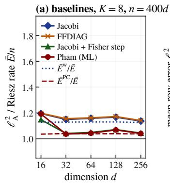

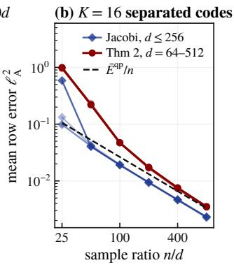

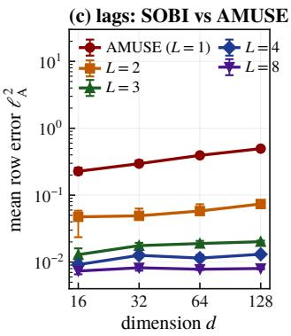

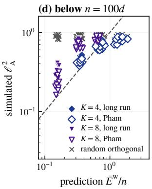  
Figure 4. Algorithms, attainment and the lag route. (a) $K = 8 , n = 4 0 0 d ,$ identical data for all methods (medians over three to six draws), error divided by the Riesz rate $\bar { E } / n$ (solid line at 1); dashed: $\bar { E } ^ { \mathrm { P C } } / \bar { E }$ , the Cramér–Rao coefficient with estimated whitening; dotted: $\bar { E } ^ { \mathrm { w } } / \bar { E }$ . (b) Separated signatures $( \dot { K } = 1 6$ 6 balanced codes, $S _ { \mathrm { m i n } } \geq 0$ .33): the estimator of Theorem 2 with known whitening (red) and Jacobi with estimated whitening (blue, $d \leq 2 5 6 )$ against $n / d \operatorname { f o r } d = 6 4$ to 512 (light to dark); dashed: $\bar { E } ^ { \mathrm { q p } } / n .$ . (c) SOBI with L lags on MA(8) sources, $n = 2 0 0 d$ (medians and quartiles); AMUSE is L = 1. (d) Runs below n = 100d (K ∈ {4, 8}, d ∈ {32, 64, 128}): Jacobi continued to 1000 sweeps (filled) and Pham’s algorithm (open) against $\bar { E } ^ { \mathrm { w } } / n ;$ crosses: a random orthogonal matrix.

The linear pencil as an initialisation. Theorem 5 concerns the eigenvectors of one combination as an estimate. As a starting point for Algorithm 3 they cost nothing $( K = 8$ random signatures, $n = 4 0 0 d ,$ estimated whitening, $d \in$ {16, 32, 64, 128, 256}, six draws each). The eigenvectors of one random combination $\begin{array} { r } { \sum _ { k } \alpha _ { k } \hat { \Sigma } _ { k } , \alpha \sim N ( 0 , I _ { K } ) } \end{array}$ , have median error 0.43 at $d = 1 6$ and 0.84 at $d = 2 5 6$ . One Jacobi sweep from them brings it to 0.066 and 0.39, two sweeps to 0.024 and 0.078, and three sweeps to within 13% of the converged run from the identity (0.020–0.024) at every $d .$ Run to convergence, the two starting points give the same minimiser: the errors differ by less than $1 0 ^ { - 1 0 }$ in relative terms and the squared sines between matched columns are below $1 0 ^ { - 1 3 }$ (all runs converged, within 17 sweeps). Starting from the eigenvectors $V _ { 0 }$ is the same as running the sweeps from the identity on the rotated covariances $V _ { 0 } ^ { \top } \hat { \Sigma } _ { k } V _ { 0 }$

Robustness. Strong contrast and unequal sizes (Figure $6 ( \mathrm { c } )$ , means over six draws): for B = 10 the random signatures are uniform on the slice of $[ 0 . 1 , 1 . 9 ] ^ { K }$ (ratios bounded by 10 up to the renormalisation for unequal sizes); unequal sizes have $\pi _ { k }$ geometric from 1 to 10, normalised; Jacobi uses the π-weighted criterion and pooled covariance and is compared with the π-weighted $\bar { E } ^ { \mathrm { w } } / n ,$ , and Pham’s algorithm uses the weights $\pi _ { k }$ . Over the $B = 1 0$ runs and the unequal-size runs, the largest deviations of Jacobi from $\bar { E } ^ { \mathrm { w } } / n$ (28% at $B = 1 0$ , 41% at $B = 2 )$ are both for $K = 4$ with unequal sizes at $n = 4 0 0 d .$ , where the smallest environment has only 22d samples; these two mean errors have relative standard errors 14% and 18%. The equal-size $B = 2$ point far below the diagonal $( K = 4 , d = 1 6 )$ has $\bar { E } ^ { \mathrm { w } } / n \approx 0 . 2 4$ , outside the first-order regime. From $n = 2 0 0 d$ on, Laplace and uniform sources give the error of Gaussian ones (Figure 5(c)). Departuresfrom the model (Table $3 ; K = 8$ random signatures, $d = 6 4 , n / d \in \{ 2 0 0 , 8 0 0 \}$ , eight draws of signatures, mixing and data per cell): with AR(1) sources of coefficient ϕ in every environment, the variance of an off-diagonal sample covariance, and with it the prediction, is multiplied by $\tau = ( 1 + \phi ^ { 2 } ) / ( 1 - \phi ^ { 2 } )$ (Bartlett’s formula; Bartlett, 1935); at $\phi = 0 . 5$ the error is 1.02–1.17 times $\tau \bar { E } ^ { \mathrm { w } } / n , { \mathrm { a t } } \phi = 0 . 8 ( \tau = 4 . 6 )$ 1.11 times at n = 800d and 2.65 times at $n = 2 0 0 d$ , where the effective sample size is 43d and zero of the eight runs converge. Mixings $A ( I + \epsilon G _ { k } / \sqrt { d } )$ that differ across environments $( G _ { k }$ Gaussian) give at most 1.22 times the prediction for $\epsilon \leq 0 . 0 3$ and leave a floor of about $2 2 \cdot 1 0 ^ { - 3 } \approx 2 . 2 \epsilon ^ { 2 }$ at $\epsilon = 0 . 1$ (fitted from the two sample sizes as $a / n + f ) ;$ ; a shared factor with correlation r between all sources leaves a floor of $4 \cdot 1 0 ^ { - 3 } \mathrm { a t } r = 0 . 0 5$ and $6 \cdot 1 0 ^ { - 3 } \mathrm { a t } r = 0 . 1$ . At $B \in \{ 2 , 4 , 1 0 \}$ the ratio is 0.99–1.09. In every cell the predicted per-source errors $E _ { j } ^ { \mathrm { w } } / n$ rank the observed ones (Spearman correlation $0 . 5 4 \mathrm { - } 0 . 7 8$ , mean over draws): the diagnostic still says which source is hard when its constant is off.

How many environments. One simulated recording of $n = 8 0 0 d$ samples, $d = 3 2$ , has sources whose log-variances are random combinations of three low-frequency cosines (eight draws of trajectories, mixing and data); cutting it into $K \in \{ 2 , 4 , \ldots , 2 5 6 \}$ equal segments gives $K$ environments, with the average variance in a segment as the signature (Table 4). Two segments put the signatures on a line and fail $( \ell _ { \mathrm { A } } ^ { 2 } = 0 . 3 7 )$ ; from $K = 4$ the error follows $\bar { E } ^ { \mathrm { w } } ( K ) / n$ (ratio 1.07 at $K = 4 ,$ within 1.04 for $8 \leq K \leq 6 4 )$ , which stops decreasing once the segments resolve the dimension of the trajectories (participation ratio of the centred signatures about 4.8), and the error leaves the prediction only for short segments: 1.17 times at $K = 1 2 8 ( n / K \approx 6 . 2 d )$ and 1.34 times at $K = 2 5 6 ( n / K \approx 3 . 1 d )$

Table 3. The first-order prediction under departures from the model $( K = 8 , d = 6 4 ,$ eight draws per cell, means): mean $\ell _ { \mathrm { A } } ^ { 2 } ~ ( \times 1 0 ^ { 3 } )$ its ratio to the prediction (multiplied by τ for AR(1) sources), and the Spearman correlation between the predicted and the observed per-source errors.
<table><tr><td></td><td colspan="3"> $n = 2 0 0 d$ </td><td colspan="3"> $n = 8 0 0 d$ </td></tr><tr><td>departure</td><td>error</td><td> $\mathrm { e r r o r / p r e d . }$ </td><td>Spearman</td><td>error</td><td> $\mathrm { e r r o r / p r e d . }$ </td><td>Spearman</td></tr><tr><td> $\mathrm { A R } ( 1 ) , \phi = 0$ </td><td>45.0</td><td>1.12</td><td>0.73</td><td>10.4</td><td>1.04</td><td>0.69</td></tr><tr><td> $\mathrm { A R } ( 1 ) , \phi = 0 . 5$ </td><td>76.9</td><td>1.17</td><td>0.65</td><td>16.5</td><td>1.02</td><td>0.70</td></tr><tr><td> $\mathrm { A R } ( 1 ) , \phi = 0 . 8$ </td><td>479.1</td><td>2.65</td><td>0.54</td><td>51.0</td><td>1.11</td><td>0.66</td></tr><tr><td> $\mathrm { m i x i n g , } \epsilon = 0$ </td><td>43.3</td><td>1.09</td><td>0.71</td><td>10.5</td><td>1.02</td><td>0.73</td></tr><tr><td> $\mathrm { m i x i n g , } \epsilon = 0 . 0 1$ </td><td>46.6</td><td>1.17</td><td>0.70</td><td>10.4</td><td>1.05</td><td>0.67</td></tr><tr><td> $\mathrm { m i x i n g } , \epsilon = 0 . 0 3$ </td><td>45.5</td><td>1.16</td><td>0.61</td><td>12.1</td><td>1.22</td><td>0.68</td></tr><tr><td> $\mathrm { m i x i n g , } \epsilon = 0 . 1$ </td><td>74.4</td><td>1.80</td><td>0.72</td><td>35.4</td><td>3.53</td><td>0.67</td></tr><tr><td>shared factor,  $r = 0$ </td><td>43.6</td><td>1.09</td><td>0.69</td><td>9.9</td><td>1.01</td><td>0.67</td></tr><tr><td>shared factor,  $r = 0 . 0 5$ </td><td>46.1</td><td>1.19</td><td>0.69</td><td>14.4</td><td>1.44</td><td>0.68</td></tr><tr><td>shared factor,  $r = 0 . 1$ </td><td>48.9</td><td>1.22</td><td>0.72</td><td>16.6</td><td>1.72</td><td>0.74</td></tr><tr><td>contrast,  $B = 2$ </td><td>43.2</td><td>1.09</td><td>0.65</td><td>10.5</td><td>1.02</td><td>0.70</td></tr><tr><td>contrast,  $B = 4$ </td><td>18.0</td><td>1.06</td><td>0.72</td><td>4.4</td><td>1.01</td><td>0.72</td></tr><tr><td>contrast,  $B = 1 0$ </td><td>12.3</td><td>1.04</td><td>0.74</td><td>2.9</td><td>0.99</td><td>0.78</td></tr></table>

Table 4. Segments of one nonstationary recording as environments $( d = 3 2 , n = 8 0 0 d ,$ eight draws): mean $\ell _ { \mathrm { A } } ^ { 2 } ( \times 1 0 ^ { 3 } )$ with its standard error, the median first-order prediction $\bar { E } ^ { \mathrm { w } } ( K ) / \breve { n } ( \times 1 0 ^ { 3 }$ ; off scale for $K = 2 )$ , the median per-draw ratio, the participation ratio of the centred signature matrix, and the runs that met the tolerance.
<table><tr><td>K</td><td> $n / ( K d )$ </td><td>mean  $\ell _ { \mathrm { A } } ^ { 2 }$ </td><td>s.e.</td><td> $\bar { E } ^ { \mathrm { w } } ( K ) / n$ </td><td>median ratio</td><td>participation ratio</td><td>converged</td></tr><tr><td>2</td><td>400</td><td>371.1</td><td>22.2</td><td></td><td>0.01</td><td>1.0</td><td>8/8</td></tr><tr><td>4</td><td>200</td><td>24.6</td><td>3.0</td><td>22.0</td><td>1.07</td><td>2.7</td><td>8/8</td></tr><tr><td>8</td><td>100</td><td>6.7</td><td>0.4</td><td>6.5</td><td>0.99</td><td>4.8</td><td>8/8</td></tr><tr><td>16</td><td>50</td><td>5.8</td><td>0.3</td><td>5.7</td><td>1.00</td><td>5.0</td><td>8/8</td></tr><tr><td>32</td><td>25</td><td>5.7</td><td>0.3</td><td>5.5</td><td>1.01</td><td>5.1</td><td>8/8</td></tr><tr><td>64</td><td>12.5</td><td>5.9</td><td>0.3</td><td>5.5</td><td>1.04</td><td>5.1</td><td>8/8</td></tr><tr><td>128</td><td>6.25</td><td>6.6</td><td>0.5</td><td>5.5</td><td>1.17</td><td>5.1</td><td>8/8</td></tr><tr><td>256</td><td>3.125</td><td>9.7</td><td>2.2</td><td>5.5</td><td>1.34</td><td>5.1</td><td>8/8</td></tr></table>

Mean risk on fixed configurations. The theorems bound expected risks, while most curves show medians, so we fix one configuration per $d ,$ the $K = 4$ lattice, and redraw only the mixing and the data (Figure 7(a); at least 6 draws per point; all values in the supplementary table). $\mathbf { A } \mathbf { i } n = 4 0 0 d$ the mean error is 1.08–1.13 times $\bar { E } ^ { \mathrm { w } } / n$ from $d = 2 7$ to 1000, with standard errors at most 3% of the mean and 90% quantiles within 16% of it, and at $n = 8 0 0 d ( d = 6 4 \mathrm { t o } 1 0 0 0 )$ it is 1.03–1.04 times. $\Delta { \sf t } n = 2 0 0 d$ , where $\bar { E } ^ { \mathrm { w } } / n \mathrm { i s } 0 . 1 5 \mathrm { - } 0 . 2 3$ and most runs stop at 100 sweeps, the ratio falls from 1.47 to 1.22 as d grows, and the sweep cap does not explain the excess: continued to 1000 sweeps, the 90 capped runs at $n = 2 0 0 d$ (all for $d \leq 2 1 6$ , the first four at $d = 3 4 3 )$ change their loss by at most 5%, the mean of the continued runs at each d by at most 0.1%, and 89 of them then meet the tolerance. $\operatorname { A t } n = 1 0 0 d ( d = 6 4 \tan 1 0 0 0 )$ , where $\bar { E } ^ { \mathrm { w } } / n$ is 0.36–0.46, outside the first-order regime, the ratio is 1.67–1.78, and 1.77–1.78 for $d \geq 5 1 2 ;$ at n = 50d (d = 64 to 343) the error is 0.78–0.91, and there its ratio to the prediction, which is not meaningful above about 0.3, says nothing; at $n \leq 1 0 0 d$ zero of 146 runs meet the tolerance within 100 sweeps. The crossings of Figure 7(d) interpolate log of the mean linearly in log n between neighbouring sample sizes: from $d = 2 7$ to 1000 the $n / d$ at which the mean error reaches 0.1 grows by 1.4 (Section 6) and the one for 0.2 by 1.2, against 1.5 for $\bar { E } ^ { \mathrm { w } } / d$ and 11.1 for the proved threshold $d ^ { 5 / 3 }$ . A run at $d = 1 0 0 0$ takes 6–21 minutes on one core. One fixed draw of $K = 4$ random signatures with $B = 2$ and $K = 1 6$ balanced codes with $S _ { \mathrm { m i n } } \geq 0 . 3 3$ behave alike for $d = 6 4$ to 512 (Figure $7 ( \mathrm { b } , \mathrm { c } ) ) \colon$ at $n = 4 0 0 d$ their mean errors are $1 . 0 6 { - } 1 . 1 2$ and 1.01 times $\bar { E } ^ { \mathrm { w } } / n ,$ and the $n / d$ for a target error of 0.1 (0.01 for the codes) grows by 1.0 (1.0), against 1.1 (1.0) for $\bar { E } ^ { \mathrm { w } } / d .$

Attainment. With known whitening, the Fisher step after Algorithm 3 takes $M _ { k } = \hat { V } ^ { \top } \hat { \Sigma } _ { k } \hat { V } , \hat { \mathbf { p } } _ { a } ( k ) = ( M _ { k } ) _ { a a }$ and $\hat { \delta } _ { k } = \hat { \mathbf { p } } _ { a } ( k ) - \hat { \mathbf { p } } _ { b } ( k )$ , estimates the residual angle of each pair by weighted least squares, $\begin{array} { r } { \hat { \Xi } _ { a b } = \sum _ { k } w _ { k } \hat { \delta } _ { k } ( M _ { k } ) _ { a b } / \sum _ { k } w _ { k } \hat { \delta } _ { k } ^ { 2 } } \end{array}$ with $w _ { k } = 1 / ( \hat { \mathbf { p } } _ { a } ( k ) \hat { \mathbf { p } } _ { b } ( k ) )$ , and returns $\hat { V } \exp ( - \hat { \Xi } )$ ; by Proposition 2(ii) its first-order variance per pair is $S _ { a b } ^ { - 1 }$ (Figure 5(d)).

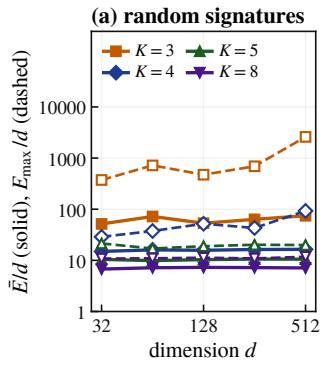

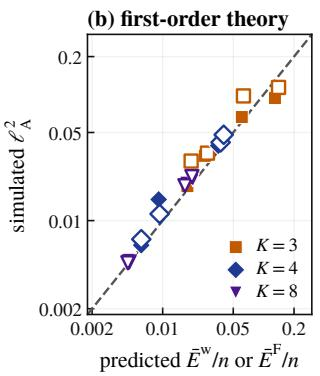

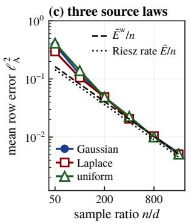

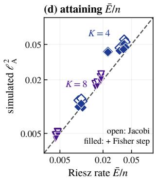  
Figure 5. Verification. (a) Energy per source for random signatures (medians over eleven draws): the average $\bar { E } / d ( \mathrm { s o l i d } )$ saturates from $K = 4 \mathrm { o n }$ , the worst source $E _ { \operatorname* { m a x } } / d$ (dashed) only from $\dot { K } = 5$ on (Proposition 1); $K = 2$ is off scale. (b) Simulated mean row error against the first-order prediction for $K \in \{ 3 , 4 , 8 \} , d \in \{ 1 6 , 3 2 \}$ and $\bar { n } \in \{ 4 0 0 d , 1 6 0 0 d \}$ , one signature draw and six mixings each: filled markers use estimated whitening and $\bar { E } ^ { \mathrm { w } } / n ,$ , open markers known whitening and $\bar { E } ^ { \mathrm { F } } / n ;$ ; dashed: identity. Points off the line are draws with a pair outside the first-order regime. (c) Gaussian, Laplace and uniform sources $( d = 3 2 , K = 8 ,$ , one signature draw, eight mixings each) give the same error from $n = 2 0 0 d$ on, on top of $\bar { E } ^ { \mathrm { w } } / n$ (dashed; ratios 1.03, 1.01 and 1.11 at $n = 4 0 0 d )$ and above the Riesz rate $\bar { E } / n$ (dotted). (d) Attaining the Riesz rate (known whitening, $K \in \{ 4 , 8 \} , d \in \{ 1 6 , \ldots , 1 2 8 \} , n \in \{ 4 0 0 d , 1 6 0 0 d \} )$ : Algorithm 3 (open) sits at $\bar { E } ^ { \mathrm { F } } / n$ , above the Riesz rate; one Fisher-weighted step (filled) lands on it.

Table 5. The estimator of Theorem 2 on random signatures, $n = 4 0 0 d ,$ , three draws per row (means, $\times 1 0 ^ { 3 } ; \gamma \colon$ median): labelled vectors, their polar factor, and one Fisher step from it, with the first-order coefficient of the labelled vectors, the Riesz rate, and the ratio of the polar factor’s loss to the Riesz rate.
<table><tr><td>K</td><td>d</td><td>γ</td><td>labelled</td><td>polar</td><td>+step</td><td> $\bar { E } ^ { \mathrm { q p } } / n$ </td><td> $\bar { E } / n$ </td><td> $\mathsf { p o l a r } / ( \bar { E } / n )$ </td></tr><tr><td>8</td><td>64</td><td>1.4</td><td>35.7</td><td>20.7</td><td>18.7</td><td>22.2</td><td>18.3</td><td>1.13</td></tr><tr><td>8</td><td>128</td><td>2.7</td><td>32.7</td><td>19.5</td><td>18.1</td><td>21.5</td><td>17.5</td><td>1.11</td></tr><tr><td>8</td><td>256</td><td>3.0</td><td>33.1</td><td>19.7</td><td>18.4</td><td>21.7</td><td>17.8</td><td>1.11</td></tr><tr><td>4</td><td>64</td><td>18.1</td><td>143.5</td><td>71.8</td><td>46.2</td><td>43.0</td><td>40.0</td><td>1.79</td></tr><tr><td>4</td><td>128</td><td>27.0</td><td>173.3</td><td>78.0</td><td>41.9</td><td>42.3</td><td>39.3</td><td>1.98</td></tr><tr><td>4</td><td>256</td><td>55.1</td><td>186.3</td><td>85.0</td><td>48.9</td><td>42.9</td><td>39.9</td><td>2.13</td></tr></table>

The estimator ofTheorem 2 below its proved regime (Table 5; known signatures and whitening, random signatures, $n = 4 0 0 d ,$ $\gamma = K d / ( n S _ { \operatorname* { m i n } } )$ from 1.3 to 4 for $K = 8$ and up to 100 for $K = 4$ over the draws; Table 5 reports medians and means): over the draws, for $K = 8$ its labelled vectors are $1 . 8 2 \mathrm { - 2 . 1 3 }$ times ${ \bar { E } } / n ,$ their polar factor 1.09–1.18 times (it averages the two estimates of each rotation angle, from the pencils at $\mathbf { p } _ { i }$ and $\mathbf { p } _ { j } )$ , and one Fisher step from it 1.00–1.06 times; for $K = 4$ where random signatures have close pairs, the three are 3.13–4.84, 1.40–2.19 and 0.99–1.42 times $\bar { E } / n$

Estimated whitening (Theorem 2(b)). Table 6 runs the estimator of Theorem 2 on $K = 4$ lattices with known signatures and the sample split into thirds: on parts 1 and 2 with the true whitening, and on the same parts whitened by the pooled sample covariance of part 0, scored by $\rho _ { j }$ of Theorem 2(b); the comparison is with known whitening on the same two thirds. Mixing the same sources by $I + G / { \sqrt { d } } ( G$ Gaussian, $d = 2 7 ,$ condition number 41) instead of $A = I$ changes no $\rho _ { j }$ by more than $1 0 ^ { - 1 3 }$ , as the reduction in the proof says. On these lattices $\bar { E } ^ { \mathrm { w h } } = 0 . 0 1 1 \bar { E } .$ , so estimating the whitening costs 2.1% at first order; the measured excess is $4 \% - 6 \%$ at $n = 2 5 6 0 0 d \left( \gamma \leq 0 . 0 8 \right)$ and $1 0 \% - 1 5 \% \ \mathrm { a t } \ n = 6 4 0 0 d ( \gamma = 0 . 2 2 \mathrm { - } 0 . 3 0 )$ , and for $d = 2 7$ it falls to 2.9% and 2.3% at n = 102400d and 409600d: a second-order term, which the factor $( 1 + C \sqrt { \gamma _ { j } } ) ^ { 2 }$ of (11) absorbs. To resolve the coefficient $2 E _ { j } ^ { \mathrm { w h } }$ we take $K = 4 , d = 8 , n = 2 \cdot 1 0 ^ { 6 } d$ and 30,000 draws on a configuration chosen for a large $E ^ { \mathrm { w h } }$ (the largest $\bar { E } ^ { \mathrm { w h } } / \bar { \bar { E } }$ among 4000 draws on $\begin{array} { r } { \{ \mathbf { p } \in [ \frac { 1 } { 4 } , \frac { 7 } { 4 } ] ^ { K } : \sum _ { k } \mathbf { p } ( k ) = K \} } \end{array}$ with $S _ { \mathrm { m i n } } \geq 0 . 0 5 ;$ $E _ { j } ^ { \mathrm { w h } } / E _ { j }$ up to $0 . 1 5 , \gamma = 3 \cdot 1 0 ^ { - 4 } ) \mathrm { { : } }$ $n \mathbb { E } \rho _ { j } / [ \frac { 3 } { 2 } ( E _ { j } ^ { \mathrm { q p } } + 2 E _ { j } ^ { \mathrm { w h } } ) ]$ is 0.99–1.00 for every source (standard errors at most $0 . 0 0 5 )$ whereas $E _ { i } ^ { \mathrm { w h } }$ in place of $2 E _ { j } ^ { \mathrm { w h } }$ would miss by up to 11%; on a random configuration as in Section $6 ( \bar { E } ^ { \mathrm { w h } } = 0 . 0 0 7 \bar { E }$ $\gamma = 0 . 0 3 )$ the ratio is 1.00–1.02.

Unknown signatures. The grid of Algorithm 2 is a device for the proof; Table 7 tests a practical variant on $K = 4$ lattices with $d = m ^ { 3 }$ , known whitening and the sample split into thirds. On part $\begin{array} { r } { 0 , \lambda _ { \operatorname* { m i n } } \big ( \sum _ { k } ( \hat { \Sigma } _ { k } ^ { ( 0 ) } - g ( k ) I ) ^ { 2 } \big ) } \end{array}$ is computed on a cubic grid of mesh $r _ { 0 } / 4$ in the hyperplane within $[ 1 / 2 . 6 , 2 . 6 ] ^ { K } ( [ 1 / 2 . 7 , 2 . 7 ] ^ { K }$ at $d = 2 1 6$ , whose lattice has $B = 8 / 3 )$ , r<sub>0</sub> the smallest distance between signatures; the grid points below all their face neighbours are refined by three alternating steps (u ← bottom eigenvector, $\boldsymbol { g } ( \boldsymbol { k } ) \gets \boldsymbol { u } ^ { \top } \hat { \Sigma } _ { \boldsymbol { k } } ^ { ( 0 ) } \boldsymbol { u } )$ , refined probes closer than $r _ { 0 } / 2$ are merged, and the d with the smallest $\lambda _ { \mathrm { m i n } }$ are kept (a global threshold, as in the proof, needs larger n). The estimator of Theorem 2 then runs on parts 1 and 2 at each probe, and its polar factor is compared with the same estimator at the true signatures. From $n = 6 4 0 0 d \mathrm { o n }$ , all d probes are found in every run, the largest probe error is 0.20 of the nearest-neighbour distance, and the two estimators differ by at most 4%; the selection takes 4 s at $d = 2 7$ and about 9 minutes at $d = 2 1 6$ (210,464 grid points) on one core. $\Delta { } { } \mathrm { t } n = 1 6 0 0 d$ the selection misses up to 10 of the d probes, and the loss over all runs, failures included (the estimator at every returned probe, orthonormalised, each source scored against its closest returned vector), is 1.8–2.6 times the oracle. These probes are far outside the accuracy that Lemma 3 assumes $( 1 / ( 8 B ^ { 4 } )$ of the nearest-neighbour distance), so the lemma is conservative. Misspecified $s _ { 0 }$ . In the variant the mesh and the merge radius stand for $s _ { 0 }$ , which in Algorithm 2 also sets the acceptance threshold (the variant has none) and the sample size needed: replacing $r _ { 0 }$ by $c r _ { 0 }$ corresponds to $s _ { 0 } \approx c ^ { 2 } S _ { \mathrm { m i n } }$ up to factors of B. On the same data $( d \in \{ 2 7 , 6 4 \} , n = 6 4 0 0 d ) , c = 1 / 2$ multiplies the number of grid points by 7.9 and the selection time by about 8 and returns the same probes as $c = 1$ in all six runs, while $c = 2$ merges neighbouring sources and no run succeeds: too small an $s _ { 0 }$ costs time, too large an $s _ { 0 }$ fails. A Jacobi pilot on an additional independent batch of $n / 3$ samples (rotated by a Haar matrix, so that the sweeps do not start at the truth) estimates $r _ { 0 }$ by the smallest distance $\hat { r } _ { 0 }$ between its signatures: in six runs $( d \in \{ 2 7 , 6 4 \} ) , \hat { r } _ { 0 } / r _ { 0 }$ lies between 0.80 and 0.89 and $\hat { S } _ { \operatorname* { m i n } } / S _ { \operatorname* { m i n } }$ between 0.67 and 0.90 (biased low, the safe side, because the lattice has many pairs at distance $r _ { 0 } ;$ with a unique closest pair the bias can be upward, which the safety factor must absorb). With $\hat { r } _ { 0 } / 2$ in place of $r _ { 0 } ,$ a safety factor of four on $s _ { 0 } .$ , the selection finds all probes in all six runs, and the estimator is within 3% of the oracle.

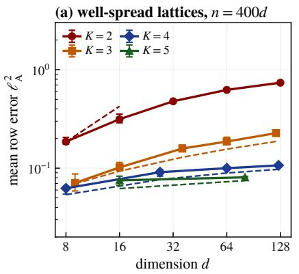

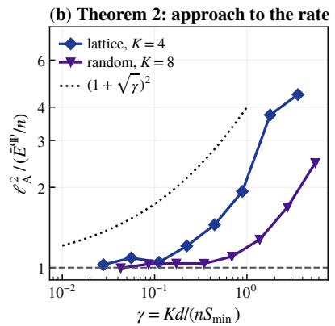

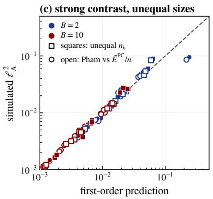  
Figure 6. (a) Lattice signatures (Definition 1), $n = 4 0 0 d ,$ , eight draws: the dimension law with the assumptions of Theorems 1 and 4. (b) The estimator of Theorem 2 (known whitening) approaches its prediction $\bar { E } ^ { \mathrm { q p } } / n \mathrm { a s } \gamma = K d / ( n S _ { \mathrm { m i n } } )$ decreases $( d = 6 4$ , four draws per point; diamonds: $K = 4$ lattice, with ratio 1.03 to $\bar { E } ^ { \mathrm { q p } } / n$ at $\gamma = 0 . 0 2 8 ;$ triangles: $K = \dot { 8 }$ random signatures); dotted: the shape $( 1 + { \sqrt { \gamma } } ) ^ { 2 }$ of (10). (c) Strong contrast $( B = 1 0 )$ , red) and unequal sizes (squares): Jacobi against $\bar { E } ^ { \mathrm { w } } / n$ (filled) and Pham against $\bar { E } ^ { \mathrm { P C } } \bar { / } n$ (open).

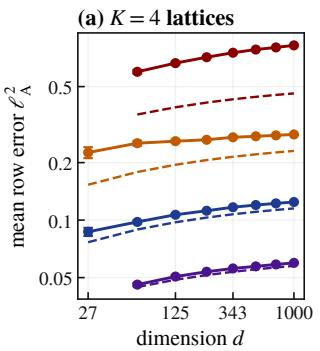

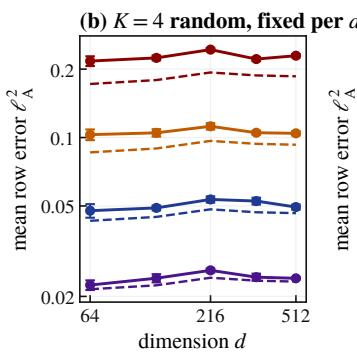

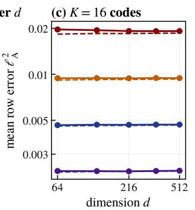

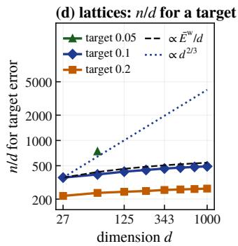  
Figure 7. Mean risk on fixed configurations, larger d. Mean $\ell _ { \mathrm { A } } ^ { 2 }$ with 95% intervals against d at ${ n } / { d } \in \{ 1 0 0 , 2 0 0 , 4 0 0 , 8 0 0 \} ;$ dashed: $\bar { E } ^ { \mathrm { w } } / n .$ . (a) $K = 4$ lattices, $d = 2 7$ to 1000. (b) One fixed draw of $K = 4$ random signatures per d. (c) $K = 1 6$ balanced codes. (d) $n / d$ at which the mean error of the lattices reaches 0.1 and 0.2 (and 0.05, reached within $n \leq 8 0 0 d$ only at $d = 6 4 )$ ; dashed: the growth of $\bar { E } ^ { \mathrm { w } } / d ;$ dotted: the growth $d ^ { 2 / 3 }$ of the proved threshold.

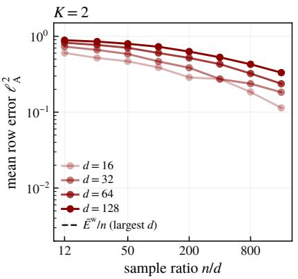

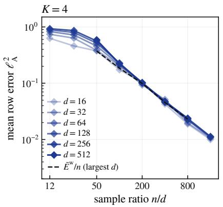

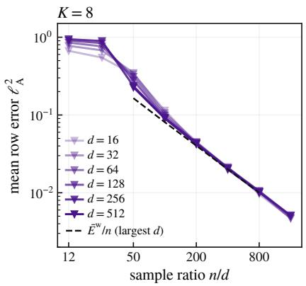  
Figure 8. Collapse in $n / d .$ Median error against n/d for random signatures, $K \in \{ 2 , 4 , 8 \}$ and d from 16 (light) to 512 (dark; $K = 2$ up to 128), ten draws per point $( d \leq 1 2 8 )$ , six $( d = \dot { 2 } 5 6 )$ or three $( d = 5 1 2 )$ ; dashed: $\bar { E } ^ { \mathrm { w } } / \bar { n }$ for the largest d. For $K = 4$ and $K = 8$ the curves coincide; for $K = 2$ they move up with d.

Table 6. Theorem 2(b) in simulation: $K = 4$ lattices, known signatures, $n / 3$ observations per part. The estimator of Theorem 2 on parts 1 and 2 with the true whitening (known; loss $1 - \langle \hat { q } _ { j } , q _ { j } \rangle ^ { 2 } )$ and with the whitening estimated on part 0 (estimated; loss $\rho _ { j }$ of Theorem 2(b)): means of $\ell _ { \mathrm { A } } ^ { 2 }$ over the stated number of draws $( \dot { \times } 1 0 ^ { 3 } )$ , their first-order predictions with $n _ { B } = 2 n / 3$ , and the ratio of the two means; $\gamma = \operatorname* { m a x } _ { j } \gamma _ { j }$
<table><tr><td>d</td><td> $n / d$ </td><td>draws</td><td>γ</td><td>known</td><td> $\bar { E } ^ { \mathrm { q p } } / n _ { B }$ </td><td>estimated</td><td> $( \bar { E } ^ { \mathrm { q p } } + 2 \bar { E } ^ { \mathrm { w h } } ) / n _ { B }$ </td><td>estimated/known</td></tr><tr><td>27</td><td>6400</td><td>40</td><td>0.22</td><td>7.99</td><td>7.28</td><td>8.81</td><td>7.43</td><td>1.103</td></tr><tr><td>27</td><td>25600</td><td>40</td><td>0.060</td><td>1.87</td><td>1.82</td><td>1.95</td><td>1.86</td><td>1.042</td></tr><tr><td>27</td><td>102400</td><td>40</td><td>0.016</td><td>0.464</td><td>0.455</td><td>0.478</td><td>0.465</td><td>1.029</td></tr><tr><td>27</td><td>409600</td><td>40</td><td>0.0043</td><td>0.114</td><td>0.114</td><td>0.117</td><td>0.116</td><td>1.023</td></tr><tr><td>64</td><td>6400</td><td>16</td><td>0.25</td><td>9.41</td><td>8.39</td><td>10.8</td><td>8.57</td><td>1.146</td></tr><tr><td>64</td><td>25600</td><td>16</td><td>0.065</td><td>2.15</td><td>2.10</td><td>2.25</td><td>2.14</td><td>1.050</td></tr><tr><td>125</td><td>6400</td><td>8</td><td>0.30</td><td>10.6</td><td>9.10</td><td>12.3</td><td>9.30</td><td>1.154</td></tr><tr><td>125</td><td>25600</td><td>8</td><td>0.077</td><td>2.38</td><td>2.28</td><td>2.53</td><td>2.32</td><td>1.063</td></tr></table>

Real data. Data. HCP S1200 (Van Essen et al., 2013): the 813 subjects with all fourteen task runs (seven tasks, two runs each; Barch et al., 2013) and the first resting-state run, 799 of them with four resting-state runs. Grayordinate time series (MSMAll, from the minimal preprocessing pipelines; Glasser et al., 2013) were averaged within Schaefer parcels (Schaefer et al., 2018) at $d \in \{ 1 0 0 , 2 0 0 , 4 0 0 \}$ , converted to percent signal change, cleaned per run by regressing out a trend, twelve motion parameters and a discrete-cosine high-pass basis (0.008 Hz), and demeaned. Environments: the seven tasks and rest, 176 frames per task run, i.e. 352 per subject and environment, and a contiguous rest segment of the same length (286176 frames per environment in the group fit). Group fit: pooled whitening and Algorithm 3 (at most 1000 sweeps) on the covariances summed over subjects; the signatures are $\bar { \bf p } _ { j } ( k ) = \hat { b } _ { j } ^ { \top } \hat { \Sigma } _ { k } \hat { b _ { j } } / \hat { b } _ { j } ^ { \top } \hat { C } \hat { b } _ { j }$ , normalised to mean one. Only the eight-task fit at $d = 1 0 0$ reached the tolerance; at $d = 2 0 0$ the pairs are nearly degenerate $( S _ { \mathrm { m i n } } = 0 . 0 0 0 0 5 7 0 )$ and Pham’s algorithm (Pham, 2001) differs from Jacobi by a matching loss of up to 0.97 for such pairs (the energies below are those of the Jacobi solution). Autocorrelation: $\begin{array} { r } { \tau _ { a b } = \sum _ { t } \rho _ { a } ( t ) \rho _ { b } ( t ) } \end{array}$ (Bartlett, 1935) from the estimated sources of 50 subjects (Bartlett window of $L = 3 0$ frames; median $\tau _ { a a } = 1 . 1 9 ;$ an AR(2) fit agrees to within 2.3% in median). Split halves: 50 random disjoint pairs of halves with $m \in \{ 1 0 , \ldots , 4 0 0 \}$ subjects each (no family information was available; at $m = 4 0 0$ the two halves use $2 \times 4 0 0$ of the 813 subjects, so the repeats are far from independent), each fitted with at most 300 sweeps (none reached the tolerance), labelled against the group solution and matched by the Hungarian algorithm; $\delta _ { j } = 1 - \mathrm { c o r r ^ { 2 } }$ between the two estimates of source j under the pooled covariance, against $\begin{array} { r } { \hat { \delta } _ { j } = \overset { \cdot } { 2 } \sum _ { a \ne j } v _ { a j } ^ { \mathrm { { \bar { w } } } } \tau _ { a j } / n _ { \mathrm { h a l f } } } \end{array}$ . The first-order region is $\hat { \delta } _ { j } < 0 . 3 \colon \hat { \delta } _ { j }$ adds the errors of the two halves, so this is a per-half first-order error below 0.15, about the regime of Section $\begin{array} { r } { 6 ; } \end{array}$ with $\hat { \delta } _ { j } < 0 . 1$ the fractions below become 12% $( m = 5 0 )$ and 46% $( m = 4 0 0 )$ . Results: the fraction of components in the first-order region grows from 8% $( m = 1 0 )$ to 64% $( m = 2 0 0 )$ and 199 of $2 0 0 ( m = 4 0 0 ) $ ; within it the Spearman correlation between $\ddot { \delta } _ { j }$ and $\delta _ { j }$ is 0.92 at m = 50 and 0.88 at $m = 4 0 0$ (pooled over m: 0.84, slope 0.731 on log scales), and $\delta _ { j } / \hat { \delta } _ { j }$ has median 6.1. The energy ranks better than the nearest-neighbour gap alone: at $m = 5 0$ the Spearman correlation with $\delta _ { j }$ is 0.89 for $E _ { j }$ and 0.72 for $1 / S _ { \mathrm { n n } } ( j )$ within the first-order region (52 components), and 0.84 against 0.78 over all 200 components, although the two quantities rank the components alike (Spearman 0.94); the nearest neighbour contributes a median 5% of $E _ { j }$ (2% to 9% between the deciles). Fitting $\delta _ { j } \approx a _ { j } / n _ { \mathrm { h a l f } } + f _ { j }$ over m gives, for the 128 components with at least two sample sizes in the region, a floor $f _ { j }$ with median 0.59 and coefficients $a _ { j }$ that, with two to six points each, do not rank with the prediction (Spearman 0.073), so the ranking of $\delta _ { j }$ within each m is carried mostly by the floor. Most of these discrepancies are close to their random level (mean 0.723 at $m = 4 0 0$ against a predicted 0.118), so the fitted floor largely measures saturation. The perturbed mixings of Table 3 bias every estimate in the same way, so their floor does not show in a split-half comparison. Of the 70 subsets of four environments, the five with the smallest energy $( \bar { E } / d \approx 4 4 0 )$ give $\delta = 0 . 8 8 4$ at $m = 5 0$ against 0.909 for the five with the largest $( \bar { E } / d \approx 2 7 6 9 )$ , and eight rest segments (participation ratio 1.54) give 0.894 against 0.860 for the seven tasks and rest, whose signatures differ little from one another (cf. the correspondence of task and rest architectures, Smith et al., 2009) (same m and number of repeats): at this m all of them are close to saturation. In Figure 3(b), with two environments the nearest-neighbour distances of the estimated signatures are below their estimation noise, so those energies, and their growth with $d ,$ are rough. Figure 9 shows the components with the smallest and the largest predicted error and the hardest pair.

Table 7. A practical variant of Algorithm 2 (not a test of Theorem 3): $K = 4$ lattices, three draws per row (two for $d = 2 1 6 )$ . All probes: runs in which the selection returns one probe per source; probe error: largest distance of a probe from its signature over the signature’s nearest-neighbour distance (median over those runs); grid and all runs: $\ell _ { \mathrm { A } } ^ { \breve { 2 } }$ with the selected probes over those runs and over every run, failures included; oracle: true signatures, on the same data; losses and predictions $\times 1 0 ^ { 3 }$ , with $n _ { B } = 2 n / 3$ the size of parts 1 and 2; selection: time on one core.
<table><tr><td>d</td><td> $n / d$ </td><td>all probes</td><td>probe error</td><td>grid</td><td>all runs</td><td>oracle</td><td> $\bar { E } ^ { \mathrm { q p } } / n _ { B }$ </td><td> $\bar { E } / n _ { B }$ </td><td>selection (s)</td></tr><tr><td>27</td><td>1600</td><td>1/3</td><td>0.40</td><td>36.13</td><td>70.37</td><td>30.51</td><td>29.12</td><td>27.82</td><td>4</td></tr><tr><td>27</td><td>6400</td><td>3/3</td><td>0.18</td><td>6.86</td><td>6.86</td><td>6.84</td><td>7.28</td><td>6.95</td><td>3</td></tr><tr><td>27</td><td>25600</td><td>3/3</td><td>0.10</td><td>1.81</td><td>1.81</td><td>1.81</td><td>1.82</td><td>1.74</td><td>4</td></tr><tr><td>64</td><td>1600</td><td>0/3</td><td></td><td></td><td>62.01</td><td>34.79</td><td>33.58</td><td>32.29</td><td>23</td></tr><tr><td>64</td><td>6400</td><td>3/3</td><td>0.18</td><td>8.37</td><td>8.37</td><td>8.29</td><td>8.39</td><td>8.07</td><td>22</td></tr><tr><td>64</td><td>25600</td><td>3/3</td><td>0.08</td><td>2.06</td><td>2.06</td><td>2.06</td><td>2.10</td><td>2.02</td><td>22</td></tr><tr><td>125</td><td>1600</td><td>0/3</td><td></td><td></td><td>99.46</td><td>38.13</td><td>36.42</td><td>35.15</td><td>100</td></tr><tr><td>125</td><td>6400</td><td>3/3</td><td>0.17</td><td>9.21</td><td>9.21</td><td>9.17</td><td>9.10</td><td>8.79</td><td>100</td></tr><tr><td>125</td><td>25600</td><td>3/3</td><td>0.07</td><td>2.17</td><td>2.17</td><td>2.16</td><td>2.28</td><td>2.20</td><td>103</td></tr><tr><td>216</td><td>6400</td><td>2/2</td><td>0.18</td><td>9.38</td><td>9.38</td><td>9.33</td><td>9.60</td><td>9.28</td><td>533</td></tr></table>

(a) easiest and hardest component  
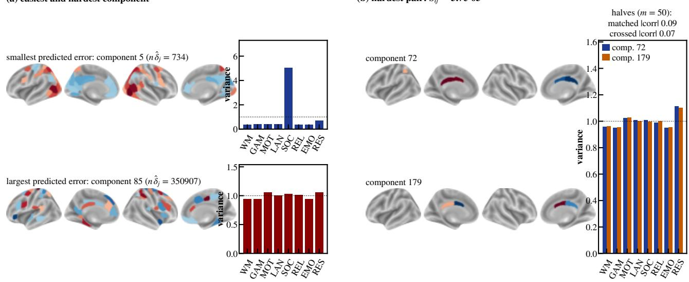  
(b) hardest pair: Sij = 5.7e-05  
Figure 9. Real data: components $( d = 2 0 0 )$ . (a) The components with the smallest and the largest predicted error $( n \hat { \delta } _ { j } = 7 3 4$ and $3 5 0 9 0 7 ) \colon$ parcel loadings on the inflated cortical surface and task-variance signatures. (b) The hardest pair (components 72 and 179, $S _ { i j } = 0 . 0 \bar { 0 } 0 0 5 7 0 )$ has nearly identical signatures; between halves of $m = 5 0$ subjects the matched |corr| of their estimates is 0.091 and the crossed one 0.071.