# Shallow Encoding Emits Deep Memories

Mingyuan Ma\*, Yangmin Li\*, Harris Nover, Zheyu Fu, Po-Han Huang, Alex Settle,

Ashwin Nanjappa†

NVIDIA

Project page

Hybrid language models interleave a few softmax-attention layers with many linear-attention or state-space layers, so every layer keeps a memory of earlier tokens: a key–value cache or a fixed-size recurrent state. Serving them spends more compute and high-bandwidth memory (HBM) on these memories than the output requires. The prefill runs every layer for every prompt token, although only the last token’s prediction is used, and every decode step loads and stores whole recurrent states, which on Qwen3.8-Flash-Next take as many bytes per request as the attention cache of thousands of tokens. We find two properties of trained hybrids that locate this excess. First, writes are easier than reads: writing a deep layer’s memory of a token needs little of the deep computation that predicting the next token needs. Trained copies of the deep layers write paths, which we call emitters, therefore write a prompt’s deep memories from the residual stream of a shallower anchor layer, and all prompt tokens but the last run as few as 63% of the layers. Second, recurrent states have a state sink: most of their energy lies in a rank-one term along a fixed direction of each head, and the rest is a low-rank working memory. SEED (Shallow Encoding Emits Deep Memories) builds on both: it makes the prefill shallow in depth and the decode state shallow in representation. Each recurrent state is stored as its sink plus low-rank factors, which the Gated DeltaNet, Kimi Delta Attention and Mamba-2 updates extend exactly; we prove that the open-loop error of the periodic compressions back to low rank is bounded independently of their number. SEED keeps the original weights frozen, compresses no attention cache, and runs all layers for every generated token. On six checkpoints of five production hybrids of 30B to over 300B parameters, it is nearly lossless on eleven oficial exams. Served with SGLang on NVIDIA GB300 GPUs on an agentic-coding trace, it raises the per-GPU throughput of Qwen3.8-Flash-Next 1.2–1.4×. Neither property was designed into these models.

Keywords: LLM inference, hybrid models, linear attention, recurrent state, prefill, algorithm–system co-design

## 1. Introduction

Hybrid language models keep a few softmax-attention layers and make the other token-mixing layers recurrent (Dao & Gu, 2024; Yang et al., 2025b; Kimi Team et al., 2025), and production models now take this form (Qwen Team, 2025; NVIDIA et al., 2025b; MiniMax et al., 2025). Every layer keeps a memory of earlier tokens. An attention layer keeps a key–value (KV) cache, one key and one value per token. A linear-attention or state-space layer folds each token into a fixed-size recurrent state, one $d _ { k } \times d _ { v }$ matrix per head. Serving runs in two phases with diferent bottlenecks (Patel et al., 2024; Zhong et al., 2024; Qin et al., 2025). The prefill processes all � prompt tokens together and is compute-bound. The decode generates one token per request per step; each step reads the weights and the memories of every resident request, so it is bound by high-bandwidth memory (HBM) bandwidth and by how many requests fit next to the weights (§2).

Both phases spend more compute and HBM on these memories than the output requires. In the prefill, only the last prompt token predicts the first reply token; the other � −1 run all � layers of the model only to write their memories, and agentic workloads make these prompts long (DeepSeek-AI et al., 2026). In the decode, every recurrent head loads its whole state from HBM and stores it back at every step, and fixed-size does not mean small: on Qwen3.8-Flash-Next, the states of one request

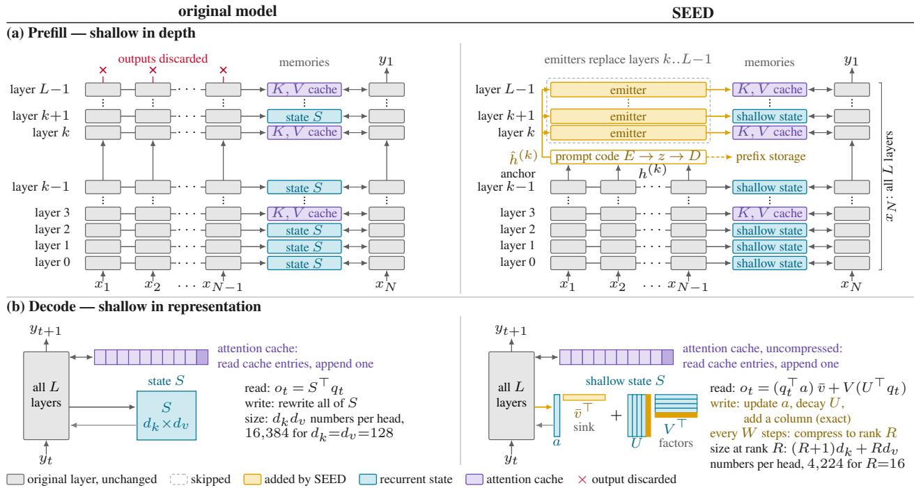  
Figure 1 | SEED keeps a shallow encoding of a hybrid model’s memories in each phase. Left: original model; right: SEED; layer stacks as in Qwen3.8-Flash-Next, with three recurrent layers per attention layer. (a) Prefill, shallow in depth: $x _ { 1 } . . x _ { N - 1 }$ run layers 0..�−1 only. Emitters, trained copies of the deep layers’ write paths, write every deeper memory from $h ^ { ( k ) }$ , the output of anchor layer �−1, directly or through an optional prompt code. At the end of the prefill, the states left by $x _ { 1 } . . x _ { N - 1 }$ are compressed to the shallow form of (b); �� runs all � layers. (b) Decode, shallow in representation: each stored recurrent state is its sink $a { \bar { v } } ^ { \top }$ plus rank-� factors $\dot { U } \dot { V } ^ { \top }$ . A step updates the sink’s coeficient $^ { a , }$ decays � and appends one column to each factor, which keeps the update exact; every $W$ steps, the factors are compressed back to rank �. Every generated token runs all � layers, and no attention cache is compressed.

## take 113.2 MB, as much as the attention cache of about 4.5K tokens (Table 2).

We show that this excess is structural. Trained hybrids have two properties, one per phase, that make their memories far simpler than the computation and storage that serve them. We find both in all five production models we study, Qwen3.8-Flash-Next (Qiu et al., 2026b), Nemotron-3.5- Lightning (NVIDIA, 2026c), Kimi-Linear (Kimi Team et al., 2025), GLM-5.3-Flash (Z.ai, 2026; GLM-5-Team et al., 2026) and Nemotron-3.5-Super (NVIDIA, 2026b), whose recurrent layers are Gated DeltaNet, Kimi Delta Attention and Mamba-2.

Writes are easier than reads. A layer writes its memory of a token through its write path, which reads only the residual stream that enters the layer. Predicting the next token, a read, needs the attention and feed-forward blocks of every deep layer. This write–read asymmetry is large. We call � the anchor depth and layer � − 1, at 63–89% of the depth, the anchor layer; its output is the residual stream $h ^ { ( k ) }$ (Elhage et al., 2021). Fed into the deep layers’ own write paths without any training, $h ^ { ( k ) }$ moves the next-token distribution by a Kullback–Leibler (KL) divergence below 0.1 nats per token. An untrained early exit at the same depth, the output head applied to $h ^ { ( k ) }$ (the logit lens; nostalgebraist, 2020), is of by 6.8–11.1 nats per token (Figure 2). We trace the gap to the two roles of a deep layer. At a prompt token, its only lasting output is the memory it writes; the rest of its computation reaches the reply only through the inputs of later writes (§3).

Table 1 | SEED in the two serving phases. In each phase, a property of trained hybrids lets SEED keep an encoding of the memories that is shallow along the phase’s bottleneck, compute in the prefill and HBM in the decode, and emit from it what the model reads.
<table><tr><td></td><td>Prefill (compute-bound)</td><td>Decode (HBM-bound)</td></tr><tr><td>Property</td><td>writes are easier than reads: a deep layer&#x27;s write needs little of the deep computation (§3)</td><td>the state sink: a rank-one term along a fixed direction of each head holds most of the states&#x27; energy; the rest is low-rank (§4)</td></tr><tr><td>Model reads</td><td>caches and states of layers k..L-1 for each prompt token</td><td>read-out and update of each  $d _ { k } \times d _ { v }$  recurrent state</td></tr><tr><td>Shallow encoding</td><td>in depth: prompt tokens  $x _ { 1 } . . x _ { N - 1 }$  run only layers 0..k-1; their output  $h ^ { ( k ) }$  stands in for layers k..L-1</td><td>in representation: the shallow state, the sink  $a { \bar { v } } ^ { \top }$  plus rank-R factors U, V</td></tr><tr><td>Emitted by</td><td>emitters, trained copies of the deep layers&#x27; write paths, write every deep cache and state from  $\hat { h } ^ { ( k ) }$ </td><td>the factors, which give the read-out and the exact update; compressed to rank R every W steps</td></tr><tr><td>Saves</td><td>prompt tokens but the last run as few as 63% of the layers and 71% of the parameter FLOPs</td><td>the state is 2.0–3.9× smaller after a compression, 1.3–2.6× on average</td></tr><tr><td>States</td><td colspan="2">every stored recurrent state is shallow: the states that  $x _ { 1 } . . x _ { N - 1 }$  leave are compressed to the sink plus rank-R factors at the end of the prefill, and the decode keeps this form</td></tr><tr><td>Unchanged</td><td colspan="2">the weights; no attention cache is compressed or quantized; the last prompt token and every generated token run all L layers</td></tr></table>

Recurrent states have a sink. In the median Gated DeltaNet head of Qwen3.8-Flash-Next, one direction holds 85% of the state’s energy, its squared Frobenius norm. This direction is close to the head’s mean value �¯. The values’ component along �¯ carries most of their energy, and the linear recurrence accumulates it into a rank-one term $a { \bar { v } } ^ { \top }$ , the state sink, whose coeficient follows the head’s own recurrence (Lemma 1). Pooled over heads, the sink holds 69–99.7% of the state energy on all five models. Like the attention sink of softmax layers (Xiao et al., 2024), it forms regardless of the prompt, on Qwen3.8-Flash-Next even on random tokens; unlike it, it lies along a direction of the state, not at a position in the sequence. The sink holds the energy but not the prompt. After the head’s normalization, it acts as a bias and as the gain of the rest, and replacing it by its mean over other prompts costs only 0.002 nats per token. What the head has read lies in the orthogonal content, a short working memory: on Qwen3.8-Flash-Next, a median of 6 directions hold 90% of its energy (§4).

The model’s own update preserves the form. A compact state is useful only if it survives every update without growing back to $d _ { k } \times d _ { v }$ . A sink plus low-rank factors does: the form $a { \bar { v } } ^ { \top } + U V ^ { \top }$ is closed under the Gated DeltaNet, Kimi Delta Attention and Mamba-2 updates, each step updating the sink’s coeficient and appending one column to each factor, an exact rank-one update of the content (Lemma 2). The only approximation is a compression of the factors back to rank �, once at the end of the prefill and then every � steps; it never touches the sink. In the open loop, where the compressed and the exact recurrence see the same inputs, its errors do not compound: the accumulated error stays within the largest single compression error times the head’s decay horizon, however many compressions occur (Corollary 4). In the closed loop, where errors also change later inputs, the measured drift grows only 1.2–1.4× from the first to the last 4K of 16K decode steps while the number of compressions grows 4×, on the four models followed this long (§6.1).

SEED. SEED, Shallow Encoding Emits Deep Memories, builds one part on each property (Figure 1, Table 1). In the prefill, its encoding is shallow in depth. The first � − 1 prompt tokens run only layers 0..�−1, and emitters, trained copies of the deep layers’ write paths, write every deep attention cache and recurrent state from $h ^ { ( k ) }$ . An optional compact prompt code of $h ^ { ( k ) }$ , read by the emitters, can stand in for the deep memories in a prefix cache. In the decode, its encoding is shallow in representation. From the end of the prefill on, every recurrent state is stored as its sink plus rank-� factors instead of a dense $d _ { k } \times d _ { v }$ matrix, and every step computes its read-out and its exact update from them. Each encoding is shallow along the bottleneck of its phase: the prefill’s saves FLOPs, and the decode’s saves HBM bytes. All prompt tokens but the last run as few as 63% of the layers and 71% of the parameter FLOPs, and the state is 2.0–3.9× smaller after each compression. The original weights stay frozen, no attention cache is compressed, and the last prompt token and every generated token run all � layers. Every setting follows from one set of criteria, applied to inexpensive measurements of the original model (§3.1).

Evidence. We apply SEED to six checkpoints of five production hybrids of 30B to over 300B parameters: Qwen3.8-Flash-Next in bf16 and NVFP4, Nemotron-3.5-Lightning, Kimi-Linear, GLM-5.3-Flash and Nemotron-3.5-Super. Each is compared with its original model question by question, with the same sampling seeds. Under the oficial graders, SEED is nearly lossless: 63 of the 66 checkpoint–exam cells of eleven exams lie within two standard errors of the original model or above it, and the repetitions on which no design choice rested agree with them (§6). Its answers change about as often as those of a second sample of the original model. The next-token distributions stay close. With the exact prefill, the shallow state drifts 0.002–0.007 nats per token; NVIDIA’s oficial NVFP4 checkpoints drift 1.9–3.5× as much on the three models that have one (§6.1). Served with SGLang on NVIDIA GB300 GPUs on an agentic-coding trace, Qwen3.8-Flash-Next with SEED delivers 1.2–1.4× the original model’s throughput per GPU, both peak to peak and at an equal per-user rate of 40 tokens/s: shallow prefill relieves the prefill instance in disaggregated serving, and shallow states relieve the recurrent-state pool that limits the batch in aggregated serving (§7).

Neither property was designed into these models.

## Contributions.

• Two properties of trained hybrid models: the write–read asymmetry, for recurrent states as well as attention caches, and the state sink, each measured on five production models (§§3–4).

• SEED, which turns both into a serving method for frozen checkpoints, with a proof that the Gated DeltaNet, Kimi Delta Attention and Mamba-2 updates preserve its state form exactly and an open-loop error bound that does not grow with the number of compressions (§5).

• An evaluation of six checkpoints against their original models on oficial exams, decode drift and serving throughput: SEED matches the original models’ exam scores, and Qwen3.8-Flash-Next with SEED delivers 1.2–1.4× the throughput per GPU (§§6–7). We will release the code, the component sets and their training data.

## 2. Setting

Cost model. We count the cost of each phase with a roofline model. A prefill chunk of � tokens reads the $M _ { \mathrm { w } }$ bytes of weights once and spends � FLOPs per token, two per parameter the token meets; it is compute-bound once its arithmetic intensity $n F / M _ { \mathrm { w } }$ exceeds the GPU’s ridge point, its FLOP rate divided by its HBM bandwidth. � omits attention-score FLOPs, which SEED skips in the deep attention layers, and recurrence-scan FLOPs, which it keeps, so on long prompts � understates its saving. For a chunk without the last prompt token, SEED lowers both � and the weight bytes read. A decode GPU with $M _ { \mathrm { H B M } }$ bytes of HBM holds the weights and � resident requests; at context length $T ,$ each occupies $M _ { \mathrm { r } } ( T )$ bytes of caches and states, and each decode step moves $Q _ { \mathrm { r } } ( T )$ bytes for it: its recurrent states, read and written in full, and the cache entries the step reads. These are all entries under dense attention; under the sparse attention of Qwen3.8-Flash-Next and GLM-5.3-Flash, they are 2,048 selected tokens per layer plus the indexer keys of all tokens, pooled over blocks of four. A step also reads the weights the batch touches, $M _ { \mathrm { w } } ^ { \mathrm { s t e p } } \leq M _ { \mathrm { w } }$ (on a mixture-of-experts model, only the experts the batch is routed to). Hence

$$
t _ { \mathrm { s t e p } } ~ \gtrsim ~ \frac { M _ { \mathrm { w } } ^ { \mathrm { s t e p } } + B Q _ { \mathrm { r } } ( T ) } { \mathrm { H B M } \mathrm { \ b a n d w i d t h } } , \qquad B ~ \leq ~ \frac { M _ { \mathrm { H B M } } - M _ { \mathrm { w } } } { M _ { \mathrm { r } } ( T ) } ,\tag{1}
$$

and the tokens per second per GPU, $B / t _ { \mathrm { s t e p } } ,$ , depend on a request’s memories twice: through capacity, as their size caps the batch, and through bandwidth, as their trafic adds to every step. In both, the attention cache grows with $T ;$ the recurrent state, which SEED shrinks, does not. A prefix cache, which keeps the memories of cached prompts for reuse, competes for the same HBM.

Models. The five models have 30B to 320B parameters (Appendix C) and difer in their recurrent layers, attention and weight precision. Qwen3.8-Flash-Next (Qiu et al., 2026b) is a 48-layer mixtureof-experts model in which every fourth layer is block-sparse softmax attention and the other three are Gated DeltaNet layers (Yang et al., 2025b) of 48 value heads. Each head keeps an fp32 state $S _ { t }$ of $d _ { k } \times d _ { \tau }$ (key by value dimension, $d _ { k } = d _ { v } = 1 2 8 )$ , updated by the gated delta rule

$$
\begin{array} { r l } & { S _ { t } = g _ { t } \left( I - \beta _ { t } \kappa _ { t } \kappa _ { t } ^ { \top } \right) S _ { t - 1 } + \beta _ { t } \kappa _ { t } v _ { t } ^ { \top } , } \\ & { } \\ & { o _ { t } = S _ { t } ^ { \top } q _ { t } , \qquad y _ { t } = \mathrm { R M S N o r m } ( o _ { t } ) \odot \mathrm { s i g m o i d } ( \zeta _ { t } ) , } \end{array}\tag{2}
$$

with keys $\kappa _ { t }$ of unit norm and queries $q _ { t }$ of norm $d _ { k } ^ { - 1 / 2 }$ in R $d _ { k }$ , values $v _ { t }$ and read-outs $O t$ in $\mathbb { R } ^ { d _ { v } }$ a write strength $\beta _ { t } \in ( 0 , 1 )$ , a decay $g _ { t } \in ( 0 , 1 )$ , a per-head RMSNorm (Zhang & Sennrich, 2019) and, in this model, a sigmoid output gate with input $\zeta _ { t }$ . Qwen3.8-Flash-Next’s sparse attention caches 2,112 bytes per token and layer, and its residual stream holds 10,240 numbers per token (four parallel streams). Nemotron-3.5-Lightning (NVIDIA, 2026c) has 52 layers: 23 Mamba-2 layers (Dao & Gu, 2024) of 64 heads with a 64 × 128 state each, 6 attention layers and 23 stateless expert layers. Nemotron-3.5-Super (NVIDIA, 2026b) has 88 layers of the same kinds: 40 Mamba-2 layers of 128 heads with 64 × 128 states, 8 attention layers and 40 expert layers whose 512 routed experts compute in a 1,024-number latent space; we use its language model without the vision encoder. Kimi-Linear (Kimi Team et al., 2025) has 27 layers: 20 Kimi Delta Attention layers of 32 heads, each with a 128 × 128 state under a gated delta rule with per-channel decay, and 7 multi-head latent attention (MLA) layers (DeepSeek-AI et al., 2024) that cache 576 numbers per token. GLM-5.3-Flash (Z.ai, 2026; GLM-5-Team et al., 2026) has 34 Kimi Delta Attention layers (Kimi Team et al., 2025) of 64 heads with 128 × 128 states and 11 DeepSeek sparse attention layers (DeepSeek-AI et al., 2025), each caching a 512-number latent and a pooled indexer key (1,057 bytes per token and layer) and attending to 2,048 selected tokens. Its residual stream is four streams of 4,096 mixed by manifold-constrained hyper-connections (Zhu et al., 2025; Xie et al., 2025). Its expert and dense feed-forward weights and most sparse-attention projections are fp8; its Kimi Delta Attention layers stay bf16. Each checkpoint gets one component set: the emitters, prompt code and state settings that SEED adds to it. We treat NVIDIA’s NVFP4 release of Qwen3.8-Flash-Next, Qwen3.8-Flash-Next-NVFP4, which stores its routed experts in the four-bit NVFP4 format (NVIDIA et al., 2025a), as a separate checkpoint with its own component set. Appendix C gives the remaining dimensions.

Table 2 | SEED’s recurrent state is 2.0–3.9× smaller right after a compression, and its prefill runs fewer layers; attention caches stay uncompressed. Bytes of one request (fp32 states, bf16 attention caches; $\mathrm { M B } = 1 0 ^ { 6 }$ bytes), for the representation, not an engine’s allocation. SEED’s state, the factors plus the explicit sink, is at rank � after a compression, $R { + } W / 2$ on average (the midpoint of a compression window; resident and trafic rows) and $R { + } W$ at the peak, just before a compression. 4K+4K: a 4,096-token prompt after $4 { , } 0 9 6$ generated tokens; 32K+8K: a 32,768-token prompt after 8,192. Trafic counts every state as read and written in full at every step, SEED’s factors included, although the update of §5.1 rescales �, updates the sink’s coeficient and leaves � unchanged apart from the appended column. Qwen3.8-Flash-Next and GLM-5.3-Flash read 2048 selected tokens per sparse layer and step, plus the indexer keys of all tokens, pooled over blocks of four (GLM-5.3-Flash: in the model’s own fp8); the NVFP4 Qwen3.8-Flash-Next checkpoint has the same caches and states. Short-convolution windows (0.8–5.0 MB per request, equal in both columns) are not included. FLOPs: 2 per parameter that a token meets; compression per generated token in fp64 and in fp32 GFLOP (Appendix F).
<table><tr><td rowspan="2"></td><td colspan="2">Qwen3.8- Flash-Next</td><td colspan="2">Nemotron-3.5- Lightning</td><td colspan="2">Kimi- Linear</td><td colspan="2">GLM-5.3- Flash</td><td colspan="2">Nemotron-3.5- Super</td></tr><tr><td>Orig.</td><td>SEED</td><td>Orig.</td><td>SEED</td><td> ${ \mathrm { O r i g . } }$ </td><td>SEED</td><td>Orig.</td><td>SEED</td><td> ${ \mathrm { O r i g . } }$ </td><td>SEED</td></tr><tr><td>State at R (MB)</td><td>113.2</td><td>29.2</td><td>48.2</td><td>18.8</td><td>41.9</td><td>21.3</td><td>142.6</td><td>72.4</td><td>167.8</td><td>65.5</td></tr><tr><td>mean, R+W/2 (MB)</td><td>113.2</td><td>43.4</td><td>48.2</td><td>27.9</td><td>41.9</td><td>31.8</td><td>142.6</td><td>108.1</td><td>167.8</td><td>97.0</td></tr><tr><td>peak, R+W (MB)</td><td>113.2</td><td>57.5</td><td>48.2</td><td>36.9</td><td>41.9</td><td>42.3</td><td>142.6</td><td>143.7</td><td>167.8</td><td>128.5</td></tr><tr><td>Attn. cache / token (B)</td><td>25,344</td><td>25,344</td><td>6,144</td><td>6,144</td><td>8,064</td><td>8,064</td><td>11,627</td><td>11,627</td><td>8,192</td><td>8,192</td></tr><tr><td>Resident, 4K+4K (MB)</td><td>321</td><td>251</td><td>99</td><td>78</td><td>108</td><td>98</td><td>238</td><td>203</td><td>235</td><td>164</td></tr><tr><td>Resident, 32K+8K (MB)</td><td>1,151</td><td>1,081</td><td>300</td><td>280</td><td>372</td><td>362</td><td>619</td><td>584</td><td>503</td><td>433</td></tr><tr><td>State traffic / step (MB)</td><td>226</td><td>87</td><td>96</td><td>56</td><td>84</td><td>64</td><td>285</td><td>216</td><td>336</td><td>194</td></tr><tr><td>Step traffic, 4K+4K (MB)</td><td>283</td><td>143</td><td>147</td><td>106</td><td>150</td><td>130</td><td>311</td><td>242</td><td>403</td><td>261</td></tr><tr><td>Step traffic, 32K+8K (MB)</td><td>308</td><td>168</td><td>348</td><td>307</td><td>414</td><td>394</td><td>323</td><td>254</td><td>671</td><td>530</td></tr><tr><td>Prefill layers run</td><td>48</td><td>31</td><td>52</td><td>33</td><td>27</td><td>19</td><td>45</td><td>31</td><td>88</td><td>78</td></tr><tr><td>Prefill / prompt token (GFLOP)</td><td>12.1</td><td>9.1</td><td>5.8</td><td>4.1</td><td>5.5</td><td>4.1</td><td>32.2</td><td>23.5</td><td>23.4</td><td>21.3</td></tr><tr><td>Compression, fp64 (GFLOP)</td><td></td><td>0.18</td><td></td><td>0.11</td><td></td><td>0.10</td><td></td><td>0.35</td><td></td><td>0.40</td></tr><tr><td>fp32 (GFLOP)</td><td></td><td>0.49</td><td></td><td>0.21</td><td></td><td>0.16</td><td></td><td>0.55</td><td></td><td>0.74</td></tr></table>

Memory per request and accounting rules. Table 2 gives the bytes of one request at the precision of each model’s reference implementation; the recurrent-state bytes do not depend on the context length. Three rules fix what we count. First, the original weights are frozen, and every original component (weights, attention caches, arithmetic) keeps its precision: SEED compresses no attention cache, its prompt code is the only quantized component it adds, and the exams use no speculative decoding. Second, only the emitters and the prompt code are trained, on public text, synthetic retrieval documents, public prompts and the frozen model’s own responses to public prompts, the kinds of data that published distillation recipes use (Bercovich et al., 2025; Wang et al., 2024) (Appendix D). Third, accuracy is measured on oficial exams, paired with the original model (§6).

## 3. Shallow in Depth: The Write–Read Asymmetry

Writing a prompt token’s deep memories needs far less of the deep computation than predicting the next token. Fed the anchor layer’s output $h ^ { ( k ) }$ , at 63–89% of the depth, the deep layers’ own write paths move the next-token distribution by a KL below 0.1 nats per token without any training, while an untrained early exit, the output head applied to $h ^ { ( k ) }$ , is of by 6.8–11.1 nats per token. SEED’s prefill rests on this asymmetry; its risk is retrieval, which a copy probe guards against (§3.1).

(c) at depth k, untrained

(d) copying, untrained

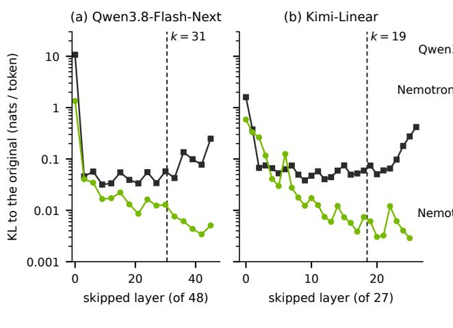

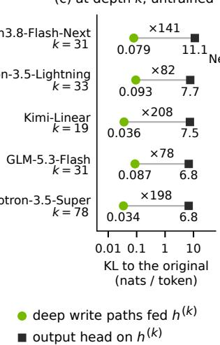

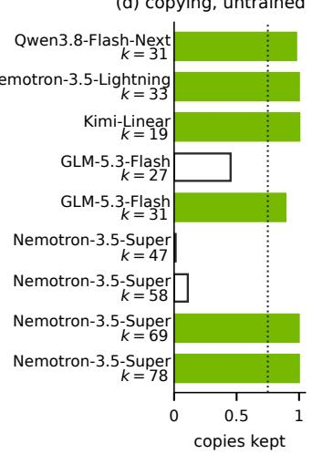  
Figure 2 | Writes are easier than reads in the hybrids we serve. (a, b) Per-token KL from the original model’s next-token distribution when one layer is skipped only for the prompt tokens, its memory still written (green), or only for the generated tokens (black); the deepest layers matter most for the generated tokens because they produce the next-token distribution. Dashed: the anchor depth. (c) KL at the anchor depth without training: the deep layers’ write paths fed $h ^ { ( k ) }$ (green) against an untrained early exit, the output head applied to $h ^ { ( \breve { k } ) }$ (black), with the ratio of the two KLs. (d) The risk is retrieval: identifiers copied by the untrained shallow prefill, as a share of the original model’s; hollow: below three quarters. Protocols: Appendix A.

Shallow prefill. A prefill runs every layer for every prompt token but uses only the last token’s output. For the other tokens, the deep layers’ only lasting result is the deep memories: the keys and values that each deep attention layer caches and the update that each deep recurrent layer folds into its state. SEED keeps these memories and replaces the rest of the deep computation. The first � − 1 prompt tokens run layers 0..�−1, up to the anchor layer, and skip the full computation of layers �..�−1, whose memories emitters write from the anchor layer’s output $h ^ { ( k ) }$ ; the criteria of Section 3.1 set the anchor depth � per model. The last prompt token and every generated token run all � layers: the last prompt token reads the emitted memories, writes its own with the original layers and gives the distribution of the first reply token.

Every deep memory is a function of a shallow residual stream. Layer ℓ writes the memory of token � from the residual stream $h _ { t } ^ { ( \ell ) }$ that enters it. An attention layer projects this input to a key and a value. A linear-attention layer projects it to a key, a value, a write strength and a decay, convolves the key and value over the last few tokens, and folds them into its state. Through the attention and feed-forward blocks of layers $k . . \ell - 1 , h _ { 1 . . T } ^ { ( \ell ) }$ is a function of the residual stream $h _ { 1 . . T } ^ { ( k ) }$ at any earlier depth �:

$$
\mathrm { m e m } _ { \ell } ( h _ { 1 . . T } ^ { ( \ell ) } ) = \mathrm { m e m } _ { \ell } \big ( f _ { k  \ell } ( h _ { 1 . . T } ^ { ( k ) } ) \big ) .\tag{3}
$$

The anchor layer’s output thus determines every deeper memory. The question is how much of $f _ { k \to \ell }$ a write needs.

Emitters. A write needs very little of $f _ { k \to \ell } .$ An emitter for layer ℓ is an architectural copy of the layer’s write path: its read of the residual stream (on Qwen3.8-Flash-Next and GLM-5.3-Flash, the input-dependent weights that mix the four streams into the layer’s input), its normalization and its key and value projections, plus a sparse-attention layer’s indexer key and a linear-attention layer’s write-strength and decay projections, short convolution and scan. The emitter starts from the layer’s own weights but reads $h ^ { ( k ) }$ of the same tokens instead of $h ^ { ( \ell ) }$ , or its reconstruction $\hat { h } ^ { ( k ) }$ when a prompt code is used.

The untrained gap. Without training, the emitters form the untrained shallow prefill: POP’s training-free fill (He et al., 2026) extended to recurrent layers, and our baseline. Its increase in next-token cross-entropy is the untrained gap: 0.074 nats per token on Qwen3.8-Flash-Next at � = 31, and 0.031–0.075 across the five models at the anchor depths we use. Its KL is 0.03–0.09 nats per token on all five models, against 6.8–11.1 for the early exit at the same depth (Figure 2c; Appendix A). This contrast is the write–read asymmetry. We then train the emitters together with the prompt code against the frozen model (§5.2).

The asymmetry, layer by layer. Skipping one layer’s output for the prompt tokens, while still writing its memory from the residual stream that enters it, costs less than skipping it for the generated tokens (Figure 2a, b; Figure 9 in Appendix A). In KL, this holds in all 16 sampled layers of Qwen3.8-Flash-Next, 16 of 17 sampled layers of Nemotron-3.5-Lightning, 18 of 22 of Nemotron-3.5-Super and 23 of the 26 layers of Kimi-Linear below its last; in next-token loss, it holds in 34 of the 35 layers of the transformer Qwen3-8B-Base (Yang et al., 2025a) below its last (Figure 10). (Skipping the last layer for the prompt tokens changes no memory.) On these models, all exceptions lie in the first quarter of the layers. On GLM-5.3-Flash, the asymmetry holds in all 7 sampled layers from layer 24 of 45 on, including every sampled layer above its anchor depth, and reverses below, where SEED keeps the original layers. At and above the first emitted layer, the generated-token skip costs 5.6–49 times as much as the prompt-token skip on Qwen3.8-Flash-Next, 5.5–38 on Nemotron-3.5-Lightning, 5.4–96 on Kimi-Linear, 6.5–14 on Nemotron-3.5-Super and 11–19 on GLM-5.3-Flash.

Why writes are easier than reads. We attribute the asymmetry to the two roles of a deep layer. At a prompt token, only its write matters, and a skipped layer still writes its own memory, so the skip reaches the reply only through the inputs of later layers’ writes. At a generated token, the deep layers must also produce the next-token distribution, a read that needs the attention and feed-forward blocks of every deep layer. In free-running generation, an error there also feeds back through the sampled tokens, whereas prompt tokens are given. Both reasons confine the shortcut to the prefill. They also explain the two curves of Figure 2a, b in the deepest layers: the generated-token skip rises again because these layers produce the next-token distribution, while the prompt-token skip keeps falling because at a prompt token their output is never read.

The writes need not be exact. Beyond the first emitted layer, whose write path reads $h ^ { ( k ) }$ itself, the released emitters’ attention caches difer from the original model’s by 2–79% relative squared error per layer and tensor, and their recurrent states, pooled over each layer’s heads, by 20–52% on average over the emitted layers (Tables 6 and 14). Yet the six released sets stay within a KL of 0.004–0.032 nats per token of the original model with exact states, and 0.006–0.039 with the states compressed every � steps, as served (above a second run of the original model; Table 6). The later layers tolerate inexact memories, so the emitters are trained mainly on the output KL rather than on a memory-reconstruction loss (§5.2).

The prompt code. Since $h ^ { ( k ) }$ determines every deep memory, one vector per token sufices to restore a prompt’s deep memories for a prefix cache or a transfer between nodes. The prompt code is a compact, lossy encoding of this vector for storage; a running request keeps the emitted caches and states, which its decode steps read. On Qwen3.8-Flash-Next, $\bar { h ^ { ( 3 1 ) } }$ holds 10,240 numbers per token, about twice the bf16 keys and values of its five attention layers above the anchor layer. SEED codes the ofset $\Delta = h ^ { ( k ) } - h ^ { ( 0 ) }$ from the token’s input embedding $h ^ { ( 0 ) }$ , which is looked up from the token id. With an encoder �, a decoder � and the mean ofset $\mu ,$ the code keeps � coordinates $z = E ( \Delta - \mu )$ in NVFP4, plus the exact bf16 values, at gap-coded one-byte indices, of the � largest entries of the remainder $\Delta - \mu - D z$ . These entries are outliers, and a fixed rank-� code could capture each only by spending one of its directions on it (Appendix A.1). The emitters do not need the code, but every set with a code reads the decoded $\hat { h } ^ { ( k ) } , h ^ { ( 0 ) } + \mu + \hat { D } z$ plus the exact values, in training and in every exam, so its exams score the memories that a stored code would restore.

How large the code must be. Copy fidelity, not the spectrum of the ofset, sets the code’s rank. Closed-form codes, the untrained principal-component codes that initialize training, of rank 4,096 and 6,144 fail on Qwen3.8-Flash-Next to copy identifiers that the shallow prefill without a code (uncoded) copies, although rank 4,096 holds 0.853 of the ofset’s variance (Table 7, Appendix A.1). Both Qwen3.8-Flash-Next sets store $r = 8 1 9 2$ coordinates plus $m = 2 5 6$ exact values, 5.4 KB per token. The deep cache, the attention cache of the layers above the anchor layer, takes 10.6 KB in bf16 and about as much as the code in fp8. With $m = 1 2 8$ exact values each, Nemotron-3.5-Lightning’s code keeps $r = 2 { , } 0 4 8$ coordinates of a residual stream of 2,688 numbers, Nemotron-3.5-Super’s $r = 5 1 2$ of 4,096, and Kimi-Linear’s all $r = 2 { , } 3 0 4$ . The code is trained end to end with the emitters, which learn to read it: on all 5 sets with a code, feeding the released emitters the exact residual stream instead of $\hat { h } ^ { ( k ) }$ raises their KL by at least 13% (Table 6).

Where a code does not pay. GLM-5.3-Flash’s residual stream is 16,384 numbers wide, while its four sparse attention layers at and above $k = 3 1$ cache only 4,228 bytes per token. No probed closed-form code within the bytes of its bf16 deep cache copies identifiers: the best copies at most 2 of 600, where the uncoded shallow prefill copies 530. GLM-5.3-Flash therefore runs without a code, and its emitters read the exact $h ^ { ( 3 \bar { 1 } ) }$

## 3.1. Choosing the Settings

One set of criteria and thresholds fixes the anchor depth, the prompt code and the state rank of every set. It uses only inexpensive measurements of the original model, its untrained shallow prefill and closed-form codes; no exam score enters (exact statements and reasons: Appendix A.1). The main measurement is the untrained gap gap(�) on 48 held-out 4K windows with 256 teacher-forced continuation tokens; it falls towards the deep layers (Figure 11, Appendix A). Each criterion guards against one failure:

• Depth. � is the shallowest anchor depth whose (i) first emitted layer (index �) is a softmaxattention layer; (ii) untrained gap is at most 0.075 nats per token, three quarters of a budget of 0.1 nats for the untrained shallow prefill and shallow state together; and (iii) untrained shallow prefill copies at least three quarters of the identifiers that the original model copies on a copy probe, which hides one record with a universally unique identifier (UUID) in 4K–16K tokens of web text (Appendix A.1). Copying needs its own criterion: an identifier is copied only if all its tokens are, so a per-token average loss hardly registers a failed copy.

• Code. The code keeps the full ofset if that takes no more bytes than even the fp8 deep cache. Otherwise, it uses the smallest closed-form rank that takes no more bytes than the bf16 deep cache, which a stored code replaces, and shows no significant copy loss against the uncoded shallow prefill (exact McNemar test, $p < 0 . 1 0 )$ ; failing that, there is no code. It keeps $m = 2 5 6$ exact values on models whose chat-template tokens reconstruct worse than their other tokens, and $m = 1 2 8$ otherwise.

• State. The state drift is the per-token KL between the original model with exact states and with shallow states: the prompt-final state compressed once, then again every $W = R$ steps. Both runs are teacher-forced on the original model’s own replies to 48 held-out prompts, and the KL is averaged over decode steps 961–1,024. The state rank $R \in \{ 8 , 1 6 , 3 2 \}$ is the smallest whose state drift is at most a quarter of gap(�), else $R = 3 2 ;$ the compression period is $W = R$

Table 7 (Appendix A.1) lists the measurements and resulting settings. The copy criterion is binding on GLM-5.3-Flash: at depth $2 7$ its untrained gap is small (0.045), but its untrained shallow prefill copies only 269 of the original model’s 595 identifiers, so its anchor depth is 31, where it copies 530. Kimi-Linear gets $R = 3 2$ because its gap is small (0.031), not because its states compress worse.

## 4. Shallow in Representation: The State Sink

Pooled over heads, most of the energy of a hybrid model’s recurrent states lies in one rank-one term per head, along a fixed direction that does not depend on the prompt: the state sink. The rest, the content, is a low-rank working memory. The sink forms because the values share a common component that the linear recurrence accumulates; after the head’s normalization, it acts as a bias and a gain, while what the head has read about the prompt lies mainly in the content. SEED keeps every layer in the decode (§3), so its decode saving must come from how the memories are represented, and this structure supplies it. We analyse it on all $3 6 \times 4 8 = 1 , 7 2 8$ Gated DeltaNet heads of Qwen3.8-Flash-Next, at the end of six held-out web prompts of 3,584 tokens, and score one-time interventions on these states by the loss on the next 512 tokens.

One direction carries the state. Let $s _ { \star } u _ { \star } v _ { \star } ^ { \top }$ be the top term of the singular value decomposition (SVD) of a head’s state $S _ { T }$ . It carries a median 85% of $\| S _ { T } \| _ { F } ^ { 2 }$ , the second term about 5%, and the median share of the top term lies between 71% and 99.8% in every layer (Figure 13, Appendix C). Its output-side vector $v _ { \star }$ is nearly the same across unrelated prompts (median | cos | 0.92), on a shufled prompt (0.90) and on random token ids (0.87; Figure 13c). The attention sink of softmax layers also forms regardless of the tokens’ meaning and on random tokens (Xiao et al., 2024; Gu et al., 2025), but it is a position in the sequence, often the initial tokens, whereas the state sink is a direction of the state.

The direction is the state’s component along the mean value. Once the keys, decays and write strengths are fixed, the recurrence (2) is linear in the values, so splitting each value along a fixed direction splits the state in the same way.

Lemma 1 (sink decomposition). Let $S _ { t } = \Phi _ { t } S _ { t - 1 } + \beta _ { t } \kappa _ { t } v _ { t } ^ { \top }$ with any $d _ { k } \times d _ { k }$ matrices $\Phi _ { t } ~ ( i n { \bf \Omega } ( 2 )$ 2 $\Phi _ { t } = g _ { t } ( I - \beta _ { t } \kappa _ { t } \kappa _ { t } ^ { \top } ) )$ . Fix $\bar { v } \neq 0$ and split each value and the state along it:

$$
v _ { t } = \omega _ { t } \bar { v } + \varepsilon _ { t } w i t h \varepsilon _ { t } ^ { \top } \bar { v } = 0 , \qquad a _ { t } = \frac { S _ { t } \bar { v } } { \| \bar { v } \| ^ { 2 } } , \qquad C _ { t } = S _ { t } - a _ { t } \bar { v } ^ { \top } ,
$$

so that $C _ { t } \bar { v } = 0$ . Then the sink coeficient $a _ { t }$ and the content $C _ { t }$ each follow the head’s own recurrence,

$$
\begin{array} { r } { a _ { t } = \Phi _ { t } a _ { t - 1 } + \beta _ { t } \omega _ { t } \kappa _ { t } , \qquad C _ { t } = \Phi _ { t } C _ { t - 1 } + \beta _ { t } \kappa _ { t } \varepsilon _ { t } ^ { \top } , } \end{array}\tag{4}
$$

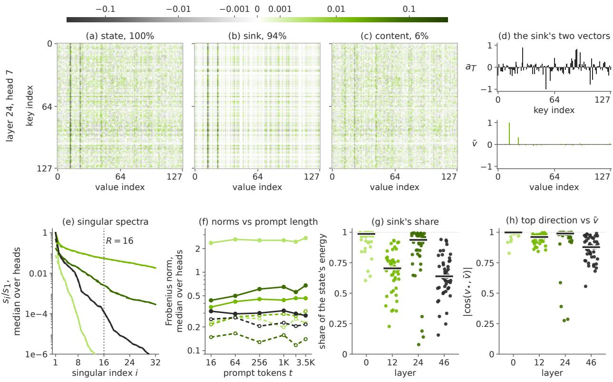  
layer 0 layer 12 layer 24 layer 46 state (e), sink (f) content (e, f)  
Figure 3 | A rank-one sink along the head’s mean value holds most of a recurrent state’s energy, and the content left over lies in few directions (Qwen3.8-Flash-Next; the first 3,584 tokens of one of the six held-out web prompts of Appendix C). (a) The 128 × 128 state of head 7 of layer 24, a middle head of the layer by the sink’s share of the state’s energy. (b) Its sink $a _ { T } \bar { v } ^ { \top }$ , the state’s projection on the head’s mean value �¯ (estimated on other text). (c) The content $S _ { T } - a _ { T } \bar { v } ^ { \top }$ . Titles: shares of $\| S _ { T } \| _ { F } ^ { 2 }$ , which add to one. (a)–(c) share one colour scale, log $( 1 + | x | / 1 0 ^ { - 3 } )$ in the magnitude, nothing clipped. (d) � and �¯, each divided by its largest magnitude. (e) Singular spectra of the state (solid) and the content (dashed), divided by the head’s top singular value; per-index medians over the layer’s 48 heads. Dotted: the rank SEED keeps. (f) Frobenius norms of the sink (solid) and the content (dashed) against the prompt length; medians over heads. (g) The sink’s share of the state’s energy and (h) | cos | between �⋆ and �¯, per head; bars: layer medians.

and their energies add: for every $z \in \mathbb { R } ^ { d _ { k } }$ 2

$$
\lVert S _ { t } - z \bar { \boldsymbol { v } } ^ { \top } \rVert _ { F } ^ { 2 } = \lVert \boldsymbol { a } _ { t } - z \rVert ^ { 2 } \lVert \bar { \boldsymbol { v } } \rVert ^ { 2 } + \lVert C _ { t } \rVert _ { F } ^ { 2 } .
$$

In particular, $a _ { t } \bar { v } ^ { \top }$ is the matrix of the form $z { \bar { v } } ^ { \top }$ closest to $S _ { t }$

The identity holds for any direction. We fix �¯ as the head’s mean value over generic text, independent of the prompt, because that direction carries most of the state (as measured below). We call the projection $a _ { T } \bar { v } ^ { \top }$ the state sink and $C _ { T }$ the content. The sink’s coeficient $a _ { T }$ follows the head’s own recurrence, driven by $\omega _ { t }$ , the values’ component along their mean, which averages one over generic text by construction. The component ���¯ carries 60–99% of the values’ energy, $\mathbb { E } \Vert \omega _ { t } \bar { v } \Vert ^ { 2 } / \mathbb { E } \Vert v _ { t } \Vert ^ { 2 }$ (layer medians; 64–94% from layer 8 on). If every value equals �¯ and $S _ { 0 } = 0$ , then $\omega _ { t } = 1 , C _ { T } = 0$ and $\begin{array} { r } { a _ { T } = \sum _ { t } \Phi _ { T } \cdot \cdot \cdot \Phi _ { t + 1 } \beta _ { t } \kappa _ { t } } \end{array}$ depends on the keys, decays and write strengths alone; Zhuang et al. (2026) derive this case for one repeated key with constant decay and write strength.

The measurements match the decomposition. Over heads, the state’s top singular term has a median (Frobenius) cosine similarity of 0.95 with the sink, and $u _ { \star }$ a median | cos | of 1.00 with $a _ { T }$ (Figure 3 shows one prompt). The sink holds a median 75% of the state’s energy, and more than half in the median head of every layer (53–98%). In the four layers of Figure 3f, the median norms of the sink and the content each stay within 17% of their mean from 256 prompt tokens on, and the sink is the larger in every one. The content lies in few directions: a median of 6 hold 90% of its energy and 17 hold 99%, close to the rank � = 16 that SEED keeps on Qwen3.8-Flash-Next. Because the content is the state projected of one direction, $\begin{array} { r } { C _ { T } = S _ { T } ( I - \hat { v } \hat { v } ^ { \top } ) } \end{array}$ with $\hat { v } = \bar { v } / \| \bar { v } \|$ , its spectrum interlaces the state’s, $s _ { i + 1 } ( S _ { T } ) \leq s _ { i } ( C _ { T } ) \leq s _ { i } ( S _ { T } )$ (Figure 3e). Low efective ranks have been reported for such states (Nazari & Rusch, 2026), and in Qwen3-Next for one of two groups of heads, while the other approaches the rank bound (Sun et al., 2026).

The other models. The Mamba-2 heads of Nemotron-3.5-Lightning decompose in the same way along the head’s mean input. Over all 23 × 64 heads on six held-out prompts of 3,584 tokens, the sink holds a median 64% of a head’s energy, and the content reaches 90% of its energy in a median of one direction and 99% in four. The Kimi Delta Attention heads of Kimi-Linear and GLM-5.3-Flash decay each key channel at its own rate, and their values lie less along their mean: 16% and 13% of their energy in the median head, against 81% on Qwen3.8-Flash-Next. In the median head, their sink holds 34% and 24% of the energy, but it concentrates in the heads that hold the most energy and so holds 82% and 86% of the state energy pooled over all heads. Over the five models, the sinks hold 69–99.7% of the pooled state energy (Appendix C gives every model’s median and pooled shares). The content of Kimi-Linear and GLM-5.3-Flash is as low-rank as on Qwen3.8-Flash-Next: pooled over heads and layers by energy, rank 16 leaves 0.065 and 0.057 of it (Qwen3.8-Flash-Next: 0.063), and rank 32, the rank they keep (§3.1), leaves 0.019 and 0.015 (Appendix A.1).

After normalization, the sink is a bias and a gain. Every gated-delta head normalizes its read-out before gating it. Write the read-out as $o _ { t } = b _ { t } + r _ { t }$ , with the sink’s part $b _ { t } = ( q _ { t } ^ { \top } a _ { t } )$ �¯ and the content’s part $r _ { t } = C _ { t } ^ { \top } q _ { t }$ . As $r _ { t } \perp \bar { v } .$ , a unit-gain RMSNorm without its stabilizing constant returns $\sqrt { { d _ { v } } } ( b _ { t } + r _ { t } ) / ( \| b _ { t } \| ^ { 2 } + \| r _ { t } \| ^ { 2 } ) ^ { 1 / 2 }$ . The sink’s part thus sets a fixed output direction, up to the sign of $q _ { t } ^ { \top } a _ { t } .$ , and through the normalizer scales the content, as the sink logit does in a softmax denominator. When $\left\| \boldsymbol { b } _ { t } \right\| \gg \left\| \boldsymbol { r } _ { t } \right\|$ , the normalized read-out is $\sqrt { d _ { v } }$ times this direction plus the content scaled by $\sqrt { d _ { v } } / \| b _ { t } \|$ , up to an error of at most $\| r _ { t } \| ^ { 2 } / ( 2 \| b _ { t } \| ^ { 2 } )$ relative to its norm $\sqrt { d _ { v } }$ (Appendix B, Eq. (9)). In most heads the sink’s part is the larger: over the scored tokens, the ratio of the mean norms of $b _ { t }$ and $r _ { t }$ has a median of 2.3 over the heads and exceeds one in 82% of them.

The sink holds the energy, the content holds the prompt. Eviction shows that both parts are needed but that the sink’s dependence on the prompt matters little (Appendix C). Removing the sink while keeping the content costs +0.073 nats per token, and keeping only the sink +0.067. Replacing each head’s sink by its mean over the other prompts costs only +0.002, and taking it from a prompt of random tokens +0.017. The sink’s coeficient depends on the prompt, but what the head has read about the prompt lies mainly in the content.

The content is a short working memory. The content matters more than these evictions suggest. They act once, on the state at the end of the prefill (before the last prompt token, as in SEED), after which the last prompt token and the 512 scored tokens update it exactly. When the state is instead compressed after every teacher-forced continuation token, keeping only the sink costs +1.66 nats per token over a base of 1.76 (Appendix C). The content is dominated by recent writes.

From $\begin{array} { r } { S _ { 0 } = 0 , C _ { T } = \sum _ { t } \Phi _ { T } \cdot \cdot \cdot \Phi _ { t + 1 } \beta _ { t } \kappa _ { t } \varepsilon _ { t } ^ { \top } } \end{array}$ is a sum of rank-one writes, each damped by the decays applied after it, so its � most recent writes approximate it within $\begin{array} { r } { \sum _ { t \leq T - r } \big ( \prod _ { u = t + 1 } ^ { T } g _ { u } \big ) \beta _ { t } \Vert \varepsilon _ { t } \Vert } \end{array}$ . This is small in heads whose typical decays are well below one. On Qwen3.8-Flash-Next, with each head’s mean decay, the time scale 1/(1 − mean decay) is about 17 tokens in the median head, at most ten tokens in 41% of the heads, and above 100 tokens in 28%. The error bounds of §5.1 use instead the head’s decay horizon $1 / ( 1 - \bar { g } )$ , set by its largest decay �¯, a worst case.

What this means for SEED. The sink plus a rank-8 content costs +0.023 nats per token, against +0.025 for a plain rank-8 truncation, whose top term lies close to the sink. Keeping the sink apart also gives the stored form its structure: its direction is shared by all requests, it is never truncated, and it keeps the content orthogonal to �¯. SEED thus stores a head’s state, a bias and gain plus a low-rank working memory, as the sink plus rank-� factors (§5.1).

## 5. SEED

SEED follows from the two findings. Every deep memory is a function of a shallow residual stream (§3), so the prefill runs only layers 0..�−1 on all but the last prompt token and emitters write the deeper memories. The recurrent states hold most of their energy, pooled over heads, in a sink along a fixed direction of each head, and the rest, the content, is low-rank (§4), so the decode keeps the sink exactly and the content at low rank. Section 5.1 gives the exact update of this factored state and the bound on its only approximation; Section 5.2 trains the emitters and the prompt code against the frozen model. Each model has four settings (Table 7, Appendix A.1): the anchor depth �, the prompt code (� coded coordinates plus � exact values; GLM-5.3-Flash has none), the state rank � and the compression period �.

## 5.1. The Shallow State

In the decode, where bytes are the bottleneck, SEED keeps each recurrent state as its sink plus a rank-� content, $S = a \bar { v } ^ { \top } + U V ^ { \top }$ . The mean value $\bar { v } \in \mathbb R ^ { d _ { v } }$ is a per-head constant of the component set, shared by all requests. The factors $a \in \mathbb { R } ^ { d _ { k } } , U \in \mathbb { R } ^ { d _ { k } \times R }$ and $V \in \mathbb { R } ^ { d _ { v } \times R }$ belong to the request, and the columns of $V$ are orthogonal to �¯.

An exact update. Each step of the update (2) splits its value as in Lemma 1, $\omega = v ^ { \top } \bar { v } / \| \bar { v } \| ^ { 2 }$ and $\varepsilon = v - \omega \bar { v }$ . It gives the part along �¯ to the sink’s coeficient and appends the rest as one new content column:

$$
\begin{array} { r l } & { a ^ { + } = g a + \beta \left( \omega - g \kappa ^ { \top } a \right) \kappa , } \\ & { U ^ { + } = \big [ g U , \kappa \big ] , \qquad V ^ { + } = \big [ V , \beta \left( \varepsilon - g V U ^ { \top } \kappa \right) \big ] . } \end{array}\tag{5}
$$

The scalar $\omega - g \kappa ^ { \top } a$ and the vector $\varepsilon - g V U ^ { \top } \kappa$ are the delta rule’s own prediction error $v - g S ^ { \top } \kappa ,$ split along �¯ and orthogonal to it, so between compressions the factored update is exact. Since � and the columns of � are orthogonal to �¯, so is the appended column: the content never gains a component along �¯, so the split of Lemma 1 is invariant under the update and is never recomputed. Between compressions, the factors thus hold a rank-� summary and, much like a short attention cache, the most recent writes (keys in $U ,$ delta-rule corrections in �). The same exact update holds for Mamba-2, with the sink along the head’s mean input, and for the per-channel decay of Kimi-Linear and GLM-5.3-Flash (Lemma 2).

Read-out and bytes. At � steps after the last compression $( 1 \leq w \leq W ;$ a step reads after its update), the read-out $o = \left( q ^ { \top } a \right) \bar { v } + V ( U ^ { \top } q )$ uses all $R + w$ content columns and costs $( d _ { k } + d _ { v } ) ( R +$ � + 1) multiply-adds instead of $d _ { k } d _ { v } \colon 2 \cdot 1 2 8 ( R + w + 1 )$ instead of $1 2 8 ^ { 2 }$ on Qwen3.8-Flash-Next. The sink is its own term rather than one more factor column because �¯ is shared by all requests; it then costs $d _ { k }$ numbers per request instead of $d _ { k } + d _ { v } ,$ , and no compression spends a rank on it. A head holds $( R + 1 ) d _ { k } + R d _ { v }$ numbers right after a compression and $( R + W + 1 ) d _ { k } + ( R + W ) d _ { v }$ just before the next, against $d _ { k } d _ { v }$ for a dense head: 16.9 KB, 33.3 KB and 65.5 KB in fp32 on Qwen3.8-Flash-Next (Table 2 gives the bytes per request).

Periodic compression and its bound. Every � steps, a warm-started subspace iteration truncates the (� + �)-column content back to rank �. This truncation is the shallow state’s only approximation. It leaves the sink untouched, and the content stays orthogonal to �¯ because the truncation only projects it within its own column or row space (Lemma 2). In the open loop, the compressed state ${ \tilde { S } } _ { t }$ and the exact recurrence $S _ { t }$ see the same keys, values, decays and write strengths. If every decay is at most $\bar { g } < 1$ and �¯ is the largest Frobenius norm of a single compression error, then for every step � (Corollary 4, Appendix B)

$$
\Vert \tilde { S } _ { t } - S _ { t } \Vert _ { F } \leq \frac { \bar { \epsilon } } { 1 - \bar { g } ^ { W } } \leq \frac { \bar { \epsilon } } { 1 - \bar { g } } .
$$

Repeated compressions thus do not compound in the open loop: the error stays within one compression error times the head’s decay horizon $1 / ( 1 - \bar { g } )$ , however many compressions occur. The bound also holds with �¯ replaced by the largest mean decay over the $W$ steps between two compressions, and the sink coeficient stays exact. In the closed loop, a compression error also changes later keys and values; Section 6.1 follows this loop over 16K decode steps.

The rule of §3.1 gives $R = W = 1 6$ on both Qwen3.8-Flash-Next sets, Nemotron-3.5-Lightning and Nemotron-3.5-Super and $R = W = 3 2$ on Kimi-Linear and GLM-5.3-Flash (Table 7). The shallow state also composes with 16-bit storage of the factors (§6.1).

Serving. SEED runs in SGLang (Zheng et al., 2024) as two opt-in settings, one per part, so an operator enables either or both per workload. With shallow prefill, the first � − 1 prompt tokens run layers 0..�−1 and the emitters, and the last prompt token runs all � layers. The state left by the first � − 1 prompt tokens is compressed once, and �� runs as the first decode step. In disaggregated serving, a prefill node ships only the sink coeficients and the factors of each recurrent state to the decode node. Each request counts its own steps from the end of its prefill, and the compressions due in a step are batched over all heads of those requests.

The engine’s recurrent-state pool holds each Qwen3.8-Flash-Next state as its sink coeficient and factors; for Nemotron-3.5-Lightning, Nemotron-3.5-Super, Kimi-Linear and GLM-5.3-Flash, the exam engines keep the state dense between compressions and factor it at each compression, which gives the same state in exact arithmetic (Lemma 2).

## 5.2. Training

One recipe trains every component set against the frozen model, which stays the only teacher. We train all new parameters jointly: the emitters and the prompt code’s encoder � and decoder $D ,$ 0.11B–0.71B exported parameters per set (Table 10). The main objective is the KL divergence to the frozen checkpoint’s next-token distribution (Figure 4; Appendix D lists the auxiliary terms). The emitters start as copies of the frozen layers’ write paths, � and � as the top principal directions of the ofset’s covariance, and $\mu$ is the mean ofset, a fixed bufer.

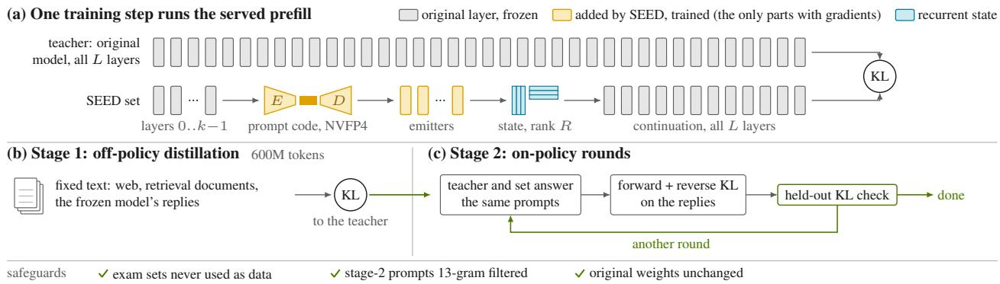  
Figure 4 | One recipe trains every component set. Only SEED’s components are trained, with the frozen model as the only teacher, in a forward pass that runs the prefill as served. Stage 1 distils on fixed text; stage 2 is on-policy, on the replies of the teacher and of the current set to the same prompts. Per-model terms: Appendix D.

The served prefill in every training step. The training forward pass runs the prefill as inference does: the prompt code passes through its storage quantizer (straight-through (Bengio et al., 2013); the exact values are selected without gradient), and every prompt-final state, the state left by the first � − 1 prompt tokens, is compressed at the decode rank (on GLM-5.3-Flash, every emitted layer’s). Every component thus learns to write memories that survive their stored form. Training departs from inference only in truncating by an exact eigendecomposition instead of a subspace iteration and in running the continuation without the periodic compression (Appendix D).

Two stages. Stage 1 distils the frozen model in 4K and 16K windows of public text (Penedo et al., 2024; Ben Allal et al., 2025), public reasoning and chat corpora, synthetic retrieval documents and the frozen model’s own responses to public prompts; part of the windows are aligned to the start of an answer (Table 12 gives every set’s data). Stage 2 runs on-policy rounds in which the frozen model and the current set answer public prompts. The forward KL applies to the frozen model’s answers, and both the forward and the reverse KL to the set’s own answers; the reverse KL penalizes the set for tokens that it writes and the frozen model would not (Agarwal et al., 2024; Gu et al., 2024; Ko et al., 2025). Stage 2 runs one or two rounds; after each, we measure the held-out KL and the divergence of the set’s own replies (Appendix D). Every model releases its stage-2 set except Nemotron-3.5-Super, whose stage-1 set is released.

Model-specific terms. Nemotron-3.5-Lightning, GLM-5.3-Flash and Nemotron-3.5-Super add a term that aligns the emitted prompt-final states with the frozen model’s. Without it, the emitted states of Nemotron-3.5-Lightning and GLM-5.3-Flash are the furthest from the frozen model’s as the layers read them (Table 14, Appendix D); Nemotron-3.5-Super follows Nemotron-3.5-Lightning’s recipe. GLM-5.3-Flash adds a second term for the indexer keys that its emitters write.

Convergence and cost. On every set (Figure 5), at least 89% of stage 1’s reduction of the held-out KL happens within its first 150M tokens, a quarter of the stage; afterwards the KL changes slowly. Stage 2 changes the teacher-forced KL on held-out web windows by less than 0.0006 nats per token: it acts on the set’s own on-policy replies, which a teacher-forced KL does not see (Appendix D). Training is a one-time cost per checkpoint and changes no original weight. For the bf16 Qwen3.8-Flash-Next set, stage 1 takes 160 minutes on 16 nodes of four GPUs, and stage 2 another 111 minutes plus the time to serve its generations (Table 13). Appendix D gives the settings,

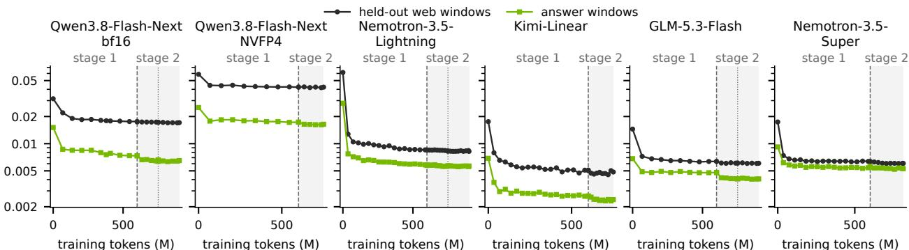  
Figure 5 | Every set converges the same way: most of the KL reduction comes early in stage 1. Teacher-forced KL to the frozen model on held-out web and answer windows against training tokens (dashed: start of stage 2; dotted: start of a further round).

the data and the costs (Table 13).

## 6. Accuracy

SEED is nearly lossless on every model. On eleven oficial exams, 63 of the 66 checkpoint–exam cells of the six component sets lie within two standard errors of the original model or above it (Table 3, Figure 6a). Its shallow state keeps the next-token distributions closer to the original model’s than NVIDIA’s oficial NVFP4 checkpoints do (Figure 6b), and over 16K decode steps its drift grows far more slowly than the number of compressions.

Protocol. Each component set and its original model answer the same questions with the same per-request sampling seeds (on MMLU, all but at most 0.4% of samples). Table 3 gives the results, and Table 16 (Appendix E) adds the stage-1 sets that we examined. Both arms are served by SGLang with their recurrent states in fp32. The throughput measurements of Section 7 use the same component sets and state precision.

Exams. Every exam runs with lm-eval (Biderman et al., 2024) 0.4.13 and its oficial grader, with each vendor’s recommended sampling configuration; GPQA-Diamond and MMLU use the prompt and answer extraction of OpenAI simple-evals (OpenAI, 2024), and GPQA-Diamond also its option permutation. The eleven exams (Mathematical Association of America, 2025; Rein et al., 2024; Hendrycks et al., 2021a;b; Lightman et al., 2024; Zhou et al., 2023; Jain et al., 2025; Chen et al., 2021; Liu et al., 2023; Bai et al., 2025; Hsieh et al., 2024) are GPQA-Diamond, MMLU, AIME 2024+25, MATH-500, IFEval, LiveCodeBench v6 (problems from August 2024 to April 2025), HumanEval+, LongBench v2, and RULER at 32K, 64K and 128K.

Repetitions and selection. Every exam runs eight repetitions except LongBench v2 (four), MMLU (one) and each RULER length (one; RULER is greedy), always the first � repetitions. No sample is dropped, and no repetition was rerun because of its outcome. Where a model had several candidate sets, the choice between them rested on repetitions 0–3. On the thirty cells of GPQA-Diamond, AIME, MATH-500, IFEval and LiveCodeBench of all six sets, repetitions 4–7, on which no choice rested, agree with the eight-repetition values within about one of their standard errors.

Table 3 | SEED matches the original model’s scores across the eleven exams: 63 of the 66 cells lie within two standard errors of the original model or above it. Each component set (on Nemotron-3.5-Super, its stage-1 set; §5.2) is paired with its original model on the same questions and per-request seeds. Rows: original score, the set’s score and their paired diference (mean ± standard error over questions). Eight repetitions per exam except LongBench v2 (four), MMLU and RULER (one each).
<table><tr><td colspan="10"></td><td colspan="3">RULER</td></tr><tr><td>Diamond</td><td>GPQA</td><td>AIME 2024+25 MATH-500</td><td></td><td>MMLU</td><td>IFEval</td><td colspan="2">LiveCode Bench v6 HumanEval+</td><td colspan="2">LongBench v2</td><td>32K</td><td>64K</td><td>128K</td></tr><tr><td colspan="10"></td><td></td><td></td><td></td></tr><tr><td colspan="10">Qwen3.8-Flash-Next (bf16)</td></tr><tr><td>original</td><td>91.9</td><td>99.4</td><td>99.3</td><td>92.5</td><td>91.7</td><td>88.5</td><td>93.9</td><td>64.3</td><td>93.2</td><td>94.2</td><td>95.5</td></tr><tr><td>SEED</td><td>91.5</td><td>98.8</td><td>98.8</td><td>92.6</td><td>91.1</td><td>88.9</td><td>94.8</td><td>65.3</td><td>96.4</td><td>95.5</td><td>95.0</td></tr><tr><td colspan="10">difference −0.3±0.4 −0.6±0.5</td></tr><tr><td></td><td></td><td></td><td>−0.5±0.1 +0.1±0.1 −0.6±0.3 +0.4±0.4</td><td></td><td></td><td></td><td></td><td></td><td></td><td></td><td></td></tr><tr><td>Qwen3.8-Flash-Next-NVFP4 original</td><td>92.4</td><td>99.6</td><td>99.2</td><td>92.3</td><td>91.6</td><td>88.9</td><td>94.4</td><td>65.3</td><td>94.7</td><td>94.9</td><td>95.3</td></tr><tr><td>SEED</td><td>91.2</td><td>99.6</td><td>98.9</td><td>92.5</td><td>91.5</td><td>88.8</td><td>94.6</td><td>64.6</td><td>96.1</td><td>95.4</td><td>94.6</td></tr><tr><td>difference -1.1±0.5</td><td></td><td>0.0±0.4</td><td>−0.3±0.2 +0.2±0.2 −0.1±0.3 −0.1±0.4</td><td></td><td></td><td></td><td>+0.2±0.4</td><td>−0.7±0.9 +1.4±0.5 +0.5±0.5 −0.7±0.4</td><td></td><td></td><td></td></tr><tr><td colspan="10">Nemotron-3.5-Lightning</td></tr><tr><td></td><td></td><td></td><td></td><td></td><td></td><td></td><td></td><td></td><td>96.5</td><td>96.4</td><td>95.9</td></tr><tr><td>original SEED</td><td>76.3</td><td>89.6</td><td>98.2 98.3</td><td>88.1 88.0</td><td>91.5 92.0</td><td>78.2 77.6</td><td>91.9 92.0</td><td>47.1 45.7</td><td>96.4</td><td>96.0</td><td>95.6</td></tr><tr><td>difference -1.3±1.0</td><td>75.0</td><td>88.8 −0.8±1.1</td><td></td><td>+0.1±0.2 −0.2±0.2 +0.4±0.4 −0.6±0.6</td><td></td><td></td><td>+0.1±0.6</td><td>−1.4±1.1</td><td></td><td></td><td>0.0±0.2 −0.3±0.2 −0.3±0.3</td></tr><tr><td colspan="10"></td></tr><tr><td>Kimi-Linear</td><td></td><td></td><td></td><td></td><td></td><td></td><td></td><td></td><td></td><td></td><td></td></tr><tr><td>original SEED</td><td>67.6</td><td>67.5</td><td>93.2</td><td>77.7</td><td>73.2</td><td>44.3</td><td>78.7</td><td>34.7</td><td>95.0</td><td>94.0</td><td>94.5 94.1</td></tr><tr><td>difference +0.4±1.4 −0.6±2.5</td><td>68.0</td><td>66.9</td><td>92.4</td><td>78.3</td><td>71.7</td><td>43.4 −0.8±0.5 +0.6±0.4 −1.5±0.6 −0.9±0.8</td><td>78.3 −0.4±0.8</td><td>34.6 −0.1±1.1</td><td>95.0</td><td>93.9</td><td>0.0±0.1 −0.1±0.2 −0.4±0.2</td></tr><tr><td colspan="10"></td></tr><tr><td>GLM-5.3-Flash</td><td></td><td></td><td></td><td></td><td></td><td></td><td></td><td></td><td></td><td></td><td></td></tr><tr><td>original SEED</td><td>91.3</td><td>96.0</td><td>98.7 98.6</td><td>93.0 92.8</td><td>89.9 90.7</td><td>87.8 88.2</td><td>94.8 94.7</td><td>63.2 64.1</td><td>96.7 96.5</td><td>96.3 96.5</td><td>96.4 96.1</td></tr><tr><td>difference −0.2±0.5 +2.1±1.3</td><td>91.1</td><td>98.1</td><td></td><td></td><td></td><td>−0.1±0.2 −0.1±0.1 +0.8±0.4 +0.4±0.4</td><td>−0.2±0.3</td><td>+0.8±0.8 −0.2±0.1 +0.2±0.2 −0.3±0.2</td><td></td><td></td><td></td></tr><tr><td colspan="10">Nemotron-3.5-Super</td></tr><tr><td></td><td></td><td></td><td></td><td></td><td></td><td></td><td></td><td></td><td></td><td></td><td></td></tr><tr><td>original SEED</td><td>89.1</td><td>98.5 98.5</td><td>99.4 99.4</td><td>92.1 92.1</td><td>91.7 92.1</td><td>86.3 86.3</td><td>95.0 95.5</td><td>59.3 58.1</td><td>96.8 96.7</td><td>94.9 94.8</td><td>96.0 95.9</td></tr><tr><td>difference +1.0±0.6</td><td>90.1</td><td>0.0±0.7</td><td>−0.1±0.1</td><td>0.0±0.1 +0.5±0.4</td><td></td><td>0.0±0.4</td><td>+0.5±0.4</td><td>−1.2±0.8</td><td></td><td>0.0±0.2 −0.1±0.2 −0.1±0.2</td><td></td></tr></table>

Scores and answers. Across the six sets, on unrounded values, 63 of the 66 checkpoint–exam cells (Figure 6a) lie within two standard errors of the original model or above it; Appendix E analyses every cell at least one standard error below. Equal scores can hide answer flips (Dutta et al., 2024), but SEED flips answers about as often as a second sample of the original model does, and its replies are not longer (Appendix E).

## 6.1. How Close the Next-Token Distributions Are

The shallow state stays closer to the original model’s next-token distributions than NVIDIA’s oficial NVFP4 checkpoints do. Exam scores are coarse, so we compare the distributions directly. The decode drift is the KL divergence from the original model’s next-token distribution, teacher-forced on the original model’s own replies to held-out prompts (48 replies in math, science and code; 1,024 decode steps), measured above the noise floor of a second run of the original model; the perplexity change is the change in perplexity of the same replies (Appendix C; on GLM-5.3-Flash, 24 replies and 256 steps, above its full-rank factored path). The drift is the primary measure, as it sees every token’s full distribution; the perplexity change, given for the exam-tested form and the NVFP4 checkpoints, expresses it in the standard unit of language-model quality. The exams and every drift measurement keep the recurrent states in fp32 except where a lower precision is the variable. Table 4 gives every storage form at its better rounding; bf16 appears only in Table 9, since fp16 matches or beats it on every model.

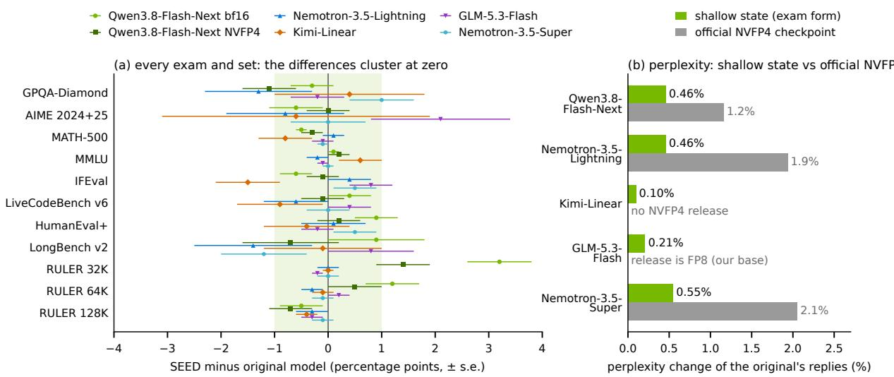  
Figure 6 | SEED matches the original model’s scores on every model, and its shallow state moves the next-token distribution less than an oficial NVFP4 checkpoint does. (a) The 66 paired diferences of Table 3 (± one standard error; shaded: ±1 point). (b) The perplexity of the original model’s own replies changes by less than 0.6% under the shallow state of the exams, less than under NVIDIA’s oficial NVFP4 checkpoints (Table 4; GLM-5.3-Flash above its full-rank factored path).

Table 4 | The shallow state stays closer to the original model than the oficial NVFP4 checkpoints do, and it composes with 16-bit storage. Top: decode drift (§6.1) in nats per token; grey: stored state size as a share of the original fp32 state (shallow state: right after a compression). �: stochastic rounding (Table 9 gives both roundings). Bottom: change in the perplexity of the same replies. –: no NVFP4 release (Kimi-Linear) or an FP8 release, the checkpoint we use (GLM-5.3-Flash).
<table><tr><td></td><td>Qwen3.8- Flash-Next</td><td colspan="2">Nemotron-3.5- Lightning</td><td colspan="2">Kimi- Linear</td><td colspan="2">GLM-5.3- Flash</td><td colspan="2">Nemotron-3.5- Super</td></tr><tr><td>original model, dense state</td><td></td><td></td><td></td><td></td><td></td><td></td><td></td><td></td><td></td></tr><tr><td>fp32 (exams)</td><td>0100%</td><td></td><td>0100%</td><td></td><td>0100%</td><td></td><td>0100%</td><td></td><td>0100%</td></tr><tr><td>fp16</td><td>0.000650%</td><td></td><td>0.0004⁸50%</td><td></td><td>0.0002 50%</td><td></td><td>0.000650%</td><td></td><td>0.0002⁸ 50%</td></tr><tr><td>fp8</td><td>0.0073⁸25%</td><td></td><td>0.048725%</td><td>0.0048825%</td><td></td><td>0.0055⁸ 25%</td><td></td><td></td><td>0.074525%</td></tr><tr><td>SEED, shallow state</td><td></td><td></td><td></td><td></td><td></td><td></td><td></td><td></td><td></td></tr><tr><td>fp32 (exams)</td><td>0.005626%</td><td></td><td>0.0060 39%</td><td></td><td>0.001751%</td><td></td><td>0.002751%</td><td></td><td>0.007039%</td></tr><tr><td>fp16</td><td>0.0056 13%</td><td></td><td>0.0059s 20%</td><td>0.0016⁸</td><td>25%</td><td></td><td>0.002125%</td><td></td><td>0.0069 20%</td></tr><tr><td>fp8</td><td>0.0067</td><td>6%</td><td>0.0136 10%</td><td>0.0023</td><td>13%</td><td></td><td>0.003013%</td><td></td><td>0.016010%</td></tr><tr><td>official NVFP4 checkpoint</td><td>0.0105</td><td></td><td>0.0209</td><td></td><td></td><td></td><td></td><td></td><td>0.0190</td></tr><tr><td colspan="8">perplexity of the original model&#x27;s replies, change</td><td></td></tr><tr><td>SEED, fp32 (exams)</td><td>+0.46%</td><td></td><td>+0.46%</td><td></td><td>+0.10%</td><td></td><td>+0.21%</td><td></td><td>+0.55%</td></tr><tr><td>official NVFP4 checkpoint</td><td>+1.16%</td><td></td><td>+1.94%</td><td></td><td></td><td></td><td></td><td></td><td>+2.05%</td></tr></table>

The shallow state alone. In fp32, as in the exams, the shallow state drifts 0.002–0.007 nats per token on the five models and changes the perplexity of the original model’s replies by less than 0.6% (here with the exact prefill; §3 measures the shallow prefill). NVIDIA’s oficial NVFP4 checkpoints of Qwen3.8-Flash-Next, Nemotron-3.5-Lightning and Nemotron-3.5-Super, whose four-bit weights are an accepted serving choice, drift 1.9–3.5 times as much (0.0105 nats per token on Qwen3.8-Flash-Next) and raise the perplexity of the same replies by 1.2–2.1%.

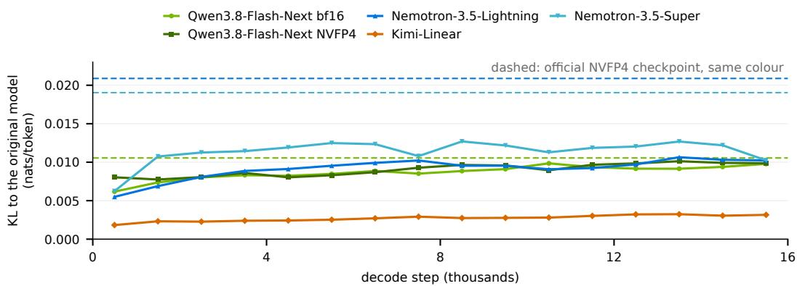  
Figure 7 | The shallow state’s drift grows far more slowly than its number of compressions. Decode drift of the released state form (fp32) per 1,024 decode steps of long replies of the original model (24 replies on both Qwen3.8-Flash-Next sets and Kimi-Linear, 16 on Nemotron-3.5-Lightning, 12 on Nemotron-3.5-Super; � = � = 16, 32 on Kimi-Linear); dashed: the oficial NVFP4 checkpoint of the same model over its first 1,024 steps (Table 4).

Lower precision composes. fp16 factors leave the drift within 0.0006 nats per token of fp32 factors on all five models, so right after a compression the shallow state saves a further 2.0–3.9× on top of a 16-bit state (the newest columns stay in fp32 between compressions). Right after a compression, fp16 factors are about as small as a dense fp8 state or smaller and drift less than it on all five models.

Below 16 bits, a dense state must be requantized to fp8 after every token, and on the Mamba-2 models its drift rises to as much as 0.075 nats per token at its better rounding. fp8 factors, quantized only at each compression, drift 1.8–4.7× less on Nemotron-3.5-Lightning, Kimi-Linear, GLM-5.3-Flash and Nemotron-3.5-Super and about as much on Qwen3.8-Flash-Next, at 2.0–3.9× fewer bytes right after a compression.

Closed-loop drift over long decodes. Corollary 4 bounds the error of the open loop, in which the compressed and the exact recurrence see the same inputs; in the closed loop of autoregressive decoding, a compression error also changes later keys and values. We therefore follow the released state form, with fp32 states as in the exams, on both Qwen3.8-Flash-Next sets, Kimi-Linear, Nemotron-3.5-Lightning and Nemotron-3.5-Super over 16K decode steps of long replies, 512–1,024 compressions (Figure 7). The drift rises over the first few thousand steps and then grows slowly: from the first to the last 4K steps it grows by 1.2–1.4× while the number of compressions grows 4×. After 16K steps it is still below the drift of the oficial NVFP4 checkpoints over their first 1,024 steps, on all three models that have one.

## 7. Serving Performance

SEED’s two parts relieve diferent serving bottlenecks, and together they raise the peak throughput per GPU of served Qwen3.8-Flash-Next to 1.16–1.42× the original model’s (Figure 8, Table 5). Shallow prefill lowers the prefill’s FLOPs. Shallow states shrink the recurrent state, which sets every decode step’s state trafic and caps the batch.

Where the savings come from. On Qwen3.8-Flash-Next, shallow prefill runs 31 of the 48 layers plus the emitters on every prompt token but the last (33 of 52 on Nemotron-3.5-Lightning, 19 of

27 on Kimi-Linear, 31 of 45 on GLM-5.3-Flash and 78 of 88 on Nemotron-3.5-Super). This lowers the parameter FLOPs per prompt token of Qwen3.8-Flash-Next from 12.1 to 9.1 GFLOP. For the skipped layers, it also removes the prefill-side reads of their weights and attention caches.

Right after a compression, shallow states reduce the recurrent state of one request from 113.2 to 29.2 MB on Qwen3.8-Flash-Next, from 48.2 to 18.8 MB on Nemotron-3.5-Lightning, from 41.9 to 21.3 MB on Kimi-Linear, from 142.6 to 72.4 MB on GLM-5.3-Flash and from 167.8 to 65.5 MB on Nemotron-3.5-Super. Across the five models, the state is 2.0–3.9× smaller right after a compression and 1.3–2.6× on average (Table 2). A state is read and written at every decode step. In the byte account, a smaller state therefore lowers the per-step state trafic and raises the number of requests that fit in a byte budget. Attention caches remain uncompressed. On these mixture-of-experts checkpoints, the weights dominate a decode step’s bytes up to batches of several hundred requests (Appendix F). The smaller state therefore helps mainly through capacity. Appendix F gives the byte and FLOP account from the checkpoints’ tensor shapes.

Setup. Qwen3.8-Flash-Next is served with SGLang on GB300 GPUs. Aggregated serving uses one instance for both phases: NVFP4 on one GPU (tensor parallelism 1, TP1) or bf16 on two (TP2). Disaggregated bf16 serving uses one two-GPU instance per phase (1P:1D), with 16K-token prefill chunks. Every comparison is paired with the original model on the same hardware. The served component sets are the released Qwen3.8-Flash-Next sets of Section 6 (rank � = 16, code 8192+256, state compression every 16 steps). Both arms keep their recurrent states in fp32, the precision of the models’ reference implementations, the default of the serving engine and the precision of the exams; the byte ratio of the shallow and the dense state is the same at any common precision.

Workload and metrics. The throughput runs reuse cached prefixes. Each measurement uses the InferenceX (formerly InferenceMAX) (SemiAnalysis, 2026b) workload, an agentic-coding trace of recorded Claude Code sessions (cc-traces-weka-062126-256k (SemiAnalysis, 2026a)). The AIPerf client (NVIDIA, 2026a) replays it in agentic-replay mode for 900 seconds at a fixed concurrency, the number of active sessions. Throughput per GPU counts every output token and every prompt token, whether the prefix cache serves it or the prefill computes it, so a cache hit counts the same in both arms. The P90 end-to-end output rate per user, the rate that 90% of requests reach, is 1/P90(end-to-end latency/output tokens). It includes queueing and the time to first token (TTFT). Ratios at an equal per-user rate interpolate each configuration’s throughput linearly in this rate between adjacent concurrencies.

Prefix cache. In SGLang, a hybrid model’s prefix cache keeps a slot for every cached prefix in the same recurrent-state pool that the running requests use (Zheng et al., 2024; Pan et al., 2025). When the pool is full, cached slots are evicted, the prefix-cache hit rate falls and the evicted prefixes must be recomputed by the prefill. Smaller states leave room for more cached prefixes and more running requests.

Measurements. Each measurement in Figure 8 is a single 900-second run and includes SEED’s own work: the emitters in the prefill and the state compressions in the decode. Up to 16 sessions, where the configurations serve alike, their throughputs agree within 1.3%. At each concurrency, SEED’s curve takes the best of its three measured configurations (shallow states only, shallow prefill only, both) by throughput; in the prefix-cache panels (c, g, k) it takes the highest prefix-cache hit, and in the TTFT panels (d, h, l) the Pareto frontier of all three, the measurements that no other measurement beats in both quantities. This curve lies within 1.1% of both parts together wherever those were measured; the ratios in the text and in Table 5 are those of both parts together. The rate panels (a, e, i) draw every measurement with a P90 per-user rate of at least 10 tokens/s, in order of concurrency; the middle columns draw every measurement up to 48 sessions in aggregated and 64 in disaggregated serving.

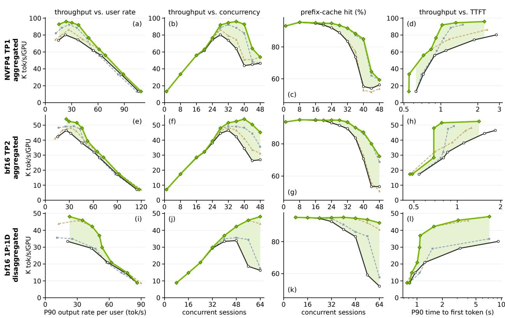  
Figure 8 | SEED reaches 1.16–1.42× the original model’s peak throughput per GPU, at 8 to 16 more sessions. Served Qwen3.8-Flash-Next with fp32 recurrent states. Rows: aggregated NVFP4 TP1 (a–d), aggregated bf16 TP2 (e–h), disaggregated bf16 1P:1D (i–l). Columns: throughput per GPU against the P90 output rate per user; throughput and prefix-cache hit against concurrency; throughput against the P90 time to first token (Pareto frontiers). Charcoal: the original model; dashed: shallow states alone and shallow prefill alone; green: SEED, the best of its three configurations at each concurrency (§7); shaded: its gain.

Throughput. Peak to peak, SEED with both parts reaches 1.20× the original model’s throughput per GPU on NVFP4 TP1, 1.16× on bf16 TP2 and 1.42× on 1P:1D. At an equal per-user rate of 40 tokens/s (25 ms per output token, end to end), it delivers 1.23×, 1.26× and 1.42× the original model’s throughput (Table 5). Over per-user rates of 25 to 50 tokens/s, inside the measured range of both arms in all three deployments, the ratio is 1.16–1.26× in aggregated serving and 1.24–1.49× in 1P:1D. In aggregated serving, the two peaks come at similar per-user rates: 23.7 tokens/s for SEED and 22.8 for the original model on NVFP4 TP1, and 26.2 and 26.1 on bf16 TP2. In 1P:1D, SEED’s peak comes at a far higher per-user rate: 22.8 tokens/s, compared with 9.0 for the original model. Beyond the original model’s peak, the gap widens, because its fp32 states fill the state pool in aggregated serving and its prefill instance saturates in 1P:1D. At 40, 44 and 64 sessions, the original model’s P90 per-user rate has fallen below 4 tokens/s, and SEED serves 2.1×, 1.9× and 3.0× the original model’s throughput.

Table 5 | SEED raises the peak throughput per GPU of served Qwen3.8-Flash-Next in every deployment (Figure 8). Peak: each configuration’s highest throughput over its measured concurrencies (tokens/s/GPU), its concurrency and its ratio to the original model’s peak. At �⋆: the throughput ratio at SEED’s peak concurrency (36, 40 and 64 sessions), where the original model is past its own peak (P90 per-user rate 6.8, 6.7 and 1.2 tokens/s). At 40 tok/s: the throughput ratio at an equal P90 per-user rate of 40 tokens/s.
<table><tr><td rowspan="2">Configuration</td><td colspan="3">peak</td><td rowspan="2">at  $C ^ { \star }$ </td><td rowspan="2">at 40 tok/s ratio</td></tr><tr><td>sessions</td><td>tok/s/GPU</td><td>ratio ratio</td></tr><tr><td>aggregated, NVFP4 TP1</td><td></td><td></td><td></td><td></td><td></td></tr><tr><td>original</td><td>28</td><td>80,219</td><td></td><td></td><td></td></tr><tr><td>shallow states</td><td>32</td><td>92,343</td><td>1.15×</td><td>1.38×</td><td>1.16×</td></tr><tr><td>shallow prefill</td><td>28</td><td>86,385</td><td>1.08×</td><td>1.17×</td><td>1.06×</td></tr><tr><td>SEED (both)</td><td>36</td><td>95,989</td><td>1.20×</td><td>1.50×</td><td>1.23×</td></tr><tr><td>aggregated, bf16 TP2</td><td></td><td></td><td></td><td></td><td></td></tr><tr><td>original</td><td>32</td><td>46,492</td><td></td><td></td><td></td></tr><tr><td>shallow states</td><td>32</td><td>49,235</td><td>1.06×</td><td>1.40×</td><td>1.18×</td></tr><tr><td>shallow prefill</td><td>32</td><td>48,301</td><td>1.04×</td><td>1.20×</td><td>1.11×</td></tr><tr><td>SEED (both)</td><td>40</td><td>54,047</td><td>1.16×</td><td>1.57×</td><td>1.26×</td></tr><tr><td>1P:1D, bf16</td><td></td><td></td><td></td><td></td><td></td></tr><tr><td>original</td><td>48</td><td>33,906</td><td></td><td></td><td></td></tr><tr><td>shallow states</td><td>48</td><td>35,638</td><td>1.05×</td><td>1.08×</td><td>1.04×</td></tr><tr><td>shallow prefill</td><td>56</td><td>45,853</td><td>1.35×</td><td>2.71×</td><td>1.45×</td></tr><tr><td>SEED (both)</td><td>64</td><td>48,141</td><td>1.42×</td><td>2.96×</td><td>1.42×</td></tr></table>

Aggregated serving. On GPUs shared by both phases, shallow prefill reduces computation, while shallow states raise request capacity. In aggregated NVFP4 TP1 serving, SEED peaks at 36 sessions, where the original model is past its own peak and serves 6.8 tokens/s per user at P90. At this concurrency, the original model falls to 63.9K tokens/s/GPU, while SEED holds 96.0K. Relative to the original model at the same concurrency, shallow prefill alone raises throughput by 17%, shallow states alone by 38% and both together by 50% (Table 5). At 40 sessions, the original model’s prefix-cache hit rate has fallen to 55% and its throughput to 43.8K, while SEED keeps 85% and 92.8K. At an equal per-user rate of 40 tokens/s, SEED delivers 1.23× the original model’s throughput (89.0K versus 72.3K tokens/s/GPU).

In aggregated bf16 TP2 serving, the original model’s throughput collapses once its fp32 states fill the state pool: from 46.5K tokens/s/GPU at 32 sessions to 26.3K at 44. There, its prefix-cache hit rate has fallen to 53%; SEED’s is 80%. SEED peaks at 54.0K at 40 sessions, 1.57× the original model’s 34.4K at that concurrency. At an equal per-user rate of 40 tokens/s, it delivers 1.26× the original model’s throughput (51.2K versus 40.7K).

Disaggregated serving. In bf16 1P:1D serving, the prefill instance is the bottleneck, and shallow prefill relieves it. Peak throughput rises from 33.9K tokens/s/GPU for the original model to 45.9K with shallow prefill alone and 48.1K with SEED, that is, 1.35× and 1.42× the original peak. Shallow states alone add 5% (35.6K; Table 5). At equal per-user rates of 25 to 40 tokens/s, SEED delivers 1.42–1.49× the original model’s throughput. At 64 sessions, where the prefill instance is the bottleneck, SEED’s smaller states keep more prefixes cached than shallow prefill alone does: its prefix-cache hit rate is 91.7%, compared with 87.5%. This adds 9% (Figure 8j), and SEED serves 2.96× the throughput of the original model, whose hit rate has fallen to 52.2%. The end-to-end gains come with a lower TTFT, which includes queueing, and a higher prefix-cache hit rate (Figure 8).

Low load. At low load, the ofered load of the replayed trace largely sets the throughput. In aggregated serving, SEED stays within 2% of the original model’s throughput up to 20 sessions and exceeds it by more than 2% from 24 sessions on. Up to 20 sessions, SEED’s P90 output rate per user is 2–3% above the original model’s on bf16 TP2. On NVFP4 TP1, where shallow prefill shortens the time to first token, it lies between −2% and +9% of the original model’s.

## 8. Related Work

Shallow prefill and layer skipping. YOCO (Sun et al., 2024b) and the causal encoder–decoder of DeepSeek-V4.1-Flash (DeepSeek-AI et al., 2026) build a shallow prompt stack into new architectures trained from scratch. For trained transformers, SwiftKV (Qiao et al., 2025) computes the deep keys and values from an earlier layer’s output after fine-tuning the deep projections, POP (He et al., 2026) fills the skipped layers’ caches with their original projections of the last kept residual, SPEED (Oh et al., 2026) fine-tunes the model to decode without the upper layers’ prompt caches, and KV Prediction (Horton et al., 2024) predicts the caches with a small auxiliary model. ADEPT (Yoo et al., 2026) and CALM (Schuster et al., 2022) exit early per token and fill the skipped layers’ keys and values; KV-Direct (Qasim et al., 2026) recomputes them from a checkpointed residual. For a hybrid model, Puzzle-75B (Bercovich et al., 2026) prefills with a narrower jointly trained variant that writes the attention caches and the Mamba-2 states. Unlike the new architectures, SEED finds the depth asymmetry in trained models; unlike the methods for transformers, it also writes recurrent states, where an inexact write persists for every later token; and unlike SwiftKV, SPEED and Puzzle-75B, it changes no checkpoint weight. Depth pruning and conversion with distillation (Muralidharan et al., 2024; Bercovich et al., 2025; Wang et al., 2024) change the network for every token, and prompt compression (Mu et al., 2023; Ge et al., 2024; Jiang et al., 2023) shortens the prompt itself; SEED keeps every layer and every token in the decode.

Cache and state compression. Disaggregated serving ships a prompt’s memories between machines (Zhong et al., 2024; Patel et al., 2024; Qin et al., 2025); cache systems page, stream, store and merge them (Kwon et al., 2023; Zheng et al., 2024; Liu et al., 2024a; 2025; Yao et al., 2025), and Marconi (Pan et al., 2025) brings prefix caching to hybrid models. KV-cache compression (Liu et al., 2024b; Hooper et al., 2024; Li et al., 2024; Zhang et al., 2023) shrinks the output of a full prefill. SEED keeps every attention cache at full precision, so all of these apply to its caches unchanged. For recurrent layers, KVBufer (Zou & Zhong, 2026), DeltaLog (Lin et al., 2026) and ReplaySSM (Liou et al., 2026) keep the recent writes or layer inputs next to a dense state and fold them in periodically, which cuts the per-step trafic at unchanged outputs but not the state that a request holds; SEED keeps the recent writes next to a rank-� summary and the sink, so the state itself shrinks. Nazari & Rusch (2026) analyse the rank of trained linear-attention states and prune their key and query projections, Sun et al. (2026) find both low-rank and high-rank heads in Qwen3-Next, DASC (Yu et al., 2026) keeps the long-horizon heads and channels of stored prefix states, and GHOST (Menezes & Kyrillidis, 2026) prunes Mamba-2 state dimensions. SEED keeps every head and factors the active state at run time, around a sink that the update preserves exactly.

Sinks. Xiao et al. (2024) identified the attention sink, Gu et al. (2025) traced it in part to the softmax normalization, Sun et al. (2024a) linked it to massive activations, Qiu et al. (2026a) unify attention and residual sinks, and Qiu et al. (2025) remove it with a gate in their models. The state sink is its counterpart in recurrent layers: a direction of the state rather than a position in the sequence, which through the head’s normalization scales the content as a sink logit does through a softmax denominator. Zhuang et al. (2026) call the steady state of a repeated key in gated delta networks a semantic state sink and mitigate it; Lemma 1 contains this case. Meng et al. (2024) build a sink into a state-space model, and Jiang & Zhang (2026) use the name “state sink” for a Δ gate that fires on boundary tokens. Wagh & Singh (2026) find that the final states of a frozen Mamba-130M point in nearly the same direction for unrelated sentences.

## 9. Limitations and Conclusion

Limitations. SEED compresses no attention cache. On hybrids whose memory at long context is dominated by their few attention layers, the shallow state’s share of the saving shrinks; there SEED composes with KV-cache quantization, eviction and ofloading, which act on exactly the memories it leaves untouched. The anchor depth is set per checkpoint from untrained probes rather than learned, and lands at 63–89% of the depth on the five models; how shallow a residual stream can determine every deep memory, as a function of architecture and training, is open. The open-loop bound is a worst case set by a head’s largest decay, and the measured closed-loop drift grows far more slowly than it allows (§6.1); a closed-loop theory of repeated compression would explain why. Our serving gains are measured on mixture-of-experts checkpoints, whose weights dominate a decode step’s bytes up to batches of several hundred requests, so the smaller state pays of mainly through capacity (Appendix F); dense (non-mixture-of-experts) hybrids, with smaller weights, would also see the per-step trafic saving. Three steps follow directly: serving the shallow state in fp16, which keeps its drift (§6.1) and halves its bytes again; a prefix cache that stores a prompt’s code in place of its deep caches, up to 22% fewer bytes at bf16 caches (Table 18); and training beyond 16K-token windows with the periodic compression in the loop.

Conclusion. Two properties of trained hybrids locate the compute and HBM that serving them spends beyond what the output requires. Writes are easier than reads, so a prompt’s deep memories can be emitted from a shallow anchor layer. A recurrent state is a sink plus a short working memory, a form that the model’s own update preserves exactly. SEED turns both into a serving method for frozen checkpoints: it matches the original model’s scores on six checkpoints of five production models and raises the throughput per GPU of Qwen3.8-Flash-Next 1.2–1.4× on an agentic-coding trace. Neither property was designed into these models; both emerge from training, which leaves a hybrid’s memories far simpler than the computation and storage that serve them.

## References

Agarwal, R., Vieillard, N., Zhou, Y., Stanczyk, P., Ramos, S., Geist, M., and Bachem, O. On-policy distillation of language models: Learning from self-generated mistakes. In International Conference on Learning Representations (ICLR), 2024.

Ahmad, W. U., Narenthiran, S., Majumdar, S., Ficek, A., Jain, S., Huang, J., Noroozi, V., and Ginsburg, B. OpenCodeReasoning: Advancing data distillation for competitive coding. In Conference on Language Modeling (COLM), 2025. arXiv:2504.01943.

Bai, Y., Tu, S., Zhang, J., Peng, H., Wang, X., Lv, X., Cao, S., Xu, J., Hou, L., Dong, Y., Tang, J., and Li, J. LongBench v2: Towards deeper understanding and reasoning on realistic long-context multitasks. In Proceedings of the 63rd Annual Meeting of the Association for Computational Linguistics (Volume 1: Long Papers), pp. 3639–3664, 2025. arXiv:2412.15204.

Ben Allal, L., Lozhkov, A., Bakouch, E., Martín Blázquez, G., Penedo, G., Tunstall, L., Marafioti, A., Piqueres Lajarín, A., Kydlíček, H., Srivastav, V., et al. SmolLM2: When smol goes big –

data-centric training of a fully open small language model. In Conference on Language Modeling (COLM), 2025. arXiv:2502.02737.

Bengio, Y., Léonard, N., and Courville, A. Estimating or propagating gradients through stochastic neurons for conditional computation. arXiv preprint arXiv:1308.3432, 2013.

Bercovich, A., Ronen, T., Abramovich, T., Ailon, N., Assaf, N., Dabbah, M., Galil, I., Geifman, A., Geifman, Y., Golan, I., et al. Puzzle: Distillation-based NAS for inference-optimized LLMs. In International Conference on Machine Learning (ICML), 2025. arXiv:2411.19146.

Bercovich, A., Abramovich, T., Afrimi, D., Aharon, S., Ailon, N., Anisimov, V., Argov, O. U., Ashkenazi, M., Asida, T., Assaf, N., et al. Nemotron-Labs-3-Puzzle-75B-A9B: Compressing hybrid MoE LLMs. arXiv preprint arXiv:2607.04371, 2026.

Biderman, S., Schoelkopf, H., Sutawika, L., Gao, L., Tow, J., Abbasi, B., Aji, A. F., Ammanamanchi, P. S., Black, S., Clive, J., et al. Lessons from the trenches on reproducible evaluation of language models. arXiv preprint arXiv:2405.14782, 2024.

Chen, M., Tworek, J., Jun, H., Yuan, Q., Ponde de Oliveira Pinto, H., Kaplan, J., Edwards, H., Burda, Y., Joseph, N., Brockman, G., et al. Evaluating large language models trained on code. arXiv preprint arXiv:2107.03374, 2021.

Clark, P., Cowhey, I., Etzioni, O., Khot, T., Sabharwal, A., Schoenick, C., and Tafjord, O. Think you have solved question answering? Try ARC, the AI2 reasoning challenge. arXiv preprint arXiv:1803.05457, 2018.

Cobbe, K., Kosaraju, V., Bavarian, M., Chen, M., Jun, H., Kaiser, L., Plappert, M., Tworek, J., Hilton, J., Nakano, R., Hesse, C., and Schulman, J. Training verifiers to solve math word problems. arXiv preprint arXiv:2110.14168, 2021.

Dao, T. and Gu, A. Transformers are SSMs: Generalized models and eficient algorithms through structured state space duality. In International Conference on Machine Learning (ICML), 2024.

DeepSeek-AI, Liu, A., Feng, B., Wang, B., Wang, B., Liu, B., Zhao, C., Deng, C., Ruan, C., Dai, D., et al. DeepSeek-V2: A strong, economical, and eficient mixture-of-experts language model. arXiv preprint arXiv:2405.04434, 2024.

DeepSeek-AI, Liu, A., Mei, A., Lin, B., Xue, B., Wang, B., Xu, B., Wu, B., Zhang, B., Lin, C., et al. DeepSeek-V3.2: Pushing the frontier of open large language models. arXiv preprint arXiv:2512.02556, 2025.

DeepSeek-AI, Xu, A., Li, B., Lin, B., Xue, B., Xian, B., Xu, B., Wu, B., Zhang, B., Deng, B., et al. DeepSeek-V4.1-Flash: Pushing the limits of KV cache compression. Technical report, DeepSeek, 2026. arXiv:2609.19969.

Dutta, A., Krishnan, S., Kwatra, N., and Ramjee, R. Accuracy is not all you need. In Advances in Neural Information Processing Systems (NeurIPS), 2024. arXiv:2407.09141.

Elhage, N., Nanda, N., Olsson, C., Henighan, T., Joseph, N., Mann, B., Askell, A., Bai, Y., Chen, A., Conerly, T., et al. A mathematical framework for transformer circuits. Transformer Circuits Thread, 2021. URL https://transformer-circuits.pub/2021/framework/index.html.

Ge, T., Hu, J., Wang, L., Wang, X., Chen, S.-Q., and Wei, F. In-context autoencoder for context compression in a large language model. In International Conference on Learning Representations (ICLR), 2024. arXiv:2307.06945.

GLM-5-Team, Zeng, A., Lv, X., Hou, Z., Du, Z., Zheng, Q., Chen, B., Yin, D., Ge, C., Huang, C., et al. GLM-5: From vibe coding to agentic engineering. arXiv preprint arXiv:2602.15763, 2026.

Gu, X., Pang, T., Du, C., Liu, Q., Zhang, F., Du, C., Wang, Y., and Lin, M. When attention sink emerges in language models: An empirical view. In International Conference on Learning Representations (ICLR), 2025. arXiv:2410.10781.

Gu, Y., Dong, L., Wei, F., and Huang, M. MiniLLM: Knowledge distillation of large language models. In International Conference on Learning Representations (ICLR), 2024.

Guha, E., Marten, R., Keh, S., Raoof, N., Smyrnis, G., Bansal, H., Nezhurina, M., Mercat, J., Vu, T., Sprague, Z., et al. OpenThoughts: Data recipes for reasoning models. In International Conference on Learning Representations (ICLR), 2026. arXiv:2506.04178.

He, J., Fu, Z., Wang, J., and Li, Q. POP: Prefill-only pruning for eficient large model inference. In Findings of the Association for Computational Linguistics: ACL 2026, pp. 5864–5877, 2026.

Hendrycks, D., Burns, C., Basart, S., Zou, A., Mazeika, M., Song, D., and Steinhardt, J. Measuring massive multitask language understanding. In International Conference on Learning Representations (ICLR), 2021a.

Hendrycks, D., Burns, C., Kadavath, S., Arora, A., Basart, S., Tang, E., Song, D., and Steinhardt, J. Measuring mathematical problem solving with the MATH dataset. In Proceedings of the Neural Information Processing Systems Track on Datasets and Benchmarks, 2021b. arXiv:2103.03874.

Hooper, C., Kim, S., Mohammadzadeh, H., Mahoney, M. W., Shao, Y. S., Keutzer, K., and Gholami, A. KVQuant: Towards 10 million context length LLM inference with KV cache quantization. In Advances in Neural Information Processing Systems (NeurIPS), 2024. arXiv:2401.18079.

Horton, M., Cao, Q., Sun, C., Jin, Y., Mehta, S., Rastegari, M., and Nabi, M. KV prediction for improved time to first token. arXiv preprint arXiv:2410.08391, 2024.

Hsieh, C.-P., Sun, S., Kriman, S., Acharya, S., Rekesh, D., Jia, F., Zhang, Y., and Ginsburg, B. RULER: What’s the real context size of your long-context language models? In Conference on Language Modeling (COLM), 2024. arXiv:2404.06654.

Hugging Face. Open R1: A fully open reproduction of DeepSeek-R1. https://github.com/huggingface/open-r1, 2025.

Jain, N., Han, K., Gu, A., Li, W.-D., Yan, F., Zhang, T., Wang, S., Solar-Lezama, A., Sen, K., and Stoica, I. LiveCodeBench: Holistic and contamination free evaluation of large language models for code. In International Conference on Learning Representations (ICLR), 2025. arXiv:2403.07974.

Jiang, H., Wu, Q., Lin, C.-Y., Yang, Y., and Qiu, L. LLMLingua: Compressing prompts for accelerated inference of large language models. In Proceedings of the 2023 Conference on Empirical Methods in Natural Language Processing (EMNLP), 2023. arXiv:2310.05736.

Jiang, Y. and Zhang, B. A circuit, not the circuit: Non-unique causal localisation of the Mamba-2 state sink. arXiv preprint arXiv:2606.00930, 2026.

Kimi Team, Zhang, Y., Lin, Z., Yao, X., Hu, J., Meng, F., Liu, C., Men, X., Yang, S., Li, Z., et al. Kimi Linear: An expressive, eficient attention architecture. arXiv preprint arXiv:2510.26692, 2025.

Ko, J., Chen, T., Kim, S., Ding, T., Liang, L., Zharkov, I., and Yun, S.-Y. DistiLLM-2: A contrastive approach boosts the distillation of LLMs. In International Conference on Machine Learning (ICML), 2025.

Kwon, W., Li, Z., Zhuang, S., Sheng, Y., Zheng, L., Yu, C. H., Gonzalez, J. E., Zhang, H., and Stoica, I. Eficient memory management for large language model serving with PagedAttention. In ACM Symposium on Operating Systems Principles (SOSP), 2023.

Kydlíček, H. Math-Verify: Math verification library. https://github.com/huggingface/math-verify, 2025.

Lambert, N., Morrison, J., Pyatkin, V., Huang, S., Ivison, H., Brahman, F., Miranda, L. J. V., Liu, A., Dziri, N., Lyu, S., et al. Tülu 3: Pushing frontiers in open language model post-training. In Conference on Language Modeling (COLM), 2025. arXiv:2411.15124.

Li, Y., Huang, Y., Yang, B., Venkitesh, B., Locatelli, A., Ye, H., Cai, T., Lewis, P., and Chen, D. SnapKV: LLM knows what you are looking for before generation. In Advances in Neural Information Processing Systems (NeurIPS), 2024. arXiv:2404.14469.

Lightman, H., Kosaraju, V., Burda, Y., Edwards, H., Baker, B., Lee, T., Leike, J., Schulman, J., Sutskever, I., and Cobbe, K. Let’s verify step by step. In International Conference on Learning Representations (ICLR), 2024. arXiv:2305.20050.

Lin, J., Sun, J., and Sun, G. DeltaLog: Deferred materialization of recurrent states for linear attention decoding. arXiv preprint arXiv:2608.15533, 2026.

Liou, Z.-W., Nover, H., Naik, A., Skliar, A., Shovkun, I., Shahaf, I., and Dao, T. ReplaySSM: Cache SSM inputs, not state. arXiv preprint arXiv:2610.13778, 2026.

Liu, J., Xia, C. S., Wang, Y., and Zhang, L. Is your code generated by ChatGPT really correct? Rigorous evaluation of large language models for code generation. In Advances in Neural Information Processing Systems (NeurIPS), 2023.

Liu, Y., Li, H., Cheng, Y., Ray, S., Huang, Y., Zhang, Q., Du, K., Yao, J., Lu, S., Ananthanarayanan, G., et al. CacheGen: KV cache compression and streaming for fast large language model serving. In ACM SIGCOMM Conference (SIGCOMM), 2024a. arXiv:2310.07240.

Liu, Y., Cheng, Y., Yao, J., An, Y., Chen, X., Feng, S., Huang, Y., Shen, S., Zhang, R., Du, K., and Jiang, J. LMCache: An eficient KV cache layer for enterprise-scale LLM inference. arXiv preprint arXiv:2510.09665, 2025.

Liu, Z., Yuan, J., Jin, H., Zhong, S., Xu, Z., Braverman, V., Chen, B., and Hu, X. KIVI: A tuning-free asymmetric 2bit quantization for KV cache. In International Conference on Machine Learning (ICML), 2024b. arXiv:2402.02750.

Loshchilov, I. and Hutter, F. Decoupled weight decay regularization. In International Conference on Learning Representations (ICLR), 2019. arXiv:1711.05101.

Mathematical Association of America. AIME 2024 and 2025 problem sets. https://huggingface.co/datasets/HuggingFaceH4/aime\_2024, https://huggingface.co/datasets/math-ai/aime25, 2025.

McNemar, Q. Note on the sampling error of the diference between correlated proportions or percentages. Psychometrika, 12(2):153–157, 1947.

Menezes, M. and Kyrillidis, A. GHOST: Unmasking phantom states in Mamba2 via grouped hidden-state output-aware selection & truncation. In International Conference on Machine Learning (ICML), 2026. arXiv:2602.11408.

Meng, T., Tao, Y., and Yin, W. Enhanced structured state space models via grouped FIR filtering and attention sink mechanisms. arXiv preprint arXiv:2408.00244, 2024.

MiniMax, Li, A., Gong, B., Yang, B., Shan, B., Liu, C., Zhu, C., Zhang, C., Guo, C., Chen, D., et al. MiniMax-01: Scaling foundation models with lightning attention. arXiv preprint arXiv:2501.08313, 2025.

Moshkov, I., Hanley, D., Sorokin, I., Toshniwal, S., Henkel, C., Schiferer, B., Du, W., and Gitman, I. AIMO-2 winning solution: Building state-of-the-art mathematical reasoning models with OpenMathReasoning dataset. arXiv preprint arXiv:2504.16891, 2025.

Mu, J., Li, X. L., and Goodman, N. Learning to compress prompts with gist tokens. In Advances in Neural Information Processing Systems (NeurIPS), 2023. arXiv:2304.08467.

Muralidharan, S., Turuvekere Sreenivas, S., Joshi, R., Chochowski, M., Patwary, M., Shoeybi, M., Catanzaro, B., Kautz, J., and Molchanov, P. Compact language models via pruning and knowledge distillation. In Advances in Neural Information Processing Systems (NeurIPS), 2024. arXiv:2407.14679.

Nazari, P. and Rusch, T. K. On state reduction in linear attention, 2026. arXiv:2602.04852.

nostalgebraist. Interpreting GPT: The logit lens. LessWrong, https: //www.lesswrong.com/posts/AcKRB8wDpdaN6v6ru/interpreting-gpt-the-logit-lens, 2020.

NVIDIA. OpenScienceReasoning-2. Dataset card, https://huggingface.co/datasets/nvidia/OpenScienceReasoning-2, 2025.

NVIDIA. AIPerf. https://github.com/ai-dynamo/aiperf, 2026a.

NVIDIA. NVIDIA Nemotron 3.5 Super VL 120B-A12B. Model card, https://huggingface.co/nvidia/NVIDIA-Nemotron-3.5-Super-VL-120B-A12B-BF16, 2026b.

NVIDIA. NVIDIA Nemotron 3.5 Lightning 30B-A3B. Model card, https://huggingface.co/nvidia/NVIDIA-Nemotron-3.5-Lightning-30B-A3B-BF16, 2026c.

NVIDIA, Abecassis, F., Agrusa, A., Ahn, D., Alben, J., Alborghetti, S., Andersch, M., Arayandi, S., Bjorlin, A., Blakeman, A., et al. Pretraining large language models with NVFP4. arXiv preprint arXiv:2509.25149, 2025a.

NVIDIA, Blakeman, A., Basant, A., Khattar, A., Renduchintala, A., Bercovich, A., Ficek, A., Bjorlin, A., Taghibakhshi, A., Deshmukh, A. S., et al. Nemotron-H: A family of accurate and eficient hybrid Mamba-Transformer models. arXiv preprint arXiv:2504.03624, 2025b.

Oh, J., Jeon, H., Ji, H., Kong, K., and Lee, J.-Y. Shallow prefill, deep decoding: Eficient long-context inference via layer-asymmetric KV visibility. arXiv preprint arXiv:2605.06105, 2026.

OpenAI. simple-evals. https://github.com/openai/simple-evals, 2024.

Pan, R., Wang, Z., Jia, Z., Karakus, C., Zancato, L., Dao, T., Wang, Y., and Netravali, R. Marconi: Prefix caching for the era of hybrid LLMs. In Proceedings of Machine Learning and Systems (MLSys), 2025. arXiv:2411.19379.

Patel, P., Choukse, E., Zhang, C., Shah, A., Goiri, Í., Maleki, S., and Bianchini, R. Splitwise: Eficient generative LLM inference using phase splitting. In ACM/IEEE International Symposium on Computer Architecture (ISCA), pp. 118–132, 2024.

Penedo, G., Kydlíček, H., Ben Allal, L., Lozhkov, A., Mitchell, M., Rafel, C., von Werra, L., and Wolf, T. The FineWeb datasets: Decanting the web for the finest text data at scale. In Advances in Neural Information Processing Systems (NeurIPS) Datasets and Benchmarks, 2024.

Pyatkin, V., Malik, S., Graf, V., Ivison, H., Huang, S., Dasigi, P., Lambert, N., and Hajishirzi, H. Generalizing verifiable instruction following. In Advances in Neural Information Processing Systems (NeurIPS) Datasets and Benchmarks, 2025. arXiv:2507.02833.

Qasim, K. U., Zhang, J., Shaheen, M. K., Alharith, R., and Zhang, H. The residual stream is all you need: On the redundancy of the KV cache in transformer inference, 2026. arXiv:2603.19664.

Qiao, A., Yao, Z., Rajbhandari, S., and He, Y. SwiftKV: Fast prefill-optimized inference with knowledge-preserving model transformation. In Proceedings of the 2025 Conference on Empirical Methods in Natural Language Processing (EMNLP), pp. 25734–25753, 2025. arXiv:2410.03960.

Qin, R., Li, Z., He, W., Cui, J., Ren, F., Zhang, M., Wu, Y., Zheng, W., and Xu, X. Mooncake: Trading more storage for less computation — a KVCache-centric architecture for serving LLM chatbot. In USENIX Conference on File and Storage Technologies (FAST), pp. 155–170, 2025.

Qiu, Z., Wang, Z., Zheng, B., Huang, Z., Wen, K., Yang, S., Men, R., Yu, L., Huang, F., Huang, S., et al. Gated attention for large language models: Non-linearity, sparsity, and attention-sink-free. In Advances in Neural Information Processing Systems (NeurIPS), 2025. arXiv:2505.06708.

Qiu, Z., Huang, Z., Wen, K., Jin, P., Zheng, B., Zhou, Y., Huang, H., Wang, Z., Li, X., Zhang, H., et al. A unified view of attention and residual sinks: Outlier-driven rescaling is essential for large language model training. In Conference on Language Modeling (COLM), 2026a. URL https://openreview.net/forum?id=rwk3hL5lS2. arXiv:2601.22966.

Qiu, Z., Wang, Z., Li, X., Li, Y., Xu, Y., Wang, Y., Zhang, H., Men, R., Mao, B., Zhang, C., et al. On the design of Qwen3.8-Next architecture: Evaluation, eficiency, and training stability. arXiv preprint arXiv:2608.30320, 2026b.

Qwen Team. Qwen3-Next: Towards ultimate training & inference eficiency. Qwen blog, https://qwen.ai/blog?id=4074cca80393150c248e508aa62983f9cb7d27cd, 2025.

Qwen Team. Qwen3.5-4B-Base and Qwen3.5-9B-Base. Model cards, https://huggingface.co/Qwen/Qwen3.5-4B-Base, https://huggingface.co/Qwen/Qwen3.5-9B-Base, 2026.

Rein, D., Hou, B. L., Stickland, A. C., Petty, J., Pang, R. Y., Dirani, J., Michael, J., and Bowman, S. R. GPQA: A graduate-level Google-proof Q&A benchmark. In Conference on Language Modeling (COLM), 2024. arXiv:2311.12022.

Sakaguchi, K., Le Bras, R., Bhagavatula, C., and Choi, Y. WinoGrande: An adversarial Winograd schema challenge at scale. In Proceedings of the AAAI Conference on Artificial Intelligence (AAAI), pp. 8732–8740, 2020. arXiv:1907.10641.

Schuster, T., Fisch, A., Gupta, J., Dehghani, M., Bahri, D., Tran, V. Q., Tay, Y., and Metzler, D. Confident adaptive language modeling. In Advances in Neural Information Processing Systems (NeurIPS), 2022.

SemiAnalysis. cc-traces-weka-062126-256k: WekaTrace corpus derived from SemiAnalysis Claude Code proxy traces. https://huggingface.co/datasets/semianalysisai/cc-traces-weka-062126-256k, 2026a.

SemiAnalysis. InferenceX (formerly InferenceMAX): Open source inference research platform. https://github.com/SemiAnalysisAI/InferenceX, 2026b.

Sun, A., Zhang, H., Zhou, H., Ma, Y., Qin, Y., Su, T., Liu, Y., Ma, Z., Xu, J., Gao, J., Hao, J., and He, R. State rank dynamics in linear attention LLMs, 2026. arXiv:2602.02195.

Sun, M., Chen, X., Kolter, J. Z., and Liu, Z. Massive activations in large language models. In Conference on Language Modeling (COLM), 2024a. arXiv:2402.17762.

Sun, Y., Dong, L., Zhu, Y., Huang, S., Wang, W., Ma, S., Zhang, Q., Wang, J., and Wei, F. You only cache once: Decoder-decoder architectures for language models. In Advances in Neural Information Processing Systems (NeurIPS), 2024b. arXiv:2405.05254.

Wagh, B. and Singh, A. Lost in state space: Probing frozen Mamba representations. arXiv preprint arXiv:2605.00253, 2026.

Wang, J., Paliotta, D., May, A., Rush, A. M., and Dao, T. The Mamba in the Llama: Distilling and accelerating hybrid models. In Advances in Neural Information Processing Systems (NeurIPS), 2024. arXiv:2408.15237.

Xiao, G., Tian, Y., Chen, B., Han, S., and Lewis, M. Eficient streaming language models with attention sinks. In International Conference on Learning Representations (ICLR), 2024.

Xie, Z., Wei, Y., Cao, H., Zhao, C., Deng, C., Li, J., Dai, D., Gao, H., Chang, J., Yu, K., et al. mHC: Manifold-constrained hyper-connections. arXiv preprint arXiv:2512.24880, 2025.

Yang, A., Li, A., Yang, B., Zhang, B., Hui, B., Zheng, B., Yu, B., Gao, C., Huang, C., Lv, C., et al. Qwen3 technical report. arXiv preprint arXiv:2505.09388, 2025a.

Yang, S., Kautz, J., and Hatamizadeh, A. Gated delta networks: Improving Mamba2 with delta rule. In International Conference on Learning Representations (ICLR), 2025b.

Yao, J., Li, H., Liu, Y., Ray, S., Cheng, Y., Zhang, Q., Du, K., Lu, S., and Jiang, J. CacheBlend: Fast large language model serving for RAG with cached knowledge fusion. In European Conference on Computer Systems (EuroSys), pp. 94–109, 2025. arXiv:2405.16444.

Yoo, S., Malla, S., Choi, C., Lu, W. D., and Choi, J. H. ADEPT: Adaptive dynamic early-exit process for transformers. arXiv preprint arXiv:2601.03700, 2026.

Yu, Y., Sun, P., Tan, J., Zhang, T., Xie, Y., Cai, X., and Liu, Y. DASC: Decay-aware state compression for hybrid linear-attention serving, 2026. arXiv:2608.30386.

Z.ai. GLM-4.6V-Flash. Model card, https://huggingface.co/zai-org/GLM-4.6V-Flash, 2025.

Z.ai. GLM-5.3-Flash. Model card, https://huggingface.co/zai-org/GLM-5.3-Flash, 2026.

Zellers, R., Holtzman, A., Bisk, Y., Farhadi, A., and Choi, Y. HellaSwag: Can a machine really finish your sentence? In Proceedings of the 57th Annual Meeting of the Association for Computational Linguistics, pp. 4791–4800, 2019. arXiv:1905.07830.

Zhang, B. and Sennrich, R. Root mean square layer normalization. In Advances in Neural Information Processing Systems (NeurIPS), 2019. arXiv:1910.07467.

Zhang, Z., Sheng, Y., Zhou, T., Chen, T., Zheng, L., Cai, R., Song, Z., Tian, Y., Ré, C., Barrett, C., Wang, Z., and Chen, B. $_ \mathrm { H _ { 2 } O }$ : Heavy-hitter oracle for eficient generative inference of large language models. In Advances in Neural Information Processing Systems (NeurIPS), 2023. arXiv:2306.14048.

Zheng, L., Yin, L., Xie, Z., Sun, C., Huang, J., Yu, C. H., Cao, S., Kozyrakis, C., Stoica, I., Gonzalez, J. E., Barrett, C., and Sheng, Y. SGLang: Eficient execution of structured language model programs. In Advances in Neural Information Processing Systems (NeurIPS), 2024.

Zhong, Y., Liu, S., Chen, J., Hu, J., Zhu, Y., Liu, X., Jin, X., and Zhang, H. DistServe: Disaggregating prefill and decoding for goodput-optimized large language model serving. In USENIX Symposium on Operating Systems Design and Implementation (OSDI), 2024.

Zhou, J., Lu, T., Mishra, S., Brahma, S., Basu, S., Luan, Y., Zhou, D., and Hou, L. Instruction-following evaluation for large language models. arXiv preprint arXiv:2311.07911, 2023.

Zhu, D., Huang, H., Huang, Z., Zeng, Y., Mao, Y., Wu, B., Min, Q., and Zhou, X. Hyper-connections. In International Conference on Learning Representations (ICLR), 2025.

Zhuang, Z., Wei, Z., Dai, J., Chen, J., Pan, F., Jiang, P., and Gai, K. SinkRec: Mitigating semantic state sink in long sequence recommendation with memory-conditioned gated delta networks, 2026. arXiv:2606.09888.

Zou, L. and Zhong, L. KVBufer: IO-aware serving for linear attention. arXiv preprint arXiv:2605.19049, 2026.

## A. Prefill Depth: Measurements

This appendix gives the protocols behind §3. Appendix A.1 turns the measurements into the anchor depth, the code and the state rank.

Protocol. Unless stated otherwise, a measurement uses 48 held-out 4K windows of web text, each a prompt of about 3.5K tokens followed by 256 teacher-forced continuation tokens. It is scored by the per-token KL divergence KL(� ‖ �^) between the original model’s next-token distribution � and the modified model’s ${ \hat { p } } ,$ or by the change in next-token cross-entropy. The KLs of the layer skips, the untrained shallow prefill and the trained sets, and the decode drift of Qwen3.8-Flash-Next, Nemotron-3.5-Lightning and Kimi-Linear, sum over the original model’s 1,024 most likely tokens and one bucket for the rest. This is a lower bound on the full KL and close to it: 0.079 against 0.081 for the untrained shallow prefill on Qwen3.8-Flash-Next, 0.093 against 0.094 on Nemotron-3.5-Lightning. The early exit’s KL sums over the full vocabulary. In the untrained shallow prefill, every memory-holding layer at index � or above writes its memory through its own untrained write path from the exact ℎ(�), without a code; its increase in cross-entropy is the untrained gap gap(�) (Figure 11).

Phase-specific layer skips. A prompt-side skip removes layer ℓ’s output for the prompt tokens while the layer still writes its memory; a decode-side skip removes it for the continuation tokens, after an exact prompt. The skips sample every third layer of Qwen3.8-Flash-Next, Nemotron-3.5-Lightning and GLM-5.3-Flash, every fourth of Nemotron-3.5-Super and every layer of Kimi-Linear, and score continuation steps 1–255 (GLM-5.3-Flash: 16 windows, steps 1–63). The early exit applies the output head to $h ^ { ( k ) }$ on 64 windows (GLM-5.3-Flash: 32). Nemotron-3.5-Super’s engine is not deterministic; its values include a run-to-run floor of 0.005.

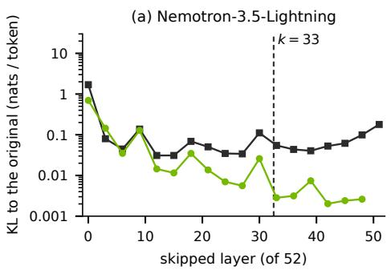

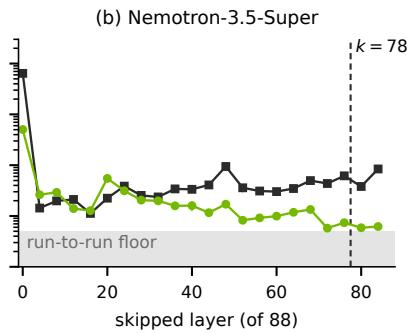

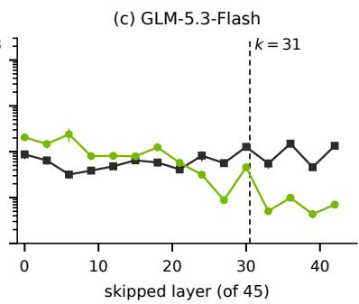  
layer skipped for the prompt tokens (memory still written) layer skipped for the generated tokens  
Figure 9 | The write–read asymmetry of Figure 2a, b holds on Nemotron-3.5-Lightning, Nemotron-3.5- Super and GLM-5.3-Flash. KL from the original model when one layer’s output is skipped only for the prompt tokens, its memory still written (green), or only for the generated tokens (black); sampled layers and windows as in Appendix A. Nemotron-3.5-Super’s values include its engine’s run-to-run floor (grey). Dashed: the anchor depth.

Four smaller checkpoints, one of them a transformer. The asymmetry is not specific to the hybrids we serve (Figure 10). On Qwen3-8B-Base (Yang et al., 2025a), Qwen3.5-4B-Base and Qwen3.5-9B-Base (Qwen Team, 2026) and GLM-4.6V-Flash (Z.ai, 2025) on text, an untrained shallow prefill at 50–75% of the layers keeps the direct-answer core within 2% of the original model and loses mainly needle recall. The core averages GSM8K (Cobbe et al., 2021), HellaSwag (Zellers et al., 2019), ARC-Challenge (Clark et al., 2018) and WinoGrande (Sakaguchi et al., 2020) (without GSM8K for the instruction-tuned GLM-4.6V-Flash); needle recall is the minimum over prompts of 2K, 4K and 8K tokens, 64 per length (256 for Qwen3.5-9B-Base at 16 layers). Training the write paths of Qwen3-8B-Base at 22 of 36 layers on 1B tokens, without a code, recovers its needle loss.

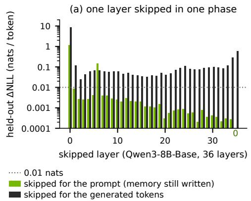

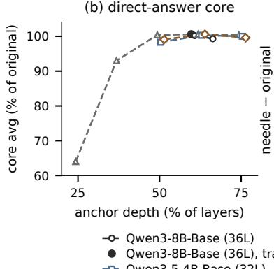

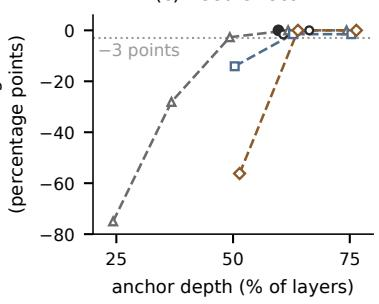  
Figure 10 | Without training, a shallow prefill keeps a model’s direct answers and loses mainly retrieval. (a) Qwen3-8B-Base: held-out NLL change when one layer is skipped only for the prompt tokens (memory still written) or only for the generated tokens; the last layer’s prompt-side change is exactly 0 (marked below the axis). (b, c) Untrained shallow prefill at each anchor depth (hollow, dashed); filled: Qwen3-8B-Base at 22 of 36 layers with trained write paths. (b) Core average, % of the original model. (c) Needle recall minus the original model’s; dotted: −3 points. A checkpoint’s markers share a horizontal shift of at most 1.4 points of depth.

Inexact writes. Table 6 gives the KLs and cache errors of §3; Table 14 gives the emitted states’ errors.

## A.1. The Selection Rule

Every model’s anchor depth, code and state rank follow from one rule, with thresholds shared by all models. This subsection states its criteria (§3.1) exactly, with their reasons; Table 7 lists the

Table 6 | Every released set stays close to the original model although its memories are inexact. Teacher-forced KL to the original model (nats per token) above the floor, the KL of a second run of the original model (nonzero where the engine is not deterministic); windows of Appendix A (GLM 5.3-Flash: 16 windows, 63 tokens). As served: the emitters read the decoded code and every state is compressed as in the decode. States exact: no compression. Code bypassed: the emitters read the exact $h ^ { ( k ) }$ (GLM-5.3-Flash has no code). Cache error: relative squared error of the emitted attention caches at the first emitted layer, whose original write path itself reads $h ^ { ( k ) }$ , and beyond it (Nemotron-3.5-Super: no attention layer beyond; its code keeps 512 of 4,096 coordinates).
<table><tr><td></td><td></td><td colspan="3">KL above the floor</td><td colspan="2">cache error (%)</td></tr><tr><td>Set</td><td>floor</td><td>as served</td><td>states exact</td><td>code bypassed</td><td>first emitted layer</td><td>beyond</td></tr><tr><td>Qwen3.8-Flash-Next bf16</td><td>0.0033</td><td>0.0359</td><td>0.0216</td><td>0.0411</td><td>1.4-2.2</td><td>9.0–66.9</td></tr><tr><td>Qwen3.8-Flash-Next-NVFP4</td><td>0.0206</td><td>0.0393</td><td>0.0224</td><td>0.0445</td><td>1.7-2.6</td><td>10.0-73.5</td></tr><tr><td>Nemotron-3.5-Lightning</td><td>0.0018</td><td>0.0145</td><td>0.0100</td><td>0.0269</td><td>0.5-4.0</td><td>11.6-28.6</td></tr><tr><td>Kimi-Linear</td><td>0.0016</td><td>0.0063</td><td>0.0038</td><td>0.0119</td><td>1.2</td><td>11.5-67.7</td></tr><tr><td>GLM-5.3-Flash</td><td>0.0000</td><td>0.0330</td><td>0.0318</td><td></td><td>0.0–0.8</td><td>2.2-79.5</td></tr><tr><td>Nemotron-3.5-Super</td><td>0.0047</td><td>0.0099</td><td>0.0062</td><td>0.0132</td><td>3.8-38.0</td><td></td></tr></table>

measurements and the resulting choices.

The rule. The rule reads only the original model, its untrained shallow prefill (Appendix A) and closed-form codes (the principal-component codes that initialize training), never an exam or a trained set; the NVFP4 Qwen3.8-Flash-Next set reuses the bf16 measurements. The copy probe hides one record, “Record ⟨key⟩ is filed under the identifier ⟨UUID⟩”, at a random depth of 4K to 16K tokens of held-out web text, and counts the items whose identifier the greedy reply copies exactly (300 items on Qwen3.8-Flash-Next, 1,500 on Nemotron-3.5-Lightning, Kimi-Linear and Nemotron-3.5-Super, 600 on GLM-5.3-Flash).

1. Depth. The candidates are the attention-layer boundaries, whose first emitted layer is a softmaxattention layer. � is the shallowest measured boundary at which (D1) the untrained gap is at most 0.075 nats per token and (D2) the untrained shallow prefill copies at least three quarters of the identifiers that the original model copies. D1 gives the prefill three quarters of a budget of a tenth of a nat per token (a perplexity rise of about 10%) for the untrained shallow prefill and shallow state together; S lets the state add at most a quarter of the prefill’s gap, so the sum stays within it $\mathbf { \bar { ( 0 . 0 7 5 \cdot 5 / 4 \approx 0 . 0 9 4 ) } }$ . Boundaries below the first measured one (23 on Qwen3.8-Flash-Next, 19 on Nemotron-3.5-Lightning and GLM-5.3-Flash, 11 on Kimi-Linear) are taken to fail D1, as the gap falls with depth at every measured boundary up to �; on Nemotron-3.5-Super every boundary is measured.

2. Exact values (M). � = 256 if the closed-form code’s relative reconstruction error $\| \Delta - \hat { \Delta } \| / \| \Delta - \mu \|$ at $m = 1 2 8$ is larger on chat-template tokens than on other tokens of public chat prompts, else � = 128; � = 0 without a code. The error is measured at the rank that C1 and C2 select (on GLM-5.3-Flash at 4608, its largest probed rank within the cap), so � and � are checked jointly.

3. Code. Let � be the width of the residual stream. (C3) If the full ofset’s code takes no more bytes than even the fp8 deep cache, $r = d .$ Otherwise � is the smallest probed rank whose closed-form code (C1) shows no significant copy loss against the uncoded shallow prefill and (C2) takes no more bytes than the bf16 deep cache, which a stored code replaces (Table 18), so a larger code would save nothing. A loss means more identifiers lost than gained with $p < 0 . 1 0$ in the exact two-sided McNemar test (McNemar, 1947), a one-sided level of 0.05 against a loss. (C4) If no rank qualifies, there is no code.

4. State (S). � is the smallest of 8, 16 and 32 whose state drift is at most gap(�)/4, else 32; $W = R .$ The state drift (§3.1) is the per-token $\mathrm { K L } ( p \| \tilde { p } )$ from exact states (�) to the shallow form (�˜), including the original model’s run-to-run floor.

The criteria on the five models. Depth (Figure 11). On GLM-5.3-Flash, D2 rejects 27, whose gap passes D1 (0.045). On Nemotron-3.5-Super, D1 rejects 69 (0.091) and accepts 78 (0.065). Code. C1 sets the ranks of Qwen3.8-Flash-Next (8192, the smallest probed passing rank), Nemotron-3.5-Lightning (2048) and Nemotron-3.5-Super (512). C3 sets Kimi-Linear’s � = � by bytes alone. On GLM-5.3-Flash every probed rank loses significantly (2048–4608 and 8192); the unprobed ranks up to the cap of C2 (6144) lie between failing ones, and on every probed grid copying grows with the rank, so C4 removes the code. Exact values. The template clause fires on Qwen3.8-Flash-Next (0.180 against 0.153) and on GLM-5.3-Flash (0.488 against 0.384). State (Figure 12). Kimi-Linear’s rank 16 drifts 0.0096 against its budget 0.0077, so it gets rank 32. GLM-5.3-Flash’s budget (0.0087) lies below its floor (0.018), so the fallback gives 32. An ablation set of Kimi-Linear (released code, states trained at rank 8) loses $5 . 2 \pm 2 . 0$ AIME points against the original model when it decodes at rank 16 every 16 steps, and $1 . 5 \pm 2 . 1$ at the criterion’s rank 32 every 32 steps (paired by question and seed, eight repetitions).

Table 7 | Inputs and choices of the selection rule (Appendix A.1). The Qwen3.8-Flash-Next column serves its bf16 and NVFP4 sets (probes on bf16). Gap: the untrained gap at the attention-layer boundaries, nats per token. Copies: identifiers copied by the untrained shallow prefill / the original model. Closed form: items lost / gained by a closed-form code of rank � against the uncoded shallow prefill (�: exact McNemar). Bytes: nominal per token; in parentheses, over the bf16 / fp8 deep cache. Template / other: relative reconstruction error at � = 128 and the selected rank. Full ofset: the code of rank �, over the fp8 deep cache. Drift: decode drift at rank $R , W = R ,$ against $\mathrm { g a p } ( k ) / 4$
<table><tr><td></td><td>Qwen3.8- Flash-Next</td><td>Nemotron-3.5- Lightning</td><td>Kimi- Linear</td><td>GLM-5.3- Flash</td><td>Nemotron-3.5- Super</td></tr><tr><td colspan="6">depth k</td></tr><tr><td>gap at boundary</td><td>23: 0.102</td><td>19: 0.182</td><td>11: 0.174</td><td>19: 0.172</td><td>58: 0.216</td></tr><tr><td></td><td>27:0.100 31:0.074</td><td>26:0.127 33: 0.075</td><td>15:0.078 19: 0.031</td><td>23: 0.115 27: 0.045</td><td>69: 0.091 78:0.065</td></tr><tr><td></td><td></td><td></td><td></td><td>31: 0.035</td><td></td></tr><tr><td>copies</td><td>31:290  / 297</td><td>33: 1,498 / 1,500</td><td>19: 1,500 / 1,497</td><td>27: 269  / 595 31:530 / 595</td><td>78: 1,494 / 1,496</td></tr><tr><td colspan="6">code r+m</td></tr><tr><td>closed form</td><td>4096: 227 / 2</td><td>1024: 17  /  1</td><td>1024: 0  /  0</td><td>2048-4608:</td><td>256:5  /  0</td></tr><tr><td></td><td> $( p < 0 . 0 \dot { 0 } 1 )$   $6 1 \dot { 4 } 4 : 1 0 2 \mathrm { ~ / ~ } \dot { 7 }$ </td><td> $( p < 0 . 0 0 1 )$  1536:12 / 1</td><td>1536:0  /  0</td><td>at least 528 / 0</td><td>(p = 0.0625)</td></tr><tr><td></td><td> $( p < 0 . 0 \dot { 0 } 1 )$ </td><td>(p = 0.003)</td><td>2048: 0 /  0 2304: 0 /  0</td><td>(p &lt; 0.001) 8192: 144 / 11</td><td>512: 3 / 0</td></tr><tr><td></td><td> $8 1 \ddot { 9 } 2 \colon 1 5 \mathrm { ~ / ~ } 7$ </td><td>2048:5 /  1</td><td></td><td> $( p < 0 . 0 \dot { 0 } 1 )$ </td><td>(p = 0.250)</td></tr><tr><td></td><td> $( p = 0 . 1 3 4 )$ </td><td> $( p = 0 . 2 1 9 )$ </td><td></td><td></td><td></td></tr><tr><td></td><td>10240: 4 /  4  $( p = 1 . 0 0 0 )$ </td><td>2688: 2  / 0</td><td></td><td></td><td></td></tr><tr><td>bytes</td><td>8192+256: 5,380</td><td> $( p = 0 . 5 0 0 )$  2048+128:1,540</td><td>2304+128:1,684</td><td>none; 8192+256</td><td>512+128:676</td></tr><tr><td></td><td>(0.509 / 1.019)</td><td>(0.752 / 1.504)</td><td>(0.487 / 0.975)</td><td>would take 5,380 (1.272 / 2.468)</td><td>(0.660 / 1.320)</td></tr><tr><td>full offset template / other</td><td>10240+256:1.237</td><td>2688+128:1.855</td><td>2304+128: 0.975</td><td>16384+256:4.582</td><td>4096+128: 5.258</td></tr><tr><td></td><td>0.180 / 0.153 (1.18)</td><td>0.212 / 0.245 (0.86)</td><td>0.075 / 0.078 (0.97)</td><td>0.488 / 0.384 (1.27)  $\mathrm { a t } \ r = 4 6 0 8$ </td><td>0.514 / 0.660 (0.78)</td></tr><tr><td colspan="6">state R, W</td></tr><tr><td>drift, R = 8</td><td>0.0209</td><td>0.0281</td><td>0.0325</td><td>0.0865</td><td></td></tr><tr><td>drift, R = 16</td><td>0.0073</td><td>0.0087</td><td>0.0096</td><td>0.0360</td><td>0.0408 0.0140</td></tr><tr><td>drift, R = 32</td><td>0.0031</td><td>0.0029</td><td>0.0030</td><td>0.0214</td><td>0.0054</td></tr><tr><td>gap(k)/4</td><td>0.0184</td><td>0.0187</td><td>0.0077</td><td>0.0087</td><td>0.0162</td></tr><tr><td>settings</td><td></td><td></td><td></td><td></td><td></td></tr><tr><td>k</td><td>31</td><td>33</td><td>19</td><td>31</td><td>78</td></tr><tr><td>r+m</td><td>8192+256</td><td>2048+128</td><td>2304+128</td><td>no code</td><td>512+128</td></tr><tr><td>R /W</td><td>16 /  16</td><td>16  / 16</td><td>32  / 32</td><td>32  / 32</td><td>16  / 16</td></tr></table>

Why copying is a separate criterion. The gap, a code’s cost and a closed-form subspace’s variance average over tokens or directions, but a 36-character identifier is copied only if each of its many tokens is. A per-token error rate � that an average barely registers compounds to $1 - ( 1 - \eta ) ^ { n }$ ≈ �� over � independent tokens. On Qwen3.8-Flash-Next, the code 4096+512 costs +0.0103 nats per token, under a quarter of the gap, and holds 0.853 of the ofset’s variance, yet loses 227 of the 290 identifiers that the uncoded shallow prefill copies. Copying needs the directions that carry a token’s identity, which need not hold much variance. Training keeps the diference: on RULER’s UUID needle tasks, trained sets with the code 4096+512 miscopy far more identifiers than the released sets with 8192+256 (Table 8), and on GLM-5.3-Flash a preliminary trained set with the code 5632+256 at depth 27 copies 124 identifiers, against 528 for a like set without a code $( p = 3 \times 1 0 ^ { - 1 1 8 } )$ : training does not repair a

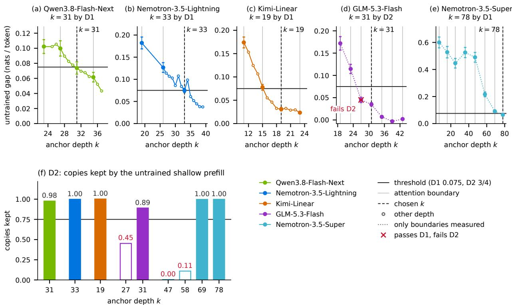  
Figure 11 | The anchor depth is the shallowest boundary that passes both depth clauses. (a)–(e) The untrained gap at the attention-layer boundaries (± standard error, grey lines) and other depths (open markers; GLM-5.3-Flash and Nemotron-3.5-Super: boundaries only); black: the D1 threshold; dashed: the chosen �. (f) D2: identifiers copied by the untrained shallow prefill over those copied by the original model; threshold 3/4. On GLM-5.3-Flash, 27 passes D1 and fails D2; on Nemotron-3.5-Super, every boundary below 78 fails D1.

## code that miscopies.

Table 8 | RULER’s two UUID tasks on Qwen3.8-Flash-Next: wrong replies out of 100 documents per task and length, niah\_single\_3 / niah\_multikey\_3 (the original model: none wrong). The rows with the code 4096+512 are an earlier, unreleased bf16 set after each stage.
<table><tr><td>Set</td><td>Code</td><td>32K</td><td>64K</td><td>128K</td></tr><tr><td>NVFP4, released</td><td>8192+256</td><td>1/0</td><td>1/1</td><td>4/5</td></tr><tr><td>bf16, unreleased, stage 1</td><td>4096+512</td><td>21/4</td><td>18/4</td><td>19/11</td></tr><tr><td>bf16, unreleased, stage 2</td><td>4096+512</td><td>22/3</td><td>12/5</td><td>16/15</td></tr><tr><td>bf16, released</td><td>8192+256</td><td>1/0</td><td>1/2</td><td>1/5</td></tr></table>

Why a budget of a quarter of the gap. D1 assumes that the KL costs of the shallow prefill and of the compressed states add. To second order, they add when the errors are uncorrelated in the Fisher metric of the output distribution. On three preliminary GLM-5.3-Flash sets (4 comparisons), a set’s KL with its state form is 0.85–0.88 of the sum of its KL with exact states and the state form’s KL on the original model. The costs combine sub-additively, so assuming additivity errs on the safe side.

The byte account. The deep cache takes 10,560 / 5,280 bytes per token in bf16 / fp8 on Qwen3.8- Flash-Next, 2,048 / 1,024 on Nemotron-3.5-Lightning, 3,456 / 1,728 on Kimi-Linear, 4,228 / 2,180 on GLM-5.3-Flash and 1,024 / 512 on Nemotron-3.5-Super. A code of rank � (a multiple of 16) with � exact values takes nominally $\textstyle { \frac { 9 } { 1 6 } } r + 3 m + 4$ bytes per token: half a byte per NVFP4 coordinate plus an 8-bit scale per sixteen, a bf16 value and a one-byte index per exact value, and one fp32 scale per token. Each index counts the residual-stream positions skipped since the previous exact value;

(f) content energy beyond rank R  
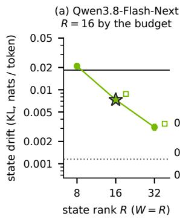

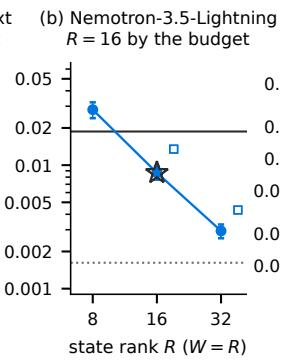

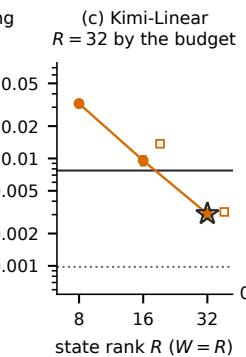

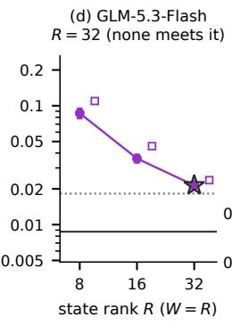

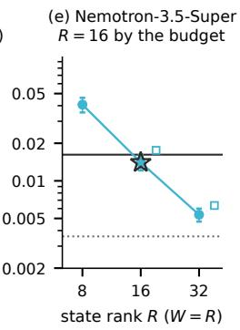

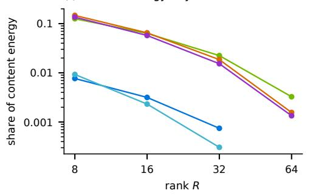

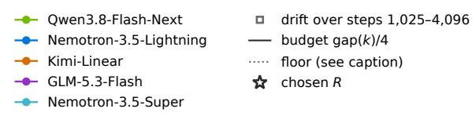  
Figure 12 | The state clause takes the smallest rank whose state drift fits the budget, else 32. (a)–(e) State drift (± standard error) at $R = 8 , 1 6$ , 32 with $W = R ;$ open squares: its mean over decode steps 1,025–4,096 of 24 replies, drawn at 1.2�. Black: the budget $\exp ( k ) / 4$ . Dotted: the floor, a second run of the original model (on GLM-5.3-Flash, the exact state scanned in 16-token pieces). Star: the chosen �. (f) Share of the content energy $( C = S - a { \bar { v } } ^ { \top } )$ beyond rank � in prompt-final states of held-out 4K windows, energy-weighted over heads and layers.

each gap of 255 or more adds two bytes (on Qwen3.8-Flash-Next at most 78 bytes, 1.5% of the code), which changes no outcome of C2 or C3.

The exact values and the drift window. The template clause guards against an observed failure: a Qwen3.8-Flash-Next set on the NVFP4 checkpoint with a full-rank code and $m = 1 2 8$ answered 66 of 200 prompts of a RULER multi-key needle task at 8K with an immediate end-of-sequence token, because the code of the answer’s template token collapsed; with $m = 2 5 6 .$ , 4 of 800 such prompts did. In the open-loop sum (8), each compression’s error fades with the head’s decays, so recent compressions dominate; the drift is therefore read late, over steps 961–1,024. � = � is a convention, and the ranks stop at 32 because at $R = W = 3 2$ the 64 factor columns of a 128 × 128 head hold as many numbers as the head.

## B. Theory

This appendix proves the four facts on which SEED’s shallow state rests. Every recurrent state splits exactly into a sink and a content (Lemma 1). The sink-plus-factors form is closed under the update, so compression is the only approximation (Lemma 2). In the open loop, the compression errors do not accumulate (Proposition 3 and Corollary 4). After the head’s normalization, the sink acts as a bias and a gain (Lemma 5).

## B.1. One recurrence for three layer types

Gated DeltaNet, Kimi Delta Attention and Mamba-2 heads update their states by the same linear recurrence, so we state every result once, for

$$
{ \cal S } _ { t } = \Phi _ { t } { \cal S } _ { t - 1 } + \beta _ { t } \kappa _ { t } v _ { t } ^ { \top } , \qquad \Phi _ { t } = ( I - \theta \beta _ { t } \kappa _ { t } \kappa _ { t } ^ { \top } ) \Lambda _ { t } .\tag{6}
$$

Here $S _ { t } \in \mathbb { R } ^ { d _ { k } \times d _ { v } }$ , the decay $\Lambda _ { t }$ is diagonal with entries in $( 0 , 1 )$ , and $\theta \in \{ 0 , 1 \}$ switches the delta rule’s correction on or of. The three layer types set these as follows.

• Gated DeltaNet (2): $\theta = 1$ and $\Lambda _ { t } = g _ { t } I$

• Kimi Delta Attention: $\theta = 1$ and $\Lambda _ { t } = \operatorname { d i a g } ( g _ { t , 1 } , . . . , g _ { t , d _ { k } } )$ , one decay per key channel.

• Mamba-2: $\theta = 0$ and $\Lambda _ { t } = \gamma _ { t } I $ . Its state is $d _ { x } \times d _ { B } ;$ in its transpose, the input projection $B _ { t }$ the input $x _ { t }$ and the step size $\delta _ { t }$ take the places of $\kappa _ { t } , ~ v _ { t }$ and $\beta _ { t }$ , and $d _ { B } , d _ { x }$ those of $d _ { k } , \ : d _ { v }$

Every step contracts the state. Let $\lambda _ { t }$ be the largest entry of $\Lambda _ { t }$ . In the delta rules, $\| \kappa _ { t } \| = 1$ and $\beta _ { t } \in ( 0 , 1 )$ , so $I - \beta _ { t } \kappa _ { t } \kappa _ { t } ^ { \top }$ has spectral norm one. Hence, in all three layer types,

$$
\| \Phi _ { t } \| _ { 2 } \leq \lambda _ { t } .
$$

The sink direction $\bar { v } \neq 0$ is the head’s mean value (for Mamba-2, its mean input $\bar { x } )$ , and $\omega _ { t } , \varepsilon _ { t } , a _ { t }$ and $C _ { t }$ are as in Lemma 1. The shallow state stores a sink coeficient � and content factors $U , V$

$$
S = a \bar { v } ^ { \top } + U V ^ { \top } , \qquad V ^ { \top } \bar { v } = 0 ,
$$

and compresses the content $U V ^ { \top }$ to rank � every � steps.

## B.2. The sink decomposition

Lemma 1 (Section 4) splits every state exactly into a rank-one sink along �¯ and a content orthogonal to it. Since both parts follow the head’s own recurrence, SEED can store and update them separately.

Proof of Lemma 1. The recurrence is linear in the values, so it sufices to project it onto �¯. Since $v _ { t } ^ { \top } \bar { v } = \dot { \omega } _ { t } \| \bar { v } \| ^ { 2 }$ , right-multiplying the recurrence by ${ \bar { v } } / \| { \bar { v } } \| ^ { 2 }$ gives the recurrence for $a _ { t } ;$ subtracting its product with $\bar { v } ^ { \top }$ from the recurrence for $S _ { t }$ gives the one for $C _ { t }$ . For the energies, the two terms of

$$
S _ { t } - z \bar { v } ^ { \top } = ( a _ { t } - z ) \bar { v } ^ { \top } + C _ { t }
$$

are orthogonal, because $\langle y \bar { v } ^ { \top } , C _ { t } \rangle _ { F } = y ^ { \top } C _ { t } \bar { v } = 0$ for every $y .$ Their squared Frobenius norms therefore add, and $\| ( a _ { t } - z ) { \bar { v } } ^ { \top } \| _ { F } = \| a _ { t } - z \| \| { \bar { v } } \|$ □

## B.3. The factored update is exact

The factored form never needs the dense state. Each step updates the sink coeficient and appends one column to each content factor. The next lemma shows that this update is exact for all three layer types and keeps the content orthogonal to �¯, and that compressing the content leaves the sink untouched. Compression is therefore the shallow state’s only approximation.

Lemma 2 (exact factored update). One step of (6) maps a sink plus factors to a sink plus factors with one more column each. Precisely, let $S = a { \bar { v } } ^ { \top } + U V ^ { \top }$ with $V ^ { \top } \bar { v } = 0$ , and let $v = \omega \bar { v } + \varepsilon$ with $\varepsilon ^ { \top } \bar { v } = 0$ . Then $\Phi S + \beta \kappa v ^ { \top } = a ^ { + } \bar { v } ^ { \top } + \bar { U } ^ { + } V ^ { + \top }$ , where

$$
\begin{array} { r l } & { \boldsymbol { a } ^ { + } = \Lambda \boldsymbol { a } + \beta \left( \omega - \theta \boldsymbol { \kappa } ^ { \top } \Lambda \boldsymbol { a } \right) \boldsymbol { \kappa } , } \\ & { \boldsymbol { U } ^ { + } = \big [ \Lambda \boldsymbol { U } , \kappa \big ] , \qquad \boldsymbol { V } ^ { + } = \big [ \boldsymbol { V } , \beta \left( \varepsilon - \theta \boldsymbol { V } \boldsymbol { U } ^ { \top } \Lambda \boldsymbol { \kappa } \right) \big ] , } \end{array}\tag{7}
$$

and ${ \cal V } ^ { + \top } \bar { v } = 0$ . For $\theta = 1$ and $\Lambda = g I$ , this is the update (5). Moreover, if � and � have orthonormal columns in the column space and the row space of the content $C = U V ^ { \top }$ , then both compressions $C ^ { \prime } = Q Q ^ { \top } C$ and $C ^ { \prime } = \bar { C } P P ^ { \top }$ satisfy $C ^ { \prime } \bar { v } = 0$ , so replacing � by $C ^ { \prime }$ leaves the sink coeficient $a = S \bar { v } \big / \| \bar { v } \| ^ { 2 }$ unchanged.

Proof. The step acts on the sink and the content separately, except for the delta rule’s correction, which reads the content along � and writes the result into the new column. Since $\Lambda$ is symmetric, $\Phi = \Lambda - \theta \beta \kappa \kappa ^ { \top } \Lambda$ , and substituting � and � gives

$$
\begin{array} { r l } & { \Phi S + \beta \kappa v ^ { \top } = \left( \Phi a + \beta \omega \kappa \right) \bar { v } ^ { \top } + \Phi U V ^ { \top } + \beta \kappa \varepsilon ^ { \top } } \\ & { \qquad = a ^ { + } \bar { v } ^ { \top } + \Lambda U V ^ { \top } + \beta \kappa \left( \varepsilon - \theta V U ^ { \top } \Lambda \kappa \right) ^ { \top } } \\ & { \qquad = a ^ { + } \bar { v } ^ { \top } + U ^ { + } V ^ { + \top } . } \end{array}
$$

The new column of $V ^ { + }$ combines � and the columns of $V ,$ all orthogonal to $\bar { v } ,$ so $V ^ { + \top } \bar { v } = 0$ . For the compressions, $Q Q ^ { \top } C \bar { v } = 0$ because $C \bar { v } = 0$ . The same identity makes �¯ orthogonal to the row space of $\bar { C } ,$ , so $P ^ { \top } \bar { v } = 0$ and $C P P ^ { \top } \bar { v } = 0$ . Both compressions stay in factored form,

$$
\begin{array} { r } { Q Q ^ { \top } C = Q ( V U ^ { \top } Q ) ^ { \top } , \qquad C P P ^ { \top } = ( U V ^ { \top } P ) P ^ { \top } . } \end{array}
$$

## B.4. Compression errors do not accumulate

In the open loop, the compressed and the exact recurrence see the same keys, values, decays and write strengths, and difer only by the errors that compressions inject. The proposition below bounds the resulting error and shows that the sink coeficient stays exact; its corollary shows that periodic compressions do not compound.

Proposition 3 (open-loop error). The error at step � is at most the sum of the injected errors, each damped by the decays applied after it. Precisely, let

$$
\tilde { S } _ { 0 } = S _ { 0 } + \mathcal { E } _ { 0 } , \qquad \tilde { S } _ { t } = \Phi _ { t } \tilde { S } _ { t - 1 } + \beta _ { t } \kappa _ { t } v _ { t } ^ { \top } + \mathcal { E } _ { t } \quad ( t \geq 1 ) ,
$$

with the inputs of (6). Then

$$
\Vert \tilde { S } _ { t } - S _ { t } \Vert _ { F } \leq \sum _ { s = 0 } ^ { t } \Big ( \prod _ { u = s + 1 } ^ { t } \lambda _ { u } \Big ) \Vert \mathcal { E } _ { s } \Vert _ { F } .\tag{8}
$$

If, moreover, every $\mathcal { E } _ { s } \bar { v } = 0$ , then $\tilde { S } _ { t } \bar { v } = S _ { t } \bar { v }$ for all �.

Proof. The diference $\mathcal { D } _ { t } = \tilde { S } _ { t } - S _ { t }$ follows the same recurrence without inputs, driven only by the injected errors: $\mathcal { D } _ { t } = \Phi _ { t } \mathcal { D } _ { t - 1 } + \mathcal { E } _ { t }$ with $\mathcal { D } _ { 0 } = \mathcal { E } _ { 0 }$ . Unrolling it gives

$$
\mathcal { D } _ { t } = \sum _ { s = 0 } ^ { t } \Phi _ { t } \cdot \cdot \cdot \Phi _ { s + 1 } \mathcal { E } _ { s } .
$$

Since $\Vert \Phi _ { u } \mathcal { E } \Vert _ { F } \leq \Vert \Phi _ { u } \Vert _ { 2 } \Vert \mathcal { E } \Vert _ { F } \leq \lambda _ { u } \Vert \mathcal { E } \Vert _ { F }$ , the triangle inequality gives (8). If every $\mathcal { E } _ { s } \bar { v } = 0$ , each term of the sum vanishes on �¯, so $\mathcal { D } _ { t } \bar { v } = 0$ □

Corollary 4 (periodic compression). If a compression every � steps injects an error of norm at most �¯, the error never exceeds �¯ times the head’s decay horizon. Precisely, let $\| \mathcal { E } _ { s } \| _ { F } \leq \bar { \epsilon } ,$ with ${ \mathcal { E } } _ { s } = 0$ unless � divides �, and let the mean of $\lambda _ { u }$ over each period $u = m W { + } 1 , \ldots , ( m { + } 1 ) W$ be at most $\bar { g } < 1$ (as it is when every $\lambda _ { u } \le \bar { g } )$ . Then, for every �,

$$
\Vert \tilde { S } _ { t } - S _ { t } \Vert _ { F } \leq \frac { \bar { \epsilon } } { 1 - \bar { g } ^ { W } } \leq \frac { \bar { \epsilon } } { 1 - \bar { g } } .
$$

Proof. Count the compressions before � from the most recent, $n = 0 , 1 , \ldots$ . The decay product that damps the �-th one in (8) spans � full periods and part of one more. By the inequality of arithmetic and geometric means, each full period contributes at most $\bar { g } ^ { W }$ , and the partial period at most one. Hence

$$
\| \tilde { S } _ { t } - S _ { t } \| _ { F } \leq \bar { \epsilon } \sum _ { n \geq 0 } \bar { g } ^ { n W } = \frac { \epsilon } { 1 - \bar { g } ^ { W } } ,
$$

and $\bar { g } ^ { W } \leq \bar { g }$ gives the second bound.

## B.5. After normalization, the sink is a bias and a gain

Gated DeltaNet and Kimi Delta Attention heads normalize their read-out before the output gate. The lemma below shows that the sink then sets a fixed output direction and, through the normalizer, scales the content, as the sink logit does in a softmax denominator.

Lemma 5 (the sink as a gain). In a Gated DeltaNet or Kimi Delta Attention head, the read-out splits into a part along �¯ and a part orthogonal to $i t ,$

$$
o _ { t } = S _ { t } ^ { \top } q _ { t } = b _ { t } + r _ { t } , \qquad b _ { t } = \left( \boldsymbol { q } _ { t } ^ { \top } \boldsymbol { a } _ { t } \right) \bar { v } , \qquad r _ { t } = C _ { t } ^ { \top } q _ { t } , \qquad r _ { t } ^ { \top } \bar { v } = 0 .
$$

An RMSNorm with unit weight and constant $\eta \geq 0$ therefore returns

$$
\mathrm { R M S N o r m } ( o _ { t } ) = \frac { \sqrt { d _ { v } } \left( b _ { t } + r _ { t } \right) } { \left( \| b _ { t } \| ^ { 2 } + \| r _ { t } \| ^ { 2 } + d _ { v } \eta \right) ^ { 1 / 2 } } .\tag{9}
$$

If $\eta = 0$ and $\boldsymbol { q } _ { t } ^ { \intercal } \boldsymbol { a } _ { t } \neq 0$ , the normalized read-out is a fixed direction plus the content scaled by $1 / \| b _ { t } \|$ up to an error quadratic in the ratio $\rho _ { t } = \| r _ { t } \| / \| b _ { t } \|$ . With $s = \mathrm { s i g n } ( q _ { t } ^ { \top } a _ { t } )$ and $\hat { v } = \bar { v } / \| \bar { v } \|$ ,

$$
\left. \mathrm { R M S N o r m } ( o _ { t } ) - \sqrt { d _ { v } } \left( s \hat { v } + \frac { r _ { t } } { \Vert b _ { t } \Vert } \right) \right. = \sqrt { d _ { v } } \left( \left( 1 + \rho _ { t } ^ { 2 } \right) ^ { 1 / 2 } - 1 \right) \le \sqrt { d _ { v } } \frac { \rho _ { t } ^ { 2 } } { 2 } .
$$

Proof. Since $C _ { t } \bar { v } = 0$ , we have $r _ { t } ^ { \top } \bar { v } = q _ { t } ^ { \top } C _ { t } \bar { v } = 0$ , so $\| o _ { t } \| ^ { 2 } = \| b _ { t } \| ^ { 2 } + \| r _ { t } \| ^ { 2 }$ , which gives (9). With $\eta = 0$ , dividing the numerator and the denominator of (9) by $\| b _ { t } \|$ , and using $b _ { t } / \Vert b _ { t } \Vert = s \hat { v }$ , gives

$$
\operatorname { R M S N o r m } ( o _ { t } ) = \sqrt { d _ { v } } \frac { x } { \| x \| } , \qquad x = s \hat { v } + \frac { r _ { t } } { \| b _ { t } \| } , \qquad \| x \| = \big ( 1 + \rho _ { t } ^ { 2 } \big ) ^ { 1 / 2 } .
$$

The diference $\sqrt { d _ { v } } x \left( 1 / \| x \| - 1 \right)$ thus has norm $\sqrt { d _ { v } } \left( \| x \| - 1 \right)$ , and $\begin{array} { r } { \sqrt { 1 + \rho ^ { 2 } } \le 1 + \rho ^ { 2 } / 2 . } \end{array}$

## C. Experimental Details and State Probes

This appendix gives the model dimensions and the protocols of the state measurements, storage precision and closed-loop drift.

Model dimensions. Nemotron-3.5-Lightning has 30B parameters (3B active per token), Kimi-Linear 48B (3B), Nemotron-3.5-Super 120B (12B), Qwen3.8-Flash-Next 125B (6B, plus a 51B-parameter n-gram embedding table read by lookup) and GLM-5.3-Flash 320B (18B). Qwen3.8-Flash-Next, GLM-5.3-Flash and Nemotron-3.5-Super run with text input only. Qwen3.8-Flash-Next: hidden size 2560; 512 routed experts (ten active) and one shared; four parallel 2560-dimensional residual streams, mixed and updated at every layer by input-dependent gates. Its sparse-attention layers have 24 query heads and two 256-dimensional key–value (KV) heads, select 2048 tokens per query and keep one indexer key per four tokens, 2112 bytes per token in all. Nemotron-3.5-Lightning: hidden size 2688; attention layers with two 128-dimensional KV heads. Kimi-Linear: hidden size 2304; 256 routed experts (eight active) and one shared. Its MLA layers cache the model’s own latent key–value format: a 512-number latent and a 64-number shared key (the rotary part, which Kimi-Linear leaves unrotated). GLM-5.3-Flash: hidden size 4096 in four residual streams, mixed with input-dependent weights by manifold-constrained hyper-connections (mHC); 288 routed experts (eight active) and one shared, with dense feed-forward layers in the first three layers. Expert, dense feed-forward and most sparse-attention projection weights are fp8 (E4M3, 128 × 128 blocks) with dynamically quantized fp8 activations; the Kimi Delta Attention layers, the indexer and the latent up-projection stay bf16. Each DSA layer has a 32-head indexer whose 128-dimensional keys are pooled over four tokens and cached in fp8 with a 4-byte scale, so the layer caches 1,057 bytes per token: the 1,024-byte bf16 latent plus 33 bytes of indexer key. The fp8 cache figures of Tables 7 and 18 halve the latent only. Nemotron-3.5-Super: hidden size 4096; 512 routed experts (22 active) and one shared, computing in a 1024-dimensional latent space; attention layers with 32 query heads and two 128-dimensional KV heads; Mamba-2 layers with eight groups. We use the language model of its vision-language checkpoint unchanged, without the vision tower and projector. Above the anchor layer, the emitters write the prompt entries of the attention caches of layers 31, 35, 39, 43 and 47 on Qwen3.8-Flash-Next; 33 and 42 on Nemotron-3.5-Lightning; MLA layers 19, 23 and 26 on Kimi-Linear; DSA layers 31, 35, 39 and 43 on GLM-5.3-Flash; and layer 78 on Nemotron-3.5-Super.

State probes. States are captured in fp32 at the end of the same six held-out web prompts of 3,584 tokens (Figure 13). Independent random directions in $\mathbb { R } ^ { 1 2 8 }$ , the baseline of Figure 13c, have a median | cos | of 0.06 (95th percentile 0.18). Figure 3 replays the gated delta rule in fp64 over one prompt without a document boundary. Nemotron-3.5-Lightning uses the held-out stream of its own tokenizer and all $2 3 \times 6 4$ Mamba-2 heads; the content of Figure 13d uses �¯ estimated on other text, and the other models use the mean input or mean value that their component sets ship. The median and pooled sink shares are 75% and 69% on Qwen3.8-Flash-Next, 64% and 99.6% on Nemotron-3.5-Lightning, 70% and 99.7% on Nemotron-3.5-Super, 34% and 82% on Kimi-Linear, and 24% and 86% on GLM-5.3-Flash. On six windows of each model’s own math and code replies, every share changes by at most 0.05.

Eviction and step-wise policies. The eviction experiment acts once, in all 36 layers, on the state after the first 3,583 tokens (SEED also compresses before the last prompt token), with �¯ estimated on other text; the last prompt token then runs, and the next 512 tokens are scored with exact state updates. The sink’s replacement by its mean over other prompts averages over the other five prompts. The step-wise policies of §4 start from the same state and truncate exactly after every token of a 256-token teacher-forced continuation, with �¯ the mean value of the other five prompts. Every policy scores the same 1536 tokens.

(a) one direction carries most

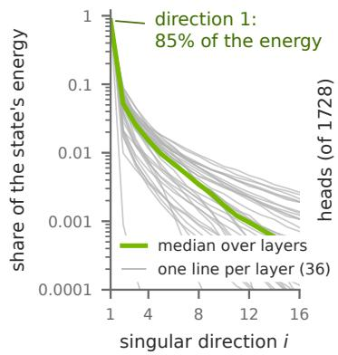

(b) over the heads  
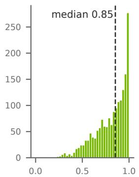  
energy share of direction 1

(c) same across prompts  
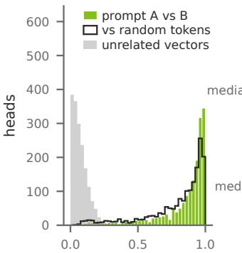  
|cos| of v⋆ between prompts

(d) low-rank content  
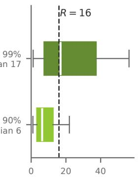  
rank of the content CT  
Figure 13 | One direction carries most of the recurrent state, and it is nearly the same on every prompt tested (Qwen3.8-Flash-Next, 36 × 48 heads, six web prompts of 3,584 tokens). (a) Energy share of the state’s �-th singular direction; grey: one layer (median over heads and prompts); green: median over layers. (b) The top direction’s share over the 1,728 heads. (c) | cos | between a head’s top output directions $v _ { \star }$ on two unrelated prompts (green), on a web prompt and a prompt of uniformly random tokens (charcoal outline), and for independent random directions in $\mathbb { R } ^ { 1 2 8 }$ (grey). (d) Rank holding 90% and 99% of the energy of the content $C _ { T }$ (Lemma 1) per head, averaged over the prompts; box 25–75%, whiskers 5–95%, bar the median; dashed: Qwen3.8-Flash-Next’s $R = 1 6$

Storage precision. Decode drift (Tables 4 and 9) is the per-token KL divergence from the original model’s next-token distribution, teacher-forced over the first 1,024 tokens of 48 of its own replies to held-out prompts (16 each of math, science and code). It counts the original model’s 1,024 most likely tokens plus one bucket for the remaining mass, and is reported above a second run of the original model (0.001–0.004 nats per token), paired over replies. On GLM-5.3-Flash, whose reference engine takes about 8 s per decode step, it uses 24 replies over their first 256 tokens and is reported above the full-rank factored path, through which every rounded form runs.

Rounding. The original model’s dense state is rounded after every token. The shallow state rounds its factors and sink coeficient at every compression (fp8 with one fp32 scale per vector) and keeps the up to � newest columns in fp32 between compressions. Stochastic rounding adds a uniform random integer below the dropped bits to the fp32 bit pattern before truncating, so it is unbiased. Under either rounding, fp16 factors change the shallow state’s drift by at most 0.0006 nats per token.

NVFP4 checkpoints. The NVFP4 row of Table 4 decodes the same replies with NVIDIA’s oficial NVFP4 checkpoints of Qwen3.8-Flash-Next, Nemotron-3.5-Lightning and Nemotron-3.5-Super and their original caches and states, against the bf16 model’s reference pass and above its second run. Our reference path runs them with the served arithmetic of their FP8 and NVFP4 layers and SGLang’s scale conventions. On four held-out 2K-token windows, its per-token loss matches SGLang’s within 0.001 nats on average on Qwen3.8-Flash-Next and Nemotron-3.5-Lightning; on Nemotron-3.5-Super, the NVFP4 checkpoint raises the loss by 0.012 nats in our path and by 0.010 in SGLang.

Table 9 | The shallow state’s drift is the same with fp32 and fp16 factors under either rounding; a dense state’s depends on the format and, on the Mamba-2 models, on the rounding. Decode drift (nats per token above a second run of the original model) of the original model’s dense state, rounded after every token, and of the shallow state, rounded at every compression. The exams use the fp32 shallow state. Last row: size per head and layer in 16 bits, the shallow state’s right after a compression.
<table><tr><td rowspan="2">format</td><td rowspan="2">rounding</td><td colspan="2">Qwen3.8- Flash-Next</td><td colspan="2">Nemotron-3.5- Lightning</td><td colspan="2">Kimi- Linear</td><td colspan="2">GLM-5.3- Flash</td><td colspan="2">Nemotron-3.5- Super</td></tr><tr><td>dense</td><td>shallow</td><td>dense</td><td>shallow</td><td>dense</td><td>shallow</td><td>dense</td><td>shallow</td><td>dense</td><td>shallow</td></tr><tr><td>fp32</td><td></td><td>0</td><td>0.0056</td><td>0</td><td>0.0060</td><td>0</td><td>0.0017</td><td>0</td><td>0.0027</td><td>0</td><td>0.0070</td></tr><tr><td>fp16</td><td>nearest</td><td>0.0006</td><td>0.0056</td><td>0.0011</td><td>0.0062</td><td>0.0002</td><td>0.0017</td><td>0.0006</td><td>0.0021</td><td>0.0012</td><td>0.0069</td></tr><tr><td>fp16</td><td>stochastic</td><td>0.0006</td><td>0.0056</td><td>0.0004</td><td>0.0059</td><td>0.0002</td><td>0.0016</td><td>0.0010</td><td>0.0025</td><td>0.0002</td><td>0.0070</td></tr><tr><td>bf16</td><td>nearest</td><td>0.0008</td><td>0.0056</td><td>0.0057</td><td>0.0061</td><td>0.0008</td><td>0.0017</td><td>0.0008</td><td>0.0030</td><td>0.0066</td><td>0.0072</td></tr><tr><td>bf16</td><td>stochastic</td><td>0.0007</td><td>0.0056</td><td>0.0044</td><td>0.0065</td><td>0.0004</td><td>0.0017</td><td>0.0010</td><td>0.0024</td><td>0.0048</td><td>0.0073</td></tr><tr><td>fp8</td><td>nearest</td><td>0.0088</td><td>0.0067</td><td>0.0487</td><td>0.0136</td><td>0.0104</td><td>0.0023</td><td>0.0070</td><td>0.0030</td><td>0.0745</td><td>0.0160</td></tr><tr><td>fp8</td><td>stochastic</td><td>0.0073</td><td>0.0076</td><td>0.1752</td><td>0.0194</td><td>0.0048</td><td>0.0027</td><td>0.0055</td><td>0.0037</td><td>0.1740</td><td>0.0199</td></tr><tr><td>KB per head, 16 bits</td><td></td><td>32.8</td><td>8.4</td><td>16.4</td><td>6.4</td><td>32.8</td><td>16.6</td><td>32.8</td><td>16.6</td><td>16.4</td><td>6.4</td></tr></table>

Closed-loop drift. The long replies of §6.1 are the original model’s replies of at least 16,384 tokens (on Nemotron-3.5-Lightning and Nemotron-3.5-Super from their long-reply sets), scored over their first 16,384 decode steps at the released � and �, per block of 1,024 steps, above a second run of the original model. Only the tokens are teacher-forced: a compression error changes the later keys, values and decays.

## D. Training

This appendix gives the objectives, data and settings of the two training stages of §5.2; Table 13 gives the run metrics.

Both stages. � and the sink directions stay fixed. The training forward pass difers from inference in two ways (on GLM-5.3-Flash, three). It truncates the prompt-final states by an exact fp64 eigendecomposition instead of a subspace iteration, and it runs the continuation with the exact recurrence, without the compression every � steps. On GLM-5.3-Flash it compresses only the emitted layers’ prompt-final states, whereas inference compresses every Kimi Delta Attention state. Apart from the checkpoint’s own quantization, only the prompt code is quantized (NVFP4, exact values in bf16), in training and in every exam. Both stages use AdamW (Loshchilov & Hutter, 2019) with $\beta = ( 0 . 9 , 0 . 9 5 )$ $\epsilon = 1 0 ^ { - 8 }$ , no weight decay and gradient clipping at 1.0.

Stage 1. Stage 1 minimizes the forward next-token KL, the KL of the first 64 continuation positions (the first answer tokens on windows anchored at an answer start) and 0.1× cross-entropy, on 6 × 108 tokens with a 50-step warm-up and cosine decay to 2% of the peak (Tables 10 and 11). Teacher replies supply 59% of the trained tokens on both Qwen3.8-Flash-Next sets, 68% on Nemotron-3.5-Lightning, 37% on Kimi-Linear, 58% on GLM-5.3-Flash and 68% on Nemotron-3.5-Super.

Stage 2. A KL on the teacher’s text misses the departures that arise when the components condition on their own tokens. Each stage-2 round therefore pairs the teacher’s and the current set’s replies to public mathematics, chat and output-constraint prompts unseen in stage 1 and to code and science prompts reused from it. The forward KL applies to both arms’ replies, the reverse KL to the set’s own, which get no cross-entropy; the other windows keep the 0.1× cross-entropy. The visible answer and the 20% of positions with the highest teacher entropy count twice (weights normalized per window), and the KL of the first 256 continuation positions is added. Paired replies supply 80% of the tokens and retained stage-1 streams 20% (on Nemotron-3.5-Super, whose round adds 32K-token windows of retained streams, about a third and two thirds), with domain weights set by the measured divergence of the set’s own replies. Each round reads $1 . 5 \times 1 0 ^ { 8 }$ tokens (on Nemotron-3.5-Super $2 . 1 \times 1 0 ^ { 8 }$ , two fifths of them in 32K-token windows) with a short warm-up and a cosine learning-rate schedule. Stage 2 ran two rounds on bf16 Qwen3.8-Flash-Next, Nemotron-3.5-Lightning and GLM-5.3-Flash and one on Qwen3.8-Flash-Next-NVFP4, Kimi-Linear and Nemotron-3.5-Super. Every model releases its stage-2 set except Nemotron-3.5-Super, whose stage-1 set is released.

Table 10 | Hyperparameters of the released sets (Nemotron-3.5-Super: stage 1 only). Component parameters: every exported tensor, including the fixed � and sink bufers and rows without gradient (Mamba-2 gate rows: 88M on Nemotron-3.5-Lightning, 134.2M on Nemotron-3.5-Super; indexer query rows: 6.6M on each Qwen3.8-Flash-Next set). Peak LR: stage 1 / stage 2; second stage-2 rounds about $5 \times 1 0 ^ { - 6 }$ . Answer-start windows: the share of the 4K / 16K windows that start at the beginning of an answer.
<table><tr><td rowspan="2">Set</td><td rowspan="2">Component parameters (M)</td><td rowspan="2">16K-window</td><td rowspan="2"></td><td colspan="2">answer-start (%)</td><td rowspan="2">Auxiliary alignment</td></tr><tr><td>steps (%) stage 1</td><td>stage 2</td></tr><tr><td>Qwen3.8-Flash-Next bf16</td><td>619.0</td><td> $5 \times 1 0 ^ { - 5 } / 1 0 ^ { - 5 }$ </td><td>30</td><td>50/30</td><td>70/60</td><td></td></tr><tr><td>Qwen3.8-Flash-Next-NVFP4</td><td>619.0</td><td>5 × 10−5 / 10−5</td><td>30</td><td>50/30</td><td>70/60</td><td></td></tr><tr><td>Nemotron-3.5-Lightning</td><td>235.8</td><td> $5 \times 1 0 ^ { - 5 } / 1 0 ^ { - 5 }$ </td><td>40</td><td>50/40</td><td>70/60</td><td>states</td></tr><tr><td>Kimi-Linear</td><td>113.8</td><td> $5 \times 1 0 ^ { - 5 } / 1 0 ^ { - 5 }$ </td><td>30</td><td>50/30</td><td>70/60</td><td></td></tr><tr><td>GLM-5.3-Flash</td><td>708.7</td><td> $5 \times 1 0 ^ { - 5 } / 1 0 ^ { - 5 }$ </td><td>30</td><td>50/30</td><td>70/60</td><td>states, index keys</td></tr><tr><td>Nemotron-3.5-Super</td><td>311.3</td><td> $5 \times 1 0 ^ { - 5 } ~ /$ </td><td>40</td><td>50/40</td><td></td><td>states</td></tr></table>

Table 11 | Data recipe of both stages; windows are 4K/16K tokens. †: 13-gram filtered when built against GPQA, MMLU, MATH-500, AIME and IFEval (stage 2 also LiveCodeBench and IFBench). Table 12 gives each set’s shares.
<table><tr><td>Stage</td><td>Stream</td><td>Sources</td></tr><tr><td>1</td><td>public text</td><td>FineWeb-Edu (Penedo et al., 2024), FineMath (Ben Allal et al., 2025); synthetic retrieval facts in web documents; long web documents</td></tr><tr><td>1</td><td>reasoning/chat†</td><td>OpenMathReasoning (Moshkov et al., 2025), OpenScienceReasoning-2 (NVIDIA, 2025), OpenCodeReasoning (Ahmad et al., 2025), OpenR1-Math (Hugging Face, 2025), OpenThoughts3 (Guha et al., 2026) and tulu-3-sft-mixture (Lambert et al., 2025)</td></tr><tr><td>1</td><td>teacher replies†</td><td>Frozen-model responses to public code, mathematics, science and chat prompts; long Nemotron-3.5-Lightning and Nemotron-3.5-Super responses</td></tr><tr><td>2</td><td>paired generation†</td><td>Public prompts (code and science reused from stage 1) answered by the teacher and the current components; forward KL on both, reverse KL on the components&#x27; replies</td></tr><tr><td>2</td><td>retained streams</td><td>Stage-1 web, retrieval and public-corpus text† and stage-1 teacher replies</td></tr></table>

Table 12 | The training data of every set. Stage 1: share of the tokens per data group; stage 2: rounds, prompts per round and the domain weights of the paired generations in the first round. †: 13-gram filtered when built against GPQA, MMLU, MATH-500, AIME and IFEval (stage 2 also LiveCodeBench and IFBench).
<table><tr><td></td><td>Qwen3.8- Flash-Next bf16</td><td>Qwen3.8- Flash-Next NVFP4</td><td>Nemotron-3.5- Lightning</td><td>Kimi- Linear</td><td>GLM-5.3- Flash</td><td>Nemotron-3.5- Super</td></tr><tr><td>stage 1, share of  $6 \times 1 0 ^ { 8 }$  tokens (%)</td><td></td><td></td><td></td><td></td><td></td><td></td></tr><tr><td>web text and retrieval documents</td><td>14.1</td><td>14.1</td><td>9.9</td><td>15.6</td><td>15.6</td><td>9.9</td></tr><tr><td>long web documents</td><td>5.5</td><td>5.5</td><td>4.2</td><td>7.8</td><td>7.8</td><td>4.2</td></tr><tr><td>reasoning and chat corpora†</td><td>21.9</td><td>21.9</td><td>17.6</td><td>39.3</td><td>19.0</td><td>17.6</td></tr><tr><td>frozen model&#x27;s replies†</td><td>58.5</td><td>58.5</td><td>43.3</td><td>37.2</td><td>57.6</td><td>43.3</td></tr><tr><td>frozen model&#x27;s long replies†</td><td></td><td></td><td>25.0</td><td></td><td></td><td>25.0</td></tr><tr><td>stage 2</td><td></td><td></td><td></td><td></td><td></td><td></td></tr><tr><td>rounds</td><td>2</td><td>1</td><td>2</td><td>1</td><td>2</td><td>1</td></tr><tr><td>prompts per round†</td><td>12,957</td><td>12,957</td><td>12,965</td><td>12,954</td><td>12,958</td><td>12,957</td></tr><tr><td>mathematics weight (%)</td><td>26</td><td>27</td><td>19</td><td>25</td><td>24</td><td>32</td></tr><tr><td>science weight (%)</td><td>23</td><td>23</td><td>15</td><td>18</td><td>18</td><td>33</td></tr><tr><td>code weight (%)</td><td>19</td><td>18</td><td>14 18</td><td>29</td><td>30</td><td>11</td></tr><tr><td>chat weight (%)</td><td>14</td><td>15</td><td>33</td><td>11 18</td><td>16</td><td>14</td></tr><tr><td>constraint following weight (%)</td><td>18</td><td>17</td><td></td><td></td><td>12</td><td>10</td></tr></table>

Exam data. No exam is used as training data. Stage-2 prompts and replies and the retained publictext streams pass a 13-gram filter against GPQA, MMLU, MATH-500, AIME, IFEval, LiveCodeBench and IFBench (Pyatkin et al., 2025), and stage 2’s constraint prompts exclude IFEval’s 25 instruction types.

Table 13 | Run metrics of the training stages from their histories (Nemotron-3.5-Super releases its stage-1 set). Nodes have four GPUs; stage 1 starts from the closed-form initialization and each stage-2 round from its predecessor. Held-out: 32 windows of 4K tokens, scored after token 2048 at the run’s training rank.
<table><tr><td></td><td></td><td></td><td></td><td colspan="2">held-out KL</td></tr><tr><td>Run</td><td>steps</td><td>tokens</td><td>nodes × min</td><td>step 0</td><td>final</td></tr><tr><td colspan="6">Qwen3.8-Flash-Next bf16</td></tr><tr><td>stage 1</td><td>881</td><td>600M</td><td>16 × 159.7</td><td>0.0315</td><td>0.0176</td></tr><tr><td>stage 2, round 1</td><td>221</td><td>151M</td><td>16 × 58.2</td><td>0.0174</td><td>0.0172</td></tr><tr><td>stage 2, round 2</td><td>221</td><td>151M</td><td>16 × 52.5</td><td>0.0173</td><td>0.0171</td></tr><tr><td colspan="6">Qwen3.8-Flash-Next-NVFP4</td></tr><tr><td>stage 1</td><td>881</td><td>600M</td><td>16 × 208.1</td><td>0.0587</td><td>0.0423</td></tr><tr><td>stage 2</td><td>221</td><td>151M</td><td>16 × 73.7</td><td>0.0424</td><td>0.0423</td></tr><tr><td colspan="6">Nemotron-3.5-Lightning</td></tr><tr><td>stage 1</td><td>1635</td><td>600M</td><td>8 × 97.6</td><td>0.0615</td><td>0.0085</td></tr><tr><td>stage 2, round 1</td><td>409</td><td>150M</td><td>8 × 25.7</td><td>0.0085</td><td>0.0083</td></tr><tr><td>stage 2, round 2</td><td>409</td><td>150M</td><td>8 × 25.8</td><td>0.0083</td><td>0.0082</td></tr><tr><td colspan="6">Kimi-Linear</td></tr><tr><td>stage 1</td><td>1761</td><td>600M</td><td>8 ×57.6</td><td>0.0176</td><td>0.0050</td></tr><tr><td>stage 2</td><td>441</td><td>150M</td><td>8 × 17.0</td><td>0.0051</td><td>0.0049</td></tr><tr><td colspan="6">GLM-5.3-Flash</td></tr><tr><td>stage 1</td><td>881</td><td>600M</td><td>16 × 89.5</td><td>0.0145</td><td>0.0064</td></tr><tr><td>stage 2, round 1</td><td>221</td><td>151M</td><td>16 × 24.9</td><td>0.0064</td><td>0.0061</td></tr><tr><td>stage 2, round 2</td><td>221</td><td>151M</td><td>16 × 24.3</td><td>0.0061</td><td>0.0061</td></tr><tr><td colspan="6">Nemotron-3.5-Super</td></tr><tr><td>stage 1</td><td>1635</td><td>600M</td><td>8 × 130.5</td><td>0.0174</td><td>0.0064</td></tr><tr><td>stage 2</td><td>409</td><td>214M</td><td>8 × 35.2</td><td>0.0063</td><td>0.0060</td></tr></table>

Emitted-state alignment. Nemotron-3.5-Lightning, GLM-5.3-Flash and Nemotron-3.5-Super add a term on the emitted prompt-final states: their relative squared error against the frozen model’s states, on Nemotron-3.5-Lightning and Nemotron-3.5-Super weighted by how much the layer later reads of an error. Its weight is set at the start of each run to 0.2 times the answer-window KL over the term’s own value. GLM-5.3-Flash adds a like term for the indexer keys and pooling scores that its emitters write, since the hard top-2048 selection gives them no KL gradient. Table 14 gives the emitted states’ errors against the frozen model’s own states on 48 held-out windows split at mid-window, averaged over the emitted recurrent layers and taken before the stored form (which changes each by at most 0.03); the sets it compares also difer in code or anchor depth.

Table 14 | Training moves the emitted prompt-final states towards the frozen model’s: the released sets’ pooled error is 0.20–0.52, against 0.34–1.29 for the untrained shallow prefill. Frobenius: $\| S _ { \mathrm { e m i t } } -$ $S \| _ { F } ^ { 2 } / \| S \| _ { F } ^ { 2 } ,$ pooled over a layer’s heads (above 1: farther from the frozen model’s state than a zero state). State term: trained with the emitted-state alignment term. Read-out: the error as the layer reads it over the next 64 teacher-forced tokens, relative to the state’s own read-out. Floor: the frozen model’s own state in the stored form.
<table><tr><td></td><td></td><td colspan="2">error</td><td>floor</td></tr><tr><td>Set</td><td>state term</td><td>Frobenius, pooled</td><td>read-out, 64 tokens</td><td>pooled / read-out</td></tr><tr><td>Qwen3.8-Flash-Next bf16</td><td></td><td></td><td></td><td></td></tr><tr><td>untrained shallow prefill</td><td></td><td>0.615</td><td>0.076</td><td>0.021 / 0.001</td></tr><tr><td>released set</td><td>no</td><td>0.492</td><td>0.047</td><td></td></tr><tr><td>Qwen3.8-Flash-Next-NVFP4</td><td></td><td></td><td></td><td></td></tr><tr><td>untrained shallow prefill released set</td><td></td><td>0.616</td><td>0.075</td><td>0.021  / 0.001</td></tr><tr><td></td><td>no</td><td>0.520</td><td>0.055</td><td></td></tr><tr><td>Nemotron-3.5-Lightning</td><td></td><td></td><td></td><td></td></tr><tr><td>untrained shallow prefill</td><td></td><td>1.289</td><td>0.334</td><td>0.001 / 0.001</td></tr><tr><td>stage-1 set trained with the KL alone (code 1024+128, not released)</td><td>no</td><td>0.497</td><td>0.137</td><td></td></tr><tr><td>released set</td><td>yes</td><td>0.294</td><td>0.100</td><td></td></tr><tr><td>Kimi-Linear</td><td></td><td></td><td></td><td></td></tr><tr><td>untrained shallow prefill</td><td></td><td>0.466</td><td>0.204</td><td>0.004 / 0.002</td></tr><tr><td>released set</td><td>no</td><td>0.199</td><td>0.091</td><td></td></tr><tr><td>GLM-5.3-Flash</td><td></td><td></td><td></td><td></td></tr><tr><td>untrained shallow prefill at  $k = 3 1$ </td><td></td><td>0.639</td><td>0.141</td><td>0.024 / 0.005</td></tr><tr><td>preliminary set at  ${ \dot { k } } = 2 7 { \mathrm { ; } }$  code 5632+256</td><td>no</td><td>0.576</td><td>0.110</td><td></td></tr><tr><td>preliminary set at  $k = 2 7$  no code</td><td>no</td><td>0.628</td><td>0.122</td><td></td></tr><tr><td>preliminary set at  $k = 3 1$  no code (the released configuration)</td><td>yes</td><td>0.501</td><td>0.090</td><td></td></tr><tr><td>released set (16 windows)</td><td>yes</td><td>0.399</td><td>0.074</td><td></td></tr><tr><td>Nemotron-3.5-Super</td><td></td><td></td><td></td><td></td></tr><tr><td>untrained shallow prefill</td><td></td><td>0.339</td><td>0.348</td><td>0.000 / 0.000</td></tr><tr><td>released set</td><td>yes</td><td>0.261</td><td>0.071</td><td></td></tr></table>

Served divergence. Each set answers the model’s stage-2 evaluation prompts (public prompts, not exam items) with one seed per prompt, and the frozen model scores every reply token. We report this divergence in $1 0 ^ { - 3 }$ nats per token above the frozen model’s floor, the divergence of its own replies rescored by prefill. Stage 2 lowers it on Qwen3.8-Flash-Next-NVFP4 from 10.8 to 9.9 (1,013 prompts) and on Kimi-Linear from 2.6 to 2.3 (820 prompts), while it changes the teacher-forced held-out KL of every set it trains by less than 0.0006 nats per token (Table 13).

## E. Evaluation Configuration and Results

This appendix gives the exam protocol of §6 (Table 15), the answer flips and reply lengths, a reading of every cell at least one standard error below the original model, and the stage-1 sets.

Server and sampling. Both phases of a request run in one engine instance without a prefix cache. Qwen3.8-Flash-Next and Qwen3.8-Flash-Next-NVFP4 sample with reasoning efort xhigh, temperature 1.0, top-� 0.95 and top-� 20; Nemotron-3.5-Lightning and Nemotron-3.5-Super with thinking on, temperature 1.0 and top-� 0.95; Kimi-Linear, which has no thinking mode, with temperature 1.0 and top-� 1.0; GLM-5.3-Flash with reasoning efort max, temperature 1.0 and top-� 0.95. RULER runs with thinking of. The generation budget is min(229,376, 262,144 − prompt − 8) tokens, with no forced close.

Pairing and significance. Scores and standard errors are paired over questions after averaging each item’s repetitions; counts use unrounded values. No sample is dropped; under process sharding, MMLU questions that occur twice can get diferent seeds (at most 0.4% of samples). A reply whose thinking never closes scores as no answer; one cut in its visible part is graded as written. If every true diference were zero and the standard errors exact, about 1.5 of the 66 cells would lie more than two standard errors below the original model; 3 do. Some SEED-arm runs that hit a job time limit were resumed, which regenerates the in-flight replies; on LiveCodeBench this touches 7.7%, 29.5% and 3.2% of the replies of the bf16 and NVFP4 Qwen3.8-Flash-Next sets and Kimi-Linear.

Table 15 | Task configurations. Sampled exams are paired by question and request seed; RULER is greedy at each length. The oficial grader gives the result.
<table><tr><td>Task</td><td>Items</td><td>Repetitions</td><td>Grading and configuration</td></tr><tr><td>GPQA-Diamond</td><td>198</td><td>8</td><td>simple-evals (OpenAI, 2024) prompt, extraction and option permutation</td></tr><tr><td>AIME 2024+25</td><td>60</td><td>8</td><td>prompt asks for a boxed answer; integer gold answers</td></tr><tr><td>MATH-500</td><td>500</td><td>8</td><td>prompt asks for a boxed answer; last boxed answer,</td></tr><tr><td>MMLU</td><td>14,042</td><td>1</td><td>Math-Verify (Kydlíček, 2025) test split, simple-evals prompt and extraction</td></tr><tr><td>IFEval</td><td>541</td><td>8</td><td>prompt-level strict</td></tr><tr><td>LiveCodeBench v6</td><td>454</td><td>8</td><td>problems of 2024-08 to 2025-04; official prompt, extraction and</td></tr><tr><td>HumanEval+</td><td>164</td><td>8</td><td>public/private tests EvalPlus 0.4.0.dev44 grader on the v0.1.10 data, base and plus tests</td></tr><tr><td>LongBench v2</td><td>503</td><td>4</td><td>official zero-shot template and extraction; contexts longer than 120,000 tokens (base tokenizer) are middle-truncated</td></tr><tr><td>RULER</td><td>1,300</td><td>1</td><td>13 subtasks at 32K/64K/128K; at most 1024 answer tokens</td></tr></table>

Answer flips and reply lengths. A flip is a question whose correctness difers between two runs (Dutta et al., 2024). The flips use the eight repetitions of AIME 2024, AIME 2025, GPQA-Diamond, MATH-500, IFEval and LiveCodeBench for the six sets (36 cells). Each cell averages over consecutive pairs (�, �+1), comparing the set’s repetition �+1 with the original model’s repetition �, and the original model’s repetitions �+1 and �, so that both comparisons pair diferent sampling seeds. A set’s answer and the original model’s difer in correctness 7.4% of the time, and two repetitions of the original model 7.3%. Reply lengths pair each reply of a set with the original model’s reply to the same prompt, repetition and seed, over 26 cells (GPQA-Diamond, MMLU, LiveCodeBench and the job that runs AIME, MATH-500 and IFEval together; on Nemotron-3.5-Super also HumanEval+ and LongBench v2) and 171,317 reply pairs. The sets write 0.94 times the original model’s output tokens; 14 cells are shorter by more than two standard errors and 2 longer. Fewer replies reach the generation limit (286 against 338) or end with their thinking unfinished (300 against 353).

Cells below the original model. We read the samples of each of the 19 cells at least one standard error below the original model; a regrade applies to both arms, and the oficial scores remain the result. Grading accounts for part of the diference in five cells (paired, in points): IFEval on bf16 Qwen3.8-Flash-Next, $- 0 . 6 \pm 0 . 3$ oficially and $- 0 . 1 8 \pm 0 . 2 7$ with lm-eval’s language detector run on lower-cased text, since it does not label fully upper-case English as English, and three other checker quirks fixed; MATH-500 on bf16 Qwen3.8-Flash-Next and Qwen3.8-Flash-Next-NVFP4, −0.53 ± 0.15 and −0.30 ± 0.16 oficially and −0.33 ± 0.11 and −0.20 ± 0.14 with equivalent notations (on bf16 Qwen3.8-Flash-Next also correct unboxed values) credited; LiveCodeBench on Nemotron-3.5-Lightning, $- 0 . 6 \pm 0 . 6$ oficially and $- 0 . 2 2 \pm 0 . 5 2$ with wall-clock failures counted as passed; and RULER 64K on Nemotron-3.5-Lightning, $- 0 . 3 \pm 0 . 2$ oficially and $- 0 . 0 9 \pm 0 . 1 8$ counting every word of a reference. In the other cells, the oficial grades stand.

Cells above the original model. On RULER, the original Qwen3.8-Flash-Next checkpoints sometimes end their turn right after the answer prefix, an empty reply that the oficial grader scores as wrong; the SEED sets do so less often, which accounts for their higher RULER scores at 32K and 64K.

Stage-1 sets. Table 16 pairs the stage-1 sets of Qwen3.8-Flash-Next-NVFP4, Nemotron-3.5- Lightning and Kimi-Linear with the original model on the same questions and seeds; these stage-1 sets did not run HumanEval+ and LongBench v2.

Table 16 | Stage 1 against stage 2: of the 27 released − stage-1 diferences, only IFEval on Qwen3.8- Flash-Next-NVFP4 exceeds two standard errors (on unrounded values). Score, paired: the stage-1 set’s score and its paired diference to the original model, mean ± standard error; released − stage 1: the paired diference between the two sets. Table 3 gives the original model’s and the released sets’ scores.
<table><tr><td rowspan="2"></td><td colspan="3">Qwen3.8-Flash-Next-NVFP4</td><td colspan="3">Nemotron-3.5-Lightning</td><td colspan="3">Kimi-Linear</td></tr><tr><td>stage-1 set score</td><td>paired</td><td>released - stage 1 score</td><td>stage-1 set</td><td>paired</td><td>released - stage 1 score</td><td>stage-1 set</td><td>paired</td><td>released - stage 1</td></tr><tr><td>GPQA-Diamond (198)</td><td>91.5</td><td> $- 0 . 8 \pm 0 . 6$ </td><td> $- 0 . 3 \pm 0 . 6$ </td><td></td><td> $7 5 . 1 - 1 . 2 \pm 1 . 1$ </td><td> $- 0 . 1 \pm 0 . 9$ </td><td></td><td> $6 7 . 4 - 0 . 2 \pm 1 . 2$ </td><td> $+ 0 . 6 \pm 1 . 3$ </td></tr><tr><td>AIME 2024+25 (60)</td><td>99.6</td><td> $0 . 0 \pm 0 . 4$ </td><td> $0 . 0 \pm 0 . 4$ </td><td></td><td> $8 7 . 1 - 2 . 5 \pm 1 . 4$ </td><td> $+ 1 . 7 \pm 1 . 0$ </td><td></td><td> $6 6 . 0 \ \ - 1 . 5 \pm 2 . 4$ </td><td> $+ 0 . 8 \pm 2 . 6$ </td></tr><tr><td>MATH-500 (500)</td><td>99.1</td><td> $- 0 . 1 \pm 0 . 1$ </td><td> $- 0 . 2 \pm 0 . 1$ </td><td>98.4</td><td> $+ 0 . 2 \pm 0 . 2$ </td><td> $- 0 . 1 \pm 0 . 2$ </td><td>92.5</td><td> $- 0 . 6 \pm 0 . 4$ </td><td> $- 0 . 1 \pm 0 . 4$ </td></tr><tr><td>MMLU (14,042)</td><td>92.4</td><td> $0 . 0 \pm 0 . 2$ </td><td> $+ 0 . 2 \pm 0 . 2$ </td><td></td><td> $8 8 . 0 ~ - 0 . 1 \pm 0 . 2 $ </td><td> $- 0 . 1 \pm 0 . 2$ </td><td>77.9</td><td> $+ 0 . 2 \pm 0 . 4$ </td><td> $+ 0 . 4 \pm 0 . 4$ </td></tr><tr><td>IFEval (541)</td><td>90.7</td><td> $- 0 . 9 \pm 0 . 3$ </td><td> $+ 0 . 9 \pm 0 . 3$ </td><td></td><td> $9 1 . 5 - 0 . 1 \pm 0 . 4$ </td><td> $+ 0 . 5 \pm 0 . 4$ </td><td>71.4</td><td> $- 1 . 8 \pm 0 . 6$ </td><td> $+ 0 . 3 \pm 0 . 6$ </td></tr><tr><td>LiveCodeBench v6 (454)</td><td></td><td></td><td> $8 9 . 6 ~ + 0 . 6 \pm 0 . 4 ~ - 0 . 7 \pm 0 . 4$ </td><td></td><td> $7 8 . 0 \ \mathrm { ~ - 0 . 2 \pm 0 . 5 ~ }$ </td><td> $- 0 . 4 \pm 0 . 5$ </td><td>43.7</td><td> $- 0 . 7 \pm 0 . 8$ </td><td> $- 0 . 2 \pm 0 . 6$ </td></tr><tr><td>RULER 32K (1,300)</td><td></td><td>95.8 +1.1 ± 0.5</td><td> $+ 0 . 3 \pm 0 . 2$ </td><td>96.4</td><td> $- 0 . 1 \pm 0 . 2$ </td><td> $0 . 0 \pm 0 . 1$ </td><td>95.1</td><td> $+ 0 . 1 \pm 0 . 1$ </td><td> $- 0 . 1 \pm 0 . 1$ </td></tr><tr><td>RULER 64K (1,300)</td><td></td><td></td><td> $9 5 . 3 \ + 0 . 4 \pm 0 . 5 \ + 0 . 2 \pm 0 . 2$ </td><td>96.0</td><td> $- 0 . 4 \pm 0 . 2$ </td><td> $0 . 0 \pm 0 . 2$ </td><td>94.1</td><td> $+ 0 . 1 \pm 0 . 2$ </td><td> $- 0 . 2 \pm 0 . 1$ </td></tr><tr><td>RULER 128K (1,300)</td><td></td><td></td><td> $9 4 . 4 - 0 . 9 \pm 0 . 4 + 0 . 2 \pm 0 . 3$ </td><td></td><td> $9 5 . 2 - 0 . 6 \pm 0 . 3$ </td><td> $+ 0 . 4 \pm 0 . 2$ </td><td></td><td> $9 4 . 0 ~ - 0 . 5 \pm 0 . 2$ </td><td> $+ 0 . 1 \pm 0 . 2$ </td></tr></table>

## F. Performance Details

This appendix gives the byte and FLOP account behind Table 2 and $\ S 7$ and the stored forms of a cached prefix.

Table 17 | Analytical byte and FLOP account. $b _ { s }$ and $b _ { c }$ are the state and cache precisions in bytes; counts use checkpoint tensor shapes. For Mamba-2, use the orientation of Appendix B: $d _ { k } = d _ { B } = 1 2 8$ and $d _ { v } = d _ { x } = 6 4$ . Runtime is measured separately.
<table><tr><td>Quantity</td><td>Account</td></tr><tr><td>Dense state per head</td><td> $b _ { s } d _ { k } d _ { v }$ </td></tr><tr><td>Shallow state</td><td> $b _ { s } [ d _ { k } + ( d _ { k } + d _ { v } ) ( R + w ) ]$  at w steps after a compression,  $0 \leq w \leq W \colon$  the sink&#x27;s coefficient and the factors; the mean direction is shared by all requests and not counted</td></tr><tr><td>Resident request</td><td> $M _ { \mathrm { r } } ( T ) ~ ( \ S 2 ) \mathrel { \mathop : }$  the state bytes plus T times the attention-cache bytes per token, plus the short-convolution windows (which Table 2 leaves out)</td></tr><tr><td>Decode traffic</td><td>cache reads, state reads/writes and the weights touched by the batch; sparse attention reads selected tokens and indexer keys</td></tr><tr><td>Expected routed experts</td><td> $n _ { e } [ 1 - ( 1 - n _ { a } / n _ { e } ) ^ { B } ]$  per layer for the B tokens of a step, with  $n _ { e }$  routed experts of which each token activates  $n _ { a } \colon$  exact for independent tokens under uniform routing, an upper bound when independent tokens share a skewed routing distribution</td></tr><tr><td>Prompt computation</td><td>two FLOPs per parameter used in layers  $0 . . k { - 1 }$  , code and emitters; no per-token output-head term</td></tr><tr><td>Compression</td><td>once per W decode steps (per generated token in Table 2) and once at prompt completion (a per-request cost, not in Table 2): fp32 products and reconstruction, fp64 orthonormalization and small eigendecomposition</td></tr><tr><td>Excluded terms</td><td>n-gram lookup table traffic, page tables, padding, activations, attention scores and recurrence scans</td></tr></table>

Weights against caches and states. With an 8K-token prompt and 1K output tokens, the weights that a decode step reads outweigh the original model’s cache and state trafic up to a batch of 512 requests on bf16 Qwen3.8-Flash-Next, Kimi-Linear, GLM-5.3-Flash and Nemotron-3.5-Super and of 256 on Qwen3.8-Flash-Next-NVFP4 and Nemotron-3.5-Lightning; at the next power of two, 1024 and 512, the caches and states overtake the weights (Table 17).

Prefix storage. The original form keeps dense states and every layer’s cache. Form (i) of Table 18 keeps every layer’s cache (the deep ones as the emitters wrote them) and the shallow states, so a reuse needs no computation. Form (ii) keeps the caches and shallow states of layers 0..�−1 and the prompt code; a reuse decodes the code and reruns the emitters. A code alone is not a further form: its reuse would rerun layers 0..�−1. The smaller form per model and cache precision is a byte account, not an implemented cache policy.

Table 18 | With bf16 attention caches, form (ii) of a cached prefix takes up to 22% fewer bytes than form (i), and its reuse costs 0.22–1.07 GFLOP per prompt token; with fp8 caches the two difer by at most 3%, except on Nemotron-3.5-Lightning, where (i) is 12% smaller. A cached prefix of 80K tokens in each storage form: bytes per prompt token (the prefix’s states and convolution windows spread over its tokens) at bf16 and fp8 attention caches, and the GFLOP per prompt token that its reuse costs. (i) every layer’s cache, the deep ones as the emitters wrote them, and the shallow states; (ii) the caches and states of layers 0..�−1 and the code, from which the emitters rewrite the deep layers. †The smaller of (i) and (ii) in bytes. The NVFP4 set of Qwen3.8-Flash-Next has the bytes and FLOPs of the bf16 set; GLM-5.3-Flash has no code, so (i) is its only form, and its fp8 figures halve the latent only, its indexer keys being fp8 already.
<table><tr><td></td><td></td><td>Orig.</td><td>(i)</td><td>(ii)</td></tr><tr><td>Qwen3.8-Flash-Next</td><td>bf16 caches (B) fp8 caches (B)</td><td>26,753 14,081</td><td>25,727 13,055</td><td>20,420† 13,028†</td></tr><tr><td>Nemotron-3.5-Lightning</td><td>reuse (GFLOP) bf16 caches (B) fp8 caches (B) reuse (GFLOP)</td><td>0 6,743 3,671 0</td><td>0 6,384 3,312† 0</td><td>1.07 5,793† 3,745</td></tr><tr><td>Kimi-Linear</td><td>bf16 caches (B) fp8 caches (B) reuse (GFLOP)</td><td>8,594 4,562</td><td>8,342 4,310</td><td>0.46 6,500† 4,196†</td></tr><tr><td>GLM-5.3-Flash</td><td>bf16 caches (B) fp8 caches (B)</td><td>0 13,429 7,797</td><td>0 12,572† 6,940†</td><td>0.22</td></tr><tr><td>Nemotron-3.5-Super</td><td>reuse (GFLOP) bf16 caches (B) fp8 caches (B) reuse (GFLOP)</td><td>0 10,270 6,174 0</td><td>0 9,022 4,926† 0</td><td>8,591† 5,007</td></tr></table>