# Symmetry Breaking at the Edge of Stability via Central Flow Analysis

Naima Elosegui Borras and Georgios Arvanitidis Technical University of Denmark

## Abstract

Continuous symmetries in neural networks lead to conserved quantities that are invariant under gradient flow, such as layer balancedness in linear and ReLU networks. Finite-step gradient descent need not preserve these laws, particularly at the edge of stability (EOS), where the iterates oscillate around a smoother trajectory, which can be described by the central flow dynamics Cohen et al. (2025). We study how gradient flow conservation laws evolve under the central flow description of this regime. We show that the curvature correction induces a finite-dimensional drift determined by the oscillation covariance along critical parameter directions. We thus take the first steps to analyse which conservation laws remain and are broken at the EOS according to the central flow dynamics by analysing a scalar two-layer model, two-layer matrix factorisation, and a two-layer ReLU network, where the known conservation laws are shown to be complete Marcotte et al. (2023).

Keywords: Conservation laws, symmetries, edge of stability, central flows.

## 1. Introduction

Continuous symmetries often leave traces in optimisation dynamics. Under gradient flow, architectural symmetries of neural networks give rise to conserved quantities. For example, Arora et al. (2019) build on linear networks preserving the matrix-valued balancedness quantity $\Psi = U ^ { \top } U - V ^ { \top } V$ , while positively homogeneous networks admit corresponding neuronwise balancedness quantities Du et al. (2018). Marcotte et al. (2023) formalised this phenomenon intrinsically to the gradient flow. Writing the model through a reparametrisation $g ( \theta , x ) = f ( \phi ( \theta ) , x )$ , they characterise gradient flow conservation laws through orthogonality to the family of admissible data-generated gradient vector fields ${ \mathcal { W } } _ { \phi } ( \theta ) : = \mathrm { r a n g e } \big ( \partial \phi ( \theta ) ^ { \top } \big )$ , making conservation laws solely architecture-dependent and showing that the maximum number of independent laws can be computed from the dimension of the model and the Lie algebra generated by $\mathcal { W } _ { \phi }$ , namely $N _ { \mathrm { G F } } ( \theta ) = D - \dim \operatorname { L i e } ( \mathcal { W } _ { \phi } ) ( \theta )$ . For the shallow linear and ReLU architectures considered in this work, this machinery recovers the familiar balancedness quantities and certifies their completeness.

Finite-step gradient descent does not inherit this conservation guarantee. Symmetryinduced conservation laws are known to acquire finite-step corrections Kunin et al. (2021), and gradient descent on neural networks, with learning rate η, commonly enters the EOS regime, where the largest Hessian eigenvalue (or a set of eigenvalues) approaches the stability threshold $\begin{array} { r } { \lambda _ { \operatorname* { m a x } } ( H ) \approx \frac { 2 } { \eta } } \end{array}$ , and the iterates oscillate Cohen et al. (2021); Damian et al. (2023). Cohen et al. (2025) propose the central flow as a continuous-time description of the timeaveraged trajectory in this oscillatory regime. This raises the question we study:

nelbo@dtu.dk

Which gradient flow conservation laws survive the central flow dynamics, and which are broken by edge-of-stability oscillations?

We take the first steps to answer this question for three increasingly structured two-layer examples: a scalar factorisation, matrix factorisation, and a ReLU network. In each case, the gradient flow conservation laws can be represented as (where $\langle C , D \rangle$ of two matrices C and D denotes their Frobenius inner product)

$$
\Psi _ { A } = \langle A , \Psi \rangle , \qquad A \in \mathcal { A } ,\tag{1}
$$

a matrix-valued invariant $\Psi ,$ defined in Section 2 against an architecture-dependent space of admissible test matrices ${ \mathcal { A } } .$ . More generally, conservation law survival at a fixed θ is determined by the span of the symmetry-breaking directions reachable as the admissible oscillation covariance varies, whose dimension is bounded in (17); survival along a trajectory is characterised in (14).

Our viewpoint is complementary to recent analyses of symmetry breaking in the discrete dynamics. Kunin et al. (2021) study finite-step breaking through modified-equation analysis. Recent work at the edge of stability studies balancedness and implicit bias directly in discrete dynamics, including scalar or layer-aggregated conservation quantities Medeiros (2026); Hofmann (2026), while Ghosh et al. (2025) analyse balancing in deep matrix factorisation beyond the edge of stability. Here the object of study is instead the central flow dynamics: we identify which directions in that finite-dimensional conservation-law space are broken by the EOS curvature field. We then compare gradient flow, discrete gradient descent, and the central flow to illustrate how the predicted breaking emerges along central flow trajectories.

## 2. Background on symmetries and gradient flow conservation laws

We briefly recall the framework we use following Marcotte et al. (2023, 2024). Suppose the model admits a reparametrisation $g ( \theta , x ) = f ( \phi ( \theta ) , x )$ , so that, for a loss of the form $L = F \circ \phi$

$$
\begin{array} { r } { \nabla L ( \theta ) = \partial \phi ( \theta ) ^ { \top } \nabla F ( \phi ( \theta ) ) \in \mathcal { W } _ { \phi } ( \theta ) , \qquad \mathcal { W } _ { \phi } ( \theta ) : = \mathrm { r a n g e } \Big ( \partial \phi ( \theta ) ^ { \top } \Big ) . } \end{array}\tag{2}
$$

$\mathrm { ~ A ~ } C ^ { 1 }$ function h is therefore conserved by gradient flow whenever $\nabla h ( \theta ) \perp \mathcal { W } _ { \phi } ( \theta )$ , since $\dot { h } =$ $- \langle \nabla h , \nabla L \rangle = 0$ . The maximal number of locally independent laws, under the assumption that the loss spans the output space and that dim $\operatorname { L i e } ( \mathcal { W } _ { \phi } )$ is locally constant, is ${ \cal N } _ { \mathrm { G F } } ( \theta ) =$ $D - \dim \operatorname { L i e } ( \mathcal { W } _ { \phi } ) ( \theta )$

The conservation laws used below arise from continuous invariances of the loss (2). Let $T : \mathbb { R } \times \Omega  \mathbb { R } ^ { D }$ be a one parameter transformation on an open subset Ω of the model parameter space satisfying $T ( 0 , { \boldsymbol { \theta } } ) = \theta , { \boldsymbol { \phi } } ( T ( \epsilon , { \boldsymbol { \theta } } ) ) = { \boldsymbol { \phi } } ( { \boldsymbol { \theta } } )$ . Its infinitesimal generator $\begin{array} { r } { \Delta ( \theta ) : = \left( \frac { \mathrm { d } } { \mathrm { d } \epsilon } T ( \epsilon , \theta ) \big | _ { \epsilon = 0 } \right. } \end{array}$ satisfies $\partial \phi ( \theta ) \Delta ( \theta ) = 0$ , and hence lies in ${ \mathcal { W } } _ { \phi } ( \theta ) ^ { \perp }$ , leaving the loss invariant. If, in addition, $\Delta ( \theta ) = \nabla h ( \theta )$ for some scalar potential h, then h is a gradient flow conservation law. Importantly, diferentiating an invariance only implies that its generator lies in ker $\partial \phi ( \theta )$ ; it does not require every element of this kernel to arise from the particular symmetry family considered below.

Two-layer matrix factorisation. Let ${ \boldsymbol { \theta } } \ = \ ( U , V ) , U \ \in \ \mathbb { R } ^ { n \times r } , V \ \in \ \mathbb { R } ^ { m \times r } , \phi ( U , V ) \ =$ $U V ^ { \top }$ . For any $A \in \mathbb { R } ^ { r \times r }$ , the transformation $T _ { A } ( \epsilon , U , V ) = \Bigl ( U e ^ { \epsilon A } , V e ^ { - \epsilon A ^ { \top } } \Bigr )$ leaves $U V ^ { \top }$ unchanged, with generator $\begin{array} { r } { \Delta _ { A } ( U , V ) : = ~ \frac { d } { d \epsilon } T _ { A } ( \epsilon , U , V ) | _ { \epsilon = 0 } = ~ ( U A , - V A ^ { \top } ) } \end{array}$ . This vector field is a Euclidean gradient field precisely when $A \in \operatorname { S y m } ( r )$ . For such A, define $\Psi : =$ $U ^ { \top } U - V ^ { \top } V \in \operatorname { S y m } ( r ) , \Psi _ { A } : = \langle A , \Psi \rangle \ = \ \operatorname { t r } ( A \Psi )$ . Direct diferentiation gives $\nabla \Psi _ { A } \ =$ $( 2 U A , - 2 V A ) = 2 \Delta _ { A }$ . Thus the admissible test space for matrix factorisation gradient flow laws is $\mathcal { A } _ { \mathrm { M F } } = \mathrm { S y m } ( r )$ . If $( U ; V )$ has full rank rk, a complete set of locally independent laws has dimension $\begin{array} { r } { N _ { \mathrm { G F } } = \frac { \mathrm { r k } ( 2 r + 1 - \mathrm { r k } ) } { 2 } } \end{array}$ , Marcotte et al. (2023).

Two-layer ReLU. Consider $\begin{array} { r } { g ( \theta , x ) = U \sigma ( V ^ { \top } x ) = \sum _ { j = 1 } ^ { r } u _ { j } \sigma ( v _ { j } ^ { \top } x ) } \end{array}$ , with $\sigma ( z ) = \operatorname* { m a x } \{ z , 0 \}$ Positive homogeneity gives the neuron-wise invariance $( { \dot { u } } _ { j } , v _ { j } ) \longmapsto \left( e ^ { \epsilon \lambda _ { j } } u _ { j } , e ^ { - \epsilon \lambda _ { j } } v _ { j } \right)$ . Equivalently, within the matrix family above the admissible continuous generators are, generically, $A \in \operatorname { D i a g } ( r )$ . The corresponding independent conservation laws are $h _ { j } = \| u _ { j } \| _ { 2 } ^ { 2 } - \| v _ { j } \| _ { 2 } ^ { 2 } , j =$ $1 , \ldots , r , \mathrm { o r }$ , for $\begin{array} { r } { A = \mathrm { d i a g } ( \lambda _ { 1 } , \dots , \lambda _ { r } ) , \Psi _ { A } = \sum _ { i = 1 } ^ { r } \lambda _ { j } h _ { j } } \end{array}$ . Hence $\mathcal { A } _ { \mathrm { R e L U } } = \mathrm { D i a g } ( r )$ , and $N _ { \mathrm { G F } } =$ r. These laws form a complete set of independent gradient flow conservation laws for the two-layer ReLU architecture Marcotte et al. (2023).

The scalar model is the special case $r = 1$ . Thus all three examples admit the common representation in Equation 1 but the admissible test space is architecture-dependent: $\mathcal { A } = \mathbb { R } , \mathrm { S y m } ( r ) , \mathrm { D i a g } ( r )$ , for the scalar, matrix-factorisation, and ReLU examples, respectively. Section 3 shows that this distinction determines which component of the central flow perturbation can break the corresponding laws.

## 3. Symmetry breaking under the central flow

We now ask how the gradient flow conservation laws of Section 2 evolve under the central flow. Cohen et al. (2025) model the time-averaged trajectory of gradient descent at the edge of stability by

$$
\dot { \theta } = - \eta \nabla L ( \theta ) - \frac { \eta } { 2 } \nabla _ { \theta } \langle H ( \theta ) , \Sigma \rangle , \qquad H ( \theta ) : = \nabla ^ { 2 } L ( \theta ) .\tag{3}
$$

Here $\Sigma \succeq 0$ models the covariance of the fast oscillations. At the edge of stability its range is contained in the critical eigenspace

$$
\mathcal { U } ( \theta ) : = \ker \left( H ( \theta ) - \frac { 2 } { \eta } I \right) , \qquad k : = \dim \mathcal { U } ( \theta ) ,\tag{4}
$$

while the solution to the semidefinite complementarity problem (SDCP) selects the realised $\Sigma ( t )$ , pinning the active eigenvalues at $2 / \eta$ . Away from the edge of stability, the selected covariance is $\Sigma = 0$ , and (3) reduces to gradient flow. Writing an oscillatory displacement as $\delta ,$ , with $\mathbb { E } [ \delta ] = 0$ and $\Sigma = \mathbb { E } [ \delta \delta ^ { \top } ]$ , the curvature contraction has the equivalent form

$$
\langle H , { \boldsymbol { \Sigma } } \rangle = \mathrm { t r } ( H ^ { \top } { \boldsymbol { \Sigma } } ) = \mathbb { E } [ { \boldsymbol { \delta } } ^ { \top } H { \boldsymbol { \delta } } ] .\tag{5}
$$

Thus Σ records where the finite-step dynamics oscillate, while $\langle H , \Sigma \rangle$ measures the curvature encountered by those oscillations.

The central flow conservation law drift. Let h be a gradient flow conservation law. Since $\langle \nabla h , \nabla L \rangle = 0$ , contracting (3) with ∇h eliminates the gradient flow field:

$$
\dot { h } = - \frac { \eta } { 2 } D _ { \nabla h } \langle H ( \theta ) , \Sigma \rangle .\tag{6}
$$

The directional derivative in (6) is taken with Σ held fixed. It is therefore not the total time derivative of $\langle H ( \theta ( t ) ) , \Sigma ( t ) \rangle$ , which would contain an additional term involving $\dot { \Sigma } .$

For the laws of Section 2, $\nabla \Psi _ { A } = 2 \Delta _ { A }$ , so

$$
\dot { \Psi } _ { A } = - \eta D _ { \Delta _ { A } } \langle H ( \theta ) , \Sigma \rangle .\tag{7}
$$

Collapse to the factor dimension. Write $L = F \circ \phi$ . The Hessian decomposes as

$$
H = H _ { \mathrm { p } } + H _ { \mathrm { c } } , \quad \quad H _ { \mathrm { p } } = \partial \phi ^ { \top } ( \nabla ^ { 2 } F ) \partial \phi , \quad \quad H _ { \mathrm { c } } = \sum _ { a } ( \partial _ { a } F ) \nabla ^ { 2 } \phi _ { a } .\tag{8}
$$

For the squared losses considered below, $\nabla ^ { 2 } F = I$ for the MF and scalar cases as well as for the ReLU case as considered in Appendix D we get

$$
\langle H _ { \mathrm { p } } , \Sigma \rangle = \mathbb { E } \left[ \| \partial \phi ( \theta ) \delta \| ^ { 2 } \right] .\tag{9}
$$

In our two-layer examples, $H _ { \mathrm { c } }$ is invariant along the symmetry generator, so $D _ { \Delta _ { A } } \langle H _ { \mathrm { c } } , \Sigma \rangle =$ 0. For ReLU, this statement and the explicit Hessian calculation below are local to a region in which the activation pattern is fixed. Because $\partial \phi ( \theta ) \delta$ is bilinear in the two factors, (9) reduces to $r \times r$ contractions. Writing

$$
\begin{array} { r } { P _ { U } : = U ^ { \top } U , \qquad P _ { V } : = V ^ { \top } V , \qquad R _ { U } : = \mathbb { E } [ \delta _ { U } ^ { \top } \delta _ { U } ] , \qquad R _ { V } : = \mathbb { E } [ \delta _ { V } ^ { \top } \delta _ { V } ] , } \end{array}\tag{10}
$$

diferentiation along $\Delta _ { A }$ yields a linear functional of A. For all three examples this functional is in the form of the raw symmetry-breaking matrix

$$
{ \widetilde { \cal B } } = ( P _ { U } R _ { V } + R _ { V } P _ { U } ) - ( P _ { V } R _ { U } + R _ { U } P _ { V } ) + 2 \left( N - N ^ { \prime } \right) ,\tag{11}
$$

where $N : = \mathbb { E } [ ( \delta _ { V } ^ { \top } V ) ( \delta _ { U } ^ { \top } U ) ] , N ^ { \prime } : = \mathbb { E } [ ( \delta _ { U } ^ { \top } U ) ( \delta _ { V } ^ { \top } V ) ]$ denote the two orderings of the cross contraction. Their explicit forms, and the corresponding ReLU substitutions, are given in the examples in Apps. B–D. Importantly, every term in (11) is linear in Σ. The raw matrix $\widetilde { B }$ need not belong to the architecture’s admissible test space A. We therefore define the canonical symmetry-breaking matrix by $B ( \theta , \Sigma ) : = P _ { A } \widetilde { B } ( \theta , \Sigma ) \in { \mathcal { A } }$ , where $P _ { A }$ is the orthogonal projection onto A. Equation (7) then becomes

$$
\boxed { \dot { \Psi } _ { A } = - \eta \langle A , B ( \theta , \Sigma ) \rangle , \qquad A \in \mathcal { A } . }\tag{12}
$$

Criterion for survival of the conservation laws is given in Appendix A. The three examples difer in their admissible test space and in the low-dimensional contractions entering the raw breaking matrix ${ \widetilde { B } } .$ . Table 1 summarises the resulting conservation laws and observable symmetry-breaking matrices; full derivations and empirical results are given in Apps. B–D.

## 4. Conclusions and outlook

In this work we show how the central flow dynamics can break conservation laws that hold on gradient flows in scalar networks, matrix factorisation and two-layer ReLU networks. We identify a symmetry-breaking drift matrix, laying the ground for future analysis of more complex architectures and EOS conservation laws. The limitations of this work, that future work will address, include actual counting and completeness arguments, to identify the number of independent conservation laws that survive under central flow dynamics. Moreover, a formal distinction of uniform (for all admissible Σ(t)) and trajectory-dependent laws should be elaborated, to answer the question of whether new trajectory-dependent laws emerge at the EOS under the central flow.

## References

Sanjeev Arora, Nadav Cohen, Noah Golowich, and Wei Hu. A Convergence Analysis of Gradient Descent for Deep Linear Neural Networks. In International Conference on Learning Representations, 2019. URL https://mlanthology.org/iclr/2019/ arora2019iclr-convergence/.

Jeremy Cohen, Simran Kaur, Yuanzhi Li, J Zico Kolter, and Ameet Talwalkar. Gradient Descent on Neural Networks Typically Occurs at the Edge of Stability. In International Conference on Learning Representations, 2021. URL https://mlanthology.org/iclr/ 2021/cohen2021iclr-gradient/.

Jeremy Cohen, Alex Damian, Ameet Talwalkar, J Zico Kolter, and Jason D. Lee. Understanding optimization in deep learning with central flows. In The Thirteenth International Conference on Learning Representations, 2025. URL https://openreview.net/forum? id=sIE2rI3ZPs.

Alex Damian, Eshaan Nichani, and Jason D. Lee. Self-Stabilization: The Implicit Bias of Gradient Descent at the Edge of Stability. In International Conference on Learning Representations, 2023. URL https://mlanthology.org/iclr/2023/ damian2023iclr-selfstabilization/.

Simon S Du, Wei Hu, and Jason Lee. Algorithmic Regularization in Learning Deep Homogeneous Models: Layers Are Automatically Balanced. In Neural Information Processing Systems, pages 384–395, 2018. URL https://mlanthology.org/neurips/2018/ du2018neurips-algorithmic/.

Avrajit Ghosh, Soo Min Kwon, Rongrong Wang, Saiprasad Ravishankar, and Qing Qu. Learning Dynamics of Deep Matrix Factorization Beyond the Edge of Stability. In International Conference on Learning Representations, 2025. URL https://mlanthology. org/iclr/2025/ghosh2025iclr-learning/.

Thomas Hofmann. The map behind the flow: Finite-step gradient descent as a dynamical system, 2026. URL https://arxiv.org/abs/2607.04993.

Daniel Kunin, Javier Sagastuy-Brena, Surya Ganguli, Daniel LK Yamins, and Hidenori Tanaka. Neural mechanics: Symmetry and broken conservation laws in deep learning dynamics. In International Conference on Learning Representations, 2021. URL https: //openreview.net/forum?id=q8qLAbQBupm.

Sibylle Marcotte, R´emi Gribonval, and Gabriel Peyr´e. Abide by the law and follow the flow: conservation laws for gradient flows. In Thirty-seventh Conference on Neural Information Processing Systems, 2023. URL https://openreview.net/forum?id=kMueEV8Eyy.

Sibylle Marcotte, R´emi Gribonval, and Gabriel Peyr´e. Keep the momentum: Conservation laws beyond euclidean gradient flows. In Forty-first International Conference on Machine Learning, 2024. URL https://openreview.net/forum?id=hG6gddAKnJ.

Daniel Nobrega Medeiros. Conservation law breaking at the edge of stability: A spectral theory of non-convex neural network optimization, 2026. URL https://arxiv.org/abs/ 2604.07405.

## Appendix A. Survival of gradient flow conservation laws

<table><tr><td>model</td><td> $\mathcal { A }$ </td><td>gradient flow laws</td><td>B</td></tr><tr><td>scalar</td><td> $\overline { { \mathbb { R } } }$ </td><td> $\overline { { h = u ^ { 2 } - v ^ { 2 } } }$ </td><td> $\overline { { 2 ( u ^ { 2 } \sigma _ { v v } - v ^ { 2 } \sigma _ { u u } ) } }$ </td></tr><tr><td>matrix factorisation two-layer ReLU</td><td> $\operatorname { S y m } ( r )$  Diag(r)</td><td> $\Psi _ { A } = \mathrm { t r } ( A \Psi )$   $h _ { j } = \| u _ { j } \| ^ { 2 } - \| v _ { j } \| ^ { 2 }$ </td><td> $\mathrm { s y m } ( \widetilde { B } )$   $P _ { \mathrm { D i a g } ( r ) } \widetilde { B } _ { \mathrm { R e L U } }$ </td></tr></table>

Table 1: The three instances of the symmetry-breaking construction. Here $\Psi = U ^ { \top } U -$ $V ^ { \top } V$ . The raw matrix $\widetilde { B }$ is projected onto the architecture-dependent admissible test space before determining survival.

For the realised central flow covariance $\Sigma ( t )$ , define

$$
B ( t ) : = B ( \theta ( t ) , \Sigma ( t ) ) .\tag{13}
$$

Equation (12) immediately gives

$$
\Psi _ { A } { \mathrm { ~ i s ~ c o n s e r v e d ~ a l o n g ~ t h e ~ t r a j e c t o r y } } \quad \Longleftrightarrow \quad A \perp \operatorname { s p a n } _ { t } \left\{ { \mathcal { B } } ( t ) \right\} .\tag{14}
$$

Hence the central flow breaks conservation laws geometrically: the realised matrices $B ( t )$ span the broken directions, and their orthogonal complement gives the surviving constant-$A$ conservation laws along this trajectory. It is also useful to characterise all breaking directions that can be generated by covariance perturbations supported on the current critical eigenspace. Since $\widetilde { B }$ is linear in $\Sigma$ , we define

$$
M _ { \theta } : \mathrm { S y m } ( \mathcal { U } ( \theta ) ) \longrightarrow \mathcal { A } , \qquad M _ { \theta } ( \Sigma ) : = P _ { \mathcal { A } } \widetilde { B } ( \theta , \Sigma ) .\tag{15}
$$

This is a linear extension over the span of supported covariance matrices; the actual central flow selects a $\Sigma _ { \mathrm { C F } } ( \theta )$ through its SDCP solution. Since

$$
\dim \operatorname { S y m } ( \mathcal { U } ( \theta ) ) = { \frac { k ( k + 1 ) } { 2 } } ,\tag{16}
$$

the potential breaking space obeys

$$
\operatorname { r a n k } M _ { \theta } \leq \operatorname* { m i n } \left\{ { \frac { k ( k + 1 ) } { 2 } } , \dim { \cal A } \right\} .\tag{17}
$$

In particular, when $k = 1$ , all covariance perturbations supported on the critical eigenspace produce at most one breaking direction. For a single realised $\Sigma ( t )$ , independently of k, the instantaneous drift is always the single functional $A \mapsto \langle A , B ( t ) \rangle$ ; larger k matters because it allows a larger set of breaking directions to be reached as the covariance changes.

## Appendix B. Scalar factorisation

Consider $\phi ( u , v ) = u v$ and $\begin{array} { r } { L ( u , v ) = \frac { 1 } { 2 } ( u v - y ) ^ { 2 } } \end{array}$ . Writing

$$
\rho : = u v - y , \qquad h : = u ^ { 2 } - v ^ { 2 } ,
$$

we have

$$
\nabla L = \rho ( v , u ) ^ { \top } , \qquad \nabla h = ( 2 u , - 2 v ) ^ { \top } , \qquad \langle \nabla h , \nabla L \rangle = 0 .
$$

Hence $h$ is, up to functions of $h ,$ the unique gradient-flow conservation law in this $r = 1$ case.

Central-flow drift. The Hessian and covariance are

$$
H = \left( \begin{array} { c c } { { v ^ { 2 } } } & { { 2 u v - y } } \\ { { 2 u v - y } } & { { u ^ { 2 } } } \end{array} \right) , \qquad \Sigma = \left( \begin{array} { c c } { { \sigma _ { u u } } } & { { \sigma _ { u v } } } \\ { { \sigma _ { u v } } } & { { \sigma _ { v v } } } \end{array} \right) .
$$

Holding Σ fixed,

$$
\begin{array} { c } { { \langle H , \Sigma \rangle = v ^ { 2 } \sigma _ { u u } + u ^ { 2 } \sigma _ { v v } + 2 ( 2 u v - y ) \sigma _ { u v } , } } \\ { { \nonumber } } \\ { { \nabla _ { \theta } \langle H , \Sigma \rangle = \left( 2 u \sigma _ { v v } + 4 v \sigma _ { u v } , 2 v \sigma _ { u u } + 4 u \sigma _ { u v } \right) ^ { \top } . } } \end{array}
$$

Contracting with $\nabla h$ , the cross-covariance cancels:

$$
D _ { \nabla h } \langle H , \Sigma \rangle = 4 ( u ^ { 2 } \sigma _ { v v } - v ^ { 2 } \sigma _ { u u } ) .
$$

Therefore

$$
\begin{array} { r } { \boxed { \dot { h } = - 2 \eta \left( u ^ { 2 } \sigma _ { v v } - v ^ { 2 } \sigma _ { u u } \right) } . } \end{array}\tag{18}
$$

Thus the scalar symmetry-breaking quantity is

$$
\mathcal { B } = 2 ( u ^ { 2 } \sigma _ { v v } - v ^ { 2 } \sigma _ { u u } ) .
$$

One critical direction. Suppose the top Hessian eigenvalue is simple and the active critical eigenspace is one-dimensional. Then $\Sigma = \sigma ^ { 2 } q q ^ { \top }$ , where $q$ is the unit top eigenvector, $\sigma ^ { 2 }$ is the variance of the oscillations along $q ,$ and

$$
\langle H , \Sigma \rangle = \sigma ^ { 2 } \lambda _ { \mathrm { m a x } } ( H )
$$

and

$$
D _ { \nabla h } \langle H , \Sigma \rangle = \sigma ^ { 2 } \langle \nabla h , \nabla \lambda _ { \operatorname* { m a x } } \rangle .
$$

Let

$$
b : = 2 u v - y , \qquad R : = \sqrt { \frac { h ^ { 2 } } { 4 } + b ^ { 2 } } .
$$

The largest eigenvalue is

$$
\lambda _ { \operatorname* { m a x } } = { \frac { u ^ { 2 } + v ^ { 2 } } { 2 } } + R .
$$

Direct diferentiation gives

$$
\begin{array} { l } { \displaystyle \partial _ { u } \lambda _ { \mathrm { m a x } } = u + \frac { \frac { 1 } { 2 } u h + 2 b v } { R } , } \\ { \displaystyle \partial _ { v } \lambda _ { \mathrm { m a x } } = v + \frac { - \frac { 1 } { 2 } v h + 2 b u } { R } , } \end{array}
$$

and therefore

$$
\left. \nabla h , \nabla \lambda _ { \operatorname* { m a x } } \right. = h \left( 2 + \frac { u ^ { 2 } + v ^ { 2 } } { R } \right) .
$$

Consequently,

$$
\boxed { \dot { h = - \frac { \eta \sigma ^ { 2 } } { 2 } h \left( 2 + \frac { u ^ { 2 } + v ^ { 2 } } { R } \right) } } .\tag{19}
$$

For $R > 0$ and $\sigma ^ { 2 } > 0$

$$
h \dot { h } \leq 0 ,
$$

with equality if and only if $h = 0$ . This is an instantaneous statement during the active oscillatory phase; it does not imply that $h ( t )$ reaches zero before $\Sigma$ reaches zero.

Stable terminal values. On the solution manifold $u v = y$

$$
\lambda _ { \operatorname* { m a x } } = u ^ { 2 } + v ^ { 2 } = \sqrt { h ^ { 2 } + 4 y ^ { 2 } } .
$$

Any stable solution-manifold endpoint satisfies $\eta \lambda _ { \mathrm { m a x } } \leq 2$ , and hence

$$
| h _ { \infty } | \leq 2 \sqrt { \frac { 1 } { \eta ^ { 2 } } - y ^ { 2 } } , \qquad \frac { 1 } { \eta ^ { 2 } } \geq y ^ { 2 } .\tag{20}
$$

Thus the EOS dynamics can reduce the balancedness gap and then freeze at a generically nonzero value once the oscillatory phase terminates.

Empirical analysis. Figure 1 isolates the symmetry-breaking mechanism. Gradient flow remains on the level set $h = h _ { 0 } .$ , while both gradient descent (GD) and the central flow (CF) leave that level set once EOS efects become active. When reaching the EOS dynamics, the independently measured $\dot { h }$ agrees with the analytic prediction. Since $h > 0$ in these runs and $\dot { h } < 0$ , the curvature correction moves the two factors toward balance, consistent with the sign relation $h \dot { h } \leq 0$

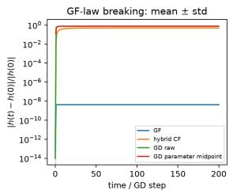

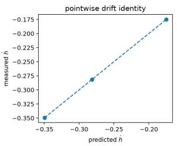

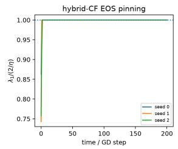

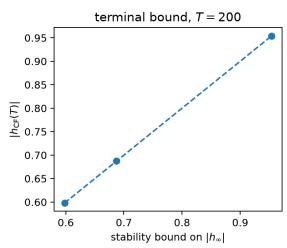  
Figure 1: Scalar factorisation: central-flow breaking of the gradient-flow balancedness law. Results are shown over three random initialisations. Left: relative change of the gradient-flow invariant $h = u ^ { 2 } - v ^ { 2 }$ Gradient flow preserves h up to numerical integration error, whereas finite-step GD and the hybrid central flow produce an $O ( 1 )$ change. The GD parameter midpoint, $( \theta _ { k } + \theta _ { k + 1 } ) / 2$ removes the dominant period-two oscillation before evaluating h. Centre-left: pointwise test of the central-flow drift at the first EOS contact. For each seed, the directly measured $\dot { h } = \langle \nabla h , \dot { \theta } _ { \mathrm { C F } } \rangle$ agrees with the closed-form prediction of $\operatorname { E q . }$ (18), with the dashed line denoting equality. Centre-right: normalised sharpness along hybrid central flow. Each trajectory follows ordinary gradient flow before EOS and, once the constraint becomes active, remains pinned at $\lambda _ { \operatorname* { m a x } } ( H ) = 2 / \eta$ . Right: long-time value of $| h |$ at $T = 2 0 0$ against the stability bound $2 \sqrt { \eta ^ { - 2 } - y ^ { 2 } }$ . The three runs lie on the identity line, showing empirically that the bound is saturated in these instances.

## Appendix C. Two-layer matrix factorisation

Let

$$
U \in \mathbb { R } ^ { n \times r } , \qquad V \in \mathbb { R } ^ { m \times r } , \qquad \phi ( U , V ) = U V ^ { \top } ,
$$

with squared loss

$$
L ( U , V ) = \frac { 1 } { 2 } \| U V ^ { \top } - Y \| ^ { 2 } , \qquad G : = U V ^ { \top } - Y
$$

where $\| \cdot \|$ denotes the Frobenius norm. The gradient-flow invariant is

$$
\Psi = U ^ { \top } U - V ^ { \top } V , \qquad \Psi _ { A } = \operatorname { t r } ( A \Psi ) , \qquad A \in \operatorname { S y m } ( r ) ,
$$

with $\nabla \Psi _ { A } = 2 \Delta _ { A }$ and $\Delta _ { A } = ( U A , - V A )$

Hessian contraction. For an oscillatory perturbation $\delta = ( \delta _ { U } , \delta _ { V } )$

$$
\begin{array} { r } { \partial \phi ( \theta ) \delta = \delta _ { U } V ^ { \top } + U \delta _ { V } ^ { \top } . } \end{array}
$$

Since $\phi$ is bilinear, the Hessian quadratic form splits as

$$
\delta ^ { \top } H \delta = \underbrace { \| \delta _ { U } V ^ { \top } + U \delta _ { V } ^ { \top } \| ^ { 2 } } _ { H _ { \mathrm { p } } } + \underbrace { 2 \langle G , \delta _ { U } \delta _ { V } ^ { \top } \rangle } _ { H _ { \mathrm { c } } } .
$$

Along the symmetry generator,

$$
D _ { \Delta _ { A } } ( U V ^ { \top } ) = U A V ^ { \top } - U A V ^ { \top } = 0 ,
$$

so $G$ is unchanged and therefore

$$
D _ { \Delta _ { \cal A } } \langle H _ { \mathrm { c } } , \Sigma \rangle = 0 .
$$

Only the pullback term contributes to symmetry breaking.

Define

$$
\begin{array} { r } { P _ { U } : = U ^ { \top } U , \qquad P _ { V } : = V ^ { \top } V , \qquad R _ { U } : = \mathbb { E } [ \delta _ { U } ^ { \top } \delta _ { U } ] , \qquad R _ { V } : = \mathbb { E } [ \delta _ { V } ^ { \top } \delta _ { V } ] . } \end{array}
$$

Expanding the pullback quadratic form,

$$
\begin{array} { r l } & { \| \delta _ { U } V ^ { \top } + U \delta _ { V } ^ { \top } \| ^ { 2 } = \mathrm { t r } ( P _ { V } \delta _ { U } ^ { \top } \delta _ { U } ) + \mathrm { t r } ( P _ { U } \delta _ { V } ^ { \top } \delta _ { V } ) } \\ & { \qquad + 2 \mathrm { t r } ( V \delta _ { U } ^ { \top } U \delta _ { V } ^ { \top } ) . } \end{array}
$$

Hence

$$
\langle H _ { \mathrm { p } } , \Sigma \rangle = \mathrm { t r } ( P _ { V } R _ { U } ) + \mathrm { t r } ( P _ { U } R _ { V } ) + 2 \mathrm { t r } ( V M ) , \qquad M : = \mathbb { E } [ \delta _ { U } ^ { \top } U \delta _ { V } ^ { \top } ] .
$$

Diferentiation along the symmetry. Holding Σ fixed gives

$$
\dot { P } _ { U } = A P _ { U } + P _ { U } A , \qquad \dot { P } _ { V } = - ( A P _ { V } + P _ { V } A ) .
$$

Therefore

$$
{ \frac { \mathrm { d } } { \mathrm { d } t } } \bigl [ \mathrm { t r } ( P _ { U } R _ { V } ) + \mathrm { t r } ( P _ { V } R _ { U } ) \bigr ] = \mathrm { t r } ( A [ P _ { U } R _ { V } + R _ { V } P _ { U } - P _ { V } R _ { U } - R _ { U } P _ { V } ] ) .
$$

For the cross term,

$$
\begin{array} { r } { \dot { M } = \mathbb { E } [ \delta _ { U } ^ { \top } U A \delta _ { V } ^ { \top } ] , } \end{array}
$$

so

$$
\frac { \mathrm { d } } { \mathrm { d } t } 2 \mathrm { t r } ( V M ) = 2 \mathrm { t r } ( \dot { V } M ) + 2 \mathrm { t r } ( V \dot { M } ) .
$$

Define

$$
N : = \mathbb { E } [ ( \delta _ { V } ^ { \top } V ) ( \delta _ { U } ^ { \top } U ) ] , \qquad N ^ { \prime } : = \mathbb { E } [ ( \delta _ { U } ^ { \top } U ) ( \delta _ { V } ^ { \top } V ) ] .
$$

Then

$$
\mathrm { t r } ( { \dot { V } } M ) = - \mathrm { t r } ( A N ^ { \prime } ) , \qquad \mathrm { t r } ( V { \dot { M } } ) = \mathrm { t r } ( A N ) ,
$$

and consequently

$$
\frac { \mathrm { d } } { \mathrm { d } t } 2 \mathrm { t r } ( V M ) = 2 \mathrm { t r } ( A ( N - N ^ { \prime } ) ) .
$$

Combining the layer and cross terms gives

$$
\biggl | \widetilde { B } = P _ { U } R _ { V } + R _ { V } P _ { U } - P _ { V } R _ { U } - R _ { U } P _ { V } + 2 ( N - N ^ { \prime } ) \biggr | .\tag{21}
$$

Thus

$$
\dot { \Psi } _ { A } = - \eta \mathrm { t r } ( A \widetilde { B } ) .
$$

Projection onto the conservation-law space. Because $A \in \operatorname { S y m } ( r )$

$$
\operatorname { t r } ( A { \widetilde { B } } ) = \langle A , \operatorname { s y m } ( { \widetilde { B } } ) \rangle .
$$

Hence the canonical symmetry-breaking matrix is

$$
B = \operatorname { s y m } ( { \widetilde { B } } ) ,
$$

and the matrix-valued invariant obeys

$$
\begin{array} { r } { \boxed { \dot { \Psi } = - \eta B = - \eta \operatorname { s y m } ( \widetilde { B } ) } . } \end{array}\tag{22}
$$

The cross contribution is the expected commutator

$$
\boldsymbol { N } - \boldsymbol { N } ^ { \prime } = \mathbb { E } \left[ [ \delta _ { V } ^ { \top } \boldsymbol { V } , \delta _ { U } ^ { \top } \boldsymbol { U } ] \right] .
$$

It vanishes automatically at $r = 1$ , but is generally nonzero for $r > 1$ . Since a commutator need be neither symmetric nor skew-symmetric, $\widetilde { B }$ itself need not lie in $\operatorname { S y m } ( r )$ ; only $\mathrm { s y m } ( \widetilde { B } )$ is observable by the conservation laws.

At a realised time $t ,$

$$
\dot { \Psi } _ { A } ( t ) = 0 \quad \Longleftrightarrow \quad A \perp B ( t ) ,
$$

while a constant- $. A$ law survives along the whole trajectory precisely when

$$
A \perp \operatorname { s p a n } _ { t } \{ B ( t ) \} .
$$

Finally, the suficient conditions

$$
P _ { U } = P _ { V } , \qquad R _ { U } = R _ { V } , \qquad N = N ^ { \prime }
$$

give $\widetilde { B } = 0$ . The ordinary factor-balance condition $U ^ { \top } U = V ^ { \top } V$ alone does not imply the corresponding covariance balance or vanishing of the cross term.

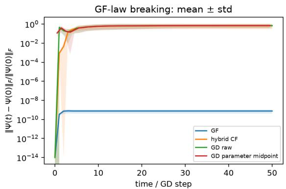

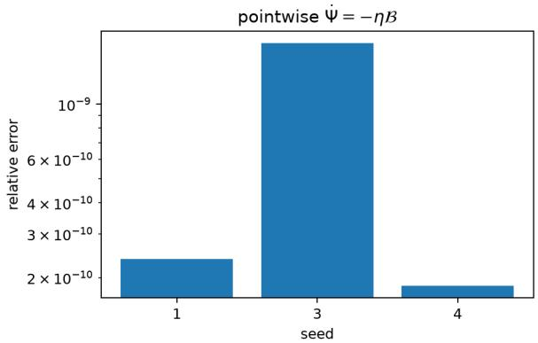

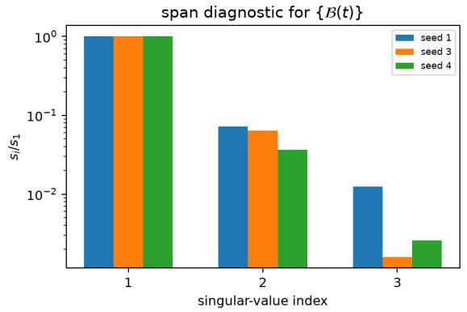

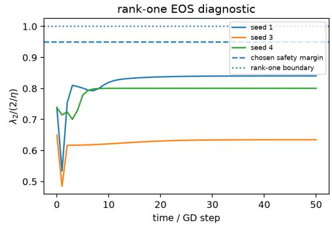  
Figure 2: Matrix factorisation: the broken conservation-law direction over the EOS trajectory. We consider rank- $r = 2$ matrix factorisation, for which the gradient-flow invariant $\Psi = U ^ { \top } U - V ^ { \top } V \in \operatorname { S y m } ( 2 )$ contains $N _ { \mathrm { G F } } = 3$ independent scalar conservation laws. Results are shown over three random seeds. Top left: relative Frobenius displacement $\lVert \Psi ( t ) - \Psi ( 0 ) \rVert _ { F } / \lVert \Psi ( 0 ) \rVert _ { F }$ Gradient flow preserves Ψ up to numerical error, whereas GD and hybrid central flow produce an $O ( 1 )$ change; the adjacent-iterate GD parameter midpoint removes the dominant period-two oscillation before evaluating $\Psi$ . Top right: pointwise validation of $\dot { \Psi } = - \eta B$ , with $B = \operatorname { s y m } ( \widetilde { B } )$ . The relative discrepancy between the directly diferentiated matrix invariant and the symmetry-breaking prediction is approximately $1 0 ^ { - 1 0 } – 1 0 ^ { - 9 }$ for all seeds. Bottom left: normalised singular values of the matrices $B ( t )$ , represented in Frobenius-orthonormal coordinates of $\mathrm { S y m } ( 2 )$ and stacked over the active EOS trajectory. All three singular values are nonzero well above the numerical error floor, showing that the realised breaking direction spans all of $\mathrm { S y m } ( 2 )$ over the observed trajectory. Bottom right: rank-one EOS diagnostic. The second Hessian eigenvalue remains below both $2 / \eta$ and the displayed $0 . 9 5 ( 2 / \eta )$ safety margin throughout the active trajectory, so the rank-one central-flow approximation remains well separated from the onset of a second critical direction.

Empirical analysis. Figure 2 shows that no nonzero constant test matrix $A \in \mathrm { S y m } ( 2 )$ remains orthogonal to the breaking direction for the entire trajectory although no additional critical Hessian directions appear (the second eigenvalue stays uniformly below the EOS threshold).

## Appendix D. Two-layer ReLU

Consider

$$
g ( \theta , x ) = U \sigma ( V ^ { \top } x ) = \sum _ { j = 1 } ^ { r } u _ { j } \sigma ( v _ { j } ^ { \top } x ) ,
$$

with

$$
L = \frac { 1 } { 2 } \sum _ { i } \| U \sigma ( V ^ { \top } x _ { i } ) - y _ { i } \| ^ { 2 } .
$$

The gradient-flow conservation laws are

$$
h _ { j } = \| u _ { j } \| ^ { 2 } - \| v _ { j } \| ^ { 2 } , \qquad j = 1 , \ldots , r ,
$$

or equivalently

$$
\Psi _ { A } = \sum _ { j } \lambda _ { j } h _ { j } , \qquad A = \mathrm { d i a g } ( \lambda _ { 1 } , \dots , \lambda _ { r } ) \in \mathrm { D i a g } ( r ) .
$$

Fixed activation pattern. For the explicit Hessian calculation, assume that the activation pattern is constant on the support of the oscillatory perturbations. For each example define

$$
\begin{array} { r } { z _ { i } : = V ^ { \top } x _ { i } , \qquad s _ { i } : = { \bf 1 } [ z _ { i } > 0 ] , \qquad D _ { i } : = \mathrm { d i a g } ( s _ { i } ) , } \end{array}
$$

and

$$
\pi _ { i } : = \sigma ( z _ { i } ) = D _ { i } z _ { i } , \qquad \rho _ { i } : = U \pi _ { i } - y _ { i } .
$$

For $\delta = ( \delta _ { U } , \delta _ { V } )$ , let

$$
\alpha _ { i } : = D _ { i } \delta _ { V } ^ { \top } x _ { i } .
$$

Within this fixed-gating region,

$$
\begin{array} { r } { \partial f _ { i } ( { \boldsymbol { \theta } } ) \delta = \delta _ { U } \pi _ { i } + U \alpha _ { i } , } \end{array}
$$

and the Hessian quadratic form is

$$
\delta ^ { \top } H \delta = \sum _ { i } \| \delta _ { U } \pi _ { i } + U \alpha _ { i } \| ^ { 2 } + 2 \sum _ { i } \langle \rho _ { i } , \delta _ { U } \alpha _ { i } \rangle .
$$

For $A \in \operatorname { D i a g } ( r )$ , the symmetry generator satisfies

$$
\dot { U } = U A , \qquad \dot { V } = - V A .
$$

Since A commutes with each gate matrix $D _ { i }$ ,

$$
\dot { \pi } _ { i } = - A \pi _ { i } , \qquad \frac { \mathrm { d } } { \mathrm { d } t } ( U \pi _ { i } ) = U A \pi _ { i } - U A \pi _ { i } = 0 .
$$

Thus the residual term is invariant and only the pullback term contributes.

Define

$$
P _ { U } : = U ^ { \top } U , \qquad R _ { U } : = \mathbb { E } [ \delta _ { U } ^ { \top } \delta _ { U } ] ,
$$

together with

$$
\Pi : = \sum _ { i } \pi _ { i } \pi _ { i } ^ { \top } , \qquad R _ { V } ^ { \mathrm { g a t e } } : = \sum _ { i } \mathbb { E } [ \alpha _ { i } \alpha _ { i } ^ { \top } ] .
$$

Expanding the pullback term gives

$$
\sum _ { i } \mathbb { E } [ \| \delta _ { U } \pi _ { i } + U \alpha _ { i } \| ^ { 2 } ] = \mathrm { t r } ( \Pi R _ { U } ) + \mathrm { t r } ( P _ { U } R _ { V } ^ { \mathrm { g a t e } } ) + C ,
$$

where

$$
C : = 2 \sum _ { i } \mathbb { E } [ \pi _ { i } ^ { \top } \delta _ { U } ^ { \top } U \alpha _ { i } ] .
$$

The Gram terms satisfy

$$
\dot { P } _ { U } = A P _ { U } + P _ { U } A , \qquad \dot { \Pi } = - ( A \Pi + \Pi A ) ,
$$

so

$$
\frac { \mathrm { d } } { \mathrm { d } t } \bigl [ \mathrm { t r } ( P _ { U } R _ { V } ^ { \mathrm { g a t e } } ) + \mathrm { t r } ( \Pi R _ { U } ) \bigr ] = \mathrm { t r } \Bigl ( A [ P _ { U } R _ { V } ^ { \mathrm { g a t e } } + R _ { V } ^ { \mathrm { g a t e } } P _ { U } - \Pi R _ { U } - R _ { U } \Pi ] \Bigr ) .
$$

For the cross term, define

$$
N _ { \mathrm { e } } : = \sum _ { i } \mathbb { E } [ \alpha _ { i } \pi _ { i } ^ { \top } \delta _ { U } ^ { \top } U ] , \qquad N _ { \mathrm { e } } ^ { \prime } : = \sum _ { i } \mathbb { E } [ \delta _ { U } ^ { \top } U \alpha _ { i } \pi _ { i } ^ { \top } ] .
$$

Diferentiating C and using cyclicity gives

$$
\dot { C } = 2 \mathrm { t r } \big ( A ( N _ { \mathrm { e } } - N _ { \mathrm { e } } ^ { \prime } ) \big ) .
$$

Hence

$$
\begin{array} { r }  \boxed { \widetilde { \mathcal { B } } _ { \mathrm { R e L U } } = P _ { U } R _ { V } ^ { \mathrm { g a t e } } + R _ { V } ^ { \mathrm { g a t e } } P _ { U } - \Pi R _ { U } - R _ { U } \Pi + 2 ( N _ { \mathrm { e } } - N _ { \mathrm { e } } ^ { \prime } ) \boxed { . } } \end{array}\tag{23}
$$

This is exactly the matrix-factorisation form under

$$
P _ { V } \longmapsto \Pi , \qquad R _ { V } \longmapsto R _ { V } ^ { \mathrm { g a t e } } , \qquad N \longmapsto N _ { \mathrm { e } } , \qquad N ^ { \prime } \longmapsto N _ { \mathrm { e } } ^ { \prime } .
$$

Projection and survival. For ReLU the admissible test space is Diag(r), so

$$
B _ { \mathrm { R e L U } } = P _ { \mathrm { D i a g } ( r ) } \widetilde { B } _ { \mathrm { R e L U } } .
$$

In particular,

$$
\boxed { \dot { h } _ { j } = - \eta ( \widetilde { B } _ { \mathrm { R e L U } } ) _ { j j } } .\tag{24}
$$

An individual conservation law $h _ { j }$ therefore has zero instantaneous drift exactly when

$$
( \widetilde { B } _ { \mathrm { R e L U } } ) _ { j j } = 0 .
$$

For a general diagonal test matrix $A = \mathrm { d i a g } ( \lambda _ { 1 } , . . . , \lambda _ { r } )$ 7

$$
\dot { \Psi } _ { A } = - \eta \langle A , B _ { \mathrm { R e L U } } \rangle .
$$

Thus individual $h _ { j } { \mathrm { : } }$ ’s may all drift while a nontrivial linear combination $\sum _ { j } \lambda _ { j } h _ { j }$ has zero instantaneous drift.

Across activation boundaries. The matrix formula above assumes fixed gates. An exact identity for the averaged dynamics does not require this assumption. Suppose

$$
\begin{array} { r } { \dot { w } = - \eta \mathbb { E } [ \nabla L ( w + \delta ) ] , \quad \quad \mathbb { E } [ \delta ] = 0 , } \end{array}
$$

and let the linear generator $\Delta _ { A }$ satisfy the symmetry identity

$$
\langle \nabla L ( w ) , \Delta _ { A } ( w ) \rangle = 0
$$

wherever $L$ is diferentiable. Since $\nabla \Psi _ { A } = 2 \Delta _ { A }$

$$
\dot { \Psi } _ { A } = - 2 \eta \mathbb { E } [ \langle \Delta _ { A } ( w ) , \nabla L ( w + \delta ) \rangle ] .
$$

Using the invariance identity at $w + \delta$ together with $\Delta _ { A } ( w + \delta ) = \Delta _ { A } ( w ) + \Delta _ { A } ( \delta )$ gives

$$
\begin{array} { r } { \boxed { \dot { \Psi } _ { A } = 2 \eta \mathbb { E } \left[ \langle \Delta _ { A } ( \delta ) , \nabla L ( w + \delta ) \rangle \right] } . } \end{array}\tag{25}
$$

Identity (25) is not specific to ReLU: it uses only that $\Delta _ { A }$ is linear, that $\nabla \Psi _ { A } = 2 \Delta _ { A }$ and that L is invariant along $\Delta _ { A }$ at every point $w + \delta$ where it is diferentiable, so it holds equally for the scalar and matrix factorisation examples. We state it here because, for ReLU, the loss is not smooth: when $L$ is smooth near $w ,$ the central flow (3) is the second-order truncation of these averaged dynamics and (23) is the corresponding explicit drift, which requires the oscillation to stay within one activation region. Identity (25) allows the oscillation to cross activation boundaries between $w - \delta$ and $w + \delta .$ , only limiting the sampled points to not lie exactly on a boundary. Nevertheless, there is a dependence on the full distribution of $\delta ,$ whereas the central flow only looks at $\Sigma = \mathbb { E } [ \delta \delta ^ { \top } ]$

Empirical analysis. Figure 3 verifies the architecture-dependent projection underlying the ReLU result. The ReLU conservation laws only probe the diagonal component of the raw symmetry-breaking matrix. The directly measured $\dot { h } _ { j }$ agrees with − $\cdot \eta ( \widetilde { B } _ { \mathrm { R e L U } } ) _ { j j }$ . The agreement includes both positive and negative drifts, showing that the calculation predicts not only whether a law is broken but also its signed instantaneous motion. The explicit ReLU Hessian calculation is only valid while the oscillation remains inside a single activation region.

Figure 4 shows what happens beyond the fixed-gate regime. When a pre-activation crosses zero, the Hessian changes discontinuously, and along the hybrid central-flow trajectories the rank-one oscillation violates the fixed-gate condition after fewer than 10 optimisation steps. Beyond that point (23) is no longer certified: the orange curves are obtained by recomputing the local Hessian in each new activation region. Gradient flow and centred GD are shown for reference. Characterising the central flow conservation laws across activation boundaries is left as a follow-up to this work.

## Appendix E. Experimental settings

The git repository can be found at: https://github.com/naimaeb/CF\_conserved\_quantities. $\mathtt { g i t }$ and the experimental settings are given by Table 2:

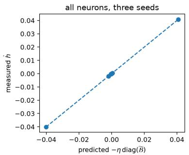

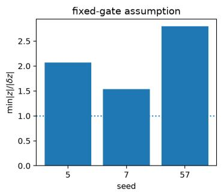

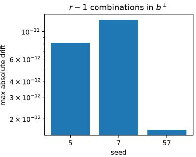  
Figure 3: Two-layer ReLU: local symmetry breaking inside a fixed activation region. We consider a two-layer ReLU network with $r = 3$ hidden units and evaluate the central-flow prediction at an active rank-one EOS point for three independent seeds. The admissible test space is $\mathcal { A } = \mathrm { D i a g } ( r )$ , so only the diagonal projection of the raw breaking matrix is observable. Left: pointwise validation of the per-neuron drift $\dot { h } _ { j } \ = \ - \eta ( \widetilde { B } _ { \mathrm { R e L U } } ) _ { j j } , h _ { j } \ = \ \lVert u _ { j } \rVert ^ { 2 } - \lVert v _ { j } \rVert ^ { 2 }$ . Each marker corresponds to one neuron from one seed; the measured drift $\langle \nabla h _ { j } , \dot { \theta } _ { \mathrm { C F } } \rangle$ lies on the identity line against the prediction. Centre: verification of the fixed-gating assumption. For every seed we report mini,j $\begin{array} { r } { \frac { | z _ { i j } | } { | \delta z _ { i j } | } , \delta = \pm \sqrt { \sigma ^ { 2 } } q } \end{array}$ , where $z _ { i j } = v _ { j } ^ { \top } x _ { i }$ All ratios exceed one, so neither side of the rank-one oscillation crosses a ReLU activation boundary. Right: instantaneous surviving combinations. Writing $b = \mathrm { d i a g } ( \widetilde { \mathcal { B } } _ { \mathrm { R e L U } } ) \in \mathbb { R } ^ { r }$ , we construct an orthonormal basis of $b ^ { \perp }$ , which has dimension $r - 1 = 2$ whenever $b \neq 0$ . The maximum measured absolute drift among these two combinations is $O ( 1 0 ^ { - 1 1 } )$ for every seed.

ReLU: piecewise CF versus period-2-centered GD across gate changes

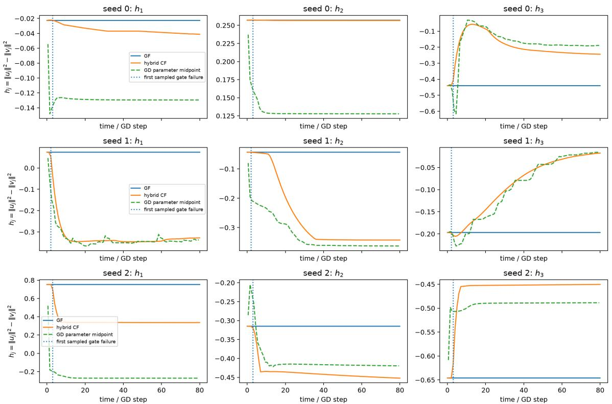  
Figure 4: Two-layer ReLU beyond fixed gates: piecewise continuation of the central flow. For each of three random seeds (rows), we track the three per-neuron gradient-flow laws $h _ { j } \ = \ \| u _ { j } \| ^ { 2 } - \| v _ { j } \| ^ { 2 }$ (columns). Gradient flow (solid blue) preserves every $h _ { j }$ , while finite-step GD breaks them. To remove the dominant period-two oscillation, the dashed green curve evaluates $h _ { j }$ at the adjacent-iterate parameter midpoint $\bar { \theta } _ { k + 1 / 2 } = ( \theta _ { k } ^ { \mathrm { G D } } + \theta _ { k + 1 } ^ { \mathrm { G D } } ) / 2$ . The orange curve is the hybrid central flow, continued piecewise by recomputing the local ReLU Hessian after activation-pattern changes. The vertical dotted line marks the first sampled point at which the rank-one oscillation fails the fixed-gate condition $| z _ { i j } | > \sqrt { \sigma ^ { 2 } } | q _ { v _ { i } } ^ { \top } x _ { i } |$ for some sample-neuron pair. Consequently, the explicit fixed-gate symmetrybreaking formula (23) is certified only to the left of this line; to the right, the orange curve is a heuristic piecewise continuation shown for illustration, with gradient flow and centred GD for reference.

<table><tr><td></td><td>scalar</td><td>matrix fact.</td><td>ReLU (local)</td><td>ReLU (trajectory)</td></tr><tr><td> $\phi$ </td><td>uv</td><td> $U V ^ { \top }$ </td><td> $U \sigma ( V ^ { \top } x )$ </td><td> $U \sigma ( V ^ { \top } x )$ </td></tr><tr><td>dimensions</td><td> $n = m = r = 1$ </td><td> $n = m = 3 , r = 2$ </td><td> $n = 1 , m = 4 , r = 3$ </td><td> $n = 1 , m = 4 , r = 3$ </td></tr><tr><td>data</td><td> $y = 1$ </td><td>rank-2 target Y</td><td> $N = 2 4 , x _ { i } \sim \mathcal { N } ( 0 , I )$ </td><td>as local</td></tr><tr><td>initialisation</td><td> $u _ { 0 } \in [ 1 , 1 . 4 5 ] , v _ { 0 } \in [ 0 . 0 5 , 0 . 3 ]$ </td><td> $0 . 8 \mathcal { N } , 0 . 3 \mathcal { N }$ </td><td> $0 . 6 \mathcal { N } , 0 . 2 5 \mathcal { N }$ </td><td>as local</td></tr><tr><td>n_seeds</td><td>3</td><td>3</td><td>3</td><td>3</td></tr><tr><td>η</td><td>0.90, 0.95, 0.96</td><td>0.87,0.12,0.19</td><td>2.22, 0.69, 2.99</td><td>0.56, 1.62, 1.19</td></tr><tr><td>horizon (steps)</td><td>200</td><td>50</td><td></td><td>80</td></tr><tr><td>CF step</td><td>0.02</td><td>0.1</td><td></td><td>0.1</td></tr><tr><td> $N _ { \mathrm { G F } }$ </td><td>1</td><td>3</td><td>3</td><td>3</td></tr></table>

Table 2: Configuration of the four experiments. ReLU targets are $y _ { i } = x _ { i } ^ { \top } w _ { \ast }$ ⋆ with $w _ { \star } \sim$ $\mathcal { N } ( 0 , I )$ , and the ReLU loss is a dataset mean. Note that when considering the dataset mean in the ReLU case, we need to scale the loss, the Hessian quadratic form, Π, $R _ { V } ^ { \mathrm { g a t e } } , C , N _ { \mathrm { e } }$ and $N _ { \mathrm { e } } ^ { \prime }$ by $\textstyle { \frac { 1 } { N } }$