# Systolic Linear Attention: Co-Designing Tile-Grouped Gated Delta Attention for TPUs

Gagik Amirkhanyan Google agagik@google.com

Nuojin Cheng Google chengnuojin@google.com

## Abstract

Gated-delta linear attention layers such as Gated DeltaNet (GDN), Kimi Delta Attention (KDA), and GDN-2 are tuned for GPUs, where small tensor-core tiles and fast vector registers make per-channel decay rescaling and sequential in-block solves cheap. On Google TPUs, which concentrate compute in wide 256 256 systolic matrix units backed by a slower vector unit, porting these layers directly leaves half of each matrix tile empty and bottlenecks on vector operations. We present Systolic Linear Attention (SLA), which reshapes gated delta attention around the matrix unit by widening keys to 256 with grouped value heads, grouping decay gates into four 64-channel tiles, and computing the chunk solve entirely with block matrix products in a single fused kernel. On TPU v7x, a full SLA-R4 layer runs $1 . 6 \times - 2 . { \bar { 5 } } \times$ faster than the open-source Tokamax KDA kernel (1.4 –2.4 with exact chunk inversion), driven primarily by head sharing and kernel fusion. Across a 2,048-chip TPU v7x pre-training study of sparse Mixture-of-Experts (MoE) models from 6.5B to 63.1B parameters, SLA trains 11%–24% faster than KDA at similar perplexity, and reaches slightly lower perplexity than KDA in smaller matched-seed runs.

## 1 Introduction

Linear attention removes the quadratic compute and key-value (KV) cache of softmax attentions [15, 63] by storing the context in a fixed-size state matrix $\boldsymbol { S } _ { t } ^ { \mathsf { ^ { * } } } \in \mathbb { R } ^ { d _ { k } \times d _ { v } }$ (for key width $d _ { k }$ and value width $d _ { v } )$ , updated at each token t with its key $\boldsymbol { k } _ { t } \in \mathbb { R } ^ { d _ { k } }$ and value $v _ { t } \in \mathbb { R } ^ { d _ { v } }$ as [33]:

$$
S _ { t } = S _ { t - 1 } + k _ { t } v _ { t } ^ { \top } .
$$

Because this sum grows without bound, the state saturates on long sequences. Gated models such as Mamba-2 [14] and GLA [66] add a data-dependent forget (decay) gate $F _ { t } \in ( 0 , 1 ] ^ { d _ { k } \times d _ { k } }$

$$
\begin{array} { r } { S _ { t } = F _ { t } S _ { t - 1 } + k _ { t } v _ { t } ^ { \top } , } \end{array}
$$

but decay fades all stored keys together and hurts associative recall [5].

To overwrite individual keys selectively, DeltaNet [50, 67] introduced the delta rule with unit-norm key kt $( \| k _ { t } \| _ { 2 } = 1 )$ , scalar write gate $\beta _ { t }$ , and $d _ { k } \times d _ { k }$ identity $I _ { d _ { k } }$

$$
\boldsymbol { S _ { t } } = \big ( \boldsymbol { I } _ { d _ { k } } - \beta _ { t } \boldsymbol { k _ { t } } \boldsymbol { k } _ { t } ^ { \top } \big ) \boldsymbol { S _ { t - 1 } } + \beta _ { t } \boldsymbol { k _ { t } } \boldsymbol { v } _ { t } ^ { \top } .
$$

Viewing such updates as online gradient descent, prior work also added heavy-ball momentum so that a single noisy update cannot overwrite established memories [9, 44]. Combining decay with the delta rule produced Gated DeltaNet (GDN) [68], adopted in Qwen3-Next [48]. Kimi Delta Attention (KDA) [71] then expanded GDN’s scalar forget gate into a per-channel diagonal gate $F _ { t } = \mathrm { d i a g } ( f _ { t } )$

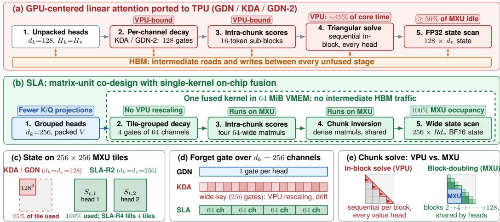  
Figure 1: Overview of SLA. (a) Direct ports of GPU-tuned gated-delta layers (GDN [68], KDA [71], GDN-2 [25]) run as an unfused pipeline on TPUs: intermediates round-trip through HBM, perchannel decay rescaling in KDA and GDN-2 and in-block triangular substitution run on the VPU, and 128-wide states leave at least half of each $2 5 6 \times 2 5 6 \mathrm { M X U }$ tile padded. (b) SLA fuses stages 2–5 into one VMEM kernel. (c) A head with key and value widths $d _ { k } = d _ { v } = 1 2 8$ fills a quarter of an MXU tile, while SLA’s wide packed state fills whole tiles. (d) Decay gates are grouped into four 64-channel tiles, so intra-chunk scores are four 64-wide MXU matmuls with no VPU rescaling. (e) The chunk solve uses only block matrix products on the MXU.

with channel-wise decay vector $f _ { t } \in ( 0 , 1 ] ^ { d _ { k } }$ , and GDN-2 [25] decoupled per-channel erase and write gates. Section 5 surveys further variants.

However, these architectures and their chunkwise WY training algorithms [10, 66, 68] were developed and tuned on NVIDIA GPUs (fla [65]). They map less well onto 2D systolic-array accelerators such as Google TPUs [18, 31, 32], for three reasons:

Small tiles and unpacked heads. GPU Tensor Cores operate on small fragments, so $d _ { k } = d _ { v } = 1 2 8$ with one key head per value head already reaches high occupancy. The TPU v6e/v7x Matrix Multiply Unit (MXU) is a 256  256 systolic array: a 128-wide state pads half of every tile, and projections, convolutions, and chunk solves are repeated for every head.

Per-channel decay gates. In KDA and GDN-2, each key channel decays at its own rate. Kernels must rescale keys elementwise in 16-token sub-blocks to avoid float32 overflow. GPUs absorb this vector work cheaply; on TPUs, where matrix throughput exceeds vector throughput by roughly 128 , it stalls the kernel.

Sequential triangular solves. The chunkwise WY algorithm [10, 68] partitions training sequences into chunks of length C and solves a $C \times C$ unit lower-triangular system per head and chunk. Existing kernels [19, 65] substitute sequentially within diagonal blocks; on TPUs this runs on the Vector Processing Unit (VPU) and takes about half of the core kernel time in our measurements.

Kernel tuning alone does not close this gap: fusing a GPU-shaped KDA layer into on-chip memory speeds it up by only 1.03 on TPU v7x (Table 5), because the time goes to VPU solves and padded MXU tiles rather than High-Bandwidth Memory (HBM) traffic. We therefore change the layer itself. Systolic Linear Attention (SLA) applies a block-diagonal, tile-grouped forget gate $F _ { t } \in \mathbb { R } ^ { d _ { k } \times d _ { k } }$ to $S _ { t - 1 }$ and then performs the delta update with key $\breve { k _ { t } } \in \mathbb { R } ^ { d _ { k } }$ , packed value $v _ { t } \in \mathbb { R } ^ { R d _ { \tau } }$ v (stacking $R \in \{ 2 , 4 \}$ value heads per key head), and a write gate $\beta _ { t } \in ( 0 , 2 )$ shared across the packed value heads:

$$
S _ { t } = F _ { t } S _ { t - 1 } + \beta _ { t } k _ { t } \big ( \boldsymbol { v } _ { t } - ( F _ { t } S _ { t - 1 } ) ^ { \top } \boldsymbol { k } _ { t } \big ) ^ { \top } .\tag{1}
$$

SLA also smooths chunk updates with a chunk-boundary momentum term with coefficient $\mu = 0 . 2 5$ that stays in on-chip SRAM (VMEM). SLA combines three changes (Section 2):

Wide keys shared across value heads. SLA widens keys to $d _ { k } = 2 5 6$ and shares each key head and gate $\beta _ { t }$ across $R \in \{ 2 , 4 \}$ value heads $( \mathtt { S L A - R 2 } , \mathtt { S L A - R 4 } )$ , following grouped value attention (GVA) [47]. The packed state fills whole MXU tiles, and key-query projections, convolutions, and chunk solves are computed R less often.

Tile-grouped forget gate. SLA splits the 256 key channels into 4 tiles of 64 channels, each with one scalar decay rate. Intra-chunk scores then become four 64-wide MXU matmuls scaled by decay masks, with no VPU rescaling. This is a middle point between GDN’s single rate per head and KDA’s rate per channel.

Chunk inversion on the MXU. Because $\beta _ { t }$ is shared, SLA needs one $C \times C$ solve per key head. It computes the inverse only with block matrix products on the MXU: an exact recursive block-doubling inverse by default, or an optional 1-step Neumann approximation for faster solves, fused with the rest of the layer in VMEM.

We evaluate SLA on TPU v7x at the kernel, layer, serving, and context-parallel level, and across a 2,048-chip TPU v7x pre-training study of sparse Mixture-of-Experts (MoE) models [16, 52] from 6.5B to 63.1B parameters on Dolma [54, 60] (Section 3). We find that most of SLA’s speedup comes from head sharing and fusion, which the tile-grouped gate and MXU chunk inversion make possible. On matched seeds, SLA improves on standard KDA and stays within about 0.1 perplexity of a wide-key per-channel KDA control while avoiding per-channel long-context drift; the optional 1-step Neumann inverse trades about 0.2 perplexity for speed. SLA is therefore best understood as a hardware-efficient operating point rather than a more expressive update rule; it is complementary to modeling advances such as GDN-2, which reaches lower perplexity per token (Section 3.5).

In the following sections, Section 2 reviews gated delta attention, its TPU bottlenecks, and SLA’s design; Section 3 evaluates SLA from kernels and serving to MoE pre-training; Section 4 details optional low-precision key whitening; and Section 5 covers related work.

## 2 Hardware Bottlenecks and the SLA Design

To motivate SLA, we first review gated delta recurrences and their chunkwise WY training algorithm (Section 2.1), identify three hardware bottlenecks that GPU-centric designs hit on TPUs (Section 2.2), and then present SLA’s mathematical formulation and chunk-boundary momentum (Section 2.3), its three algorithmic pillars and mathematical derivations (Section 2.4), and its single-kernel VMEM backward pass (Section 2.5), followed by empirical evaluation in Section 3.

## 2.1 Preliminaries: Gated Delta Recurrences and Chunkwise WY Parallelism

Given an input sequence $X = ( x _ { 1 } , \dots , x _ { T } ) \in \mathbb { R } ^ { T \times D }$ of length T and model width D, a gated-delta linear attention layer with $H _ { v }$ value heads and $H _ { k }$ query-key heads maps each token $\boldsymbol { x } _ { t } \in \mathbb { R } ^ { D }$ $( t \in \{ 1 , \ldots , T \} )$ to $L _ { 2 }$ -normalized queries and keys $q _ { t } , \dot { k } _ { t } \in \mathbb { R } ^ { d _ { k } } ( \lVert q _ { t } \rVert _ { 2 } ^ { \cdot } = \lVert k _ { t } \rVert _ { 2 } = 1 )$ , values $v _ { t } \in \mathbb { R } ^ { d _ { v } }$ , and head output $o _ { t } \in \mathbb { R } ^ { d _ { v } }$ (with $H _ { k } = H _ { \tau }$ in unpacked baselines). Rather than caching t past tokens, each head maintains a fixed-size associative state matrix $S _ { t } \in \mathbb R ^ { d _ { k } \times d _ { v } }$ updated by applying a diagonal forget gate $F _ { t } \in ( 0 , 1 ] ^ { d _ { k } \times d _ { k } }$ followed by a rank-one delta update [9, 50, 59, 67] with scalar step size $\beta _ { t } \mathbf { \mathrm { : } }$

Prior Work: Gated Delta Recurrence in GDN and KDA

$$
\begin{array} { r l } & { S _ { t } = F _ { t } S _ { t - 1 } + \beta _ { t } k _ { t } \big ( v _ { t } - ( F _ { t } S _ { t - 1 } ) ^ { \top } k _ { t } \big ) ^ { \top } } \\ & { ~ = \big ( I _ { d _ { k } } - \beta _ { t } k _ { t } k _ { t } ^ { \top } \big ) F _ { t } S _ { t - 1 } + \beta _ { t } k _ { t } v _ { t } ^ { \top } , } \\ & { o _ { t } = S _ { t } ^ { \top } q _ { t } . } \end{array}\tag{2}
$$

Here $( F _ { t } S _ { t - 1 } ) ^ { \top } k _ { t }$ is the value currently retrieved for key $k _ { t }$ , and $\beta _ { t }$ sets how far it is moved toward $v _ { t }$ . Existing linear attentions differ only in $( F _ { t } , \beta _ { t } )$ in Eq. (2), where we characterize $F _ { t }$ by its number of decay groups G (distinct decay rates across the $d _ { k }$ key channels of a head). Unweighted

Linear Attention [33] sets $F _ { t } = I _ { d _ { k } }$ without erasure $( S _ { t } = S _ { t - 1 } + k _ { t } v _ { t } ^ { \top } )$ , while DeltaNet [50, 67] and test-time learning [59, 64] retain $F _ { t } = I _ { d _ { k } }$ with the rank-one delta update. Recent gated-delta architectures instantiate $( F _ { t } , \beta _ { t } )$ using the logistic sigmoid $\sigma ( \cdot )$ on scalar write-gate logit $\tilde { \beta } _ { t } \in \mathbb { R }$ and softplus $\displaystyle ( u ) = \ln ( 1 + e ^ { u } )$ on forget-gate logits $\tilde { f } _ { t } \in \mathbb { R } ^ { G }$

Gated DeltaNet (GDN). GDN [68] uses one scalar decay $\gamma _ { t } \in ( 0 , 1 ]$ per head $( G = 1 )$ together with a unit-interval scalar step size:

$$
F _ { t } = \gamma _ { t } I _ { d _ { k } } , \qquad \beta _ { t } = \sigma ( \tilde { \beta } _ { t } ) \in ( 0 , 1 ) .
$$

Kimi Delta Attention (KDA). KDA [71] assigns an independent decay rate to every key channel $( G = d _ { k } , f _ { t } = \exp ( - \operatorname { s o f t p l u s } ( \tilde { f } _ { t } ) ) )$ :

$$
F _ { t } = \mathrm { d i a g } ( f _ { t } ) , \qquad f _ { t } \in ( 0 , 1 ] ^ { d _ { k } } .
$$

While standard GDN and KDA use $\beta _ { t } = \sigma ( \tilde { \beta } _ { t } ) \in ( 0 , 1 )$ , negative-eigenvalue extensions [20] widen the step-size range to

$$
\beta _ { t } = 2 \sigma ( \tilde { \beta } _ { t } ) \in ( 0 , 2 ) ,
$$

so that $I _ { d _ { k } } - \beta _ { t } k _ { t } k _ { t } ^ { \top }$ has eigenvalue $1 - \beta _ { t } \in ( - 1 , 1 )$ along $k _ { t }$ (adopted by SLA in Section 2.3).

GDN-2. GDN-2 [25] retains per-channel decay $( G = d _ { k } )$ and further replaces the scalar $\beta _ { t }$ with separate channel-wise erase and write gates.

Chunkwise WY parallelization. To saturate matrix units during training, chunkwise WY parallelization [10, 67, 68] partitions the sequence into $T / C$ contiguous chunks of length C (Algorithm 1, written unified across sharing ratio $R = H _ { v } / H _ { k }$ and gate scale $s _ { \beta } \in \{ 1 , 2 \}$ , where unpacked GDN/KDA set $R = 1 , s _ { \beta } = 1 )$ . Op 1 projects $X$ to pre-convolution activations $\tilde { Q } , \tilde { K } , \tilde { V }$ , gate logits $( \tilde { \beta } _ { t } , \tilde { f } _ { t } ) _ { t = 1 } ^ { T }$ , and output-gate logits $( z _ { t } ) _ { t = 1 } ^ { T } ( z _ { t } \in \mathbb { R } ^ { R d _ { \tau } }$ v per key head), followed by causal short convolutions, $L _ { 2 }$ normalization into ${ \bar { Q } } , K ,$ , and gate activations $( \mathrm { O p } 2 )$ . Within chunk $c \in \{ 1 , \ldots , T / C \}$ starting from boundary state $S _ { c - 1 } \in \mathbb { R } ^ { d _ { k } \times R d _ { v } } \left( S _ { 0 } = 0 \right)$ , let local token indices satisfy $1 \leq j \leq t \leq C$ let $Q _ { c } , K _ { c } \in \mathbb { R } ^ { C \times d _ { k } }$ and $\bar { V } _ { c } , \bar { O } _ { c } \in \mathbb R ^ { C \times R d _ { v } }$ stack the chunk’s queries, keys, values, and readouts as rows, let $\beta _ { c } = ( \beta _ { 1 } , \ldots , \beta _ { C } ) ^ { \top } \in \mathbb { R } ^ { C }$ stack its write gates, and let $I _ { C }$ denote the $C \times C$ identity. Define

$$
P _ { t  j } = \prod _ { s = j + 1 } ^ { t } F _ { s } \quad ( P _ { t  t } = I _ { d _ { k } } ) , \qquad F _ { c } = P _ { C  0 } = \prod _ { s = 1 } ^ { C } F _ { s }
$$

as the cumulative diagonal decay from local token $j$ to t and the total chunk decay, and let $\bar { K } _ { c } , \bar { Q } _ { c } , \hat { K } _ { c } \in \mathbb { R } ^ { C \times d _ { k } }$ denote the decayed key and query matrices whose t-th rows are $( P _ { t  0 } k _ { t } ) ^ { \top }$ $( P _ { t  0 } q _ { t } ) ^ { \top }$ , and $( P _ { C  t } k _ { t } ) ^ { \top }$ . Within a chunk, each token’s write depends on what earlier tokens in the same chunk have already written, so the $C$ writes cannot be computed independently. Collect them as rows of $E _ { c } \in \mathbb { R } ^ { C \times R d _ { v } }$ . Each row is what the token would write on its own, diag $( \bar { \beta _ { c } } ) ( V _ { c } - \bar { K } _ { c } S _ { c - 1 } )$ minus the earlier tokens’ writes, weighted by how strongly their decayed keys overlap with its own key. Using indicator $\mathbf { 1 } [ \cdot ] \in \{ 0 , 1 \}$ , these overlaps define the strictly lower-triangular Gram matrix $\breve { M _ { c } } \in \mathbb { R } ^ { C \times C }$ (Op 3a, alongside lower-triangular intra-chunk query-key score matrix $L _ { c } \in \mathbb { R } ^ { C \times C }$ Op 3b), so the chunk writes satisfy (derived in Section 2.4.2):

$$
E _ { c } = \mathrm { d i a g } ( \beta _ { c } ) ( I _ { C } + M _ { c } ) ^ { - 1 } ( V _ { c } - \bar { K } _ { c } S _ { c - 1 } ) .
$$

Inverting $A _ { c } = ( I _ { C } + M _ { c } ) ^ { - 1 } (  { \mathbf { O p } } 4 )$ and forming the WY factors $U _ { c } , W _ { c } \left( \mathrm { O p } \ 5 \right)$ runs in parallel across chunks, leaving a sequential scan over the $\bar { T / C }$ chunk boundaries for $S _ { c }$ and optional velocity buffer $Z _ { c } \in \mathbb { R } ^ { d _ { k } \times R d _ { v } } ~ ( Z _ { 0 } = 0 ,$ , momentum $\mu \geq 0 ; \operatorname { O p } 6 )$ , parallel chunk readouts $O _ { c }$ (rows $o _ { t } ^ { \top } ; \mathrm { O p }$ $\mathrm { 7 a ) }$ , and gated root-mean-square normalization (RMSNorm, with elementwise product ) followed by the output projection to $\dot { \boldsymbol { Y } } \in \mathbb { R } ^ { T \times D } \left( \mathbf { O p } 7 \mathbf { b } - \mathbf { c } \right)$ .

## 2.2 Three Hardware Bottlenecks on TPUs

TPUs pair a wide systolic MXU with a much slower VPU. On TPU v7x the MXU tile is $2 5 6 \times 2 5 6$ and the MXU:VPU throughput ratio is about 128 , compared with about 15 on H100 (Table 1). This skew creates three bottlenecks for Algorithm 1:

Algorithm 1 Chunkwise WY Parallel Forward Pass   
Require: Sequence $\overline { { \boldsymbol { X } \in \mathbb { R } ^ { T \times D } } } .$ , chunk size $C ,$ head ratio $R ,$ gate scale $s _ { \beta } ,$ momentum $\mu \left( \left( R , s _ { \beta } , \mu \right) = \right.$   
(1, 1, 0) for GDN/KDA; $( R , 2 , 0 . 2 5 )$ with $R \in \{ 2 , 4 \}$ for SLA)   
Ensure: Output $\boldsymbol { Y } \in \mathbb { R } ^ { T \times D }$ , final state $S _ { T / C } \in \mathbb { R } ^ { \hat { d _ { k } } \times \hat { R d _ { v } } }$   
1: $\tilde { Q } , \tilde { K } , \tilde { V } , ( \tilde { \beta } _ { t } , \tilde { f } _ { t } , z _ { t } ) _ { t = 1 } ^ { T } \gets \mathrm { L i n e a r P r o j } ( X )$ ▷ Op 1 (MXU)   
2: $Q , K \gets \mathrm { L 2 N o r m } ( \mathrm { C o n v 1 D } ( \tilde { Q } , \tilde { K } ) )$ ▷ Op 2a (VPU)   
3: $V \gets \mathrm { S i L U } ( \mathrm { C o n v 1 D } ( \tilde { V } ) )$   
4: $\beta _ { t } \gets s _ { \beta } \sigma ( \tilde { \beta } _ { t } ) ; \ F _ { t } \gets \mathrm { d i a g } ( e ^ { - \mathrm { s o f t p l u s } ( \tilde { f } _ { t } ) } )$ ▷ Op 2b (VPU)   
5: Partition $Q , K , V , \beta , F$ into $T / C$ chunks; $\begin{array} { r } { \dot { S } _ { 0 }  0 , Z _ { 0 }  0 \in \mathbb R ^ { d _ { k } \times R d _ { v } } } \end{array}$   
6: for all $c \in \{ 1 , \ldots , T / C \}$ in parallel do   
$\begin{array} { r } { \begin{array} { r l r } { 7 : } & { { } P _ { t  j }  \prod _ { s = j + 1 } ^ { t } F _ { s } \forall 0 \leq j \leq t \leq C } & { { } ( P _ { t  t } = I _ { d _ { k } } ) } \end{array} } \end{array}$   
8: $( \bar { K } _ { c } , \bar { Q } _ { c } , \hat { K } _ { c } ) _ { t } \gets P _ { t  0 } k _ { t } , P _ { t  0 } q _ { t } , P _ { C  t } k _ { t }$ ▷ each row t   
9: $( M _ { c } ) _ { t , j } \gets \mathbf { 1 } [ t > j ] \mathop { \beta _ { j } k _ { t } ^ { \top } } P _ { t  j } k _ { j }$ ▷ Op 3a: Gram   
10: $( L _ { c } ) _ { t , j } \gets \mathbf { 1 } [ t \geq j ] q _ { t } ^ { \top } P _ { t  j } k _ { j }$ ▷ Op 3b: Score   
11: $A _ { c } \gets ( I _ { C } + M _ { c } ) ^ { - 1 } \in \mathbb { R } ^ { C \times C }$ ▷ Op 4: Solve   
12: $U _ { c } \gets \dot { \mathrm { d i a g } } ( \beta _ { c } ) \dot { A _ { c } } V _ { c } \in \mathbb { R } ^ { C \times R d _ { v } }$ ▷ Op 5a (MXU)   
13: $W _ { c } \gets \mathrm { d i a g } ( \beta _ { c } ) A _ { c } \bar { K } _ { c } \in \mathbb { R } ^ { C \times d _ { k } }$ ▷ Op 5b (MXU)   
14: end for   
15: for c = 1 to T/C do   
16: $E _ { c }  U _ { c } - { \bf \dot { W } } _ { c } S _ { c - 1 }$ ▷ Op 6a (MXU)   
17: $Z _ { c } \gets \mu Z _ { c - 1 } + \hat { K } _ { c } ^ { \top } E _ { c }$ ▷ Op 6b (MXU)   
18: $S _ { c } \gets F _ { c } S _ { c - 1 } + Z _ { c }$   
19: end for   
20: for all $c \in \{ 1 , \ldots , T / C \}$ in parallel do   
21: $O _ { c }  \bar { Q } _ { c } \dot { S } _ { c - 1 } + \dot { L } _ { c } \dot { E } _ { c }$ ▷ Op 7a (MXU)   
22: end for   
23: $Y \gets \mathrm { O u t P r o j } \big ( ( \sigma ( z _ { t } ) \odot \mathrm { R M S N o r m } ( o _ { t } ) ) _ { t = 1 } ^ { T } \big )$ ▷ Op 7b–c   
24: return $Y , S _ { T / C }$

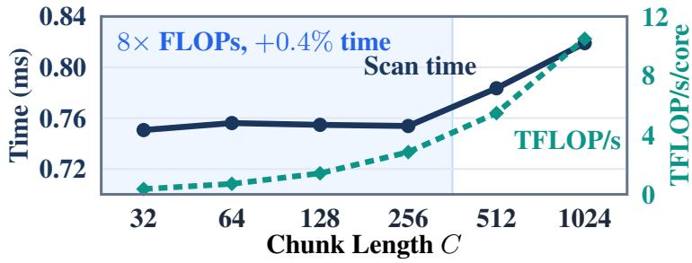  
Figure 2: Sequential state-scan cost on TPU v7x. A 64-step scan of $( C , 2 5 6 ) \times ( 2 5 6 , 2 5 6 )$ matmuls takes nearly constant time for $C \in \{ 3 2 , \dots , 2 5 6 \}$ , so a fixed per-step overhead, not matmul FLOPs, dominates the scan.

Bottleneck 1: Narrow states and a fixed per-step scan cost. Op 6 carries the state across $T / C$ chunk boundaries sequentially. On TPU v7x, each scan step costs a nearly fixed ${ \approx } 1 2 \mu s$ regardless of chunk size: 8 more FLOPs per step adds under 1% time (Figure 2). Scan cost is thus set by the number of steps and heads, not by matmul size. A 256-wide tile also processes a $d _ { k } = 1 2 8$ state at the same cost as a $d _ { k } = 2 5 6$ state, so 128-wide states leave half of each tile idle while paying the full per-step cost for every head.

Bottleneck 2: Per-channel decay. KDA [71] and GDN-2 [25] give every key channel its own forget gate $( F _ { t } = \mathrm { d i a g } ( f _ { t } ) )$ . Let $\begin{array} { r } { \Lambda _ { t , i } = \sum _ { s = 1 } ^ { t } \log f _ { s , i } } \end{array}$ be the cumulative decay of channel i within a chunk. Each Gram entry then weights channels differently:

$$
( M _ { c } ) _ { t , j } = \mathbf { 1 } [ t > j ] \beta _ { j } \sum _ { i } e ^ { \Lambda _ { t , i } - \Lambda _ { j , i } } k _ { t , i } k _ { j , i } .
$$

Table 1: Documented hardware specifications per chip for NVIDIA H100 SXM and four Google TPU generations [6, 18, 32]. MXU:VPU is the ratio of peak BF16 matrix throughput to FP32 vector throughput; Ridge is the BF16 arithmetic-intensity ridge point (FLOPs/byte). ∗8-bit peak is FP8 on H100 and TPU v7x and INT8 on TPU v4–v6e.
<table><tr><td>Accelerator</td><td>Cores</td><td>Array Tile</td><td>BF16 TF/s</td><td>8-bit TF/s*</td><td>VPU TF/s</td><td>MXU:VPU</td><td>HBM (GB)</td><td>HBM GB/s</td><td>Ridge</td></tr><tr><td>H100 SXM</td><td>132 SM</td><td> $1 6 \times 1 6$ </td><td>989</td><td>1,979</td><td>67.0</td><td>14.8×</td><td>80</td><td>3,350</td><td>295</td></tr><tr><td>TPU v4</td><td>2</td><td> $1 2 8 \times 1 2 8$ </td><td>275</td><td>275</td><td>3.2</td><td>85.9×</td><td>32</td><td>1,200</td><td>229</td></tr><tr><td>TPU v5p</td><td>2</td><td> $1 2 8 \times 1 2 8$ </td><td>459</td><td>918</td><td>5.4</td><td>85.0×</td><td>95</td><td>2,765</td><td>166</td></tr><tr><td>TPU v6e</td><td>1</td><td> $2 5 6 \times 2 5 6$ </td><td>918</td><td>1,836</td><td>7.2</td><td>127.5×</td><td>32</td><td>1,600</td><td>574</td></tr><tr><td>TPU v7x</td><td>2</td><td> $2 5 6 \times 2 5 6$ </td><td>2,307</td><td>4,614</td><td>18.0</td><td>128.2×</td><td>192</td><td>7,373</td><td>313</td></tr></table>

To use the MXU, kernels fold $e ^ { \Lambda _ { t , i } }$ and $e ^ { - \Lambda _ { j , i } }$ into the keys, but $e ^ { - \Lambda _ { j , i } }$ overflows FP32 for long chunks. KDA kernels therefore split each chunk into 16-token sub-blocks and re-center the keys on the VPU before every sub-block matmul, which stalls the kernel. In our KDA runs, about 1% of channels also learn near-unit forget gates, which hurts length extrapolation unless the gates are clamped (Section 3.5). GDN’s scalar gate $( G = 1 )$ avoids both issues, at the cost of a single memory horizon per head.

Bottleneck 3: Sequential triangular solves. Existing kernels [19, 65] compute $A _ { c } = ( I _ { C } + M _ { c } ) ^ { - 1 }$ (Op 4) by sequential substitution within small diagonal blocks, which runs on the VPU. Repeated for every chunk and each of $H _ { k } = H _ { v } = 8$ heads, together with the Gram matrices (Ops 3–5) it accounts for about 45% of the core intra-chunk and scan time in our measurements (Table 5), keeping the best chunk size near 64–128.

## 2.3 SLA: Addressing the Three Bottlenecks

Guided by the three systolic bottlenecks above, we now formulate SLA, which reshapes the state geometry, decay structure, and chunk inversion around the $2 5 6 \times 2 5 6$ systolic tile:

Definition 2.1 (SLA Recurrence). Consider a linear attention layer with $H _ { v }$ value heads of width $d _ { v }$ and $H _ { k } = H _ { v } / R$ query-key heads of width $d _ { k } = 2 5 6$ indexed by $h _ { k } \in \{ 1 , \dots , H _ { k } \}$ , where each query-key head is shared across $R \in \{ 2 , 4 \}$ value heads. At token t, each query-key head computes:

• Shared query, key, and write gate: $L _ { 2 } .$ -normalized $q _ { t } , k _ { t } \in \mathbb { R } ^ { 2 5 6 }$ with $\left\| q _ { t } \right\| _ { 2 } = \left\| k _ { t } \right\| _ { 2 } = 1$ and a scalar step size $\beta _ { t } = 2 \sigma ( \tilde { \beta } _ { t } ) \in ( 0 , 2 ) ( s _ { \beta } = 2 )$ that doubles the (0, 1) range of standard GDN/KDA;

• Packed values and output gates: R value vectors $v _ { t , 1 } , \ldots , v _ { t , R } \in \mathbb { R } ^ { d _ { \tau } }$ stacked as $v _ { t } =$ $[ v _ { t , 1 } ; \ldots ; v _ { t , R } ] \in \mathbb { R } ^ { R d _ { \tau } }$ , and output-gate vector $z _ { t } = [ z _ { t , 1 } ; \dots ; z _ { t , R } ] \in \mathbb { R } ^ { R d _ { \tau } }$ v with per-valuehead slices $z _ { t , m } \in \mathbb { R } ^ { d _ { v } } \left( m \in \{ 1 , \dots , R \} \right)$

• Four-tile forget gate: a block-diagonal gate $F _ { t } \in ( 0 , 1 ] ^ { 2 5 6 \times 2 5 6 }$ that splits the 256 key channels into $G = 4$ contiguous tiles of $b = 6 4$ channels, with forget-gate logit $\tilde { f } _ { t } = ( \tilde { f } _ { t , 1 } , \ldots , \tilde { f } _ { t , 4 } ) \in \mathbb { R } ^ { 4 }$ all-ones vector $\mathbf { 1 } _ { 6 4 } \in \mathbb { R } ^ { 6 4 }$ , and one scalar decay $\gamma _ { t , g } = \exp ( - \operatorname { s o f t p l u s } ( \tilde { f } _ { t , g } ) ) \in ( 0 , 1 ]$ on each tile $g \in \{ 1 , 2 , 3 , 4 \}$

$$
F _ { t } = \mathrm { d i a g } ( \gamma _ { t , 1 } \mathbf { 1 } _ { 6 4 } , \gamma _ { t , 2 } \mathbf { 1 } _ { 6 4 } , \gamma _ { t , 3 } \mathbf { 1 } _ { 6 4 } , \gamma _ { t , 4 } \mathbf { 1 } _ { 6 4 } ) .\tag{3}
$$

(i) Intra-chunk token recurrence. Maintaining a packed state $S _ { t } = [ S _ { t , 1 } , \ldots , S _ { t , R } ] \in \mathbb { R } ^ { 2 5 6 \times R d _ { \tau } }$ initialized at $S _ { 0 } = 0$ , with slice $S _ { t , m } \in \mathbb { R } ^ { 2 5 6 \times d _ { v } }$ and output slice $o _ { t , m } \in \mathbb { R } ^ { d _ { v } } \left( o _ { t } = \left[ o _ { t , 1 } ; \ldots ; o _ { t , R } \right] \right)$ for value head $m \in \{ 1 , \ldots , R \}$ , SLA decays the state, writes the prediction error, and normalizes each value head:

SLA Token-Level Recurrence $( d _ { k } = 2 5 6 , G = 4 , b = 6 4 )$

$$
S _ { t } = F _ { t } S _ { t - 1 } + \beta _ { t } k _ { t } \big ( \boldsymbol { v } _ { t } - ( F _ { t } S _ { t - 1 } ) ^ { \top } \boldsymbol { k } _ { t } \big ) ^ { \top } ,\tag{4}
$$

$$
o _ { t , m } = \sigma ( z _ { t , m } ) \odot \mathrm { R M S N o r m } \big ( S _ { t , m } ^ { \top } q _ { t } \big ) .\tag{5}
$$

Here $( F _ { t } S _ { t - 1 } ) ^ { \top } k _ { t }$ is the value currently stored for $k _ { t } .$ , so Eq. (4) writes only the prediction error, and one rank-one write updates all R value heads.

(ii) Chunk-boundary momentum. Let $\tilde { S } _ { c }$ be the state after unrolling Eq. (4) over the $C$ tokens of chunk c from $S _ { c - 1 }$ , and let $\textstyle F _ { c } = \prod _ { t \in c } F _ { t }$ . SLA updates the chunk-boundary state $S _ { c }$ via a velocity buffer $Z _ { c } \in \mathbb { R } ^ { 2 5 6 \times R d _ { v } }$ reset to zero at document boundaries:

$$
Z _ { c } = \mu Z _ { c - 1 } + \big ( \tilde { S } _ { c } - F _ { c } S _ { c - 1 } \big ) , \qquad S _ { c } = F _ { c } S _ { c - 1 } + Z _ { c } ,\tag{6}
$$

with $\mu = 0 . 2 5$ by default, while $\mu = 0$ recovers $S _ { c } = \tilde { S } _ { c }$

Notation and operator taxonomy. Unless redefined locally, symbols follow Algorithm 1 and Definition 2.1; Table 2 collects them for quick reference (symbols used only inside one section, such as the roofline constants in Section 3.1, are defined where they first appear). Table 3 contrasts the algebraic operators and systolic hardware mappings of GDN [68], KDA [71], GDN-2 [25], SLA (SLA-R2 / SLA-R4), and SPD-SLA-W, an optional extension of SLA that preconditions chunks with $\Sigma _ { c }$ to form whitened keys $\tilde { K } _ { c }$ (rows $\tilde { k } _ { t } ^ { \top } )$ ) under step-size margin $\varepsilon _ { \beta } > 0$ (Section 4); SPD-SLA-W is not used in any core SLA result except the middle bar of Figure 7a and the conditioning analysis of Section 4.

Table 2: Summary of notation used across the paper.
<table><tr><td>Symbol</td><td>Meaning</td></tr><tr><td> $T , C , c$ </td><td>Sequence length; chunk length  $( C = 1 2 8 )$  chunk index  $c \in \{ 1 , \ldots , T / C \}$  Token indices inside a chunk,  $1 \leq j \leq t \leq C$ </td></tr><tr><td> $t , j , s$ </td><td>(with chunk-entry boundary 0 in  $P _ { t  0 } ) .$ </td></tr><tr><td> $D , \ H _ { k } , \ H _ { v } , \ R$ </td><td>Model width; number of query-key heads; number of value heads; sharing ratio  $R = H _ { v } / H _ { k } \in \{ 2 , 4 \}$ </td></tr><tr><td> $d _ { k } , d _ { v } , D _ { v , \mathrm { p a c k } } , D _ { v }$ </td><td>Key width  $( d _ { k } = 2 5 6 ) ;$  per-value-head width; packed value width per key head  $D _ { v , \mathrm { p a c k } } = R d _ { v }$  ; total value width  $D _ { v } = H _ { v } d _ { v }$ </td></tr><tr><td> $G , \ b , \ g$ </td><td>Number of decay tiles  $( G = 4 )$  , tile width  $b = d _ { k } / G = 6 4$  , tile index  $_ { g \_ \in }$   $\{ 1 , \ldots , G \}$ </td></tr><tr><td> $q _ { t } , k _ { t } \in \mathbb { R } ^ { d _ { k } } , v _ { t } \in \mathbb { R } ^ { D _ { v , \mathrm { p a c k } } }$   $\beta _ { t } \in ( 0 , s _ { \beta } )$ </td><td> $L _ { 2 } .$  -normalized query and key of one key head; packed values of its R value heads. Write gate  $s _ { \beta } \sigma ( { \tilde { \beta } } _ { t } )$  per token and key head, shared across the R packed value heads</td></tr><tr><td> $f _ { t , i } , \ \gamma _ { t , g } \in ( 0 , 1 ]$ </td><td> $( s _ { \beta } = 2 \sin \mathtt { S L A } ; s _ { \beta } = 1$  in GDN/KDA). Per-channel decay of channel  $i \ ( \mathrm { K D A } , \ G \ = \ d _ { k } ) ;$  per-tile decay</td></tr><tr><td> $F _ { t } , P _ { t  j } , F _ { c }$ </td><td> $\begin{array} { r l } { \gamma _ { t , g } } & { { } = } \end{array}$   $e ^ { - \mathrm { s o f t p l u s } ( \tilde { f } _ { t , g } ) }$  of tile  $g \ ( \mathrm { S L A } , f _ { t , i } = \gamma _ { t , g }$  on tile g).</td></tr><tr><td></td><td>Diagonal forget gate  $F _ { t } = \mathrm { d i a g } ( f _ { t } )$  cumulative decay  $\begin{array} { r } { P _ { t  j } = \prod _ { s = j + 1 } ^ { t } F _ { s } } \end{array}$  with  $P _ { t  t } = I _ { d _ { k } }$  ; chunk decay  $F _ { c } = P _ { C  0 } .$ </td></tr><tr><td> $\Lambda _ { t , i }$   $S _ { c } , \ \tilde { S } _ { t } , \ \Delta S _ { c }$ </td><td>Cumulative log-decay of channel ¿ inside a chunk,  $\Lambda _ { t , i } = \textstyle \sum _ { s = 1 } ^ { t }$  log  $f _ { s , i }$  Chunk-boundary state  $S _ { c } ~ \in ~ \mathbb { R } ^ { d _ { k } \times D _ { v , \mathrm { p a c k } } }$  ; intra-chunk state after local token t</td></tr><tr><td> $Z _ { c } , ~ \mu , ~ \kappa _ { c }$ </td><td> $( \tilde { S } _ { 0 } = S _ { c - 1 } , \tilde { S } _ { C }$  written  $\tilde { S } _ { c } \mathrm { i n } \mathrm { D e f . } 2 . 1 ( \mathrm { i i } ) )$  ; increment  $\Delta S _ { c } = \tilde { S } _ { C } - F _ { c } S _ { c - 1 }$  Chunk-boundary momentum (velocity) buffer; momentum coefficient  $( \mu = 0 . 2 5 ) ;$ </td></tr><tr><td></td><td>reset indicator  $\kappa _ { c } \in \{ 0 , 1 \}$  , equal to 0 whenever any document reset occurs inside chunk c (so  $Z _ { c - 1 }$  and cross-document carry are discarded).</td></tr><tr><td> $\Psi _ { g } , \Gamma _ { g } \in \mathbb { R } ^ { C \times C }$ </td><td>Tile-g causal decay masks:  $\begin{array} { r } { ( \Psi _ { g } ) _ { t , j } = \mathbf { 1 } [ t \geq j ] \prod _ { s = j + 1 } ^ { t } \gamma _ { s , g } } \end{array}$  and  $( \Gamma _ { g } ) _ { t , j } =$   $\mathbf { 1 } [ t > j ] \beta _ { j } ( \Psi _ { g } ) _ { t , j } .$ </td></tr><tr><td> $M _ { c } , \ L _ { c } , \ A _ { c } \in \mathbb { R } ^ { C \times C }$ </td><td>Strictly lower-triangular Gram matrix  $M _ { c } ( \mathrm { O p } 3 \mathrm { a } ) ,$  lower-triangular query-key score matrix  $L _ { c } \left( \mathrm { O p } 3 \mathbf { b } \right)$  , and WY inverse  $A _ { c } = ( \bar { I } _ { C } + M _ { c } ) ^ { - 1 } ( \bar { \mathrm { O p } } 4 ) .$ </td></tr><tr><td> $\bar { Q } _ { c } , \bar { K } _ { c } , \hat { K } _ { c } \in \mathbb { R } ^ { C \times d _ { k } }$ </td><td>Row-stacked decayed queries  $( P _ { t  0 } q _ { t } ) ^ { \top }$  , decayed keys  $( P _ { t  0 } k _ { t } ) ^ { \top }$  , and carried keys  $( P _ { C  t } k _ { t } ) ^ { \top }$ </td></tr><tr><td> $U _ { c } , \ W _ { c } , \ E _ { c }$ </td><td>WY factors  $U _ { c } ~ = ~ \mathrm { d i a g } ( \beta _ { c } ) A _ { c } V _ { c } , W _ { c } ~ = ~ \mathrm { d i a g } ( \beta _ { c } ) A _ { c } \bar { K } _ { c } .$  , and chunk writes  $E _ { c } = U _ { c } - W _ { c } S _ { c - 1 } ( \mathrm { O p s } \ 5 - 6 \mathrm { a } ) .$ </td></tr><tr><td> $P , \ p , \ L _ { \mathrm { l o c } }$ </td><td>Number of context-parallel shards (devices); shard index; chunks per shard.</td></tr><tr><td> $\sigma ( \cdot ) , \ \kappa _ { 2 } ( \cdot )$ </td><td>Logistic sigmoid; spectral condition number (distinct from the reset indicator  $\kappa _ { C } ) .$ </td></tr></table>

Why chunk-level momentum, implementation, and caveats. Unlike token-level momentum [9], applying heavy-ball momentum [44] once per chunk boundary (Op 6b of Algorithm 1) leaves the intra-chunk WY solve unchanged. Specifically, in Op 6b, the net chunk state increment in Eq. (6) is

$$
\Delta S _ { c } = \tilde { S } _ { c } - F _ { c } S _ { c - 1 } = \hat { K } _ { c } ^ { \top } E _ { c } .
$$

Table 3: Side-by-side algebraic and systolic hardware comparison across prior GPU gated-delta recurrences and our SLA family.
<table><tr><td>Design Axis</td><td>GDN [68]</td><td>KDA [71]</td><td>GDN-2 [25]</td><td> $\mathbf { S L A } \left( \mathbf { S L A - R 2 } / \mathbf { S L A - R 4 } \right)$  (Ours)</td><td>SPD-SLA-W (Section 4)</td></tr><tr><td>Key/Value Heads</td><td>Unpacked  $H _ { k } = H _ { v }$ </td><td>Unpacked  $H _ { k } = H _ { v }$ </td><td>Unpacked  $H _ { k } = H _ { v }$ </td><td> $\mathrm { P a c k e d \ G V A }$   $H _ { k } = H _ { v } / R$   $( R \in \{ 2 , 4 \} )$ </td><td>Packed GVA  $H _ { k } = H _ { v } / R$ </td></tr><tr><td>State Tile &amp; Dtype</td><td> $S ^ { ( h _ { k } ) } \in$   $\mathbb { R } ^ { 1 2 8 \times d _ { v } } { \mathrm { ~ F P } } 3 2$   $( 5 0 \% \ \mathrm { p a d } )$ </td><td> $S ^ { ( h _ { k } ) } \in \mathbb { R } ^ { 1 2 8 \times d _ { v } }$   $\mathrm { F P } 3 2 ( 5 0 \% \mathrm { p a d } )$ </td><td> $S ^ { ( h _ { k } ) } \in$   $\mathbb { R } ^ { d _ { k } \times d _ { v } } \ \mathrm { F P } 3 2$ </td><td> $S \in \bar { \mathbb R } ^ { 2 5 6 \times D _ { v , \mathrm { p a c k } } }$  BF16 / Row-FP8 (no padding)</td><td> $S \in \mathbb { R } ^ { 2 5 6 \times D _ { v , \mathrm { p a c k } } }$   $\mathrm { B F 1 6 / R o w  – F P 8 }$ </td></tr><tr><td>Forget Gate  $F _ { t }$ </td><td> $\mathbf { S c a l a r } \gamma _ { t } I _ { d _ { k } }$   $( G = 1 )$ </td><td> $\mathrm { C h a n n e l ~ d i a g } ( f _ { t } )$   $( G = d _ { k } )$ </td><td> $\mathrm { { D e c o u p l e d c h . } }$   $( G = \overline { { d _ { k } } } )$ </td><td>Tile-grouped  $\textstyle \bigoplus _ { g = 1 } ^ { 4 ^ { - } } \dot { \gamma _ { t , g } } I _ { 6 4 } \left( G = 4 \right)$ </td><td>Tile-grouped  $\textstyle \bigoplus _ { g = 1 } ^ { 4 } \gamma _ { t , g } I _ { 6 4 }$ </td></tr><tr><td>Step Size  $\beta _ { t }$ </td><td> $( 0 , 1 ) \ \mathrm { p e r } \ H _ { v }$ </td><td> $( 0 , 1 ) \mathrm { p e r } H _ { v }$ </td><td>Ch. vector per  $H _ { v }$ </td><td>(0, 2) scalar per  $H _ { k }$  (neg. eig.)</td><td> $\left( G ^ { - } = 4 \right)$  Clamped  $( 0 , ( \dot { 2 } - \varepsilon _ { \beta } ) / k _ { t } ^ { \top } \tilde { k } _ { t } ]$ </td></tr><tr><td>Chunk Gram Mc 1 × MXU + scalar</td><td>mask</td><td>16-row VPU pivots  $( | \Lambda _ { j , i } | > 8 8 . 7 )$ </td><td>Decoupled ch. broadcast</td><td> $G \times [ C , b ] \times [ b , C ]$  pure MXU (b ≥ 64, 0 ovf.)</td><td>Oblique  $k _ { t } ^ { \top } P _ { t  j } \tilde { k } _ { j }$  MXÚ</td></tr><tr><td>Chunk Inverse  $A _ { c }$ </td><td> $H _ { v } \times$  blocked, sequential in-block</td><td> $H _ { v } \times \mathrm { b l o c k e d } ,$  sequential in-block</td><td>Hv × blocked, sequential in-block</td><td> $H _ { k } \times$  Exact Inv. (or 1-Step Neumann, C = 128)</td><td>Hk × MXU inverse + Polar-2+ (5 MM)</td></tr><tr><td>Momentum / 2nd-Ord.</td><td>None  $( \mu = 0 ,$ </td><td> $( \dot { C } \le 6 4 \mathrm { T o k a m a x } )$  None  $( \mu = 0 ,$ </td><td>None  $( \mu = 0 ,$ </td><td>Chunk velocity</td><td>Whitened keys  $\tilde { K } _ { c }$ </td></tr><tr><td>Output Norm</td><td>Euclidean) Head RMSNorm</td><td>Euclidean) Head RMSNorm</td><td>Euclidean) Head RMSNorm</td><td> $Z _ { c } = \mu \kappa _ { c } Z _ { c - 1 } ^ { ' } + \Delta S _ { c }$  Per-value-head</td><td>(Eq. (14)) Per-value-head</td></tr><tr><td>VMEM /HBM</td><td>6 HBM trips</td><td>6 HBM trips (unfused 6 HBM trips</td><td></td><td>RMSNorm Fused SLA: 1 kernel in</td><td>RMSNorm Fits 64 MiB VMEM</td></tr><tr><td>Trips</td><td>(unfused)</td><td>wrapper)</td><td>(6.8–14.9 GiB)</td><td>64 MiB VMEM + custom VJP</td><td></td></tr><tr><td>Context Parallelism</td><td>Prefix tree, one  $d _ { k } \times d _ { k }$  map per head</td><td>Prefix tree, one  $d _ { k } \times d _ { k }$  map per head</td><td>Prefix tree, one  $d _ { k } \times d _ { k }$  map per head</td><td>Prefix tree, one [256, 256] map per key head (2× with momentum)</td><td>Same as SLA</td></tr></table>

The velocity buffer $Z _ { c } \in \mathbb { R } ^ { d _ { k } \times D _ { v , \mathrm { p a c k } } }$ has the same shape as $S _ { c }$ and stays in VMEM inside the fused kernel, adding zero extra HBM state traffic. On packed multi-document streams, intra-chunk Gram and score matrices apply an exact segment mask $\mathbf { 1 } [ \mathrm { s e g } _ { t } = \mathrm { s e g } _ { j } ]$ , only the final document segment writes to $\Delta S _ { c }$ , and any document reset anywhere inside chunk c zeros both incoming state carry $F _ { c }$ and $\kappa _ { c } = 0$ , preventing mid-chunk velocity leakage. Moreover, for any eigenmode with chunk decay $f \in ( 0 , 1 )$ and generalized WY survival $j \in [ \bar { - } f , f ]$ (including $\beta _ { t } \in ( \bar { 0 , 2 } ) )$ , the lifted $2 \times 2$ companion block $\left[ \ O _ { j - f } \ O _ { \mu } ^ { j } \right]$ has characteristic polynomial $p ( \lambda ) = \lambda ^ { 2 } - ( j + \mu ) \lambda + \mu f ( j \mu$ cancels in det $= \mu f )$ , satisfying Jury’s Schur stability conditions  det $| = \mu f < 1 , p ( 1 ) \geq ( 1 - f ) ( 1 - \mu ) > 0$ and $p ( - 1 ) = 1 + j + \mu ( 1 + f ) > 0$ unconditionally for all $\mu \in [ 0 , 1 )$ . Because $Z _ { c }$ changes only at chunk boundaries, autoregressive decoding reproduces training exactly by updating $Z _ { c }$ once every C tokens. Under context parallelism, momentum couples $( \bar { S } _ { c } , Z _ { c } )$ into a $2 d _ { k } \times 2 d _ { k }$ affine map (Eq. (13)); Table 8 therefore reports both the uncoupled $( \mu = 0 , 2 5 6 ^ { 2 } )$ and coupled $( \mu = 0 . 2 5 , 5 1 2 ^ { 2 } )$ tree scans.

Table 4 compares $\mu = 0$ and $\mu = 0 . 2 5$ on a 12.5B-total (0.79B-active) MoE trained on 15.1B Dolma 3.5 tokens (7,200 steps, 2.1M tokens/step, 128 TPU v4 chips, seed 42). With 4:1 key sharing $( R = 4 )$ , momentum lowers loss by 0.019–0.023 nats and matches KDA, recovering the capacity lost by sharing each key head across four value heads; with 2:1 sharing $( R = 2 )$ , it changes loss by at most +0.004 nats. An input-dependent $\mu$ obtained by reusing the $\beta _ { t }$ projection degrades loss by +0.026 nats, so we keep $\mu$ fixed. We did not sweep $\mu$ beyond $ { \bar { \ } 0 , 0 . 2 5 \bar { \ } }$ . In the TPU v7x ablation ladder (Table 11b), momentum is introduced together with VMEM fusion in A5, so its effect is not isolated there. Moreover, the ablation evidence is from a single seed, and momentum has costs: the recurrence now depends on the chunk size C, decoding must track chunk boundaries, and context parallelism must carry a 2 larger transition state (Section 3.3).

## 2.4 The Three Algorithmic Pillars of SLA

Each pillar targets one of the bottlenecks in Section 2.2 (Figure 1c–e; detailed diagrams in Figure 3).

Table 4: Chunk-boundary momentum ablation: 20-step rolling training cross-entropy at step 7,199 (single pass over Dolma 3.5, 12.5B MoE, 128 TPU v4 chips, seed 42; lower is better). †Trained on an 8,200-step cosine schedule and evaluated at step 7,199.
<table><tr><td>Configuration</td><td>μ</td><td>Loss @ 7,199</td></tr><tr><td>KDA (per-channel decay, FP32 state)</td><td>一</td><td>2.2925</td></tr><tr><td>SLA, R = 2 (two runs)</td><td>0</td><td>2.2912 /2.2925</td></tr><tr><td>SLA, R = 2</td><td>0.25</td><td>2.2955</td></tr><tr><td>SLA, R = 2, input-dependent µ</td><td>adaptive</td><td>2.3216</td></tr><tr><td>SLA, R = 4 (two runs)</td><td>0</td><td>2.3103 /2.3148</td></tr><tr><td>SLA, R = 4†</td><td>0.25</td><td>2.2914</td></tr></table>

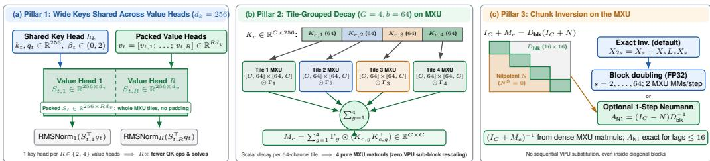  
Figure 3: Detailed architectural diagram of the three mathematical pillars of SLA. (a) Pillar 1: Widening the key dimension to $d _ { k } = 2 5 6$ and sharing each key head $h _ { k }$ and write gate $\beta _ { t } \in ( 0 , 2 )$ across $\bar { R ( } \in \{ 2 , 4 \}$ value heads forms a dense $2 5 6 \times \bar { D } _ { v , \mathrm { p a c k } }$ state that fills whole 256 256 MXU tiles without padding while cutting QK projections, short convolutions, and chunk solves by R . (b) Pillar 2: Partitioning the $d _ { k } = 2 5 6$ key channels into $G = 4$ contiguous tiles of $b = 6 4$ channels decomposes the intra-chunk coupling matrix $M _ { c }$ into four 64-wide MXU matrix multiplications weighted by scalar decay masks $\Gamma _ { g } ,$ eliminating VPU sub-block rescaling. (c) Pillar 3: The default Exact Inv. computes $( I _ { C } + M _ { c } ) ^ { - 1 }$ by recursive block doubling on the MXU; the optional 1-step Neumann inverse keeps only the first off-diagonal term of $I _ { C } + \bar { M } _ { c } = D _ { \mathrm { b l k } } ( I _ { C } + N )$ with 16 16 diagonal blocks, where $N ^ { 8 } = 0 \mathrm { a t } C = 1 2 8$ . Both avoid sequential VPU substitution and use dense MXU matrix multiplications (Section 2.4.3).

## 2.4.1 Pillar 1: Wide Keys with Grouped Value Heads

A key dimension below 256 still occupies a full 256-wide tile on TPU $\mathrm { v 6 e / v 7 x } .$ , so SLA widens keys to $d _ { k } = 2 5 6$ , which costs no extra cycles in the inter-chunk scan. To keep parameters and non-matmul work in check, SLA adopts linear grouped-value head sharing (GVA) [48, 65, 71] together with gated output normalization [47]: each query-key head and gate $\beta _ { t }$ is shared across $R = \mathbf { \bar { \it H } } _ { v } / { \cal \cal \cal { H } } _ { k } \in \bar { \{ 2 , 4 \} }$ value heads. Packing these value heads side by side gives a state $S _ { t } \in \mathbb { R } ^ { d _ { k } \times R d _ { \tau } }$ v that maps onto whole MXU tiles without padding. Query and key projections, short convolutions, $M _ { c } , L _ { c }$ , and the solve $A _ { c }$ are computed once per key head, cutting their cost by $R \times$ . Each value head’s output is normalized separately (Eq. (5)). Head sharing itself is prior work; our contribution is choosing $d _ { k }$ and R to match the systolic tile.

Derivation of GVA systolic invariance. Fix total value width $D _ { v } = H _ { v } d _ { v }$ and set $H _ { k } = H _ { v } / R$ with $D _ { v , \mathrm { p a c k } } = R d _ { v }$ . Each key head $h _ { k } \in \{ 1 , \ldots , H _ { k } \}$ maintains state $S ^ { ( h _ { k } ) } \in \mathbb { R } ^ { d _ { k } \times D _ { v , \mathrm { p a c k } } }$ , so total state elements are invariant to R:

$$
H _ { k } d _ { k } ( R d _ { v } ) = H _ { v } d _ { k } d _ { v } .
$$

Inter-chunk state scan FLOPs per token are likewise invariant to $R \colon$

$$
H _ { k } { \big ( } 2 d _ { k } D _ { v , { \mathrm { p a c k } } } [ { \mathrm { e r a s e } } ] + 2 d _ { k } D _ { v , { \mathrm { p a c k } } } [ { \mathrm { w r i t e } } ] + 2 d _ { k } D _ { v , { \mathrm { p a c k } } } [ { \mathrm { r e a d o u t } } ] { \big ) } = 6 H _ { v } d _ { k } d _ { v } .
$$

Because $\beta _ { t }$ is scalar per key head $h _ { k }$ , QK projections $( 2 D H _ { k } d _ { k }$ parameters), QK causal Conv1D (for kernel width $K _ { \mathrm { c o n v } } \overset { \cdot } { = } 4 , 2 \dot { K } _ { \mathrm { c o n v } } H _ { k } d _ { k }$ weights), chunk Gram matmuls $( 4 C H _ { k } d _ { k }$ FLOPs/token), and $[ C , C ]$ WY/Neumann solves $( H _ { k }$ systems per chunk) scale linearly with $H _ { k } = H _ { v } / R$ and shrink by $R \times$ . Reshaping $\tilde { S } _ { t } ^ { \top } q _ { t } \in \mathbb { R } ^ { R d _ { \tau } }$ into $R$ slices of width $d _ { v }$ and applying independent RMSNorm to all $H _ { v } = H _ { k } R$ value heads prior to the sigmoid output gate $\sigma ( z _ { t } ) \in ( 0 , 1 ) ^ { R d _ { v } }$ (slices $\sigma ( z _ { t , m } )$ in

Eq. (5)) retains $H _ { v }$ independent head-scale degrees of freedom while keeping $[ 2 5 6 , D _ { v , \mathrm { p a c k } } ]$ MXU tiles contiguous. □

## 2.4.2 Pillar 2: Tile-Grouped Forget Gate and Packed WY Equivalence

Bottleneck 2 arises because the decay cannot be pulled out of key–key inner products when every channel has its own rate. SLA splits each query and key into the same $G = 4$ groups of $b = 6 4$ channels as the forget gate in Eq. (3), $q _ { t } = [ q _ { t , 1 } ; \dots ; q _ { t , 4 } ]$ and $k _ { t } = [ k _ { t , 1 } ; \ldots ; k _ { t , 4 } ]$ . Between tokens $j$ and $t ,$ group $g$ decays by a single number $\textstyle \prod _ { s = j + 1 } ^ { t } \gamma _ { s , g } \leq 1$ , which moves outside the group’s inner product. Stacking group-g queries and keys as $\bar { Q } _ { c , g } , K _ { c , g } \in \mathbb { R } ^ { C \times 6 4 }$ and defining causal masks $\begin{array} { r } { ( \Psi _ { g } ) _ { t , j } = \mathbf { 1 } [ t \geq j ] \prod _ { s = j + 1 } ^ { t } \gamma _ { s , g } } \end{array}$ and $( \Gamma _ { g } ) _ { t , j } = \mathbf { 1 } [ t > j ] \beta _ { j } ( \Psi _ { g } ) _ { t , j }$ , both intra-chunk matrices factor across tiles as

$$
\boldsymbol { M _ { c } } = \sum _ { g = 1 } ^ { 4 } \boldsymbol { \Gamma _ { g } } \odot \bigl ( \boldsymbol { K _ { c , g } } \boldsymbol { K } _ { c , g } ^ { \top } \bigr ) , \qquad \boldsymbol { L _ { c } } = \sum _ { g = 1 } ^ { 4 } \boldsymbol { \Psi _ { g } } \odot \bigl ( \boldsymbol { Q _ { c , g } } \boldsymbol { K } _ { c , g } ^ { \top } \bigr ) ,
$$

where each term is a $[ C , 6 4 ] \times [ 6 4 , C ] \mathrm { M X U }$ matmul followed by an elementwise scaling by factors no larger than 1, so there is no overflow and no need for VPU sub-blocks. The trade-off relative to GDN’s single rate $( G = 1 )$ is modest: in our sweep (Section 3.5), $G = 4$ lowers in-domain perplexity slightly across all three paired seeds but extrapolates somewhat worse than $G = 1 ;$ architecturally, unpacked GDN $( H _ { k } = \overset { \cdot } { 8 } , G = 1 )$ ) provides $\bar { H _ { k } } G = 8$ decay timescales per layer, whereas sharing key heads by $R = 4 ( H _ { k } = 2 )$ with $G = 1$ collapses the layer to only 2 rates; setting $G = 4$ $( b = 6 4 )$ restores $H _ { k } G = 8 ( { \tt S L A - R 4 } )$ or 16 (SLA-R2) independent timescales per layer at zero latency overhead over $G = 1$

Proof of tile-grouped packed WY equivalence. Consider chunk $c \in \{ 1 , \ldots , T / C \}$ for a single key head $h _ { k } \in \{ 1 , \dots , H _ { k } \}$ serving $\bar { R = } H _ { v } / H _ { k }$ packed value heads of total width $D _ { v , \mathrm { p a c k } } = R d _ { v }$ starting from incoming state $\tilde { S } _ { 0 } = S _ { c - 1 } \in \mathbb { R } ^ { d _ { k } \times D _ { v , \mathrm { p a c k } } }$ . Each token $t \in \{ 1 , \ldots , C \}$ has $G = 4$ tilegrouped diagonal decay $\begin{array} { r } { F _ { t } = \bigoplus _ { g = 1 } ^ { 4 } \gamma _ { t , g } I _ { 6 4 } } \end{array}$ (diagonal entries in $( 0 , 1 ] )$ , query and key $q _ { t } , k _ { t } \in \mathbb { R } ^ { d _ { k } }$ packed value $v _ { t } \in \mathbb { R } ^ { D _ { v , \mathrm { p a c k } } }$ , and scalar step size $\beta _ { t } \in ( 0 , 2 )$ shared across the R packed value heads of key head $h _ { k }$

Let $\begin{array} { r } { P _ { t  j } = \prod _ { s = j + 1 } ^ { t } F _ { s } } \end{array}$ denote the cumulative diagonal transition from step $j$ to step t $( P _ { t  t } = I _ { d _ { k } } )$ Unrolling Eq. $\begin{array} { r } { ( 4 ) ( \hat { S } _ { t } = F _ { t } \tilde { S } _ { t - 1 } , \hat { v } _ { t } = \hat { S } _ { t } ^ { \top } k _ { t } , \tilde { S } _ { t } = \hat { S } _ { t } + \beta _ { t } k _ { t } ( v _ { t } - \hat { v } _ { t } ) ^ { \top } ) \mathrm { f r o m } \tilde { S } _ { 0 } = S _ { c - 1 } } \end{array}$ gives

$$
\tilde { S } _ { t } = P _ { t  0 } S _ { c - 1 } + \sum _ { j = 1 } ^ { t } \beta _ { j } \big ( P _ { t  j } k _ { j } \big ) u _ { j } ^ { \top } ,\tag{7}
$$

where $u _ { t } = v _ { t } - \hat { v } _ { t } \in \mathbb R ^ { D }$ v,pack is the post-forget delta residual at local step t. Multiplying $\bar { S } _ { t } = F _ { t } \tilde { S } _ { t - 1 }$ on the left by $k _ { t } ^ { \top }$ substitutes $F _ { t } P _ { t - 1  j } = \bar { P } _ { t  j }$ into every prior term:

$$
u _ { t } ^ { \top } = v _ { t } ^ { \top } - k _ { t } ^ { \top } P _ { t  0 } S _ { c - 1 } - \sum _ { j = 1 } ^ { t - 1 } \beta _ { j } \big ( k _ { t } ^ { \top } P _ { t  j } k _ { j } \big ) u _ { j } ^ { \top } .\tag{8}
$$

Whereas per-channel decay $( G = d _ { k }$ in KDA) overflows the naive factorization $e ^ { \Lambda _ { t , i } } \cdot e ^ { - \Lambda _ { j , i } }$ in FP32 once $| \Lambda _ { j , i } | > 8 8 . 7$ and forces 16-row sub-block VPU pivots, grouping $F _ { t }$ onto $G = 4$ scalar 64-lane tiles gives

$$
k _ { t } ^ { \top } P _ { t  j } k _ { j } = \sum _ { g = 1 } ^ { 4 } \exp ( \Lambda _ { t , g } - \Lambda _ { j , g } ) \langle k _ { t , g } , k _ { j , g } \rangle , \qquad \Lambda _ { t , g } = \sum _ { s = 1 } ^ { t } \log \gamma _ { s , g } ,
$$

where $\Lambda _ { t , g }$ is the tile’s cumulative log-decay and $q _ { t , g } , k _ { t , g } \in \mathbb { R } ^ { 6 4 }$ are the tile-g slices of $q _ { t } , k _ { t }$ Because exp $) ( \Lambda _ { t , g } - \Lambda _ { j , g } ) \leq 1$ is formed directly as a scalar mask, this reduces to four direct $[ C , 6 4 ] \times [ \bar { 6 4 } , \dot { C } ]$ MXU matmuls multiplied by $G = 4$ causal scalar decay masks. Because $\beta _ { j }$ is scalar per key head $h _ { k }$ , the strictly lower-triangular coupling matrix $M _ { c } \in \dot { \mathbb { R } } ^ { C \times C }$ defined by

$$
( M _ { c } ) _ { t , j } = \mathbf { 1 } [ t > j ] \beta _ { j } \big ( k _ { t } ^ { \top } P _ { t  j } k _ { j } \big )\tag{9}
$$

is shared across all $D _ { v , \mathrm { p a c k } }$ value columns and requires inverting a single $C \times C$ unit lower-triangular system $A _ { c } = ( I _ { C } + \hat { M _ { c } } ) ^ { - 1 }$ per key head.

Stacking chunk values $V _ { c } \in \mathbb { R } ^ { C \times D _ { v , \mathrm { p a c l } } }$ k (row t equal to $v _ { t } ^ { \top } )$ , decayed keys $\bar { K } _ { c } \in \mathbb { R } ^ { C \times d _ { k } }$ (row t equal to $( P _ { t  0 } k _ { t } ) ^ { \top } )$ , and residuals $u _ { 1 : C } \in \mathbb { R } ^ { C \times D _ { v , \mathrm { p a c k } } }$ (row t equal to $u _ { t } ^ { \top } )$ yields β-scaled WY factors and chunk writes:

$$
\begin{array} { r l } & { U _ { c } = \mathrm { d i a g } ( \beta _ { c } ) A _ { c } V _ { c } \in \mathbb { R } ^ { C \times D _ { v , \mathrm { p a c k } } } , \qquad W _ { c } = \mathrm { d i a g } ( \beta _ { c } ) A _ { c } \bar { K } _ { c } \in \mathbb { R } ^ { C \times d _ { k } } , } \\ & { E _ { c } = \mathrm { d i a g } ( \beta _ { c } ) u _ { 1 : C } = U _ { c } - W _ { c } S _ { c - 1 } . } \end{array}
$$

Letting the carried keys $\hat { K } _ { c } ~ \in ~ \mathbb { R } ^ { C \times d _ { k } }$ have row j equal to $( P _ { C  j } k _ { j } ) ^ { \top }$ and $F _ { c } = P _ { C  0 }$ , the end-of-chunk state and chunk increment satisfy

$$
\begin{array} { r } { \tilde { S } _ { C } = F _ { c } S _ { c - 1 } + \hat { K } _ { c } ^ { \top } ( U _ { c } - W _ { c } S _ { c - 1 } ) , \qquad \Delta S _ { c } = \tilde { S } _ { C } - F _ { c } S _ { c - 1 } = \hat { K } _ { c } ^ { \top } E _ { c } \in \mathbb { R } ^ { d _ { k } \times D _ { v , \mathrm { p a c } } } . } \end{array}
$$

(When optional oblique key whitening $\tilde { k } _ { j }$ is enabled in SPD-SLA-W, Section 4, replacing the write key $k _ { j }$ with $\tilde { k } _ { j }$ in $M _ { c }$ and $\hat { K } _ { c }$ yields the identical WY dual equations.) Finally, the chunk-level velocity $\bar { Z _ { c } } = \mu \kappa _ { c } \bar { Z _ { c - 1 } } + \Delta S _ { c }$ and $S _ { c } = F _ { c } S _ { c - 1 } + Z _ { c }$ (Eq. (6), with reset indicator $\kappa _ { c } \in \{ 0 , 1 \}$ equal to 0 iff chunk c starts a new document) act solely at chunk boundaries, preserving timestep key-value pairing inside every chunk and matching token-by-token decoding that accumulates $\Delta S _ { c }$ over C steps before applying Eq. (6). □

Intra-tile conditioning and orthogonal rotation absorption. Because each group’s decay is a scalar multiple of the identity, it preserves conditioning within each tile and commutes with rotary rotations inside the group:

Observation 2.2 (Intra-Tile Conditioning and Orthogonal Rotation Absorption). Within each group $^ { g , }$ the decay block $\gamma _ { t , g } I _ { d _ { k } / G }$ has unit condition number $\kappa _ { 2 } ( \gamma _ { t , g } I _ { d _ { k } / G } ) \stackrel { - } { = } 1$ (preserving intra-tile cosine similarity) and commutes with any rotation acting within each tile, Rot $\in \mathrm { S O } ( d _ { k } / G ) ^ { G }$ , such as Givens or rotary rotations, leaving the grouped Gram computation of Pillar 2 unchanged.

Proof. For a per-channel diagonal decay $F _ { t } = \mathrm { d i a g } ( f _ { t } )$ with $f _ { t , i } \in ( 0 , 1 )$ and cumulative logdecay $\begin{array} { r } { \Lambda _ { t , i } = \sum _ { s = 1 } ^ { t } \log f _ { s , i } , } \end{array}$ , the chunk decay $F _ { c } = P _ { C  0 } = \mathrm { d i a g } ( ( \exp ( \Lambda _ { C , i } ) ) _ { i = 1 } ^ { d _ { k } } )$ has singular values $\exp ( \Lambda _ { C , i } )$ and condition number $\kappa _ { 2 } ( F _ { c } ) = \mathrm { e x p } ( \mathrm { m a x } _ { i } \Lambda _ { C , i } - \mathrm { m i n } _ { i } \Lambda _ { C , i } ) ;$ write $\Delta \Lambda _ { C } =$ $\begin{array} { r } { \operatorname* { m a x } _ { i } \Lambda _ { C , i } - \operatorname* { m i n } _ { i } \Lambda _ { C , i } } \end{array}$ . In $\mathrm  B F 1 6 ( 7 $ mantissa bits, machine epsilon $2 ^ { - 7 } \approx 7 . 8 \times \mathrm { { 1 0 ^ { - 3 } } }$ , unit roundoff $2 ^ { - 8 } \approx 3 . 9 \times 1 0 ^ { - 3 }$ , exponent range $[ 2 ^ { - 1 2 6 } , 2 ^ { 1 2 7 } ] )$ , relative channel scaling across $P _ { t  0 } P _ { j  0 } ^ { - 1 }$ loses all mantissa significance across fast vs. slow channels once $\Delta \Lambda _ { C } \gtrsim 5 . 5$ in $\mathrm { B F 1 6 \ ( \kappa _ { 2 } \approx 2 ^ { 8 } ) }$ or $\Delta \Lambda _ { C } \gtrsim 1 6$ in FP32 accumulators $( \kappa _ { 2 } \approx 8 . 9 \times 1 0 ^ { 6 } \approx 2 ^ { 2 3 } )$ , and $\mathrm { e x p } ( \pm \Lambda _ { j , i } )$ overflows or underflows FP32 when $\lvert \Lambda _ { j , i } \rvert > 8 8 . 7$ . Under tile-grouped decay $\begin{array} { r } { F _ { t } = \bigoplus _ { g = 1 } ^ { 4 } \gamma _ { t , g } I _ { 6 4 } } \end{array}$ , each 64-channel tile block is a scalar multiple of $I _ { 6 4 }$ with $\kappa _ { 2 } ( \gamma _ { t , g } I _ { 6 4 } ) = 1$ , preserving exact intra-tile cosine similarity.

Furthermore, for any $2 \times 2$ block-diagonal (Givens/rotary) rotation with per-pair angles $\theta _ { t } \ =$ $( \theta _ { t , 1 } , \ldots , \theta _ { t , d _ { k } / 2 } ) \in \dot { \mathbb { R } } ^ { d _ { k } / 2 }$ indexed by pair $l \in \{ 1 , \ldots , d _ { k } / 2 \}$ ,

$$
\mathrm { R o t } ( \theta _ { t } ) = \bigoplus _ { l = 1 } ^ { d _ { k } / 2 } \left( \cos \theta _ { t , l } \quad - \sin \theta _ { t , l } \right) \in \mathrm { S O } ( 2 ) ^ { d _ { k } / 2 } ,
$$

the cumulative rotation $\Pi _ { t = 1 } ^ { C } \operatorname { R o t } ( \theta _ { t } ) = \operatorname { R o t } ( \Theta _ { C } )$ with $\begin{array} { r } { \Theta _ { t } = \sum _ { s = 1 } ^ { t } \theta _ { s } } \end{array}$ has all singular values equal to $1 \left( \kappa _ { 2 } = 1 \right)$ . Since $\operatorname { R o t } ( \theta _ { s } )$ commutes with $G = 4$ scalar tile multiples (64 channels = 32 contiguous $2 \times 2$ pairs per tile), for tile-grouped $F _ { s }$ we have

$$
k _ { t } ^ { \top } \Big ( \prod _ { s = j + 1 } ^ { t } F _ { s } \mathrm { R o t } ( \theta _ { s } ) \Big ) k _ { j } = \big ( \mathrm { R o t } ( \Theta _ { t } ) ^ { \top } k _ { t } \big ) ^ { \top } P _ { t  j } \big ( \mathrm { R o t } ( \Theta _ { j } ) ^ { \top } k _ { j } \big ) .
$$

Replacing $\left( q _ { t } , k _ { t } \right)$ with the rotated queries and keys $( \operatorname { R o t } ( \Theta _ { t } ) ^ { \top } q _ { t } , \operatorname { R o t } ( \Theta _ { t } ) ^ { \top } k _ { t } )$ before the chunk kernel reduces the intra-chunk transition to pure $G = 4$ real tile decay, preserving the unchanged systolic WY kernel up to a final boundary unrotation $\operatorname { R o t } ( \Theta _ { C } )$ on outgoing state. □

## 2.4.3 Pillar 3: Chunk Inversion on the MXU

Existing solvers substitute sequentially inside diagonal blocks on the VPU. SLA instead inverts $I _ { C } + M _ { \mathrm { { \ell } } }$ c by recursive block-doubling down to $2 \times 2$ blocks, so the whole inverse uses only matrix products. Because the matrix is lower-triangular, the inverse of two neighboring diagonal blocks can be assembled from the inverse of each block plus one new off-diagonal block, which costs two small matmuls. SLA starts from $2 \times 2$ blocks and doubles the block size six times until it covers the whole $1 2 8 \times 1 2 8$ chunk, so every step runs on the MXU (Figure 1e). The result is the exact inverse in FP32, which we call Exact Inv.. SLA also offers a cheaper approximation, 1-Step Neumann, which keeps only the first correction term between blocks; the ablation runs and prefill benchmark use a matmul-free variant of it. This approximation changes the learned model: in the pre-training ablation, training with it instead of Exact Inv. costs 0.22 perplexity, comparing rows A2 and A3 in Section 3.5, even though swapping Exact Inv. in at test time shifts 64K QA by at most 0.01 points. All multi-scale MoE pre-training and context-parallel runs therefore use Exact Inv., while single-layer and serving benchmarks report both.

Block-doubling and block-Neumann factorization. Let $D _ { \mathrm { b l k } }$ be the block-diagonal part of $I _ { C } +$ $M _ { c }$ (its $C / 1 6$ unit lower-triangular $1 6 \times 1 6$ diagonal blocks) and let $N = D _ { \mathrm { b l k } } ^ { - 1 } ( I _ { C } + M _ { c } - D _ { \mathrm { b l k } } )$ (local to Pillar 3), so that $I _ { C } \dot { + } M _ { c } = D _ { \mathrm { b l k } } ( I _ { C } \dot { + } N )$ with N strictly block-lower-triangular and $N ^ { C / 1 6 } = 0 .$ . Algebraically, at $C = 1 2 8$ , the exact inverse and its 1-step block-Neumann truncation $A _ { \mathrm { N 1 } } \in \mathbb { R } ^ { C \times C }$ take the form

$$
\begin{array} { c } { { \displaystyle { \cal A } _ { \mathrm { N l } } = \left( I _ { C } - N \right) D _ { \mathrm { b l k } } ^ { - 1 } , } } \\ { { ( I _ { C } + M _ { c } ) ^ { - 1 } = \displaystyle { \sum _ { s = 0 } ^ { 7 } ( - N ) ^ { s } D _ { \mathrm { b l k } } ^ { - 1 } } = \left( I _ { C } + N ^ { 4 } \right) \left( I _ { C } + N ^ { 2 } \right) \left( I _ { C } - N \right) D _ { \mathrm { b l k } } ^ { - 1 } . } } \end{array}\tag{10}
$$

Rather than evaluating the expanded polynomial product $( I _ { C } + N ^ { 4 } ) ( I _ { C } + N ^ { 2 } ) ( I _ { C } - N ) D _ { \mathrm { b l k } } ^ { - 1 }$ which can amplify powers of N in finite precision, our Pallas kernel (Exact Inv.) computes $( I _ { C } + M _ { c } ) ^ { - 1 }$ via the numerically stable recursive Schur/block-doubling recurrence in FP32 (Precision.HIGHEST):

$$
X _ { 2 s } = X _ { s } - X _ { s } L _ { s } X _ { s } ~ ( s = 2 , 4 , 8 , 1 6 , 3 2 , 6 4 ) ,
$$

where $X _ { s }$ is the block-diagonal matrix of already-inverted $s \times s$ diagonal blocks of $I _ { C } + M _ { c }$ $( X _ { 1 2 8 } = A _ { c } )$ and $L _ { s }$ keeps only the strictly lower-left $s \times s$ coupling block inside each $2 s \times 2 s$ diagonal block (zero elsewhere), so $L _ { s } X _ { s } \bar { L _ { s } } = 0$ and the update is exact. Concretely, at each step $s  2 s$ , given the inverse of the two $s \times s$ diagonal halves $( X _ { \mathrm { t o p } } , X _ { \mathrm { b o t } } )$ and their strictly lowerleft $s \times$ s coupling block $L _ { \mathrm { o f f } }$ , the lower-left block of $X _ { 2 s }$ is computed via two MXU matmuls as $- X _ { \mathrm { b o t } } L _ { \mathrm { o f f } } X _ { \mathrm { t o p } }$

Variants of 1-Step Neumann and truncation properties. Two different first-order approximations appear under the name 1-Step Neumann, and we keep them distinct:

1. the block truncation $A _ { \mathrm { N } 1 } = ( I _ { C } - N ) D _ { \mathrm { b l k } } ^ { - 1 }$ with block width $B _ { \mathrm { b l k } } = 1 6$ , analyzed below and evaluated in our standalone lag/skew benchmark; and

2. the matmul-free row-scaled approximation $A _ { \mathrm { N 1 } } ^ { \mathrm { r o w } } ~ \in ~ \mathbb { R } ^ { C \times C }$ , with row-scaling vector $r =$ $( r _ { 1 } , \ldots , r _ { C } ) ^ { \top } \in \mathbb { R } ^ { C }$ , used by the pre-training ablation arms A3 and A5 (Table 11b) and the prefill benchmarks:

$$
A _ { \mathrm { N l } } ^ { \mathrm { r o w } } = I _ { C } - \mathrm { d i a g } ( r ) ^ { - 1 } M _ { c } , \qquad r _ { i } = \operatorname * { m a x } \bigl ( 1 , 1 . 2 5 \lVert ( M _ { c } ) _ { i , : } \rVert _ { 1 } \bigr ) .
$$

The exactness property below (zero error for lags $t - j \leq 1 6 )$ holds for (1) but not for (2). Partition unit lower-triangular $\bar { I _ { C } } + \mathrm { \bar { \it M } } _ { c } = D _ { { \sf b l k } } + { \cal M } _ { \sf 0 f f } = D _ { { \sf b l k } } ^ { \mathrm { \bar { \alpha } } } ( I _ { C } + N )$ , where $D _ { \mathrm { b l k } } = \operatorname { d i a g } ( D _ { 1 } , \ldots , D _ { m } )$ consists of $m = C \bar { / } B _ { \mathrm { b l k } }$ unit lower-triangular diagonal blocks $\tilde { D _ { a } } \in \mathbb R ^ { B _ { \mathrm { b l k } } \times B _ { \mathrm { b l k } } } ( a \in \left\{ 1 , \dots , m \right\} )$ and $M _ { \mathrm { o f f } }$ is zero on and above the block diagonal. Then $N = D _ { \mathrm { b l k } } ^ { - 1 } M _ { \mathrm { o f f } }$ f is strictly block-lower-triangular (its $( a , b )$ block satisfies $N _ { a , b } = 0$ for $a \leq b$ , hence $( N ^ { s } ) _ { a , b } = 0$ for all $a - b < s$ and $N ^ { m } = \bar { 0 ) }$ . Comparing $\begin{array} { r } { ( I _ { C } + M _ { c } ) ^ { - 1 } = \sum _ { s = 0 } ^ { m - 1 } ( - N ) ^ { s } D _ { \mathrm { b l k } } ^ { - 1 } } \end{array}$ against $A _ { \mathrm { N } 1 } = ( I _ { C } - N ) D _ { \mathrm { b l k } } ^ { - 1 } = D _ { \mathrm { b l k } } ^ { - 1 } - D _ { \mathrm { b l k } } ^ { - 1 } M _ { \mathrm { o f f } } D _ { \mathrm { b l k } } ^ { - 1 }$ , the residual

$$
( I _ { C } + M _ { c } ) ^ { - 1 } - A _ { \mathrm { N l } } = \Big ( \sum _ { s = 2 } ^ { m - 1 } ( - 1 ) ^ { s } N ^ { s } \Big ) D _ { \mathrm { b l k } } ^ { - 1 }
$$

vanishes identically on all block entries $( a , b )$ with $a - b \leq 1$ , namely every diagonal block $( a , a )$ and every first sub-diagonal block $( a + 1 , a )$ . Any two token indices $1 \leq j \leq t \leq C$ with $t - j \le B _ { \mathrm { b l k } }$ satisfy $\lceil t / B _ { \mathrm { b l k } } \rceil - \lceil j / B _ { \mathrm { b l k } } \rceil \in \{ 0 , 1 \}$ and therefore lie in block (a, a) or $( a + 1 , a )$ , incurring zero truncation error.

In finite-precision BF16/FP32 arithmetic, exact WY training vs. stateful step-by-step decoding achieves measured output KL divergence $< 1 0 ^ { - 6 }$ per layer $( 3 . { \overset { - } { 4 } } \times 1 0 ^ { - 5 }$ across 4-layer BF16 stacks when chunk momentum syncs every C steps), while under 1-Step Neumann $( B _ { \mathrm { b l k } } = 1 6 , C = 1 2 8 )$ truncation at lags $t - j >$ 16 exhibits relative Frobenius error $\mathrm { 1 . 6 \times 1 0 ^ { - 5 } }$ in short-horizon $4 \mathbb { L } : 1 \mathbb { A }$ layers up to $4 . { \overset { \sim } { 9 } } \times 1 0 ^ { - 2 }$ in long-horizon 15L:1A layers, yielding single-layer output $\mathrm { K L } < 1 0 ^ { - 5 }$ against exact recurrent decoding (and zero discrepancy if chunked prefill uses 1-Step Neumann). Training with the row-scaled approximation (2) nonetheless changes the learned model: in the pre-training ablation (Table 11b, A2 A3) it raises 11-set perplexity by 0.22. □

## 2.5 Single-Kernel VMEM Execution and Custom-VJP Backward Pass

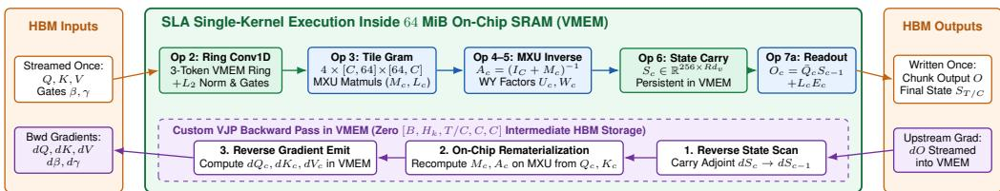  
Figure 4: Single-kernel VMEM execution and custom VJP backward pass in SLA. Top (Forward): Streamed $Q , K , V$ and gates enter the 64 MiB VMEM scratchpad once; a 3-token ring buffer executes causal Conv1D and $L _ { 2 }$ normalization (Op 2), followed in-place by 4-tile MXU Gram contractions (Op 3), MXU chunk inversion and WY factors (Ops 4–5), persistent [256, $D _ { v , \mathrm { p a c k } } ]$ state updates (Op 6), and chunk readout (Op 7a) before writing O to HBM. Bottom (Backward): During the reverse state scan, the custom VJP kernel recomputes intra-chunk matrices $M _ { c } , A _ { c } \mathrm { o n }$ the MXU directly inside VMEM, eliminating $[ B , H _ { k } , T / C , \bar { C _ { \ell } } C ]$ intermediate HBM writes for batch size B.

Algorithm 2 details the custom-VJP backward pass of fused SLA (illustrated in Figure 4, bottom), where for a scalar training loss we write $d M _ { c } \stackrel { - } { = } \partial \mathcal { L } / \partial M _ { c }$ (and analogously $d Q _ { c } , d K _ { c } , d V _ { c } , \dots )$ for the loss gradient (adjoint) with respect to each tensor. Let $\gamma _ { c } \in ( 0 , 1 ] ^ { \check { C } \times 4 }$ stack chunk c’s tile decays $\gamma _ { t , g }$ (with tile column $\gamma _ { c , g } \in ( 0 , 1 ] ^ { C } )$ , and let $d { \cal O } _ { c } = \partial \mathcal { L } / \partial \dot { \cal O } _ { c } \in \mathbb { R } ^ { C \times R d _ { \ast } }$ denote the upstream gradient of chunk c’s readout after backpropagating through the per-value-head RMSNorm and output gate in Eq. (5). For batch size B, a standard autodiff tape stores the intra-chunk matrices $M _ { c } , L _ { c } , A _ { c } \in$ $\mathbb { R } ^ { C \times C }$ from the forward pass in HBM, consuming $3 \bar { B } H _ { k } ( T / C ) C ^ { 2 }$ words. Because SLA’s Pillar 2 and Pillar 3 evaluate both the $G = 4$ Gram matrices and the chunk inverse $A _ { c } = ( I _ { C } + M _ { c } ) ^ { - 1 }$ as MXU matmuls, our backward kernel instead saves only the chunk-boundary states $\dot { S } _ { c - 1 } \in \mathbb { R } ^ { \dot { d } _ { k } \times R d _ { v } }$ and recomputes $M _ { c } , L _ { c } , A _ { c } ,$ and the unscaled writes $\tilde { E } _ { c } = A _ { c } ( V _ { c } - \bar { K } _ { c } S _ { c - 1 } ) \in \mathbb { R } ^ { C \times R d _ { v } }$ on-the-fly inside VMEM during the reverse scan over $c = T / C , \dots , 1$

Crucially, whereas unpacked baselines must execute a second sequential VPU triangular solve for the transposed system $( I _ { C } ^ { \bullet } + M _ { c } ) ^ { - \top }$ on every head in the backward pass, SLA already holds the dense inverse Ac in VMEM. Differentiating $E _ { c } = \mathrm { d i a g } ( \beta _ { c } ) A _ { c } ( V _ { c } - \bar { K } _ { c } S _ { c - 1 } ) = \mathrm { d i a g } ( \beta _ { c } ) \tilde { E } _ { c }$ through $A _ { c } = ( I _ { C } + M _ { c } ) ^ { - 1 }$ reduces the inverse-solve backpropagation to two MXU matmuls for the scaled adjoint $D _ { c } \in \mathbb { R } ^ { C \times R d _ { v } }$ and Gram adjoint $d M _ { c } \in \mathbb { R } ^ { C \times C }$ , shared across all R packed value heads:

$$
D _ { c } = A _ { c } ^ { \top } \operatorname { d i a g } ( \beta _ { c } ) d E _ { c } \in \mathbb { R } ^ { C \times R d _ { v } } , \qquad d M _ { c } = - \operatorname { t r i l } _ { - 1 } \left( D _ { c } \tilde { E } _ { c } ^ { \top } \right) \in \mathbb { R } ^ { C \times C } ,\tag{11}
$$

where tril $_ - 1 ( \cdot )$ and $\mathrm { t r i l } _ { 0 } ( \cdot )$ mask to strictly $( t > j )$ and weakly $\left( t \geq j \right)$ lower-triangular entries, rowsum( ) and colsum( ) sum matrix rows and columns, and $p _ { c , g } ^ { \mathrm { i n } } , p _ { c , g } ^ { \mathrm { o u t } } \in ( 0 , 1 ] ^ { C }$ denote the tile-g boundary-decay vectors $\begin{array} { r } { ( p _ { c , g } ^ { \mathrm { i n } } ) _ { t } = \prod _ { s = 1 } ^ { t } \gamma _ { s , g } } \end{array}$ and $\begin{array} { r } { ( p _ { c , g } ^ { \mathrm { o u t } } ) _ { t } = \prod _ { s = t + 1 } ^ { C } \gamma _ { s , g } , } \end{array}$ . From $D _ { c }$ , the value and decayed-key gradients follow immediately as $d V _ { c } = D _ { c }$ and $d \bar { K } _ { c } = - D _ { c } S _ { c - 1 } ^ { \top }$

Algorithm 2 Fused SLA Custom-VJP Backward Pass (Per Key Head in VMEM)   
Require: Saved boundary states $\{ S _ { c - 1 } \} _ { c = 1 } ^ { T / C }$ , chunk inputs $\{ Q _ { c } , K _ { c } , V _ { c } , \beta _ { c } , \gamma _ { c } \}$ , upstream readout gradients $\left\{ d O _ { c } \right\} _ { c = 1 } ^ { T / C }$   
Ensure: Input gradients $\left\{ d Q _ { c } , d K _ { c } , d V _ { c } , d \beta _ { c } , d \gamma _ { c } \right\} _ { c = 1 } ^ { T / C }$   
1: Initialize reverse carry $d S _ { T / C }  0 , d Z _ { T / C }  \bar { 0 } \in \mathbb { R } ^ { d _ { k } \times R d _ { v } }$ in VMEM   
2: for $c = T / C$ down to 1 do   
3: // 1. On-chip VMEM recomputation (Ops 3–5 on MXU; zero $\left[ C , C \right]$ HBM reads)   
4: Recompute $p _ { c , g } ^ { \mathrm { i n } } , p _ { c , g } ^ { \mathrm { o u t } }$ , decayed $( \bar { K } _ { c } , \bar { Q } _ { c } , \hat { K } _ { c } ) , G = 4$ masks $( \Gamma _ { g } , \Psi _ { g } )$ , and $M _ { c } , L _ { c }$ via 64-wide MXU matmuls   
5: Recompute $\boldsymbol { A _ { c } } \gets ( \boldsymbol { \bar { I } _ { C } } + \boldsymbol { M _ { c } } ) ^ { - 1 }$ on MXU; form $\tilde { E } _ { c } \gets A _ { c } ( V _ { c } - \bar { K } _ { c } S _ { c - 1 } )$ and $E _ { c } \gets \mathrm { d i a g } ( \beta _ { c } ) \tilde { E } _ { c }$   
6: $/ / 2 .$ Reverse state and momentum scan adjoints (Ops 6–7a)   
7: $\widetilde { d Z } _ { c } \gets d Z _ { c } + d S _ { c } ; \quad d Z _ { c - 1 } \gets \mu \kappa _ { c } \widetilde { d Z } _ { c }$ ▷ velocity carry $( \kappa _ { c } = 0$ at doc reset)   
8: $d E _ { c } \gets \hat { K } _ { c } \widetilde { d { Z } } _ { c } + L _ { c } ^ { \top } d O _ { c } \in \mathbb { R } ^ { C \times R d _ { v } } ; \quad d \hat { K } _ { c } \gets E _ { c } \widetilde { d { Z } } _ { c } ^ { \top } \in \mathbb { R } ^ { C \times d _ { k } }$ ▷ MXU   
9: $d L _ { c } \gets \mathrm { t r i l } _ { 0 } ( d O _ { c } E _ { c } ^ { \dagger } ) \in \mathbb { R } ^ { C \times C } ; \quad d \bar { Q } _ { c } \gets d O _ { c } S _ { c - 1 } ^ { \top } \in \overset { \sim } { \mathbb { R } } ^ { C \times d _ { k } }$ ▷ MXU   
10: // 3. Transposed WY inverse and value/key adjoints on MXU (Ops 4–5)   
11: $D _ { c } \gets \bar { A _ { c } ^ { \top } } \mathrm { d i a g } ( \beta _ { c } ) \ : d E _ { c } \in \mathbb { R } ^ { C \times R d _ { v } } ; \quad \bar { d } V _ { c } \gets D _ { c } ; \quad d \bar { K } _ { c } \gets \bar { - } D _ { c } S _ { c - 1 } ^ { \top }$ ▷ MXU   
12: $d M _ { c } \gets - \operatorname { t r i l } _ { - 1 } ( D _ { c } \tilde { E } _ { c } ^ { \top } ) \in \mathbb { R } ^ { C \times C }$ ▷ contracts $R d _ { v }$ packed value cols on MXU   
13: $\begin{array} { r } { d S _ { c - 1 }  F _ { c } ^ { \top } d \bar { S } _ { c } - \bar { K } _ { c } ^ { \top } D _ { c } + \bar { Q } _ { c } ^ { \top } d O _ { c } \in \mathbb R ^ { d _ { k } \times R d _ { v } } } \end{array}$ ▷ prev. chunk state carry $( \bar { K } _ { c } ^ { \top } D _ { c } = W _ { c } ^ { \top } d E _ { c } )$   
14: // 4. Tile-grouped $Q , K$ and gate adjoints $( G = 4$ tiles of $b = 6 4$ channels)   
15: for $g \in \{ 1 , 2 , 3 , 4 \}$ do   
16: $\widetilde { d M } _ { c , g } \gets d M _ { c } \odot \Gamma _ { g } ; \quad \widetilde { d L } _ { c , g } \gets d L _ { c } \odot \Psi _ { g }$   
17: $d Q _ { c , g }  \widetilde { d L } _ { c , g } K _ { c , g } + \mathrm { d i a g } ( p _ { c , g } ^ { \mathrm { i n } } ) ( d \bar { Q } _ { c } ) _ { : , g }$ ▷ 64-wide MXU matmul; $( \cdot ) _ { : , g }$ is tile-g slice   
18: $d K _ { c , g } \gets ( \widetilde { d M } _ { c , g } + \widetilde { d M } _ { c , g } ^ { \top } ) K _ { c , g } + \widetilde { d L } _ { c , g } ^ { \top } Q _ { c , g } + \mathrm { d i a g } ( p _ { c , g } ^ { \mathrm { i n } } ) ( d \bar { K } _ { c } ) _ { : , g } + \mathrm { d i a g } ( p _ { c , g } ^ { \mathrm { o u t } } ) ( d \hat { K } _ { c } ) _ { : , g }$   
19: end for ▷ concatenate $d Q _ { c } = [ d Q _ { c , 1 } , \ldots , \underline { { { d Q _ { c , 4 } } } } ] , ~ \bar { d K } _ { c } = [ d \bar { K _ { c , 1 } } , \ldots , d K _ { c , 4 } ]$   
$\begin{array} { r } { d \beta _ { c } \gets \mathrm { r o w s u m } ( d E _ { c } \odot \tilde { E } _ { c } ) + \mathrm { c o l s u m } \big ( d M _ { c } \odot \sum _ { g = 1 } ^ { 4 } \Psi _ { g } \odot ( K _ { c , g } K _ { c , g } ^ { \top } ) \big ) } \end{array}$ ⊤   
20:   
21: Accumulate columns $d \gamma _ { c , g }$ of $d \gamma _ { c }$ via reverse prefix sum over $d M _ { c } , d L _ { c } , d \bar { K } _ { c } , d \bar { Q } _ { c } , d \hat { K } _ { c } ,$ and $d S _ { c } S _ { c - 1 } ^ { \top }$   
22: end for   
23: return $\left\{ d Q _ { c } , d K _ { c } , d V _ { c } , d \beta _ { c } , d \gamma _ { c } \right\} _ { c = 1 } ^ { T / C }$

## 3 Empirical Results

We evaluate SLA on TPU v7x (Ironwood [6, 18]) at four levels: single-layer kernels and multigeneration rooflines (Section 3.1), long-context serving (Section 3.2), context-parallel training and end-to-end 12.5B MoE cube serving (Section 3.3), and multi-scale MoE pre-training throughput and quality (Sections 3.4–3.5). We use two configurations with $d _ { k } = 2 5 6 , G = 4$ decay tiles, chunk size $C = 1 2 8 .$ , and $H _ { v } = 8$ value heads: SLA-R2 shares each query-key head across 2 value heads $( H _ { q } = H _ { k } = 4 ,$ where $H _ { q }$ is the query-head count) and SLA-R4 across 4 $( H _ { q } = H _ { k } = 2 )$ ; layer shapes are written $H _ { k } \times \boldsymbol { d } _ { k } ^ { \quad \bullet } \times \boldsymbol { R } \boldsymbol { d } _ { v }$ . xL:1A denotes x linear attention layers per full softmax attention layer, so 0L:1A is a pure softmax attention Transformer. SLA keeps the baseline’s value width, $d _ { v } = 2 5 6$ at model width $D = 2 0 4 8$ and 512 at $D = 1 7 9 2$ , so SLA’s BF16 state has twice the entries of FP32 KDA with $d _ { k } = 1 2 8$ in the same memory, and the same entries as the 63.1B KDA with $d _ { k } = 2 5 6$ in half the memory. SLA Iso-State instead halves $d _ { v }$ to match KDA’s element count in half the bytes. Part of the measured speedup therefore comes from precision; a BF16-state KDA is only slightly faster than FP32 KDA (Table 6, footnote). All SLA pre-training runs except ablation arms A3 and A5 (Table 11b), and SLA Tree-CP (Table 8c), use Exact Inv.; 32-layer prefill and tree verification (Table 8a–b) use 1-Step Neumann, and single-layer benchmarks report both (Tables 5–6).

## 3.1 Kernel Performance and Multi-Generation TPU Rooflines

Fusion and stage breakdown. Because every intra-chunk stage of SLA runs on the MXU, the fused kernel keeps Ops 2–7a in the 64 MiB VMEM scratchpad and recomputes $M _ { c }$ and $A _ { c }$ in the backward pass instead of storing them in HBM (Section 2.5 and Figure 4). Table 5 shows where the time goes. Fusing GPU-shaped KDA gains only 1.03 . Reshaping the layer without fusion (unfused SLA-R4) gives 1.79 , mostly from the Gram/inversion stages and the state scan. Fusion then brings the total to 2.38 .

Comparison with open-source TPU baselines. Table 6 compares SLA with MaxText Pallas KDA [1], Tokamax Mosaic KDA [19] (the fastest baseline; it supports only $C \le 6 4 )$ , and unpacked scalar GDN. The iso-controls (b) show that the speedup depends on head sharing: without 4:1 sharing, $d _ { k } = 2 5 6 \mathrm { S L A }$ variants run at $0 . 6 7 \times - 0 . 7 7 \times$ of Tokamax, and only SLA-R4 is faster (1.09 –1.17 ). For full layers (c1–c2), fused SLA-R4 is $1 . 6 { \times } { - 2 . 5 } { \times }$ faster than Tokamax and needs 52%–61% less temporary HBM; with the exact inverse it is 1.4 –2.4 faster. These comparisons change the model (fewer key heads, BF16 state, grouped decay) as well as the kernel. We did not build a fused kernel for KDA or GDN with the same $d _ { k } = 2 5 6 , R = 4$ head sharing; that control would separate the contribution of the tile-grouped gate from that of head sharing and fusion.

Table 5: Seven-operator forward audit (ms) on TPU ${ \bf v 7 x } \left( D = 2 0 4 8 , T = 8 , 1 9 2 \right)$ . Unfused columns report isolated per-stage forward medians; fused brackets report single-kernel Ops 2–7a latency.
<table><tr><td>Stage Latency  $( D = 2 0 4 8 , T = 8 \mathrm { K } )$ </td><td>KDA (Unf.)</td><td>KDA (Fus.)</td><td>SLA-R4 (Unf.)</td><td>SLA-R4 (Fused)</td></tr><tr><td> ${ \mathrm { O p ~ 1 : Q K V + G a t e ~ P r o j ~ ( M X U ) } }$ </td><td>0.251</td><td>0.251</td><td>0.168</td><td>0.168</td></tr><tr><td>Op 2: Causal Conv4 + QK Norm</td><td>0.562</td><td></td><td>0.341</td><td></td></tr><tr><td>Op 3–5: Gram + WY Inversion</td><td>1.184</td><td>Fused</td><td>0.418</td><td>Fused</td></tr><tr><td>Op 6: Chunk State Scan (Sc)</td><td>1.248</td><td>3.104</td><td>0.614</td><td>1.112</td></tr><tr><td>Op 7a: Intra + State Readout</td><td>0.219</td><td></td><td>0.219</td><td></td></tr><tr><td>Op 7b–7c: Out Norm + Out Proj</td><td>0.255</td><td>0.255</td><td>0.245</td><td>0.245</td></tr><tr><td>Measured Full Layer Fwd (ms)</td><td>3.719</td><td>3.610</td><td>2.005</td><td>1.525</td></tr><tr><td>Analytical Roofline Fwd (ms)</td><td>2.890</td><td>2.740</td><td>1.380</td><td>0.867</td></tr><tr><td>Measured Full Layer F+B (ms)</td><td>7.108</td><td>6.912</td><td>3.982</td><td>2.992</td></tr><tr><td>F+B Speedup vs. KDA (Unf.)</td><td>1.00×</td><td>1.03×</td><td>1.79×</td><td>2.38×</td></tr></table>

Stateless functional harness (1-Step Neumann for SLA-R4). Fused: one kernel for Ops 2–7a; full NNX module latencies in Table 6c.

Table 6: Measured TPU v7x (batch size B = 1) kernel and full-layer latency (ms), 32K temporary HBM (8K is 0.26 ), and F+B speedups normalized to Open-Source Tokamax Mosaic KDA Base (1.00 ) in each panel across (a) core kernels at $D = 1 7 9 2 .$ , (b) iso-controlled core kernels at $D = 2 0 4 8$ , and (c1–c2) full linear attention layers (Ops 1–7c, unified harness; Tokamax supports $C \leq 6 4$ and $d _ { k } \leq 2 5 6 ) ;$ ; bold marks the SLA-R4 rows.
<table><tr><td>Regime</td><td>Kernel or Full Layer (Hk × dk × Rdv, Chunk C, State)</td><td>8K Fwd 8K Bwd</td><td></td><td>8KF+B</td><td>8K Spd.</td><td>32K F+B</td><td></td><td>32K Spd. 32K Temp HBM</td></tr><tr><td rowspan="5">(a) Core Kernel  $D = 1 7 9 2$  (63.1B MoE)</td><td>Open-Source MaxText Pallas KDA (8 × 256 × 512, C = 128, FP32)</td><td>3.320</td><td>2.000</td><td>5.320</td><td>0.63×</td><td>20.430</td><td>0.61×</td><td>一</td></tr><tr><td>Open-Source Tokamax Mosaic KDA (8 × 256 × 512, C = 64, Base)</td><td>1.951</td><td>1.403</td><td>3.354</td><td>1.00×</td><td>12.449</td><td>1.00×</td><td></td></tr><tr><td> ${ \mathrm { S L A } } { \mathrm { - R 2 ~ } } ( 4 \times 2 5 6 \times 1 0 2 4 , C = 1 2 8 , { \mathrm { B F } } 1 6 )$ </td><td>1.960</td><td>0.905</td><td>2.865</td><td>1.17×</td><td>10.153</td><td>1.23×</td><td></td></tr><tr><td> $\mathbf { S L A - R 4 } \left( 2 \times 2 5 6 \times 2 0 4 8 , C = 1 2 8 , \mathbf { B F } 1 6 \right)$ </td><td>1.371</td><td>0.671</td><td>2.042</td><td>1.64×</td><td>6.175</td><td>2.02×</td><td></td></tr><tr><td>Open-Source MaxText Pallas KDA (8 × 128 × 256, C = 128, FP32)</td><td>2.668</td><td>1.580</td><td>4.248</td><td>0.44×</td><td>16.455</td><td>0.35×</td><td></td></tr><tr><td rowspan="7">(b) Iso-Controls Core Kernel  $D = 2 0 4 8$ </td><td>Open-Source Tokamax Mosaic  $\mathrm { K D A } ( 8 \times 1 2 8 \times 2 5 6 , C = 6 4 , $  Base)</td><td>1.072</td><td>0.781</td><td>1.853</td><td>1.00×</td><td>5.829</td><td>1.00×</td><td></td></tr><tr><td>SLA Iso-State (4 × 256 × 256, C = 128, equal state &amp; scan FLOPs)</td><td>1.482</td><td>0.934</td><td>2.416</td><td>0.77×</td><td>7.565</td><td>0.77×</td><td></td></tr><tr><td>SLA-R2  $( 4 \times 2 5 6 \times 5 1 2 , C = 1 2 8 ,$  equal  $\bar { D _ { v } } = 2 0 4 8 ; 2 \times \mathrm { K D A \ s t a t e } )$ </td><td>1.571</td><td>1.007</td><td>2.578</td><td>0.72×</td><td>8.236</td><td>0.71×</td><td></td></tr><tr><td>SLA Iso-Mixer-Param (4 × 256 × 640, C = 128, equal mixer params)</td><td>1.630</td><td>1.056</td><td>2.686</td><td>0.69×</td><td>8.721</td><td>0.67×</td><td></td></tr><tr><td>SLA-R4 (2 × 256 × 1024, C = 128, equal 1.0 MiB bytes)</td><td>1.051</td><td>0.652</td><td>1.703</td><td>1.09×</td><td>5.002</td><td>1.17×</td><td></td></tr><tr><td>GDN Scalar Unpacked  $( G = 1 , 8 \times 2 5 6 \times 5 1 2 , C = 1 2 8 , \mathrm { P a l l a s } )$ </td><td>6.305</td><td>7.477</td><td>13.782</td><td>0.96×</td><td>48.393</td><td>0.88×</td><td>9,217 MiB</td></tr><tr><td>Open-Source MaxText Pallas KDA (8 × 256 × 512, C = 128, FP32)*</td><td>6.412</td><td>8.043</td><td>14.456</td><td>0.91×</td><td>48.662</td><td>0.87×</td><td>9,302 MiB</td></tr><tr><td rowspan="8">(c1) Full Layer  $D = 1 7 9 2$  SLA-R2 (Unfused,  $( \mathrm { O p s } 1 - 7 \mathrm { c } ,$ </td><td>Open-Source Tokamax Mosaic KDA (8 × 256 × 512, C = 64, Base)</td><td>5.896</td><td>7.326</td><td>13.222</td><td>1.00×</td><td>42.378</td><td>1.00×</td><td>9,483 MiB</td></tr><tr><td> $G = 1 \mathrm { T i l e } , 4 \times 2 5 6 \times 1 0 2 4 , C = 1 2 8 , { \bf B } \mathrm { F } 1 6 )$ </td><td>4.609</td><td>6.275</td><td>10.884</td><td>1.21×</td><td>32.459</td><td>1.31×</td><td>6,922 MiB</td></tr><tr><td> $\mathrm { S L A { - } R 2 \ ( U n f u s e d , } G = 4 \mathrm { ~ T i l e s , } 4 \times 2 5 6 \times 1 0 2 4 , C = 1 2 8 , \mathrm { B F } 1 6 )$ </td><td>4.470</td><td>6.088</td><td>10.558</td><td>1.25×</td><td>32.559</td><td>1.30×</td><td>6,922 MiB</td></tr><tr><td>SLA-R4 (Unfused,  $G = 4 \mathrm { T i l e s , 2 } \times 2 5 6 \times 2 0 4 8 , C = 1 2 8 , { \bf B } \mathrm { F } 1 6 )$ </td><td>3.605</td><td>4.105</td><td>7.709</td><td>1.72×</td><td>26.240</td><td>1.62×</td><td>5,782 MiB</td></tr><tr><td>SLA-R4 (Exact Inv.) (2 × 256 × 2048, C = 128, BF16)</td><td>2.882</td><td>2.686</td><td>5.568</td><td>2.37×</td><td>20.237</td><td>2.09×</td><td>3,738 MiB</td></tr><tr><td>SLA-R4 (1-Step Neumann) (2 × 256 × 2048, C = 128, BF16)</td><td>2.499</td><td>2.755</td><td>5.254</td><td>2.52×</td><td>18.786</td><td>2.26×</td><td>3,738 MiB</td></tr><tr><td>GDN Scalar Unpacked  $( G = 1 , 8 \times 1 2 8 \times 2 5 6 , C = 1 2 8 , \mathrm { P a l l a s } )$ </td><td>5.006</td><td>5.229</td><td>10.235</td><td></td><td>31.859</td><td></td><td></td></tr><tr><td>Open-Source MaxText Pallas KDA (8 × 128 × 256, C = 128, FP32)*</td><td></td><td></td><td></td><td>0.60×</td><td></td><td>0.76×</td><td>4,360 MiB</td></tr><tr><td rowspan="7">(c2) Full Layer D = 2048 (Ops 1–7c, Unified)</td><td></td><td>4.737</td><td>4.794</td><td>9.531</td><td>0.65×</td><td>32.454</td><td>0.74×</td><td>4,432 MiB</td></tr><tr><td>Open-Source Tokamax Mosaic KDA (8 × 128 × 256, C = 64, Base)</td><td>3.570</td><td>2.590</td><td>6.160</td><td>1.00×</td><td>24.060</td><td>1.00×</td><td>4,727 MiB</td></tr><tr><td>SLA-R2 (Unfused,  $G = 1 \mathrm { T i l e } , 4 \times 2 5 6 \times 5 1 2 , C = 1 2 8 , { \bf B } \mathrm { F } 1 6 )$ </td><td>4.285</td><td>2.964</td><td>7.249</td><td>0.85×</td><td>25.284</td><td>0.95×</td><td>4,260 MiB</td></tr><tr><td>SLA-R4 (Unfused,  $G = 4 \mathrm { T i l e s , 2 } \times 2 5 6 \times 1 0 2 4 , C = 1 2 8 , { \bf B } \mathrm { F } 1 6 )$ </td><td>2.876</td><td>2.348</td><td>5.224</td><td>1.18×</td><td>19.680</td><td>1.22×</td><td>3,472 MiB</td></tr><tr><td>SLA-R2 (1-Step Neumann, 4 × 256 × 512, C = 128, BF16)</td><td>2.795</td><td>1.970</td><td>4.765</td><td>1.29×</td><td>17.289</td><td>1.39×</td><td>3,092 MiB</td></tr><tr><td>SLA-R4 (Exact Inv.) (2 × 256 × 1024, C = 128, BF16)</td><td>2.437</td><td>2.104</td><td>4.541</td><td>1.36×</td><td>15.720</td><td>1.53×</td><td>2,263 MiB</td></tr><tr><td>SLA-R4 (1-Step Neumann) (2 × 256 × 1024, C = 128, BF16)</td><td>2.119</td><td>1.867</td><td>3.985</td><td>1.55×</td><td>14.824</td><td>1.62×</td><td>2,263 MiB</td></tr></table>

∗Switching MaxText Pallas KDA’s state from FP32 to BF16 reduces its latency only slightly, from 14.46/48.66 ms to 13.91/46.40 ms (D = 1792) and from 9.53/32.45 ms to 8.80/31.72 ms (D = 2048) at 8K/32K (1.9 –2.6 slower than fused ). SLA rows change the model (fewer key heads, grouped decay) as well as the kernel; a fused KDA/GDN with the sam $d _ { k } = 2 5 6 , R = 4$ sharing was not measured. GDN-2 and Mamba-3 latencies: Section 3.5.

Multi-generation TPU rooflines and FP8 skew. On an identical portable kernel stack, SLA-R4’s forward speedup grows with the MXU:VPU ratio from 4.5 on TPU v4 to 6.7 on TPU v7x (Figure 5 and Table 7). Specifically, Table 7 reports measured single-core forward core-kernel latencies $( B = 1 , T = 8 , 1 9 2 , D = 2 0 4 8 )$ and out-of-fold leave-one-out (LOO) roofline speedup predictions across TPU v4, v5p, v6e, and v7x. To keep the software implementation identical across all four hardware generations (since Tokamax Mosaic targets v6e/v7x at $C \le 6 4 )$ , Table 7 compares SLA-R4 against the uniform portable JAX/Pallas KDA (C = 64, FP32; 6.99 ms on v7x) baseline on every chip, whereas Table 6 compares against optimized open-source MaxText Pallas $( C = 1 2 8$ 2.67 ms fwd) and Tokamax Mosaic KDA $( \breve { C } = 6 4 , 1 . 0 7$ ms fwd) on TPU v7x.

SLA-R4 Speedup over Portable KDA (C = 64)  
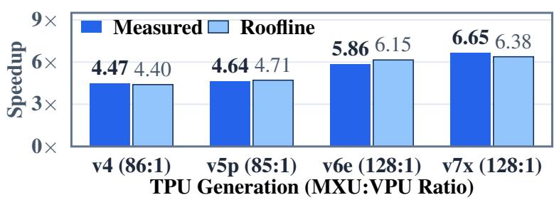  
Figure 5: Forward speedup of SLA-R4 across TPU generations over a portable FP32 KDA baseline, with leave-one-out roofline predictions (3.1% error). Not comparable to the Tokamax-normalized speedups in Table 6.

On a single TensorCore with systolic tile width $W ~ \in ~ \{ 1 2 8 , 2 5 6 \}$ and single-core MXU and VPU peaks $\mathcal { P } _ { \mathrm { M X U } } , \mathcal { P } _ { \mathrm { V P U } }$ (per-chip values in Table 1 divided by Cores), let $( \tilde { d } _ { k } , \tilde { D } _ { v , \mathrm { p a c k } } )$ denote $( d _ { k } , D _ { v , \mathrm { p a c k } } )$ padded to multiples of W, $F _ { \mathrm { s t e p } } = 2 \operatorname* { m a x } ( C , W ) \tilde { d } _ { k } \tilde { D } _ { v , \mathrm { p a c k } }$ the FLOP count of one per-step scan matmul, $\tau _ { \mathrm { p i p e } } \approx 1 . 5 – 2 . 5$ µs the per-head in-VMEM Pallas scan-pipeline fill/drain overhead (smaller than the top-level XLA lax.scan HBM-barrier cost $\tau _ { \mathrm { s y n c } } \approx 1 2 \mu \mathrm { s }$ per chunk step in Figure 2), $\eta _ { \mathrm { s y s } } \approx 8 . 6 \%$ the effective single-core scan MXU utilization, γinv the VPU operation count per entry of the triangular solve (unrelated to the decay rates $\gamma _ { t , g } )$ , and $\Phi _ { \mathrm { M X U } } ( C ) = \bar { \mathcal { O } } ( H _ { k } T C d _ { k } +$ $\mathsf { \bar { H } } _ { v } T C \dot { d } _ { v } )$ the intra-chunk matmul FLOPs. We model single-core forward latency $T _ { \mathrm { f w d } } ( C )$ at chunk size C as

$$
T _ { \mathrm { f w d } } ( C ) \approx H _ { k } \frac { T } { C } \Bigl ( \tau _ { \mathrm { p i p e } } + \frac { F _ { \mathrm { s t e p } } } { \eta _ { \mathrm { s y s } } \mathcal { P } _ { \mathrm { M X U } } } \Bigr ) + \frac { \gamma _ { \mathrm { i n v } } H _ { k } T C } { \mathcal { P } _ { \mathrm { V P U } } } + \frac { \Phi _ { \mathrm { M X U } } ( C ) } { \mathcal { P } _ { \mathrm { M X U } } } .\tag{12}
$$

Across the four hardware generations in Table 7, parameter-free two-cluster comparison directly isolates the 256-tile transition: on 128 128-tile accelerators (0% KDA key-tile padding, $\alpha _ { \mathrm { m v } } \approx 8 5 \times )$ SLA-R4 already achieves 4.47 –4.64 speedup (TPU v4 and v5p), and stepping to $2 5 6 \times 2 5 6 .$ tile accelerators (50% KDA key-tile padding at $d _ { k } = 1 2 8 , \alpha _ { \mathrm { m v } } \approx 1 2 8 \times )$ lifts the speedup by a further 1.3 –1.46 to 5.86 –6.65 (TPU v6e and v7x; reduced-form linearized LOO fit shown for reference in Table 7). Separately, comparing SLA-R4 against the standalone JAX/Pallas $C = 1 2 8$ KDA core kernel on the isolated FP8 MXU microbenchmark harness (1.975 ms BF16, 2.168 ms E4M3 FP8, excluding MaxText’s segment-reset and $L _ { \mathrm { { 2 } } } \mathrm { { - n o r m } }$ wrapper included in the 2.668 ms row of Table 6b) yields a 1.69 forward speedup in native E4M3 FP8 MXU mode (1.280 vs. 2.168 ms at $\alpha _ { \mathrm { m v } } = 2 5 6 \times )$ , matching BF16’s 1.67 (1.181 vs. 1.975 ms) on the same harness.

Table 7: Measured forward core-kernel latency (ms, $B = 1 , T = 8 , 1 9 2 , D = 2 0 4 8 )$ vs. portable JAX/Pallas KDA $( C = 6 4 )$ and out-of-fold LOO Roofline predictions across four TPU generations.
<table><tr><td>TPU Generation</td><td>Array Tile</td><td>MXU:VPU (BF16)</td><td>KDA Measured (ms)</td><td>SLA-R4 Measured (ms)</td><td>Measured Speedup</td><td>Out-of-Fold LOO Pred. (Error)</td></tr><tr><td>TPU v4</td><td>128 × 128</td><td>85.9×</td><td>14.84</td><td>3.32</td><td>4.47×</td><td>4.40× (−1.6%)</td></tr><tr><td>TPU v5p</td><td> $1 2 8 \times 1 2 8$ </td><td>85.0×</td><td>9.19</td><td>1.98</td><td>4.64×</td><td> $4 . 7 1 \times ( + 1 . 5 \% )$ </td></tr><tr><td>TPU v6e</td><td> $2 5 6 \times 2 5 6$ </td><td>127.5×</td><td>11.02</td><td>1.88</td><td>5.86×</td><td> $6 . 1 5 \times ( + 5 . 0 \% )$ </td></tr><tr><td>TPU v7x</td><td> $2 5 6 \times 2 5 6$ </td><td>128.2×</td><td>6.99</td><td>1.05</td><td>6.65×</td><td> $6 . 3 8 \times ( - 4 . 1 \% )$ </td></tr></table>

## 3.2 Long-Context Serving

Prefill latency and prefix caching. In 32-layer hybrid stacks with SwiGLU FFNs [51] (Table 8a), 15L:1A SLA-R4 (one softmax layer per 16) reaches a 131K time-to-first-token (TTFT) of 1.67 s, compared with 2.66 s for the same hybrid layout with KDA and 7.14 s for full grouped-query attention (GQA) [2]. Most of the gain over GQA comes from the hybrid layout itself; the gain attributable to

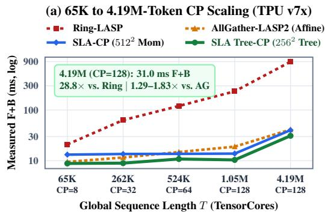

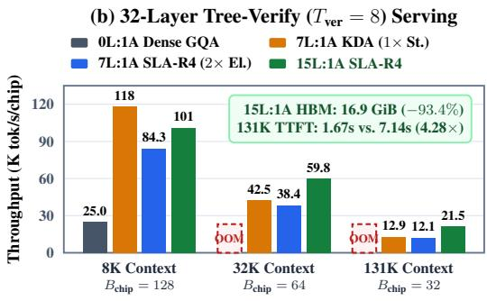  
Figure 6: Context parallelism and serving on TPU v7x. (a) Forward-backward latency of contextparallel scans across 8–128 TensorCores (Section 3.3). (b) Single-chip 32-layer serving throughput and 131K prefill latency (Table 8).

Table 8: Single-chip 32-layer prefill latency (a), 32-layer attention-layer serving throughput with speculative verification of $T _ { \mathrm { v e r } } \in \{ 8 , 1 6 \}$ drafted tokens (b; OOM > 190 GiB/chip), and contextparallel F+B scan latency across P  32, 64, 128 TensorCores (c) on TPU v7x (D = 2048).
<table><tr><td>Regime</td><td>Architecture / Method (32L, D = 2048)</td><td>8K TTFT</td><td>32K TTFT</td><td>131K TTFT</td><td>32K Cache/Lyr</td></tr><tr><td rowspan="4">(a) 32L Prefill Full TTFT (B = 1)</td><td> $\mathrm { O L } \colon 1 \mathrm { A D e n s e ~ G Q A } ( H _ { q } = 1 6 , H _ { k v } = 4 \mathrm { K V ~ h e a d s } )$ </td><td>214.7 ms</td><td>761.1 ms</td><td>7,139 ms (1.00×)</td><td>64.0 MiB KV</td></tr><tr><td> $1 5 \mathrm { { L } : 1 A \mathrm { { M a x } T e x t \mathrm { { K D A } \bar { ( 8 \times 1 2 8 \times 2 5 6 , F P 3 2 ) } } } }$ </td><td>265.7 ms</td><td>689.1 ms</td><td>2,664 ms (2.68×)</td><td>1.0 MiB FP32</td></tr><tr><td> $\mathrm { 7 L } { \mathrel { : } } 1 \mathrm { A S L A - R 4 } ( 2 \times 2 5 6 \times 1 0 2 4 , \mathrm { B F 1 6 } )$ </td><td>204.3 ms</td><td>439.8 ms</td><td>2,034 ms (3.51×)</td><td>1.0 MiB BF16</td></tr><tr><td> $\mathbf { 1 5 L } \colon \mathbf { 1 A \ S L A { \cdot } R 4 } \left( 2 \times 2 5 6 \times 1 0 2 4 , \mathrm { F P 8 } \right)$ </td><td>203.6 ms</td><td>416.9 ms</td><td>1,669 ms (4.28×)</td><td>0.5 MiB FP8</td></tr><tr><td>Regime</td><td>Attention-Layer Serving (tok/s/chip)†</td><td>8K, B=128</td><td>32K, B=64</td><td>131K, B=32</td><td>KV+State (131K)</td></tr><tr><td rowspan="8">(b) Serving Tree Verify</td><td>OL:1A Dense  $\mathrm { G Q A } ( T _ { \mathrm { v e r } } = 8 )$ </td><td>25.0K</td><td>OOM</td><td>OOM</td><td>256.0 GiB</td></tr><tr><td>7L: 1A MaxText KDA (FP32,  $T _ { \mathrm { v e r } } = 8 )$ </td><td>117.7K</td><td>42.5K</td><td>12.9K</td><td>32.88 GiB</td></tr><tr><td> $\mathrm { 7 L } \colon 1 \mathrm { A } \mathrm { S L A } \mathrm { - R } 4 ( 2 \times \mathrm { E } 1 . , T _ { \mathrm { v e r } } = 8 )$ </td><td>84.3K</td><td>38.4K</td><td>12.1K</td><td>32.88 GiB</td></tr><tr><td>7L: 1A MaxText KDA (FP32,  $T _ { \mathrm { v e r } } = 1 6 )$ </td><td>152.9K</td><td>64.3K</td><td>OOM</td><td>32.88 GiB</td></tr><tr><td> $\mathrm { 7 L } { : } 1 \mathrm { A } \mathrm { S L A } \mathrm { I s o - } \mathrm { S t a t e } ( \mathrm { B F } 1 6 , T _ { \mathrm { v e r } } = 1 6 )$ </td><td>162.1K</td><td>68.6K</td><td>OOM</td><td>32.44 GiB</td></tr><tr><td>15L: 1A MaxText KDA (FP32,  $T _ { \mathrm { v e r } } = 1 6 )$ </td><td>202.5K</td><td>98.0K</td><td>34.3K</td><td>16.94 GiB</td></tr><tr><td>15L: 1A SLA Iso-State (BF16  $. T _ { \mathrm { v e r } } = 1 6 )$ </td><td>243.8K</td><td>119.3K</td><td>35.2K</td><td>16.47 GiB</td></tr><tr><td> $\mathtt { 1 5 L : 1 A \ S L A - R 4 \ F P 8 \ ( E 4 M 3 , } T _ { \mathrm { v e r } } = 1 6 )$ </td><td>174.7K</td><td>85.6K</td><td>33.1K</td><td>16.47 GiB</td></tr><tr><td>Regime</td><td>Context-Parallel Scan (F+B ms)</td><td>P=32 (262K)</td><td>P= 64 (524K)</td><td>P=128 (1.05M)</td><td>P=128 (4.19M)</td></tr><tr><td rowspan="5">(c) Context Parallelism (32–128 Cores)</td><td>Ring-LASP Sequential Ring (P – 1 Hops)</td><td>63.20</td><td>120.12</td><td>233.47</td><td>894.41</td></tr><tr><td>AllGather-LASP2 Collective Baseline</td><td>11.60</td><td>14.84</td><td>19.00</td><td>41.06</td></tr><tr><td>SLA Tree-CP (µ = 0.25, trained, 5122)</td><td>13.59</td><td>13.71</td><td>13.84</td><td>40.08</td></tr><tr><td>SLA Tree-CP (µ = 0, no mom., 2562)</td><td>8.97</td><td>10.84</td><td>10.40</td><td>31.03</td></tr><tr><td>Tree-CP vs. AllGather  $( \mu = 0 . 2 5 / \mu = 0 )$ </td><td></td><td>0.85× /1.29× 1.08× /1.37×</td><td>1.37× /1.83×</td><td>1.02× /1.32×</td></tr></table>

†Panel (b) reports attention layers only (2  95 GiB/core HBM cap); with SwiGLU FFNs included at $T _ { \mathrm { v e r } } = 1 6 , { \tt S L A }$ Iso-State is 2%–7% faster end-to-end than KDA. Panels (a)–(b) use 1-Step Neumann; panel (c) uses Exact Inv..

SLA over KDA is 1.6 . A cached SLA state is also much smaller than a KV cache (0.5–1 MiB per layer versus 64 MiB at 32K), which makes multi-turn prefix caching cheap.

Speculative verification. Single-token decoding underuses the MXU, so we verify $T _ { \mathrm { v e r } } \in \{ 8 , 1 6 \}$ drafted tokens per step [35] with the same block inversion (Table 8b). At equal state size (SLA Iso-State), SLA is 1.03 –1.22 faster than KDA on the attention layers, and 2%–7% faster once FFNs are included. SLA-R4, which holds twice KDA’s state elements, is slower than KDA at short context (84.3K vs. 117.7K tok/s at 8K), as expected from its larger state reads. Table 9c reports a 12.5B MoE speculative-decoding setting in which SLA achieves longer greedy acceptance lengths than unclamped KDA on out-of-distribution 32K/64K HotpotQA (1.17 –1.33 vs. clamped KDA; 1.06 –1.10 under stochastic sampling, whereas KDA is slightly higher in-domain at 8K).

## 3.3 Context-Parallel Training and End-to-End 12.5B MoE Cube Serving

Context parallelism with a prefix-tree scan. Head-sharded Ulysses [29] needs at least as many key heads as devices, which SLA’s $H _ { k } \in \{ 2 , 4 \}$ do not provide, and ring-based LASP [56] passes the state through P 1 sequential hops across P devices. For any gated delta rule with scalar $\beta _ { t }$ a chunk’s state update is an affine map $S \mapsto J S + B$ with a $d _ { k } \times d _ { k }$ transition $J \in \mathbb { R } ^ { d _ { k } \times d _ { k } }$ and offset $B \in \mathbb { R } ^ { d _ { k } \times D _ { v , \mathrm { p a c k } } }$ , so $P$ devices can reduce their local chunks independently and combine them in $\lceil \log _ { 2 } P \rceil$ prefix-tree steps [11, 39]. This construction is not specific to SLA, and our KDA baseline uses the same tree. SLA’s only advantage here is that one $2 5 6 \times 2 5 6$ transition serves all R value heads of a key head, so fewer transitions are exchanged; chunk momentum $( \mu = 0 . 2 5 )$ doubles the carried state to $5 1 2 \times 5 1 2$ . Table 8c reports both settings on 32–128 TensorCores. With momentum, as trained, the tree scan is roughly on par with an AllGather-based LASP-2 baseline [57] $( 0 . 8 5 { \times } \mathrm { - } 1 . 3 7 { \times } )$ ; without momentum it is $1 . 3 { \times } { - } 1 . 8 { \times }$ faster. Both are much faster than ring-based LASP at large $P .$ . In end-to-end 12.5B MoE training at 1M context (Table 9a), 15L:1A SLA-R2 steps 13% faster than KDA using the same tree scan, consistent with its layer-level speedup.

Affine monoid derivation for uncoupled and coupled SLA Tree-CP. Shard $p \in \{ 1 , \ldots , P \}$ holds $L _ { \mathrm { l o c } }$ consecutive chunks; quantities of its c-th local chunk $( c \in \{ 1 , \dots , L _ { \mathrm { l o c } } \} )$ ) carry the subscript $( p , c )$ , with shard input state $S _ { p , 0 }$ and shard output state $S _ { p , L _ { \mathrm { l o c } } }$ . Substituting $E _ { p , c } \doteq U _ { p , c } - W _ { p , c } S _ { p , c - 1 }$ (Section 2.4.2) into $\tilde { S } _ { C } = F _ { p , c } S _ { p , c - 1 } + \hat { K } _ { p , c } ^ { \top } E _ { p , c }$ gives per-chunk transition $J _ { p , c } ^ { \mathrm { s t e p } } \in \mathbb { R } ^ { d _ { k } \times d _ { k } }$ and offset $B _ { p , c } \in \mathbb { R } ^ { d _ { k } \times D _ { \tau } }$ v,pack such that, without momentum, each chunk is the affine map

$$
\begin{array} { r l } { S _ { p , c } = J _ { p , c } ^ { \mathrm { s t e p } } S _ { p , c - 1 } + B _ { p , c } , } & { \quad } \\ { J _ { p , c } ^ { \mathrm { s t e p } } = F _ { p , c } - \hat { K } _ { p , c } ^ { \top } W _ { p , c } , } & { \quad B _ { p , c } = \hat { K } _ { p , c } ^ { \top } U _ { p , c } ; } \end{array}
$$

$J _ { p , c } ^ { \mathrm { s t e p } }$ does not depend on the values, so one transition serves all $D _ { v , \mathrm { p a c k } }$ value columns of a key head (this holds for any gated delta rule, since the transition only involves keys and gates). With $\mu = 0$ the $L _ { \mathrm { l o c } }$ local chunks compose into a single shard map $( J _ { p } , B _ { p } )$ satisfying $S _ { p , L _ { \mathrm { l o c } } } = J _ { p } S _ { p , 0 } + B _ { p } ,$ where $\begin{array} { r } { J _ { p } = \prod _ { c = L _ { \mathrm { l o c } } } ^ { 1 } J _ { p , c } ^ { \mathrm { s t e p } } } \end{array}$ (ordered from $c = 1$ on the right to $c = L _ { \mathrm { l o c } }$ on the left) and $B _ { p }$ is the shard output $S _ { p , L _ { \mathrm { l o c } } }$ obtained from $S _ { p , 0 } = 0 .$ . (With $\mu > 0$ , the same construction applies to the lifted maps below.) Writing shard maps as pairs $( J _ { a } , B _ { a } )$ and $\left( J _ { b } , B _ { b } \right)$ for shards a and b with composition (apply a, then b)

$$
( J _ { b } , B _ { b } ) \circ ( J _ { a } , B _ { a } ) = ( J _ { b } J _ { a } , \ J _ { b } B _ { a } + B _ { b } ) ,
$$

for any third shard d with map $( J _ { d } , B _ { d } )$ , matrix associativity and left-distributivity yield

$$
\begin{array} { r l r } & { } & { \big ( ( J _ { d } , B _ { d } ) \circ ( J _ { b } , B _ { b } ) \big ) \circ ( J _ { a } , B _ { a } ) = ( J _ { d } J _ { b } J _ { a } , \ J _ { d } J _ { b } B _ { a } + J _ { d } B _ { b } + B _ { d } ) } \\ & { } & { = ( J _ { d } , B _ { d } ) \circ \big ( ( J _ { b } , B _ { b } ) \circ ( J _ { a } , B _ { a } ) \big ) , } \end{array}
$$

so the $P$ shard maps can be combined by any parallel prefix scan in $\lceil \log _ { 2 } P \rceil$ rounds.

When the velocity $Z _ { c } \in \mathbb R ^ { d _ { k } \times D _ { v , \mathrm { p a c k } } }$ is carried across shard boundaries $( \mu > 0 , { \tt S L A }$ Tree-CP+Mom; shard subscript p dropped, with per-chunk transition $J _ { c } ^ { \mathrm { s t e p } }$ and offset $B _ { c } )$ , we have $\Delta S _ { c } = \tilde { S } _ { C } -$ $F _ { c } S _ { c - 1 } = ( J _ { c } ^ { \mathrm { s t e p } } - F _ { c } ) S _ { c - 1 } + B _ { c }$ . Substituting into Eq. $( 6 ) \ ( Z _ { c } = \mu \kappa _ { c } Z _ { c - 1 } + \Delta S _ { c } , \ S _ { c } =$ $F _ { c } S _ { c - 1 } + Z _ { c } )$ defines a lifted $2 d _ { k } \times 2 d _ { k }$ transition $\tilde { J } _ { c } \in \mathbb { R } ^ { 2 d _ { k } \times 2 d _ { k } }$ and offset $\tilde { B } _ { c } \in \mathbb { R } ^ { 2 d _ { k } \times D _ { v , \mathrm { p a c k } } }$ updating the stacked carry $[ S _ { c } ; Z _ { c } ] \in \mathbb { R } ^ { 2 \ddot { d } _ { k } \times D _ { \imath } }$ ,pack via the exact block-affine map

$$
\left[ S _ { c } \right] = \underbrace { \left[ J _ { c } ^ { \mathrm { s t e p } } \theta ^ { \mathrm { \tiny ~ \kappa } } , I _ { d _ { k } } \right] } _ { \tilde { J } _ { c } } \left[ \boldsymbol { S } _ { c - 1 } \right] + \underbrace { \left[ \boldsymbol { B } _ { c } \right] } _ { \tilde { B } _ { c } } .\tag{13}
$$

For consecutive shards a and $b ,$ the shard-reduced lifted maps $( \tilde { J } _ { a } , \tilde { B } _ { a } )$ and $( \tilde { J } _ { b } , \tilde { B } _ { b } )$ obey the identical associative composition law $( \tilde { J } _ { b } , \tilde { B } _ { b } ) \circ ( \tilde { J } _ { a } , \tilde { B } _ { a } ) = ( \tilde { J } _ { b } \tilde { J } _ { a } , \tilde { J } _ { b } \tilde { B } _ { a } + \tilde { B } _ { b } )$ , with $[ 5 1 2 , 5 1 2 ]$ transitions for $d _ { k } = 2 5 6$ □

End-to-end 12.5B sparse MoE 1M-token SLA Tree-CP, cube serving, and speculative acceptance. To complement the isolated 128-core SLA Tree-CP kernel and single-chip 32-layer dense-FFN serving benchmarks in Table $^ { 8 , }$ Table 9 benchmarks a full 16-layer 12.5B sparse MoE (0.79B active, $E = 2 5 6$ routed experts with $k = 8$ active per token plus one shared expert, $D = 1 0 2 4 , D _ { v } = 2 0 4 8$ , vocabulary size $V = 1 0 0 { , } 3 5 2 )$ end-to-end across all 64 chips (128 TensorCores) of a TPU v7x 4x4x4 cube across three workloads:

1. End-to-End CP=EP=128 Training Steps up to 1.05M Tokens (Table 9a): With vocab-chunked cross-entropy across all 24 grid cells, uncoupled 15L:1A SLA Tree-CP R2 (2 -state $4 \times 2 5 6 ^ { 2 }$

Table 9: Measured 64-chip TPU v7x (4x4x4, 128 TensorCores) end-to-end 16-layer 12.5B sparse MoE (0.79B active, 256 experts $k = 8 ) ( \mathrm { a } )$ fixed-CP=EP=128 F+B latency and tok/s/chip across T = 128K–1.05M $( T _ { \mathrm { l o c } } = T / 1 2 8 ;$ at $T = 5 1 2 \mathrm { { K } }$ $T _ { \mathrm { l o c } } = 4 { , } 0 9 6$ selects a faster XLA EP=128 MoE ragged-all-to-all tile schedule across all linear hybrids relative to $T = 2 5 6 \mathsf { K } )$ , (b) EP=128 cube verification throughput $( B _ { \mathrm { c h i p } } = 6 4 $ , comparing $\mathtt { T r e e - N 1 } \ [ = \mathtt { T r e e - N e u m a n n } - 1 , T _ { \mathrm { v e r } } = 1 6 ]$ and FP8Fused seq\_scan\_t16), and (c) real-checkpoint lossless speculative acceptance $\bar { \tau } ( K = 1 6 ,$ $N = 6 4$ , greedy [stochastic]).
<table><tr><td>(a) 12.5B MoE CP=EP=128 F+B</td><td>T = 128K (tok/s/ch)</td><td>T = 256K (tok/s/ch)</td><td>T = 512K (tok/s/ch)</td><td>T = 1.05M (tok/s/ch)</td><td>1M HBM / Mixer ICI</td></tr><tr><td>OL: 1A Full-Attn Ring-CP</td><td>1,740.4 ms (1,177)</td><td>4,797.5 ms (854)</td><td>10,712.1 ms (765)</td><td>36,725.0 ms (446)</td><td>25.8 GiB / 32,512 MiB</td></tr><tr><td>7L: 1A MaxText KDA Tree (G = 128)</td><td>1,232.2 ms (1,662)</td><td>2,573.3 ms (1,592)</td><td>2,704.5 ms (3,029)</td><td>7,377.0 ms (2,221)</td><td>25.73 GiB / 4,232 MiB</td></tr><tr><td>7L: 1A Iso-Param SLA Tree-CP R4</td><td>1,212.9 ms (1,689)</td><td>2,500.8 ms (1,638)</td><td>2,542.6 ms (3,222)</td><td>7,023.9 ms (2,333)</td><td>25.92 GiB / 4,736 MiB</td></tr><tr><td>15L: 1A MaxText KDA Tree (G = 128)</td><td>1,221.4 ms (1,677)</td><td>2,498.2 ms (1,639)</td><td>2,249.8 ms (3,641)</td><td>5,337.6 ms (3,070)</td><td>25.49 GiB / 2,760 MiB</td></tr><tr><td>15L: 1A Ring-State LASP R2</td><td>1,575.5 ms (1,299)</td><td>2,744.8 ms (1,492)</td><td>2,346.3 ms (3,491)</td><td>5,204.6 ms (3,148)</td><td>25.46 GiB / 17,392 MiB</td></tr><tr><td>15L: 1A SLA Tree-CP R2 NoMom / +Mom</td><td>1,174/1,189 ms</td><td>2,331/2,368 ms</td><td>1,965/2,003 ms (5.45× / 5.35×) 4,738/4,904 ms (3,458/3,341) 25.45 GiB/2,992 MiB (−83%)</td><td></td><td></td></tr><tr><td>(b) 12.5B MoE EP=128 Cube Decode</td><td>8K, Bchip = 64 (/cube)</td><td>32K, Bchip = 64 (/cube)</td><td>131K,  $B _ { \mathrm { c h i p } } = 6 4 ( / \mathrm { c u b e } )$ </td><td>8K seq_scan_t16 (/cube)</td><td>131K KV+State / Chip</td></tr><tr><td> $\scriptstyle 0 \mathrm { L } : 1 \mathrm { A F u l l - A t t n ~ G Q A } \left( \mathrm { T r e e - M 1 } , T _ { \mathrm { v e r } } = 1 6 \right)$ </td><td>15,381 /ch (984.4K)</td><td>10,677 /ch (683.4K)</td><td>OOM (Bchip = 8: 250.7K)</td><td>n/a (softmax)</td><td>256.0 GiB (OOM)</td></tr><tr><td>7L: 1A KDA Base FP32 (Tree-N1, Tver=16)</td><td>17,212 /ch (1.102M)</td><td>16,258 /ch (1.041M)</td><td>13,106 /ch (838.8K)</td><td>14,180 /ch (907.5K)</td><td>32.88 GiB</td></tr><tr><td>7L: 1A SLA Iso-State BF16/FP8Fused</td><td>17,513 /ch (1.121M)</td><td>16,544 /ch (1.059M)</td><td>13,255 /ch (848.3K)</td><td>16,628 /ch (1,064.2K)</td><td>32.44/32.22 GiB</td></tr><tr><td>15L: 1A KDA Base FP32 (Tree-N1, Tver=16)</td><td>17,513 /ch (1.121M)</td><td>17,140 /ch (1.097M)</td><td>15,912 /ch (1.018M)</td><td>14,366 /ch (919.4K)</td><td>16.94 GiB</td></tr><tr><td>15L: 1A KDA Base FP8 (JAX / FP8Fused)</td><td>18,089 /ch (1.158M)</td><td>17,792 /ch (1.139M)</td><td>16,285 /ch (1.042M)</td><td>14,901 /ch (953.6K/1,083K)</td><td>16.24 GiB</td></tr><tr><td>15L: 1A SLA Iso-State FP8Fused (Tver=16)</td><td>17,960 /ch (1.149M)</td><td>17,510 /ch (1.121M)</td><td>16,220 /ch (1.038M)</td><td>17,061 /ch (1,091.9K, +18.8%)</td><td>16.23 GiB (-93.7%)</td></tr><tr><td>15L: 1A SLA-R2 FP8Fused (Tver=16) 15L: 1A SPD-SLA-W Polar-2+ FP8 (Tver=16)</td><td>17,948 /ch (1.149M)</td><td>17,499 /ch (1.120M) 17,009 /ch (1.089M)</td><td>16,200 /ch (1.037M) 16,210 /ch (1.037M)</td><td>16,363 /ch (1,047.2K, +13.9%)</td><td>16.47 GiB (−93.6%)</td></tr><tr><td></td><td>17,994 /ch (1.152M)</td><td></td><td></td><td>12,801 /ch (819.3K JAX)</td><td>16.47 GiB (-93.6%)</td></tr><tr><td>(c) Lossless Speculative τ (K = 16)</td><td>Dolma 8K τ</td><td>Dolma 32K π</td><td>SQuAD 32K/64K τ</td><td>HotpotQA 32K/64K τ</td><td>Accepted Hotpot@32K / Cube</td></tr><tr><td>0.35B KDA → 12.5B 7L KDA (raw)</td><td>4.84 [2.53]</td><td>3.75 [1.94]</td><td>3.72/3.55 [1.49/1.19]</td><td>2.63/2.14 [1.36/1.22]</td><td>170.7K [88.4K] tok/s</td></tr><tr><td>0.35B KDA (τmax=8K) → 12.5B KDA (τmax=8K) 0.35B SLA → 12.5B 7L Iso-SLA (60.4B)</td><td>5.30 [2.49]</td><td>5.14 [3.04]</td><td>4.62/4.11 [1.65/1.56]</td><td>4.42/4.09 [1.72/1.65]</td><td>287.6K [111.9K] tok/s</td></tr><tr><td>0.35B SLA → 12.5B 7L Iso-SLA (FP8 PTQ)</td><td>4.56 [2.43] 4.67 [2.44]</td><td>5.27 [3.18] 5.14 [3.18]</td><td>4.44/4.20 [1.69/1.71] 4.45/4.13 [1.69/1.70]</td><td>5.86/4.80 [1.82/1.81] (1.33×)</td><td>379.8K [118.0K] (1.32×)</td></tr><tr><td>0.35B SLA → 63.1B 4L SLA-R4 (120.8B)</td><td>4.20 [2.46]</td><td>2.75 [1.91]</td><td>3.66/3.47 [1.71/1.78]</td><td>5.78/4.66 [1.82/1.82]</td><td>373.9K [117.7K]</td></tr><tr><td></td><td></td><td></td><td></td><td>3.17/2.36 [1.32/1.25]</td><td>n/a (512c; 10.7× draft span)</td></tr></table>

Jacobians) completes $T = 1 , 0 4 8 , 5 7 6$ (per-core local sequence length $T _ { \mathrm { l o c } } = 8 , 1 9 2 ) \sin 4 , 7 3 7 . 6$ ms (3,458 tok/s/chip; 4,904.0 ms and 3,341 tok/s/chip w/ +Mom), running +12.7% faster than our affine-tree port to 1 -state KDA (15L:1A KDA Tree, 8 1282, 5,337.6 ms, 3,070 tok/s/chip, 2,760 MiB), 7.75 faster than 0L:1A Ring-CP (36,725.0 ms, 446 tok/s/chip), and cutting mixer ICI by 83% vs. 15L:1A Ring-LASP (5,204.6 ms, 2,992 vs. 17,392 MiB/rank). At $T =$ 524,288 $( T _ { \mathrm { l o c } } = 4 , 0 9 6 / \mathrm { c o r e } )$ , 15L:1A SLA Tree-CP R2 reaches 4,170 tok/s/chip (1,965 ms uncoupled, $5 . 4 5 \times \mathrm { v s . } 0 \mathrm { L } \colon 1 \tt A$ Ring-CP 10,712.1 ms; 2,003.1 ms +Mom, 5.35 ).

2. Full 64-Chip EP=128 MoE Cube Serving and FP8Fused Scan (Table 9b): Across per-chip batch size $B _ { \mathrm { c h i p } } = 6 4 ( 4 { , } 0 9 6$ sequences/cube), our fused Pallas E4M3 kernel (FP8Fused, keeping row-scaled E4M3 DMA, dequantization, 16-token delta scan, and requantization inside VMEM) lifts 16-step sequential scan (seq\_scan\_t16) at 8K to 1,091.9K tok/s/cube (60.02 ms) on 15L SLA Iso-State (+18.8% vs. 15L KDA FP32 919.4K, +14.5% vs. iso-precision JAX 15L KDA FP8 953.6K, and +14.6% vs. pure-JAX SLA FP8 952.9K) and 1,047.2K–1,052.3K tok/s/cube (+10.3% vs. JAX KDA FP8 and +28.1% vs. pure-JAX SLA FP8 817.6K) on 15L SLA-R2; applying the same FP8Fused recurrent scan kernel to KDA reaches 1,083.0K (within 0.8% of SLA Iso-State, since token-level recurrent decode involves no chunk WY solve). With parallel Tree-Neumann-1 $( T _ { \mathrm { v e r } } = 1 6 )$ , raw verification reaches 1.121M–1.158M tok/s/cube at 8K and sustains 1.037M–1.042M tok/s/cube in 16.24–16.47 GiB/chip ( 93.6% vs. 0L:1A OOM) at 131K.

3. Real-Checkpoint Lossless Speculative Acceptance incl. Doubly-Clamped KDA (Table 9c): Under exact lossless rejection [35] (draft length K = 16, N = 64 prompts/suite), zero-clamp 0.35B SLA 12.5B 7L SLA-R4 (iso-param) (60.4B) lifts greedy acceptance τ¯ (mean accepted tokens per draft step) on 32K/64K HotpotQA from 2.63/2.14 (unclamped KDA) to 5.86/4.80 (2.23 /2.24 ; 5.78/4.66 in FP8 PTQ), and still beats doubly-clamped KDA (0.35B KDA TrainMaxTau=8K 12.5B 7L KDA with retention-horizon cap $\tau _ { \mathrm { m a x } } = 8 \mathsf { K }$ , Section 3.5: 4.42/4.09 greedy, 1.72/1.65 stochastic) by $1 . 3 3 \times / 1 . 1 7 \times$ greedy $( 1 . 0 6 \times / 1 . 1 0 \times$ stochastic) on OOD 32K/64K HotpotQA (379.8K vs. 287.6K greedy [1.32 ] and 118.0K vs. 111.9K stochastic accepted tok/s/cube at 32K, while KDA edges in-distribution 8K Dolma 4.84–5.30 vs. 4.56).

## 3.4 MoE Pre-Training Setup, Architecture, and Throughput

All pre-training runs within each cohort share identical optimizer, tokenization, MoE routing, and batch-ordering configurations so that the attention layer design is the sole independent variable:

• Optimizer and Schedule: AdamW [38] (moment coefficients (0.9, 0.95), numerical stability constant $\epsilon = 1 0 ^ { - 8 }$ , weight decay 0.1 with embedding/norm exclusion), global gradient norm clip 1.0, router load-balancing weight 0.01, z-loss $1 0 ^ { - 5 }$ , peak learning rate $3 . 0 \times \mathrm { \bar { 1 0 } ^ { - 4 } }$ with 5% linear warmup and cosine decay to $3 . 0 \times 1 0 ^ { - 5 }$ (plus tuned $\mathrm { L R } = 4 . { \bar { 5 } } \times 1 0 ^ { - 4 }$ with RoPE base frequency $\theta _ { \mathrm { m a x } } = 5 \times 1 0 ^ { 5 }$ [55] for fair 0L:1A GQA+RoPE baselines across all scales). +MS denotes multi-scale depth-staggered decay bias initialization across linear layers.

• Corpus, FP8 State PTQ, and QA Scoring Protocol: Real Dolma 3.5 [54, 60, 61] streams (training sequence length $T _ { \mathrm { t r a i n } } = 8 { , } 1 9 2 )$ with deterministic OlmoCoreOrderSampler batch parity and document-boundary EOS resets $( \mathbf { e o s _ { - } i d } \ = \ 1 0 0 2 5 7 )$ . In-loop validation tracks geometric-mean PPL across all 11 OLMo v3 validation sets. Post-training evaluation covers: (1) a disjoint 16.78M-token $( 5 1 2 \times 3 2 \mathrm { K } )$ Dolma 3 split (4K, 8K, 16K, 32K full and Tail-4K PPL; true row-scaled E4M3 FP8 recurrent-state PTQ shifts 8K and 32K NLL by only +0.00001 and +0.00006 nats with 0.00% NIAH loss across SLA checkpoints, whereas an earlier post-layer activation-quantization probe altered 32K Tail PPL by $- 0 . 0 7 \ \mathrm { t o \ - } 0 . 5 4$ and is excluded from state-PTQ claims), (2) multi-needle Passkey (MK-NIAH 4/8-Needle, $N = 2 5 6 { - } 5 1 2$ evaluation items), (3) 9-task zero-shot lm-eval [17] across 11,793 items (1 $\mathrm { S E } \approx 0 . 6 5 \ : \mathrm { p t s } )$ , and (4) real-text 4-candidate RULER QA [28] on SQuAD [49] and HotpotQA [69] at 8K, 32K, 64K (25% chance): unless labeled N = 512 (1 SE 2.0 pts), tables report raw log-likelihood cand4\_acc at N = 128 (1 SE 4.0 pts; byte-length-normalized cand4\_acc\_norm agrees within 2–5 pts, e.g. 82.0/76.6% vs. 76.6/82.0% on clamped 63.1B KDA).

• Four Sparse MoE Scales (10.7 Active Span; 20 tok/active param 1 Chinchilla [27]): Across two MXU-aligned backbone width tiers $( D = 1 0 2 4$ and $D = 1 7 9 2 )$ , we evaluate (1) 0.35B active / 6.5B total (decoder depth L = 10, D = 1024, 4L:1A, k = 4, 15.10B and 30.20B tok), (2) 0.79B active / 12.5B total (L = 16, D = 1024, 7L:1A, 15L:1A, & Pure-Linear :1, k = 8, 15.10B and 60.40B tok), (3) 1.80B active / 31.5B total (L = 15, D = 1792, 4L:1A, k = 8, 5.03B and 36.20B tok 1.0 Chinchilla), and (4) 3.74B active / 63.1B total $( L = 3 0 ,$ D = 1792, 4L:1A & 15L:1A, k = 8, 5.03B/30.2B RoPE on 64 chips and 120.80B NoPE on 512 chips).

Hybrid LatentMoE backbone and multi-scale parameterization. All four pre-training scales are instantiated from a single TPU-aligned hybrid linear-softmax LatentMoE decoder family implemented in open-source MaxText [1] (Table 10). Every weight matrix (embeddings, projections, routers, and experts) uses fixed truncated-normal initialization (standard deviation $\sigma _ { \mathrm { i n i t } } = 0 . 0 2$ clipped $\mathrm { a t } \pm 3 \sigma _ { \mathrm { i n i t } } )$ , and each decoder block applies four RMSNorm layers $( \epsilon = 1 0 ^ { - 6 } ) \mathrm { : }$ : pre- and post-sublayer norms around both the sequence mixer and the FFN, with post-norms applied to the sublayer output prior to residual addition, followed by a final stack RMSNorm.

Layer 0 uses a dense SwiGLU FFN [51] of intermediate width $F _ { \mathrm { d e n s e } }$ with no routed experts to prevent early-layer routing collapse. Layers $1 , \ldots , L - 1$ pair one full-width shared SwiGLU expert of intermediate width $F _ { \mathrm { s h } }$ with LatentMoE: a shared linear down-projection compresses the normalized residual stream from $\mathbb { R } ^ { D }$ to an MXU-aligned latent width $\ell < D , E = 2 5 6$ routed SwiGLU experts (intermediate width $F _ { \mathrm { m o e } } = 2 D )$ execute inside $\mathbb { R } ^ { \ell }$ , and a shared up-projection maps the weighted expert sum from $\mathbb { R } ^ { \ell }$ back to $\mathbb { R } ^ { D }$ . Routing scores are still computed on the uncompressed residual in $\mathbb { R } ^ { D }$ in FP32, using top-k softmax weights rescaled to sum to k together with document-pool routing (restricting each document to a pool size in $[ k , E ] )$ . Along depth, each (x+1)-layer cycle places linear delta mixers (4-tap causal depthwise Conv1D with SiLU, $L _ { 2 ^ { - } }$ normalized queries/keys, low-rank decay and sigmoid output-gate projections of rank $r _ { \mathrm { p r o j } }$ , and per-group output RMSNorm at $\epsilon = 1 0 ^ { - 5 } )$ on the first x layers and gated Grouped-Query Attention (GQA) [2, 47] $( H _ { q } = 8 , H _ { k v } = 4 )$ on every (x+1)-th layer, with QK-RMSNorm, a $2 d _ { \mathrm { h e a d } } .$ -widened query projection (for per-head dimension $d _ { \mathrm { h e a d } } )$ split into attention queries and an elementwise sigmoid output gate, and either RoPE $( \theta _ { \mathrm { m a x } } = 5 \times 1 0 ^ { 5 } )$ [55] or NoPE with Scalable Softmax [40].

Rather than choosing intermediate widths that pad 256  256 systolic tiles, we step across two 256-divisible width tiers $( D = 1 0 2 4 = 4 \times 2 5 6$ for Rungs $1 – 2 ; D = 1 7 9 2 = 7 \times 2 5 6$ for Rungs 3–4, a 1.75 width step) and scale depth $L ,$ active expert count k, and shared-expert width $F _ { \mathrm { s h } }$ within each tier:

1. Embeddings and untied LM head (2VD linear scaling): All four scales share a fixed vocabulary $V = 1 0 0 { , } 3 5 2$ with untied $V \times D$ input embedding and $D \times V$ output LM-head matrices.

Input token embeddings are multiplied by $\sqrt { D }$ and passed through RMSNorm(D) before Layer 0 so initial residual-stream RMS remains invariant across D under fixed $\sigma _ { \mathrm { i n i t } } = 0 . 0 2$ initialization. Because V is fixed, combined embedding and LM-head parameters $2 V D$ grow strictly linearly with D (205.5M 359.7M, 1.75 ), whereas non-embedding capacity grows with both width and depth; accordingly, 2VD drops monotonically from 46.6% of active (2.71% of total) parameters at Rung 1 to 9.6% (0.57%) at Rung 4.

2. Sublayer widths across tiers $( D : 1 0 2 4  1 7 9 2 ) :$ Stepping from Tier A to Tier B scales the LatentMoE bottleneck $1 . 5 \times ( \ell : 5 1 2 \to 7 6 8$ , keeping $\ell / \bar { D } \in [ 0 . 4 3 , 0 . 5 0 ]$ so expert Allto-All dispatch and grouped-matmul K-tiles stay compressed and 256-aligned) and routed expert width 1.75 ${ \bar { ( F _ { \mathrm { m o e } } } = 2 D : 2 0 4 8  3 5 8 \dot { 4 } ) }$ . In parallel, global GQA head dimension $( d _ { \mathrm { h e a d } } : 1 2 8  2 5 6 )$ , linear value width $( D _ { v } : 2 0 4 8 \ $ 4096), low-rank gate bottleneck $( r _ { \mathrm { p r o j } } : 2 5 6  5 1 2 )$ , and output RMSNorm groups $( 8  1 6 $ , fixing 256 channels/group) all double (2 ). Baseline KDA doubles $d _ { k } : 1 2 8 \to 2 5 6 ( H _ { k } = 8 )$ , whereas ${ \tt S L A - R 2 } \left( H _ { k } = 4 \right)$ and SLA-R4 $( H _ { k } = 2 )$ hold $d _ { k } = 2 5 6$ fixed at every scale to preserve unpadded 256 256 MXU state updates while doubling packed value width $R d _ { v }$

3. Within-tier depth, sparsity, and iso-parameter compensation: Within D = 1024 (Rung 1 Rung 2), depth increases from $L = 1 0 \mathrm { t o } 1 6 ,$ active routed experts double $( k : 4  8 )$ , and Layer 0 widens $( F _ { \mathrm { d e n s e } } : 4 D  8 D )$ . Within $D = 1 7 9 2$ (Rung 3  Rung 4), depth doubles $( L : 1 5  3 0 )$ and shared-expert width doubles $( F _ { \mathrm { s h } } : D \to 2 D )$ . Finally, because 4:1 key-head sharing in SLA-R4 reduces per-layer linear mixer parameters $( 7 . 6 3 \mathrm { M } \to 6 . 3 1 \mathrm { M }$ at $D = 1 0 2 4 ;$ 27.05M 20.48M at $D = \bar { 1 } 7 9 2 )$ , Iso-Param SLA-R4 widens $F _ { \mathrm { s h } } \mathrm { b y + 2 5 6 } ( 1 0 2 4 \to 1 2 8 0$ on Rungs 1–2; 1792  2048 on Rung 3) to match baseline parameter count.

Table 10: Exact model architecture and multi-scale parameterization across our four hybrid LatentMoE pre-training rungs $( V = 1 0 0 { , } 3 5 2$ untied vocabulary, $E = 2 5 6$ routed experts on layers $1 , \ldots , L - 1$ , dense SwiGLU on layer 0).
<table><tr><td>Architecture / Scaling Parameter</td><td>Rung 1</td><td>Rung 2</td><td>Rung 3</td><td>Rung 4</td></tr><tr><td>Cohort Label (Active / Total)</td><td>0.35B/6.5B*</td><td>0.79B/12.5B</td><td> $1 . 8 0 \mathbf { B } / 3 1 . 5 \mathbf { B } ^ { * }$ </td><td>3.74B/63.1B</td></tr><tr><td>Exact Total Params (KDA / SLA-R2)</td><td>7.58B/7.57B</td><td>12.49B/12.49B</td><td>30.58B/30.52B</td><td>63.13B/63.02B</td></tr><tr><td>Exact Active: incl.  $2 V D \left( 1 V D \mathrm { F L O P } \right) ^ { \ast }$ </td><td>0.44B (0.34B)</td><td>0.79B (0.69B)</td><td>1.91B (1.73B)</td><td>3.74B (3.56B)</td></tr><tr><td>Decoder Depth L &amp; Hybrid Cycle</td><td>10 (4L: 8+2)</td><td>16 (7L: 14+2; 15L)</td><td>15 (4L: 12+3)</td><td>30 (4L: 24+6; 15L)</td></tr><tr><td>Model Width D (4 × RMSNorm/block)</td><td>1024 (4×256)</td><td>1024 (4×256)</td><td>1792 (7×256)</td><td>1792 (7×256)</td></tr><tr><td>Embeddings + Untied LM Head (2V D)</td><td>205.5M  $( \sqrt { D } + \mathrm { N o r m } )$ </td><td>205.5M  $( \sqrt { D } + \mathrm { N o r m } )$ </td><td>359.7M  $( \sqrt { D } + \mathrm { N o r m } )$ </td><td>359.7M (√D+Norm)</td></tr><tr><td>2V D Share of Active / Total Params</td><td>46.6% / 2.71%</td><td> $2 6 . 0 \% / \ 1 . 6 5 \%$ </td><td> $1 8 . 8 \% / \ 1 . 1 8 \%$ </td><td>9.6% / 0.57%</td></tr><tr><td>Layer 0 Dense  $\operatorname { S w i G L U W i d t h } F _ { \mathrm { d e n s e } }$ </td><td>4096 (4D)</td><td>8192 (8D)</td><td>14,336 (8D)</td><td>14,336 (8D)</td></tr><tr><td>LatentMoE Bottleneck  $: ( \ell / D )$ </td><td>512 (0.50D)</td><td>512 (0.50D)</td><td>768 (0.43D)</td><td>768 (0.43D)</td></tr><tr><td>Routed Experts  $( E , { \mathrm { T o p } } – k , F _ { \mathrm { m o c } } )$ </td><td> $2 5 6 , k { = } 4 , 2 0 4 8$ </td><td> $2 5 6 , k { = } 8 , 2 0 4 8$ </td><td> $2 5 6 , k = 8 , 3 5 8 4$ </td><td>256, k=8, 3584</td></tr><tr><td>Shared Expert  $F _ { \mathrm { s h } } \ ( \mathrm { B a s e } / \ \mathrm { I s o - R 4 } )$ </td><td>1024 / 1280</td><td>1024 / 1280</td><td>1792 / 2048</td><td>3584 (2D)</td></tr><tr><td>Global Gated  $\mathrm { G Q A } ( H _ { q } / H _ { k v } , \ d _ { \mathrm { h e a d } } )$ </td><td> $8 / 4 , ~ d _ { \mathrm { h e a d } } = 1 2 8$ </td><td> $8 / 4 , d _ { \mathrm { h e a d } } { = } 1 2 8$ </td><td></td><td></td></tr><tr><td>Linear  $D _ { v } ,$  Gate Rank Norm Grps</td><td>2048,</td><td></td><td> $8 / 4 , \ d _ { \mathrm { h e a d } } = 2 5 6$ </td><td> $8 / 4 , ~ d _ { \mathrm { h e a d } } = 2 5 6$ </td></tr><tr><td> $r _ { \mathrm { p r o j } } ,$  Linear Geometry  $( H _ { k } \times d _ { k } \times R d _ { v } )$ </td><td> $r _ { \mathrm { p r o j } } { = } 2 5 6 , \ 8$   $\mathrm { K D A } 8 \times \mathrm { \dot { 1 } 2 8 } \times 2 5 6 ; \mathrm { R 2 } 4 \times 2 5 6 \times \mathrm { \dot { 5 } 1 2 } ; \mathrm { R 4 }$ </td><td> $2 0 4 8 , \ r _ { \mathrm { p r o j } } { = } 2 5 6 , \ 8$ </td><td></td><td>4096, rproj=512, 16 4096, rproj=512, 16</td></tr><tr><td></td><td colspan="2"> $2 \times 2 5 6 \times 1 0 2 4$ </td><td colspan="2"> $\mathrm { K D A } \tilde { 8 \times 2 5 6 } \times 5 1 2 ; \mathrm { R 2 4 } \times 2 5 \tilde { 6 } \times 1 0 2 4 ;$   ${ \tt R 4 2 } \times 2 5 6 \times 2 0 4 8$ </td></tr><tr><td>Mixer Params / Layer  $( \mathrm { K D A v s . R 4 ; G Q A } )$ </td><td> $7 . 6 3 \mathrm { v s . 6 . 3 1 M } ;$  4.20M</td><td> $7 . 6 3 \ \mathrm { v s } . 6 . 3 1 \mathrm { M } ;$  4.20M</td><td> $2 7 . 1 \mathrm { v s . 2 0 . 5 M ; }$ </td><td>27.1 vs. 20.5M;</td></tr><tr><td>Pre-Training Horizons Studied</td><td>15.1B, 30.2B</td><td>15.1B, 60.4B (+32K)</td><td>14.7M 5.03B, 36.2B</td><td>14.7M 5.03B, 30.2B,</td></tr></table>

∗Cohort labels 0.35B/6.5B and 1.80B/31.5B reflect the 8-layer proxy (6.08B total, 0.38B active) and half-63.1B shorthand; extending Rung 1 to L = 10 (2 4L:1A cycles) and Rung 3 to $L = 1 5 \dot { ( 3 \times 4 \mathrm { L } : 1 \dot { \mathrm { R } } }$ cycles, $F _ { \mathrm { s h } } = 1 7 9 2 )$ ensures exact cycle divisibility and yields the parameter counts above. Active parameters are shown both with 2VD (matching the 0.79B and 3.74B convention) and as FLOP-bearing active parameters (1VD, excluding input token lookup; pure non-embedding/non-head active parameters are 0.24B, 0.59B, 1.55B, 3.38B).

End-to-end MoE training throughput. We pre-train four token-choice sparse MoE families (6.5B–63.1B total and 0.35B–3.74B active parameters; 256 routed experts, top-8 routing, one shared expert [16, 52]) with AdamW [38] on packed Dolma 3.5 [54, 60, 61] at $T _ { \mathrm { t r a i n } } = 8 , 1 9 2$ , using 64–512 TPU v7x chips per run across a 2,048-chip cluster (Table 15). Relative to MaxText Pallas KDA (used because open-source Tokamax Mosaic KDA restricts $C \leq$ 64 and omits packed multi-document segment resets; even against an idealized zero-overhead Tokamax $D = 1 7 9 2$ kernel from Table 6c1, 63.1B SLA-R4 remains 1.13 faster end-to-end), SLA trains 8%–24% faster across matched scales (1.10 –1.18 at 6.5B/31.5B, 1.16 –1.24 at 12.5B in Table 11a, and 1.11 –1.15 at 63.1B on 512 chips in Table 12). At native $T _ { \mathrm { t r a i n } } = 3 2 \mathrm { K }$ with 4.19M tokens/step (EP=128), SLA fits in per-core

Eval Context (Trained at 8K)  
Seq-Mixer 218.7 ms (87%)  ICI 23.5 ms  
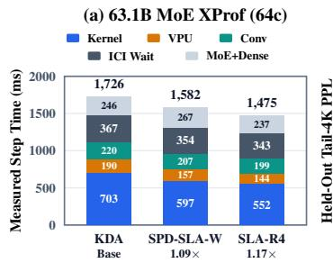

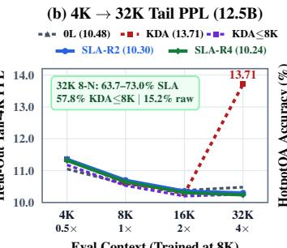

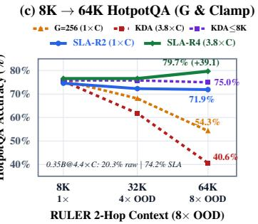  
Figure 7: (a) Per-step XProf breakdown for 63.1B MoE on 64 TPU v7x chips across KDA Base, SPD-SLA-W (R2) (SLA-R2 with optional in-chunk key whitening, Section 4), and SLA-R4 (Table 13); most of SLA’s saving is in linear attention ops. (b) Held-out Dolma tail perplexity from 4K to 32K for 12.5B MoEs (Table 11a; seed s0). (c) Zero-shot 8K 64K RULER HotpotQA for KDA (raw and clamped) and SLA (60.4B-token curves: seed s0; 15.1B-token curves: mean of s0 and s1).

Table 11: Measured 12.5B MoE (0.79B active, 16L, $D = 1 0 2 4 , D _ { v } = 2 0 4 8 , T _ { \mathbf { t r a i n } } = 8 , 1 9 2 )$ pre-training across (a) 60.40B-token (3.8 Chinchilla [27], 8.39M tok/step) v7x arms and (b) 15.10B-token (1.0 Chinchilla, 2.10M/step) and 90-min Iso-Wall ablations $( n \in \{ 2 , 3 \}$ random seeds where noted; 4-choice 64K RULER QA, N = 128, SE = 4 pts; full controls in Tables 15–16; bold: best within each cohort at equal tokens, with perplexity compared on matched seeds s0,s1 in (b); GDN-2 uses our unfused TPU port; seeds s0/s1/s2 use different data offsets, so perplexities are comparable only on matched seeds).
<table><tr><td>Cohort</td><td>Architecture (7,200 Steps)</td><td>Step (ms)</td><td>11-Set PPL</td><td>8K Tail</td><td>32K Tail</td><td colspan="3">32K 8-N 64K SQuAD 64K Hotpot</td></tr><tr><td rowspan="10">(a) v7x 60.4B Tok (3.8× Ch., 8.4M/st.)</td><td>OL:1A Full-Attn GQA+RoPE (s0)</td><td>2,313.8</td><td>16.128</td><td>10.57</td><td>10.48</td><td>12.1%</td><td>58.6%</td><td>53.1%</td></tr><tr><td>7L: 1A MaxText KDA Base (n = 3)*</td><td>2,225 ± 29</td><td>15.602 ± 0.582</td><td>10.46</td><td>12.45 ± 1.11</td><td>24.6%</td><td>54.9%</td><td>50.3%</td></tr><tr><td>+Zero-Retrain τmax = 8K Clamp (s0)</td><td></td><td>16.168</td><td>10.53</td><td>10.26</td><td>57.8%</td><td>78.1%</td><td>75.0%</td></tr><tr><td>7L:1A KDA + TrainMaxTau=8K (n = 2)</td><td>2,251 ± 11</td><td>15.800 ± 0.332</td><td>10.46</td><td>10.75 ± 0.21</td><td>49.6%</td><td>75.8%</td><td>75.4%</td></tr><tr><td>7L:1A SLA-R2 (BF16, n = 3)*</td><td>1,919 ± 37</td><td>15.580 ± 0.508</td><td>10.46</td><td>10.19 ± 0.10</td><td>56.6%</td><td>75.5%</td><td>77.9%</td></tr><tr><td>7L: 1A SLA-R4 (Iso-Param, n = 3)*†</td><td>1,800 ± 39†</td><td>15.664 ± 0.414</td><td>10.57</td><td>10.27 ± 0.04</td><td>56.1%</td><td>74.7%</td><td>74.5%</td></tr><tr><td>7L:1A SLA-R4 (—20% mixer, s0)</td><td>1,819.2</td><td>16.200</td><td>10.81</td><td>10.41</td><td>73.0%</td><td>72.7%</td><td>75.0%</td></tr><tr><td>15L: 1A MaxText KDA Base (FP32, s0) 15L:1A SLA-R2 (Uniform, BF16, s0)</td><td>2,152.0</td><td>15.498</td><td>10.46</td><td>11.27</td><td>15.2%</td><td>62.5%</td><td>60.2%</td></tr><tr><td></td><td>1,941.3</td><td>15.436</td><td>10.43</td><td>10.19</td><td>41.0%</td><td>72.7%</td><td>70.3%</td></tr><tr><td>7L: 1A MaxText KDA Base (n = 3)§ 7L:1A SLA-R2 (Unf., Exact Inv., n = 3)§</td><td>556.0</td><td>17.638 (17.893)</td><td>11.57</td><td>13.28</td><td>18.1%</td><td>57.3%</td><td>56.0%</td></tr><tr><td rowspan="10">(b) 15.1B (1.0× Ch., 2.1M/st.</td><td></td><td>497.3</td><td>17.533 (17.750)</td><td>11.54</td><td>11.23</td><td>52.3%</td><td>69.5%</td><td>73.7%</td></tr><tr><td>7L:1A SLA-R2 (Fus., Exact Inv., n = 2)</td><td>481.8</td><td>17.806</td><td>11.70</td><td>11.36</td><td>58.0%</td><td>69.1%</td><td>74.6%</td></tr><tr><td>7L: 1A GDN-2 (Unf., 93m, 15.1B, n = 2)</td><td>778.1</td><td>17.592</td><td>11.44</td><td>11.86</td><td>19.3%</td><td>62.1%</td><td>62.1%</td></tr><tr><td>7L: 1A SLA-R2 (Fus., 90m, 23.1B tok)</td><td>488.3</td><td>16.660 (+53%)</td><td>10.84</td><td>10.98</td><td>52.3%</td><td>65.6%</td><td>70.3%</td></tr><tr><td>7L:1A A1: Wide-Key R=2 KDA ([4, 256, 512], G=256, n=2)</td><td>524.8</td><td>17.694</td><td>11.61</td><td>13.39</td><td>23.8%</td><td>55.9%</td><td>54.3%</td></tr><tr><td>&amp; 90m Iso) 7L:1A A2: +G = 4 Decay (Exact Inv., n = 2)</td><td>514.1</td><td>17.749</td><td>11.65</td><td>11.34</td><td>46.1%</td><td>70.7%</td><td>73.8%</td></tr><tr><td>7L: 1A A3: +1-Step Neumann Inv. (n = 2)</td><td>497.2</td><td>17.970</td><td>11.69</td><td>11.36</td><td>53.5%</td><td>71.9%</td><td>71.9%</td></tr><tr><td>7L:1A A5: SLA-R2 (1-Step, µ = 0.25, s0)</td><td>467.1</td><td>18.016</td><td>11.87</td><td>11.45</td><td>60.9%</td><td>74.2%</td><td>83.6%</td></tr><tr><td>7L: 1A A6: SLA-R2 + FP8 Out-QAT (s0)</td><td>520.5</td><td>18.006</td><td>11.80</td><td>11.37</td><td>59.8%</td><td>74.2%</td><td>75.8%</td></tr><tr><td>15L: 1A SLA-R2 (Uniform, BF16, n = 3)</td><td>486.7</td><td>17.609</td><td>11.60</td><td>11.42</td><td>34.8%</td><td>69.0%</td><td>65.1%</td></tr></table>

∗Paired 3-seed differences vs. KDA: SLA-R2 0.02 0.11 PPL, SLA-R4 +0.06 0.26 PPL (within seed noise). †Deferring the fused SLA-R4 conv AllReduce across gradient accumulation gives 1,812 ms (Table 14). §In parentheses: mean over s0,s1, matched to the n = 2 rows. On s0 alone: KDA 18.074, A1 17.850, A2 17.873, fused SLA-R2 17.913, A3 18.102, A5 18.016, A6 18.006.

HBM ( 94.74 GiB) while KDA (96.74 GiB) and full attention (95.48 GiB) exceed the 95 GiB cap; in 8K 32K continued pre-training at 12.5B, where all three fit, SLA is 1.08 –1.15 faster than KDA (Table 15).

Hardware XProf operator attribution on 64-chip TPU v7x. XProf attributes most of SLA’s step-time saving to linear attention ops (Figure 7a). Table 13 provides the complete hardware XProf HLO category breakdown (xplane traces captured over steps 15–17 across all 8 TensorCores of host 0, normalized by 24 core-steps to ms/step) for 63.1B MoE (FSDP=2, EP=64) on 64 TPU v7x chips. Mapping directly to Figure 7a (where the top bar groups ICI async-done wait with MoE/dense matmuls: 366.6+245.8 = 612.4 ms, $3 5 4 . 1 + 2 6 6 . 8 = 6 2 0 . 9$ ms, and $3 4 3 . 1 + 2 3 7 . 2 = 5 8 0 . 3$ ms), the three direct linear attention op categories save 218.7 ms (87.2%) and reduced mixer memory/sync traffic saves 23.5 ms (9.4%) of exposed ICI async-done wait, totaling 242.2 ms (96.6%) of the 250.8 ms step-time reduction between SLA-R4 and KDA Base (with 8.6 ms [3.4%] in MoE/FFN matmul overlap).

Table 12: Measured 512-chip TPU v7x 63.1B MoE (3.74B active, $8 \times 8 \times 8 ,$ 16.78M tok/step) at 120.80B tokens ( 1.6 Chinchilla, NoPE $T _ { \mathrm { t r a i n } } = 8 , 1 9 2$ ; SSMax [40] query scale $\alpha \in \{ 0 . 2 5 , 0 . 5 \}$ Section 3.5; 64K RULER QA cand4\_acc at $N = 5 1 2 , { ^ { * } N } = 1 2 8 ;$ full 64-chip XProf and RoPE ablations in Tables 15, 13, and 17).
<table><tr><td>63.1B MoE (120.8B Tok, 512 Chips, NoPE 8K)</td><td colspan="7">Step (ms) tok/s/ch 11-Set PPL 32K Tail 32K 8-N 64K SQuAD 64K Hotpot</td></tr><tr><td>4L : 1A MaxText KDA Base (8 × 256 × 512, FP32)</td><td>2,165.1</td><td>15,135</td><td>12.596</td><td>353.4</td><td>15.6%</td><td>27.7%</td><td>27.0%</td></tr><tr><td>+Zero-Retrain τmax = 8K Clamp (0 retr.)</td><td></td><td></td><td>12.596</td><td>7.70</td><td>48.4%</td><td>76.6%*</td><td>82.0%*</td></tr><tr><td>+τmax = 8K Clamp + SSMax (α = 0.25)</td><td></td><td></td><td>12.596</td><td>8.04</td><td>74.2%</td><td>90.6%</td><td>86.5%</td></tr><tr><td>4L:1A SLA-R2 (4 × 256 × 1024, BF16, 0.5× Bytes)</td><td>1,952.9</td><td>16,779</td><td>12.584</td><td>13.78</td><td>18.6%</td><td>55.7%</td><td>56.8%</td></tr><tr><td>+Zero-Clamp SLA-R2 + SSMax (α = 0.5)</td><td></td><td></td><td>12.584</td><td>8.45</td><td>84.4%</td><td></td><td></td></tr><tr><td>4L:1A SLA-R4 (2 × 256 × 2048, BF16, 0.5× Bytes)†</td><td>1,878.3</td><td>17,445</td><td>12.454</td><td>20.47</td><td>18.0%</td><td>51.6%</td><td>45.1%</td></tr><tr><td>+Zero-Clamp SLA-R4 + SSMax (α = 0.5)</td><td></td><td></td><td>12.454</td><td>8.41</td><td>83.2%</td><td>75.6%</td><td>79.1%</td></tr></table>

Single seed (s0). Full 64K QA breakdown (SQuAD, HotpotQA) and 64-chip RoPE controls are in Table 17. †Deferring the fused conv AllReduce across gradient accumulation yields 1,843 ms

Table 14 complements this with a symmetric 4-arm GA=4 (8.39M tok/step) XProf audit on 12.5B MoE (EP=128): deferring causal-conv weight AllReduce outside the GA=4 microbatch loop yields 0.0% speedup on MaxText KDA (2,118.9 2,119.7 ms) while cutting SLA-R4 (iso-param) to 1,686.0 ms in 3-step XProf (1,661.9 ms unprofiled min; 1,812.0 14.1 ms over full 7,200-step n = 2 training runs due to host checkpoint/validation wrapper hooks) via a 1.96 faster Pallas linear attention kernel (528.4 269.1 ms).

Table 13: Hardware XProf per-step HLO category breakdown (ms/step) on 64-chip TPU v7x 63.1B MoE (FSDP=2, EP=64, 2.10M tok/step).
<table><tr><td>HLO Category (xplane Measured)</td><td>4L: 1A KDA Base</td><td>4L:1A SPD-SLA-W (R2)</td><td>4L:1A SLA-R4</td><td>∆ (SLA-R4 vs. KDA)</td></tr><tr><td>Pallas Linear Attention custom-call</td><td>703.0 ms</td><td>597.2 ms</td><td>552.0 ms</td><td>-151.0 ms (−21.5%)</td></tr><tr><td>VPU Gate / Norm loop fusion</td><td>190.4 ms</td><td>156.8 ms</td><td>143.7 ms</td><td>-46.7 ms (−24.5%)</td></tr><tr><td>Causal Short convolution fusion</td><td>220.0 ms</td><td>207.4 ms</td><td>199.0 ms</td><td>-21.0 ms (−9.5%)</td></tr><tr><td>ICI Collective async-done Wait</td><td>366.6 ms</td><td>354.1 ms</td><td>343.1 ms</td><td>-23.5 ms (−6.4%)</td></tr><tr><td>MoE Expert ragged-dot + Dense Matmul</td><td>245.8 ms</td><td>266.8 ms</td><td>237.2 ms</td><td>-8.6 ms (−3.5%)</td></tr><tr><td>Total Steady-State Step Time</td><td>1,725.8 ms</td><td>1,582.3 ms</td><td>1,475.0 ms</td><td>-250.8 ms (1.170×)</td></tr><tr><td>Steady-State Throughput (tok/s/chip)</td><td>18,988</td><td>20,710 (1.09×)</td><td>22,216 (1.17×)</td><td>+3,228 (+17.0%)</td></tr></table>

At 6.3B tokens (RoPE validation checkpoint on the same 64-chip slice), 4L:1A KDA Base and 4L:1A SLA-R4 reach 9.90 vs. 10.15 8K Dolma PPL, 10.27 vs. 9.75 32K Tail PPL, and 14.5% vs. 37.5% 32K 8-Needle accuracy.

Table 14: Symmetric 4-arm GA=4 (8.39M tok/step) hardware XProf leaf-op breakdown (ms/step) on 64-chip TPU v7x 12.5B MoE (EP=128).
<table><tr><td>12.5B GA=4 Arm (3 profiled steps)</td><td>Step Mean (ms)</td><td>linear_mixer _pallas</td><td>short_conv _fusion</td><td>Mixer + Conv</td><td>full_attn _splash</td><td>all_gather _rs</td><td>moe_ragged _a2a</td></tr><tr><td>7L: 1A MaxText KDA (default AR)</td><td>2,118.9</td><td>508.1</td><td>91.7</td><td>599.8</td><td>69.8</td><td>191.9</td><td>264.7</td></tr><tr><td>7L:1A MaxText KDA + defer_ar</td><td>2,119.7 (1.00×)</td><td>528.4</td><td>91.6</td><td>620.0</td><td>70.0</td><td>191.6</td><td>234.3</td></tr><tr><td>7L: 1A SLA (Fused) R2+Mom + defer_ar</td><td>1,797.4 (1.18×)</td><td>340.9 (−187.5)</td><td>65.4</td><td>406.3 (−213.7)</td><td>69.9</td><td>152.5</td><td>282.5</td></tr><tr><td>7L: 1A Iso-Param SLA (Fused) R4 + defer_ar</td><td>1,686.0 (1.26×)</td><td>269.1 (1.96×)</td><td>61.7</td><td>330.8 (−289.2)</td><td>69.7</td><td>152.6</td><td>265.3</td></tr></table>

## 3.5 Pre-Training Quality and Long-Context Extrapolation

In-domain quality. At 12.5B parameters and 60.4B tokens with three paired seeds (Table 11a), SLA-R2 and SLA-R4 are within seed noise of KDA on 11-set Dolma perplexity and on zero-shot lm-eval [17] (Table 16); single-seed 63.1B runs are also close (Table 12). The 15.1B-token cohort (Table 11b) shows where this parity comes from. Seeds s0, s1, and s2 use different data offsets that shift perplexity by up to 0.9, so we compare only on matched seeds. First, over three seeds, SLA-R2 (Exact Inv., BF16 state, $\mu = 0 . 2 5 )$ improves on KDA Base on every seed (17.533 vs. 17.638; paired difference 0.10 0.08) and matches the same-kernel G = 4 FP32 control without momentum (17.538, Table 18), so BF16 state and momentum cost no measurable quality. On seeds s0,s1, widening KDA’s keys to $d _ { k } = 2 5 6$ with R = 2 head sharing (A1, [4, 256, 512], G = 256: 524.8 ms, 17.694 PPL) isolates head sharing from decay grouping; moving from $G = 2 5 6$ to G = 4 with MXU block-doubling at identical R = 2 sharing cuts step time by a further 27.5 ms (497.3 ms unfused, 15.5 ms further to 481.8 ms fused) while staying within 0.06–0.11 PPL of A1 and lifting 32K 8-Needle from 23.8% to 52.3%–58.0% and 64K HotpotQA from 54.3% to 73.8%–74.6%. The optional 1-step Neumann inverse is the one approximation with a clear cost: A3 reaches 17.970 (+0.22 over A2), and on s0 the fused Neumann arm A5 reaches 18.016 versus 17.913 for fused Exact Inv., which is why all flagship pre-training runs use Exact Inv.. Second, GDN-2 [25] reaches the best per-token perplexity in this cohort (17.592 on s0,s1, versus 17.806 for fused SLA-R2). SLA’s advantage is throughput: in the same 90-minute budget, fused SLA-R2 trains on 53% more tokens and reaches 16.660 perplexity, versus 17.459 for GDN-2 on the same seed. Because this comparison uses our unfused TPU port of GDN-2, it reflects kernel maturity as much as architecture; combining GDN-2’s decoupled erase and write gates with SLA’s TPU mapping is a natural next step.

max= 5×105)4-rung scaling ladder (0.35Bto63.1BMoE; see Table11for12.5BRung 2), 0.35B3-seed hinchilla), 12.5B8K→32Kcontinued pre-training, and12.5B15L:1Adilution control on64-chip TPU v7 n [GA=4], KDA/0L:1Ahit NaNat steps 1–43and requirednorematreruns, whereas 2-seedSLA-R4(iso-param 12.08Tail PPL, 59.2%/48.2% 32K4/8-N, and58.5/62.6%N=512 64K QA, though router-remat spike
<table><tr><td>MoE Scale (Active / Total, Tokens) Architecture</td><td></td><td>Step (ms)</td><td>11-Set PPL (or 32K-Ext CE)</td><td>8K Tail PPL</td><td>32K Tail PPL</td><td>32K 4-N / 8-N</td><td>8-N Gain vs. KDA</td></tr><tr><td rowspan="5">0.35B/6.5B (15.1B tok, 2.2× Chin.,</td><td>OL:1A GQA+RoPE (LR = 4.5 × 10−4) 4L: 1A MaxText KDA Base (FP32)</td><td>361.6 351.8</td><td>19.582 18.573</td><td>12.83 12.42</td><td>13.18 15.72</td><td>18.4%/12.9% 32.0%/14.1%</td><td>0.91× 1.00×</td></tr><tr><td>4L: 1A KDA + TrainMaxTau (τmax = 8K, FP32)</td><td>351.2</td><td>19.035 (s1; 2.54 CE)</td><td>12.43</td><td>12.36</td><td>56.6%/48.4%</td><td>3.43×</td></tr><tr><td></td><td>320.0</td><td>18.773</td><td>12.62</td><td>12.30</td><td>63.3%/55.1%</td><td>3.91×</td></tr><tr><td>4L: 1A SLA-R2 (BF16)</td><td>308.5</td><td>18.890</td><td>12.60</td><td>12.28</td><td>60.9%/51.6%</td><td></td></tr><tr><td>4L: 1A SLA (Fused) R2+Mom (BF16) 4L: 1A Iso-Param SLA-R4 (BF16)</td><td>302.4</td><td>19.093</td><td>12.83</td><td>12.51</td><td>57.8%/48.8%</td><td>3.66× 3.46×</td></tr><tr><td rowspan="7"></td><td>4L: 1A SPD-SLA-W (BF16)</td><td>344.8</td><td>19.104</td><td>12.64</td><td>12.32</td><td>66.4%/56.2%</td><td>3.99×</td></tr><tr><td>3-Seed 4L : 1A MaxText KDA (15.1B, n = 3)</td><td>352.0</td><td>18.880 ± 0.267</td><td>12.59</td><td>15.89</td><td>32.9%/19.9%</td><td></td></tr><tr><td></td><td>314.8</td><td></td><td>12.72</td><td></td><td></td><td>1.00×</td></tr><tr><td>3-Seed 4L : 1A SLA-R2 (15.1B, n = 3)</td><td>361.5</td><td>19.077 ± 0.265</td><td></td><td>12.77</td><td>49.9%/37.6%</td><td>1.89×</td></tr><tr><td>0L: 1A GQA+RoPE (30.2B, 4.4× Chin.)</td><td></td><td>17.104</td><td>11.43</td><td>12.02</td><td>25.0%/15.2%</td><td>0.90×</td></tr><tr><td>4L: 1A MaxText KDA (30.2B, 4.4× Chin.)</td><td>351.5 315.0</td><td>16.161 16.250</td><td>11.03 11.02</td><td>620.87 13.53</td><td>31.6%/16.8%</td><td>1.00×</td></tr><tr><td>4L: 1A SLA-R2 (30.2B, 4.4× Chin.) 4L: 1A Iso-Param SLA-R4 (30.2B, 4.4× Chin.)</td><td>297.9</td><td>16.326</td><td>11.15</td><td>11.09</td><td>35.2%/21.1% 59.4%/45.3%</td><td>1.26× 2.70×</td></tr><tr><td rowspan="7">1.80B/31.5B</td><td></td><td></td><td></td><td></td><td></td><td></td><td></td></tr><tr><td>0L: 1A GQA+RoPE (5.03B, LR = 4.5 × 10−4)</td><td>867.5</td><td>20.380</td><td>12.98</td><td>13.73</td><td>24.6%/14.8%</td><td>1.15×</td></tr><tr><td>4L: 1A MaxText KDA Base (5.03B, FP32)</td><td>807.7 747.2</td><td>21.228</td><td>13.99</td><td>47.16</td><td>28.9%/12.9%</td><td>1.00×</td></tr><tr><td>4L: 1A SLA (Fused) R2+Mom (5.03B, BF16)</td><td>707.4</td><td>21.439</td><td>14.19</td><td>13.88</td><td>48.8%/33.2%</td><td>2.57×</td></tr><tr><td>4L: 1A SLA (Fused) R4+Mom (5.03B, BF16)</td><td></td><td>21.709</td><td>14.44</td><td>14.20</td><td>59.8%/46.1%</td><td>3.57×</td></tr><tr><td>4L: 1A MaxText KDA (36.2B, 4,300 st., noremat)β</td><td>3,526</td><td>15.264</td><td>10.57</td><td>51.68</td><td>24.6%/12.5%</td><td>1.00× (39.1/34.4% QA)</td></tr><tr><td>4L: 1A KDA + TrainMaxTau (36.2B, τmax = 8K, noremat)§</td><td>3,307</td><td>15.211</td><td>10.36</td><td>16.77</td><td>27.3%/14.8%</td><td>1.18× (59.6/53.3% N=512 QA)</td></tr><tr><td rowspan="7">3.74B/63.1B (5.03B tok, RoPE)</td><td>OL: 1A GQA+RoPE (LR = 4.5 × 10−4)</td><td>1,749.6 1,746.0</td><td>19.373</td><td>11.66</td><td>11.94 18.24</td><td>25.0%/11.7%</td><td>0.81×</td></tr><tr><td>4L: 1A MaxText KDA Base (FP32) 4L: 1A GDN-2 + RoPE (FP32, EP=128, 14,143 tok/s/ch)</td><td>2,316.9</td><td>20.076 19.731</td><td>12.25 12.27</td><td>14.22</td><td>23.1%/14.4% 25.8%/13.3%</td><td>1.00×</td></tr><tr><td>4L: 1A SLA (Fused) R2+Mom (BF16, 20,386 tok/s/ch)</td><td>1,607.4</td><td>20.201</td><td>12.37</td><td></td><td>35.2%/22.3%</td><td>0.92×</td></tr><tr><td></td><td>1,571.8</td><td></td><td></td><td>12.47</td><td></td><td>1.55×</td></tr><tr><td>4L: 1A SLA (Fused) R4+Mom (BF16, 20,847 tok/s/ch)</td><td>1,547.2</td><td>20.423 20.890</td><td>12.50 13.17</td><td>12.80 13.01</td><td>27.0%/13.7% 59.4%/48.4%</td><td>0.95×</td></tr><tr><td>15L : 1A SLA (Fused) R2+MS (BF16)</td><td>1,600.6</td><td>20.506</td><td>12.49</td><td>12.42</td><td>41.4%/27.0%</td><td>3.36×</td></tr><tr><td>15L: 1A SPD-SLA-W+MS (BF16, 20,473 tok/s/ch)</td><td></td><td></td><td></td><td></td><td></td><td>1.88×</td></tr><tr><td rowspan="7">0.79B/12.5B 8K → 32K Ext. (5.0–10.1B at 32K)</td><td>0L:1A GQA+RoPE (32K-ext, 1.00× speed)</td><td>4,697.0 3,061.4</td><td>2.2089 CE 2.2006 CE</td><td>11.29</td><td>10.95</td><td>25.4%/11.7%</td><td>0.18×</td></tr><tr><td>7L: 1A MaxText KDA (32K-ext, 1.53× vs. 0L) 7L:1A SLA-R2 (32K-ext, 1.66× vs. 0L)</td><td>2,828.0</td><td>2.2048 CE</td><td>11.20 11.26</td><td>10.78 10.82</td><td>71.5%/63.3% 73.8%/64.1%</td><td>1.00×</td></tr><tr><td>7L: 1A Iso-Param SLA-R4 (32K-ext, 1.77 ×)</td><td>2,661.0</td><td>2.2255 CE</td><td>11.46</td><td>11.01</td><td>60.9%/49.6%</td><td>1.01×</td></tr><tr><td>7L: 1A MaxText KDA (60.4B → 32K, +5.03B)</td><td>3,103.6</td><td>2.0907 CE</td><td>10.38</td><td>9.98</td><td>55.5%/47.3%</td><td>0.78×</td></tr><tr><td>7L: 1A Iso-SLA (Fused) R4 (60.4B → 32K, 1.15×)</td><td>2,688.7</td><td>2.1142 CE</td><td>10.60</td><td>10.15</td><td>64.8%/57.0%</td><td>1.00×</td></tr><tr><td>15L: 1A MaxText KDA (32K-ext, uniform)</td><td>2,827.0</td><td>2.2092 CE</td><td>11.10</td><td>10.79</td><td>56.2%/40.6%</td><td>1.21×</td></tr><tr><td>15L : 1A SLA-R2+MS / SPD-SLA-W+MS (32K-ext)</td><td>2,608/ 2,715</td><td>2.238/2.241</td><td>11.38/11.42</td><td>11.17/11.18</td><td>23.8%/16.0,12.9%</td><td>1.00× 0.39×</td></tr><tr><td rowspan="5">0.79B/12.5B (15.1B &amp; 60.4B 15L:1A dilution controls)</td><td>15L : 1A MaxText KDA Base (15.1B, FP32, n = 3)</td><td>556.4</td><td>17.658 ± 0.297</td><td>11.64</td><td>11.57</td><td>34.0%/21.4%</td><td></td></tr><tr><td>15L : 1A SLA-R2 (15.1B, uniform, BF16, n = 3)</td><td>486.7 ± 11.7</td><td>17.609 ± 0.246</td><td>11.70</td><td>11.42</td><td>45.1%/34.8%</td><td>1.00×</td></tr><tr><td>15L : 1A SPD-SLA-W Polar-2+ (15.1B, uniform, s0)</td><td>509.3</td><td>17.575</td><td>11.65</td><td>11.38</td><td>50.0%/39.8%</td><td>1.63× 1.86× (1.29× s0)</td></tr><tr><td>15L: 1A SLA-R2+MS (15.1B, staggered, n = 3)</td><td>492.2</td><td>17.882 ± 0.294</td><td>11.93</td><td>11.72</td><td>23.6%/13.0%</td><td>0.61×</td></tr><tr><td>15L: 1A KDA + TrainMaxTau=8K (60.4B, FP32, s0)</td><td>2,199.0</td><td>15.579</td><td>10.47</td><td>10.30</td><td>37.5%/26.6% 27.3%/19.9%</td><td>1.75×</td></tr><tr><td rowspan="4"></td><td>15L : 1A SLA-R2+MS (60.4B, staggered, s0)</td><td>1,934.0</td><td>15.443</td><td>10.61</td><td>10.38</td><td></td><td>1.31×</td></tr><tr><td>15L : 1A SPD-SLA-W+MS (60.4B, staggered, s0)</td><td>2,006.0</td><td>15.624</td><td>10.67</td><td>10.49</td><td>23.1%/12.1%</td><td>0.79×</td></tr><tr><td>7L: 1A Scalar GDN (G = 1, FP32, n = 2)</td><td>555.9</td><td>18.142</td><td>11.85</td><td>11.51</td><td>-/60.8%</td><td></td></tr><tr><td>7L: 1A KDA + TrainMaxTau=8K (FP32, s0)</td><td>560.6</td><td>17.924</td><td>11.66 12.02 / 11.95</td><td>11.60 12.05 / 11.80</td><td>58.2%/48.1%</td><td>4.50× 3.56×</td></tr></table>

GDN-2 TPU comparison details. GDN-2 [25] decouples the delta rule’s scalar gate into channel wise erase and write gates and inherits KDA’s per-channel decay. On TPU $\mathbf { v } 7 \mathbf { x } .$ , in our unified single-harness full-layer benchmark (B = 1, 8K/32K F+B), our unfused XLA port of per-channel GDN-2 takes 63.86/251.39 ms at D = 1792 (15,217 MiB temporary HBM) and 34.15/132.83 ms at D = 2048 (Mamba-3 MIMO R = 4 isolated kernel for reference: 9.27 ms). End to end, unfused per-channel GDN-2 raises MoE step time by $1 . 2 3 { \times } - 1 . 5 9 \times ( 1 . 3 4 9$ vs. 1.093 s on 128-chip TPU v4; $\bar { 7 } 7 8 . 1 \pm 3 . 9$ vs. 488.3 ms for fused SLA-R2 on 64-chip TPU v7x).

On quality, GDN-2 is the strongest arm per token in our 15.1B-token cohort $( 1 7 . 5 9 2 \pm 0 . 1 8 8 ~ \mathrm { v s }$ 17.806 for fused SLA-R2 and 17.893 for KDA on the same seeds s0,s1; Table 11b), but extrapolates worse (19.3% vs. 52.3% 32K 8-needle). Under equal pure-step compute on seed s0 (5,582 s for 7,200 GDN-2 steps vs. 5,371 s for 11,000 fused SLA-R2 steps), SLA reaches lower perplexity (16.660 vs. 17.459), whereas at equal 15.1B tokens on s0 GDN-2 leads fused SLA-R2 by 0.45 (17.459 vs. 17.913). This comparison reflects the lack of a fused Pallas/Mosaic TPU kernel for GDN-2 as much as the architectures; combining GDN-2’s decoupled update with SLA’s head sharing, tile-grouped gating, and fused chunk inversion is a promising direction for future work.

Length extrapolation. We test zero-shot extrapolation from 8K training to 32K–64K on RULER [28] needle retrieval and 4-choice SQuAD [49] and HotpotQA [69] (Figure 7b–c). Unclamped KDA degrades beyond the training length, severely at 63.1B, because about 1% of its channels learn horizons far beyond 8K (Table 17). SLA extrapolates without clamping: at 12.5B its 32K tail perplexity stays flat and 64K HotpotQA reaches 74%–78%. The advantage is limited, however. Clamping KDA’s horizons to 8K, with or without retraining, gives similar results at 12.5B. At 63.1B, clamped KDA with SSMax [40] on the softmax layers beats SLA with SSMax on 64K QA, although SLA is better on 32K needle retrieval. With 128–512 questions per QA set (standard error 2–4 points), many differences in Tables 11–12 are within noise.

Causal $\tau _ { \mathbf { e f f } }$ dispersion and NoPE SSMax. Table 17 audits per-channel retention horizons

$$
\tau _ { \mathrm { e f f } } ( i ) = \mathbb { E } _ { t } \left[ - \frac { 1 } { \ln f _ { t , i } } \right]
$$

(in tokens, for channel i with learned decay $f _ { t , i } )$ and Within-Tile Std (the RMS standard deviation of token-mean log-decay $\mathbb { E } _ { t } [ \ln f _ { t , i } ]$ across channels i within each $d _ { k } / 4$ tile block, equal to 0 when $G \in \{ 1 , 4 \} )$ ) alongside zero-retraining inference interventions across 6.5B, 12.5B, and 63.1B MoEs.

Across all three scales, $G = d _ { k }$ KDA develops 0.8%–1.3% ultra-slow $\tau _ { \mathrm { e f f } } ( i ) \approx 1 3 1 \mathrm { K }$ channels (within-tile log-decay RMS $\mathbf { s t d } = 3 . 8 4 \substack { - 4 . 9 7 }$ that inject OOD state spikes into hybrid layers: clamping $\tau _ { \mathrm { e f f } } ( i ) \le \tau _ { \mathrm { m a x } } = 8 , 1 9 2$ at inference with zero retraining cuts 63.1B KDA 32K Tail PPL by 45.9 $( 3 5 3 . 4 2  7 . 7 0 )$ , lifts 32K 8-Needle across every scale (14.1% 69.9% at 6.5B, 15.2% 57.8% at 12.5B 7L, 15.2% 42.2% at 12.5B 15L, 15.6% 48.4% at 63.1B), and rescues +14.0 to +56.2 pts on 64K QA, whereas post-hoc G = 4 tile-mean projection collapses (57.8–78.1 Tail PPL). Live training-time softplus saturation (TrainMaxTau=8K) likewise stabilizes OOD retrieval at both 6.5B (69.5/73.4% QA) and 12.5B (60.4B tok, n = 2: 10.75 Tail, 49.6% 32K 8-N, 74.5/72.8% $N = 5 1 2 \mathrm { Q A } )$ while retaining G = 128’s VPU gate tax and 4 FP32 state.

Conversely, on 63.1B SLA-R4 (120.8B tok, NoPE), 24-layer state-norm telemetry confirms linear states contract cleanly from 8K to 32K $( \| S _ { t } \| _ { F } = 2 . 0 4  \dot { 1 } . 6 2$ , max row norm $1 . 5 \dot { 9 }  1 . 1 5 , 0 . 0 0 \%$ rows near E4M3 448), and rescaling each global softmax query q on the 6 NoPE full-attention layers at evaluation sequence length $T$ via zero-retraining SSMax [40],

$$
q  q { ( 1 + \alpha \ln ( \frac { T } { T _ { \mathrm { t r a i n } } } ) ) }
$$

<table><tr><td rowspan=1 colspan=10>Table 16: Zero-shot 9-task 1m-eval accuracy (11,793 real validation items; norm9 macro-average using byte-length normalized acc_norm on multiple-choice tasksand exact-word acc on WinoGrande/LAMBADA, with zero-shot row-scaled FP8 state norm9 in parentheses for SLA rows; 1 SE ≈ 0.65 pts) and real-text 4-candidateRULER QA accuracy (SQuAD 1-hop &amp; HotpotQA 2-hop, N = 128/length, 25% chance, 1 SE ≈ 4.0 pts) across 8K → 32K → 64K against OL : 1A GQA+RoPE andMaxText KDA baselines.</td></tr><tr><td rowspan=1 colspan=10>Model, Horizon, &amp; Mixer Architecture                  HS ARC-E/CPIQAWGSciQMMLUBoolQLAMB      1m-eval (FP8)                  SQuAD / HotpotQA (8K→ 32K→ 64K)</td></tr><tr><td rowspan=9 colspan=2>6.5B 0L:1A GOA+RoPE (15.1B, BF16)6.5B 4L: 1A MaxText KDA (15.1B, FP32)6.5B 4L : 1A KDA + TrainMaxTau (τmax 8K)6.5B 4L : 1A SLA-R2 (15.1B, BF16/FP8)6.5B 4L : 1A SLA (Fused) R2 (15.1B, BF16/FP8)6.5B 0L: 1A GQA+RoPE (30.2B, 4.4× Chin.)6.5B 4L : 1A MaxText KDA (30.2B, 4.4× Chin.)6.5B 4L :1A SLA-R2 (30.2B, BF16/FP8)6.5B 4L :1A Iso-SLA-R4 (30.2B, BF16/FP8)</td><td rowspan=1 colspan=2>34.845.8 /</td><td rowspan=1 colspan=2>25.863.8</td><td rowspan=1 colspan=1>50.7</td><td rowspan=1 colspan=1>71.7</td><td rowspan=1 colspan=1>28.0 62.2</td><td rowspan=9 colspan=1>33.4        46.24%                 64.8 54.7  56.2%/67.2  52.3  50.0%37.2        46.73%                 77.3 64.1→52.3%78.9  60.2  42.2%36.3                                75.0 771.1  69.5%/79.7  74.2  73.4%38.2    47.01% (46.92%)           71.9 69.5  71.1%// 71.1→ 71.1→74.2%36.4    46.97% (47.08%)           75.8  72.7  68.8% / 72.   72.7  70.3%35.8        48.01%                 72.7  53.1  54.7%75.8  55.5  50.0%39.6        49.66%                 79.7  53.1&gt;32.0% / 85.2  39.8  20.3%43.6    49.47% (49.44%)             78.1  59.4156.2%/79.7  58.6  51.6%44.4    49.13% (48.97%)            72.7  71.9  70.3%/82.8  74.2 74.2%</td></tr><tr><td rowspan=1 colspan=2>35.445.7</td><td rowspan=1 colspan=2>/25.864.8</td><td rowspan=1 colspan=1>50.5</td><td rowspan=1 colspan=1>70.3</td><td rowspan=1 colspan=1>27.1 63.8</td></tr><tr><td rowspan=1 colspan=2>34.946.4 /</td><td rowspan=1 colspan=2>25.665.2</td><td rowspan=1 colspan=1>51.1</td><td rowspan=1 colspan=1>69.1</td><td rowspan=1 colspan=1>27.6 63.6</td><td rowspan=1 colspan=1></td></tr><tr><td rowspan=1 colspan=2>34.645.1 /</td><td rowspan=1 colspan=2>24.765.4</td><td rowspan=1 colspan=1>52.2</td><td rowspan=1 colspan=1>70.6</td><td rowspan=1 colspan=1>28.5 63.8</td><td rowspan=1 colspan=1>38.247.01% (46.92%)</td></tr><tr><td rowspan=1 colspan=2>35.846.4</td><td rowspan=1 colspan=2>/24.364.5</td><td rowspan=1 colspan=1>51.6</td><td rowspan=1 colspan=1>71.4</td><td rowspan=1 colspan=1>28.5</td><td rowspan=1 colspan=1>63.8</td></tr><tr><td rowspan=1 colspan=2>37.747.3 /</td><td rowspan=1 colspan=2>26.766.3</td><td rowspan=1 colspan=1>52.2</td><td rowspan=1 colspan=1>73.0</td><td rowspan=1 colspan=1>29.6</td><td rowspan=1 colspan=1>63.5</td></tr><tr><td rowspan=1 colspan=2>38.850.4 /</td><td rowspan=1 colspan=2>27.166.4</td><td rowspan=1 colspan=1>52.2</td><td rowspan=1 colspan=1>78.3</td><td rowspan=1 colspan=1>30.6</td><td rowspan=1 colspan=1>63.5</td></tr><tr><td rowspan=1 colspan=1></td><td rowspan=1 colspan=2>38.450.7 /</td><td rowspan=1 colspan=2>26.567.1</td><td rowspan=1 colspan=1>51.7</td><td rowspan=1 colspan=1>75.1</td><td rowspan=1 colspan=1>28.3</td><td rowspan=1 colspan=1>63.9</td></tr><tr><td rowspan=1 colspan=2>37.649.4 /</td><td rowspan=1 colspan=2>26.167.4</td><td rowspan=1 colspan=1>49.0</td><td rowspan=1 colspan=1>74.8</td><td rowspan=1 colspan=1>29.7 63.8</td></tr><tr><td rowspan=2 colspan=2>12.5B 0L:1A GQA+RoPE (15.1B, n = 3 mean)12.5B 7L:1A MaxText KDA (15.1B, n = 2 mean)</td><td rowspan=1 colspan=2>36.147.4 /</td><td rowspan=1 colspan=2>25.365.6</td><td rowspan=1 colspan=1>51.5</td><td rowspan=1 colspan=1>73.1</td><td rowspan=1 colspan=1>29.2 63.3</td><td rowspan=15 colspan=1>39.6     47.90 ± 0.36%              72.9  54.9  57.3%1/70.8  57.0  51.3%V37.8     47.83 ± 0.48%              71.9→62.5  56.6%//76.2  62.9 57.8%40.6        48.11%                74.2 72.7 7 74.2%//77.3  76.6→ 76.6%41.8        48.30%                 74.2→ 66.8  55.9% / 76.2  68.0 54.3%42.3    48.05% (48.04%)              71.9  65.6162.5%/73.4  70.3  68.0%38.9    47.66% (47.47%)            76.6  71.9  71..9% /74.6  72.3  71.9%42.148.55 ± 0.48% (48.64%)       73.7→68.8→69.5% / 74.0→71.9→73.7%45.3    48.18% (48.21%)           73.4  67.2  64.1%//76.6  75.8 75.0%43.0 48.33 ± 0.45% (48.39%)        74.5 72.7  73.2% / 74.5→75.5  72.9%40.7        48.18%                 76.6  68.0 66.4%/75.8  70.3  68.0%41.648.79 ± 0.22% (48.75%)72.6→ 71.9  69.0%72.2  65.9  65.1%(68.2% N=512)41.5    48.57% (48.79%)     71.9→ 71.1  65.6% / 71.9 68.8  65.6% (69.5% N=512)37.2    48.20% (48.18%)             57.0  57.0  57.0%/67.2  57.8  53.9%40.1        47.77%                 57.8  57.8  55.5% / 62.5  56.2  56.2%40.2    48.21% (48.30%)             60.2  57.8  59.4%1/62.5  56.2  53.9%</td></tr><tr><td rowspan=1 colspan=2>37.247.2 /</td><td rowspan=1 colspan=2>26.766.4</td><td rowspan=1 colspan=1>50.4</td><td rowspan=1 colspan=1>72.5</td><td rowspan=1 colspan=1>29.9</td><td rowspan=1 colspan=1>62.6</td></tr><tr><td rowspan=2 colspan=2>12.5B 7L:1A Scalar GDN (G = 1, 15.1B, s1)12.5B 7L :1A Wide-Key KDA (G = 256, n = 2 mean)</td><td rowspan=1 colspan=1>37.0</td><td rowspan=1 colspan=1>47.6 /</td><td rowspan=1 colspan=1>25.5</td><td rowspan=1 colspan=1>65.2</td><td rowspan=1 colspan=1>51.5</td><td rowspan=1 colspan=1>74.1</td><td rowspan=1 colspan=1>28.8</td><td rowspan=1 colspan=1>62.8</td></tr><tr><td rowspan=1 colspan=1>37.2</td><td rowspan=1 colspan=1>47.3 /</td><td rowspan=1 colspan=1>26.4</td><td rowspan=1 colspan=1>65.8</td><td rowspan=1 colspan=1>52.2</td><td rowspan=1 colspan=1>73.3</td><td rowspan=1 colspan=1>27.8</td><td rowspan=1 colspan=1>63.0</td></tr><tr><td rowspan=4 colspan=2>12.5B 7L : 1A A2 (G = 4 Exact Inv., FP32, s0)12.5B 7L:1A A3 (G = 4 1-Step Neumann, FP32, n =2)12.5B 7L :1A SLA-R2 (15.1B, n = 3 mean)12.5B 7L:1A SLA (Fused) R2 (15.1B, BF16/FP8, s0)</td><td rowspan=1 colspan=1>38.1</td><td rowspan=1 colspan=1>47.9</td><td rowspan=1 colspan=1>/25.7</td><td rowspan=1 colspan=1>65.0</td><td rowspan=1 colspan=1>51.1</td><td rowspan=1 colspan=1>73.8</td><td rowspan=1 colspan=1>28.7</td><td rowspan=1 colspan=1>59.8</td></tr><tr><td rowspan=1 colspan=1>37.0</td><td rowspan=1 colspan=1>46.8</td><td rowspan=1 colspan=1>/25.8</td><td rowspan=1 colspan=1>65.9</td><td rowspan=1 colspan=1>50.0</td><td rowspan=1 colspan=1>72.6</td><td rowspan=1 colspan=1>28.6</td><td rowspan=1 colspan=1>63.6</td></tr><tr><td rowspan=1 colspan=1>37.6</td><td rowspan=1 colspan=1>47.9 /</td><td rowspan=1 colspan=1>26.1</td><td rowspan=1 colspan=1>66.2</td><td rowspan=1 colspan=1>52.3</td><td rowspan=1 colspan=1>72.2</td><td rowspan=1 colspan=1>29.3</td><td rowspan=1 colspan=1>63.1</td></tr><tr><td rowspan=1 colspan=1>37.6</td><td rowspan=1 colspan=1>47.7</td><td rowspan=1 colspan=1>/26.3</td><td rowspan=1 colspan=1>66.3</td><td rowspan=1 colspan=1>50.8</td><td rowspan=1 colspan=1>71.6</td><td rowspan=1 colspan=1>28.0</td><td rowspan=1 colspan=1>60.0</td></tr><tr><td rowspan=2 colspan=2>12.5B 7L :1A Iso-SLA-R4 (15.1B, n = 3 mean)12.5B 15L: 1A MaxText KDA (15.1B, FP32)</td><td rowspan=1 colspan=1>36.3</td><td rowspan=1 colspan=1>48.8</td><td rowspan=1 colspan=1>/25.9</td><td rowspan=1 colspan=1>66.3</td><td rowspan=1 colspan=1>50.6</td><td rowspan=1 colspan=1>72.3</td><td rowspan=1 colspan=1>28.7</td><td rowspan=1 colspan=1>63.0</td></tr><tr><td rowspan=1 colspan=1>36.0</td><td rowspan=1 colspan=1>48.6</td><td rowspan=1 colspan=1>/26.6</td><td rowspan=1 colspan=1>66.0</td><td rowspan=1 colspan=1>50.2</td><td rowspan=1 colspan=1>71.9</td><td rowspan=1 colspan=1>29.4</td><td rowspan=1 colspan=1>64.2</td></tr><tr><td rowspan=5 colspan=2>12.5B 15L: 1A SLA-R2 Uniform (n = 3 mean)12.5B 15L: 1A SPD-SLA-W Polar-2+ Uniform (s0)12.5B 15L: 1A SLA-R2+MS (15.1B, BF16/FP8)12.5B Pure-Linear KDA (15.1B, FP32)12.5B Pure-Linear SLA-R2+MS (15.1B, BF16/FP8)</td><td rowspan=1 colspan=1>37.0</td><td rowspan=1 colspan=1>50.</td><td rowspan=1 colspan=1>/27.0</td><td rowspan=1 colspan=1>65.6</td><td rowspan=1 colspan=1>50.5</td><td rowspan=1 colspan=1>74.5</td><td rowspan=1 colspan=1>29.2</td><td rowspan=1 colspan=1>63.5</td></tr><tr><td rowspan=1 colspan=1>35.9</td><td rowspan=1 colspan=1>49.9 /</td><td rowspan=1 colspan=1>26.2</td><td rowspan=1 colspan=1>65.7</td><td rowspan=1 colspan=1>50.2</td><td rowspan=1 colspan=1>74.1</td><td rowspan=1 colspan=1>29.8</td><td rowspan=1 colspan=1>63.8</td></tr><tr><td rowspan=1 colspan=1>36.6</td><td rowspan=1 colspan=1>50.8</td><td rowspan=1 colspan=1>/27.3</td><td rowspan=1 colspan=1>65.8</td><td rowspan=1 colspan=1>51.1</td><td rowspan=1 colspan=1>74.1</td><td rowspan=1 colspan=1>27.5</td><td rowspan=1 colspan=1>63.5</td></tr><tr><td rowspan=1 colspan=1>37.0</td><td rowspan=1 colspan=1>49.1</td><td rowspan=1 colspan=1>/25.5</td><td rowspan=1 colspan=1>65.6</td><td rowspan=1 colspan=1>51.2</td><td rowspan=1 colspan=1>70.1</td><td rowspan=1 colspan=1>27.7</td><td rowspan=1 colspan=1>63.6</td></tr><tr><td rowspan=1 colspan=1>36.4</td><td rowspan=1 colspan=1>50.3</td><td rowspan=1 colspan=1>/26.7</td><td rowspan=1 colspan=1>66.6</td><td rowspan=1 colspan=1>49.9</td><td rowspan=1 colspan=1>72.6</td><td rowspan=1 colspan=1>27.9</td><td rowspan=1 colspan=1>63.3</td></tr><tr><td rowspan=4 colspan=2>12.5B 0L:1A GQA+RoPE (32K-ext, 10.1B)12.5B 7L:1A MaxText KDA (32K-ext, 10.1B)12.5B 7L:1A SLA-R2 (32K-ext, BF16/FP8)12.5B 7L :1A Iso-SLA-R4 (32K-ext, BF16/FP8)</td><td rowspan=1 colspan=2>37.549.0 /</td><td rowspan=1 colspan=2>24.265.8</td><td rowspan=1 colspan=1>51.7</td><td rowspan=1 colspan=1>73.7</td><td rowspan=1 colspan=1>28.9 63.8</td><td rowspan=4 colspan=1>40.6        48.35%                 75.0  64.8756.2%//73.4  65.6  57.8%37.2        47.62%                 73.4→73.4 71.9%/78.1  78.1  72.7%42.7    48.78% (48.86%)             74.2  72.7 771.9% /71.9  77.3 75.8%44.7    49.04% (49.18%)            78.1  75.0  75.8% / 78.1  72.7  74.2%</td></tr><tr><td rowspan=1 colspan=1>37.9</td><td rowspan=1 colspan=1>47.0 /</td><td rowspan=1 colspan=1>26.6</td><td rowspan=1 colspan=1>66.8</td><td rowspan=1 colspan=1>51.8</td><td rowspan=1 colspan=1>72.0</td><td rowspan=1 colspan=1>30.0</td><td rowspan=1 colspan=1>59.2</td></tr><tr><td rowspan=1 colspan=1>38.9</td><td rowspan=1 colspan=1>48.4 /</td><td rowspan=1 colspan=1>26.5</td><td rowspan=1 colspan=1>67.1</td><td rowspan=1 colspan=1>51.5</td><td rowspan=1 colspan=1>71.9</td><td rowspan=1 colspan=1>29.4</td><td rowspan=1 colspan=1>62.6</td></tr><tr><td rowspan=1 colspan=1>37.1</td><td rowspan=1 colspan=1>49.8</td><td rowspan=1 colspan=1>/26.0</td><td rowspan=1 colspan=1>65.7</td><td rowspan=1 colspan=1>50.7</td><td rowspan=1 colspan=1>75.5</td><td rowspan=1 colspan=1>30.0</td><td rowspan=1 colspan=1>61.9</td></tr><tr><td rowspan=11 colspan=2>12.5B 0L:1A GQA+RoPE (60.4B, BF16)12.5B 7L:1A MaxText KDA (60.4B, n = 3 mean)12.5B 7L:1A KDA + TrainMaxTau (60.4B, n = 2)12.5B 7L :1A SLA-R2 (60.4B, n = 3 mean)12.5B 7L :1A SLA-R4 (60.4B, BF16/FP8)12.5B 7L :1A Iso-SLA-R4 (60.4B, BF16/FP8)12.5B 7L :1A Iso-SLA (Fused) R4 (60.4B, n == 3 mean)12.5B 15L: 1A MaxText KDA (60.4B, FP32)12.5B 15L: 1A SLA-R2 Uniform (60.4B, BF16/FP8)12.5B 15L: 1A SLA-R2+MS (60.4B, BF16/FP8)12.5B 15L: 1A SPD-SLA-W+MS (60.4B, BF16/FP8)</td><td rowspan=1 colspan=2>41.449.2 /</td><td rowspan=1 colspan=2>27.768.3</td><td rowspan=1 colspan=1>51.2</td><td rowspan=1 colspan=1>76.9</td><td rowspan=1 colspan=1>29.6 62.7</td><td rowspan=11 colspan=1>43.5        50.06%                 70.3 7 59..4  58.6%1/76.6  58.6→53.1%44.6     50.36 ± 0.53%              79.2  69.3→54.9%//75.0  65.6  50.3%44.5        50.30%           78.1→ 75.0 774.5% / 77.3  73.8→ 72.8% (N=512)46.950.94 ± 0.47% (50.93%)  78.1→ 75.3→75.5%/ 78.6778.7  77.9% (77.4% FP8)47.3    50.28% (50.13%)      72.7→75.8→72.7% /72.&gt;→78.9→75..0%(76.6% FP8)49.3    50.13% (50.31%)      78.1→ 75.0  76.6% / 78.1  80.5  77.3%(77.3% FP8)45.850.82 ± 0.22% (50.84%)  77.1 773.2  74.7%175.0  73.2  74.5% (73.2% FP8)45.6        50.41%                 77.3- 69.5→ 62.5% 1/76.6&gt;71.1 → 60.2%46.3   51.24% (51.08%)     78.9→ 75.8→72.7% /76.6→ 72.7→ 70.3% (70.3% FP8)40.6    50.82% (51.02%)       67.2  64.1  64.8%/71.1  57.8  57.0% (57.0% FP8)40.8    50.54% (50.59%)        60.9→ 59.4→57.8% /66.4→58.6→ 56.2% (56.2% FP8)</td></tr><tr><td rowspan=1 colspan=2>41.451.4 /</td><td rowspan=1 colspan=1>27.4</td><td rowspan=1 colspan=1>68.2</td><td rowspan=1 colspan=1>51.4</td><td rowspan=1 colspan=1>75.7</td><td rowspan=1 colspan=1>30.4 62.9</td></tr><tr><td rowspan=1 colspan=2>40.951</td><td rowspan=1 colspan=1>/27.6</td><td rowspan=1 colspan=1>67.8</td><td rowspan=1 colspan=1>51.9</td><td rowspan=1 colspan=1>75.8</td><td rowspan=1 colspan=1>30.2</td><td rowspan=1 colspan=1>62.8</td></tr><tr><td rowspan=1 colspan=2>41.452.5</td><td rowspan=1 colspan=1>/27.2</td><td rowspan=1 colspan=1>68.6</td><td rowspan=1 colspan=1>52.0</td><td rowspan=1 colspan=1>76.7</td><td rowspan=1 colspan=1>29.9</td><td rowspan=1 colspan=1>63.2</td></tr><tr><td rowspan=1 colspan=2>41.349.9</td><td rowspan=1 colspan=1>/25.7</td><td rowspan=1 colspan=1>67.6</td><td rowspan=1 colspan=1>51.1</td><td rowspan=1 colspan=1>76.1</td><td rowspan=1 colspan=1>30.3</td><td rowspan=1 colspan=1>63.2</td></tr><tr><td rowspan=1 colspan=2>41.248.9 /</td><td rowspan=1 colspan=1>28.1</td><td rowspan=1 colspan=1>67.1</td><td rowspan=1 colspan=1>47.7</td><td rowspan=1 colspan=1>76.7</td><td rowspan=1 colspan=1>30.0</td><td rowspan=1 colspan=1>62.3</td></tr><tr><td rowspan=1 colspan=2>41.552.6 /</td><td rowspan=1 colspan=1>27.8</td><td rowspan=1 colspan=1>67.9</td><td rowspan=1 colspan=1>51.7</td><td rowspan=1 colspan=1>77.5</td><td rowspan=1 colspan=1>29.5</td><td rowspan=1 colspan=1>63.1</td></tr><tr><td rowspan=1 colspan=2>41.649.5</td><td rowspan=1 colspan=1>270</td><td rowspan=1 colspan=1>68.0</td><td rowspan=1 colspan=1>51.7</td><td rowspan=1 colspan=1>77.2</td><td rowspan=1 colspan=1>30.1</td><td rowspan=1 colspan=1>62.7</td></tr><tr><td rowspan=1 colspan=2>41.153.3</td><td rowspan=1 colspan=1>/28.4</td><td rowspan=1 colspan=1>68.0</td><td rowspan=1 colspan=1>52.6</td><td rowspan=1 colspan=1>77.6</td><td rowspan=1 colspan=1>30.3</td><td rowspan=1 colspan=1>63.6</td></tr><tr><td rowspan=1 colspan=2>42.856.4 /</td><td rowspan=1 colspan=1>28.4</td><td rowspan=1 colspan=1>68.2</td><td rowspan=1 colspan=1>49.8</td><td rowspan=1 colspan=1>78.5</td><td rowspan=1 colspan=1>28.9</td><td rowspan=1 colspan=1>63.8</td></tr><tr><td rowspan=1 colspan=2>42.053.5 /</td><td rowspan=1 colspan=1>28.9</td><td rowspan=1 colspan=1>68.5</td><td rowspan=1 colspan=1>50.3</td><td rowspan=1 colspan=1>77.1</td><td rowspan=1 colspan=1>30.1</td><td rowspan=1 colspan=1>63.6</td></tr><tr><td rowspan=7 colspan=2>63.1B 0L:1A GQA+RoPE (30.2B, RoPE)63.1B 4L:1A GDN-2 (30.2B, RoPE, 2,728 ms)63.1B 4L :1A SLA (Fused) R4 (30.2B, RoPE)63.1B 15L: 1A SPD-SLA-W+MS (30.2B, RoPE)63.1B 4L :1A MaxText KDA (120.8B, NoPE)63.1B 4L :1A SLA-R2 (120.8B, NoPE)63.1B 4L:1A SLA-R4 (120.8B, NoPE)</td><td rowspan=1 colspan=2></td><td rowspan=1 colspan=1></td><td rowspan=2 colspan=2>68.467.7</td><td rowspan=2 colspan=1>51.651.3</td><td rowspan=2 colspan=1>74.072.6</td><td rowspan=2 colspan=1>28.9 63.8</td></tr><tr><td rowspan=1 colspan=2>37.9</td><td></td></tr><tr><td rowspan=1 colspan=2>37.7</td><td rowspan=1 colspan=1>.20.9</td><td rowspan=1 colspan=1>67.5</td><td rowspan=1 colspan=1>51.7</td><td rowspan=1 colspan=1>73.4</td><td rowspan=1 colspan=1></td><td rowspan=1 colspan=1></td></tr><tr><td rowspan=1 colspan=2>38.1</td><td rowspan=1 colspan=1>20.1</td><td rowspan=1 colspan=1>66.4</td><td rowspan=1 colspan=1>50.8</td><td rowspan=1 colspan=1>71.5</td><td rowspan=1 colspan=1></td><td rowspan=1 colspan=1>40.248.4377 (48.9500)</td></tr><tr><td rowspan=1 colspan=2></td><td rowspan=1 colspan=1>.25.2</td><td rowspan=1 colspan=1>73.2</td><td rowspan=1 colspan=1>54.6</td><td rowspan=1 colspan=1>86.9</td><td rowspan=1 colspan=1></td><td rowspan=2 colspan=1>56.257.83%</td></tr><tr><td rowspan=1 colspan=2></td><td rowspan=1 colspan=1>33.4</td><td rowspan=1 colspan=1>72.2</td><td rowspan=1 colspan=1>53.7</td><td rowspan=1 colspan=1>87.5</td><td rowspan=1 colspan=1></td><td rowspan=1 colspan=1></td></tr><tr><td rowspan=1 colspan=2>53.8 57.1 /</td><td rowspan=1 colspan=1>34.6</td><td rowspan=1 colspan=1>73.1</td><td rowspan=1 colspan=1>51.9</td><td rowspan=1 colspan=1>85.5</td><td></td><td></td></tr></table>

Table 17: Multi-scale causal $\tau _ { \mathrm { e f f } }$ dispersion, zero-retraining $\tau _ { \mathrm { m a x } } = 8 , 1 9 2$ inference clamping, live TrainMaxTau=8K saturation, post-hoc $G = 4$ projection, and NoPE SSMax $( \alpha = 0 . 5 )$ on 32K Tail PPL, 32K 8-N, and 64K RULER QA (N = 128 unless noted $N { = } 5 1 2 )$ The clamp evaluator (a3\_causal\_clamp\_eval) scores its own held-out Dolma slice and paired $N = 1 2 8 \mathrm { Q A }$ subset, so absolute Tail PPL and QA values differ from the standalone scorers of Tables 11, 12, 15, and 16 (by 1–2 QA items, 0.8–1.6 pts) while within-row intervention deltas remain exact.
<table><tr><td>Scale, Horizon, &amp; Trained Checkpoint</td><td>Std</td><td>Within-Tile</td><td>Unclamped 32K Tail / 8-N</td><td>Intervened 32K Tail / 8-N (Proj. G=4)</td><td>Unclamped 64K SQuAD / Hotpot</td><td>Intervened 64K QA (Proj. G=4 / Note)</td></tr><tr><td>6.5B 4L:1A MaxText KDA (15.1B)</td><td>128</td><td>4.41</td><td>14.64/14.1%</td><td>11.77/69.9% (70.47)</td><td>53.1%/42.2%</td><td>75.0%/79.7% (24.2/39.8%)</td></tr><tr><td>6.5B 4L: 1A KDA + TrainMaxTau (15.1B)</td><td>128</td><td>≤ τmax</td><td>12.36/48.4%</td><td>12.36/48.4% (co-capped)</td><td>69.5%/73.4%</td><td>69.5%/73.4% (68.8/70.3% N=512)</td></tr><tr><td>6.5B 4L: 1A Iso-Param SLA-R4 (15.1B)</td><td>4</td><td>0.00</td><td>11.94/48.8%</td><td>11.94/48.8% (11.94)</td><td>67.2%/76.6%</td><td>67.2%/76.6% (invariant)</td></tr><tr><td>12.5B 7L:1A MaxText KDA (60.4B, s0)</td><td>128</td><td>4.58</td><td>12.35/15.2%</td><td>10.26/57.8% (57.85)</td><td>47.7%/44.5%</td><td>78.1%/75.0% (28.1/45.3%)</td></tr><tr><td>12.5B 7L: 1A KDA + TrainMaxTau (60.4B, n = 2)</td><td>128</td><td>≤ τmax</td><td>10.75/49.6%</td><td>10.75/49.6% (co-capped)</td><td>74.5%/72.8% (N=512)</td><td>74.5%/72.8% (N=512)</td></tr><tr><td>12.5B 15L: 1A MaxText KDA (60.4B)</td><td>128</td><td>4.97</td><td>10.48/15.2%</td><td>9.66/42.2% (63.30)</td><td>59.4%/61.7%</td><td>73.4%/78.9% (25.8/34.4%)</td></tr><tr><td>12.5B 7L: 1A Iso-SLA (Fused) R4 (60.4B, s0)</td><td>4</td><td>0.00</td><td>9.80/63.7%</td><td>9.80/63.7% (9.80)</td><td>73.4%/77.3%</td><td>75.0%/77.3% (+1.6/0.0 pts)</td></tr><tr><td>63.1B 4L:1A MaxText KDA (120.8B, NoPE)</td><td>256</td><td>3.84</td><td>353.42/15.6%</td><td>7.70/48.4% (78.06)</td><td>34.4%/25.8%</td><td>76.6%/82.0% (29.7/25.0%)</td></tr><tr><td>+τmax = 8K + SSMax (α = 0.25, N=512)</td><td>256</td><td>≤ Tmax</td><td>380.66/18.8% (SSMax only)</td><td>8.04/74.2% (τmax+SSMax)</td><td>27.3%/27.0% (SSMax only)</td><td>90.6%/86.5% (77.5/76.4% norm)</td></tr><tr><td>63.1B 4L: 1A SLA-R2 (120.8B, NoPE)</td><td>4</td><td>0.00</td><td>13.78/18.6%</td><td>12.07/21.9% (τmax only)</td><td>57.0%/53.1%</td><td>61.7%/60.9% (55.7/56.8% N=512)</td></tr><tr><td>63.1B 4L: 1A SLA-R2 + SSMax (120.8B)</td><td>4</td><td>0.00</td><td>13.78/18.6%</td><td>8.45/84.4% (SSMax, 0 clamp)</td><td>57.0%/53.1%</td><td>- (zero linear clamp)</td></tr><tr><td>63.1B 4L:1A SLA-R4 + SSMax (120.8B)</td><td>4</td><td>0.00</td><td>22.78/18.0%</td><td>8.41/83.2% (SSMax, 0 clamp)</td><td>51.6%/45.1% (N=512)</td><td>75.6%/79.1% (62.3/66.6% norm)</td></tr></table>

(with $T _ { \mathrm { t r a i n } } = 8 { , } 1 9 2$ and SSMax scale $\alpha = 0 . 5 ,$ , unrelated to $\alpha _ { \mathrm { s a f e } } ;$ zero linear clamp), cuts 32K Tail PPL to 8.45 (SLA-R2) and 8.41 (SLA-R4) and restores 32K 8-Needle to 84.4% (SLA-R2) and 83.2% (SLA-R4) with zero linear gate clamping (whereas linear $\tau _ { \operatorname* { m a x } } = 8 , 1 9 2$ clamping alone without SSMax moves 63.1B SLA-R2 32K 8-Needle only from 18.6% to 21.9%, and SSMax alone on unclamped KDA still diverges at 380.66 Tail PPL and 18.8% 8-Needle, cleanly separating global NoPE softmax dilution from KDA’s linear gate drift).

Decay granularity. Sweeping $G \in \{ 1 , 4 , 1 6 , 6 4 , 2 5 6 \}$ with everything else fixed (Table 18), $G = 4$ improves 8K perplexity over $G = 1$ on all three paired seeds, but only by 0.15 on average, while $G = 1$ extrapolates better (59.0% vs. 49.2% 32K 8-needle). Finer groups $( G \ge 1 6 )$ extrapolate much worse. A scalar decay per head, as in GDN, is therefore a strong alternative; we choose $\bar { G } = 4$ for its multiple memory horizons and slightly better in-domain fit, not for long-context robustness.

Specifically, Table 18 dissects the 5-point $G \in \{ 1 , 4 , 1 6 , 6 4 , 2 5 6 \}$ sweep (with decay sub-tile width $\bar { b = d _ { k } / G } \bar { = } 2 5 6 / G )$ on the identical [4, 256, 512] Exact Inv. FP32 kernel using both matchedseed (s0,s1) means and per-seed paired differences against $G = 1$ On matched s0,s1 seeds, 8K 11-set PPL favors finer G without a monotone trend (17.946, 17.749, 17.873, 17.748, 17.694 for G = 1, 4, 16, 64, 256; all $G \ge 4$ lie within 0.18 PPL of each other), and G = 4 improves 11-set PPL over G = 1 on 3/3 paired seeds $( \Delta \mathrm { P P L } = - 0 . 3 4 , - 0 . 0 6 , - 0 . 0 6 ; \mathrm { m e a n } - 0 . 1 5 1 )$ . Conversely, zeroshot OOD retrieval favors larger tile width b = 256/G: G = 1 (b = 256) achieves the highest 32K 8-N (59.0%) and 64K QA (67.8/71.2%, $\tau _ { \mathrm { m a x } } \leq 5 6 \mathrm { K }$ across seeds), $G = 4 ( b = 6 4 )$ trades a small OOD step (49.2% 8-N; 64.5/68.9% QA, where seed s2 developed one slow tile with $\tau _ { \mathrm { m a x } } = 1 2 4 \mathrm { K } .$ scoring 58.6/64.5% vs. 67.5/71.2% on s0,s1) for 4 intra-head timescales, and $G \geq 1 6 ( b \leq 1 6$ $\tau _ { \operatorname* { m a x } } = 1 3 1 \mathrm { K } )$ degrades sharply to 27.1%/19.0% 8-N and $6 0 . 3 / 6 1 . 9 \%  5 3 . 5 / 5 0 . 8 \% \mathrm { Q A }$

Table 18: Unconfounded 5-point [4, 256, 512] decay-granularity sweep on the identical chunk\_kda Exact Inv. FP32 kernel $( \mu = 0 ,$ , 12.5B MoE, 7L:1A, 15.10B tok), reporting matched s0,s1 11-set PPL (valid across all 5 granularities), paired per-seed ∆PPL vs. G = 1, 8K 32K Tail PPL, 32K 4/8-N, lm-eval norm9, and $N = 5 1 \bar { 2 } ($ (1 SE = 2.0 pts) 64K RULER QA.
<table><tr><td>[4, 256, 512] Exact Inv. FP32 Arm (µ = 0)</td><td>G (b)</td><td>Std</td><td>Within-Tile s0,s1 Mean PPL (n=3 Mean)*</td><td>Paired ∆PPL vs. G = 1 (s0..s2)</td><td> $8 K  3 2 K$  Tail</td><td>32K 4-N/8-N</td><td>norm9</td><td>N = 512 64K SQuAD / Hotpot</td></tr><tr><td>Full-Tile Scalar Decay (n = 3)</td><td>1 (256)</td><td>0.00</td><td>17.946 (17.689)</td><td>0.000 (ref)</td><td>11.58 → 11.26</td><td>70.4%/59.0%</td><td>48.30%</td><td>67.8 ± 1.6%/71.2 ± 1.5%</td></tr><tr><td>Systolic Sub-Tile Default (n = 3)</td><td>4 (64)</td><td>0.00</td><td>17.749 (17.538)</td><td>−0.151 (−0.34, −0.06, −0.06)</td><td>11.65 → 11.41</td><td>58.6%/49.2%</td><td>48.10%</td><td>64.5 ± 4.3%/68.9 ± 3.3%*</td></tr><tr><td>Intermediate Sub-Tile (n = 3)</td><td>16 (16)</td><td>4.34</td><td>17.873 (17.626)</td><td>−0.064 (−0.14, −0.00, −0.05)</td><td> $1 1 . 7 5  1 2 . 1 2 \pm 0 . 7 2$ </td><td>41.4%/27.1%</td><td>48.35%</td><td>60.3 ± 4.2%/61.9 ± 5.4%</td></tr><tr><td>Fine Sub-Tile Decay (n = 3)</td><td>64 (4)</td><td>5.05</td><td>17.748 (17.523)</td><td>-0.167 (−0.36, −0.04, −0.11)</td><td>11.53 → 12.94 ± 0.23</td><td>27.7%/19.0%</td><td>48.61%</td><td>53.5 ± 2.2%/50.8 ± 1.8%</td></tr><tr><td>Per-Channel Wide-Key (n = 2 PPL, 3 OOD) 256 (1)</td><td></td><td>4.78</td><td>17.694 (s0,s1)</td><td>−0.251 (−0.36, −0.14)</td><td>11.53 → 12.86 ± 1.13</td><td>41.0%/25.1%</td><td>48.54%</td><td>56.8%/58.9%†</td></tr></table>

∗Per-seed 11-set PPL (s0, s1, s2): G = 1 (18.210, 17.681, 17.178), G = 4 (17.873, 17.625, 17.117), G = 16 (18.067, 17.679, 17.132), G = 64 (17.851, 17.644, 17.073), G = 256 (17.850, 17.538, s2 11-set not run). Seed s2 used a deterministic OLMO\_DATA\_STEP\_OFFSET stream slice (17.07–17.18 PPL across all G). On s0,s1, G = 4 64K QA is 67.5 1.8%/71.2 0.1% (τ 85K); on s2, one G = 4 tile hit $\tau _ { \mathrm { m a x } } = 1 2 4 \mathrm { K } ( 5 8 . 6 / 6 4 . 5 \% )$ . †For G = 256, N = 128 64K QA is 57.3%/59.1%.

FP8 state. SLA states quantize well: zero-retrain row-scaled E4M3 state quantization changes 8K/32K loss by less than $\mathrm { 1 0 ^ { - 4 } }$ nats (Section 3.4), and FP8 output QAT with Exact Inv. (A6) is within 0.09 perplexity of BF16 on s0 (18.006 vs. 17.913).

## 4 Conditioning Recurrent State in Low Precision: Oblique Whitening and Polar-2+

Diluting softmax attention from 7L:1A (12.5%) to 15L:1A (6.25%) cuts 131K KV+state HBM to 16.47 GiB (Table 8) while forcing middle linear layers (L5, L8, L11) to expand active retention $1 0 \times - 3 5 \times ~ ( \rho _ { \mathrm { e f f } } ~ = ~ N _ { \mathrm { e f f } } / d _ { k } ~ \in ~ [ 0 . 1 0 1 , 0 . 1 5 2 ] ~ \mathrm { v s . } \le ~ 0 . 0 1 5 ~ \mathrm { a t } ~ 4 \mathrm { L } : 1 \ 8$ , where $\bar { N } _ { \mathrm { e f f } }$ is the number of key-value associations a layer effectively retains, estimated from its decay horizons) under coherent keys $( \kappa _ { 2 } ( I _ { C } + K _ { c } K _ { c } ^ { \top } ) \in \mathsf { \bar { \Gamma } } [ 2 0 . 6 , 6 2 . 9 ]$ ; Figure 8c). Whereas GPU second-order memories require 30-step Conjugate Gradient (CG) [64] or diagonal approximations [62], a $2 5 6 \times 2 5 6 \mathrm { M X U }$ runs five [128, 128] matmuls across 64 chunks in 0.62 ms forward (0.90 ms F+B). Here we formalize when key whitening helps in low precision and detail $\mathbf { P o l a r { - } } 2 { + } .$ , a five-matmul BF16-safe inverse-square-root primitive.

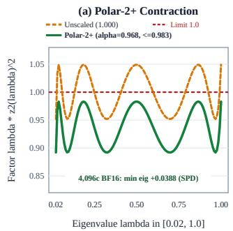

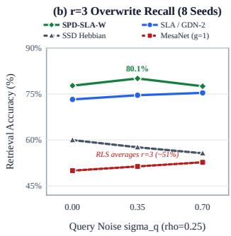

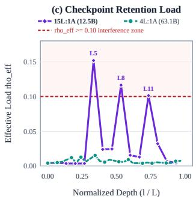  
Figure 8: Polar-2+ minimax contraction, overwrite recall, and checkpoint retention audit. (a) Scalar inverse-square-root contraction $\lambda z _ { 2 } ( \lambda ) ^ { 2 }$ on normalized eigenvalue $\lambda \in [ 0 . 0 2 , 1 . 0 ]$ (Proposition 4.2): unscaled polynomial factor $\alpha = 1$ .000 hits $1 . 0 4 9 2 > 1$ , whereas Polar-2+ (safety factor $\alpha _ { \mathrm { s a f e } } = 0 . 9 6 8 )$ bounds the peak to $0 . 9 8 3 1 < 1$ , keeping minimum eigenvalue $\lambda _ { \operatorname* { m i n } } ( \Sigma _ { c } ) \geq ^ { } 0 . 0 3 8 8$ of key preconditioner $\Sigma _ { c }$ across 4,096 BF16 chunks (524K tok). (b) 8-seed Hadamard overwrite accuracy (overwrite multiplicity $r = 3 )$ at memory load $\rho _ { \mathrm { e f f } } = N / d _ { k } = 0 . 2 5 ( N = 1 6$ stored keys, $d _ { k } = 6 4 )$ . (c) Trained 63.1B (4L:1A) and 12.5B (15L:1A) checkpoint load $\rho _ { \mathrm { e f f } }$

Proposition 4.1 (Oblique Whitening vs. Euclidean & RLS). Let $K \in \mathbb { R } ^ { N \times d _ { k } }$ stack $N \leq d _ { k }$ unit keys $k _ { 1 } , \dots , k _ { N } \in \mathbb { R } ^ { d _ { k } }$ with mutual coherence $\nu _ { c o h } = \operatorname* { m a x } _ { i \neq j } \left| \langle k _ { i } , k _ { j } \rangle \right|$ and Gram matrix $\mathcal { G } = K \dot { K } ^ { \top }$ satisfying $\kappa _ { 2 } ( \mathcal { G } ) > 1$ (proofs in Appendix A).

1. [Prior Delta [62, 67]] For equiangular keys $( | \langle k _ { i } , k _ { j } \rangle | ~ = ~ \nu _ { c o h }$ for all $i \neq j )$ , zero-mean values $v _ { j } \in \mathbb { R } ^ { d _ { v } }$ of expected squared norm $s _ { v } ^ { 2 } = \mathbb { E } \left\| v _ { j } \right\| _ { 2 } ^ { 2 } ,$ , and load $\rho _ { e f f } = N / d _ { k }$ , single-pass Euclidean delta incurs readout error $\Omega ( \rho _ { e f f } ( d _ { k } \nu _ { c o h } ^ { 2 } ) s _ { v } ^ { 2 } )$ , and diagonal column-energy preconditioning $\mathrm { d i a g } ( p ( K ) ) ^ { - 1 / 2 } k _ { t }$ [62] (where $p ( K ) \in \mathbb { R } ^ { d _ { k } }$ has m-th entry $\begin{array} { r } { p _ { m } ( K ) = \sum _ { i = 1 } ^ { N } K _ { i , m } ^ { 2 } ) } \end{array}$ fails under orthogonal key rotation $K \mapsto K Q \ ( Q \in \mathrm { O } ( d _ { k } ) )$ .

2. [Prior RLS [64]] MesaNet (with recursive least-squares key covariance $H _ { t } = \gamma H _ { t - 1 } + k _ { t } k _ { t } ^ { \top }$ and scalarforgetfactor $\gamma \in ( 0 , 1 ] )$ averages $r \geq 2$ overwrites $\boldsymbol { v } ^ { ( 1 ) } , \ldots , \boldsymbol { v } ^ { ( r ) } \in \mathbb { R } ^ { d _ { v } }$ ofthe same key as $\begin{array} { r } { \frac { 1 } { r } \sum _ { m = 1 } ^ { r } v ^ { ( m ) } a t \gamma = 1 \quad } \end{array}$ , and suppresses stale values at $\gamma < 1$ only by decaying write-once keys stored $t - j$ steps earlier (at step $j < t )$ at rate $\gamma ^ { t - j }$

3. [Ours] Oblique whitened keys $\tilde { K } _ { c } \in \mathbb { R } ^ { C \times d _ { k } }$ and causal oblique keys $\tilde { k } _ { t } \in \mathbb { R } ^ { d _ { k } }$ (Eq. (14)) inside Eq. (4) decorrelate intra-chunk writes while erasing selectively along $\tilde { k } _ { t }$

Non-circular normalization and Polar-2+ formulation. Matrix-sign polynomials (Polar Express [3], CANS [21]) collapse singular values to 1, while coupled NS-5 [4, 24, 26, 37] uses 10 [C, C] matmuls [Prior Polynomials]. Here $K _ { c } \in \mathbb { R } ^ { C \times d _ { k } }$ stacks the chunk’s keys, $\Sigma _ { c - 1 } \succ 0$ is the $d _ { k } \times d _ { k }$ key preconditioner carried across chunks (Eq. (15); initialized at $\Sigma _ { 0 } = I _ { d _ { k } }$ and relaxed toward $I _ { d _ { k } }$ at rate $\rho _ { p } \in [ 0 , 1 ] ) , \eta _ { c } \in ( 0 , 1 ]$ is the whitening step size, and $\varepsilon _ { \beta } > 0$ is the erasure safety margin (Section 2.3). To avoid circular regularization, we form the raw chunk Gram matrix $\mathcal { G } _ { 0 } \in \mathbb { R } ^ { C \times C }$ , its

Frobenius normalization $\bar { \mathcal { G } } _ { 0 }$ , spectral upper bound $\hat { u } _ { 0 } .$ , and adaptive ridge $\varepsilon _ { \mathrm { r e g } } .$

$$
\mathcal { G } _ { 0 } = I _ { C } + \eta _ { c } K _ { c } \Sigma _ { c - 1 } K _ { c } ^ { \top } , \qquad \bar { \mathcal { G } } _ { 0 } = \frac { \mathcal { G } _ { 0 } } { \| \mathcal { G } _ { 0 } \| _ { F } } , \qquad \hat { u } _ { 0 } = \operatorname* { m a x } \big ( \| \mathcal { G } _ { 0 } \| _ { F } \| \bar { \mathcal { G } } _ { 0 } ^ { 2 } \| _ { F } ^ { 1 / 2 } , 1 \big ) \ge \lambda _ { \operatorname* { m a x } } ( \mathcal { G } _ { 0 } ) ,
$$

and

$$
\varepsilon _ { \mathrm { r e g } } = \operatorname* { m a x } \left( 0 . 0 2 , \ { \frac { 0 . 0 2 0 5 } { 0 . 9 7 9 5 } } { \hat { u } } _ { 0 } - 1 \right) .
$$

Setting regularized Gram $\mathcal { G } _ { \mathrm { r e g } } = \mathcal { G } _ { 0 } + \varepsilon _ { \mathrm { r e g } } I _ { C }$ and scale $u _ { 0 } = \hat { u } _ { 0 } + \varepsilon _ { \mathrm { r e g } }$ maps the eigenvalues of $T _ { 0 } = \mathcal { G } _ { \mathrm { r e g } } / u _ { 0 }$ into [0.02, 1.0] while reusing $\hat { \mathcal { G } } _ { 0 } ^ { 2 } \ ( T _ { 0 } ^ { 2 }$ adds zero matmuls; 5 matmuls total), with step-size clamp

$$
\beta _ { t } \le \frac { 2 - \varepsilon _ { \beta } } { \operatorname* { m a x } ( k _ { t } ^ { \top } \tilde { k } _ { t } , \varepsilon _ { \beta } ) } .
$$

Letting $K _ { < t }$ stack the chunk keys strictly preceding token $t , \mathcal { M } _ { \ell } \in \mathbb { R } ^ { C \times C }$ denote the degree-2 polynomial factors for stages $\ell \in \ \{ 0 , 1 \}$ with $\bar { T } _ { 1 } ~ = ~ { \mathcal M } _ { 0 } T _ { 0 } { \mathcal M } _ { 0 }$ and minimax coefficients $( a _ { 0 } , b _ { 0 } , e _ { 0 } ) \ : = \ : ( 4 . 9 2 8 6 4 , - 1 1 . 2 9 5 1 3 , 7 . 7 0 0 9 9 )$ and $( a _ { 1 } , b _ { 1 } , e _ { 1 } ) \ = \ ( 2 . 0 0 4 1 0 , - 1 . 3 8 7 0 0 , 0 . 3 8 8 9 4 )$ and $\mathcal { W } _ { \mathrm { i s q } } \in \mathbb { R } ^ { C \times C }$ denote the safety-scaled $( \alpha _ { \mathrm { s a f e } } = 0 . 9 6 8 )$ inverse-square-root factor, Polar-2+ computes:

Low-Precision Conditioning: Oblique Whitening & BF16-Safe Polar-2+

$$
\begin{array} { r l r l r } { \tilde { K } _ { c } = \sqrt { \eta _ { c } } \mathcal { W } _ { \mathrm { i s q } } K _ { c } \Sigma _ { c - 1 } , } & { } & { \tilde { k } _ { t } \propto \big ( I _ { d _ { k } } - \eta _ { c } \Sigma _ { c - 1 } K _ { < t } ^ { \top } K _ { < t } \big ) \Sigma _ { c - 1 } k _ { t } , } \end{array}
$$

$$
\Sigma _ { c } = ( 1 - \rho _ { p } ) \bigl ( \Sigma _ { c - 1 } - \tilde { K } _ { c } ^ { \top } \tilde { K } _ { c } \bigr ) + \rho _ { p } I _ { d _ { k } } ,\tag{14}
$$

(15)

$$
\mathcal { M } _ { \ell } = a _ { \ell } I _ { C } + b _ { \ell } T _ { \ell } + e _ { \ell } T _ { \ell } ^ { 2 } , \qquad \mathcal { W } _ { \mathrm { i s q } } = \alpha _ { \mathrm { s a f e } } u _ { 0 } ^ { - 1 / 2 } \mathcal { M } _ { 1 } \mathcal { M } _ { 0 } .\tag{16}
$$

Symmetric $\tilde { K } _ { c }$ runs the chunk-whitening kernels (Table 19), the 4,096-chunk $( \rho _ { p } \ = \ 0 )$ BF16 Woodbury test, and lagged block-32 causal whitening (Appendix C). Since dense $\mathcal { W } _ { \mathrm { i s q } }$ mixes chunk tokens, packed LM training uses causal Schur-oblique $k _ { t }$ in Eq. (14) $( k _ { t } ^ { \top } \tilde { k } _ { t } = 1 )$ with Polar-2+ in the chunk-boundary Woodbury tail $( \rho _ { p } = 1$ resets $\Sigma _ { c } = I _ { d _ { k } }$ for SLA Tree-CP, while unscaled $\alpha = 1 . 0 0 0$ still diverges at step 299 via tail gradients; for $\rho _ { p } = 0 . 0 2$ cross-chunk $\Sigma _ { c }$ , multiplicative Sylvester congruence $B _ { c } \Sigma _ { c - 1 } B _ { c } ^ { \intercal }$ with contraction matrix $\boldsymbol { B } _ { c } \in \mathbb { R } ^ { d _ { k } \times d _ { k } }$ [Appendix A] replaces additive Eq. (15), which otherwise hits NaN at step 282).

Proposition 4.2 (Exact Equioscillation and Safety Margin of Polar-2+). Writing $m _ { \ell } ( x ) = a _ { \ell } + b _ { \ell } x +$ $e _ { \ell } x ^ { \bar { 2 } }$ , let

$$
z _ { 2 } ( \lambda ) = m _ { 1 } \big ( \lambda m _ { 0 } ( \lambda ) ^ { 2 } \big ) m _ { 0 } ( \lambda )
$$

be the scalar map that Eq. (16) applies to an eigenvalue λ of T0 (since $T _ { 1 } ~ = ~ \mathcal { M } _ { 0 } T _ { 0 } \mathcal { M } _ { 0 }$ has eigenvalue $\lambda m _ { 0 } ( \hat { \lambda } ) ^ { 2 } )$ , and let $\kappa _ { p o s t } = \kappa _ { 2 } ( \mathcal { W } _ { i s q } \mathcal { G } _ { r e g } \mathcal { W } _ { i s q } )$ be the post-whitening condition number. On $\lambda \in [ 0 . 0 2 , 1 . 0 ] , z _ { 2 }$ equioscillates with $\lambda z _ { 2 } ( \lambda ) ^ { \bar { 2 } } \in [ 0 . 9 \bar { 5 } 2 0$ , 1.0492], exceeding 1 for unscaled $\alpha = 1$ and driving recursive Woodbury indefinite. Scaling by $\alpha _ { s a f e } = 0 . 9 6 8$ bounds exact $\lambda ( \alpha _ { s a f e } z _ { 2 } ( \lambda ) ) ^ { 2 } \in$ [0.8920, 0.9831] (1.69% BF16 contractive margin below 1; exact $\kappa _ { p o s t } \leq 1 . 1 0 2$ , BF16 5-matmul $\bar { \kappa } _ { p o s t } \leq 1 . 1 2 3 )$

Table 19: Measured TPU v7x chunk-whitening latency (64 chunks = 8,192 tokens, $C = 1 2 8 , H _ { k } =$ $4 , d _ { k } = 2 5 6 ;$ ; MesaNet CG-10: 1.74/11.16 ms), exact conditioned Gram $\kappa _ { \mathrm { p o s t } } ( \leq 1 . 1 2 3$ in BF16), and 4,096-chunk (524K-token, $\rho _ { p } = 0 )$ BF16 Woodbury stress-test $\lambda _ { \operatorname* { m i n } } .$
<table><tr><td>Whitening / Second-Order Solver</td><td>Ops</td><td>Fwd (ms)</td><td>F+B (ms)</td><td> $\kappa _ { \mathrm { p o s t } }$ </td><td> $\lambda _ { \mathrm { m i n } }$  (4,096c BF16)</td></tr><tr><td>MesaNet Gated CG-30</td><td>VPU+MXU</td><td>3.050</td><td>27.640</td><td>1.02</td><td>- (CG)</td></tr><tr><td>Panel-16 Cholesky (VPU)</td><td>Tri. Solve</td><td>1.412</td><td>2.385</td><td>1.00</td><td>+0.0148 (SPD)</td></tr><tr><td>Coupled Newton-Schulz (NS-5)</td><td>10 MM</td><td>0.708</td><td>1.024</td><td>1.04</td><td>+0.0294 (SPD)</td></tr><tr><td>Polar-2 Unscaled  $( \alpha = 1 . 0 0 0 )$ </td><td>5MM</td><td>0.615</td><td>0.895</td><td>1.102</td><td>-0.0412 (Indef.)</td></tr><tr><td>Polar-2+ Safe  $( \alpha = 0 . 9 6 8 )$ </td><td>5MM</td><td>0.617</td><td>0.897</td><td>1.102</td><td>+0.0388 (SPD)</td></tr></table>

When whitening helps vs. unwhitened SLA. Polar-2+ runs 2.66 faster than Panel-16 Cholesky and $1 2 . 4 \times - 3 0 . 8 \times$ faster than MesaNet CG-10/30 (0.897 ms F+B; Table 19), keeping 4,096-chunk (524K-token) BF16 Woodbury SPD $( \lambda _ { \operatorname* { m i n } } \ge 0 . 0 3 8 8 )$ . It trains 2-seed 12.5B 15L:1A with zero NaNs and matches 10-matmul NS-5 (s1: 17.936 vs. 17.970 PPL), whereas $\alpha = 1 . 0 0 0$ diverges at step 299 and BF16 Cholesky hits NaN at step 54 (Appendix C). Because its language-modeling benefit shrinks to 0.004 nats by 15B tokens and unwhitened $G = 4 \ : \mathrm { S L A }$ already saturates PPL at 60.4B 15L:1A+MS (15.443 vs. 15.624 at +3.7% step time), unwhitened SLA is our default mixer.

## SPD-SLA-W serves three high-collision regimes:

1. correlated $r \geq 2$ overwrite $( \kappa _ { 2 } ( \mathcal { G } ) \approx 4 8 ;$ Figure 8b, Appendix Table 20), reaching 60.3 dB BF16 SNR and 80.1% noisy $r = 3$ recall vs. 2.67 dB and 50.0% for MesaNet;

2. uniform-decay 12.5B 15L:1A (15.1B tok, Table 15), edging 15L SLA-R2 on 32K 8-N (39.8% vs. 34.8%) and $N = 5 1 2 6 4 \mathrm { K }$ HotpotQA (69.5% vs. 68.2%); and

3. 63.1B 15L:1A, reaching 12.42 vs. 13.01 32K Tail PPL at 5.0B tok (Table 15) and 11.82 Tail PPL with 57.8%/64.8% 64K SQuAD/HotpotQA at 30.2B (+12.5/ + 25.0 pts over 0L:1A; Table 16).

## 5 Related Work

Decay Granularity in Linear Recurrences. Linear attentions replace the growing softmax KV cache with a fixed-size state updated once per token [12, 33]. Using the decay-group view of Section 2.1, most follow-up models differ in how finely their forget gate is resolved across key channels: RetNet [58], Mamba-2 [14], and GDN [68] use one decay rate per head, whereas GLA [66], RWKV-6/7 [42, 43], KDA [71], and GDN-2 [25] give every key channel its own rate; Mamba [22], HGRN2 [46], xLSTM [7], and Mamba-3 [34] explore further gate and state designs. SLA takes a middle point with four decay rates per 256-channel head. This is coarse enough that the decay factors out of 64-channel MXU matmuls. In our sweep it slightly lowers perplexity relative to one rate per head across all three paired seeds but extrapolates somewhat worse, so the choice between the two is close (Section 3.5).

Delta Rules, Higher-Order Memories, and Momentum. DeltaNet [50, 67] and test-time-trained memories [8, 9, 59] view the state update as one step of online regression, which improves associative recall over decay-only models [5, 30]. Later work adds multiple Householder reflections [53], negative eigenvalues [20], decoupled per-channel erase and write gates [25], second-order preconditioning [62, 64], log-linear state hierarchies [23], and heavy-ball momentum [9, 41, 44]. These works improve what the update can express; SLA instead keeps GDN’s single-reflection update and changes its shape for systolic hardware. The two directions are complementary: GDN-2 reaches lower per-token perplexity than SLA in our runs (Section 3.5), making a fused TPU kernel that combines GDN-2’s decoupled gates with SLA’s systolic mapping a natural next step.

Sharing Key Heads Across Value Heads. GQA [2] shares key and value heads across query heads in softmax attention. For linear attention, Kimi Linear [71], Qwen3-Next [48], and fla [65] already share query-key heads across value heads at $d _ { k } = 1 2 8 .$ , while Gated Attention [47] establishes sigmoid output gating. SLA uses the same idea at $d _ { k } = 2 5 6$ with per-value-head normalization, choosing the sizes so that one key head fills a full MXU tile.

Hardware-Aware Kernels. FlashAttention [13, 15, 70] re-architects softmax attention around the GPU memory hierarchy. For linear recurrences, fla [65] provides chunkwise WY kernels [10] for GPU tensor cores, and MaxText and Tokamax [1, 19] port KDA to TPUs. These kernels optimize a fixed model shape; SLA also changes the model so that every intra-chunk stage maps onto the MXU and fits in one fused kernel (distinct from works that abbreviate sparse-linear or softmax-linear hybrids as SLA).

Context Parallelism for Linear Recurrences. Head-sharded Ulysses [29] requires at least as many key heads as devices, ring-based methods [36, 45, 56] pass the state through $\mathsf { \bar { \mathcal { O } } } ( P )$ sequential hops, and LASP-2 [57] gathers chunk states with one AllGather. Because every gated delta chunk transition with scalar $\beta _ { t }$ is affine, chunks can also be combined with a parallel prefix scan [11, 39]; we use this standard construction for both SLA and KDA (Section 3.3).

## 6 Conclusion

Summary. Recent gated-delta models were shaped around GPUs, where per-channel gate rescaling and sequential in-block triangular solves are cheap relative to matmuls. On systolic accelerators, where matrix units outpace vector lanes by two orders of magnitude, kernel fusion alone cannot hide a vector-bound recurrence. Systolic Linear Attention (SLA) resolves this mismatch by co-designing the recurrence around the systolic array: sharing 256-wide keys across value heads fills full tiles, grouping forget gates into tiles factors decay out of matmuls, and block-doubling keeps chunk inversion and its backward pass on the MXU in one VMEM kernel. On TPU v7x, a fused SLA-R4 layer runs 1.6 –2.5 faster than Tokamax KDA (1.4 –2.4 with exact inversion) with 52%–61% less temporary HBM, and across 6.5B–63.1B MoE models on up to 512 chips per run, SLA trains 8%–24% faster than MaxText KDA at comparable perplexity without requiring linear-attention gate clamping at any scale (8K 64K zero-shot on RoPE backbones, and 83.2%–84.4% 32K 8-Needle on 63.1B NoPE with global SSMax alone).

Future Work. SLA targets accelerators with wide matrix tiles and a large matrix-to-vector gap; on GPUs, small Tensor Core tiles and fast vector lanes already saturate narrow states. Because our speedups combine tile-grouped decay with head sharing, BF16 state storage, and VMEM fusion while GDN-2 uses an unfused port despite lower per-token perplexity, next steps include building fused TPU kernels for wide-key, shared-head KDA and GDN-2 to isolate each factor and combine GDN-2’s decoupled gates with SLA’s systolic mapping, closing SLA’s 0.1 perplexity gap to wide-key KDA (0.3 with the 1-step Neumann inverse) on matched seeds, and decoupling chunk-boundary momentum from C. Finally, extending multi-seed runs beyond 8K Dolma, where BF16 MoE routing variance ( 0.18 perplexity) masks small gaps, 63.1B runs are single-seed, and 64K QA sets are small, will sharpen long-context comparisons.

## References

[1] AI-Hypercomputer Contributors. MaxText: A high performance, highly scalable, open-source LLM library written in pure Python/JAX. https://github.com/AI-Hypercomputer/ maxtext, 2026.

[2] J. Ainslie, J. Lee-Thorp, M. de Jong, Y. Zemlyanskiy, F. Lebrón, and S. Sanghai. GQA: Training generalized multi-query transformer models from multi-head checkpoints. In Empirical Methods in Natural Language Processing (EMNLP), 2023. arXiv:2305.13245.

[3] N. Amsel, D. Persson, C. Musco, and R. M. Gower. The Polar Express: Optimal matrix sign methods and their application to the Muon algorithm. arXiv preprint arXiv:2505.16932, 2025.

[4] R. Anil, V. Gupta, T. Koren, K. Regan, and Y. Singer. Scalable second order optimization for deep learning. arXiv preprint arXiv:2002.09018, 2020.

[5] S. Arora, S. Eyuboglu, A. Timalsina, I. Johnson, M. Poli, J. Zou, A. Rudra, and C. Ré. Zoology: Measuring and improving recall in efficient language models. In International Conference on Learning Representations (ICLR), 2024.

[6] J. Austin, S. Douglas, R. Frostig, A. Levskaya, C. Chen, S. Vikram, F. Lebron, P. Choy, V. Ramasesh, A. Webson, and R. Pope. How to scale your model. https://jax-ml.github. io/scaling-book/, 2025.

[7] M. Beck, K. Pöppel, M. Spanring, A. Auer, O. Prudnikova, M. Kopp, G. Klambauer, J. Brandstetter, and S. Hochreiter. xLSTM: Extended long short-term memory. In Advances in Neural Information Processing Systems (NeurIPS), 2024.

[8] A. Behrouz, Z. Li, P. Kacham, M. Daliri, Y. Deng, P. Zhong, M. Razaviyayn, and V. Mirrokni. Atlas: Learning to optimally memorize the context at test time. arXiv preprint arXiv:2505.23735, 2025.

[9] A. Behrouz, P. Zhong, and V. Mirrokni. Titans: Learning to memorize at test time. arXiv preprint arXiv:2501.00663, 2025.

[10] C. Bischof and C. Van Loan. The WY representation for products of Householder matrices. SIAM Journal on Scientific and Statistical Computing, 8(1):s2–s13, 1987.

[11] G. E. Blelloch. Prefix sums and their applications. Technical Report CMU-CS-90-190, Carnegie Mellon University, 1990.

[12] K. Choromanski, V. Likhosherstov, D. Dohan, X. Song, A. Gane, T. Sarlos, P. Hawkins, J. Davis, A. Mohiuddin, L. Kaiser, D. Belanger, L. Colwell, and A. Weller. Rethinking attention with performers. In International Conference on Learning Representations (ICLR), 2021.

[13] T. Dao. FlashAttention-2: Faster attention with better parallelism and work partitioning. In International Conference on Learning Representations (ICLR), 2024.

[14] T. Dao and A. Gu. Transformers are SSMs: Generalized models and efficient algorithms through structured state space duality. In International Conference on Machine Learning (ICML), 2024.

[15] T. Dao, D. Y. Fu, S. Ermon, A. Rudra, and C. Ré. FlashAttention: Fast and memory-efficient exact attention with IO-awareness. In Advances in Neural Information Processing Systems (NeurIPS), 2022.

[16] W. Fedus, B. Zoph, and N. Shazeer. Switch transformers: Scaling to trillion parameter models with simple and efficient sparsity. Journal of Machine Learning Research (JMLR), 23(120): 1–39, 2022. arXiv:2101.03961.

[17] L. Gao, J. Tow, B. Abbasi, S. Biderman, S. Black, A. DiPofi, C. Foster, L. Golding, J. Hsu, A. L. Noac’h, H. Li, K. McDonell, N. Muennighoff, C. Ociepa, J. Phang, L. Reynolds, H. Schoelkopf, A. Skowron, L. Sutawika, E. Tang, A. Thite, B. Wang, K. Wang, and A. Zou. A framework for few-shot language model evaluation. Zenodo, https://doi.org/10.5281/zenodo. 10256836, 2023.

[18] Google Cloud. TPU7x (Ironwood) architecture and performance optimizations. https:// docs.cloud.google.com/tpu/docs/ironwood-performance, 2025.

[19] Google DeepMind. Tokamax: Open-source accelerator kernel library for JAX. https:// github.com/google-deepmind/tokamax, 2026.

[20] R. Grazzi, J. Siems, J. K. H. Franke, A. Zela, F. Hutter, and M. Pontil. Unlocking statetracking in linear RNNs through negative eigenvalues. In International Conference on Learning Representations (ICLR), 2025. arXiv:2411.12537.

[21] E. Grishina, M. Smirnov, and M. Rakhuba. Accelerating Newton-Schulz iteration for orthogonalization via Chebyshev-type polynomials. arXiv preprint arXiv:2506.10935, 2025.

[22] A. Gu and T. Dao. Mamba: Linear-time sequence modeling with selective state spaces. arXiv preprint arXiv:2312.00752, 2023.

[23] H. Guo, S. Yang, T. Goel, E. P. Xing, T. Dao, and Y. Kim. Log-linear attention. arXiv preprint arXiv:2506.04761, 2025.

[24] V. Gupta, T. Koren, and Y. Singer. Shampoo: Preconditioned stochastic tensor optimization. In International Conference on Machine Learning (ICML), 2018.

[25] A. Hatamizadeh, Y. Choi, and J. Kautz. Gated DeltaNet-2: Decoupling erase and write in linear attention. arXiv preprint arXiv:2605.22791, 2026.

[26] N. J. Higham. Functions of Matrices: Theory and Computation. Society for Industrial and Applied Mathematics (SIAM), 2008.

[27] J. Hoffmann, S. Borgeaud, A. Mensch, E. Buchatskaya, T. Cai, E. Rutherford, D. de Las Casas, L. A. Hendricks, J. Welbl, A. Clark, T. Hennigan, E. Noland, K. Millican, G. van den Driessche, B. Damoc, A. Guy, S. Osindero, K. Simonyan, E. Elsen, J. W. Rae, O. Vinyals, and L. Sifre. Training compute-optimal large language models. In Advances in Neural Information Processing Systems (NeurIPS), 2022. arXiv:2203.15556.

[28] C.-P. Hsieh, S. Sun, S. Kriman, S. Acharya, D. Rekesh, F. Jia, Y. Zhang, and B. Ginsburg. RULER: What’s the real context size of your long-context language models? In Conference on Language Modeling (COLM), 2024.

[29] S. A. Jacobs, M. Tanaka, C. Zhang, M. Zhang, S. L. Song, S. Rajbhandari, and Y. He. DeepSpeed Ulysses: System optimizations for enabling training of extreme long sequence transformer models. arXiv preprint arXiv:2309.14509, 2023.

[30] S. Jelassi, D. Brandfonbrener, S. M. Kakade, and E. Malach. Repeat after me: Transformers are better than state space models at copying. In International Conference on Machine Learning (ICML), 2024.

[31] N. P. Jouppi, C. Young, N. Patil, D. Patterson, G. Agrawal, R. Bajwa, S. Bates, S. Bhatia, N. Boden, A. Borchers, R. Boyle, P.-L. Cantin, C. Chao, C. Clark, J. Coriell, M. Daley, M. Dau, J. Dean, B. Gelb, T. V. Ghaemmaghami, R. Gottipati, W. Gulland, R. Hagmann, C. R. Ho, D. Hogberg, J. Hu, R. Hundt, D. Hurt, J. Ibarz, A. Jaffey, A. Jaworski, A. Kaplan, H. Khaitan, A. Koch, N. Kumar, S. Lacy, J. Laudon, J. Law, D. Le, C. Leary, Z. Liu, K. Lucke, A. Lundin, G. MacKean, A. Maggiore, M. Mahony, K. Miller, R. Nagarajan, R. Narayanaswami, R. Ni, K. Nix, T. Norrie, M. Omernick, N. Penukonda, A. Phelps, J. Ross, M. Ross, A. Salek, E. Samadiani, C. Severn, G. Sizikov, M. Snelham, J. Souter, D. Steinberg, A. Swing, M. Tan, G. Thorson, B. Tian, H. Toma, E. Tuttle, V. Vasudevan, R. Walter, W. Wang, E. Wilcox, and D. H. Yoon. In-datacenter performance analysis of a tensor processing unit. In International Symposium on Computer Architecture (ISCA), 2017.

[32] N. P. Jouppi, G. Kurian, S. Li, P. Ma, R. Nagarajan, L. Nai, N. Patil, S. Subramanian, A. Swing, B. Towles, C. Young, X. Zhou, Z. Zhou, and D. Patterson. TPU v4: An optically reconfigurable supercomputer for machine learning with hardware support for embeddings. In International Symposium on Computer Architecture (ISCA), 2023.

[33] A. Katharopoulos, A. Vyas, N. Pappas, and F. Fleuret. Transformers are RNNs: Fast autoregressive transformers with linear attention. In International Conference on Machine Learning (ICML), 2020.

[34] A. Lahoti, K. Y. Li, B. Chen, C. Wang, A. Bick, J. Z. Kolter, T. Dao, and A. Gu. Mamba-3: Improved sequence modeling using state space principles. In International Conference on Learning Representations (ICLR), 2026. arXiv:2603.15569.

[35] Y. Leviathan, M. Kalman, and Y. Matias. Fast inference from transformers via speculative decoding. In International Conference on Machine Learning (ICML), 2023. arXiv:2211.17192.

[36] H. Liu, M. Zaharia, and P. Abbeel. Ring attention with blockwise transformers for near-infinite context. In International Conference on Learning Representations (ICLR), 2024.

[37] J. Liu, J. Su, X. Yao, Z. Jiang, G. Lai, Y. Du, Y. Qin, W. Xu, E. Lu, J. Yan, Y. Chen, H. Zheng, Y. Liu, S. Liu, B. Yin, W. He, H. Zhu, Y. Wang, J. Wang, M. Dong, Z. Zhang, Y. Kang, H. Zhang, X. Xu, Y. Zhang, Y. Wu, X. Zhou, and Z. Yang. Muon is scalable for LLM training. arXiv preprint arXiv:2502.16982, 2025.

[38] I. Loshchilov and F. Hutter. Decoupled weight decay regularization. In International Conference on Learning Representations (ICLR), 2019. arXiv:1711.05101.

[39] E. Martin and C. Cundy. Parallelizing linear recurrent neural nets over sequence length. In International Conference on Learning Representations (ICLR), 2018.

[40] K. M. Nakanishi. Scalable-softmax is superior for attention. arXiv preprint arXiv:2501.19399, 2025.

[41] T. M. Nguyen, R. G. Baraniuk, R. M. Kirby, S. J. Osher, and B. Wang. Momentum transformer: Closing the performance gap between self-attention and its linearization. arXiv preprint arXiv:2208.00579, 2022.

[42] B. Peng, D. Goldstein, Q. Anthony, A. Albalak, E. Alcaide, S. Biderman, E. Cheah, X. Du, T. Ferdinan, H. Hou, P. Kazienko, K. K. GV, J. Kocon, B. Koptyra, S. Krishna, R. McClelland,´ Jr., J. Lin, N. Muennighoff, F. Obeid, A. Saito, G. Song, H. Tu, C. Wirawan, S. Wo´zniak, R. Zhang, B. Zhao, Q. Zhao, P. Zhou, J. Zhu, and R.-J. Zhu. Eagle and finch: RWKV with matrix-valued states and dynamic recurrence. In Conference on Language Modeling (COLM), 2024.

[43] B. Peng, R. Zhang, D. Goldstein, E. Alcaide, X. Du, H. Hou, J. Lin, J. Liu, J. Lu, W. Merrill, G. Song, K. Tan, S. Utpala, N. Wilce, J. S. Wind, T. Wu, D. Wuttke, and C. Zhou-Zheng. RWKV-7 “goose” with expressive dynamic state evolution. arXiv preprint arXiv:2503.14456, 2025.

[44] B. T. Polyak. Some methods of speeding up the convergence of iteration methods. USSR Computational Mathematics and Mathematical Physics, 4(5):1–17, 1964.

[45] Z. Qin, W. Sun, D. Li, X. Shen, W. Sun, and Y. Zhong. Various lengths, constant speed: Efficient language modeling with lightning attention. In International Conference on Machine Learning (ICML), 2024. arXiv:2405.17381.

[46] Z. Qin, S. Yang, W. Sun, X. Shen, D. Li, W. Sun, and Y. Zhong. HGRN2: Gated linear RNNs with state expansion. In Conference on Language Modeling (COLM), 2024.

[47] Z. Qiu, Z. Wang, B. Zheng, Z. Huang, K. Wen, S. Yang, R. Men, L. Yu, F. Huang, S. Huang, D. Liu, J. Zhou, and J. Lin. Gated attention for large language models: Non-linearity, sparsity, and attention-sink-free. In Advances in Neural Information Processing Systems (NeurIPS), 2025. arXiv:2505.06708.

[48] Qwen Team. Qwen3-Next: Towards ultimate training and inference efficiency. https:// qwenlm.github.io/blog/qwen3-next/, 2025.

[49] P. Rajpurkar, J. Zhang, K. Lopyrev, and P. Liang. SQuAD: 100,000+ questions for machine comprehension of text. In Empirical Methods in Natural Language Processing (EMNLP), 2016. arXiv:1606.05250.

[50] I. Schlag, K. Irie, and J. Schmidhuber. Linear transformers are secretly fast weight programmers. In International Conference on Machine Learning (ICML), 2021.

[51] N. Shazeer. GLU variants improve transformer. arXiv preprint arXiv:2002.05202, 2020.

[52] N. Shazeer, A. Mirhoseini, K. Maziarz, A. Davis, Q. Le, G. Hinton, and J. Dean. Outrageously large neural networks: The sparsely-gated mixture-of-experts layer. In International Conference on Learning Representations (ICLR), 2017. arXiv:1701.03538.

[53] J. Siems, T. Carstensen, A. Zela, F. Hutter, M. Pontil, and R. Grazzi. DeltaProduct: Improving state-tracking in linear RNNs via Householder products. In International Conference on Learning Representations (ICLR), 2026. arXiv:2502.10297.

[54] L. Soldaini, R. Kinney, A. Bhagia, D. Schwenk, D. Atkinson, R. Authur, B. Bogin, K. Chandu, J. Dumas, Y. Elazar, V. Hofmann, A. H. Jha, S. Kumar, L. Lucy, X. Lyu, N. Lambert, I. Magnusson, J. Morrison, N. Muennighoff, A. Naik, C. Nam, M. E. Peters, A. Ravichander, K. Richardson, Z. Shen, E. Strubell, N. Subramani, O. Tafjord, P. Walsh, L. Zettlemoyer, N. A. Smith, H. Hajishirzi, I. Beltagy, D. Groeneveld, J. Dodge, and K. Lo. Dolma: an open corpus of three trillion tokens for language model pretraining research. In Associationfor Computational Linguistics (ACL), 2024.

[55] J. Su, M. Ahmed, Y. Lu, S. Pan, W. Bo, and Y. Liu. RoFormer: Enhanced transformer with rotary position embedding. Neurocomputing, 568:127063, 2024. arXiv:2104.09864.

[56] W. Sun, Z. Qin, D. Li, X. Shen, Y. Qiao, and Y. Zhong. Linear attention sequence parallelism. arXiv preprint arXiv:2404.02882, 2024.

[57] W. Sun, Z. Qin, D. Li, X. Shen, Y. Qiao, and Y. Zhong. LASP-2: Rethinking sequence parallelism for linear attention and its hybrid. arXiv preprint arXiv:2502.07563, 2025.

[58] Y. Sun, L. Dong, S. Huang, S. Ma, Y. Xia, J. Xue, J. Wang, and F. Wei. Retentive network: A successor to transformer for large language models. arXiv preprint arXiv:2307.08621, 2023.

[59] Y. Sun, X. Li, K. Dalal, J. Xu, A. Vikram, G. Zhang, Y. Dubois, X. Chen, X. Wang, S. Koyejo, T. Hashimoto, and C. Guestrin. Learning to (learn at test time): RNNs with expressive hidden states. In International Conference on Machine Learning (ICML), 2024. arXiv:2407.04620.

[60] Team Olmo. Olmo 3. arXiv preprint arXiv:2512.13961, 2025.

[61] Team OLMo, P. Walsh, L. Soldaini, D. Groeneveld, K. Lo, S. Arora, A. Bhagia, Y. Gu, S. Huang, M. Jordan, N. Lambert, D. Schwenk, O. Tafjord, T. Anderson, D. Atkinson, F. Brahman, C. Clark, P. Dasigi, N. Dziri, A. Ettinger, M. Guerquin, D. Heineman, H. Ivison, P. W. Koh, J. Liu, S. Malik, W. Merrill, L. J. V. Miranda, J. Morrison, T. Murray, C. Nam, J. Poznanski, V. Pyatkin, A. Rangapur, M. Schmitz, S. Skjonsberg, D. Wadden, C. Wilhelm, M. Wilson, L. Zettlemoyer, A. Farhadi, N. A. Smith, and H. Hajishirzi. 2 OLMo 2 furious. arXiv preprint arXiv:2501.00656, 2025.

[62] N. Tumma, N. Loo, and D. Rus. Preconditioned DeltaNet: Curvature-aware sequence modeling for linear recurrences. arXiv preprint arXiv:2604.21100, 2026.

[63] A. Vaswani, N. Shazeer, N. Parmar, J. Uszkoreit, L. Jones, A. N. Gomez, Ł. Kaiser, and I. Polosukhin. Attention is all you need. In Advances in Neural Information Processing Systems (NeurIPS), 2017.

[64] J. von Oswald, N. Scherrer, S. Kobayashi, L. Versari, S. Yang, S. Mittal, M. Schlegel, K. Maile, Y. Schimpf, O. Sieberling, A. Meulemans, R. A. Saurous, G. Lajoie, C. Frenkel, R. Pascanu, B. A. y Arcas, and J. Sacramento. MesaNet: Sequence modeling by locally optimal test-time training. In Advances in Neural Information Processing Systems (NeurIPS), 2025. arXiv:2506.05233.

[65] S. Yang and Y. Zhang. FLA: A Triton-based library for hardware-efficient implementations of linear attention mechanism. https://github.com/fla-org/flash-linear-attention, 2024.

[66] S. Yang, B. Wang, Y. Shen, R. Panda, and Y. Kim. Gated linear attention transformers with hardware-efficient training. In International Conference on Machine Learning (ICML), 2024.

[67] S. Yang, B. Wang, Y. Zhang, Y. Shen, and Y. Kim. Parallelizing linear transformers with the delta rule over sequence length. In Advances in Neural Information Processing Systems (NeurIPS), 2024.

[68] S. Yang, J. Kautz, and A. Hatamizadeh. Gated Delta networks: Improving Mamba2 with Delta rule. In International Conference on Learning Representations (ICLR), 2025. arXiv:2412.06464.

[69] Z. Yang, P. Qi, S. Zhang, Y. Bengio, W. W. Cohen, R. Salakhutdinov, and C. D. Manning. HotpotQA: A dataset for diverse, explainable multi-hop question answering. In Empirical Methods in Natural Language Processing (EMNLP), 2018. arXiv:1809.09600.

[70] T. Zadouri, M. Hoehnerbach, J. Shah, T. Liu, V. Thakkar, and T. Dao. FlashAttention-4: Algorithm and kernel pipelining co-design for asymmetric hardware scaling. arXiv preprint arXiv:2603.05451, 2026.

[71] Y. Zhang, Z. Lin, X. Yao, J. Hu, F. Meng, C. Liu, X. Men, S. Yang, Z. Li, Z. Yang, Y. Du, and Kimi Team. Kimi Linear: An expressive, efficient attention architecture. arXiv preprint arXiv:2510.26692, 2025.

## A Proofs of Propositions 4.1 and 4.2 (Whitening and Polar-2+)

Part 1 (Euclidean Interference and Diagonal Non-Invariance). Let unit keys $k _ { 1 } , \ldots , k _ { N } \in \mathbb { R } ^ { d _ { k } }$ satisfy $| \langle k _ { i } , k _ { j } \rangle | ~ = ~ \nu _ { \mathrm { c o h } }$ for $i \neq j$ (coherence $\nu _ { \mathrm { c o h } } ; \mathrm { e . g }$ ., an equiangular tight frame or sharedsubspace correlated dictionary) and draw independent zero-mean values $v _ { j } \in \mathbb { R } ^ { d _ { v } }$ with covariance $\begin{array} { r } { \mathbb { E } [ v _ { j } v _ { j } ^ { \top } ] = \frac { s _ { v } ^ { 2 } } { d _ { v } } I _ { d _ { \tau } } } \end{array}$ (for $d _ { v } \times d _ { v }$ identity $I _ { d _ { v } } ) _ { \langle }$ , so $\begin{array} { r } { s _ { v } ^ { 2 } = \operatorname { t r } \bigl ( \frac { s _ { v } ^ { 2 } } { d _ { v } } I _ { d _ { v } } \bigr ) = \mathbb { E } \left\| v _ { j } \right\| _ { 2 } ^ { 2 } } \end{array}$ . Under single-pass Euclidean delta updates with $\beta _ { t } = 1$ from $S _ { 0 } = 0 ;$ , updating $\bar { S _ { t } } = ( I _ { d _ { k } } - k _ { t } k _ { t } ^ { \top } ) S _ { t - 1 } + k _ { t } v _ { t } ^ { \top }$ writes later values $j > i$ with projection $\langle k _ { j } , k _ { i } \rangle v _ { j }$ along $k _ { i } { \mathrm { : } }$ for $i = N - 1$

$$
S _ { N } ^ { \top } k _ { N - 1 } - v _ { N - 1 } = \langle k _ { N } , k _ { N - 1 } \rangle \big ( v _ { N } - S _ { N - 1 } ^ { \top } k _ { N } \big ) ,
$$

and summing independent cross-key leakage over $\Theta ( N )$ interfering keys yields

$$
\begin{array} { r } { \mathbb { E } \left\| S _ { N } ^ { \top } k _ { i } - v _ { i } \right\| _ { 2 } ^ { 2 } = \Omega ( N \nu _ { \mathrm { c o h } } ^ { 2 } s _ { v } ^ { 2 } ) = \Omega \big ( \rho _ { \mathrm { e f f } } ( d _ { k } \nu _ { \mathrm { c o h } } ^ { 2 } ) s _ { v } ^ { 2 } \big ) } \end{array}
$$

when $N \nu _ { \mathrm { c o h } } ^ { 2 } \leq 1 / 2 ( \rho _ { \mathrm { e f f } } = N / d _ { k }$ , reducing to $\Omega ( \rho _ { \mathrm { e f f } } s _ { v } ^ { 2 } )$ at isotropic $\nu _ { \mathrm { c o h } } ^ { 2 } = 1 / d _ { k } )$

For the diagonal column-energy preconditioner $K \mathrm { d i a g } ( p ( K ) ) ^ { - 1 / 2 }$ where $\begin{array} { r } { p _ { m } ( K ) = \sum _ { i = 1 } ^ { N } K _ { i , m } ^ { 2 } , } \end{array}$ rotating $K \mapsto K Q$ with $Q = \mathrm { d i a g } ( \xi ) Q _ { H } \in \mathrm { O } ( d _ { k } )$ for random Rademacher signs $\xi \in \{ \pm 1 \} ^ { d _ { k } }$ followed by a normalized Hadamard matrix $Q _ { H } \in \{ \pm d _ { k } ^ { - 1 / 2 } \} ^ { d _ { k } \times d _ { k } }$ equalizes all column energies in expectation,

$$
\mathbb { E } _ { \xi } \big [ p _ { m } ( K \mathrm { d i a g } ( \xi ) Q _ { H } ) \big ] = \frac { 1 } { d _ { k } } \left\| K \right\| _ { F } ^ { 2 }
$$

(and by Schur-Horn some rotation $Q \in \mathrm { O } ( d _ { k } )$ makes $Q ^ { \top } K ^ { \top } K Q$ exactly constant-diagonal), reducing $\mathrm { d i a g } ( p ( K Q ) ) ^ { - 1 / 2 }$ to a scalar multiple of $I _ { d _ { k } }$ that leaves $\kappa _ { 2 } ( ( K Q ) ( K Q ) ^ { \top } ) = \kappa _ { 2 } ( K K ^ { \top } )$ unchanged; by contrast, $( I _ { C } + \eta _ { c } K _ { c } K _ { c } ^ { \top } ) ^ { - 1 / 2 } K _ { c }$ transforms equivariantly $( K _ { c } \mapsto K _ { c } Q \implies \tilde { K } _ { c } \mapsto$ $\tilde { K } _ { c } Q )$ for all $Q \in \mathrm { O } ( d _ { k } )$

Part 2 (Gated RLS Overwrite-Retention Trade-off). Under gated RLS [64], with key covariance $H _ { t } \in \mathbb { R } ^ { d _ { k } \times d _ { k } }$ and key-value moment $B _ { t } \in \mathbb R ^ { d _ { k } \times d _ { v } }$ (local to this paragraph), $\mathbf { \bar { \Pi } } _ { H _ { t } } = \gamma \bar { H _ { t - 1 } } + k _ { t } k _ { t } ^ { \top }$ and $B _ { t } = \gamma B _ { t - 1 } + k _ { t } v _ { t } ^ { \top }$ with scalar forget factor $\gamma \in ( 0 , 1 ]$ and ridge $\epsilon I _ { d _ { k } } \ ( \epsilon > 0 )$ ; readout on query $\boldsymbol { k } \in \mathbb { R } ^ { d _ { k } }$ is $B _ { t } ^ { \top } H _ { t } ^ { - 1 } k$ . If a unit key k is written $r \geq 2$ times, with value $v ^ { ( m ) }$ at step $t _ { m }$ $( t _ { 1 } < \dots < t _ { r } = t )$ and weights $w _ { m } = \gamma ^ { t - t _ { m } }$ , Sherman-Morrison on $\begin{array} { r } { H _ { t } = \epsilon I _ { d _ { k } } + ( \sum _ { m = 1 } ^ { r } w _ { m } ) k k ^ { \top } } \end{array}$ gives

$$
\operatorname* { l i m } _ { \epsilon \to 0 ^ { + } } B _ { t } ^ { \top } H _ { t } ^ { - 1 } k = \frac { \sum _ { m = 1 } ^ { r } w _ { m } v ^ { ( m ) } } { \sum _ { m = 1 } ^ { r } w _ { m } } .
$$

Letting $\begin{array} { r } { \bar { v } _ { 1 : r - 1 } = \frac { 1 } { r - 1 } \sum _ { m = 1 } ^ { r - 1 } v ^ { ( m ) } } \end{array}$ denote the mean of the first $r - 1$ values, readout at $\gamma = 1$ $( w _ { m } \equiv 1 )$ equals $\textstyle { \frac { 1 } { r } } \sum _ { m = 1 } ^ { r } v ^ { ( m ) }$ with error $\begin{array} { r l r } {  { \frac { r - 1 } { r } \| v ^ { ( r ) } - \bar { v } _ { 1 : r - 1 } \| _ { 2 } } } \end{array}$ relative to $\boldsymbol { v } ^ { ( r ) }$ . Already for $r = 2$ consecutive writes and any target relative tolerance $\varepsilon \in ( 0 , 1 / 2 )$ , the error is $\begin{array} { r } { \frac { \gamma } { 1 + \gamma } \left. \boldsymbol { v } ^ { ( 2 ) } - \boldsymbol { v } ^ { ( 1 ) } \right. _ { 2 } , } \end{array}$ so making it at most $\varepsilon \left\| v ^ { ( 2 ) } - v ^ { ( 1 ) } \right\| _ { 2 }$ requires $\gamma \leq \varepsilon / ( 1 - \varepsilon )$ , which simultaneously decays any nonoverwritten key stored $t - j$ steps earlier (at step $j < t ) \log { \gamma ^ { t - j } }$ relative to the regularizer $\epsilon I _ { d _ { k } }$ , causing rapid forgetting in finite precision (verified in Table 20). Under oblique whitened delta, intra-chunk Gram whitening orthogonalizes concurrent keys while the oblique erasure $( I _ { d _ { k } } - \beta _ { t } \tilde { k } _ { t } k _ { t } ^ { \top } )$ subtracts the current state projection $\hat { v } _ { t } = ( F _ { t } \tilde { S } _ { t - 1 } ) ^ { \top } k _ { t }$ selectively along $\tilde { k } _ { t }$ without decaying orthogonal associations.

Part 3 (Polar-2+ Non-Circular Normalization, Equioscillation, and BF16 Safety). Let $\Sigma _ { c - 1 } \succ 0$ (initialized from $\Sigma _ { 0 } = I _ { d _ { k } } )$ and let $Y _ { c } = K _ { c } \Sigma _ { c - 1 } ^ { 1 / 2 } \in \mathbb { R } ^ { C \times d _ { k } }$ have singular values $\sigma _ { i } \geq 0$ (unrelated to the sigmoid $\sigma )$ , so the unregularized Gram $\mathcal { G } _ { 0 } = I _ { C } + \eta _ { c } Y _ { c } Y _ { c } ^ { \top } \left( \eta _ { c } \in \left( 0 , 1 \right] \right)$ has eigenvalues $\omega _ { 0 , i } = 1 + \eta _ { c } \sigma _ { i } ^ { 2 }$ . Computing $\breve { \mathcal { G } _ { 0 } } = \mathcal { G } _ { 0 } / \left. \mathcal { G } _ { 0 } \right. _ { F }$ and

$$
\hat { u } _ { 0 } = \operatorname* { m a x } \bigl ( \| \mathcal { G } _ { 0 } \| _ { F } \left\| \bar { \mathcal { G } } _ { 0 } ^ { 2 } \right\| _ { F } ^ { 1 / 2 } , 1 \bigr ) = \operatorname* { m a x } \left( \Bigl ( \sum _ { j } \omega _ { 0 , j } ^ { 4 } \Bigr ) ^ { 1 / 4 } , 1 \right) \geq \operatorname* { m a x } _ { i } \omega _ { 0 , i }
$$

yields a non-circular upper bound on $\lambda _ { \operatorname* { m a x } } ( \mathcal G _ { 0 } )$ from one $[ C , C ]$ matmul $\hat { \mathcal { G } } _ { 0 } ^ { 2 }$ . Setting adaptive ridge $\varepsilon _ { \mathrm { r e g } } =$ max $\begin{array} { r } { \big ( 0 . 0 2 , \frac { 0 . 0 \hat { 2 } 0 5 } { 0 . 9 7 9 5 } \hat { u } _ { 0 } - 1 \big ) , \mathcal { G } _ { \mathrm { r e g } } = \mathcal { G } _ { 0 } + \varepsilon _ { \mathrm { r e g } } I _ { C } } \end{array}$ with shifted eigenvalues $\omega _ { i } = \omega _ { 0 , i } + \varepsilon _ { \mathrm { r e g } }$ and $u _ { 0 } = \hat { u } _ { 0 } + \varepsilon _ { \mathrm { r e g } } \ge \operatorname* { m a x } _ { i } \omega _ { i }$ guarantees normalized eigenvalues $\lambda _ { i } = \omega _ { i } / u _ { 0 } \in [ 0 . 0 2 , 1 . 0 ]$ for all $\hat { u } _ { 0 } \geq 1$ while expanding

$$
T _ { 0 } ^ { 2 } = \frac { ( \mathcal { G } _ { 0 } + \varepsilon _ { \mathrm { r e g } } I _ { C } ) ^ { 2 } } { u _ { 0 } ^ { 2 } } = \frac { \| \mathcal { G } _ { 0 } \| _ { F } ^ { 2 } \bar { \mathcal { G } } _ { 0 } ^ { 2 } + 2 \varepsilon _ { \mathrm { r e g } } \mathcal { G } _ { 0 } + \varepsilon _ { \mathrm { r e g } } ^ { 2 } I _ { C } } { u _ { 0 } ^ { 2 } }
$$

with zero additional matmuls (5 matmuls total across stages $\ell \in \{ 0 , 1 \}$ , where $\mathcal { M } _ { \ell } = \mathop { m \ell } \left( T _ { \ell } \right)$ evaluates $m _ { 0 } ( \lambda ) = a _ { 0 } + b _ { 0 } \lambda + e _ { 0 } \lambda ^ { 2 }$ and $m _ { 1 } ( x ) = a _ { 1 } + b _ { 1 } { \bar { x } } + e _ { 1 } x ^ { 2 } )$

Clamping $\beta _ { t } \leq ( 2 - \varepsilon _ { \beta } ) / \operatorname* { m a x } ( k _ { t } ^ { \top } \tilde { k } _ { t } , \varepsilon _ { \beta } )$ keeps the nontrivial eigenvalue $1 - \beta _ { t } k _ { t } ^ { \top } \tilde { k } _ { t }$ of $I _ { d _ { k } } - \beta _ { t } \tilde { k } _ { t } k _ { t } ^ { \top }$ in $[ - 1 + \varepsilon _ { \beta } , 1 ]$ whenever $k _ { t } ^ { \top } \tilde { k } _ { t } > 0$ (in packed LM training, intra-chunk causal Schur-oblique projection sets

$$
\tilde { k } _ { t } = \frac { ( I _ { d _ { k } } - \eta _ { c } \Sigma _ { c - 1 } K _ { < t } ^ { \top } K _ { < t } ) \Sigma _ { c - 1 } k _ { t } } { k _ { t } ^ { \top } ( I _ { d _ { k } } - \eta _ { c } \Sigma _ { c - 1 } K _ { < t } ^ { \top } K _ { < t } ) \Sigma _ { c - 1 } k _ { t } }
$$

so $k _ { t } ^ { \top } \tilde { k } _ { t } ~ = ~ 1$ depends strictly on rows $< ~ t ,$ , while symmetric Polar-2+ governs the chunkboundary Woodbury tail, two-sided chunk-whitening kernels, and lagged block-32 causal whitening). Substituting ${ \mathcal { W } } _ { \mathrm { i s q } } = \alpha _ { \mathrm { s a f e } } u _ { 0 } ^ { - 1 / 2 } { \mathcal { M } } _ { 1 } { \mathcal { M } } _ { 0 } = \alpha _ { \mathrm { s a f e } } u _ { 0 } ^ { - 1 / 2 } z _ { 2 } ( T _ { 0 } )$ and $\tilde { K } _ { c } = \sqrt { \eta _ { c } } \mathcal { W } _ { \mathrm { i s q } } K _ { c } \Sigma _ { c - 1 }$ (Eq. (14)) into the unrelaxed Woodbury update $\tilde { \Sigma } _ { c } = \Sigma _ { c - 1 } - \tilde { K } _ { c } ^ { \top } \tilde { K } _ { c }$ (Eq. (15) at $\rho _ { p } = 0 )$ gives $\tilde { \Sigma } _ { c } = \Sigma _ { c - 1 } ^ { 1 / 2 } ( I _ { d _ { k } } - \eta _ { c } Y _ { c } ^ { \top } \mathcal { W } _ { \mathrm { i s q } } ^ { 2 } Y _ { c } ) \Sigma _ { c - 1 } ^ { 1 / 2 }$ , whose i-th singular-direction multiplier is

$$
1 - \eta _ { c } \sigma _ { i } ^ { 2 } u _ { 0 } ^ { - 1 } \alpha _ { \mathrm { s a f e } } ^ { 2 } z _ { 2 } ( \lambda _ { i } ) ^ { 2 } = 1 - \frac { \eta _ { c } \sigma _ { i } ^ { 2 } } { 1 + \varepsilon _ { \mathrm { r e g } } + \eta _ { c } \sigma _ { i } ^ { 2 } } \lambda _ { i } \bigl ( \alpha _ { \mathrm { s a f e } } z _ { 2 } ( \lambda _ { i } ) \bigr ) ^ { 2 } .\tag{17}
$$

Direct evaluation of the scalar map z2 (Proposition 4.2) on $\lambda ~ \in ~ [ 0 . 0 2 , 1 . 0 ]$ gives minimax equioscillation $\sqrt { \lambda } z _ { 2 } ( \lambda ) \ \in \ [ 0 . 9 7 5 7 , 1 . 0 2 4 3 ]$ ], hence $\lambda z _ { 2 } ( \lambda ) ^ { 2 } ~ \in ~ [ 0 . 9 5 2 0 , 1 . 0 4 9 2 ] ~ ( \mathrm { a n d } < ~ 0 . 9 5 2$ on (0, 0.02) since $z _ { 2 } ( 0 ) ~ = ~ a _ { 1 } a _ { 0 } ~ \approx ~ 9 . 8 7 7 )$ Thus unscaled $\alpha \ = \ 1$ exceeds 1 by +4.92% near equioscillation peaks, driving Eq. (17) negative when $\eta _ { c } \sigma _ { i } ^ { 2 } \ \gg \ 1$ . Setting $\alpha _ { \mathrm { s a f e } } ~ = ~ 0 . 9 6 8$ $( \alpha _ { \mathrm { s a f e } } ^ { 2 } = 0 . 9 3 7 0 2 4 )$ maps exact $\lambda ( \stackrel { \smile } { \alpha _ { \mathrm { s a f e } } } z _ { 2 } ( \lambda ) ) ^ { 2 }$ onto [0.8920, 0.9831] across [0.02, 1.0], giving exact $\kappa _ { 2 } \big ( \mathcal { W } _ { \mathrm { i s q } } \mathcal { G } _ { \mathrm { r e g } } \mathcal { W } _ { \mathrm { i s q } } \big ) = 0 . 9 8 3 1 / 0 . 8 9 2 0 = 1 . 1 0 2 \ : ( \leq \ : \mathrm { i . 1 2 3 } $ in 5-matmul BF16 hardware execution). At $\rho _ { p } = 0 , 4$ ,096 correlated BF16 chunks (524,288 tokens) maintain $\lambda _ { \operatorname* { m i n } } ( \Sigma _ { c } ) \geq 0 . 0 3 8 8 > 0 { \mathrm { : } }$ when evolving $\Sigma _ { c }$ across thousands of packed BF16 LM gradient steps with $\rho _ { p } < 1$ , replacing additive subtraction with multiplicative Sylvester congruence $B _ { c } \Sigma _ { c - 1 } B _ { c } ^ { \top }$ (with contraction matrix $\begin{array} { r } { \mathcal { B } _ { c } = I _ { d _ { k } } - \frac { \eta _ { c } } { 2 } \Sigma _ { c - 1 } K _ { c } ^ { \top } \mathcal { W } _ { \mathrm { i s q } } ^ { 2 } K _ { c } , \mathrm { o r } \mathcal { B } _ { c } = I _ { d _ { k } } - \hat { C } _ { c } } \end{array}$ using row-sum–normalized key covariance $\hat { C } _ { c } \propto \eta _ { c } K _ { c } ^ { \top } K _ { c }$ in our kernel) enforces PSD preservation unconditionally (Appendix C). □

## B Associative Recall, Gated RLS Trade-Off, and Gate Conditioning

Table 20 reports synthetic associative-recall SNR (dB) in both BF16 and FP32 alongside Mod-2 parity accuracy and the chunk forget-gate condition number $\kappa _ { \mathrm { f o r g e t } } = \kappa _ { 2 } ( F _ { c } ) ( d _ { k } = 2 5 6 , C = 1 2 8 ,$ 8 seeds, correlated keys with $\kappa _ { 2 } ( \bar { \mathcal { G } } ) \approx 4 8 )$ . Separating BF16 from FP32 clarifies precision ceilings: exact inverse-square-root whitening reaches > 140 dB $( r = 2 , 3$ overwrite) and 51.9 dB (writeonce) in FP32, whereas BF16 readout caps SNR near 59–60 dB due to 7-bit mantissa rounding $\mathrm { ( 2 0 l o g _ { 1 0 } ( 2 ^ { 7 } \sqrt { 1 2 } ) \approx 5 3 – 6 0 d B ) }$ . Notably, unwhitened Euclidean delta rules reach 58.40–60.97 dB on the final $r = 3$ overwrite via recency-weighted last-write erasure, whereas at r = 2 KDA’s channel decay $( \kappa _ { \mathrm { f o r g e t } } = 1 . 1 \times 1 0 ^ { 7 } )$ collapses to 0.07 dB (and write-once 0.84 dB) and unwhitened SLA $( \kappa _ { \mathrm { f o r g e t } } = 1 . 0 0 )$ drops to 24.10 dB vs. 60.33 dB for SPD-SLA-W. Sweeping gated MesaNet’s forget factor $\gamma \in \{ 1 . 0 0 , 0 . 9 8 , 0 . 8 0 \}$ directly confirms Proposition 4.1(2): γ = 1.00 and $\gamma = 0 . 9 8$ suffer severe stale-value averaging (1.90 and 4.13 dB at $r = 3 )$ , whereas $\gamma = 0 . 8 0$ improves overwrite SNR (29.53 dB) only by degrading BF16 write-once retention from 10.63 dB down to 5.78 dB.

## C Negative Results and Reproducibility Details

We record three negative results observed during hardware-algorithm co-design alongside baseline software versions:

Table 20: Measured associative recall SNR (dB, reported as BF16 [FP32]) and Mod-2 parity accuracy across linear attention update rules $( d _ { k } = 2 5 6 , C = 1 2 8 .$ , 8 seeds, $\kappa _ { 2 } ( \mathcal { G } ) \approx 4 8 ) ; \kappa _ { \mathrm { f o r g e t } } = \kappa _ { 2 } ( F _ { c } )$ is the condition number of the chunk forget gate.
<table><tr><td>Mechanism / Update Rule</td><td>Axis-Aligned (FP32) Hadamard-Rot. (FP32)</td><td></td><td>Write-Once BF16 [FP32]</td><td>r = 2 Overwrite BF16 [FP32]</td><td>r = 3 Overwrite BF16 [FP32]</td><td>Mod-2 Parity (Kforget)</td></tr><tr><td>Mamba-2 / SSD (Scalar Hebbian)</td><td>2.14 dB</td><td>2.11 dB</td><td>1.85 [2.11]</td><td>1.72 [1.89]</td><td>1.40 [1.52]</td><td>50.2% (1.00)</td></tr><tr><td>KDA Real Channel Decay (β ∈ (0, 1))</td><td>5.31 dB</td><td>5.29 dB</td><td>-0.84[-0.91]</td><td>0.07 [0.26]</td><td>60.97 [&gt; 140]</td><td>51.2% (1.1 × 107)</td></tr><tr><td>Diagonal Preconditioned Delta [62]</td><td>22.41 dB</td><td>6.12 dB</td><td>4.92 [6.12]</td><td>16.80 [19.05]</td><td>18.10 [21.40]</td><td>51.4% (1.1 × 107)</td></tr><tr><td>MesaNet Unforgetted (γ = 1.00) [64]</td><td>95.08 dB</td><td>95.06 dB</td><td>10.63 [22.79]</td><td>2.67 [3.23]</td><td>1.90 [1.73]</td><td>50.8% (1.00)</td></tr><tr><td>MesaNet Gated (γ = 0.98)</td><td>91.40 dB</td><td>91.38 dB</td><td>9.54 [22.56]</td><td>7.32 [8.35]</td><td>4.13 [4.07]</td><td>51.0% (1.00)</td></tr><tr><td>MesaNet Aggressively Gated (γ = 0.80)</td><td>74.20 dB</td><td>74.18 dB</td><td>5.78 [26.09]</td><td>47.68 [89.36]</td><td>29.53 [30.22]</td><td>51.1% (1.00)</td></tr><tr><td>SLA (G = 4 + SO(2) + β ∈ (0, 2))</td><td>7.84 dB</td><td>7.82 dB</td><td>6.12 [7.82]</td><td>24.10 [26.74]</td><td>58.40 [&gt; 140]</td><td>82.2% (1.00)</td></tr><tr><td>SPD-SLA-W (Polar-2+ Oblique Delta)</td><td>95.05 dB</td><td>95.05 dB</td><td>7.01 [51.93]</td><td>60.33 [&gt; 140]</td><td>59.26 [&gt; 140]</td><td>82.0% (1.00)</td></tr></table>

1. Tier-1 VMEM Fusion Without Shape Co-Design (1.03 ). Fusing Ops 2–7a on GPU-shaped 8 128 256 KDA yields only 3% forward-backward speedup on TPU v7x (7.108 6.912 ms; Table 5) because the sequential in-block substitution of the triangular solve and the 50%-padded FP32 state scans remain VPU- and compute-bound inside VMEM.

2. Unscaled Minimax Polynomials, BF16 Cholesky, and Additive Woodbury Drift in Live LM Training. Using exact-arithmetic minimax coefficients $( \alpha = 1 . 0 0 0 )$ causes $\lambda z _ { 2 } ( \lambda ) ^ { 2 }$ to reach $1 . 0 4 9 2 > 1 $ , driving BF16 Woodbury covariance $\Sigma _ { c }$ indefinite $( \lambda _ { \mathrm { m i n } } = - 0 . 0 4 1 2 ;$ Table 19) and diverging 12.5B MoE pre-training to 258.5 PPL by step 299, while direct BF16 Cholesky/Woodbury hits NaN at step 54. Scaling by $\alpha _ { \mathrm { s a f e } } ~ = ~ 0 . 9 6 8$ bounds the exact peak to 0.9831, preserves $\lambda _ { \operatorname* { m i n } } ~ \geq ~ 0 . 0 3 8 8$ across 4,096 chunks (524K tokens at $\rho _ { p } \ = \ 0 ) .$ , and trains cleanly for 7,200 steps across 2 seeds at $\rho _ { p } = 1 . 0 \ : ( 0$ NaNs; seed-matched s1: 17.936 vs. 17.970 PPL for NS-5, 2-seed Polar-2+ mean 17.970 on the +MS arms [s0 18.004]; the uniform-decay arm reaches 17.575 in Table 15). When evolving $\Sigma _ { c }$ across thousands of packed BF16 LM gradient steps with $\rho _ { p } = 0 . 0 2$ , additive subtraction $\Sigma _ { c - 1 } - \tilde { K } _ { c } ^ { \top } \tilde { K } _ { c }$ still accumulates BF16 rounding drift (NaN at step 282), whereas multiplicative Sylvester congruence $B _ { c } \Sigma _ { c - 1 } B _ { c } ^ { \intercal }$ preserves PSD unconditionally (and strictly causal block-32 lagged twosided Polar-2+, polar2\_causal\_blk32, completes all 7,200 steps [15.10B tokens] on 12.5B 15L:1A with 0 NaNs, compressing $\kappa _ { 2 } ( I _ { C } + M _ { c } )$ from 11.9–79.3 to 1.12–1.40 across all 15 linear layers and reaching 17.684 11-set PPL, 11.49 32K Tail PPL, 49.0% norm9 [49.1% FP8], and 68.8% 64K HotpotQA).

3. Global First-Order Neumann Inversion at $C \geq 1 2 8 .$ . The unscaled global truncation $( I _ { C } +$ $M _ { c } ) ^ { - 1 } \approx I _ { C } - M _ { c }$ degrades local delta erasure and incurs +0.014 nats validation loss on Dolma 3. The block variant $A _ { \mathrm { N 1 } }$ (Section 2.4.3) is exact for all lags $t - j \leq 1 6 ;$ ; the row-scaled variant $A _ { \mathrm { N 1 } } ^ { \mathrm { r o w } }$ used in A3/A5 is a contractive version of this global truncation, and its cost is the +0.22 perplexity A2 A3 step in Table 11b.