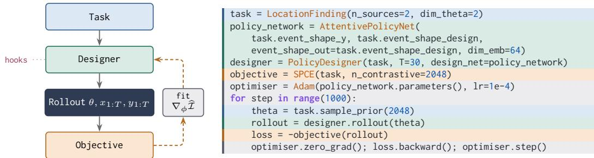
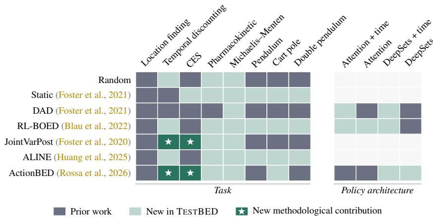
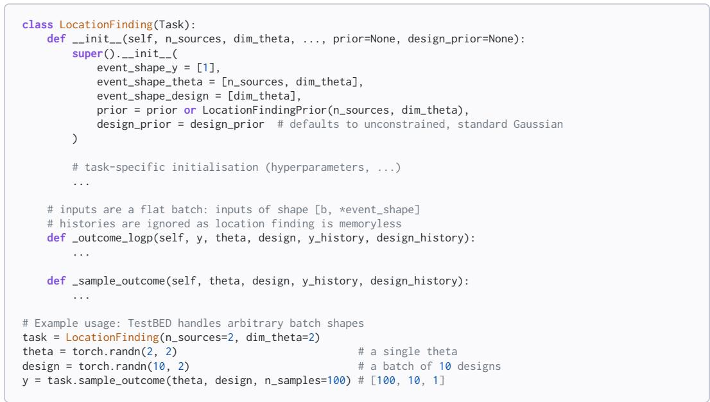
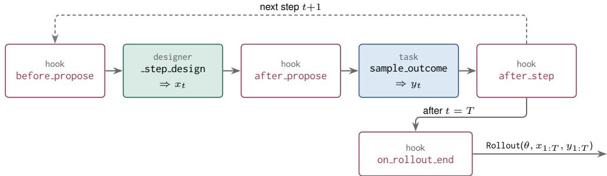
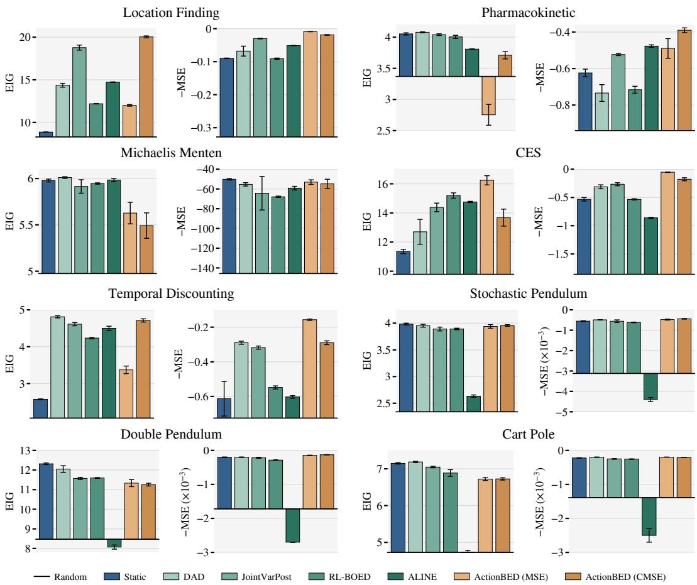
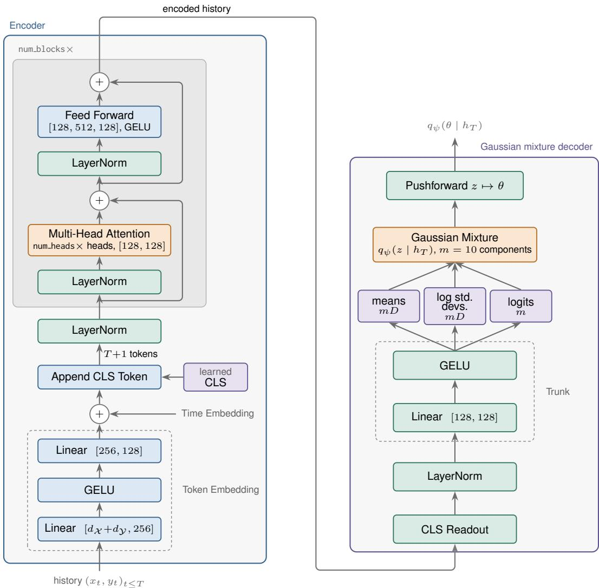
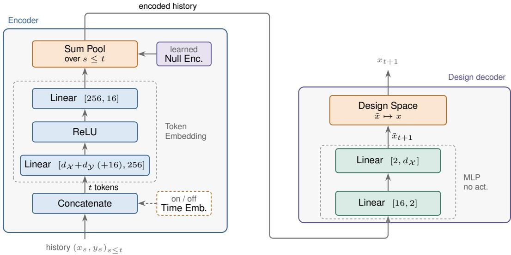
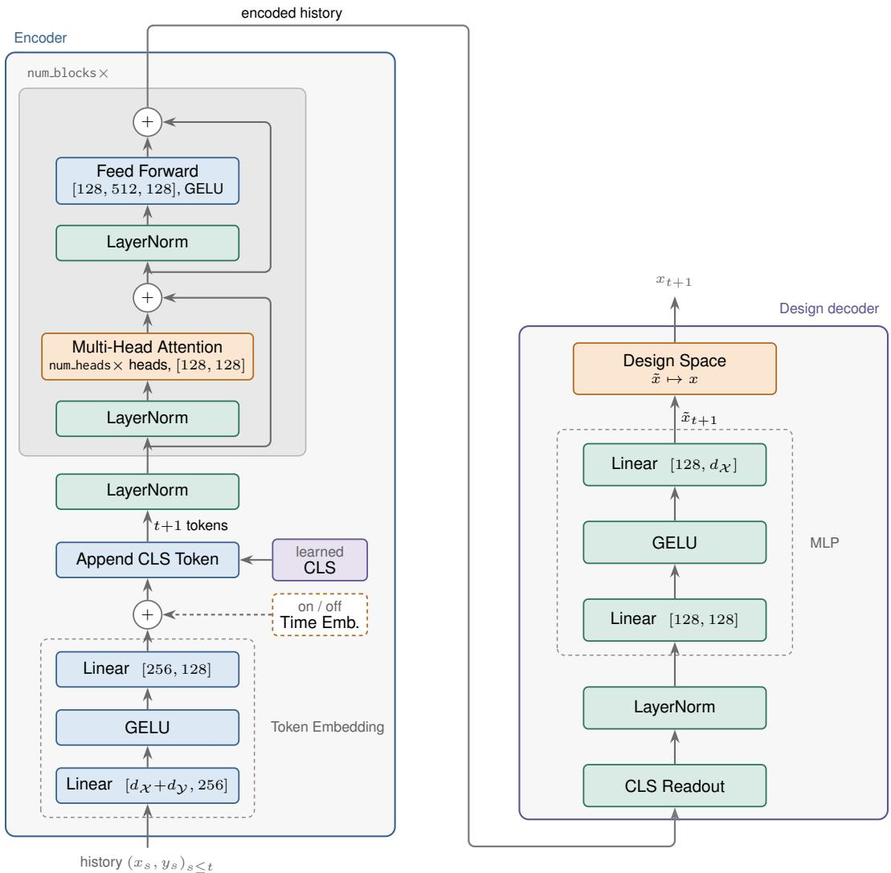

# TESTBED: AN OPEN-SOURCE TOOLKIT FOR BAYESIAN EXPERIMENTAL DESIGN

Gavin Kerrigan∗, Marcel Hedman, Sahel Iqbal, & Tom Rainforth Department of Statistics, University of Oxford

## ABSTRACT

Bayesian experimental design (BED) is a principled framework for intelligent data acquisition with applications across a wide range of scientific and industrial domains. However, the development and adoption of BED remains hindered by a lack of standardised software and benchmarks. Existing methods are typically implemented in bespoke codebases and evaluated on a small subset of tasks, making methods difficult to apply, compare, or extend. To address this, we present TESTBED, a general-purpose, open-source toolkit for Bayesian experimental design. TESTBED decomposes the BED process into modular, reusable components spanning tasks, objectives, training mechanisms, policy architectures, and evaluation procedures, together with scalable implementations of core primitives such as expected information gain estimators. We provide a wide range of these components, which can be freely composed, allowing existing methods to be reproduced within a common framework, while also enabling previously unexplored configurations and new methodologies to be easily implemented and evaluated. Using TESTBED, we further conduct a large-scale benchmark of contemporary BED methods, including controlled studies of under-appreciated but surprisingly critical methodological choices, such as the importance of time embeddings in design policy architectures. By providing a modular, extensible software foundation and a reproducible benchmarking suite, we hope that TESTBED will accelerate methodological research in BED and lower the barrier to its real-world application.

## 1 INTRODUCTION

In recent years, Bayesian experimental design (BED, Lindley, 1956; 1972; DeGroot, 1962) method ology has developed rapidly, incorporating techniques from areas like amortised optimisation (Foster et al., 2021; Ivanova et al., 2021; Rossa et al., 2026), variational inference (Foster et al., 2019; Huang et al., 2025; Bracher et al., 2026; Phillips et al., 2026), reinforcement learning (Huan & Marzouk, 2016; Blau et al., 2022; 2023; Barlas & Salako, 2025), foundation models (Choudhury et al., 2026; Huang et al., 2026), and generative models (Iollo et al., 2025; Dong et al., 2025; Saravanan et al., 2026; Phillips et al., 2026), amongst others. Beyond the research community, BED has seen uptake in a wide range of applications, including psychology (Watson, 2017; Aushev et al., 2023; Keurulainen et al., 2023), quantum physics (Varona-Uriarte et al., 2025; Belliardo et al., 2026), drug discovery (Park et al., 2013; Chakraborty et al., 2025; Wang et al., 2026), and beyond.

However, many applications of BED have not leveraged these recent methodological advancements. A domain expert applying BED must often navigate multiple research codebases or re-implement methods from scratch, with little guidance as to which methods are best suited to a particular problem. This lack of standardisation also bottlenecks progress within BED itself. Researchers developing new methods frequently re-build much of the surrounding infrastructure, incurring significant engineering costs. This burden is amplified by the range of settings that experimental design must support, like discrete outcomes (Kirby & Marakovic´, 1996; Cook et al., 2008; Vincent & Rainforth, 2017; Valentin et al., 2024) and history-dependent models (Lim et al., 2022; Iqbal et al., 2024), which can require special care for each method. Furthermore, methods are often tested on different subsets or variants of benchmark problems, and details like experimental horizons, architectures, optimisation procedures, and others vary across papers. This makes results difficult to compare, and can obscure whether an apparent improvement is a result of methodological or implementation choices.

  
Figure 1: Left: TESTBED workflow. A Task supplies the model and design space, a Designer produces a Rollout of designs and outcomes, and an Objective scores it. A fitting algorithm updates the designer’s parameters. Hooks augment the rollout loop. Right: a complete DAD-style training loop (Foster et al., 2021), with each line shaded by the component it uses (imports omitted).

To address these challenges, we introduce TESTBED, an open-source Python toolkit for BED. Built on PyTorch (Paszke et al., 2019; Ansel et al., 2024), TESTBED is organised around two key design principles. The first is modularity: we decompose the BED pipeline into a task specifying the design problem to be solved, and three components which together define a BED methodology: a designer specifying the strategy for producing designs, an objective specifying what is optimised, and algorithms which specify how the objective is optimised. See Figure 1. Compatible components can be freely composed to obtain an end-to-end BED methodology for a given task. Beyond making existing methods easier to implement and compare, this decomposition enables new combination not previously studied in the literature, several of which we study in our experiments, see Figure 2.

The second principle is extensibility: each of these components is defined by a small abstract interface, so that new tasks, objectives, designers, architectures and methods can be developed without reimplementing the necessary surrounding infrastructure. A new expected information gain (EIG) estimator (Ao & Li, 2024; Bartuska et al., 2024), for instance, can be immediately evaluated across the available task suite, while a new application can make use of all compatible methods already implemented in TESTBED. Thus, TESTBED is not merely a collection of methods but rather a foundation on which new BED methodology and applications can be easily developed and tested.

Building on these principles, TESTBED provides reference implementations of contemporary BED methods (Foster et al., 2020; 2021; Blau et al., 2022; Huang et al., 2025; Rossa et al., 2026; Phillips et al., 2026) in a common framework, together with reproducible evaluation protocols and recommended default configurations. We use TESTBED to conduct what is, to our knowledge, the largest controlled empirical comparison of BED methods to date, exploiting its modularity to isolate the effect of individual architectural and computational choices, which existing evaluations cannot do.

While no single method dominates across tasks, our study yields several insights. First, time embeddings in the design policy have a large effect: earlier approaches that lack them (Foster et al., 2021) improve substantially once they are added. Second, a well-tuned static design is surprisingly strong on several popular tasks (Iqbal et al., 2024; Phillips et al., 2026), suggesting these tasks have limited power to discriminate between strategies. Third, variational joint posteriors (Foster et al., 2020; Phillips et al., 2026), a method rarely included as a baseline, is highly competitive when paired with modern architectures and comparable compute. These results show implementation choices can matter as much as methodological ones, and underscore the need for controlled, reproducible comparisons. Overall, TESTBED provides the infrastructure needed to make Bayesian experimental design easier to use and improve. By providing a highly modular, extensible, and usable toolkit, TESTBED lowers the cost of applying BED in new domains and can accelerate the development of new methodology.

## 2 BACKGROUND

In BED, an experimenter seeks to learn about an unknown quantity $\theta \in \Theta$ through observations $y \in \mathcal { V }$ which are influenced by a controllable design $x \in \mathcal { X }$ (Lindley, 1956; 1972; DeGroot, 1962;

  
Figure 2: TESTBED evaluates every method on every task, and enables new methodological contributions. Columns show tasks (left) and design policy architectures (right). Grey: evaluated in prior work. Light green: an existing method, first evaluated in TESTBED. Green (⋆): new methods, namely REINFORCE estimators extending ActionBED and JointVarPost to discrete outcomes.

Bernardo, 1979; Chaloner & Verdinelli, 1995; Ryan et al., 2014; Rainforth et al., 2024; Huan et al., 2024). The experimenter specifies a prior $p ( \theta )$ and an observation model $p ( y \mid \theta , x , h _ { t } )$ , where $h _ { t } = \{ ( x _ { s } , y _ { s } ) \bar { : } s \leq t \}$ denotes a history of previous designs and observations.

In sequential (or adaptive) BED, T experiments are performed adaptively, using the data $h _ { t }$ from previous rounds to choose the next design $x _ { t + 1 }$ . This can be encoded as a policy $\pi : h _ { t } \mapsto x _ { t + 1 }$ Historically, BED methods followed an implicit policy, where we calculate a posterior $p ( \theta \mid h _ { t } )$ then optimise the next design $x _ { t + 1 }$ when it is needed (Lindley, 1972; Ryan et al., 2014; Foster et al., 2019). However, it has recently become the norm to learn an explicit policy before the experiment (Huan & Marzouk, 2016; Foster et al., 2021), typically using a deep neural network. This allows experiments to be run nearly instantaneously, while the learned policies often also outperform traditional approaches by learning to plan ahead and avoiding direct posterior approximation (Foster et al., 2021). Many techniques for fitting policies have been proposed, such as end-to-end training (Foster et al., 2021; Ivanova et al., 2021), reinforcement learning (Huan & Marzouk, 2016; Blau et al., 2022; 2023; Barlas & Salako, 2025), or by joint training with a downstream action policy (Rossa et al., 2026). These explicit policy-based approaches are the primary focus of our experiments, due to their dominance in the literature, but TESTBED supports a broad range of alternative design procedures as well.

Training a design policy requires an objective that assigns a value to the data it collects. The most common choice is the expected information gain (EIG) in θ over the entire trajectory (Lindley, 1956),

$$
\begin{array} { r } { \mathcal { T } ( \pi ) : = \mathbb { E } _ { p ( \theta , h _ { T } \mid \pi ) } \left[ \log p ( h _ { T } \mid \theta , \pi ) - \log p ( h _ { T } \mid \pi ) \right] , } \end{array}\tag{1}
$$

which is equivalently the mutual information between θ and the data $h _ { T }$ collected by the policy π. More generally, BED objectives may be defined as an expected utility (Huan et al., 2024)

$$
\mathcal { U } ( \pi ) : = \mathbb { E } _ { p ( \theta , h _ { T } | \pi ) } [ U ( \theta , h _ { T } ) ] ,\tag{2}
$$

where the utility U scores how useful the data $h _ { T }$ are when the true parameter is θ. The EIG is the special case $U { \bar { ( } } \theta , h _ { T } ) = \log p ( h _ { T } \mid \theta , \pi ) - \log p ( h _ { T } \mid \pi )$ . Other choices of U recover many other notions of an experiment’s value from the BED literature. Examples include the expected reward of a downstream action taken Bayes-optimally (Raiffa & Schlaifer, 1961; DeGroot, 1962; Lindley, 1972), and the negative generalised posterior entropy induced by a proper scoring rule (DeGroot, 1962; Savage, 1971; Dawid, 1998; Bickford Smith et al., 2025; Rossa et al., 2026).

Many BED objectives are, however, difficult to compute. For example, the EIG depends on the typically intractable marginal likelihood $p ( h _ { T } \mid \pi )$ . This has motivated a large literature on EIG estimators (Ryan, 2003; Barber & Agakov, 2003; Huan & Marzouk, 2013; Oord et al., 2018; Belghazi et al., 2018; Foster et al., 2019; Poole et al., 2019), which vary widely in what they require: some draw additional samples from the prior (Rainforth et al., 2018; Foster et al., 2021), while others train auxil iary networks (Barber & Agakov, 2003; Foster et al., 2019; Kleinegesse & Gutmann, 2021). While accommodating this variety of objectives can be challenging, TESTBED provides modular abstractions which enable any utility-based objective to be implemented without changing the rest of the pipeline.

  
Figure 3: A simplified implementation of the location finding task in TESTBED. Implementing a new task requires passing metadata (event shapes, prior, etc.) to the base Task, and implementing methods for sampling outcomes and evaluating log-probabilities. Everything else, including broadcasting and safety checks, is handled by the base Task, making new problems straightforward to implement.

## 3 TESTBED: AN OPEN-SOURCE TOOLKIT FOR BED

The core interface of TESTBED consists of a task specifying the underlying Bayesian model, and three components defining a BED method: a designer specifying the strategy for producing designs (e.g., static or policy-based), an objective specifying what is optimised (e.g., sPCE), and algorithms which specify how the objective is optimised. Figure 1 illustrates each of these components and their interactions. The designer, objective, and algorithm can be freely composed and applied to any compatible task, allowing a single interface to be used across different problems.

This composability also extends hierarchically within each component. Each is itself built from modular subcomponents, for which TESTBED provides reusable implementations. For example, TESTBED provides several off-the-shelf and highly performant neural architectures which can be used to instantiate policy designers. These subcomponents are also highly extensible, allowing a user to develop new tools and methods without reimplementing the surrounding infrastructure. We describe the main interface below, and refer to the TESTBED documentation for lower-level details.

## 3.1 CORE TESTBED INTERFACES

Tasks. A Task specifies the experimental design problem to be solved. This consists of a Bayesian model, including a prior $p ( \theta )$ , observation model $p ( y \mid \theta , x , h _ { t } )$ Tasks also specify a design prior p(x), which can be used to produce random designs and whose support specifies the space of admissible designs. Tasks are highly flexible: parameters, designs, and observations may be continuous or discrete, models may be explicit or implicit, and may depend on the history.

Implementing a new task minimally requires specifying a mechanism for sampling observations $y \sim p ( y \mid \theta , x , h _ { t } )$ . For explicit models, users may also provide the corresponding log-probability. Users may use PyTorch distributions or custom implementations, and TESTBED provides re-usable implementations of common priors over designs and parameters. Computational machinery, such as broadcasting, is handled by TESTBED, so that introducing a new task is straightforward. See Figure 3.

Designers and Rollouts. A designer specifies how designs are produced over a sequence of T experiments. The base Designer class implements a common rollout procedure, where at each step t, it produces a design $x _ { t } ,$ , obtains an observation $y _ { t }$ from the task, and updates a RolloutState containing the current history $h _ { t }$ of designs and observations via state.y history and state.design history, as well as any designer-specific information, $\mathrm { e . g . }$ , stochastic policy probabilities. Concrete designers thus only need to implement the step design(state) function, specifying how the next design is selected from the rollout state. After the final step, a designer returns a Rollout which discards any information that is no longer needed, but keeps aspects needed downstream, like the history.

  
Figure 4: Expanded view of the Rollout block of Figure 1. Each timestep alternates designer and task calls, with hooks interleaved. All calls receive the current rollout state. After the final step and hook, the completed rollout is returned, including any extra fields produced by the hooks, e.g., actions.

TESTBED currently provides a RandomDesigner, a StaticDesigner that provides all T designs jointly, a SequentialDesigner that optimises a design at each step, and a PolicyDesigner in which designs are produced using a neural network that maps the relevant parts of the rollout state to the next design. The latter supports any contemporary policy-based method, including DAD (Foster et al., 2021), RL-BOED (Blau et al., 2022), ALINE (Huang et al., 2025), and ActionBED (Rossa et al., 2026), amongst others. We additionally provide several off-the-shelf choices for policy architectures, including Attention (Vaswani et al., 2017) and DeepSets (Zaheer et al., 2017) based models, while allowing users to implement their own if so desired.

For methods that modify the standard rollout, TESTBED additionally exposes hooks at key stages of the design process. Figure 4 illustrates this. Hooks allow designers to incorporate additional behaviours and modifications by modifying the RolloutState without needing to re-implement the complete design loop. For example, ActionBED (Rossa et al., 2026) is implemented by attaching a hook that produces an action at the end of the rollout. Methods requiring substantial changes to the design loop can implement a new designer subclass, as we do for ALINE (Huang et al., 2025).

Design Objectives. Optimising designs requires an objective function. As described in Section 2, BED objectives can in general be described as an expected utility $\mathcal { U } ( \pi ) = \mathbb { E } _ { p ( \theta , h _ { T } | \pi ) } [ U ( \theta , h _ { T } ) ]$ ]. As these are expectations over the observed history, in TESTBED, our objectives generally accept as input a Rollout which at minimum contains the history $h _ { T }$ alongside the true θ that can be used to estimate $\mathcal { U } ( \pi )$ . For example, we provide highly efficient implementations of the standard sPCE and sNMC utilities (Foster et al., 2020), which in expectation give bounds on the EIG. See Section G.

Utility functions are often complex, and may depend on additional information beyond the history. In this case, any auxiliary quantities needed to estimate the utility can be recorded in the Rollout, or otherwise calculated within the design objective itself. Generally, computations that a user may want to control or modify (e.g., an action for loss-based utilities (Raiffa & Schlaifer, 1961; DeGroot, 1962; Lindley, 1972; Rossa et al., 2026) or a posterior approximation (Foster et al., 2019; Phillips et al., 2026)) are calculated during the design loop and appended to the Rollout, which the objective then directly uses. On the other hand, quantities a user is unlikely to want to configure (e.g,. contrastive samples when using the sPCE objective) are typically calculated within the objective itself. For methods which depend on utilities calculated before the terminal step T, an intermediate rollout may be produced using $h _ { t }$ and passed in to the Objective to calculate the intermediary utility.

For non-reparameterisable models, TESTBED also provides a general-purpose REINFORCE-style gradient estimator (Williams, 1992) that wraps these utilities. See Section B. We emphasize that the modularity of TESTBED allow a wide range of utilities, including alternative EIG estimators (Ao & Li, 2024; Bartuska et al., 2024) or new objectives (Helin et al., 2025; Kerrigan et al., 2026) to be easily incorporated within a unified framework.

Algorithms. TESTBED additionally provides several algorithms for optimising the parameters of a designer, including end-to-end optimisation (Foster et al., 2021) and RL-based training (Blau et al., 2022). We separate these from the designer, as optimisation introduces a further set of choices. Even for a static design, the design quality can depend on hyperparameter choices like initialisation, learning rates, treatment of constraints, and stopping criteria. Keeping these choices explicit avoids committing to a specific optimisation procedure, and allows users to develop alternative fitting procedures for the same underlying designer as needed. Our implementations also expose common reusable infrastructure, for checkpointing, logging and hyperparameter tuning, allowing new methods to reuse the surrounding machinery while only modifying the aspects of interest.

Recipes and Reproducibility. Finally, TESTBED provides a set of recipes, i.e., standardised configurations which combine the aforementioned components and specify choices such as policy architecture, optimiser settings, and other method-specific hyperparameters. TESTBED includes reference implementations of methods from recent and representative policy-based methods, such as DAD (Foster et al., 2021), RL-BOED (Blau et al., 2022), ALINE (Huang et al., 2025), ActionBED (Rossa et al., 2026), and variational posteriors (Foster et al., 2019; 2020; Phillips et al., 2026). The recipes used to produce the results in Section 5 are available within TESTBED and provide reproducible, default configurations for each method. Configurations can be modified or swept independently, and are compatible with external experiment management tools like Hydra (Yadan, 2019) and Weights & Biases (Biewald, 2020).

In short, the abstractions in TESTBED provide interfaces for the probabilistic model, design strategy, optimisation objective, and training procedure that specify a full BED pipeline, while providing the necessary infrastructure supporting them. This separation allows for existing approaches to be reproduced and compared within a common framework, while new tasks and methodologies can be introduced by modifying only the components in which they differ.

## 4 RELATED WORK

The closest work to a general-purpose BED library is the probabilistic programming language (PPL) Pyro (Bingham et al., 2019), whose experimental design module (Pyro Contributors, 2020) implements several EIG estimators, including those of Foster et al. (2019). However, this module is limited to estimating the EIG of fixed designs, and has seen little development since 2020. Some of the early amortised methods were built on Pyro (Foster et al., 2021; Ivanova et al., 2021), but as standalone research code rather than as part of the library. More broadly, Pyro is a general-purpose PPL rather than a BED library, and provides no abstractions for design tasks or policies.

Although many BED papers release code, general-purpose BED software remains scarce. Beyond Pyro, BED software is restricted to specific algorithms or model classes (Overstall et al., 2020; Nyberg et al., 2012), classical non-amortised design (McMichael et al., 2021), or inverse problems under Gaussian or linearised approximations (Chowdhary et al., 2024). None of these supports amortised, policy-based BED, despite its now-central role in sequential design (Rainforth et al., 2024).

## 5 BENCHMARKS AND EXPERIMENTS

We now use TESTBED to conduct several controlled studies of contemporary BED methodology. Our aim is not primarily to introduce new methods, but rather to use TESTBED to compare existing approaches under consistent conditions and to isolate methodological and implementation choices that are otherwise difficult to study across disparate codebases. We first conduct a large-scale benchmark of existing BED methods across eight diverse tasks. We then use the modularity of TESTBED to study two factors that emerge as key, namely, the architecture of the design policy and the computational trade-offs involved in EIG-based training. Section F contains additional empirical results.

## 5.1 BENCHMARKING BED ALGORITHMS

For our large-scale benchmark, we compare Joint Variational Posteriors (JointVarPost, Foster et al., 2020; Phillips et al., 2026), Deep Adaptive Design (DAD, Foster et al., 2021), RL-BOED (Blau et al., 2022), ALINE (Huang et al., 2025), and ActionBED (Rossa et al., 2026). We train ActionBED using two downstream losses (MSE and CMSE; see Section C), while the others all target EIG. Here, note that JointVarPost can in fact be seen as a special case of ActionBED, where actions are distributions on θ and the loss is targetting the EIG. We additionally study random and static (sPCE) (Foster et al., 2020) baselines. Further details of each algorithm and their implementations are given in Section D.

  
Figure 5: Benchmark (mean ± standard error across five seeds) of BED methods under a shared policy architecture and wall-clock training budget. We report EIG upper bounds $( L = 1 0 ^ { 9 } , N = \bar { 2 } , 0 4 8 )$ together with downstream MSE (negated so higher is better). The horizontal black line indicates performance of a random policy.

All methods use the same tasks, with two exceptions. First, ALINE requires a finite pool of candidate designs, and handles continuous spaces by sampling candidate designs uniformly. Second, we found RL-BOED training becomes unstable when the design space is unbounded. Therefore, in line with the reference implementations (Blau et al., 2022; Huang et al., 2025), we modify the design space for both methods as needed, choosing bounds wide enough that they do not meaningfully restrict the method. For other hyperparameters, such as learning rate, weight decay and gradient clipping, we follow the original authors’ recommendations where available.

Following recent work (Huang et al., 2025; 2026; Rossa et al., 2026; Phillips et al., 2026), we use a common Attention-based policy architecture (Vaswani et al., 2017) wherever possible. ALINE (Huang et al., 2025) is also Attention-based but requires a specialised architecture, so we closely match its parameter count instead. Some methods train additional networks alongside the design policy, so we cannot match total parameter counts exactly. However, giving every design policy the same capacity still provides a fair basis for comparison. We also normalise computational cost by training every method for 12 hours on identical hardware (an NVIDIA GH200 Superchip). This is a generous budget by the standards of the BED literature, so that no method is disadvantaged by under-training.

Results are shown in Figure 5, with full numerical results in Table 13 and Table 14 in the Appendix. We plot the sNMC upper bound (Foster et al., 2019; 2021) of the EIG (Section G) with $\hat { L } = 1 0 ^ { 9 }$ contrastive samples and N = 2,048 outer samples, and Table 13 contains matching sPCE lower bounds. This evaluation budget is far larger than is typical, giving EIG bounds substantially tighter than those previously reported and hence high-confidence estimates of the true information gained by each method. We additionally measure downstream utility for each design policy by fitting a small MLP to predict θ from the complete rollout hT using a mean-squared-error (MSE) loss. Although ActionBED fits such an MLP during training, we re-fit it at evaluation time for the sake of a fair comparison. See Section C for further details.

Table 1: Architecture ablation on the location finding task. Entries report the mean ± standard error across five seeds of the sPCE and sNMC bounds of the EIG $( L = 1 0 ^ { \dot { 9 } } , N = 2 0 4 8 )$
<table><tr><td></td><td colspan="4">Attention</td><td colspan="4">DeepSets</td></tr><tr><td></td><td colspan="2">+ time</td><td colspan="2">– time</td><td colspan="2">+ time</td><td colspan="2">– time</td></tr><tr><td>Method</td><td>Lower</td><td>Upper</td><td>Lower</td><td>Upper</td><td>Lower</td><td>Upper</td><td>Lower</td><td>Upper</td></tr><tr><td>DAD</td><td>14.334±0.223</td><td>14.359±0.228</td><td>5.654±1.061</td><td>5.654±1.061</td><td>15.423±0.265</td><td>15.587±0.307</td><td>12.051±0.028</td><td>12.052±0.028</td></tr><tr><td>RL-BOED</td><td>12.188±0.022</td><td>12.190±0.022</td><td>12.121±0.034</td><td>12.122±0.034</td><td>12.017±0.009</td><td>12.018±0.009</td><td>12.058±0.016</td><td>12.059±0.016</td></tr><tr><td>ActionBED</td><td>18.563±0.068</td><td>20.034±0.114</td><td>9.418±0.496</td><td>9.418±0.497</td><td>15.818±0.548</td><td>16.144±0.632</td><td>9.579±0.091</td><td>9.579±0.091</td></tr></table>

No single method dominates across all tasks and metrics. Notably, overlooked methods like JointVarPost (Foster et al., 2020; Phillips et al., 2026) and even the static baseline perform strongly on several tasks. Rankings by EIG and loss do not always agree, reinforcing the complementarity of both measures. More surprisingly, a method trained on a different objective can outperform methods directly trained on the evaluation metric. On pharmacokinetics, e.g., ActionBED (CMSE) has a lower downstream MSE than ActionBED (MSE). Understanding which training objectives yield good designs, and how they relate to downstream objectives, is an important direction for future work.

We see that ALINE often struggles, attaining worse performance than random on several tasks. Note that Table 11 in the Appendix shows our implementation closely matches its published results. While ALINE introduced several advances to BED, including the inspiration for the Attention-based architecture we use here, we hypothesize that ALINE’s restriction to a finite pool of candidate designs can be limiting in tasks with continuous design spaces, like the 3 dynamical systems tasks. In addition, although ALINE’s stated objective is a lower bound on the total information gain over the horizon, its policy-gradient loss (Huang et al., 2025, Eq. 11) weights each design only by its immediate one-step reward, and the trained policy is hence myopic.

## 5.2 THE EFFECTS OF ARCHITECTURE

Earlier BED methods (e.g., Foster et al., 2021; Blau et al., 2022) often used the DeepSets architecture (Zaheer et al., 2017) for the design policy. More recent methods (Huang et al., 2024; 2025; Rossa et al., 2026; Phillips et al., 2026) instead use an Attention-based architecture, first introduced by Ivanova et al. (2021). Recent methods also add a time embedding to the design policy, even for exchangeable tasks (Huang et al., 2024). Here, we investigate the degree to which recent advances in BED can be attributed to these architectural choices rather than to methodological advances.

We follow the setup from Section 5.1, varying only the design network architecture on the location finding task, as this showed clear discrimination between methods. We compare both Attentionand DeepSets-based design policies, with and without time embeddings. To our knowledge, the combination of DeepSets with time embeddings has not been previously studied in the BED literature.

Results are reported in Table 1. DAD performs better with DeepSets, whereas ActionBED favours Attention. Throughput does not explain this, since Attention reduces the number of updates by a similar factor for both methods. Rather, DAD’s training objective saturates: sPCE with $L = 2 { , } 0 0 0$ is bounded by $\log ( L + 1 ) \approx 7 . 6$ nats, which both architectures approach within the first hour, so the objective can no longer resolve differences between policies. ActionBED’s loss has no such ceiling. With DeepSets it plateaus within four hours, whereas with Attention it continues to improve throughout training. We study the related trade-off between EIG-estimation cost and optimisation throughput in Section 5.3

Adding explicit timestep information clearly improves performance for both DAD and ActionBED. Although prior work has adopted time embeddings without isolating their effect, the improvement has a principled explanation: a sequential design problem with finite horizon T is a finite-horizon Markov decision process (MDP) (Huan & Marzouk, 2016; Blau et al., 2022; Shen & Huan, 2023), whose state at step t is the belief $p ( \theta \mid h _ { t } )$ . In finite-horizon MDPs, the optimal policy is generally time-dependent, and an optimal stationary policy need not exist (Puterman, 1994, Chapter 4). Intuitively, the value of an experiment depends not only on the current belief but also on how many experiments remain. Without explicit time information, the policy must infer t from the number of observations in $h _ { t } ,$ which common modules such as pooling and layer normalisation can make difficult (Yehudai et al., 2024).

Table 2: Effect of the number of contrastive samples L used for training DAD on location finding. Entries report mean ± standard error across five training seeds. All policies are evaluated using 2,048 outer samples and $1 0 ^ { 9 }$ contrastive samples.
<table><tr><td> $L$ </td><td>Lower</td><td>Upper</td><td>Average number of gradient steps</td></tr><tr><td>256</td><td> $1 2 . 5 6 8 \pm 0 . 0 8 4$ </td><td> $1 2 . 5 7 1 \pm 0 . 0 8 5$ </td><td>28,355.8</td></tr><tr><td>512</td><td> $1 2 . 8 9 6 \pm 0 . 1 1 1$ </td><td> $1 2 . 8 9 8 \pm 0 . 1 1 1$ </td><td>28,778.2</td></tr><tr><td>1,024</td><td> $1 3 . 6 8 3 \pm 0 . 1 8 4$ </td><td> $1 3 . 6 9 1 \pm 0 . 1 8 6$ </td><td>27,448.0</td></tr><tr><td>2,048</td><td> $1 3 . 9 8 2 \pm 0 . 1 2 5$ </td><td> $1 3 . 9 9 2 \pm 0 . 1 2 7$ </td><td>24,954.6</td></tr><tr><td>4,096</td><td> $1 4 . 6 1 5 \pm 0 . 1 7 5$ </td><td> $1 4 . 6 3 7 \pm 0 . 1 7 9$ </td><td>20,571.2</td></tr><tr><td>8,192</td><td> $1 4 . 5 0 0 \pm 0 . 2 8 8$ </td><td> $1 4 . 5 2 1 \pm 0 . 2 9 1$ </td><td>15,369.8</td></tr><tr><td>16,384</td><td> $1 4 . 6 0 0 \pm 0 . 0 5 9$ </td><td> $1 4 . 6 2 3 \pm 0 . 0 6 0$ </td><td>10,216.6</td></tr></table>

The performance of RL-BOED is similar across all combinations, but significantly worse than that of DAD or ActionBED with time embeddings. RL-BOED is trained with Soft Actor-Critic (Haarnoja et al., 2018), which uses dense per-step rewards and learned critic networks. These may allow it to perform time-specific credit assignment effectively even when the policy has no explicit time input.

## 5.3 EIG AS A TRAINING OBJECTIVE

Finally, we study the computational trade-offs involved in using contrastive EIG objectives for policy learning. Methods optimising the EIG, like DAD, often rely on the sPCE estimator which is upper bounded by log(L + 1) (Foster et al., 2021). Increasing L reduces saturation and potentially gives more signal, but also makes each optimisation step more expensive. Under a fixed compute budget, this creates a direct trade-off between estimator quality and the number of gradient updates.

To study this, we train DAD on location finding for a fixed budget of 3 hours while varying L. The results in Table 2 show that increasing L substantially improves the learned policy up to a plateau. Policies trained with L between 4,096 and 16,384 are statistically indistinguishable across five seeds, even though $L = 1 6 { , } 3 8 4$ completes roughly half as many gradient steps.

The results reveal an asymmetry. Under a fixed compute budget, choosing L too small is far more damaging than choosing it too large. Training with $L = 2 5 6$ yields policies roughly 2 nats below the plateau, whereas we observed no measurable penalty for the largest L tested. The optimal value will depend on the task and compute budget, but these results suggest prioritising sufficiently accurate estimates of the EIG during training over more updates.

## 6 DISCUSSION AND CONCLUSION

We introduced TESTBED, an open-source toolkit for Bayesian experimental design that provides a common modular foundation for implementing and comparing BED methods. By separating tasks, designers, objectives, and algorithms, TESTBED makes individual components composable, so that new methods can be developed easily and isolated design choices studied in controlled experiments.

Using TESTBED, we conducted a benchmark of contemporary BED methods and ablations that expose several key considerations. First, EIG alone can give an incomplete picture of design quality: methods with similar information gain can differ substantially in downstream utility. Second, the choice of test problems matters, as performance varies widely across tasks, and simple baselines such as static designs remain highly competitive on several widely used problems. Finally, oftenoverlooked implementation details, such as policy architectures and time embeddings, can have effects that outweigh the differences between methods themselves. Architecture, estimator accuracy, and compute allocation should therefore be treated as part of the specification of a BED method rather than as incidental details. We hope that TESTBED will serve as a flexible, easy-to-use foundation for both methodological and empirical work, accelerating the development and adoption of BED methods.

## REFERENCES

Jason Ansel, Edward Yang, Horace He, Natalia Gimelshein, Animesh Jain, Michael Voznesensky, Bin Bao, Peter Bell, David Berard, Evgeni Burovski, Geeta Chauhan, Anjali Chourdia, Will Constable, Alban Desmaison, Zachary DeVito, Elias Ellison, Will Feng, Jiong Gong, Michael Gschwind, Brian Hirsh, Sherlock Huang, Kshiteej Kalambarkar, Laurent Kirsch, Michael Lazos, Mario Lezcano, Yanbo Liang, Jason Liang, Yinghai Lu, C. K. Luk, Bert Maher, Yunjie Pan, Christian Puhrsch, Matthias Reso, Mark Saroufim, Marcos Yukio Siraichi, Helen Suk, Shunting Zhang, Michael Suo, Phil Tillet, Xu Zhao, Eikan Wang, Keren Zhou, Richard Zou, Xiaodong Wang, Ajit Mathews, William Wen, Gregory Chanan, Peng Wu, and Soumith Chintala. PyTorch 2: Faster machine learning through dynamic Python bytecode transformation and graph compilation. In Proceedings of the 29th ACM International Conference on Architectural Support for Programming Languages and Operating Systems, Volume 2, ASPLOS ’24, pp. 929–947. Association for Computing Machinery, 2024.

Ziqiao Ao and Jinglai Li. On estimating the gradient of the expected information gain in Bayesian experimental design. In Proceedings ofthe AAAI Conference on Artificial Intelligence, volume 38, pp. 20311–20319, 2024.

K. J. Arrow, H. B. Chenery, B. S. Minhas, and R. M. Solow. Capital-labor substitution and economic efficiency. The Review ofEconomics and Statistics, 43:225–250, 1961.

Alexander Aushev, Aini Putkonen, Gregoire Clart´ e, Suyog Chandramouli, Luigi Acerbi, Samuel´ Kaski, and Andrew Howes. Online simulator-based experimental design for cognitive model selection. Computational Brain & Behavior, 6(4):719–737, 2023.

David Barber and Felix Agakov. Information maximization in noisy channels : A variational approach. In Advances in Neural Information Processing Systems, volume 16, 2003.

Yasir Zubayr Barlas and Kizito Salako. Performance comparisons of reinforcement learning algorithms for sequential experimental design. arXiv preprint arXiv:2503.05905, 2025.

Arved Bartuska, Andre Gustavo Carlon, Luis Espath, Sebastian Krumscheid, and Ra´ ul Tempone.´ Multilevel randomized quasi-Monte Carlo estimator for nested integration. arXiv preprint arXiv:2412.07723, 2024.

Mohamed Ishmael Belghazi, Aristide Baratin, Sai Rajeswar, Sherjil Ozair, Yoshua Bengio, Aaron Courville, and R. Devon Hjelm. Mutual information neural estimation. In International Conference on Machine Learning, 2018.

Federico Belliardo, Erik M. Gauger, Mohamed H. Abobeih, Tim H. Taminiau, Yoann Altmann, and Cristian Bonato. Multidimensional quantum estimation and model learning framework based on variational Bayesian inference. PRX Quantum, 7(2):020360, 2026.

Richard Bellman. A Markovian decision process. Journal of Mathematics and Mechanics, 6(5): 679–684, 1957.

Jose M. Bernardo. Expected information as expected utility. ´ The Annals of Statistics, pp. 686–690, 1979.

Freddie Bickford Smith, Andreas Kirsch, Sebastian Farquhar, Yarin Gal, Adam Foster, and Tom Rainforth. Prediction-oriented Bayesian active learning. In International Conference on Artificial Intelligence and Statistics, 2023.

Freddie Bickford Smith, Jannik Kossen, Eleanor Trollope, Mark van der Wilk, Adam Foster, and Tom Rainforth. Rethinking aleatoric and epistemic uncertainty. International Conference on Machine Learning, 2025.

Lukas Biewald. Experiment tracking with Weights and Biases, 2020. URL https://www.wandb. com/. Software available from wandb.com.

Eli Bingham, Jonathan P. Chen, Martin Jankowiak, Fritz Obermeyer, Neeraj Pradhan, Theofanis Karaletsos, Rohit Singh, Paul Szerlip, Paul Horsfall, and Noah D. Goodman. Pyro: Deep universal probabilistic programming. Journal ofMachine Learning Research, 20(28):1–6, 2019.

Tom Blau, Edwin V. Bonilla, Iadine Chades, and Amir Dezfouli. Optimizing sequential experimental design with deep reinforcement learning. In International Conference on Machine Learning, 2022.

Tom Blau, Iadine Chades, Amir Dezfouli, Daniel Steinberg, and Edwin V. Bonilla. Statistically efficient Bayesian sequential experiment design via reinforcement learning with cross-entropy estimators. arXiv preprint arXiv:2305.18435, 2023.

Niels Leif Bracher, Lars Kuhmichel, Desi R. Ivanova, Xavier Intes, Paul-Christian B¨ urkner, and¨ Stefan T. Radev. JADAI: Jointly amortizing adaptive design and bayesian inference. In Forty-third International Conference on Machine Learning, 2026.

Atlanta Chakraborty, Siyi Chen, Xun Huan, and Gary Luker. Bridging biology and statistics with hybrid Bayesian experimental design for drug dose-response assays. bioRxiv, pp. 2025–09, 2025.

Kathryn Chaloner and Isabella Verdinelli. Bayesian experimental design: A review. Statistical Science, pp. 273–304, 1995.

Deepro Choudhury, Sinead Williamson, Adam Golinski, Ning Miao, Freddie Bickford Smith, Michael Kirchhof, Yizhe Zhang, and Tom Rainforth. BED-LLM: Intelligent information gathering with LLMs and Bayesian experimental design. In International Conference on Learning Representations, 2026.

Abhijit Chowdhary, Shady E. Ahmed, and Ahmed Attia. PyOED: An extensible suite for data assimilation and model-constrained optimal design of experiments. ACM Transactions on Mathematical Software, 50(2):1–22, 2024.

Alex R. Cook, Gavin J. Gibson, and Christopher A. Gilligan. Optimal observation times in experimental epidemic processes. Biometrics, 64(3):860–868, 2008.

Athel Cornish-Bowden. Fundamentals ofEnzyme Kinetics. Wiley, 2013.

Thomas S. Critchfield and Scott H. Kollins. Temporal discounting: Basic research and the analysis of socially important behavior. Journal ofApplied Behavior Analysis, 34, 2001.

A. Philip Dawid. Coherent measures of discrepancy, uncertainty and dependence, with applications to Bayesian predictive experimental design. arXiv preprint arXiv:2607.26077, 1998.

Morris H. DeGroot. Uncertainty, information, and sequential experiments. The Annals ofMathemati cal Statistics, 33(2):404–419, 1962.

Holger Dette and Stefanie Biedermann. Robust and efficient designs for the Michaelis–Menten model. Journal ofthe American Statistical Association, 98(463):679–686, 2003.

Jiayuan Dong, Christian Jacobsen, Mehdi Khalloufi, Maryam Akram, Wanjiao Liu, Karthik Duraisamy, and Xun Huan. Variational Bayesian optimal experimental design with normalizing flows. Computer Methods in Applied Mechanics and Engineering, 433:117457, 2025.

Alex Forster, Desi R. Ivanova, and Tom Rainforth. Improving robustness to model misspecification in Bayesian experimental design. In 7th Symposium on Advances in Approximate Bayesian Inference – Workshop Track, 2025.

Adam Foster, Martin Jankowiak, Eli Bingham, Paul Horsfall, Yee Whye Teh, Tom Rainforth, and Noah Goodman. Variational Bayesian optimal experimental design. In Advances in Neural Information Processing Systems, 2019.

Adam Foster, Martin Jankowiak, Matthew O’Meara, Yee Whye Teh, and Tom Rainforth. A unified stochastic gradient approach to designing Bayesian-optimal experiments. In Proceedings ofthe Twenty Third International Conference on Artificial Intelligence and Statistics, volume 108, pp. 2959–2969, 2020.

Adam Foster, Desi R. Ivanova, Ilyas Malik, and Tom Rainforth. Deep adaptive design: Amortizing sequential Bayesian experimental design. In International Conference on Machine Learning, 2021.

Leonard Green and Joel Myerson. A discounting framework for choice with delayed and probabilistic rewards. Psychological Bulletin, 2004.

Tuomas Haarnoja, Aurick Zhou, Pieter Abbeel, and Sergey Levine. Soft actor-critic: Off-policy maximum entropy deep reinforcement learning with a stochastic actor. In International Conference on Machine Learning, 2018.

Marcel Hedman, Desi R. Ivanova, Cong Guan, and Tom Rainforth. Step-DAD: Semi-amortized policy-based Bayesian experimental design. In International Conference on Machine Learning, 2025.

Tapio Helin, Youssef Marzouk, and Jose Rodrigo Rojo-Garcia. Bayesian optimal experimental design with Wasserstein information criteria. arXiv preprint arXiv:2504.10092, 2025.

Dan Hendrycks and Kevin Gimpel. Gaussian error linear units (GELUs). arXiv preprint arXiv:1606.08415, 2016.

Xun Huan and Youssef M. Marzouk. Simulation-based optimal Bayesian experimental design for nonlinear systems. Journal of Computational Physics, 232(1):288–317, 2013.

Xun Huan and Youssef M. Marzouk. Sequential Bayesian optimal experimental design via approximate dynamic programming. arXiv preprint arXiv:1604.08320, 2016.

Xun Huan, Jayanth Jagalur, and Youssef Marzouk. Optimal experimental design: Formulations and computations. Acta Numerica, 33:715–840, 2024.

Daolang Huang, Yujia Guo, Luigi Acerbi, and Samuel Kaski. Amortized Bayesian experimental design for decision-making. In Advances in Neural Information Processing Systems, 2024.

Daolang Huang, Xinyi Wen, Ayush Bharti, Samuel Kaski, and Luigi Acerbi. ALINE: Joint amortization for Bayesian inference and active data acquisition. In Advances in Neural Information Processing Systems, 2025.

Daolang Huang, Zhuoyue Huang, Conor Hassan, Luigi Acerbi, Samuel Kaski, and Tom Rainforth. Efficient adaptive data acquisition via pretrained belief representations. arXiv preprint arXiv:2606.25197, 2026.

Shengyi Huang, Rousslan Fernand Julien Dossa, Chang Ye, Jeff Braga, Dipam Chakraborty, Kinal Mehta, and Joao G.M. Ara˜ ujo. CleanRL: High-quality single-file implementations of deep´ reinforcement learning algorithms. Journal of Machine Learning Research, 23(274):1–18, 2022. URL https://github.com/vwxyzjn/cleanrl.

Jacopo Iollo, Christophe Heinkele, Pierre Alliez, and Florence Forbes. PASOA- PArticle baSed´ Bayesian optimal adaptive design. In International Conference on Machine Learning, 2024.

Jacopo Iollo, Christophe Heinkele, Pierre Alliez, and Florence Forbes. Bayesian experimental design´ via contrastive diffusions. In International Conference on Learning Representations, 2025.

Sahel Iqbal, Adrien Corenflos, Simo Sarkk¨ a, and Hany Abdulsamad. Nesting particle filters for¨ experimental design in dynamical systems. In International Conference on Machine Learning, 2024.

Desi R. Ivanova, Adam Foster, Steven Kleinegesse, Michael U Gutmann, and Tom Rainforth. Implicit deep adaptive design: Policy-based experimental design without likelihoods. In Advances in Neural Information Processing Systems, 2021.

Gavin Kerrigan, Christian A. Naesseth, and Tom Rainforth. A geometric approach to optimal experimental design. In The 29th International Conference on Artificial Intelligence and Statistics, 2026.

Antti Keurulainen, Isak Westerlund, Oskar Keurulainen, and Andrew Howes. Amortised design optimization for item response theory. In International Conference on Artificial Intelligence in Education, pp. 359–364. Springer, 2023.

Diederik P¿ Kingma and Jimmy Ba. Adam: A method for stochastic optimization. arXiv preprint arXiv:1412.6980, 2014.

Kris N Kirby and Nino N Marakovic. Delay-discounting probabilistic rewards: Rates decrease as ´ amounts increase. Psychonomic bulletin & review, 3(1):100–104, 1996.

Steven Kleinegesse and Michael U. Gutmann. Bayesian experimental design for implicit models by mutual information neural estimation. In International Conference on Machine Learning, 2020.

Steven Kleinegesse and Michael U. Gutmann. Gradient-based Bayesian experimental design for implicit models using mutual information lower bounds. arXiv preprint arXiv:2105.04379, 2021.

Timothy P. Lillicrap, Jonathan J. Hunt, Alexander Pritzel, Nicolas Heess, Tom Erez, Yuval Tassa, David Silver, and Daan Wierstra. Continuous control with deep reinforcement learning. arXiv preprint arXiv:1509.02971, 2015.

Vincent Lim, Ellen Novoseller, Jeffrey Ichnowski, Huang Huang, and Ken Goldberg. Policybased Bayesian experimental design for non-differentiable implicit models. arXiv preprint arXiv:2203.04272, 2022.

Dennis Victor Lindley. On a measure of the information provided by an experiment. The Annals of Mathematical Statistics, 27(4):986–1005, 1956.

Dennis Victor Lindley. Bayesian Statistics: A Review. Society for Industrial and Applied Mathematics, 1972.

James E. Mazur. An adjusting procedure for studying delayed reinforcement. The Effect ofDelay and of Intervening Events on Reinforcement Value: Quantitative Analyses of Behavior, Volume V, pp. 55, 1987.

Robert D. McMichael, Sean M. Blakley, and Sergey Dushenko. Optbayesexpt: Sequential Bayesian experiment design for adaptive measurements. Journal ofResearch of the National Institute of Standards and Technology, 126(126002), 2021.

Leonor Michaelis, Maud L. Menten, Kenneth A. Johnson, and Roger S. Goody. The original Michaelis constant: Translation of the 1913 Michaelis-Menten paper. Biochemistry, 2011.

Tung Nguyen and Aditya Grover. Transformer neural processes: Uncertainty-aware meta learning via sequence modeling. In International Conference on Machine Learning, 2022.

Joakim Nyberg, Sebastian Ueckert, Eric A. Stromberg, Stefanie Hennig, Mats O. Karlsson, and¨ Andrew C. Hooker. PopED: An extended, parallelized, nonlinear mixed effects models optimal design tool. Computer Methods and Programs in Biomedicine, 108(2):789–805, 2012.

Aaron van den Oord, Yazhe Li, and Oriol Vinyals. Representation learning with contrastive predictive coding. arXiv preprint arXiv:1807.03748, 2018.

Antony Overstall and James McGree. Bayesian decision-theoretic design of experiments under an alternative model. Bayesian Analysis, 2022.

Antony M. Overstall, David C. Woods, and Maria Adamou. acebayes: An R package for Bayesian optimal design of experiments via approximate coordinate exchange. Journal ofStatistical Software, 95:1–33, 2020.

Mijung Park, Marcel Nassar, and Haris Vikalo. Bayesian active learning for drug combinations. IEEE Transactions on Biomedical Engineering, 60(11):3248–3255, 2013.

Adam Paszke, Sam Gross, Francisco Massa, Adam Lerer, James Bradbury, Gregory Chanan, Trevor Killeen, Zeming Lin, Natalia Gimelshein, Luca Antiga, Alban Desmaison, Andreas Kopf, Edward¨ Yang, Zach DeVito, Martin Raison, Alykhan Tejani, Sasank Chilamkurthy, Benoit Steiner, Lu Fang, Junjie Bai, and Soumith Chintala. Pytorch: An imperative style, high-performance deep learning library. In Advances in Neural Information Processing Systems, volume 32, 2019.

Angus Phillips, Gavin Kerrigan, and Tom Rainforth. Bayesian experimental design via score matching. In Forty-Second Annual Conference on Uncertainty in Artificial Intelligence, 2026.

Ben Poole, Sherjil Ozair, Aaron van den Oord, Alexander A. Alemi, and George Tucker. On¨ variational bounds of mutual information. In International Conference on Machine Learning, 2019.

Martin L. Puterman. Markov Decision Processes: Discrete Stochastic Dynamic Programming. John Wiley & Sons, 1994.

Pyro Contributors. Optimal Experiment Design (pyro.contrib.oed). https://docs.pyro.ai/ en/stable/contrib.oed.html, 2020. Pyro documentation, last updated 2020. Accessed 23 September 2026.

Howard Raiffa and Robert Schlaifer. Applied Statistical Decision Theory. Division of Research, Graduate School of Business Administration, Harvard University, Boston, 1961.

Tom Rainforth, Rob Cornish, Hongseok Yang, Andrew Warrington, and Frank Wood. On nesting Monte Carlo estimators. In International Conference on Machine Learning, 2018.

Tom Rainforth, Adam Foster, Desi R Ivanova, and Freddie Bickford Smith. Modern Bayesian experimental design. Statistical Science, 39(1):100–114, 2024.

Tom Rossa, Angus Phillips, and Tom Rainforth. Action-BED: Task-driven Bayesian experimental design with singly intractable objectives. arXiv preprint arXiv:2606.23662, 2026.

Elizabeth G. Ryan, Christopher C. Drovandi, M. Helen Thompson, and Anthony N. Pettitt. Towards Bayesian experimental design for nonlinear models that require a large number of sampling times. Computational Statistics & Data Analysis, 70:45–60, 2014.

Kenneth J. Ryan. Estimating expected information gains for experimental designs with application to the random fatigue-limit model. Journal of Computational and Graphical Statistics, 12(3): 585–603, 2003.

Adhithya Saravanan, Rik Knowles, Gavin Kerrigan, and Tom Rainforth. DiffBED: Scaling Bayesian experimental design to high-dimensions. In International Conference on Learning Representations, volume 2026, pp. 131048–131073, 2026.

Leonard J. Savage. Elicitation of personal probabilities and expectations. Journal ofthe American Statistical Association, 66(336):783–801, 1971.

Wanggang Shen and Xun Huan. Bayesian sequential optimal experimental design for nonlinear models using policy gradient reinforcement learning. Computer Methods in Applied Mechanics and Engineering, 416:116304, 2023.

Xiaohong Sheng and Yu-Hen Hu. Maximum likelihood multiple-source localization using acoustic energy measurements with wireless sensor networks. IEEE Transactions on Signal Processing, 53 (1):44–53, 2005.

Simon Valentin, Steven Kleinegesse, Neil R. Bramley, Peggy Series, Michael U. Gutmann, and \` Christopher G. Lucas. Designing optimal behavioral experiments using machine learning. eLife, 13:e86224, 2024.

B. Varona-Uriarte, F. Belliardo, T. H. Taminiau, C. Bonato, E. Garrote, and J. Casanova. Computationally tractable offline quantum experimental design for nuclear spin detection. arXiv preprint arXiv:2508.2145, 2025.

Ashish Vaswani, Noam Shazeer, Niki Parmar, Jakob Uszkoreit, Llion Jones, Aidan N Gomez, Łukasz Kaiser, and Illia Polosukhin. Attention is all you need. In Advances in Neural Information Processing Systems, 2017.

Benjamin T. Vincent. Hierarchical Bayesian estimation and hypothesis testing for delay discounting tasks. Behavior Research Methods, 2016.

Benjamin T. Vincent and Tom Rainforth. The DARC toolbox: automated, flexible, and efficient delayed and risky choice experiments using Bayesian adaptive design. PsyArXiv preprint, 5:9, 2017.

Fanjin Wang, Anthony Harker, Mohan Edirisinghe, and Maryam Parhizkar. Advanced experiment design strategies for drug development. Advanced Intelligent Discovery, 2(4):e202500087, 2026.

Andrew B. Watson. QUEST+: A general multidimensional Bayesian adaptive psychometric method. Journal ofVision, 17(3):10–10, 2017.

Ronald J. Williams. Simple statistical gradient-following algorithms for connectionist reinforcement learning. Machine Learning, 8(3):229–256, 1992.

Omry Yadan. Hydra - a framework for elegantly configuring complex applications. Github, 2019. URL https://github.com/hydra-ecosystem/hydra.

Gilad Yehudai, Haim Kaplan, Guy Dar, Royi Rassin, Asma Ghandeharioun, Mor Geva, and Amir Globerson. When can transformers count to n? arXiv preprint arXiv:2407.15160, 2024.

Manzil Zaheer, Satwik Kottur, Siamak Ravanbakhsh, Barnabas Poczos, Russ R Salakhutdinov, and Alexander Smola. Deep sets. In Advances in Neural Information Processing Systems, 2017.

Jiaxin Zhang, Sirui Bi, and Guannan Zhang. A scalable gradient free method for Bayesian experimental design with implicit models. In Proceedings of The 24th International Conference on Artificial Intelligence and Statistics, pp. 3745–3753, 2021.

## A TASKS

This section provides additional information about the Task abstraction in TESTBED. Section A.1 describes the design priors we use, which also control the space of admissible designs via the support of the prior. Section $_ { \mathrm { A } . 2 }$ provides full details regarding the tasks we implement. Each task declares a tensor shape for a single design, observation and parameter. We write $d _ { \mathcal { X } } , d _ { \mathcal { Y } }$ and $d _ { \Theta }$ for the product of the entries of these shapes, i.e., the dimension once flattened to a vector, so that $\mathcal { X } \subseteq \mathbb { R } ^ { d _ { \mathcal { X } } }$ $\dot { \mathcal { y } } \subseteq \mathbb { R } ^ { d _ { \mathcal { y } } }$ and $\Theta \subseteq \mathbb { R } ^ { d _ { \Theta } }$ . For example, location finding with $K = 2$ sources in two dimensions has parameter shape [2, 2] and hence $d _ { \Theta } = 4$

## A.1 DESIGN PRIORS

In practice, it is often useful to specify a prior $p ( x )$ over designs, and each Task in TESTBED specifies such a design prior. The design prior itself is a Distribution object, which is a small wrapper around the standard PyTorch distribution class that enables interfacing with the rest of TESTBED. The design prior provides two main functionalities. The first is to sample random designs, which can be used to create a RandomDesigner baseline. The second is that the support of the design prior encodes the space of valid designs for the problem.

We directly extend the existing PyTorch distribution implementation, which includes utilities like transforming between raw/latent designs and constrained designs along with the corresponding change-of-variables Jacobian. While many methods do not require samples $x \sim p ( x )$ , the task itself may still crucially rely on its support which defines the valid designs. For this reason, TESTBED provides a Box distribution, which is uniform over the set $[ a _ { 1 } , b _ { 1 } ] \times \dot { \cdot } \cdot \times [ a _ { d _ { \mathcal { X } } } , b _ { d _ { \mathcal { X } } } ]$ where $a _ { k } , b _ { k } \in \mathbb { R }$ are user-specified bounds, which captures many constraints used in practice. For methods that require a finite set of designs, like ALINE (Huang et al., 2024), we provide an EmpiricalDistribution class. For more complex constraint spaces, users can create custom distributions having the appropriate support, and can choose to not implement sampling if it is difficult or otherwise not required. By default, the design prior $p ( x )$ is a standard Gaussian in $\mathbb { R } ^ { d _ { \mathcal { X } } }$ , corresponding to unconstrained designs.

A policy may condition on either physical designs or the unconstrained values it emitted. When the reparametrisation is bijective these contain the same information, but the unconstrained representation often has a more convenient scale and avoids task-specific input normalisation.

## A.2 IMPLEMENTED TASKS

Here, we describe the various tasks currently implemented within TESTBED.

## A.2.1 LOCATION FINDING

In this task, the experimenter must locate K hidden sources in $\mathbb { R } ^ { d }$ from noisy measurements of the signal they emit, following the acoustic energy attenuation model of Sheng & Hu (2005) as adapted for BED by Foster et al. (2021). Each source emits a signal whose intensity decays with distance, and a measurement returns the superposition of all K contributions. The parameter of interest is the source locations $\theta = \{ \theta _ { k } \} _ { k = 1 } ^ { K }$ , where K is assumed known ahead of time, and a design is the location $x \in \mathbb { R } ^ { d }$ at which the next measurement is taken.

Each source location is drawn independently from a standard Gaussian, so that

$$
\theta _ { k } \stackrel { \mathrm { i . i . d . } } { \sim } \mathcal { N } ( 0 _ { d } , I _ { d } ) , \qquad k = 1 , \ldots , K ,\tag{3}
$$

giving $\boldsymbol { \theta } \in \mathbb { R } ^ { K \times d }$ . The total intensity at a measurement location x is

$$
\mu ( \theta , x ) = b + \sum _ { k = 1 } ^ { K } \frac { \alpha } { m + \| \theta _ { k } - x \| ^ { s } } ,\tag{4}
$$

and the outcome is the log total intensity observed with Gaussian noise,

$$
y \mid \theta , x \sim \mathcal { N } \big ( \log \mu ( \theta , x ) , \sigma ^ { 2 } \big ) .\tag{5}
$$

Here α is the amplitude of each source and s the rate at which its signal decays, with $s = 2$ recovering the inverse-square law. The two remaining constants control the dynamic range of the observation.

Setting $m > 0$ caps the contribution of a single source at $\alpha / m$ , so that the intensity does not diverge as a measurement is taken arbitrarily close to a source and the EIG remains finite, while b sets a background level that bounds how uninformative a measurement far from every source can be.

We adopt the configuration of Foster et al. (2021), namely $b = 0 . 1 , m = 1 0 ^ { - 4 } , \alpha = 1$ for every source, $\sigma = 0 . 5$ and $s = 2$ . Our benchmark instantiates $\dot { K } = 2$ sources in $d = 2$ dimensions over a horizon of $T = 3 0$ experiments, so $\theta$ is four-dimensional. The design space is unbounded: a measurement may be taken anywhere in $\mathbb { R } ^ { d }$ , and the task therefore uses the default unconstrained space of Section $\mathrm { A . 1 }$

The sources are exchangeable, both in the prior and in the likelihood, since Equation (4) depends on θ only through an unordered sum. Any labelling of the sources is therefore equally valid, which is why we report a permutation-invariant RMSE (Section C) and canonicalise the source ordering in the variational posterior (Section D.4).

## A.2.2 HYPERBOLIC TEMPORAL DISCOUNTING

Temporal discounting describes the psychological phenomenon whereby the value a person ascribes to a reward falls as the delay before receiving it grows (Critchfield & Kollins, 2001; Green & Myerson, 2004). Following the notation of Hedman et al. (2025), an individual’s time-delay preferences can be elicited through binary choices between an immediate reward and a larger delayed reward. In our setting, each experiment asks whether the participant would prefer $\$ { R_ { 0 } }$ today or a fixed \$100 in $D _ { 1 }$ days. The experimental design is therefore $x = ( D _ { 1 } , R _ { 0 } )$ , and the outcome y records the participant’s choice between the immediate and delayed rewards.

Mazur (1987) introduced a widely used parametric model of temporal discounting. Following previous policy-based implementations (Foster et al., 2021; Hedman et al., 2025), we adopt the particular formulation given by Vincent (2016), which combines a discount curve with a probabilistic response rule and thereby defines a likelihood over observed choices. The individual participant is characterised by $\theta = \left( k , \alpha \right)$ , where k is their discount rate and α controls the scale of their choice noise, with prior

$$
\log k \sim \mathcal { N } ( - 4 . 2 5 , 1 . 5 ^ { 2 } ) , \qquad \alpha \sim \mathrm { H a l f N o r m a l } ( 2 ) .\tag{6}
$$

The two options carry subjective values

$$
V _ { 0 } ( x ) = R _ { 0 } , \qquad V _ { 1 } ( \theta , x ) = \frac { 1 0 0 } { \left( 1 + ( k D _ { 1 } ) ^ { s } \right) ^ { b } } ,\tag{7}
$$

and the participant selects the delayed option with probability

$$
p ( y = 1 \mid \theta , x ) = \epsilon + ( 1 - 2 \epsilon ) \Phi \left( { \frac { V _ { 1 } ( \theta , x ) - V _ { 0 } ( x ) } { \alpha } } \right) ,\tag{8}
$$

where Φ is the standard normal distribution function. Rather than choosing deterministically whichever option has the higher value, the participant compares them with sensitivity governed by $\alpha ,$ , and the lapse rate ϵ bounds the response probability away from 0 and 1 to allow for a small chance of responding at random. We fix $\epsilon = 0 . 0 1$ and use a horizon of $T = 2 0$ questions.

The exponents s and b are both 1 by default, recovering the standard hyperbolic model. A design must satisfy $D _ { 1 } \geq 0$ and $0 \leq R _ { 0 } \leq 1 0 0$ . The design prior is constructed via the pushforward of standard Gaussian $( \tilde { x } _ { d } , \tilde { x } _ { r } ) \sim \mathcal { N } ( 0 , 1 )$ along the maps $D _ { 1 } = \exp ( \tilde { x } _ { d } - \log \bar { k } )$ and $R _ { 0 } = 1 0 0 \sigma ( \tilde { x } _ { r } )$ where the shift by the log prior mean of the discount rate keeps $k D _ { 1 }$ at an informative scale for an untrained policy.

Unlike location finding, the outcome is a binary response rather than a continuous measurement, so the likelihood admits no pathwise gradient and methods that would otherwise differentiate through the rollout fall back to a score-function estimator (Section B). TESTBED also exposes a relaxed variant in which the response is drawn from a continuous relaxation of the Bernoulli, restoring a pathwise gradient at the cost of altering the model being scored; we retain the discrete model throughout so that reported EIG values remain comparable to existing literature.

## A.2.3 CONSTANT ELASTICITY OF SUBSTITUTION

In economics, the constant elasticity of substitution (CES) model describes how a consumer trades one good off against another, with a single parameter controlling how readily goods substitute for one another (Arrow et al., 1961). Here the experimenter seeks to identify the preferences of an individual participant, who is shown two baskets of goods and reports the difference in utility they perceive between the two. The model was introduced to the BED setting by Foster et al. (2019) and has since been used as a general BED benchmark (Blau et al., 2022; Iollo et al., 2024; Hedman et al., 2025; Kerrigan et al., 2026).

A design corresponds to two baskets $x , x ^ { \prime } \in [ 0 , 1 0 0 ] ^ { 3 }$ , each specifying non-negative quantities of three goods, so $d _ { \mathcal { X } } = 6$ . The preferences of the participant are governed by $\theta = ( \rho , \alpha , u )$ , where $\rho$ is the substitution parameter, $\alpha = ( \alpha _ { 1 } , \alpha _ { 2 } , \alpha _ { 3 } )$ weights the three goods and u scales the sensitivity of their response. The prior is

$$
\rho \sim \mathrm { B e t a } ( 1 , 1 ) , \qquad \alpha \sim \mathrm { D i r i c h l e t } ( 1 , 1 , 1 ) , \qquad \log u \sim \mathcal { N } ( 1 , 3 ^ { 2 } ) ,\tag{9}
$$

so that α lies on the two-dimensional simplex and θ occupies a four-dimensional manifold within $\mathbb { R } ^ { 5 }$ A basket is valued through the CES utility

$$
U ( x ) = \left( \sum _ { i = 1 } ^ { 3 } \alpha _ { i } x _ { i } ^ { \rho } \right) ^ { 1 / \rho } .\tag{10}
$$

The participant compares the two baskets on a latent scale, which is Gaussian with a mean given by the difference in utility and a spread that grows with how far apart the baskets are,

$$
\eta \mid \theta , x , x ^ { \prime } \sim \mathcal { N } \Big ( u \left( U ( x ) - U ( x ^ { \prime } ) \right) , \ : \ : \left( u \tau \left( 1 + \Vert x - x ^ { \prime } \Vert \right) \right) ^ { 2 } \Big ) ,\tag{11}
$$

and reports it on a sliding scale from 0 to 1 following a sigmoid transformation,

$$
y = \mathrm { c l i p } ( \sigma ( \eta ) , \epsilon , 1 - \epsilon ) .\tag{12}
$$

We use $\tau = 0 . 0 0 5$ and $\epsilon = 2 ^ { - 2 2 }$ over a horizon of T = 10 experiments, and the design prior is uniform over $[ 0 , 1 0 0 ] ^ { 6 }$

The censoring in Equation (12) is a unqiue characteristic of this task. Whenever one basket is clearly preferred, $\sigma ( \eta )$ is driven to within ϵ of 0 or 1 and the response is clipped, so the observation distribution places atoms at both endpoints and a large part of the design space yields a saturated, uninformative answer. A policy must therefore learn to propose genuinely finely balanced pairs of baskets. This also has a consequence for optimisation: although η is Gaussian and the outcome is formally reparametrisable, the log-likelihood switches branch at the censoring boundaries, and a pathwise gradient discards the term describing how the probability of censoring responds to the design. That term carries the signal telling a policy to leave the saturated region, so on this task we instead estimate the gradient with REINFORCE for DAD and JointVarPost (Section B).

The support of θ also has consequences for methods that fit a posterior approximation. Because α is confined to the simplex and ρ to an interval, θ does not fill R5, and a variational family placed directly on those coordinates would be a density with respect to the wrong measure. We instead push a distribution over unconstrained coordinates onto the support of the prior, as described in Section D.4.

## A.2.4 PHARMACOKINETIC

This task models a pharmacokinetic study, in which a drug is administered and blood subsequently drawn at chosen times to characterise how that drug is absorbed, distributed and eliminated. We use the one-compartment model with first-order absorption of Ryan et al. (2014), which has become a standard BED benchmark (Kleinegesse & Gutmann, 2020; Zhang et al., 2021), and follow the configuration of Ivanova et al. (2021).

The parameter of interest is $\theta = ( k _ { a } , k _ { e } , V )$ , comprising the absorption rate, the elimination rate and the volume of distribution, with a log-normal prior

$$
\log \theta \sim \mathcal { N } ( \log \left[ 1 , 0 . 1 , 2 0 \right] , 0 . 0 5 I _ { 3 } ) .\tag{13}
$$

A design is the time x at which blood is sampled. Following a single dose $D _ { v }$ given at the start of the experiment, the drug concentration at time x is

$$
\mu ( \theta , x ) = \frac { D _ { v } } { V } \cdot \frac { k _ { a } } { k _ { a } - k _ { e } } \left( e ^ { - k _ { e } x } - e ^ { - k _ { a } x } \right) ,\tag{14}
$$

which rises while absorption dominates and then decays as elimination takes over. Measurements carry both multiplicative and additive error, so that

$$
y \mid \theta , x \sim \mathcal { N } \Big ( \mu ( \theta , x ) , \ ( \sigma _ { \mathrm { m u l t } } \mu ( \theta , x ) ) ^ { 2 } + \sigma _ { \mathrm { a d d } } ^ { 2 } \Big ) .\tag{15}
$$

The multiplicative term grows in proportion to the quantity being measured, so the noise is heteroscedastic: readings taken near the peak of the concentration curve are inherently less precise than those taken in the tails.

We set $D _ { v } = 4 0 0 , \sigma _ { \mathrm { m u l t } } ^ { 2 } = 0 . 0 1$ and $\sigma _ { \mathrm { a d d } } ^ { 2 } = 0 . 1$ . Blood may be sampled at any point in the first day, corresponding to a uniform design prior over [0, 24] hours (Section A.1), and our benchmark uses a horizon of $T = 1 0$ measurements. As in the references above, each measurement is taken from a different patient, all of whom are assumed to share the same θ, so a single blood sample is drawn per patient.

The outcome is a differentiable function of θ and x perturbed by Gaussian noise, so the likelihood is reparametrisable and methods may take pathwise gradients of the EIG. We note that Equation (14) is singular when $k _ { a } = k _ { e } ,$ and the model is conventionally stated with the constraint $\boldsymbol { k } _ { a } ^ { \bar { \mathbf { \alpha } } } > k _ { e }$ . The prior does not impose this constraint, but it separates the two rates by an order of magnitude relative to a log-scale standard deviation of $\sqrt { 0 . 0 5 }$ , so draws that approach the singularity are rare.

## A.2.5 MICHAELIS-MENTEN

This task models an enzyme kinetics experiment, in which the experimenter measures the velocity of a chemical reaction at a chosen substrate concentration in order to characterise the enzyme. The classical description of this relationship is the Michaelis-Menten model (Michaelis et al., 2011), under which the reaction velocity rises with substrate concentration before levelling off as the enzyme saturates. It has a substantial history as an optimal design problem (Dette & Biedermann, 2003; Overstall & McGree, 2022), and we follow the BED setup of Forster et al. (2025).

The parameter of interest is $\theta = ( V _ { \mathrm { m a x } } , V _ { \mathrm { h a l f } } )$ , where $V _ { \mathrm { m a x } }$ is the velocity the reaction approaches once the enzyme is saturated and $V _ { \mathrm { h a l f } }$ is the substrate concentration at which half that velocity is attained. Both are given independent uniform priors,

$$
V _ { \mathrm { m a x } } , V _ { \mathrm { h a l f } } \stackrel { \mathrm { i . i . d . } } { \sim } \mathrm { U n i f } ( 2 0 , 2 0 0 ) .\tag{16}
$$

A design is the substrate concentration x at which the next measurement is made, giving a mean reaction velocity

$$
\mu ( \theta , x ) = \frac { V _ { \mathrm { m a x } } x ^ { s } } { V _ { \mathrm { h a l f } } ^ { s } + x ^ { s } } ,\tag{17}
$$

observed with additive Gaussian noise,

$$
y \mid \theta , x \sim \mathcal { N } \big ( \mu ( \theta , x ) , \sigma ^ { 2 } \big ) .\tag{18}
$$

We use $\sigma = 2 . 5$ and a horizon of $T = 2 0$ measurements. Concentrations are non-negative and the design prior is uniform over [0, 400] (Section A.1), whose upper bound is twice the largest $V _ { \mathrm { h a l f } }$ the prior admits and so comfortably covers the saturating regime.

The exponent s defaults to 1. Other values give the Hill model (Cornish-Bowden, 2013), in which binding at one site alters the affinity of the remaining sites. Forster et al. (2025) used this as a controlled setting for studying misspecification, since s can be varied in the data-generating process while the assumed model is held at $s = 1$ , tuning the severity of the mismatch continuously from none upwards.

The saturating response is the central tension of the task. Measurements at high concentration pin down $V _ { \mathrm { m a x } }$ but say little about $V _ { \mathrm { h a l f } }$ , whereas the concentrations that identify $V _ { \mathrm { h a l f } }$ lie on the rising part of the curve, whose position is itself unknown a priori. A policy must therefore locate the bend in the curve before it can resolve both parameters. The noise is homoscedastic, so unlike the pharmacokinetic task there is no additional penalty for measuring where the response is large, and the outcome is a differentiable function of θ and x perturbed by Gaussian noise, so the likelihood is reparametrisable and pathwise gradients of the EIG are available.

## A.2.6 STOCHASTIC PENDULUM

This task asks the experimenter to identify the physical properties of a pendulum by applying torques and observing how it moves. It is one of three dynamical systems in our TESTBED suite, and a task whose likelihood is not memoryless: the system carries state between steps, so the outcome depends on the previous state as well as the current design, meaning the history is not exchangeable. We take the nonlinear formulation of Iqbal et al. (2024), with the diffusion matched to Phillips et al. (2026).

The pendulum is modelled as a uniform rod of unknown mass m and length l, so the parameter of interest is $\theta = \left( m , l \right)$ with a log-normal prior

$$
\begin{array} { r } { \log \theta \sim \mathcal { N } ( 0 , 0 . 0 1 I _ { 2 } ) . } \end{array}\tag{19}
$$

The state $y = \left( q , \dot { q } \right)$ collects the angle and the angular velocity, and the experiment begins from rest at $y _ { 0 } = ( 0 , 0 )$ . A design is the torque x applied over the next interval. Writing g for gravitational acceleration and d for a damping coefficient, the angular acceleration is

$$
\ddot { q } = 3 \left( - \frac { g } { 2 l } \sin q + \frac { x - d \dot { q } } { m l ^ { 2 } } \right) ,\tag{20}
$$

in which the factor of three and the factor of one-half in the gravitational term arise from modelling the pendulum as a uniform rod pivoted at one end, whose centre of mass lies at $l / 2$ and whose moment of inertia is $m l ^ { 2 } / 3 ;$ ; the term $x - d \dot { q }$ represents the applied and damping torques, respectively. The dynamics are integrated by an Euler-Maruyama step, so that

$$
y _ { t } \mid \theta , x _ { t } , y _ { t - 1 } \sim \mathcal { N } \big ( y _ { t - 1 } + \Delta t \cdot f ( y _ { t - 1 } , \theta , x _ { t } ) , \Delta t \Sigma ^ { 2 } \big ) ,\tag{21}
$$

where $f ( y , \theta , x ) = ( \dot { q } , \ddot { q } )$ is the time derivative of the state, with q¨ given by Equation (20) and Σ is the diffusion scale.

We use $\Delta t = 0 . 0 5 , d = 0 . 1 , g = 9 . 8 1$ and $\Sigma = 0 . 1 I _ { 2 } .$ , over a horizon of $T = 5 0$ steps. The torque is bounded to $[ - 1 , 1 ]$ , and we use a uniform design prior over this set (Section A.1).

The loss of exchangeability changes what a policy must do. A design is informative in the context of the state it acts upon, so the policy has to reason about the effects of its earlier torques. At the initial equilibrium the model is degenerate: sin $q = 0$ removes the gravitational term from Equation (20), leaving a response that depends on θ only through the product $m l ^ { 2 }$ , so no torque applied at rest can separate mass from length. Breaking that degeneracy requires displacing the pendulum, since the gravitational term is the only one that depends on l alone, and with the torque bounded to $[ - 1 , 1 ]$ against gravity this takes several steps of deliberate excitation. This makes the task a control and an estimation problem. The Euler-Maruyama step is a differentiable drift plus additive Gaussian noise, so the outcome is reparametrisable and pathwise gradients of the EIG are available.

## A.2.7 CART POLE

This task places a pole on a cart that may be pushed along a track, and asks the experimenter to identify the masses of the pole and cart alongside the pole length by choosing a force to be applied at each step. As with the stochastic pendulum it is a non-memoryless dynamical system taken from Iqbal et al. (2024), with the diffusion matched to Phillips et al. (2026), but the state is four-dimensional and, as we show below, the pole mass is not identifiable until the pole has been displaced from vertical.

The parameter of interest is $\theta = ( m _ { p } , m _ { c } , l )$ , the pole mass, the cart mass and the pole length, with prior

$$
\log \theta \sim \mathcal { N } ( 0 , 0 . 0 1 I _ { 3 } ) .\tag{22}
$$

The state $y = ( s , q , \dot { s } , \dot { q } )$ collects the cart position, the pole angle and their velocities, and the system starts at rest with $y _ { 0 } = 0 , \mathrm { ~ A ~ }$ design is the force x applied to the cart. Writing $\Delta : = m _ { c } + m _ { p } \sin ^ { 2 } q ,$ the accelerations are

$$
\ddot { s } = \frac { 1 } { \Delta } \left( x + m _ { p } \sin { q } \left( l \dot { q } ^ { 2 } + g \cos { q } \right) - \left( k _ { 1 } s + d _ { 1 } \dot { s } \right) - \frac { \left( k _ { 2 } q + d _ { 2 } \dot { q } \right) \cos { q } } { l } \right) ,\tag{23}
$$

$$
\ddot { q } = - \frac { 1 } { l \Delta } ( x \cos q + m _ { p } l \dot { q } ^ { 2 } \cos q \sin q + ( m _ { c } + m _ { p } ) g \sin q\tag{24}
$$

$$
+ \left( k _ { 1 } s + d _ { 1 } \dot { s } \right) \cos q + \frac { \left( k _ { 2 } q + d _ { 2 } \dot { q } \right) \cos ^ { 2 } q } { l } \biggr )
$$

where $k _ { 1 }$ , k are stiffness coefficients and $d _ { 1 } , d _ { 2 }$ damping coefficients acting on the cart and the pole respectively. The dynamics are integrated by an Euler-Maruyama step,

$$
y _ { t } \mid \theta , x _ { t } , y _ { t - 1 } \sim \mathcal { N } \big ( y _ { t - 1 } + \Delta t \cdot f ( y _ { t - 1 } , \theta , x _ { t } ) , \Delta t \Sigma ^ { 2 } \big ) ,\tag{25}
$$

with $f = ( { \dot { s } } , { \dot { q } } , { \ddot { s } } , { \ddot { q } } )$ the time derivative of the state.

We use $\Delta t = 0 . 0 5 , g = 9 . 8 1 , k _ { 1 } = k _ { 2 } = d _ { 1 } = d _ { 2 } = 0 . 0 1$ and $\Sigma = 0 . 1 I _ { 4 }$ , over a horizon of $T = 5 0$ steps. The force is bounded to $[ - 5 , 5 ]$ , and we use a uniform design prior over this set (Section $\mathrm { A . 1 } )$ The stiffness and damping terms are small and act as weak restoring forces towards $s = 0$ and $q = 0$

The identifiability structure is what makes this task harder than the pendulum. Every occurrence of $m _ { p }$ in Equation (23) and Equation (24), including the one inside $\Delta ,$ , is multiplied by sin $q \ \mathrm { o r } \sin ^ { 2 } q ,$ so at the initial state the equations collapse to $\ddot { s } = x / m _ { c }$ and $\ddot { q } = - x / ( l m _ { c } )$ . A force applied at rest therefore reveals the cart mass and the pole length, but carries no information about the pole mass: $m _ { p }$ becomes visible only once the pole is away from vertical. A policy must consequently excite the pole, and it can do so only indirectly, by accelerating the cart beneath it. The outcome remains a differentiable drift perturbed by additive Gaussian noise, so pathwise gradients of the EIG are available. At $T = 5 0$ with a four-dimensional state this is also one of the more expensive tasks in the suite, and is where the contrastive estimators used by DAD required a reduced batch size (Section D.3).

## A.2.8 DOUBLE PENDULUM

This task consists of two links joined end to end, each of unknown mass and length, driven by a torque at each joint. It is the third and largest of the dynamical system tasks, and it carries the most parameters, the widest design space and the richest dynamics of the three (Iqbal et al., 2024; Phillips et al., 2026).

The parameter of interest is $\theta = ( m _ { 1 } , m _ { 2 } , l _ { 1 } , l _ { 2 } )$ , the masses and lengths of the two links, with prior

$$
\log \theta \sim \mathcal { N } ( 0 , 0 . 0 1 I _ { 4 } )\tag{26}
$$

The state $y = \left( q _ { 1 } , q _ { 2 } , \dot { q } _ { 1 } , \dot { q } _ { 2 } \right)$ collects the two joint angles and their velocities, starting from rest at $y _ { 0 } = 0$ , and a design $\boldsymbol { x } \in \mathbb { R } ^ { 2 }$ applies a torque at each joint. The dynamics take the manipulator form

$$
M ( \theta , q ) \ddot { q } + C ( \theta , q , \dot { q } ) \dot { q } = x + \tau ( \theta , q ) ,\tag{27}
$$

in which the mass matrix, the Coriolis and centrifugal matrix, and the gravitational torque are

$$
{ \cal M } = \left( \begin{array} { c c c } { { ( m _ { 1 } + m _ { 2 } ) l _ { 1 } ^ { 2 } + m _ { 2 } l _ { 2 } ^ { 2 } + 2 m _ { 2 } l _ { 1 } l _ { 2 } \cos q _ { 2 } } } & { { m _ { 2 } l _ { 2 } ^ { 2 } + m _ { 2 } l _ { 1 } l _ { 2 } \cos q _ { 2 } } } \\ { { m _ { 2 } l _ { 2 } ^ { 2 } + m _ { 2 } l _ { 1 } l _ { 2 } \cos q _ { 2 } } } & { { m _ { 2 } l _ { 2 } ^ { 2 } } } \end{array} \right) ,\tag{28}
$$

$$
C = \left( { \begin{array} { c c } { 0 } & { a \left( 2 { \dot { q } } _ { 1 } + { \dot { q } } _ { 2 } \right) } \\ { - { \frac { 1 } { 2 } } a \left( 2 { \dot { q } } _ { 1 } + { \dot { q } } _ { 2 } \right) } & { { \frac { 1 } { 2 } } a { \dot { q } } _ { 1 } } \end{array} } \right) , \qquad a : = - m _ { 2 } l _ { 1 } l _ { 2 } \sin { q _ { 2 } } ,\tag{29}
$$

$$
\tau = - g \left( \begin{array} { c } { { ( m _ { 1 } + m _ { 2 } ) l _ { 1 } \sin q _ { 1 } + m _ { 2 } l _ { 2 } \sin ( q _ { 1 } + q _ { 2 } ) } } \\ { { m _ { 2 } l _ { 2 } \sin ( q _ { 1 } + q _ { 2 } ) } } \end{array} \right) .\tag{30}
$$

Solving Equation (27) for q¨ gives the drift, which is integrated by the same Euler-Maruyama step as the other dynamical tasks,

$$
y _ { t } \mid \theta , x _ { t } , y _ { t - 1 } \sim \mathcal { N } \big ( y _ { t - 1 } + \Delta t \cdot f ( y _ { t - 1 } , \theta , x _ { t } ) , \Delta t \Sigma ^ { 2 } \big ) .\tag{31}
$$

We use $\Delta t = 0 . 0 5 , g = 9 . 8 1$ and $\Sigma = 0 . 1 I _ { 4 }$ , over a horizon of $T = 5 0$ steps. The two torques are bounded differently, to $[ - 4 , 4 ]$ at the first joint and $[ - 2 , 2 ]$ at the second, giving a box design space whose coordinates are on distinct scales; this is the task for which conditioning a policy on unconstrained rather than physical designs is most clearly useful (Section A.1). We use a uniform design prior over this space.

As with the other two dynamical systems, the initial state is degenerate, and here the degeneracy is exact. $\mathrm { { A t } \ { y _ { 0 } } \ = \ 0 }$ both the Coriolis matrix and the gravitational torque vanish, leaving ${ \ddot { q } } =$ $M ( \theta , 0 ) ^ { - 1 } x$ . Since M is symmetric it contributes only three independent entries, which cannot determine four parameters; concretely, the map $( m _ { 1 } , m _ { 2 } , l _ { 1 } , l _ { 2 } ) \mapsto ( \bar { m } _ { 1 } / c ^ { 2 } , m _ { 2 } / c ^ { 2 } , c l _ { 1 } , c l _ { 2 } )$ leaves $M ( \theta , 0 )$ unchanged for any $c > 0 ,$ , so an entire scaling family of parameters is indistinguishable from rest. It is the gravitational term of Equation (30) that breaks this family, and it is visible only once the links swing away from the vertical. The outcome is again a differentiable drift with additive Gaussian noise, so pathwise gradients are available.

## B POLICY GRADIENTS AND REINFORCE

This section provides additional details regarding our REINFORCE-style objectives, which enable us to train BED policies even in the presence of non-reparametrisable likelihoods. Much of this section is not new and detailed only for the sake of completeness. However, Section B.2 derives the necessary details for training JointVarPost (Foster et al., 2020; Phillips et al., 2026) on nonreparametrisable likelihoods, and Section B.3 does the same for ActionBED (Rossa et al., 2026) on non-reparametrisable likelihoods, both of which are novel methodological approach not previously studied in the literature.

## B.1 SPCE AND REINFORCE

One of the key design objectives against which policies are optimised is the sPCE lower bound on EIG (Foster et al., 2021). Here we derive its REINFORCE-style gradient estimator for deterministic and stochastic policies, as used when the likelihood cannot be reparametrised.

Let $\phi$ denote the policy parameters and $\pi _ { \mathcal { X } } ^ { \phi }$ the design policy. We draw $\theta _ { 0 } \sim p ( \theta )$ and contrastive samples $ { \theta _ { 1 : L } } \stackrel { \mathrm { i . i . d . } } { \sim } p ( \theta )$ , and generate a history $h _ { T } = ( x _ { 1 : T } , y _ { 1 : T } )$ . The sPCE bound of Equation (59) can then be rewritten as

$$
\mathcal { L } _ { T } ( \phi ) = \mathbb { E } _ { p ( \theta _ { 0 : L } ) p ( h _ { T } | \theta _ { 0 } , \pi _ { \chi } ^ { \phi } ) } \left[ R _ { \phi } ( h _ { T } ) \right] + \log ( L + 1 ) ,\tag{32}
$$

$$
R _ { \phi } ( h _ { T } ) : = \log \frac { p ( h _ { T } \mid \theta _ { 0 } , \pi _ { \mathcal { X } } ^ { \phi } ) } { \sum _ { \ell = 0 } ^ { L } p ( h _ { T } \mid \theta _ { \ell } , \pi _ { \mathcal { X } } ^ { \phi } ) } .\tag{33}
$$

The gradient estimator then takes slightly different forms based on whether the design policy is stochastic or deterministic.

## B.1.1 DETERMINISTIC DESIGN POLICIES

This is a reiteration of the derivation within Foster et al. (2021). For a deterministic policy, $x _ { t } =$ $\pi _ { \mathcal { X } } ^ { \phi } ( h _ { t - 1 } )$ , so the only randomness in the rollout is in the observations. Its density is therefore

$$
p ( h _ { T } \mid \theta , \pi _ { \mathcal { X } } ^ { \phi } ) = \prod _ { t = 1 } ^ { T } p ( y _ { t } \mid \theta , x _ { t } , h _ { t - 1 } ) , \qquad x _ { t } = \pi _ { \mathcal { X } } ^ { \phi } ( h _ { t - 1 } ) ,\tag{34}
$$

where dependence on $\phi$ enters through the designs $x _ { t }$ . Hence while the likelihood may not be reparametrisable in $y _ { t }$ , its log-density will be differentiable with respect to the designs.

Writing $p _ { 0 } ( h _ { T } ) = p ( h _ { T } \mid \theta _ { 0 } , \pi _ { \mathcal { X } } ^ { \phi } )$ and differentiating Equation (32) directly,

$$
\frac { \mathrm { d } \mathcal { L } _ { T } } { \mathrm { d } \phi } = \mathbb { E } _ { p ( \theta _ { 0 : L } ) } \left[ \int \frac { \mathrm { d } } { \mathrm { d } \phi } \left\{ p _ { 0 } ( h _ { T } ) R _ { \phi } ( h _ { T } ) \right\} \mathrm { d } h _ { T } \right]\tag{35}
$$

$$
= \mathbb { E } _ { p ( \theta _ { 0 : L } ) p _ { 0 } ( h _ { T } ) } \left[ R _ { \phi } ( h _ { T } ) \frac { \mathrm { d } } { \mathrm { d } \phi } \log p _ { 0 } ( h _ { T } ) + \frac { \mathrm { d } } { \mathrm { d } \phi } R _ { \phi } ( h _ { T } ) \right] ,\tag{36}
$$

where we used the score-function identity $\begin{array} { r } { \frac { \mathrm { d } } { \mathrm { d } \phi } p _ { 0 } = p _ { 0 } \frac { \mathrm { d } } { \mathrm { d } \phi } } \end{array}$ log p0. Expanding the second term gives

$$
\frac { \mathrm { d } \mathcal { L } _ { T } } { \mathrm { d } \phi } = \mathbb { E } \left[ R _ { \phi } ( h _ { T } ) \frac { \mathrm { d } } { \mathrm { d } \phi } \log p _ { 0 } ( h _ { T } ) + \frac { \mathrm { d } } { \mathrm { d } \phi } \log p _ { 0 } ( h _ { T } ) - \frac { \mathrm { d } } { \mathrm { d } \phi } \log \sum _ { \ell = 0 } ^ { L } p ( h _ { T } \mid \theta _ { \ell } , \pi _ { x } ^ { \phi } ) \right] .\tag{37}
$$

The middle term vanishes because

$$
\mathbb { E } _ { p _ { 0 } } \bigg [ \frac { \mathrm { d } } { \mathrm { d } \phi } \log p _ { 0 } ( h _ { T } ) \bigg ] = \int \frac { \mathrm { d } } { \mathrm { d } \phi } p _ { 0 } ( h _ { T } ) \mathrm { d } h _ { T } = \frac { \mathrm { d } } { \mathrm { d } \phi } 1 = 0 .
$$

Thus

$$
\frac { \mathrm { d } \mathcal { L } _ { T } } { \mathrm { d } \phi } = \mathbb { E } _ { p ( \theta _ { 0 : L } ) p ( h _ { T } | \theta _ { 0 } , \pi _ { \mathcal { X } } ^ { \phi } ) } \left[ R _ { \phi } ( h _ { T } ) \frac { \mathrm { d } } { \mathrm { d } \phi } \log p ( h _ { T } \mid \theta _ { 0 } , \pi _ { \mathcal { X } } ^ { \phi } ) - \frac { \mathrm { d } } { \mathrm { d } \phi } \log \sum _ { \ell = 0 } ^ { L } p ( h _ { T } \mid \theta _ { \ell } , \pi _ { \mathcal { X } } ^ { \phi } ) \right]\tag{38}
$$

The first term is the score-function contribution from the sampled outcomes, while the second differentiates the contrastive objective directly through the deterministic designs. This is the estimator of Foster et al. (2021). We note that the resulting gradient resembles the deterministic policy gradient used in DDPG (Lillicrap et al., 2015). The important distinction is that, rather than differentiating through a learned critic $Q ( s , a )$ , we differentiate the sPCE objective directly. Since the distribution over observations entering this objective depends on the design, its derivative contains a score-function term.

## B.1.2 STOCHASTIC POLICIES

For a stochastic, non-reparametrised policy, $x _ { t } \sim \pi _ { \mathcal { X } } ^ { \phi } ( \cdot \mid h _ { t - 1 } )$ , and the rollout density is

$$
p ( h _ { T } \mid \theta , \pi _ { \mathcal { X } } ^ { \phi } ) = \prod _ { t = 1 } ^ { T } \pi _ { \mathcal { X } } ^ { \phi } ( x _ { t } \mid h _ { t - 1 } ) p ( y _ { t } \mid \theta , x _ { t } , h _ { t - 1 } ) .\tag{39}
$$

Substituting this into the sPCE likelihood ratio, the policy factors cancel because they are identical for every $\theta _ { \ell } \colon$

$$
R ( h _ { T } ) = \log \frac { \prod _ { t = 1 } ^ { T } p ( y _ { t } \mid \theta _ { 0 } , x _ { t } , h _ { t - 1 } ) } { \sum _ { \ell = 0 } ^ { L } \prod _ { t = 1 } ^ { T } p ( y _ { t } \mid \theta _ { \ell } , x _ { t } , h _ { t - 1 } ) } .
$$

This cancellation removes the explicit policy density from the reward, but it is not what prevents direct differentiation through R. The key distinction from the deterministic case is that the designs are now sampled from a non-reparametrised distribution. Once a rollout has been realised, the sampled $x _ { 1 : T }$ are treated as fixed when differentiating with respect to $\phi ,$ so there is no pathwise derivative from ϕ through the realised designs to the likelihood terms in $R ( h _ { T } )$ . Therefore

$$
\frac { \mathrm { d } } { \mathrm { d } \phi } R ( h _ { T } ) = 0
$$

for the realised trajectory, and the dependence of the objective on $\phi$ is instead captured through how $\phi$ changes the distribution over sampled designs.

Using Equation (36), the remaining derivative is the score of the stochastic rollout distribution. Holding the realised history fixed,

$$
\frac { \mathrm { d } } { \mathrm { d } \phi } \log p ( h _ { T } \mid \theta _ { 0 } , \pi _ { \mathcal { X } } ^ { \phi } ) = \sum _ { t = 1 } ^ { T } \frac { \mathrm { d } } { \mathrm { d } \phi } \log \pi _ { \mathcal { X } } ^ { \phi } ( x _ { t } \mid h _ { t - 1 } ) ,
$$

since the observation likelihood contains no explicit ϕ-dependence when the sampled designs are held fixed. Hence

$$
\frac { \mathrm { d } \mathcal { L } _ { T } } { \mathrm { d } \phi } = \mathbb { E } _ { p ( \theta _ { 0 : L } ) p ( h _ { T } | \theta _ { 0 } , \pi _ { \chi } ^ { \phi } ) } \left[ R ( h _ { T } ) \sum _ { t = 1 } ^ { T } \frac { \mathrm { d } } { \mathrm { d } \phi } \log \pi _ { \chi } ^ { \phi } ( x _ { t } \mid h _ { t - 1 } ) \right] ,\tag{40}
$$

which is the standard REINFORCE policy-gradient estimator used by general reinforcement-learning approaches.

The distinction between the two cases is therefore where the dependence on ϕ enters. For a determin istic policy, the realised designs remain differentiable functions of $\phi ,$ so both the rollout likelihood and the contrastive reward can be differentiated through the designs. For a stochastic, non-reparametrised policy, the realised designs provide no pathwise gradient, and the effect of $\phi$ is captured entirely through the score of the policy distribution.

## B.2 JOINTVARPOST AND REINFORCE

JointVarPost (Section D.4) co-optimises a variational posterior and a design policy against the Barber-Agakov bound of Equation (58). As with sPCE, a pathwise gradient of that bound is unavailable when the outcomes cannot be reparametrised. We introduce the corresponding score-function estimator as a methodological contribution to the BED literature. We derive it here, which is what allows us to run JointVarPost on the tasks with discrete or censored outcomes.

Write $\psi$ for the variational parameters and $\phi$ for those of the design policy, so that Equation (58) reads

$$
\mathcal { L } _ { \mathrm { B A } } ( \phi , \psi ) = \mathbb { E } _ { p ( \theta ) p ( h _ { T } \mid \theta , \pi _ { \mathcal { X } } ^ { \phi } ) } \left[ R _ { \psi , \phi } ( \theta , h _ { T } ) \right] ,\tag{41}
$$

$$
R _ { \psi , \phi } ( \theta , h _ { T } ) : = \log q _ { \psi } ( \theta \mid h _ { T } ) - \log p ( \theta ) .\tag{42}
$$

The prior term depends on neither set of parameters. When applying REINFORCE, the realised outcomes are treated as constants, having no derivative path back to the designs that produced them, as holds automatically whenever the outcomes are not reparametrisable. The designs themselves remain differentiable functions of $\phi ,$ which is what makes the second term of Equation (44) non-zero.

Proposition 1 (REINFORCE for JointVarPost). Assume the design policy $\pi _ { \mathcal { X } } ^ { \phi }$ is deterministic and that log p(y ${ \bf \Xi } | \ \theta , x )$ is differentiable with respect to x. Then, with both expectations taken over $p ( \theta ) p ( h _ { T } \mid \theta , \pi _ { \mathcal { X } } ^ { \phi } )$

$$
\frac { \mathrm { d } \mathcal { L } _ { \mathrm { B A } } } { \mathrm { d } \psi } = \mathbb { E } \left[ \frac { \mathrm { d } } { \mathrm { d } \psi } \log q _ { \psi } ( \theta \mid h _ { T } ) \right] ,\tag{43}
$$

$$
\frac { \mathrm { d } \mathcal { L } _ { \mathrm { B A } } } { \mathrm { d } \phi } = \mathbb { E } \left[ R _ { \psi , \phi } ( \theta , h _ { T } ) \frac { \mathrm { d } } { \mathrm { d } \phi } \log p ( h _ { T } \mid \theta , \pi _ { \mathcal { X } } ^ { \phi } ) + \frac { \mathrm { d } } { \mathrm { d } \phi } R _ { \psi , \phi } ( \theta , h _ { T } ) \right] .\tag{44}
$$

Proof. The variational parameters do not enter the sampling distribution, giving Equation (43) immediately. For Equation (44), differentiating under the integral and applying the score-function identity,

$$
\frac { \mathrm { d } \mathcal { L } _ { \mathrm { B A } } } { \mathrm { d } \phi } = \mathbb { E } _ { p ( \theta ) } \left[ \int \frac { \mathrm { d } } { \mathrm { d } \phi } \left\{ p ( h _ { T } \mid \theta , \pi _ { \mathcal { X } } ^ { \phi } ) R _ { \psi , \phi } ( \theta , h _ { T } ) \right\} \mathrm { d } h _ { T } \right]\tag{45}
$$

$$
= \mathbb { E } \left[ R _ { \psi , \phi } ( \theta , h _ { T } ) \frac { \mathrm { d } } { \mathrm { d } \phi } \log p ( h _ { T } \mid \theta , \pi _ { \mathcal { X } } ^ { \phi } ) + \frac { \mathrm { d } } { \mathrm { d } \phi } R _ { \psi , \phi } ( \theta , h _ { T } ) \right] .\tag{46}
$$

The two sets of parameters behave quite differently. The variational parameters never enter the sampling distribution, so Equation (43) is an ordinary pathwise gradient, and maximising it with respect to ψ amounts to amortised maximum likelihood: fitting $q _ { \psi }$ to the posterior on the histories the current policy generates. Neither the form of the policy nor the reparametrisability of the outcomes affects the ψ gradient, since both only affect how $\phi$ acts on the sampling distribution; the score-function estimator is therefore needed for $\phi$ alone.

The two gradients are nonetheless coupled. The reward $R _ { \psi , \phi }$ is itself learned, depending on the current variational parameters, whereas the sPCE reward of Equation (32) is determined by the model alone. Early in training the policy is therefore rewarded for histories on which an under-fitted $q _ { \psi }$ happens to score well. The bound of Equation (58) remains valid throughout, since it holds for any $q _ { \psi }$ , but its tightness, and hence the quality of the signal reaching the policy, improves only as the posterior is fitted.

For a stochastic, non-reparametrised policy the realised designs provide no pathwise gradient through the reward, so the reward, now written $R _ { \psi }$ , loses its dependence on $\phi ,$ the second term of Equation (44) vanishes, and the score becomes that of the policy,

$$
\frac { \mathrm d \mathcal { L } _ { \mathrm { B A } } } { \mathrm d \phi } = \mathbb { E } \left[ R _ { \psi } ( \theta , h _ { T } ) \sum _ { t = 1 } ^ { T } \frac { \mathrm d } { \mathrm d \phi } \log \pi _ { \chi } ^ { \phi } ( x _ { t } \mid h _ { t - 1 } ) \right] .\tag{47}
$$

In both cases the score term admits a baseline, and we use a leave-one-out control variate.

## B.3 ACTIONBED AND REINFORCE

The original ActionBED work of Rossa et al. (2026) mentions that non-reparametrisable likelihoods (e.g., when y is discrete) can be handled using a REINFORCE estimator (Williams, 1992) of the policy gradients. However, Rossa et al. (2026) do not include the necessary details for actually carrying this out (which are nontrivial), and do not perform any experiments in the non-reparametrisable setting. In this section, we derive a novel REINFORCE estimator that is compatible with ActionBED, enabling us to apply ActionBED to tasks with non-reparametrisable likelihoods.

Write ϕ for the collection of all policy parameters, including both the design and action policies, so that $\pi _ { \mathcal { X } } ^ { \phi }$ is our design policy and $\pi _ { \mathcal { A } } ^ { \phi }$ is our action policy. For a downstream loss $\ell ( a , \theta )$ , we define the loss ${ \mathcal { L } } ( \phi )$ on parameters via

$$
\begin{array} { r } { \mathcal { L } ( \phi ) = \mathbb { E } _ { p ( \theta ) p ( h _ { T } \mid \theta , \pi _ { \mathcal { X } } ^ { \phi } ) } \left[ \ell ( \pi _ { \mathcal { A } } ^ { \phi } ( h _ { T } ) , \theta ) \right] . } \end{array}\tag{48}
$$

We do not assume the likelihood is reparametrisable, but we will assume that the log-likelihood evaluations are differentiable with respect to the designs. This is frequently the case in many BED settings of interest. We have the following REINFORCE style gradient expression.

Proposition 2 (REINFORCE for ActionBED). Assume that the design policy $\pi _ { \mathcal { X } }$ is deterministic and the log-likelihood $p ( y \mid \theta , x )$ is differentiable with respect to x. Then,

$$
\frac { \mathrm { d } \mathcal { L } } { \mathrm { d } \phi } = \mathbb { E } _ { p ( \theta ) p ( h _ { T } | \theta , \pi _ { \mathcal { X } } ^ { \phi } ) } \left[ \ell \left( \pi _ { \mathcal { A } } ^ { \phi } ( h _ { T } ) , \theta \right) \left( \frac { \mathrm { d } } { \mathrm { d } \phi } \log p ( h _ { T } \mid \theta , \pi _ { \mathcal { X } } ^ { \phi } ) \right) + \frac { \mathrm { d } } { \mathrm { d } \phi } \ell \left( \pi _ { \mathcal { A } } ^ { \phi } ( h _ { T } ) , \theta \right) \right] .\tag{49}
$$

Proof. Using the log-derivative trick,

$$
\frac { \mathrm { d } \mathcal { L } } { \mathrm { d } \phi } = \mathbb { E } _ { p ( \theta ) } \left[ \int \frac { \mathrm { d } } { \mathrm { d } \phi } \left( \ell \left( \pi _ { \mathcal { A } } ^ { \phi } ( h _ { T } ) , \theta \right) p ( h _ { T } \mid \theta , \pi _ { \mathcal { X } } ^ { \phi } ) \right) \mathrm { d } h _ { T } \right]\tag{50}
$$

$$
= \mathbb { E } _ { p ( \theta ) } \left[ \int \left( \ell \left( \pi _ { \mathcal { A } } ^ { \phi } ( h _ { T } ) , \theta \right) \frac { \mathrm { d } } { \mathrm { d } \phi } p ( h _ { T } \mid \theta , \pi _ { \mathcal { X } } ^ { \phi } ) + p ( h _ { T } \mid \theta , \pi _ { \mathcal { X } } ^ { \phi } ) \frac { \mathrm { d } } { \mathrm { d } \phi } \ell \left( \pi _ { \mathcal { A } } ^ { \phi } ( h _ { T } ) , \theta \right) \right) \mathrm { d } h _ { T } \right]\tag{51}
$$

$$
= \mathbb { E } _ { p ( \theta ) } \left[ \int p ( h _ { T } \mid \theta , \pi _ { \mathcal { X } } ^ { \phi } ) \left( \ell \left( \pi _ { \mathcal { A } } ^ { \phi } ( h _ { T } ) , \theta \right) \frac { \mathrm { d } } { \mathrm { d } \phi } \log p ( h _ { T } \mid \theta , \pi _ { \mathcal { X } } ^ { \phi } ) + \frac { \mathrm { d } } { \mathrm { d } \phi } \ell \left( \pi _ { \mathcal { A } } ^ { \phi } ( h _ { T } ) , \theta \right) \right) \right] .\tag{dhT}
$$

(52)

$$
= \mathbb { E } _ { p ( \theta ) p ( h _ { T } \mid \theta , \pi _ { \mathcal { X } } ^ { \phi } ) } \left[ \ell \left( \pi _ { \mathcal { A } } ^ { \phi } ( h _ { T } ) , \theta \right) \left( \frac { \mathrm { d } } { \mathrm { d } \phi } \log p ( h _ { T } \mid \theta , \pi _ { \mathcal { X } } ^ { \phi } ) \right) + \frac { \mathrm { d } } { \mathrm { d } \phi } \ell \left( \pi _ { \mathcal { A } } ^ { \phi } ( h _ { T } ) , \theta \right) \right] .\tag{53}
$$

Note that the second summand in this expression is a total derivative, and that $h _ { T }$ itself depends on $\phi$ through the policy $\pi _ { \mathcal { X } } ^ { \phi }$

In the special case that the two policies do not share any parameters, i.e., $\phi = \left( \phi _ { \mathcal { X } } , \phi _ { \mathcal { A } } \right)$ separates into two subsets such that our policies are $\pi _ { \mathcal { X } } ^ { \phi _ { \mathcal { X } } }$ and $\pi _ { \mathcal { A } } ^ { \phi _ { \mathcal { A } } }$ , we see from Proposition 2 that our loss gradients take the simpler form

$$
\frac { \mathrm { d } \mathcal { L } } { \mathrm { d } \phi _ { \mathcal { A } } } = \mathbb { E } _ { p ( \theta ) p ( h _ { T } | \theta , \pi _ { \mathcal { X } } ^ { \phi _ { \mathcal { X } } } ) } \left[ \frac { \mathrm { d } } { \mathrm { d } \phi _ { \mathcal { A } } } \ell \left( \pi _ { \mathcal { A } } ^ { \phi _ { \mathcal { A } } } ( h _ { T } ) , \theta \right) \right]\tag{54}
$$

$$
\frac { \mathrm { d } \mathcal { L } } { \mathrm { d } \phi _ { \mathcal { X } } } = \mathbb { E } _ { p ( \theta ) p ( h _ { T } | \theta , \pi _ { \mathcal { X } } ^ { \phi _ { \mathcal { X } } } ) } \left[ \ell \left( \pi _ { \mathcal { A } } ^ { \phi _ { \mathcal { A } } } ( h _ { T } ) , \theta \right) \left( \frac { \mathrm { d } } { \mathrm { d } \phi _ { \mathcal { X } } } \log p ( h _ { T } \mid \theta , \pi _ { \mathcal { X } } ^ { \phi _ { \mathcal { X } } } ) \right) + \frac { \mathrm { d } } { \mathrm { d } \phi _ { \mathcal { X } } } \ell \left( \pi _ { \mathcal { A } } ^ { \phi _ { \mathcal { A } } } ( h _ { T } ) , \theta \right) \right] .\tag{55}
$$

That is, gradients for the action policy are the usual pathwise gradients as $\phi _ { A }$ does not affect the sampling distribution. On the other hand, the design policy gradient includes terms coming from the REINFORCE estimator.

## C DOWNSTREAM LOSSES

One way in which we evaluate design policies in this work is through fitting a downstream action policy on top of a frozen design policy. This section contains additional details regarding this evaluation. These losses are additionally used to train ActionBED (Rossa et al., 2026) policies.

We consider two closely related downstream decisions: our action a is either a prediction of $\theta$ or of log θ. On some tasks, θ is naturally on a log-scale, making the latter a more appropriate target. Both can be handled under the same framework via the reparametrisation θ 7→ log θ. We predict θ on all tasks except for temporal discounting and CES, where we predict log θ. Note that in Table 13, MSE and CMSE on temporal discounting and CES refer to errors on log θ. We define ϑ as the prediction target.

In both cases, $a , \vartheta \in \mathbb { R } ^ { d _ { \Theta } }$ have the same dimensionality, so that if $a = ( a _ { 1 } , \dots , a _ { d _ { \Theta } } )$ and $\vartheta =$ $( \boldsymbol { \vartheta } , \ldots , \boldsymbol { \vartheta } _ { d _ { \Theta } } )$ , we may define the coordinate-wise error $e _ { i } = a _ { i } - \vartheta _ { i }$ . We consider two losses. The first is the usual mean-squared-error (MSE) loss

$$
\ell _ { \mathrm { M S E } } ( a , \vartheta ) = \frac { 1 } { d _ { \Theta } } \Vert a - \vartheta \Vert ^ { 2 } = \frac { 1 } { d _ { \Theta } } \sum _ { i = 1 } ^ { d _ { \Theta } } e _ { i } ^ { 2 } .\tag{56}
$$

We also consider the combined MSE (CMSE) loss (Rossa et al., 2026), which simultaneously measures predictive accuracy on the scale of the prediction target as well as accuracy on a finergrained log scale, via

$$
\ell _ { \mathrm { C M S E } } ( a , \vartheta ) = \frac { 1 } { d _ { \Theta } } \sum _ { i = 1 } ^ { d _ { \Theta } } \big ( e _ { i } ^ { 2 } + \log ( e _ { i } ^ { 2 } + \epsilon ) \big )\tag{57}
$$

where $0 < \epsilon \ll 1$ is a small positive constant added for numerical stability; we use $\epsilon = 1 0 ^ { - 6 }$ throughout. For the sake of consistent reporting, we follow ActionBED (Rossa et al., 2026) and normalise by the dimensionality $d _ { \Theta }$ of the space, which allows for comparison across tasks of different dimensions.

Permutation Invariant Lossess. For some tasks, the parameter $\theta$ consists of a set of objects $\theta = \{ \theta _ { 1 } ^ { \prime } , \dots , \theta _ { K } ^ { \prime } \}$ whose order does not matter. For example, in location finding, K represents the number of sources, and each $\theta _ { k } ^ { \prime } \in \mathbb { R } ^ { d _ { \Theta } ^ { \prime } }$ is a source location. In this case, we do not want to penalise an action which recovers the object but happens to be in a different order from θ. In this case, we report permutation-invariant versions of the MSE and CMSE by calculating the loss for all K! permutations of θ and reporting the minimal value. For small values of $K$ , this comes with negligible overhead. Location Finding is currently the only task for which this applies. An intuitive alternative is to sort the objects in $\theta \ : \mathrm { e . g . }$ . by their norm, but this requires the action policy to reproduce that ordering, which is an unnecessarily additional challenge.

Training and Parametrisation. Our action policy is parametrised by an MLP having widths [T ·(d +d ), 512, 256, 128, d ] and using GELU activations (Hendrycks & Gimpel, 2016). We use the same MLP architecture for our action policy across all tasks. Note this is the same action policy architecture used for ActionBED (Rossa et al., 2026) as well. We train for 25 000 gradient steps using Adam (Kingma & Ba, 2014) with $\beta = ( 0 . 8 , 0 . 9 9 8 )$ and an initial learning rate of $\mathsf { \bar { 5 } } \times 1 0 ^ { - 4 }$ which we decay by a factor of $\gamma = 0 . 9 5$ every 1 000 steps. We use a batch size of 2 000 during training and final evaluation uses 8 192 rollouts.

## D METHODS

In this section, we provide additional details on each of the methods implemented in TESTBED. As discussed in Section 3, new methods can be readily implemented within our framework.

## D.1 RANDOM

As a simple baseline, TESTBED implements RandomDesigner, which draws designs i.i.d. from a specified distribution. By default, this distribution is inherited from the design prior of the task the designer is constructed with (Section A.1). For example, unconstrained spaces use a standard Gaussian, box design spaces use a uniform distribution, and more general reparametrised spaces (e.g., temporal discounting) sample a latent Gaussian before applying the reparametrisation. While TESTBED supports the use of general distributions within this designer, and task-specific heuristics could potentially serve as stronger baselines, these defaults provide a convenient starting point.

## D.2 STATIC

For a non-adaptive baseline, we consider static design optimisation, where all T designs are jointly optimised up-front. This is provided in TESTBED via StaticDesigner. In general, many different techniques could be applied towards optimising a static batch of designs, and TESTBED is agnostic to this choice.

In our benchmarks, we train the static designs by maximising the sPCE lower bound on the EIG (Equation (59)). For the CES and temporal discounting task we use REINFORCE (Section B) with a leave-one-out baseline and for all other directly take the gradient of our sPCE estimator. During training we use $L = 4 0 9 6$ inner samples on all tasks, except for Location Finding, CES, and Double Pendulum where we use $L = 8 1 9 2$ as the sPCE lower bound saturated for these tasks during training.

All designs are optimised using Adam (Kingma & Ba, 2014) for 10 000 gradient steps at a fixed learning rate of $5 \times 1 0 ^ { - 3 }$ , except for Double Pendulum where the cost of training at a high values of T, L limited us to 5 000 gradient steps. This was sufficient for convergence across all tasks. To avoid local optima, we train five random restarts in parallel and select the restart that achieved the highest SPCE in a held-out evaluation with $L = 1 0 ^ { 6 }$ and 2 048 rollouts (which is independent of the final evaluation reported in our results). Each random restart is initialised via a standard Gaussian which is reparametrised through the design space of the task if necessary.

## D.3 DEEP ADAPTIVE DESIGN (DAD)

DAD was a method introduced by Foster et al. (2021) and was the seminal work transitioning BED to a policy-based paradigm. Conceptually, it describes the idea of amortising adaptive design by optimising a (possibly deep) policy against a non-myopic objective, taking the whole T-step rollout into account rather than only one step at a time. The key conceptual idea of DAD to use the history of designs and observations itself as the state, rather than relying on any posterior approximations throughout the design process; a number of policy-based approaches in the literature directly apply this key idea: iDAD (Ivanova et al., 2021), RL-BOED (Blau et al., 2022), Step-DAD (Hedman et al., 2025), ActionBED (Rossa et al., 2026), JointVarPost (Phillips et al., 2026) and ALINE (Huang et al., 2025) are all, in this sense, DAD methods. Conflating the general idea with the particular implementation details in the original paper (e.g., choice of policy network architecture) is a common source of confusion in the literature.

Throughout this work, when referring to DAD in results we are referring to the specific instantiation of Foster et al. (2021), namely a policy trained to maximise the EIG through the sPCE lower bound (Equation (59)), with contrastive samples drawn from the prior and one gradient step taken per sPCE evaluation. We emphasize that DAD as a method is not tied to the particular DeepSets architecture used in the original paper, as shown in our experiments. Our hyperparameter settings are given in Table 3.

Table 3: Training hyperparameters for DAD. Values apply to all eight benchmark tasks with exceptions explicitly called out.
<table><tr><td>Parameter</td><td>Value</td></tr><tr><td>Gradient estimator</td><td>Pathwise (REINFORCE with leave-one-out baseline on CES, Tempo- ral Discounting)</td></tr><tr><td>Contrastive samples, L</td><td>2000 2 048 (1 024 on Double Pendulum, Cart Pole due to memory)</td></tr><tr><td>Outer samples, B Initial learning rate</td><td> $1 0 ^ { - 4 }$ </td></tr><tr><td>Betas</td><td>(0.9,0.999)</td></tr><tr><td>Gradient clipping</td><td>1.0 (none on Temporal Discounting)</td></tr><tr><td>Decay factor, γ</td><td>None (CES: 0.9938; Temporal Discounting: 0.96)</td></tr><tr><td>Annealing frequency</td><td>1 000 steps (used on CES and Temporal Discounting only)</td></tr></table>

Two points of note. Firstly, within Table 13 we use the shared attention design network of Section 5 rather than the DeepSets network variants of the original paper. Secondly, where outcomes are not reparametrisable we estimate the gradient with REINFORCE (Section B) adding an additional leave-one-out baseline compared to existing literature. This applies to temporal discounting because the responses are discrete, and to CES because its outcome, a censored sigmoid of a Gaussian, places much of its mass on the two censoring atoms, where the pathwise gradient discards the term describing how the censoring probability responds to the design.

## D.4 JOINT VARIATIONAL POSTERIOR (JOINTVARPOST)

This approach optimises a design policy by targeting a variational lower bound on EIG (Equation (58)).

$$
\begin{array} { r } { \mathcal { T } _ { T } ( \pi ) \ge \mathbb { E } _ { p ( \theta ) p ( h _ { T } \mid \theta , \pi ) } \left[ \log q _ { \psi } ( \theta \mid h _ { T } ) - \log p ( \theta ) \right] , } \end{array}\tag{58}
$$

which is tight when $q _ { \psi }$ recovers the true posterior but remains a valid lower bound regardless of the variational fit. Barber & Agakov (2003) introduced Equation (58) as a bound on mutual information and Foster et al. (2019) first brought this machinery to BED, recognising the equivalence of EIG and MI, thereby introducing a practical EIG objective alongside a complementary marginal-based upper bound. Foster et al. (2020) proposed jointly optimising the design and variational parameters in a single stochastic gradient procedure. Phillips et al. (2026) generalised this to a policy-based procedure, and we follow their implementation closely in this work, including choices of variational family.

Our implementation co-optimises $q _ { \psi }$ and the policy from scratch, with no separate posteriorpretraining phase (Phillips et al., 2026). The policy network is the shared attention architecture of Section 5 and is identical to the one DAD uses (Section D.3), so on each task the two methods differ only in the objective that trains the policy. Training hyperparameter settings are provided in Table 4. Note that the Barber-Agakov bound has no contrastive axis, relieving a memory pressure that exists within DAD’s sPCE-based training (Section D.3). The gradient estimator follows the same split as DAD: pathwise where the outcomes are reparametrisable, and REINFORCE with a leave-one-out baseline on temporal discounting and CES.

The variational posterior is a 10-component conditional mixture of Gaussians with an attention encoder that mirrors the design network (Phillips et al., 2026). Its architecture is shown in Figure 6 and set out in full in Table 5. Since the encoder dominates the parameter count and only the output heads differ, the posterior network has ∼ 670k trainable parameters across the eight tasks, closely matching the ∼ 650k of the attentive design network it is trained alongside. When θ is constrained, the mixture is defined over unconstrained coordinates that are pushed forward onto the support of the prior through a task/θ-specific bijection: an exponential map where θ is strictly positive, a squashed affine map where it is bounded to an interval, and a stick-breaking map for the simplex-valued component of CES. Placing a Gaussian mixture in $\theta ^ { \ast } \mathrm { s }$ own coordinate space would otherwise put mass outside the support and, where θ occupies a lower-dimensional manifold as in CES, give a density with respect to the wrong measure, leaving the Barber-Agakov gain unbounded above and the bound meaningless. On location finding we additionally canonicalise the source ordering, since the $K = 2$ sources are exchangeable and the label-switching symmetry would otherwise have to be learned.

## D.5 RL-BOED

RL-BOED (Blau et al., 2022) formulates sequential BED as a Markov decision process (MDP, Bellman, 1957; Puterman, 1994) and learns the design policy with reinforcement learning. It was introduced to address two shortcomings of DAD, that of requiring differentiable likelihoods and continuous design spaces. Beyond the use of RL algorithms for policy learning, the main difference to DAD is a dense reward over time steps: the sPCE is decomposed into a telescoping sum where the t-th term is the contribution of the t-th experiment. This keeps the terminal objective unchanged while improving credit assignment.

The implementation in TESTBED is written in plain PyTorch without any dependencies on third-party RL libraries. The only methodological difference to the authors’ original code1 is that we use Soft Actor-Critic (SAC, Haarnoja et al., 2018) instead of REDQ to optimize the policy.2 REDQ is itself a modification of SAC (it adds an ensemble of critics and a high update-to-data ratio) designed to improve sample efficiency in settings where environment interaction is costly. In sequential BED the environment is the probabilistic model itself, so transitions are (usually) cheap to simulate and sample efficiency is not the binding constraint; the additional critic updates therefore buy little at considerable computational cost. Consistent with this, our implementation matches or exceeds the performance reported by Blau et al. (2022) on all tasks they consider.

Table 4: Training hyperparameters for JointVarPost. Values apply to all eight benchmark tasks with exceptions explicitly called out. The policy and the posterior networks are optimised jointly from scratch, so there is no pretraining phase unlike variants within Phillips et al. (2026).
<table><tr><td>Parameter</td><td>Value</td></tr><tr><td>Gradient estimator</td><td>Pathwise (REINFORCE with leave-one-out baseline on CES, Tem- poral Discounting)</td></tr><tr><td>Outer samples, B</td><td>2048</td></tr><tr><td>Posterior pretraining steps</td><td>0 10</td></tr><tr><td>Mixture components</td><td></td></tr><tr><td>Policy learning rate</td><td> $1 0 ^ { - 5 } ,$  cosine decay to  $5 \times 1 0 ^ { - 6 }$ </td></tr><tr><td>Policy betas</td><td>(0.9,0.999)</td></tr><tr><td>Policy gradient clipping</td><td>1.0</td></tr><tr><td>Policy EMA decay</td><td>0.99 Peak  $1 0 ^ { - 3 }$ </td></tr><tr><td>Posterior net learning rate</td><td>, warmup over the first 0.1% of steps, cosine decay to  $1 0 ^ { - 6 }$ </td></tr><tr><td>Posterior net betas</td><td>(0.9,0.999)</td></tr><tr><td>Posterior net gradient clipping</td><td>1.0</td></tr><tr><td>Schedule horizon</td><td>200 000 steps (280 000 on Michaelis-Menten, Temporal Discount- ing; 600 000 on CES, Pharmacokinetic)</td></tr></table>

Table 5: Architecture of the variational posterior network used within the JointVarPost method. The encoder mirrors the shared design network of Section 5; the mixture readout replaces its design head. D denotes the dimension of the space the mixture is defined over, which is $d _ { \Theta }$ where θ is unconstrained and the dimension of the unconstrained coordinates otherwise.
<table><tr><td>Component</td><td>Value</td></tr><tr><td>Token encoder</td><td>MLP with widths  $[ d _ { \mathcal { X } } + d _ { \mathcal { Y } } , 2 5 6 , 1 2 8 ]$  and GELU after each hidden layer (no activation on the output)</td></tr><tr><td>Time embedding</td><td>Learned, dimension 128</td></tr><tr><td>Transformer blocks</td><td>3 blocks, width 128, 4 heads</td></tr><tr><td>Pooling Trunk</td><td>Learned CLS token</td></tr><tr><td>Output heads</td><td>Linear 128 → 128 followed by GELU Three linear heads from the trunk: component means (mD),</td></tr><tr><td>Mixture components, m</td><td>diagonal log standard deviations (mD), mixing logits (m) 10</td></tr><tr><td>Log std. dev. range</td><td>Clamped to [−7, 3]</td></tr><tr><td>Support transform</td><td>Identity (Location Finding); exponential (Pharmacokinetic, Stochastic Pendulum, Cart Pole, Double Pendulum); exponential and affine (Temporal Discounting); squashed affine (Michaelis-</td></tr><tr><td>Canonicalisation</td><td>Menten); squashed affine, stick-breaking and exponential (CES)</td></tr><tr><td>Trainable parameters</td><td>Source ordering sorted on Location Finding only 669k to 675k depending on the task</td></tr></table>

  
Figure 6: The variational posterior network used by JointVarPost. Each history pair is embedded, a time embedding is added, and a learned CLS token is appended as an extra position; the resulting $T + 1$ tokens are normalised and then pass through the pre-norm transformer blocks, each applying $x \mapsto x + \mathrm { M H A } ( \mathrm { L N } ( x ) )$ ) and then $x \mapsto x + \mathrm { M L P } ( \mathrm { L N } ( x ) )$ ). The CLS position is read out and passed to the mixture head, whose three linear heads parametrise a m-component Gaussian mixture over unconstrained coordinates z, which a task-specific bijection pushes onto the support of θ. Note, each history token t carries the time embedding of t while the CLS token carries the embedding of index t, the position it occupies at the end of the history so that the readout knows how many experiments have been run. Additional details are provided in Table 5.

While we only implement SAC, TESTBED already provides the building blocks common to modern off-policy RL algorithms: actor and critic networks, a replay buffer, and the environment wrapper that exposes the sequential BED problem as an MDP (including the telescoping stage rewards). Implementing an alternative algorithm therefore amounts to overriding the train step for RL-BOED, leaving the remainder of the training loop untouched. REDQ, for instance, differs from SAC only in the number of critics and the update-to-data ratio, and hence requires minimal changes to the existing code.

Our implementation also uses the attention-based architecture for the design policy (the actor) described in Section E, but the same critic networks as the original implementation, and the hyperparameters are also the same, with some task-specific variations. Our hyperparameter settings are given in Table 6, with the settings that vary by task given in Table 7. For instance, on Stochastic Pendulum and Cart Pole we use a discount factor $\gamma = 0 . 9 9$ instead of the default $\gamma = 0 . 9$ from the paper.

Table 6: Training setup and hyperparameters for RL-BOED. Values apply to all eight benchmark tasks with exceptions explicitly mentioned. The bounded design space and outcome normalisation range used for each task are given in Table 7.
<table><tr><td>Parameter</td><td>Value</td></tr><tr><td>RL algorithm</td><td>Soft Actor-Critic with twin critics and a learned temperature</td></tr><tr><td>Actor network</td><td>Shared attention architecture (Section E): encoder width 256, embedding dimension 128, 4 heads, 3 blocks</td></tr><tr><td>Critic networks</td><td>DeepSets encoder and readout MLP with hidden widths [128, 128], embedding dimension 64, as in the original imple- mentation</td></tr><tr><td>Policy head</td><td>Gaussian squashed by tanh into the design box, with log σ ∈ [—20, 0] and initial  $\sigma = 3 ^ { - 1 / 2 }$  before squashing</td></tr><tr><td>Reward</td><td>Dense (telescoping) sPCE reward with  $\hat { L } = \hat { 1 0 0 } 0 0 0$  contrastive samples</td></tr><tr><td>Episodes per iteration Gradient steps per iteration</td><td>100 (parallel environments) 64</td></tr><tr><td>Batch size</td><td>4,096 transitions</td></tr><tr><td>Replay buffer size Learning starts after</td><td> $1 0 ^ { 6 }$  transitions (107 on Location Finding) 100,000 transitions</td></tr><tr><td>Optimiser</td><td>Adam</td></tr><tr><td>Critic learning rate</td><td> $3 \times 1 0 ^ { - 4 }$ </td></tr><tr><td>Actor learning rate</td><td> $3 \times 1 0 ^ { - 4 } ( 1 0 ^ { - 4 }$  on Location Finding); also used for the tempera-</td></tr><tr><td></td><td>ture</td></tr><tr><td>Discount factor, γ Target smoothing, τ</td><td> $0 . 9 \ : ( 0 . 9 9 $  on Stochastic Pendulum, Cart Pole) 0.001 (0.005 on Temporal Discounting, CES, Pharmacokinetic,</td></tr><tr><td></td><td>Michaelis-Menten)</td></tr><tr><td>Initial temperature Target entropy</td><td>1 Initially  $- d x$  (the negative design dimension), reduced by</td></tr><tr><td></td><td> $7 . 1 4 3 \ : \dot { \times } \ : 1 0 ^ { - 5 }$  per iteration up to a total reduction of 1.429 (reached after about 20,000 iterations)</td></tr></table>

Table 7: Task-specific RL-BOED settings. Design box is the bounded design space used to train and evaluate RL-BOED (Section D.5), and equals the task’s own design space except where marked †: on Location Finding the task is unbounded, on Temporal Discounting it is $D _ { 1 } \geq 0 , R _ { 0 } \in [ 0 , 1 0 0 ]$ , and on CES it is [0, 100]6. Outcome range is the reference range used to rescale outcomes before they enter the actor and critics; outcomes outside it are not clipped.
<table><tr><td>Task</td><td>Design box</td><td>Outcome range</td></tr><tr><td>Location Finding†</td><td> $[ - 4 , 4 ] ^ { 2 }$ </td><td>[−3,10]</td></tr><tr><td>Temporal Discounting†</td><td> $D _ { 1 } \in [ 0 . 5 , 2 0 0 ] , R _ { 0 } \in [ 1 , 9 9 ]$ </td><td>[0, 1]</td></tr><tr><td>CES†</td><td>[0.01, 100]6</td><td>[0, 1]</td></tr><tr><td>Pharmacokinetic</td><td>[0, 24]</td><td>[−2,70]</td></tr><tr><td>Michaelis-Menten</td><td>[0, 400]</td><td>[−10, 210]</td></tr><tr><td>Stochastic Pendulum</td><td>[−1,1]</td><td>[−10, 10]</td></tr><tr><td>Cart Pole</td><td>[−5,5]</td><td>[−10,10]</td></tr><tr><td>Double Pendulum</td><td> $[ - 4 , 4 ] \times [ - 2 , 2 ]$ </td><td>[−10,10]</td></tr></table>

RL-BOED requires a bounded design space. We therefore train it on the boxes given in Table 7, which for Location Finding and Temporal Discounting are tighter than the design spaces of the tasks themselves, and for CES differ in having a lower bound of 0.01 rather than 0. These bounds restrict only which designs the policy is able to propose: the prior and likelihood of every task are unchanged, and the sPCE and sNMC estimators used in our final evaluation depend only on these. The reported bounds are therefore estimates of the same EIG as for the other methods, although the RL-BOED policy is trained and evaluated on the bounded space.

## D.6 ALINE

ALINE (Huang et al., 2025) is an amortized algorithm for BED that jointly trains a design policy and an inference network for posterior distributions. It uses an Attention-based architecture, in particular a Transformer Neural Process (Nguyen & Grover, 2022), that serves as a common spine for both the design and inference networks, which are learned jointly. The inference network is trained to minimize the negative log likelihood of true parameter values, while the design network is trained to maximize the sum of the incremental EIGs over a rollout.

The implementation of ALINE in TESTBED is faithful to the authors’ specification and their official code,3 with the following exceptions:

• The TESTBED implementation only supports maximizing the EIG in the full set of hidden parameters of a task, just like the other methods. The original method is more general, and allows targeting the EIG in a subset of the hidden parameters as well as the expected predictive information gain (EPIG, Bickford Smith et al., 2023). These cases can still be handled in TESTBED, but require a new Task definition rather than a change in the algorithm’s configuration.

• The original implementation always samples the first design randomly, then the rest are sampled from the policy. The TESTBED implementation samples all designs from the policy, to be consistent with the other methods. Consequently, the policy is rewarded for all T designs rather than the last $T - 1$ , and the inference network is also trained on the empty history, i.e., to predict the prior.

• ALINE training is split into two phases, where in the first phase only the inference network is trained. During this phase, in the original code the designs are sampled from the untrained policy network. Here we choose to sample them from a uniform distribution over the design space instead.

• TESTBED has an option to apply a fixed affine rescaling to the designs and outcomes before they are passed to the network, which is disabled by default.

Hyperparameters for our benchmark runs are given in Table 8, network sizes in Table 10, and settings that vary by task in Table 9. The reproduction below instead uses the original hyperparameters and network sizes. We enable the fixed rescaling of designs and outcomes on every task except Location Finding and Pharmacokinetic. ALINE selects each design from a finite candidate pool sampled from a box, so, as with RL-BOED (Section D.5), it requires a bounded design space and we train it on the boxes in Table 9. This restricts which designs the policy can propose without changing the prior or likelihood of any task, so its sPCE and sNMC estimates are of the same EIG as for the other methods, although the ALINE policy is trained and evaluated on the bounded space.

To verify that our changes to ALINE do not affect its performance, we train it on the BED task specifications of the original paper (which differ slightly from those in TESTBED), using the original hyperparameters and network sizes, which are smaller than in our benchmark. To make the results in Table 11 directly comparable, we also follow the original evaluation protocol rather than our own. Since sPCE is a lower bound that grows with the number of contrastive samples $L ,$ we use the original values: $L = 1 0 ^ { 6 }$ for location finding and $L = 1 0 ^ { 7 }$ for CES. We also match the original candidate pool: 2000 designs, drawn afresh for each rollout, from which the policy greedily picks one not-yet-chosen design at each step. We train ALINE with 5 random seeds and evaluate the final policy of each on 2048 rollouts. We report the mean sPCE over seeds, with a 95% confidence interval computed from the standard errors over rollouts.

The CES task in TESTBED differs from the one in the original paper in how the scale parameter u of the latent Gaussian is represented: TESTBED includes $u \sim \mathrm { L o g N o r m a l } ( 1 , 3 )$ itself in the hidden parameters, whereas the original includes log $u \sim \mathcal { N } ( 1 , 3 ^ { 2 } )$ . This does not change the EIG, but it gives ALINE’s inference network a heavy-tailed target. In our benchmark, training on this version of the task was numerically unstable unless the designs and outcomes were rescaled to [−1, 1] before being passed to the network, so we enable this rescaling for CES even though the original method has no such step. The reproduction in Table 11, which uses the original log u parameterization, trained stably without it.

Table 8: Training hyperparameters for ALINE. Values apply to all eight benchmark tasks with exceptions explicitly mentioned. Network sizes are given in Table 10, and the bounded design space and input rescaling used for each task in Table 9.
<table><tr><td>Parameter</td><td>Value</td></tr><tr><td>Network</td><td>Shared transformer spine for design and inference networks; em- bedding dimension 128, feedforward dimension 384, 4 heads, 3 layers, no dropout, 10-component Gaussian mixture posterior</td></tr><tr><td>Warm-up iterations</td><td>head 20,000 (inference network only, with designs drawn uniformly from the design space)</td></tr><tr><td>Outer samples per iteration</td><td>200 rollouts</td></tr><tr><td>Candidate pool, training</td><td>200 designs drawn afresh for each rollout</td></tr><tr><td>Candidate pool, evaluation</td><td>2,000 designs, with the policy acting deterministically</td></tr><tr><td>Optimiser Learning rate</td><td>AdamW, weight decay 0.01 Warm-up:  $1 0 ^ { - 3 }$  with cosine decay over the full 200,000 itera-</td></tr><tr><td></td><td>tions. Joint phase: optimiser and cosine schedule restarted, with  $1 0 ^ { - 3 }$  for the acquisition head and  $2 \times 1 0 ^ { - 4 }$  for all other parame-</td></tr><tr><td>Gradient clipping</td><td>ters 1.0 (on the  $\ell _ { \infty }$  norm of the gradient)</td></tr><tr><td>Policy loss weight, α</td><td>1.0</td></tr><tr><td>Reward discount, γ Policy reward</td><td>1.0</td></tr><tr><td></td><td>Incremental posterior log-density gains, clipped at zero and stan- dardised across the batch</td></tr><tr><td>Canonicalise θ</td><td>Location Finding only (its two sources are exchangeable)</td></tr></table>

Table 9: Task-specific ALINE settings. Design box is the bounded design space used to train and evaluate ALINE (Section D.6), and equals the task’s own design space except where marked $^ { \dagger } ;$ as with RL-BOED, the Location Finding and Temporal Discounting tasks are modified. Designs and outcomes are rescaled elementwise as $( x - c ) / s$ before being passed to the network; the table gives the centre and scale as $( c ; s )$ . Outcomes are not clipped. A single value applies to every coordinate, and a dash denotes no rescaling.
<table><tr><td>Task</td><td>Design box</td><td>Design (c; s)</td><td>Outcome  $( c ; s )$ </td></tr><tr><td>Location Finding†</td><td> $[ - 4 , 4 ] ^ { 2 }$ </td><td></td><td></td></tr><tr><td>Temporal Discounting†</td><td> $[ 0 . 5 , 2 0 0 ] \times [ 1 , 9 9 ]$ </td><td>(100.25, 50); (99.75,49)</td><td>0.5; 0.5</td></tr><tr><td>CES</td><td>[0, 100]6</td><td>50; 50</td><td>0.5; 0.5</td></tr><tr><td>Pharmacokinetic</td><td>[0,24]</td><td></td><td></td></tr><tr><td>Michaelis-Menten</td><td>[0, 400]</td><td>200; 200</td><td>100; 100</td></tr><tr><td>Stochastic Pendulum</td><td>[−1,1]</td><td></td><td>0; (3, 8)</td></tr><tr><td>Cart Pole</td><td>[−5,5]</td><td>0; 5</td><td>0; (10, 2, 8, 5)</td></tr><tr><td>Double Pendulum</td><td> $[ - 4 , 4 ] \times [ - 2 , 2 ]$ </td><td>0; (4, 2)</td><td>0; (8, 10, 12, 25)</td></tr></table>

Table 10: Network sizes of ALINE in the original paper, which we also use for the reproduction in Table 11, and in our benchmark. Both use 4 attention heads, 3 transformer layers and a 10-component Gaussian mixture posterior head. The design policy comprises every parameter except the posterior head. Parameter counts are for location finding; the counts for CES are within 1% of these.
<table><tr><td></td><td>Original</td><td>Benchmark</td></tr><tr><td>Embedding dimension</td><td>32</td><td>128</td></tr><tr><td>Feedforward dimension</td><td>128</td><td>384</td></tr><tr><td>Parameters (total)</td><td>97.5K</td><td>1.15M</td></tr><tr><td>Parameters (policy)</td><td>51.4K</td><td>647K</td></tr></table>

Table 11: EIG lower bound (sPCE) of ALINE on the location finding and CES tasks of Huang et al. (2025). Original: numbers from Table 2 of Huang et al. (2025). Ours: our reimplementation, trained on the same task specifications and network sizes.
<table><tr><td></td><td>Location Finding  $( T = 3 0 )$ </td><td>Constant Elasticity of Substitution  $( T = 1 0 )$ </td></tr><tr><td>Original</td><td> $8 . 9 1 \pm 0 . 0 4$ </td><td> $1 3 . 5 0 \pm 0 . 1 5$ </td></tr><tr><td>Ours</td><td> $8 . 9 2 \pm 0 . 0 2$ </td><td> $1 3 . 5 0 \pm 0 . 0 6$ </td></tr></table>

## D.7 ACTIONBED

ActionBED (Rossa et al., 2026) is a policy learning method for BED which jointly optimises an action policy $\pi _ { A }$ alongside the design policy $\pi _ { \mathcal { X } }$ in order to minimise a downstream loss function $\ell ( a , \theta )$ defined between actions $a \in \mathcal A$ and the parameters $\theta ~ \in ~ \Theta$ , i.e., the objective is $\begin{array} { r } { \operatorname* { m i n } _ { \pi _ { A } , \pi _ { \mathcal { X } } } \mathbb { E } _ { p ( \theta ) p ( h _ { T } | \theta , \pi ) } [ \ell ( \pi _ { A } ( h _ { T } ) , \theta ) ] } \end{array}$ ]. The action policy $\pi _ { A }$ is a small MLP, parametrised as described in Section C. Both networks are trained using a single optimiser.

We compare several different losses for ActionBED in this work: $\ell _ { \mathrm { M S E } }$ and $\ell _ { \mathrm { C M S E } }$ on the original scale of θ, as well as $ { \ell _ { \mathrm { M S E - L } } }$ and $\ell _ { \mathrm { C M S E - L } } , \mathrm { i . e . }$ , the MSE and CMSE losses on $\vartheta = \log \theta$ as the prediction target. See Section C. Where available, we follow the optimisation and training procedures described in the original paper. We summarise our hyperparameter choices in Table 12.

Table 12: Hyperparameters for ActionBED method, shared across all tasks unless stated otherwise.
<table><tr><td>Component</td><td>Value</td></tr><tr><td>Action network</td><td>MLP with widths  $[ T ( d _ { \mathcal { X } } + d _ { \mathcal { Y } } ) , 5 1 2 , 2 5 6 , 1 2 8 , d _ { \Theta } ]$  and GELU after each hidden layer (no activation on the output)</td></tr><tr><td>Action net. parameters</td><td>175k to 319k depending on the task</td></tr><tr><td>Gradient estimator</td><td>Pathwise; REINFORCE with a leave-one-out baseline on Tempo- ral Discounting</td></tr><tr><td>Action warm-up</td><td>25,000 steps training on designs sampled at random from the design space</td></tr><tr><td>Batch size</td><td>2,000 rollouts per step</td></tr><tr><td>Optimiser Learning rate schedule</td><td>Adam, learning rate  $5 \times 1 0 ^ { - 4 } , \beta = ( 0 . 8 , 0 . 9 9 8 )$ </td></tr><tr><td>Gradient clipping</td><td>Multiplied by 0.95 every 2,000 steps after warm-up 750 by default; 5 on Temporal Discounting</td></tr></table>

  
Figure 7: The DeepSets design policy network of the architecture ablation (Table 1), following the location finding network of Foster et al. (2021). Each history pair is embedded by a shared per-step MLP and the embeddings are sum-pooled into a 16-dimensional summary, which a decoder maps to an unconstrained design $\tilde { x } _ { t + 1 }$ before the design space of the task maps it onto the feasible set (Section A.1). An empty history is encoded by a learned null embedding, which is distinct from Foster et al. (2021) who fix it to zero. The ablation switches the time embedding (dashed) off, leaving every other component unchanged. When on, a learned 16-dimensional embedding of s is concatenated onto history pair s before the per-step MLP, so it passes through the nonlinearity and reordering the history changes the pooled summary; when off, the encoder is permutation invariant. On location finding the network has 11.4k trainable parameters with the time embedding and 5.2k without.

## E NETWORK ARCHITECTURES

This section describes the various architectures used for our design policies. As discussed in Section 5, our main benchmark uses a shared attention-based architecture across all methods. This architecture is summarised in Figure 8, and is closely inspired by the TNP-style (Nguyen & Grover, 2022) architecture used in ALINE (Huang et al., 2025) and other works (Rossa et al., 2026). Each observation $( x _ { s } , y _ { s } )$ in a history $h _ { t } = \{ ( x _ { s } , y _ { s } ) : s \leq t \}$ is concatenated to give t tokens of dimension $d _ { \mathcal { X } } + d _ { \mathcal { Y } }$ , which are passed through a small MLP embedding block to obtain t fixed-dimensional embeddings. Optionally, learned timestep embeddings are added to these token-wise embeddings. An additional, learned $t + 1$ ’th embedding is concatenated to these. The full stack of t + 1 embeddings is passed through a transformer block, and the resulting encoding for the t + 1’th position is used as a readout token, which is passed through a small MLP before being decoded into the resulting design $x _ { t + 1 }$

In Section 5.2, we perform an architecture ablation in which we replace this attention-based architecture with a simpler DeepSets-based architecture (Foster et al., 2021; Zaheer et al., 2017). This is summarised in Figure 7. Each observation $( x _ { s } , y _ { s } )$ in a history $h _ { t } \ = \ \{ ( x _ { s } , y _ { s } ) \ : \ s \ \leq \ t \}$ is again concatenated to give t tokens of dimension $d _ { \mathcal { X } } + d _ { \mathcal { Y } }$ . Optional, learned time embeddings are concatenated with these input tokens. Each of these tokens is passed through a small MLP, and the resulting embeddings are summed over. The result is then passed through a small MLP which decodes this summed embedding into the subsequent design. The t = 1 case is handled by a learnable null encoding.

  
Figure 8: The attentive design policy network used throughout the benchmark and in the architecture ablation (Table 1). The same encoder is used by the posterior network of Figure 6: each history pair is embedded, a time embedding is added, a learned CLS token is appended, and the t + 1 tokens are normalised and passed through three pre-norm transformer blocks. The CLS position is read out and decoded into an unconstrained design $\tilde { x } _ { t + 1 }$ , which the design space of the task maps onto the feasible set (Section A.1). The ablation switches the time embedding (dashed) on and off, leaving every other component unchanged. When on, history token s carries the embedding of s and the CLS token the embedding of t; when off, the encoder attends over an unordered set of tokens and is permutation invariant. On location finding the network has 663k trainable parameters with the time embedding and 646k without.

## F ADDITIONAL EMPIRICAL RESULTS

This section contains additional experimental results. Section F.1 expands on the results in our main benchmark in Section 5.1 by providing tabular versions of our figures, as well as additional ablations not shown in the main paper. Section F.2 studies the choice of variational family in JointVarPost.

## F.1 FULL BENCHMARKING RESULTS

For our benchmark in Section 5.1, we train each method on five random seeds, and report results averaged over these runs.

In Table 13, we present both sNMC upper bounds and sPCE lower bounds of the EIG. These bounds are estimated using $L = 1 0 ^ { 9 }$ contrastive samples over N = 2 048 rollouts for all designers considered. These yield tight estimates, with the difference between our lower and upper bounds being smaller than the standard error across seeds in many cases.

Table 14 similarly reports the MSE achieved by the post-hoc action policy fit on top of the frozen designers, as described in Section C. The final loss is estimated using $N = 8 1 9 2$ rollouts. For the ActionBED variants, we re-fit the action policy from scratch, discarding the action policy used in the training of ActionBED itself. This is done for the sake of a fair comparison, eliminating any benefit ActionBED may have gained from co-training its design and action networks. We note this then offers a pessimistic view of ActionBED’s MSE performance.

We also study several loss functions for ActionBED. Our results in Section 5.1 use ActionBED (MSE) and ActionBED (CMSE), except on CES and temporal discounting, where we report ActionBED (MSE-L) and ActionBED (CMSE-L). This is because directly predicting θ on these two tasks is impractical, as there θ consists of sub-variables which vary widely in terms of their scaling and signal-to-noise-ratios, making MSE an inappropriate metric. On both of these tasks, the prior p(θ) has components which are log-normal, making a log-scaling natural.

Double Pendulum  
Table 13: Lower and upper bounds on the EIG (mean ± standard error over 5 seeds), estimated using $L = 1 0 ^ { 9 } , N = 2 0 4 8$ . All policy-based methods are trained for a fixed 12-hour wall-clock budget, and use an attention-based design policy architecture.
<table><tr><td colspan="3">Location Finding</td></tr><tr><td>Method</td><td>Lower</td><td>Upper</td></tr><tr><td>Random</td><td>8.300±0.019</td><td>8.300±0.019</td></tr><tr><td>Static</td><td>8.867±0.014</td><td>8.867±0.013</td></tr><tr><td>DAD</td><td>14.334±0.223</td><td> $1 4 . 3 5 9 { \scriptstyle \pm 0 . 2 2 8 }$ </td></tr><tr><td>JointVarPost (m = 10)</td><td>17.848±0.198</td><td> $1 8 . 7 7 5 { \scriptstyle \pm 0 . 2 9 8 }$ </td></tr><tr><td>JointVarPost (m = 1)</td><td>17.895±0.165</td><td> $1 8 . 8 7 9 { \scriptstyle \pm 0 . 2 7 0 }$ </td></tr><tr><td>ALINE</td><td>14.693±0.033</td><td> $1 4 . 7 2 3 { \scriptstyle \pm 0 . 0 3 4 }$ </td></tr><tr><td>RL-BOED</td><td>12.188±0.022</td><td> $1 2 . 1 9 0 { \scriptstyle \pm 0 . 0 2 2 }$ </td></tr><tr><td>ActionBED (MSE)</td><td>12.000±0.090</td><td> $1 2 . 0 0 0 { \scriptstyle \pm 0 . 0 9 0 }$ </td></tr><tr><td>ActionBED (CMSE) ActionBED (MSE-L)</td><td>18.563±0.068</td><td>20.034±0.114</td></tr></table>

<table><tr><td colspan="3">Michaelis Menten</td></tr><tr><td>Method</td><td>Lower</td><td>Upper</td></tr><tr><td>Random</td><td>4.975±0.010</td><td>4.975±0.010</td></tr><tr><td>Static</td><td>5.978±0.015</td><td>5.978±0.015</td></tr><tr><td>DAD</td><td>6.010±0.009</td><td>6.010±0.009</td></tr><tr><td>JointVarPost (m = 10)</td><td>5.914±0.073</td><td>5.914±0.073</td></tr><tr><td>JointVarPost (m = 1)</td><td>5.859±0.059</td><td>5.859±0.059</td></tr><tr><td>ALINE</td><td>5.984±0.017</td><td>5.984±0.017</td></tr><tr><td>RL-BOED</td><td>5.946±0.007</td><td>5.946±0.007</td></tr><tr><td>ActionBED (MSE)</td><td>5.627±0.116</td><td>5.627±0.116</td></tr><tr><td>ActionBED (CMSE)</td><td>5.492±0.137</td><td>5.492±0.137</td></tr><tr><td>ActionBED (MSE-L)</td><td>5.697±0.063</td><td>5.697±0.063</td></tr></table>

<table><tr><td colspan="3">Temporal Discounting</td></tr><tr><td>Method</td><td>Lower</td><td>Upper</td></tr><tr><td>Random</td><td>2.061±0.018</td><td>2.061±0.018</td></tr><tr><td>Static</td><td>2.572±0.011</td><td>2.572±0.011</td></tr><tr><td>DAD</td><td>4.811±0.031</td><td>4.811±0.031</td></tr><tr><td>JointVarPost (m = 10)</td><td>4.612±0.045</td><td>4.612±0.045</td></tr><tr><td>JointVarPost (m = 1)</td><td>4.638±0.033</td><td>4.638±0.033</td></tr><tr><td>ALINE</td><td>4.499±0.057</td><td>4.499±0.057</td></tr><tr><td>RL-BOED</td><td>4.233±0.022</td><td>4.233±0.022</td></tr><tr><td>ActionBED (MSE)</td><td>0.854±0.015</td><td>0.854±0.015</td></tr><tr><td>ActionBED (CMSE)</td><td>4.238±0.025</td><td>4.238±0.025</td></tr><tr><td>ActionBED (MSE-L)</td><td>3.371±0.103</td><td>3.371±0.103</td></tr><tr><td>ActionBED (CMSE-L)</td><td>4.712±0.044</td><td>4.712±0.044</td></tr></table>

<table><tr><td colspan="3">Doubie r emdununn</td></tr><tr><td>Method</td><td>Lower</td><td>Upper</td></tr><tr><td>Random</td><td>8.468±0.019</td><td>8.471±0.021</td></tr><tr><td>Static</td><td>12.310±0.039</td><td>12.317±0.041</td></tr><tr><td>DAD</td><td>12.045±0.170</td><td>12.050±0.169</td></tr><tr><td>JointVarPost (m = 10)</td><td>11.568±0.056</td><td>11.572±0.056</td></tr><tr><td>JointVarPost (m = 1)</td><td>11.202±0.108</td><td>11.206±0.108</td></tr><tr><td>ALINE</td><td>8.070±0.106</td><td>8.070±0.106</td></tr><tr><td>RL-BOED</td><td>11.591±0.023</td><td>11.594±0.022</td></tr><tr><td>ActionBED (MSE)</td><td>11.330±0.180</td><td> $1 1 . 3 3 2 { \scriptstyle \pm 0 . 1 7 9 }$ </td></tr><tr><td>ActionBED (CMSE)</td><td>11.254±0.071</td><td>11.256±0.071</td></tr><tr><td>ActionBED (MSE-L)</td><td>11.269±0.062</td><td>11.271±0.062</td></tr></table>

<table><tr><td colspan="3">Pharmacokinetic</td></tr><tr><td>Method</td><td>Lower</td><td>Upper</td></tr><tr><td>Random</td><td>3.370±0.018</td><td>3.370±0.018</td></tr><tr><td>Static</td><td>4.053±0.018</td><td>4.053±0.018</td></tr><tr><td>DAD</td><td>4.079±0.008</td><td>4.079±0.008</td></tr><tr><td>JointVarPost (m = 10)</td><td> $4 . 0 4 1 { \pm } 0 . 0 1 4$ </td><td>4.041±0.014</td></tr><tr><td>JointVarPost (m = 1)</td><td> $3 . 7 2 1 { \pm } 0 . 0 2 8$ </td><td>3.721±0.028</td></tr><tr><td>ALINE</td><td> $3 . 8 0 8 { \scriptstyle \pm 0 . 0 0 5 }$ </td><td>3.808±0.005</td></tr><tr><td>RL-BOED</td><td>4.005±0.025</td><td>4.005±0.025</td></tr><tr><td>ActionBED (MSE)</td><td>2.754±0.167</td><td>2.754±0.167</td></tr><tr><td>ActionBED (CMSE)</td><td>3.710±0.058</td><td>3.710±0.058</td></tr><tr><td>ActionBED (MSE-L)</td><td>3.778±0.044</td><td>3.778±0.044</td></tr></table>

CES
<table><tr><td>Method</td><td>Lower</td><td>Upper</td></tr><tr><td>Random</td><td>9.697±0.102</td><td>9.786±0.101</td></tr><tr><td>Static</td><td>11.254±0.137</td><td>11.350±0.148</td></tr><tr><td>DAD</td><td>12.636±0.821</td><td>12.705±0.853</td></tr><tr><td>JointVarPost (m = 10)</td><td>14.317±0.289</td><td>14.380±0.295</td></tr><tr><td>JointVarPost (m = 1)</td><td>15.148±0.277</td><td>15.276±0.292</td></tr><tr><td>ALINE</td><td>14.656±0.040</td><td>14.754±0.042</td></tr><tr><td>RL-BOED</td><td>14.940±0.121</td><td>15.193±0.183</td></tr><tr><td>ActionBED (MSE)</td><td>5.504±1.299</td><td>5.504±1.299</td></tr><tr><td>ActionBED (CMSE)</td><td>3.829±0.550</td><td>3.829±0.550</td></tr><tr><td>ActionBED (MSE-L)</td><td>15.767±0.256</td><td>16.239±0.317</td></tr><tr><td>ActionBED (CMSE-L)</td><td>13.643±0.566</td><td>13.677±0.584</td></tr></table>

<table><tr><td colspan="3">Stochastic Pendulum</td></tr><tr><td>Method</td><td>Lower</td><td>Upper</td></tr><tr><td>Random</td><td>2.340±0.016</td><td>2.340±0.016</td></tr><tr><td>Static</td><td>3.982±0.018</td><td>3.982±0.018</td></tr><tr><td>DAD</td><td>3.952±0.027</td><td>3.952±0.027</td></tr><tr><td>JointVarPost (m = 10)</td><td>3.890±0.036</td><td>3.890±0.036</td></tr><tr><td>JointVarPost (m = 1)</td><td>3.930±0.011</td><td>3.930±0.011</td></tr><tr><td>ALINE</td><td>2.633±0.023</td><td>2.633±0.023</td></tr><tr><td>RL-BOED</td><td>3.891±0.015</td><td>3.891±0.015</td></tr><tr><td>ActionBED (MSE)</td><td>3.939±0.034</td><td>3.939±0.034</td></tr><tr><td>ActionBED (CMSE)</td><td>3.957±0.015</td><td>3.957±0.015</td></tr><tr><td>ActionBED (MSE-L)</td><td>3.895±0.036</td><td>3.895±0.036</td></tr></table>

Cart Pole
<table><tr><td>Method</td><td>Lower</td><td>Upper</td></tr><tr><td>Random</td><td>4.728±0.020</td><td>4.728±0.020</td></tr><tr><td>Static</td><td>7.148±0.018</td><td>7.148±0.018</td></tr><tr><td>DAD</td><td>7.186±0.017</td><td>7.186±0.017</td></tr><tr><td>JointVarPost (m = 10)</td><td>7.047±0.021</td><td>7.047±0.021</td></tr><tr><td>JointVarPost (m = 1)</td><td>6.917±0.041</td><td>6.917±0.041</td></tr><tr><td>ALINE</td><td>4.736±0.043</td><td>4.736±0.043</td></tr><tr><td>RL-BOED</td><td>6.885±0.092</td><td>6.885±0.092</td></tr><tr><td>ActionBED (MSE)</td><td>6.721±0.039</td><td>6.721±0.039</td></tr><tr><td>ActionBED (CMSE)</td><td>6.725±0.031</td><td>6.725±0.031</td></tr><tr><td>ActionBED (MSE-L)</td><td>6.749±0.052</td><td>6.749±0.052</td></tr></table>

Table 14: Losses attained by fitting an MLP on top of the frozen designer (mean ± standard error over five seeds), fit by minimising the MSE between the output of the MLP and θ. CES and temporal discounting predict log θ instead of θ.
<table><tr><td colspan="3">Location Finding</td></tr><tr><td>Method</td><td>MSE</td><td>CMSE</td></tr><tr><td>Random</td><td>0.328±0.002</td><td>-2.522±0.012</td></tr><tr><td>Static</td><td>0.090±0.001</td><td>-5.151±0.001</td></tr><tr><td>DAD</td><td>0.068±0.015</td><td>-6.460±0.167</td></tr><tr><td>JointVarPost (m = 10)</td><td>0.030±0.001</td><td>-8.283±0.125</td></tr><tr><td>JointVarPost (m = 1)</td><td>0.021±0.003</td><td>-8.592±0.099</td></tr><tr><td>ALINE</td><td>0.05121±0.00047</td><td>-4.4137±0.0153</td></tr><tr><td>RL-BOED</td><td>0.091±0.002</td><td>-4.299±0.020</td></tr><tr><td>ActionBED (MSE)</td><td>0.009±0.0004</td><td>-6.782±0.036</td></tr><tr><td>ActionBED (CMSE)</td><td>0.019±0.001</td><td>-8.876±0.081</td></tr><tr><td>ActionBED (MSE-L)</td><td></td><td></td></tr></table>

Michaelis Menten
<table><tr><td>Method</td><td>MSE</td><td>CMSE</td></tr><tr><td>Random</td><td>145.664±4.866</td><td>148.363±4.935</td></tr><tr><td>Static</td><td>50.198±0.746</td><td>51.375±0.764</td></tr><tr><td>DAD</td><td> $5 5 . 3 3 1 { \pm } 1 . 7 1 4$ </td><td> $5 6 . 4 6 0 { \pm } 1 . 7 2 4$ </td></tr><tr><td>JointVarPost (m = 10)</td><td> $6 4 . 3 1 6 { \pm } 1 6 . 9 8 3$ </td><td> $6 5 . 5 8 8 { \pm } 1 7 . 1 5 4$ </td></tr><tr><td>JointVarPost (m = 1)</td><td> $5 9 . 4 1 9 { \pm } 1 2 . 1 3 5$ </td><td> $6 0 . 6 6 2 { \scriptstyle \pm 1 2 . 2 3 5 }$ </td></tr><tr><td>ALINE</td><td> $5 9 . 1 5 { \pm } 1 . 8 0 $ </td><td> $6 0 . 6 2 { \pm } 1 . 8 5$ </td></tr><tr><td>RL-BOED</td><td>67.947±0.712</td><td>69.392±0.715</td></tr><tr><td>ActionBED (MSE)</td><td>53.044±2.331</td><td>54.561±2.394</td></tr><tr><td>ActionBED (CMSE)</td><td>54.825±4.677</td><td>56.449±4.817</td></tr><tr><td>ActionBED (MSE-L)</td><td>47.175±1.572</td><td>48.531±1.646</td></tr></table>

Temporal Discounting
<table><tr><td>Method</td><td>MSE</td><td>CMSE</td></tr><tr><td>Random</td><td>0.725±0.009</td><td>-1.435±0.009</td></tr><tr><td>Static</td><td>0.613±0.10</td><td>-2.569±0.015</td></tr><tr><td>DAD</td><td>0.290±0.009</td><td>-4.918±0.059</td></tr><tr><td>JointVarPost (m = 10)</td><td>0.318±0.009</td><td>-4.806±0.058</td></tr><tr><td>JointVarPost (m = 1)</td><td>0.287±0.009</td><td>-4.974±0.046</td></tr><tr><td>ALINE</td><td>0.6028±0.0075</td><td>-3.326±0.017</td></tr><tr><td>RL-BOED</td><td>0.548±0.009</td><td>-3.745±0.014</td></tr><tr><td>ActionBED (MSE)</td><td>1.264±0.019</td><td>-0.546±0.029</td></tr><tr><td>ActionBED (CMSE)</td><td>0.233±0.004</td><td>-4.773±0.035</td></tr><tr><td>ActionBED (MSE-L)</td><td>0.157±0.004</td><td>-4.053±0.093</td></tr><tr><td>ActionBED (CMSE-L)</td><td>0.290±0.011</td><td>-5.011±0.040</td></tr></table>

Double Pendulum
<table><tr><td>Method</td><td>MSE</td><td>CMSE</td></tr><tr><td>Random</td><td>0.00172±0.000014</td><td>−7.950±0.008</td></tr><tr><td>Static</td><td>0.000201±0.00000762</td><td>-9.859±0.028</td></tr><tr><td>DAD</td><td>0.000200±0.00000708</td><td>-9.838±0.023</td></tr><tr><td>JointVarPost (m = 10)</td><td>0.000218±0.0000170</td><td>-9.867±0.046</td></tr><tr><td>JointVarPost (m = 1)</td><td>0.000180±0.0000101</td><td>-9.955±0.037</td></tr><tr><td>ALINE</td><td>0.0027±0.0000</td><td>−7.386±0.032</td></tr><tr><td>RL-BOED</td><td>0.000286±0.000009</td><td>-9.595±0.038</td></tr><tr><td>ActionBED (MSE)</td><td>0.000146±0.00000614</td><td>-10.084±0.032</td></tr><tr><td>ActionBED (CMSE)</td><td>0.000128±0.00000484</td><td>-10.084±0.032</td></tr><tr><td>ActionBED (MSE-L)</td><td>0.000136±0.0000109</td><td>-10.174±0.062</td></tr></table>

<table><tr><td colspan="3">Pharmacokinetic</td></tr><tr><td>Method</td><td>MSE</td><td>CMSE</td></tr><tr><td>Random</td><td>0.940±0.005</td><td>−3.961±0.013</td></tr><tr><td>Static</td><td>0.624±0.021</td><td>−4.967±0.060</td></tr><tr><td>DAD</td><td> $0 . 7 3 4 { \pm } 0 . 0 4 6$ </td><td>-4.882±0.070</td></tr><tr><td>JointVarPost (m = 10)</td><td> $0 . 5 2 3 { \scriptstyle \pm 0 . 0 0 6 }$ </td><td>−5.311±0.019</td></tr><tr><td>JointVarPost (m = 1)</td><td> $0 . 3 7 5 { \scriptstyle \pm 0 . 0 0 6 }$ </td><td>-5.415±0.021</td></tr><tr><td>ALINE</td><td> $0 . 4 7 7 { \scriptstyle \pm 0 . 0 0 7 }$ </td><td>-5.0611±0.0340</td></tr><tr><td>RL-BOED</td><td> $0 . 7 1 6 { \scriptstyle \pm 0 . 0 1 9 }$ </td><td>-4.644±0.068</td></tr><tr><td>ActionBED (MSE)</td><td> $0 . 4 9 0 { \scriptstyle \pm 0 . 0 5 4 }$ </td><td>-4.635±0.169</td></tr><tr><td>ActionBED (CMSE)</td><td> $0 . 3 9 0 { \scriptstyle \pm 0 . 0 1 3 }$ </td><td>−5.325±0.093</td></tr><tr><td>ActionBED (MSE-L)</td><td> $0 . 7 2 6 { \scriptstyle \pm 0 . 0 7 0 }$ </td><td>-4.913±0.096</td></tr></table>

CES
<table><tr><td>Method</td><td>MSE</td><td>CMSE</td></tr><tr><td>Random</td><td>1.860±0.138</td><td>0.728±0.192</td></tr><tr><td>Static</td><td>0.532±0.032</td><td>-2.540±0.094</td></tr><tr><td>DAD</td><td> $0 . 3 1 1 { \pm } 0 . 0 3 5$ </td><td>-3.620±0.207</td></tr><tr><td>JointVarPost (m = 10)</td><td> $0 . 2 6 6 { \scriptstyle \pm 0 . 0 2 7 }$ </td><td>-3.860±0.200</td></tr><tr><td>JointVarPost (m = 1)</td><td> $0 . 1 4 1 { \pm } 0 . 0 1 2$ </td><td>-5.320±0.189</td></tr><tr><td>ALINE</td><td>0.8604±0.0103</td><td>-1.894±0.028</td></tr><tr><td>RL-BOED</td><td> $0 . 5 3 4 { \pm } 0 . 0 1 1$ </td><td>-2.082±0.073</td></tr><tr><td>ActionBED (MSE)</td><td>0.863±0.083</td><td>−1.01±0.325</td></tr><tr><td>ActionBED (CMSE)</td><td>1.127±0.070</td><td>−0.254±0.141</td></tr><tr><td>ActionBED (MSE-L)</td><td>0.053±0.004</td><td>−5.978±0.174</td></tr><tr><td>ActionBED (CMSE-L)</td><td>0.178±0.027</td><td>−5.882±0.187</td></tr></table>

Stochastic Pendulum
<table><tr><td>Method</td><td>MSE</td><td>CMSE</td></tr><tr><td>Random</td><td>0.00312±0.0000254</td><td>−7.377±0.011</td></tr><tr><td>Static</td><td>0.000555±0.0000195</td><td>-9.344±0.034</td></tr><tr><td>DAD</td><td>0.000492±0.00000842</td><td>−9.402±0.010</td></tr><tr><td>JointVarPost (m = 10)</td><td>0.000560±0.0000667</td><td>−9.290±0.062</td></tr><tr><td>JointVarPost (m = 1)</td><td>0.000437±0.0000193</td><td>-9.244±0.0028</td></tr><tr><td>ALINE</td><td>0.0044±0.0001</td><td>-6.9631±0.0369</td></tr><tr><td>RL-BOED</td><td>0.000618±0.000016</td><td>−9.268±0.016</td></tr><tr><td>ActionBED (MSE)</td><td>0.000480±0.0000239</td><td>-9.339±0.046</td></tr><tr><td>ActionBED (CMSE)</td><td>0.000442±0.0000151</td><td>-9.431±0.0376</td></tr><tr><td>ActionBED (MSE-L)</td><td>0.00042±0.0000215</td><td>-9.368±0.034</td></tr></table>

Cart Pole
<table><tr><td colspan="3"></td></tr><tr><td>Method</td><td>MSE</td><td>CMSE</td></tr><tr><td>Random</td><td>0.00139±0.000015</td><td>-8.009±0.130</td></tr><tr><td>Static</td><td>0.000222±0.00000689</td><td>-9.772±0.039</td></tr><tr><td>DAD</td><td>0.000200±0.00000603</td><td>-9.710±0.0560</td></tr><tr><td>JointVarPost (m = 10)</td><td>0.00025±0.00000980</td><td>-9.716±0.055</td></tr><tr><td>JointVarPost (m = 1)</td><td>0.000226±0.00000742</td><td>-9.715±0.064</td></tr><tr><td>ALINE</td><td>0.0025±0.0002</td><td>-7.640±0.070</td></tr><tr><td>RL-BOED</td><td>0.000255±0.000007</td><td>-9.657±0.023</td></tr><tr><td>ActionBED (MSE)</td><td>0.000198±0.00000271</td><td>−9.773±0.019</td></tr><tr><td>ActionBED (CMSE)</td><td>0.000204±0.00000226</td><td>-9.782±0.008</td></tr><tr><td>ActionBED (MSE-L)</td><td>0.000205±0.00000554</td><td>−9.737±0.035</td></tr></table>

## F.2 VARIATIONAL POSTERIOR ABLATIONS

Here, we study the choice of variational family in the JointVarPost method. First, we compare JointVarPost using $m = 1$ versus $m = 1 0$ mixture components in its Gaussian mixture variational family (Section D.4). These results are contained in Table 13. Both $m = 1$ and $m = 1 0$ both offer relatively close performance in terms of both EIG. However, using only a single mixture component tends to outperform $m = 1 0$ in terms of downstream MSE. While the $m = 1 0$ mixture is more expressive, the variational family only needs to approximate the posterior after all T experiments have been completed, and in our tasks, the resulting posteriors are often sufficiently concentrated that a single mixture component suffices. Given the surprisingly strong performance of this method, studying the choice of variational family more closely is an important direction for future work.

We further study the effect of transforming the latent Gaussian mixture used to define the variational family. Any $q _ { \psi }$ gives a valid Barber-Agakov bound (Equation (58)), but a family that respects the support of θ gives a tighter bound, and hence a better training signal for the policy. On Temporal Discounting, $\theta = \left( k , \alpha \right)$ with log $k \sim \mathcal { N } ( - 4 . 2 5 , 1 . 5 ^ { 2 } )$ and $\alpha \sim$ HalfNormal(2). We compare a 10-component mixture placed directly on $\mathbb { R } ^ { 2 }$ with one placed on $( \log k , \alpha )$ , the coordinates in which the prior on k is exactly Gaussian, and pushed through an exponential map on $k .$ . The first wastes mass on $k \leq 0$ and fits the skewed posterior on k poorly. We leave α untransformed, since its prior has its mode at zero and log α has a heavy left tail that a Gaussian mixture covers poorly.

As shown in Table 15, the transformed family raises the EIG of the trained policy from 4.33 to 4.56 nats, several standard errors apart. The reported sPCE and sNMC bounds do not depend on $q _ { \psi }$ , so this gain comes entirely from better policy training. The two rows differ only in the posterior network. Both use the gated DeepSets design network of previous literature (Foster et al., 2021; Hedman et al., 2025) on this task (Table 16), 1,024 outer samples and a fixed 200k training steps, so the values are not directly comparable to Table 13. We use the transformed family and distinct policy architecture throughout the benchmark (Table 5).

Table 15: JointVarPost on Temporal Discounting with two variational families. Unconstrained places the Gaussian mixture directly on $\theta = ( k , \alpha ) \in \bar { \mathbb { R } } ^ { 2 }$ . Transformed places it on (log k, α) and pushes it through an exponential map on $k ,$ leaving α unchanged. Both give valid Barber-Agakov bounds, but the transformed family puts no mass on $\bar { k } \le 0$ and so gives a tighter training signal. The rows differ only in the variational family: both use the gated DeepSets design network (Table 16), 1,024 outer samples, a fixed 200k training steps rather than a time budget, and are evaluated with $N = 2 { , } 0 4 8$ and $L = 1 0 ^ { 6 }$ . Mean ± standard error over five seeds.
<table><tr><td>Variational family</td><td></td><td>Lower Bound Upper Bound</td></tr><tr><td>Unconstrained</td><td> $4 . 3 2 7 { \pm } 0 . 0 8 1$ </td><td> $4 . 3 2 8 { \pm } 0 . 0 8 1$ </td></tr><tr><td>Transformed (exp on k)</td><td> $4 . 5 6 1 { \scriptstyle \pm 0 . 0 5 7 }$ </td><td> $4 . 5 6 1 { \scriptstyle \pm 0 . 0 5 7 }$ </td></tr></table>

Table 16: Architecture of the gated DeepSets design network used in the variational posterior ablation (Table 15). It follows the Temporal Discounting network of previous literature (Foster et al., 2021; Hedman et al., 2025); the only difference is that the null encoding is learned rather than fixed to zero.
<table><tr><td>Component</td><td>Value</td></tr><tr><td>Token encoder</td><td>MLP on the unconstrained design  $\tilde { x } _ { s }$  alone, widths  $[ 2 , 2 5 6 , 2 5 6 , 2 \times 1 6 ]$  , Softplus after each hidden layer</td></tr><tr><td>Outcome gating</td><td>The two 16-dimensional heads are mixed by the binary outcome,  $y _ { s } h _ { s } ^ { ( 1 ) } + ( 1 - y _ { s } ) h _ { s } ^ { ( 0 ) }$ </td></tr><tr><td>Time embedding</td><td>None</td></tr><tr><td>Pooling</td><td>Sum over  $s \leq t ;$  learned null encoding for the empty history</td></tr><tr><td>Emitter</td><td>MLP with widths [16, 256, 256, 2], Softplus after each hidden layer</td></tr><tr><td>Output</td><td>Unconstrained design  $( \tilde { x } _ { d } , \tilde { x } _ { r } )$  , mapped to  $( D _ { 1 } , R _ { 0 } )$  by the de- sign space</td></tr></table>

## G SPCE AND SNMC ESTIMATORS OF THE EIG

As outlined in Section 2, the EIG is one of the key metrics used in this work to evaluate the quality of a design policy. However, evaluating the EIG (Equation (1)) is generally challenging because the marginal likelihood $p ( h _ { T } \mid \pi )$ is typically intractable. Consequently, an extensive literature has developed around estimators and bounds for both evaluating and optimising the EIG (Section 2).

Among the many approaches available, we focus on two commonly used bounds from the literature: sequential variants of the nested Monte Carlo (sNMC) and prior contrastive estimator (sPCE) (Foster et al., 2019; 2021). We use these primarily to evaluate the EIG of learned policies, while some of the methods considered also employ them as objectives during training.

Both estimators are constructed from the same set of Monte Carlo samples. We draw $N$ outer samples $( \theta _ { 0 } ^ { ( n ) } , h _ { T } ^ { ( n ) } ) \sim p ( \theta , h _ { T } \mid \pi )$ and, for each outer sample, draw $L$ independent contrastive parameters $\theta _ { 1 : L } ^ { ( n ) } \sim p ( \theta )$ . The two estimators differ in how these samples are used to approximate the marginal likelihood $p ( h _ { T } \mid \pi )$ . In sPCE, the outer parameter $\theta _ { 0 } ^ { ( n ) }$ is included alongside the $L$ contrastive samples, giving

$$
\widehat { \mathcal { T } } _ { \mathrm { s P C E } } ( \pi ) = \frac { 1 } { N } \sum _ { n = 1 } ^ { N } \left( \log p ( h _ { T } ^ { ( n ) } \mid \theta _ { 0 } ^ { ( n ) } , \pi ) - \log \left( \frac { 1 } { L + 1 } \sum _ { \ell = 0 } ^ { L } p ( h _ { T } ^ { ( n ) } \mid \theta _ { \ell } ^ { ( n ) } , \pi ) \right) \right) .\tag{59}
$$

In sNMC, by contrast, the marginal estimate is formed using only the L independent contrastive samples:

$$
\widehat { T } _ { \mathrm { s N M C } } ( \pi ) = \frac { 1 } { N } \sum _ { n = 1 } ^ { N } \left( \log p ( h _ { T } ^ { ( n ) } \mid \theta _ { 0 } ^ { ( n ) } , \pi ) - \log \left( \frac { 1 } { L } \sum _ { \ell = 1 } ^ { L } p ( h _ { T } ^ { ( n ) } \mid \theta _ { \ell } ^ { ( n ) } , \pi ) \right) \right) .\tag{60}
$$

In expectation, sPCE provides a lower bound on the EIG, whereas sNMC provides an upper bound, with both becoming tight as $L \to \infty$ . An important caveat is that sPCE is itself upper bounded by $\log ( L + 1 )$ (Foster et al., 2019). It can therefore saturate as either a training objective or an evaluation metric when L is not sufficiently large. More generally, accurate estimation of the EIG can require very large values of $L ,$ making computationally and memory-efficient implementations particularly important.