# THE BEHAVIORAL RATE OF FINE-TUNING: COMPRES-SION AS A MEASURE OF USEFUL INFORMATION

Joey David1, Paul Caillon1, Alexandre Allauzen1,2

1 Miles Team, LAMSADE, Universite Paris Dauphine-PSL, Paris, France´

2 ESPCI PSL, Paris, France

joey.david@dauphine.eu, {paul.caillon,alexandre.allauzen}@dauphine.psl.eu

## ABSTRACT

Low-Rank Adaptation (LoRA) adapts a frozen language model through a compact learned update, making it a natural setting for asking how much information fine-tuning needs to write. Yet adapter rank, parameter count, or numerical reconstruction error do not directly tell us how many bits are required to preserve the acquired behavior. We therefore define an operational behavioral rate R⋆ as the smallest serialized size of a compressed adapter that, once reloaded into the frozen base model, retains a fixed fraction of its held-out fine-tuning gain. Across LoRA fine-tuning experiments, this rate increases with distinct training content at fixed optimization budgets, but is not determined by intuitive metrics like source description length, fine-tuning gain, or weight-space reconstruction error. Most importantly, the same datasets exhibit substantially different, and even reordered, rates across frozen base models, showing that fine-tuning compressibility is a property of the dataset–receiver pair rather than of the dataset alone. However, we show that correction spectra measured on the data are able to rank these rates within a receiver. Finally, we study a striking noise-reducing effect of compression: adapters trained on deliberately corrupted datasets fall far below the frozen model, yet after compression score above it (23.7% to 82.9% on GSM8K, against 77.6% for frozen Qwen2.5-7B), consistently across tested families and sizes. The damage is unevenly concentrated in the adapter’s leading singular directions, which compression appears to filter. Away from its training task, the compressed corrupted adapter also generalizes better than a clean fine-tune: on harder math it retains 97% of base accuracy, versus 44% for the clean adapter. Together, these results suggest that the information cost of fine-tuning depends on the receiver, target behavior, and how the required corrections are represented in the learned update.

## 1 INTRODUCTION

Fine-tuning changes the behavior of a pretrained model by writing an update relative to what that model already knows. How many bits are actually required to preserve this acquired behavior? Parameter count, adapter rank, and numerical precision measure storage, but need not measure the information that matters functionally. Low-Rank Adaptation (LoRA) (Hu et al., 2022) provides a clean setting for studying this question: the base model remains frozen while the learned update is isolated in a separate adapter that can be compressed after training.

We take a receiver-relative rate–distortion view of this process. As illustrated in Figure 1, fine-tuning acts as an encoder, the adapter as a finite-rate message, and the frozen model as side information available when that message is decoded. We measure rate by the exact serialized size of a compressed adapter and distortion by the behavior of the resulting composed model. For a fixed retention target, the behavioral rate R⋆ is the smallest measured rate that preserves the required fraction of the held-out fine-tuning gain.

This operational definition exposes a gap between numerical and behavioral compression. Lower weight reconstruction error need not preserve more learned behavior, and comparable bit budgets can have different effects depending on where compression acts. Behavioral rate also increases with distinct training content at fixed optimization budget. Most importantly, the same datasets can require substantially different rates across frozen models, with their ordering changing across receivers. A correction-gradient spectrum computed from the data and receiver ranks $R ^ { \star }$ well within a fixed receiver, but does not transfer reliably across new receivers.

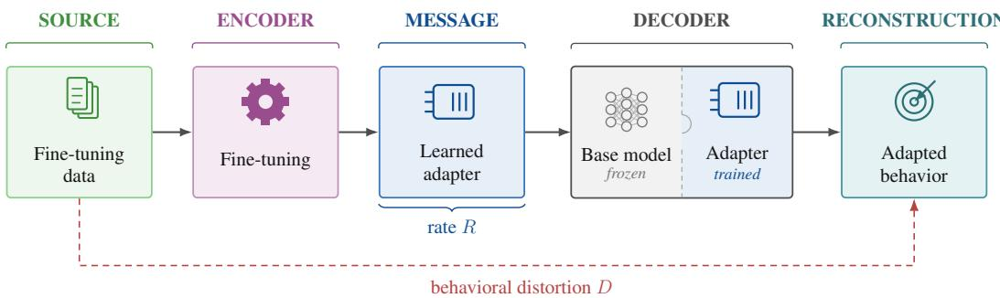  
Figure 1: Information-theoretic view of parameter-efficient fine-tuning. R is the number of bits used by the adapter, D measures failure to preserve the behavior induced by fine-tuning.

Compression can also reveal structure within a learned update. Under deliberately corrupted reasoning supervision, fine-tuning can strongly damage the frozen model, yet aggressive compression recovers much of the lost performance and can exceed the frozen baseline. On Qwen2.5-7B, for example, GSM8K accuracy falls from 77.6% to 23.7% after corrupted fine-tuning and returns to 82.9% after compression. Singular-direction analyses show that harmful and useful effects are distributed unevenly across the update, while matched-norm controls show that the recovery is not exactly equivalent to scalar rescaling.

Finally, once an update has been trained, its behavioral rate closely tracks how far it can be shrunk before losing its gain. A simple codec-specific rule, $R ^ { \star } ( 0 . 9 0 ) ~ \stackrel { \cdot } { \approx } ~ \alpha _ { 9 0 } / \gamma$ , achieves an RMSE of 0.068 bits per value on 42 checkpoints from five receivers not used to fix the rule, although the evaluation remains retrospective. Together, these results suggest that the information cost of finetuning is not an intrinsic property of the data or of parameter displacement alone: it depends on the frozen receiver, the behavior to preserve, and how the learned corrections are represented within the update.

## 2 RELATED WORK

Parameter-efficient fine-tuning and adapter structure. LoRA (Hu et al., 2022) and QLoRA (Dettmers et al., 2023) provide compact parameterizations for adapting frozen language models, while earlier work on intrinsic dimensionality showed that effective fine-tuning can lie in a lowdimensional subspace (Aghajanyan et al., 2021). More recent work has emphasized that the components of a learned adapter need not be functionally equivalent. Zhu et al. (2024) study asymmetric roles within low-rank adapters, Shuttleworth et al. (2025) identify high-ranking singular directions introduced by LoRA whose attenuation can reduce forgetting, and Tian et al. (2026) identify neutral or harmful singular directions that can be reweighted using calibration gradients. Our work is com plementary: we use post-training compression to probe which components of an update are required to preserve its acquired behavior.

Quantization and adapter compression. Low-bit post-training quantization has been extensively studied for language models, including ZeroQuant (Yao et al., 2022), GPTQ (Frantar et al., 2023), SmoothQuant (Xiao et al., 2023), and AWQ (Lin et al., 2024); more recent work characterizes be havior in extremely low-bit regimes (Liu et al., 2025). Quantization has also been extended to trained adapters: Mirzaei et al. (2025) compress LoRA updates to ultra-low precision while preserving task performance, while Tan et al. (2026) study adapter capacity and memorization directly in bits. In contrast, we use compression primarily as a measurement tool: our rate is the serialized size required to preserve the behavior induced by fine-tuning.

Compression, description length, and rate–distortion. Model compressibility has been connected to generalization and description length (Arora et al., 2018; Lotfi et al., 2022; Urdshals et al., 2025), and rate–distortion ideas have been applied to language-model compression (Young, 2025). Our setting differs in two respects: the frozen model acts as shared side information, and distortion is measured behaviorally after the compressed adapter is decoded back into that receiver. The resulting rate is therefore relative to both the learned update and the frozen model with which it is composed.

## 3 FUNCTIONAL STRUCTURE OF ADAPTER COMPRESSION

We begin by examining how post-training compression affects fine-tuned behavior. Controlled compression lets us separate numerical reconstruction from functional preservation while keeping both the learned checkpoint and the frozen model fixed. These diagnostics show that ordinary parameterspace fidelity is not sufficient to predict which compressed adapters preserve the behavior acquired during fine-tuning.

## 3.1 EXPERIMENTAL SETTING: ADAPTER COMPRESSION

We study post-training compression of LoRA adapters across frozen language models from 0.5B to 32B parameters, including Qwen2.5-{0.5B, 1.5B, 3B, 7B, 14B, 32B}, Qwen3-8B-Base, Mistral-7B-v0.1, Llama-3.1-8B, and Gemma-2-9B. Each adapter is trained once and then compressed over a range of operating points, without retraining. At one bit per value and above, we quantize the LoRA factors row-wise; below one bit, we additionally remove paired rank directions. Each compressed representation, including its decoding metadata, is serialized to disk, reloaded, and evaluated in composition with the frozen model. We report realized file size normalized by the number of scalar values in the uncompressed adapter. Full training configurations, codec details, datasets, and evaluation procedures are given in Appendix A.

## 3.2 MEASURING COMPRESSION THROUGH BEHAVIOR

The object we ultimately want to preserve is not the adapter itself, but the behavior added by finetuning. Because every operating point is obtained from the same trained checkpoint, differences after compression isolate the effect of representation from variation in optimization.

Let $L _ { 0 }$ denote the held-out loss of the frozen model, $L _ { \mathrm { r a w } }$ that of the uncompressed adapter, and $L _ { r }$ the loss after compression to realized rate r. We define retained gain as

$$
\mathrm { R e t a i n } ( r ) = \frac { L _ { 0 } - L _ { r } } { L _ { 0 } - L _ { \mathrm { r a w } } } ,\tag{1}
$$

so that 0 corresponds to the frozen model and 1 to the uncompressed adapter; values above one are possible when compression improves held-out loss. For comparisons across conditions, we define

$$
R ^ { \star } ( \tau ) = \operatorname* { m i n } \{ r : \mathrm { R e t a i n } ( r ) \geq \tau \} ,\tag{2}
$$

and use $\tau = 0 . 9 0$ unless stated otherwise. $R ^ { \star } ( 0 . 9 0 )$ is therefore an operational, codec-dependent behavioral rate: the smallest measured reloadable adapter preserving at least 90% of the original fine-tuning gain.

Figure 2 (left and center) illustrates the resulting rate-retention frontier. At fixed optimization budget, more distinct training content shifts the frontier toward higher rates; at fixed dataset size, R⋆(0.90) also tends to increase with source-problem diversity. We return to what determines these shifts in Section 6.

A natural alternative would be to measure preservation through numerical reconstruction error. We test this by comparing uniform quantization with an adaptive allocator that minimizes LoRA weight reconstruction error under a rate constraint. Figure 2 (right) gives a direct counterexample: near one bit per value, the adaptive code achieves lower relative weight RMSE than uniform quantization (0.54 versus 0.56), yet retains only 3% of the held-out gain, compared with 86% for the uniform code. The allocator partly obtains its lower error by removing rows that are inexpensive under the Euclidean objective but behaviorally important; at higher rates, once rows are no longer removed, the two codecs converge.

Thus, lower parameter-space distortion need not imply lower behavioral distortion. Numerical reconstruction alone does not identify which perturbations are harmless once the adapter is composed with the frozen model. Additional codec details and controls are given in Appendix A.

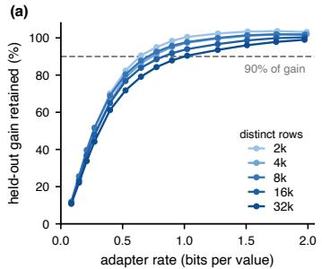

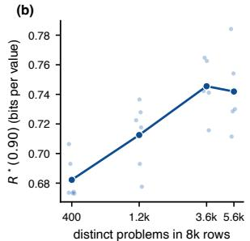

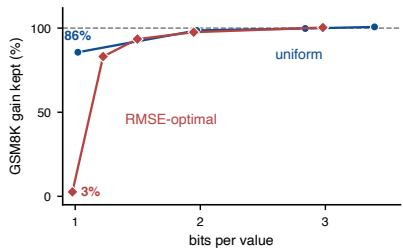  
Figure 2: Behavioral rate is not a weight-space quantity. Left: retained fine-tuning gain versus exact serialized adapter rate across 2k–32k MetaMathQA rows at fixed compute. Center: $R ^ { \star } ( \bar { 0 } . \bar { 9 } 0 )$ at 8k rows as source-problem diversity increases. Right: near one bit per value, an RMSE-optimized codec achieves lower relative weight error than uniform quantization (0.54 vs. 0.56) but retains only 3% of the GSM8K gain, versus 86%. Curves on the left show seed means; small points are individual seeds. Mistral-7B, NF4, rank-16 LoRA, three seeds.

## 4 A RECEIVER-RELATIVE RATE-DISTORTION VIEW OF FINE-TUNING

This section develops a receiver-relative rate–distortion view of fine-tuning. Our goal is not to derive an exact information-theoretic law for LoRA, but to formalize the empirical observations of Section 3 and motivate the quantities studied later in the paper. We first treat the frozen model as shared side information, then characterize behavioral preservation through a functional geometry over adapter perturbations, and finally show how compression can improve behavior when the learned update is misaligned with the target utility. Detailed derivations and assumptions are given in Appendix B.

## 4.1 THE FROZEN MODEL AS SIDE INFORMATION

A fine-tuning adapter is not used independently from the model on which it was trained. At inference time, its parameters act through their composition with the frozen base model. As illustrated in Figure 1, the adapter can therefore be viewed as a finite-rate message whose effect is interpreted by a particular receiver. Let M denote a frozen model, A a trained adapter, and c a finite code of length $\ell ( c )$ from which a shared decoder reconstructs $\hat { A } = \operatorname { D e c } ( c )$ . The reconstructed model is $M \oplus { \hat { A } }$ where ⊕ denotes composition of the frozen model with its adapter. Since M is available at both encoding and decoding time, it acts as shared side information: the code only needs to specify the additional modification required by this receiver.

Compression should therefore be evaluated through the behavior of the composed model. For a utility U for which larger values are better, we define $D _ { M , U } ( A , \hat { A } ) = \Bigl [ U ( M \oplus A ) - U ( M \oplus \hat { A } ) \Bigr ] _ { + }$ with the corresponding difference reversed for a loss. Given a tolerance ε, we define the receiverrelative behavioral description length

$$
L _ { M , U } ^ { \star } ( A , \varepsilon ) = \operatorname* { m i n } _ { c } \ell ( c ) \quad \mathrm { s . t . } \quad D _ { M , U } ( A , \mathrm { D e c } ( c ) ) \leq \varepsilon .\tag{3}
$$

Equation 3 makes explicit two dependencies: changing M changes how an update is interpreted, while changing U changes which differences between decoded updates matter. This is an operational one-shot coding problem for a deterministic checkpoint, not a Shannon rate-distortion function; the empirical rates studied here are therefore codec-dependent achievable rates rather than informationtheoretic optima.

## 4.2 BEHAVIORAL DISTORTION INDUCES A FUNCTIONAL GEOMETRY

The definition above does not yet specify which parameter perturbations are costly. Let a compressed adapter satisfy $\hat { A } = A + e$ , where e is the compression error. Under a local expansion of the utility U, and when the first-order term is negligible for the perturbations considered, the leading decrease in utility can be written as

$$
D _ { M , U } ( A , A + e ) \approx \frac { 1 } { 2 } e ^ { \top } H _ { U } e ,\tag{4}
$$

where $H _ { U } \succeq 0$ denotes minus the local utility Hessian, or equivalently the local curvature of the corresponding loss near a local optimum.

This differs from ordinary weight reconstruction error, $D _ { \mathrm { w e i g h t } } ( A , A + e ) = \lVert e \rVert _ { 2 } ^ { 2 }$ , which assigns the same cost to every parameter direction. Equation 4, in contrast, weights an error by its orientation relative to the behavioral sensitivity of the composed model. Euclidean and functional distortion induce the same ordering over perturbations only in the isotropic case, when $H _ { U }$ is proportional to the identity on the subspace explored by compression.

This gives a local interpretation of the RMSE counterexample in Section 3: behavioral cost depends not only on the magnitude of a compression error, but on its orientation relative to the receiverinduced geometry. The matched-budget layer-location controls in Appendix C.3 provide complementary evidence that this geometry is strongly anisotropic across the network.

## 4.3 WHY COMPRESSION CAN IMPROVE ON THE BASE MODEL

Equation 4 assumes that the first-order term vanishes, i.e. that the trained adapter sits at an optimum of the behavior $U$ we care about. Training only guarantees an optimum of the training loss. When the data ask for corrections that U does not reward, as with the corrupted supervision of Section $^ { 5 , }$ the two optima differ. Consider moving along the trained update, $M \oplus \alpha A$ for $\alpha \in [ 0 , 1 ]$ , so that $\alpha = 0$ is the frozen model and $\alpha = 1$ the adapter. To second order,

$$
U ( M \oplus \alpha A ) \approx U ( M ) + \alpha g _ { U } ^ { \top } A - \frac { \alpha ^ { 2 } } { 2 } A ^ { \top } H _ { U } A ,\tag{5}
$$

with $g _ { U }$ the gradient of $U$ at the frozen model. If the update first helps $( g _ { U } ^ { \top } A > 0 )$ but is too large, $U$ peaks at $\alpha ^ { \star } = g _ { \scriptscriptstyle { I 7 } } ^ { \top } A / A ^ { \top } H _ { \scriptscriptstyle { U } } A < 1$ , and every scale between 0 and $2 \alpha ^ { \star }$ beats the frozen model while the full update may fall far below it. A code that effectively moves the update toward such an intermediate scale can then score above both. The same argument applies direction by direction: if the harmful excess lives in a few strong directions of $A ,$ , cutting or shrinking those directions recovers the gain the rest of the update carries.

Compression-based generalization bounds motivate asking whether shorter adapter descriptions also induce smaller off-task changes (Arora et al., 2018; Lotfi et al., 2022). We evaluate this possibility in Appendix D.5, where the compressed corrupted adapter remains substantially closer to the frozen model on off-task probes than a clean fine-tune. This pattern is consistent with compression suppressing task-specific perturbations while preserving the useful part of the learned update, although it does not by itself establish a general relation between shorter adapter descriptions and better outof-distribution behavior.

The same framework also suggests quantities that might anticipate compression difficulty before training. The per-example correction gradients $g _ { i } = \nabla _ { \theta } \ell _ { i } ( \theta _ { 0 } )$ describe what the data ask of a particular receiver. Their second-moment geometry yields a spectrum whose log-determinant is analogous to the rate term appearing in classical quadratic rate-distortion models (Thomas & Joy, 2006). We derive this proxy in Appendix B.3 and test its empirical scope in Section 6.

## 5 RECOVERING TASK-RELEVANT STRUCTURE THROUGH COMPRESSION

So far, compression has been treated as a source of distortion. We now ask whether its non-uniform action can instead be useful when the learned update itself contains harmful structure. We construct deliberately corrupted fine-tunes by modifying the supervision used during training. Our main intervention pairs each MetaMathQA question with the worked rationale of another example while retaining its original final answer. The resulting adapter is therefore trained on the correct final answer together with reasoning that is systematically mismatched to the input. This sharply degrades task performance and provides a controlled setting in which useful task signal and harmful supervision can coexist within the same learned update.

## 5.1 COMPRESSION REPAIRS CORRUPTED FINE-TUNES

Figure 3 shows that aggressive compression can reverse much of this damage across several base models. On Qwen2.5-7B, the corrupted adapter reduces GSM8K accuracy from 77.6% to 23.7%;

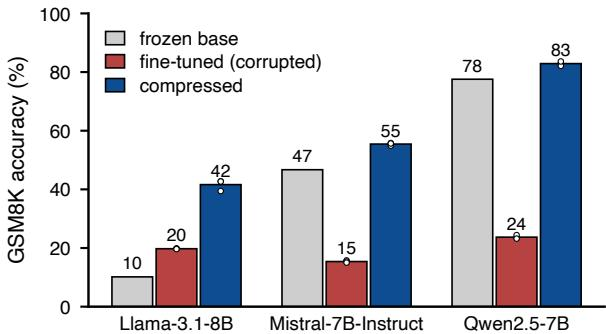  
Figure 3: Compression can repair a corrupted fine-tune. GSM8K accuracy of the frozen model, an adapter trained on permuted rationales, and the same adapter after lossy compression, across three base models.

(a)  
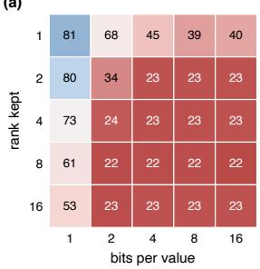

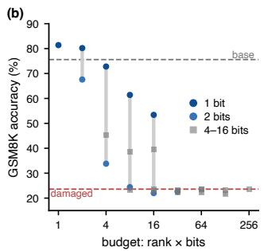  
Figure 4: Rank and precision are not interchangeable under corrupted fine-tuning. (a) GSM8K accuracy after retaining rank r and coding each value at b bits. (b) The same configurations grouped by nominal budget $r \times b .$

after lossy compression, the same learned update reaches 82.9%. The effect also appears on Mistral-7B-Instruct and Llama-3.1-8B, despite their different frozen-model baselines.

Recovery depends strongly on how the compression budget is spent. Figure 4 varies both the number of retained rank directions and their precision for the same corrupted rank-16 adapter. At nominal budgets $r \times b \leq 1 6 .$ , retaining more directions at one bit consistently outperforms retaining fewer directions at higher precision. Most strikingly, the rank-1 truncation reaches 81.4% accuracy at one bit, but only 39.6% at 16 bits. Thus, recovery cannot be explained by parameter count or nominal budget alone.

A substantial part of the effect is associated with shrinkage: rescaling the full-precision rank-1 update recovers most of the accuracy obtained by one-bit coding. Matched-norm controls nevertheless leave a smaller residual advantage for coarse coding, indicating that norm reduction does not explain the entire effect. Recovery is also not specific to selecting a single leading singular direction: fullrank one-bit coding and random low-rank projections can recover substantial performance as well. Finally, compression is not equivalent to training the final small adapter directly: adapters trained with additional rank recover more strongly when all are compressed to the same rank-1, one-bit endpoint. Full controls are reported in Appendix D.

## 5.2 DAMAGE IS STRUCTURED ACROSS ADAPTER DIRECTIONS

The previous results suggest that the harmful and useful effects of the update are not uniformly distributed across its rank directions. We test this directly by decomposing corrupted adapters into singular directions and evaluating every contiguous window [i, j) of the rank-16 update at full precision. Figure 5 reveals a consistent qualitative structure across model scales. Leading directions are strongly detrimental, an intermediate range contributes positively, and trailing directions have comparatively little effect. The location and width of these regimes vary across models, but the behavioral effect is clearly non-uniform across directions. This shows that the corruption is represented anisotropically within the learned update, and provides one mechanism by which compression can preferentially attenuate harmful behavior. The recovery controls above, however, show that directional selection alone does not account for the full effect.

(a)  
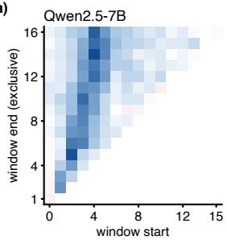

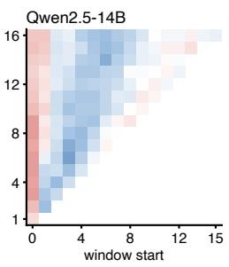

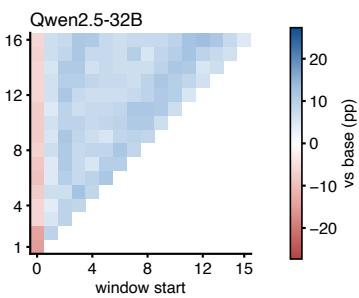

(b)  
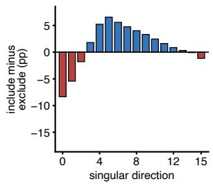

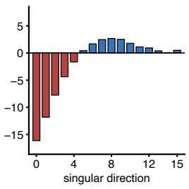

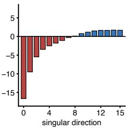  
Figure 5: Corruption is structured across singular directions. (a) Accuracy relative to the frozen model for every contiguous window $[ i , j )$ of singular directions retained at full precision. (b) Marginal contribution of each direction, computed by comparing windows that include it with those that do not.

The effect is not restricted to a single model size or task. Additional experiments reproduce recovery across Qwen2.5 scales and other corrupted settings. On 72 off-task probes, the compressed corrupted adapter also remains closer to the frozen model than a clean fine-tune with comparable in-domain performance. Scaling, matched-norm, training-rank, cross-model, and off-task controls are reported in Appendix D. Together, these results show that compression need not merely degrade a fine-tuned update. When supervision induces both useful and harmful effects, those effects can be distributed very differently across the learned update, and aggressive bottlenecks can suppress them unequally. In the next section, we ask whether related properties of a successful update also predict how much rate is required to preserve its behavior.

## 6 WHAT SETS THE BEHAVIORAL RATE?

The receiver-relative view of Section 4 suggests two complementary questions. First, can compression difficulty be anticipated from the data and the frozen receiver before training? Second, once an update has been learned, what property of that update tracks how aggressively it can be compressed? We address these questions in turn.

## 6.1 BEHAVIORAL RATE IS RECEIVER-RELATIVE

We first test whether behavioral rate can be treated as an intrinsic property of the fine-tuning data. Figure 6(b) measures R⋆(0.90) for the same three corpora across seven frozen receivers. The ordering changes with the receiver: XBRL tagging is the lowest-rate corpus for six receivers, but not for Qwen2.5-7B, where math is cheaper. Even closely related receivers can differ substantially: preserving 90% of the math gain requires 1.03 bits per value on Qwen2.5-Math-7B, compared with 0.41 on Qwen2.5-7B. Behavioral rate therefore depends on the dataset–receiver pair, rather than on the dataset alone.

Section 4 motivates a receiver-relative statistic computed before training from the corrections requested by the data. We summarize the corresponding correction-gradient spectrum by its logdeterminant (Appendix B.3). Within a fixed receiver, this quantity ranks behavioral rate well: across

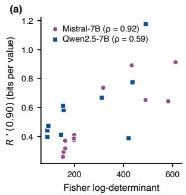

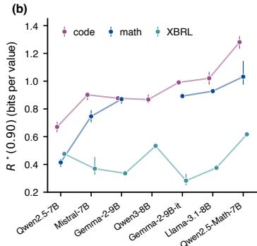  
Figure 6: Behavioral rate is receiver-relative. (a) Correction-spectrum log-determinant against $R ^ { \star } ( 0 . 9 0 )$ within the two development receivers. (b) $R ^ { \star } ( 0 . 9 0 )$ for the same three corpora across seven receivers; bars span seeds. The ordering of corpora changes with the receiver.

24 arms and seven task families, Spearman correlation with $R ^ { \star } ( 0 . 9 0 )$ is $\rho = 0 . 9 2$ on Mistral-7B and $\rho = 0 . 5 9$ on Qwen2.5-7B, with a selection-adjusted permutation $p = 0 . 0 0 0 3 \ : ( \mathrm { F i g u r e \ : 6 ( a ) ) }$ .

This association does not transfer reliably across receivers. After fixing the statistic, correlations on additional receiver panels are −0.1 on Llama-3.1-8B, −0.4 on Qwen3-8B, and +0.1 on a fresh Qwen2.5-7B panel. Corpus-only quantities and quantities obtained by scoring the corpus with the frozen model likewise fail to consistently order receivers. We therefore view correction spectra as informative within-receiver descriptors of compression difficulty, rather than as universal predictors of behavioral rate. Predicting $R ^ { \star }$ from the data and receiver alone remains open.

## 6.2 BEHAVIORAL RATE TRACKS UPDATE SHRINKABILITY

The previous analysis asks what can be inferred before the update is trained. Once the learned update is available, a simpler relationship emerges. Section 5 showed that aggressive compression often acts behaviorally like shrinking the update, although it is not exactly equivalent to scalar rescaling. This suggests that compression difficulty may depend on how far the learned update can be reduced before its acquired behavior is lost.

Let $\Delta$ denote the trained update and let $\widehat { \Delta } _ { \mathrm { 1 b i t } }$ denote its one-bit coded version. We define

$$
\gamma = \frac { \langle \widehat { \Delta } _ { \mathrm { 1 b i t } } , \Delta \rangle } { \| \Delta \| _ { 2 } ^ { 2 } } ,\tag{6}
$$

which measures how strongly one-bit coding shrinks the update along its original direction. Under our rank-pair codec, retaining a fraction $p$ of the directions at one bit behaves approximately like scaling the uncompressed update by $p \gamma$ . Along this compression path, the realized rate is also approximately $p$ bits per original adapter value. Figure $\mathrm { 7 ( a ) }$ tests this correspondence directly. Across three Llama-3.1-8B adapters, compressed operating points placed at their effective scale pγ closely follow the behavioral response obtained by explicitly scaling the uncompressed update by α.

Let $\alpha _ { 9 0 }$ denote the smallest scale at which the uncompressed update retains 90% of its original fine-tuning gain. Matching $p \gamma \approx \alpha _ { 9 0 }$ then gives the codec-specific approximation

$$
R ^ { \star } ( 0 . 9 0 ) \approx \frac { \alpha _ { 9 0 } } { \gamma } .\tag{7}
$$

Estimating $\alpha _ { 9 0 }$ requires evaluating only five scales of the uncompressed update on 64 held-out examples, while $\gamma$ is obtained from the adapter weights; no regression coefficient is fitted.

After fixing the rule on six adapters from two receivers, Figure 7(b) compares this estimate with measured rates on 42 checkpoints from five other receivers. It achieves an RMSE of 0.068 bits per value $( R ^ { 2 } = 0 . 9 5 )$ . On a broader archive of 58 adapters spanning 34 corpora, the RMSE is 0.105 bits per value. Additional baselines, disjoint-evaluation controls, and trained-update predictors are reported in Appendix C.4.

These experiments remain retrospective: although the rule was fixed independently of the reported receiver panels, their behavioral rates had already been measured when it was formulated. We therefore interpret Equation 7 as a retrospective empirical approximation rather than a prospectively validated prediction law.

(a)  
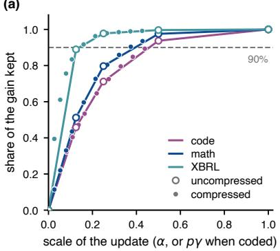

(b)  
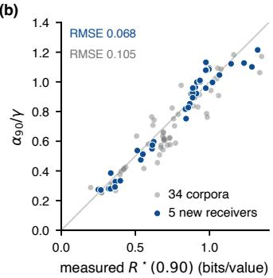  
Figure 7: Behavioral rate tracks update shrinkability. (a) Retained gain for three Llama-3.1-8B adapters when the uncompressed update is scaled by α (lines), together with compressed operating points placed at their effective scale $p \gamma$ (dots). (b) $\alpha _ { 9 0 } / \gamma$ against measured $\bar { R } ^ { \star }$ (0.90) for 42 checkpoints on five receivers not used to fix the rule (blue) and 58 archived adapters spanning 34 corpora (grey). No regression coefficient is fitted.

The same response curve connects the two main empirical findings of the paper. In Section 5, moving back along the learned update can remove harmful behavior and recover performance; here, the distance one can move before losing useful behavior closely tracks the rate required to preserve the fine-tune.

## 7 DISCUSSION AND LIMITATIONS

Our experiments show that behavioral rate is receiver-relative: the same dataset can require different rates across frozen models, while parameter-space reconstruction error alone does not predict which compressed updates preserve behavior. At the same time, the success of the shrinkability approximation indicates that, once an update has been learned, much of its compression difficulty can be summarized by the behavioral response obtained when moving back along that update.

Several limitations qualify these conclusions. First, $R ^ { \star }$ is an operational, codec-dependent rate rather than an information-theoretic optimum; different adapter parameterizations or codecs may induce different measured rates. Second, the correction-spectrum statistic is only a proxy for the full receiver-relative geometry and does not transfer reliably across receivers. Third, the shrinkability rule is supported by broad but retrospective evaluation, and remains to be validated prospectively on rates not observed when the rule is formulated. Finally, our recovery experiments use deliberately corrupted supervision to create a controlled mixture of useful and harmful effects. Whether the same structure governs naturally occurring fine-tuning errors remains an open question.

## 8 CONCLUSION

We introduced the behavioral rate of fine-tuning: the smallest serialized adapter rate that preserves a target fraction of the behavior acquired by fine-tuning. Across models and tasks, this rate is not determined by parameter count, weight reconstruction error, or the dataset alone, but depends on the interaction between the learned update and its frozen receiver.

Compression also exposes structure within the update itself. Under corrupted supervision, useful and harmful effects can occupy components with sharply different behavioral consequences, allowing aggressive bottlenecks to recover performance that the full update destroys. More generally, once an update has been trained, the rate required to preserve it closely tracks how far that update can be shrunk before its acquired behavior is lost.

These results separate three notions that are often conflated: how much data are presented during fine-tuning, how large the resulting parameter update is, and how many bits of that update are behaviorally necessary for a particular receiver. Adapter compression therefore serves not only as a storage mechanism, but as an operational probe of which parts of a learned update are needed to preserve a specified behavior.

## AI USE STATEMENT

Generative AI tools were used for language editing and debugging support. All AI-assisted text were reviewed by the authors. The authors take full responsibility for the paper’s claims, results, citations, and final content.

## REPRODUCIBILITY STATEMENT

We provide the experimental details required to reproduce our results in the appendices. Appendix A specifies the models, datasets, fine-tuning configurations, compression procedures, serialization protocol, and evaluation setup used to measure behavioral rate. In particular, reported rates correspond to realized serialized adapter sizes after including the metadata required for decoding and reloading the adapter. Theoretical assumptions and derivations for the receiver-relative rate-distortion view are given in Appendix B, while additional predictor, compression, recovery, and generalization controls are reported in the remaining appendices. We report multiple seeds where indicated in the text and figure captions, and distinguish explicitly between multi-seed results and single-checkpoint diagnostic analyses. Code for training, compression, evaluation, and figure generation is available at https://github.com/joey-david/fineqcomp.

## ACKNOWLEDGMENTS

This work was granted access to the HPC resources of IDRIS under the allocation 2026-AD011018261 made by GENCI.

## REFERENCES

Armen Aghajanyan, Sonal Gupta, and Luke Zettlemoyer. Intrinsic dimensionality explains the effectiveness of language model fine-tuning. In Proceedings of the 59th Annual Meeting of the Association for Computational Linguistics and the 11th International Joint Conference on Natural Language Processing (Volume 1: Long Papers), pp. 7319–7328, Online, 2021. Association for Computational Linguistics. doi: 10.18653/v1/2021.acl-long.568. URL https: //aclanthology.org/2021.acl-long.568/.

Sanjeev Arora, Rong Ge, Behnam Neyshabur, and Yi Zhang. Stronger generalization bounds for deep nets via a compression approach. In Proceedings of the 35th International Conference on Machine Learning, volume 80 of Proceedings of Machine Learning Research, pp. 254–263. PMLR, 2018. URL https://proceedings.mlr.press/v80/arora18b.html.

Klaudia Bałazy, Mohammadreza Banaei, Karl Aberer, and Jacek Tabor. Lora-xs: Low-rank adaptation with extremely small number of parameters. In ECAI 2025: 28th European Conference on Artificial Intelligence 25-30 October 2025, Bologna, Italy-Including 14th Conference on Prestigious Applications of Intelligent Systems (PAIS 2025) Proceedings, pp. 3194–3201, 2025.

Valerie Castin, Kimia Nadjahi, Pierre Ablin, and Gabriel Peyr´ e. Balanced loRA: Removing param-´ eter invariance to accelerate convergence. In Forty-third International Conference on Machine Learning, 2026. URL https://openreview.net/forum?id=kHInw3cjCP.

Tim Dettmers, Artidoro Pagnoni, Ari Holtzman, and Luke Zettlemoyer. QLoRA: Efficient finetuning of quantized LLMs. In Advances in Neural Information Processing Systems, volume 36, pp. 10088–10115, 2023. doi: 10.52202/075280-0441. URL https://proceedings.neurips.cc/paper\_files/paper/2023/hash/ 1feb87871436031bdc0f2beaa62a049b-Abstract.html.

Subhabrata Dutta, Joykirat Singh, Soumen Chakrabarti, and Tanmoy Chakraborty. How to think step-by-step: A mechanistic understanding of chain-of-thought reasoning. Transactions on Machine Learning Research, 2024. URL https://mlanthology.org/tmlr/2024/ dutta2024tmlr-think/.

Erwan Fagnou, Paul Caillon, Blaise Delattre, and Alexandre Allauzen. Chain and causal attention for efficient entity tracking. In Proceedings of the 2024 Conference on Empirical Methods in Natural Language Processing, pp. 13174–13188, Miami, Florida, USA, 2024. Association for Computational Linguistics. doi: 10.18653/v1/2024.emnlp-main.731. URL https: //aclanthology.org/2024.emnlp-main.731/.

Elias Frantar, Saleh Ashkboos, Torsten Hoefler, and Dan Alistarh. GPTQ: Accurate post-training quantization for generative pre-trained transformers. In The Eleventh International Conference on Learning Representations. OpenReview.net, 2023. URL https://openreview.net/ forum?id=tcbBPnfwxS.

Soufiane Hayou, Nikhil Ghosh, and Bin Yu. Lora+: efficient low rank adaptation of large models. In Proceedings of the 41st International Conference on Machine Learning, ICML’24. JMLR.org, 2024.

Edward J. Hu, Yelong Shen, Phillip Wallis, Zeyuan Allen-Zhu, Yuanzhi Li, Shean Wang, Lu Wang, and Weizhu Chen. LoRA: Low-rank adaptation of large language models. In The Tenth International Conference on Learning Representations. OpenReview.net, 2022. URL https: //openreview.net/forum?id=nZeVKeeFYf9.

Chengsong Huang, Qian Liu, Bill Yuchen Lin, Tianyu Pang, Chao Du, and Min Lin. Lorahub: Efficient cross-task generalization via dynamic loRA composition. In First Conference on Language Modeling, 2024. URL https://openreview.net/forum?id=TrloAXEJ2B.

Ting Jiang, Shaohan Huang, Shengyue Luo, Zihan Zhang, Haizhen Huang, Furu Wei, Weiwei Deng, Feng Sun, Qi Zhang, Deqing Wang, et al. Mora: High-rank updating for parameter-efficient finetuning. arXiv preprint arXiv:2405.12130, 2024.

Dawid Kopiczko, Tijmen Blankevoort, and Yuki Asano. Vera: Vector-based random matrix adaptation. In International Conference on Learning Representations, pp. 6815–6835, 2024.

Zeju Li, Jianyuan Zhong, Ziyang Zheng, Xiangyu Wen, Zhijian Xu, Yingying Cheng, Fan Zhang, and Qiang Xu. Making slow thinking faster: Compressing LLM chain-of-thought via step entropy. In The Fourteenth International Conference on Learning Representations. OpenReview.net, 2026. URL https://openreview.net/forum?id=cGLqQfS5wH.

Ji Lin, Jiaming Tang, Haotian Tang, Shang Yang, Wei-Ming Chen, Wei-Chen Wang, Guangxuan Xiao, Xingyu Dang, Chuang Gan, and Song Han. AWQ: Activationaware weight quantization for on-device LLM compression and acceleration. In Proceedings of Machine Learning and Systems, volume 6, pp. 87–100, 2024. URL https://proceedings.mlsys.org/paper\_files/paper/2024/hash/ 42a452cbafa9dd64e9ba4aa95cc1ef21-Abstract-Conference.html.

Shih-Yang Liu, Chien-Yi Wang, Hongxu Yin, Pavlo Molchanov, Yu-Chiang Frank Wang, Kwang-Ting Cheng, and Min-Hung Chen. DoRA: Weight-decomposed low-rank adaptation. In Ruslan Salakhutdinov, Zico Kolter, Katherine Heller, Adrian Weller, Nuria Oliver, Jonathan Scarlett, and Felix Berkenkamp (eds.), Proceedings ofthe 41st International Conference on Machine Learning, volume 235 of Proceedings of Machine Learning Research, pp. 32100–32121. PMLR, 21–27 Jul 2024. URL https://proceedings.mlr.press/v235/liu24bn.html.

Zechun Liu, Changsheng Zhao, Hanxian Huang, Sijia Chen, Jing Zhang, Jiawei Zhao, Scott Roy, Lisa Jin, Yunyang Xiong, Yangyang Shi, Lin Xiao, Yuandong Tian, Bilge Soran, Raghuraman Krishnamoorthi, Tijmen Blankevoort, and Vikas Chandra. ParetoQ: Improving scaling laws in extremely low-bit LLM quantization. In Advances in Neural Information Processing Systems, volume 38, pp. 101395–101420, 2025. doi: 10.52202/085713-3055. URL https://proceedings.neurips.cc/paper\_files/paper/2025/hash/ 83b17fb3369b1effa97ca5409526b02e-Abstract-Conference.html.

Sanae Lotfi, Marc Finzi, Sanyam Kapoor, Andres Potapczynski, Micah Goldblum, and Andrew Gordon Wilson. PAC-bayes compression bounds so tight that they can explain generalization. In Advances in Neural Information Processing Systems, volume 35, pp. 31459–31473, 2022. doi: 10.52202/068431-2281. URL

https://proceedings.neurips.cc/paper\_files/paper/2022/hash/ cbeec55c50c3367024bafab2438a021b-Abstract-Conference.html.

Fanxu Meng, Zhaohui Wang, and Muhan Zhang. Pissa: Principal singular values and singular vectors adaptation of large language models. Advances in Neural Information Processing Systems, 37:121038–121072, 2024.

Amir Reza Mirzaei, Yuqiao Wen, Yanshuai Cao, and Lili Mou. LoRAQuant: Mixed-precision quantization of LoRA to ultra-low bits, 2025. URL https://arxiv.org/abs/2510.26690.

Chen Qian, Dongrui Liu, Haochen Wen, Zhen Bai, Yong Liu, and Jing Shao. Demystifying reasoning dynamics with mutual information: Thinking tokens are information peaks in LLM reasoning. In Advances in Neural Information Processing Systems, volume 38, pp. 14065–14104, 2025. doi: 10.52202/085713-0421. URL https://proceedings.neurips.cc/paper\_files/paper/2025/hash/ 12867c8f1888d97d4e9f95f03c0f3ec9-Abstract-Conference.html.

Reece Shuttleworth, Jacob Andreas, Antonio Torralba, and Pratyusha Sharma. LoRA vs full fine-tuning: An illusion of equivalence. In Advances in Neural Information Processing Systems, volume 38, 2025. URL https://proceedings.neurips.cc/paper\_files/paper/ 2025/hash/ff541950d1e885af90f523571564a401-Abstract-Conference. html.

Kaizhen Tan, Heqing Du, and Yang Feng. How many bits can an adapter write? measuring the capacity and memorization of parameter-efficient fine-tuning, 2026. URL https://arxiv. org/abs/2607.21351.

MTCAJ Thomas and A Thomas Joy. Elements ofinformation theory. Wiley-Interscience, 2006.

Zailong Tian, Yanzhe Chen, Zhuoheng Han, and Lizi Liao. Spectral surgery: Training-free refinement of LoRA via gradient-guided singular value reweighting, 2026. URL https://arxiv. org/abs/2603.03995.

Einar Urdshals, Edmund Lau, Jesse Hoogland, Stan van Wingerden, and Daniel Murfet. Compressibility measures complexity: Minimum description length meets singular learning theory, 2025. URL https://arxiv.org/abs/2510.12077.

Jason Wei, Xuezhi Wang, Dale Schuurmans, Maarten Bosma, Brian Ichter, Fei Xia, Ed H. Chi, Quoc V. Le, and Denny Zhou. Chain-of-thought prompting elicits reasoning in large language models. In Advances in Neural Information Processing Systems, volume 35, pp. 24824–24837, 2022. doi: 10.52202/068431-1800. URL https://proceedings.neurips.cc/paper/ 2022/hash/9d5609613524ecf4f15af0f7b31abca4-Abstract-Conference. html.

Guangxuan Xiao, Ji Lin, Mickael Seznec, Hao Wu, Julien Demouth, and Song Han. SmoothQuant: Accurate and efficient post-training quantization for large language models. In Proceedings of the 40th International Conference on Machine Learning, volume 202 of Proceedings ofMachine Learning Research, pp. 38087–38099. PMLR, 2023. URL https://proceedings.mlr. press/v202/xiao23c.html.

Yukang Yang, Declan Iain Campbell, Kaixuan Huang, Mengdi Wang, Jonathan D. Cohen, and Taylor Whittington Webb. Emergent symbolic mechanisms support abstract reasoning in large language models. In Proceedings of the 42nd International Conference on Machine Learning, volume 267 of Proceedings of Machine Learning Research, pp. 70515–70549. PMLR, 2025. URL https://proceedings.mlr.press/v267/yang25c.html.

Zhewei Yao, Reza Yazdani Aminabadi, Minjia Zhang, Xiaoxia Wu, Conglong Li, and Yuxiong He. ZeroQuant: Efficient and affordable post-training quantization for large-scale transformers. In Advances in Neural Information Processing Systems, volume 35, pp. 27168–27183, 2022. doi: 10.52202/068431-1970. URL https://proceedings.neurips.cc/paper\_files/paper/2022/hash/ adf7fa39d65e2983d724ff7da57f00ac-Abstract-Conference.html.

Sean I. Young. Radio: Rate–distortion optimization for large language model compression. In Proceedings of the 42nd International Conference on Machine Learning, volume 267 of Proceedings of Machine Learning Research, pp. 72819–72836. PMLR, 2025. URL https: //proceedings.mlr.press/v267/young25b.html.

Longteng Zhang, Lin Zhang, Shaohuai Shi, Xiaowen Chu, and Bo Li. Lora-fa: Memory-efficient low-rank adaptation for large language models fine-tuning. arXiv e-prints, pp. arXiv–2308, 2023a.

Qingru Zhang, Minshuo Chen, Alexander Bukharin, Pengcheng He, Yu Cheng, Weizhu Chen, and Tuo Zhao. Adaptive budget allocation for parameter-efficient fine-tuning. In The Eleventh International Conference on Learning Representations, 2023b. URL https://openreview. net/forum?id=lq62uWRJjiY.

Hongyun Zhou, Xiangyu Lu, Wang Xu, Conghui Zhu, Tiejun Zhao, and Muyun Yang. Lora-drop: Efficient lora parameter pruning based on output evaluation. In Proceedings of the 31st international conference on computational linguistics, pp. 5530–5543, 2025.

Jiacheng Zhu, Kristjan Greenewald, Kimia Nadjahi, Haitz S aez De Oc´ ariz Borde, Rickard Br´ uel¨ Gabrielsson, Leshem Choshen, Marzyeh Ghassemi, Mikhail Yurochkin, and Justin Solomon. Asymmetry in low-rank adapters of foundation models. In Proceedings of the 41st International Conference on Machine Learning, volume 235 of Proceedings of Machine Learning Research, pp. 62369–62385. PMLR, 2024. URL https://proceedings.mlr.press/ v235/zhu24c.html.

## A EXPERIMENTAL DETAILS

## A.1 MODELS, TRAINING AND EVALUATION

Models. All frozen models are base (pretrained) checkpoints loaded in 4-bit NF4 with double quantization (bitsandbytes), except Mistral-7B-Instruct-v0.3 and Gemma-2-9B-it, which are instruction-tuned and prompted through their chat template. We use Qwen2.5 at 0.5B, 1.5B, 3B, 7B, 14B and 32B parameters, Qwen3-8B-Base, Llama-3.1-8B, Mistral-7B-v0.1, Mistral-7B-Instructv0.3 and Gemma-2-9B-it. Most experiments use Qwen2.5-7B. Headline comparisons use three seeds unless stated otherwise; some diagnostic analyses use a single checkpoint, as indicated below and in the corresponding figure captions.

Adapters and training. Unless stated otherwise, adapters are LoRA of rank 16 with scale α = 32 (α/r = 2) and no dropout, on the attention and MLP projections of every layer (q, k, v, o, gate, up and down). We train with AdamW at learning rate $2 \times \bar { 1 0 ^ { - 4 } } , \beta = ( 0 . 9 , \bar { 0 . 9 5 } )$ , no weight decay, 3% linear warmup, gradient clipping at 1.0, effective batch size 16 (micro-batches of 4) and maximum sequence length 1,024 tokens, with the loss on the whole response. The corruption experiments of Section 5 train for one epoch on 32,000 MetaMathQA rows (2,000 updates), and evaluate the validation loss every 200 updates. The adapters of Figure 3 and of the 14B and 32B studies keep the checkpoint with the lowest validation loss; the Qwen2.5-7B window-search adapters keep the fina one. Seeds are 11, 22 and 33 where three are reported, and 11 otherwise.

Evaluation. Decoding is greedy. GSM8K-style tasks allow 512 new tokens and are scored by exact match of the final answer; MATH-500 allows 1,024 tokens and is checked with Math-Verify; multiple-choice probes ask for a letter within 32 tokens. GSM8K uses all 1,319 test problems where stated and a fixed subset of 500 otherwise. Intervals are 95% paired bootstrap intervals over questions (2,000 to 10,000 draws), clustered by template for GSM-Symbolic.

Selecting spectral filters. For the window searches of Section 5, the corrupted update is decomposed by SVD into its 16 singular directions. Each candidate keeps a set of directions at full precision or codes them. Candidates are scored on 128 MetaMathQA rows reserved from training (every seed problem of the training slice is excluded), the finalists are re-scored on 128 further reserved rows, and only the selected filter is scored on the test sets.

## A.2 CORRUPTIONS

Table 1 lists the corruptions and how many configurations use each. The main text uses the rationale permutation; the XBRL rows of Table 8 use the response mismatch.

Table 1: Corruptions used, with the number of configurations that use each.
<table><tr><td></td><td>corruption</td><td>configs</td></tr><tr><td>rationale permuted</td><td>each worked explanation/CoT moved to a different prob- lem; question and answer line kept</td><td>19</td></tr><tr><td>response mismatched</td><td>the whole response dealt to a different item, for tasks with- out an answer line</td><td>10</td></tr><tr><td>rationale steps shuffled</td><td>steps of the explanation reordered; steps, arithmetic and answer kept</td><td>2</td></tr><tr><td>arithmetic corrupted</td><td>half the computed results moved by up to a third, and the answer follows the wrong chain</td><td>2</td></tr><tr><td>labels scrambled / flipped</td><td>each multiple-choice letter, or short text label, moved to another of its choices</td><td>2 + 2</td></tr></table>

## A.3 CODECS AND RATE ACCOUNTING

Rates are the size of the serialized file, decoding metadata included, divided by the number of scalar values in the uncompressed adapter. The uniform code is a zero-free midrise quantizer fitted per row; the exact-zero control is a midtread quantizer scaled by the row’s absolute maximum. LoRAQuant runs in four configurations: 2@0.8, 2@0.9, 3@0.8 and 3@0.9. Below one bit per value we remove paired rank directions before coding. Table 2 lists the rates each code realises.

Table 2: Realised rate and retained GSM8K gain per codec (Mistral-7B, 3 seeds, raw gain 61.5 points).
<table><tr><td>codec</td><td>bits / value</td><td>gain kept (%)</td><td>relative RMSE</td></tr><tr><td>midtread, 2 levels (exact zero)</td><td>0.63</td><td>61.1</td><td>0.881</td></tr><tr><td>adaptive, may drop rows, target 1</td><td>0.98</td><td>2.6</td><td>0.537</td></tr><tr><td>uniform zero-free, 1 bit</td><td>1.02</td><td>85.7</td><td>0.563</td></tr><tr><td>adaptive, keeps rows, target 1.1</td><td>1.03</td><td>85.9</td><td>0.561</td></tr><tr><td>LoRAQuant 2@0.8</td><td>1.59</td><td>95.4</td><td></td></tr><tr><td>uniform zero-free, 2 bits</td><td>1.97</td><td>98.6</td><td>0.314</td></tr><tr><td>LoRAQuant 3@0.9</td><td>2.69</td><td>99.1</td><td></td></tr><tr><td>uniform zero-free, 3 bits</td><td>2.84</td><td>99.8</td><td>0.184</td></tr><tr><td>uniform zero-free, 4 bits</td><td>3.39</td><td>100.7</td><td>0.112</td></tr><tr><td>uniform zero-free, 8 bits</td><td>7.28</td><td>100.1</td><td>0.008</td></tr></table>

The compressed adapters of Figure 3 use the uniform code below one bit: half of the rank directions are removed and the rest are coded at 1 bit, 0.52 bits per value overall and 2.63 to 2.74 MB depending on the model. The rank-1 codes of Figure 4 and Table 8 keep the leading singular direction of the update; a rank-1 adapter at 1 bit is a 0.40 MB file for Qwen2.5-7B.

## A.4 CANDIDATES FOR THE BEHAVIORAL RATE

code dialogue instruction math summary

(a)  
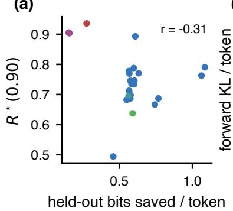

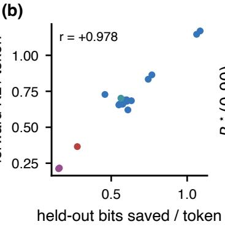

(c)  
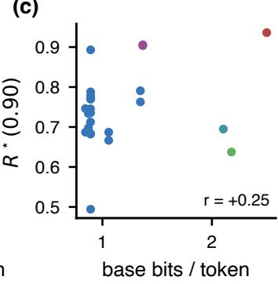

(d)  
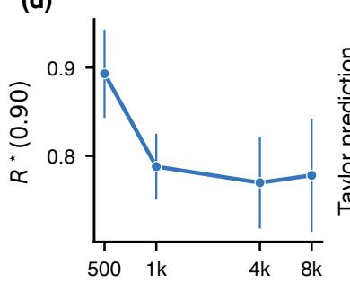

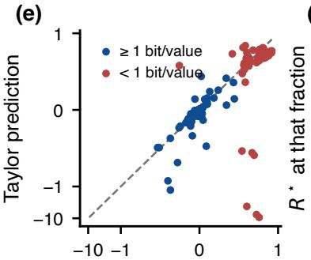

(f)  
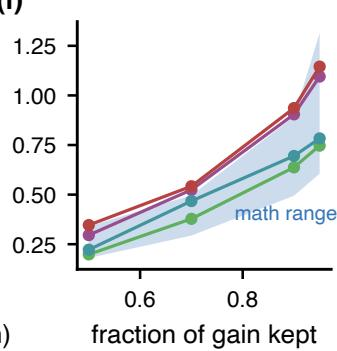  
optimizer updates, same rows measured damage (bits/token)  
Figure 8: Candidates for predictors of $R ^ { \star } ( 0 . 9 0 )$ , one point per arm (seed means; 24 arms, Mistral-7B). (a) Held-out bits saved: $r = - 0 . 3 1$ . (b) Forward KL tracks bits saved at $r = + 0 . 9 7 8 ,$ , so it is not a second measurement. (c) Base bits per token on the corpus: $r = + 0 . 2 5$ . (d) Sixteen times the optimizer updates on the same rows lowers $R ^ { \star } ;$ bars are seed s.d. (e) Second-order Taylor prediction of the damage against measured damage, symmetric log axes: close above one bit per value, wrong in sign and size below it. (f) R⋆ at other retention thresholds: code and dialogue sit at the top of the math range at every threshold.

Figure 8 shows the candidates that fail on the 24 Mistral-7B development arms: the size of the behavioral gain, distribution shift, base-model surprisal, optimizer depth, a second-order Taylor model of the damage, and the choice of retention threshold.

The audit re-scored 268 cells from 67 arms on four receivers with 46 candidate measures, after six repairs to the measurement pipeline; nothing was retrained. The repairs lower the held-out-receiver error from 0.239 (receiver mean) to 0.152, but the best predictor is text cross-row redundancy, two zlib calls that never look at the model (Figure 9). A measure of the corpus alone assigns one value to a corpus on every receiver, so it cannot produce the corpus–receiver reorderings of Section 6.

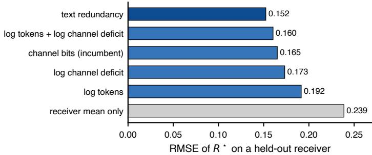  
Figure 9: Leave-one-receiver-out RMSE of R⋆(0.90) for the rate-law models, four receivers.

Table 3 lists every test of a correction statistic on a receiver outside the development pair. Only the locked rows were chosen before seeing that receiver’s $R ^ { \star }$ ; the rest are shown for completeness.

Table 3: Correction statistics on new receivers. $\rho \colon$ Spearman between measure and $R ^ { \star } ( 0 . 9 0 )$ over natural corpora (seed means). RMSE: absolute prediction from the development fit, against the base-code-length fit. Gate: $\rho \geq 0 . 7 0$ and lower RMSE than base code length.
<table><tr><td>receiver</td><td>measure</td><td>locked</td><td>corpora</td><td>ρ</td><td>RMSE</td><td>base RMSE</td></tr><tr><td>Llama-3.1-8B</td><td>Fisher log-volume</td><td>yes</td><td>5</td><td>-0.10</td><td>0.357</td><td>0.327</td></tr><tr><td>Qwen3-8B</td><td>Fisher effective rank</td><td>yes</td><td>4</td><td>-0.40</td><td>0.408</td><td>0.306</td></tr><tr><td>Qwen2.5-7B, new panel</td><td>coherent energy / entropy</td><td>yes</td><td>5</td><td>0.10</td><td>0.296</td><td>0.241</td></tr><tr><td>Llama-3.1-8B</td><td>coherent energy / entropy</td><td>no</td><td>5</td><td>0.70</td><td>0.132</td><td>0.327</td></tr><tr><td>Qwen3-8B</td><td>coherent energy / entropy</td><td>no</td><td>4</td><td>0.80</td><td>0.163</td><td>0.306</td></tr><tr><td>Qwen3-8B</td><td>coherent energy</td><td>no</td><td>4</td><td>1.00</td><td>0.206</td><td>0.306</td></tr><tr><td>Llama-3.1-8B</td><td>Fisher log-determinant</td><td>no</td><td>5</td><td>-0.50</td><td>0.483</td><td>0.327</td></tr><tr><td>Qwen3-8B</td><td>Fisher log-determinant</td><td>no</td><td>4</td><td>0.40</td><td>0.461</td><td>0.306</td></tr><tr><td>Qwen2.5-7B, new panel</td><td>Fisher log-determinant</td><td>no</td><td>5</td><td>0.70</td><td>0.234</td><td>0.241</td></tr></table>

## A.5 KNOWN PAYLOAD

Sixteen single-token labels are assigned to (family, item) pairs; 128 of 192 mappings are taught, and only the rule that generates labels changes between conditions, so the number of independent 4-bit draws behind them is known. This separates the information the data carries relative to the base model, the weights installed, and the serialized rate by construction.

We additionally estimate the description length of this synthetic source with a conditional prequential code. After allowing later blocks to fall back to the frozen model when this gives the shorter code, the estimate correctly orders the 4-, 64-, 128-, 256-, and 512-bit source conditions and remains within 1.1-3.5 times the known source description length. The corresponding behavioral rates do not inherit a simple ordering by source description length. Thus, even when the amount of source information is controlled and independently calibrated, it is not sufficient to determine $R ^ { \star } ( 0 . 9 0 )$ .

## A.6 ALL GENERALIZATION PROBES

Table 4 lists the 72 probes behind Figure 13.

Table 4: All 72 generalization probes. Accuracy on all rows; the last two columns are, respectively, the held-out half as a fraction of base, where † marks probes the clean adapter hurts on the first half.
<table><tr><td>probe</td><td>tier</td><td>base clean</td><td>compr.</td><td>clean/base</td><td></td><td>compr./base</td></tr><tr><td>gsm8k</td><td>0</td><td>0.756</td><td>0.810</td><td>0.814</td><td>1.13</td><td>1.13</td></tr><tr><td>asdiv</td><td>1</td><td>0.885</td><td>0.925</td><td>0.902</td><td>1.07</td><td>1.03</td></tr><tr><td>gsm symbolic</td><td>1</td><td>0.762</td><td>0.830</td><td>0.790</td><td>1.10</td><td>1.09</td></tr><tr><td>svamp</td><td>1</td><td>0.790</td><td>0.847 0.890</td><td></td><td>1.08</td><td>1.15</td></tr><tr><td>aqua rat†</td><td>2</td><td>0.402</td><td>0.059</td><td>0.394</td><td>0.02</td><td>1.00</td></tr><tr><td>math500†</td><td>2</td><td>0.585</td><td>0.495</td><td>0.590</td><td>0.89</td><td>1.07</td></tr><tr><td>MMLU abstract algebra†</td><td>2</td><td>0.470</td><td>0.320</td><td>0.510</td><td>0.70</td><td>1.15</td></tr><tr><td>MMLU college mathematics†</td><td>2</td><td>0.510</td><td>0.170</td><td>0.470</td><td>0.34</td><td>0.90</td></tr><tr><td>MMLU elementary mathematics†</td><td>2</td><td>0.701</td><td>0.188</td><td>0.693</td><td>0.28</td><td>0.99</td></tr><tr><td>MMLU high school mathematics†</td><td>2</td><td>0.556</td><td>0.011</td><td>0.419</td><td>0.01</td><td>0.69</td></tr><tr><td>MMLU high school statistics†</td><td>2</td><td>0.690</td><td>0.449</td><td>0.671</td><td>0.63</td><td>0.97</td></tr><tr><td>MMLU anatomy</td><td>3</td><td>0.681</td><td>0.696</td><td>0.674</td><td>1.00</td><td>0.98</td></tr><tr><td>MMLU astronomy†</td><td>3</td><td>0.816</td><td>0.796</td><td>0.829</td><td>1.02</td><td>1.02</td></tr><tr><td>MMLU college biology</td><td>3</td><td>0.840</td><td>0.806</td><td>0.847</td><td>0.92</td><td>1.00</td></tr><tr><td>MMLU college chemistry†</td><td>3</td><td>0.480</td><td>0.390</td><td>0.460</td><td>0.81</td><td>1.04</td></tr><tr><td>MMLU college computer science†</td><td>3</td><td>0.650</td><td>0.550</td><td>0.640</td><td>0.84</td><td>1.03</td></tr><tr><td>MMLU college physics†</td><td>3</td><td>0.451</td><td>0.284</td><td>0.431</td><td>0.48</td><td>0.91</td></tr><tr><td>MMLU computer security</td><td>3</td><td>0.810</td><td>0.840</td><td>0.810</td><td>1.05</td><td>1.00</td></tr><tr><td>MMLU conceptual physics†</td><td>3</td><td>0.711</td><td>0.634</td><td>0.719</td><td>0.86</td><td>0.99</td></tr><tr><td>MMLU electrical engineering†</td><td>3</td><td>0.703</td><td>0.648</td><td>0.697</td><td>0.92</td><td>1.02</td></tr><tr><td>MMLU high school biology</td><td>3</td><td>0.839</td><td>0.816</td><td>0.829</td><td>0.98</td><td>0.98</td></tr><tr><td>MMLU high school chemistry†</td><td>3</td><td>0.665</td><td>0.463</td><td>0.645</td><td>0.71</td><td>0.99</td></tr><tr><td>MMLU high school computer science†</td><td>3</td><td>0.800</td><td>0.720</td><td>0.780</td><td>0.87</td><td>0.92</td></tr><tr><td>MMLU high school physics†</td><td>3</td><td>0.523</td><td>0.272</td><td>0.543</td><td>0.55</td><td>1.05</td></tr><tr><td>MMLU machine learning†</td><td>3</td><td>0.491</td><td>0.411</td><td>0.509</td><td>0.73</td><td>1.08</td></tr><tr><td>arc challenge†</td><td>3</td><td>0.880</td><td>0.825</td><td>0.887</td><td>0.94</td><td>1.02</td></tr><tr><td>arc easy</td><td>3</td><td>0.955</td><td>0.955</td><td>0.958</td><td>0.98</td><td>0.99</td></tr><tr><td>openbookqa</td><td>3</td><td>0.858</td><td>0.848</td><td>0.860</td><td>0.98</td><td>1.01</td></tr><tr><td>qasc</td><td>3</td><td>0.823</td><td>0.807</td><td>0.830</td><td>0.98</td><td>1.00</td></tr><tr><td>commonsenseqa</td><td>4</td><td>0.815</td><td>0.818</td><td>0.830</td><td>1.01</td><td>1.02</td></tr><tr><td>hellaswag†</td><td>4</td><td>0.855</td><td>0.710</td><td>0.845</td><td>0.76</td><td>0.99</td></tr><tr><td>winogrande</td><td>4</td><td>0.650</td><td>0.637</td><td>0.632</td><td>0.97</td><td>0.96</td></tr><tr><td>MMLU business ethics</td><td>4</td><td>0.750</td><td>0.720</td><td>0.740</td><td>0.91</td><td>0.94</td></tr><tr><td>MMLU clinical knowledge</td><td>4</td><td>0.770</td><td>0.751</td><td>0.766</td><td>0.94</td><td>1.00</td></tr><tr><td>MMLU college medicine†</td><td>4</td><td>0.611</td><td>0.558</td><td>0.621</td><td>0.93</td><td>1.04</td></tr><tr><td>MMLU econometrics MMLU global facts</td><td>4</td><td>0.561</td><td>0.509 0.470</td><td>0.579</td><td>0.85</td><td>1.06</td></tr><tr><td>MMLU high school geography†</td><td>4</td><td>0.440</td><td></td><td>0.410</td><td>0.96</td><td>0.96</td></tr><tr><td></td><td>4</td><td>0.889</td><td>0.859 0.912</td><td>0.884</td><td>1.00</td><td>1.01</td></tr><tr><td>MMLU high school government and politics MMLU high school macroeconomics</td><td>4</td><td>0.938</td><td>0.751</td><td>0.938</td><td>0.96</td><td>1.00</td></tr><tr><td>MMLU high school microeconomics</td><td>4</td><td>0.772</td><td>0.853</td><td>0.764</td><td>0.99</td><td>0.99</td></tr><tr><td>MMLU high school psychology</td><td>4</td><td>0.857</td><td>0.870</td><td>0.840</td><td>1.00</td><td>0.99 0.99</td></tr><tr><td>MMLU human aging</td><td>4 4</td><td>0.873 0.731</td><td>0.722</td><td>0.873 0.758</td><td>0.98 1.01</td><td>1.02</td></tr><tr><td>MMLU human sexuality†</td><td>4</td><td>0.832</td><td>0.771</td><td>0.809</td><td>0.91</td><td>0.96</td></tr><tr><td>MMLU management</td><td>4</td><td>0.922</td><td>0.903</td><td>0.903</td><td>0.96</td><td>0.96</td></tr><tr><td>MMLU marketing</td><td>4</td><td>0.919</td><td>0.919</td><td>0.906</td><td>1.00</td><td>0.97</td></tr><tr><td>MMLU medical genetics</td><td>4</td><td>0.820</td><td>0.780</td><td>0.790</td><td>0.88</td><td>0.90</td></tr><tr><td>MMLU miscellaneous</td><td>4</td><td>0.850</td><td>0.840</td><td>0.860</td><td>0.98</td><td>1.01</td></tr><tr><td>MMLU nutrition</td><td>4</td><td></td><td>0.758</td><td>0.758</td><td>1.00</td><td>0.98</td></tr><tr><td>MMLU professional accounting†</td><td>4</td><td>0.765</td><td>0.482</td><td>0.535</td><td>0.92</td><td>1.04</td></tr><tr><td>MMLU professional medicine</td><td>4</td><td>0.525 0.746</td><td>0.739</td><td>0.746</td><td>0.99</td><td>1.03</td></tr><tr><td>MMLU professional psychology</td><td></td><td>4 0.735</td><td>0.715</td><td>0.740</td><td>0.98</td><td>1.03</td></tr><tr><td>MMLU public relations†</td><td>4</td><td>0.682</td><td>0.664</td><td>0.682</td><td>1.00</td><td>1.00</td></tr><tr><td>MMLU security studies</td><td>4</td><td>0.763</td><td>0.771</td><td>0.771</td><td>1.01</td><td>0.99</td></tr><tr><td>MMLU sociology</td><td></td><td>4 0.856</td><td>0.861</td><td>0.861</td><td>1.00</td><td>1.02</td></tr><tr><td>MMLU us foreign policy† MMLU virology†</td><td>4</td><td>0.940 40.554</td><td>0.870 0.512</td><td>0.900 0.530</td></tr><tr><td>probe</td><td>tier</td><td>base</td><td>clean</td><td>compr.</td><td>clean/base</td><td>compr./base</td></tr><tr><td>race high</td><td>4</td><td>0.882</td><td>0.875</td><td>0.882</td><td>1.00</td><td>0.99</td></tr><tr><td>humaneval</td><td>5</td><td>0.421</td><td>0.415</td><td>0.427</td><td>0.86</td><td>1.00</td></tr><tr><td>MMLU formal logic†</td><td>5</td><td>0.532</td><td>0.429</td><td>0.508</td><td>0.84</td><td>1.06</td></tr><tr><td>MMLU high school european history</td><td>5</td><td>0.855</td><td>0.812</td><td>0.830</td><td>0.95</td><td>0.99</td></tr><tr><td>MMLU high school us history</td><td>5</td><td>0.848</td><td>0.858</td><td>0.853</td><td>1.02</td><td>1.01</td></tr><tr><td>MMLU high school world history</td><td>5</td><td>0.873</td><td>0.882</td><td>0.869</td><td>1.01</td><td>1.00</td></tr><tr><td>MMLU international law</td><td>5</td><td>0.810</td><td>0.793</td><td>0.818</td><td>0.96</td><td>1.00</td></tr><tr><td>MMLU jurisprudence</td><td>5</td><td>0.824</td><td>0.806</td><td>0.815</td><td>1.00</td><td>1.00</td></tr><tr><td>MMLU logical fallacies</td><td>5</td><td>0.828</td><td>0.804</td><td>0.828</td><td>0.96</td><td>0.99</td></tr><tr><td>MMLU moral disputes</td><td>5</td><td>0.780</td><td>0.757</td><td>0.769</td><td>0.96</td><td>0.99</td></tr><tr><td>MMLU moral scenarios</td><td>5</td><td>0.292</td><td>0.395</td><td>0.237</td><td>1.26</td><td>0.76</td></tr><tr><td>MMLU philosophy</td><td>5</td><td>0.740</td><td>0.720</td><td>0.746</td><td>0.98</td><td>1.04</td></tr><tr><td>MMLU prehistory</td><td>5</td><td>0.809</td><td>0.784</td><td>0.796</td><td>0.98</td><td>0.97</td></tr><tr><td>MMLU professional law</td><td>5</td><td>0.490</td><td>0.475</td><td>0.460</td><td>0.97</td><td>0.94</td></tr><tr><td>MMLU world religions</td><td>5</td><td>0.860</td><td>0.877</td><td>0.860</td><td>1.01</td><td>0.99</td></tr></table>

## B DETAILS ON THE RECEIVER-RELATIVE RATE-DISTORTION VIEW

This appendix provides additional details for the local arguments used in Section 4. The purpose of these derivations is not to establish an exact rate-distortion theory of LoRA, but to make explicit the assumptions under which the geometric quantities introduced in the main text arise.

## B.1 LOCAL BEHAVIORAL DISTORTION

Let A denote a trained adapter and let $\hat { A } = A + e$ be a perturbed version, where e is the error induced by compression. For a differentiable evaluation loss $\mathcal { L } _ { U }$ , a Taylor expansion around A gives

$$
\mathcal { L } _ { U } ( M \oplus ( A + e ) ) - \mathcal { L } _ { U } ( M \oplus A ) = g _ { U } ^ { \top } e + \frac { 1 } { 2 } e ^ { \top } H _ { U } e + o ( \Vert e \Vert ^ { 2 } ) ,\tag{8}
$$

where

$$
g _ { U } = \nabla _ { A } \mathcal { L } _ { U } ( M \oplus A ) , \qquad H _ { U } = \nabla _ { A } ^ { 2 } \mathcal { L } _ { U } ( M \oplus A ) .
$$

The quadratic approximation used in the main text therefore requires the first-order contribution to be negligible for the perturbations considered. This is exact at a stationary point of the evaluation objective and can also be a useful local approximation when $| g _ { U } ^ { \top } e |$ is small compared with the quadratic term.

The exact Hessian need not be positive semidefinite. When interpreting $H _ { U }$ as a local distortion metric, one may instead use a positive-semidefinite curvature approximation, such as a generalized Gauss–Newton matrix. The relevant point for our argument is not the particular approximation, but that behavioral distortion generally defines a non-isotropic metric over parameter perturbations.

## B.2 WHEN DOES WEIGHT ERROR RECOVER FUNCTIONAL DISTORTION?

Squared weight reconstruction error corresponds to the Euclidean quadratic form

$$
D _ { \mathrm { w e i g h t } } ( e ) = e ^ { \top } e ,
$$

whereas the local functional criterion is

$$
D _ { \mathrm { f u n c } } ( e ) = e ^ { \top } H _ { U } e .
$$

Let $s$ denote the subspace containing the compression errors under consideration. If

$$
H _ { U } | _ { S } = \lambda I , \qquad \lambda > 0 ,\tag{9}
$$

then

$$
D _ { \mathrm { f u n c } } ( e ) = \lambda D _ { \mathrm { w e i g h t } } ( e )
$$

for every $e \in S .$ , and the two criteria induce identical rankings of compression errors.

Conversely, if all perturbations with equal Euclidean norm have equal functional cost, the restriction of $H _ { U }$ to S must be proportional to the identity. To see this, diagonalize the symmetric quadratic form on S. If two eigenvalues differ, perturbations of equal norm along their associated eigenvectors have different functional costs.

Thus, ordinary reconstruction error is sufficient only under an isotropic functional geometry on the errors produced by the codec. The RMSE counterexample and layer-location controls in the main text provide empirical evidence against this approximation in our setting.

## B.3 CORRECTION STATISTICS AND THE LEARNED UPDATE

At the frozen parameters $\theta _ { 0 }$ , let

$$
g _ { i } = \nabla _ { \theta } \ell _ { i } ( \theta _ { 0 } ) , \qquad \mu = \mathbb { E } [ g _ { i } ] , \qquad J = \mathbb { E } [ g _ { i } g _ { i } ^ { \top } ] .
$$

The centered correction covariance is

$$
C _ { g } = \mathbb { E } \big [ ( g _ { i } - \mu ) ( g _ { i } - \mu ) ^ { \top } \big ] = J - \mu \mu ^ { \top } .\tag{10}
$$

A quadratic approximation to the average training objective has the form

$$
\mathcal { L } _ { T } ( \boldsymbol { \theta } _ { 0 } + \Delta \boldsymbol { \theta } ) \approx \mathcal { L } _ { T } ( \boldsymbol { \theta } _ { 0 } ) + \boldsymbol { \mu } ^ { \top } \Delta \boldsymbol { \theta } + \frac { 1 } { 2 } \Delta \boldsymbol { \theta } ^ { \top } H _ { T } \Delta \boldsymbol { \theta } .
$$

When $H _ { T }$ is invertible on the relevant subspace, its minimizer is

$$
\Delta \theta ^ { \star } = - H _ { T } ^ { - 1 } \mu .\tag{11}
$$

Throughout, $H _ { T } ^ { - 1 }$ denotes the inverse restricted to the relevant subspace. When $H _ { T }$ is singular, the same local expressions can instead be read using a pseudoinverse or a suitably damped inverse.

Equation 11 makes clear that J does not determine the deterministic local update. For example, in one dimension, a dataset for which every example has gradient +1 and a dataset containing equal numbers of gradients +1 and −1 both satisfy

$$
J = 1 ,
$$

but their means are respectively $\mu = 1$ and $\mu = 0$ . Their local optimal updates are therefore different despite having identical second moments.

We consequently interpret J as a descriptor of the geometry of the corrections requested by the data, rather than as an estimate of the adapter update itself. Its potential relevance to compression comes from the directional diversity that it captures in addition to the mean correction.

## B.4 FROM CORRECTION STATISTICS TO A RECEIVER-RELATIVE SPECTRUM

To motivate a link between correction statistics and compressibility, consider the following local linear model. Let G be a random correction gradient and suppose that it induces a local response

$$
\Delta \theta = - H _ { T } ^ { - 1 } G .\tag{12}
$$

This should be understood as an idealized response model, not as a description of an SGD trajectory. Under Equation 12, the mean update is

$$
\mathbb { E } [ \Delta \theta ] = - H _ { T } ^ { - 1 } \mu ,
$$

its covariance is

$$
\begin{array} { r } { \mathrm { C o v } ( \Delta \theta ) = H _ { T } ^ { - 1 } C _ { g } H _ { T } ^ { - 1 } , } \end{array}\tag{13}
$$

and its second moment is

$$
\mathbb { E } [ \Delta \theta \Delta \theta ^ { \top } ] = H _ { T } ^ { - 1 } J H _ { T } ^ { - 1 } .\tag{14}
$$

Behavioral distortion introduces a second geometry through $H _ { U }$ . Applying it to the centered update covariance in Equation 13 gives

$$
C _ { \mathrm { r e l } } = H _ { U } ^ { 1 / 2 } H _ { T } ^ { - 1 } C _ { g } H _ { T } ^ { - 1 } H _ { U } ^ { 1 / 2 } .\tag{15}
$$

This is the quantity that corresponds most directly to the Gaussian rate-distortion argument below: it is the covariance of the local update distribution expressed in behaviorally weighted coordinates.

For prediction, however, we are also interested in the systematic correction encoded by $\mu .$ Since

$$
J = C _ { g } + \mu \mu ^ { \top } ,
$$

retaining the uncentered second moment motivates the related geometry

$$
\widetilde { C } _ { \mathrm { r e l } } = H _ { U } ^ { 1 / 2 } H _ { T } ^ { - 1 } J H _ { T } ^ { - 1 } H _ { U } ^ { 1 / 2 } .\tag{16}
$$

Unlike $C _ { \mathrm { r e l } } , \tilde { C } _ { \mathrm { r e l } }$ is not itself a Gaussian source covariance. It is a second-moment extension that retains both the mean correction and its directional variability, and is introduced as a candidate geometry for predicting behavioral rate.

When training and evaluation share the same local geometry, $H _ { T } = H _ { U } = H$ , this reduces to

$$
\widetilde { C } _ { \mathrm { r e l } } = H ^ { - 1 / 2 } J H ^ { - 1 / 2 } .\tag{17}
$$

This whitening has a simple interpretation. A correction direction is discounted when the training geometry makes it easy to realize, and amplified when it corresponds to a behaviorally sensitive direction of the receiver.

## B.5 GAUSSIAN RATE-DISTORTION MOTIVATION

The spectral summaries used in the main text are motivated by the classical rate-distortion function of a Gaussian source under quadratic distortion (Thomas & Joy, 2006, Ch. 10).

Let

$$
X \sim { \mathcal { N } } ( 0 , \Sigma )
$$

and consider a quadratic distortion

$$
d ( x , \hat { x } ) = ( x - \hat { x } ) ^ { \top } H ( x - \hat { x } ) , \qquad H \succeq 0 .
$$

After the change of coordinates

$$
Z = H ^ { 1 / 2 } X ,
$$

the problem becomes ordinary squared-error coding for a Gaussian variable with covariance

$$
C = H ^ { 1 / 2 } \Sigma H ^ { 1 / 2 } .
$$

Let $\lambda _ { 1 } , \ldots , \lambda _ { d }$ denote the eigenvalues of C. The Gaussian rate-distortion function is then given by reverse water filling:

$$
R ( D ) = { \frac { 1 } { 2 } } \sum _ { j } \left[ \log _ { 2 } { \frac { \lambda _ { j } } { \nu } } \right] _ { + } ,\tag{18}
$$

where ν is chosen so that

$$
D = \sum _ { j } \operatorname* { m i n } ( \lambda _ { j } , \nu ) .
$$

Equation 18 highlights two properties relevant to our setting. Rate increases when the distortionweighted variance becomes larger, but also when it is spread across more active directions. This motivates considering both scale-sensitive and dimensionality-sensitive summaries of correction spectra.

A convenient smooth summary is

$$
I _ { \mathrm { r e l } } ( \alpha ) = \frac { 1 } { 2 } \log \operatorname * { d e t } { ( I + \alpha C _ { \mathrm { r e l } } ) } = \frac { 1 } { 2 } \sum _ { j } \log ( 1 + \alpha \lambda _ { j } ) .\tag{19}
$$

Unlike Equation 18, this expression does not implement an explicit distortion threshold and should not be interpreted as the rate-distortion function of our adapters. We use it only as a smooth statistic that increases with both the magnitude and dimensionality of the relevant spectrum.

Table 5: Alternative quantities do not determine $R ^ { \star } ( 0 . 9 0 )$ . Results cover 81 adapters over five corpora (MetaMathQA, Magicoder, XSum, hh-rlhf, Alpaca) on Mistral-7B and Qwen2.5-7B, together with the broader rate-law audit described in Appendix A.
<table><tr><td>candidate</td><td>result</td></tr><tr><td>distinct rows</td><td>ranks four conditions correctly within a corpus, but reverses across corpora</td></tr><tr><td>behavioral change (bits saved)</td><td>slope 1.90 within a 0.16-wide window; 0.12 on answer rewrites and approximately flat under optimizer-budget changes</td></tr><tr><td>optimizer depth</td><td>increasing the number of updates by 16× on the same rows changes bits saved by 0.04 while  $R ^ { \star }$  decreases</td></tr><tr><td>base surprisal on the corpus weight reconstruction error</td><td> $r = + 0 . 2 5$  with  $R ^ { \star }$  approximately constant to within 1% across all five corpora at a</td></tr><tr><td>local curvature  $( g ^ { \top } \delta , { \textstyle \frac { 1 } { 2 } } \delta ^ { \top } H \delta )$ </td><td>fixed rate</td></tr><tr><td></td><td>the second-order term adds no ranking power, and the local ex- pansion breaks down below one bit per value</td></tr></table>

Our empirical correction spectrum is a substantially coarser approximation. It is constructed from projected output-head correction gradients rather than from gradients in the full LoRA parameter space, and we do not explicitly estimate $H _ { T }$ or $H _ { U }$ in the experiments reported here. Consequently,

$$
\log \operatorname* { d e t } ( I + \alpha J )
$$

should be interpreted as a tractable proxy for the second-moment geometry ${ \widetilde { C } } _ { \mathrm { r e l } } .$ , which is itself an extension of the covariance geometry directly motivated by Gaussian rate-distortion theory. It is therefore neither a direct estimate of Equation 15 nor an information-theoretic rate.

## C ADDITIONAL ANALYSES OF BEHAVIORAL RATE

This appendix collects additional controls supporting the behavioral-rate analysis in Sections 3 and 6. We first summarize alternative quantities that fail to determine $R ^ { \star } ( 0 . 9 0 )$ , then examine the effect of where a fixed compression budget is spent, and finally provide additional receiver-level results.

## C.1 BEHAVIORAL RATE AND DISTINCT TRAINING CONTENT

Figure 2 isolates two forms of training-content diversity. First (left), we vary the number of distinct MetaMathQA rows while holding the optimization budget fixed , so that larger datasets are seen fewer times. Across 2k–32k distinct rows, R⋆(0.90) increases with the amount of non-repeated training content rather than with the number of optimization updates.

Second (center), we hold the dataset size fixed at 8,000 rows while varying how many distinct source problems generated those rows. Increasing source-problem diversity again increases the measured behavioral rate. This indicates that the effect is not explained solely by the number of stored rows or sample presentations.

These controls should be interpreted within a fixed corpus and receiver. Distinct-example count does not provide a universal predictor of $R ^ { \star }$ across unrelated corpora; Table 5 reports this failure together with other alternative predictors.

## C.2 ALTERNATIVE PREDICTORS OF BEHAVIORAL RATE

Table 5 summarizes several intuitive candidates that do not by themselves determine R⋆(0.90). Some correlate with rate within restricted experimental families, but none consistently orders com pression difficulty across datasets and receivers.

## C.3 EQUAL BIT BUDGETS ARE NOT FUNCTIONALLY INTERCHANGEABLE

Section 3 shows that the magnitude of parameter-space reconstruction error is not sufficient to predict behavioral distortion. Here we additionally test whether the location of that error matters.

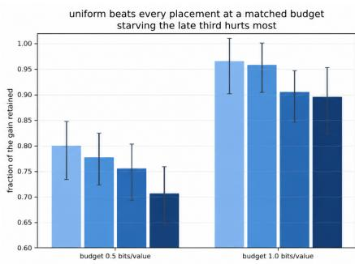

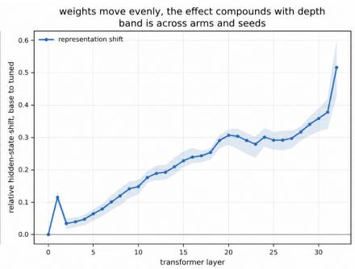  
Figure 10: Equal bit budgets are not functionally interchangeable. Left: retained gain under uniform or depth-selective compression at matched budgets. Right: hidden-state shift grows with depth despite approximately flat update magnitude.

We compare uniform precision with matched-rate variants in which precision is reduced preferentially in the early, middle, or late third of the transformer. Figure 10 shows that uniform allocation preserves more fine-tuning gain at both 0.5 and 1.0 bits per value, while reducing precision in the final third is consistently the most damaging.

This difference is not explained by larger parameter updates in later layers. The RMS magnitude of the learned update is approximately flat across depth, whereas the relative hidden-state shift induced by fine-tuning grows toward the final layers. Thus, comparable parameter-space perturbations can have different behavioral effects depending on where they act in the frozen model.

## C.4 ALTERNATIVE TRAINED-UPDATE PREDICTORS

The main text distinguishes between quantities available before training and properties of the learned update itself. Here we report additional trained-update predictors and controls omitted from the main discussion.

A simple candidate is the fraction of update energy carried by the leading singular direction. We fixed this statistic before evaluating a confirmation panel of 64 adapters spanning four receivers and 34 corpora. On held-out receivers, it orders receiver pairs correctly 73% of the time, compared with 48% for the best correction-spectrum statistic, and reduces prediction error from 0.167 bits per value for a corpus-only baseline to 0.129.

We also tested a more behaviorally informed directional statistic that measures how much trainingdata gain is carried by individual singular directions. Despite using both the trained adapter and the receiver’s behavior on the training data, this statistic does not transfer reliably across receivers, achieving 17% receiver-pair sign accuracy in the same evaluation.

These results motivated the shrinkability rule used in Section 6.2. For completeness, we report additional validation of

$$
R ^ { \star } ( 0 . 9 0 ) \approx \alpha _ { 9 0 } / \gamma .
$$

On rates remeasured using evaluation rows disjoint from those used to estimate α90, the rule obtains an RMSE of 0.048 bits per value. On the five new-receiver panel and the broader 34-corpus archive, the corresponding RMSEs are 0.068 and 0.105, compared with 0.093, 0.076, and 0.177 for the strongest alternative baselines in the respective evaluations.

Because the behavioral rates in these panels had already been measured when the shrinkability rule was formulated, these experiments remain retrospective. We therefore use them as evidence that update shrinkability is a strong empirical descriptor of behavioral rate, rather than as a prospectively validated prediction law.

## D ADDITIONAL CONTROLS FOR COMPRESSION-BASED RECOVERY

This appendix provides additional controls for Section 5. We test alternative compression operations, separate coarse coding from scalar shrinkage, vary the rank available during training, replicate the

Table 6: Recovery under alternative compression operations. Accuracy (%) on GSM8K (1,319 examples) and GSM-Symbolic (500 examples, intervals clustered by template), averaged over three seeds. Frozen-base accuracy is 77.56 / 71.40.
<table><tr><td>condition</td><td>GSM8K</td><td>GSM-Symbolic</td></tr><tr><td>rank 1 @ 1 bit</td><td>83.24</td><td>77.60</td></tr><tr><td>rank 1 @ 16 bits</td><td>42.81</td><td>33.80</td></tr><tr><td>full rank @ 1 bit</td><td>65.05</td><td>55.00</td></tr><tr><td>full rank @ 16 bits (damaged)</td><td>23.81</td><td>15.53</td></tr><tr><td>random rank-1 projection @ 16 bits</td><td>80.09</td><td>72.13</td></tr><tr><td>full update scaled to the rank-1 norm</td><td>23.93</td><td>13.80</td></tr><tr><td>residual rank 15 @ 16 bits</td><td>30.86</td><td>25.20</td></tr></table>

Table 7: Uniform low-bit coding can itself recover corrupted adapters. GSM8K accuracy (%) of aligned and permuted adapters under three uniform codes, averaged over three seeds. Realized rates are 1.97, 1.50, and 1.02 bits per value.
<table><tr><td></td><td colspan="4">aligned</td><td colspan="4">permuted</td></tr><tr><td>model</td><td>raw</td><td>2 bits</td><td>1.5 bits</td><td>1 bit</td><td>raw</td><td>2 bits</td><td>1.5 bits</td><td>1 bit</td></tr><tr><td>Mistral-7B</td><td>68.9</td><td>67.3</td><td>64.2</td><td>59.3</td><td>15.7</td><td>15.3</td><td>14.3</td><td>24.2</td></tr><tr><td>Qwen2.5-7B</td><td>83.2</td><td>83.4</td><td>82.9</td><td>82.4</td><td>23.7</td><td>23.2</td><td>27.4</td><td>65.8</td></tr><tr><td>Llama-3.1-8B</td><td>73.2</td><td>72.2</td><td>70.0</td><td>65.7</td><td>19.8</td><td>19.4</td><td>17.1</td><td>34.7</td></tr></table>

directional analysis across model families, and evaluate recovery across model scales, tasks, and out-of-distribution probes.

## D.1 RECOVERY UNDER ALTERNATIVE COMPRESSION OPERATIONS

The main recovery experiments combine aggressive rank reduction with coarse quantization. We first test whether recovery is specific to this particular compression path. Table 6 compares several alternative interventions on the same corrupted Qwen2.5-7B adapters.

The rank-1, one-bit representation gives the strongest recovery in this comparison, but neither rank reduction nor quantization alone is sufficient to explain the phenomenon. In particular, a random rank-1 projection at full precision also recovers substantial performance, whereas simply scaling the full update to the norm of the rank-1 update does not.

Uniformly coding the complete adapter, without removing rank directions, already repairs part of the damage while having a comparatively small effect on an aligned adapter. For example, at one bit per value the corrupted Qwen2.5-7B adapter rises from 23.7% to 65.8% GSM8K accuracy, whereas the aligned adapter changes from 83.2% to 82.4%.

## D.2 SHRINKAGE AND TRAINING-RANK CONTROLS

A natural explanation for recovery is that coarse quantization simply reduces the magnitude of the corrupted update. We therefore compare coded rank-1 updates with the corresponding full-precision rank-1 update rescaled by a scalar α.

Figure 11a shows that shrinkage explains a substantial fraction of the recovery: an appropriately rescaled full-precision update can approach the performance of the one-bit code. However, matchednorm controls do not eliminate all differences between the coded and rescaled updates, indicating that coarse coding is not exactly equivalent to scalar shrinkage.

Effect of training rank. The final recovered adapter is rank 1 and one bit, raising the possibility that the same result could be obtained by training a small adapter from the start. We therefore train corrupted adapters at ranks 1, 2, 4, and 16, and compress every checkpoint to the same rank-1, one-bit endpoint. Figure 11b shows that recovery is substantially stronger when additional rank was available during training: final GSM8K accuracy rises from approximately 60% when trained at rank 1 to approximately 78–81% when trained at ranks 2–16.

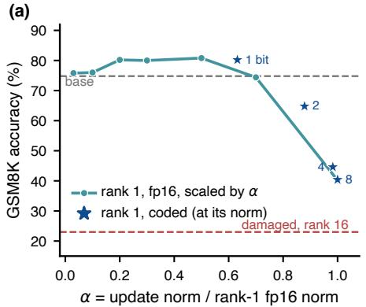

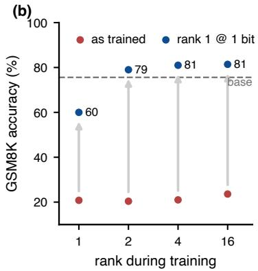  
Figure 11: Shrinkage and training-rank controls. (a) GSM8K accuracy of the full-precision rank-1 update as it is rescaled by $\alpha ,$ compared with coded rank-1 updates at their realized norms. (b) GSM8K accuracy after corrupted adapters trained at different ranks are all compressed to the same rank-1, one-bit endpoint.

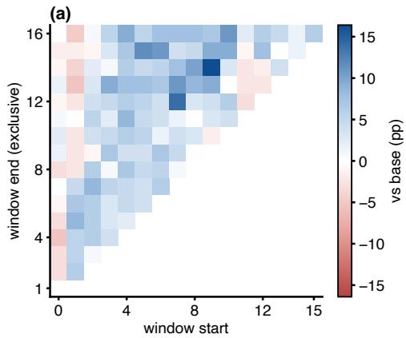

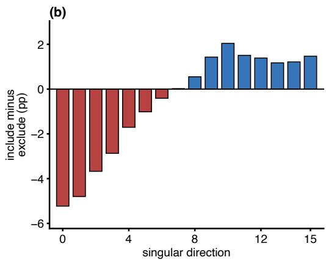  
Figure 12: Directional structure on Mistral-7B-Instruct. (a) Accuracy relative to the frozen model for every contiguous window $[ i , j )$ of singular directions retained at full precision. (b) For each direction, mean accuracy of windows containing it minus that of windows excluding it. Results use 128 reserved MetaMathQA examples.

Compression is therefore not equivalent to directly training the final low-rank representation. Higher training rank appears to make useful behavior more recoverable under the subsequent bottleneck, although these experiments do not establish the mechanism by which this separation emerges.

## D.3 DIRECTIONAL STRUCTURE ACROSS MODEL FAMILIES

We repeat the singular-direction analysis of Section 5.2 on Mistral-7B-Instruct in Figure 12. The same qualitative structure appears as for Qwen2.5: windows containing the leading directions are generally harmful, while windows beginning later in the spectrum recover task performance.

Every window containing the leading direction remains at or below the frozen baseline (24.0% on average versus 25.0% for the base), whereas windows starting between directions 2 and 9 average 28.7–31.8%. Consistently, the per-direction marginal contribution changes from negative for early directions to positive for later ones.

## D.4 RECOVERY ACROSS MODEL SCALES AND TASKS

We next test whether recovery is specific to Qwen2.5-7B and GSM8K. Table 8 reports corresponding experiments across Qwen2.5 model scales and on a second structured task.

Table 8: Recovery across model scales and tasks. For models up to 7B, entries are GSM8K accuracy (%) after training on permuted MetaMathQA rationales. For 14B and 32B, entries are XBRL exact match after corrupted response assignments.
<table><tr><td>size</td><td>base</td><td>damaged</td><td>clean</td><td>rank 1 @ 1 bit</td><td>overshoot</td></tr><tr><td>0.5B</td><td>23.0</td><td>9.4</td><td>45.2</td><td>25.0</td><td>+2.0</td></tr><tr><td>1.5B</td><td>51.6</td><td>13.6</td><td>67.6</td><td>59.0</td><td>+7.4</td></tr><tr><td>3B</td><td>60.4</td><td>17.4</td><td>74.0</td><td>71.0</td><td>+10.6</td></tr><tr><td>7B</td><td>75.6</td><td>22.8</td><td>81.0</td><td>80.8</td><td>+5.2</td></tr><tr><td>14B, XBRL tagging</td><td>24.6</td><td>53.0</td><td>一</td><td>73.8</td><td>+49.2</td></tr><tr><td>32B, XBRL tagging</td><td>32.4</td><td>51.8</td><td>一</td><td>74.4</td><td>+42.0</td></tr></table>

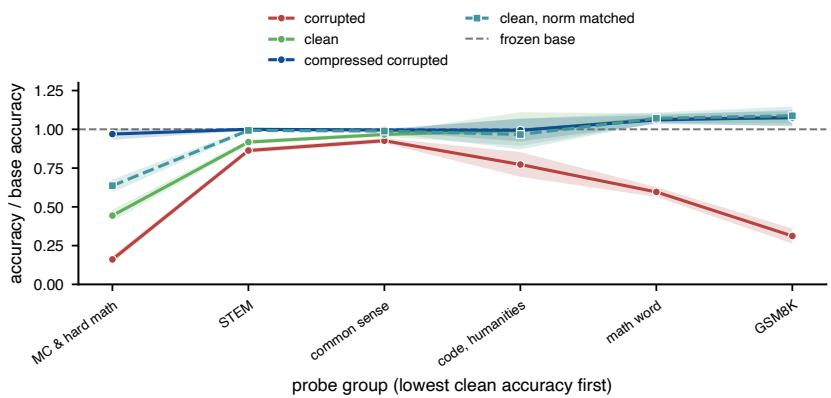  
Figure 13: Off-task behavior after compression-based recovery. Accuracy on 72 probes normalized by the frozen Qwen2.5-7B model and grouped by task proximity to GSM8K. The compressed corrupted adapter remains close to the frozen model away from its training task, unlike the clean fine-tune even under a normmatched control.

For models up to 7B, corrupted MetaMathQA rationales consistently damage GSM8K accuracy and the compressed adapter recovers a substantial fraction of the loss. For the 14B and 32B models, we additionally report XBRL tagging under corrupted response assignments, where the frozen models leave more headroom. Recovery remains visible in this setting.

The XBRL corruption differs from the permuted-rationale intervention: mismatched responses can still teach the model task-specific output vocabulary, so the corrupted adapter may already outperform the frozen model. The relevant comparison is therefore whether compression further separates task-relevant structure from the corruption-induced behavior.

## D.5 OFF-TASK BEHAVIOR AFTER RECOVERY

Finally, we ask whether recovering in-domain performance comes at the cost of larger behavioral changes elsewhere. We evaluate the frozen model, a clean fine-tune, and the compressed corrupted adapter on 72 probes of varying proximity to GSM8K.

Figure 13 shows that the compressed corrupted adapter remains close to the frozen model on distant task groups despite recovering strong GSM8K performance. The contrast is particularly large on harder mathematical tasks: the clean adapter retains 44% of the frozen model’s accuracy, whereas the compressed corrupted adapter retains 97%. A norm-matched clean control indicates that this difference is not explained solely by the magnitude of the learned update.

## E ADDITIONAL RELATED WORK

Low-rank parameterizations and capacity. A large body of work has refined the original LoRA parameterization by changing how adaptation capacity is allocated or represented. AdaLoRA adaptively allocates a parameter budget across weight matrices and prunes less important singular com ponents of the learned update (Zhang et al., 2023b). VeRA substantially reduces trainable storage by sharing frozen low-rank matrices across layers and learning only small scaling vectors (Kopiczko et al., 2024), while LoRA-XS uses frozen SVD-derived bases and trains only a small r × r matrix between them (Bałazy et al., 2025). PiSSA instead initializes the adaptive subspace from the principal singular directions of the pretrained weights (Meng et al., 2024). In the opposite direction, MoRA argues that restricting the update itself to low rank can limit learning and memorization, and obtains higher-rank updates under a comparable parameter budget (Jiang et al., 2024). These methods demonstrate that trainable parameter count, update rank, and the subspace in which adaptation occurs are distinct design choices. Our behavioral rate measures a different quantity: how many serialized bits of a trained update must survive in order to preserve its behavior when composed with a particular frozen receiver.

Optimization and parameterization of LoRA updates. Other work shows that even when the represented update class is similar, its factorization and optimization can substantially affect learning. LoRA+ assigns different learning rates to the two LoRA factors to improve feature learning (Hayou et al., 2024), while LoRA-FA freezes one factor to reduce activation-memory cost (Zhang et al., 2023a). DoRA decomposes pretrained weights into magnitude and direction and applies low-rank adaptation to the directional component (Liu et al., 2024). More recently, Balanced LoRA observes that many pairs of LoRA factors represent the same weight update but can have very differ ent conditioning, and projects optimization onto a balanced factorization (Castin et al., 2026). This distinction between the parameterization used to learn an update and the functional effect of the resulting update is complementary to our setting: our compression analysis is performed after training and evaluates the decoded update through the frozen model rather than through its factorization alone.

Selecting and composing adapter components. Several methods exploit non-uniform functional importance within or across adapters. LoRA-drop ranks layers by their LoRA output contribution, retains separate modules for important layers, and shares LoRA parameters across the remaining layers (Zhou et al., 2025), while LoraHub composes independently trained LoRA modules to trans fer across tasks (Huang et al., 2024). These approaches further illustrate that adapter components are not interchangeable. Our experiments ask a complementary question: after an adapter has been learned, which parts of its representation must remain after compression to preserve the acquired behavior?

Reasoning structure and chain-of-thought compression. Several of our corruption experiments use chain-of-thought supervision (Wei et al., 2022). Qian et al. (2025) study information dynamics along reasoning trajectories, while Dutta et al. (2024) analyze mechanisms supporting step-by-step reasoning. Related mechanistic work studies symbolic computation and structured state tracking (Yang et al., 2025; Fagnou et al., 2024). Li et al. (2026) directly compress chain-of-thought traces using step-level information measures. Our experiments instead use corrupted reasoning supervision as a controlled way to induce useful and harmful effects within the same learned update.