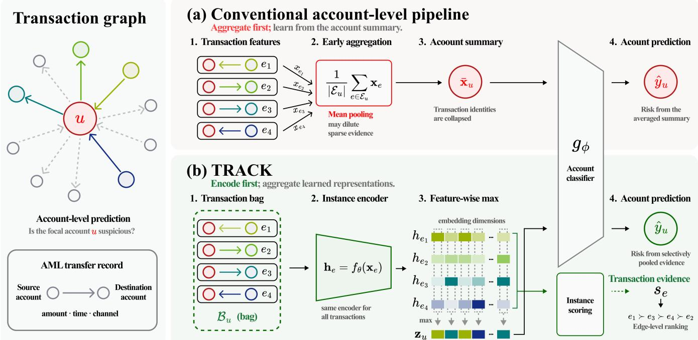
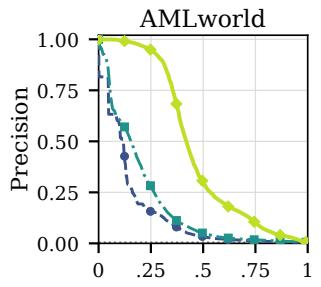
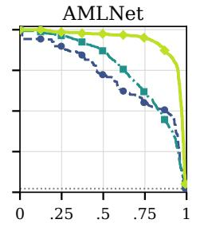
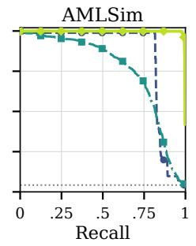
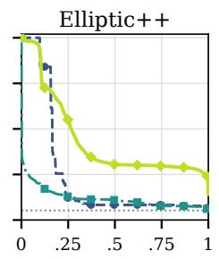
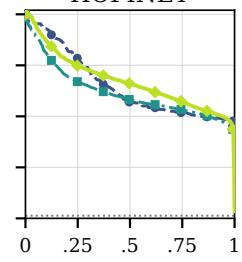
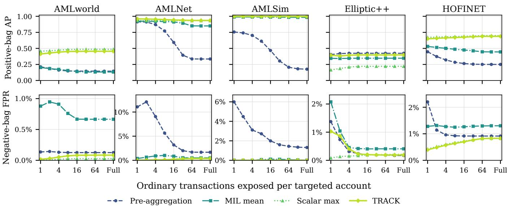

# TRACK: Multiple Instance Learning for Anti-Money Laundering in Transaction Networks

Seonkyu Lim∗ KFTC Seoul, South Korea sklim@kf tc.or.kr

Jeongwhan Choi   
KAIST   
Daejeon, South Korea   
jeongwhan.choi@kaist.ac.kr   
Inwoo Tae∗   
UNIST   
Ulsan, South Korea   
vitainu0104@unist.ac.kr   
Taehoon Kim†   
Sogang University   
Seoul, South Korea   
taehoonkim@sogang.ac.kr   
Gwangui Hong∗ KAIST   
Daejeon, South Korea KFTC   
Seoul, South Korea   
recordame@kftc.or.kr   
Min-Soo Kim†   
KAIST   
Daejeon, South Korea   
minsoo.k@kaist.ac.kr   
Jaehoon Lee   
LG AI Research   
Seoul, South Korea   
jaehoon.lee@lgresearch.ai   
Yongjae Lee†   
UNIST   
Ulsan, South Korea   
LinqAlpha   
New York, USA   
yongjaelee@unist.ac.kr

## Abstract

Anti-money laundering (AML) investigations are organized around accounts, while the suspicious evidence for an account may reside in only a few of its transactions. Yet many account-level detectors summarize transactions before learning, and message-passing models may aggregate once more over neighboring accounts. We name this discrepancy the aggregation mismatch and study it under an account-window benchmark label defined by the presence of at least one flagged transaction. We recast account-level AML detection as multiple instance learning, in which an account-window is a bag and its transactions are instances. We propose TRACK, which encodes every transaction with a shared encoder and selectively pools the encodings into an account decision. To emulate coarse supervision, we withhold the transaction labels of five AML datasets from TRACK throughout training. Under a time-ordered protocol, TRACK achieves the highest average precision among the tabular and graph baselines trained from account labels on every dataset. Despite using only account-window supervision, it remains competitive with edge classifiers trained directly from transaction labels. Its instance scores also rank flagged transactions well above chance and approach or exceed directly supervised ranking performance across datasets.

## CCS Concepts

• Social and professional topics → Financial crime; • Applied computing → Electronic funds transfer; • Computing method ologies → Supervised learning by classification.

## Keywords

anti-money laundering, multiple instance learning, weak supervision, account-level detection, transaction data

ACM Reference Format:   
Seonkyu Lim, Inwoo Tae, Gwangui Hong, Jaehoon Lee, Jeongwhan Choi, Taehoon Kim, Min-Soo Kim, and Yongjae Lee. 2027. TRACK: Multiple Instance Learning for Anti-Money Laundering in Transaction Networks. In Proceedings of the Twentieth ACM International Conference on Web Search and Data Mining (WSDM ’27), February 15–19, 2027, Hong Kong SAR, China. ACM, New York, NY, USA, 11 pages.

## 1 Introduction

Money laundering is estimated to account for 2–5% of global GDP, posing a substantial threat to the integrity of financial systems [39]. To combat this threat, financial institutions operate anti-money laundering (AML) systems that monitor massive volumes of transactions for suspicious activity. Laundering activity may involve patterns of transfers across multiple accounts and over time [17, 26]. This relational and temporal structure can be naturally represented as a transaction graph, where accounts are nodes and transactions are directed, attributed edges.

This graph representation provides financial institutions with a natural basis for AML monitoring and investigation. However, financial institutions process vast numbers of transactions every day, making it impractical for investigators to examine each transaction individually. AML teams therefore prioritize suspicious customers or accounts and then review their transactions and connected accounts [15]. In this process, accounts are the primary targets of investigation, while transactions provide the supporting evidence. Accordingly, we formulate AML detection as account-level node classification rather than transaction-level edge classification.

However, many public and synthetic AML benchmarks provide transaction-level labels [1, 14, 21, 37]. As a result, a line of work formulates AML detection as transaction-level edge classification and evaluates models directly on labelled transfers. This formulation is appropriate when the goal is to screen or block an individual transaction. Transaction-level performance, however, does not by itself measure whether a model prioritizes the customer or account cases that analysts investigate. Moreover, supervised edge classification assumes that fine-grained transaction labels are available ∗These authors contributed equally to this work. †Corresponding authors

  
Figure 1: Overview of the aggregation mismatch and TRACK. (a) Aggregate-first modeling averages transaction features before learning. (b) TRACK encodes transactions as instances and applies feature-wise max pooling, yielding account risk and transaction ranking from account labels alone.

for training. It therefore answers a diferent operational question from the account-centered setting we target.

Account- and node-level methods use the appropriate decision unit, but a common pipeline compresses each account’s transactions into a fixed-length summary before learning. Tabular models classify aggregated statistics of transaction activity, while graph models may apply message passing on top of similar node representations [12, 29, 38, 41]. However, the evidence may be concentrated in only a small subset of an account’s transactions. Aggregating many transactions can dilute that signal and obscure which transactions support the account-level prediction. We call this discrepancy the aggregation mismatch: the decision is made at the node level using evidence from transaction edges, but those edges are collapsed before the supervised model can learn from them.

We propose Transaction Representation for Account Classification and evidence ranKing (TRACK), a transaction-preserving node classifier joining node decisions to transaction evidence. TRACK sep arates the unit of decision from the unit of evidence: it predicts whether an account is suspicious while learning from its individual transactions. To achieve this, TRACK represents each accountwindow as a bag of transactions under the multiple-instance learning framework [11, 22]. Unlike aggregate-first account pipelines, TRACK keeps transactions as instances until their representations are learned, then combines them. The learned embeddings support a complete candidate ranking, while the max-pooled dimensions provide a separate exact attribution of the account logit.

We evaluate this account-supervised setting by coarsening the transaction labels in AML benchmarks into account-window labels and withholding the original flags throughout training. The hidden labels are used only for transaction-ranking evaluation, controlled diagnostics, and transaction-supervised baselines. This controlled construction makes the MIL relation exact; it does not model institutional cases whose labels arise only from higher-order patterns, external information, reporting delay, or investigator judgment. Under a time-ordered protocol, we compare TRACK with tabular, graph, and transaction-supervised alternatives and isolate the efect of aggregation location and operator. Our contributions are:

• We identify the aggregation mismatch in account-level AML: aggregate-first node classifiers hold the right prediction target but collapse transaction identity and attribute co-occurrence.

• We recast account-level detection as multiple instance learning, in which an account-window is a bag and its transactions are instances, aligning the aggregation the model performs with the rule that assigns the label.

• We propose TRACK, a transaction-preserving node classifier that learns from account labels, pools transaction representations selectively, and provides candidate ranking and forward-path attribution without graph message passing.

• We construct a controlled account-supervision benchmark by coarsening transaction labels and withholding them from TRACK training, then assess account detection, within-account transaction ranking, and aggregation behavior against tabular, graph, and transaction-supervised alternatives.

## 2 Related Work

## 2.1 Account-Level Detection

Graph-based account-level detection has largely developed around the context surrounding a target node. Earlier studies focused on making message propagation robust to camouflage, label imbalance, unreliable neighbors, and the low homophily of fraudulent networks [8, 12, 29, 30, 33, 38, 41, 42]. AML research has used transaction-graph structure to learn representations and find suspicious flow patterns under limited supervision [7, 26, 31]. Recent methods enlarge or refine the graph context used for node deci sions. GCD-GNN estimates class-level prototypes and uses global confidence to control how information from diferent types of neighbors is aggregated [28]. GPA instead encodes variable-length paths, enabling a node classifier to capture associations beyond its immediate neighborhood [34]. In contrast, TRACK learns account-level decisions directly from a set of transaction instances under accountlevel supervision.

## 2.2 Transaction-Level Detection

Recent graph-based AML studies, particularly those evaluated on transaction-level benchmarks, have predominantly formulated detection as edge classification, treating each transaction as the prediction target [13, 27]. Across this line of work, methods have sought to capture the directionality and multiplicity of transactions [3, 13], transaction attributes [27], temporal dependencies [18], and higherorder transaction patterns [20]. Among them, Multi-GNN extends message passing to directed multigraphs [13], and we evaluate its GIN variant, Multi-GIN; FraudGT incorporates transaction attributes through edge-aware attention [27]. This formulation is well aligned with benchmarks that provide transaction-level labels, but it assumes that supervision is available at the same granularity. TRACK considers the complementary setting in which labels are provided only at the account level.

## 2.3 Multiple Instance Learning

Multiple instance learning (MIL) learns from labeled bags whose constituent instances are not individually annotated [11, 32]. Under the classical MIL assumption, a bag is positive if at least one of its instances is positive, motivating max-based aggregation of instance evidence [2, 6]. Later work introduced smooth and attentionweighted alternatives that distribute learning signals across multi ple instances [22, 25]. MIL has since been applied to problems in which annotations are available at a coarser level than the evidence of interest, including whole-slide pathology [5] and weakly supervised video anomaly detection [36]. Account-level AML exhibits the same supervision structure: labels are assigned to accounts, while the evidence underlying those labels resides in their transactions. TRACK formulates each account-window as a bag and its transactions as instances, and constructs the account representation through dimension-wise max pooling over transaction embeddings.

## 3 Methodology

## 3.1 Problem Formulation

Let $\mathcal { G } = ( \mathcal { V } , \mathcal { E } )$ be a directed multigraph, where each node � $\in \mathcal { V }$ represents an account and each edge $e = ( p , q ) \in \mathcal { E }$ represents a transaction from account $\boldsymbol { p }$ to account $q .$ Each transaction carries an attribute vector $\mathbf { r } _ { e } ,$ which includes its amount, timestamp, and other available information. Because multiple transactions may occur between the same pair of accounts, $\mathcal { G }$ is represented as a multigraph.

Let $\mathcal { W }$ partition the observation period into consecutive windows. For an account � and a window � $\in \mathcal { W } _ { : }$ , we first define the complete set of incident transactions observed in that window as

$$
\mathcal { E } _ { u , w } ^ { \mathrm { r a w } } = \{ e = ( p , q ) \in \mathcal { E } \ | \ u \in \{ p , q \} , \ t _ { e } \in w \} ,\tag{1}
$$

where $t _ { e }$ is the transaction timestamp. To bound memory, preprocessing first draws, for each account �, one fixed random subset of at most � transactions from all transactions incident to � over the full observation period. It then intersects this retained account-level subset with each temporal window �. We write $\mathcal { E } _ { u , w } \subseteq \mathcal { E } _ { u , w } ^ { \mathrm { r a w } }$ for the resulting window-specific transaction set. The fixed account-level subset is shared across every method and training seed, and each window-specific set defines both the bag and its account-window label. Each non-empty pair $( u , w )$ forms one account-window sample, and the objective is to predict its label $y _ { u , w } \in \{ 0 , 1 \}$ . The benchmark datasets also provide a transaction label $y _ { e } \in \{ 0 , 1 \}$ for each edge. These transaction labels are withheld during account-supervised training and are used only in the post-hoc ranking and controlled diagnostics.

To learn from account-window labels alone, TRACK maps each transaction incident to � to an account-specific representation ${ \bf x } _ { u , e }$ and forms the bag

$$
\mathcal { B } _ { u , w } = \{ \mathbf { x } _ { u , e } ~ | ~ e \in \mathcal { E } _ { u , w } \} .\tag{2}
$$

This preserves individual transactions as instances while using the account-window as the unit of prediction.

The resulting bag follows the standard multiple instance relation

$$
y _ { u , w } ~ = ~ \operatorname* { m a x } _ { e \in \mathscr { E } _ { u , w } } y _ { e } ,\tag{3}
$$

under which an account-window is positive ifand only ifit contains at least one positive transaction. The model is trained using only $y _ { u , w } ;$ the constituent labels $y _ { e }$ never enter its objective. Because each transaction is incident to two endpoint accounts, a positive transaction contributes a positive instance to both endpoint-specific bags. The resulting account-window label denotes incidence to a flagged transaction; it is a controlled supervision proxy and does not adjudicate that both endpoint accounts are culpable.

## 3.2 Instance Construction

Given an account � and one of its incident transactions $e ,$ TRACK constructs the instance representation ${ \bf x } _ { u , e }$ from three sources of information. The first describes the transaction itself, including its log-transformed amount, direction, time of day, and channel. The second describes the behavior of account � up to the time of the transaction, expressing the amount relative to its previous transfers, the time interval relative to its transaction rhythm, and the counterparty relative to its transaction history. The third describes the account at the other end of the transaction using the same historical features computed at the same point in time. Together, these features place each transaction in the behavioral context of both participating accounts. Rather than propagating information across neighboring nodes, TRACK attaches the counterparty context directly to the transaction connecting the two accounts, allowing each instance to be encoded independently. Table 1 lists them.

All historical features are computed using only transactions observed at or before the timestamp of the corresponding instance, thereby preventing information from future transactions from entering its representation. The consecutive windows in Equation 1 prevent a single bag from combining behavior across temporal split boundaries. Every resulting account-window bag has width at most � and is padded when necessary.

Table 1: Transaction-instance features used by TRACK. Each instance contains six transaction attributes and 22 history features for the focal account, with the latter repeated for the counterparty (up to 50 in total). Missing channel or clock fields reduce it.
<table><tr><td>Group</td><td>n</td><td>Feature definitions</td></tr><tr><td>Transfer</td><td>6</td><td>Log amount; direction; cyclic hour encoding; two channel indicators</td></tr><tr><td>Amount</td><td>4</td><td>Amount z-score and percentile rank; share of cumulative volume; frequency of similar prior amounts</td></tr><tr><td>Rhythm</td><td>5</td><td>Time since the previous transfer and its z-score; first-transaction indicator; prior transfer count; account tenure</td></tr><tr><td>Counterparty</td><td>3</td><td>New-counterparty indicator; prior transaction count and elapsed time for the account pair</td></tr><tr><td>Balance</td><td>2</td><td>Normalized outgoing-incoming differences in transaction count and amount</td></tr><tr><td>Pass-through</td><td>2</td><td>Time since the most recent incoming transfer; current-to-incoming amount ratio</td></tr><tr><td>Windows</td><td>6</td><td>Log transaction count and new-counterparty rate over three trailing horizons (1/6, 0.4, and 0.8 of the observed span)</td></tr></table>

Table 2: Dataset statistics after each loader’s tail cut. A sample is an account–window pair. Flagged accounts and transactions are counted over the full graph, whereas flagged test samples are counted in the test window. Parentheses give percentages of the corresponding totals. The last two columns indicate whether a dataset contains real transactions and is publicly available.
<table><tr><td>Dataset</td><td>Accounts</td><td>Transactions</td><td>Account-window samples</td><td>Flagged accounts</td><td>Flagged transactions</td><td>Flagged test samples</td><td>Real data</td><td>Publicly available</td></tr><tr><td>AMLworld [1]</td><td>515,078</td><td>5,077,097</td><td>1,105,081</td><td>5,862 (1.14%)</td><td>1,522 (0.03%)</td><td>1,643 (0.46%)</td><td>x</td><td>√</td></tr><tr><td>AMLNet [21]</td><td>11,000</td><td>1,088,410</td><td>33,000</td><td>1,468 (13.35%)</td><td>1,709 (0.16%)</td><td>247 (2.25%)</td><td>x</td><td>√</td></tr><tr><td>AMLSim [37]</td><td>9,999</td><td>1,323,234</td><td>29,996</td><td>1,639 (16.39%)</td><td>1,719 (0.13%)</td><td>423 (4.23%)</td><td>x</td><td>√</td></tr><tr><td>Elliptic++ [14]</td><td>265,354</td><td>1,661,916</td><td>268,650</td><td>14,266 (5.38%)</td><td>15,863 (0.95%)</td><td>1,747 (5.24%)</td><td>√</td><td>√</td></tr><tr><td>HOFINET</td><td>452,816</td><td>4,732,130</td><td>758,994</td><td>9,644 (2.13%)</td><td>14,190 (0.31%)</td><td>2,723 (1.31%)</td><td>√</td><td>x</td></tr></table>

## 3.3 Account-Level Prediction

For each transaction � associated with account �, a shared encoder $f _ { \theta }$ maps the instance representation to a �-dimensional hidden embedding,

$$
\mathbf { h } _ { u , e } = f _ { \theta } ( \mathbf { x } _ { u , e } ) \in \mathbb { R } ^ { d } .\tag{4}
$$

The same encoder is applied independently to every transaction in the bag. We implement $f _ { \theta }$ as a two-layer perceptron with ReLU activations and dropout.

TRACK constructs the account representation by taking the maximum activation in each hidden dimension,

$$
\mathbf { z } _ { u , w } [ j ] = \operatorname* { m a x } _ { e \in { \mathcal { E } } _ { u , w } } \mathbf { h } _ { u , e } [ j ] , \qquad j = 1 , \dotsc , d .\tag{5}
$$

This operation treats the transactions as an unordered set and is invariant to their permutation. Because the maximum is taken separately in each hidden dimension, diferent dimensions of $\mathbf { z } _ { u , w }$ may originate from diferent transactions; the pooled representation need not match any one transaction embedding.

A linear prediction head $g _ { \phi }$ maps the pooled representation to the account-window logit $\ell _ { u , w } ,$ and � denotes the sigmoid function that converts the logit into a prediction probability,

$$
\begin{array} { r } { \ell _ { u , w } = g _ { \phi } ( \mathbf { z } _ { u , w } ) , \qquad \hat { y } _ { u , w } = \sigma ( \ell _ { u , w } ) . } \end{array}\tag{6}
$$

Training minimizes a weighted binary cross-entropy over the set ${ \mathcal { S } } _ { \mathrm { t r } }$ of training account-window pairs,

$$
\mathcal { L } = - \frac { 1 } { \left| S _ { \mathrm { t r } } \right| } \sum _ { ( u , w ) \in S _ { \mathrm { t r } } } \Big [ \alpha y _ { u , w } \log \hat { y } _ { u , w } + \left( 1 - y _ { u , w } \right) \log \left( 1 - \hat { y } _ { u , w } \right) \Big ] ,\tag{7}
$$

where � is the ratio of negative to positive bags in the training set. Only account-level labels enter this objective. Under dimensionwise max pooling, the gradient in each hidden dimension is routed through the transaction that produced its maximum activation, allowing the model to determine which transactions support the account prediction without transaction-level supervision.

## 3.4 Transaction Ranking and Attribution

TRACK provides two complementary transaction-level quantities. The first assigns a candidate-ranking score to every transaction by applying the shared prediction head to its embedding,

$$
\begin{array} { r } { s _ { u , w , e } = g _ { \phi } ( \mathbf { h } _ { u , e } ) . } \end{array}\tag{8}
$$

Although $s _ { u , w , e }$ receives no transaction-level supervision, it provides a complete ranking of the transactions in $\mathcal { B } _ { u , w } .$ . It measures how strongly a transaction would be classified on its own and is the score evaluated by the within-account ranking metrics. It is not a faithful decomposition of the account decision, because TRACK applies $g _ { \phi }$ after pooling.

The second quantity provides that exact forward-path attribution. Let $\pi _ { u , w } ( j ) = \arg \operatorname* { m a x } _ { e \in \mathcal { E } _ { u , w } } { \bf h } _ { u , e } [ j ]$ identify the transaction that supplies hidden dimension �, and let $\beta$ and � denote the weights and bias of $g _ { \phi } .$ . The signed contribution of transaction � is

$$
c _ { u , w , e } = \sum _ { j : \pi _ { u , w } ( j ) = e } \beta _ { j } \ \mathbf { z } _ { u , w } [ j ] , \qquad \sum _ { e \in \mathcal { E } _ { u , w } } c _ { u , w , e } = \ell _ { u , w } - b .\tag{9}
$$

Unlike $s _ { u , w , e } , c _ { u , w , e }$ exactly decomposes the account-window logit excluding its bias, but it is sparse: a hidden representation of width � assigns a non-zero contribution to at most � transactions. We use $s _ { u , w , e }$ for the complete review ranking and retain $c _ { u , w , e }$ as a distinct attribution of the model’s actual forward path; the two quantities answer diferent questions and are not treated as interchangeable explanations. This attribution describes the realized computation rather than an investigator-validated rationale.

## 4 Experimental Setup

## 4.1 Datasets

We evaluate on four public benchmarks and one non-public real world interbank network, summarized in Table 2.

• AMLworld [1] is a synthetic banking-transaction benchmark developed to compare AML detection models using complete transaction-level laundering labels. We use its HI-Small release, which contains multiple simulated laundering typologies embedded in otherwise ordinary transactions.

• AMLNet [21] is generated by a knowledge-based multi-agent framework designed to model and detect laundering transactions. Its laundering covers the placement, layering and integration stages and typologies such as structuring.

• AMLSim [37] is a multi-agent simulator that generates banking transactions with known laundering patterns for testing machine-learning and graph-based detection algorithms. We use a fixed public snapshot rather than regenerating the data, so every method sees the same graph.

• Elliptic++ [14] is a real Bitcoin dataset introduced for financial forensics involving both fraudulent transactions and illicit wallet nodes. We treat wallets as accounts and their incident Bitcoin transfers as transaction instances.

• HOFINET is a non-public real-world interbank settlement network used for operational account monitoring. It tests whether results obtained on synthetic and cryptocurrency data transfer to an institutional setting.

Although the datasets were introduced for diferent detection problems, we convert all five into the same account-window classification task. An account-window sample is flagged when it contains at least one flagged transaction. The datasets do not provide independently adjudicated account-window case labels, so this coarsening emulates account supervision rather than reproducing the noise and reporting delay of operational case labels. TRACK and the account-level baselines are trained only with the resulting accountwindow labels, while the original transaction labels are withheld for transaction-ranking and controlled diagnostics. Multi-GIN and FraudGT use the transaction labels under their native supervision setting. This construction isolates supervision granularity under an exact bag-label relation, but independently assigned institutional case labels remain outside its scope.

## 4.2 Baselines

We organize the baselines by input structure and prediction granularity. The first three groups share TRACK’s account-window super vision; the last uses transaction labels and predicts edges.

• Tabular classification includes LR, a multilayer perceptron and XGBoost [9] on aggregated account features alone.

• General graph node classification includes GCN [23], GAT [40], GraphSAGE [19] and H2GCN [43] as standard message-passing and heterophily-aware account classifiers.

• Fraud-oriented graph node classification includes CARE-GNN [12], PC-GNN [29], BWGNN [38], GAGA [41], GCD-GNN [28] and GPA [34].

• Transaction-level AML classification includes Multi-GIN [13] and FraudGT [27]. For account-level evaluation, an account-window receives the maximum predicted probability among its incident transactions.

The model families retain their native input structures. Tabular and graph node classifiers receive aggregate account features, graph models additionally receive window-specific account connectivity, and TRACK receives transaction-instance features with causal account and counterparty context. Table 3 is therefore an end-to-end comparison of account-detection pipelines rather than a featurematched estimate of the efect of pooling alone. The controlled variants in Section 4.4 provide that feature-matched comparison by holding the transaction inputs, encoder and training protocol fixed.

## 4.3 Experimental Protocol

Transactions are ordered by time and split 60/20/20 into training, validation and test windows. Each account retains a fixed subset of transactions capped at the dataset-specific 99th percentile, up to 1,024; this subset is shared across methods and training seeds. Transaction-ranking metrics are computed over these retained instances. Appendix A provides bag-size and retention details.

Each temporal window forms a separate graph for graph baselines, preventing message passing across split boundaries while allowing transductive use of within-window topology. Model, epoch and decision-threshold selection use validation data only: neural models early-stop after 30 epochs without AP improvement, and XGBoost after 50 rounds. Feature scaling is fitted on training rows. We report means and standard deviations over five training seeds under the fixed temporal cut; the deviations do not measure variation across alternative time periods. Appendix A gives the search grids.

## 4.4 Controlled Aggregation Diagnostics

We compare Pre-aggregation, MIL mean, Scalar max and TRACK while holding their transaction features, account-window labels, temporal split, encoder, training budget and search space fixed. Each fitted model is reused without retraining or threshold reselection in two controlled test-time interventions. For each training seed, we randomly order the ordinary transactions in every test bag once and share that order across all four variants. Nested prefixes expose 1, 2, 4, 8, 16, 32, 64 and 128 ordinary transactions. A shorter bag uses all available transactions, and Full restores the original retained bag. Positive dilution retains every flagged transaction, progressively exposes ordinary transactions only in positive bags and reports account AP over the full test set while negative bags remain fixed. Negative exposure keeps positive bags fixed, progressively exposes ordinary transactions in negative bags and reports FPR at the validation-selected threshold. Transaction labels are consulted only after training to distinguish flagged from ordinary transactions when constructing these diagnostic masks. They do not enter training, model selection or threshold selection.

## 4.5 Implementation

Experiments used one NVIDIA GB10 GPU with 121 GiB of unified memory on Ubuntu 24.04.4 LTS. We used Python 3.12.13, PyTorch

2.11.0 with CUDA 12.8, PyTorch Geometric 2.8.0, scikit-learn 1.9.0 and XGBoost 3.3.0.

## 4.6 Evaluation Metrics

We report average precision (AP), area under the receiver operating characteristic curve (AUROC), macro $F _ { 1 }$ and G-mean. For a deci sion threshold selected on the validation set, let TP, TN, FP and FN denote the entries of the test-set confusion matrix. We define the true-positive, true-negative and false-positive rates as TPR = TP/(TP + FN), TNR = TN/(TN + FP) and FPR = FP/(FP + TN).

AP and AUROC evaluate the ranking induced by the predicted account scores without fixing a decision threshold [10, 16]. Let � be the number of distinct score thresholds, and let $P _ { m }$ and $R _ { m }$ be precision and recall at the �th threshold, ordered so that recall increases. We compute

$$
\begin{array} { c } { { \displaystyle \mathrm { A P } = \sum _ { m = 1 } ^ { M } ( R _ { m } - R _ { m - 1 } ) P _ { m } , } } \\ { { \displaystyle \mathrm { A U R O C } = \int _ { 0 } ^ { 1 } \mathrm { T P R } ( r ) d r , } } \end{array}\tag{10}
$$

where � denotes FPR along the ROC curve. AP is our primary metric because AML monitoring produces a ranked list of alerts under limited investigative capacity: a useful model must recover suspicious accounts while limiting the legitimate accounts sent for review. AP summarizes this precision–recall trade-of across operating points and is likewise used in an operational AML evaluation to summarize performance across alert target rates [4]. Methods are compared by a two-sided 95% Student-� interval on the five per-seed diferences in AP against the strongest account-supervised baseline, which covers training variation under the fixed temporal split, not sampling variation over accounts.

Macro $F _ { 1 }$ and G-mean evaluate the binary predictions obtained at the validation-selected threshold. Following their standard defi nitions [24, 35], we compute

$$
\begin{array} { l } { { \mathrm { M a c r o - } F _ { 1 } = \displaystyle \frac { 1 } { 2 } \left( \frac { 2 \mathrm { T P } } { 2 \mathrm { T P } + \mathrm { F P } + \mathrm { F N } } + \frac { 2 \mathrm { T N } } { 2 \mathrm { T N } + \mathrm { F P } + \mathrm { F N } } \right) , } } \\ { { \mathrm { G - m e a n } = \sqrt { \mathrm { T P R } \cdot \mathrm { T N R } } . } } \end{array}\tag{11}
$$

Macro $F _ { 1 }$ assigns equal importance to the two classes, while G-mean measures whether sensitivity is maintained on both classes. We include them because $F _ { 1 } \cdot$ - and G-mean-based evaluation is common in graph-based AML and fraud detection [13, 29, 38].

For within-account transaction ranking, let P be the positive test bags, let $\rho _ { i } ( r )$ denote the transaction ranked at position � in bag � by $s _ { u , w , e } ,$ and let $m _ { i }$ be the number of flagged transactions in that bag. We compute

$$
\begin{array} { r l r } & { \mathrm { H i t @ } k = \frac { 1 } { | \mathcal { P } | } \displaystyle \sum _ { i \in \mathcal { P } } \mathbb { I } \left[ \sum _ { r = 1 } ^ { \operatorname* { m i n } ( k , n _ { i } ) } y _ { \rho _ { i } ( r ) } > 0 \right] , } & \\ & { \mathrm { A P } _ { i } = \frac { 1 } { m _ { i } } \displaystyle \sum _ { r = 1 } ^ { n _ { i } } \mathrm { P r e c } _ { i } ( r ) y _ { \rho _ { i } ( r ) } , \quad } & { \mathrm { M A P } = \frac { 1 } { | \mathcal { P } _ { \operatorname* { m i x } } | } \displaystyle \sum _ { i \in \mathcal { P } _ { \operatorname* { m i x } } } \mathrm { A P } _ { i } , } & \end{array}\tag{12}
$$

where $n _ { i }$ is the number of transactions in bag �, $\mathrm { P r e c } _ { i } ( r )$ is precision through rank $r ,$ and ${ \mathcal { P } } _ { \operatorname* { m i x } } \subseteq { \mathcal { P } }$ contains the positive bags with both flagged and ordinary transactions. Hit@� measures whether

reviewing the first � candidates exposes any flagged transaction. MAP measures the complete within-bag ranking and excludes allflagged bags, for which every ordering is trivially perfect.

## 5 Results

## 5.1 Overall Detection Performance

Table 3 compares the complete account-detection pipelines under their respective input structures. Across all five datasets, TRACK leads every baseline trained with account-level supervision. The best competing family varies between tabular and graph models, so the result is not explained by the weakness of one particular architecture. Because these families difer in both representation and architecture, this table establishes end-to-end performance rather than attributing the diference to pooling alone. Importantly, the account-supervised result also holds on HOFINET, the nonpublic real-world interbank network, so the observed performance is not confined to public synthetic or cryptocurrency benchmarks. It excludes zero on four ofthe five datasets; on Elliptic++ the baseline’s own seed spread of ±.182 exceeds the 0.102 gap.

AP compresses the precision–recall trade-of into a single value. Figure 2 therefore compares TRACK with representative accountsupervised aggregate and graph baselines across the full recall range. Its advantage over these references generally persists across operating points, indicating that it is not produced by a narrow threshold choice and is relevant when an institution changes how many accounts it can review. TRACK does not dominate every thresholddependent metric, indicating that its consistent advantage lies primarily in ranking suspicious accounts rather than in producing a universally optimal decision threshold. Because AML teams operate under a fixed review capacity, Table 4 reports Recall@100, Recall@500 and Recall@1,000, defined as the fraction of suspicious accounts recovered within each alert budget. At 100 alerts the methods are close, with no gap above 0.020. At 500 and 1,000 TRACK recovers more suspicious accounts than the strongest account-level baseline on four of the five datasets, with HOFINET as the only exception.

The transaction-supervised methods provide a complementary test of task alignment. They produce the highest account $\mathrm { A P }$ on some datasets but not on others, despite access to finer-grained labels, because their learning objective targets individual edges and the account prediction is formed only afterward. The results therefore separate supervision granularity from prediction granularity: transaction labels can improve transaction recognition without guaranteeing the strongest account ranking.

## 5.2 Within-Account Transaction Ranking

Table 5 asks whether a model trained only to identify suspicious accounts can also rank useful transaction candidates for review. We order each positive account-window by $s _ { u , w , e }$ and evaluate that ordering with transaction labels withheld from TRACK’s training. As clarified in Section 3, this instance score is a complete candidate ranking rather than an exact decomposition of the account logit. Fraud-oriented node classifiers are omitted because they provide no native transaction score. Random, Multi-GIN and FraudGT provide the available ranking references.

Table 3: Detection on the test window over five seeds. Each cell reports the mean with its standard deviation on the second line. AP is average precision, AUC is AUROC, F1 is macro $F _ { 1 } ,$ and GM is G-mean. Best per column in bold and second best underlined
<table><tr><td rowspan="2">Method</td><td colspan="4">AMLworld</td><td colspan="4">AMLNet</td><td colspan="4">AMLSim</td><td colspan="4">Elliptic++</td><td colspan="4">HOFINET</td></tr><tr><td>AP</td><td>AUC</td><td>F1</td><td>GM</td><td>AP</td><td>AUC</td><td>F1</td><td>GM</td><td>AP</td><td>AUC</td><td>F1</td><td>GM</td><td>AP</td><td>AUC</td><td>F1</td><td>GM</td><td>AP</td><td>AUC</td><td>F1</td><td>GM</td></tr><tr><td colspan="2">Tabular classification</td><td></td><td></td><td></td><td></td><td></td><td></td><td></td><td></td><td></td><td></td><td></td><td></td><td></td><td></td><td></td><td></td><td></td><td></td><td></td></tr><tr><td>LR</td><td>0.062 ±0.000</td><td>0.755 ±0.000</td><td>0.552 ±0.00</td><td>0.527 ±0.000</td><td>0.373 ±0.000</td><td>0.950 ±0.000</td><td>0.706 ±0.000</td><td>0.795 ±0.000</td><td>0.357 ±0.000</td><td>0.719 ±0.000</td><td>0.688 ±0.000</td><td>0.547 ±0.000</td><td>0.252 ±0.000</td><td>0.777 ±0.000</td><td>0.053 ±0.000</td><td>0.054 ± 0.000</td><td>0.539 ±0.000</td><td>0.993 ±0.000</td><td>0.813 ±0.000</td><td>0.984 ±0.000</td></tr><tr><td>MLP</td><td>0.091 ±0.038</td><td>0.765 ± 0.032</td><td>0.574 ± 0.018</td><td>0.415 ±0.025</td><td>0.590 ± 0.077</td><td>0.963 ± 0.024</td><td>0.772 ±0.019</td><td>0.824 ±0.061</td><td>0.326 ±0.025</td><td>0.665 ± 0.018</td><td>0.664 ± 0.011</td><td>0.471 ± 0.020</td><td>0.208 ±0.114</td><td>0.796 ± 0.076</td><td>0.050 ± 0.000</td><td>0.015 ± 0.006</td><td>0.564 ±0.025</td><td>0.993 ± 0.000</td><td>0.807 ± 0.007</td><td>0.966 ± 0.010</td></tr><tr><td>XGBoost</td><td>0.136 ± 0.000</td><td>0.810</td><td>0.595</td><td>0.352</td><td>0.699</td><td>0.976</td><td>0.810</td><td>0.879</td><td>0.839</td><td>0.944</td><td>0.945</td><td>0.904</td><td>0.232</td><td>0.664</td><td>0.621</td><td>0.396</td><td>0.648</td><td>0.995</td><td>0.818</td><td>0.975</td></tr><tr><td colspan="2"></td><td>± 0.000</td><td>±0.000</td><td>±0.000</td><td>±0.000</td><td>±0.000</td><td>± 0.000</td><td>± 0.000</td><td>± 0.000</td><td>± 0.000</td><td>± 0.000</td><td>± 0.000</td><td>± 0.000</td><td>± 0.000</td><td>±0.000</td><td>± 0.000</td><td>± 0.000</td><td>± 0.000</td><td>± 0.000</td><td>±0.000</td></tr><tr><td colspan="2">General graph node classification</td><td>0.767</td><td>0.590</td><td>0.395</td><td>0.651</td><td>0.969</td><td>0.783</td><td>0.838</td><td>0.420</td><td>0.880</td><td>0.688</td><td>0.628</td><td>0.195</td><td>0.780</td><td>0.510</td><td>0.156</td><td>0.442</td><td>0.974</td><td>0.746</td><td>0.779</td></tr><tr><td>GCN</td><td>0.120 ±0.022</td><td>± 0.036</td><td>±0.012</td><td>±0.011</td><td>±0.012</td><td>± 0.005</td><td>±0.016</td><td>± 0.016</td><td>±0.045</td><td>± 0.014</td><td>± 0.014</td><td>± 0.087</td><td>±0.007</td><td>± 0.022</td><td>±0.011</td><td>± 0.039</td><td>±0.018</td><td>± 0.003</td><td>±0.008</td><td>±0.017</td></tr><tr><td>GAT</td><td>0.194 ± 0.037</td><td>0.820 ± 0.017</td><td>0.613 ± 0.036</td><td>0.546 ±0.025</td><td>0.511 ± 0.136</td><td>0.929 ± 0.028</td><td>0.741 ± 0.035</td><td>0.797 ± 0.025</td><td>0.354 ±0.117</td><td>0.828 ± 0.043</td><td>0.627 ± 0.077</td><td>0.620 ± 0.121</td><td>0.229 ±0.134</td><td>0.812 ± 0.086</td><td>0.487 ± 0.002</td><td>0.013 ± 0.028</td><td>0.476 ±0.059</td><td>0.981 ± 0.008</td><td>0.768 ± 0.030</td><td>0.794 ± 0.070</td></tr><tr><td>GraphSAGE</td><td>0.202</td><td>0.869 ± 0.007</td><td>0.629</td><td>0.491</td><td>0.632</td><td>0.965</td><td>0.782</td><td>0.840</td><td>0.710</td><td>0.932</td><td>0.820</td><td>0.718</td><td>0.175</td><td>0.729</td><td>0.557</td><td>0.475</td><td>0.510</td><td>0.988</td><td>0.786</td><td>0.899</td></tr><tr><td>H2GCN</td><td>±0.007 0.183 ± 0.043</td><td>0.796</td><td>±0.005 0.636</td><td>±0.017 0.455</td><td>±0.013 0.678</td><td>± 0.012 0.970</td><td>± 0.011 0.800</td><td>± 0.016 0.841</td><td>±0.059 0.662</td><td>± 0.012 0.929</td><td>±0.031 0.782</td><td>±0.047 0.691</td><td>±0.092 0.173</td><td>±0.137 0.793</td><td>± 0.046 0.549</td><td>± 0.188 0.404</td><td>± 0.021 0.382</td><td>± 0.002 0.967</td><td>± 0.009 0.696</td><td>± 0.035 0.784</td></tr><tr><td colspan="2">Fraud-oriented graph node classification</td><td>± 0.007</td><td>± 0.019</td><td>±0.021</td><td>± 0.059</td><td>± 0.010</td><td>± 0.031</td><td>± 0.030</td><td>±0.051</td><td>± 0.014</td><td>± 0.031</td><td>± 0.075</td><td>±0.076</td><td>±0.184</td><td>± 0.068</td><td>± 0.379</td><td>±0.131</td><td>± 0.017</td><td>± 0.065</td><td>± 0.134</td></tr><tr><td>CARE-GNN</td><td>0.073</td><td>0.710</td><td>0.569</td><td>0.339</td><td>0.492</td><td>0.928</td><td>0.733</td><td>0.750</td><td>0.154</td><td>0.744</td><td>0.571</td><td>0.559</td><td>0.174</td><td>0.694</td><td>0.542</td><td>0.262</td><td>0.036</td><td>0.668</td><td>0.508</td><td>0.478</td></tr><tr><td>PC-GNN</td><td>± 0.007 0.043</td><td>± 0.018 0.643</td><td>± 0.002 0.545</td><td>±0.010 0.253</td><td>±0.013 0.146</td><td>±0.007 0.800</td><td>±0.005 0.589</td><td>± 0.026 0.456</td><td>±0.024 0.169</td><td>±0.015 0.756</td><td>±0.006 0.432</td><td>± 0.053 0.645</td><td>±0.133 0.331</td><td>± 0.090 0.831</td><td>± 0.113 0.603</td><td>±0.221 0.371</td><td>±0.006 0.360</td><td>± 0.053 0.952</td><td>± 0.012 0.718</td><td>±0.079 0.760</td></tr><tr><td></td><td>±0.024 0.175</td><td>±0.027 0.820</td><td>± 0.021 0.624</td><td>± 0.071 0.529</td><td>±0.044 0.672</td><td>± 0.022 0.959</td><td>± 0.017 0.808</td><td>± 0.041 0.836</td><td>±0.022 0.415</td><td>± 0.025 0.867</td><td>±0.065 0.591</td><td>± 0.031 0.599</td><td>± 0.182 0.287</td><td>± 0.118 0.858</td><td>± 0.107 0.592</td><td>± 0.228 0.573</td><td>±0.009 0.329</td><td>±0.014 0.971</td><td>±0.002</td><td>± 0.020 0.834</td></tr><tr><td>BWGNN</td><td>±0.031 0.036</td><td>± 0.024 0.716</td><td>± 0.024 0.543</td><td>±0.017 0.437</td><td>±0.022 0.478</td><td>±0.020 0.878</td><td>± 0.006 0.745</td><td>± 0.037 0.778</td><td>±0.244 0.329</td><td>± 0.081 0.776</td><td>±0.177 0.654</td><td>± 0.132 0.552</td><td>±0.176 0.187</td><td>± 0.060 0.819</td><td>±0.056 0.430</td><td>± 0.188</td><td>±0.060</td><td>±0.003</td><td>0.683 ± 0.013</td><td>± 0.036 0.777</td></tr><tr><td>GAGA</td><td>±0.011 0.212</td><td>± 0.020 0.855</td><td>± 0.012 0.638</td><td>±0.070 0.492</td><td>±0.018 0.705</td><td>± 0.028 0.977</td><td>± 0.011 0.816</td><td>± 0.021 0.842</td><td>±0.060 0.548</td><td>± 0.014 0.872</td><td>± 0.018 0.711</td><td>± 0.056 0.538</td><td>±0.026 0.077</td><td>± 0.021</td><td>± 0.155</td><td>0.664 ± 0.157</td><td>0.325 ±0.037</td><td>0.969 ±0.008</td><td>0.700 ± 0.020</td><td>± 0.064 0.847</td></tr><tr><td>GCD-GNN GPA</td><td>±0.035 0.187</td><td>± 0.024 0.862</td><td>± 0.026 0.621</td><td>±0.016 0.519</td><td>±0.068 0.761</td><td>± 0.009 0.983</td><td>± 0.036 0.828</td><td>± 0.032 0.876</td><td>±0.072 0.751</td><td>± 0.027 0.942</td><td>±0.055</td><td>± 0.089 0.812</td><td>±0.009 0.112</td><td>0.654 ± 0.027</td><td>0.251 ± 0.221</td><td>0.090 ± 0.159</td><td>0.461 ±0.042</td><td>0.976 ±0.015</td><td>0.767 ±0.014</td><td>± 0.047</td></tr><tr><td colspan="2">±0.036</td><td>± 0.004</td><td>± 0.014</td><td>±0.029</td><td>±0.015</td><td>± 0.001</td><td>± 0.011</td><td>± 0.019</td><td>±0.037</td><td>± 0.006</td><td>0.854 ±0.035</td><td>± 0.067</td><td>±0.010</td><td>0.692 ± 0.045</td><td>0.533 ±0.014</td><td>0.269 ± 0.059</td><td>0.615 ±0.008</td><td>0.994 ±0.000</td><td>0.814 ± 0.003</td><td>0.944 ± 0.009</td></tr><tr><td>Transaction-level AML</td><td></td><td>0.944</td><td>classification 0.670</td><td>0.668</td><td>0.963</td><td>0.999</td><td>0.947</td><td>0.961</td><td>0.717 0.906</td><td></td><td></td><td></td><td></td><td></td><td></td><td></td><td></td><td></td><td></td><td></td></tr><tr><td>Multi-GIN</td><td>0.326 ±0.073</td></table>

  
Figure 2: Precision against recall on the test window, averaged over five seeds. The opponents are XGBoost and GPA, the two account-supervised baselines with the highest average precision over the five datasets, so every panel compares the same three rankers. Dotted lines mark the prevalence, which is what a random ranker attains. Table 3 gives the areas.

Table 4: Recall at a fixed alert budget, averaged over five seeds. The baseline column holds the highest value among the account-level baselines at that budget.
<table><tr><td rowspan="2">Dataset</td><td colspan="2">Recall@100</td><td colspan="2">Recall@500</td><td colspan="2">Recall@1,000</td></tr><tr><td>TRACK</td><td>Best</td><td>TRACK</td><td>Best</td><td>TRACK</td><td>Best</td></tr><tr><td>AMLworld</td><td>0.061</td><td>0.056</td><td>0.280</td><td>0.171</td><td>0.383</td><td>0.229</td></tr><tr><td>AMLNet</td><td>0.394</td><td>0.374</td><td>0.972</td><td>0.923</td><td>0.984</td><td>0.960</td></tr><tr><td>AMLSim</td><td>0.236</td><td>0.236</td><td>0.998</td><td>0.823</td><td>0.999</td><td>0.851</td></tr><tr><td>Elliptic++</td><td>0.056</td><td>0.057</td><td>0.193</td><td>0.165</td><td>0.271</td><td>0.231</td></tr><tr><td>HOFINET</td><td>0.035</td><td>0.035</td><td>0.150</td><td>0.161</td><td>0.271</td><td>0.276</td></tr></table>

TRACK ranks flagged transactions well above chance and remains competitive with methods trained directly from transaction labels, although neither supervision setting dominates across the public datasets. Operationally, its account alert can therefore be accompanied by a short list of candidate transactions even when transaction annotations are unavailable for training. This result establishes ranking utility rather than faithfulness to the pooled account logit. The separate contribution $c _ { u , w , e }$ in Equation 9 provides the exact forward-path attribution. Elliptic++ is less diagnostic here because many positive bags hold no ordinary transaction, so almost any ordering succeeds.

FraudGT sharpens the same separation from the other side. On AMLworld it holds the second-highest account average precision yet ranks at chance inside the bag, and its margin over a uniform draw at hit@1 does not exceed 0.012 on any dataset it covers. Transaction supervision therefore does not by itself deliver a usable ordering within an account.

  
Figure 3: Controlled evaluation of aggregation behavior, averaged over five seeds. Top: account AP as ordinary transactions are progressively added to positive bags while negative bags remain fixed. Bottom: false-positive rate at the validation-selected threshold as ordinary transactions are progressively added to negative bags while positive bags remain fixed. All models are trained once on the original bags and reused without retraining. Full denotes the original retained bag. Bottom-row axis ranges vary by dataset for readability.

Table 5: Within-account transaction ranking on positive test bags. TRACK uses account labels, Multi-GIN and FraudGT use transaction labels, and Random ranks transactions uniformly. Results are averaged over five seeds. Best results are bold and second-best results are underlined.
<table><tr><td>Dataset</td><td>Method</td><td>Hit@1</td><td>Hit@5</td><td>MAP</td></tr><tr><td rowspan="4">AMLworld</td><td>Random</td><td>0.329</td><td>0.765</td><td>0.423</td></tr><tr><td>TRACK</td><td>0.762</td><td>0.943</td><td>0.809</td></tr><tr><td>Multi-GIN</td><td>0.791</td><td>0.964</td><td>0.818</td></tr><tr><td>FraudGT</td><td>0.341</td><td>0.761</td><td>0.425</td></tr><tr><td rowspan="4">AMLNet</td><td>Random</td><td>0.053</td><td>0.235</td><td>0.133</td></tr><tr><td>TRACK</td><td>0.976</td><td>0.977</td><td>0.931</td></tr><tr><td>Multi-GIN</td><td>0.998</td><td>1.000</td><td>0.997</td></tr><tr><td>FraudGT</td><td>0.059</td><td>0.246</td><td>0.139</td></tr><tr><td rowspan="4">AMLSim</td><td>Random</td><td>0.038</td><td>0.192</td><td>0.111</td></tr><tr><td>TRACK</td><td>0.995</td><td>0.999</td><td>0.981</td></tr><tr><td>Multi-GIN</td><td>0.743</td><td>0.789</td><td>0.682</td></tr><tr><td>FraudGT</td><td>0.039</td><td>0.182</td><td>0.113</td></tr><tr><td rowspan="4">Elliptic++</td><td>Random</td><td>0.901</td><td>0.993</td><td>0.656</td></tr><tr><td>TRACK</td><td>0.927</td><td>0.999</td><td>0.785</td></tr><tr><td>Multi-GIN</td><td>0.952</td><td>0.998</td><td>0.859</td></tr><tr><td>FraudGT</td><td>0.903</td><td>0.987</td><td>0.708</td></tr><tr><td rowspan="4">HOFINET</td><td>Random</td><td>0.463</td><td>0.731</td><td>0.373</td></tr><tr><td>TRACK</td><td>0.843</td><td>0.983</td><td>0.842</td></tr><tr><td>Multi-GIN</td><td>0.819</td><td>0.975</td><td>0.822</td></tr><tr><td>FraudGT</td><td>0.468</td><td>0.732</td><td>0.378</td></tr></table>

## 5.3 Preserving Sparse Positive Evidence

Table 6 summarizes the four controlled variants and exposes the two choices under study: whether aggregation occurs before or after representation learning, and whether it combines transactions uniformly or selectively. The top row of Figure 3 then reports the positive-dilution diagnostic defined in Section 4.4. Pre-aggregation deteriorates sharply on AMLNet and AMLSim, and both meanbased variants are substantially weaker on AMLworld. By contrast, scalar max and TRACK remain stable as ordinary transactions accumulate on the three datasets with larger or more variable bags. A summary formed too early can therefore erase a rare transaction pattern before supervision can shape its representation, while selective aggregation after instance encoding preserves that evidence.

Table 6: Aggregation variants used in the controlled analysis, each trained with the same account-window labels and running from transaction inputs to an account logit.  
Variant Computation and interpretation   
Pre-aggregation Mean → �� → ��   
Raw transaction features are averaged before encoding.   
MIL mean �� → Mean → ��   
Encoded transactions contribute uniformly.   
Scalar max �� → �� → Max   
One complete transaction score determines the account   
logit.   
TRACK �� → Feature-wise Max → ��   
Diferent transactions may supply diferent hidden   
dimensions.

Table 7: Account average precision at the full label budget for four pooling operators sharing TRACK’s encoder, features and grid, averaged over five seeds. Best per row in bold and second best underlined.
<table><tr><td>Dataset</td><td>MIL mean</td><td>Attention</td><td>Scalar max</td><td>TRACK</td></tr><tr><td>AMLworld</td><td>0.137</td><td>0.467</td><td>0.482</td><td>0.467</td></tr><tr><td>AMLNet</td><td>0.820</td><td>0.930</td><td>0.529</td><td>0.929</td></tr><tr><td>AMLSim</td><td>0.989</td><td>0.996</td><td>0.999</td><td>0.998</td></tr><tr><td>Elliptic++</td><td>0.358</td><td>0.364</td><td>0.234</td><td>0.433</td></tr><tr><td>HOFINET</td><td>0.443</td><td>0.661</td><td>0.693</td><td>0.672</td></tr></table>

The comparison between the two selective variants is more nuanced. Neither scalar max nor feature-wise max dominates across all datasets, so the diagnostic supports selective post-encoding aggregation as a family rather than attributing every gain uniquely to one max operator. Elliptic++ provides a useful boundary case because its short, concentrated bags leave little ordinary activity with which to dilute the positive evidence; the small changes there are therefore consistent with the mechanism tested by the intervention.

Table 7 adds a learned operator under the same encoder and grid. Attention pooling [22] performs similarly to TRACK on most datasets but trails it on Elliptic++. Scalar max leads on AMLworld, AML-Sim and HOFINET but drops sharply on AMLNet and Elliptic++. Across datasets, TRACK remains competitive without exhibiting the pronounced drops observed for Scalar max.

## 5.4 False Alerts under Ordinary Activity

The bottom row reports the negative-exposure diagnostic defined in Section 4.4. It examines the complementary risk that a selective operator could preserve suspicious evidence but also produce a false alert when a negative account presents more opportunities for a spuriously high response.

Because both the fitted parameters and the validation-selected threshold remain fixed along each curve, any change reflects sensitivity to added ordinary activity rather than retraining or threshold adaptation.

The selective variants maintain a low false-positive rate across the tested exposure levels and do not exhibit the monotonic increase that a simple multiple-opportunity account would predict. The larger changes occur in the mean-based variants: their scores can shift substantially when a small partial bag is replaced by a fuller account history, revealing sensitivity to bag composition rather than protection from false alerts alone. Read together, the two rows expose the relevant trade-of. Mean aggregation can suppress isolated responses, but it may also dilute sparse positive evidence and change calibration with bag size. Selective post-encoding aggregation preserves the evidence without producing a corresponding growth in false alerts. This controlled sensitivity check complements rather than repeats the detection comparison.

## 5.5 Discussion

Account detection and within-account transaction ranking measure diferent properties of a model. Account AP evaluates how well complete account-windows are ordered after their transaction information has been aggregated, whereas Hit@� and MAP evaluate the ordering of transactions within account-windows that are already known to be positive. A transaction-supervised method can therefore identify suspicious transfers accurately without producing the best account ranking after its edge scores are aggregated. Conversely, TRACK can produce a strong account ranking even when its candidate transaction score is not the strongest within every positive bag, because its account decision combines hidden features before classification. The two evaluations should consequently be read as complementary: Table 3 measures case prioritization, while

Table 5 measures how efectively each prioritized case can be narrowed to a short transaction list.

The controlled analysis also separates the broader benefit of selective aggregation from the specific choice of feature-wise max pooling. Scalar max and TRACK both avoid averaging every encoded transaction, which is why both stay stable under positive dilution, but their decisions difer in structure: scalar max needs one transaction to carry the whole account score, while TRACK lets diferent transactions supply diferent hidden dimensions to one decision. Feature-wise pooling therefore helps when an account decision rests on complementary cues spread across transactions, which Equation 9 traces back to the transfers that supplied them.

Finally, the account-window labels used here are controlled benchmark proxies rather than independently adjudicated institutional cases. Coarsening transaction labels makes the MIL relation in Equation 3 exact and allows supervision granularity to be compared without ambiguity, but it omits several properties of operational labels. A real case may be opened because of a combination of transfers, contextual information outside the transaction graph, delayed reporting, or investigator judgment, and may therefore violate the exact max relation. Our results establish that transaction-preserving learning is efective when fine-grained flags are hidden behind this coarser benchmark label; they do not establish that every institutional case can be reduced to one flagged transfer. Independently assigned case labels and analyst-reviewed rationales are therefore needed before the observed ranking and attribution count as operational evidence.

## 6 Conclusion

This study gives multiple instance learning a structural role in account-level AML. Aggregate-first models collapse transactions before supervision can determine which of them matter, and the controlled interventions show the cost: mean-based aggregation loses positive evidence as ordinary activity accumulates, while selective post-encoding aggregation holds that evidence without a systematic increase in false-positive rates under the controlled intervention. Across four public datasets and the non-public HOFINET interbank network, TRACK obtains the highest account AP among the baselines trained with account labels, and its alerts carry a transaction ranking learned without transaction supervision. Both results rest on a label built by coarsening transaction flags, so they establish the formulation under controlled weak supervision, not in deployment. Labels carrying reporting delay and investigator judgment, where the bag-label identity is only approximate, are the next test of the formulation.

## Appendix

## A Hyper-parameters

Table 8 lists TRACK’s settings. The graph baselines use two layers at width 64 and search learning rates 10−2 and 10−3 [12, 29, 38]; depth, patience and weight decay are common across the neural methods. XGBoost uses 500 trees of depth 6 at shrinkage 0.05 and logistic regression balanced class weights, so Table 3 compares implemented pipelines under method-specific search spaces. The controlled aggregation study gives all four variants an identical space.

Bag-size control. Median bag sizes are 2 transactions on HOFINET and Elliptic++, 6 on AMLworld, 189 on AMLNet and 216 on AMLSim. The dataset-specific caps range from 101 to 1,024. Each retained subset is drawn once with a fixed preprocessing seed and is not resampled by epoch. Under uniform random sampling, a post-hoc hypergeometric estimate indicates that 96.9–100.0% of positive accounts retain at least one flagged transaction across the five datasets. Changing the cap from the 99th percentile to the 95th or 99.9th changed mean AP by at most 0.006 on AMLNet and AMLSim.

Table 8: TRACK’s search grid and fixed settings. Searched values are separated by a comma; a single value was not searched.
<table><tr><td>Setting</td><td>Value</td></tr><tr><td>Learning rate</td><td> $3 { \cdot } 1 0 ^ { - 4 } , 1 0 ^ { - 3 }$ </td></tr><tr><td>Hidden width</td><td>64,128</td></tr><tr><td>Encoder</td><td>2-layer perceptron, ReLU, dropout 0.2</td></tr><tr><td>Optimizer</td><td>Adam, weight decay 10−4</td></tr><tr><td>Epochs</td><td>200, early stopping at patience 30</td></tr><tr><td>Batch</td><td>128 bags</td></tr><tr><td>Class weight</td><td>negative-to-positive ratio of the training bags</td></tr><tr><td>Bag width cap</td><td>99th percentile of bag size, at most 1,024</td></tr><tr><td>Selection</td><td>validation average precision</td></tr></table>

## Ethical Considerations

TRACK is intended to support account-level triage rather than make autonomous enforcement decisions. False-positive predictions may subject legitimate customers to unnecessary investigation or service restrictions, while false negatives may leave illicit activity undetected. Transaction rankings and model attributions should therefore support analyst review rather than be treated as proof of wrongdoing.

The public datasets used in this study are synthetic or previously released research datasets, while the non-public dataset is handled under its applicable data-sharing restrictions. No personally identifiable information is released. Because synthetic transaction labels and account constructions may not reflect the noise, reporting delay, or demographic disparities of operational AML systems, deployment would require institution-specific validation, fairness auditing, privacy safeguards, and human oversight.

Releasing detailed detection methods may also inform adversarial evasion. Accordingly, the model should be deployed with access controls, monitoring, periodic reassessment, and complementary rule- and investigator-based review.

## References

[1] Erik Altman, Jovan Blanuša, Luc von Niederhäusern, Beni Egressy, Andreea Anghel, and Kubilay Atasu. 2023. Realistic synthetic financial transactions for anti-money laundering models. In Advances in Neural Information Processing Systems, Vol. 36. Curran Associates, Inc., 29851–29874. doi:10.52202/075280-1300

[2] Stuart Andrews, Ioannis Tsochantaridis, and Thomas Hofmann. 2002. Support Vector Machines for Multiple-Instance Learning. In Advances in Neural Information Processing Systems, Vol. 15.

[3] H. Çağrı Bilgi, Lydia Y. Chen, and Kubilay Atasu. 2024. Multigraph Message Passing with Bi-Directional Multi-Edge Aggregations. arXiv:2412.00241 [cs.LG]

[4] BIS Innovation Hub and Bank of England. 2025. Project Hertha: Identifying Financial Crime Patterns in Real-Time Retail Payment Systems. Technical Report. Bank for International Settlements. https://www.bis.org/publ/othp96.htm

[5] Gabriele Campanella, Matthew G. Hanna, Luke Geneslaw, Allen Miraflor, Vitor Werneck Krauss Silva, Klaus J. Busam, Edi Brogi, Victor E. Reuter, David S.

Klimstra, and Thomas J. Fuchs. 2019. Clinical-Grade Computational Pathology Using Weakly Supervised Deep Learning on Whole Slide Images. Nature Medicine 25, 8 (2019), 1301–1309.

[6] Marc-André Carbonneau, Veronika Cheplygina, Eric Granger, and Ghyslain Gagnon. 2018. Multiple Instance Learning: A Survey of Problem Characteristics and Applications. Pattern Recognition 77 (2018), 329–353.

[7] Mário Cardoso, Pedro Saleiro, and Pedro Bizarro. 2022. LaundroGraph: Self-Supervised Graph Representation Learning for Anti-Money Laundering. In Proceedings ofthe Third ACM International Conference on AI in Finance. Association for Computing Machinery, 130–138. doi:10.1145/3533271.3561727

[8] Nan Chen, Zemin Liu, Bryan Hooi, Bingsheng He, Rizal Fathony, Jun Hu, and Jia Chen. 2024. Consistency Training with Learnable Data Augmentation for Graph Anomaly Detection. In International Conference on Learning Representations (ICLR).

[9] Tianqi Chen and Carlos Guestrin. 2016. XGBoost: A Scalable Tree Boosting System. In Proceedings ofthe 22nd ACM SIGKDD International Conference on Knowledge Discovery and Data Mining. ACM, 785–794. doi:10.1145/2939672.2939 785

[10] Jesse Davis and Mark Goadrich. 2006. The Relationship Between Precision-Recall and ROC Curves. In Proceedings ofthe 23rd International Conference on Machine Learning. 233–240. doi:10.1145/1143844.1143874

[11] Thomas G. Dietterich, Richard H. Lathrop, and Tomás Lozano-Pérez. 1997. Solving the multiple instance problem with axis-parallel rectangles. Artificial Intelligence 89, 1–2 (1997), 31–71.

[12] Yingtong Dou, Zhiwei Liu, Li Sun, Yutong Deng, Hao Peng, and Philip S. Yu. 2020. Enhancing Graph Neural Network-Based Fraud Detectors against Camouflaged Fraudsters. In Proceedings ofthe 29th ACM International Conference on Information and Knowledge Management. ACM, 315–324. doi:10.1145/3340531.3411903

[13] Béni Egressy, Luc von Niederhäusern, Jovan Blanuša, Erik Altman, Roger Wattenhofer, and Kubilay Atasu. 2024. Provably Powerful Graph Neural Networks for Directed Multigraphs. In Proceedings of the AAAI Conference on Artificial Intelligence, Vol. 38. 11838–11846. doi:10.1609/aaai.v38i10.29069

[14] Youssef Elmougy and Ling Liu. 2023. Demystifying Fraudulent Transactions and Illicit Nodes in the Bitcoin Network for Financial Forensics. In Proceedings of the 29th ACM SIGKDD Conference on Knowledge Discovery and Data Mining. 3979–3990.

[15] Financial Action Task Force (FATF). 2013. Guidance for Financial Institutions on Detecting Terrorist Financing. Technical Report. OECD/Financial Action Task Force.

[16] Tom Fawcett. 2006. An introduction to ROC analysis. Pattern recognition letters 27, 8 (2006), 861–874.

[17] Financial Action Task Force. 2018. Professional Money Laundering. Technical Report. Financial Action Task Force, Paris, France. https://www.fatf -gafi.org/en /publications/Methodsandtrends/Professional-money-laundering.html FATF report, 53 pp..

[18] Steve Gounoue, Ashutosh Sao, and Simon Gottschalk. 2025. TeMP-TraG: Edge-Based Temporal Message Passing in Transaction Graphs. arXiv:2503.16901 [cs.LG]

[19] Will Hamilton, Zhitao Ying, and Jure Leskovec. 2017. Inductive representation learning on large graphs. Advances in neural information processing systems 30 (2017).

[20] Dongmei Han, Min Min, Yuchen Wang, Guoming Xu, and Xiaofeng Zhou. 2026. Beyond Single Transactions: D-EMAML—Dual-Edge Motif Neural Networks for Enhanced Anti-Money Laundering Detection. In Proceedings ofthe AAAI Conference on Artificial Intelligence, Vol. 40. 14792–14801. doi:10.1609/aaai.v40i17. 38499

[21] Sabin Huda, Ernest Foo, Zahra Jadidi, M. A. Hakim Newton, and Abdul Sattar. 2025. AMLNet: A Knowledge-Based Multi-Agent Framework to Generate and Detect Realistic Money Laundering Transactions. arXiv:2509.11595 [cs.AI] doi:10 .48550/arXiv.2509.11595

[22] Maximilian Ilse, Jakub Tomczak, and Max Welling. 2018. Attention-based deep multiple instance learning. In International Conference on Machine Learning. PMLR, 2127–2136.

[23] Thomas N. Kipf and Max Welling. 2017. Semi-Supervised Classification with Graph Convolutional Networks. In 5th International Conference on Learning Representations (ICLR 2017), Conference Track Proceedings. https://openreview.n et/forum?id=SJU4ayYgl

[24] Miroslav Kubat. 1997. Addressing the curse ofimbalanced training sets: one-sided selection. In Proceedings of the 14th international conference on machine learning. Morgan Kaufmann, 179–186.

[25] Bin Li, Yin Li, and Kevin W. Eliceiri. 2021. Dual-Stream Multiple Instance Learning Network for Whole Slide Image Classification with Self-Supervised Contrastive Learning. In Proceedings of the IEEE/CVF Conference on Computer Vision and Pattern Recognition. 14318–14328.

[26] Xiangfeng Li, Shenghua Liu, Zifeng Li, Xiaotian Han, Chuan Shi, Bryan Hooi, He Huang, and Xueqi Cheng. 2020. FlowScope: Spotting Money Laundering Based on Graphs. Proceedings of the AAAI Conference on Artificial Intelligence 34, 04 (2020), 4731–4738. doi:10.1609/aaai.v34i04.5906

[27] Junhong Lin, Xiaojie Guo, Yada Zhu, Samuel Mitchell, Erik Altman, and Julian Shun. 2024. FraudGT: A Simple, Efective, and Eficient Graph Transformer for Financial Fraud Detection. In Proceedings ofthe 5th ACM International Conference on AI in Finance. 292–300. doi:10.1145/3677052.3698648

[28] Jiaxun Liu, Yue Tian, and Guanjun Liu. 2025. Global Confidence Degree Based Graph Neural Network for Financial Fraud Detection. In Proceedings of the AAAI Conference on Artificial Intelligence.

[29] Yang Liu, Xiang Ao, Zidi Qin, Jianfeng Chi, Jinghua Feng, Hao Yang, and Qing He. 2021. Pick and choose: a GNN-based imbalanced learning approach for fraud detection. In Proceedings ofthe web conference 2021. 3168–3177.

[30] Zhiwei Liu, Yingtong Dou, Philip S Yu, Yutong Deng, and Hao Peng. 2020. Alleviating the inconsistency problem of applying graph neural network to fraud detection. In ACM SIGIR Conference on Research and Development in Information Retrieval (SIGIR). 1569–1572.

[31] Hanbin Lu and Haosen Wang. 2024. Graph contrastive pre-training for anti money laundering. International Journal ofComputational Intelligence Systems 17, 1 (2024), 307. doi:10.1007/s44196-024-00720-4

[32] Oded Maron and Tomás Lozano-Pérez. 1998. A Framework for Multiple-Instance Learning. In Advances in Neural Information Processing Systems, Vol. 10.

[33] Hao Peng, Ruitong Zhang, Yingtong Dou, Renyu Yang, Jingyi Zhang, and Philip S Yu. 2021. Reinforced neighborhood selection guided multi-relational graph neural networks. In ACM Transactions on Information Systems (TOIS), Vol. 40. 1–46.

[34] Tian Qiu, Wenda Li, Zunlei Feng, Jie Lei, Tao Wang, Yi Gao, Mingli Song, and Yang Gao. 2025. Association-Focused Path Aggregation for Graph Fraud Detection. In Advances in Neural Information Processing Systems.

[35] Marina Sokolova and Guy Lapalme. 2009. A systematic analysis of performance measures for classification tasks. Information processing & management 45, 4 (2009), 427–437.

[36] Waqas Sultani, Chen Chen, and Mubarak Shah. 2018. Real-World Anomaly De tection in Surveillance Videos. In Proceedings of the IEEE Conference on Computer

Vision and Pattern Recognition. 6479–6488.

[37] Toyotaro Suzumura and Hiroki Kanezashi. 2021. AMLSim: A Multi-Agent Simulator for Anti-Money Laundering. https://github.com/IBM/AMLSim.

[38] Jianheng Tang, Jiajin Li, Ziqi Gao, and Jia Li. 2022. Rethinking graph neural networks for anomaly detection. In International Conference on Machine Learning (ICML). 21076–21089.

[39] United Nations Ofice on Drugs and Crime. 2011. Estimating Illicit Financial Flows Resulting from Drug Traficking and Other Transnational Organized Crimes. Technical Report. United Nations Ofice on Drugs and Crime, Vienna, Austria. https://www.unodc.org/documents/data-and-analysis/Studies/Illicit\_financial \_flows\_2011\_web.pdf Research report.

[40] Petar Veličković, Guillem Cucurull, Arantxa Casanova, Adriana Romero, Pietro Liò, and Yoshua Bengio. 2018. Graph Attention Networks. In 6th International Conference on Learning Representations (ICLR 2018), Conference Track Proceedings. https://openreview.net/forum?id=rJXMpikCZ

[41] Yuchen Wang, Jinghui Zhang, Zhengjie Huang, Weibin Li, Shikun Feng, Ziheng Ma, Yu Sun, Dianhai Yu, Fang Dong, Jiahui Jin, et al. 2023. Label information enhanced fraud detection against low homophily in graphs. In Proceedings of the ACM Web Conference 2023. 406–416.

[42] Ge Zhang, Jia Wu, Jian Yang, Amin Beheshti, Shan Xue, Chuan Zhou, and Quan Z Sheng. 2021. Fraudre: Fraud detection dual-resistant to graph inconsistency and imbalance. In 2021 IEEE international conference on data mining (ICDM). IEEE, 867–876.

[43] Jiong Zhu, Yujun Yan, Lingxiao Zhao, Mark Heimann, Leman Akoglu, and Danai Koutra. 2020. Beyond homophily in graph neural networks: Current limitations and efective designs. In Advances in Neural Information Processing Systems, Vol. 33. Curran Associates, Inc., 7793–7804. https://proceedings.neurips.cc/pap er/2020/hash/58ae23d878a47004366189884c2f8440-Abstract.html