# Verifier-Guided Self-Consistency: Test-Time Reasoning with Imperfect Generators and Verifiers

Ekaterina Fadeeva<sup>1</sup> Xueyan Li<sup>1,3</sup> Mrinmaya Sachan<sup>1</sup> Maxim Panov<sup>2</sup>

<sup>1</sup>ETH Zürich <sup>2</sup>MBZUAI <sup>3</sup>Max Planck Institute for Intelligent Systems

## Abstract

Large language models can solve many multi-step reasoning problems, but their reasoning remains brittle: plausible intermediate steps often lead to incorrect answers. Improving reasoning at test time requires balancing two imperfect signals: the generator, which provides diversity, and the verifier, which guides correctness. Existing approaches largely favor one side of this tradeof. Verifier-weighted voting relies on trajectories sampled from the generator and cannot steer generation toward correct ones. By contrast, beam-style verifierguided search can steer generation, but may over-concentrate on narrow trajectory sets and amplify verifier errors. We propose Verifier-Guided Self-Consistency (VGSC), a stochastic decoding framework that combines step-level correctness and future-outcome estimates to guide reasoning during generation. VGSC repeatedly proposes candidate next steps from the base language model and uses both signals in an acceptance/resampling procedure, while maintaining multiple trajectories for final answer-level self-consistency. We provide a probabilistic interpretation of VGSC as approximate sampling from a verifier-tilted trajectory distribution. Across multiple reasoning benchmarks, generator models, and verifier families, VGSC achieves higher average accuracy than representative baselines.

## 1 Introduction

Large language models (LLMs) have shown strong performance on multi-step reasoning tasks, especially when prompted to produce chain-of-thought (CoT) explanations (Wei et al., 2022) and when multiple reasoning trajectories are aggregated with self-consistency (Wang et al., 2022). However, their reasoning remains brittle: models can produce plausible intermediate steps that lead to incorrect answers (Cobbe et al., 2021; Lightman et al., 2024).

A natural way to improve reliability is to augment the LLM generator with a learned verifier trained to estimate whether a solution, or an intermediate reasoning step, is correct (Lightman et al., 2024; Wang et al., 2024). At inference time, such verifiers can guide search or rerank candidates without modifying the underlying LLM (Khalifa et al., 2023; Xie et al., 2023; Ni et al., 2025).

Existing inference-time uses of learned verifiers largely fall into two families. In post-hoc aggregation, multiple complete reasoning trajectories are sampled from the base model, and a verifier is used afterward to rank them or weight their votes (Cobbe et al., 2021; Wang et al., 2022; Kang et al., 2026). This preserves diversity, but cannot help if correct trajectories are rarely generated. In contrast, verifier-guided decoding uses verifier information during decoding to guide search over partial reasoning traces (Yao et al., 2023; Khalifa et al., 2023; Xie et al., 2023; Zhao et al., 2024; Yu et al., 2024). Some methods rely on local signals that assess the next step (Khalifa et al., 2023; Xie et al., 2023), while others use more future-looking signals that estimate whether a prefix is likely to admit a successful continuation (Zhao et al., 2024; Yu et al., 2024; Setlur et al., 2025).

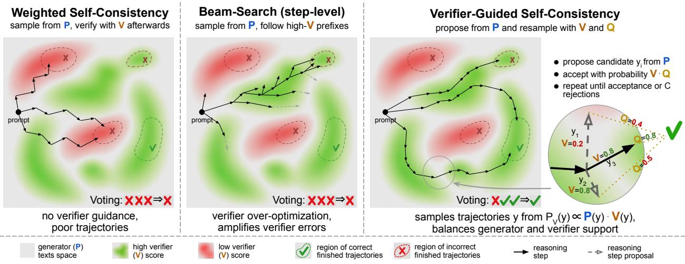  
Figure 1: Illustration of inference-time reasoning with imperfect generators and verifiers. Left: Weighted Self-Consistency samples complete trajectories from P and applies verifier weighting after generation, so it cannot recover from poor samples. Middle: Beam Search uses verifier scores during decoding, but deterministic selection can concentrate search in a narrow high-V region; with a noisy verifier, chains may converge to the same false-positive region. Right: VGSC samples candidate next steps from P and uses bounded acceptance-resampling with V and Q, balancing verifier guidance and trajectory diversity.

These two families reflect a broader tension in test-time reasoning. The generator provides coverage and diversity over plausible trajectories, but may assign low probability to correct ones; the verifier provides guidance toward correctness, but is itself imperfect. Learned verifiers can be miscalibrated (Park et al., 2026), generalize poorly across domains (Zhang et al., 2025), or be over-optimized when used too aggressively (Khalaf et al., 2026). Moreover, maximizing noisy scores inside beam search can introduce overestimation bias, so wider search may degrade reasoning performance rather than improve it (Dalal et al., 2026). Thus, post-hoc aggregation can fail when the generator rarely produces good trajectories, while beam-style verifier-guided search can fail when the verifier is too noisy for aggressive pruning.

In this paper, we propose Verifier-Guided Self-Consistency (VGSC), a decoding strategy for test-time reasoning with imperfect generators and verifiers. VGSC is motivated by the observation that neither generator likelihood nor verifier score is reliable enough to optimize in isolation. Instead of verifying only after complete generation or deterministically pruning to the highest-scoring partial chains, VGSC uses verifier information stochastically during generation. At each reasoning step, it samples candidate next steps from the base LLM and resamples among them using two complementary signals: (i) a step verifier estimating immediate correctness, and (ii) a future-outcome predictor estimating whether the resulting prefix is likely to admit a successful continuation. Repeating this process yields multiple verifier-guided but diverse trajectories, whose final answers are aggregated by self-consistency. Our contributions are as follows:

• We introduce VGSC, a stochastic verifier-guided decoding algorithm that combines step-level correctness and future-outcome prediction through bounded rejection-resampling, while maintaining multiple trajectories for answer-level self-consistency.

• We derive the exact local conditional of a verifier-tilted trajectory distribution and analyze the approximation error introduced by bounded rejection-resampling, establishing a finite-cap total variation bound under exact guidance.

• We empirically show that VGSC improves accuracy over representative baselines across benchmarks, LLMs, and verifier families, while reducing LLM-generated tokens.

## 2 Background and Motivation

We study test-time search for chain-of-thought reasoning with a generator model and verifier guidance. Given input problem x, let $\mathbf { y } = ( y _ { 1 } , \dots , y _ { T } )$ be a reasoning trajectory of T steps. We denote prefixes by $\mathbf { y } _ { < t } = \left( y _ { 1 } , \ldots , y _ { t - 1 } \right)$ and $\mathbf { y } _ { \leq t } = ( y _ { 1 } , \dots , y _ { t } )$ , sufixes by ${ \bf y } _ { > t } = ( y _ { t + 1 } , \dots , y _ { T } )$ , and prefix extension by $\mathbf { y } _ { < t } \circ y = ( y _ { 1 } , \dots , y _ { t - 1 } , y )$

The base language model induces a distribution over reasoning trajectories,

$$
P ( \mathbf { y } \mid \mathbf { x } ) = \prod _ { t = 1 } ^ { T } P ( y _ { t } \mid \mathbf { x } , \mathbf { y } _ { < t } ) .\tag{1}
$$

We assume access to a verifier that estimates whether a reasoning trajectory is correct. Concretely, let $c \in \{ 0 , 1 \}$ denote the event that trajectory y is correct for problem x, and define

$$
V ( \mathbf { y } \mid \mathbf { x } ) \approx \operatorname* { P r } ( c = 1 \mid \mathbf { x } , \mathbf { y } ) .\tag{2}
$$

Assuming a stepwise verifier, we factorize it as

$$
V ( \mathbf { y } \mid \mathbf { x } ) = \prod _ { t = 1 } ^ { T } V ( y _ { t } \mid \mathbf { x } , \mathbf { y } _ { < t } ) ,\tag{3}
$$

where $V ( y _ { t } \mid \mathbf { x } , \mathbf { y } _ { < t } ) \in [ 0 , 1 ]$ is the probability that step y is correct given that the previous steps $\mathbf { y } _ { < t }$ are correct. This interpretation is aligned with standard step-verifier supervision, where training prefixes are truncated at the first incorrect step (Lightman et al., 2024).

## 2.1 Inference-Time Reasoning with Verifiers

Existing inference-time methods use verifier information in two main ways. The first is post-hoc aggregation: multiple complete reasoning trajectories are sampled from the base model and combined only after generation, for example by majority vote as in self-consistency (SC; Wang et al., 2022) or by verifier-weighted voting as in weighted self-consistency (WSC; Kang et al., 2026). These methods preserve diversity across reasoning paths, but the verifier does not guide generation itself, so they can fail when the generator rarely, or never, samples a correct trajectory.

The second family uses verifier information during decoding, for example through beam-style or tree-based search over partial reasoning traces (Xie et al., 2023; Yao et al., 2023). Such methods can allocate more computation to promising prefixes, but when verifier scores are noisy, they risk over-concentrating on a narrow region of the search space. Recent work shows that maximizing imperfect inference-time scores can induce overestimation bias, so increasing search width need not monotonically improve reasoning performance and can even degrade it (Dalal et al., 2026).

These families expose a natural tradeof: post-hoc aggregation preserves diversity but cannot steer generation toward missing correct trajectories, whereas verifier-guided search uses feedback earlier but can amplify loca verifier errors and collapse diversity through aggressive deterministic pruning. Our goal is to combine the strengths of both families: generating diverse reasoning trajectories while biasing computation toward prefixes likely to lead to correct solutions. This motivates Verifier-Guided Self-Consistency (VGSC), which uses verifier guidance stochastically during decoding while still producing multiple independent trajectories for final self-consistency. Rather than optimizing any one imperfect signal in isolation, VGSC combines generator likelihood, immediate step correctness, and continuation value. Figure 1 compares VGSC with representative post-hoc aggregation and verifier-guided search approaches.

## 3 Method: Verifier-Guided Self-Consistency

## 3.1 Verifier-tilted Target Distribution

We begin by defining the trajectory distribution that VGSC aims to approximate. Given a base LLM generator $P ( \mathbf { y } \mid \mathbf { x } )$ and a verifier $V ( \mathbf { y } \mid \mathbf { x } )$ , we define the verifier-tilted distribution

$$
P _ { \alpha } ^ { V } ( \mathbf { y } \mid \mathbf { x } ) : = { \frac { P ( \mathbf { y } \mid \mathbf { x } ) V ( \mathbf { y } \mid \mathbf { x } ) ^ { \alpha } } { \sum _ { \mathbf { y ^ { \prime } } } P ( \mathbf { y ^ { \prime } } \mid \mathbf { x } ) V ( \mathbf { y ^ { \prime } } \mid \mathbf { x } ) ^ { \alpha } } } .\tag{4}
$$

Here, $\alpha \geq 0$ controls the strength of verifier guidance: $\alpha = 0$ recovers the base generator, $\alpha = 1$ gives the standard verifier-tilted distribution (Zhao et al., 2024), and larger α concentrates more mass on high-verifier trajectories. Thus, $P _ { \alpha } ^ { V }$ favors trajectories that are both likely under the generator and highly rated by the verifier.

This distribution has a simple probabilistic interpretation at $\alpha = 1$ . If the verifier is calibrated so that $V ( \mathbf { y } \mid \mathbf { x } ) = \operatorname* { P r } ( c = 1 \mid \mathbf { x } , \mathbf { y } )$ , then

$$
P ( \mathbf { y } \mid \mathbf { x } ) V ( \mathbf { y } \mid \mathbf { x } ) = P ( \mathbf { y } \mid \mathbf { x } ) \operatorname* { P r } ( c = 1 \mid \mathbf { x } , \mathbf { y } ) = \operatorname* { P r } ( \mathbf { y } , c = 1 \mid \mathbf { x } ) ,\tag{5}
$$

and therefore $P _ { 1 } ^ { V } ( \mathbf { y } \mid \mathbf { x } ) = \operatorname* { P r } ( \mathbf { y } \mid \mathbf { x } , c = 1 )$ . Thus, $P _ { 1 } ^ { V }$ is the posterior over reasoning trajectories conditioned on correctness, while $\dot { P } _ { \alpha } ^ { V }$ is a tempered analogue. Weighted self-consistency method (Kang et al., 2026), which samples from $P$ and weights resulting texts with verifier scores after generation, can be viewed as importance sampling for the answer marginal under $P _ { 1 } ^ { V }$ . VGSC instead uses verifier information during decoding to sample directly from $P _ { \alpha } ^ { V }$

## 3.2 Exact Local Conditional

For a prefix $\mathbf { y } _ { < t }$ , the verifier-tilted trajectory distribution induces the following exact next-step conditional:

Proposition 1 Given a prefix $\mathbf { y } _ { < t }$ , define expected future score as

$$
Q _ { \alpha } ( \mathbf { y } _ { < t } \circ y , \mathbf { x } ) = \mathbb { E } _ { \mathbf { y } _ { > t } \sim P \left( \cdot | \mathbf { x } , \mathbf { y } _ { < t } \circ y \right) } \left[ V ( \mathbf { y } _ { > t } \mid \mathbf { x } , \mathbf { y } _ { < t } \circ y ) ^ { \alpha } \right] .\tag{6}
$$

Then the next-step conditional of the verifier-tilted distribution $P _ { \alpha } ^ { V }$ is

$$
P _ { \alpha } ^ { V } ( y _ { t } = y \mid \mathbf { x } , \mathbf { y } _ { < t } ) \propto P ( y \mid \mathbf { x } , \mathbf { y } _ { < t } ) \cdot V ( y \mid \mathbf { x } , \mathbf { y } _ { < t } ) ^ { \alpha } \cdot Q _ { \alpha } ( \mathbf { y } _ { < t } \circ y , \mathbf { x } ) .\tag{7}
$$

The proof is provided in Appendix C.1. Proposition 1 shows that the ideal next-step distribution combines three signals: generator probability (P), immediate step correctness (V), and a continuation value (Q) measuring how promising the resulting prefix is. This combination is central to VGSC, making the method less dependent on any single imperfect signal.

The main challenge is that $Q _ { \alpha } ( \mathbf { y } _ { < t } \circ y , \mathbf { x } )$ is generally not available in closed form. Since the verifier is trained to approximate correctness probabilities, the future verifier factor $V ( \mathbf { y } _ { > t } \mid \mathbf { x } , \mathbf { y } _ { < t } \circ y )$ can be viewed as estimating whether a sampled continuation $\mathbf { y } _ { > t }$ completes the reasoning correctly from the current prefix. Thus, $Q _ { \alpha }$ measures the expected verifier-rated success of continuations from $\mathbf { y } _ { < t } \circ y .$ . Estimating this expectation online with Monte Carlo rollouts at every decoding step would be prohibitively expensive. Instead, we use a learned future-outcome predictor $\widehat { Q } ( \mathbf { y } _ { \leq t } , \mathbf { x } )$ to estimate the probability that a continuation from the current prefix reaches the correct final answer.

We train $\widehat { Q }$ using Monte Carlo continuation labels: for each prefix in the training data, we sample multiple continuations and use the fraction that reach the correct final answer as the target. At decoding time, we apply the same verifier-trust exponent α to both probability-valued signals:

$$
W _ { \alpha } ( y _ { t } \mid \mathbf { x } , \mathbf { y } _ { < t } ) = V ( y _ { t } \mid \mathbf { x } , \mathbf { y } _ { < t } ) ^ { \alpha } { \widehat { Q } } ( \mathbf { y } _ { \leq t } , \mathbf { x } ) ^ { \alpha } .
$$

## 3.3 VGSC Decoding Algorithm

Starting from an empty prefix, VGSC generates one trajectory by repeating a bounded rejection-resampling procedure. At step t, given prefix $\mathbf { y } _ { < t }$ , define the local acceptance weight

$$
w _ { t } ( y ) : = W _ { \alpha } ( y \mid \mathbf { x } , \mathbf { y } _ { < t } ) = V ( y \mid \mathbf { x } , \mathbf { y } _ { < t } ) ^ { \alpha } \cdot { \widehat { Q } } ( \mathbf { y } _ { < t } \circ y , \mathbf { x } ) ^ { \alpha } .\tag{8}
$$

Since V and $\widehat { Q }$ take values in [0, 1], $w _ { t } ( y ) \in [ 0 , 1 ]$ . We then sequentially propose

$$
y _ { t } ^ { ( 1 ) } , y _ { t } ^ { ( 2 ) } , \ldots \stackrel { i . i . d . } { \sim } P ( \cdot \mid \mathbf { x } , \mathbf { y } _ { < t } ) ,\tag{9}
$$

and accept proposal $y _ { t } ^ { ( j ) }$ with probability $w _ { t } ( y _ { t } ^ { ( j ) } )$ . If accepted, we set $\tilde { y } _ { t } = y _ { t } ^ { ( j ) }$ and stop sampling candidates for this step.

To keep computation bounded, we allow at most C proposals per step. If all are rejected, we fall back to weighted selection among the cached proposals:

$$
\mathrm { P r } \left( \tilde { y } _ { t } = y _ { t } ^ { ( j ) } \mid \mathbf { x } , \mathbf { y } _ { < t } \right) \propto \frac { w _ { t } ( y _ { t } ^ { ( j ) } ) } { 1 - w _ { t } ( y _ { t } ^ { ( j ) } ) } .\tag{10}
$$

The selected step $\tilde { y } _ { t }$ is appended to the prefix, and decoding continues until the trajectory is complete.

This procedure is adaptive: high-weight proposals can be accepted early, reducing generated tokens relative to always sampling $C$ candidates. The cap C bounds the worst-case per-step budget, while fallback ensures decoding can always proceed.

We repeat this independently N times to obtain guided trajectories $\mathbf { y } ^ { 1 } , \ldots , \mathbf { y } ^ { N }$ , extract the final answer $A ( \mathbf { y } ^ { i } )$ from each trajectory $\mathbf { y } ^ { i } .$ , and predict by self-consistency:

$$
\mathrm { V G S C } ( \mathbf { x } ) = \arg \operatorname* { m a x } _ { a } \sum _ { i = 1 } ^ { N } \Im \left( A ( \mathbf { y } ^ { i } ) = a \right) .\tag{11}
$$

## 3.4 Theoretical Motivation

The following theorem quantifies the finite-cap bias introduced by bounded rejection-resampling.

Theorem 1 Fix a prefix $\mathbf { y } _ { < t } ,$ , and define

$$
Z _ { t } : = \mathbb { E } _ { Y \sim P ( \cdot | \mathbf { x } , \mathbf { y } _ { < t } ) } [ w _ { t } ( Y ) ] .\tag{12}
$$

Suppose $Z _ { t } > 0$ and the practical local guidance weight is exact, so that

$$
q _ { t } ( y ) : = P _ { \alpha } ^ { V } ( y _ { t } = y \mid \mathbf { x } , \mathbf { y } _ { < t } ) = \frac { P ( y \mid \mathbf { x } , \mathbf { y } _ { < t } ) w _ { t } ( y ) } { Z _ { t } } .\tag{13}
$$

Let $\mathcal { K } _ { C , t , \alpha } ( \cdot \mid \mathbf { x } , \mathbf { y } _ { < t } )$ be the next-step distribution of the bounded VGSC decoder in Section 3.3. Then the probability of reaching fallback is

$$
\operatorname* { P r } ( \operatorname { f a l l b a c k } \mid \mathbf { x } , \mathbf { y } _ { < t } ) = ( 1 - Z _ { t } ) ^ { C } .\tag{14}
$$

Conditioned on not reaching fallback, the accepted proposal is distributed exactly as $q _ { t }$ . Moreover, assume that $0 < \epsilon \le w _ { t } ( y ) \le 1 - \epsilon$ . Then there exists a constant $B _ { t }$ , independent of C, such that

$$
d _ { \mathrm { T V } } ( \mathcal { K } _ { C , t , \alpha } ( \cdot \mid \mathbf { x } , \mathbf { y } _ { < t } ) , q _ { t } ( \cdot ) ) \leq B _ { t } \frac { ( 1 - Z _ { t } ) ^ { C } } { C } .\tag{15}
$$

Appendix C.2 provides the proof of Theorem 1.

Discussion. Theorem 1 shows that VGSC approximates the ideal verifier-tilted local conditional with only finite-cap bias. Before the proposal cap C is reached, rejection-resampling is exact; approximation arises only when all C proposals are rejected. This event has probability $( 1 - Z _ { t } ) ^ { C } \le \exp ( - C Z _ { t } )$ , which decays exponentially in the proposal budget C and the average acceptance mass $Z _ { t }$ . Thus, when candidates have non-negligible guidance weight, even a small cap makes fallback unlikely. With odds-weighted fallback, the resulting total variation error is of order $\exp ( - C Z _ { t } ) / C$ . Increasing C therefore quickly reduces bias, while early acceptance preserves adaptive compute savings. Empirically, using only C = 5 proposals per step is already suficient to outperform strong baselines (see Section 4). We further measure in Appendix B.3 that the fallback case is relatively infrequent: it occurs in about 46% of decoding steps for α = 1 and remains below 71% even under much stronger verifier guidance, α = 20.

Appendix C further extends this one-step result to trajectory-level distributions and analyzes stability under imperfect verifier scores. Overall, Theorem 1 shows that VGSC closely targets the verifier-tilted local conditional, and therefore inherits its balance of generator probability, step correctness, and continuation value. This balance reduces overconcentration on the failure modes of either the generator or the verifier.

## 3.5 Practical Motivation

The future-outcome term Q is practically important because a locally correct step may still fail to advance the solution. For example, a model may restate the problem or enumerate constraints without introducing a useful strategy; such steps can receive high step-verifier scores, while their prefixes remain unlikely to admit a correct continuation. Figure 2 illustrates this efect: step-level guidance alone can prefer locally plausible but stagnant continuations, whereas Q favors prefixes more likely to lead to a correct solution. This motivates combining immediate correctness with future-outcome prediction during decoding.

## 4 Experiments

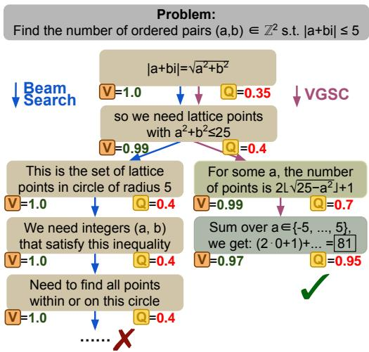

## 4.1 Experimental setup

Datasets. We evaluate on five reasoning benchmarks: MATH (Hendrycks et al., 2021) and OlympiadBench (He et al., 2024) for mathematics, text-only ScienceQA (Lu et al., 2022) for science, CommonsenseQA (Talmor et al., 2019) for commonsense reasoning, and Knights&Knaves (Xie et al., 2025) for logic. We use the test splits of MATH and OlympiadBench. All tasks require reasoning with extractable final answers. Table 1

Figure 2: Simplified MATH example with Llama 3.2 3B Instruct and a PRM verifier. The future-outcome score Q favors prefixes likely to admit a correct continuation, steering VGSC toward the correct answer.

summarizes dataset statistics; prompts, answer extraction, and examples are provided in Appendix D.

Table 1: Summary statistics of the evaluation datasets. Mean number of reasoning steps is computed for Qwen2.5 Math 1.5B Instruct using our rule-based step splitting procedure.
<table><tr><td>Dataset</td><td>Domain</td><td># Samples</td><td>Mean # Steps</td><td>Answer format</td></tr><tr><td>MATH</td><td>Math</td><td>500</td><td>8.4</td><td>numeric</td></tr><tr><td>OlympiadBench</td><td>Math</td><td>675</td><td>4.6</td><td>numeric</td></tr><tr><td>ScienceQA (SciQA)</td><td>Science reasoning</td><td>500</td><td>3.0</td><td>multiple-choice</td></tr><tr><td>CommonsenseQA (CsQA)</td><td>Commonsense reasoning</td><td>500</td><td>9.9</td><td>multiple-choice</td></tr><tr><td>Knights&amp;Knaves (K&amp;K)</td><td>Logic</td><td>100</td><td>10.5</td><td>multiple-choice</td></tr></table>

LLMs. We use three instruction-tuned generators: Qwen2.5 Math 1.5B Instruct (Yang et al., 2024) in the main text, with additional results for Llama 3.2 3B Instruct (Grattafiori et al., 2024) and Gemma3 4B Instruct (Kamath et al., 2025) in Appendix F.

Verifiers. Our primary step-level verifier V is the frozen Qwen2.5 Math PRM 7B (Zhang et al., 2025; Lightman et al., 2024). For future-outcome prediction, we initialize a separate model from the same checkpoint and train $\widehat { Q }$ using LoRA adapters only in its last four of 28 Transformer layers (Hu et al., 2022), yielding 46.1M trainable parameters. All remaining parameters are frozen. For each training prefix derived from PRM800K, we sample 10 continuations and train $\widehat { Q }$ with binary cross-entropy against the fraction that reach the correct final answer. Because PRM800K is derived from the MATH training split, we treat MATH as in-domain for the verifier and the remaining benchmarks as out-of-domain.

In Appendix F, we also evaluate ReProbe (Ni et al., 2025), a lightweight (∼20M parameters) verifier trained on hidden states of a frozen LLM. We train separate ReProbe models for step correctness and Monte Carlo continuation prediction. Appendix D.4 provides more details on verifier training.

Evaluation Protocol. We report exact-match accuracy of extracted final answers, averaged over 5 seeds, and average generated tokens per example to measure the compute–accuracy tradeof.

## 4.2 Baselines

We categorize baseline methods according to how they use verifier information.

No-verifier baselines. Single sample returns one sampled trajectory. Self-consistency (SC) samples N trajectories and takes the majority-vote answer.

Post-hoc verifier aggregation. Weighted self-consistency (WSC) samples N trajectories and weights each vote by the full-trajectory verifier score (Kang et al., 2026). We also evaluate verifier-weighted DLE (Li et al., 2026), which uses a specialized sampling procedure to generate N diverse trajectories and then applies weighted self-consistency over the resulting set.

Verifier-guided search baselines. Beam search (BS) uses verifier guidance during generation. We evaluate BS-Step, which scores prefixes by the product of step scores V, and BS-Future, which scores prefixes by ${ \widehat { Q } } .$ BS+SC majority-votes over completed beam candidates. Twisted Sequential Monte Carlo (TSMC) follows Zhao et al. (2024), using $\widehat { Q }$ for partial-generation twist estimates and $V ( \mathbf { y } \mid \mathbf { x } )$ as the final chain potential.

VGSC. VGSC jointly uses V and $\widehat { Q }$ during decoding, as described in Section 3. We evaluate $\alpha \in \{ 1 , 5 , 1 0 , 2 0 \}$ where larger α gives stronger verifier guidance.

We use ThinkBooster (Smirnov et al., 2026) implementations for all benchmarks and decoding strategies. Chain-of-thought traces are split into reasoning steps using a rule-based procedure; each step is capped at 2048 tokens and each trajectory at 50 steps. All experiments use temperature 1.0. For BS, BS+SC, and VGSC, we use N = 5 chains and $C = 5$ candidates per chain; for SC and WSC, we evaluate $N \in \{ 5 , 2 5 \}$ ; and for DLE and TSMC, we use $N = 2 5$ . Appendix D provides full prompts, decoding settings, step-splitting details, and verifier-training hyperparameters. Appendix G describes the baseline methods, while Appendix A.1 reports additional baseline variants.

## 4.3 Main Results

Table 2 reports the main results for Qwen2.5 Math 1.5B Instruct with Qwen2.5 Math PRM 7B verifiers; Appendix F reports results for other LLMs (Llama 3.2 3B Instruct and Gemma3 4B Instruct) and verifier families (ReProbe).

Overall, VGSC achieves the strongest average performance among the evaluated decoding strategies. VGSC with $\alpha = 1 0$ achieves the highest average accuracy, 63.1%, exceeding the strongest non-VGSC baseline,

Table 2: Accuracy ↑ across datasets and average generated tokens per sample for Qwen2.5 Math 1.5B Instruct generator with Qwen2.5 Math PRM 7B verifier. Results are averaged over 5 seeds. TFLOPs are estimated using Eq. (39);. The best result in each column is bold and the second-best result is underlined.
<table><tr><td>Method</td><td>MATH</td><td>Olympiad Bench</td><td>SciQA</td><td>CsQA</td><td>K&amp;K</td><td>Average Accuracy</td><td>Average Tokens</td><td>Estimated TFLOPs</td></tr><tr><td colspan="9">No-verifier baselines</td></tr><tr><td>Single sample</td><td> $7 0 . 6 \pm 0 . 4$ </td><td> $3 3 . 6 \pm 0 . 4$ </td><td> $5 6 . 0 \pm 0 . 4$ </td><td> $3 5 . 1 \pm 0 . 7$ </td><td> $4 4 . 2 \pm 3 . 0$ </td><td> $4 7 . 9 \pm 0 . 6$ </td><td>587</td><td>2.1</td></tr><tr><td> $\mathrm { S C } ~ N = 5$ </td><td> $7 5 . 2 \pm 0 . 6$ </td><td> $3 5 . 4 \pm 0 . 3$ </td><td> $5 9 . 0 \pm 0 . 7$ </td><td> $4 0 . 9 \pm 1 . 2$ </td><td> $5 4 . 6 \pm 1 . 4$ </td><td> $5 3 . 0 \pm 0 . 4$ </td><td>2,928</td><td>9.1</td></tr><tr><td> $\mathrm { S C } ~ N = 2 5 $ </td><td> $7 6 . 5 \pm 0 . 5$ </td><td> $3 8 . 7 \pm 0 . 3$ </td><td> $6 3 . 4 \pm 0 . 5$ </td><td> $4 6 . 6 \pm 0 . 3$ </td><td> $5 6 . 0 \pm 1 . 0$ </td><td> $5 6 . 2 \pm { \mathrm { 0 . 3 } }$ </td><td>14,778</td><td>44.6</td></tr><tr><td colspan="9">Post-hoc verifier aggregation</td></tr><tr><td> $\mathrm { W S C } ~ N = 5$ </td><td> $7 8 . 0 \pm 0 . 2$ </td><td> $3 8 . 6 \pm 0 . 3$ </td><td> $6 1 . 5 \pm 0 . 6$ </td><td> $4 3 . 2 \pm 0 . 5$ </td><td> $5 1 . 4 \pm { 1 . 6 }$ </td><td> $5 4 . 5 \pm 0 . 4$ </td><td>2,964</td><td>52.0</td></tr><tr><td> $\mathrm { W S C } ~ N = 2 5$ </td><td> $8 0 . 5 \pm 0 . 4$ </td><td> $4 3 . 6 \pm 0 . 2$ </td><td> $6 7 . 0 \pm 0 . 3$ </td><td> $4 9 . 8 \pm 0 . 7$ </td><td> $5 6 . 2 \pm 1 . 6$ </td><td> $5 9 . 4 \pm 0 . 4$ </td><td>14,791</td><td>253.1</td></tr><tr><td>DLE</td><td> $7 8 . 6 \pm 0 . 2$ </td><td> $4 3 . 8 \pm 0 . 2$ </td><td> $6 7 . 5 \pm 0 . 2$ </td><td> $5 2 . 8 \pm 0 . 4$ </td><td> $6 0 . 4 \pm { \bf 0 . 7 }$ </td><td> $6 0 . 6 \pm 0 . 2$ </td><td>14,655</td><td>248.8</td></tr><tr><td colspan="9">Verifier-guided search baselines</td></tr><tr><td> ${ \mathrm { B S - S t e p } }$ </td><td> $7 7 . 4 \pm 0 . 3$ </td><td> $3 8 . 5 \pm 0 . 4$ </td><td> $4 4 . 8 \pm 0 . 6$ </td><td> $3 1 . 1 \pm 0 . 5$ </td><td> $3 8 . 0 \pm 2 . 5$ </td><td> $4 6 . 0 \pm 0 . 5$ </td><td>19,837</td><td>338.9</td></tr><tr><td>BS-Future</td><td> $8 0 . 1 \pm 0 . 2$ </td><td> $4 3 . 8 \pm 0 . 4$ </td><td> $6 4 . 8 \pm 0 . 5$ </td><td> $4 9 . 9 \pm 0 . 4$ </td><td> $5 5 . 0 \pm 2 . 6$ </td><td> $5 8 . 7 \pm 0 . 5$ </td><td>12,337</td><td>211.4</td></tr><tr><td> $\mathrm { B S + S C - S t e p }$ </td><td> $7 8 . 4 \pm 0 . 1$ </td><td> $4 1 . 1 \pm 0 . 4$ </td><td> $6 2 . 1 \pm { 0 . 7 }$ </td><td> $4 6 . 7 \pm 0 . 6$ </td><td> $5 6 . 6 \pm 1 . 2$ </td><td> $5 7 . 0 \pm 0 . 3$ </td><td>19,911</td><td>340.1</td></tr><tr><td> $\mathrm { B S + S C - F u t u r e }$ </td><td> $7 9 . 0 \pm 0 . 1$ </td><td> $4 3 . 8 \pm 0 . 4$ </td><td> $6 6 . 6 \pm 0 . 6$ </td><td> $4 9 . 5 \pm 0 . 7$ </td><td> ${ \bf 6 4 . 5 \pm 2 . 3 }$ </td><td> $6 0 . 7 \pm 0 . 5$ </td><td>12,639</td><td>216.5</td></tr><tr><td>TSMC</td><td> $7 8 . 7 \pm 0 . 2$ </td><td> $4 2 . 4 \pm 0 . 4$ </td><td> $6 5 . 2 \pm 0 . 4$ </td><td> $4 6 . 3 \pm { 0 . 8 }$ </td><td> $5 5 . 0 \pm { \bf 0 . 8 }$ </td><td> $5 7 . 5 \pm 0 . 3$ </td><td> $^ \mathrm { 1 5 , 0 4 5 }$ </td><td>287.7</td></tr><tr><td colspan="9">Verifier-guided self-consistency (ours)</td></tr><tr><td> $\mathrm { V G S C } ~ \alpha = 1$ </td><td> $8 0 . 1 \pm 0 . 3$ </td><td> $4 3 . 3 \pm 0 . 5$ </td><td> $6 6 . 5 \pm 0 . 5$ </td><td> $5 1 . 1 \pm 0 . 5$ </td><td> $5 6 . 5 \pm 2 . 1$ </td><td> $5 9 . 5 \pm 0 . 4$ </td><td>10,138</td><td>194.5</td></tr><tr><td> $\mathrm { V G S C } ~ \alpha = 5$ </td><td> ${ \bf 8 1 . 2 \pm 0 . 2 }$ </td><td> $4 4 . 4 \pm 0 . 3$ </td><td> $\underline { { 7 0 . 1 } } \pm \mathbf { 0 . 3 }$ </td><td> $5 4 . 1 \pm 0 . 5$ </td><td> $5 9 . 5 \pm { } 1 . 0$ </td><td> $6 1 . 9 \pm 0 . 3$ </td><td>13,839</td><td>264.8</td></tr><tr><td> $\mathrm { V G S C } ~ \alpha = 1 0$ </td><td> $8 1 . 1 \pm 0 . 4$ </td><td> $4 5 . 0 \pm 0 . 3$ </td><td> ${ \bf 7 0 . 3 \pm 0 . 3 }$ </td><td> ${ \bf 5 4 . 5 \pm 0 . 4 }$ </td><td> ${ \bf 6 4 . 5 \pm 1 . 1 }$ </td><td> ${ \bf 6 3 . 1 \pm 0 . 3 }$ </td><td>15,179</td><td>290.2</td></tr><tr><td> $\mathrm { V G S C } ~ \alpha = 2 0 $ </td><td> $8 0 . 6 \pm 0 . 5$ </td><td> ${ \bf 4 5 . 4 } \pm \bf { 0 . 3 }$ </td><td> $6 9 . 6 \pm 0 . 1$ </td><td> $5 4 . 4 \pm 1 . 1$ </td><td> $6 2 . 5 \pm 1 . 2$ </td><td> $6 2 . 5 \pm 0 . 3$ </td><td>16,093</td><td>307.6</td></tr></table>

BS+SC-Future, by 2.4 percentage points and WSC with a similar nominal budget of $N = 2 5$ by 3.7 points. Across its variants, VGSC achieves or ties the best result on all five benchmarks. The three settings $\alpha \in \{ 5 , 1 0 , 2 0 \}$ achieve the three highest average accuracies, suggesting that moderate-to-strong verifier guidance is efective in this setting.

Table 2 also reports generated tokens and estimated inference compute per MATH example. VGSC can accept a proposed step before exhausting its candidate budget, reducing the number of generated tokens. For example, VGSC with $\alpha = 5$ achieves 81.2% accuracy using 13,839 tokens per example, compared with 77.4% accuracy and 19,837 tokens for ${ \mathrm { B S - S t e p } } ,$ a 30.2% token reduction. This saving is baseline-dependent: BS-Future generates fewer tokens but achieves lower accuracy.

The reported TFLOPs follow Eq. (39) under a conditional shared-prefix implementation. Because the two resulting PRMs difer only in their final four layers, this estimate counts a shared frozen prefix and two four-layer branches, corresponding to 8B efective verifier parameters under an equal-layer approximation. Section 4.4 further examines the accuracy–compute tradeof across search budgets, and Appendix E details the compute estimates.

## 4.4 Ablations

We examine how VGSC scales with search budget, how it responds to corrupted verifier scores, and how its performance depends on the step-level verifier V and future-outcome predictor Qb. Additional appendix ablations examine score aggregation (Appendix A.1), the verifier-trust exponent (Appendix A.2), and allocation under a fixed nominal budget (Appendix A.3). Appendix B provides case studies, coverage statistics, and diversity statistics.

Scaling total budget with balanced search. We study budget scaling on random subsets of 100 examples from MATH, OlympiadBench, and SciQA. Figure 3 studies the compute-accuracy trade-of in a balanced regime $N = C$ ranging N from 1 to 8, where increasing N raises both the number of independent trajectories and verifier-guided candidate expansions per step. Beam-search baselines remain competitive on MATH, likely because the PRM verifier acts in-domain and is less prone to mis-scoring. On the verifier out-of-domain datasets, OlympiadBench and SciQA, BS variants degrade as the budget grows, starting around $N \geq 5$ on OlympiadBench and $N \geq 3$ on SciQA for BS-Step. This matches Dalal et al. (2026): increasing test-time compute can hurt when search aggressively maximizes noisy verifier scores. In contrast, sampling-based methods are more stable, and VGSC remains among the top-performing methods across nearly all budgets.

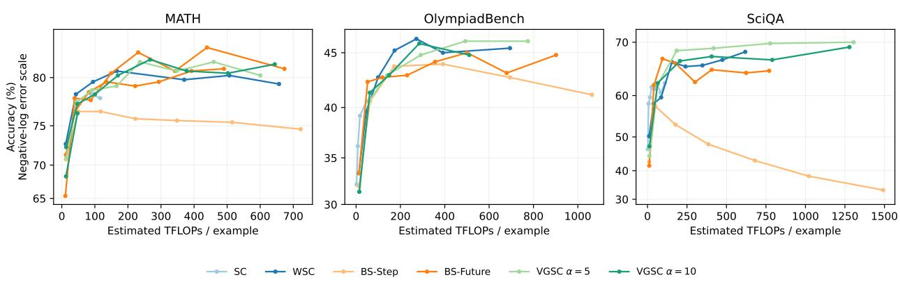  
Figure 3: Accuracy–compute tradeof on MATH, OlympiadBench, and SciQA with Qwen2.5-Math-1.5B and PRM-7B verifiers. For search methods, the budget increases as $N = C = k ,$ , jointly scaling cross-trajectory exploration and within-step candidate generation; SC and WSC use $k ^ { 2 }$ trajectories. The horizontal axis reports inference compute in TFLOPs per example.

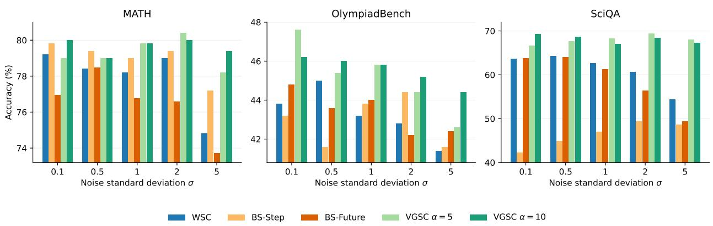  
Figure 4: Robustness to corrupted verifier scores. We perturb verifier outputs by adding Gaussian noise in logit space with standard deviation σ and then mapping back to probabilities.

Robustness to corrupted verifier scores. We evaluate robustness on the same random subsets of 100 examples from MATH, OlympiadBench, and SciQA. We perturb verifier logits with Gaussian noise of standard deviation σ before mapping them back to probabilities with a sigmoid, corrupting both V and $\widehat { Q }$ for methods that use both signals. Figure 4 shows that accuracy generally decreases as noise increases, although the efect varies across methods and datasets. VGSC remains comparatively stable, particularly on SciQA, where beam-search baselines degrade more substantially. These results suggest that joint verifier guidance combined with stochastic exploration can reduce sensitivity to corrupted scores.

Dependence on verifier components. We examine how VGSC’s performance depends on the step-level verifier $V$ and future-outcome predictor $\widehat { Q }$ on the five main evaluation benchmarks. For VGSC, we compare joint guidance $( V { \widehat { Q } } ) ^ { \alpha }$ with $V ^ { \alpha }$ alone and ${ \widehat { Q } } ^ { \alpha }$ alone, keeping the remaining decoding settings unchanged. We also test whether combining the signals benefits deterministic search. For BS and BS+SC, we replace the

step-only score with

$$
W ( y _ { t } \mid { \bf x } , { \bf y } _ { < t } ) = V ( y _ { t } \mid { \bf x } , { \bf y } _ { < t } ) \widehat { Q } ( { \bf y } _ { \leq t } , { \bf x } ) .\tag{16}
$$

A positive exponent applied to the entire joint score preserves its ranking and therefore does not afect beam selection.

Table 3 shows that joint guidance improves average accuracy for BS from 46.0% to 53.6% and for BS+SC from 57.0% to 60.8%. Both remain below full VGSC, which achieves 61.9% at $\alpha = 5$ and 63.1% at $\alpha = 1 0$ . Within VGSC, removing either component reduces average accuracy at both trust settings. These results suggest that performance depends both on the available verifier signals and on how they guide decoding.

## 5 Related Work

Verification for reasoning. Prior work has improved multi-step reasoning by training verifiers to assess either complete solutions or intermediate reasoning steps. These include outcome-level verifiers and process reward models (PRMs) for step-level supervision (Cobbe et al., 2021; Lightman et al., 2024; Wang et al., 2024). Recent work further studies how verifier quality depends on supervision, evaluation design, and verifier architecture (Zhang et al., 2025; Ni et al., 2025). Our focus is complementary: rather than proposing a new verifier, we study how verifier signals should be used at inference time.

Table 3: Efect of verifier components for Qwen2.5 Math 1.5B Instruct with Qwen2.5 Math PRM 7B. Accuracy is averaged across five benchmarks. Bold entries identify the best VGSC variant within each α group.
<table><tr><td>Method</td><td>Guidance</td><td>α</td><td>Avg. acc. ↑</td></tr><tr><td>BS  $V$ </td><td></td><td>1</td><td>46.0</td></tr><tr><td>BS</td><td> $V \widehat { Q }$ </td><td></td><td>53.6</td></tr><tr><td>BS+SC</td><td>V  $V \widehat { Q }$ </td><td></td><td>57.0</td></tr><tr><td>BS+SC</td><td></td><td></td><td>60.8</td></tr><tr><td>VGSC VGSC</td><td> $V$  only  $\widehat { Q }$  only</td><td>5 5</td><td>61.0</td></tr><tr><td></td><td> $V \widehat { Q }$ </td><td></td><td>57.5</td></tr><tr><td>VGSC</td><td></td><td>5</td><td>61.9</td></tr><tr><td>VGSC</td><td>V only</td><td>10</td><td>61.8</td></tr><tr><td>VGSC</td><td>Q only</td><td>10</td><td>62.4</td></tr><tr><td>VGSC</td><td> $V \widehat { Q }$ </td><td>10</td><td>63.1</td></tr></table>

Continuation values and progress-based verification. Step correctness and continuation value provide diferent forms of guidance: a locally valid step need not make the remaining problem easier, while the probability of successful completion depends on both the prefix and the policy used to continue it. Setlur et al. (2025) study process-advantage verifiers that assess progress toward successful completion, highlighting the importance of policy-dependent continuation estimates. VGSC similarly uses future-outcome information, but retains a separate step-correctness verifier. Our contribution concerns how these two signals enter a stochastic decoding rule, rather than a new value-estimation objective.

Inference-time verification. A common use of test-time compute is post-hoc aggregation: multiple reasoning trajectories are sampled from the base model and then combined by majority vote or verifierweighted reranking (Wang et al., 2022; Cobbe et al., 2021; Kang et al., 2026). These methods preserve diversity, but apply verification only after generation is complete. Other methods inject verifier information during decoding, including tree/search-based reasoning (Yao et al., 2023), step-level discriminator guidance (Khalifa et al., 2023), and self-evaluation guided stochastic beam search (Xie et al., 2023). These approaches use local feedback to guide generation, but do not explicitly model the future success probability of continuing from a partial trajectory. Future-looking methods guide search using estimates of continuation quality. Value-guided search (VGS) uses a learned continuation-value model to guide block-wise search and aggregates completed trajectories through value-weighted majority voting (Wang et al., 2025). This approach is closely related to our Qb-only variant, which isolates future-outcome guidance within our decoding framework. VGSC additionally incorporates step-level correctness and uses stochastic acceptance/resampling rather than highest-value candidate selection. Twisted sequential Monte Carlo (TSMC) samples from a base language model tilted by a sequence-level potential using learned twists, particle reweighting, and resampling (Zhao et al., 2024). When this potential is a verifier score, TSMC targets a verifier-tilted distribution $P _ { 1 } ^ { V }$ , but it treats the verifier as a terminal sequence-level signal and relies on learned twists for intermediate guidance. VGSC instead exploits intermediate process-verifier scores directly, combining V and $\widehat { Q }$ in each local next-step resampling decision while preserving multiple trajectories for final self-consistency.

Imperfect verifier signals. Learned verifiers are imperfect: PRMs can be miscalibrated, overestimate partial trajectory quality, and be exploited when optimized too aggressively at inference time (Park et al., 2026; Khalaf et al., 2026). More broadly, search methods that rely heavily on verifier scores can sufer from over-optimistic selection, and wider verifier-guided search need not monotonically improve performance (Dalal et al., 2026; Cinquin et al., 2025). This motivates our emphasis on stochastic guidance that balances generator exploration with verifier information, rather than deterministic maximization of noisy scores.

## 6 Conclusion

We introduced Verifier-Guided Self-Consistency (VGSC), a test-time reasoning method that combines generator sampling with verifier guidance during decoding. VGSC uses both step-level correctness estimates and future-outcome prediction to guide local sampling, while still producing multiple diverse reasoning trajectories for final self-consistency. This yields a simple alternative to both post-hoc verifier reranking and beam-style maximization.

Across multiple reasoning benchmarks, generator models, and verifier families, our results show that VGSC consistently improves over representative post-hoc aggregation baselines and achieves a stronger balance between exploration and verifier guidance than beam-style search. These findings suggest that inference-time reasoning benefits from stochastic guidance toward promising trajectories rather than aggressive deterministic pruning.

## Limitations

VGSC requires auxiliary learned guidance signals at inference time, in particular the future-outcome predictor ${ \widehat { Q } } .$ In our implementation, $\widehat { Q }$ is trained from Monte Carlo continuation outcomes for a fixed generator/verifier configuration, which adds some training and engineering overhead relative to simpler decoding schemes that only reuse an existing verifier at test time. We view this as a moderate limitation rather than an unusual requirement: Monte Carlo continuation correctness signals are already commonly used to train PRMs, since they can be obtained automatically without human step-level annotations. VGSC repurposes this same kind of automatically generated supervision to estimate continuation value, and in our experiments this additional signal provides a useful complement to step-level verification.

More broadly, VGSC depends on the quality and task alignment of the learned guidance signals. As with other verifier-guided methods, gains may be smaller when the verifier is weak, miscalibrated, or poorly matched to the target domain. Our results on CommonsenseQA with ReProbe illustrate this regime, where verifier-based guidance is less helpful than in mathematical and logical settings.

Finally, VGSC introduces the verifier-trust exponent α as a method-specific hyperparameter. Although we find that a default range of α ∈ [10, 20] works well across datasets, the best setting may vary with verifier quality, generator behavior, and task domain. This suggests that some validation or tuning may be needed when applying VGSC to new settings.

## Ethical Considerations

VGSC aims to improve the reliability of language-model reasoning by using verifier guidance during test-time generation. However, it does not guarantee correctness: generated reasoning can still be flawed, and final answers can still be wrong.

The method depends on learned verifiers and future-outcome predictors, whose scores may be biased, miscalibrated, or poorly aligned with new domains. If these models assign high confidence to incorrect steps, VGSC may amplify such errors, especially under strong verifier guidance. Careful calibration, monitoring, and domain-specific validation are therefore important for practical deployment.

## References

Sergios Agapiou, Omiros Papaspiliopoulos, Daniel Sanz-Alonso, and Andrew M Stuart. Importance sampling: Intrinsic dimension and computational cost. Statistical Science, pp. 405–431, 2017.

Tristan Cinquin, Geof Pleiss, and Agustinus Kristiadi. Limits of prm-guided tree search for mathematical reasoning with llms. arXiv preprint arXiv:2510.20272, 2025.

Karl Cobbe, Vineet Kosaraju, Mohammad Bavarian, Mark Chen, Heewoo Jun, Lukasz Kaiser, Matthias Plappert, Jerry Tworek, Jacob Hilton, Reiichiro Nakano, et al. Training verifiers to solve math word problems, 2021. URL https://arxiv. org/abs/2110.14168, 9, 2021.

Gal Dalal, Assaf Hallak, Gal Chechik, and Yftah Ziser. More test-time compute can hurt: Overestimation bias in llm beam search. arXiv preprint arXiv:2603.15377, 2026.

Aaron Grattafiori, Abhimanyu Dubey, Abhinav Jauhri, Abhinav Pandey, Abhishek Kadian, Ahmad Al-Dahle, Aiesha Letman, Akhil Mathur, Alan Schelten, Alex Vaughan, et al. The llama 3 herd of models. arXiv preprint arXiv:2407.21783, 2024.

Chaoqun He, Renjie Luo, Yuzhuo Bai, Shengding Hu, Zhen Thai, Junhao Shen, Jinyi Hu, Xu Han, Yujie Huang, Yuxiang Zhang, et al. Olympiadbench: A challenging benchmark for promoting agi with olympiadlevel bilingual multimodal scientific problems. In Proceedings of the 62nd Annual Meeting of the Association for Computational Linguistics (Volume 1: Long Papers), pp. 3828–3850, 2024.

Dan Hendrycks, Collin Burns, Saurav Kadavath, Akul Arora, Steven Basart, Eric Tang, Dawn Song, and Jacob Steinhardt. Measuring mathematical problem solving with the math dataset. In Thirty-fifth Conference on Neural Information Processing Systems Datasets and Benchmarks Track (Round 2), 2021.

Edward J Hu, Yelong Shen, Phillip Wallis, Zeyuan Allen-Zhu, Yuanzhi Li, Shean Wang, Liang Wang, Weizhu Chen, et al. Lora: Low-rank adaptation of large language models. Iclr, 1(2):3, 2022.

Gemma Team Aishwarya Kamath, Johan Ferret, Shreya Pathak, Nino Vieillard, Ramona Merhej, Sarah Perrin, Tatiana Matejovicova, Alexandre Ram’e, Morgane Rivière, Louis Rouillard, Thomas Mesnard Geofrey Cideron, Jean-Bastien Grill, Sabela Ramos, Edouard Yvinec, Michelle Casbon, Etienne Pot, Ivo Penchev, Gael Liu, Francesco Visin, Kathleen Kenealy, Lucas Beyer, Xiaohai Zhai, Anton Tsitsulin, Róbert Istvan Busa-Fekete, Alex Feng, Noveen Sachdeva, Benjamin Coleman, Yi Gao, Basil Mustafa, Iain Barr, Emilio Parisotto, David Tian, Matan Eyal, Colin Cherry, Jan-Thorsten Peter, Danila Sinopalnikov, Surya Bhupatiraju, Rishabh Agarwal, Mehran Kazemi, Dan Malkin, Ravin Kumar, David Vilar, Idan Brusilovsky, Jiaming Luo, Andreas Steiner, Abe Friesen, Abhanshu Sharma, Abheesht Sharma, Adi Mayrav Gilady, Adrian Goedeckemeyer, Alaa Saade, Alexander Kolesnikov, Alexei Bendebury, Alvin Abdagic, Amit Vadi, Andr’as Gyorgy, André Susano Pinto, Anil Das, Ankur Bapna, Antoine Miech, Antoine Yang, Antonia Paterson, Ashish Shenoy, Ayan Chakrabarti, Bilal Piot, Boxi Wu, Bobak Shahriari, Bryce Petrini, Charlie Chen, Charline Le Lan, Christopher A. Choquette-Choo, Cj Carey, Cormac Brick, Daniel Deutsch, Danielle Eisenbud, Dee Cattle, Derek Zhiyuan Cheng, Dimitris Paparas, Divyashree Shivakumar Sreepathihalli, Doug Reid, Dustin Tran, Dustin Zelle, Eric Noland, Erwin Huizenga, Eugene Kharitonov, Frederick Liu, Gagik Amirkhanyan, Glenn Cameron, Hadi Hashemi, Hanna Klimczak-Pluci’nska, Harman Singh, Harsh Mehta, Harshal Tushar Lehri, Hussein Hazimeh, Ian Ballantyne, Idan Szpektor, Ivan Nardini, Jean Pouget-Abadie, Jetha Chan, Joe Stanton, J. Michael Wieting, Jonathan Lai, Jordi Orbay, Joe Fernandez, Joshua Newlan, Junsong Ji, Jyotinder Singh, Kat Black, Kathy Yu, Kevin Hui, Kiran Vodrahalli, Klaus Gref, Linhai Qiu, Marcella Valentine, Marina Coelho, Marvin Ritter, Matt Hofman, Matthew Watson, Mayank Chaturvedi, Michael Moynihan, Min Ma, Nabila Babar, Natasha Noy, Nathan Byrd, Nick Roy, Nikola Momchev, Nilay Chauhan, Oskar Bunyan, Pankil Botarda, Paul Caron, Paul Kishan Rubenstein, Phil Culliton, Philipp Schmid, Pier Giuseppe Sessa, Ping mei Xu, Piotr Stańczyk, Pouya Dehghani Tafti, Rakesh Shivanna, Renjie Wu, Renke Pan, Reza Ardeshir Rokni, Rob Willoughby, Rohith Vallu, Ryan Mullins, Sammy Jerome, Sara Smoot, Sertan Girgin, Shariq Iqbal, Shashir Reddy, Shruti Sheth, Siim Põder, Sijal Bhatnagar, Sindhu Raghuram Panyam, Sivan Eiger, Susan Zhang, Tianqi Liu, Trevor Yacovone, Tyler Liechty, Uday Kalra, Utku Evci, Vedant Misra, Vincent Roseberry, Vladimir Feinberg, Vlad Kolesnikov,

Woohyun Han, Woosuk Kwon, Xi Chen, Yinlam Chow, Yuvein Zhu, Zichuan Wei, Zoltan Egyed, Victor Cotruta, Minh Giang, Phoebe Kirk, Anand Rao, Jessica Lo, Erica Moreira, Luiz Gustavo Martins, Omar Sanseviero, Lucas Gonzalez, Zach Gleicher, Tris Warkentin, Vahab S. Mirrokni, Evan Senter, Eli Collins, Joelle Barral, Zoubin Ghahramani, Raia Hadsell, Yossi Matias, D. Sculley, Slav Petrov, Noah Fiedel, Noam Shazeer, Oriol Vinyals, Jefrey Dean, Demis Hassabis, Koray Kavukcuoglu, Clément Farabet, Elena Buchatskaya, Jean-Baptiste Alayrac, Rohan Anil, Dmitry Lepikhin, Sebastian Borgeaud, Olivier Bachem, Armand Joulin, Alek Andreev, Cassidy Hardin, Robert Dadashi, and L’eonard Hussenot. Gemma 3 technical report. ArXiv, abs/2503.19786, 2025.

Zhewei Kang, Xuandong Zhao, and Dawn Song. Scalable best-of-n selection for large language models via self-certainty. Advances in neural information processing systems, 38:19720–19745, 2026.

Jared Kaplan, Sam McCandlish, Tom Henighan, Tom B Brown, Benjamin Chess, Rewon Child, Scott Gray, Alec Radford, Jefrey Wu, and Dario Amodei. Scaling laws for neural language models. arXiv preprint arXiv:2001.08361, 2020.

Hadi Khalaf, Claudio Mayrink Verdun, Alex Oesterling, Himabindu Lakkaraju, and Flavio Calmon. Inferencetime reward hacking in large language models. Advances in Neural Information Processing Systems, 38: 61720–61760, 2026.

Muhammad Khalifa, Lajanugen Logeswaran, Moontae Lee, Honglak Lee, and Lu Wang. Grace: Discriminatorguided chain-of-thought reasoning. In Findings of the Association for Computational Linguistics: EMNLP 2023, pp. 15299–15328, 2023.

Xueyan Li, Johannes Zenn, Ekaterina Fadeeva, Guinan Su, Mrinmaya Sachan, and Jonas Geiping. Eficient testtime inference via deterministic exploration of truncated decoding trees. arXiv preprint arXiv:2604.20500, 2026.

Hunter Lightman, Vineet Kosaraju, Yuri Burda, Harrison Edwards, Bowen Baker, Teddy Lee, Jan Leike, John Schulman, Ilya Sutskever, and Karl Cobbe. Let’s verify step by step. In International Conference on Learning Representations, volume 2024, pp. 39578–39601, 2024.

Chin-Yew Lin. Rouge: A package for automatic evaluation of summaries. In Text summarization branches out, pp. 74–81, 2004.

Pan Lu, Swaroop Mishra, Tanglin Xia, Liang Qiu, Kai-Wei Chang, Song-Chun Zhu, Oyvind Tafjord, Peter Clark, and Ashwin Kalyan. Learn to explain: Multimodal reasoning via thought chains for science question answering. Advances in neural information processing systems, 35:2507–2521, 2022.

Aaron Meurer, Christopher P Smith, Mateusz Paprocki, Ondřej Čertík, Sergey B Kirpichev, Matthew Rocklin, AMiT Kumar, Sergiu Ivanov, Jason K Moore, Sartaj Singh, et al. Sympy: symbolic computing in python. PeerJ Computer Science, 3:e103, 2017.

Jingwei Ni, Ekaterina Fadeeva, Tianyi Wu, Mubashara Akhtar, Jiaheng Zhang, Elliott Ash, Markus Leippold, Timothy Baldwin, See-Kiong Ng, Artem Shelmanov, et al. Eficient test-time scaling of multi-step reasoning by probing internal states of large language models. arXiv preprint arXiv:2511.06209, 2025.

Young-Jin Park, Kristjan Greenewald, Kaveh Alimohammadi, Hao Wang, and Navid Azizan. Know what you don’t know: Uncertainty calibration of process reward models. Advances in Neural Information Processing Systems, 38:38852–38895, 2026.

Amrith Setlur, Chirag Nagpal, Adam Fisch, Xinyang Geng, Jacob Eisenstein, Rishabh Agarwal, Alekh Agarwal, Jonathan Berant, and Aviral Kumar. Rewarding progress: Scaling automated process verifiers for llm reasoning. In International Conference on Learning Representations, volume 2025, pp. 60808–60838, 2025.

Artem Shelmanov, Ekaterina Fadeeva, Akim Tsvigun, Ivan Tsvigun, Zhuohan Xie, Igor Kiselev, Nico Daheim, Caiqi Zhang, Artem Vazhentsev, Mrinmaya Sachan, et al. A head to predict and a head to question: Pre-trained uncertainty quantification heads for hallucination detection in llm outputs. In Proceedings of the 2025 Conference on Empirical Methods in Natural Language Processing, pp. 35700–35719, 2025.

Vladislav Smirnov, Chieu Nguyen, Sergey Senichev, Minh Ngoc Ta, Ekaterina Fadeeva, Artem Vazhentsev, Daria Galimzianova, Nikolai Rozanov, Viktor Mazanov, Jingwei Ni, Tianyi Wu, Igor Kiselev, Mrinmaya Sachan, Iryna Gurevych, Preslav Nakov, Timothy Baldwin, and Artem Shelmanov. Thinkbooster: A unified framework for seamless test-time scaling of llm reasoning, 2026.

Alon Talmor, Jonathan Herzig, Nicholas Lourie, and Jonathan Berant. Commonsenseqa: A question answering challenge targeting commonsense knowledge. In Proceedings of the 2019 Conference of the North American Chapter of the Association for Computational Linguistics: Human Language Technologies, Volume 1 (Long and Short Papers), pp. 4149–4158, 2019.

Kaiwen Wang, Jin-Peng Zhou, Jonathan D. Chang, Zhao-Lin Gao, Nathan Kallus, Kianté Brantley, and Wen Sun. Value-guided search for eficient chain-of-thought reasoning. ArXiv, abs/2505.17373, 2025. URL https://api.semanticscholar.org/CorpusID:278886339.

Peiyi Wang, Lei Li, Zhihong Shao, Runxin Xu, Damai Dai, Yifei Li, Deli Chen, Yu Wu, and Zhifang Sui. Math-shepherd: Verify and reinforce llms step-by-step without human annotations. In Proceedings of the 62nd Annual Meeting of the Association for Computational Linguistics (Volume 1: Long Papers), pp. 9426–9439, 2024.

Xuezhi Wang, Jason Wei, Dale Schuurmans, Quoc Le, Ed Chi, Sharan Narang, Aakanksha Chowdhery, and Denny Zhou. Self-consistency improves chain of thought reasoning in language models. arXiv preprint arXiv:2203.11171, 2022.

Jason Wei, Xuezhi Wang, Dale Schuurmans, Maarten Bosma, Fei Xia, Ed Chi, Quoc V Le, Denny Zhou, et al. Chain-of-thought prompting elicits reasoning in large language models. Advances in neural information processing systems, 35:24824–24837, 2022.

Chulin Xie, Yangsibo Huang, Chiyuan Zhang, Da Yu, Xinyun Chen, Bill Yuchen Lin, Bo Li, Badih Ghazi, and Ravi Kumar. On memorization of large language models in logical reasoning. In Proceedings of the 14th International Joint Conference on Natural Language Processing and the 4th Conference of the Asia-Pacific Chapter of the Association for Computational Linguistics, pp. 2742–2785, 2025.

Yuxi Xie, Kenji Kawaguchi, Yiran Zhao, Xu Zhao, MingSung Kan, Junxian He, and Qizhe Xie. Self-evaluation guided beam search for reasoning. Advances in Neural Information Processing Systems 36, 2023.

An Yang, Beichen Zhang, Binyuan Hui, Bofei Gao, Bowen Yu, Chengpeng Li, Dayiheng Liu, Jianhong Tu, Jingren Zhou, Junyang Lin, et al. Qwen2. 5-math technical report: Toward mathematical expert model via self-improvement. arXiv preprint arXiv:2409.12122, 2024.

Shunyu Yao, Dian Yu, Jefrey Zhao, Izhak Shafran, Tom Grifiths, Yuan Cao, and Karthik Narasimhan. Tree of thoughts: Deliberate problem solving with large language models. Advances in neural information processing systems, 36:11809–11822, 2023.

Fei Yu, Anningzhe Gao, and Benyou Wang. Ovm, outcome-supervised value models for planning in mathematical reasoning. In Findings of the Association for Computational Linguistics: NAACL 2024, pp. 858–875, 2024.

Zhenru Zhang, Chujie Zheng, Yangzhen Wu, Beichen Zhang, Runji Lin, Bowen Yu, Dayiheng Liu, Jingren Zhou, and Junyang Lin. The lessons of developing process reward models in mathematical reasoning. In Findings of the Association for Computational Linguistics: ACL 2025, pp. 10495–10516, 2025.

Stephen Zhao, Rob Brekelmans, Alireza Makhzani, and Roger Grosse. Probabilistic inference in language models via twisted sequential monte carlo. arXiv preprint arXiv:2404.17546, 2024.

## A Additional Ablation Studies

This section presents supplementary ablation experiments that examine the robustness of our results to key design choices. In particular, we study alternative ways of aggregating step-level verifier signals and evaluate additional baseline variants that make use of verifier information diferently.

## A.1 Alternative Aggregations

We study whether verifier-guided methods depend on how step-level verifier scores are aggregated along a reasoning chain. All default method variants in the main paper use product aggregation; here, we additionally evaluate min and mean. Specifically, for the Qwen2.5 Math 1.5B Instruct + Qwen2.5 Math PRM 7B setting, we consider WSC, DLE, BS-Step, and BS+SC-Step variants in which the default product score is replaced by one of these alternatives. For a partial trajectory $\mathbf { y } _ { \leq t }$ , we define the aggregated verifier score as

$$
V ^ { \mathrm { a g g } } ( \mathbf { y } _ { \leq t } \mid \mathbf { x } ) = \mathrm { a g g } ( V ( y _ { 1 } \mid \mathbf { x } ) , \ldots , V ( y _ { t } \mid \mathbf { x } , \mathbf { y } _ { < t } ) ) ,\tag{17}
$$

where agg ∈ {product, min, mean}. Product favors consistently high step scores, min is determined by the weakest step, and mean provides a softer notion of average prefix quality.

For VGSC, we analogously aggregate both the step-level verifier scores and future-outcome score into a single guidance signal,

$$
W _ { \alpha } ^ { \mathrm { a g g } } ( y _ { t } | \mathbf { x } , \mathbf { y } _ { < t } ) = \mathrm { a g g } \Big ( V ( y _ { 1 } | \mathbf { x } ) , . . , V ( y _ { t } | \mathbf { x } , \mathbf { y } _ { < t } ) , \widehat { Q } ( \mathbf { y } _ { \leq t } , \mathbf { x } ) \Big ) ^ { \alpha } ,\tag{18}
$$

where product is the default VGSC variant and min/mean are the alternatives studied here. We evaluate these variants with $\alpha = 1 0$ , the best setting from the main experiments.

Table 4 shows that aggregation choice has only a small efect on average accuracy. Product remains a strong default, while the comparable performance of min and mean suggests that verifier-guided decoding is not highly sensitive to this choice.

## A.2 Verifier-Trust Parameter Sensitivity

Figure 5 examines the verifier-trust exponent $\alpha ,$ which controls the strength of verifier guidance during decoding. Across the evaluated datasets, increasing α from small values generally improves accuracy, with the strongest performance typically attained around $\alpha = 3 { - } 5$ . Further increases provide limited additional benefit and can reduce accuracy, suggesting that stronger guidance may amplify errors in the verifier signals. These results favor moderate verifier trust, although the best setting varies across datasets. We therefore treat α as a task-dependent hyperparameter rather than recommend a single range for all tasks.

## A.3 Compute Allocation under Fixed Budget

Figure 6 fixes the total search budget to $N \cdot C = 3 6$ and varies how it is split between cross-trajectory exploration, controlled by N, and within-step verifier-guided resampling, controlled by C. For reference, SC and WSC use 36 complete trajectories. VGSC remains competitive across almost all allocations, indicating that its gains do not depend on a narrowly tuned choice of N and C. The best performance is typically achieved at intermediate allocations, around $N \in \{ 6 , 9 \}$ , suggesting that both sources of diversity are useful: too few trajectories limits final self-consistency, while too few candidates per step weakens verifier-guided steering. This supports the balanced $N = C$ setting used in the main experiments.

Table 4: Accuracy ↑ across datasets for Qwen2.5 Math 1.5B Instruct generator with Qwen2.5 Math PRM 7B verifier. Results are averaged over 5 random seeds. The best result in each column is bold and the second-best result is underlined. Product aggregation has overall the best performance.
<table><tr><td>Method</td><td>Verifier Aggregation</td><td>Olympiad MATH Bench</td><td> $\mathrm { S c i Q A }$ </td><td> $\mathrm { C s Q A }$ </td><td>K&amp;K</td><td>Average Accuracy</td></tr><tr><td colspan="7">Post-hoc verifier aggregation</td></tr><tr><td>WSC</td><td>product</td><td>80.5</td><td>67.0</td><td>49.8</td><td>56.2</td><td>59.4</td></tr><tr><td>WSC</td><td>min</td><td>80.1 43.2</td><td>67.5</td><td>49.6</td><td>65.3</td><td>61.1</td></tr><tr><td>WSC</td><td>mean</td><td>77.5 39.3</td><td>64.0</td><td>48.0</td><td>55.7</td><td>56.9</td></tr><tr><td>DLE</td><td>product</td><td>78.6</td><td>43.8</td><td>67.5 52.8</td><td>60.4</td><td>60.6</td></tr><tr><td>DLE</td><td>min</td><td>79.2</td><td>42.7</td><td>67.2 52.4</td><td>58.0</td><td>59.9</td></tr><tr><td>DLE</td><td>mean</td><td>76.4</td><td>67.2</td><td>50.6</td><td>55.0</td><td>58.1</td></tr><tr><td colspan="7">Verifier-guided search baselines</td></tr><tr><td>BS-Step</td><td>product</td><td>77.4</td><td>38.5 44.8</td><td>31.1</td><td>38.0</td><td>46.0</td></tr><tr><td>BS-Step</td><td>min</td><td>76.7</td><td>37.7 38.2</td><td>47.0 30.3</td><td>37.3</td><td>45.8</td></tr><tr><td>BS-Step</td><td>mean</td><td>77.5</td><td>46.3</td><td>31.0</td><td>40.7</td><td>46.7</td></tr><tr><td> $\mathrm { B S + S C - S t e p }$ </td><td>product</td><td>78.4</td><td>62.1</td><td>46.7 48.5</td><td>56.6</td><td>57.0</td></tr><tr><td> $\mathrm { B S + S C - S t e p }$ </td><td>min</td><td>77.7</td><td>41.2</td><td>63.1</td><td>56.3</td><td>57.4</td></tr><tr><td> $\mathrm { B S + S C - S t e p }$ </td><td>mean</td><td>78.6</td><td>41.5</td><td>61.5 47.1</td><td>54.3</td><td>56.6</td></tr><tr><td colspan="7">Verifier-guided self-consistency (ours)</td></tr><tr><td> $\mathrm { V G S C } ~ \alpha = 1 0$ </td><td>product</td><td>81.1</td><td>70.3</td><td>54.5</td><td>64.5</td><td>63.1</td></tr><tr><td> $\mathrm { V G S C } ~ \alpha = 1 0$ </td><td>min</td><td>80.6</td><td>45.0 45.2</td><td>70.2</td><td>51.6 61.0</td><td>61.7</td></tr><tr><td> $\mathrm { V G S C } ~ \alpha = 1 0$ </td><td>mean</td><td>79.4</td><td>45.9</td><td>70.2 56.0</td><td>65.0</td><td>63.3</td></tr></table>

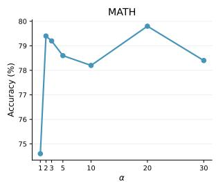

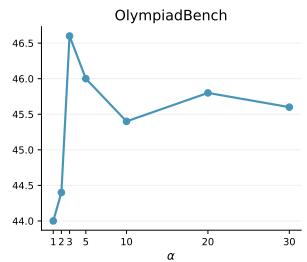

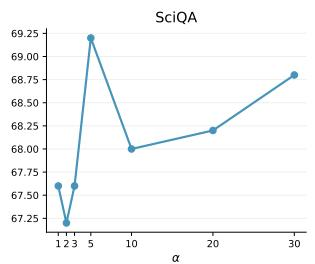

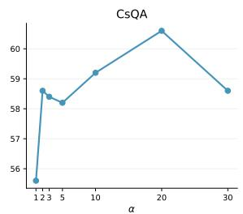  
Figure 5: VGSC sensitivity to the verifier-trust exponent α for 100 sample subsets of 3 datasets.

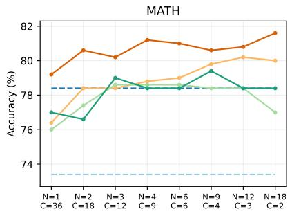

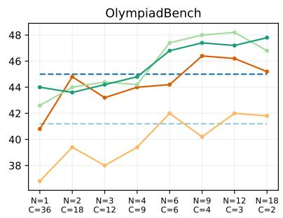

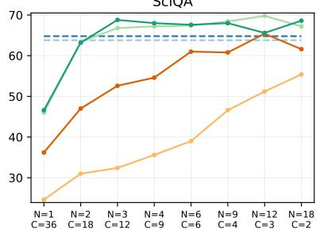  
SC WSC BS-Step BS-Future VGSC = 5 VGSC = 10  
Figure 6: Allocation of search compute under a fixed budget. We fix $N \cdot C = 3 6$ and vary how the budget is split between the number of reasoning chains N and candidates C.

## B Analysis and Examples

In this section we provide a qualitative and quantitative analysis of the decoding strategies considered in the main paper.

## B.1 Qualitative Examples

We first present qualitative examples illustrating the characteristic failure modes of baseline methods as well as VGSC. We analyze representative generations from OlympiadBench and SciQA using Qwen2.5 Math 1.5B Instruct and Llama 3.2 3B Instruct generators with the Qwen2.5 Math PRM 7B verifier for each baseline.

Example 1: VGSC vs WSC. A typical failure mode of WSC arises when all sampled trajectories are incorrect because the generator fails to produce a correct solution, even though the verifier can identify low-quality or erroneous intermediate steps. Since WSC applies verifier information only after complete trajectories have already been generated, it cannot use this signal to redirect decoding toward a more promising solution. In contrast, VGSC uses verifier guidance during decoding, which can steer generation away from erroneous continuations and toward a correct final answer. Figure 7 shows a representative example of this behavior.

```prolog
Problem.
Let EUCLID be a hexagon inscribed in a circle of radius 5. Given that EU = UC = LI = ID = 6 and CL = DE, compute CL.
Gold answer: 14/5
WSC trajectory (truncated). VGSC trajectory (truncated).
Step 1 (V<sub>ϕ</sub> = 0.956): Since EU = UC = LI =<sub>f</sub> Step $1 ~ ( V _ { \phi } = 0 . 9 1 9 ) \colon$ Let $C L = D E = x .$ Let each length-6 chord subtend
central angle θ, and let each chord of length x subtend central angle ϕ.
central angles; let each such angle be θ.
Step 2 $( \breve { V _ { \phi } } = { \bf 0 . 1 7 9 } ) \colon$ The four equal angles Step 2 (V = 0.959): Then 4θ + 2ϕ = 360<sup>◦</sup>, so ϕ = 180<sup>◦</sup> − 2θ.
account for half the circle, so 4θ = 180<sup>◦</sup>, hence
θ = 45<sup>◦</sup>. Step 3 (V = 0.960): From 6 = 10 sin(θ/2), we get sin(θ/2) = 3/5 and
cos(θ/2) = 4/5, hence co $\mathfrak { z } ( \theta ) = 2 ( 4 / 5 ) ^ { 2 } - 1 = 7 / 2 5 \ /$
Step 3 (V<sub>ϕ</sub> = 0.732): Therefore, CL = DE =
<sub>10</sub> <sub>sin(22.5</sub>◦<sub>)</sub> <sub>=</sub> <sub>5</sub>p<sub>2</sub> <sub>−</sub> √<sub>2</sub> <sub>.</sub> ✗ Step 4 (V<sub>ϕ</sub> = 0.954): So, x = 10 sin(ϕ/2) = 10 cos(θ) = 10 · <sup>7</sup> = 14/5
✓
```  
Figure 7: Truncated example from OlympiadBench where WSC fails but VGSC succeeds. WSC samples complete trajectories from the base generator and applies verifier information only after generation, so it cannot redirect decoding once it enters an incorrect line of reasoning. In this example, all WSC trajectories contain low-scored incorrect steps and end in incorrect answers. VGSC instead uses verifier guidance during decoding and is steered toward a correct solution.

Example 2: VGSC vs BS-Step. A common failure mode of BS-Step is that it overemphasizes local correctness, leading the search to prefer steps that are individually plausible but do not make meaningful progress toward the final solution. As a result, beam search can become trapped in locally high-scoring but unproductive reasoning paths. VGSC mitigates this issue by incorporating future-outcome guidance in addition to step-level verification, which favors trajectories that are both locally sound and globally promising. Figure 8 illustrates this pattern.

Example 3: VGSC vs BS-Future. A common failure mode of BS-Future is over-concentration on a narrow region of the search space when the future-outcome predictor is imperfect. In such cases, beam search may continue expanding a flawed partial trajectory because its future score is somewhat inflated, even when that trajectory is ultimately unproductive. VGSC instead combines verifier guidance with generator sampling, which preserves exploration and reduces sensitivity to this kind of predictor noise. Figure 9 provides a representative example.

Example 4: VGSC failure. VGSC can also fail when the verifier is poorly aligned with the task. In this regime, the verifier may systematically prefer incorrect trajectories, so that guiding decoding toward the verifier-tilted distribution becomes harmful rather than helpful. This can make verifier-guided methods underperform simpler generator-only aggregation methods such as self-consistency. Figure 10 shows a representative failure case of this kind.

Problem.   
For a positive integer a, define a sequence of integers x , x , . . . by letting x = a and $x _ { n + 1 } = 2 x _ { n } + 1$ for n ≥ 1. Let $y _ { n } = 2 ^ { x _ { n } } - 1 .$   
Determine the largest possible k such that, for some positive integer a, the numbers y , . . . , y are all prime.   
Gold answer: 2   
BS-Step trajectory (truncated). VGSC trajectory (truncated).   
Step 1 (V = 0.999): We analyze the sequences x Step 1 (V = 0.903): If 2<sup>m</sup> − 1 is prime, then m must be prime.   
and y , where x = a, x = 2x +1, and $y _ { n } = 2 ^ { x _ { n } } - 1 .$ Therefore, if y1 and y2 are both prime, then a and 2a + 1 must both   
be prime.   
Step 2 (V = 1.000): The first terms are $x _ { 2 } = 2 a + 1$ Step ${ \mathcal { Q } } \ ( V _ { \phi } = \mathbf { 0 . 9 4 4 } ) { \mathrm { : } }$ Taking a = 2 gives $x _ { 1 } = 2 , x _ { 2 } = 5 ,$ , and   
and x = 4a + 3 x<sub>3</sub> = 11. Hence $y _ { 1 } = 2 ^ { 2 } - 1 = 3$ and $y _ { 2 } = 2 ^ { 5 } - 1 = 3 1$ are prime, while   
Step 3 (V<sub>ϕ</sub> = 1.000): Next, x<sub>4</sub> = 8a + 7 and x<sub>5</sub> = $y _ { 3 } = 2 ^ { 1 1 } - 1 = 2 0 4 7 = 2 3 \cdot 8 9$ is composite. Thus $k \geq 2 .$   
16a + 15   
Step 3 $( V _ { \phi } = \mathbf { 0 . 9 3 9 } ) \colon$ It remains to show that k cannot exceed 2. If   
Step 4 (V<sub>ϕ</sub> = 1.000): Next, x<sub>6</sub> = 32a + 31 and x<sub>7</sub> = a is an odd prime and y is prime, then $q = 2 a + 1$ is an odd prime   
<sup>64a</sup> <sup>+</sup> <sup>63</sup> Step 5 (V = 1.000): Next, x = 128a + 127 and with q ≡ 3 (mod 4). Let $p \stackrel { \cdot } { = } x _ { 3 } = 2 q + \stackrel { \cdot } { 1 } .$ If p is composite, then   
x<sub>9</sub> = 256a + 255 $y _ { 3 } = \bar { 2 } ^ { p } - 1$ is composite.   
Step 4 (V = 0.989): If p is prime, then $p \equiv 7$ (mod 8), so 2<sup>q</sup> ≡ 1   
Step 11 (V = 1.000): x = 524288a + 524287 and   
(mod p). Hence $p \mid ( 2 ^ { q } - 1 ) = { \bar { y } } _ { 2 } ,$ contradicting the primality of y .   
x = 1048576a + 1048575 Therefore y<sub>3</sub> is never prime, and the largest possible value is 2 .  
Figure 8: Truncated example where BS-Step fails but VGSC succeeds. BS-Step ranks partial trajectories only by local step-verifier scores $V _ { \phi } ,$ so it keeps selecting steps that are individually correct but do not move the solution forward. In this example, beam search repeatedly expands the recurrence instead of reaching the key primality and divisibility argument. VGSC adds future-outcome guidance, which favors trajectories that make progress toward a complete proof and therefore reaches the correct answer.

Problem.   
Hannah flips two fair coins, while Otto flips T = 5 fair coins. Let p be the probability that the number of heads on Hannah’s coins   
is greater than the number of heads on Otto’s coins. If p = q/r, where q and r are relatively prime positive integers, compute q + r.   
Gold answer: 17   
BS-Future trajectory (truncated). VGSC trajectory (truncated).   
Step 1 (Qb = 0.620): Let H be the number of heads from Step 1 (Qb = 0.680): Let H be the number of heads from   
Hannah’s two coins, $P ( \mathrm { H } { = } 0 ) ~ = ~ 1 / 4 ~ P ( \mathrm { H } { = } 1 ) ~ = ~ 1 / 2 ,$ and Hannah’s two coins and O the number of heads from Otto’s five   
P(H=2) = 1/4. coins. Then $P ( \mathrm { H } { = } 0 ) = 1 / 4 , P ( \mathrm { H } { = } 1 ) = 1 / 2 ,$ and $P ( \mathrm { H } { = } 2 ) = 1 / 4 ,$   
Step 2 (Qb = 0.686): O - number of heads from Otto’s while $\begin{array} { r } { P ( \mathrm { O = k } ) = \binom { 5 } { k } / 3 2 . } \end{array}$   
coins, $\textstyle P ( O = k ) = { \binom { 5 } { k } } / 3 2$ Step 2 (Qb = 0.655): The event H>O can occur only in two   
Step 3 (Qb = 0.828): There are 3 cases when H>O: H=1, cases: (H=1, O=0) or (H=2, O≤1).   
O=0; H=2, O=0 or H=2, O=1   
Step 3 (Qb = 0.760): Therefore, P(H>O) = P(H=1)P(O=0) +   
Step 4 (Qb = 0.851): Case 1: P(H=1, O=0) = <sup>1</sup> · <sup>1</sup> = <sup>1</sup> P(H=2)P(O<2).   
Step 5 (Qb = 0.901): Case 2: P(H=1, O=0) = <sup>1</sup><sub>2</sub> · <sup>1</sup><sub>32</sub> = <sup>1</sup><sub>64</sub> Step 4 (Qb = 0.935): Compute P(H=1) P(O=0) = <sup>1</sup><sub>2</sub> · <sup>1</sup><sub>32</sub> = <sup>1</sup><sub>64</sub> ,   
Step 6 (Qb = 0.901): Case 3: P(H=1, O=0) = <sup>1</sup> · <sup>1</sup> = <sup>1</sup> and $\begin{array} { r } { \mathrm { P } ( \mathrm { H } { = } 2 ) \ \mathrm { P } ( \mathrm { O } < 2 ) = \frac { 1 } { 4 } \left( \frac { 1 } { 3 2 } + \frac { 5 } { 3 2 } \right) = \frac { 3 } { 6 4 } } \end{array}$ . Hence $\begin{array} { r l r } { p = { } } & { { } } & { } \\ { p = { } } & { { } } & { } \end{array} + \frac { 3 } { 6 4 } =$   
Step 7 (Qb = 0.902): Case 4: P(H=1, O=0) = <sup>1</sup><sub>2</sub> · <sup>1</sup><sub>32</sub> = <sup>1</sup><sub>64</sub> 1<sub>16 ,</sub> <sub>so</sub> <sub>q</sub> <sub>+</sub> <sub>r</sub> <sub>=</sub> <sub>1</sub> <sub>+</sub> <sub>16</sub> <sub>=</sub> <sub>17</sub> <sub>.</sub> ✓   
✗  
Figure 9: Truncated example from OlympiadBench where BS-Future fails but VGSC succeeds. BS-Future ranks partial trajectories only by the future-outcome predictor ${ \widehat { Q } } ,$ so moderately inflated future scores can keep the beam focused on a flawed branch. In this example, beam search commits to an incorrect case analysis and keeps expanding it without reaching other cases. VGSC preserves exploration due to independent sampling from verifier-tilted distribution and reaches the correct probability computation in majority of samples.

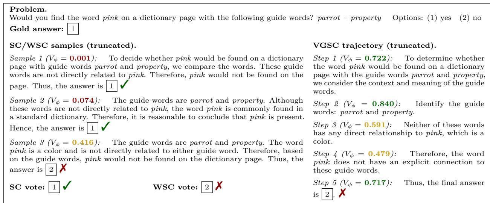  
Figure 10: VGSC failure case from SciQA. In this example, plain self-consistency over base-model samples returns the correct answer 1 , but the verifier is poorly aligned with the task and assigns higher scores to chains that confuse dictionary guide words with semantic relatedness. Consequently, WSC selects the incorrect answer 2 , and VGSC is pulled toward the same incorrect region under verifier-guided decoding. This shows that misaligned verifier signals can make verifier-tilted sampling worse than using the base generator alone.

Table 5: Fraction of VGSC decoding steps that reach fallback for Qwen2.5 Math 1.5B Instruct + PRM.
<table><tr><td>Dataset</td><td>MATH</td><td>Olympiad Bench</td><td>SciQA</td><td>CsQA</td><td>K&amp;K</td><td>Average</td></tr><tr><td>α = 1</td><td>10.76%</td><td>43.66%</td><td>57.15%</td><td>63.54%</td><td>56.23%</td><td>46.27%</td></tr><tr><td>α = 5</td><td>16.88%</td><td>73.97%</td><td>72.00%</td><td>78.26%</td><td>68.01%</td><td>61.82%</td></tr><tr><td>α = 10</td><td>20.45%</td><td>80.79%</td><td>76.34%</td><td>82.59%</td><td>73.21%</td><td>66.68%</td></tr><tr><td>α = 20</td><td>26.12%</td><td>85.49%</td><td>80.27%</td><td>85.59%</td><td>77.48%</td><td>70.99%</td></tr></table>

## B.2 Coverage and chain diversity

To better understand the behavior of diferent methods, we complement the main accuracy results with simple statistics of candidate-set quality and whole-chain diversity. For each example, let $\{ \mathbf { \bar { y } } ^ { ( 1 ) } , \dots , \mathbf { y } ^ { ( N ) } \}$ denote the completed reasoning chains generated by a method. We report:

• Accuracy: final exact-match accuracy after aggregation.

• Pass@N: whether at least one of the N generated chains is correct.

• Diversity: one minus the mean pairwise ROUGE-L similarity (Lin, 2004) between completed chains from the same example:

$$
\mathrm { D i v e r s i t y } ( x ) = 1 - \frac { 2 } { N ( N - 1 ) } \sum _ { i < j } \mathrm { R O U G E } \mathrm { L } \big ( \mathbf { y } ^ { ( i ) } , \mathbf { y } ^ { ( j ) } \big ) .\tag{19}
$$

Higher values of Pass@N and Diversity indicate better candidate coverage and greater diversity.

Table 6 reports the average values of the above metrics for the two datasets, highlighting the key diferences among methods. SC and WSC often generate diverse reasoning chains; however, because they do not incorporate verifier guidance during generation, they tend to achieve lower accuracy. By contrast, BS-Step applies verifier guidance throughout decoding, which improves accuracy but often reduces diversity, as the search concentrates on a narrow set of trajectories. VGSC ofers a middle ground: it generates multiple diverse chains while still leveraging verifier guidance during decoding, achieving strong Accuracy and Pass@N without sufering the same degree of diversity collapse as beam search.

Table 6: Accuracy, average pass@N and whole-chain diversity statistics on random 100-example subsets of MATH and OlympiadBench using Qwen2.5 Math 1.5B Instruct with the Qwen2.5 Math PRM 7B verifier.
<table><tr><td>Method</td><td>MATH Accuracy ↑ Pass@N ↑</td><td>Diversity ↑</td><td>Accuracy ↑</td><td>OlympiadBench Pass@N↑ Diversity ↑</td></tr><tr><td colspan="5">No-verifier baselines</td></tr><tr><td>SC</td><td>1 76 80</td><td>0.487</td><td>40</td><td>46</td><td>0.551</td></tr><tr><td colspan="6">Post-hoc verifier aggregation</td></tr><tr><td>WSC</td><td>一 78 80</td><td>0.487</td><td>45</td><td>46</td><td>0.551</td></tr><tr><td colspan="6">Verifier-guided search baselines</td></tr><tr><td>BS-Step</td><td>77</td><td>0.147</td><td>38</td><td>43</td><td>0.177</td></tr><tr><td>BS-Future</td><td>78 80 82</td><td>0.140</td><td>43</td><td>46</td><td>0.168</td></tr><tr><td colspan="6">Verifier-guided self-consistency (ours)</td></tr><tr><td>VGSC α = 5</td><td>80</td><td>0.284</td><td>47</td><td>52</td><td>0.436</td></tr><tr><td>VGSC α = 10</td><td>79</td><td>85 84 0.277</td><td>45</td><td>49</td><td>0.429</td></tr></table>

## B.3 Fallback Statistics

Theorem 1 shows that finite-cap bias occurs only when all C proposed next steps are rejected and VGSC falls back to restricted selection. We therefore measure how often this fallback occurs under the default cap $C = 5$ . Table 5 reports fallback rates for diferent verifier-trust exponents α. As expected, fallback becomes more frequent as α increases, since larger values make $V ^ { \alpha } \widehat { Q } ^ { \alpha }$ more selective. Nevertheless, even at $\alpha = 2 0$ fewer than 70% of decoding steps reach fallback on average. On MATH, fallback is even rarer, occurring in only 10%–26% of steps across α variants.

## C Theoretical Results

This section proves Proposition 1 and Theorem 1. We also derive a trajectory-level implication of the one-step bound and analyze the stability of verifier-tilted distributions under imperfect verifier scores.

## C.1 Proof of Proposition 1

By definition,

$$
P _ { \alpha } ^ { V } ( \mathbf { y } \mid \mathbf { x } ) \propto P ( \mathbf { y } \mid \mathbf { x } ) V ( \mathbf { y } \mid \mathbf { x } ) ^ { \alpha } .
$$

For a fixed prefix $\mathbf { y } _ { < t }$ and candidate step $y ,$ the conditional probability under $P _ { \alpha } ^ { V }$ is obtained by summing over all sufixes:

$$
P _ { \alpha } ^ { V } ( y _ { t } = y \mid \mathbf { x } , \mathbf { y } _ { < t } ) \propto \sum _ { \mathbf { y } > t } P ( \mathbf { y } \mid \mathbf { x } ) V ( \mathbf { y } \mid \mathbf { x } ) ^ { \alpha } .
$$

Using the chain rule for the generator and the stepwise verifier factorization, and absorbing all prefix-dependent terms into the proportionality constant, we get

$$
\begin{array} { l } { P _ { \alpha } ^ { V } ( y _ { t } = y \mid \mathbf { x } , \mathbf { y } _ { < t } ) \propto P ( y \mid \mathbf { x } , \mathbf { y } _ { < t } ) V ( y \mid \mathbf { x } , \mathbf { y } _ { < t } ) ^ { \alpha } \cdot { \displaystyle \sum _ { \mathbf { y } > t } P ( \mathbf { y } _ { > t } \mid \mathbf { x } , \mathbf { y } _ { < t } \circ y ) V ( \mathbf { y } _ { > t } \mid \mathbf { x } , \mathbf { y } _ { < t } \circ y ) ^ { \alpha } } = } \\ { \qquad = P ( y \mid \mathbf { x } , \mathbf { y } _ { < t } ) V ( y \mid \mathbf { x } , \mathbf { y } _ { < t } ) ^ { \alpha } Q _ { \alpha } ( \mathbf { y } _ { < t } \circ y , \mathbf { x } ) . } \end{array}\tag{20}
$$

This proves Proposition 1.

## C.2 Proof of Theorem 1

Fix a prefix $\mathbf { y } _ { < t }$ and write

$$
\begin{array} { r l } & { ~ p _ { t } ( y ) : = P ( y \mid \mathbf { x } , \mathbf { y } _ { < t } ) , } \\ & { ~ w _ { t } ( y ) : = W _ { \alpha } ( y \mid \mathbf { x } , \mathbf { y } _ { < t } ) , } \\ & { ~ Z _ { t } : = \mathbb { E } _ { Y \sim p _ { t } } [ w _ { t } ( Y ) ] . } \end{array}\tag{21}
$$

By the exact-guidance assumption,

$$
q _ { t } ( y ) = P _ { \alpha } ^ { V } ( y _ { t } = y \mid \mathbf { x } , \mathbf { y } _ { < t } ) = \frac { p _ { t } ( y ) w _ { t } ( y ) } { Z _ { t } } .\tag{22}
$$

If $Z _ { t } = 1$ , fallback has probability zero and the result is immediate. Thus assume $0 < Z _ { t } < 1$

Let $F _ { C }$ be the event that all $C$ proposals are rejected. A single proposal is accepted with marginal probability $Z _ { t } ,$ so

$$
\operatorname* { P r } ( F _ { C } \mid \mathbf { x } , \mathbf { y } _ { < t } ) = ( 1 - Z _ { t } ) ^ { C } \leq \exp ( - C Z _ { t } ) .\tag{23}
$$

Conditioned on not reaching fallback, the output is exactly distributed as $q _ { t }$ . Indeed, the probability that the first accepted proposal has value y and occurs at attempt $j$ is $( 1 - Z _ { t } ) ^ { j - 1 } p _ { t } ( y ) w _ { t } ( y )$ . Therefore

$$
\operatorname* { P r } ( \tilde { y } _ { t } = y , F _ { C } ^ { c } \mid \mathbf { x } , \mathbf { y } _ { < t } ) = \sum _ { j = 1 } ^ { C } ( 1 - Z _ { t } ) ^ { j - 1 } p _ { t } ( y ) w _ { t } ( y ) = \frac { 1 - ( 1 - Z _ { t } ) ^ { C } } { Z _ { t } } p _ { t } ( y ) w _ { t } ( y ) .\tag{24}
$$

Dividing by $\mathrm { P r } ( F _ { C } ^ { c } \mid \mathbf { x } , \mathbf { y } _ { < t } ) = 1 - ( 1 - Z _ { t } ) ^ { C }$ gives

$$
\operatorname* { P r } ( \tilde { y } _ { t } = y \mid F _ { C } ^ { c } , { \mathbf { x } } , { \mathbf { y } } _ { < t } ) = q _ { t } ( y ) .\tag{25}
$$

It remains to bound the fallback contribution. Conditioned on rejection, each cached proposal is distributed as

$$
\bar { p } _ { t } ( y ) = \frac { p _ { t } ( y ) ( 1 - w _ { t } ( y ) ) } { 1 - Z _ { t } } .\tag{26}
$$

The fallback uses odds weights

$$
\rho _ { t } ( y ) : = \frac { w _ { t } ( y ) } { 1 - w _ { t } ( y ) } .\tag{27}
$$

Hence

$$
\bar { p } _ { t } ( y ) \rho _ { t } ( y ) = \frac { p _ { t } ( y ) w _ { t } ( y ) } { 1 - Z _ { t } } \propto q _ { t } ( y ) ,\tag{28}
$$

so the fallback step is a sampling-importance-resampling (SIR) approximation to $q _ { t }$ from samples drawn from $\bar { p } _ { t }$

Let $r _ { C , t , \alpha }$ denote the marginal distribution of the fallback sample. Define

$$
\begin{array} { l } { \displaystyle \eta _ { t } : = \mathbb { E } _ { Y \sim \bar { p } _ { t } } \big [ \rho _ { t } ( Y ) \big ] = \frac { Z _ { t } } { 1 - Z _ { t } } , } \\ { \displaystyle \Gamma _ { t } : = \mathbb { E } _ { Y \sim \bar { p } _ { t } } \left[ \left( \frac { \rho _ { t } ( Y ) } { \eta _ { t } } \right) ^ { 2 } \right] . } \end{array}\tag{29}
$$

The boundedness assumption $0 < \epsilon \le w _ { t } ( y ) \le 1 - \epsilon$ implies $\epsilon \le Z _ { t } \le 1 - \epsilon$ and

$$
\Gamma _ { t } = \frac { 1 - Z _ { t } } { Z _ { t } ^ { 2 } } \sum _ { y } p _ { t } ( y ) \frac { w _ { t } ( y ) ^ { 2 } } { 1 - w _ { t } ( y ) } \leq \frac { ( 1 - \epsilon ) ^ { 3 } } { \epsilon ^ { 3 } } < \infty .\tag{30}
$$

By the standard non-asymptotic bias bound for self-normalized importance sampling over bounded test functions (Agapiou et al., 2017, Theorem 2.1), and since the marginal law of the SIR fallback sample is the

expectation of the self-normalized weighted empirical measure, there exists a constant $B _ { t } < \infty$ , independent of $C _ { i }$ , such that

$$
d _ { \mathrm { T V } } ( r _ { C , t , \alpha } , q _ { t } ) \leq \frac { B _ { t } } { C } .\tag{31}
$$

Finally, the bounded VGSC transition decomposes as

$$
\begin{array} { r } { \mathcal { K } _ { C , t , \alpha } ( \cdot \mid \mathbf { x } , \mathbf { y } _ { < t } ) = \left( 1 - ( 1 - Z _ { t } ) ^ { C } \right) q _ { t } ( \cdot ) + ( 1 - Z _ { t } ) ^ { C } r _ { C , t , \alpha } ( \cdot ) . } \end{array}\tag{32}
$$

Therefore,

$$
d _ { \mathrm { T V } } ( K _ { C , t , \alpha } ( \cdot \ | \ \mathbf { x } , \mathbf { y } _ { < t } ) , q _ { t } ( \cdot ) ) = ( 1 - Z _ { t } ) ^ { C } d _ { \mathrm { T V } } ( r _ { C , t , \alpha } , q _ { t } ) \leq B _ { t } \frac { ( 1 - Z _ { t } ) ^ { C } } { C } \leq B _ { t } \frac { \exp ( - C Z _ { t } ) } { C } .\tag{33}
$$

## C.3 Trajectory-level implication.

The one-step bound also gives a simple bound on complete trajectories. Assume that all generated trajectories have length at most $T .$ . Let $q _ { t } ( \cdot \mid \mathbf { x } , \mathbf { y } _ { < t } )$ denote the ideal local conditional at step $t ,$ and let $\mathcal { K } _ { C , t , \alpha } ( \cdot \mid \mathbf { x } , \mathbf { y } _ { < t } )$ denote the bounded VGSC transition. Define

$$
\varepsilon _ { t } ( \mathbf { x } , \mathbf { y } _ { < t } ) : = d _ { \mathrm { T V } } \big ( K _ { C , t , \alpha } \big ( \cdot \mid \mathbf { x } , \mathbf { y } _ { < t } \big ) , q _ { t } ( \cdot \mid \mathbf { x } , \mathbf { y } _ { < t } ) \big ) .\tag{34}
$$

By Theorem 1, for every reachable prefix,

$$
\varepsilon _ { t } ( \mathbf { x } , \mathbf { y } _ { < t } ) \leq B _ { t } ( \mathbf { x } , \mathbf { y } _ { < t } ) \cdot \frac { \exp ( - C Z _ { t } ( \mathbf { x } , \mathbf { y } _ { < t } ) ) } { C } .
$$

Let $\widehat { P } _ { C } ( \cdot \mid \mathbf { x } )$ be the trajectory distribution induced by bounded VGSC, and let $P ^ { \star } ( \cdot \mid \mathbf { x } )$ be the trajectory distribution obtained by composing the ideal local conditionals $q _ { t }$ . A standard step-by-step maximal coupling gives

$$
d _ { \mathrm { T V } } \Big ( \widehat { P } _ { C } ( \cdot \mid \mathbf { x } ) , P ^ { \star } ( \cdot \mid \mathbf { x } ) \Big ) \leq \sum _ { t = 1 } ^ { T } \operatorname* { s u p } _ { \mathbf { y } < t } \varepsilon _ { t } ( \mathbf { x } , \mathbf { y } _ { < t } ) .
$$

Therefore,

$$
d _ { \mathrm { T V } } \Big ( \widehat { P } _ { C } ( \cdot \mid \mathbf { x } ) , P ^ { \star } ( \cdot \mid \mathbf { x } ) \Big ) \leq \sum _ { t = 1 } ^ { T } \operatorname* { s u p } _ { \mathbf { y } < t } B _ { t } ( \mathbf { x } , \mathbf { y } _ { < t } ) \cdot \frac { \exp ( - C Z _ { t } ( \mathbf { x } , \mathbf { y } _ { < t } ) ) } { C } .
$$

In particular, if $Z _ { t } ( \mathbf { x } , \mathbf { y } _ { < t } ) \geq z _ { \operatorname* { m i n } } > 0$ and $B _ { t } ( { \mathbf { x } } , { \mathbf { y } } _ { < t } ) \leq B < \infty$ for all reachable prefixes, then

$$
d _ { \mathrm { T V } } \left( \widehat { P } _ { C } ( \cdot \mid \mathbf { x } ) , P ^ { \star } ( \cdot \mid \mathbf { x } ) \right) \leq T B \frac { \exp ( - C z _ { \operatorname* { m i n } } ) } { C } .
$$

When the unclipped exact weights are used, $P ^ { \star } = P _ { \alpha } ^ { V }$ . When clipped weights are used, $P ^ { \star }$ is the corresponding clipped verifier-guided trajectory distribution.

## C.4 Stability under imperfect verifier scores.

The preceding results assume exact local guidance weights. We now note that the verifier-tilted target is stable to small verifier errors in log space. Let $V ^ { \star }$ denote an ideal verifier and let $\widehat { V }$ denote an imperfect verifier. Define

$$
P _ { \alpha } ^ { V ^ { \star } } ( \mathbf { y } \mid \mathbf { x } ) \propto P ( \mathbf { y } \mid \mathbf { x } ) V ^ { \star } ( \mathbf { y } \mid \mathbf { x } ) ^ { \alpha } , P _ { \alpha } ^ { \widehat { V } } ( \mathbf { y } \mid \mathbf { x } ) \propto P ( \mathbf { y } \mid \mathbf { x } ) \widehat { V } ( \mathbf { y } \mid \mathbf { x } ) ^ { \alpha } .\tag{35}
$$

Suppose that, for all trajectories $\mathbf { y }$ with $P ( \mathbf { y } \mid \mathbf { x } ) > 0$

$$
\left| \log \widehat { V } ( \mathbf { y } \mid \mathbf { x } ) - \log V ^ { \star } ( \mathbf { y } \mid \mathbf { x } ) \right| \leq \delta .\tag{36}
$$

Table 7: Prompt templates used for each benchmark group. The semantic content of the prompts is kept fixed across generator families; only the model-specific chat-template packaging is changed when needed.
<table><tr><td>Benchmark(s)</td><td>Task format</td><td>Prompt template</td><td>Expected final answer</td></tr><tr><td>MATH500, OlympiadBench</td><td>Open-ended</td><td>Please reason step by step, and put your final answer within \boxed{}.</td><td>\boxed{&lt;answer&gt;}</td></tr><tr><td>ScienceQA, CommonsenseQA</td><td>Multiple choice</td><td>Solve the problem carefully. Show your reasoning in short numbered steps. Then on the last line, output only the positive integer of the answer choice in exactly this format: \boxed{(1|2|3|...)}.</td><td>\boxed{k},  $k \in \{ 1 , 2 , 3 , \dots \}$ </td></tr><tr><td>Knights&amp;Knaves</td><td>Multiple choice (binary)</td><td>Solve the problem carefully. Show your reasoning in short numbered steps. Then on the last line, output only the positive integer of the answer choice in exactly this format: \boxed{(1|2)}.</td><td>\boxed{k},  $k \in \{ 1 , 2 \}$ </td></tr></table>

Then

$$
d _ { \mathrm { T V } } \Bigl ( P _ { \alpha } ^ { \widehat { V } } ( \cdot \mid \mathbf { x } ) , P _ { \alpha } ^ { V ^ { \star } } ( \cdot \mid \mathbf { x } ) \Bigr ) \leq \operatorname { t a n h } \biggl ( \frac { \alpha \delta } { 2 } \biggr ) \leq \frac { \alpha \delta } { 2 } .\tag{37}
$$

Indeed, writing

$$
h ( \mathbf { y } ) : = \left( \frac { \widehat { V } ( \mathbf { y } \mid \mathbf { x } ) } { V ^ { \star } ( \mathbf { y } \mid \mathbf { x } ) } \right) ^ { \alpha } ,\tag{38}
$$

the log-error assumption implies $h ( \mathbf { y } ) \in [ e ^ { - \alpha \delta } , e ^ { \alpha \delta } ]$ . The density ratio between the two tilted distributions is proportional to $h ,$ and a standard bounded-ratio argument gives the stated total-variation bound.

This bound highlights the role of α: stronger verifier guidance can improve search when the verifier is informative, but it also amplifies verifier errors linearly for small δ. This supports treating α as a verifier-trust parameter rather than always making it large.

## D Experimental Details

## D.1 Datasets, Prompts, and Examples

We evaluate on five benchmarks covering open-ended mathematical reasoning and multiple-choice scientific, commonsense, and logical reasoning. MATH and OlympiadBench are evaluated as open-ended generation tasks, while filtered text-only subsets of ScienceQA, CommonsenseQA, and Knights&Knaves are evaluated as multiple-choice tasks. Table 1 reports subset sizes and mean reasoning-step counts for the Qwen2.5-Math-1.5B-Instruct generator.

For multiple-choice datasets, we map each gold answer to its answer-choice index and evaluate the predicted boxed integer. Table 7 summarizes the prompts. We keep prompt semantics fixed across generator families, changing only model-specific chat-template packaging when needed.

Table 8 provides example questions from each benchmark.

## D.2 Answer Extraction and Evaluation

We use the default answer-extraction and evaluation logic implemented in the ThinkBooster library (Smirnov et al., 2026). All reported results are exact-match accuracies computed on the extracted final answer.

Answer extraction. For each model output, we first extract the contents of the last complete \boxed{} expression. If no complete boxed answer is found, we fall back to the last parseable numeric span (integer or decimal) in the generated text. For the multiple-choice datasets (ScienceQA, CommonsenseQA, and

Table 8: Examples from the five evaluation datasets using the exact dataset paths and splits from our experiments. For multiple-choice datasets, we show the full prompted question including answer choices, since the model is instructed to return the boxed index of the selected option.
<table><tr><td>Dataset</td><td>Example input question</td><td>Gold answer</td></tr><tr><td>MATH500</td><td>Convert the point (0, 3) in rectangular coordinates to polar coordinates. Enter your answer in the form  $( r , \theta )$  , where  $r > 0$  and  $0 \leq \theta < 2 \pi$ </td><td> $\left( 3 , { \frac { \pi } { 2 } } \right)$ </td></tr><tr><td>OlympiadBench</td><td>Xenia and Sergey play the following game. Xenia thinks of a positive integer N not exceeding 5000. Then she fixes 20 distinct positive integers a1, a2, . . . , a20 such that, for each  $k = 1 , 2 , \ldots , 2 0$  , the numbers N and ak are congruent modulo k. By a move, Sergey tells Xenia a set S of positive integers not exceeding 20, and she tells him back the set  $\{ a _ { k } : k \in S \}$  without spelling out which number corresponds to which index. How many moves does Sergey need to determine for sure the number Xenia thought of?</td><td></td></tr><tr><td>ScienceQA</td><td>Which figure of speech is used in this text? Sing, O goddess, the anger of Achilles son of Peleus, that brought countless ills upon the Achaeans. — Homer, The Iliad Options: (1) chiasmus (2) apostrophe</td><td>2</td></tr><tr><td></td><td>CommonsenseQA A revolving door is convenient for two direction travel, but it also serves as a 1 security measure at a what? Choices: (1) bank (2) library (3) department store (4) mall (5) new york</td><td></td></tr><tr><td>Knights&amp;Knaves</td><td>A very special island is inhabited only by knights and knaves. Knights always tell the truth, and knaves always lie. You meet 2 inhabitants: Zoey, and Oliver. Zoey remarked, “Oliver is not a knight&quot;. Oliver stated, &quot;Oliver is a knight if and only if Zoey is a knave&quot;. So who is Zoey? Choices: (1) knight (2) knave</td><td></td></tr></table>

Table 9: Shared decoding settings used in experiments.
<table><tr><td>Setting</td><td>Value</td></tr><tr><td>Minimum tokens per step</td><td>10</td></tr><tr><td>Maximum tokens per step</td><td>2048</td></tr><tr><td>Maximum reasoning steps per trajectory</td><td>50</td></tr><tr><td>Total maximum tokens</td><td>4096</td></tr><tr><td>Temperature</td><td>1.0</td></tr><tr><td>Top-p, top-k</td><td>1.0, 1000</td></tr><tr><td>Repetition penalty</td><td>1.2</td></tr><tr><td>Random seeds</td><td>{0, 1, 2, 3, 4}</td></tr></table>

Knights&Knaves), we explicitly prompt the model to output the answer-choice index in boxed form, e.g. \boxed{2}. This allows us to use a single extraction pipeline across both open-ended and multiple-choice benchmarks.

Answer evaluation. For ScienceQA, CommonsenseQA, and Knights&Knaves, exact-match is computed against the mapped gold answer-choice index. For MATH and OlympiadBench, we use a math-aware exact-match evaluator. The evaluator first normalizes the extracted answer and then applies a cascade of checks: normalized string match, numeric comparison, and symbolic comparison when both the prediction and the reference can be parsed as mathematical expressions. The symbolic comparison uses SymPy parsing utilities, so algebraically equivalent expressions are counted as correct (Meurer et al., 2017).

Table 10: Method-specific inference budgets used in the main experiments.  
Method Inference budget   
SC $N \in \{ 5 , 2 5 \}$ reasoning chains   
WSC $N \in \{ 5 , 2 5 \}$ reasoning chains   
DLE N = 25 reasoning chains   
TSMC N = 25 particles   
BS N = 5 chains, C = 5 candidate expansions   
BS+SC N = 5 chains, C = 5 candidate expansions   
VGSC N = 5 chains, C = 5 candidate expansions

## D.3 Step Splitting and Decoding Details

Our decoding strategies operate over reasoning steps rather than individual tokens, following the step-based decoding framework implemented in ThinkBooster (Smirnov et al., 2026).

Rule-based step splitting. We use a rule-based detector to identify candidate step boundaries from discourse and structural markers such as first, next, then, finally, therefore, thus, let’s check, consider, paragraph breaks, and numbered lists. We additionally include a small set of custom markers, including for example, given that, and similarly, to improve consistency across model families.

Decoding settings. Unless otherwise noted, all main-paper experiments use the settings in Tables 9 and 10. We enforce a minimum of 10 tokens per step, cap each step at 2048 tokens, and cap each trajectory at 50 reasoning steps.

## D.4 Verifier Training Details

We train two verifier families: a PRM-based verifier and a ReProbe verifier (Ni et al., 2025). For each family, we train separate models for step correctness and step continuation.

Table 11: Hyperparameters for the two verifier families. For PRM, the step verifier is frozen and the future verifier uses last-layer QLoRA; ReProbe variants are trained separately for each supervision target.
<table><tr><td>Parameter</td><td>PRM verifier</td><td>ReProbe verifier</td></tr><tr><td>Architecture details</td><td>LoRA fine-tuning of Qwen2.5 Math PRM 7B; last 4 layers only; rank 128; alpha 256; dropout 0.05; attentions and MLP projec-</td><td>Last hidden layer from LLM as features; ReProbe uses a 2-layer transformer head with dim. 768, 8 heads, and dropout 0.1</td></tr><tr><td>Trainable parameters</td><td>tions 46.1M</td><td>15m - 19m depending on base LLM</td></tr><tr><td>Maximum length</td><td>2048</td><td>2048</td></tr><tr><td>Batch size</td><td>32 (1 per device, 32 accumulation steps)</td><td>16</td></tr><tr><td>Learning rate</td><td>10-4</td><td>10⁻4</td></tr><tr><td>Epochs</td><td>5</td><td>6</td></tr><tr><td>Validation split</td><td>10%</td><td>10%</td></tr><tr><td>Training seed</td><td>42</td><td>42</td></tr><tr><td>Regularization</td><td></td><td>Weight decay 0.1, max grad norm 1.0</td></tr></table>

Training data and supervision. Following (Ni et al., 2025), we construct verifier training data from the PRM800k corpus (Lightman et al., 2024). For each generator family, we first sample 10,828 questions, generate 3 reasoning trajectories per question, and split each trajectory into steps using the same rule-based splitter

Table 12: Estimated inference compute. FLOPs are calculated using equation (39). PRM VGSC counts a shared frozen prefix and two last-layer branches (equal-layer estimate); ReProbe VGSC counts two 19M probes.
<table><tr><td>Generator + Verifier</td><td colspan="3">Qwen2.5 Math 1.5B Instruct + Qwen2.5 Math PRM 7B</td><td colspan="3">Llama 3.2 3B Instruct + Qwen2.5 Math PRM 7B</td><td colspan="3">Qwen2.5 Math 1.5B Instruct + ReProbe</td></tr><tr><td>Method</td><td>Tokens</td><td>Params</td><td>TFLOPs</td><td>Tokens</td><td>Params</td><td>TFLOPs</td><td>Tokens</td><td>Params</td><td>TFLOPs</td></tr><tr><td>Single sample</td><td>587</td><td>1.5B</td><td>2.1</td><td>754</td><td>3.0B</td><td>5.1</td><td>638</td><td>1.5B</td><td>2.2</td></tr><tr><td>SC (N = 5)</td><td>2,928</td><td>1.5B</td><td>9.1</td><td>3,058</td><td>3.0B</td><td>18.9</td><td>3,206</td><td>1.5B</td><td>9.9</td></tr><tr><td>SC (N = 25)</td><td>14,778</td><td>1.5B</td><td>44.6</td><td>15,288</td><td>3.0B</td><td>92.3</td><td>16,021</td><td>1.5B</td><td>48.4</td></tr><tr><td>WSC (N = 5)</td><td>2,964</td><td>8.5B</td><td>52.0</td><td>3,029</td><td>10.0B</td><td>62.5</td><td>3,243</td><td>1.519B</td><td>10.1</td></tr><tr><td>WSC (N = 25)</td><td>14,791</td><td>8.5B</td><td>253.1</td><td>15,260</td><td>10.0B</td><td>307.1</td><td>16,036</td><td>1.519B</td><td>49.0</td></tr><tr><td>BS-Step</td><td>19,837</td><td>8.5B</td><td>338.9</td><td>42,567</td><td>10.0B</td><td>853.3</td><td>21,905</td><td>1.519B</td><td>66.8</td></tr><tr><td>BS-Future</td><td>12,337</td><td>8.5B</td><td>211.4</td><td>15,646</td><td>10.0B</td><td>314.9</td><td>20,539</td><td>1.519B</td><td>62.7</td></tr><tr><td>VGSC (α = 5)</td><td>13,839</td><td>9.5B</td><td>264.8</td><td>33,158</td><td>11.0B</td><td>731.6</td><td>11,225</td><td>1.538B</td><td>34.8</td></tr><tr><td>VGSC (α = 10)</td><td>15,179</td><td>9.5B</td><td>290.2</td><td>32,970</td><td>11.0B</td><td>727.5</td><td>11,240</td><td>1.538B</td><td>34.9</td></tr></table>

used at test time. From every intermediate step prefix $y { \le } t$ , we then sample 10 Monte Carlo continuations using the same generation settings as at test time.

An LLM judge GPT 4.1 annotates each trajectory with the index k of its first incorrect step. We derive two supervision targets from these annotations. For the continuation target, the label for prefix $y { \le } t$ is the fraction of its sampled continuations that reach the correct final answer:

$$
c _ { t } = \frac { 1 } { 1 0 } \sum _ { i = 1 } ^ { 1 0 } 1 \left\{ \begin{array} { c } { { \mathrm { c o n t i n u a t i o n ~ } i \mathrm { ~ r e a c h e s } } } \\ { { \mathrm { t h e ~ c o r r e c t ~ f i n a l ~ a n s w e r } } } \end{array} \right\} .
$$

For the correctness target, if the first incorrect step is k, then steps $1 , \ldots , k - 1$ receive label 1, step k receives label 0, and all later steps are ignored.

Training settings. For the PRM family, we use the original Qwen2.5 Math PRM 7B for the local correctness estimate V, and for continuation values Q, we fine-tune LoRA adapters only in its last 4 layers (rank 128, scale 256), freezing the embedding and first 24 layers. For the ReProbe family, we train the local-correctness and continuation probes separately from scratch, using the same overall training setup and implementations from Shelmanov et al. (2025). The number of training epochs was selected based on the best validation-set accuracy. Table 11 summarizes the verifier training hyperparameters.

## E Inference Compute Estimate

We estimate inference compute as model FLOPs. For a dense decoder-only Transformer, we approximate a forward pass over T tokens with a P-parameter model as 2PT FLOPs (Kaplan et al., 2020). Let $T _ { \mathrm { g e n } }$ be the average generated-token count, $T _ { \mathrm { p r o m p t } }$ is the mean prompt length, and $P _ { m }$ the parameter count of counted component m (generator or verifier). With cached incremental decoding, we estimate

$$
\widehat { C } = 2 ( T _ { \mathrm { g e n } } + T _ { \mathrm { p r o m p t } } ) \sum _ { m } P _ { m } .\tag{39}
$$

Table 12 reports a shared-prefix inference estimate, not measured compute of our separate-PRM implementation. For a 28-layer PRM with only the last 4 layers adapted, two verifier branches count 8B efective parameters under the equal-layer approximation, instead of 14B. Including the generator gives 9.5B for Qwen and 11B for Llama. A single future PRM still requires the full 7B forward pass. Savings require identical input tokens and cached-prefix states for both branches; they do not follow from freezing weights alone.

Table 13: Accuracy ↑ across datasets and average generated tokens per sample for Llama 3.2 3B Instruct generator with Qwen2.5 Math PRM 7B verifier. Results are averaged over 5 random seeds. The best result in each column is bold and the second-best result is underlined.
<table><tr><td>Method</td><td>MATH</td><td>Olympiad Bench</td><td>SciQA</td><td>CsQA</td><td>K&amp;K</td><td>Average Accuracy</td><td>Average Tokens</td><td>Estimated TFLOPs</td></tr><tr><td colspan="9">No-verifier baselines</td></tr><tr><td>Single sample</td><td> $3 6 . 2 \pm 0 . 5$ </td><td> $1 1 . 2 \pm { \ : 0 . 3 }$ </td><td> $5 1 . 7 \pm 0 . 6$ </td><td> $4 2 . 3 \pm 0 . 3$ </td><td> $2 9 . 0 \pm { 1 . 9 }$ </td><td> $3 4 . 1 \pm 0 . 4$ </td><td>754</td><td>5.1</td></tr><tr><td> $\mathrm { S C } ~ N = 5$ </td><td> $3 8 . 6 \pm { 0 . 9 }$ </td><td> $1 0 . 0 \pm { \ : 0 . 2 }$ </td><td> $6 9 . 5 \pm 0 . 7$ </td><td> $5 9 . 8 \pm 0 . 2$ </td><td> $3 6 . 6 \pm 2 . 0$ </td><td> $4 2 . 9 \pm 0 . 5$ </td><td>3,058</td><td>18.9</td></tr><tr><td> $\mathrm { S C } ~ N = 2 5 $ </td><td> $5 0 . 9 \pm 0 . 1$ </td><td> $1 6 . 4 \pm 0 . 3$ </td><td> $8 2 . 7 \pm 0 . 5$ </td><td> $7 1 . 4 \pm 0 . 2$ </td><td> $4 9 . 4 \pm 1 . 7$ </td><td> $5 4 . 2 \pm 0 . 4$ </td><td>15,288</td><td>92.3</td></tr><tr><td colspan="9">Post-hoc verifier aggregation</td></tr><tr><td> $\mathrm { W S C } ~ N = 5$ </td><td> $4 6 . 4 \pm 0 . 5$ </td><td> $1 3 . 7 \pm 0 . 3$ </td><td> $6 8 . 5 \pm 0 . 7$ </td><td> $6 1 . 1 \pm 0 . 6$ </td><td> $3 4 . 8 \pm { } 1 . 3$ </td><td> $4 4 . 9 \pm 0 . 3$ </td><td>3,029</td><td>62.5</td></tr><tr><td> $\mathrm { W S C } ~ N = 2 5$ </td><td> $5 7 . 3 \pm 0 . 5$ </td><td> $1 9 . 6 \pm 0 . 2$ </td><td> $8 0 . 7 \pm 0 . 5$ </td><td> $7 1 . 8 \pm 0 . 5$ </td><td> $4 7 . 0 \pm 2 . 2$ </td><td> $5 5 . 3 \pm 0 . 5$ </td><td>15,260</td><td>307.1</td></tr><tr><td>DLE</td><td> $5 9 . 8 \pm 0 . 4$ </td><td> $2 8 . 3 \pm 0 . 2$ </td><td> $7 7 . 6 \pm 0 . 1$ </td><td> $7 2 . 2 \pm 0 . 2$ </td><td> $5 8 . 0 \pm { } 1 . 0$ </td><td> $5 9 . 2 \pm { 0 . 2 }$ </td><td>14,953</td><td>301.0</td></tr><tr><td colspan="9">Verifier-guided search baselines</td></tr><tr><td>BS-Step</td><td> $5 2 . 3 \pm 0 . 5$ </td><td> $1 6 . 4 \pm 0 . 3$ </td><td> $5 3 . 0 \pm 0 . 5$ </td><td> $4 3 . 7 \pm 0 . 6$ </td><td> $1 4 . 0 \pm 1 . 6$ </td><td> $3 5 . 9 \pm 0 . 4$ </td><td>42,567</td><td>853.3</td></tr><tr><td>BS-Future</td><td> $6 4 . 8 \pm 0 . 4$ </td><td> $2 7 . 3 \pm 0 . 4$ </td><td> $7 6 . 1 \pm 0 . 8$ </td><td> $6 7 . 0 \pm 0 . 4$ </td><td> $4 1 . 0 \pm 1 . 0$ </td><td> $5 5 . 2 \pm { \mathrm { 0 . 3 } }$ </td><td>15,646</td><td>314.9</td></tr><tr><td>BS+SC-Step</td><td> $6 1 . 0 \pm { 0 . 3 }$ </td><td> $2 2 . 3 \pm 0 . 2$ </td><td> $7 8 . 1 \pm 0 . 5$ </td><td> $6 5 . 6 \pm 0 . 2$ </td><td> $5 4 . 4 \pm 1 . 8$ </td><td> $5 6 . 3 \pm 0 . 4$ </td><td>42,944</td><td>860.8</td></tr><tr><td>BS+SC-Future</td><td> $6 5 . 7 \pm 0 . 5$ </td><td> $2 8 . 1 \pm 0 . 4$ </td><td> $7 9 . 3 \pm 0 . 3$ </td><td> $7 0 . 7 \pm 0 . 6$ </td><td> $6 1 . 5 \pm 2 . 2$ </td><td> $6 1 . 1 \pm 0 . 5$ </td><td>15,270</td><td>307.3</td></tr><tr><td>TSMC</td><td> $5 7 . 6 \pm 0 . 2$ </td><td> $2 1 . 4 \pm 0 . 4$ </td><td> $8 0 . 7 \pm 0 . 4$ </td><td> $6 9 . 0 \pm 0 . 6$ </td><td> $5 4 . 0 \pm 1 . 8$ </td><td> $5 6 . 5 \pm 0 . 4$ </td><td> $^ \mathrm { 1 5 , 8 7 3 }$ </td><td>351.3</td></tr><tr><td colspan="9">Verifer-guided self-consistency (ours)</td></tr><tr><td> $\mathrm { V G S C } ~ \alpha = 1$ </td><td> $6 3 . 6 \pm 0 . 6$ </td><td> $2 4 . 5 \pm 0 . 3$ </td><td> $8 3 . 7 \pm 0 . 4$ </td><td> $7 1 . 5 \pm 0 . 2$ </td><td> $6 0 . 5 \pm { 1 . 8 }$ </td><td> $6 0 . 8 \pm 0 . 4$ </td><td>28,715</td><td>633.9</td></tr><tr><td> $\mathrm { V G S C } ~ \alpha = 5$ </td><td> $6 7 . 4 \pm 0 . 4$ </td><td> $2 8 . 7 \pm 0 . 2$ </td><td> $8 4 . 0 \pm 0 . 4$ </td><td> $7 2 . 2 \pm 0 . 3$ </td><td> $6 2 . 5 \pm 2 . 1$ </td><td> $6 3 . 0 \pm 0 . 4$ </td><td>33,158</td><td>731.6</td></tr><tr><td> $\mathrm { V G S C } ~ \alpha = 1 0$ </td><td> $6 7 . 0 \pm \mathrm { 0 . 7 }$ </td><td> $\mathbf { 3 0 . 0 \pm 0 . 2 }$ </td><td> $8 3 . 4 \pm 0 . 4$ </td><td> $7 2 . 5 \pm 0 . 5$ </td><td> $5 9 . 5 \pm 1 . 3$ </td><td> $6 2 . 5 \pm 0 . 3$ </td><td>32,970</td><td>727.5</td></tr><tr><td> $\mathrm { V G S C } ~ \alpha = 2 0 $ </td><td> ${ \bf 6 8 . 6 \pm 0 . 2 }$ </td><td> $2 8 . 3 \pm 0 . 3$ </td><td> ${ \bf 8 4 . 4 \pm 0 . 3 }$ </td><td> $7 1 . 1 \pm 0 . 3$ </td><td> ${ \bf 6 4 . 0 \pm 2 . 9 }$ </td><td> ${ \bf 6 3 . 3 \pm 0 . 6 }$ </td><td>33,340</td><td>735.6</td></tr></table>

## F Additional Results

When the verifier is lightweight relative to the generator, VGSC’s generated-token savings can outweigh the cost of the additional future-outcome verifier. This is reflected in the ReProbe setting: counting one 19M probe for WSC/BS and two 19M probes for VGSC, VGSC has lower estimated FLOPs than the high-budget ReProbe baselines while using substantially fewer generated tokens. We view this lightweight-verifier regime as natural in practical deployments, where verifiers are often chosen to be smaller and cheaper than the generator they guide.

The main text reports results for the Qwen2.5 Math 1.5B Instruct model using the Qwen2.5 Math PRM 7B verifier. Here, we present additional results for Llama 3.2 3B Instruct and Gemma3 4B Instruct with the same verifier. For Qwen2.5 Math 1.5B Instruct, we also evaluate a second verifier family, ReProbe (Ni et al., 2025). Tables 13, 14 and 15 show that the main trend is consistent across LLMs and verifiers: VGSC remains competitive and typically outperforms the corresponding baselines, suggesting that the benefits of verifier-guided self-consistency are not limited to a single LLM or verifier family.

Table 14: Accuracy ↑ across datasets and average generated tokens per sample for Gemma3 4B Instruct generator with Qwen2.5 Math PRM 7B verifier. Results are averaged over 5 random seeds. The best result in each column is bold and the second-best result is underlined.
<table><tr><td>Method</td><td>MATH</td><td>Olympiad Bench</td><td>SciQA</td><td> $\mathrm { C s Q A }$ </td><td>K&amp;K</td><td>Average Accuracy</td><td>Average Tokens</td><td>Estimated TFLOPs</td></tr><tr><td colspan="9">No-verifier baselines</td></tr><tr><td>Single sample</td><td> $6 7 . 2 \pm 0 . 5$ </td><td> $2 9 . 6 \pm 0 . 3$ </td><td> $6 8 . 9 \pm 0 . 5$ </td><td> $6 8 . 1 \pm 0 . 7$ </td><td> $6 0 . 0 \pm 1 . 6$ </td><td> $5 8 . 8 \pm 0 . 4$ </td><td>845</td><td>7.5</td></tr><tr><td> $\mathrm { S C } \mathrm { ~ N = 5 ~ }$ </td><td> $7 4 . 7 \pm 0 . 4$ </td><td> $3 6 . 7 \pm 0 . 2$ </td><td> $7 5 . 1 \pm 0 . 7$ </td><td> $7 0 . 4 \pm 0 . 4$ </td><td> $6 6 . 8 \pm 1 . 0$ </td><td> $6 4 . 7 \pm 0 . 3$ </td><td>4,315</td><td>35.3</td></tr><tr><td> $\mathrm { S C } ~ N = 2 5 $ </td><td> $7 8 . 6 \pm 0 . 4$ </td><td> $4 1 . 6 \pm 0 . 2$ </td><td> $7 4 . 3 \pm 0 . 3$ </td><td> $7 2 . 9 \pm 0 . 3$ </td><td> $6 7 . 6 \pm 1 . 1$ </td><td> $6 7 . 0 \pm { 0 . 2 }$ </td><td>21,581</td><td>173.4</td></tr><tr><td colspan="9">Post-hoc verifier aggregation</td></tr><tr><td> $\mathrm { W S C } ~ N = 5$ </td><td> $7 6 . 0 \pm 0 . 4$ </td><td> $3 7 . 9 \pm 0 . 4$ </td><td> $7 9 . 3 \pm 0 . 4$ </td><td> $7 2 . 8 \pm 0 . 3$ </td><td> $6 8 . 4 \pm 1 . 0$ </td><td> $6 6 . 9 \pm 0 . 3$ </td><td>4,308</td><td>96.9</td></tr><tr><td> $\mathrm { W S C } ~ N = 2 5$ </td><td> $8 0 . 8 \pm 0 . 3$ </td><td> $4 3 . 4 \pm 0 . 3$ </td><td> $8 0 . 8 \pm 0 . 3$ </td><td> $7 4 . 8 \pm 0 . 2$ </td><td> $7 1 . 4 \pm 1 . 1$ </td><td> $7 0 . 2 \pm 0 . 2$ </td><td>21,573</td><td>476.7</td></tr><tr><td>DLE</td><td> $7 7 . 4 \pm 0 . 5$ </td><td> $4 2 . 0 \pm 0 . 4$ </td><td> $8 0 . 6 \pm 0 . 4$ </td><td> $\underline { { 7 4 . 4 } } \pm 0 . 3$ </td><td> $6 5 . 2 \pm 1 . 7$ </td><td> $6 7 . 9 \pm 0 . 3$ </td><td>13,285</td><td>294.4</td></tr><tr><td colspan="9">Verifier-guided search baselines</td></tr><tr><td> ${ \mathrm { B S - S t e p } }$ </td><td> $7 3 . 3 \pm 0 . 4$ </td><td> $3 3 . 4 \pm 0 . 2$ </td><td> $8 0 . 6 \pm 0 . 5$ </td><td> $7 0 . 7 \pm 0 . 4$ </td><td> $7 0 . 4 \pm 0 . 9$ </td><td> $6 5 . 7 \pm 0 . 2$ </td><td>29,586</td><td>653.0</td></tr><tr><td>BS-Future</td><td> $7 7 . 6 \pm 0 . 3$ </td><td> $3 7 . 7 \pm 0 . 3$ </td><td> $8 1 . 3 \pm 0 . 4$ </td><td> $7 2 . 9 \pm 0 . 3$ </td><td> $6 5 . 5 \pm { \bf 0 . 9 }$ </td><td> $6 7 . 0 \pm { 0 . 2 }$ </td><td>11,329</td><td>251.4</td></tr><tr><td> $\mathrm { B S + S C - S t e p }$ </td><td> $7 5 . 6 \pm 0 . 4$ </td><td> $3 6 . 9 \pm 0 . 2$ </td><td> $7 9 . 6 \pm 0 . 5$ </td><td> $7 1 . 2 \pm 0 . 5$ </td><td> ${ \bf 7 3 . 5 \pm 1 . 2 }$ </td><td> $6 7 . 4 \pm 0 . 3$ </td><td>29,562</td><td>652.5</td></tr><tr><td>BS+SC-Future</td><td> $7 6 . 9 \pm 0 . 2$ </td><td> $4 0 . 3 \pm 0 . 3$ </td><td> $7 9 . 0 \pm 0 . 2$ </td><td> $7 0 . 8 \pm 0 . 3$ </td><td> $6 7 . 0 \pm { \bf 0 . 8 }$ </td><td> $6 6 . 8 \pm 0 . 2$ </td><td>11,562</td><td>256.5</td></tr><tr><td>TSMC</td><td> $7 9 . 5 \pm 0 . 3$ </td><td> $4 2 . 3 \pm 0 . 3$ </td><td> $8 1 . 1 \pm 0 . 6$ </td><td> $7 1 . 6 \pm \ : 0 . 2$ </td><td> $7 1 . 0 \pm 1 . 3$ </td><td> $6 9 . 1 \pm 0 . 3$ </td><td>16,295</td><td>393.4</td></tr><tr><td colspan="9">Verifier-guided self-consistency (ours)</td></tr><tr><td> $\mathrm { V G S C } ~ \alpha = 1$ </td><td> $8 1 . 3 \pm 0 . 4$ </td><td> $4 2 . 9 \pm 0 . 5$ </td><td> $8 2 . 0 \pm \mathbf { 0 . 4 }$ </td><td> $7 3 . 2 \pm 0 . 3$ </td><td> $7 2 . 0 \pm \mathbf { 0 . 7 }$ </td><td> $\underline { { 7 0 . 3 } } \pm 0 . 2$ </td><td>18,846</td><td>454.6</td></tr><tr><td> $\mathrm { V G S C } ~ \alpha = 5$ </td><td> $\underline { { 8 1 . 5 } } \pm 0 . 3$ </td><td> ${ \bf 4 3 . 6 \pm 0 . 5 }$ </td><td> ${ \bf 8 2 . 3 \pm 0 . 4 }$ </td><td> $7 3 . 4 \pm 0 . 3$ </td><td> $7 0 . 5 \pm { \bf 0 . 9 }$ </td><td> $\underline { { 7 0 . 3 } } \pm 0 . 2$ </td><td>19,553</td><td>471.6</td></tr><tr><td> $\mathrm { V G S C } ~ \alpha = 1 0$ </td><td> ${ \bf 8 2 . 0 \pm 0 . 2 }$ </td><td> $4 3 . 1 \pm 0 . 2$ </td><td> $8 0 . 6 \pm 0 . 3$ </td><td> $7 3 . 4 \pm 0 . 3$ </td><td> $6 9 . 5 \pm 1 . 2$ </td><td> $6 9 . 7 \pm 0 . 3$ </td><td>19,740</td><td>476.1</td></tr><tr><td> $\mathrm { V G S C } ~ \alpha = 2 0 $ </td><td> $8 1 . 0 \pm 0 . 3$ </td><td> $4 3 . 0 \pm 0 . 1$ </td><td> $8 1 . 0 \pm 0 . 3$ </td><td> $7 3 . 6 \pm 0 . 2$ </td><td> ${ \bf 7 3 . 5 \pm 1 . 0 }$ </td><td> $\mathbf { 7 0 . 4 \pm 0 . 2 }$ </td><td>19,696</td><td>475.0</td></tr></table>

Table 15: Accuracy ↑ across datasets and average generated tokens per sample for Qwen2.5 Math 1.5B Instruct generator with ReProbe verifier. Results are averaged over 5 random seeds. The best result in each column is bold and the second-best result is underlined.
<table><tr><td>Method</td><td>MATH</td><td>Olympiad Bench</td><td>SciQA</td><td> $\mathrm { C s Q A }$ </td><td>K&amp;K</td><td>Average Accuracy</td><td>Average Tokens</td></tr><tr><td colspan="8">No-veriier baselines</td></tr><tr><td>Single sample</td><td> $6 6 . 8 \pm 0 . 4$ </td><td> $2 9 . 9 \pm 0 . 4$ </td><td> $4 6 . 2 \pm 0 . 4$ </td><td> $2 9 . 8 \pm 0 . 4$ </td><td> $3 8 . 0 \pm { } 1 . 0$ </td><td> $4 2 . 1 \pm 0 . 2$ </td><td>638</td></tr><tr><td> $\mathrm { S C } \left( N = 5 \right)$ </td><td> $7 0 . 0 \pm \mathbf { 0 . 4 }$ </td><td> $3 4 . 2 \pm 0 . 4$ </td><td> $5 7 . 0 \pm 0 . 4$ </td><td> $3 9 . 8 \pm 0 . 4$ </td><td> $5 3 . 0 \pm { } 1 . 0$ </td><td> $5 0 . 8 \pm 0 . 2$ </td><td>3,206</td></tr><tr><td> $\mathrm { S C } ~ ( N = 2 5 )$ </td><td> $7 3 . 6 \pm 0 . 4$ </td><td> $3 8 . 5 \pm 0 . 4$ </td><td> $6 3 . 8 \pm 0 . 4$ </td><td> $\mathbf { 4 7 . 8 \pm 0 . 4 }$ </td><td> $5 4 . 0 \pm 1 . 0$ </td><td> $5 5 . 5 \pm 0 . 2$ </td><td>16,021</td></tr><tr><td colspan="8">Post-hoc verifier aggregation</td></tr><tr><td>WSC (N = 5)</td><td> $7 2 . 7 \pm 0 . 4$ </td><td> $3 5 . 3 \pm 0 . 4$ </td><td> $5 6 . 8 \pm 0 . 4$ </td><td> $3 8 . 0 \pm 0 . 4$ </td><td> $5 1 . 2 \pm { } 1 . 0$ </td><td> $5 0 . 8 \pm 0 . 2$ </td><td>3,243</td></tr><tr><td>WSC (N = 25)</td><td> ${ \bf 7 5 . 0 \pm 0 . 4 }$ </td><td> $\underline { { 4 0 . 0 \pm 0 . 4 } }$ </td><td> $6 2 . 2 \pm { 0 . 4 }$ </td><td> $4 3 . 6 \pm 0 . 4$ </td><td> $5 4 . 2 \pm { } 1 . 0$ </td><td> $5 5 . 0 \pm { 0 . 2 }$ </td><td>16,036</td></tr><tr><td>DLE</td><td> $7 4 . 4 \pm 0 . 5$ </td><td> $3 9 . 3 \pm 0 . 5$ </td><td> $6 2 . 0 \pm 0 . 3$ </td><td> $4 4 . 4 \pm 0 . 5$ </td><td> $5 5 . 6 \pm 2 . 0$ </td><td> $5 5 . 1 \pm 0 . 4$ </td><td>13,510</td></tr><tr><td colspan="8">Verifier-guided search baselines</td></tr><tr><td>BS-Step</td><td> $7 3 . 2 \pm 0 . 4$ </td><td> $3 5 . 1 \pm 0 . 4$ </td><td> $3 3 . 7 \pm 0 . 4$ </td><td> $1 9 . 2 \pm { 0 . 4 }$ </td><td> $3 2 . 0 \pm { } 1 . 0$ </td><td> $3 8 . 6 \pm { 0 . 2 }$ </td><td>21,905</td></tr><tr><td>BS-Future</td><td> $7 2 . 0 \pm 0 . 4$ </td><td> $3 4 . 5 \pm 0 . 4$ </td><td> $3 9 . 8 \pm 0 . 4$ </td><td> $2 5 . 7 \pm 0 . 4$ </td><td> $4 1 . 2 \pm { 1 . 0 }$ </td><td> $4 2 . 6 \pm 0 . 2$ </td><td>20,539</td></tr><tr><td> $\mathrm { B S + S C - S t e p }$ </td><td> $7 1 . 7 \pm 0 . 4$ </td><td> $3 6 . 2 \pm { 0 . 4 }$ </td><td> $5 6 . 7 \pm 0 . 4$ </td><td> $3 8 . 2 \pm { 0 . 4 }$ </td><td> $5 4 . 2 \pm { } 1 . 0$ </td><td> $5 1 . 4 \pm 0 . 2$ </td><td>21,891</td></tr><tr><td>BS+SC-Future</td><td> $7 3 . 5 \pm 0 . 4$ </td><td> $3 7 . 5 \pm 0 . 4$ </td><td> $5 5 . 7 \pm 0 . 4$ </td><td> $3 8 . 0 \pm 0 . 4$ </td><td> $5 6 . 6 \pm 1 . 0$ </td><td> $5 2 . 3 \pm { 0 . 2 }$ </td><td>20,551</td></tr><tr><td>TSMC</td><td> $6 8 . 8 \pm 0 . 4$ </td><td> $3 3 . 8 \pm 0 . 4$ </td><td> $5 6 . 8 \pm 0 . 4$ </td><td> $3 8 . 0 \pm 0 . 4$ </td><td> $5 0 . 0 \pm { } 1 . 0$ </td><td> $4 9 . 5 \pm 0 . 2$ </td><td> $^ { 1 2 , 8 2 7 }$ </td></tr><tr><td colspan="8">Verifier-guided self-consistency (ours)</td></tr><tr><td>VGSC (α = 1)</td><td> $7 2 . 8 \pm 0 . 4$ </td><td> $3 8 . 8 \pm 0 . 4$ </td><td> $6 0 . 7 \pm 0 . 4$ </td><td> $3 9 . 2 \pm { 0 . 4 }$ </td><td> $5 7 . 0 \pm 1 . 0$ </td><td> $5 3 . 7 \pm 0 . 2$ </td><td>10,917</td></tr><tr><td>VGSC (α = 5)</td><td> $7 2 . 9 \pm 0 . 4$ </td><td> $3 9 . 6 \pm 0 . 4$ </td><td> $6 2 . 7 \pm 0 . 4$ </td><td> $4 1 . 1 \pm 0 . 4$ </td><td> $\underline { { 5 8 . 8 \pm 1 . 0 } }$ </td><td> $5 5 . 0 \pm { 0 . 2 }$ </td><td>11,225</td></tr><tr><td> $\mathrm { V G S C } \ ( \alpha = 1 0 )$ </td><td> $7 3 . 7 \pm 0 . 4$ </td><td> $3 8 . 4 \pm 0 . 4$ </td><td> ${ \bf 6 4 . 0 \pm 0 . 4 }$ </td><td> $4 1 . 7 \pm 0 . 4$ </td><td> $5 6 . 8 \pm { } 1 . 0$ </td><td> $5 4 . 9 \pm 0 . 2$ </td><td>11,240</td></tr><tr><td> $\mathrm { V G S C } \ ( \alpha = 2 0 )$ </td><td> $\underline { { 7 4 . 8 \pm 0 . 4 } }$ </td><td> $\mathbf { 4 0 . 6 \sigma } _ { \pm 0 . 4 }$ </td><td> $6 0 . 7 \pm 0 . 4$ </td><td> $\underline { { 4 5 . 1 } } \pm 0 . 4$ </td><td> ${ \bf 5 9 . 6 } _ { \pm 1 . 0 }$ </td><td> ${ \bf 5 6 . 2 \pm 0 . 2 }$ </td><td>11,680</td></tr></table>

## G Baselines Description

This appendix briefly describes the baseline decoding strategies used in our experiments. Throughout, x denotes the input problem, $\mathbf { y } = ( y _ { 1 } , \dots , y _ { T } )$ a reasoning trajectory consistent of $T$ reasoning steps, $P ( \mathbf { y } \mid \mathbf { x } )$ the base generator distribution, and $A ( \mathbf { y } )$ the extracted final answer.

## G.1 No-verifier baselines

Single sample. Single sample generates one reasoning trajectory

$$
\mathbf { y } \sim P ( \cdot | \mathbf { x } )
$$

and returns the extracted final answer $A ( \mathbf { y } )$ . This is the minimal-compute baseline and can be viewed as the special case of self-consistency with $N = 1$

Self-consistency (SC). Self-consistency (Wang et al., 2022) samples N independent reasoning trajectories

$$
\mathbf { y } ^ { 1 } , \ldots , \mathbf { y } ^ { N } \overset { i . i . d . } { \sim } P ( \cdot \mid \mathbf { x } )
$$

and predicts the majority answer:

$$
\operatorname { S C } ( \mathbf { x } ) = \arg \operatorname* { m a x } _ { a } \sum _ { i = 1 } ^ { N } \mathbb { 1 } \left( A ( \mathbf { y } ^ { i } ) = a \right) .\tag{40}
$$

SC does not use verifier information during generation or aggregation.

## G.2 Post-hoc verifier aggregation

Weighted self-consistency (WSC). Weighted self-consistency (Kang et al., 2026) uses the same sampled trajectories as $\mathrm { S C }$ , but weights each vote by a verifier score for the full trajectory. Concretely, it predicts

$$
\begin{array} { l } { \displaystyle \mathrm { W S C } ( \mathbf { x } ) = } \\ { \displaystyle \mathrm { a r g m a x } \sum _ { a } ^ { N } V ( \mathbf { y } ^ { i } \mid \mathbf { x } ) \mathbb { 1 } \left( A ( \mathbf { y } ^ { i } ) = a \right) . } \end{array}\tag{41}
$$

Thus, WSC uses verifier information only after complete reasoning trajectories have already been generated, without afecting the decoding process itself.

DLE. Distinct Leaf Enumeration (DLE; Li et al. (2026)) is a deterministic test-time procedure that explores a truncated next-token decoding tree based on sampling rules and returns up to k distinct completed reasoning chains. In our experiments, DLE is used strictly as a post-hoc verifier baseline: the base generator runs the external DLE enumerator (leaf budget $k = 2 5$ , temperature = 1, $\mathrm { t o p } { - } p = 1$ , truncation parameter $\varepsilon = 0 . 0 5 )$ No verifier signal is used during tree expansion. Concretely, let $q ( \cdot \mid \mathbf { x } _ { < t } )$ denote the truncated next-token distribution with active set $A ( \mathbf { x } _ { < t } ) = \{ v \in \mathcal { V } : p _ { t } ( v \mid \mathbf { x } _ { < t } ) > \varepsilon \}$ , and let $\begin{array} { r } { Q ( \mathbf { x } _ { 1 : T } ) = \prod _ { t = 1 } ^ { T } q ( x _ { t } \mid \mathbf { x } _ { < t } ) } \end{array}$ be the induced sequence probability. Starting from a greedy rollout, DLE iteratively selects the unexplored branch $\mathbf { x } _ { < t }$ ◦ v with the largest path probability and completes it greedily,

$$
( \mathbf { x } _ { < t } ^ { \star } , v ^ { \star } ) = \arg \operatorname* { m a x } _ { ( \mathbf { x } _ { < t } , v ) \in \mathcal { F } } Q ( \mathbf { x } _ { < t } \circ v ) ,\tag{42}
$$

where F denotes the frontier of unexplored branch points in the truncated tree, until k distinct leaves $\mathbf { y } ^ { 1 } , \ldots , \mathbf { y } ^ { k }$ are produced. After decoding, each leaf is split into reasoning steps with the same rule-based step detector used elsewhere in this work, and the PRM assigns a correctness score to every step. Per-leaf verifier weights are obtained by aggregating the product of these step scores. Equivalent extracted answers are clustered, and the final prediction is obtained by WSC:

$$
\mathrm { D L E } ( \mathbf { x } ) = \arg \operatorname* { m a x } _ { a } \sum _ { i = 1 } ^ { k } V ( \mathbf { y } ^ { i } \mid \mathbf { x } ) \mathbf { 1 } \big [ \boldsymbol { A } ( \mathbf { y } ^ { i } ) = a \big ] .\tag{43}
$$

## G.3 Verifier-guided search baselines

Beam search (BS). Beam search maintains the top N partial reasoning chains during decoding. At step t, suppose the current beam consists of prefixes

$$
\mathbf { y } _ { < t } ^ { 1 } , \ldots , \mathbf { y } _ { < t } ^ { N } .
$$

For each prefix $\mathbf { y } _ { < t } ^ { i }$ , we sample C candidate next steps

$$
y _ { t } ^ { ( i , 1 ) } , \ldots , y _ { t } ^ { ( i , C ) } \overset { i . i . d . } { \sim } P ( \cdot \mid \mathbf { x } , \mathbf { y } _ { < t } ^ { i } ) ,
$$

forming $N \cdot C$ expanded prefixes

$$
\mathbf { y } _ { \leq t } ^ { ( i , j ) } = \mathbf { y } _ { < t } ^ { i } \circ y _ { t } ^ { ( i , j ) } .
$$

These expanded prefixes are scored, ranked globally, and only the top N are kept in the beam.

We consider two alternative scoring rules. In BS-Step, we score a prefix by its accumulated step-level verifier score,

$$
S _ { \mathrm { s t e p } } ( \mathbf { y } _ { \leq t } , \mathbf { x } ) : = \prod _ { s = 1 } ^ { t } V ( y _ { s } \mid \mathbf { x } , \mathbf { y } _ { < s } ) ,\tag{44}
$$

i.e., using V as the beam score. In BS-Future, we score a prefix using the future-outcome predictor,

$$
S _ { \mathrm { f u t u r e } } ( { \bf y } _ { \le t } , { \bf x } ) : = \widehat { Q } ( { \bf y } _ { \le t } , { \bf x } ) ,\tag{45}
$$

i.e., using $Q$ as the beam score. Decoding continues until the beam trajectories are completed, and the final prediction is the answer extracted from the top completed trajectory under the corresponding scoring rule.

Beam search with self-consistency (BS+SC). Beam search with self-consistency uses the same beam expansion and prefix scoring procedure as BS, but aggregates the final answers of the completed beam trajectories by majority vote instead of returning only the top one. If $\mathbf { y } ^ { 1 } , \ldots , \mathbf { y } ^ { N }$ denote the final completed beam trajectories, then

$$
\operatorname { B S S C } ( \mathbf { x } ) = \arg \operatorname* { m a x } _ { a } \sum _ { i = 1 } ^ { N } \mathbb { 1 } \left( A ( \mathbf { y } ^ { i } ) = a \right) .\tag{46}
$$

As with BS, we evaluate two variants: $B S + S C - S t e p$ , which uses $S _ { \mathrm { s t e p } } ,$ , and BS+SC-Future, which uses $S _ { \mathrm { f u t u r e } }$ during beam construction.

TSMC. Twisted Sequential Monte Carlo (TSMC; Zhao et al., 2024) performs verifier-guided decoding by maintaining N particles, where each particle is a partial reasoning trajectory. At step t, each unfinished particle $\mathbf { y } _ { < t } ^ { i }$ is extended by sampling one next reasoning step from the base generator,

$$
y _ { t } ^ { i } \sim P ( \cdot \mid \mathbf { x } , \mathbf { y } _ { < t } ^ { i } ) , \qquad \mathbf { y } _ { \leq t } ^ { i } = \mathbf { y } _ { < t } ^ { i } \circ y _ { t } ^ { i } .
$$

During decoding, TSMC uses the future-outcome predictor

$$
\widehat { Q } ( \mathbf { y } _ { \leq t } , \mathbf { x } ) \approx \mathbb { E } _ { \mathbf { y } _ { > t } \sim P ( \cdot | \mathbf { x } , \mathbf { y } \leq t ) } \left[ V ( \mathbf { y } \mid \mathbf { x } ) \right]\tag{47}
$$

to score partial trajectories and compute non-terminal importance weights

$$
w _ { t } ^ { i } = \frac { \widehat { Q } ( \mathbf { y } _ { \leq t } ^ { i } , \mathbf { x } ) } { \widehat { Q } ( \mathbf { y } _ { < t } ^ { i } , \mathbf { x } ) } .\tag{48}
$$

Unfinished particles are then resampled proportionally to $w _ { t } ^ { i } ,$ , so computation is concentrated on prefixes predicted to lead to strong final solutions. Once a particle terminates, the terminal verifier V is used only at the end through

$$
w _ { T _ { i } } ^ { i } = \frac { V ( \mathbf { y } ^ { i } \mid \mathbf { x } ) } { \widehat { Q } ( \mathbf { y } _ { < T _ { i } } ^ { i } , \mathbf { x } ) } .\tag{49}
$$

The final prediction is obtained by weighted answer aggregation over completed particles:

$$
\mathrm { T S M C } ( \mathbf { x } ) = \arg \operatorname* { m a x } _ { a } \sum _ { i = 1 } ^ { N } w _ { T _ { i } } ^ { i } \mathbb { 1 } \left( A ( \mathbf { y } ^ { i } ) = a \right) .\tag{50}
$$

Compared with the terminal-potential TSMC variant we evaluate, VGSC uses both local and long-horizon verifier information during decoding. TSMC guides intermediate search through Q and applies the terminal verifier V only at completion, whereas VGSC also incorporates V during intermediate decoding. This may improve robustness when local and future verifier signals capture complementary failure modes.

## H Computational Budget

For the main experiments, we evaluated 15 methods on 5 datasets using 5 random seeds across 4 model configurations (3 LLMs with PRM and 1 LLM with ReProbe). Each run required approximately 3 hours on 2 NVIDIA RTX 4090 GPUs (24 GB each). This results in a total computational cost of approximately 9,000 GPU-hours. The ablation studies required a comparable amount of computation, bringing the overall budget to approximately 18,000 GPU-hours.

## I Use of Large Language Models

This work investigates large language models as the main object of study. In addition, LLM-based tools, such as ChatGPT, were used in a limited and auxiliary capacity to assist with tasks including language polishing, grammar checking, and code debugging. All such uses were subject to human oversight and verification.