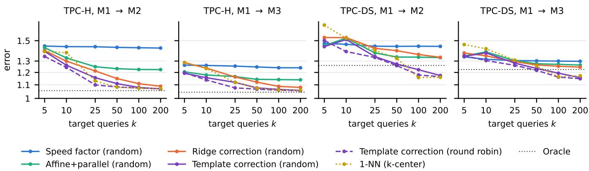
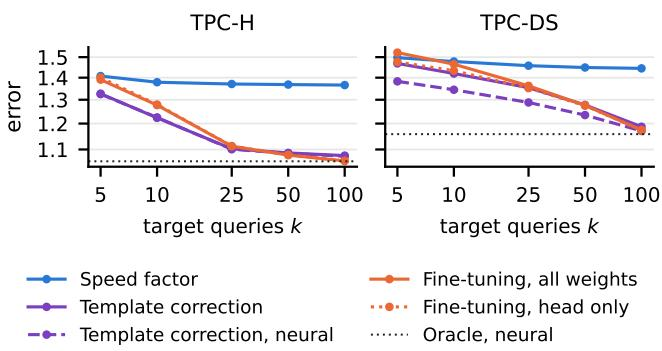

# When Is One Query per Template Enough? Adapting Learned Cost Models to New Hardware

Krish Patel

University of Waterloo, Waterloo, Canada

kmp.patel@uwaterloo.ca ORCID 0009-0006-3064-0086

Abstract—A learned cost model that predicts query runtimes is trained on measurements from one machine. When the database moves to other hardware, its plans stay the same but their runtimes change, each by its own factor. We ask how to adapt such a model from k queries measured on the new machine: which queries to run, how to use their runtimes, and how many are enough. On PostgreSQL we timed the same plans of 1,162 TPC-H and TPC-DS queries in six environments: a laptop and a server, each with all its processors or pinned to one, the server also pinned to two, and the laptop also with a small buffer pool. No single factor describes the slowdown between two environments: most of its variance lies between query templates, so a speed factor stops improving after a few queries. A correction that fits separate lines for serial and parallel plans and adds an offset for every measured template brings the moved model, with one measured query per template, to an error (geometric mean over templates of the median Q-error) of 1.10 on TPC-H and 1.19 on TPC-DS, close to the same correction on a model trained on the new machine; fine-tuning a DACE-style neural cost model on the same queries gains at most 2%. On templates never measured, no correction we tried is on average more than 2% better than the speed factor. We then fixed hypotheses and timed new data. On TPC-H at ten times the scale the errors follow these results, but two of five repeated tests miss. On the Join Order Benchmark, whose queries differ widely within a template, the model errs by 2.36 even when retrained on the new machine, no correction gains much, and only the test on new templates holds; boosted trees and a neural model fit these queries better, and correcting the neural model works as well as fine-tuning it. We report every test as registered.

Index Terms—query performance prediction, learned cost models, hardware change, model adaptation, PostgreSQL

## I. INTRODUCTION

Predicting how long a query will run before it runs serves admission control, scheduling and provisioning. Learned cost models predict runtimes from plan features far better than raw optimizer costs when they are trained on the system they predict [1]–[4]. A runtime, however, is a property of a plan on a machine, and machines change: a database moves to new hardware, to a cloud instance of another size, or into a container with fewer processors. The plans stay, and every runtime the model learned from is now off, by an amount that depends on the query.

Systems handle a move in three ways. Some retrain on the new machine: T3 reruns its whole benchmark [5], QCFE reruns simplified queries to refit its per-operator coefficients and then retrains on 200 labeled queries [6], and DACE finetunes on a workload rerun on the new machine [7]. Some map every old prediction through one fitted line, the model shift used to move performance models of configurable software [8], [9], whose simplest form rescales every prediction by one speed factor. Others describe the machine with features and train one model over many machines, as Redshift’s Stage predictor does with the instance type [10]. This paper asks what lies between retraining and rescaling: if we can afford to run k queries on the new machine, which queries should they be, how should their runtimes be used, and how large must k be?

We study the question with the plans held fixed, so that every change in runtime comes from the environment. We timed 1,162 queries from 115 templates of TPC-H and TPC-DS on PostgreSQL in six environments that run identical plans on copies of the same database. Their 30 ordered pairs per workload change the processor count, the hardware, both, the buffer pool, or several of these at once. To test whether the findings hold beyond these data, we then fixed our hypotheses and measured new data: TPC-H at scale factor 10 and the Join Order Benchmark (JOB) on its real IMDB data, each in several environments. We contribute:

• A dataset of identical plans timed in many environments, which as far as we know has no public counterpart, and a measurement of how runtimes shift when only the environment changes (Section V-A). The slowdown differs widely between templates. Whether a plan has parallel workers explains much of a change of processor count, and how long a query runs explains much of a move from laptop to server; per-operator timings point to the mechanisms.

• A comparison of six corrections, five baselines and a nomove control, a fine-tuned transformer cost model and six query selection strategies for 5 to 200 measured queries (Sections V-B to V-D). On TPC-H and TPC-DS, one measured query per template with a per-template offset brings the moved model close to the same correction on a model trained on the new machine; refitting the model on the measured queries is far worse up to one query per template, also when the refit is told the templates, and fine-tuning a neural model on the same queries gains at most 2%. In all four workloads of both rounds the moved model, so corrected, is on average within 3% of the same correction on a model trained on the new machine.

• A negative result for new templates (Section V-E), repeated on the new data: no correction we tried does much better than the speed factor, and its error is close to that of retraining. The remaining error is the model’s error on a new template; the move adds little to it.

• Two rounds of confirmatory tests (Sections V-F and V-H). We committed hypotheses, the primary method and the neural baseline to our repository before the labels they are tested on existed, and report every test under its registered rule. The first round’s five tests hold. The second round’s mostly fail: at ten times the data the errors follow the first round, but two of the five repeated tests miss, and so does H6a; on the Join Order Benchmark, where a template’s queries differ in runtime by a factor of 2.31, the model’s own error leaves little for any correction to gain, and only the test on new templates holds.

• Recommendations for moving a runtime model (Section VI) and a public artifact with every query, plan, label and script.

## II. PROBLEM AND BACKGROUND

Setting. A model $f _ { A }$ predicts the log runtime of a query from features $x$ of its PostgreSQL plan before the query runs, and was trained on the runtimes of a pool of queries measured on machine A. The database moves to machine B with the same data, statistics and planner settings, so the planner chooses the same plans; with runtimes $y _ { A }$ and $y _ { B }$ on A and $B ,$ we call $y _ { B } / y _ { A }$ a query’s slowdown. Before $f _ { A }$ is used on $B$ we may run k queries there. Every query belongs to a template, the parameterized SQL it was generated from; in a production system templates can be read from query fingerprints such as PostgreSQL’s query identifier, as workload forecasters do [11].

In machine-learning terms the inputs do not change: the same queries get the same plans and features everywhere, so the distribution of $x$ is fixed and only the distribution of runtime given x shifts. Reweighting unlabeled inputs, the usual answer to covariate shift [12], has nothing to correct; the model needs runtimes measured on $B ,$ and each costs time there.

The shift. On B, the source model’s log error on a query $q$ is

$$
e ( q ) = \log y _ { B } ( q ) - f _ { A } ( x ( q ) ) = \delta ( q ) + u _ { A } ( q ) ,\tag{1}
$$

the log slowdown $\delta ( q ) = \log ( y _ { B } ( q ) / y _ { A } ( q ) )$ plus the model $\because$ residual $u _ { A } ( q )$ on A. A correction estimates $\delta$ from the $k$ measured log errors. The corrections below assume that $\delta$ is a constant (a speed factor), a function of $x ,$ or a value per template. Which of these fits a move is a property of the data that we can measure: the template share

$$
\eta ^ { 2 } = \frac { \sum _ { \tau } n _ { \tau } ( \bar { \delta } _ { \tau } - \bar { \delta } ) ^ { 2 } } { \sum _ { q } ( \delta ( q ) - \bar { \delta } ) ^ { 2 } } ,\tag{2}
$$

with $n _ { \tau }$ queries of mean log slowdown $\bar { \delta } _ { \tau }$ in template $\tau ,$ is the part of the variance of $\delta$ that lies between templates. Computed between two passes on one machine, it measures noise. With few queries per template $\eta ^ { 2 }$ is biased upward, so we also report $\omega ^ { 2 } = ( S S _ { b } - ( T - 1 ) M S _ { w } ) / ( S S _ { t } + M S _ { w } )$ , where $S S _ { b }$ and

$S S _ { t }$ are the numerator and denominator of (2), T is the number of templates and $M S _ { w }$ the mean square within templates.

Error measure. We measure accuracy by the Q-error $Q ( y , \hat { y } ) = \operatorname* { m a x } ( y / \hat { y } , \hat { y } / y )$ [13]. A test template’s error is the median Q-error of its test queries. A method’s error is the geometric mean of these template errors, so that every template counts once whatever its number of queries, averaged in log over the random orders of the pool. A method beats another when the 95% interval of the geometric-mean ratio of their template errors, from resampling whole templates [14], lies below 1.

## III. METHODS COMPARED

Features and source models. The 19 plan features are the root’s startup and total cost, estimated rows and width; the number of nodes and the depth; the largest row estimate of any node and the sum of the nodes’ log row estimates; the counts of all scans, sequential scans, index scans (bitmap scans included), nested-loop, hash and merge joins, sorts, aggregates and materializations; the workers planned over all Gather nodes; and the number of subplans. Costs, rows and widths enter as log(1 + x). The primary source model, the forest model, fits a line in log(1 + total cost) to the log runtime (the cost line) and a random forest to its residuals (300 trees, at least two queries per leaf, 4 of the 19 features tried at each split) [15], [16], so that it falls back to the cost line where the forest learned little. We also use a random forest alone, gradient-boosted trees, ridge regression and the cost line alone, and a neural plan model (below).

Neural plan model. Learned cost models in the literature read the plan tree, not a fixed feature vector. As their representative we reimplemented the architecture of DACE [7], built to move across databases and adapted to new hardware by fine-tuning. A plan is the sequence of its nodes in depth-first order; each node is a one-hot node type and the log optimizer estimates of its total and startup cost, rows and width, with its height and planned workers, scaled by median and interquartile range as in DACE. One post-norm transformer layer with one head and width 128 attends under a tree mask, so that a node sees only its own subtree, and a multilayer perceptron maps the root to its log runtime. DACE trains on every sub-plan’s runtime; we have root runtimes only and train on them, with the mean $\mathrm { Q }$ -error as loss. The model has 19,732 parameters on TPC-H and 25,902 on TPC-DS. Its learning rate (0.003), number of epochs (800) and dropout (0) were chosen by fivefold cross-validation over templates inside the source pools of the development pairs (the 60 ordered pairs of the SF1 data), and a fit takes about 59 s on two processor threads.

Corrections. All corrections act on the log errors of the k measured queries, $e _ { i } = \log y _ { i } - f _ { A } ( x _ { i } )$ , and predict log $\hat { y } =$ $f _ { A } ( x ) + c ( x )$ on $B ;$ fitting a learner to the residuals of a base model follows [17].

• Speed factor: c is the mean e¯ of the $e _ { i }$ • Ridge correction: ridge regression [18] of e on the 19 features standardized over the k queries,

$$
\begin{array} { r } { ( \hat { \beta } _ { 0 } , \hat { \beta } ) = \arg \operatorname* { m i n } _ { \beta _ { 0 } , \beta } \sum _ { i = 1 } ^ { k } \big ( e _ { i } - \beta _ { 0 } - \beta ^ { \top } \tilde { x } _ { i } \big ) ^ { 2 } + \lambda \| \beta \| ^ { 2 } , } \end{array}\tag{3}
$$

with an unpenalized intercept and $\lambda$ chosen by leave-oneout [19] from 45 values between $1 0 ^ { - 6 }$ and $1 0 ^ { 5 }$

• Affine+parallel: $c ( x ) = a { + } b f _ { A } ( x ) { + } \pi ( x ) \left( a ^ { \prime } { + } b ^ { \prime } f _ { A } ( x ) \right)$ where $\pi ( x ) { \mathrm { ~ i s ~ } } 1$ for plans with parallel workers; b makes the slowdown depend on the predicted runtime. The intercept $a ^ { \prime }$ enters only when both kinds of plan are among the k queries, the slope b′ only when each kind has two. It is fitted as in (3), with $f _ { A } ( x ) , \pi ( x )$ and $\pi ( x ) f _ { A } ( x )$ as features.

• Template offsets: the speed factor plus, for every template among the k queries, the mean residual of its queries from that factor; other templates get the factor alone.

• Template correction, our primary method: affine+parallel plus, for every template among the k queries, the mean residual of its queries from that line; other templates get the line alone.

• 1-NN: the log error of the nearest of the k queries in the standardized feature space. It needs no template labels.

The speed factor is one end of the ridge correction’s family:

Proposition 1. For every $\lambda > 0 ,$ , the solution of (3) has $\hat { \beta } _ { 0 } = \bar { e }$ and $\hat { \beta } = ( \tilde { X } ^ { \top } \tilde { X } + \lambda I ) ^ { - 1 } \tilde { X } ^ { \top } ( e - \bar { e } \mathbf { 1 } )$ , where X˜ stacks the ${ \tilde { x } } _ { i } ,$ and $\| \hat { \beta } \| \leq \| \tilde { X } ^ { \top } ( e - \bar { e } \mathbf { 1 } ) \| / \lambda .$ . As λ → ∞ the ridge correction becomes the speed factor.

Proof. The standardized features sum to zero over the k queries, so the derivative in $\beta _ { 0 }$ gives $\begin{array} { r } { k \beta _ { 0 } = \sum _ { i } e _ { i } = k \bar { e } } \end{array}$ Then $\beta$ minimizes $\| ( e - \bar { e } \mathbf { 1 } ) - \tilde { X } \beta \| ^ { 2 } + \lambda \| \beta \| ^ { 2 }$ , with the stated minimizer, and the eigenvalues of $( \tilde { X } ^ { \top } \tilde { X } + \lambda I ) ^ { - 1 }$ are at most $1 / \lambda$ □

Leave-one-out chooses how far to move from the speed factor toward a full fit of the k log errors; with few queries this choice is noisy. Template offsets put all their freedom in the templates instead.

Baselines. Target only refits the forest model on the k queries alone; the pooled refit refits it on the source pool and the k queries with the machine as a feature; the forest on the errors fits a forest to the $e _ { i } ,$ and, to check whether a refit that knows the templates does better, also to the $e _ { i }$ with one indicator per template; and a template lookup predicts a query by the mean measured log runtime of its template, with no model. For the neural model, fine-tuning trains all its weights on the k queries, and head fine-tuning only the perceptron, the part DACE adapts when it moves to new hardware; their learning rate and number of steps depend on k only and were chosen on the development pairs, scored on target pool queries outside the k. The oracle refits the forest model on the whole target pool. It is a reference, not a bound: it knows nothing of templates. The no-move control applies a method to a model trained on the target pool itself, with the same k queries; the gap to it is the cost of the move.

TABLE I  
THE ENVIRONMENTS. CPUS: THE PROCESSORS THAT POSTGRESQL’S SERVER PROCESSES MAY USE (THE CLIENT KEEPS ALL). BUFFERS: POSTGRESQL’S BUFFER POOL. NOISE: THE MEDIAN Q-ERROR BETWEEN TWO PASSES OF THE SAME QUERY; AN EMPTY CELL IS A WORKLOAD THE ENVIRONMENT DID NOT RUN.
<table><tr><td colspan="8">noise, median Q</td></tr><tr><td>Env.</td><td>machine</td><td>CPUs</td><td>buffers</td><td>TPC-H</td><td>TPC-DS</td><td>SF10</td><td>JOB</td></tr><tr><td>M1</td><td>laptop</td><td>all 22</td><td>2 GB</td><td>1.07</td><td>1.09</td><td></td><td>1.06</td></tr><tr><td>M2</td><td>laptop</td><td>1</td><td>2 GB</td><td>1.07</td><td>1.08</td><td></td><td>1.03</td></tr><tr><td>M3</td><td>server</td><td>all 64</td><td>2 GB</td><td>1.05</td><td>1.05</td><td>1.05</td><td>1.05</td></tr><tr><td>M4</td><td>server</td><td>1</td><td>2 GB</td><td>1.07</td><td>1.03</td><td>1.07</td><td>1.04</td></tr><tr><td>M5</td><td>laptop</td><td>all 22</td><td>128MB</td><td>1.03</td><td>1.05</td><td></td><td></td></tr><tr><td>M6</td><td>server</td><td>2</td><td>2 GB</td><td>1.08</td><td>1.04</td><td>1.05</td><td>1.05</td></tr></table>

Choosing the k queries. Random takes them in a random order. Round robin takes one query of each template in turn, in a random order of templates and of queries; cheapest per template is round robin with the query that ran fastest on A first. k-center adds the query farthest from those chosen so far in the standardized feature space [20], [21]. D-optimal adds the query that most increases de $\cdot ( I + X ^ { \top } X )$ , where X holds the chosen queries’ standardized features and a column of ones [22], [23]. Plan class alternates between parallel and serial plans. Every strategy derives its r-th sequence from the r-th of 20 random orders, so comparisons are paired; none looks at a runtime on B.

## IV. EXPERIMENTAL METHODOLOGY

Environments. M1 is a laptop (Intel Core Ultra 7 155H, 22 threads) running PostgreSQL 18.6 in WSL2 (a Linux virtual machine on Windows) with 16 GB of memory; M3 is a virtual machine with 64 virtual processors of an AMD EPYC 9754 and 1 TB of memory on a shared university server. M2 and M4 are M1 and M3 with every PostgreSQL server process pinned to one virtual processor, so that a plan’s leader and its parallel workers (at most two per Gather node) share it while the client keeps all processors; M6 is M3 pinned to two. M5 is M1 with PostgreSQL’s default buffer pool, 128 MB instead of 2 GB. All use the same PostgreSQL build, which has no JIT, and the same settings (work mem 64 MB, effective cache size 8 GB) apart from M5’s buffer pool, on copies of the same database files; every saved plan, with its estimates and costs, is identical in all environments of a workload. The data at scale factor 1 (SF1) fit in memory everywhere. Table I lists the environments.

Workloads. TPC-H at scale factor 1 [24]: 680 queries from 22 templates, 420 from its query generator and 260 with range parameters drawn wider than the specification’s, so that runtimes vary inside a template. TPC-DS at scale factor 1 [25]: 482 queries from the 93 templates whose first query ran within 30 s on M1; in its four templates of two statements, each statement counts as a query of the template. Queries are split once, inside every template, into a pool from which the k queries are drawn (476 and 294 queries, 70% and 61%) and a test set on which the corrections are scored. We link two TPC-DS templates when their first queries, with literals masked, share at least 85% of their tokens, and take the connected components as families: 75 families, 15 of them with more than one template; intervals on TPC-DS resample families, so that near copies do not count as independent.

The extension adds two workloads, each on copies of one cluster. TPC-H at scale factor 10 (17 GB with indexes) uses 220 of the SF1 queries, 7 pool and 3 test queries per template drawn with a fixed seed from the SF1 split, with Q11’s fraction divided by the scale factor as the specification prescribes; it runs on the server as M3, M6 and M4. JOB [26] runs its 113 queries from 33 templates on the IMDB snapshot of its authors (8.7 GB with its foreign-key indexes), split inside every template (78 pool and 35 test queries), on the laptop (M1, M2) and the server (M3, M6, M4). Every JOB query ran once on the server before any label, and all finished within the 60 s limit we had fixed.

Labels. Every environment runs every query in three passes in different random orders; in a pass a query runs four times with EXPLAIN (ANALYZE, TIMING OFF), the first only to warm the cache. A run’s time is the execution time PostgreSQL reports, without planning or sending rows to the client, and a label is the median over passes of the median of the three timed runs. A pass whose level shifts by more than 10% partway through, or during which the laptop slept or ran on battery, is measured once more. We set the clock of the laptop’s virtual machine to track the host’s, after finding that it ran fast, and record its rate in every pass; the laptop ran nothing else during a pass, and the shared server’s passes started at night once its load was low. The median Q-error between two passes of the same query is 1.03 to 1.09 per environment and workload (Table I). For Section V-A we also ran every SF1 query once more in M1 to M5 with per-node timing on, after a warm-up; an operator’s own time is its time over all loops minus its children’s, and these timings are never labels.

Protocol. For every ordered pair, the source model is trained on A’s pool, the k queries are drawn from B’s pool for k from 5 to 200 (in the second round to 100 on SF10 and 50 on JOB, whose pools are smaller) over 20 random orders, and every correction is scored on B’s test set. The k queries are thus queries the source model was trained on, as in practice, where the queries rerun on a new machine come from the workload the model learned from; the no-move control is in the same position. The choice does not drive the comparison: with the source model trained on half of each template’s pool queries and the k queries (one per template) drawn from the other half instead of the same half, the primary method errs by 1.13 instead of 1.10 on TPC-H and 1.18 instead of 1.21 on TPC-DS, and the no-move control moves alike (1.12 instead of 1.09, 1.17 instead of 1.20). The test on new templates holds out one template at a time (in TPC-DS its family): the source model is retrained on A’s pool without it, the k = 25 queries are drawn from B’s pool without it, the oracle is retrained on that pool, and the template’s test queries are scored. Queries whose plan features differ between the two environments of a pair would be left out; none did.

Exploratory and confirmatory analyses. We designed the corrections and strategies on TPC-H with M1, M2 and M3, so those pairs are exploratory. We committed the primary method (the template correction with round-robin selection) and five hypotheses (commit 17c328f) after the first TPC-DS passes on M2 and M3 had started, but before any label of TPC-DS on M2, M3 or M4 or of TPC-H on M4 existed. Within twenty minutes, still before any such label, a code review led to an amendment (commits b2e59dc and fc9dc9a): TPC-DS intervals resample families, the test on new templates holds out families, and affine+parallel and the primary method leave out their parallel terms when the k queries hold one plan class. For the extension we committed the new workloads, the same five hypotheses for their pairs and a sixth on the neural baseline (commit 13f14ce) before any of their queries ran. We then froze the neural model and its fine-tuning rules on the development pairs (commit 52cc5b4), and amended the sixth hypothesis after its development results, before any new pair was evaluated (commit 909c069). Everything else is exploratory: the per-operator timings, M5 and, in the first round, M6, the no-move control, the lookup, the single-run labels, the other source models, streams, shift transfer, three analyses we added after an internal review (the forest on the errors with template indicators, the split of the pool into halves, and the tails), and the numbers that explain the second round’s results, which we computed after seeing them (Section V-F; the Lessons and the Conclusion use them too).

Artifacts. The queries, plans, labels, per-operator timings, the study plan with its timestamped amendments, and the scripts that build every number, table and figure of this paper are public at https://github.com/KrishPatel13/ query-runtime-transfer. A fresh clone reproduces every reported number of the SF1 study exactly on Linux.

## V. RESULTS

## A. How runtimes shift

Table II shows seven pairs per workload. No single factor describes any of them. Over all pairs, a share of 0.69 to 0.94 of the variance of the log slowdown lies between templates (0.68 to 0.93 after correcting for the number of templates), against at most 0.08 (TPC-H) and 0.22 (TPC-DS) between two passes of one machine. What separates the templates depends on the change. Pinning PostgreSQL to one processor gives plans with parallel workers a median slowdown of 2.05 to 2.66 and serial plans one of 0.92 to 1.12, and that one bit explains 0.44 to 0.61 of the variance; with two processors (M3→M6) parallel plans slow by only 1.32 (TPC-H) and 1.25 (TPC-DS). Moving from the laptop to the server slows serial and parallel plans alike, but short queries more than long ones: the log slowdown falls as the log runtime grows, and size explains 0.52 (TPC-H) and 0.64 (TPC-DS) of its variance from M1 to M3 and 0.22 and 0.41 from M2 to M4. The small buffer pool gives a median slowdown of only 1.08 (TPC-H) and 1.03 (TPC-DS), although TPC-H’s serial plans slow by 1.47, and parallelism and size together explain only 0.08 and 0.02 of its variance.

TABLE II  
HOW THE RUNTIME OF THE SAME PLAN CHANGES, FOR SEVEN OF THE 30 ORDERED PAIRS OF EACH WORKLOAD. SLOWDOWN: MEDIAN OF TARGET OVER SOURCE RUNTIME, FOR SERIAL PLANS AND PLANS WITH PARALLEL WORKERS. TEMPLATE SHARE: THE SHARE OF THE VARIANCE OF THE LOG SLOWDOWN BETWEEN TEMPLATES (SHIFT), THE SAME CORRECTED FOR THE NUMBER OF TEMPLATES $( \omega ^ { 2 } )$ , AND THE SHARE BETWEEN TWO PASSES ON THE SOURCE ALONE (NOISE). R2: LEAST-SQUARES FITS OF THE LOG SLOWDOWN ON WHETHER THE PLAN IS PARALLEL, ON THE LOG SOURCE RUNTIME (SIZE) AND ON BOTH WITH THEIR INTERACTION; FEATURES (NEW): A RIDGE MODEL ON THE 19 FEATURES SCORED ON TEMPLATES (TPC-DS: FAMILIES) LEFT OUT OF ITS FIT, WHICH CAN BE NEGATIVE.
<table><tr><td></td><td></td><td colspan="2">Slowdown</td><td colspan="3">Template share</td><td colspan="4"> $R ^ { 2 }$  of the log slowdown on</td></tr><tr><td>Pair</td><td>Change</td><td>serial</td><td>parallel</td><td>shift</td><td> $\omega ^ { 2 }$ </td><td>noise</td><td>parallel</td><td>size</td><td>both</td><td>features (new)</td></tr><tr><td colspan="9">TPC-H</td><td></td></tr><tr><td>M1→M2</td><td>processors</td><td>1.12</td><td>2.66</td><td>0.86</td><td>0.86</td><td>0.08</td><td>0.61</td><td>0.00</td><td>0.61</td><td>0.27</td></tr><tr><td>M3→M4</td><td>processors</td><td>1.01</td><td>2.07</td><td>0.84</td><td>0.83</td><td>0.03</td><td>0.57</td><td>0.12</td><td>0.62</td><td>0.53</td></tr><tr><td>M3→M6</td><td>two processors</td><td>1.00</td><td>1.32</td><td>0.69</td><td>0.68</td><td>0.03</td><td>0.51</td><td>0.06</td><td>0.55</td><td>0.31</td></tr><tr><td>M1→M3</td><td>hardware</td><td>1.81</td><td>2.07</td><td>0.80</td><td>0.79</td><td>0.08</td><td>0.07</td><td>0.52</td><td>0.63</td><td>0.45</td></tr><tr><td>M2→M4</td><td>hardware</td><td>1.63</td><td>1.69</td><td>0.74</td><td>0.73</td><td>0.03</td><td>0.02</td><td>0.22</td><td>0.33</td><td>0.41</td></tr><tr><td>M1→M4</td><td>both</td><td>1.82</td><td>4.42</td><td>0.91</td><td>0.90</td><td>0.08</td><td>0.54</td><td>0.03</td><td>0.60</td><td>0.26</td></tr><tr><td>M1→M5</td><td>buffer pool</td><td>1.47</td><td>1.07</td><td>0.72</td><td>0.71</td><td>0.08</td><td>0.03</td><td>0.03</td><td>0.08</td><td>-0.12</td></tr><tr><td colspan="9">TPC-DS</td><td></td></tr><tr><td>M1→M2</td><td>processors</td><td>1.06</td><td>2.11</td><td>0.91</td><td>0.89</td><td>0.18</td><td>0.44</td><td>0.00</td><td>0.50</td><td>0.26</td></tr><tr><td>M3→M4</td><td>processors</td><td>0.92</td><td>2.05</td><td>0.94</td><td>0.93</td><td>0.18</td><td>0.56</td><td>0.10</td><td>0.59</td><td>0.38</td></tr><tr><td>M3→M6</td><td>two processors</td><td>0.89</td><td>1.25</td><td>0.88</td><td>0.85</td><td>0.18</td><td>0.33</td><td>0.19</td><td>0.44</td><td>0.30</td></tr><tr><td>M1→M3</td><td>hardware</td><td>2.06</td><td>1.80</td><td>0.83</td><td>0.80</td><td>0.18</td><td>0.07</td><td>0.64</td><td>0.65</td><td>0.20</td></tr><tr><td>M2→M4</td><td>hardware</td><td>1.80</td><td>1.77</td><td>0.85</td><td>0.81</td><td>0.22</td><td>0.01</td><td>0.41</td><td>0.45</td><td>-0.05</td></tr><tr><td>M1→M4</td><td>both</td><td>1.83</td><td>3.79</td><td>0.92</td><td>0.90</td><td>0.18</td><td>0.34</td><td>0.06</td><td>0.52</td><td>0.19</td></tr><tr><td>M1→M5</td><td>buffer pool</td><td>0.98</td><td>1.03</td><td>0.77</td><td>0.72</td><td>0.18</td><td>0.00</td><td>0.02</td><td>0.02</td><td>-0.06</td></tr></table>

TABLE III

MEDIAN RATIO OF EACH OPERATOR’S OWN TIME (TARGET OVERSOURCE), INSIDE (PAR.) AND OUTSIDE (SER.) THE PARALLEL PART OFPLANS, OVER THE NODES OF BOTH WORKLOADS WEIGHTED BY THESOURCE’S TIME, FROM ONE EXTRA PASS WITH PER-NODE TIMING. PROC.:ONE PROCESSOR (M1→M2, M3→M4); HARDWARE: M1→M3; BUFFERPOOL: M1→M5.
<table><tr><td></td><td colspan="2">Proc. (laptop)</td><td colspan="2">Proc. (server)</td><td colspan="2">Hardware</td><td colspan="2">Buffer pool</td></tr><tr><td>Operator</td><td>par.</td><td>ser.</td><td>par.</td><td>ser.</td><td>par.</td><td>ser.</td><td>par.</td><td>ser.</td></tr><tr><td>Seq Scan</td><td>2.85</td><td>0.99</td><td>2.85</td><td>1.01</td><td>1.75</td><td>1.70</td><td>1.12</td><td>1.23</td></tr><tr><td>Index Scan</td><td>2.33</td><td>1.00</td><td>2.32</td><td>1.07</td><td>1.64</td><td>1.01</td><td>1.92</td><td>1.42</td></tr><tr><td>Bitmap Heap Scan</td><td>1.98</td><td>0.99</td><td>2.04</td><td>1.20</td><td>2.01</td><td>1.49</td><td>0.98</td><td>2.14</td></tr><tr><td>Hash Join</td><td>2.56</td><td>1.01</td><td>2.57</td><td>0.94</td><td>1.62</td><td>1.65</td><td>1.00</td><td>1.00</td></tr><tr><td>Hash</td><td>2.89</td><td>1.05</td><td>2.32</td><td>1.02</td><td>1.32</td><td>1.34</td><td>1.13</td><td>1.06</td></tr><tr><td>Nested Loop</td><td>1.50</td><td>1.01</td><td>0.93</td><td>0.91</td><td>1.56</td><td>1.72</td><td>1.09</td><td>1.03</td></tr><tr><td>Sort</td><td>2.53</td><td>1.01</td><td>2.59</td><td>1.02</td><td>1.25</td><td>1.43</td><td>1.04</td><td>1.07</td></tr><tr><td>Hash aggregate</td><td>2.94</td><td></td><td>1.12 3.05</td><td>1.15</td><td>1.43</td><td>1.50</td><td>0.98</td><td>1.08</td></tr><tr><td>Sorted aggregate</td><td>1.78</td><td></td><td>1.001.99</td><td>1.15</td><td>1.42</td><td>1.58 1.02</td><td></td><td>1.04</td></tr></table>

Per-operator timings point to the mechanisms (Table III), although per-node timing adds overhead that differs between machines. On one processor, the main operators of each workload (at least 3% of its time on the source; these ranges count operators per workload, while Table III pools both) take 2.0 to 3.2 times as long inside the parallel part of a plan on the laptop and 2.0 to 3.0 times on the server, while serial operators keep their speed: the same mechanism on both machines. The move from laptop to server slows operators unevenly, by 1.0 to 2.0 times depending on the operator, so plans with different operators slow differently. With the small buffer pool, index scans, which revisit pages that no longer stay in PostgreSQL’s buffers, slow down 1.3 to 1.9 times, while sequential scans, which read pages in order, change by 1.0 to 1.3. Which templates slow down thus depends on their operators, which plan-level features see only in part: a ridge model on the 19 features, fitted without the template it predicts, explains at most 0.53 of the variance, and nothing for the buffer pool (last column of Table II).

On the extension’s data the template share is 0.76 to 0.84 on SF10 (noise at most 0.12) but 0.49 to 0.83 on JOB $( \omega ^ { 2 }$ 0.28 to 0.77), whose few queries per template give a noise share of 0.28 to 0.33; on JOB the move between M1 and M3 has the lowest share (0.49). Moving to fewer processors on the same machine again slows parallel plans, by 1.50 to 2.42 on SF10 and 1.43 to 2.61 on JOB, while serial plans change by 0.94 to 0.98 and 0.97 to 1.01 (medians per pair).

## B. Adapting with k queries

Figure 1 and Table IV give the errors, and Table V compares the methods at one query per template. Without adaptation the source model errs by 1.83 on TPC-H and 1.96 on TPC-DS. The speed factor finds the average slowdown from a few queries and then stays flat (TPC-H: 1.39 at k = 5, 1.37 at k = 25; TPC-DS: 1.50 and 1.45), because no single factor fits templates whose slowdowns differ. Affine+parallel helps at small budgets on TPC-H: it beats the speed factor at k = 10 in 20 of 30 pairs and loses in 0; for processor changes it lowers the k = 10 error from 1.41 to 1.28, and the primary method’s template offsets bring it to 1.23. On TPC-DS, affine+parallel beats the speed factor at k = 10 in 10 of 30 pairs and loses in 7, and its lead grows with k (Figure 1).

Once each template has a measured query, the template offsets carry the gain. With round-robin selection the primary method reaches 1.10 on TPC-H at k = 25 and 1.19 on TPC-DS at k = 100; offsets on the speed factor alone give 1.12 and 1.19, so at this budget the affine+parallel line adds little. The same correction on a model trained on the target itself reaches 1.08 and 1.18: the move costs little. Without the correction, that model is the oracle, which refits the template-blind forest model on the whole target pool. On TPC-H the oracle errs by 1.05, a little less than the no-move control, so there the correction’s own noise costs a little. On TPC-DS the oracle errs by 1.26, since three pool queries per template are too few for its forest, and the primary method’s error is 0.93 to 0.95 times the oracle’s in every pair. The model matters inside a template: a lookup of the measured runtime per template errs by 1.24 on TPC-H against 1.10 for the primary method, because the widened queries vary inside their templates; on TPC-DS, whose queries vary inside a template by a factor of only 1.09 (median geometric standard deviation), the gap is smaller (1.24 against 1.19). The refits and the forest on the errors ran with random selection only. With the same selection the primary method reaches 1.17 and 1.23 (Table VI), against 1.51 and 1.80 for target only, 1.36 and 1.36 for the pooled refit, and 1.22 and 1.28 for a forest on the errors. Knowing the templates does not rescue the refit: with one indicator per template the forest on the errors errs by 1.20 and 1.32 under round robin, against 1.10 and 1.19 for the primary method, which it beats in 0 and 0 of 30 pairs, since with about one query per template a forest has little to split each template’s indicator on. The refits catch up only with far more queries than templates: at k = 200 on TPC-H, target only errs by 1.07 and the forest on the errors by 1.06, against 1.07 for the primary method (all random).

  
Fig. 1. Error (geometric mean over test templates of the median Q-error) against the number k of measured target queries, both axes logarithmic, for a processor change (M1→M2) and a hardware change (M1→M3) on each workload; the TPC-H panels are pairs the methods were designed on. Line styl gives the selection: solid random, dashed round robin, dotted k-center. The horizontal dotted line is the oracle.

TABLE IV  
ERROR BY KIND OF CHANGE, AS THE GEOMETRIC MEAN OVER ITS ORDERED PAIRS. SPEED, AFF.+PAR. AND RIDGE USE RANDOM SELECTION; PRIMARY (THE TEMPLATE CORRECTION) USES RANDOM SELECTION AT k = 10 AND ROUND ROBIN AT k = 25 AND k = 100. ORACLE: THE FOREST MODEL REFITTED ON THE WHOLE TARGET POOL. NEW TEMPLATES: EACH TEMPLATE (TPC-DS: ITS FAMILY) HELD OUT FROM THE SOURCE MODEL, THE k = 25 RANDOMLY CHOSEN QUERIES, THE ORACLE AND EVERY CORRECTION. MIXED: THE REMAINING 14 PAIRS, ALL INVOLVING M5 OR M6.
<table><tr><td rowspan="2">Change</td><td rowspan="2">Pairs</td><td colspan="3">k = 10, random</td><td colspan="2">k = 25</td><td colspan="2">k = 100</td><td rowspan="2"></td><td colspan="4">New templates, k = 25</td></tr><tr><td>Speed</td><td>Aff.+par.</td><td>Primary</td><td>Ridge</td><td>Primary</td><td>Primary</td><td>Oracle</td><td>Speed</td><td>Aff.+par.</td><td>Ridge</td><td>Oracle</td></tr><tr><td>TPC-H</td><td></td><td></td><td></td><td></td><td></td><td></td><td></td><td></td><td></td><td></td><td></td><td></td><td></td></tr><tr><td>processors</td><td>4</td><td>1.41</td><td>1.28</td><td>1.23</td><td>1.20</td><td></td><td>1.09</td><td>1.07</td><td>1.05</td><td>1.99</td><td>2.00</td><td>2.13</td><td>1.98</td></tr><tr><td>two processors</td><td>2</td><td>1.14</td><td>1.12</td><td>1.11</td><td>1.12</td><td>1.08</td><td></td><td>1.06</td><td>1.05</td><td>1.76</td><td>1.76</td><td>1.77</td><td>1.76</td></tr><tr><td>hardware</td><td>4</td><td>1.22</td><td>1.19</td><td>1.17</td><td>1.15</td><td>1.09</td><td></td><td>1.07</td><td>1.05</td><td>1.99</td><td>1.98</td><td>1.99</td><td>1.98</td></tr><tr><td>both</td><td>4</td><td>1.46</td><td>1.33</td><td>1.26</td><td>1.21</td><td>1.10</td><td></td><td>1.08</td><td>1.05</td><td>2.01</td><td>2.01</td><td>2.11</td><td>1.98</td></tr><tr><td>buffer pool</td><td>2</td><td>1.38</td><td>1.39</td><td>1.32</td><td>1.33</td><td>1.13</td><td></td><td>1.10</td><td>1.05</td><td>2.16</td><td>2.14</td><td>2.47</td><td>2.11</td></tr><tr><td>mixed</td><td>14</td><td>1.44</td><td>1.35</td><td>1.29</td><td>1.29</td><td>1.11</td><td></td><td>1.08</td><td>1.05</td><td>2.08</td><td>2.03</td><td>2.27</td><td>2.03</td></tr><tr><td>TPC-DS</td><td></td><td></td><td></td><td></td><td></td><td></td><td></td><td></td><td></td><td></td><td></td><td></td><td></td></tr><tr><td>processors</td><td>4</td><td>1.52</td><td>1.49</td><td>1.47</td><td>1.49</td><td>1.35</td><td></td><td>1.18</td><td>1.25</td><td>2.72</td><td>2.65</td><td>2.73</td><td>2.63</td></tr><tr><td>two processors</td><td>2</td><td>1.36</td><td>1.34</td><td>1.33</td><td>1.33</td><td>1.28</td><td></td><td>1.16</td><td>1.23</td><td>2.55</td><td>2.54</td><td>2.59</td><td>2.52</td></tr><tr><td>hardware</td><td>4</td><td>1.34</td><td>1.35</td><td>1.35</td><td>1.34</td><td>1.28</td><td></td><td>1.18</td><td>1.25</td><td>2.64</td><td>2.64</td><td>2.67</td><td>2.63</td></tr><tr><td>both</td><td>4</td><td>1.55</td><td>1.51</td><td>1.49</td><td>1.55</td><td>1.37</td><td></td><td>1.18</td><td>1.25</td><td>2.72</td><td>2.65</td><td>2.74</td><td>2.63</td></tr><tr><td>buffer pool</td><td>2</td><td>1.47</td><td>1.49</td><td>1.48</td><td>1.46</td><td>1.41</td><td></td><td>1.24</td><td>1.31</td><td>3.01</td><td>3.01</td><td>3.05</td><td>2.99</td></tr><tr><td>mixed</td><td>14</td><td>1.50</td><td>1.49</td><td>1.47</td><td>1.50</td><td>1.38</td><td></td><td>1.19</td><td>1.27</td><td>2.78</td><td>2.75</td><td>2.85</td><td>2.73</td></tr></table>

The tails follow the medians. At one query per template, the 90th percentile of the per-query Q-error over the test queries is 1.39 for the primary method against 1.87 for the speed factor on TPC-H (oracle 1.18) and 1.42 against 2.03 on TPC-DS (oracle 1.60). The primary method’s median prediction is off by a factor of only 1.00 (TPC-H) and 1.00 (TPC-DS), against 1.11 and 1.10 for the speed factor. On TPC-DS a few test queries stay far off for every method: the 99th percentile is 6.69 for the primary method and 7.41 for the oracle.

TABLE V  
ERROR AT THE BUDGET WHERE EACH TEMPLATE CAN HAVE ONE QUERY, AS THE GEOMETRIC MEAN OVER THE 30 ORDERED PAIRS OF A WORKLOAD; THE LAST ROW APPLIES THE PRIMARY METHOD TO A MODEL TRAINED ON THE TARGET ITSELF (NO MOVE).
<table><tr><td>Method</td><td>Selection</td><td>TPC-H TPC-DS k = 25 k = 100</td></tr><tr><td>No adaptation</td><td></td><td>1.83 1.96</td></tr><tr><td>Speed factor</td><td>random</td><td>1.37 1.45</td></tr><tr><td>Ridge correction</td><td>random</td><td>1.24 1.38</td></tr><tr><td>Target only</td><td>random</td><td>1.51 1.80</td></tr><tr><td>Pooled refit</td><td>random</td><td>1.36 1.36</td></tr><tr><td>Forest on the errors</td><td>random</td><td>1.22 1.28</td></tr><tr><td>Template lookup (no model) round robin</td><td></td><td>1.24 1.24</td></tr><tr><td>Template offsets</td><td>round robin</td><td>1.12 1.19</td></tr><tr><td>1-NN</td><td>round robin</td><td>1.10 1.19</td></tr><tr><td>Primary</td><td>round robin</td><td>1.10 1.19</td></tr><tr><td>Oracle (whole target pool)</td><td></td><td>1.05 1.26</td></tr><tr><td>No move: primary</td><td>round robin</td><td>1.08 1.18</td></tr></table>

TABLE VI

ERROR OF THREE CORRECTIONS (COLUMNS) WHEN THE k QUERIES ARE CHOSEN BY EACH STRATEGY (ROWS), AS THE GEOMETRIC MEAN OVER THE 30 ORDERED PAIRS OF A WORKLOAD, AT THE SMALLEST BUDGET OF OUR GRID THAT HOLDS ONE QUERY PER TEMPLATE. SECONDS: TOTAL RUNTIME OF THE k QUERIES ON THE TARGET, ONE RUN EACH.
<table><tr><td>Strategy</td><td>Primary</td><td>1-NN</td><td>Ridge</td><td>Seconds</td></tr><tr><td>TPC-H, k = 25</td><td></td><td></td><td></td><td></td></tr><tr><td>random</td><td>1.17</td><td>1.19</td><td>1.24</td><td>22</td></tr><tr><td>round robin</td><td>1.10</td><td>1.10</td><td>1.17</td><td>24</td></tr><tr><td>cheapest per template</td><td>1.17</td><td>1.17</td><td>1.23</td><td>16</td></tr><tr><td>k-center</td><td>1.13</td><td>1.13</td><td>1.21</td><td>21</td></tr><tr><td>D-optimal</td><td>1.14</td><td>1.13</td><td>1.20</td><td>16</td></tr><tr><td>plan class</td><td>1.19</td><td>1.21</td><td>1.26</td><td>18</td></tr><tr><td>TPC-DS, k = 100</td><td></td><td></td><td></td><td></td></tr><tr><td>random</td><td>1.23</td><td>1.29</td><td>1.38</td><td>127</td></tr><tr><td>round robin</td><td>1.19</td><td>1.19</td><td>1.37</td><td>110</td></tr><tr><td>cheapest per template</td><td>1.22</td><td>1.23</td><td>1.38</td><td>88</td></tr><tr><td>k-center</td><td>1.18</td><td>1.18</td><td>1.36</td><td>132</td></tr><tr><td>D-optimal</td><td>1.28</td><td>1.39</td><td>1.35</td><td>188</td></tr><tr><td>plan class</td><td>1.24</td><td>1.30</td><td>1.41</td><td>118</td></tr></table>

## C. Which queries to measure

Table VI compares the strategies. Covering the templates is what matters. On TPC-H at k = 25, round robin lowers the primary method’s error from 1.17 to 1.10. Without template labels, k-center selection with the 1-NN correction comes close on TPC-H (1.13) and matches the primary method on TPC-DS at k = 100 (1.18 against 1.19, lower in 22 of 30 pairs), since queries of one template have similar plans. D-optimal selection, which is built for the ridge correction,

  
Fig. 2. Error against k with round-robin selection, geometric mean over the 30 development pairs of each workload. Blue: the speed factor on the forest model (the cost line plus forest); solid purple: the template correction on the forest model; dashed purple: the same correction on the neural model; orange: the neural model fine-tuned on the same queries, all weights (solid) or the head only (dotted). The black dotted line is the neural model retrained on the whole target pool.

## TABLE VII

ERROR WITH ROUND-ROBIN SELECTION, GEOMETRIC MEAN OVER THE 30 DEVELOPMENT PAIRS OF EACH WORKLOAD, FOR TWO SOURCE MODELS:

THE COST LINE WITH A FOREST ON ITS RESIDUALS, AND THE DACE-STYLE NEURAL MODEL. FINE-TUNING USES THE SAME k QUERIES AS THE CORRECTIONS.
<table><tr><td rowspan="2">k</td><td colspan="3">TPC-H</td><td colspan="3">TPC-DS</td></tr><tr><td>10</td><td>25</td><td>100</td><td>10</td><td>25</td><td>100</td></tr><tr><td>Cost line plus forest</td><td></td><td></td><td></td><td></td><td></td><td></td></tr><tr><td>speed factor</td><td>1.38</td><td>1.37</td><td>1.37</td><td>1.48</td><td>1.46</td><td>1.44</td></tr><tr><td>template correction</td><td>1.22</td><td>1.10</td><td>1.08</td><td>1.42</td><td>1.35</td><td>1.19</td></tr><tr><td>Neural (DACE-style)</td><td></td><td></td><td></td><td></td><td></td><td></td></tr><tr><td>no adaptation</td><td>1.84</td><td>1.84</td><td>1.84</td><td>1.89</td><td>1.89</td><td>1.89</td></tr><tr><td>speed factor</td><td>1.38</td><td>1.37</td><td>1.37</td><td>1.40</td><td>1.39</td><td>1.38</td></tr><tr><td>template correction</td><td>1.22</td><td>1.10</td><td>1.08</td><td>1.34</td><td>1.29</td><td>1.17</td></tr><tr><td>fine-tuning, all weights</td><td>1.28</td><td>1.11</td><td>1.06</td><td>1.46</td><td>1.36</td><td>1.17</td></tr><tr><td>fine-tuning, head only</td><td>1.28</td><td>1.11</td><td>1.06</td><td>1.43</td><td>1.35</td><td>1.17</td></tr><tr><td>oracle (whole target pool)</td><td>1.06</td><td>1.06</td><td>1.06</td><td>1.16</td><td>1.16</td><td>1.16</td></tr></table>

gives that correction its lowest TPC-DS error, but on TPC-DS it picks long queries (187.7 s against 109.9 s for round robin) and worsens the primary method; on TPC-H it picks the cheapest set (15.7 s against 16.4 s for the cheapest query per template). Measuring the cheapest query of each template takes 16.4 s instead of 23.6 s on TPC-H and 87.9 s instead of 109.9 s on TPC-DS, but costs accuracy, since short queries shift differently from long ones.

Running the round-robin queries once takes 23.6 s on TPC-H and 109.9 s on TPC-DS, while the corrections above use labels from three passes. With one run per query instead, all from one pass as in a single session, the primary method errs by 1.12 on TPC-H and 1.22 on TPC-DS when that run is warm, and by 1.14 and 1.25 when it is the query’s first run in the pass; the no-move control rises about as much (to 1.12 and 1.24), so the move still costs little.

## D. A neural cost model and fine-tuning

Table VII and Figure 2 show the neural model after the move. Unadapted, it errs about as much as the forest model (1.84 against 1.83 on TPC-H, 1.89 against 1.96 on TPC-DS), and the speed factor helps it as much; with the speed factor or the template correction the two models’ errors on TPC-H agree to two decimals. Fine-tuning on the measured queries is how the literature adapts such models [7], and it works once there are enough of them: at $k = 1 0 0$ fine-tuning all weights reaches 1.06 on TPC-H and 1.17 on TPC-DS, against 1.08 and 1.19 for the template correction on the forest model. With fewer queries it falls behind: at $k = 1 0$ it errs by 1.28 and 1.46, against 1.22 and 1.42. Head-only fine-tuning, the cheaper variant, gives the same errors at $k = 1 0 0$ . The correction also works on the neural model: on TPC-DS at $k = 1 0 0$ it reaches 1.17, level with fine-tuning, because the neural model is the better source model there (its oracle errs by 1.16 against 1.26 for the forest model).

Per pair, the template correction on the forest model is never far behind. At $k = 1 0 0$ the 95% interval of its error ratio to the fine-tuned network lies below 1 in 0 and 0 of 30 pairs, but its upper end is at most 1.082 on TPC-H and 1.112 on TPC-DS; at $k = 1 0$ the ratio is below 1 in 29 and 19 of 30 pairs. These are development results. On the new pairs (Sections V-F and V-H) only H6b on SF10 holds: on JOB the neural model fits better than the forest model, and fine-tuned it has the lower error in every pair.

## E. New templates

The last four columns of Table IV test templates absent from the k queries and from every model’s training. Here no correction does much better than the speed factor: averaged over the pairs, none of the corrections and selection strategies we tried is more than 2% better, and the ridge correction is worse, since its feature slopes, fitted to the measured templates, do not carry to a new one. Shift models learned on another pair or on the other workload (below) do no better: their errors are 0.99 to 1.08 times the speed factor’s. Retraining helps little: the oracle, retrained on the target pool outside the held-out template, errs by 1.76 to 2.11 on TPC-H and 2.52 to 2.99 on TPC-DS, about as much as the speed factor, whose error is at most 1.12 times the oracle’s in any pair. Plan-level models are known to err on templates they have not seen [2]; the move to a new machine barely adds to that error.

## F. Larger data and another benchmark

The second round moves the models among the server’s three environments on TPC-H at SF10 (6 ordered pairs) and among five environments of both machines on JOB (20 pairs), with the first round’s methods, for k up to 100 on SF10 and 50 on JOB; the registered budget $k _ { H }$ is 100 on SF10 and one query per template, 33, on JOB. Table VIII gives the errors.

SF10 repeats the first round. At one query per template $( k =$ 25) the primary method errs by 1.16 against 1.30 for the speed factor, near the 1.09 and 1.25 of the same three environments at SF1. $\mathrm { A t } \ k = 1 0 0$ , about five queries per template, it errs by

TABLE VIII  
ERROR IN THE SECOND ROUND, AS THE GEOMETRIC MEAN OVER THE ORDERED PAIRS OF EACH EXPERIMENT, AT k = 10 AND AT $k _ { H }$ . THE SPEED FACTOR, AFFINE+PARALLEL AND THE RIDGE CORRECTION USE RANDOM SELECTION, THE PRIMARY METHOD AND THE FINE-TUNED NETWORK ROUND ROBIN, AND 1-NN K-CENTER. ORACLE: THE FOREST MODEL REFITTED ON THE WHOLE TARGET POOL; NO MOVE: THE PRIMARY METHOD ON A MODEL TRAINED ON THE TARGET ITSELF.
<table><tr><td></td><td>E1: SF10, 6 pairs E2: JOB, 20 pairs</td></tr><tr><td>Method  $k = 1 0$ </td><td> $k = 1 0 0$   $k = 1 0$   $k = 3 3$ </td></tr><tr><td>No adaptation</td><td>1.66 1.66 2.71 2.71</td></tr><tr><td>Speed factor 1.31</td><td>1.30 2.51 2.48</td></tr><tr><td>Affine+parallel 1.31</td><td>1.26 2.55 2.42</td></tr><tr><td>Ridge correction 1.31</td><td>1.16 2.88 2.45</td></tr><tr><td>Primary 1.25</td><td>1.12 2.49 2.41</td></tr><tr><td>1-NN 1.33</td><td>1.10 2.65 3.03</td></tr><tr><td>Network, fine-tuned 1.27</td><td>1.11 2.16 2.01</td></tr><tr><td>Network, head only 1.28</td><td>1.11 2.08 2.01</td></tr><tr><td>Oracle 1.11</td><td>1.11 2.36 2.36</td></tr><tr><td>No move: primary 1.15</td><td>1.12 2.43 2.40</td></tr></table>

1.12, against 1.30 for the speed factor and 1.16 for the ridge correction. That is level with the no-move control (1.12) and the oracle (1.11). Its error is below the speed factor’s in all 6 pairs, though in one its interval includes 1 (Section V-H). What changes is the small budget: at $k = 1 0$ affine+parallel does no better than the speed factor (1.31 and 1.31), where at SF1 the same environments gave 1.18 against 1.25. 95% of the SF10 plans have parallel workers, against 82% at SF1, so the line for serial plans has almost no plans to fit, while the slowdown still differs between templates (Section V-A), which only the offsets capture.

JOB does not repeat it. On the forest model every method errs by more than 2: at one query per template the primary method reaches 2.41, the speed factor 2.48 and the oracle, refitted on the whole target pool, 2.36. That error is the model’s, not the move’s: the no-move control errs by 2.40. A template’s JOB queries differ in runtime by a factor of 2.31 (median geometric standard deviation, against 1.30 on TPC-H and 1.09 on TPC-DS), with 1 to 4 pool queries per template to learn them from. No source model we tried predicts them well, though some do better than ours: refitted on the target pool, gradient-boosted trees on the same 19 features err by 2.00 and the neural model by 1.99. Beside errors this large the shift adds little: the speed factor’s error is 1.05 times the oracle’s on average, against 1.31 on TPC-H, 1.14 on TPC-DS and 1.16 on SF10, so little is left for any correction to gain. With a lower template share, an offset taken from one query is also a noisy estimate of its template’s shift. Consistent with that, the primary method is below the speed factor in only 9 of 20 pairs, and random selection does better than round robin (2.36 against 2.41, lower in 18 of 20 pairs). The refits are level with the primary method (the pooled refit 2.40, the forest on the errors 2.34), except target only (3.14). k-center selection, which adds the query farthest from those chosen, does worst: with 1-NN it errs by 3.03, more than no adaptation (2.71), while 1-NN on random queries errs by 2.40.

Fine-tuned on the 33 queries, the neural model errs by 2.01, below every method on the forest model, which decides H6 (Section V-H). That comparison changes the source model along with the adaptation. On the neural model itself the template correction does as well as fine-tuning: at $k _ { H }$ it errs by 1.97, lower than fine-tuning in 14 of 20 pairs (geometric mean of the ratio 0.98), and at $k = 1 0$ lower in 19 of 20 (0.93). On SF10 the two are level at $k = 1 0 0$ (1.00).

On new templates the second round repeats the first: no correction is on average more than 3% (SF10) or 5% (JOB) better than the speed factor, and the oracle’s error is 0.93 to 1.03 and 0.88 to 1.01 times the speed factor’s.

## G. Other source models and streams

In the first round the primary method’s advantage does not depend on the source model. With a random forest, gradientboosted trees, ridge regression or the cost line as $f _ { A } ,$ , it beats the speed factor at one query per template in all 240 combinations of source model, workload and pair. It also repairs weak models: on the cost line alone, whose oracle errs by 1.87 on TPC-H and 2.61 on TPC-DS, it reaches 1.15 and 1.19. In the second round it does so in 23 of 24 such combinations on SF10 but in 19 of 80 on JOB, 15 of them on the cost line, where the offsets lower the error from 4.11 to 2.69; on gradient-boosted trees, the best of them on JOB, it errs by 2.03 against 2.11 for the speed factor. We also replay each pair’s test queries as a stream in batches of about ten: it runs on the source machine and then, without warning, on the target, and each batch is predicted before the model learns from it [27]. Over the last five batches, the primary method refitted on the last 50 queries reaches a batch median Q-error of 1.15, against 1.21 for the ridge correction on the same window, 1.49 for the ridge correction refitted on all queries seen, whose history keeps the old machine’s errors, and 1.91 without updates.

A shift measured on other hardware helps a little before every template has a query. Eight pairs of each workload have an analog, the same change on the other machine (M1→M2 and M3→M4, M1→M3 and M2→M4, and their reverses). A ridge model of the log slowdown on the 19 features, fitted on the analog’s pool and shifted by the mean remaining log error of the k queries, beats the primary method on TPC-H at k = 5 in 8 of 8 pairs (1.18 against 1.26) and at k = 10 in 6, but in none at k = 25 (1.16 against 1.09). On TPC-DS it ties at k = 5 (1.42 against 1.42) and loses from k = 10. Part of the shift thus carries over between machines for the same kind of change, but the per-template offsets measured on the target soon replace it.

## H. Confirmatory tests

Table IX lists the first round’s hypotheses with their results on the 18 pairs that could not be evaluated when we fixed them. All five hold under the registered rules. Counted by intervals instead, H5 still holds (16 of 18 pairs), but H3 has 8 of 12, short of its threshold: the small-budget gain of affine+parallel is clear on TPC-H (4 of 4 pairs) and uncertain on TPC-DS (4 of 8).

TABLE IX  
THE FIVE HYPOTHESES OF THE FIRST ROUND, FIXED BEFORE THE LABELS THAT COMPLETE THE 18 CONFIRMATORY PAIRS EXISTED (THE 12 ORDERED TPC-DS PAIRS AMONG M1 TO M4 AND THE 6 TPC-H PAIRS WITH M4), AND THEIR RESULTS. H2 COUNTS PAIRS WHOSE 95% INTERVAL LIES BELOW 1; H3 AND H5 COUNT PAIRS WHOSE RATIO IS BELOW 1, AS REGISTERED; H4 BOUNDS THE SPEED FACTOR’S ERROR OVER THE ORACLE’S.
<table><tr><td colspan="3">Hypothesis and result</td></tr><tr><td>H1</td><td>Template share above 0.5 in every pair (both directions of a pair share one value); smallest 0.74.</td><td>holds</td></tr><tr><td>H2</td><td> $k = 1 0 0 \colon$  primary (round robin) beats the speed factor (random) in every pair and the ridge correction (random) in at least two thirds; 18 and 16 of 18.</td><td>holds</td></tr><tr><td>H3</td><td> $k = 1 0 \colon$  affine+parallel (random) has a lower error than the speed factor (random) in at least three quarters of the pairs that change the pro- cessor count; 10 of 12.</td><td>holds</td></tr><tr><td>H4</td><td>New templates: the speed factor&#x27;s error is at most 1.15 times the oracle&#x27;s in every pair; largest 1.08. k = 100: k-center with 1-NN has a lower error</td><td>holds</td></tr><tr><td>H5</td><td>than random selection with the ridge correction in at least two thirds; 18 of 18.</td><td>holds</td></tr></table>

The second round tests the same five hypotheses on the extension’s pairs, with the budget $k _ { H }$ in place of k = 100 (100 for TPC-H SF10, and one query per template, 33, for JOB), and a sixth on the neural model. As registered, H6 required the template correction on the forest model to beat the fine-tuned network at $k _ { H }$ in at least two thirds of the new pairs. On the development pairs it did so in none at $k = 1 0 0$ (Section V-D). Before any new pair was evaluated we replaced it by two tests the development data support. H6a: at $k = 1 0$ the template correction’s ratio to the fine-tuned network is below 1 in more than half of the new pairs of each workload, with a geometric mean below 1. H6b: at k the upper end of its interval is below 1.15 in every new pair. We report H6 as first registered as well.

Table X gives the second round, and most of its tests fail. On SF10, H1, H4 and H5 hold. H2 fails because in one of the six pairs (M4→M6) the interval of the primary method’s ratio to the speed factor reaches 1.003, and H3 fails (2 of 6), likely because nearly all SF10 plans are parallel (Section V-F). On JOB only H4 holds: the template share falls below 0.5 in the two pairs between M1 and M3 (0.49), H2 and H3 fail with little left to correct beside the forest model’s own error, and H5 fails because k-center selection does badly there. Of the neural tests, H6b holds on SF10 (largest upper end 1.049) and H6a misses there with 3 of 6 pairs below 1 (it needs more than half). On JOB both fail, with the fine-tuned network’s error lower in every pair, and H6 as first registered holds in 0 of 26 new pairs. The template correction thus carries over to ten times the data but not to JOB, where the model, not the move, limits the error.

THE SECOND ROUND’S TESTS, FIXED BEFORE ANY OF ITS LABELS EXISTED: TPC-H AT SF10 (E1, THE 6 ORDERED PAIRS AMONG M3, M4 AND M6) AND JOB (E2, THE 20 PAIRS AMONG M1, M2, M3, M4 AND M6), WITH $k _ { H }$ 100 ON E1 AND 33, ONE QUERY PER TEMPLATE, ON E2. COUNTS AS IN TABLE IX; H2 GIVES THE PAIRS BELOW THE SPEED FACTOR AND BELOW THE RIDGE CORRECTION, H6A THE PAIRS WHOSE RATIO IS BELOW 1 AND THE GEOMETRIC MEAN OF THE RATIOS. H6, AS FIRST REGISTERED, COUNTS ALL NEW PAIRS TOGETHER.
<table><tr><td rowspan="2">Test</td><td rowspan="2"></td><td colspan="2">E1: TPC-H SF10</td><td colspan="2">E2: JOB</td></tr><tr><td>Count</td><td>Result</td><td>Count</td><td>Result</td></tr><tr><td>H1</td><td>template share  $> 0 . 5 ,$  every pair</td><td>6/6</td><td>holds</td><td>18/20</td><td>fails</td></tr><tr><td>H2</td><td> $k _ { H } \mathbf { : \Omega }$  primary below speed (interval), every pair; below ridge,  $\geq 2 / 3$ </td><td>5/6, 4/6</td><td>fails</td><td>2/20, 0/20</td><td>fails</td></tr><tr><td>H3</td><td> $k = 1 0 \colon$  aff.+par. below speed,  $\geq 3 / 4$  of processor pairs</td><td>2/6</td><td>fails</td><td>6/16</td><td>fails</td></tr><tr><td>H4</td><td>new templates: speed / oracle  $\leq 1 . { \dot { 1 } } 5 ,$  every pair</td><td>6/6</td><td>holds</td><td>20/20</td><td>holds</td></tr><tr><td>H5</td><td> $k _ { H } \mathbf { : \Omega }$  k-center 1-NN below ridge,  $\geq 2 / 3$ </td><td>6/6</td><td>holds</td><td>0/20</td><td>fails</td></tr><tr><td>H6</td><td> $k _ { H } \colon$  template corr. below fine-tuning (interval),  $\geq 2 / 3$  of all new pairs</td><td></td><td></td><td>all new pairs 0/26 (E1 0/6, E2 0/20): fails</td><td></td></tr><tr><td>H6a</td><td> $k = 1 0 \colon$  point below 1 in  $> 1 / 2 ,$  geo. mean  $< 1$ </td><td>3/6, 0.989</td><td>fails</td><td>0/20, 1.151</td><td>fails</td></tr><tr><td>H6b</td><td> $k _ { H } \mathbf { : \Omega }$  upper end  $< 1 . 1 5 ,$  every pair</td><td>6/6</td><td>holds</td><td>0/20</td><td>fails</td></tr></table>

## VI. LESSONS

Measure one query per template, chosen round robin. On TPC-H and TPC-DS the shift is mostly a per-template effect, so the first queries to measure are one from each template that matters; random queries spend the budget on large templates and leave others uncorrected. Without template labels, k-center selection on plan features comes close there. On JOB, where one query is a noisy estimate of its template’s shift, random selection did better and k-center worst. Avoid the cheapest query of a template: short queries shift differently.

Know what is left to gain. A correction removes the shift and, with per-template offsets, the model’s bias in each template, but not its error within a template. Where the model predicted a template’s queries well, the speed factor’s error was 1.14 to 1.31 times the oracle’s and the offsets removed most of the gap; on JOB the forest model erred by 2.36 even when trained on the new machine, the gap was 1.05, and no correction helped much. In every workload the corrected model came on average within 3% of the same correction on a model trained on the new machine, so once each template has a measured query, what remains is that model’s own error. On JOB a better source model lowered it most: corrected the same way, gradient-boosted trees on the same features err by 2.03 and the neural model by 1.97.

Correct the best model you have; do not refit it. An offset per measured template on a line that treats parallel plans separately came close to the same correction on a model trained on the new machine (Table V). On TPC-H and TPC-DS, refitting on the measured queries, alone or pooled with the old ones, was far worse up to one query per template, also when the refit knew the templates; on JOB the pooled refit and the forest on the errors were level with the correction. Fine-tuning a neural model gained at most 2% on TPC-H and TPC-DS; on JOB it had a lower error than the corrected forest model because the neural model fits JOB better, and correcting the neural model did as well as fine-tuning it.

Expect the processor count to act through parallel plans. When the new machine has fewer processors than a plan’s processes, plans with parallel workers slow by 2.05 to 2.66 times on one processor and serial plans keep their speed. On TPC-H a correction that knows whether a plan is parallel lowers the error from 1.41 to 1.28 with ten queries; on TPC-DS the gain is small, and in the second round there was none: at SF10 95% of the plans are parallel, and on JOB the model’s own error dominates.

Do not expect any correction to help on new templates. On a template without measured queries, no correction we tried was on average more than 2% better than the speed factor in the first round, or more than 3% and 5% on SF10 and JOB, and retraining did about as well as the speed factor. Its remaining error is the model’s error on a new template; to lower it, measure a query of that template.

Plan the measurements. One pass over the TPC-H queries at scale factor 1 took 21 to 75 minutes per environment, and a label needs three; one run of the round-robin queries took 23.6 s. A level shift partway through a pass, a laptop going to sleep, other programs and a virtual machine’s clock each distorted our first attempts; Section IV lists the checks that caught them.

## VII. RELATED WORK

Learned runtime models and hardware. Learned models predict query runtimes from plan features [1]–[4], [28], and most are trained for one deployment; a benchmark of seven learned cost models on one machine found PostgreSQL’s own cost model often better for the optimizer’s decisions [29]. T3 moves to new hardware by rerunning its benchmark and retraining [5]; zero-shot cost models transfer across databases on one machine and leave hardware features to future work [30]; a recent drift benchmark and an experimental study cover data and workload drift, not hardware [31], [32]; and a recent tutorial lists aligning label collection with the production hardware as open [33]. Redshift’s Stage predictor feeds the instance type to a global model trained across its fleet and backs it with a model and a cache of repeated queries for each instance [10]; Costream takes hardware features as input for stream processing [34]; and Packing Light predicts the throughput of TPC-H and TPC-DS mixes on new cloud hardware from fingerprints taken on a few sampled configurations [35]. The closest work moves a cost model to a second machine: QCFE refits peroperator coefficients from queries run there and retrains on 200 labeled queries [6], DACE fine-tunes on a whole workload rerun on the second machine [7], and ParamTree predicts PostgreSQL’s cost constants from a machine’s hardware and settings and, on unseen cloud servers, beats both a linearly scaled cost model and one calibrated on samples from each server [36]. Older work calibrates cost formulas from measured queries: Wu et al. calibrate PostgreSQL’s cost units on each machine with designed queries [37], and Zhu and Larson fit a regression cost formula per query class of a multidatabase system from queries sampled in that class [38], a precursor of our per-template offsets, as is Cleo’s combination of many small cost models for recurring subgraphs with general ones [39]; Kepler likewise learns per parameterized query, choosing among candidate plans from their measured runtimes [40]. We add a controlled measurement of how much of a hardware shift a handful of queries can absorb, and of which queries to run, and we compare against fine-tuning a DACE-style model on the same queries.

Transferring performance models. For configurable software, a fitted line from source to target performance (model shift) carries a model across hardware when the change is mild [8], [9], and fails for multithreaded programs or severe changes [9], [41], [42]; Libra, which moves database configuration models across hardware and workloads, finds that model shift can transfer negatively [43]. OneProxy adapts a neuralnetwork latency predictor to a new device from about 50 measurements with one global factor plus sparse per-operator deviations and aims to preserve rankings [44]; our ridge correction has the same form with an L2 penalty. The affine part of our affine+parallel correction is model shift on the log prediction, and our results show where it stops: a change of processor count acts through parallel plans, and in our first round every change acted through templates.

Model updating and choosing samples. Clinical prediction research calls the speed factor recalibration in the large and finds that such simple updates beat revising the whole model unless the new sample is large [45], [46]. Our ridge correction is regularized least-squares transfer on the source model’s residuals, with an unpenalized intercept and a leave-one-out penalty [47]. To choose queries we use greedy D-optimal design [22], [23] and farthest-first selection [20], [21]. Ernest picks the training runs of its linear runtime model by Aoptimal design under a budget on their cost [48], which would counter the long queries that D-optimal selection picks here; L2S uses the source model to choose which configurations to measure [42], Warper which queries to use when it adapts a cardinality estimator [49], and Ma et al. which queries to label for learned database components [50]. Learned database models have also been updated for shifts in data and workload [51], [52].

## VIII. THREATS TO VALIDITY

External validity. The study covers one database system. The SF1 data fit in memory in every environment, and the extension adds data ten times larger and a benchmark on real data, but not data larger than memory. It uses two physical x86 machines, both virtualized; a third experiment, on a machine that is not, was registered in case one became available, and was not run. The server’s guest sees no frequency scaling and no SMT siblings, and Windows schedules the laptop’s virtual processors on its performance and efficiency cores alike, so pinning there fixes a virtual processor, not a kind of core; no pinned environment is noisier than the noisiest of the others (Table I). Queries ran warm and one at a time, and only TPC-DS templates whose first query ran within 30 s on M1, and JOB queries under 60 s, entered. The processor changes cut a plan’s leader and workers to one or two processors, and pinning keeps the planner’s two workers per Gather; a target with more processors than a plan’s processes would hide most of that effect. Plans are fixed, so a move that also changes settings or plans is out of scope.

Internal validity. The pairs of a workload reuse the labels of its environments (30 pairs of six in the first round, 6 of three and 20 of five in the second), so they are not independent replications; we report intervals per pair and count pairs instead of pooling them. JOB’s test set holds about one query per template, so its intervals are wide, though its failed tests fail on the point estimates alone as well. We designed the methods on TPC-H pairs among M1 to M3 and confirmed them on pairs measured later. The server is shared, so its passes started at quiet hours and every pass was checked for level shifts. Per-node timing adds overhead that differs between machines, so the operator analysis is qualitative.

Construct validity. We score per-template medians and report tails and bias only at one query per template (Section V-B). All source models except the neural one use the same 19 plan-level features, and the neural model is a reimplementation of DACE’s architecture trained on root runtimes only, not DACE’s pretrained model.

## IX. CONCLUSION

In our environments, moving a runtime model to new hardware did not need a new training set. In all four workloads, one measured query per template, with an offset for each template on the moved model, came on average within 3% of the same correction on a model trained on the new machine; separate lines for serial and parallel plans mattered mostly before every template had a query. Whether the corrected model is accurate depends on the model. On TPC-H at both scales and on TPC-DS it came close to the oracle. On JOB the correction removed the shift but the error stayed high: the forest model erred by more than a factor of two even when trained on the new machine, boosted trees and a neural model fit JOB better, and the neural model corrected the same way did as well as fine-tuned. JOB’s shift also lay less between templates, below half for the move between M1 and M3, and most of our registered tests failed there. For templates never measured, no correction we tried was on average much better than the speed factor in either round, because the remaining error is the model’s error on a template it has not seen, and the change of machine adds little to it. Operator-level corrections, other database systems, plans that change with the machine and data larger than memory are the next steps.

## ACKNOWLEDGMENT

The author thanks Yao-Liang Yu for feedback on the project proposal from which this study grew. Claude (Anthropic) was used in sections III and V of this paper to draft and organize the text, tables and figures, and to write and run the code for the experiments. The author directed the work and is responsible for all of its content.

## REFERENCES

[1] A. Ganapathi, H. A. Kuno, U. Dayal, J. L. Wiener, A. Fox, M. I. Jordan, and D. A. Patterson, “Predicting multiple metrics for queries: Better decisions enabled by machine learning,” in Proceedings ofthe 25th IEEE International Conference on Data Engineering (ICDE), 2009, pp. 592– 603.

[2] M. Akdere, U. C¸ etintemel, M. Riondato, E. Upfal, and S. B. Zdonik, “Learning-based query performance modeling and prediction,” in Proceedings of the 28th IEEE International Conference on Data Engineering (ICDE), 2012, pp. 390–401.

[3] R. Marcus and O. Papaemmanouil, “Plan-structured deep neural network models for query performance prediction,” Proceedings of the VLDB Endowment, vol. 12, no. 11, pp. 1733–1746, 2019.

[4] J. Sun and G. Li, “An end-to-end learning-based cost estimator,” Proceedings of the VLDB Endowment, vol. 13, no. 3, pp. 307–319, 2019.

[5] M. Rieger and T. Neumann, “T3: Accurate and fast performance prediction for relational database systems with compiled decision trees,” Proceedings ofthe ACM on Management ofData, vol. 3, no. 3, pp. 1–27, 2025.

[6] Y. Yan, H. Wang, J. Huang, D. Zhong, T. Yu, K. Zhang, M. Yang, and T. Wang, “QCFE: An efficient feature engineering for query cost estimation,” in Proceedings of the 40th IEEE International Conference on Data Engineering (ICDE), 2024, pp. 4302–4315.

[7] Z. Liang, X. Chen, Y. Xia, R. Ye, H. Chen, J. Xie, and K. Zheng, “DACE: A database-agnostic cost estimator,” in Proceedings of the 40th IEEE International Conference on Data Engineering (ICDE), 2024, pp. 4925–4937.

[8] P. Valov, J.-C. Petkovich, J. Guo, S. Fischmeister, and K. Czarnecki, “Transferring performance prediction models across different hardware platforms,” in Proceedings of the 8th ACM/SPEC International Conference on Performance Engineering (ICPE), 2017, pp. 39–50.

[9] P. Jamshidi, N. Siegmund, M. Velez, C. Kastner, A. Patel, and Y. Agar-¨ wal, “Transfer learning for performance modeling of configurable systems: An exploratory analysis,” in Proceedings of the 32nd IEEE/ACM International Conference on Automated Software Engineering (ASE), 2017, pp. 497–508.

[10] Z. Wu, R. Marcus, Z. Liu, P. Negi, V. Nathan, P. Pfeil, G. Saxena, M. Rahman, B. Narayanaswamy, and T. Kraska, “Stage: Query execution time prediction in Amazon Redshift,” in Companion of the 2024 International Conference on Management of Data (SIGMOD-Companion), 2024, pp. 280–294.

[11] L. Ma, D. V. Aken, A. Hefny, G. Mezerhane, A. Pavlo, and G. J. Gordon, “Query-based workload forecasting for self-driving database management systems,” in Proceedings of the 2018 International Conference on Management of Data (SIGMOD), 2018.

[12] H. Shimodaira, “Improving predictive inference under covariate shift by weighting the log-likelihood function,” Journal of Statistical Planning and Inference, vol. 90, no. 2, pp. 227–244, 2000.

[13] G. Moerkotte, T. Neumann, and G. Steidl, “Preventing bad plans by bounding the impact of cardinality estimation errors,” Proceedings of the VLDB Endowment, vol. 2, no. 1, pp. 982–993, 2009.

[14] B. Efron and R. J. Tibshirani, An Introduction to the Bootstrap. New York: Chapman & Hall, 1993.

[15] L. Breiman, “Random forests,” Machine Learning, vol. 45, no. 1, pp. 5–32, 2001.

[16] F. Pedregosa, G. Varoquaux, A. Gramfort, V. Michel, B. Thirion, O. Grisel, M. Blondel, P. Prettenhofer, R. Weiss, V. Dubourg, J. Vanderplas, A. Passos, D. Cournapeau, M. Brucher, M. Perrot, and E. Duch-´ esnay, “Scikit-learn: Machine learning in Python,” Journal of Machine Learning Research, vol. 12, pp. 2825–2830, 2011.

[17] D. Didona, F. Quaglia, P. Romano, and E. Torre, “Enhancing performance prediction robustness by combining analytical modeling and machine learning,” in Proceedings of the 6th ACM/SPEC International Conference on Performance Engineering (ICPE), 2015, pp. 145–156.

[18] A. E. Hoerl and R. W. Kennard, “Ridge regression: Biased estimation for nonorthogonal problems,” Technometrics, vol. 12, no. 1, pp. 55–67, 1970.

[19] G. H. Golub, M. Heath, and G. Wahba, “Generalized cross-validation as a method for choosing a good ridge parameter,” Technometrics, vol. 21, no. 2, pp. 215–223, 1979.

[20] T. F. Gonzalez, “Clustering to minimize the maximum intercluster distance,” Theoretical Computer Science, vol. 38, pp. 293–306, 1985.

[21] O. Sener and S. Savarese, “Active learning for convolutional neural networks: A core-set approach,” in Proceedings of the 6th International Conference on Learning Representations (ICLR), 2018. [Online]. Available: https://arxiv.org/abs/1708.00489

[22] H. P. Wynn, “The sequential generation of D-optimum experimental designs,” The Annals of Mathematical Statistics, vol. 41, no. 5, pp. 1655– 1664, 1970.

[23] T. J. Mitchell, “An algorithm for the construction of D-optimal experimental designs,” Technometrics, vol. 16, no. 2, pp. 203–210, 1974.

[24] Transaction Processing Performance Council, “TPC benchmark H (decision support) standard specification, revision 3.0.1,” 2022, data and queries from TPC-H tools 2.17.3 (gregrahn/tpch-kit, commit 852ad0a); later revisions changed only reporting and pricing rules. [Online]. Available: https://www.tpc.org/tpch/

[25] ——, “TPC benchmark DS standard specification, version 4.0.0,” 2024, data and queries from TPC-DS tools 2.10.0 (gregrahn/tpcds-kit, commit 5a3a817). [Online]. Available: https://www.tpc.org/tpcds/

[26] V. Leis, A. Gubichev, A. Mirchev, P. Boncz, A. Kemper, and T. Neumann, “How good are query optimizers, really?” Proceedings of the VLDB Endowment, vol. 9, no. 3, pp. 204–215, 2015.

[27] J. Gama, R. Sebastiao, and P. P. Rodrigues, “On evaluating stream˜ learning algorithms,” Machine Learning, vol. 90, no. 3, pp. 317–346, 2013.

[28] Y. Zhao, G. Cong, J. Shi, and C. Miao, “QueryFormer: A tree transformer model for query plan representation,” Proceedings of the VLDB Endowment, vol. 15, no. 8, pp. 1658–1670, 2022.

[29] R. Heinrich, M. Luthra, J. Wehrstein, H. Kornmayer, and C. Binnig, “How good are learned cost models, really? insights from query optimization tasks,” Proceedings of the ACM on Management of Data, vol. 3, no. 3, pp. 1–27, 2025.

[30] B. Hilprecht and C. Binnig, “Zero-shot cost models for out-of-the-box learned cost prediction,” Proceedings of the VLDB Endowment, vol. 15, no. 11, pp. 2361–2374, 2022.

[31] Z. Zhao, H. Gao, N. Xing, L. Zeng, M. Zhang, G. Chen, M. Rigger, and B. C. Ooi, “NeurBench: A benchmark suite for learned database components with drift modeling,” Proceedings of the ACM on Management of Data, vol. 4, no. 3, pp. 1–27, 2026.

[32] Z. Meng, G. Cong, and S. Luo, “Are learned DBMS components robust to workload drift?” Proceedings of the ACM on Management of Data, vol. 4, no. 3, pp. 1–24, 2026.

[33] R. Heinrich, X. Li, M. Luthra, and Z. Kaoudi, “Learned cost models for query optimization: From batch to streaming systems,” Proceedings of the VLDB Endowment, vol. 18, no. 12, pp. 5482–5487, 2025.

[34] R. Heinrich, C. Binnig, H. Kornmayer, and M. Luthra, “Costream: Learned cost models for operator placement in edge-cloud environments,” in Proceedings of the 40th IEEE International Conference on Data Engineering (ICDE), 2024, pp. 96–109.

[35] J. Duggan, Y. Chi, H. Hacıgum¨ us¸, S. Zhu, and U. C¸ etintemel, “Pack-¨ ing light: Portable workload performance prediction for the cloud,” in Proceedings of the 29th IEEE International Conference on Data Engineering Workshops (ICDEW), 2013, pp. 258–265.

[36] J. Yang, S. Wu, D. Zhang, J. Dai, F. Li, and G. Chen, “Rethinking learned cost models: Why start from scratch?” Proceedings of the ACM on Management of Data, vol. 1, no. 4, pp. 1–27, 2023.

[37] W. Wu, Y. Chi, S. Zhu, J. Tatemura, H. Hacıgum¨ us¸, and J. F. Naughton,¨ “Predicting query execution time: Are optimizer cost models really

unusable?” in Proceedings of the 29th IEEE International Conference on Data Engineering (ICDE), 2013, pp. 1081–1092.

[38] Q. Zhu and P.-A. Larson, “A query sampling method for estimating˚ local cost parameters in a multidatabase system,” in Proceedings of the 10th International Conference on Data Engineering (ICDE), 1994, pp. 144–153.

[39] T. Siddiqui, A. Jindal, S. Qiao, H. Patel, and W. Le, “Cost models for big data query processing: Learning, retrofitting, and our findings,” in Proceedings of the 2020 ACM SIGMOD International Conference on Management of Data, 2020, pp. 99–113.

[40] L. Doshi, V. Zhuang, G. Jain, R. Marcus, H. Huang, D. Altınbuken,¨ E. Brevdo, and C. Fraser, “Kepler: Robust learning for parametric query optimization,” Proceedings of the ACM on Management of Data, vol. 1, no. 1, pp. 1–25, 2023.

[41] P. Valov, J. Guo, and K. Czarnecki, “Transferring pareto frontiers across heterogeneous hardware environments,” in Proceedings of the ACM/SPEC International Conference on Performance Engineering (ICPE), 2020, pp. 12–23.

[42] P. Jamshidi, M. Velez, C. Kastner, and N. Siegmund, “Learning to¨ sample: Exploiting similarities across environments to learn performance models for configurable systems,” in Proceedings of the 26th ACM Joint Meeting on European Software Engineering Conference and Symposium on the Foundations of Software Engineering (ESEC/FSE), 2018, pp. 71– 82.

[43] T. Nakamori and H. Kawashima, “Libra: One-shot parameter sensitivity estimation for transfer learning in database performance prediction,” Proceedings ofthe VLDB Endowment, vol. 19, no. 5, pp. 945–957, 2026.

[44] B. Lu, J. Yang, W. Jiang, Y. Shi, and S. Ren, “One proxy device is enough for hardware-aware neural architecture search,” Proceedings of the ACM on Measurement and Analysis of Computing Systems, vol. 5, no. 3, pp. 1–34, 2021.

[45] E. W. Steyerberg, G. J. J. M. Borsboom, H. C. van Houwelingen, M. J. C. Eijkemans, and J. D. F. Habbema, “Validation and updating of predictive logistic regression models: A study on sample size and shrinkage,” Statistics in Medicine, vol. 23, no. 16, pp. 2567–2586, 2004.

[46] Y. Vergouwe, D. Nieboer, R. Oostenbrink, T. P. A. Debray, G. D. Murray, M. W. Kattan, H. Koffijberg, K. G. M. Moons, and E. W. Steyerberg, “A closed testing procedure to select an appropriate method for updating prediction models,” Statistics in Medicine, vol. 36, no. 28, pp. 4529– 4539, 2017.

[47] I. Kuzborskij and F. Orabona, “Stability and hypothesis transfer learning,” in Proceedings of the 30th International Conference on Machine Learning (ICML), ser. Proceedings of Machine Learning Research, vol. 28, 2013, pp. 942–950.

[48] S. Venkataraman, Z. Yang, M. Franklin, B. Recht, and I. Stoica, “Ernest: Efficient performance prediction for large-scale advanced analytics,” in Proceedings of the 13th USENIX Symposium on Networked Systems Design and Implementation (NSDI), 2016, pp. 363–378. [Online]. Available: https://www.usenix.org/conference/nsdi16/technical-sessions/ presentation/venkataraman

[49] B. Li, Y. Lu, and S. Kandula, “Warper: Efficiently adapting learned cardinality estimators to data and workload drifts,” in Proceedings of the 2022 International Conference on Management of Data (SIGMOD), 2022, pp. 1920–1933.

[50] L. Ma, B. Ding, S. Das, and A. Swaminathan, “Active learning for ML enhanced database systems,” in Proceedings of the 2020 ACM SIGMOD International Conference on Management of Data, 2020, pp. 175–191.

[51] M. Kurmanji and P. Triantafillou, “Detect, distill and update: Learned DB systems facing out of distribution data,” Proceedings of the ACM on Management of Data, vol. 1, no. 1, pp. 1–27, 2023.

[52] P. Wu and Z. G. Ives, “Modeling shifting workloads for learned database systems,” Proceedings of the ACM on Management of Data, vol. 2, no. 1, pp. 1–27, 2024.