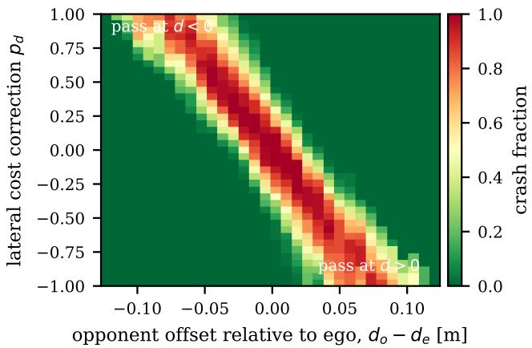
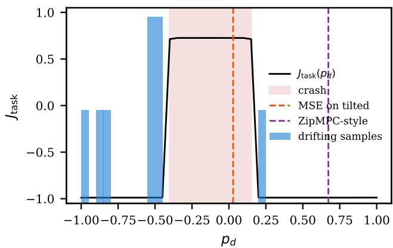

# ZipDrift: Generating Multimodal Short-Horizon MPC Costs with One-Step Drifting Models

Ke Zhang

Trinity College Dublin, Dublin, Ireland

zhangk2@tcd.ie

Abstract—Short-horizon model predictive control (MPC) is fast but myopic. ZipMPC compensates by learning a contextdependent correction of the short-horizon cost that imitates a long-horizon expert. We observe that the optimal correction is often multimodal: when a slower opponent can be passed on either side, good corrections of opposite sign coexist, and the expert’s choice between them hinges on tiny cost differences. Deterministic regression then averages modes or inherits inconsistent expert tiebreaking. We propose ZipDrift, which trains a one-step drifting generator over MPC cost corrections, tilted toward low closedloop cost and learned only from cost evaluations of candidate corrections, without differentiating through the optimiser. A few generated candidates are ranked by a learned critic, and the model-based MPC then enforces dynamics and constraints. In a kinematic overtaking benchmark derived from ZipMPC, 53% of contexts are bimodal and the manual short-horizon MPC crashes in 28.5% of test episodes. With an eight-dimensional stagewise correction, ZipDrift is collision-free in all 600 test episodes and matches the best evaluated candidate, whereas an idealised ZipMPC-style regressor crashes in 4.0% (16.0% with inconsistent expert labels) and critic-ranked random candidates with the same budget in 2.0%.

Index Terms—Model predictive control, imitation learning, generative models, autonomous racing.

## I. INTRODUCTION

Model predictive control (MPC) is the method of choice for agile vehicles because it enforces dynamics and constraints explicitly, but its computational cost grows with the prediction horizon. Short horizons run in real time yet act myopically: a race car that cannot see past the next few metres brakes late for corners and cannot prepare an overtake. ZipMPC [1] addresses this by compressing a long horizon into the cost of a short one. A neural network maps context, such as the upcoming track curvature, to a correction of the short-horizon cost, and is trained so that the short MPC imitates a long-horizon expert. The learned correction acts like a pseudo reference: on the racing benchmark it shifts the vehicle laterally in anticipation of curves that lie beyond the horizon.

This paper starts from an observation about what such a correction must represent. Consider a slower opponent ahead, outside the short horizon but inside the long one. Passing on the left and passing on the right are both good, and they require lateral cost corrections of opposite sign. The optimal correction is therefore a set with two separated components, and which one an expert picks can depend on arbitrarily small differences in cost. A deterministic map trained by regression, as in ZipMPC and related weight-adaptation schemes [2]–[4], converges to the conditional mean of its labels, which lies between the modes, i.e., straight into the opponent (Proposition 1).

Generative models represent such multimodality naturally, and recent drifting models [5] do so with a single network evaluation. Drifting MPC [6] tilts a drifting generator toward low cost to plan trajectories from offline data, but it does not use a dynamics model, does not enforce constraints, scores plans on generated states, and has so far been evaluated on a linear mass–spring–damper system. Trajectory-space drifting also suffers from a kernel geometry dominated by far-future dimensions, which collapses plans to their average [7].

We propose ZipDrift, which combines the two ideas in the space where each is strongest. A one-step drifting generator, tilted by the closed-loop cost, outputs the cost correction of a model-based short-horizon MPC; the MPC enforces dynamics and constraints; a small number of candidates is generated in one pass and the best is selected. Our contributions are:

• We identify and quantify mode averaging in contextdependent MPC cost learning. In an overtaking task built on the ZipMPC kinematic racing setup, 53% of contexts admit two separated sets of good corrections, and the long-horizon expert’s two local solutions differ by less than 0.5% in cost in about half of the contexts where both exist. Imitation is therefore sensitive to how the expert breaks near-ties.

• We formulate cost-parameter-space drifting with a Gibbs target over MPC cost corrections. Training only needs closed-loop cost evaluations of candidate corrections, not gradients through the optimiser, so labels come from the deployment solver with hard constraints.

• In closed loop with an eight-dimensional stagewise correction, ZipDrift is collision-free in all 600 test episodes, whereas an idealised ZipMPC-style regressor crashes in 4.0% (16.0% with inconsistent expert labels) and criticranked random candidates with the same budget in 2.0%. With a one-dimensional correction, simpler multimodal baselines are as effective, and we report this as well.

This is a preliminary study on a deliberately minimal benchmark; Section VI lists its limitations.

## II. RELATED WORK

Learning costs to shorten MPC horizons. Short prediction horizons make nonlinear MPC real-time capable but myopic, and the resulting suboptimality is well understood for unconstrained schemes [8]. One remedy is to learn the ingredients of the short-horizon problem. Jain et al. [9] learn a surrogate stage cost so that a short-horizon MPC optimises a long-horizon objective. ZipMPC [1] imitates a long-horizon MPC by learning a context-dependent correction of the cost of a short-horizon contouring MPC [10], propagating gradients of an imitation loss through the optimiser with differentiable MPC [11]; VIGOR-MPC [2] extends the idea to visual context. Weights can also be tuned per context with Bayesian optimisation [3] or adapted by reinforcement learning [4], [12], and an actor or critic can supply warm starts and terminal costs [13]. Approximate MPC instead replaces the optimiser by a network [14]. All of these learn a deterministic map from context to cost parameters (or a unimodal Gaussian policy over them). We show that the optimal correction can be genuinely multimodal and that deterministic maps then average modes into infeasible or colliding behaviour.

Generative models for planning and MPC. Diffusion models generate trajectories [15] and action chunks [16] and capture multimodal behaviour. They have been combined with MPC in several ways: as learned dynamics and proposal models [17], by computing the score from a known model [18], as approximate MPC policies that select among sampled modes using the MPC cost [19], and as reference generators tracked by an MPC on miniature race cars [20]. Large-scale studies indicate that sampling followed by selection is often preferable to gradient guidance [21]. Energy-weighted generative objectives bias samples toward low cost [22], echoing the exponential tilting of control as inference [23] and MPPI [24]. These methods generate trajectories or actions; none generates the cost parameters of a short-horizon MPC.

Drifting models. Drifting models [5] train a one-step generator by regressing its output toward itself plus a kernel mean-shift field that attracts samples to data and repels them from each other, so inference costs a single network evaluation. Drifting MPC [6] tilts the attraction field by $e ^ { - \beta J }$ to sample trajectories from a cost-tilted distribution learned from offline data, without a dynamics model, and selects among a few samples. Keyed drift fields [7] show that trajectory-space drifting collapses to average plans unless neighbourhoods are computed in a compact key space, and drifting policies have been tilted toward high value at the action level [25]. We move drifting into the low-dimensional cost-parameter space of a model-based short-horizon MPC, where the kernel geometry is benign and the MPC restores dynamic feasibility and constraint satisfaction.

## III. PROBLEM SETTING

Short-horizon MPC with a learned cost correction. We consider a discrete-time system $x _ { k + 1 } = f ( x _ { k } , u _ { k } )$ controlled by a short-horizon MPC with horizon $N _ { S }$

$$
\operatorname* { m i n } _ { \{ x _ { i } , u _ { i } \} } \sum _ { i = 0 } ^ { N _ { S } - 1 } \frac { 1 } { 2 } \big \| [ x _ { i } ; u _ { i } ] \big \| _ { \mathrm { d i a g } ( q ) } ^ { 2 } + ( p + \Delta C ) ^ { \top } [ x _ { i } ; u _ { i } ]\tag{1}
$$

$$
\mathrm { s . t . } ~ x _ { i + 1 } = f ( x _ { i } , u _ { i } ) , \quad x _ { 0 } = x ( k ) , \quad ( x _ { i } , u _ { i } ) \in \mathcal { Z } _ { i } ,
$$

where $( q , p )$ is a manually tuned cost, $\Delta C \in \mathcal { y } \subset \mathbb { R } ^ { d _ { c } }$ is a correction of the linear cost terms, and $\mathcal { Z } _ { i }$ collects input, track and obstacle constraints. This is exactly the parameterisation of the released ZipMPC implementation, which learns linear cost terms on top of a hand-tuned contouring cost [1]. Let $\pi _ { \Delta C }$ denote the closed-loop controller that applies the first input of (1). A context c summarises the information a long horizon would see (in ZipMPC, upcoming track curvature; here, also the state of an opponent).

Task cost. For a context c and a correction $\Delta C$ , let $J ( \Delta C ; c )$ be the cost of running $\pi _ { \Delta C }$ from $c$ for $T _ { r }$ steps (negative progress plus a penalty for crashes). ZipMPC trains a deterministic map $h _ { \theta } ( c )$ so that the short MPC imitates a longhorizon MPC; the best such map would output a minimiser of $J ( \cdot ; c )$ or of an imitation loss with respect to the expert.

Mode averaging. When the long horizon reveals an obstacle that can be passed on either side, the lateral cost term $p _ { d }$ that pre-positions the vehicle has two good values of opposite sign. Deterministic regression cannot represent this.

Proposition 1 (Mode averaging). Let labels $\Delta C$ be drawn from a conditional distribution $p ( \cdot \mid c ) , e . g .$ , expert-optimal corrections with ties broken arbitrarily. The minimiser of $\mathbb { E } \Vert h ( c ) - \Delta C \Vert ^ { 2 }$ over all measurable h is $h ^ { \star } ( c ) = \mathbb { E } [ \Delta C \mid c ]$ $I f p ( \cdot \mid c )$ puts mass α and 1−α on two separated near-optimal sets $S _ { 1 } , S _ { 2 }$ and $J ( \cdot ; c )$ is large on the segment between them except near its endpoints, then $J ( h ^ { \star } ( c ) ; c )$ is large for all α bounded away from 0 and 1.

The first claim is the standard characterisation of the conditional mean; the second follows by noting that $h ^ { \star } ( c )$ lies on the segment between $\mathbb { E } [ \Delta C \mid \Delta C \in { \dot { S } } _ { 1 } ]$ and $\mathbb { E } [ \Delta C \ | \ \Delta C \in S _ { 2 } ]$ Section V shows that this situation is common in a simple overtaking task and that it causes collisions.

## IV. ZIPDRIFT: COST-TILTED DRIFTING IN COST SPACE

Target distribution. Instead of a point estimate we learn a conditional generator $G _ { \phi } ( \epsilon , c ) \in \mathcal { V } , \epsilon \sim \mathcal { N } ( 0 , I )$ , whose output distribution approximates the cost-tilted target

$$
p _ { \beta } ( \Delta C \mid c ) \propto p _ { 0 } ( \Delta C \mid c ) \exp \big ( - \beta J ( \Delta C ; c ) \big ) ,\tag{2}
$$

with a prior $p _ { 0 }$ over admissible corrections (uniform on a box in our experiments). By the Gibbs variational principle, $p _ { \beta }$ is the unique minimiser of $\mathbb { E } _ { q } [ J ] + \beta ^ { - 1 } \mathrm { K L } ( q \| p _ { 0 } )$ over distributions $q ;$ Foffano et al. [6] use this characterisation for trajectories, and the argument does not depend on how $J$ is evaluated. As $\beta$ grows, $p _ { \beta }$ concentrates on all near-optimal corrections, keeping every mode.

Drifting objective. Following drifting models [5] and their cost-tilted variant [6], for a context c we draw M generated samples $y _ { m } = G _ { \phi } ( \epsilon _ { m } , c )$ and use K labelled candidates $y _ { j } ^ { + }$ with costs $J _ { j }$ as positives. The drift field at $y _ { m }$ is

$$
\begin{array} { l } { { \displaystyle V ( y _ { m } ) = \sum _ { \tau \in \mathcal { T } } \big [ A _ { \tau } ( y _ { m } ) - R _ { \tau } ( y _ { m } ) \big ] } , }  \\ { { \displaystyle A _ { \tau } ( y _ { m } ) = \frac { \sum _ { j } w _ { j } k _ { \tau } ( y _ { m } , y _ { j } ^ { + } ) \big ( y _ { j } ^ { + } - y _ { m } \big ) } { \sum _ { j } w _ { j } k _ { \tau } \big ( y _ { m } , y _ { j } ^ { + } \big ) } , } } \\ { { \displaystyle R _ { \tau } ( y _ { m } ) = \frac { \sum _ { m ^ { \prime } \neq m } k _ { \tau } ( y _ { m } , y _ { m ^ { \prime } } ) \big ( y _ { m ^ { \prime } } - y _ { m } \big ) } { \sum _ { m ^ { \prime } \neq m } k _ { \tau } \big ( y _ { m } , y _ { m ^ { \prime } } \big ) } , } } \end{array}\tag{3}
$$

with Laplace kernels $k _ { \tau } ( y , y ^ { \prime } ) = \exp ( - \| y - y ^ { \prime } \| / \tau )$ at several temperatures $\tau$ and tilting weights $w _ { j } \propto \exp ( - \beta z _ { j } )$ , where $z _ { j }$ is the cost $J _ { j }$ standardised within the candidate pool of c and clipped to $[ - 5 , 5 ]$ as in the Drifting MPC implementation. Because the weights enter a self-normalised average, the normalising constant of (2) cancels [6]. The generator is trained with the drifting loss

$$
\begin{array} { r } { \mathcal { L } ( \phi ) = \mathbb { E } _ { c , \epsilon } \big \| G _ { \phi } ( \epsilon , c ) - \mathrm { s g } \big ( G _ { \phi } ( \epsilon , c ) + V \big ) \big \| ^ { 2 } , } \end{array}\tag{4}
$$

where sg stops gradients. The field vanishes when the generated distribution matches the tilted positives.

Zeroth-order, solver-agnostic labels. The only supervision is the scalar cost $J _ { j }$ of candidate corrections, obtained by running the short-horizon MPC in closed loop. No gradient through the optimiser is needed, so the labels can be produced by the same constrained solver used at deployment, by a high-fidelity simulator, or by logged rollouts. This removes three difficulties of differentiable-MPC training reported for ZipMPC: gradients of a local convex approximation, soft state constraints during training, and a mismatch between the training and deployment solvers [1]. Labelling is embarrassingly parallel.

Inference with selection. At decision time the generator produces M candidates in one batched forward pass. A critic $\hat { J } _ { \psi } ( c , \Delta C )$ , regressed on the same labels, selects $\Delta C ^ { \star } \ = \ \arg \operatorname* { m i n } _ { m } \hat { J } _ { \psi } ( c , y _ { m } )$ , which is then used in (1). Selection among i.i.d. samples from an approximation of $p _ { \beta }$ inherits the best-of-M argument of [6]: the probability of choosing a δ-suboptimal candidate decays exponentially in M when the generator is close to $p _ { \beta }$ in total variation and $p _ { \beta }$ places non-negligible mass on near-optimal corrections. Unlike Drifting MPC, the selected candidate is executed through a model-based MPC, so dynamics and constraints are enforced by the optimiser rather than trusted from generated states. Algorithm 1 summarises training.

## V. EXPERIMENTS

## A. Setup

Vehicle and MPC. We reuse the kinematic racing setting of ZipMPC [1]: a Frenet-frame kinematic bicycle with $T = 0 . 0 3 \mathrm { { s } } , \ l _ { f } = l _ { r } = 0 . 0 5 \mathrm { { m } , \ | \boldsymbol { a } | \leq 1 \mathrm { { m } / \mathrm { { s } } ^ { 2 } , \ | \boldsymbol { \delta } | \leq 0 . 4 \mathrm { { r a d } } , } }$ $v \leq 1 . 8  { \mathrm { m / s } }$ , lateral bound $| d | \leq 0 . 1 7  { \mathrm { m } } ,$ and the manual contouring cost of [1] (quadratic weights 3, 1, 0.01, 0.01, 0.01, 1 on $d , \varphi , v , \sigma _ { \Delta } , a , \delta$ and linear progress weight −8). We add a friction limit $| v ^ { 2 } \tan \delta | / ( l _ { f } \overset { . } { + } l _ { r } ) \leq 2 \mathrm { m } / \mathrm { s } ^ { 2 }$ and a slower opponent on a straight track. The opponent drives at constant speed $v _ { o }$ at lateral offset $d _ { o } ;$ the MPC knows its predicted position and imposes an inflated elliptical keep-out constraint, while collisions in simulation use the true footprint. The short MPC uses $N _ { S } ~ = ~ 5 ~ \ : ( 0 . 1 5 \mathrm { s } )$ and the long-horizon expert $N _ { L } = 3 0 ~ ( 0 . 9 { \mathrm { s } } ) ;$ both are solved with IPOPT [26] through CasADi [27] with hard constraints. If the short MPC is infeasible, the vehicle brakes fully.

Algorithm 1 ZipDrift training   
Require: contexts $\left\{ c _ { n } \right\}$ , candidate set $\{ y _ { j } \} _ { j = 1 } ^ { K } \subset \mathcal { Y } _ { }$ , short   
MPC (1)   
1: for each $c _ { n }$ and $y _ { j }$ in parallel do   
2: $J _ { n j } \gets$ closed-loop cost of MPC with correction $y _ { j }$   
from $c _ { n }$   
3: end for   
4: $w _ { n j } \propto \mathrm { e x p } ( - \beta \mathrm { c l i p } ( \mathrm { z s c o r e } _ { j } ( J _ { n j } ) ) )$   
5: repeat   
6: sample batch of contexts; $y _ { m } \gets G _ { \phi } ( \epsilon _ { m } , c _ { n } )$ , m =   
1..M   
7: compute $V ( y _ { m } )$ by (3); take a gradient step on (4)   
8: until converged   
9: fit critic $\hat { J } _ { \psi }$ on $\{ ( c _ { n } , y _ { j } , J _ { n j } ) \}$ by least squares

Contexts and task cost. A context $c = ( d _ { e } , v _ { e } , g , d _ { o } , v _ { o } )$ is sampled uniformly from $d _ { e } ~ \in ~ [ - 0 . 0 5 , 0 . 0 5 ] \mathrm { m } , \ v _ { e } ~ \in$ [1.2, 1.8] m/s, gap $g \in [ 0 . 6 , 1 . 2 ] \mathrm { m } , d _ { o } \in [ - 0 . 0 8 , 0 . 0 8 ]$ m and $v _ { o } \in [ 0 . 2 , 0 . 6 ] \mathrm { m } / \mathrm { s }$ , so that the opponent is outside the short horizon but inside the long one. The correction is chosen at decision time and held for an 80-step (2.4 s) closed-loop episode. J is the negative progress normalised by $v _ { \operatorname* { m a x } } T \cdot 8 0$ plus 1 if the vehicle collides or leaves the track. We use 800 contexts, the first 600 for training and the last 200 for testing.

Methods. $M P C _ { N _ { S } }$ uses the manual cost $( \Delta C = 0 ) ;$ expert is $\mathrm { M P C } _ { N _ { L } }$ run in closed loop with two initial guesses (left and right) at the first step. ZipMPC-style is a deterministic MLP regressing, for each context, the correction that minimises ZipMPC’s imitation loss (weighted error of the first $N _ { D } = 5$ predicted states and inputs, with the weights of the released code) with respect to the expert’s chosen solution; it is an idealised ZipMPC whose labels are exact per-context optima of its own loss. argmin reg. regresses arg min $\iota _ { y } J ( y ; c ) ;$ MSE tilted regresses $\mathbb { E } _ { p _ { \beta } } [ \Delta C \ \mid \ c ]$ . MDN is a two-component mixture density network [28] trained on the tilted weights. Critic search minimises the learned critic $\hat { J } _ { \psi }$ over a 201-point grid (one dimension) or over uniformly sampled corrections (eight dimensions), without a generator. ZipDrift uses $\beta = 3 ,$ M = 8 candidates, 32 negatives, temperatures {0.05, 0.1, 0.2} in one dimension and {0.2, 0.4, 0.8} in eight; all networks are three-layer MLPs with 256 units. $\mathbf { \hat { \mu } } ^ { 6 } \mathbf { M } = 1 \mathbf { \ ' }$ uses a single generated sample without selection; “best-of-M” selects with $\hat { J } _ { \psi }$

## B. Is the optimal correction multimodal?

Fig. 1 shows, for all 800 contexts, which constant lateral corrections $p _ { d } \in [ - 1 , 1 ]$ (41 values) lead to a crash. Crashes form a band whose position moves with the opponent’s offset relative to the ego vehicle: corrections on one side of the band pre-position the car to pass at $d < 0 .$ , corrections on the other side to pass at $d > 0$ . The manual cost $( p _ { d } = 0 )$ crashes in 28.0% of contexts, and 93.5% of contexts contain at least one crashing correction. In 53.4% of contexts both sides contain a non-crashing interval, i.e., the set of good corrections has two separated components. The long-horizon expert also has two distinct local solutions in 91% of contexts, and in about half of those (51%) their objective values differ by less than 0.5% (median relative gap 0.48%). Which mode the expert returns is therefore decided by small cost differences or, for a single-start solver, by the initial guess: a single IPOPT start picks the same side as the better of two starts in only 89.4% of contexts.

  
Fig. 1. Fraction of contexts in which a constant lateral correction $p _ { d }$ leads to a crash, binned by the opponent’s lateral offset relative to the ego vehicle. Good corrections lie on both sides of a moving crash band.

## C. One-dimensional correction

Table I reports closed-loop results with $p _ { d }$ as the only learned parameter. Regressing the mean of the tilted distribution, which is what any MSE-trained map converges to when labels from both modes are mixed (Proposition 1), crashes in 42.9% of bimodal contexts: the predicted correction falls into the crash band (Fig. 2). ZipDrift with best-of-M selection crashes in 0.2% of all and 0.3% of bimodal contexts, close to the oracle that picks the best of 41 evaluated corrections. Drawing a single sample without selection is worse (3.8%), because samples near a mode’s boundary are occasionally drawn.

Two points temper this result. First, the idealised ZipMPCstyle regressor, trained on exact per-context optima of ZipMPC’s imitation loss with respect to an expert that always returns the better of its two modes, is also nearly collision-free (0.8%): its labels switch sides discontinuously but consistently with the context, and a sufficiently expressive network fits that switch. Second, in one dimension a learned critic with exhaustive grid search, or an MDN with the same best-of-M selection, performs as well as ZipDrift.

  
Fig. 2. A symmetric test context. The task cost J is low on both sides of a crash interval. Drifting samples (histogram, $M = 8 )$ cover both modes; the MSE solution on tilted labels lies inside the crash interval.

TABLE I  
ONE-DIMENSIONAL CORRECTION p : CLOSED-LOOP RESULTS ON 200 TEST CONTEXTS (98 BIMODAL), MEAN±STD OVER 3 TRAINING SEEDS; BEST-OF-M USES M=8.
<table><tr><td></td><td colspan="3">crash rate [%] ↓</td><td></td></tr><tr><td>Method</td><td>all</td><td>bimodal</td><td>unimodal</td><td> $J \downarrow$ </td></tr><tr><td> $\mathsf { M P C } _ { N _ { S } }$  (manual cost)</td><td>28.5±0.0</td><td>56.1±0.0</td><td>2.0±0.0</td><td>-0.492±0.000</td></tr><tr><td>Expert  $\mathrm { \tilde { M P C } } _ { N _ { L } }$ </td><td>0.0±0.0</td><td>0.0±0.0</td><td>0.0±0.0</td><td>-0.984±0.000</td></tr><tr><td>Oracle (best of grid)</td><td>0.0±0.0</td><td>0.0±0.0</td><td>0.0±0.0</td><td>-0.984±0.000</td></tr><tr><td>ZipMPC-style (deterministic)</td><td>0.8±0.8</td><td>1.7±1.7</td><td>0.0±0.0</td><td>-0.970±0.015</td></tr><tr><td>argmin reg. (deterministic)</td><td>1.5±0.8</td><td>3.1±1.7</td><td>0.0±0.0</td><td>-0.958±0.014</td></tr><tr><td>MSE tilted (deterministic)</td><td>21.0±0.0</td><td>42.9±0.0</td><td>0.0±0.0</td><td>-0.623±0.000</td></tr><tr><td>Critic + grid search</td><td>0.2±0.2</td><td>0.0±0.0</td><td>0.3±0.5</td><td>-0.981±0.004</td></tr><tr><td>MDN, M=1</td><td>4.0±0.4</td><td>3.4±0.5</td><td>4.6±0.5</td><td>-0.915±0.007</td></tr><tr><td>MDN, best-of-M</td><td>0.2±0.2</td><td>0.0±0.0</td><td>0.3±0.5</td><td>-0.981±0.004</td></tr><tr><td>ZipDrift, M=1</td><td>3.8±1.4</td><td>4.4±1.3</td><td>3.3±2.6</td><td>-0.918±0.025</td></tr><tr><td>ZipDrift, best-of-M</td><td>0.2±0.2</td><td>0.3±0.5</td><td>0.0±0.0</td><td>-0.981±0.004</td></tr></table>

## D. Sensitivity to expert labels

Mode averaging returns as soon as the expert’s mode choice is not a consistent function of the context. Table II retrains the ZipMPC-style regressor with labels from a single-start expert, as in a standard ZipMPC pipeline, and from an expert that breaks near-ties (relative gap below 0.5%) at random, which models several near-equivalent demonstrators or solver restarts. Its crash rate rises from 0.5% to 4.5% and 16.5% (31.6% on bimodal contexts). ZipDrift does not use expert labels and stays at 0.5%. The same holds for the other methods trained on closed-loop costs, which shows that much of the robustness comes from learning from cost evaluations rather than from imitation.

## E. Eight-dimensional stagewise correction

To test whether the generator matters when exhaustive search is no longer available, we let the correction vary over the horizon, as in ZipMPC: $y \in [ - 1 , 1 ] ^ { 8 }$ sets the lateral weight $p _ { d , i } = y _ { i }$ and a progress-weight correction $\Delta p _ { \sigma , i } = 4 y _ { 4 + i }$ at stages $i = 1 , \dots , 4$ (stage-0 terms are constant). For each of the same 800 contexts we evaluate the zero correction and

TABLE II  
EFFECT OF EXPERT LABEL CONSISTENCY (SEED 0). CRASH RATE [%], ALL / BIMODAL CONTEXTS. ONLY THE ZIPMPC-STYLE METHOD USES EXPERT LABELS.
<table><tr><td>Method</td><td>consistent</td><td>single-start</td><td>random tie</td></tr><tr><td>ZipMPC-style (deterministic)</td><td>0.5 /  1.0</td><td>4.5 / 8.2</td><td>16.5 / 31.6</td></tr><tr><td>argmin reg. (deterministic)</td><td>1.5 / 3.1</td><td>1.5 / 3.1</td><td>1.5 / 3.1</td></tr><tr><td>MDN, best-of-M</td><td>0.0 / 0.0</td><td>0.0 / 0.0</td><td>0.5 / 0.0</td></tr><tr><td>Critic + grid search</td><td>0.5 / 0.0</td><td>0.5 / 0.0</td><td>0.5 / 0.0</td></tr><tr><td>ZipDrift, best-of-M</td><td>0.5 / 1.0</td><td>0.5 /  1.0</td><td>0.5 / 1.0</td></tr></table>

TABLE III

EIGHT-DIMENSIONAL STAGEWISE CORRECTION: CLOSED-LOOP RESULTS ON THE SAME 200 TEST CONTEXTS, MEAN±STD OVER 3 TRAINING SEEDS; BEST-OF-M USES M=8.
<table><tr><td></td><td colspan="3">crash rate [%] ↓</td><td></td></tr><tr><td>Method</td><td>all</td><td>bimodal</td><td>unimodal</td><td>J↓</td></tr><tr><td> $ { \mathbf { M P C } } _ { N _ { S } }$  (manual cost)</td><td>28.5±0.0</td><td>56.1±0.0</td><td>2.0±0.0</td><td>-0.492±0.000</td></tr><tr><td>Expert MPCNI</td><td>0.0±0.0</td><td>0.0±0.0</td><td>0.0±0.0</td><td>-0.984±0.000</td></tr><tr><td>Oracle (best of K=64)</td><td>0.0±0.0</td><td> $0 . 0 { \pm } 0 . 0 \ $ </td><td>0.0±0.0</td><td>-0.984±0.000</td></tr><tr><td>ZipMPC-style (deterministic)</td><td>4.0±1.1</td><td>8.2±2.2</td><td>0.0±0.0</td><td>-0.916±0.019</td></tr><tr><td>argmin reg. (deterministic)</td><td>7.0±0.7</td><td>14.3±1.4</td><td>0.0±0.0</td><td>-0.864±0.012</td></tr><tr><td>MSE tilted (deterministic)</td><td>14.3±0.8</td><td>28.9±1.3</td><td>0.3±0.5</td><td>-0.737±0.015</td></tr><tr><td>Critic + M random</td><td>2.0±1.1</td><td>4.1±2.2</td><td>0.0±0.0</td><td>-0.949±0.019</td></tr><tr><td>Critic + 4096 random</td><td>3.2±1.8</td><td>3.4±1.7</td><td>2.9±2.1</td><td>-0.929±0.032</td></tr><tr><td>MDN, M=1</td><td>11.3±1.5</td><td>22.1±3.4</td><td>1.0±0.8</td><td>-0.789±0.027</td></tr><tr><td>MDN, best-of-M</td><td>0.7±0.2</td><td>1.4±0.5</td><td>0.0±0.0</td><td>-0.972±0.004</td></tr><tr><td>ZipDrift, M=1</td><td>6.8±1.4</td><td>12.9±2.1</td><td>1.0±0.8</td><td>-0.866±0.025</td></tr><tr><td>ZipDrift, best-of-M</td><td>0.0±0.0</td><td>0.0±0.0</td><td>0.0±0.0</td><td>-0.984±0.000</td></tr></table>

K = 64 uniformly sampled corrections in closed loop; on average 27.9% of them crash. ZipMPC-style labels are the per-context minimisers of the imitation loss, found by bounded Powell search started from the best candidate, for the expert’s chosen mode. Critic-based search now uses M = 8 or 4096 uniformly sampled corrections.

Table III shows that ZipDrift with best-of-M selection did not crash in any of the 600 test episodes (three seeds) and matched the best evaluated candidate in task cost. With the same budget of eight candidates, ranking uniform samples with the same critic crashes in 2.0% of episodes (12/600; Fisher’s exact test $p \ < \ 1 0 ^ { - 3 } )$ , so the generated proposals, not the critic alone, carry the improvement. Ranking 4096 uniform samples is worse (3.2%) than ranking eight: a large search finds corrections where the critic is wrong, whereas generated candidates stay close to labelled corrections. An MDN with the same selection crashes in 0.7% (4/600); this difference to ZipDrift is not statistically significant (p = 0.12). The idealised ZipMPC-style regressor crashes in 4.0% of episodes even with consistent expert labels (8.2% on bimodal contexts; $p < 1 0 ^ { - 6 }$ against ZipDrift), and in 7.5% and 16.0% with single-start and randomly tie-broken labels (Table IV). Single generated samples without selection crash in 6.8%, so selection remains essential.

## VI. DISCUSSION AND LIMITATIONS

What the evidence supports. Multimodal optimal corrections are common in the overtaking task, and deterministic imitation is only as reliable as the consistency of the expert’s mode choice. Learning from closed-loop cost evaluations removes that dependence. Among the methods trained this way, the benefit of a generator appears only once the correction is higher-dimensional: in one dimension a critic with grid search or an MDN performs as well as ZipDrift, and in eight dimensions the margin over the MDN is not statistically significant. The clearest gains are over deterministic maps and over critic-ranked random candidates with the same budget.

TABLE IV  
EIGHT-DIMENSIONAL CORRECTION: EFFECT OF EXPERT LABEL CONSISTENCY (SEED 0). CRASH RATE [%], ALL / BIMODAL.
<table><tr><td>Method</td><td>consistent</td><td>single-start</td><td>random tie</td></tr><tr><td>ZipMPC-style (deterministic)</td><td>3.0 / 6.1</td><td>7.5 / 14.3</td><td>16.0 / 26.5</td></tr><tr><td>argmin reg. (deterministic)</td><td>7.5 /  15.3</td><td>7.5 /  15.3</td><td>7.5 /  15.3</td></tr><tr><td>Critic + M random</td><td>1.0 / 2.0</td><td>1.0 / 2.0</td><td>0.5 / 1.0</td></tr><tr><td>MDN, best-of-M</td><td>0.5 / 1.0</td><td>0.5 /  1.0</td><td>0.0 / 0.0</td></tr><tr><td>ZipDrift, best-of-M</td><td>0.0 / 0.0</td><td>0.0 / 0.0</td><td>0.0 / 0.0</td></tr></table>

Scope. The benchmark is deliberately minimal: a kinematic bicycle on a straight track, one opponent at constant speed, a correction chosen at decision time and held for the episode, and simulation only. Random corrections pass in most contexts, so the eight-dimensional search problem is not hard. We have not evaluated full laps on curved tracks, the Pacejka model, more opponents, or hardware.

Receding-horizon use. ZipMPC recomputes the correction at every step. Doing so with a stochastic generator risks switching between modes from one step to the next; reusing the noise ϵ across steps, or conditioning on the previously selected mode, are natural remedies that remain to be tested.

Guarantees. The Gibbs characterisation and the best-of-M argument concern the choice of a correction, not closed-loop stability or recursive feasibility. Terminal ingredients in the short MPC are compatible with ZipDrift and are needed for formal guarantees.

Labelling cost. Each training context required 65 closedloop simulations, more solver calls per context than differentiable-MPC training, although they are trivially parallel and use the deployment solver; labelling 800 contexts took 18 minutes on 28 CPU cores. Sampling candidates adaptively around the current generator would reduce this cost.

## VII. CONCLUSION

Compressing a long MPC horizon into a learned shorthorizon cost requires representing decisions, such as the side on which to overtake, that the short horizon cannot see. Such decisions make the optimal cost correction multimodal and make imitation of a long-horizon expert sensitive to how the expert breaks near-ties. ZipDrift replaces the deterministic context-to-cost map by a cost-tilted one-step drifting generator in the space of cost corrections, trained only from closed-loop cost evaluations and combined with candidate selection and a model-based MPC. In a minimal overtaking benchmark it removed collisions where deterministic maps and critic-ranked random search did not. Next steps are receding-horizon use with mode persistence, curved tracks with the Pacejka model, higher-dimensional time-varying corrections, and hardware experiments.

## ACKNOWLEDGMENT

Parts of the code and text of this work were drafted with the assistance of an AI system (Claude, Anthropic). The author reviewed all content and takes full responsibility for it.

## REFERENCES

[1] R. Rickenbach, A. Lahoud, E. Schaffernicht, M. Zeilinger, and J. A. Stork, “ZipMPC: Compressed context-dependent MPC cost via imitation learning,” in Proceedings of the 9th Conference on Robot Learning (CoRL), ser. Proceedings of Machine Learning Research, vol. 305. PMLR, 2025, pp. 3115–3136.

[2] J. Trisovic, R. Rickenbach, M. Landert, P. Minos, and M. N. Zeilinger, “VIGOR-MPC: Vision-guided objective regulation MPC,” in Conference on Robot Learning (CoRL), 2026, to appear. arXiv:2610.20333.

[3] L. P. Frohlich, C. K ¨ uttel, E. Arcari, L. Hewing, M. N. Zeilinger,¨ and A. Carron, “Contextual tuning of model predictive control for autonomous racing,” in 2022 IEEE/RSJ International Conference on Intelligent Robots and Systems (IROS), 2022, pp. 10 555–10 562.

[4] B. Zarrouki, A. Thobani, J. Hoffmann, M. Piccinini, R. Reiter, F. Jahncke, S. Gros, D. Scaramuzza, and J. Betz, “Accelerating reinforcement learning via MPC solver-gradient guidance for weights-varying MPC,” 2026, arXiv:2609.01061.

[5] M. Deng, H. Li, T. Li, Y. Du, and K. He, “Generative modeling via drifting,” in Advances in Neural Information Processing Systems (NeurIPS), 2026, to appear. arXiv:2602.04770.

[6] D. Foffano, A. Russo, and A. Proutiere, “Receding-horizon control via drifting models,” 2026, arXiv:2604.04528.

[7] G. Puthumanaillam and M. Ornik, “Amortizing trajectory diffusion with keyed drift fields,” 2026, arXiv:2603.14056.

[8] L. Grune, “Analysis and design of unconstrained nonlinear MPC¨ schemes for finite and infinite dimensional systems,” SIAM Journal on Control and Optimization, vol. 48, no. 2, pp. 1206–1228, 2009.

[9] A. Jain, L. Chan, D. S. Brown, and A. D. Dragan, “Optimal cost design for model predictive control,” in Proceedings of the 3rd Conference on Learning for Dynamics and Control (L4DC), ser. Proceedings of Machine Learning Research, vol. 144. PMLR, 2021, pp. 1205–1217.

[10] A. Liniger, A. Domahidi, and M. Morari, “Optimization-based autonomous racing of 1:43 scale RC cars,” Optimal Control Applications and Methods, vol. 36, no. 5, pp. 628–647, 2015.

[11] B. Amos, I. Jimenez, J. Sacks, B. Boots, and J. Z. Kolter, “Differentiable MPC for end-to-end planning and control,” in Advances in Neural Information Processing Systems (NeurIPS), vol. 31. Curran Associates, Inc., 2018.

[12] S. Gros and M. Zanon, “Data-driven economic NMPC using reinforcement learning,” IEEE Transactions on Automatic Control, vol. 65, no. 2, pp. 636–648, 2020.

[13] R. Reiter, A. Ghezzi, K. Baumgartner, J. Hoffmann, R. D. McAllister,¨ and M. Diehl, “AC4MPC: Actor-critic reinforcement learning for guiding model predictive control,” IEEE Transactions on Control Systems Technology, vol. 34, no. 1, pp. 395–410, 2026.

[14] M. Hertneck, J. Kohler, S. Trimpe, and F. Allg¨ ower, “Learning an¨ approximate model predictive controller with guarantees,” IEEE Control Systems Letters, vol. 2, no. 3, pp. 543–548, 2018.

[15] M. Janner, Y. Du, J. Tenenbaum, and S. Levine, “Planning with diffusion for flexible behavior synthesis,” in Proceedings of the 39th International Conference on Machine Learning (ICML), ser. Proceedings of Machine Learning Research, vol. 162. PMLR, 2022, pp. 9902–9915.

[16] C. Chi, S. Feng, Y. Du, Z. Xu, E. Cousineau, B. Burchfiel, and S. Song, “Diffusion policy: Visuomotor policy learning via action diffusion,” in Robotics: Science and Systems XIX, 2023.

[17] G. Zhou, S. Swaminathan, R. V. Raju, J. S. Guntupalli, W. Lehrach, J. Ortiz, A. Dedieu, M. Lazaro-Gredilla, and K. Murphy, “Diffusion´ model predictive control,” Transactions on Machine Learning Research, 2025. [Online]. Available: https://openreview.net/forum?id=pvtgffHtJm

[18] C. Pan, Z. Yi, G. Shi, and G. Qu, “Model-based diffusion for trajectory optimization,” in Advances in Neural Information Processing Systems (NeurIPS), vol. 37. Curran Associates, Inc., 2024, pp. 57 914–57 943.

[19] P. M. Julbe, J. Nubert, H. Hose, S. Trimpe, and K. J. Kuchenbecker, “Diffusion-based approximate MPC: Fast and consistent imitation of multi-modal action distributions,” in 2025 IEEE/RSJ International Conference on Intelligent Robots and Systems (IROS), 2025, pp. 5633–5640.

[20] H. Ma, S. Bodmer, A. Carron, M. Zeilinger, and M. Muehlebach, “Constraint-aware diffusion guidance for robotics: Real-time obstacle avoidance for autonomous racing,” in Proceedings of the 9th Conference on Robot Learning (CoRL), ser. Proceedings of Machine Learning Research, vol. 305. PMLR, 2025, pp. 1756–1776.

[21] H. Lu, D. Han, Y. Shen, and D. Li, “What makes a good diffusion planner for decision making?” in The Thirteenth International Conference on Learning Representations (ICLR), 2025. [Online]. Available: https://openreview.net/forum?id=7BQkXXM8Fy

[22] S. Zhang, W. Zhang, and Q. Gu, “Energy-weighted flow matching for offline reinforcement learning,” in The Thirteenth International Conference on Learning Representations (ICLR), 2025. [Online]. Available: https://openreview.net/forum?id=HA0oLUvuGI

[23] S. Levine, “Reinforcement learning and control as probabilistic inference: Tutorial and review,” 2018, arXiv:1805.00909.

[24] G. Williams, N. Wagener, B. Goldfain, P. Drews, J. M. Rehg, B. Boots, and E. A. Theodorou, “Information theoretic MPC for model-based reinforcement learning,” in 2017 IEEE International Conference on Robotics and Automation (ICRA), 2017, pp. 1714–1721.

[25] J. Koo, M. Park, J. Choi, Y. Min, and M. Sung, “Drifting field policy: A one-step generative policy via Wasserstein gradient flow,” 2026, arXiv:2605.07727.

[26] A. Wachter and L. T. Biegler, “On the implementation of an interior-¨ point filter line-search algorithm for large-scale nonlinear programming,” Mathematical Programming, vol. 106, no. 1, pp. 25–57, 2006.

[27] J. A. E. Andersson, J. Gillis, G. Horn, J. B. Rawlings, and M. Diehl, “CasADi: a software framework for nonlinear optimization and optimal control,” Mathematical Programming Computation, vol. 11, no. 1, pp. 1–36, 2019.

[28] C. M. Bishop, “Mixture density networks,” Neural Computing Research Group, Aston University, Birmingham, U.K., Technical Report NCRG/94/004, Feb. 1994.