# Module-Aware Optimization for Graph Neural Networks

Guy Hadad Ben-Gurion University of the Negev Beer-Sheva, Israel guyhada@post.bgu.ac.il

Moshe Eliasof Ben-Gurion University of the Negev Beer-Sheva, Israel eliasof@bgu.ac.il

Haggai Roitman Ben-Gurion University of the Negev Beer-Sheva, Israel haggair@gmail.com

Bracha Shapira Ben-Gurion University of the Negev Beer-Sheva, Israel bshapira@bgu.ac.il

## Abstract

Different optimizers impose different geometries on parameter updates. Adaptive methods such as Adam and AdamW use coordinate-wise updates, while matrix-aware optimizers such as Muon utilize weight-matrix structure through orthogonalized updates. For Graph Neural Networks (GNNs), however, the effective geometry of its weight matrices is shaped not only by its learned channel-mixing weights, but also by the graph-propagated representations it acts on. Thus, even if an update is well normalized as a matrix, its effect on the layer output can be amplified when applied to graph-propagated features. To address this gap, we introduce GraphMuon, a graph-aware optimizer that adapts Muon’s matrix updates to the covariance structure of graph-propagated layer inputs. GraphMuon performs orthogonalization in a metric defined by these propagated representations and normalizes step sizes according to the update’s induced effect on the layer representation. We show that theoretically, vanilla Muon can suffer from graph-induced update amplification, while our GraphMuon can mitigate this effect. As such, our GraphMuon yields a graph-metric analogue of Muon’s polar update step. Empirically, GraphMuon achieves 1.32 –2.42 validation-loss time-totarget speedups over AdamW on three large-scale OGB benchmarks. Across 15 dataset–architecture configurations spanning node classification, inductive graph classification, and graph regression, it achieves lower time-to-target in 13 cases, while maintaining competitive or superior predictive performance. Code is available at https://github.com/guy-hadad/GraphMuon.

## 1 Introduction

Optimizers define the geometry in which neural-network updates are measured. Classical SGD uses a global Euclidean scale [26], adaptive methods such as Adam and AdamW normalize updates coordinate-wise [17, 20], and preconditioned methods such as Shampoo exploit matrix statistics to approximate richer curvature information [10]. More recently, matrix-aware optimizers such as Muon treat weight matrices as structured operators and replace raw momentum updates with approximately orthogonalized matrix directions [16]. Muon has also been shown to improve compute efficiency in large language-model training [19, 29, 30]. These developments suggest a broader principle: the geometry used by an optimizer should depend not only on the shape of a parameter tensor, but also on the module in which that parameter appears [1].

Graph neural networks provide a setting where this module dependence is especially important. In a standard feed-forward layer, a weight matrix acts on representations produced by previous neural layers. In a GNN layer, however, the trainable matrix acts on graph-propagated representations. For a propagation operator S and node representation H, the effective input to the weight matrix is

$$
X _ { g } = S H .\tag{1}
$$

Therefore, the effect of an update $\Delta W$ is governed by the induced representation-level perturbation $X _ { g } \Delta W$ , rather than by the parameter-space norm of $\Delta W$ alone. Since $X _ { g }$ depends on the graph topology, neighborhood aggregation, feature smoothing, and the current training state, two updates with the same Euclidean matrix scale can induce very different changes in the layer output.

This observation exposes a gap in existing optimizers for GNNs. AdamW adapts updates through coordinate-wise gradient moments, but does not explicitly distinguish directions that are amplified by graph propagation from directions that are attenuated in the propagated feature distribution. Muon improves over coordinate-wise updates by using the matrix structure of W, but its orthogonalization is still input-agnostic: the same Euclidean matrix geometry is used whether the matrix acts on dense features, tokens, or graph-propagated node representations. For GNNs, the relevant object is not only the standalone matrix W, but the graph-conditioned map

$$
W \mapsto X _ { g } W .\tag{2}
$$

The geometry of this map is determined by the covariance of the propagated inputs,

$$
C _ { g } = \frac { 1 } { n } X _ { g } ^ { \top } X _ { g } .\tag{3}
$$

Directions aligned with high-energy eigenspaces of $C _ { g }$ produce large representation-level perturbations, while directions in low-energy eigenspaces have much smaller immediate effect [12]. Thus, an optimizer for GNN weight matrices should be both matrix-aware and graph-aware: it should exploit the matrix structure of W, while calibrating update direction and scale to the graph-induced geometry of the representations on which W actually acts.

Inspired by this observation, we introduce GraphMuon, a graph-aware extension of Muon for GNN optimization. GraphMuon adapts Muon’s matrix-orthogonalized updates to the layer-wise geometry induced by graph-propagated inputs. It has two complementary components. First, graph-aware orthogonalization applies the polar-style Muon update in a metric defined by the covariance of $X _ { g } .$ . Second, graph-aware step normalization scales each update by its induced representation-level perturbation, rather than by its parameter-space magnitude alone. Together, these mechanisms align the optimizer geometry with the actual forward map of a GNN layer.

Our analysis in Section 4.3 shows that this modification is principled: a vanilla Muon update, although normalized in Euclidean matrix space, can still be amplified in representation space by the dominant eigenspaces of $C _ { g }$ . In contrast, our GraphMuon directly controls the quantity $\lVert \dot { X } _ { g } \Delta W \rVert _ { F } / \sqrt { n } ,$ which is the perturbation induced in the pre-activation representation of the GNN layer. We further show that the graph-aware orthogonalization step is the graph-metric analogue of Muon’s polar update, rather than an ad hoc rescaling.

Figure 1 illustrates the resulting mismatch and our correction. A Muon update can be well normalized as a matrix while still causing a large graph-propagated perturbation. GraphMuon addresses this by using $C _ { g }$ to adapt both the update geometry and its scale.

We evaluate GraphMuon across graph-learning benchmarks spanning node classification, inductive graph classification, and graph regression, using GCN, GAT, GINE, and GraphGPS architectures. Under a fixed validation-loss time-to-target protocol, GraphMuon achieves 1.32 –2.42 wall-clock speedups over AdamW on the three large-scale OGB benchmarks. Across a broader evaluation of 15 dataset–architecture configurations, GraphMuon improves epoch-level time-to-target in all cases and achieves faster wall-clock convergence in 13 of 15, while maintaining competitive or superior predictive performance.

## Main Contributions. Our contributions are as follows:

1. We identify a graph-induced optimization mismatch: standard optimizers normalize updates in parameter space, whereas the effect of a GNN weight update is determined by its perturbation of graph-propagated representations.

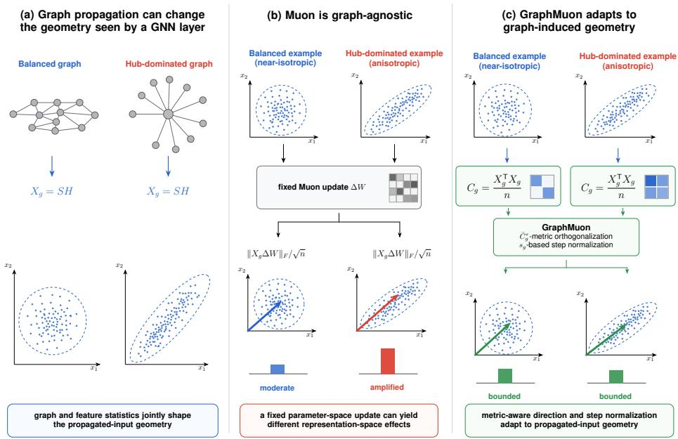  
Figure 1: Motivation for graph-aware optimization. A GNN weight matrix acts on the graphpropagated input $X _ { g } = S \breve { H }$ , whose geometry depends on graph structure and propagated feature statistics. As a result, a Muon update that is well normalized in Euclidean matrix space can still produce an amplified representation-level perturbation $\| X _ { g } \Delta W \| _ { F }$ . GraphMuon addresses this mismatch by adapting the update geometry to the graph-induced covariance $C _ { g } = X _ { g } ^ { \top } X _ { g } / n$ and scaling each step by its induced effect on graph-propagated representations.

2. We introduce GraphMuon, a graph-aware extension of Muon that adapts matrix-update geometry to the layer-wise covariance of graph-propagated representations and normalizes updates by their representation-level effect.

3. We prove that GraphMuon controls graph-induced representation perturbations and yields a graph-metric analogue of Muon’s polar update.

4. We demonstrate faster validation-loss convergence across diverse graph-learning regimes, including inductive graph-level tasks and multiple GNN architectures, with wall-clock improvements in 13 of 15 evaluated configurations and competitive or superior predictive performance.

## 2 Related Work

Graph neural networks. GNNs extend deep learning to graph-structured data by interleaving learnable transformations with neighborhood aggregation [9, 27]. Scalable spatial methods, including GCN [18], GraphSAGE [11], GAT [32], and GIN [33], have become the dominant paradigm, with subsequent work extending these ideas to heterogeneous graphs [28] and heterophilous graphs where connected nodes tend to differ in class [36]. Across these architectures, weight matrices act not on raw node features but on representations smoothed and mixed by graph propagation. This distinguishes GNN training from standard deep-network optimization: the geometry seen by each weight matrix is shaped not only by network depth, but also by graph topology and its induced propagation operator, which is precisely the mismatch GraphMuon is designed to address.

Matrix-aware optimization. Classical SGD and momentum update parameters in Euclidean space, while AdaGrad, Adam, and AdamW normalize updates coordinate-wise using accumulated gradient statistics [4, 17, 20]. Structured optimizers exploit richer geometry: K-FAC uses Kronecker-factored curvature [22], Shampoo uses matrix preconditioners [10], and Muon applies momentum followed by approximate matrix orthogonalization [16]. Muon is the closest predecessor, but remains moduleagnostic: it uses the same Euclidean matrix geometry for dense features, tokens, and graph-propagated representations. GraphMuon instead tests whether update geometry should match the module-induced operator, which for GNNs is the graph-conditioned map $W \mapsto X _ { g } W$ , rather than the standalone matrix $W$

Graph-aware modules and optimization. A central theme in GNN research is adapting neuralnetwork components to graph structure: GCNs [18], GAT [32], and GIN [33] do so architecturally, as do graph-specific normalization and modular designs [3, 25]. Izadi et al. [15] show that optimization itself can be graph-aware by deriving natural-gradient updates for graph-based semi-supervised learning. GraphMuon follows this optimizer-level view but targets a different setting: rather than a natural-gradient method, it adapts Muon’s matrix-aware geometry to the layer-wise covariance of graph-propagated representations, the optimizer-level analogue of graph-adaptive GNN design. Additional related work is discussed in Appendix B.

## 3 Background and Preliminaries

Notations. Let $G = ( V , E )$ be a graph with adjacency matrix $A \in \mathbb { R } ^ { n \times n }$ and node representations $H ^ { ( \ell ) } \in \mathbb { R } ^ { n \times d _ { \ell } }$ . Adding self-loops and symmetrically normalizing gives:

$$
S = \widetilde { D } ^ { - 1 / 2 } \widetilde { A } \widetilde { D } ^ { - 1 / 2 } , \qquad \widetilde { A } = A + I ,
$$

where $\widetilde { D }$ is the degree matrix of ${ \widetilde { A } } .$ . Each GNN weight matrix $W ^ { ( \ell ) }$ acts on the graph-propagated representation $X _ { g } ^ { ( \ell ) } = S H ^ { ( \ell ) }$ , so the geometry seen by $W ^ { ( \ell ) }$ is shaped by both the node features and the graph structure in S.

Muon. Muon [16] is an optimizer for matrix-valued parameters. Given gradient $G _ { t } = \nabla _ { W } \mathcal { L } ( W _ { t } )$ it maintains momentum $\dot { B } _ { t } = \mu B _ { t - 1 } + G _ { i }$ and forms $M _ { t } = G _ { t } + \mu \bar { B _ { t } }$ (Nesterov) or $M _ { t } = B _ { t }$ otherwise. It replaces $M _ { t }$ with an approximately orthogonalized direction via K Newton–Schulz (NS) iterations,

$$
D _ { t } = \mathrm { N S } _ { K } ( M _ { t } ) ,\tag{4}
$$

and updates $W _ { t + 1 } = W _ { t } - \eta D _ { t }$ (optionally with decoupled weight decay; see Appendix A.3). The key property is that $D _ { t }$ has more balanced singular values than $M _ { t }$ . However, vanilla Muon treats $W$ as a generic matrix and does not account for the graph-induced geometry of $X _ { g } ^ { ( \ell ) }$ . For additional background, see Appendix $\mathbf { A }$

## 4 GraphMuon

In this section we formalize GraphMuon - a Muon-based optimizer specialized for GNNs. Because $W ^ { ( \ell ) }$ acts on graph-propagated features, i. $\mathbf { e } . , X _ { g } ^ { ( \ell ) } = S H ^ { ( \ell ) }$ , the impact of an update depends on the graph-induced feature geometry. We adapt Muon in two ways: graph-aware orthogonalization (Section 4.1) adjusts the update direction using this geometry, and graph-aware step normalization (Section 4.2) controls the resulting representation-level perturbation. We conclude this section with a discussion on GraphMuon’s theoretical properties (Section 4.3).

## 4.1 Graph-aware Orthogonalization

For layer $\ell ,$ define the graph-induced covariance $\begin{array} { r } { C _ { g } ^ { ( \ell ) } = \frac { 1 } { n } X _ { g } ^ { ( \ell ) \top } X _ { g } ^ { ( \ell ) } } \end{array}$ , where $1 / n$ removes dependence on graph size. Since $C _ { g } ^ { ( \ell ) }$ may be singular or ill-conditioned, we use the trace-normalized and regularized matrix:

$$
\bar { C } _ { g } ^ { ( \ell ) } = \frac { C _ { g } ^ { ( \ell ) } } { \mathrm { t r } ( C _ { g } ^ { ( \ell ) } ) / d _ { \ell } } + \epsilon _ { \mathrm { c o v } } I ,\tag{5}
$$

where $d _ { \ell }$ is the input dimension of $W ^ { ( \ell ) }$ and $\epsilon _ { \mathrm { c o v } } > 0$ is a small regularizer. We compute $( \bar { C } _ { g } ^ { ( \ell ) } ) ^ { \tau / 2 }$ via eigendecomposition $\bar { C } _ { g } ^ { ( \ell ) } = V \Lambda V ^ { \top }$ , caching eigenbases and recomputing only when $\| \Delta \bar { C } _ { g } ^ { ( \ell ) } \| _ { F } > \delta$ For $d _ { \ell } > d _ { \mathrm { m a x } }$ , we substitute the diagonal approximation $\mathrm { d i a g } ( \bar { c } _ { i } ^ { \tau / 2 } )$ , reducing cost from $O ( d _ { \ell } ^ { 3 } )$ to $O ( d _ { \ell } )$

Graph-aware orthogonalization maps the momentum into the graph metric, orthogonalizes, then maps back:

$$
D _ { g , \tau , t } ^ { ( \ell ) } = \left( \bar { C } _ { g } ^ { ( \ell ) } \right) ^ { - \tau / 2 } \mathrm { N S } _ { K } \Bigg ( \Big ( \bar { C } _ { g } ^ { ( \ell ) } \Big ) ^ { \tau / 2 } M _ { t } ^ { ( \ell ) } \Bigg ) .\tag{6}
$$

The hyperparameter $\tau \in [ 0 , 1 ]$ controls graph-awareness strength. In particular, $\tau = 0$ implements standard Muon, while larger τ increasingly respects the graph-propagated feature geometry. The sensitivity of GraphMuon to this hyperparameter is studied in Appendix F.1.

## 4.2 Graph-aware Step Normalization

Because $W ^ { ( \ell ) }$ acts on $X _ { g } ^ { ( \ell ) }$ , update size should be measured by the induced representation perturbation $\| X _ { g } ^ { ( \ell ) } \Delta W ^ { ( \ell ) } \| _ { F } ,$ , not by $\| \Delta W ^ { ( \ell ) } \| _ { F }$ alone. We use the raw (not trace-normalized) covariance $C _ { g } ^ { ( \ell ) }$ to preserve the true layer-wise feature scale (see Appendix D). Given update direction $D ^ { ( \ell ) }$ GraphMuon computes the graph-aware scale:

$$
s _ { g } ^ { ( \ell ) } = \sqrt { \frac { \mathrm { t r } \Big ( D ^ { ( \ell ) \top } C _ { g } ^ { ( \ell ) } D ^ { ( \ell ) } \Big ) } { \| D ^ { ( \ell ) } \| _ { F } ^ { 2 } } + \epsilon _ { \mathrm { s c a l e } } , }\tag{7}
$$

where $\epsilon _ { \mathrm { s c a l e } } > 0$ is a small constant. Since $\begin{array} { r } { \mathrm { t r } ( D ^ { ( \ell ) \top } C _ { g } ^ { ( \ell ) } D ^ { ( \ell ) } ) = \frac { 1 } { n } \| X _ { g } ^ { ( \ell ) } D ^ { ( \ell ) } \| _ { F } ^ { 2 } } \end{array}$ , the scale $s _ { g } ^ { ( \ell ) }$ can be computed directly from graph-propagated features without forming $C _ { g } ^ { ( \ell ) }$

Following the original Muon implementation, we apply the shape-dependent correction $r =$ max(1, $\breve { d \iota } _ { \ell } / d _ { \ell + 1 } ) ^ { 1 / 2 }$ , which compensates for the scale change introduced by a semi-orthogonal update on rectangular matrices. The GraphMuon update is given by:

$$
\boldsymbol { W } _ { t + 1 } ^ { ( \ell ) } = \big ( 1 - \eta r \lambda \big ) \boldsymbol { W } _ { t } ^ { ( \ell ) } - \eta r \frac { \boldsymbol { D } ^ { ( \ell ) } } { s _ { g } ^ { ( \ell ) } } ,\tag{8}
$$

where $\eta$ is the learning rate and λ is the decoupled weight-decay coefficient.

## 4.3 Theoretical Properties

We summarize the main theoretical properties of GraphMuon: it controls the perturbation induced in the representation space actually used by each GNN layer, and its graph-aware orthogonalization is the natural graph-metric analogue of Muon’s polar update. All proofs are in Appendix E.

For the realized GNN module $W \mapsto S H W$ , the covariance $\begin{array} { r } { C _ { q } = H ^ { \top } S ^ { \top } S H / n } \end{array}$ is the exact pullback of the normalized output-space geometry, whereas $C _ { H } = H ^ { \top } H / n$ describes the pre-propagation map $W \mapsto H W$ . Thus, graph propagation changes the induced geometry through $S ^ { \top } S$ , while the underlying module-aware principle may also extend beyond GNNs; further theoretical motivation is provided in Appendix E.

Representation-level perturbation. The key motivation is that, in GNNs, update scale should be measured by the perturbation induced after graph propagation, not by parameter-space magnitude alone. Let $\dot { D }$ denote the update direction and $\alpha = \eta r ( d _ { \ell } , d _ { \ell + 1 } )$ ) the scalar multiplying D in Eq. (8). The quantity governing how an update perturbs a layer’s pre-activation is $\frac { 1 } { \sqrt { n } } \| \dot { \boldsymbol { X _ { g } } } \Delta \mathbf { \bar { W } } \| _ { F }$ , not the parameter-space norm $\| \Delta W \| _ { F }$ . For a vanilla Muon step $\Delta W _ { \mathrm { M u o n } } = - \alpha D$

$$
\frac { 1 } { \sqrt { n } } \left\| X _ { g } \Delta W _ { \mathrm { M u o n } } \right\| _ { F } \leq \alpha \sqrt { \lambda _ { \operatorname* { m a x } } ( C _ { g } ) } \left\| D \right\| _ { F } .\tag{9}
$$

Thus, even a matrix-normalized Muon direction can be amplified by the dominant eigenvalue of the graph-induced covariance.

Graph-aware step control. The normalization in Eq. (7) removes this amplification.

Theorem 1 (Graph-representation perturbation control). For any nonzero direction D, the Graph-Muon step $\Delta W _ { \mathrm { G r a p h } } = - { \alpha } D / s _ { g }$ satisfies:

$$
\frac { 1 } { \sqrt { n } } \left\| X _ { g } \Delta W _ { \mathrm { G r a p h } } \right\| _ { F } \leq \alpha \| D \| _ { F } .\tag{10}
$$

$I f \epsilon _ { \mathrm { s c a l e } } = 0$ and $X _ { g } D \ne 0 ,$ , equality holds.

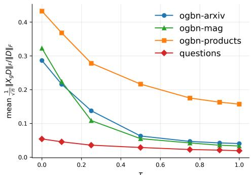

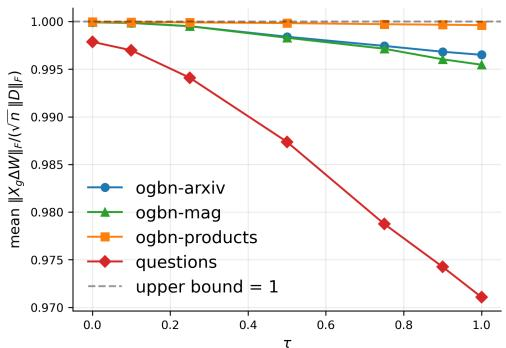  
Figure 2: Empirical validation of GraphMuon’s representation-level perturbation control. Left: before graph-aware normalization, Euclidean-orthogonalized directions induce graph-dependent perturbations whose magnitude varies across datasets and values of τ. Right: after scaling by $s _ { g } ,$ , the normalized perturbation is tightly controlled near the theoretical bound from Theorem 1, confirming that GraphMuon calibrates updates by their effect on $X _ { g }$ rather than by Euclidean parameter-space scale alone.

Unlike Muon, which normalizes in Euclidean matrix space, GraphMuon rescales each direction by its induced effect on the graph-propagated representations, so two directions with equal Frobenius norm produce explicitly calibrated layer-level perturbations, as empirically validated in Figure 2.

Sharpness of Muon’s graph amplification. The $\sqrt { \lambda _ { \operatorname* { m a x } } ( C _ { g } ) }$ factor in $\operatorname { E q }$ . (9) is not a loose artifact of the analysis: there exist valid polar directions for which it is attained up to dimension-dependent constants.

Proposition 1 (Sharpness of Muon graph amplification). Assume $d _ { \ell } \geq d _ { \ell + 1 }$ , and let $\lambda _ { 1 } \geq \cdots \geq$ $\lambda _ { d _ { \ell } }$ be the eigenvalues $o f C _ { g } .$ There exists a matrix $D ^ { \star }$ with orthonormal columns (afeasible polarfactor direction) such that:

$$
\frac { 1 } { \sqrt { n } } \left\| X _ { g } D ^ { \star } \right\| _ { F } = \sqrt { \sum _ { i = 1 } ^ { d _ { \ell + 1 } } \lambda _ { i } } \ \geq \ \sqrt { \lambda _ { \operatorname* { m a x } } ( C _ { g } ) } .\tag{11}
$$

When $d _ { \ell + 1 } = 1$ , the $\sqrt { \lambda _ { \operatorname* { m a x } } ( C _ { g } ) }$ amplification is attained exactly.

Proposition 1 shows that Muon’s Euclidean polar constraint alone does not prevent graph-amplified representation updates. Such directions are feasible under Muon’s geometry and are not explicitly controlled, motivating the graph-aware normalization in GraphMuon.

Figure 3 therefore supports the central motivation for GraphMuon: controlling the Euclidean geometry of a matrix update does not necessarily control its induced perturbation after graph propagation.

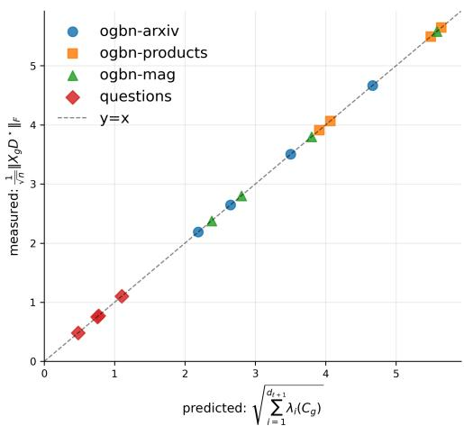  
Figure 3: Empirical sharpness of Muon’s graphinduced amplification. For each dataset and layer, we construct the polar direction $D ^ { \star }$ from the top eigenspaces of the raw graph-induced covariance $\dot { C } _ { g } = X _ { q } ^ { \top } X _ { g } / n$ . The measured amplification, $\| X _ { g } D ^ { \star } \| _ { F } / { \sqrt { n } } ,$ , matches the spectral prediction $\textstyle \big ( \sum _ { i = 1 } ^ { d _ { \ell + 1 } } \lambda _ { i } ( C _ { g } ) \big ) ^ { 1 / 2 }$ . The neardiagonal agreement confirms that the amplification term in Proposition 1 is attainable on real graph-propagated representations, rather than a loose worst-case bound.

Graph-metric orthogonalization. The preceding results focus on update scale. We now justify the graph-aware orthogonalization step in Eq. (6). Vanilla Muon can be interpreted as applying a polar projection in Euclidean matrix geometry. GraphMuon replaces this with the corresponding polar projection under the graph-induced metric. We analyze the ideal exact-polar version of the update, replacing the Newton–Schulz approximation with the exact polar factor ${ \bf \bar { \it P } } ( \cdot )$

Theorem 2 (Graph-metric polar optimality). Assume $d _ { \ell } \geq d _ { \ell + 1 } , \bar { C } _ { g } \succ 0 ,$ , and $\bar { C } _ { g } ^ { \tau / 2 }$ M has full column rank. The exact graph-aware direction $D _ { g , \tau } = \bar { C } _ { g } ^ { - \tau / 2 } P \Big ( \bar { C } _ { g } ^ { \tau / 2 } M \Big )$ satisfies

$$
D _ { g , \tau } ^ { \top } \bar { C } _ { g } ^ { \tau } D _ { g , \tau } = I ,\tag{12}
$$

and solves the graph-metric Procrustes problem

$$
D _ { g , \tau } = \arg \operatorname* { m a x } _ { D ^ { \top } \bar { C } _ { g } ^ { \tau } D = I } \mathrm { t r } \left( D ^ { \top } \bar { C } _ { g } ^ { \tau } M \right) .\tag{13}
$$

Theorem 2 shows that the graph-aware direction is not an ad hoc modification of Muon. It is the polar/Muon update obtained after replacing Euclidean orthogonality by graph-metric orthogonality. τ interpolates between vanilla Muon at $\tau = 0$ and graph-metric orthogonalization as τ increases.

Main Takeaways. Our theoretical results show that GraphMuon modifies Muon in two principled ways. Step normalization controls the representation-level perturbation $X _ { g } \Delta W$ , while graph-aware orthogonalization computes a polar direction under the graph-induced metric. In contrast, vanilla Muon balances updates in Euclidean parameter space and does not explicitly account for the graphpropagated geometry seen by each GNN layer. The complete layer-wise update is provided in Appendix C, with additional empirical analyses of the theoretical properties in Appendix F.

## 5 Experiments

In this section, we conduct an extensive set of experiments to demonstrate the effectiveness of GRAPHMUON as an optimizer that adapts GNN updates to graph-propagated representations. Concretely, our experiments address the following questions:

(Q1) Does graph-conditioned optimization improve over parameter-space optimization? We compare GRAPHMUON with AdamW, Muon, Shampoo, and graph-aware natural-gradient baselines to test whether adapting update direction and scale to the graph-propagated covariance improves the main optimization outcome: quicker optimization that maintains competitive or superior test accuracy. This question captures the central distinction of GRAPHMUON: it does not merely change the optimizer family, but changes the geometry in which GNN weight updates are measured.

(Q2) Which component of GRAPHMUON is responsible for the gains? We ablate graph-aware orthogonalization and graph-aware step normalization to determine if improvements come from changing the update direction, controlling the representation-level step size, or their combination.

(Q3) Do empirical diagnostics support the theoretical motivation? We measure representationlevel perturbations and graph-induced spectral quantities to test whether Euclidean-normalized matrix updates can indeed be amplified by graph-propagated covariance, and if GRAPHMUON controls it.

## 5.1 Experimental Setup

Datasets. We evaluate GraphMuon across nine graph-learning benchmarks, covering transductive node classification, heterophilous node classification, inductive graph classification, and graph regression. The node-classification datasets include OGBN-ARXIV, OGBN-PRODUCTS, and OGBN-MAG [14], together with QUESTIONS [24], Cora, and Citeseer. To assess generalization beyond transductive node prediction, we additionally evaluate on the molecular graph-classification benchmarks OGBG-MOLBACE and OGBG-MOLTOX21, and the graph-regression benchmark ZINC. Additional dataset information is provided in Appendix G.1.

Backbones. We evaluate multiple GNN architectures, including GCN, GAT [31], GINE, and GraphGPS [25]. GCN provides the primary comparison on the large-scale OGB node-classification benchmarks. GAT and GraphGPS extend the evaluation to learned attention-based propagation, while GINE is used for molecular graph-level tasks. Additional experiments examine GraphGCN and deeper GNNs. Within each dataset–architecture configuration, all optimizers use the same backbone, training budget, and evaluation protocol, isolating the optimizer as the varying component. Architectural details are provided in Appendix G.2.

Baselines. The primary validation-loss time-to-target comparison includes AdamW [20] and Muon [16]. AdamW is a strong adaptive first-order baseline with decoupled weight decay, while

Table 1: Validation-loss time-to-target across graph-learning tasks. The target is the minimum mean validation loss achieved by AdamW for each dataset–architecture configuration. Entries report epochs / cumulative wall-clock seconds to reach the target. Speedup is relative to AdamW; higher is better. Bold indicates the fastest optimizer. “–” denotes failure to reach the target within the training budget.
<table><tr><td>Dataset</td><td>Backbone</td><td>Target loss</td><td>AdamW (ep / s)</td><td>Muon (ep / s)</td><td>GraphMuon (ep / s)</td><td>Speedup</td></tr><tr><td colspan="7">Large-scale node classification</td></tr><tr><td>OGBN-ARXIV</td><td>GCN</td><td>0.8753</td><td>433 / 30.3</td><td>188 / 16.6</td><td>164 /13.1</td><td>2.32×</td></tr><tr><td>OGBN-MAG</td><td>GCN</td><td>2.6930</td><td>100 / 58.3</td><td>65 / 38.1</td><td>41 / 24.1</td><td>2.42×</td></tr><tr><td>OGBN-PRODUCTS</td><td>GCN</td><td>0.3182</td><td>300 / 1663.5</td><td></td><td>226 / 1257.3</td><td>1.32×</td></tr><tr><td colspan="7">Heterophilous node classification</td></tr><tr><td>QUESTIONS</td><td>GAT</td><td>0.1217</td><td>481 / 15.2</td><td>320 / 10.2</td><td>167 / 7.1</td><td>2.14×</td></tr><tr><td colspan="7">Inductive graph classification</td></tr><tr><td>OGBG-MOLBACE</td><td>GINE</td><td>0.6212</td><td>65 / 59.1</td><td></td><td>22 / 29.8</td><td>1.98×</td></tr><tr><td>OGBG-MOLTOX21</td><td>GINE</td><td>0.2946</td><td>9 / 22.3</td><td>6 /22.6</td><td>4/18.6</td><td>1.20×</td></tr><tr><td colspan="7">Graph regression</td></tr><tr><td>ZINC</td><td>GINE</td><td>0.2502</td><td>293 / 946.6</td><td>242 / 1038.4</td><td>106 / 679.0</td><td>1.39×</td></tr></table>

Table 2: Generalization across GNN architectures and tasks. Results are test performance (mean standard deviation over five seeds). Higher is better for accuracy and ROC-AUC; lower is better for MAE. Bold indicates the best result.
<table><tr><td>Dataset / Backbone</td><td>Metric</td><td>AdamW</td><td>Muon</td><td>GraphMuon</td></tr><tr><td>ogbn-arxiv / GAT</td><td>Acc. ↑</td><td> ${ \bf . 6 9 2 8 \pm . 0 0 2 7 }$ </td><td> $. 6 9 1 1 \pm . 0 0 2 1$ </td><td> $. 6 9 2 6 \pm . 0 0 2 7$ </td></tr><tr><td>ogbn-mag / GraphGPS</td><td>Acc. ↑</td><td> $. 2 9 3 9 \pm . 0 0 1 8$ </td><td> $. 3 2 5 0 \pm . 0 0 3 2$ </td><td> $\mathbf { 3 2 9 6 \pm . 0 0 5 0 }$ </td></tr><tr><td>Tox21 / GINE</td><td>ROC-AUC ↑</td><td> $. 6 6 3 3 \pm . 0 2 2 3$ </td><td> $. 6 5 5 3 \pm . 0 0 7 4$ </td><td> $\mathbf { 6 6 4 4 } \pm \mathbf { . 0 1 7 5 }$ </td></tr><tr><td>BACE / GINE</td><td>ROC-AUC ↑</td><td> $. 7 1 2 7 \pm . 0 5 7 0$ </td><td> $. 7 8 1 0 \pm . 0 1 9 4$ </td><td> $\mathbf { . 7 9 2 7 \pm . 0 4 2 9 }$ </td></tr><tr><td>ZINC / GINE</td><td>MAE↓</td><td> $. 2 3 0 3 \pm . 0 1 7 4 2$ </td><td> $1 9 2 9 \pm . 0 0 2 1 3$ </td><td> $\mathbf { . 1 8 9 7 \pm . 0 0 1 1 2 }$ </td></tr></table>

Muon is the closest matrix-aware baseline, applying approximate orthogonalization to momentum updates. We also consider structured preconditioning with Shampoo [10] and graph-aware natural-gradient optimization [15], with implementation details provided in Appendix G.3.

Evaluation. We follow the corresponding benchmark evaluation protocols and report predictive performance using test accuracy for node classification, ROC-AUC for molecular classification, and MAE for graph regression. For optimization efficiency, we adopt a fixed validation-loss timeto-target protocol. For each dataset–architecture configuration, the target is the minimum mean validation loss attained by AdamW across seeds. We measure the first epoch and corresponding cumulative wall-clock training time at which each optimizer’s mean validation-loss trajectory reaches this target. Wall-clock speedup is defined as the ratio of AdamW’s time-to-target to that of the compared optimizer. Configurations that do not reach the target within the training budget are marked as “–”. Additional evaluation results and per-configuration timings are provided in Appendix G.

## 5.2 Main Results

For the primary comparison, we report validation-loss time-to-target across the large-scale OGB benchmarks, heterophilous node classification, and inductive graph-level tasks. Table 1 shows that GraphMuon reaches AdamW’s validation-loss target faster across all seven reported configurations.

On the three large-scale OGB benchmarks, GraphMuon achieves wall-clock speedups of $2 . 3 2 \times \mathrm { o n }$ OGBN-ARXIV, 2.42 on OGBN-MAG, and 1.32 on OGBN-PRODUCTS. The corresponding 95% bootstrap confidence intervals are [2.01, 2.69], [2.29, 2.53], and [1.19, 1.37], respectively. These results demonstrate faster convergence to a fixed validation-loss target rather than to a potentially variable accuracy threshold.

The improvements also extend beyond transductive GCNs. On QUESTIONS with GAT, GraphMuon achieves a 2.14 wall-clock speedup. On the inductive molecular graph-classification benchmarks OGBG-MOLBACE and OGBG-MOLTOX21, it achieves 1.98 and 1.20 speedups, respectively. On ZINC with GINE, GraphMuon reaches the validation-loss target 1.39 faster than AdamW, demonstrating applicability to graph regression.

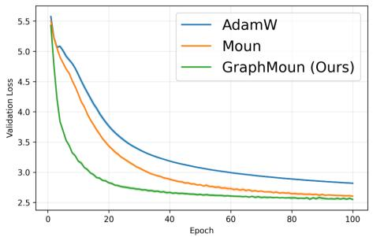

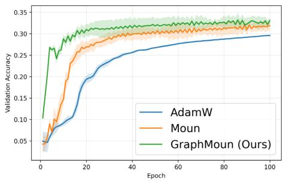  
Figure 4: Training dynamics on OGBN-MAG. The left panel shows validation loss and the right panel shows validation accuracy over training. GRAPHMUON makes faster progress in both metrics: it reduces validation loss earlier and reaches strong validation accuracy in fewer epochs than AdamW and Muon, suggesting that graph-induced update geometry can accelerate GNN learning.

Table 3: Ablation of GraphMuon components on OGB benchmarks. Speedup is measured relative to vanilla Muon under a fixed rounded-down Muon validation target; higher is better.
<table><tr><td></td><td></td><td></td><td>Dataset↓ / Method → Muon + Graph-aware Orthog. + Graph-aware Step Norm. GraphMuon (Ours)</td><td></td></tr><tr><td>ogbn-arxiv</td><td>1.00×</td><td> $5 . 3 9 \pm 0 . 3 1 \times$ </td><td> $8 . 3 4 \pm 0 . 8 5 \times$ </td><td> ${ \bf 9 . 0 2 \pm 0 . 8 0 \times }$ </td></tr><tr><td>ogbn-mag</td><td>1.00×</td><td> $1 . 0 7 \pm 0 . 0 4 \times$ </td><td> $2 . 2 8 \pm 0 . 2 2 \times$ </td><td> $\mathbf { 3 . 6 0 \pm 0 . 1 2 \times }$ </td></tr><tr><td>ogbn-products</td><td>1.00×</td><td> $1 . 0 3 \pm 0 . 0 2 \times$ </td><td> $1 . 5 1 \pm 0 . 0 5 \times$ </td><td> $\mathbf { 1 . 9 0 \pm 0 . 0 6 } \times$ </td></tr></table>

Additional experiments with GAT, GINE, GraphGPS, and GraphGCN are reported in Appendix G.8. Across all 15 dataset–architecture configurations, GraphMuon reaches the target in fewer epochs than AdamW in every case and achieves the lowest wall-clock time-to-target in 13 of 15 cases, with an arithmetic-mean wall-clock speedup of 4.62 . These findings indicate that adapting the optimizer to graph-propagated representation geometry improves optimization efficiency across different architectures and graph-learning tasks.

Overall, GraphMuon validates our central understanding: normalizing updates in the graphpropagated layer geometry improves GNN time-to-target without sacrificing competitive final accuracy. Figure 4 further shows that these gains come from faster optimization dynamics.

Generalization across architectures and tasks. To evaluate generalization beyond GCN-based node classification, we extend the evaluation to GAT, GINE, and GraphGPS, covering node classification, inductive graph classification, and graph regression. As shown in Table 2, GraphMuon achieves the best numerical performance in four of five configurations and remains competitive with AdamW on GAT. The improvements on GINE and GraphGPS demonstrate that the method also applies to graph level prediction and learned attention-based architectures. Additional validation-loss time-to-target results across 15 configurations are provided in Appendix G.8.

## 5.3 Ablation Study

We ablate the two main components of GraphMuon: graph-aware orthogonalization and graph-aware step normalization. To focus on optimization speed, we use a relaxed time-to-target metric. For each dataset, the target is the best validation loss reached by vanilla Muon, rounded down to two decimal places (e.g., 0.723 0.72). This threshold is close to the converged Muon performance while avoiding sensitivity to small validation fluctuations. We then measure the wall-clock time required to first reach this threshold and report speedup relative to vanilla Muon.

Table 3 reports the main ablation on the OGB benchmarks, where the relaxed target is not saturated and therefore distinguishes the contribution of each component. The QUESTIONS ablation is omitted from the main table because all graph-aware variants reach the rounded Muon target after a single optimization step, making the time-to-target metric uninformative for component comparison.

## 6 Conclusions

We motivate our GraphMuon by a representation-space view of optimization in GNNs. For a layer with graph-propagated input $\dot { X _ { g } } = \bar { S } H$ , the effective update size is not $\| \Delta W \| _ { F }$ , but the induced perturbation ${ \| \bar { X } _ { g } \bar { \Delta } W \| _ { F } } \bar { / } \sqrt { n }$ . Our analysis shows that a Euclidean-normalized Muon update can still be amplified by the graph-induced covariance $C _ { g } = X _ { q } ^ { \top } X _ { g } / n$ , through its dominant eigenspaces. GraphMuon addresses this by normalizing the update according to its induced representation-level effect and by replacing Euclidean matrix geometry with a graph-metric analogue.

This theory also explains when GraphMuon may provide less benefit. The method is most useful when $C _ { g }$ is stable, anisotropic, and informative. On very small graphs, however, $C _ { g }$ may be low-rank and noisy, especially when the number of nodes is small relative to the hidden dimension. In this regime, the graph-induced metric can be poorly estimated, and controlling $\| X _ { g } \Delta W \| _ { F }$ does not necessarily imply faster convergence or better generalization. AdamW can therefore remain competitive, since its coordinate-wise moment estimates do not rely on estimating a graph-level covariance.

This limitation is particularly relevant for small inductive graph-level tasks, where each graph contains few node representations. In such settings, the main optimization challenge may be dominated by sparse local features, atom or bond types, and mini-batch variability rather than by graph-induced update amplification. A natural direction for future work is to adapt the strength of graph awareness to the reliability of $C _ { g } ,$ for example, using effective rank, spectral anisotropy, or covariance stability to interpolate between vanilla Muon and fully graph-aware updates.

## Acknowledgments and Disclosures

ME acknowledges support from the the Israel Science Foundation through a personal grant (ISF 3062/26) and an equipment grant (ISF 3066/26), as well as support from the Israeli Ministry of Innovation, Science & Technology. The authors declare no competing interests.

## References

[1] Jeremy Bernstein. Modular manifolds. Thinking Machines Lab: Connectionism, 2025. doi: 10.64434/tml.20250926. https://thinkingmachines.ai/blog/modular-manifolds/.

[2] Rajendra Bhatia. Matrix Analysis, volume 169 of Graduate Texts in Mathematics. Springer, New York, 1997.

[3] Tianle Cai, Shengjie Luo, Keyulu Xu, Di He, Tie-yan Liu, and Liwei Wang. Graphnorm: A principled approach to accelerating graph neural network training. In International Conference on Machine Learning, pages 1204–1215. PMLR, 2021.

[4] John Duchi, Elad Hazan, and Yoram Singer. Adaptive subgradient methods for online learning and stochastic optimization. Journal of machine learning research, 12(7), 2011.

[5] Moshe Eliasof, Beatrice Bevilacqua, Carola-Bibiane Schönlieb, and Haggai Maron. Granola: Adaptive normalization for graph neural networks. Advances in Neural Information Processing Systems, 37:90514–90551, 2024.

[6] Moshe Eliasof, Alessio Gravina, Andrea Ceni, Claudio Gallicchio, Davide Bacciu, and Carola-Bibiane Schönlieb. Graph adaptive autoregressive moving average models. In Forty-second International Conference on Machine Learning, 2025.

[7] Ky Fan, Alan J Hoffman, et al. Some metric inequalities in the space of matrices. In Proc. Amer. Math. Soc, volume 6, pages 111–116. World Scientific, 1955.

[8] Matthias Fey and Jan Eric Lenssen. Fast graph representation learning with pytorch geometric. arXiv preprint arXiv:1903.02428, 2019.

[9] Justin Gilmer, Samuel S. Schoenholz, Patrick F. Riley, Oriol Vinyals, and George E. Dahl. Neural message passing for quantum chemistry. In Proceedings of the 34th International Conference on Machine Learning, volume 70 of Proceedings of Machine Learning Research, pages 1263–1272. PMLR, 2017.

[10] Vineet Gupta, Tomer Koren, and Yoram Singer. Shampoo: Preconditioned stochastic tensor optimization. In International Conference on Machine Learning, pages 1842–1850. PMLR, 2018.

[11] William L. Hamilton, Zhitao Ying, and Jure Leskovec. Inductive representation learning on large graphs. In Advances in Neural Information Processing Systems, volume 30, pages 1024–1034, 2017.

[12] Roger A. Horn and Charles R. Johnson. Matrix Analysis. Cambridge University Press, 2 edition, 2012.

[13] W Hu, B Liu, J Gomes, M Zitnik, P Liang, V Pande, and J Leskovec. Strategies for pre-training graph neural networks. In International Conference on Learning Representations (ICLR), 2020.

[14] Weihua Hu, Matthias Fey, Marinka Zitnik, Yuxiao Dong, Hongyu Ren, Bowen Liu, Michele Catasta, and Jure Leskovec. Open graph benchmark: Datasets for machine learning on graphs. Advances in neural information processing systems, 33:22118–22133, 2020.

[15] Mohammad Rasool Izadi, Yihao Fang, Robert Stevenson, and Lizhen Lin. Optimization of graph neural networks with natural gradient descent. In 2020 IEEE international conference on big data (big data), pages 171–179. IEEE, 2020.

[16] Keller Jordan, Yuchen Jin, Vlado Boza, Jiacheng You, Franz Cesista, Laker Newhouse, and Jeremy Bernstein. Muon: An optimizer for hidden layers in neural networks, 2024. URL https://kellerjordan.github.io/posts/muon/.

[17] Diederik P Kingma and Jimmy Ba. Adam: A method for stochastic optimization. arXiv preprint arXiv:1412.6980, 2014.

[18] Thomas N Kipf and Max Welling. Semi-supervised classification with graph convolutional networks. arXiv preprint arXiv:1609.02907, 2016.

[19] Jingyuan Liu, Jianlin Su, Xingcheng Yao, Zhejun Jiang, Guokun Lai, Yulun Du, Yidao Qin, Weixin Xu, Enzhe Lu, Junjie Yan, et al. Muon is scalable for llm training. arXiv preprint arXiv:2502.16982, 2025.

[20] Ilya Loshchilov and Frank Hutter. Decoupled weight decay regularization. arXiv preprint arXiv:1711.05101, 2017.

[21] Krishna S Mantri, Xinzhi Wang, Carola-Bibiane Schönlieb, Bruno Ribeiro, Beatrice Bevilacqua, and Moshe Eliasof. Digraf: Diffeomorphic graph-adaptive activation function. Advances in Neural Information Processing Systems, 37:3649–3681, 2024.

[22] James Martens and Roger Grosse. Optimizing neural networks with kronecker-factored approximate curvature. In International conference on machine learning, pages 2408–2417. PMLR, 2015.

[23] Adam Paszke, Sam Gross, Francisco Massa, Adam Lerer, James Bradbury, Gregory Chanan, Trevor Killeen, Zeming Lin, Natalia Gimelshein, Luca Antiga, et al. Pytorch: An imperative style, high-performance deep learning library. Advances in neural information processing systems, 32, 2019.

[24] Oleg Platonov, Denis Kuznedelev, Michael Diskin, Artem Babenko, and Liudmila Prokhorenkova. A critical look at the evaluation of gnns under heterophily: Are we really making progress? arXiv preprint arXiv:2302.11640, 2023.

[25] Ladislav Rampášek, Michael Galkin, Vijay Prakash Dwivedi, Anh Tuan Luu, Guy Wolf, and Dominique Beaini. Recipe for a general, powerful, scalable graph transformer. Advances in Neural Information Processing Systems, 35:14501–14515, 2022.

[26] Herbert Robbins and Sutton Monro. A stochastic approximation method. The annals of mathematical statistics, pages 400–407, 1951.

[27] Franco Scarselli, Marco Gori, Ah Chung Tsoi, Markus Hagenbuchner, and Gabriele Monfardini. The Graph Neural Network model. IEEE Transactions on Neural Networks, 20(1):61–80, 2009.

[28] Michael Schlichtkrull, Thomas N. Kipf, Peter Bloem, Rianne van den Berg, Ivan Titov, and Max Welling. Modeling relational data with graph convolutional networks. In The Semantic Web:15th International Conference, ESWC 2018, pages 593–607. Springer, 2018.

[29] Kimi Team, Yifan Bai, Yiping Bao, Y Charles, Cheng Chen, Guanduo Chen, Haiting Chen, Huarong Chen, Jiahao Chen, Ningxin Chen, et al. Kimi k2: Open agentic intelligence. arXiv preprint arXiv:2507.20534, 2025.

[30] Kimi Team, Tongtong Bai, Yifan Bai, Yiping Bao, SH Cai, Yuan Cao, Y Charles, HS Che, Cheng Chen, Guanduo Chen, et al. Kimi k2. 5: Visual agentic intelligence. arXiv preprint arXiv:2602.02276, 2026.

[31] Petar Velickoviˇ c, Guillem Cucurull, Arantxa Casanova, Adriana Romero, Pietro Lio, and Yoshua´ Bengio. Graph attention networks. arXiv preprint arXiv:1710.10903, 2017.

[32] Petar Velickoviˇ c, Guillem Cucurull, Arantxa Casanova, Adriana Romero, Pietro Liò, and Yoshua´ Bengio. Graph attention networks. In International Conference on Learning Representations, 2018.

[33] Keyulu Xu, Weihua Hu, Jure Leskovec, and Stefanie Jegelka. How powerful are graph neural networks? arXiv preprint arXiv:1810.00826, 2018.

[34] Keyulu Xu, Mozhi Zhang, Stefanie Jegelka, and Kenji Kawaguchi. Optimization of graph neural networks: Implicit acceleration by skip connections and more depth. In International conference on machine learning, pages 11592–11602. PMLR, 2021.

[35] Chenxiao Yang, Qitian Wu, David Wipf, Ruoyu Sun, and Junchi Yan. How graph neural networks learn: Lessons from training dynamics. In International Conference on Machine Learning, pages 56594–56623. PMLR, 2024.

[36] Jiong Zhu, Yujun Yan, Lingxiao Zhao, Mark Heimann, Leman Akoglu, and Danai Koutra. Beyond homophily in graph neural networks: Current limitations and effective designs. In Advances in Neural Information Processing Systems, volume 33, pages 7793–7804, 2020.

## A Background

Here we provide complete definitions and implementation details for the methods referenced in the main paper. We give the standard GCN layer formulation, the Adam and AdamW update rules, and the full Muon algorithm including the Newton–Schulz iteration and its practical implementation details.

## A.1 GCN Layer Definition

Given the symmetrically normalized adjacency S (defined in Section 3), a standard GCN layer computes

$$
H ^ { ( \ell + 1 ) } = \sigma \Big ( S H ^ { ( \ell ) } W ^ { ( \ell ) } \Big ) ,\tag{14}
$$

where $W ^ { ( \ell ) } \in \mathbb { R } ^ { d _ { \ell } \times d _ { \ell + 1 } }$ is the trainable weight matrix and $\sigma ( \cdot )$ is a nonlinear activation. The degree matrix entries are

$$
\widetilde { D } _ { i i } = \sum _ { j = 1 } ^ { n } \widetilde { A } _ { i j } = 1 + \sum _ { j = 1 } ^ { n } A _ { i j } .
$$

## A.2 Adam and AdamW

Let $\theta _ { t }$ be the parameters and $g _ { t } = \nabla _ { \theta } \mathcal { L } ( \theta _ { t } )$ the stochastic gradient. Adam maintains first and second moment estimates:

$$
m _ { t } = \beta _ { 1 } m _ { t - 1 } + ( 1 - \beta _ { 1 } ) g _ { t } ,\tag{15}
$$

$$
v _ { t } = \beta _ { 2 } v _ { t - 1 } + ( 1 - \beta _ { 2 } ) ( g _ { t } \odot g _ { t } ) .\tag{16}
$$

With bias correction, the update is

$$
\theta _ { t + 1 } = \theta _ { t } - \eta \frac { \widehat { m } _ { t } } { \sqrt { \widehat { v } _ { t } } + \epsilon } .\tag{17}
$$

AdamW decouples weight decay:

$$
\theta _ { t + 1 } = ( 1 - \eta \lambda ) \theta _ { t } - \eta \frac { \widehat { m } _ { t } } { \sqrt { \widehat { v _ { t } } } + \epsilon } .\tag{18}
$$

Adam-based optimizers operate coordinate-wise, normalizing each parameter independently, and do not exploit matrix structure or graph-induced geometry.

## A.3 Muon: Full Details

The polar factor of a matrix M is

$$
\boldsymbol { \mathcal { P } } ( \boldsymbol { M } ) = \boldsymbol { M } ( \boldsymbol { M } ^ { \top } \boldsymbol { M } ) ^ { - 1 / 2 } ,\tag{19}
$$

with the analogous expression $( M M ^ { \top } ) ^ { - 1 / 2 } M$ when $d _ { \mathrm { i n } } ~ < ~ d _ { \mathrm { o u t } }$ . Muon approximates this via Newton–Schulz iterations. Starting from

$$
X _ { 0 } = \frac { M _ { t } } { \Vert M _ { t } \Vert _ { F } + \epsilon } ,\tag{20}
$$

it applies the quintic iteration for $k = 0 , \ldots , K - 1 \colon$

$$
A _ { k } = X _ { k } X _ { k } ^ { \top } ,\tag{21}
$$

$$
X _ { k + 1 } = a X _ { k } + b A _ { k } X _ { k } + c A _ { k } ^ { 2 } X _ { k } ,\tag{22}
$$

with coefficients

$$
a = 3 . 4 4 4 5 , \qquad b = - 4 . 7 7 5 0 , \qquad c = 2 . 0 3 1 5 ,\tag{23}
$$

selected via an ad-hoc gradient-based search in the original implementation [16] to rapidly approximate the polar factor. When $d _ { \mathrm { i n } } > d _ { \mathrm { o u t } } , M _ { t }$ is transposed before the iteration (so the squared matrix is formed over the smaller dimension) and transposed back afterward, reducing the dominant matrix-multiplication cost. After $K = 5$ iterations the direction is $D _ { t } = \mathrm { N S } _ { K } ( M _ { t } )$ . The vanilla Muon update with decoupled weight decay is

$$
W _ { t + 1 } = ( 1 - \eta \lambda ) W _ { t } - \eta D _ { t } .\tag{24}
$$

Algorithm 1 Full GRAPHMUON update for GNN weight matrices   
Require: Learning rate $\eta ,$ momentum $\mu ,$ weight decay λ, Newton–Schulz steps $K ,$ graph-awareness   
strength τ, regularization constants $\epsilon _ { \mathrm { c o v } }$ and $\epsilon _ { \mathrm { s c a l e } } ;$ normalized adjacency S; layer representations   
$\{ H ^ { ( \ell ) } \} _ { \ell } ;$ parameters $\{ W _ { t } ^ { ( \ell ) } \} _ { \ell } ;$ momentum buffers $\{ B _ { t - 1 } ^ { ( \ell ) } \} _ { \ell }$   
Ensure: Updated parameters $\{ W _ { t + 1 } ^ { ( \ell ) } \} _ { \ell }$   
1: for each matrix-valued GNN layer ℓ do   
2: $G _ { t } ^ { ( \ell ) } \gets \nabla _ { W ^ { ( \ell ) } } \mathcal { L } _ { t }$ {gradient}   
3: $\bar { B _ { t } ^ { ( \ell ) } } \gets \mu B _ { t - 1 } ^ { ( \ell ) } + G _ { t } ^ { ( \ell ) }$ {momentum buffer}   
4: $M _ { t } ^ { ( \ell ) } \gets G _ { t } ^ { ( \ell ) } + \mu B _ { t } ^ { ( \ell ) }$ {Nesterov momentum matrix}   
5: $X _ { g } ^ { ( \ell ) } \gets S H ^ { ( \ell ) }$ {graph-propagated layer input}   
6: $\begin{array} { r } { C _ { g } ^ { ( \ell ) } \gets \frac { 1 } { n } X _ { g } ^ { ( \ell ) \top } X _ { g } ^ { ( \ell ) } } \end{array}$ {graph-induced covariance}   
7: $\bar { C } _ { g } ^ { ( \ell ) }  C _ { g } ^ { ( \ell ) } / ( \mathrm { t r } ( C _ { g } ^ { ( \ell ) } ) / d _ { \ell } ) + \epsilon _ { \mathrm { c o v } } I$ {trace-normalize and regularize}   
8: $A _ { \pm } ^ { ( \ell ) } \gets \mathrm { M a t P o w } \Big ( \bar { C } _ { g } ^ { ( \ell ) } , \tau / 2 \Big )$ {covariance half-powers}   
9: $D ^ { ( \ell ) } \gets A _ { - } ^ { ( \ell ) } \operatorname { N S } _ { K } \Big ( A _ { + } ^ { ( \ell ) } M _ { t } ^ { ( \ell ) } \Big )$ {graph-aware Muon direction}   
10: $s _ { g } ^ { ( \ell ) } \gets \sqrt { \mathrm { t r } \Big ( D ^ { ( \ell ) \top } C _ { g } ^ { ( \ell ) } D ^ { ( \ell ) } \Big ) / \| D ^ { ( \ell ) } \| _ { F } ^ { 2 } + \epsilon _ { \mathrm { s c a l e } } }$ {graph-aware scale}   
11: $\alpha _ { \ell } \gets \eta \dot { r } ( d _ { \ell } , d _ { \ell + 1 } )$ {shape-corrected layerwise step size}   
12: $\begin{array} { r } { W _ { t + 1 } ^ { ( \ell ) } \gets \left( 1 - \alpha _ { \ell } \lambda \right) W _ { t } ^ { ( \ell ) } - \alpha _ { \ell } D ^ { ( \ell ) } / s _ { g } ^ { ( \bar { \ell } ) } } \end{array}$ {decoupled weight decay and update}   
13: end for   
14: return $\{ W _ { t + 1 } ^ { ( \ell ) } \} _ { \ell }$

## B Additional Related Work

Graph-adaptive neural components. A broad line of work adapts standard neural-network components to graph-structured data. GCNs use normalized adjacency propagation [18], GAT adapts attention to graph neighborhoods [32], and GIN studies aggregation from the perspective of expressive power [33]. Graph-specific design has also been extended to normalization and modular architectures. GraphNorm introduces graph-specific normalization [3], GRANOLA uses neighborhood-structurebased normalization [5], GraphGPS combines local message passing with global attention and positional encodings [25], GRAMA [6] learns a graph-adaptive autoregressive moving average filtering technique, and DiGRAF learns graph-adaptive activation functions [21]. These works support the broader principle that generic deep-learning components often benefit from graph-specific adaptation. GraphMuon applies this principle to optimization rather than architecture.

GNN training dynamics. Several works study why GNN optimization differs from optimization in standard Euclidean architectures. Natural-gradient methods exploit information-geometric structure in graph-based semi-supervised learning [15]; skip connections, depth, and label distributions have been shown to affect GNN convergence [34]; and recent training-dynamics analyses show that gradient descent can implicitly exploit graph structure through kernel–graph alignment [35]. These results motivate our representation-space view of optimization: the effect of a weight update in a GNN is determined not only by the update matrix itself, but by the graph-propagated representations on which it acts.

## C GRAPHMUON Full Algorithm

Algorithm 1 gives the complete GRAPHMUON update for matrix-valued GNN weight matrices. The algorithm follows the update defined in Section 4: for each layer, it computes the graph-propagated input, forms the corresponding graph-induced covariance, applies graph-aware orthogonalization to the Muon momentum direction, and rescales the resulting update by its induced representation-level perturbation. Non-matrix parameters, such as biases or normalization parameters, can be updated with the accompanying base optimizer.

## D Step Normalization: Use of Raw vs. Normalized Covariance

The trace-normalized covariance $\bar { C } _ { g } ^ { ( \ell ) }$ used in Eq. (6) removes the layer-wise average feature energy so that orthogonalization depends only on the anisotropy of the graph-propagated features. Step normalization has the opposite goal: it should measure the actual representation-level perturbation induced by the update. Since

$$
\mathrm { t r } \Big ( D ^ { ( \ell ) \top } C _ { g } ^ { ( \ell ) } D ^ { ( \ell ) } \Big ) = \frac { 1 } { n } \Big \| X _ { g } ^ { ( \ell ) } D ^ { ( \ell ) } \Big \| _ { F } ^ { 2 } ,
$$

using the raw $C _ { g } ^ { ( \ell ) }$ makes $s _ { q } ^ { ( \ell ) }$ equal $( \mathrm { u p t o } \epsilon _ { \mathrm { s c a l e } } )$ to the RMS pre-activation perturbation per column of $X _ { g } ^ { ( \ell ) } D ^ { ( \ell ) }$ . Substituting $\bar { \bar { C } } _ { g } ^ { ( \ell ) }$ would divide out the average feature energy and remove precisely the layer-wise scale that the normalization is intended to control.

## E Proofs of Theoretical Results

Throughout this appendix we drop the layer superscript (ℓ) and write $\alpha = \eta r ( d _ { \ell } , d _ { \ell + 1 } )$ for the effective per-layer step size. We denote by $d _ { \mathrm { i n } } = d _ { \ell }$ and $d _ { \mathrm { o u t } } \stackrel { \cdot } { = } d _ { \ell + 1 }$ the input and output dimensions of the weight matrix $\dot { W } \in \mathbb { R } ^ { d _ { \mathrm { i n } } \times d _ { \mathrm { o u t } } }$

## E.1 Shared Setup

Graph-induced covariance. Given graph-propagated features $X _ { q } = \mathit { S H } \in \mathbb { R } ^ { n \times d _ { \mathrm { i n } } }$ , define the graph-induced covariance

$$
C _ { g } \ = \ \frac { 1 } { n } X _ { g } ^ { \top } X _ { g } \ \in \ \mathbb { R } ^ { d _ { \mathrm { i n } } \times d _ { \mathrm { i n } } } .\tag{25}
$$

$C _ { g }$ is positive semidefinite. Let $\lambda _ { 1 } ~ \geq ~ \lambda _ { 2 } ~ \geq ~ \cdots ~ \geq ~ \lambda _ { d _ { \mathrm { i n } } } ~ \geq ~ 0$ denote its eigenvalues and $V ~ = ~ [ v _ { 1 } , \ldots , v _ { d _ { \mathrm { i n } } } ]$ the corresponding orthonormal eigenvectors, so that $C _ { g } ~ = ~ V \Lambda V ^ { \top }$ with $\Lambda = \operatorname { d i a g } ( \lambda _ { 1 } , \ldots , \lambda _ { d _ { \mathrm { i n } } } )$

Key identity. For any matrix $\Delta W \in \mathbb { R } ^ { d _ { \mathrm { i n } } \times d _ { \mathrm { o u t } } }$

$$
\frac { 1 } { n } \big \| X _ { g } \Delta W \big \| _ { F } ^ { 2 } = \frac { 1 } { n } \mathrm { t r } \big ( \Delta W ^ { \top } X _ { g } ^ { \top } X _ { g } \Delta W \big ) = \mathrm { t r } \big ( \Delta W ^ { \top } C _ { g } \Delta W \big ) .\tag{26}
$$

Spectral bound. For any positive semidefinite C and any matrix V with columns $v _ { j }$

$$
\mathrm { t r } ( V ^ { \top } C V ) = \sum _ { j } v _ { j } ^ { \top } C v _ { j } \ \leq \ \lambda _ { \operatorname* { m a x } } ( C ) \sum _ { j } \| v _ { j } \| _ { 2 } ^ { 2 } = \lambda _ { \operatorname* { m a x } } ( C ) \| V \| _ { F } ^ { 2 } .\tag{27}
$$

Module-induced geometry. Consider the realized GNN module $F _ { q } ( W ) = S H W$ , with S and H fixed at the current step. Its Jacobian maps a parameter perturbation $\bar { \Delta } W$ to SH∆W. Consequently, the normalized Frobenius geometry of the module output induces the parameter-space inner product

$$
\frac { 1 } { n } \langle S H \Delta W _ { 1 } , S H \Delta W _ { 2 } \rangle _ { F } = \mathrm { t r } ( \Delta W _ { 1 } ^ { \top } C _ { g } \Delta W _ { 2 } ) , \qquad C _ { g } = \frac { 1 } { n } H ^ { \top } S ^ { \top } S H .\tag{28}
$$

In contrast, the pre-propagation map W  HW induces $\begin{array} { r } { C _ { H } = H ^ { \top } H / n } \end{array}$ , with

$$
C _ { g } - C _ { H } = \frac { 1 } { n } H ^ { \top } ( S ^ { \top } S - I ) H .\tag{29}
$$

The two metrics coincide when propagation is isometric on the feature subspace, including $S = I$ Otherwise, $C _ { H }$ does not capture the amplification or attenuation introduced by graph propagation.

Connection to the optimization objective. Let $Z = S H W$ , and assume the loss $\mathcal { L }$ is locally β-smooth in $Z$ under the normalized output norm $\| U \| _ { \mathrm { o u t } } = \| U \| _ { F } / \sqrt { n }$ . Then

$$
\begin{array} { l } { \displaystyle \mathcal { L } ( Z + S H \Delta W ) \leq \mathcal { L } ( Z ) + \langle \nabla _ { Z } \mathcal { L } , S H \Delta W \rangle _ { F } } \\ { \displaystyle \qquad + \frac { \beta } { 2 } \mathrm { t r } ( \Delta W ^ { \top } C _ { g } \Delta W ) . } \end{array}\tag{30}
$$

Thus, $\| S H \Delta W \| _ { F } / { \sqrt { n } }$ is precisely the perturbation magnitude governing this local smoothness bound. A parameter-space norm alone cannot distinguish directions with different effects on the realized module: for any unit eigenvector $v _ { i }$ of $C _ { g }$ with eigenvalue $\lambda _ { i }$ and any unit vector q, the perturbation $\Delta W _ { i } = v _ { i } q ^ { \top }$ satisfies $\| \Delta W _ { i } \| _ { 2 } = 1$ , while $\| S H \Delta W _ { i } \| _ { F } ^ { 2 } / n = \lambda _ { i }$ . This motivates controlling representation-level perturbations rather than relying exclusively on Euclidean normalization of the parameter update.

Classical orthogonal Procrustes result.

Lemma 1 (Orthogonal Procrustes, [7]). Let $A \in \mathbb { R } ^ { m \times k }$ with $m \geq k$ and $\boldsymbol { A } = \boldsymbol { U \Sigma V } ^ { \top }$ its (thin) SVD. Then

$$
\operatorname* { m a x } _ { \boldsymbol { Q } \in \mathbb { R } ^ { m \times k } } \operatorname { t r } ( \boldsymbol { Q } ^ { \top } \boldsymbol { A } ) = \operatorname { t r } ( \boldsymbol { \Sigma } ) ,\tag{31}
$$

and the unique maximiser (assuming A has full column rank) is the polar factor $P ( A ) = U V ^ { \top }$

This classical result (see also [2]) is used in the proof of Theorem 2.

## E.2 Proof of Theorem 1 (Graph-Representation Perturbation Control)

Proof. The GraphMuon step is $\Delta W _ { \mathrm { G r a p h } } = - \alpha D / s _ { g } ,$ , where

$$
s _ { g } = \sqrt { \frac { \mathrm { t r } ( D ^ { \top } C _ { g } D ) } { \| D \| _ { F } ^ { 2 } } + \epsilon _ { \mathrm { s c a l e } } } .\tag{32}
$$

Step 1: apply the trace identity. By (26),

$$
\frac { 1 } { n } \big \| X _ { g } \Delta W _ { \mathrm { G r a p h } } \big \| _ { F } ^ { 2 } = \frac { \alpha ^ { 2 } } { s _ { g } ^ { 2 } } \operatorname { t r } ( D ^ { \top } C _ { g } D ) .\tag{33}
$$

Step 2: bound $1 / s _ { g } ^ { 2 }$ . Since $\epsilon _ { \mathrm { s c a l e } } \geq 0$ , the definition (32) gives

$$
s _ { g } ^ { 2 } = \frac { \mathrm { t r } ( D ^ { \top } C _ { g } D ) } { \| D \| _ { F } ^ { 2 } } + \epsilon _ { \mathrm { s c a l e } } \ \geq \ \frac { \mathrm { t r } ( D ^ { \top } C _ { g } D ) } { \| D \| _ { F } ^ { 2 } } ,\tag{34}
$$

and therefore

$$
\frac { 1 } { s _ { g } ^ { 2 } } \leq \frac { \| D \| _ { F } ^ { 2 } } { \mathrm { t r } ( D ^ { \top } C _ { g } D ) } .\tag{35}
$$

Step 3: combine. Substituting (35) into (33),

$$
\frac { 1 } { n } \big \| X _ { g } \Delta W _ { \mathrm { G r a p h } } \big \| _ { F } ^ { 2 } \ : \leq \ : \frac { \alpha ^ { 2 } \| D \| _ { F } ^ { 2 } } { \operatorname { t r } ( D ^ { \top } C _ { g } D ) } \cdot \operatorname { t r } ( D ^ { \top } C _ { g } D ) = \alpha ^ { 2 } \| D \| _ { F } ^ { 2 } .\tag{36}
$$

Taking square roots establishes the inequality $\begin{array} { r } { \frac { 1 } { \sqrt { n } } \| X _ { g } \Delta W _ { \mathrm { G r a p h } } \| _ { F } \leq \alpha \| D \| _ { F } . } \end{array}$

Equality case. When $\epsilon _ { \mathrm { s c a l e } } = 0$ , the bound (35) holds with equality, so every inequality above is an equality provided the common factor tr $( D ^ { \top } C _ { g } D )$ is nonzero. We have $\begin{array} { r } { \mathrm { t r } ( \dot { D ^ { \top } } C _ { g } \dot { D } ) = \frac { 1 } { n } \| X _ { g } D \| _ { F } ^ { 2 } } \end{array}$ which is zero if and only if $X _ { g } D = 0$ . Hence, when $\epsilon _ { \mathrm { s c a l e } } = 0$ and $X _ { g } D \ne 0$ , the inequality holds with equality. □

## E.3 Proof of Proposition 1 (Sharpness of Muon Graph Amplification)

Proof. Recall the eigendecomposition $\begin{array} { r } { C _ { g } = V \Lambda V ^ { \top } } \end{array}$ with eigenvalues $\lambda _ { 1 } \ge \cdots \ge \lambda _ { d _ { \mathrm { i n } } } \ge 0$ and orthonormal eigenvectors $v _ { 1 } , \ldots , v _ { d _ { \mathrm { i n } } }$

Construction of $D ^ { \star }$ . Define

$$
D ^ { \star } = \left[ v _ { 1 } \mid v _ { 2 } \mid \cdots \mid v _ { d _ { \mathrm { o u t } } } \right] \ \in \ \mathbb { R } ^ { d _ { \mathrm { i n } } \times d _ { \mathrm { o u t } } } .\tag{37}
$$

Since the eigenvectors are orthonormal, $D ^ { \star \top } D ^ { \star } = I _ { d _ { \mathrm { o u t } } }$ , so $D ^ { \star }$ has orthonormal columns. A matrix with orthonormal columns is the polar factor of itself, making $D ^ { \star }$ a feasible polar-factor direction under Muon’s geometry.

Representation energy of $D ^ { \star } .$ . Applying the trace identity (26) and the eigendecomposition,

$$
\begin{array} { r l } & { \displaystyle \frac { 1 } { n } \big \| X _ { g } D ^ { \star } \big \| _ { F } ^ { 2 } = \mathrm { t r } ( D ^ { \star \top } C _ { g } D ^ { \star } ) } \\ & { \qquad = \mathrm { t r } \Big ( [ v _ { 1 } \cdot \cdot \cdot v _ { d _ { \mathrm { o u t } } } ] ^ { \top } V \Lambda V ^ { \top } [ v _ { 1 } \cdot \cdot \cdot v _ { d _ { \mathrm { o u t } } } ] \Big ) } \\ & { \qquad = \displaystyle \sum _ { i = 1 } ^ { d _ { \mathrm { o u t } } } v _ { i } ^ { \top } V \Lambda V ^ { \top } v _ { i } = \displaystyle \sum _ { i = 1 } ^ { d _ { \mathrm { o u t } } } \lambda _ { i } . } \end{array}\tag{38}
$$

Taking square roots,

$$
\frac { 1 } { \sqrt { n } } \Big \| X _ { g } D ^ { \star } \Big \| _ { F } = \sqrt { \sum _ { i = 1 } ^ { d _ { \mathrm { o u t } } } \lambda _ { i } } .\tag{39}
$$

Comparison with $\sqrt { \lambda _ { \operatorname* { m a x } } ( C _ { g } ) }$ . Because $\lambda _ { 1 } = \lambda _ { \operatorname* { m a x } } ( C _ { g } )$ and all $\lambda _ { i } \geq 0$

$$
\sum _ { i = 1 } ^ { d _ { \mathrm { o u t } } } \lambda _ { i } \geq \lambda _ { 1 } = \lambda _ { \operatorname* { m a x } } ( C _ { g } ) ,\tag{40}
$$

so $\begin{array} { r } { \frac { 1 } { \sqrt { n } } \| X _ { g } D ^ { \star } \| _ { F } \geq \sqrt { \lambda _ { \operatorname* { m a x } } ( C _ { g } ) } } \end{array}$

Case $d _ { \mathrm { o u t } } = 1$ . When $d _ { \mathrm { o u t } } = 1$ , we have $D ^ { \star } = v _ { 1 }$ and $\begin{array} { r } { \frac { 1 } { \sqrt { n } } \| X _ { g } D ^ { \star } \| _ { F } = \sqrt { \lambda _ { 1 } } = \sqrt { \lambda _ { \operatorname* { m a x } } ( C _ { g } ) } } \end{array}$ , so the amplification is attained exactly.

Implication for Muon. The vanilla Muon bound in (9) reads $\begin{array} { r l } { \frac { 1 } { \sqrt { n } } \| X _ { g } \Delta W _ { \mathrm { M u o n } } \| _ { F } } & { { } \leq } \end{array}$ $\alpha \sqrt { \lambda _ { \operatorname* { m a x } } ( C _ { g } ) } \| D \| _ { F }$ . The construction above shows that $D ^ { \star }$ , which is feasible under Muon’s Euclidean polar constraint $( D ^ { \star \top } D ^ { \star } = I )$ , achieves $\begin{array} { r } { \frac { 1 } { \sqrt { n } } \| X _ { g } D ^ { \star } \| _ { F } = \sqrt { \sum _ { i = 1 } ^ { d _ { \mathrm { o u t } } } \lambda _ { i } } \ge \sqrt { \lambda _ { \operatorname* { m a x } } ( C _ { g } ) } } \end{array}$ Hence, the dependence on $\lambda _ { \operatorname* { m a x } } ( C _ { g } )$ cannot be removed by Muon’s matrix-normalization alone, confirming that the bound is not a loose artifact. □

Moreover, for any positive diagonal matrix $\Sigma ,$ the momentum matrix $M = D ^ { \star } \Sigma$ has polar factor $P ( M ) = D ^ { \star }$ , confirming that the construction corresponds to a feasible exact Muon update.

## E.4 Proof of Theorem 2 (Graph-Metric Polar Optimality)

Proof. Throughout, let $\tilde { M } = \bar { C } _ { g } ^ { \tau / 2 } M$ and $Q = P ( { \tilde { M } } )$ be the polar factor of $\tilde { M }$ , so that $D _ { g , \tau } =$ $\bar { C } _ { g } ^ { - \tau / 2 } Q$ by definition. Since $\bar { C } _ { g } \succ 0$ and $\tilde { M }$ has full column rank (by assumption), $Q$ is unique and satisfies $Q ^ { \top } Q = I _ { d _ { \mathrm { o u t } } }$

Part 1: $D _ { g , \tau } ^ { \top } \bar { C } _ { g } ^ { \tau } D _ { g , \tau } = I .$

Direct computation:

$$
\begin{array} { r l } & { D _ { g , \tau } ^ { \top } \bar { C } _ { g } ^ { \tau } D _ { g , \tau } = \big ( \bar { C } _ { g } ^ { - \tau / 2 } Q \big ) ^ { \top } \bar { C } _ { g } ^ { \tau } \big ( \bar { C } _ { g } ^ { - \tau / 2 } Q \big ) } \\ & { \qquad = Q ^ { \top } \bar { C } _ { g } ^ { - \tau / 2 } \bar { C } _ { g } ^ { \tau } \bar { C } _ { g } ^ { - \tau / 2 } Q } \\ & { \qquad = Q ^ { \top } Q } \\ & { \qquad = I . } \end{array}\tag{41}
$$

Here we used that $\bar { C } _ { g } \succ 0$ so its matrix powers commute and $\bar { C } _ { g } ^ { - \tau / 2 } \bar { C } _ { q } ^ { \tau } \bar { C } _ { g } ^ { - \tau / 2 } = I$

Part 2: $D _ { g , \tau }$ solves the graph-metric Procrustes problem.

We wish to show

$$
D _ { g , \tau } = \underset { { D \in \mathbb { R } ^ { d _ { \mathrm { i n } } \times d _ { \mathrm { o u t } } } } } { \arg \operatorname* { m a x } } \ \mathrm { t r } ( D ^ { \top } \bar { C } _ { g } ^ { \tau } M ) .\tag{42}
$$

Change of variables. Let $\tilde { D } = \bar { C } _ { g } ^ { \tau / 2 } D$ . Since $\bar { C } _ { g } \succ 0$ , the map $D \mapsto \tilde { D }$ is a bijection on $\mathbb { R } ^ { d _ { \mathrm { i n } } \times d _ { \mathrm { o u t } } }$

The constraint $D ^ { \top } \bar { C } _ { q } ^ { \tau } D = I$ transforms as

$$
\tilde { D } ^ { \top } \tilde { D } = D ^ { \top } \bar { C } _ { g } ^ { \tau / 2 } \bar { C } _ { g } ^ { \tau / 2 } D \cdot ( \mathfrak { b } \mathbf { y } \bar { C } _ { g } \succ 0 ) = D ^ { \top } \bar { C } _ { g } ^ { \tau } D = I .\tag{43}
$$

Hence the constraint becomes $\tilde { D } ^ { \top } \tilde { D } = I , \mathrm { i . e . , } \tilde { D }$ has orthonormal columns.

The objective transforms as

$$
\mathrm { t r } ( D ^ { \top } \bar { C } _ { g } ^ { \tau } M ) = \mathrm { t r } ( D ^ { \top } \bar { C } _ { g } ^ { \tau / 2 } \bar { C } _ { g } ^ { \tau / 2 } M ) = \mathrm { t r } ( \tilde { D } ^ { \top } \tilde { M } ) ,\tag{44}
$$

where $\tilde { M } = \bar { C } _ { g } ^ { \tau / 2 } M$

Apply Lemma 1. The reformulated problem is

$$
\operatorname* { m a x } _ { \tilde { D } ^ { \top } \tilde { D } = I } \mathrm { t r } ( \tilde { D } ^ { \top } \tilde { M } ) ,\tag{45}
$$

which is exactly the orthogonal Procrustes problem. By Lemma 1, the unique maximiser is $\tilde { D } ^ { \star } =$ $\mathcal { P } ( \tilde { M } ) = Q$

Map back. Returning to the original variable, $D ^ { \star } = \bar { C } _ { g } ^ { - \tau / 2 } \tilde { D } ^ { \star } = \bar { C } _ { g } ^ { - \tau / 2 } Q = D _ { g , \tau }$ , which establishes (42).

Recovery of vanilla Muon at $\tau = 0 .$ . When $\tau = 0$ , the covariance factors become $\begin{array} { r } { \bar { C } _ { g } ^ { 0 } = I , } \end{array}$ , so $\tilde { M } = M$ , and $D _ { g , 0 } = P ( M )$ , which is the exact polar factor used by vanilla Muon. The constraint $D ^ { \top } D = I$ is then the standard Euclidean orthonormality constraint, confirming that Theorem 2 generalizes vanilla Muon’s polar update. □

Output-space interpretation. The graph-metric Procrustes solution also minimizes the distance to the momentum matrix in the same metric:

$$
D _ { g , \tau } = \arg \operatorname* { m i n } _ { D ^ { \top } \bar { C } _ { q } ^ { \tau } D = I } \left\| \bar { C } _ { g } ^ { \tau / 2 } ( D - M ) \right\| _ { F } ^ { 2 } .\tag{46}
$$

$\mathbf { A } \mathbf { t } \boldsymbol { \tau } = 1$ , let $c = \mathrm { t r } ( C _ { g } ) / d _ { \mathrm { i n } }$ . Since $\bar { C } _ { g } = C _ { g } / c + \epsilon _ { \mathrm { c o v } } I .$ , the graph-metric orthogonality constraint implies

$$
\frac { 1 } { n } ( X _ { g } D _ { g , 1 } ) ^ { \top } ( X _ { g } D _ { g , 1 } ) = c \left( I - \epsilon _ { \mathrm { c o v } } D _ { g , 1 } ^ { \top } D _ { g , 1 } \right) .\tag{47}
$$

In the unregularized full-rank case, the realized update therefore has orthogonal columns of equal squared RMS magnitude. Graph-metric orthogonalization thus transfers Muon’s singular-value balancing from parameter space to the module-output space. While this component balances the realized update directions, graph-aware step normalization separately controls their overall representation-level magnitude.

## F Additional GRAPHMUON Diagnostics

This appendix provides additional diagnostics for the graph-induced covariance used by GraphMuon. These results are not required for the main correctness claims, but they help interpret when graphaware optimization is expected to matter and how the graph-awareness parameter τ affects the update geometry.

## F.1 Effect of Graph-Awareness Strength

GraphMuon uses the interpolation parameter τ to control the strength of graph-aware orthogonalization. When $\tau = 0$ , the covariance factors vanish and the update reduces to vanilla Muon. As τ increases, the update direction increasingly respects the geometry induced by the graph-propagated covariance.

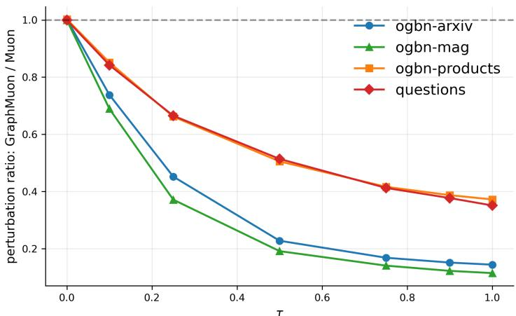  
Figure 5: Effect of the graph-awareness parameter τ on representation-level perturbations. The plot reports the perturbation ratio between GraphMuon and vanilla Muon as τ varies. Values below one indicate that the graph-aware direction induces a smaller representation-level perturbation than the corresponding Euclidean Muon direction. Across datasets, increasing τ generally moves the update away from the Euclidean Muon geometry and toward the graph-induced metric, supporting the interpretation of τ as a continuous control over graph awareness.

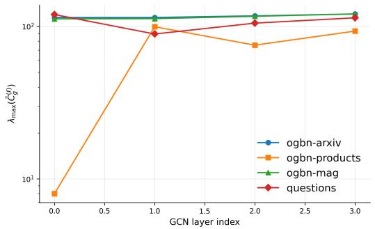  
(a) Dominant eigenvalue.

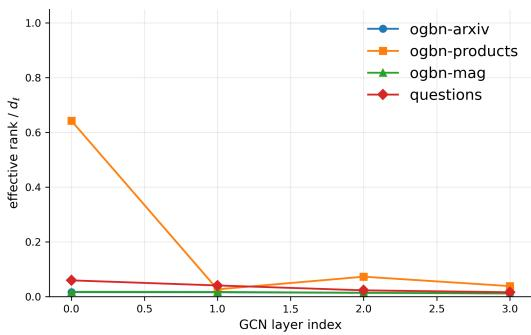  
(b) Normalized effective rank.  
Figure 6: Spectral diagnostics of the graph-induced covariance across datasets and layers. Left: the dominant eigenvalue of $\bar { C } _ { g }$ identifies high-energy graph-propagated directions along which Euclideannormalized updates can induce large representation-level perturbations. Right: the normalized effective rank measures how broadly the energy of $\bar { C } _ { g }$ is distributed across directions. Lower effective rank indicates that the graph-propagated representation is concentrated in fewer dominant modes, making Euclidean matrix geometry less aligned with the actual representation geometry. Together, these diagnostics support the motivation for GraphMuon: the covariance seen by each GNN layer is often anisotropic and layer-dependent, so update normalization should account for the graphpropagated input geometry.

## F.2 Spectral Diagnostics of Graph-Induced Covariance

The behavior of GraphMuon depends on the spectral structure of the graph-induced covariance $C _ { g } = X _ { q } ^ { \top } X _ { g } / n$ . The dominant eigenvalue measures the largest graph-amplified direction, while the effective rank measures how concentrated or distributed the graph-propagated representation is across spectral directions. These diagnostics help explain both the benefits and the limitations of graph-aware optimization.

Controlled spectral analysis. To isolate the interaction between graph propagation and feature alignment, we additionally evaluate GraphMuon on four-block stochastic block model (SBM) graphs with varying alignment between node features and planted communities. Table 4 shows that as alignment weakens, the community Rayleigh score decreases from 0.708 to 0.174, while the planted contribution to $C _ { g }$ decreases from 20.3% to 2.6%. Across all three regimes, GraphMuon substantially reduces update energy in the dominant graph-amplified directions relative to Muon. These findings demonstrate that the graph-induced geometry depends jointly on spectral propagation strength and feature alignment, and provide controlled empirical support for graph-aware update normalization.

Table 4: Spectral analysis on four-block stochastic block model (SBM) graphs with varying featurecommunity alignment. We report the Rayleigh score of the planted community signal, its contribution to the graph-induced covariance $C _ { g } ,$ and the update energy in dominant $\dot { C _ { g } }$ directions before and after GraphMuon scaling.
<table><tr><td>Alignment</td><td>Community Rayleigh</td><td>Planted share of  $C _ { g }$ </td><td> $\mathbf { T o p } { \cdot } C _ { g }$  energy Muon → GraphMuon</td></tr><tr><td>Strong</td><td>0.708</td><td>20.3%</td><td> $2 . 1 8 \%  0 . 4 7 \%$ </td></tr><tr><td>Medium</td><td>0.401</td><td>9.7%</td><td> $2 . 3 7 \%  0 . 4 3 \%$ </td></tr><tr><td>Weak</td><td>0.174</td><td>2.6%</td><td> $1 . 0 6 \%  0 . 1 8 \%$ </td></tr></table>

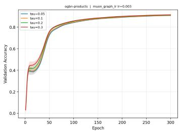  
(a) ogbn-products

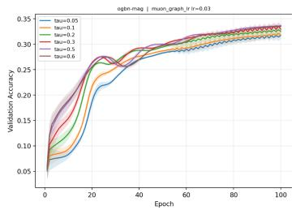  
(b) ogbn-mag

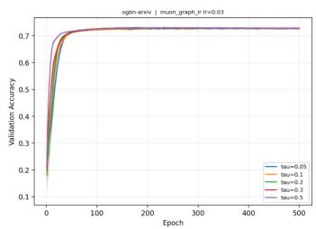  
(c) $\scriptstyle \mathtt { o g l o n - a r x 1 v }$  
Figure 7: Sensitivity of GraphMuon to the graph-metric exponent τ . Each panel shows validation accuracy as a function of training epoch for several values of τ, with the learning rate fixed within each dataset. GraphMuon is generally robust to τ, although the most effective value is dataset-dependent. On ogbn-arxiv, all values achieve nearly identical final accuracy. On ogbn-products, moderate values yield slightly faster optimization and marginally better final performance. On ogbn-mag, larger values of τ provide clearer gains, suggesting that stronger graph-aware geometry is more beneficial in this setting.

## F.3 Sensitivity to the Graph-Metric Exponent τ

We study the sensitivity of GraphMuon to the graph-metric exponent τ, which controls the strength of the graph-aware metric transformation. Smaller values of τ keep the update geometry closer to vanilla Muon, while larger values place more emphasis on the graph-induced covariance structure. We evaluate several values of τ on representative OGB node-classification benchmarks and plot the validation accuracy over training.

Figure 7 shows that GraphMuon is reasonably robust to the choice of $\tau ,$ although the best value is somewhat dataset-dependent. On ogbn-arxiv, all tested values produce very similar final validation accuracy, with only minor differences in early training speed. On ogbn-products, moderate values $( \tau \in [ 0 . 1 , 0 . 3 ] )$ ) yield slightly stronger early progress and marginally better final validation performance than the smallest tested value. On ogbn-mag, the effect of τ is more pronounced: larger values generally improve optimization and lead to better validation accuracy, while very small values converge more slowly and to slightly weaker solutions.

Overall, these results indicate that GraphMuon is not overly brittle to the choice of τ, but that tuning τ can provide additional gains, especially on more challenging or structurally heterogeneous datasets such as ogbn-mag. In practice, a small grid over τ is sufficient to identify a strong configuration.

## G Additional Experimental Setup

## G.1 Dataset Statistics

Table 5 reports the statistics of the node-classification benchmarks used in our experiments. These datasets cover homogeneous citation and co-purchase graphs, a heterogeneous academic graph, and a heterophilous benchmark. For all datasets, we follow the official splits and evaluation protocols from the corresponding benchmark release.

Table 5: Dataset statistics for the node-classification benchmarks. For OGBN-MAG, node and edge counts are reported over all node and relation types, while features and targets correspond to the target paper nodes.
<table><tr><td>Dataset</td><td>Graph regime</td><td>#Nodes</td><td>#Edges</td><td>#Features</td><td>#Targets</td></tr><tr><td>OGBN-ARXIV</td><td>Homogeneous citation</td><td>169,343</td><td>1,166,243</td><td>128</td><td>40</td></tr><tr><td>OGBN-PRODUCTS</td><td>Homogeneous co-purchase</td><td>2,449,029</td><td>61,859,140</td><td>100</td><td>47</td></tr><tr><td>OGBN-MAG</td><td>Heterogeneous academic</td><td>1,939,743</td><td>21,111,007</td><td>128</td><td>349</td></tr><tr><td>QUESTIONS</td><td>Heterophilous benchmark</td><td>48,921</td><td>153,540</td><td>301</td><td>2</td></tr></table>

## G.2 Architectures

Unless stated otherwise, all experiments follow the architecture, data splits, evaluation protocol, and training setup specified in the original benchmark papers. This design keeps the benchmark setting fixed and isolates the effect of the optimizer being compared [14, 24]. Table 6 summarizes the backbone used for each dataset.

GCN backbone (transductive node classification). We use an L-layer GCN with symmetric normalized propagation. Given the adjacency matrix A with added self-loops, we form $\hat { A } =$ $\tilde { D } ^ { - 1 / 2 } ( A + I ) \tilde { D } ^ { - 1 / 2 }$ and compute

$$
H ^ { ( l + 1 ) } = \sigma \Bigl ( \hat { A } H ^ { ( l ) } W ^ { ( l ) } \Bigr ) , \qquad l = 0 , \ldots , L - 2 ,\tag{48}
$$

with a linear readout at layer L. Weight matrices are stored in $\mathbb { R } ^ { d _ { \mathrm { i n } } \times d _ { \mathrm { o u t } } } ~ ( \mathrm { i . e } .$ . the propagated feature matrix multiplies on the right) and initialized with Xavier uniform initialization. Intermediate layers apply ReLU activation, dropout, and residual connections whenever $d _ { \mathrm { i n } } = d _ { \mathrm { o u t } }$ . Default settings are depth $L = 2 .$ , hidden dimension $d = 6 4$ , and dropout rate $p = 0 . 5$ . Layer normalization is disabled unless noted otherwise. The final-layer logits are passed to a cross-entropy loss over the training-mask nodes.

GINE backbone (QUESTIONS). For the heterophilous QUESTIONS benchmark we follow the architecture of Platonov et al. [24] and use a GINE backbone [13] adapted for transductive node classification. Each layer applies the update

$$
h _ { v } ^ { ( l + 1 ) } = \mathrm { M L P } ^ { ( l ) } \left( \left( 1 + \varepsilon ^ { ( l ) } \right) h _ { v } ^ { ( l ) } + \sum _ { u \in N \left( v \right) } \mathrm { R e L U } \left( h _ { u } ^ { ( l ) } + e _ { u v } \right) \right) ,\tag{49}
$$

where $e _ { u v }$ are learned edge feature embeddings and $\varepsilon ^ { ( l ) }$ is a trainable scalar. Node features are projected to the hidden dimension by a linear input encoder; edge features are embedded by a learned QUESTIONS-specific edge encoder. Unlike the molecular GINE setup, no AtomEncoder/BondEncoder or graph-level pooling is used: the final-layer node embeddings are passed directly through a linear head to produce per-node logits, and a binary cross-entropy loss is computed over the training-mask nodes following the official QUESTIONS protocol. For graph-aware optimizer variants, each GINE layer’s first MLP weight matrix is treated as the graph-conditioned operator, with its graph covariance computed from the aggregated GINE input $\begin{array} { r } { ( 1 + \varepsilon ^ { ( l ) } ) h _ { v } ^ { ( l ) } + \sum _ { u \in \mathcal { N } ( v ) } } \end{array}$ ReL $. \mathrm { U } ( h _ { u } ^ { ( l ) } + e _ { u v } )$ ; subsequent MLP weight matrices are treated as standard dense layers and use the post-activation hidden representation as their input.

Heterogeneous graphs. For datasets with heterogeneous structure (e.g. ogbn-mag) we follow the standard preprocessing and backbone established for the corresponding OGB benchmark, including paper-node subgraph extraction for ogbn-mag.

Table 6: Dataset–architecture configurations in the expanded evaluation. The original GCN/GINE settings are retained, with additional architectures and graph-level tasks introduced in the rebuttal.
<table><tr><td>Dataset</td><td>Task</td><td>Backbones</td></tr><tr><td>ogbn-arxiv</td><td>Node classification</td><td>GCN, GAT, GraphGPS</td></tr><tr><td>ogbn-mag</td><td>Node classification</td><td>GCN, GAT, GraphGPS</td></tr><tr><td>ogbn-products</td><td>Node classification</td><td>GCN</td></tr><tr><td>Questions</td><td>Node classification</td><td>GINE, GAT</td></tr><tr><td>Cora, Citeseer</td><td>Node classification</td><td>GCN</td></tr><tr><td>ogbg-molbace</td><td>Graph classification</td><td>GINE</td></tr><tr><td>ogbg-moltox21</td><td>Graph classification</td><td>GINE</td></tr><tr><td>ZINC</td><td>Graph regression</td><td>GINE, GraphGPS, GraphGCN</td></tr></table>

## G.3 Optimizer Hyperparameters and Implementation Details

Hyperparameter selection protocol. All optimizers were tuned using the same validation protocol and the official validation split for each dataset. For each optimizer and dataset, the base learning rate was selected from

$$
\{ 0 . 0 0 1 , 0 . 0 0 3 , 0 . 0 1 , 0 . 0 3 , 0 . 1 , 0 . 1 5 \} .
$$

The configuration with the best validation accuracy was used for test accuracy reporting. The same selected configuration was then used for time-to-target evaluation, without additional retuning for the target metric.

Best-validation versus fastest-target configurations. For optimizer variants reported without a superscript, hyperparameters are selected by the highest validation accuracy on the official validation split. Thus, GRAPHMUON denotes the configuration selected by best validation performance, using the same model-selection criterion as the other optimizers.

Rows marked with a superscript report the fastest configuration within the same hyperparameter grid. Specifically, GRAPHMUON∗ denotes the GraphMuon configuration that reaches the AdamW best-validation target in the shortest wall-clock time. This configuration is used only for time-to-target analysis and is reported separately from the best-validation configuration to distinguish predictive model selection from optimization speed selection.

Training budget. For each dataset, we use the training budget specified by the corresponding benchmark implementation. Time-to-target is computed only within these benchmark budgets; runs that do not reach the target within the corresponding budget are marked as not reaching the target.

Table 7: Dataset-specific training budgets used in our experiments.
<table><tr><td>Dataset</td><td>Benchmark source</td><td>Training budget</td></tr><tr><td>OGBN-ARXIV</td><td>OGB official [14]</td><td>500 epochs</td></tr><tr><td>OGBN-PRODUCTS</td><td>OGB official [14]</td><td>300 epochs</td></tr><tr><td>OGBN-MAG</td><td>OGB official [14]</td><td>100 epochs</td></tr><tr><td>QUESTIONS</td><td>Platonov et al. benchmark [24]</td><td>300 epochs</td></tr></table>

Common settings. Unless otherwise noted, all experiments share the hyperparameters in Table 8.

AdamW. AdamW uses $\beta _ { 1 } = 0 . 9 , \beta _ { 2 } = 0 . 9 9 9 , \varepsilon = 1 0 ^ { - 8 }$ , and decoupled weight decay $\lambda = 5 \times 1 0 ^ { - 4 }$

Muon. Muon uses momentum $\mu \ : = \ : 0 . 9 5$ , Nesterov momentum, and $K = 5$ Newton–Schulz orthogonalization iterations. Matrix-valued weight parameters are updated with Muon. Bias vectors and all non-matrix parameters are updated with AdamW using the same selected base learning rate and $\lambda _ { \mathrm { o t h e r } } = 0$

GraphMuon. GraphMuon uses the same momentum, Nesterov, Newton–Schulz, and weight-decay settings as Muon. The graph-awareness parameter is selected from

$$
\tau \in \{ 0 . 1 , 0 . 2 , 0 . 3 , 0 . 5 \}
$$

for each dataset using validation accuracy. In our implementation, this corresponds to the muon\_ $\mathtt { \_ g r a p h \_ l r }$ optimizer variant.

Table 8: Shared training hyperparameters.
<table><tr><td>Hyperparameter</td><td>Value</td></tr><tr><td>Depth L</td><td>2</td></tr><tr><td>Hidden dimension d</td><td>64</td></tr><tr><td>Dropout p</td><td>0.5</td></tr><tr><td>Weight decay λ Residual connections</td><td> $5 \times 1 0 ^ { - 4 }$ </td></tr><tr><td>Layer normalization</td><td>enabled when dimensions match</td></tr><tr><td>LR scheduler</td><td>disabled</td></tr><tr><td></td><td>none</td></tr><tr><td>Early-stopping patience</td><td>100</td></tr><tr><td>Seeds</td><td>10</td></tr></table>

Let $W ^ { ( \ell ) } \in \mathbb { R } ^ { d _ { \mathrm { i n } } \times d _ { \mathrm { o u } } }$ t denote the weight matrix of layer $\ell ,$ and let $G _ { t } ^ { ( \ell ) } = \nabla _ { W ^ { ( \ell ) } } \mathcal { L } _ { t }$ be its stochastic gradient at step t. For readability, we omit the layer superscript below.

Nesterov momentum. GraphMuon first forms the Muon momentum matrix

$$
B _ { t } = \mu B _ { t - 1 } + G _ { t } ,\tag{50}
$$

$$
M _ { t } = G _ { t } + \mu B _ { t } ,\tag{51}
$$

with $\mu = 0 . 9 5$ and $B _ { 0 } = 0$

Graph covariance. For each GNN layer, let

$$
H _ { \mathrm { p r o p } } = X _ { g } = S H
$$

denote the graph-propagated input to the weight matrix. The raw graph-induced covariance is

$$
C _ { g } = \frac { 1 } { N } H _ { \mathrm { p r o p } } ^ { \top } H _ { \mathrm { p r o p } } ,\tag{52}
$$

when all N propagated node representations are used. For scalability, when $N > m$ , a subset $H ^ { \prime } \in \mathbb { R } ^ { m \times d }$ is drawn uniformly without replacement from all N rows of $H _ { \mathrm { p r o p } }$ at every optimizer step, using a fresh sample for each update. In this case, we estimate

$$
\boldsymbol { C _ { g } } = \frac { 1 } { m } \boldsymbol { H ^ { \prime } } ^ { \top } \boldsymbol { H ^ { \prime } } .\tag{53}
$$

Both $C _ { g }$ and $\bar { C }$ are computed from this single draw; no second sample is taken for the stepnormalization term.

For graph-metric orthogonalization, we use the trace-normalized and regularized covariance

$$
\bar { C } = \frac { C _ { g } } { \mathrm { t r } ( C _ { g } ) / d _ { \mathrm { i n } } } + \varepsilon _ { \mathrm { m e t r i c } } I .\tag{54}
$$

A single regularization constant

$$
\varepsilon _ { \mathrm { m e t r i c } } = 1 0 ^ { - 5 }
$$

is used throughout: it is added to the diagonal of $\bar { C }$ for covariance regularization, used to clamp eigenvalues away from zero when computing fractional matrix powers, and added inside the graph step norm $s _ { g }$ to prevent division by zero. All uses share the same value and are denoted uniformly by εmetric.

For $d _ { \mathrm { i n } } \leq 5 1 2$ , fractional matrix powers of $\bar { C }$ are computed by eigendecomposition. For larger input dimensions, we use the diagonal approximation described in Section 4.1.

Graph-metric orthogonalization. GraphMuon maps the momentum matrix into the graph metric, applies Newton–Schulz orthogonalization, and maps the result back:

$$
{ \cal O } _ { t } = { { \bar { C } } ^ { - \tau / 2 } } \mathrm { N S K } _ { K } \left( { { \bar { C } } ^ { \tau / 2 } } M _ { t } \right) ,\tag{55}
$$

where $K = 5$ and $\mathrm { N S K } _ { K }$ denotes $K$ Newton–Schulz orthogonalization steps. Setting $\tau = 0$ recovers the vanilla Muon orthogonalization direction.

Graph-aware learning-rate scaling. After orthogonalization, GraphMuon rescales the update according to its induced perturbation under the raw graph covariance:

$$
s _ { g } = { \sqrt { \frac { \mathrm { t r } ( O _ { t } ^ { \top } C _ { g } O _ { t } ) } { \| O _ { t } \| _ { F } ^ { 2 } } + \varepsilon _ { \mathrm { m e t r i c } } } } .\tag{56}
$$

Here $C _ { g }$ is the raw, unnormalized covariance from Eq. (52) or Eq. (53), not the trace-normalized covariance $\bar { C }$ . Thus, $s _ { g }$ measures the root-mean-square graph-metric energy of the update direction. Directions aligned with high-variance graph-propagated features receive a smaller effective step, while directions aligned with lower-energy graph directions receive a relatively larger step.

Shape-dependent learning-rate correction. Following Muon, we apply the rectangular-matrix correction

$$
r ( d _ { \mathrm { i n } } , d _ { \mathrm { o u t } } ) = \sqrt { \operatorname* { m a x } \left( 1 , \frac { d _ { \mathrm { i n } } } { d _ { \mathrm { o u t } } } \right) } ,\tag{57}
$$

which compensates for the RMS scale of semi-orthogonal updates.

Parameter update. Weight decay is applied in decoupled form before the gradient step, using the shape-corrected rate and without graph learning-rate scaling:

$$
W _ { t + 1 } = \big ( 1 - \eta r \lambda \big ) W _ { t } - \eta r \cdot \frac { O _ { t } } { s _ { g } } ,\tag{58}
$$

where $r = r ( d _ { \mathrm { i n } } , d _ { \mathrm { o u t } } ) , \lambda = 5 \times 1 0 ^ { - 4 }$ is weight decay, and $\eta$ is the grid-searched base learning rate. Weight decay is applied only to matrix weights; bias vectors and other non-matrix parameters are updated by AdamW with $\dot { \lambda _ { \mathrm { o t h e r } } } = 0$

Shampoo [10]. Shampoo uses momentum $0 . 0 , \varepsilon = 1 0 ^ { - 4 }$ , and preconditioner update frequency of one step.

Natural Gradient [15]. The natural-gradient baseline uses Tikhonov regularization $\varepsilon _ { \mathrm { k f a c } } = 0 . 0 1$ covariance update frequency of 50 steps, no running-average smoothing $( \alpha = 1 . 0 )$ , and π-correction disabled.

## G.4 Efficiency of the Graph-Aware Muon Implementation

We describe the implementation mechanisms used to keep the additional cost of GraphMuon modest relative to vanilla Muon. The key design choice is that the optimizer reuses graph-propagated activations already computed during the ordinary forward pass, and only estimates low-dimensional covariance statistics from them.

Activation reuse. For a GCN layer, the forward pass computes the graph-propagated input

$$
H _ { \mathrm { p r o p } } = { \hat { A } } H
$$

before applying the learnable weight matrix. Our implementation stores a detached reference to this tensor as cached $\mathtt { \Pi } _ { - } \mathtt { p r o p }$ . The optimizer then reads this cached tensor at step time. Thus, GraphMuon does not perform an additional forward pass and does not apply an additional graph propagation inside the optimizer. The extra runtime cost at this stage is only the detach/reference operation, while the extra memory cost is the lifetime of the cached $\breve { H } _ { \mathrm { p r o p } }$ tensor until the optimizer step.

Subsampled covariance estimation. Let N denote the number of available node representations and let m = metric\_sample\_size denote the covariance-estimation budget (default $m = 2 0 4 8 )$ When $N > m$ , we sample m rows of $H _ { \mathrm { p r o p } }$ without replacement and form the covariance estimate

$$
C _ { g } = \frac { 1 } { m } { H ^ { \prime } } ^ { \top } H ^ { \prime } ,
$$

where $H ^ { \prime } \in \mathbb { R } ^ { m \times d _ { \mathrm { i n } } }$ contains the sampled rows. This reduces the covariance cost from $O ( N d _ { \mathrm { i n } } ^ { 2 } )$ to $O ( m d _ { \mathrm { i n } } ^ { 2 } )$ . When $N \leq m$ , the full set of nodes is used. The same sampled rows are used both for $C _ { g }$ and for the normalized metric $\bar { C } ,$ so only one sample is drawn per optimizer step.

Full and diagonal covariance paths. When $d _ { \mathrm { i n } } ~ \le ~ \mathrm { m a x \_ f u l l \_ d i m }$ , GraphMuon forms the full $d _ { \mathrm { i n } } \times d _ { \mathrm { i n } }$ covariance and computes its eigendecomposition. For larger input dimensions, the

Table 9: Efficiency-related GraphMuon hyperparameters.
<table><tr><td>Hyperparameter</td><td>Default</td><td>Role</td></tr><tr><td>metric_sample_size</td><td>2048</td><td>Maximum number of nodes used to estimate  $C _ { g }$  per step. Setting it to 0 disables subsampling and uses all nodes.</td></tr><tr><td>max_full_dim</td><td>512</td><td>Input dimension threshold for forming the full  $d _ { \mathrm { i n } } \times d _ { \mathrm { i n } }$  covariance. Above this threshold, a diag- onal approximation is used.</td></tr><tr><td>eigen_refresh_steps</td><td>10</td><td>Maximum number of optimizer steps for which a cached eigendecomposition of  $\bar { C }$  may be reused. Setting it  $\mathrm { t o } \le 0$  disables caching.</td></tr><tr><td>eigen_change_tol</td><td>0.05</td><td>Relative Frobenius-change threshold used to trig- ger an early refresh of the eigendecomposition.</td></tr><tr><td>torch_foreach</td><td>true</td><td>Enables PyTorch foreach kernels for weight de- cay and parameter updates, reducing Python and kernel-launch overhead.</td></tr></table>

implementation falls back to a diagonal metric. In this case, writing $c = \mathrm { d i a g } ( H ^ { \prime \top } H ^ { \prime } ) / m$ , we use the diagonal approximation

$$
\bar { C } _ { \mathrm { d i a g } } = \mathrm { d i a g } \Biggl ( \frac { c } { \bar { c } + \varepsilon _ { \mathrm { m e t r i c } } } + \varepsilon _ { \mathrm { m e t r i c } } \Biggr ) ,
$$

where $\overline { { c } }$ is the mean diagonal entry. This reduces memory from $O ( d _ { \mathrm { i n } } ^ { 2 } )$ to $O ( d _ { \mathrm { i n } } )$ and avoids the $O ( d _ { \mathrm { i n } } ^ { 3 } )$ ) eigendecomposition. Fractional metric powers and graph-aware step normalization are then applied element-wise. In our standard benchmark configurations, $d _ { \mathrm { i n } } \leq 1 2 8$ , so the full covariance path is used.

Eigendecomposition caching. For the full covariance path, computing the eigendecomposition of $\bar { C }$ costs $O ( d _ { \mathrm { i n } } ^ { 3 } )$ per layer. GraphMuon caches the eigenvectors and eigenvalues of C¯ in the optimizer state and reuses them when the metric has not changed substantially. Specifically, if the cached decomposition is less than eigen\_refresh\_steps steps old and

$$
\frac { \lVert \bar { C } _ { t } - \bar { C } _ { t - k } \rVert _ { F } } { \lVert \bar { C } _ { t - k } \rVert _ { F } + \varepsilon _ { \mathrm { m e t r i c } } } \leq \mathrm { e i g e n \_ c h a n g e \_ t o l } ,
$$

the cached decomposition is reused. Otherwise, the eigendecomposition is recomputed and the cache age is reset. The staleness check costs $O ( d _ { \mathrm { i n } } ^ { 2 } )$ ), which is dominated by covariance formation whenever m is nontrivial. We also cache the power vectors $\lambda _ { i } ^ { \tau / 2 }$ and $\lambda _ { i } ^ { - \tau / 2 }$ for the current value of $\tau ;$ these are invalidated whenever the eigendecomposition is refreshed.

Foreach update path. With torch\_foreach=true, weight decay and parameter updates are applied using PyTorch multi-tensor kernels. Parameters are grouped by their shape-corrected learning rate $\eta r ( d _ { \mathrm { i n } } , d _ { \mathrm { o u t } } )$ , and all tensors in the same group are updated in a single foreach call. This does not fuse the graph-aware metric computation itself, but it reduces Python overhead and GPU kernel-launch latency in the final update stage.

Per-step cost. Table 10 summarizes the per-layer optimizer cost for the full-covariance path with active eigen caching. The Newton–Schulz orthogonalization has the same asymptotic cost as in vanilla Muon. The extra GraphMuon-specific terms are covariance estimation, occasional eigendecomposition, metric application, and graph-aware step normalization. These terms are controlled by node subsampling, the full/diagonal covariance switch, and eigendecomposition caching.

Scalability with covariance sampling. GraphMuon reuses the propagated representations computed during the forward pass, avoiding additional graph propagation. For a covariance sampling budget m and input dimension $d ,$ covariance construction requires ${ \mathrm { \dot { \cal { O } } } } ( m d ^ { 2 } )$ operations, while cached eigendecomposition adds an amortized $O ( d ^ { 3 } / r )$ cost for a refresh interval of r steps. For dimensions above the full-metric threshold, the diagonal approximation avoids the cubic eigendecomposition cost.

Table 11 evaluates the effect of increasing m eightfold, from 512 to 4,096 rows. Optimization remains stable, reaching the fixed validation-loss target within 145–153 epochs across all budgets. Best validation loss varies only between 0.8591 and 0.8599, while test accuracy remains between 0.7187 and 0.7203. Larger sampling budgets improve approximation fidelity: direction cosine increases from 0.9996 to 1.0000, while graph-energy error decreases from 0.0098 to 0.0012. These results indicate that accurate graph-aware updates can be obtained using relatively small covariance samples.

Table 10: Asymptotic per-layer optimizer cost for the full-covariance GraphMuon path. Here m is the number of sampled nodes, $d = d _ { \mathrm { i n } } ,$ and k is the number of Newton–Schulz iterations.
<table><tr><td>Operation</td><td>Cost</td><td>Notes</td></tr><tr><td>Read cached  $H _ { \mathrm { p r o p } }$ </td><td>O(1)</td><td>Tensor already computed in the forward pass</td></tr><tr><td>Node subsampling</td><td> $O ( N )$ </td><td>Due to torch.randperm</td></tr><tr><td>Covariance  $C _ { g }$ </td><td> $O ( m d ^ { 2 } )$ </td><td>Gram matrix of sampled propagated features</td></tr><tr><td>Staleness check</td><td> $O ( d ^ { 2 } )$ </td><td>Relative Frobenius change of  $\bar { C }$ </td></tr><tr><td>Eigendecomposition</td><td> $O ( d ^ { 3 } )$ </td><td>Amortized by caching</td></tr><tr><td>Power scales  $\lambda ^ { \pm \tau / 2 }$ </td><td> $O ( d )$ </td><td>Cached for fixed τ</td></tr><tr><td>Metric application</td><td> $O ( d ^ { 2 } d _ { \mathrm { o u t } } )$ </td><td>Two applications of  $Q ( s \odot Q ^ { \top } M )$ </td></tr><tr><td>Newton-Schulz</td><td> $O ( k d d _ { \mathrm { o u t } } \operatorname* { m i n } ( d , d _ { \mathrm { o u t } } ) )$ </td><td>Same order as vanilla Muon</td></tr><tr><td>Step normalization</td><td> $O ( d ^ { 2 } d _ { \mathrm { o u t } } )$ </td><td>Computes  $\mathrm { t r } ( O ^ { \top } C _ { g } O )$ </td></tr><tr><td>Parameter update</td><td> $O ( d d _ { \mathrm { o u t } } )$ </td><td>Foreach-batched when enabled</td></tr></table>

Table 11: Scalability with covariance sampling budget on OGBN-ARXIV. We vary the number of sampled rows m used to estimate the graph-induced covariance. Direction cosine and graph-energy error are measured relative to the full-covariance reference.
<table><tr><td>Rows m</td><td>Best val. loss ↓</td><td>Epochs to target ↓</td><td>Test acc. ↑</td><td>Direction cosine ↑</td><td>Graph-energy error ↓</td></tr><tr><td>512</td><td>0.8591</td><td>153</td><td>0.7187</td><td>0.9996</td><td>0.0098</td></tr><tr><td>1,024</td><td>0.8599</td><td>151</td><td>0.7203</td><td>0.9998</td><td>0.0045</td></tr><tr><td>2,048</td><td>0.8592</td><td>148</td><td>0.7196</td><td>0.9999</td><td>0.0024</td></tr><tr><td>4,096</td><td>0.8598</td><td>145</td><td>0.7198</td><td>1.0000</td><td>0.0012</td></tr></table>

The large-scale memory profile in Table 12 provides complementary evidence on OGBN-PRODUCTS. GraphMuon adds approximately 0.005 GB of optimizer-owned memory relative to Muon, without increasing peak CUDA memory, and incurs only 2.8% additional per-step runtime (1.411 versus 1.372 seconds). Thus, covariance sampling and eigendecomposition caching keep the additional graph-aware optimization overhead modest in the evaluated settings.

## G.5 Hardware, Software, and Baseline Implementations

All experiments were run on a single NVIDIA RTX 6000 GPU. GraphMuon was implemented in PyTorch and integrated into a shared training pipeline used by all optimizers. Unless stated otherwise, all methods use the same model architectures, dataset splits, input features, batching scheme, evaluation protocol, and hyperparameter tuning budget.

For baselines, AdamW is the standard PyTorch implementation (torch.optim.AdamW). Muon and GraphMuon are implemented directly in PyTorch within our training code. Shampoo is implemented using the pytorch-optimizer library. For any remaining optimizer baselines, we use the official or original reference implementations when available, adapting only the optimizer interface required for compatibility with our training code. These adaptations do not change the mathematical update rules of the baselines.

Runtime is measured on the same hardware for all methods. In time-to-target experiments, wall-clock time is measured until the validation target is first reached. One-time dataset preprocessing is excluded from the timing. We synchronize CUDA before recording timed intervals to avoid artifacts from asynchronous GPU execution. All reported averages and standard deviations are computed over the same set of random seeds.

Table 12: Memory footprint and per-step runtime on an ogbn-products-scale input configuration with approximately 1.2M nodes and hidden dimension 512. GraphMuon increases optimizer-owned memory because it stores a small graph-metric cache, but the absolute overhead is only a few megabytes. Persistent CUDA memory is nearly unchanged, and peak CUDA memory is identical across the profiled optimizers.
<table><tr><td>Optimizer</td><td>State</td><td>Graph cache</td><td>Owned</td><td>Persistent</td><td>Peak CUDA</td><td>Step time (s)</td></tr><tr><td>AdamW</td><td>0.0025</td><td>0.000</td><td>0.0025</td><td>15.807</td><td>28.211</td><td>1.076</td></tr><tr><td>Muon</td><td>0.0013</td><td>0.000</td><td>0.0013</td><td>15.806</td><td>28.211</td><td>1.372</td></tr><tr><td>GraphMuon</td><td>0.0013</td><td>0.005</td><td>0.0063</td><td>15.811</td><td>28.211</td><td>1.411</td></tr></table>

Software environment. All experiments were conducted with up-to-date stable versions of Python, PyTorch [23] (offered under BSD-3 Clause license), CUDA, PyTorch Geometric [8] (offered under MIT license), OGB, and pytorch-optimizer as of May 2026.

## G.6 Memory Footprint

We profile the memory footprint of GraphMuon relative to AdamW and vanilla Muon on an ogbn-products-scale input configuration with approximately 1.2M nodes and hidden dimension 512. Table 12 reports optimizer state memory, GraphMuon-specific graph-cache memory, optimizer-owned memory, persistent CUDA memory, peak CUDA memory, and average step time. Optimizer-owned memory includes both optimizer state and any GraphMuon-specific cached metric quantities. Persistent CUDA memory measures the memory that remains allocated during training, while peak CUDA memory reports the maximum CUDA allocation observed during the profiled step.

GraphMuon adds 0.0050 GB of graph-cache memory in this profiling run, bringing its total optimizerowned memory to 0.0063 GB. Although this is larger than AdamW in relative terms, the absolute increase is small compared to the total training memory. Persistent CUDA memory increases only from 15.8077 GB for AdamW to 15.8115 GB for GraphMuon, corresponding to a negligible endto-end memory increase. Peak CUDA memory is identical across all three optimizers at 28.2111 GB.

GraphMuon has a slightly higher per-step time than vanilla Muon in this setting (1.411s vs. 1.372s), reflecting the additional covariance estimation, metric application, and graph-aware normalization. This overhead is small in absolute terms and does not materially increase peak GPU memory usage.

## G.7 Selected GraphMuon Configurations

Table 13 reports the learning rate and graph-awareness strength τ used for the selected GraphMuon configurations. For each dataset, GraphMuon denotes the configuration selected by best validation accuracy, while GraphMuon∗ denotes the fastest configuration that reaches AdamW’s validation target. If no GraphMuon∗ row is shown, the two selection criteria choose the same configuration.

Table 13: Selected learning rate and graph-awareness strength τ for GraphMuon. GraphMuon denotes the validation-selected configuration, while GraphMuon∗ denotes the fastest configuration reaching AdamW’s validation target.
<table><tr><td>Dataset</td><td>Optimizer</td><td>Learning rate</td><td>T</td></tr><tr><td>ogbn-arxiv</td><td>GraphMuon</td><td>0.01</td><td>0.1</td></tr><tr><td>ogbn-mag</td><td>GraphMuon</td><td>0.10</td><td>0.5</td></tr><tr><td rowspan="3">ogbn-products</td><td>GraphMuon*</td><td>0.15</td><td>0.5</td></tr><tr><td>GraphMuon</td><td>0.01</td><td>0.1</td></tr><tr><td>GraphMuon*</td><td>0.03</td><td>0.3</td></tr><tr><td rowspan="2">questions</td><td>GraphMuon</td><td>0.03</td><td>0.5</td></tr><tr><td>GraphMuon*</td><td>0.03</td><td>0.3</td></tr></table>

Table 14: Complete validation-loss time-to-target results across 15 dataset–architecture configurations. Each optimizer entry reports epochs / wall-clock seconds. Speedups are measured against AdamW’s wall-clock time; bold indicates configurations where GraphMuon achieves the lowest time-to-target. – denotes failure to reach the target within the training budget.
<table><tr><td>Dataset</td><td>Arch.</td><td>Target</td><td>AdamW (ep/s)</td><td>Muon (ep/s)</td><td>Muon ×</td><td>GraphMuon (ep/s)</td><td>GraphMuon ×</td></tr><tr><td>ogbn-arxiv</td><td>GAT</td><td>1.0118</td><td>122 / 1478.8</td><td></td><td></td><td>12 / 161.2</td><td>9.17</td></tr><tr><td>ogbn-arxiv</td><td>GCN</td><td>0.8753</td><td>433 / 30.3</td><td>188 / 16.6</td><td>1.83</td><td>164 /13.1</td><td>2.32</td></tr><tr><td>ogbn-arxiv</td><td>GraphGPS</td><td>1.7066</td><td>24 / 1345.2</td><td>2/ 121.1</td><td>11.11</td><td>1/ 83.7</td><td>16.07</td></tr><tr><td>ogbn-mag</td><td>GAT</td><td>2.7167</td><td>69 / 1857.4</td><td>6 /160.4</td><td>11.58</td><td>3 /110.2</td><td>16.85</td></tr><tr><td>ogbn-mag</td><td>GCN</td><td>2.6930</td><td>100 / 58.3</td><td>65 / 38.1</td><td>1.53</td><td>41 / 24.1</td><td>2.42</td></tr><tr><td>ogbn-mag</td><td>GraphGPS</td><td>3.0715</td><td>21 / 1978.3</td><td>3 / 406.3</td><td>4.87</td><td>1 / 223.9</td><td>8.84</td></tr><tr><td>ogbn-products</td><td>GCN</td><td>0.3182</td><td>300 / 1663.5</td><td></td><td></td><td>226 / 1257.3</td><td>1.32</td></tr><tr><td>cora</td><td>GCN</td><td>0.6873</td><td>18 / 0.0922</td><td>313 / 1.8</td><td>0.05</td><td>10 / 0.0807</td><td>1.14</td></tr><tr><td>questions</td><td>GAT</td><td>0.1217</td><td>481 / 15.2</td><td>320 / 10.2</td><td>1.49</td><td>167 / 7.1</td><td>2.14</td></tr><tr><td>ogbg-molbace</td><td>GINE</td><td>0.6212</td><td>65 / 59.1</td><td></td><td></td><td>22 / 29.8</td><td>1.98</td></tr><tr><td>ogbg-moltox21</td><td>GINE</td><td>0.2946</td><td>9 / 22.3</td><td>6 / 22.6</td><td>0.99</td><td>4/18.6</td><td>1.20</td></tr><tr><td>ZINC</td><td>GINE</td><td>0.2502</td><td>293 / 946.6</td><td>242 / 1038.4</td><td>0.91</td><td>106 / 679.0</td><td>1.39</td></tr><tr><td>ZINC</td><td>GraphGPS</td><td>0.1584</td><td>179 / 3176.7</td><td>78 / 2062.1</td><td>1.54</td><td>34 / 1192.1</td><td>2.66</td></tr><tr><td>citeseer</td><td>GCN</td><td>1.0150</td><td>14 / 0.0738</td><td>24 / 0.2</td><td>0.37</td><td>11 / 0.0904</td><td>0.82</td></tr><tr><td>ZINC</td><td>GraphGCN</td><td>0.2921</td><td>490 / 1487.8</td><td></td><td></td><td>458 / 1566.1</td><td>0.95</td></tr><tr><td colspan="8">Mean GraphMuon speedup (15 configurations)</td></tr></table>

## G.8 Additional Architecture and Task Results

We extend the time-to-target evaluation across 15 configurations, covering GCN, GAT, GINE, GraphGPS, and GraphGCN, as well as node classification, graph classification, and graph regression. For each configuration, the target is the minimum mean validation loss attained by AdamW. We report the first epoch and corresponding cumulative wall-clock time at which each optimizer reaches this target.

Across all 15 configurations, GraphMuon reaches AdamW’s validation-loss target in fewer epochs, and achieves the lowest wall-clock time-to-target in 13 of 15 configurations. It reaches the target in all 15 configurations, compared with 11 of 15 for Muon. The arithmetic-mean wall-clock speedup over AdamW is 4.62 across all configurations. The strongest improvements include GAT on OGBN-MAG (16.85 ) and GraphGPS on OGBN-ARXIV (16.07 ).

The gains are not universal in wall-clock time. On Citeseer with GCN and ZINC with GraphGCN, GraphMuon requires fewer epochs but is slightly slower than AdamW in cumulative time. These cases illustrate that improved epoch-level optimization does not always translate into wall-clock acceleration, particularly when optimizer overhead is substantial relative to the model’s training cost.

Table 15: Time-to-target comparison. The target is AdamW’s best validation accuracy on each dataset. Results are mean standard deviation across seeds. Speedup is AdamW mean wall-clock time divided by optimizer mean time-to-target. Unmarked rows are selected by best validation accuracy; marks the fastest configuration reaching AdamW’s target. If no ∗ appears, the two coincide. “–” indicates failure to reach the target within budget.
<table><tr><td>Dataset</td><td>Optimizer</td><td>Test Acc.</td><td>Epochs to Target</td><td>Walltime (s)</td><td>Speedup vs. AdamW</td></tr><tr><td rowspan="6">ogbn-arxiv</td><td>AdamW</td><td> $0 . 7 2 2 2 \pm 0 . 0 0 2 2$ </td><td> $4 3 3 . 4 \pm 5 9 . 3$ </td><td> $3 0 . 4 2 7 \pm 4 . 0 1 0$ </td><td>1.00×</td></tr><tr><td>Muon</td><td> $0 . 7 1 9 7 \pm 0 . 0 0 1 7$ </td><td> $2 8 4 . 5 \pm 2 6 . 8$ </td><td> $1 9 . 7 3 4 \pm 2 . 1 7 6$ </td><td>1.54×</td></tr><tr><td>Muon*</td><td> $0 . 7 2 0 0 \pm 0 . 0 0 1 0$ </td><td> $1 9 8 . 4 \pm 5 4 . 3$ </td><td> $1 3 . 4 4 2 \stackrel { - } { \pm } 3 . 6 7 7$ </td><td>2.26×</td></tr><tr><td>Natural Gradient</td><td> $0 . 7 1 9 4 \pm 0 . 0 0 0 5$ </td><td> $2 6 4 . 5 \pm 1 5 . 6$ </td><td> $1 7 . 5 6 3 \pm 1 . 1 0 6$ </td><td>1.73×</td></tr><tr><td>Shampoo</td><td> $0 . 7 1 7 7 \pm 0 . 0 0 2 7$ </td><td></td><td></td><td></td></tr><tr><td>GraphMuon</td><td> $0 . 7 1 9 6 \pm 0 . 0 0 0 9$ </td><td> $1 3 0 . 2 \pm 8 . 8$ </td><td> $1 0 . 1 7 1 \pm 0 . 7 8 1$ </td><td>2.99×</td></tr><tr><td rowspan="7">ogbn-mag</td><td>AdamW</td><td> $0 . 3 2 6 7 \pm 0 . 0 0 3 1$ </td><td> $9 0 . 1 \pm 9 . 2 $ </td><td> $5 2 . 5 7 6 \pm 5 . 3 9 8$ </td><td>1.00×</td></tr><tr><td>Muon</td><td> $0 . 3 4 4 1 \pm 0 . 0 0 8 1$ </td><td> $4 3 . 6 \pm 6 . 8$ </td><td> $2 5 . 5 8 7 \pm 3 . 9 7 7$ </td><td>2.05×</td></tr><tr><td>Muon*</td><td> $0 . 3 4 2 6 \pm 0 . 0 0 5 1$ </td><td> $4 2 . 7 \pm 6 . 4$ </td><td> $2 5 . 0 6 8 \pm 3 . 7 6 3$ </td><td>2.10×</td></tr><tr><td>Natural Gradient</td><td> $0 . 3 4 5 7 \pm 0 . 0 0 1 9$ </td><td> $3 5 . 8 \pm 2 . 0$ </td><td> $2 0 . 9 8 6 \pm 1 . 1 7 2$ </td><td>2.51×</td></tr><tr><td>Shampoo</td><td> $0 . 1 6 3 2 \pm 0 . 0 1 0 8$ </td><td></td><td></td><td></td></tr><tr><td>GraphMuon (Ours)</td><td> $0 . 3 5 9 0 \pm 0 . 0 0 4 8$ </td><td> $2 5 . 8 \pm 1 . 4$ </td><td> $1 5 . 2 0 7 \pm 0 . 8 2 5$ </td><td>3.46×</td></tr><tr><td>GraphMuon* (Ours)</td><td> $0 . 3 5 3 2 \pm 0 . 0 0 9 3$ </td><td> $1 8 . 6 \pm 2 . 3$ </td><td> $1 1 . 0 6 7 \pm 1 . 3 5 9$ </td><td>4.75×</td></tr><tr><td rowspan="7"></td><td>AdamW</td><td> $0 . 7 4 5 5 \pm 0 . 0 0 2 9$ </td><td> $2 6 6 . 0 \pm 2 8 . 7$ </td><td> $1 4 7 4 . 9 4 4 \pm 1 5 9 . 1 7 0$ </td><td>1.00×</td></tr><tr><td>Muon</td><td> $0 . 7 4 6 2 \pm 0 . 0 0 3 1$ </td><td> $1 6 5 . 4 \pm 9 . 0$ </td><td> $9 1 5 . 5 2 1 \pm 4 9 . 2 1 8$ </td><td>1.61×</td></tr><tr><td>Muon*</td><td> $0 . 7 4 1 7 \pm 0 . 0 0 3 1$ </td><td> $1 4 8 . 7 \pm 1 3 . 7$ </td><td> $8 2 4 . 1 6 0 \pm 7 5 . 3 8 8$ </td><td>1.79×</td></tr><tr><td>ogbn-products Natural Gradient</td><td> $0 . 7 4 6 2 \pm 0 . 0 0 2 7$ </td><td> $1 7 6 . 0 \pm 2 6 . 4$ </td><td> $9 7 9 . 1 3 6 \pm 1 4 6 . 9 1 1$ </td><td>1.51×</td></tr><tr><td>Shampoo</td><td> $0 . 6 0 0 4 \pm 0 . 0 1 3 1$ </td><td></td><td></td><td></td></tr><tr><td>GraphMuon (Ours)</td><td> $0 . 7 5 9 8 \pm 0 . 0 0 3 2$ </td><td> $2 0 9 . 5 \pm 7 . 3$ </td><td> $1 1 6 5 . 5 7 5 \pm 4 0 . 4 8 9$ </td><td>1.27×</td></tr><tr><td>GraphMuon* (Ours)</td><td> $0 . 7 4 5 8 \pm 0 . 0 0 4 3$ </td><td> $1 2 4 . 8 \pm 8 . 2$ </td><td> $6 9 4 . 0 5 3 \pm 4 5 . 5 2 2$ </td><td>2.13×</td></tr><tr><td rowspan="7">questions</td><td>AdamW</td><td> $0 . 9 7 0 7 \pm 0 . 0 0 0 4$ </td><td> $2 2 6 . 0 \pm 1 3 5 . 8$ </td><td> $2 . 8 3 4 \pm 1 . 6 4 9$ </td><td>1.00×</td></tr><tr><td>Muon</td><td> $0 . 9 7 0 8 \pm 0 . 0 0 0 2$ </td><td> $9 4 . 3 \pm 7 . 7$ </td><td> $1 . 2 5 6 \pm 0 . 1 0 6$ </td><td>2.26×</td></tr><tr><td> $\mathbf { M u o n } ^ { * }$ </td><td> $0 . 9 7 0 2 \pm 0 . 0 0 0 5$ </td><td> $5 5 . 0 \pm 0 . 0$ </td><td> $0 . 7 4 7 \pm 0 . 0 0 0$ </td><td>3.79×</td></tr><tr><td>Natural Gradient</td><td> $0 . 9 7 0 7 \pm 0 . 0 0 0 3$ </td><td> $3 5 . 5 \pm 9 . 2$ </td><td> $0 . 4 6 3 \pm 0 . 1 2 2$ </td><td>6.12×</td></tr><tr><td>Shampoo</td><td> $0 . 9 7 0 9 \pm 0 . 0 0 0 1$ </td><td> $7 2 . 5 \pm 1 3 . 4$ </td><td> $6 . 3 1 7 \pm 1 . 2 6 0$ </td><td>0.45×</td></tr><tr><td>GraphMuon (Ours)</td><td> $0 . 9 7 0 9 \pm 0 . 0 0 0 2$ </td><td> $1 4 . 8 \pm { 3 . 6 }$ </td><td> $0 . 4 3 6 \pm 0 . 1 0 6$ </td><td>6.50×</td></tr><tr><td>GraphMuon* (Ours)</td><td> $0 . 9 7 0 9 \pm 0 . 0 0 0 2$ </td><td> $1 3 . 0 \pm 0 . 8$ </td><td> $0 . 3 8 4 \pm 0 . 0 2 5$ </td><td>7.38×</td></tr></table>