# Muir: Linear Attention with Sensitivity-Allocated Gating and Matched-Filter Readout

Tushaar Gangavarapu<sup>1,2</sup>, Gil Tabak<sup>2</sup>, and Clemens JS Schaefer<sup>2</sup> <sup>1</sup>University of Texas at Austin, <sup>2</sup>Google

## Abstract

Linear attention compresses context into a fixed-size key-value state for linear-time training and constant-memory inference. Gated delta-rule models decay this state and erase its prediction for an incoming key before writing a new value; Gated DeltaNet-2 (GDN-2) generalizes this with channel-wise decay and decoupled, full-rank erase and write gates. However, we show that state updates are far less sensitive to erasure than to writes: key activation and unit normalization concentrate key energy onto a sparse subset of channels, whereas value writes scale all channels, so the erase gate can be parameterized at lower rank. Furthermore, slow-decaying state rows accumulate much larger norms than fast rows, dominating unweighted readout and forcing stronger write-time erasure to suppress interference. Guided by this analysis, we introduce Muir, which fuses all gates into a sensitivity-allocated low-rank projection, re-weights state rows with a matched-filter readout gate, and reinvests the saved parameters in a wider feed-forward network. Because standard chunkwise algorithms become numerically unstable at the large chunk sizes needed to saturate wide matrix units, we design a parallel update for stable, eficient training. Across 166M–1.34B parameters, Muir lowers perplexity by 1.8–2.0% over GDN-2 and 2.5–3.6% over Transformer, raises commonsense accuracy by up to 1.9 points, and improves extractive recall over GDN-2. At 1.34B, Muir outperforms both baselines on multi-hop and multi-needle recall, extrapolates 2,560× from its 4K training length to 10M-token streams without perplexity drift, and maintains near-100% passkey retrieval to 1M tokens with static readout. Muir achieves these gains while matching GDN-2 throughput, reaching its 100B-token validation loss 1.2× faster, and training 2.7× faster than Transformer at 32K.

## 1. Introduction

As large language models scale to long-document comprehension, multi-hop reasoning, and in-context retrieval, the Transformer architecture (Vaswani et al., 2017) faces a fundamental scaling bottleneck: softmax self attention requires training compute that grows quadratically with sequence length and an inference cache that grows linearly. Linear attention removes this bottleneck by compressing variable-length context into a fixed-size key-value state, enabling linear-time training and constant-memory inference (Katharopoulos et al., 2020; Choromanski et al., 2020; Gu et al., 2021; Orvieto et al., 2023; Sun et al., 2023; Gu and Dao, 2023; Yang et al., 2023; Dao and Gu, 2024; De et al., 2024). However, because a finite-dimensional state admits only finitely many orthogonal key directions, packing more keys into the state forces cross-key interference (Johnson and Lindenstrauss, 1984; Smolensky, 1990; Arora et al., 2023a; Jelassi et al., 2024; Arora et al., 2024a). Delta-rule recurrences (Widrow and Hof, 1960; Schlag et al., 2021; Yang et al., 2024; Grazzi et al., 2024; Siems et al., 2025) mitigate this interference by erasing the current prediction for an incoming key before writing a new value. In particular, Gated DeltaNet (Yang et al., 2025b) pairs scalar exponential decay with delta-rule erasure, Kimi Linear (Kimi Team et al., 2025) introduces channel-wise decay so state rows evolve at independent rates, and Gated DeltaNet-2 (GDN-2; Hatamizadeh et al., 2026) generalizes both by decoupling erasure and writes into channel-wise gates so each state row and value channel updates independently.

Parameterizing decay, erasure, and writes with channel-wise gates, however, introduces three bottlenecks across parameter allocation, state readout, and parallel training. First, when decoupling erasure and writes per channel, GDN-2 treats both gates symmetrically, allocating full-rank � × � projections to each while compressing the decay and output gates through low-rank bottlenecks; these two full-rank matrices alone consume 2�<sup>2</sup> parameters (one-sixth of the 12�<sup>2</sup> layer budget), so the gates together shrink the feed-forward network (FFN) width by over 25% to remain iso-parameter with a Transformer. Second, because state rows decay at diferent rates, slow-decaying rows accumulate value writes over hundreds to thousands of tokens while

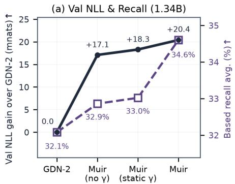

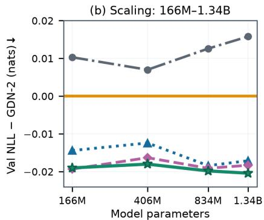

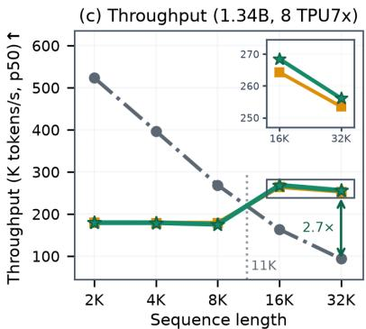  
Panel (a): Val NLL gain (left axis)Based recall avg. (right axis)  
GDN-2Transformer (Splash)▲Muir (no γ)Muir (static γ)Muir

Figure 1 | Muir outperforms GDN-2 and Transformer on language modeling and long-context throughput while improving recall over GDN-2. (a) Sensitivity-allocated low-rank gates with FFN expansion drive the bulk of the validation NLL gain over GDN-2, while dynamic matched-filter readout drives the gain on extractive recall. (b) Across 166M–1.34B parameters, Muir lowers validation NLL by 18.0–20.4 millinats over GDN-2 and 25.0–36.2 millinats over Transformer. (c) On 8 TPU7x chips (0.5M tokens/step) at 1.34B with our chunkwise kernel, Muir matches GDN-2 throughput despite an additional readout gate and a 30.4% wider FFN, and trains 1.64× and 2.74× faster than Transformer at 16K and 32K, respectively.

fast-decaying rows retain only recent inputs, so state row norms span more than an order of magnitude. Under unweighted query readout, high-norm slow rows dominate the output and force stronger write-time erasure to suppress their interference, which prematurely overwrites stored associations. Third, because channels decay at independent rates, chunkwise parallel training (Sun et al., 2023; Yang et al., 2023; 2024; 2025b) must divide keys by cumulative decay prefixes to compute within-chunk interactions via matrix multiplication and solve a lower-triangular system per chunk, which breaks down on wide-matrix-unit accelerators. While GPU kernels (Yang and Zhang, 2024; Kimi Team et al., 2025) avoid full-chunk division and solve diagonal triangular sub-blocks sequentially in SRAM at small chunks matched to 16 × 16 TensorCores, accelerators that pair wide systolic matrix units with a much slower vector unit (such as AWS Trainium and Google TPUs, reaching 256 × 256 matrix units with vector units over 60× slower on modern TPUs; Austin et al., 2025; Jiang et al., 2026) require large chunks for high matrix utilization. At these chunk sizes, cumulative decay prefixes underflow on fast-decaying channels and overflow the division; alternatively, materializing pairwise channel decays or solving the triangular system sequentially falls back to the slow vector unit.

To address these challenges, we analyze channel-wise gated delta recurrences and show that state updates are far less sensitive to erasure than to writes: rectifying key activations (such as SiLU; Ramachandran et al., 2018) and unit normalization concentrate key energy onto a sparse subset of channels, whereas value writes scale all channels, so the erase gate requires a much lower-rank projection than the write gate. We further derive a closed-form scaling law for state row norms and show that weighting queries by a matched-filter readout gain balances row contributions, which lowers the write-time erasure needed to suppress interference and extends the memory horizon. Guided by this analysis, we introduce Muir, a gated delta-rule model that fuses all recurrence and output gates into a sensitivity-allocated low-rank projection, modulates queries with a matched-filter readout gate (combining a static channel profile with dynamic per-token modulation) to re-weight state rows, and reinvests the saved gate parameters under a fixed budget to widen the FFN and expand its capacity for factual associations (Geva et al., 2021; Meng et al., 2022). Finally, to train stably at the large chunk sizes needed to saturate wide matrix units, we design a boundary-pivoted chunkwise kernel that splits relative decays without division or full-chunk 3D decay tensors and solves within-chunk triangular systems via block matrix multiplications.

Figure 1 summarizes our main findings. Across model scales from 166M to 1.34B parameters, Muir outperforms both GDN-2 and Transformer on language modeling and commonsense reasoning, and improves over GDN-2 on real-world extractive recall (Arora et al., 2024a;b). At 1.34B, Muir improves synthetic multi-hop and multi-needle retrieval (Hsieh et al., 2024) over both baselines, and extrapolates from 4K to 10M-token streams in a 25 MB float32 state without perplexity drift, whereas Dynamic YaRN Transformer (Peng et al., 2024) diverges past 8K and needs a 2.1 TB bfloat16 KV cache at 10M. On passkey retrieval, our static matchedfilter readout achieves near-100% accuracy to 1M tokens, whereas GDN-2 collapses past 4K–8K. Using our chunkwise kernel for both recurrent models and Splash Attention (TPU implementation of FlashAttention;

Dao et al., 2022; Dao, 2023) for Transformer, Muir matches GDN-2 training throughput across sequence lengths despite a wider FFN and an additional gate, reaches the 100B-token validation loss of GDN-2 1.2× faster, and trains $2 . 7 \times$ faster than Transformer at 32K. Mechanistic analysis confirms that state updates are more sensitive to writes than to erasure; state row norms closely follow our scaling law; and the learned readout balances state rows, lowers write-time erasure, and retains associations over longer contexts.

## 2. Preliminaries

Notation. Throughout the paper, scalars and scalar entries of vectors or matrices are denoted by lightface letters $( m , T , v _ { j } , M _ { i , j } )$ , vectors by boldface lowercase letters $( \pmb { v } \in \mathbb { R } ^ { 1 \times m } )$ , and matrices by boldface uppercase letters $( \pmb { M } \in \mathbf { \mathbb { R } } ^ { m \times n } )$ All vectors are row vectors, so the Euclidean inner product of �, $\pmb { v } \in \mathbb { R } ^ { 1 \times m }$ is $\langle \pmb { u } , \pmb { v } \rangle : = \pmb { u } \pmb { v } ^ { \top }$ and the rank-one outer product of $\pmb { u } \in \mathbb { R } ^ { 1 \times m }$ and $\pmb { v } \in \mathbb { R } ^ { 1 \times n } \mathrm { i s } ^ { \cdot } \mathbf { \bar { u } } ^ { \top } \pmb { v } \in \mathbb { R } ^ { m \times n }$ . Additionally, for vectors $\pmb { x } , \pmb { y } \in \mathbb { R } ^ { 1 \times m }$ , � ${ \bf { \sigma } } ; \odot { \bf { \mathcal { Y } } } , { \pmb { x } } \odot { \pmb { y } } ,$ and $\pmb { x } ^ { \odot p }$ denote elementwise multiplication, division, and �-th power, respectively, and $\mathrm { D i a g } ( \pmb { x } ) \in \mathbb { R } ^ { m \times m }$ is the diagonal matrix with diagonal �. For a matrix $\pmb { M } \in \mathbb { R } ^ { m \times n } , \pmb { M } _ { i } ,$ <sub>:</sub> and $M _ { : , j }$ denote its �-th row and �-th column, and tril(�), stril(�), and triu(�) denote its lower-triangular, strictly lower-triangular, and upper-triangular parts. We denote the Kronecker delta by $\delta _ { i j } \ ( \delta _ { i j } = 1 \ \mathrm { i f } \ i = j$ and 0 otherwise). For a diferentiable map $\begin{array} { r } { f , \mathrm { D } _ { \pmb { x } } f ( \pmb { x } ) [ \delta \pmb { x } ] : = \operatorname* { l i m } _ { \epsilon  0 } \epsilon ^ { - 1 } \big ( f ( \pmb { x } + \epsilon \delta \pmb { x } ) - \widetilde { f } ( \pmb { \mathscr { x } } ) \big ) } \end{array}$ denotes the directional derivative at � along perturbation ��. Finally, a hat (^·) denotes gate-modulated quantities $( \mathbf { e . g . }$ $\pmb { \hat { k } } : = \pmb { b } \odot \pmb { k } )$ , a bar (¯·) denotes expectations or empirical averages, and an asterisk (<sup>\*</sup>) denotes stationary fixed points or optimal solutions. (See Appendix B for a summary of notation.)

## 2.1. Channel-Wise Gated Delta Rule

Given an input sequence $\pmb { x } _ { 1 } , \dots , \pmb { x } _ { T } \in \mathbb { R } ^ { 1 \times d }$ , linear-time sequence models avoid the $\mathcal { O } ( T ^ { 2 } )$ training cost and $\mathcal { O } ( T )$ key-value cache of softmax attention by compressing the token history into a fixed-size associative memory $S _ { t } \in \mathbb { R } ^ { d _ { k } \times d _ { \tau } }$ � per head across $N _ { h }$ heads of dimension $d _ { k } = d _ { v } = d / \dot { N } _ { h }$ (typically $d _ { k } = d _ { v } = 1 2 8 )$ Following standard practice in modern linear attention models, where local feature mixing before state updates is critical for in-context recall (Gu and Dao, 2023; Arora et al., 2023a; Yang et al., 2024; Allen-Zhu, 2025), each token $\scriptstyle \mathbf { x } _ { t }$ is projected by $\dot { W } _ { q } , W _ { k } , W _ { v } \in \mathbb { R } ^ { d \times d }$ , passed through a depthwise causal convolution and SiLU activation, and partitioned into $\bar { N } _ { h }$ heads. Within each head, queries and keys are ℓ -normalized to the unit sphere $( \pmb { q } _ { t } , \pmb { k } _ { t } \in \overset {  } { \mathbb { S } } ^ { d _ { k } - 1 }$ , so $\| \pmb { q } _ { t } \| _ { 2 } = \| \pmb { k } _ { t } \| _ { 2 } = 1 ;$ Schlag et al., 2021; Yang et al., 2024) for bounded addressing and erasure stability, whereas values $\bar { \pmb { v } } _ { t } \in \mathrm { ~ \mathbb { R } ^ { 1 \times d _ v } ~ }$ enter additively and remain unnormalized to preserve feature magnitude. Standard linear attention accumulates outer products additively $( S _ { t } = S _ { t - 1 } + k _ { t } ^ { \top } v _ { t } ;$ Katharopoulos et al., 2020) or with exponential decay $( \pmb { S } _ { t } = \alpha _ { t } \pmb { S } _ { t - 1 } + \pmb { k } _ { t } ^ { \top } \pmb { v } _ { t }$ for scalar � (Sun et al., 2023; Dao and Gu, 2024); or $\mathrm { D i a g } ( \boldsymbol { \alpha } _ { t } ) \boldsymbol { S } _ { t - 1 } + \boldsymbol { k } _ { t } ^ { \top } \boldsymbol { v } _ { t }$ for channel-wise $\pmb { \alpha } _ { t }$ (Yang et al., 2023)). By contrast, the delta rule (Widrow and Hof, 1960; Schlag et al., 2021; Yang et al., 2024) updates $\pmb { S } _ { t }$ via one step of online gradient descent on the instantaneous key-value reconstruction loss $\begin{array} { r } { \frac { 1 } { 2 } \| \pmb { k } _ { t } \pmb { S } - \pmb { v } _ { t } \| _ { 2 } ^ { 2 } } \end{array}$ , querying the state along $\pmb { k } _ { t }$ and erasing its current prediction before writing the new value (see Appendix A for additional related work).

Gated DeltaNet-2. GDN-2 (Hatamizadeh et al., 2026) extends scalar-decay Gated DeltaNet (Yang et al., 2025b) by promoting the per-head decay factor and erase step size to channel-wise vectors alongside a channel-wise write gate (Appendix C derives this update via a left preconditioner $\mathrm { D i a g } ( b _ { t } ) ^ { - 1 }$ on the gated reconstruction loss). Specifically, at timestep �, each head computes four channel-wise gates from ${ \mathbf { \nabla } } _ { \mathbf { x } _ { t } : }$ a decay (retention) gate $\pmb { \alpha } _ { t } \in ( 0 , 1 ) ^ { 1 \times d _ { k } }$ , an erase gate ${ \pmb b } _ { t } \in ( 0 , 2 ) ^ { \mathbf { \hat { 1 } } \times d _ { k } }$ , a write gate ${ \pmb w } _ { t } \in ( 0 , 1 ) ^ { 1 \times d _ { v } }$ , and a post-recurrence output gate $\dot { \pmb { g } } _ { t } \in \mathbb { R } ^ { 1 \times d _ { v } }$ . Given pre-activation logits $\boldsymbol { z } _ { t } ^ { f } , \boldsymbol { z } _ { t } ^ { b } \in \mathbb { R } ^ { 1 \times d _ { k } }$ and $\dot { \boldsymbol { z } } _ { t } ^ { w } \in \mathbb { R } ^ { 1 \times d _ { v } } ;$ , the recurrence gates are parameterized as log $\pmb { \alpha } _ { t } = - \exp ( a _ { \mathrm { l o g } } )$ softplus $( z _ { t } ^ { f } ) , b _ { t } = 2 \sigma ( z _ { t } ^ { b } )$ , and ${ \pmb w } _ { t } = \sigma ( \pmb { z } _ { t } ^ { w } )$ , where $\boldsymbol { z } _ { t } ^ { f }$ includes a bias $\pmb { c } _ { f } \in \mathbb { R } ^ { 1 \times d _ { k } }$ and $a _ { \log } \in \mathbb { R }$ is a per-head log-rate.

With the decayed prior state $\hat { \pmb { S } } _ { t } : = \mathrm { D i a g } ( \pmb { \alpha } _ { t } ) \pmb { S } _ { t - 1 }$ (whose �-th row $\hat { S } _ { t , j , : } = \alpha _ { t , j } S _ { t - 1 , j , : }$ <sub>:</sub> scales key channel $j \in \{ 1 , \ldots , d _ { k } \} )$ , the erase-gated key $\widehat { \pmb { k } } _ { t } : = \pmb { b } _ { t } \odot \pmb { k } _ { t }$ , and the write-gated value $\widehat { \pmb { v } } _ { t } : = \pmb { w } _ { t } \odot \pmb { v } _ { t } ,$ , the GDN-2 state update and readout are given by

$$
\begin{array} { r } { S _ { t } = \left( \mathbf { I } - k _ { t } ^ { \top } ( b _ { t } \odot k _ { t } ) \right) \operatorname { D i a g } ( \alpha _ { t } ) S _ { t - 1 } + k _ { t } ^ { \top } ( w _ { t } \odot v _ { t } ) = \hat { S } _ { t } - k _ { t } ^ { \top } ( \hat { k } _ { t } \hat { S } _ { t } ) + k _ { t } ^ { \top } \hat { v } _ { t } , \qquad o _ { t } = q _ { t } S _ { t } . } \end{array}\tag{1}
$$

Here, ℓ -normalization of $\pmb { k } _ { t }$ ensures that $\langle k _ { t } , b _ { t } \odot k _ { t } \rangle \in ( 0 , 2 )$ for any $\pmb { b } _ { t } \in ( 0 , 2 ) ^ { 1 \times d _ { k } }$ , so the erasure factor $\mathbf { I } - \pmb { k } _ { t } ^ { \top } ( \pmb { b } _ { t } \odot \pmb { k } _ { t } )$ contracts the state along $\pmb { k } _ { t }$ with eigenvalue $1 - \langle k _ { t } , b _ { t } \odot k _ { t } \rangle \in ( - 1 , 1 )$ (Grazzi et al., 2024; Hatamizadeh et al., 2026). The head outputs $\mathbf { \sigma } _ { o _ { t } }$ are normalized via per-head RMSNorm, modulated elementwise by $\mathrm { S i L U } ( { \pmb g } _ { t } )$ (Sun et al., 2023; Yang et al., 2023; Qiu et al., 2025), concatenated across the $N _ { h }$ heads, and projected back to the residual stream by $W _ { o } \in \mathbb { R } ^ { d \times d }$

Gate Parameterization and Parameter Budget. A language model stacks � residual layers, each pairing the sequence-mixing block above with a feed-forward network $\mathrm { F F N } ( \pmb { y } ) = \mathrm { G E L U } ( \pmb { y } \pmb { W } _ { \mathrm { i n } } ) \pmb { W } _ { \mathrm { o u t } }$ (Hendrycks and Gimpel, 2016) of intermediate width $\boldsymbol { d } _ { \mathrm { f i n } } \left( \boldsymbol { W } _ { \mathrm { i n } } \in \mathbb { R } ^ { d \times d _ { \mathrm { f i n } } } , \boldsymbol { W } _ { \mathrm { o u t } } \in \mathbb { R } ^ { \boldsymbol { d } _ { \mathrm { f i n } } \times \boldsymbol { d } } \right)$ . A standard Transformer layer with projections $\dot { \boldsymbol W } _ { q } , \boldsymbol W _ { k } , \boldsymbol W _ { v } , \boldsymbol W _ { o } \in \mathbb R ^ { d \times d } \ ( 4 \dot { d } ^ { 2 }$ parameters) and FFN width $d _ { \mathrm { f f n } } = 4 d \ : ( 2 d \ : d _ { \mathrm { f f n } } = 8 d ^ { 2 }$ parameters) contains $1 2 d ^ { 2 }$ non-embedding parameters. Across all $N _ { h }$ heads, GDN-2 parameterizes the decay logit $ { \boldsymbol { z } } _ { t } ^ { f }$ and output gate $\pmb { g } _ { t }$ with rank- ${ \boldsymbol { \mathbf { \mathit { \Sigma } } } } ^ { - } { \boldsymbol { r } } _ { 0 }$ bottleneck projections $( W _ { f \downarrow } , W _ { g \downarrow } \in \mathbb { R } ^ { d \times r _ { 0 } }$ and $W _ { f \uparrow } , W _ { g \uparrow } \in \bar { \mathbb { R } ^ { r _ { 0 } \times \bar { d } } }$ with $r _ { 0 } = 1 2 8$ , totaling $4 d r _ { 0 } = 5 1 2 d$ parameters), whereas the erase logit $\pmb { z } _ { t } ^ { b } = \pmb { x } _ { t } \pmb { W } _ { b }$ and write logit $\pmb { z } _ { t } ^ { w } = \pmb { x } _ { t } \pmb { W } _ { w }$ use unbiased full-rank (dense) matrices $W _ { b } , W _ { w } \in \mathbb { R } ^ { d \times d }$ totaling $\bar { 2 } d ^ { 2 }$ parameters (one-sixth of the $1 2 d ^ { 2 }$ layer budget). Following standard practice of adjusting $d _ { \mathrm { f f n } }$ to maintain a $1 2 d ^ { 2 }$ per-layer parameter budget for iso-parameter comparisons (Shazeer, 2020; Sun et al., 2023; Qiu et al., 2025; Hatamizadeh et al., 2026), GDN-2 sets $d _ { \mathrm { f f n } } = 3 d - 2 r _ { 0 } = 3 d - 2 5 6$ (shrinking $d _ { \mathrm { { f f n } } }$ from 8,192 to 5,888 at $d = 2 , 0 4 8 )$

## 2.2. Chunkwise Parallel Form

Evaluating (1) sequentially over � timesteps performs $\mathcal { O } ( d _ { k } d _ { v } )$ vector operations per token per head, which has low arithmetic intensity and is memory-bandwidth-bound on modern hardware. Defining the $e f f e c t i v e$ write $\tilde { v } _ { t } : = \hat { v } _ { t } - \hat { k } _ { t } \hat { S } _ { t } = \tilde { v _ { t } } - \hat { k } _ { t } \operatorname { D i a g } ( \alpha _ { t } ) \dot { S } _ { t - 1 } \in \mathbb { R } ^ { 1 \times d _ { v } }$ (gated memory write minus gated memory read) rewrites (1) in the Gated Linear Attention (GLA; Yang et al., 2023) form:

$\begin{array} { r } { S _ { t } = \left( \mathbf { I } - k _ { t } ^ { \top } \hat { k } _ { t } \right) \operatorname { D i a g } ( \alpha _ { t } ) S _ { t - 1 } + k _ { t } ^ { \top } \hat { v } _ { t } = \operatorname { D i a g } ( \alpha _ { t } ) S _ { t - 1 } + k _ { t } ^ { \top } \left( \hat { v } _ { t } - \hat { k } _ { t } \operatorname { D i a g } ( \alpha _ { t } ) S _ { t - 1 } \right) = \operatorname { D i a g } ( \alpha _ { t } ) S _ { t - 1 } + k _ { t } ^ { \top } \hat { v } _ { t } } \end{array}$ To expose matrix-matrix multiplications during training, chunkwise-parallel algorithms (Sun et al., 2023; Yang et al., 2023; 2024; 2025b) partition the sequence into $N _ { c } = T / C$ chunks of length $C .$ Consider a single chunk indexed by $t \in \{ 1 , \ldots , { \cal C } \}$ starting from chunk-initial state $S _ { 0 } \in \mathbb { R } ^ { d _ { k } \times d _ { v } }$ . Let $\begin{array} { r } { \pmb { \pi } _ { t } : = \prod _ { r = 1 } ^ { t } \pmb { \alpha } _ { 1 } } \end{array}$ and $\begin{array} { r } { \pmb { \pi } _ { t , s } : = \prod _ { r = s + 1 } ^ { t } \pmb { \alpha } _ { r } \in ( 0 , 1 ] ^ { 1 \times d _ { k } } } \end{array}$ (with $\pmb { \pi } _ { t , t } = \mathbf { 1 } )$ denote the elementwise cumulative decay prefixes and relative decays; unrolling $\pmb { S } _ { t - 1 }$ from $\pmb { S } _ { 0 }$ in $\tilde { \pmb { v } } _ { t } = \hat { \pmb { v } } _ { t } - \hat { \pmb { k } } _ { t } \operatorname { D i a g } ( \pmb { \alpha } _ { t } ) \pmb { S } _ { t - 1 }$ and using $\hat { \pmb { k } } _ { t } \operatorname { D i a g } ( \pmb { \pi } _ { t , s } ) \pmb { k } _ { s } ^ { \top } = ( \hat { \pmb { k } } _ { t } \odot \pmb { \pi } _ { t , s } ) \pmb { k } _ { s } ^ { \top } =$ $\langle \hat { k } _ { t } , \pi _ { t , s } \odot k _ { s } \rangle$ gives

$$
\tilde { v } _ { t } = \hat { v } _ { t } - \bigl ( \pi _ { t } \odot \hat { k } _ { t } \bigr ) S _ { 0 } - \sum _ { s = 1 } ^ { t - 1 } \langle \hat { k } _ { t } , \pi _ { t , s } \odot k _ { s } \rangle \tilde { v } _ { s } , \qquad t \in \{ 1 , \ldots , C \} .
$$

Stacking $\tilde { \mathbf { v } } _ { t } , \hat { \mathbf { v } } _ { t } , \pi _ { t } \odot \hat { k } _ { t }$ , and $\pmb { k } _ { t } \oslash \pmb { \pi } _ { t }$ across $t \in \{ 1 , \ldots , C \}$ as the rows of �<sup>˜</sup> , $\hat { V } \in \mathbb { R } ^ { C \times d _ { v } }$ and $\hat { \pmb { K } } _ { \odot \pi } , \pmb { K } _ { \oslash \pi } \in \mathbb { R } ^ { C \times d _ { k } }$ casts this coupled recurrence in matrix form as

$$
\begin{array} { r } { \tilde { V } = \hat { V } - \hat { K } _ { \odot \pi } S _ { 0 } - \mathrm { s t r i l } \big ( \hat { K } _ { \odot \pi } K _ { \odot \pi } ^ { \top } \big ) \tilde { V } \quad \Longleftrightarrow \quad T \tilde { V } = \hat { V } - \hat { K } _ { \odot \pi } S _ { 0 } , \qquad T : = \mathbf { I } + L _ { \mathrm { s t r i c t } } \in \mathbb { R } ^ { C \times C } , } \end{array}
$$

where $\pmb { L } _ { \mathrm { s t r i c t } }$ is strictly lower-triangular with entries $( L _ { \mathrm { s t r i c t } } ) _ { t , s } = \langle \hat { k } _ { t } , \pi _ { t , s } \odot k _ { s } \rangle ( t > s )$ . Solving ${ \pmb T } \left[ { \pmb U } \quad { \pmb Y } \right] =$ $\begin{array} { r l } { \big [ \hat { V } } & { { } \hat { K } _ { \odot \pi } \big ] } \end{array}$ yields $\tilde { { \cal V } } = { \cal T } ^ { - 1 } \hat { { \cal V } } - ( { \cal T } ^ { - 1 } \hat { { \cal K } } _ { \odot \pi } ) { \cal S } _ { 0 } = { \cal U } - { \cal Y } { \cal S } _ { 0 }$ . Once �<sup>˜</sup> is known, unrolling the GLA recurrence $\pmb { S } _ { t } = \mathrm { D i a g } ( \pmb { \alpha } _ { t } ) \pmb { S } _ { t - 1 } + \pmb { k } _ { t } ^ { \top } \tilde { \pmb { v } } _ { t }$ across the chunk (Yang et al., 2023) gives the end-of-chunk state $\pmb { S } _ { C } \in \mathbb { R } ^ { d _ { k } \times d _ { v } }$ (passed as $\pmb { S } _ { 0 }$ to the next chunk) and chunk outputs $\pmb { O } \in \mathbb { R } ^ { C \times d _ { v } }$ via matrix multiplications:

$$
\begin{array} { r } { \pmb { S } _ { C } = \mathrm { D i a g } ( \pmb { \pi } _ { C } ) \pmb { S } _ { 0 } + \tilde { \pmb { K } } ^ { \top } \tilde { \pmb { V } } , \qquad \pmb { O } = \pmb { Q } _ { \odot \pi } \pmb { S } _ { 0 } + \pmb { M } \tilde { \pmb { V } } , } \end{array}
$$

where $\tilde { \pmb { K } } , \pmb { Q } _ { \odot \pi } \in \mathbb { R } ^ { C \times d _ { k } }$ have rows $\pi _ { C , s } \odot k _ { s }$ and $\pmb { \pi } _ { t } \odot \pmb { q } _ { t }$ , and $\pmb { M } \in \mathbb { R } ^ { C \times C }$ is lower-triangular with entries $M _ { t , s } = \left. \pmb { q } _ { t } , \pmb { \pi } _ { t , s } \odot \pmb { k } _ { s } \right.$ for $t \geq s$

In Gated DeltaNet (Yang et al., 2025b), where $\pmb { \alpha } _ { t } = \alpha _ { t } \mathbf { 1 }$ and $\pmb { b } _ { t } = \beta _ { t } \pmb { 1 }$ , scalar multiplication commutes with rank-one erasure: $\alpha _ { t } ( \mathbf { I } - \beta _ { t } \pmb { k } _ { t } ^ { \top } \pmb { k } _ { t } ) = ( \mathbf { I } - \beta _ { t } \pmb { k } _ { t } ^ { \top } \pmb { k } _ { t } ) \alpha _ { t }$ , so the scalar decay ratio ${ \pi } _ { t } / { \pi } _ { s }$ factors out of the inner product $\langle \hat { \pmb { k } } _ { t } , \pmb { k } _ { s } \rangle$ . Under channel-wise decay $\pmb { \alpha } _ { t }$ in (1), however, the diagonal decay operator $\mathrm { D i a g } ( \pmb { \alpha } _ { t } )$ and the rank-one erasure operator $\mathbf { I } - \pmb { k } _ { t } ^ { \top } \hat { \pmb { k } } _ { t }$ do not commute whenever $\pmb { \alpha } _ { t }$ varies across channels:

$$
\begin{array} { r } { \big ( \mathbf { I } - \pmb { k } _ { t } ^ { \top } \hat { \pmb { k } } _ { t } \big ) \operatorname { D i a g } ( \pmb { \alpha } _ { t } ) \neq \operatorname { D i a g } ( \pmb { \alpha } _ { t } ) \big ( \mathbf { I } - \pmb { k } _ { t } ^ { \top } \hat { \pmb { k } } _ { t } \big ) . } \end{array}
$$

This non-commutativity introduces two obstacles to executing the chunkwise solve on wide-matrix-unit accelerators. First, forming � and � faces a tradeof between eficiency and numerical stability: factoring $\pmb { L } _ { \mathrm { s t r i c t } } =$ $\mathrm { s t r i l } ( \hat { K } _ { \odot \pi } K _ { \odot \pi } ^ { \top } )$ and $\mathbf { \bar { M } } = \operatorname { t r i l } ( { Q } _ { \odot \pi } \mathbf { K } _ { \oslash \pi } ^ { \top } )$ as matrix multiplications divides keys by $\pi _ { s } ,$ which underflows bfloat16 and float32 (minimum positive normal ≈ $1 . 1 8 \times 1 0 ^ { - 3 8 } )$ over long chunks $( \mathrm { e . g . , ~ } \pi _ { s , j } \le 2 ^ { - 2 5 6 } \approx 1 0 ^ { - 7 7 }$ at $C = 2 5 6$ whenever $\alpha _ { r , j } \leq 0 . 5 )$ and overflows $\pmb { K } _ { \oslash \pi }$ . Conversely, evaluating $\pi _ { t , s } = \exp ( \pmb { \Lambda } _ { t } - \pmb { \Lambda } _ { s } )$ from the cumulative log-decay matrix $\pmb { \Lambda } \doteq \mathbb { R } ^ { C \times d _ { k } }$ (with rows $\mathbf { A } _ { t } : = \textstyle \sum _ { r = 1 } ^ { t }$ log ${ \pmb { \alpha } } _ { r } \leq { \bf 0 } )$ is numerically stable for $t \geq s ,$ but materializing the 3D tensor $\pmb { \pi } _ { t , s } \odot \pmb { k } _ { s } \in \mathbb { R } ^ { C \times C \times d _ { k } }$ (32 MB per head in float32 at $C = 2 5 6 )$ and reducing over $d _ { k }$ executes on the vector unit. Second, once $\pmb { T } = \mathbf { I } + \pmb { L } _ { \mathrm { s t r i c t } }$ is formed, solving $\pmb { T } \left[ \pmb { U } \quad \pmb { Y } \right] ^ { \prime } = \left[ \hat { \pmb { V } } \quad \hat { \pmb { K } } _ { \odot \pi } \right]$ via forward substitution is sequential across the � steps of the chunk and also executes on the vector unit.

Wide-Matrix-Unit Architecture and Tiling. We study wide-matrix-unit execution on Google TPU7x Ironwood accelerators (Jiang et al., 2026), where each chip comprises two TensorCores totaling 192 GB of High-Bandwidth Memory (HBM) at 7,380 GB/s and 128 MB of on-chip Vector Memory (VMEM). Within each TensorCore, two Matrix Multiply Units (MXUs) operate on $2 5 6 \times 2 5 6$ systolic arrays (bfloat16 inputs accumulated in float32, 2,307 TFLOP/s per chip), whereas the Vector Processing Unit (VPU, a 128-lane × 8-sublane SIMD processor) has roughly 64× lower bfloat16 throughput $( { \approx } 3 6 ~ \mathrm { T F L O P / s }$ in bfloat16 and ≈ 18 TFLOP/s in float32 per chip; Austin et al., 2025). However, when either dimension of a matrix multiplication is smaller than 256, the MXU pads unused lanes with zeros, reducing MXU utilization proportionally. Across HBM, VMEM, and Vector Registers (VREG), XLA tiles the last two dimensions of every tensor into 2D tiles of shape T(8, 128) for 32-bit words (T(16, 128) in packed bfloat16), matching the 128 VPU lanes; elementwise operations that preserve the trailing dimensions fuse in VREGs, whereas permutations that alter the tiled dimensions incur an HBM round-trip.

## 3. Channel-Wise Gated Delta Memory Dynamics

In this section, we analyze how the channel-wise gates $\left( \alpha _ { t } , b _ { t } , w _ { t } \right)$ and unweighted readout $\pmb { o } _ { t } = \pmb { q } _ { t } \pmb { S } _ { t }$ in the GDN-2 recurrence govern state updates and associative retrieval. In §3.1, we study this recurrence from single-step updates to long-horizon stationary dynamics: we first quantify the single-step sensitivity of $\pmb { S } _ { t }$ to perturbations in $\mathbf { \delta } _ { \pmb { b } _ { t } }$ and ${ \pmb w } _ { t }$ , next characterize how channel-wise decay and erasure determine the expected squared norms of the state rows over long sequences, and finally analyze how weighting state rows at readout afects retrieval error and interacts with write-time erasure. We then test our theoretical predictions in controlled synthetic memory experiments in §3.2. (All proofs are in Appendix D.)

## 3.1. Gate Sensitivity and Readout Dynamics

In GDN-2, both the erase and write gates are parameterized by dense projections, yet they enter the state update asymmetrically: $\pmb { b } _ { t }$ modulates the SiLU-activated, unit-norm key $\pmb { k } _ { t }$ against the decayed prior state $\hat { \boldsymbol { S } } _ { t } ,$ whereas ${ \pmb w } _ { t }$ scales the unnormalized value ${ \pmb v } _ { t }$ . We first formalize the resulting asymmetry in state sensitivity.

Proposition 3.1 (State sensitivity to erase and write gates). Consider the GDN-2 state update $( 1 )$ at step � as a function ${ \bf \cal S } _ { t } ( b _ { t } , w _ { t } )$ of the erase gate $\mathbf { \delta } _ { \pmb { b } _ { t } }$ and write gate ${ \pmb w } _ { t }$ , with decayed prior state $\hat { \pmb { S } } _ { t } = \mathrm { D i a g } ( \pmb { \alpha } _ { t } ) \pmb { S } _ { t - 1 }$

(i) For any perturbations �� and ��, the directional derivatives of $\pmb { S } _ { t }$ with respect to $\pmb { b } _ { t }$ and ${ \pmb w } _ { t }$ are

$$
\mathrm { D } _ { b } S _ { t } [ \delta b ] = - k _ { t } ^ { \top } \big ( ( \delta b \odot k _ { t } ) \hat { S } _ { t } \big ) , \qquad \mathrm { D } _ { w } S _ { t } [ \delta w ] = k _ { t } ^ { \top } ( \delta w \odot v _ { t } ) .\tag{2}
$$

(ii) Conditioned on $( k _ { t } , v _ { t } , \hat { S } _ { t } )$ , the expected squared Frobenius sensitivities under isotropic perturbations $\delta \pmb { b } \sim \mathcal { N } ( \mathbf { 0 } , \mathbf { I } _ { d _ { k } } )$ and �� $\sim \mathcal { N } ( \mathbf { 0 } , \mathbf { I } _ { d _ { v } } )$ are

$$
\mathbb { E } _ { \delta b } \left[ \| \mathrm { D } _ { b } S _ { t } [ \delta b ] \| _ { F } ^ { 2 } \right] = \sum _ { j = 1 } ^ { d _ { k } } k _ { t , j } ^ { 2 } \| \hat { S } _ { t , j , : } \| _ { 2 } ^ { 2 } , \qquad \mathbb { E } _ { \delta w } \big [ \| \mathrm { D } _ { w } S _ { t } [ \delta w ] \| _ { F } ^ { 2 } \big ] = \| v _ { t } \| _ { 2 } ^ { 2 } .\tag{3}
$$

(iii) Decompose the gated key $\hat { \pmb { k } } _ { t } = \pmb { b } _ { t } \odot \pmb { k } _ { t }$ into its parallel erase strength $\mu _ { t } : = \langle \pmb { k } _ { t } , \hat { \pmb { k } } _ { t } \rangle$ along $\pmb { k } _ { t }$ and its orthogonal residual $\pmb { s } _ { t } : = \hat { \pmb { k } } _ { t } - \mu _ { t } \pmb { k } _ { t } \left( \left. \pmb { s } _ { t } , \pmb { k } _ { t } \right. = 0 \right)$ , whose squared Euclidean norm equals the $\bar { \pmb { k } } _ { t } ^ { \odot 2 }$ -weighted within-head coordinate variance of $\pmb { b } _ { t }$ given by

$$
\| s _ { t } \| _ { 2 } ^ { 2 } = \| \hat { \pmb { k } } _ { t } \| _ { 2 } ^ { 2 } - \mu _ { t } ^ { 2 } = \sum _ { j = 1 } ^ { d _ { k } } k _ { t , j } ^ { 2 } \big ( b _ { t , j } - \mu _ { t } \big ) ^ { 2 } .
$$

Moreover, the gradient $\nabla _ { b } \mu _ { t } = \pmb { k } _ { t } ^ { \odot 2 } = ( k _ { t , 1 } ^ { 2 } , \dots , k _ { t , d _ { k } } ^ { 2 } )$ has squared Euclidean norm

$$
\| \nabla _ { b } \mu _ { t } \| _ { 2 } ^ { 2 } = \| k _ { t } \| _ { 4 } ^ { 4 } = \frac { 1 } { \eta _ { \mathrm { e f f } } ( k _ { t } ) } \in \left[ \frac { 1 } { d _ { k } } , 1 \right] , \quad \boldsymbol { w h e r e } \quad \eta _ { \mathrm { e f f } } ( k _ { t } ) : = \frac { \big ( \sum _ { j = 1 } ^ { d _ { k } } k _ { t , j } ^ { 2 } \big ) ^ { 2 } } { \sum _ { j = 1 } ^ { d _ { k } } k _ { t , j } ^ { 4 } } = \frac { 1 } { \| k _ { t } \| _ { 4 } ^ { 4 } } \in [ 1 , d _ { k } ]
$$

is the per-token key participation ratio.

Remark 3.2 (Origin of the write-erase sensitivity asymmetry). Equations (2) and (3) show that the write gate ${ \pmb w } _ { t }$ and the erase gate $\pmb { b } _ { t }$ influence the state update through diferent mechanisms. A write perturbation �� scales the incoming value ${ \pmb v } _ { t }$ directly in $\pmb { k } _ { t } ^ { \top } ( \delta \pmb { w } \odot \pmb { v } _ { t } )$ ; because $\| \pmb { k } _ { t } \| _ { 2 } = 1$ , � modifies $\pmb { S } _ { t }$ unconditionally at every step, even when $\hat { \pmb { S } } _ { t }$ is empty. By contrast, an erase perturbation �� is weighted across channels by both the squared key $k _ { t , j } ^ { 2 }$ and the decayed squared row norm (row energy) $\| \hat { S } _ { t , j , : } \| _ { 2 } ^ { 2 } ,$ so a channel of $\pmb { b } _ { t }$ afects $\pmb { S } _ { t }$ only when two conditions hold simultaneously: (i) the corresponding memory row already stores non-negligible energy, and (ii) the current key $\pmb { k } _ { t }$ places non-negligible weight on that channel. Because keys are constructed by applying a SiLU nonlinearity prior to $\ell _ { 2 } { \mathrm { - n o r m a l i z a t i o n } }$ , negative pre-activations are suppressed and $\pmb { k } _ { t }$ concentrates its unit norm onto $\eta _ { \mathrm { e f f } } ( k _ { t } ) \ll d _ { k }$ active channels; on the remaining $d _ { k } - \eta _ { \mathrm { e f f } } ( k _ { t } )$ inactive channels, as well as on any empty or recently decayed state rows, perturbations to $\mathbf { \delta } _ { \pmb { b } _ { t } }$ leave $\pmb { S } _ { t }$ nearly unchanged.

Remark 3.3 (Regularization of oblique erase variance by low-rank projections). Proposition 3.1(iii) yields an exact decomposition of the erase transition $\mathbf { I } - k _ { t } ^ { \top } \tilde { k _ { t } } = ( \mathbf { I } - \mu _ { t } \tilde { k } _ { t } ^ { \top } \tilde { k _ { t } } ) - k _ { t } ^ { \top } \boldsymbol { s } _ { t }$ for every $\pmb { k } _ { t } \in \dot { \mathbb { S } } ^ { d _ { k } - 1 }$ and $\pmb { b } _ { t } \in ( 0 , 2 ) ^ { 1 \times d _ { k } }$ . All contraction along $\pmb { k } _ { t }$ is governed by the scalar $\mu _ { t } = \langle b _ { t } , k _ { t } ^ { \odot 2 } \rangle$ , whose gradient $\nabla _ { \boldsymbol { b } } \mu _ { t } = \boldsymbol { k } _ { t } ^ { \odot 2 }$ is supported on the $\eta _ { \mathrm { e f f } } ( \pmb { k } _ { t } ) \ll d _ { k }$ active key channels. Consequently, any component of $\mathbf { \delta } _ { \pmb { b } _ { t } }$ in the orthogonal complement $( \pmb { k } _ { t } ^ { \odot 2 } ) ^ { \perp } \subset \mathbb { R } ^ { 1 \times d _ { k } }$ contributes identically zero to $\mu _ { t }$ and enters the state update exclusively through the oblique residual $\pmb { s } _ { t }$ . Although the eigenvalues of $\mathbf { I } - \pmb { k } _ { t } ^ { \top } \hat { \pmb { k } } _ { t }$ remain in $( - 1 , 1 ]$ , any non-zero residual $\mathbf { \boldsymbol { s } } _ { t } \neq \mathbf { \boldsymbol { 0 } }$ contributes the non-normal of-diagonal term $- \pmb { k } _ { t } ^ { \top } \pmb { s } _ { t }$ , which strictly inflates the transition spectral norm above 1 $\begin{array} { r } { ( \| \mathbf { I } - \pmb { k } _ { t } ^ { \top } \hat { \pmb { k } } _ { t } \| _ { 2 } \geq \sqrt { 1 + \| \pmb { s } _ { t } \| _ { 2 } ^ { 2 } } > 1 ; } \end{array}$ Lemma D.1). These properties motivate parameterizing the erase logit via a biased low-rank bottleneck $\pmb { x } _ { t } \pmb { W } _ { b \downarrow } \pmb { W } _ { b \uparrow } + \pmb { c } _ { b } \left( \pmb { r } _ { b } \ll \pmb { d } _ { k } \right)$ instead of an unconstrained dense projection $\mathbf { \Delta } _ { \pmb { x } _ { t } \mathbf { W } _ { b } }$ . Specifically, the channel bias $\mathbf { c } _ { b }$ sets distinct baseline erase rates across the $d _ { k }$ rows (avoiding reduction to a uniform scalar gate ${ \bf \nabla } _ { b _ { t } \mathbf { 1 } } )$ , while the $r _ { b }$ bottleneck directions modulate $\mu _ { t }$ across the $\eta _ { \mathrm { e f f } } ( k _ { t } ) \ll d _ { k }$ active key channels without injecting high-rank variations in $( \pmb { k } _ { t } ^ { \odot 2 } ) ^ { \perp }$ that would inflate $\| \pmb { s } _ { t } \| _ { 2 } ^ { 2 }$

Having shown that single-step state updates are far less sensitive to $\pmb { b } _ { t }$ than to ${ \pmb w } _ { t } ,$ , we now analyze how channel-wise decay and erasure shape the expected energies $\mathbb { E } [ \| S _ { t , j , : } \| _ { 2 } ^ { 2 } ]$ of the state rows $S _ { t , j , : }$ over long sequences. For the rest of this section, let (1) be driven by a stationary i.i.d. stream $\left( k _ { t } , \hat { \pmb v } _ { t } , \pmb { \alpha } _ { t } , \pmb { b } _ { t } \right)$ whose components are mutually independent at each timestep � (and hence independent of $S _ { t - 1 } )$ ). Additionally, let $\mathbb { E } [ \hat { \pmb { v } } _ { t } ] = \mathbf { 0 }$ and $\mathbb { E } [ \| \hat { \pmb { v } } _ { t } \| _ { 2 } ^ { 2 } ] = \sigma _ { v } ^ { 2 }$ , keys $\pmb { k } _ { t }$ have uncorrelated channels $\mathbb { E } [ k _ { t , i } \bar { k } _ { t , j } ] = \delta _ { i j } c _ { j }$ with second moments $\begin{array} { r } { c _ { j } > 0 \ ( \sum _ { j = 1 } ^ { d _ { k } } c _ { j } = 1 ) } \end{array}$ , and the gates have mean squared decay factor $\lambda _ { j } : = \mathbb { E } [ \alpha _ { t , j } ^ { 2 } ] \in ( 0 , 1 )$ and mean channel erase rate $\overline { { b } } _ { j } : = \mathbb { E } [ b _ { t , j } ] \in ( 0 , 2 )$ satisfying $\bar { b } _ { j } c _ { j } < 1$

Proposition 3.4 (Stationary row-energy law). Let $m _ { t , j } : = \mathbb { E } [ \| S _ { t , j , : } \| _ { 2 } ^ { 2 } ]$ denote the expected energy of state row $j \in \{ 1 , \ldots , d _ { k } \}$ at timestep �. Under the stationary stream above, the uncorrelated-row condition $\mathbb { E } [ \langle S _ { t - 1 , i , : } , S _ { t - 1 , j , : } \rangle ] = \delta _ { i j } m _ { t - 1 , j }$ , and the second-order closures $\mathbb { E } [ k _ { t , i } ^ { 2 } k _ { t , j } ^ { 2 } ]$ ≈ � � and $\mathbb { E } [ b _ { t , i } ^ { 2 } ] \approx \bar { b } _ { i } ^ { 2 }$ , the row energy $m _ { t , j } \ o f \ ( 1 )$ evolves according to the linear recurrence

$$
m _ { t , j } = \lambda _ { j } ( 1 - 2 \bar { b } _ { j } c _ { j } ) m _ { t - 1 , j } + c _ { j } \sum _ { i = 1 } ^ { d _ { k } } \bar { b } _ { i } ^ { 2 } c _ { i } \lambda _ { i } m _ { t - 1 , i } + c _ { j } \sigma _ { v } ^ { 2 } .\tag{4}
$$

Because the cross-row sum $\begin{array} { r } { \sum _ { i = 1 } ^ { d _ { k } } \bar { b } _ { i } ^ { 2 } c _ { i } \lambda _ { i } m _ { t - 1 , i } } \end{array}$ is a scalar shared across all rows $j$ (rescaling $\sigma _ { v } ^ { 2 }$ by a constant factor without altering relative row energies), dropping this cross-row coupling term yields the unique stationary row energy $m _ { j } ^ { * } : = \operatorname* { l i m } _ { t  \infty } m _ { t , j }$ and stationary row root-mean-square (RMS) norm $\rho _ { j } : = \sqrt { m _ { j } ^ { * } }$ in closed form:

$$
m _ { j } ^ { * } = \rho _ { j } ^ { 2 } = \frac { c _ { j } \sigma _ { v } ^ { 2 } } { 1 - \lambda _ { j } + 2 \lambda _ { j } \bar { b } _ { j } c _ { j } } = c _ { j } \sigma _ { v } ^ { 2 } \tau _ { \mathrm { e f f } , j } ( \bar { b } _ { j } ) , \qquad \tau _ { \mathrm { e f f } , j } ( \bar { b } _ { j } ) : = \frac { 1 } { 1 - \lambda _ { j } + 2 \lambda _ { j } \bar { b } _ { j } c _ { j } } .\tag{5}
$$

Remark 3.5 (Two-regime scaling of stationary row energy). Equation (5) shows that stationary row energy $m _ { j } ^ { * }$ is the product of the write injection rate $c _ { j } \sigma _ { v } ^ { 2 }$ and the efective memory horizon $\tau _ { \mathrm { e f f } , j } ( \bar { b } _ { j } ) = ( 1 - \lambda _ { j } + 2 \lambda _ { j } \bar { b } _ { j } c _ { j } ) ^ { - 1 }$ whose denominator combines two competing dissipation mechanisms: exponential decay $1 - \lambda _ { j }$ and keytriggered erasure $2 \lambda _ { j } \bar { b } _ { j } c _ { j }$ . This yields two distinct scaling regimes across channels. In the erasure-dominated limit $( 1 - \lambda _ { j } \ll 2 \lambda _ { j } \bar { b } _ { j } \bar { c } _ { j } , \mathrm { i . e . , } \lambda _ { j } \to 1 ^ { - } )$ , the key-energy factor $c _ { j }$ cancels between numerator and denominator to give $m _ { j } ^ { * } \tilde {  } \sigma _ { v } ^ { 2 } / ( 2 \bar { b } _ { j } )$ , so key-triggered erasure self-equalizes row energy only at the cost of heavy erasure $\bar { b } _ { j }$ that over-erases slow channels and caps their memory horizon at $\tau _ { \mathrm { e f f } , j } \approx ( 2 \bar { b } _ { j } c _ { j } ) ^ { - 1 }$ . Conversely, in the decay-dominated regime $( 2 \lambda _ { j } \bar { b } _ { j } c _ { j } \ll 1 - \bar { \lambda } _ { j } ) , m _ { j } ^ { * } \approx c _ { j } \sigma _ { v } ^ { 2 } / ( 1 - \lambda _ { j } )$ compounds post-SiLU key anisotropy $c _ { j }$ with multi-timescale decay $( 1 - \lambda _ { j } ) ^ { - 1 }$ , which causes stationary row energies $m _ { j } ^ { * }$ to span multiple orders of magnitude across rows $j \in \{ 1 , \ldots , d _ { k } \}$ within a single head.

Under the standard (unweighted) readout $\mathbf { \sigma } _ { o _ { t } } = \mathbf { q } _ { t } \mathbf { \mathcal { S } } _ { t } ,$ rows with large stationary RMS $\rho _ { j }$ dominate the inner product with $\pmb q _ { t }$ and mask low-energy, fast-decaying channels. To characterize how a per-channel query gain $\gamma _ { t } \in \mathbb { R } ^ { 1 \times d _ { k } }$ remedies this imbalance, consider an associative retrieval setting in which a key-value pair $( k _ { t - \ell } , \hat { v } _ { t - \ell } )$ was written at timestep $t - \ell$ and the model queries $\pmb { S } _ { t }$ at timestep � along $\pmb { q } _ { t } = \pmb { k } _ { t - \ell }$ to recover $\hat { \pmb { v } } _ { t - \ell } ;$ we refer to the elapsed timestep count $\ell \geq 1$ as the retrieval lag.

Proposition 3.6 (Lag-dependent matched-filter readout). Suppose at timestep $t ,$ the state row $j \in \{ 1 , \ldots , d _ { k } \}$ decomposes at retrieval lag $\ell \geq 1$ as $\pmb { S } _ { t , j , : } = a _ { \ell , j } k _ { t - \ell , j } \hat { \pmb { v } } _ { t - \ell } + \pmb { \xi } _ { t , j }$ , where $\begin{array} { r } { a _ { \ell , j } : = \prod _ { s = t - \ell + 1 } ^ { t } \alpha _ { s , j } ( 1 - b _ { s , j } k _ { s , j } ^ { 2 } ) } \end{array}$ is the cumulative diagonal retention over the $\ell$ intervening timesteps (with of-diagonal cross-row key products centered in $\pmb { \xi } _ { t , j }$ under $\mathbb { E } [ k _ { s , i } k _ { s , j } ] = \delta _ { i j } c _ { j } )$ and $\pmb { \xi } _ { t , j }$ is zero-mean multi-write interference from timesteps � ̸= $t - \ell ,$ uncorrelated with $\hat { \pmb { v } } _ { t - \ell }$ and satisfying $\begin{array} { r } { \mathbb { E } [ \langle \pmb { \xi } _ { t , i } , \pmb { \xi } _ { t , j } \rangle \mid \pmb { k } _ { t - \ell } ] = \delta _ { i j } m _ { j } ^ { * } } \end{array}$ . Assume $a _ { \ell , j }$ is independent $o f \left( k _ { t - \ell } , \hat { v } _ { t - \ell } \right)$ with mean $\bar { a } _ { \ell , j } : = \mathbb { E } [ a _ { \ell , j } ] \in ( 0 , 1 )$ and small gate variance ${ \mathbb E } [ a _ { \ell , i } \hat { a _ { \ell , j } } ] \approx \hat { a } _ { \ell , i } \hat { a } _ { \ell , j } \ \left( s o \ \hat { a } _ { \ell , j } \approx \lambda _ { j } ^ { \ell / 2 } \right.$ when $\bar { b } _ { j } c _ { j } \ll 1 )$ For a query $\pmb q _ { t } = \pmb k _ { t - \ell }$ and gain-modulated readout $\pmb { o } _ { t } ( \gamma ) : = ( \gamma \odot \pmb { q } _ { t } ) \pmb { S } _ { t }$ , the following hold:

(i) Under the second-order closure $\mathbb { E } [ k _ { t - \ell , i } ^ { 2 } k _ { t - \ell , j } ^ { 2 } ] \approx c _ { i } c _ { j }$ , the expected retrieval mean-squared error (MSE) $\mathcal { L } _ { \ell } ( \gamma ) : = \mathbb { E } [ \| o _ { t } ( \gamma ) - \hat { v } _ { t - \ell } \| _ { 2 } ^ { 2 } ]$ is

$$
\mathcal { L } _ { \ell } ( \gamma ) = \sigma _ { v } ^ { 2 } \left( 1 - \sum _ { j = 1 } ^ { d _ { k } } \gamma _ { j } c _ { j } \bar { a } _ { \ell , j } \right) ^ { 2 } + \sum _ { j = 1 } ^ { d _ { k } } \gamma _ { j } ^ { 2 } c _ { j } m _ { j } ^ { * } .\tag{6}
$$

(ii) The unit-signal interference variance $\textstyle \sum _ { j = 1 } ^ { d _ { k } } \gamma _ { j } ^ { 2 } c _ { j } m _ { j } ^ { * }$ (subject to $\begin{array} { r } { \sum _ { j = 1 } ^ { d _ { k } } \gamma _ { j } c _ { j } \bar { a } _ { \ell , j } = 1 ) } \end{array}$ and the unconstrained MSE $\mathcal { L } _ { \ell } ( \gamma )$ are both uniquely minimized along the matched-filter direction $\gamma _ { j } \propto \bar { a } _ { \ell , j } / m _ { j } ^ { * }$ , with unconstrained minimizer $\begin{array} { r } { \gamma _ { j } ^ { * } ( \ell ) \ \left( \kappa _ { \ell } : = \sigma _ { v } ^ { 2 } / \big ( 1 + \sigma _ { v } ^ { 2 } \textstyle \sum _ { i = 1 } ^ { d _ { k } } c _ { i } \bar { a } _ { \ell , i } ^ { 2 } / m _ { i } ^ { * } \big ) \right) . } \end{array}$

$$
\gamma _ { j } ^ { * } ( \ell ) = \kappa _ { \ell } \frac { \bar { a } _ { \ell , j } } { m _ { j } ^ { * } } \propto \frac { \bar { a } _ { \ell , j } } { \rho _ { j } ^ { 2 } } \approx \frac { \lambda _ { j } ^ { \ell / 2 } } { \rho _ { j } ^ { 2 } } , \qquad j \in \{ 1 , \ldots , d _ { k } \} .\tag{7}
$$

Remark 3.7 (Incompatibility of static gain across retrieval lags). For any two distinct retrieval lags $1 \leq \ell _ { 1 } < \ell _ { 2 } .$ the elementwise ratio of optimal gains in $( 7 )$ is $\gamma _ { j } ^ { * } ( \ell _ { 2 } ) / \gamma _ { j } ^ { * } ( \ell _ { 1 } ^ { ' } ) = ( \kappa _ { \ell _ { 2 } } \check { / } \kappa _ { \ell _ { 1 } } ) \bar { a } _ { \ell _ { 2 } , j } / \bar { a } _ { \ell _ { 1 } , j } \propto \lambda _ { j } ^ { ( \ell _ { 2 } - \ell _ { 1 } ^ { \prime } ) / 2 }$ . Whenever decay factors $\lambda _ { j }$ vary across channels $( \lambda _ { j } \neq \lambda _ { j ^ { \prime } } )$ , the vectors $\gamma ^ { * } ( \ell _ { 1 } )$ and $\gamma ^ { * } ( \ell _ { 2 } )$ are non-collinear and reverse their correlation with the decay factor. Specifical ${ \mathrm { l y } } ,$ short-lag queries $( \ell _ { 1 } \stackrel { \cdot } { = } \mathcal { O } ( 1 )$ , where $\lambda _ { i } ^ { \ell _ { 1 } / 2 } \approx 1 )$ follow $\gamma _ { j } ^ { * } ( \ell _ { 1 } ) \propto 1 / m _ { j } ^ { * }$ and emphasize fast-decaying, low-interference rows (correlating negatively with $\lambda _ { j } )$ , whereas long-lag queries $( \ell _ { 2 } \gg 1$ , where $\lambda _ { i } ^ { \ell _ { 2 } / 2 } \to 0$ on fast rows) must upweight slow-decaying rows $( \lambda _ { j } \to 1 ^ { - } )$ where the target signal survives (correlating positively with $\dot { \lambda } _ { j } )$ . Consequently, no static vector � can achieve the matched-filter optimum across multiple retrieval horizons simultaneously, which motivates a token-dependent dynamic readout gain $\gamma _ { t }$

When a head is restricted to a static gain vector � shared across timesteps, marginalizing (6) over a distribution of retrieval lags characterizes the optimal time-invariant compromise.

Corollary 3.8 (Horizon-marginalized static gain and fractional power law). Suppose a static gain � minimizes the interference variance in (6) subject to the horizon-averaged signal constraint $\begin{array} { r } { \mathbb { E } _ { \ell } \big [ \sum _ { j = 1 } ^ { d _ { k } } \gamma _ { j } c _ { j } \bar { a } _ { \ell , j } \big ] = 1 } \end{array}$ under a geometric lag distribution of mean horizon $H > 1$ , with $\bar { a } _ { \ell , j } = \lambda _ { j } ^ { \ell / 2 }$ . Replacing $\bar { a } _ { \ell , j }$ in (7) by the horizonaveraged signal survival $g _ { H } ( \lambda _ { j } ) : = \mathbb { E } _ { \ell } [ \lambda _ { j } ^ { \ell / 2 } ]$ yields the static matched filter

$$
\gamma _ { j } ^ { \mathrm { s t a t } } \propto \frac { g _ { H } ( \lambda _ { j } ) } { m _ { j } ^ { * } } = \frac { g _ { H } ( \lambda _ { j } ) } { \rho _ { j } ^ { 2 } } , \qquad g _ { H } ( \lambda _ { j } ) = \frac { \sqrt { \lambda _ { j } } } { 1 + ( H - 1 ) ( 1 - \sqrt { \lambda _ { j } } ) } , \qquad j \in \{ 1 , \ldots , d _ { k } \} .
$$

In the decay-dominated regime $( 2 \lambda _ { j } \bar { b } _ { j } c _ { j } \ll 1 - \lambda _ { j } \ll 1$ at fixed $c _ { j } )$ , where $m _ { j } ^ { * } = \rho _ { j } ^ { 2 } \approx c _ { j } \sigma _ { v } ^ { 2 } \tau _ { \mathrm { e f f } , j }$ with $\tau _ { \mathrm { e f f } , j } = ( 1 - \lambda _ { j } ) ^ { - 1 }$ , the local log-slope of $\dot { \gamma } _ { j } ^ { \mathrm { s t a t } }$ with respect to the row RMS $\rho _ { j } \propto \tau _ { \mathrm { e f f } , j } ^ { 1 7 2 }$ satisfies

$$
- \frac { \mathrm { d } \log \gamma _ { j } ^ { \mathrm { s t a t } } } { \mathrm { d } \log \rho _ { j } } \approx \frac { 4 \tau _ { \mathrm { e f f } , j } } { 2 \tau _ { \mathrm { e f f } , j } + H - 1 } : = p ( \tau _ { \mathrm { e f f } , j } ) \in ( 0 , 2 ) ,
$$

which satisfies $\gamma _ { j } ^ { \mathrm { s t a t } } \propto \rho _ { j } ^ { - p }$ with an intermediate exponent $p \in ( 0 , 1 )$ (strictly between unit gain $p = 0$ and full inverse-RMS whitening $\overset { \prime } { p } = 1 \overset { \cdot } { \underset { \textstyle } { \boldsymbol { p } } }$ for all channels with $\tau _ { \mathrm { e f f } , j } < ( H - 1 ) / 2$

Remark 3.9 (Suboptimality of full inverse-RMS whitening). Corollary 3.8 shows that naive row normalization $\gamma _ { j } \propto \rho _ { j } ^ { - 1 } \left( p \stackrel { . } { = } 1 \right)$ or inverse-variance weighting $\gamma _ { j } \propto \rho _ { j } ^ { - 2 } \left( p = 2 \right.$ , which corresponds to the memoryless $H \to 1$ limit where $g _ { 1 } ( \lambda _ { j } ) = \lambda _ { i } ^ { 1 / 2 } \approx 1 )$ is suboptimal for multi-step associative retrieval: rows with large $\rho _ { j }$ are the slow-decaying channels $( \lambda _ { j } \to 1 ^ { - }$ , large $\tau _ { \mathrm { e f f } , j } )$ that preserve long-range signal $g _ { H } ( \lambda _ { j } )$ . Dividing by $\rho _ { j }$ or $\rho _ { j } ^ { 2 }$ without accounting for the signal survival numerator $g _ { H } ( \lambda _ { j } )$ over-amplifies low-energy, fast-decaying rows whose target signal has vanished while suppressing high-energy, slow-decaying channels, whereas the horizon-marginalized matched filter $\gamma _ { j } ^ { \mathrm { s t a t } } \propto g _ { H } ( \bar { \lambda _ { j } } ) / \rho _ { j } ^ { 2 }$ damps high-energy rows with a compressed exponent $p \in ( 0 , 1 )$ that balances interference suppression against long-horizon signal preservation.

Finally, we connect query-time readout back to write-time erasure. Consider a head with channel-uniform mean erase rate $\bar { b } _ { j } = \bar { b } \in ( 0 , 2 )$ in (5) (where $b _ { t , j } = \bar { b }$ implies $\begin{array} { r } { \mu _ { t } = \sum _ { j = 1 } ^ { d _ { k } } b _ { t , j } k _ { t , j } ^ { 2 } = \bar { b } ) } \end{array}$ . Choosing <sup>¯</sup>� faces a fundamental tension: increasing <sup>¯</sup>� suppresses multi-write interference by contracting every row’s efective memory horizon $\tau _ { \mathrm { e f f } , j } ( \bar { b } )$ in (5), but simultaneously attenuates stored target associations by a factor of $1 - \bar { b } c _ { j }$ on each intervening write step (Proposition 3.6). Because matched-filter readout already damps interference from high-energy rows at query time, it relaxes the erasure required at write time.

Proposition 3.10 (Erase-readout substitution). Consider a head with channel-uniform mean erase rate $\bar { b } _ { j } = \bar { b } \in ( 0 , 2 )$ and horizon-averaged signal survival $g _ { H } ( \lambda _ { j } )$ . For any readout gain $\gamma \in \mathbb { R } ^ { 1 \times d _ { k } }$ with expected horizon-averaged signal gain $\begin{array} { r } { S ( \gamma ) : = \sum _ { j = 1 } ^ { d _ { k } } \gamma _ { j } c _ { j } g _ { H } \bigl ( \lambda _ { j } \bigr ) > 0 } \end{array}$ , define the normalized interference-to-signal ratio:

$$
\displaystyle \mathcal { Z } ( \bar { b } , \gamma ) : = \frac { \sum _ { j = 1 } ^ { d _ { k } } \gamma _ { j } ^ { 2 } c _ { j } m _ { j } ^ { * } ( \bar { b } ) } { \sigma _ { v } ^ { 2 } S ( \gamma ) ^ { 2 } } = \sum _ { j = 1 } ^ { d _ { k } } \frac { \gamma _ { j } ^ { 2 } c _ { j } ^ { 2 } } { S ( \gamma ) ^ { 2 } \big ( 1 - \lambda _ { j } + 2 \lambda _ { j } \bar { b } c _ { j } \big ) } = \sum _ { j = 1 } ^ { d _ { k } } \frac { \gamma _ { j } ^ { 2 } c _ { j } ^ { 2 } } { S ( \gamma ) ^ { 2 } } \tau _ { \mathrm { e f f } , j } ( \bar { b } ) .
$$

Let $\bar { \tau } ( \bar { b } ) : = \mathcal { T } ( \bar { b } , \mathbf { 1 } )$ denote the baseline interference ratio under unit readout $( \gamma = { \bf 1 } )$ , and let $B \colon ( 0 , 2 ) \to \mathbb { R }$ be a twice-diferentiable erasure cost (capturing target-signal attenuation and, $f o r \ { \bar { b } } > 1 .$ , over-relaxation error) satisfying $\bar { B } ^ { \prime } ( \bar { b } ) > 0$ and $B ^ { \prime \prime } ( \bar { b } ) \geq 0$ . For any readout interference multiplier $\Phi > 0$ relative $t o \bar { \tau } ( \bar { b } )$ , define the equilibrium erase rate:

$$
\bar { b } ^ { * } ( \Phi ) : = \underset { \bar { b } \in ( 0 , 2 ) } { \arg \operatorname* { m i n } } ~ \mathcal { I } ( \bar { b } ; \Phi ) , \qquad \mathcal { I } ( \bar { b } ; \Phi ) : = \Phi \bar { \tau } ( \bar { b } ) + B ( \bar { b } ) .
$$

Then, at any $\bar { b } \in ( 0 , 2 )$ for which the channel noise-to-signal ratios $m _ { j } ^ { * } ( \bar { b } ) / g _ { H } ( \lambda _ { j } )$ vary across $j ,$ the static matched filter $\gamma ^ { * }$ satisfying $\underline { { S } } ( \gamma ^ { * } ) = S ( \mathbf { 1 } )$ achieves a strict interference reduction $\Phi ^ { * } : = \mathcal { T } ( \bar { b } , \gamma ^ { * } ) / \bar { \tau } ( \bar { b } ) < 1$ and any interior minimizer $\bar { b } ^ { * } ( \Phi )$ satisfies

$$
\bar { b } ^ { * } ( \Phi ^ { * } ) < \bar { b } ^ { * } ( 1 ) , \qquad \tau _ { \mathrm { e f f } , j } ( \bar { b } ^ { * } ( \Phi ^ { * } ) ) > \tau _ { \mathrm { e f f } , j } ( \bar { b } ^ { * } ( 1 ) ) \quad \forall j \in \{ 1 , \dots , d _ { k } \} .
$$

Remark 3.11 (Mechanism of memory-horizon extension). Under unit readout $( \gamma = { \bf 1 } )$ , the only mechanism available to suppress multi-write interference $\mathcal { T } ( \bar { b } , \mathbf { 1 } )$ in high-energy rows is to elevate the erase rate ${ \bar { b } } ,$ which reduces $\tau _ { \mathrm { e f f } , j } ( \bar { b } )$ and prematurely flushes older associations across all channels. Introducing matched-filter readout gain suppresses interference at query time $( \Phi ^ { * } < 1 )$ , which shifts the equilibrium erase rate downward $( \bar { b } ^ { * } ( \Phi ^ { * } ) < \bar { b } ^ { * } ( 1 ) )$ and extends the efective memory horizon $\tau _ { \mathrm { e f f } , j }$ of every state channel.

## 3.2. Synthetic Memory Experiments

To test our theoretical predictions under controlled data-generating processes that satisfy our theoretical assumptions, we design two synthetic associative-memory tasks: a single-head stationary retrieval task that isolates Propositions 3.4, 3.6 and 3.10 and Corollary 3.8, and an end-to-end learned multi-query associative recall task that tests Propositions 3.1, 3.6 and 3.10 under gradient descent. (Additional details in Appendix E.)

## 3.2.1. Synthetic Task Setup

Single-Head Stationary Retrieval. In this task, we simulate a single gated-delta head $( d _ { k } = d _ { v } = 6 4 )$ driven by a stationary stream of unit-norm keys $\pmb { k } _ { t } \in \mathbb { S } ^ { d _ { k } - 1 }$ with anisotropic power-law channel second moments $c _ { j } = \mathbb { E } [ \check { k } _ { t , j } ^ { 2 } ] > 0 \ ( \sum _ { i = 1 } ^ { \check { d } _ { k } } c _ { j } = 1 )$ and isotropic values ${ \pmb v } _ { t } \sim \mathcal { N } ( { \bf 0 } , d _ { v } ^ { - 1 } { \bf I } _ { d _ { v } } ) \ ( \sigma _ { v } ^ { 2 } = 1 )$ . To isolate stationary rowenergy accumulation and query readout from learned gate projections, we fix the write gate to ${ \pmb w } _ { t } = { \bf 1 }$ (so $\hat { \pmb { v } } _ { t } = \pmb { v } _ { t } )$ , the erase gate to a uniform scalar $\pmb { b } _ { t } = \mu \mathbf { 1 }$ with $\mu = \bar { b } \in ( 0 , 2 )$ (so $\mu _ { t } \equiv \mu$ and $\mathbf { \boldsymbol { s } } _ { t } \equiv \mathbf { \boldsymbol { 0 } } )$ , and the decay vector $\pmb { \alpha } \in ( 0 , 1 ) ^ { 1 \times \breve { d } _ { k } }$ to time-invariant factors with log-spaced timescales $\tau _ { j } ~ ( \alpha _ { j } = e ^ { - 1 / \tau _ { j } } , \lambda _ { j } = \alpha _ { i } ^ { 2 } )$ . At each timestep �, the state $\pmb { S } _ { t }$ updates via (1), and we sample a retrieval lag $\ell _ { t } \sim p ( \check { \ell } )$ and query $\pmb { S } _ { t }$ along the historical key $\pmb { q } _ { t } = \pmb { k } _ { t - \pmb { \ell } _ { t } }$ with readout gain � to recover $\pmb { v } _ { t - \ell _ { t } }$ under normalized MSE $\mathscr { L } ( \gamma ) : = \sigma _ { v } ^ { - 2 } \mathbb { E } [ \| \pmb { o } _ { t } ( \gamma ) - \pmb { v } _ { t - \ell _ { t } } \| _ { 2 } ^ { 2 } ] ;$

$$
S _ { t } = \left( \mathbf I - \mu k _ { t } ^ { \top } k _ { t } \right) \mathrm { D i a g } ( \alpha ) S _ { t - 1 } + k _ { t } ^ { \top } v _ { t } , \qquad o _ { t } ( \gamma ) = \left( \gamma \odot k _ { t - \ell _ { t } } \right) S _ { t } .
$$

We consider two lag distributions $p ( \ell )$ . First, under a geometric lag horizon of mean $H ,$ we sweep the erase strength $\mu \in ( 0 , 2 )$ across the stability interval of the rank-one erasure contraction $\mathbf { I } - \mu \pmb { k } _ { t } ^ { \top } \pmb { k } _ { t }$ and compare five static readout profiles (each scaled by a least-squares scalar prefactor $\kappa ^ { * }$ fitted on a disjoint split, corresponding to $\kappa _ { \ell }$ in (7)): unit gain $\gamma _ { j } = 1 ~ ( p = 0 ; \mathrm { G D N - 2 } )$ , half-power scaling $\gamma _ { j } \propto 1 / \sqrt { \rho _ { j } } \ ( p = 1 / 2 )$ , full inverse-RMS whitening $\gamma _ { j } \propto 1 / \rho _ { j } \ ( p = 1 )$ , the Corollary 3.8 horizon filter $\gamma _ { j } ^ { \mathrm { s t a t } ^ { \bullet } } \propto g _ { H } \dot { ( } \lambda _ { j } ^ { \bullet } ) / \dot { m } _ { j } ^ { * }$ , and the unconstrained � -parameter least-squares static oracle $\gamma ^ { \mathrm { L S } }$ . Second, under a bimodal two-lag mixture $\begin{array} { r } { p ( \ell ) = \frac { 1 } { 2 } \delta _ { \ell , 2 } + \frac { 1 } { 2 } \delta _ { \ell , 8 0 } } \end{array}$ at the unit-gain optimal erase strength $\mu = \mu _ { \mathrm { u n i t } } ^ { * } ,$ we compare the shared $d _ { k }$ -parameter static oracle $\gamma ^ { \mathrm { L S } }$ against two lag-dependent readouts: the Proposition 3.6 analytic filter $\gamma _ { j } ^ { * } ( \ell ) \propto \lambda _ { j } ^ { \ell / 2 } / m _ { j } ^ { * }$ (one scalar prefactor per lag) and the lag-conditioned least-squares oracle $\gamma ^ { \mathrm { L S } } ( \ell )$

Learned Multi-Query Associative Recall. We train a single-layer, two-head model $( N _ { h } = 2 , d _ { k } = d _ { v } =$ $3 2 , d = 1 2 8 )$ end-to-end on streaming multi-query associative recall (Arora et al., 2023a). Each sequence spans $T = 2 5 6$ write/read events over $K = 2 5 6$ keys and $V = 6 4$ values, activating $K _ { \mathrm { l i v e } } = 9 6$ keys (1.5× the total state rank $N _ { h } d _ { k } = 6 4 )$ with $\operatorname { Z i p f } ( 1 . 0 )$ frequencies. Each timestep $t \in \{ 1 , \ldots , T \}$ is a write (prob. 0.7) binding an active key to a fresh value in $\{ 1 , \ldots , V \}$ (overwriting prior bindings), or a read (prob. 0.3) querying a written key for its latest value. To ensure the write gate $\left( \pmb { w } _ { t } \odot \pmb { v } _ { t } \right)$ must dynamically suppress inactive value channels, we partition values across four orthogonal subspaces of $\mathbb { R } ^ { 1 \times d }$ and inject isotropic Gaussian noise into the inactive subspaces. From RMS-normalized ${ \mathbf { } } x _ { t } ,$ each head $h \in \{ 1 , 2 \}$ computes unit-norm SiLU queries and keys $( \pmb q _ { t } ^ { ( h ) }$ and $\pmb { k } _ { t } ^ { ( h ) } )$ , values ${ \pmb v } _ { t } ^ { ( h ) }$ , and rank-8 decay gates ${ \pmb { \alpha } } _ { t } ^ { ( h ) }$ , projecting concatenated head outputs to

(a) Static Readout Policies  
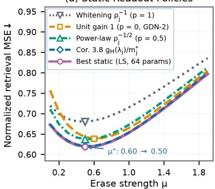

(b) Two-Lag Retrieval Mixture  
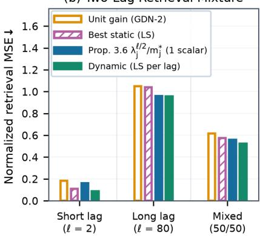

(c) Learned Gate-Rank Sweep  
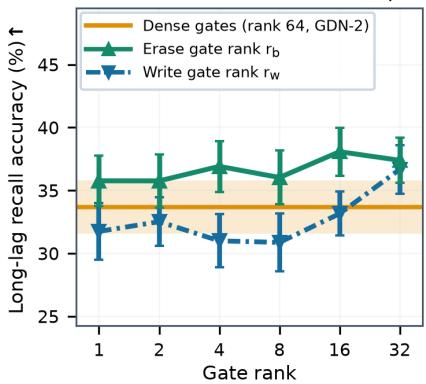  
Figure 2 | Matched-filter readout and low-rank erase gates improve synthetic associative retrieval and lower optimal erase strength. (a) Full whitening worsens retrieval error relative to unit gain (GDN-2), whereas half-power scaling and the Corollary 3.8 filter reduce error and shift $\mu ^ { * }$ from 0.60 to 0.50, with the Corollary 3.8 filter matching the static oracle. (b) On a 50/50 mixture of lags $\ell \in \{ 2 , 8 0 \}$ at $\mu = 0 . 6 0$ , the lag-matched oracle outperforms the static oracle across all horizons, while the Proposition 3.6 filter matches the lag-matched oracle at $\ell = 8 0$ and beats the static oracle on long and mixed horizons. (c) Low-rank erase gates $r _ { b }$ outperform dense gates at every bottleneck rank on long-lag recall, whereas low-rank write gates $r _ { w }$ degrade below dense at $r _ { w } \le 8$ and recover once $r _ { w } \ge 1 6$

� -way read logits.

We vary two architectural axes: (i) to test Proposition 3.1, we parameterize the erase gate $\pmb { b } _ { t }$ and write gate ${ \pmb w } _ { t }$ across heads either with a dense projection $\pmb { x } _ { t } \pmb { W } _ { m } \ ( m \in \{ b , w \}$ , full rank $N _ { h } d _ { k } = 6 4 )$ or a rank $- r _ { m }$ bottleneck $\pmb { x } _ { t } \pmb { W } _ { m \downarrow } \pmb { W } _ { m \uparrow } + \pmb { c } _ { m } ,$ sweeping $r _ { m } \in \{ 1 , 2 , 4 , 8 , 1 6 , 3 2 \}$ for one gate while keeping the other dense; and (ii) to test Propositions 3.6 and 3.10, we compare unit $( \gamma _ { t } = 1 )$ , static $( \gamma _ { t } = 2 \sigma ( \pmb { c } _ { q } ) )$ , and rank-8 dynamic $( \gamma _ { t } = 2 \sigma ( { \pmb x } _ { t } { \pmb W } _ { q \downarrow } { \pmb W } _ { q \uparrow } + { \pmb c } _ { q } ) )$ readout gains (partitioned across heads into $\mathbf { \delta } _ { b _ { t } ^ { ( h ) } , \mathbf { \delta } \mathbf { w } _ { t } ^ { ( h ) } , \dot { \gamma } _ { t } ^ { ( \dot { h } ) } } )$ :

$$
\begin{array} { r l } { b _ { t } = 2 \sigma ( { \boldsymbol x } _ { t } W _ { b \downarrow } W _ { b \uparrow } + { \boldsymbol c } _ { b } ) , \quad } & { { \boldsymbol w } _ { t } = \sigma ( { \boldsymbol x } _ { t } W _ { w \downarrow } W _ { w \uparrow } + { \boldsymbol c } _ { w } ) , \qquad \gamma _ { t } = 2 \sigma ( { \boldsymbol x } _ { t } W _ { q \downarrow } W _ { q \uparrow } + { \boldsymbol c } _ { q } ) ; } \\ & { \qquad \sigma _ { t } ^ { ( h ) } = \big ( \gamma _ { t } ^ { ( h ) } \odot q _ { t } ^ { ( h ) } \big ) S _ { t } ^ { ( h ) } . } \end{array}
$$

## 3.2.2. Synthetic Task Results

Figure 2 summarizes the results across both tasks over 20 seeds (full tables in Appendix E). In the single-head stationary setting at $\mu = \mu _ { \mathrm { u n i t } } ^ { * } = 0 . 6 0$ , the closed-form law (5) (Proposition 3.4) matches the empirical row energies $m _ { j }$ across a 52.4× dynamic range with Spearman and log-Pearson correlations of 1.0. Sweeping $\mu \in ( 0 , 2 )$ under the geometric lag horizon of mean $H = 2 7$ (Figure $\mathrm { 2 a ) }$ , full inverse-RMS whitening $1 / \rho _ { j }$ $( p = 1 )$ worsens retrieval MSE relative to unit gain because dividing by $\rho _ { j }$ amplifies fast-decaying rows whose target signal has vanished (Remark 3.9). By contrast, half-power scaling $1 / \sqrt { \rho _ { j } }$ improves over unit gain and the Corollary 3.8 horizon filter $\gamma _ { i } ^ { \mathrm { s t a t } } \propto g _ { H } ( \lambda _ { j } ) / m _ { i } ^ { * }$ matches the 64-parameter static oracle $\gamma ^ { \mathrm { L S } }$ , with both filters shifting the optimal erase strength from $\mu ^ { * } { } ^ { \prime } = 0 . 6 0$ down to 0.50 (Proposition 3.10). On the bimodal $\ell _ { t } \in \{ 2 , 8 0 \}$ mixture (Figure 2b), the lag-conditioned oracle $\gamma ^ { \mathrm { L S } } ( \ell )$ correlates negatively with the channel decay factor $\alpha _ { j }$ at $\ell = 2$ (Spearman $r _ { s } = - 0 . 9 8 )$ and reverses sign at $\ell = 8 0 \ ( r _ { s } = + 0 . 8 3 )$ , in accordance with Remark 3.7. Consequently, lag-matched readout $\gamma ^ { \mathrm { L S } } ( \ell )$ (64 parameters per lag) outperforms the static oracle $\gamma ^ { \mathrm { L S } }$ (64 parameters) across all horizons. Meanwhile, the Proposition 3.6 filter, fitting just one scalar per lag, matches $\mathsf { \gamma } ^ { \mathrm { L S } } ( \ell )$ at $\ell = 8 0$ and outperforms the static oracle on long and mixed horizons.

In the learned associative recall task $( { \mathrm { F i g u r e ~ } } 2 { \mathrm { c } } )$ , sweeping the bottleneck rank for $\pmb { b } _ { t }$ vs. ${ \pmb w } _ { t }$ confirms Proposition 3.1: compressing $\pmb { b } _ { t }$ (keeping ${ \pmb w } _ { t }$ dense) improves long-lag recall over dense GDN-2 at every rank while cutting erase-logit token variance on writes (3.0%–15.6% vs. 27.9%; Remark 3.3). Conversely, compressing ${ \pmb w } _ { t }$ (with $\mathbf { \delta } _ { \pmb { b } _ { t } }$ dense) to $r _ { w } \le 8$ degrades long-lag recall below the dense baseline, whereas $r _ { w } = 1 6$ approaches dense recall and $r _ { w } = 3 2$ surpasses it. Finally, when both gates are compressed to $( r _ { b } , r _ { w } ) = ( 4 , 4 )$ replacing unit readout $( \gamma _ { t } = 1 )$ with static � and dynamic $\gamma _ { t }$ monotonically raises long-lag recall (+4.18 points over unit readout, +2.00 over dense gates) while lowering final-timestep state energy $\mathbb { E } [ \Vert \pmb { S } _ { T } \Vert _ { F } ^ { 2 } ]$ by 45.7% compared to unit readout (64.3% vs. dense gates), matching Propositions 3.6 and 3.10.

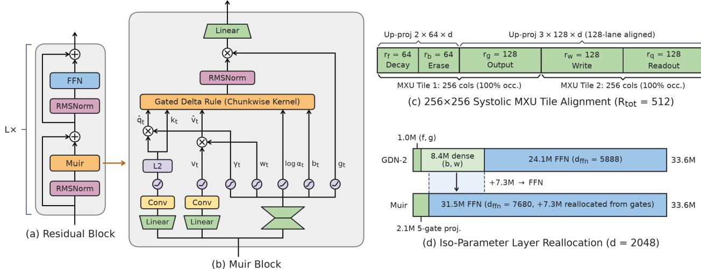  
Figure 3 | Muir co-designs asymmetric low-rank gate parameterization and matched-filter query readout with MXU tile alignment and iso-parameter FFN reallocation. (a) Standard residual block with a Muir token mixer. (b) Within the Muir block, $\pmb { x } _ { t }$ feeds linear-Conv-SiLU pathways for $\left( q _ { t } , k _ { t } , v _ { t } \right)$ alongside a single fused low-rank gate projection that produces all five gates (log $\mathbf { \alpha } ( \alpha _ { t } , b _ { t } , \pmb { g } _ { t } , \pmb { w } _ { t } , \gamma _ { t } ) . \mathbf { \beta } ( \mathrm { c } )$ Asymmetric gate ranks $( r _ { f } , r _ { b } , r _ { g } , r _ { w } , r _ { q } ) = ( 6 4 , 6 4 , 1 2 8 , 1 2 8 , 1 2 8 )$ sum to $R _ { \mathrm { t o t } } = 5 1 2 = 2 \times 2 5 6$ , which fills two 256-column MXU tiles in the fused down-projection and aligns $( f , b )$ and $( g , w , q )$ on 128-lane VMEM tile boundaries for batched up-projections. (d) At $d = 2 { , } 0 4 8$ , replacing the dense $( b , w )$ gate matrices in GDN-2 cuts gate-projection parameters by 4.5×; this either reduces per-layer parameters and FLOPs by 14.6% at fixed FFN width, or frees +7.3M parameters per layer to widen the FFN under an iso-parameter budget.

## 4. Muir

In this section, we translate our theoretical findings in $\ S 3$ into the Muir architecture (Figure 3) and its TPUeficient chunkwise training algorithm (Figure 4).<sup>1</sup> Following Propositions 3.4, 3.6 and 3.10 and Remark 3.7, each Muir head augments the four channel-wise gates of $\mathrm { G D N - 2 } \left( \alpha _ { t } , b _ { t } , { w _ { t } } , \pmb { g } _ { t } \right)$ with a fifth channel-wise gate, a dynamic query readout gain $\gamma _ { t } \in \mathbb { R } ^ { 1 \times d _ { k } }$ that scales the ℓ -normalized query prior to state readout. With the gain-modulated query $\widehat { \pmb q } _ { t } : = \gamma _ { t } \odot { \pmb q } _ { t }$ alongside $\hat { \pmb { S } } _ { t } = \mathrm { D i a g } ( \pmb { \alpha } _ { t } ) \pmb { S } _ { t - 1 } , \hat { \pmb { k } } _ { t } = \hat { \pmb { b } } _ { t } \odot \pmb { k } _ { t }$ , and $\widehat { \pmb { v } } _ { t } = \pmb { w } _ { t } \odot \pmb { v } _ { t }$ , the Muir state update and readout are

$$
\begin{array} { r } { S _ { t } = \left( \mathbf { I } - k _ { t } ^ { \top } \left( b _ { t } \odot k _ { t } \right) \right) \mathrm { D i a g } ( \alpha _ { t } ) S _ { t - 1 } + k _ { t } ^ { \top } ( w _ { t } \odot v _ { t } ) = \hat { S } _ { t } - k _ { t } ^ { \top } \left( \hat { k } _ { t } \hat { S } _ { t } \right) + k _ { t } ^ { \top } \hat { v } _ { t } , \qquad o _ { t } = \hat { q } _ { t } S _ { t } = \left( \gamma _ { t } \odot q _ { t } \right) S _ { t } , } \end{array}\tag{8}
$$

followed by per-head RMSNorm(�<sub>�</sub>) ⊙ SiLU(�<sub>�</sub>) and the output projection ${ \bf W } _ { o }$

## 4.1. Low-Rank Gating and Matched-Filter Readout

While GDN-2 already parameterizes the decay and output gates $( f , g )$ in low rank, it uses dense $d \times d$ matrices for the erase and write gates $( b , w )$ to provide full channel-wise flexibility. However, Proposition 3.1 and Remark 3.3 establish that a low-rank bottleneck on $\mathbf { \delta } _ { \pmb { b } _ { t } }$ sufices to preserve the channel-wise erase control of GDN-2 along the active key subspace while projecting out the oblique erase variance $\| \pmb { s } _ { t } \| _ { 2 } ^ { 2 }$ that inflates the state-transition spectral norm above 1, whereas the write gate ${ \pmb w } _ { t }$ modulates all $d _ { v }$ value channels directly and requires higher projection rank than $\mathbf { \delta } _ { \pmb { b } _ { t } }$ . We therefore replace the separate low-rank $( f , g )$ and dense $( b , w )$ projections in GDN-2 with a single fused low-rank gate projection covering all five gates: decay $f ,$ erase gate $^ { b , }$ output gate $^ { g , }$ write gate $w ,$ and query readout gain �.

Given the token representation $\pmb { x } _ { t } \in \mathbb { R } ^ { 1 \times d }$ , we compute a single fused down-projection $W _ { \downarrow } \in \mathbb { R } ^ { d \times R _ { \mathrm { t o t } } }$ into a bottleneck of total rank $R _ { \mathrm { t o t } } : = r _ { f } + r _ { b } + r _ { g } + r _ { w } + r _ { q }$ , followed by five per-gate up-projections $\pmb { W } _ { m \uparrow } \in \mathbb { R } ^ { r _ { m } \times d }$ with learned channel biases $\pmb { c } _ { m } \in \mathbb { R } ^ { 1 \times d } ;$ :

$$
\begin{array} { r } { h _ { t } = x _ { t } W _ { \downarrow } \in \mathbb { R } ^ { 1 \times R _ { \mathrm { t o t } } } , \quad \left[ h _ { t } ^ { f } \quad h _ { t } ^ { b } \quad h _ { t } ^ { g } \quad h _ { t } ^ { w } \quad h _ { t } ^ { q } \right] = h _ { t } , \quad z _ { t } ^ { m } = h _ { t } ^ { m } W _ { { m } \uparrow } + c _ { m } \mathrm { f o r } m \in \{ f , b , g , w , q \} . } \end{array}\tag{9}
$$

After partitioning each $\pmb { z } _ { t } ^ { m }$ across the $N _ { h }$ heads, the five gate vectors in (8) are parameterized as

$$
\begin{array} { r } { \log \alpha _ { t } = - \exp ( a _ { \mathrm { l o g } } ) \mathrm { s o f t p l u s } ( z _ { t } ^ { f } ) , \quad b _ { t } = 2 \sigma ( z _ { t } ^ { b } ) , \quad w _ { t } = \sigma ( z _ { t } ^ { w } ) , \quad g _ { t } = z _ { t } ^ { g } , \quad \gamma _ { t } = \gamma ^ { \mathrm { s t a t } } \odot 2 \sigma ( z _ { t } ^ { q } ) . } \end{array}
$$

Unlike the unbiased dense (�, �) projections in GDN-2, including a bias $\scriptstyle { \mathbf { c } } _ { m }$ on every up-projection gives each channel an independent operating point despite the low-rank bottleneck $( c _ { f } , c _ { g }$ are inherited from GDN-2, while $c _ { b } , c _ { w } , c _ { q }$ are newly added in Muir).

For the readout gain $\gamma _ { t } .$ , we initialize $\gamma ^ { \mathrm { s t a t } } = 1$ and ${ \pmb W } _ { q \uparrow } = { \pmb 0 }$ (with $\pmb { c } _ { q } = \pmb { 0 } )$ so that $2 \sigma ( z _ { t } ^ { q } ) = \mathbf { 1 }$ and $\gamma _ { t } = { \bf 1 }$ at initialization. Scaling the sigmoid into (0, 2) centers the dynamic multiplier at 1 so each query can either attenuate $( < 1 )$ or amplify $( > 1 )$ state rows relative to $\gamma _ { j } ^ { \mathrm { s t a t } }$ in $\begin{array} { r } { \pmb { o } _ { t } = \sum _ { j = 1 } ^ { d _ { k } } \gamma _ { t , j } q _ { t , j } \pmb { S } _ { t , j , : } } \end{array}$ , whereas an unscaled sigmoid in $( 0 , 1 )$ could only damp $\gamma _ { i } ^ { \mathrm { s t a t } }$ . This factored form lets $\gamma ^ { \mathrm { s t a t } }$ learn the horizon-marginalized power-law profile (Corollary 3.8) and $2 \sigma \big ( z _ { t } ^ { q } \big ) ^ { * }$ learn the lag-dependent matched filter (Proposition 3.6), while scale-invariant $\mathrm { R M S N o r m } ( o _ { t } )$ absorbs the global factor $\kappa _ { \ell }$ in (7). Unlike learned per-channel query-key scaling (Hua et al., 2022; Dehghani et al., 2023; Lahoti et al., 2026), $\gamma _ { t }$ scales only $\pmb q _ { t }$ at readout so $\pmb { k } _ { t }$ remains unit-norm $\left( \left\| \pmb { k } _ { t } \right\| _ { 2 } = 1 \right)$ for contractive erasure.

Rank Allocation and Hardware Alignment. We set the bottleneck ranks $( r _ { f } , r _ { b } , r _ { g } , r _ { w } , r _ { q } )$ in (9) to satisfy two constraints: (i) motivated by the sensitivity asymmetry in Proposition 3.1, the gates that modulate full-dimensional vectors directly (output gate $^ { g , }$ write gate $w ,$ and query readout gain �) receive twice the rank of the gates governing state decay and key-contracted erasure (decay � and erase gate �), and (ii) the total rank $R _ { \mathrm { t o t } }$ is an exact multiple of the 256-column TPU7x MXU tile width. Setting $( r _ { f } , r _ { b } , r _ { g } , r _ { w } , r _ { q } ) = ( 6 4 , 6 4 , 1 2 8 , 1 2 8 , 1 2 8 )$ gives $R _ { \mathrm { t o t } } = 5 1 2 = 2 \times 2 5 6 .$ 2

We also order the columns of $W _ { \downarrow } \in \mathbb { R } ^ { d \times 5 1 2 }$ to match the 256-column MXU tile width and the 128-lane TPU VMEM tile boundary (Figure 3c). Placing the two rank-64 gates $( f , b )$ contiguously at columns [0 : 128] and the three rank-128 gates $( g , w , q )$ contiguously at columns [128: 512] executes the fused down-projection $\pmb { h } _ { t } = \pmb { x } _ { t } \pmb { W } _ { \downarrow }$ across two full 256×256 MXU tiles at 100% column occupancy without zero-padding. At the same time, placing the split between the rank-64 and rank-128 groups at column 128 aligns with an exact 128-lane VMEM tile boundary, so the five up-projections $\pmb { h } _ { t } ^ { m } \pmb { W } _ { m \uparrow }$ execute as two batched matrix multiplications (stacking the two $6 4 \times d$ matrices for $( f , b )$ and the three $1 2 8 \times d$ matrices for $( g , w , q ) )$ ) instead of five separate narrow matrix multiplications.

Iso-Parameter FFN Reallocation. The fused low-rank gate projection (9) uses only $\begin{array} { r } { \sum _ { m } 2 d r _ { m } = 2 d R _ { \mathrm { t o t } } } \end{array}$ parameters instead of $2 d ^ { 2 } + 5 1$ 2� in GDN-2. Under the $1 2 \breve { d ^ { 2 } }$ per-layer non-embedding parameter budget of the Transformer, setting $d _ { \mathrm { f f n } } ( R _ { \mathrm { t o t } } ) = 4 d - R _ { \mathrm { t o t } }$ gives $4 d ^ { 2 } + 2 d \bar { R _ { \mathrm { t o t } } } + \bar { 2 d } ( 4 d - R _ { \mathrm { t o t } } ) = 1 2 \bar { d ^ { 2 } }$ for every � and $R _ { \mathrm { t o t } } ,$ expanding the FFN width relative to $\mathrm { G D N - 2 } \ ( d _ { \mathrm { f n } } = 3 d - 2 5 6 )$ by $\Delta d _ { \mathrm { f f n } } = d - 2 5 6$ channels at $R _ { \mathrm { t o t } } = 5 1 2$ $\mathrm { A t } ~ d = 2 { , } 0 4 8$ and $R _ { \mathrm { t o t } } = 5 1 2$ , replacing the gate projections in GDN-2 (9.44M parameters) with (9) (2.10M parameters) reduces gate-projection parameters and FLOPs by $4 . 5 \times \ ( - 7 7 . 8 \% )$ and token-mixer projection parameters and FLOPs by 28.0% (26.21M → 18.87M parameters/layer). At fixed $d _ { \mathrm { f f n } } = 5 , 8 8 8$ , this reduces full-layer non-embedding parameters and linear FLOPs by 14.6% (50.33M → 42.99M parameters/layer); under our primary iso-parameter budget, reinvesting the 7.34M saved parameters per layer widens $d _ { \mathrm { f f n } }$ from 5,888 to $7 , 6 8 0 = 3 0 \times 2 5 6 \ ( + 1 , 7 9 2$ channels, $0 \mathbf { r } + 3 0 . 4 \% ;$ Figure 3d).

## 4.2. Boundary-Pivoted Chunkwise Kernel

Within each chunk of length � indexed by $t \in \{ 1 , \ldots , C \}$ , starting from chunk-initial state $S _ { 0 } \in \mathbb { R } ^ { d _ { k } \times d _ { v } }$ replacing $\pmb q _ { t }$ with the gain-modulated query $\widehat { \pmb q } _ { t } = \gamma _ { t } \odot \pmb q _ { t }$ reduces the Muir recurrence (8) to the chunkwise linear system of GDN-2 in §2.2. Let $\mathbf { A } _ { t } : = \dot { \sum } _ { r = 1 } ^ { t }$ log $ { \alpha } _ { r } \le 0$ denote the cumulative log-decay at timestep $t , ^ { 3 }$ with chunk-prefix and pairwise relative decays $\pmb { \pi } _ { t } = \exp ( \pmb { \Lambda } _ { t } )$ $\boldsymbol { \pi } _ { t , s } = \exp ( \mathbf { \Lambda } _ { t } - \mathbf { \Lambda } _ { s } ) \in ( 0 , 1 ] ^ { 1 \times d _ { k } } \ ( t \geq s )$ . Evaluating a chunk requires three stages: (i) constructing the unit lower-triangular system matrix $\pmb { T } = \mathbf { I } + \pmb { L } _ { \mathrm { s t r i c t } }$ with strictly lower-triangular entries $( L _ { \mathrm { s t r i c t } } ) _ { t , s } = \bar { \langle } \hat { k } _ { t } , \pi _ { t , s } \odot k _ { s } \rangle \ ( t > s )$ and the lower-triangular causal readout matrix � with entries $M _ { t , s } = \langle \hat { q } _ { t } , \pi _ { t , s } \odot k _ { s } \rangle ~ ( t \geq s ) ; ~ ( \mathrm { i i } )$ solving the triangular system $\bar { \pmb { T } } \pmb { Z } = \left[ \hat { \pmb { V } } \quad \hat { \pmb { K } } _ { \odot \pi } \right]$ for $\pmb { Z } : = \left[ \pmb { U } \quad \pmb { Y } \right] \in \mathbb { R } ^ { C \times ( d _ { v } + d _ { k } ) }$ , where $\hat { V }$ and $\hat { \pmb { K } } _ { \odot \pi }$ have rows $\hat { \pmb { v } } _ { t }$ and $\pi _ { t } \odot \hat { k } _ { t } ,$ respectively; and (iii) substituting $\tilde { \mathbf { V } } = \tilde { \mathbf { U } } - \mathbf { Y } \mathbf { \mathit { S } } _ { 0 }$ into the chunkwise readout and state update to advance the chunk outputs � and end-of-chunk state $\pmb { S } _ { C }$ as afine maps of $\pmb { S } _ { 0 }$ :

$$
{ \cal O } = \big ( \hat { Q } _ { \odot \pi } - M { \cal Y } \big ) S _ { 0 } + M U , \qquad S _ { C } = \big ( \mathrm { D i a g } ( \pi _ { C } ) - \tilde { K } ^ { \top } { \cal Y } \big ) S _ { 0 } + \tilde { K } ^ { \top } U ,\tag{10}
$$

where $\hat { \pmb { Q } } _ { \odot \pi } , \tilde { \pmb { K } } \in \mathbb { R } ^ { C \times d _ { k } }$ have rows $( \hat { Q } _ { \odot \pi } ) _ { t , : } : = \pi _ { t } \odot \hat { \pmb q } _ { t }$ and $\tilde { \pmb { K } } _ { s , : } = \pmb { \pi } _ { C , s } \odot \pmb { k } _ { s }$

Divide-and-Conquer Block Decomposition. As noted in §2.2, executing stages (i) and (ii) directly over the full chunk is bottlenecked by the $C \times C \times d _ { k }$ 3D decay tensor (or the underflowing division $\pmb { \pi } _ { t } \oslash \pmb { \pi } _ { s } )$

when forming � and $M ,$ and by sequential �-step forward substitution when solving with �. Instead of forward substitution, we construct $\bar { \pmb { T } } ^ { - 1 }$ and � via a divide-and-conquer recursion (Heller, 1974; Bini and $\mathrm { P a n } ,$ , 1994; Sobczyk et al., 2026) over a binary tree of depth � and apply $\pmb { T } ^ { - 1 }$ as a matrix multiplication $[ U \mathrm { ~ \bf ~ \vec { ~ } Y ] ~ } { = } T ^ { - 1 } [ \stackrel { \textstyle \cdot } { \hat { V } }   \hat { K } _ { \odot \pi } ]$ . Whenever any contiguous token interval is split into left $( \mathcal { L } )$ and right (ℛ) halves of equal length, the corresponding sub-blocks of $^ { x , }$ its inverse $\pmb { T } ^ { - 1 }$ , and � partition into $2 \times 2$ block form:

$$
T _ { \mathrm { b l k } } = \left[ \frac { T _ { \mathcal { L } } } { T _ { \mathrm { c r o s s } } \ \middle | \ T _ { \mathcal { R } } \right] } , \quad T _ { \mathrm { b l k } } ^ { - 1 } = \left[ \frac { T _ { \mathcal { L } } ^ { - 1 } } { - T _ { \mathcal { R } } ^ { - 1 } T _ { \mathrm { c r o s s } } T _ { \mathcal { L } } ^ { - 1 } \ \middle | \ T _ { \mathcal { R } } ^ { - 1 } } \right] ; \qquad M _ { \mathrm { b l k } } = \left[ \frac { M _ { \mathcal { L } } } { M _ { \mathrm { c r o s s } } \ \middle | \ M _ { \mathcal { R } } } \right] .\tag{11}
$$

Here, the diagonal sub-blocks $( \pmb { T } _ { \mathcal { L } } , \pmb { T } _ { \mathcal { R } } )$ and their inverses $( \pmb { T } _ { \mathcal { L } } ^ { - 1 } , \pmb { T } _ { \mathcal { R } } ^ { - 1 } )$ remain unit lower-triangular and $( M _ { \mathcal { L } } , M _ { \mathcal { R } } )$ remain lower-triangular, whereas the bottom-left cross-blocks $\pmb { T } _ { \mathrm { c r o s s } }$ and $M _ { \mathrm { c r o s s } }$ (whose row indices $t \in \mathcal R$ and column indices $s \in { \mathcal { L } }$ satisfy $t > s$ for every entry) are dense. Because the diagonal sub-blocks preserve the exact same lower-triangular structure on half the interval, bisecting the chunk � times reduces stages (i) and (ii) to a base case on $2 ^ { r }$ leaf intervals of length $n _ { 0 } : = C / 2 ^ { r }$ , followed by � bottom-up merge levels $( m = 0 , \ldots , r - 1 )$ across child intervals of length $n _ { m } : = n _ { 0 } 2 ^ { m }$

Base Case: Diagonal Leaf Blocks $( n _ { 0 } = { C } / { 2 ^ { r } } ) .$ Within each of the $2 ^ { r }$ leaf intervals $( \lceil t / n _ { 0 } \rceil = \lceil s / n _ { 0 } \rceil )$ , we evaluate the pairwise decay $\pi _ { t , s } = \exp ( \pmb { \Lambda } _ { t } - \pmb { \Lambda } _ { s } )$ directly from the non-positive log-diferences $\pmb { \Lambda } _ { t } - \pmb { \Lambda } _ { s } \le \pmb { 0 }$ $\left( t \geq s \right)$ to form the diagonal leaf blocks $\pmb { T } _ { \mathrm { l e a f } } = \mathbf { I } + \pmb { L } _ { \mathrm { l e a f } }$ and $M _ { \mathrm { l e a f } } .$ . Because each leaf has size �<sub>0</sub> $\times \ n _ { 0 } .$ forming the leaf decay tensors across all $2 ^ { r }$ leaves materializes only $2 ^ { r } ( n _ { 0 } ^ { 2 } d _ { k } ) = C n _ { 0 } d _ { k }$ elements per chunk, a $2 ^ { r } \times$ reduction compared to the full $C ^ { 2 } d _ { k }$ 3D decay tensor. Moreover, because the strictly lower-triangular matrix $\pmb { L } _ { \mathrm { l e a f } } \in \mathbb { R } ^ { n _ { 0 } \times n _ { 0 } }$ is nilpotent of index �<sub>0</sub> $( \pmb { L } _ { \mathrm { l e a f } } ^ { n _ { 0 } } = \mathbf { 0 } )$ , its Neumann series terminates at degree $n _ { 0 } - 1$ and factors into $\log _ { 2 }$ � multiplicative stages $( \log _ { 2 } n _ { 0 } - 1$ squaring steps; Orcutt, 1974; Heller, 1978):

$$
\pmb { T } _ { \mathrm { l e a f } } ^ { - 1 } = \sum _ { k = 0 } ^ { n _ { 0 } - 1 } ( - \pmb { L } _ { \mathrm { l e a f } } ) ^ { k } = \prod _ { j = 0 } ^ { \log _ { 2 } n _ { 0 } - 1 } \big ( \mathbf { I } + ( - \pmb { L } _ { \mathrm { l e a f } } ) ^ { 2 ^ { j } } \big ) ,\tag{12}
$$

where $n _ { 0 } \ll C$ bounds nilpotent matrix powers in bfloat16 (Sobczyk et al., 2026).

Inductive Step: Bottom-Up Merge via Boundary-Pivoted Splitting $( n _ { m } = n _ { 0 } 2 ^ { m } )$ At each merge level $( m =$ $\overline { { 0 , \ldots , r - 1 ) } }$ , a parent interval of length $2 n _ { m }$ merges adjacent left $( \mathcal { L } )$ and right (ℛ) child intervals of length $n _ { m } .$ for which the diagonal blocks $( \pmb { T } _ { \mathcal { L } } ^ { - 1 } , \pmb { M } _ { \mathcal { L } } )$ and $( \dot { \pmb { T } } _ { \mathcal { R } } ^ { - 1 } , \pmb { M } _ { \mathcal { R } } )$ have already been computed. By (11), completing the parent blocks requires forming the dense $n _ { m } \times n _ { m }$ cross-blocks $\pmb { T } _ { \mathrm { c r o s s } }$ and $M _ { \mathrm { c r o s s } }$ and multiplying $\mathbf { \partial } \mathbf { \cdot } \mathbf { T } _ { \mathcal { R } } ^ { - 1 } \mathbf { \bar { T } } _ { \mathrm { c r o s s } } \mathbf { T } _ { \mathcal { L } } ^ { - 1 }$ for the bottom-left block of $\pmb { T } _ { \mathrm { b l k } } ^ { - 1 }$ . To compute $\pmb { T } _ { \mathrm { c r o s s } }$ and $M _ { \mathrm { c r o s s } }$ via matrix multiplications without dividing by $\pi _ { s } = \exp ( \pmb { \Lambda } _ { s } )$ , we exploit the fact that every cross-interval pair $( t , s ) \in \mathcal { R } \times \mathcal { L }$ straddles the interval boundary between $\mathcal { L }$ and ℛ. Extending sub-chunk boundary decay splitting (Yang et $\mathrm { a l . }$ , 2023; Yang and Zhang, 2024; Kimi Team et al., 2025) to every merge level of the tree, we choose the boundary pivot $p : = \mathrm { l a s t } ( \mathcal { L } )$ with cumulative log-decay $\pmb { \Lambda } _ { p } \in \dot { \mathbb { R } } ^ { 1 \times d _ { k } }$ and split the log-decay diference across �:

$$
\pi _ { t , s } = \exp ( \Lambda _ { t } - \Lambda _ { s } ) = \exp \big ( ( \Lambda _ { t } - \Lambda _ { p } ) + \big ( \Lambda _ { p } - \Lambda _ { s } \big ) \big ) = \underbrace { \exp ( \Lambda _ { t } - \Lambda _ { p } ) } _ { \pi _ { t , p } } \odot \underbrace { \exp ( \Lambda _ { p } - \Lambda _ { s } ) } _ { \pi _ { p , s } } , \qquad t \in \mathcal { R } , \ s \in \mathcal { L } .
$$

Because cumulative log-decay is monotonically non-increasing $( \pmb { \Lambda } _ { 1 } \geq \cdots \geq \pmb { \Lambda } _ { C } )$ and $s \leq p < t$ for all $s \in { \mathcal { L } }$ and $t \in \mathcal { R }$ , both $\pmb { \Lambda } _ { t } - \pmb { \Lambda } _ { p } \leq \pmb { 0 }$ and $\pmb { \Lambda } _ { p } - \pmb { \Lambda } _ { s } \leq \pmb { 0 }$ hold identically, keeping both exponential factors in $( 0 , 1 ]$ without division or overflow. Each cross-block entry therefore decouples across � as $( L _ { \mathrm { s t r i c t } } ) _ { t , s } = ( \hat { \pmb { k } } _ { t } \odot { \pmb { \pi } } _ { t , p } ) ( { \pmb { k } } _ { s } \odot { \pmb { \pi } } _ { p , s } ) _ { . } ^ { \top }$ and $M _ { t , s } = ( \hat { \pmb q } _ { t } \odot { \pmb \pi } _ { t , p } ) ( { \pmb k } _ { s } \odot { \pmb \pi } _ { p , s } ) ^ { \top }$ . Stacking $\pi _ { t , p } \left( t \in \mathcal { R } \right)$ and $\pi _ { p , s } \ ( s \in \mathcal { L } )$ as the rows of $\pi _ { \mathcal { R } } , \pi _ { \mathcal { L } } \in ( 0 , 1 ] ^ { n _ { m } \times d _ { k } }$ computes both $\pmb { T } _ { \mathrm { c r o s s } }$ and $M _ { \mathrm { c r o s s } }$ in a single row-packed matrix multiplication sharing $( K _ { \mathcal { L } } \odot \pi _ { \mathcal { L } } ) ^ { \top }$ , followed by two matrix multiplications for the bottom-left inverse block $\pmb { X } _ { 2 1 } : = ( \pmb { T } _ { \mathrm { b l k } } ^ { - 1 } ) _ { \mathcal { R } , \mathcal { L } }$ in (11):

$$
\left[ \begin{array} { l } { T _ { \mathrm { c r o s s } } } \\ { M _ { \mathrm { c r o s s } } } \end{array} \right] = \left[ \begin{array} { l } { \hat { K } _ { \mathcal { R } } \odot \pi _ { \mathcal { R } } } \\ { \hat { Q } _ { \mathcal { R } } \odot \pi _ { \mathcal { R } } } \end{array} \right] \left( K _ { \mathcal { L } } \odot \pi _ { \mathcal { L } } \right) ^ { \top } , \qquad X _ { 2 1 } = \left( T _ { \mathrm { b l k } } ^ { - 1 } \right) _ { \mathcal { R } , \mathcal { L } } = - T _ { \mathcal { R } } ^ { - 1 } T _ { \mathrm { c r o s s } } T _ { \mathcal { L } } ^ { - 1 } .
$$

After � merge levels, $\pmb { T } ^ { - 1 }$ and � are assembled across the full chunk without materializing � via prefix division, yielding $\begin{array} { r } { \left[ U \quad Y \right] = T ^ { - 1 } \left[ \hat { V } \quad \hat { K } _ { \odot \pi } \right] } \end{array}$ and the afine state update (10).

Custom Backward Pass. In the backward pass, diferentiating the chunk readout and state update (10) in stage (iii) requires only matrix multiplications to compute the gradients $\mathrm { d } Z = \left\lceil \mathrm { d } U \quad \mathrm { d } Y \right\rceil$ and d� (where $\mathrm { d } X : = \partial \mathcal { I } / \partial X$ for scalar loss $\mathcal { I } )$ . However, naively diferentiating through stages (i) and (ii) via automatic diferentiation would retain all � tree levels of intermediate inverse sub-blocks and scaled key/query tensors in HBM and backpropagate sequentially through the � block-inversion levels (11) and $\log _ { 2 } n _ { 0 } - 1$ leaf-squaring steps. Instead, we define a custom backward pass for stages (i) and (ii) that saves only the assembled inverse $\pmb { T } ^ { - 1 }$ and solved right-hand side � along with the chunk inputs.

First, to backpropagate through stage (ii), diferentiating $\pmb { T } \pmb { Z } = \left[ \hat { \pmb { V } } \quad \hat { \pmb { K } } _ { \odot \pi } \right]$ with $\pmb { T } = \mathbf { I } + \pmb { L } _ { \mathrm { s t r i c t } }$ yields the gradients d $\begin{array} { r l } { \big [ \hat { V } } & { { } \hat { \pmb { K } } _ { \odot \pi } \big ] } \end{array}$ and $\mathrm { d } { \pmb { L } } _ { \mathrm { s t r i c t } } \in \mathbb { R } ^ { C \times C }$ directly from the saved $\pmb { T } ^ { - 1 }$ and � in two full-chunk MXU matrix multiplications without backpropagating through the forward inversion tree:

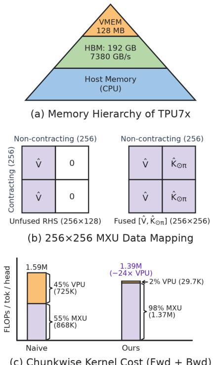

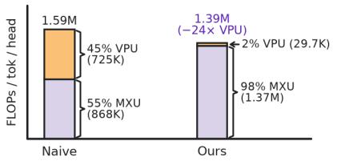  
(c) Chunkwise Kernel Cost (Fwd + Bwd)

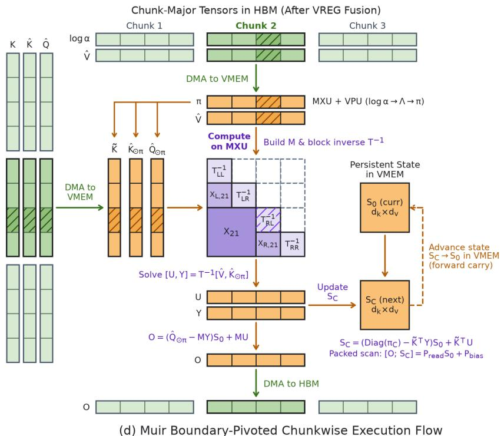  
Figure 4 | Boundary-pivoted chunkwise kernel eliminates 3D decay tensors, division overflow, and VPU bottlenecks. (a) Memory hierarchy of a TPU7x chip. (b) On the $2 5 6 \times 2 5 6 ~ \mathrm { M X U }$ , an unfused 256 × 128 right-hand side �<sup>^</sup> achieves only 50% utilization due to zero-padded lanes, whereas the fused solve $\begin{array} { r } { \left[ U \quad \breve { Y _ { \mathbf { \alpha } } } \right] = T ^ { - 1 } \left\lceil \hat { V } \quad \hat { K } _ { \odot \pi } \right\rceil } \end{array}$ achieves 100% utilization. (c) At chunk size $C = 2 5 6$ , leaf size $^ { 8 , }$ and $d _ { k } = \dot { d } _ { v } = \bar { 1 2 } 8$ , replacing naive $C \times C \times d _ { k }$ 3D VPU decay and sequential VPU triangular solves with boundary-pivoted MXU matrix multiplications, recursive block inversion, and a custom backward pass cuts forward-and-backward VPU compute by 24× and total kernel FLOPs by 12%, routing 98% of chunkwise arithmetic onto the MXU. (d) Boundary-pivoted chunkwise execution combines pre-permutation VREG fusion for $\hat { \pmb q } _ { t }$ and $\hat { \pmb { v } } _ { t } ,$ MXU cumulative log-decay, numerically stable VPU decay splitting, recursive block inversion of $\mathbf { \Delta } ^ { \mathbf { T } }$ on the MXU, and a packed MXU scan carrying $S _ { 0 }  S _ { C }$ in VMEM (saving $\pmb { S } _ { 0 }$ only for backward).

$$
\mathrm { d } \bigl [ \hat { V } \quad \hat { K } _ { \odot \pi } \bigr ] = \pmb { T } ^ { - \top } \mathrm { d } \pmb { Z } , \qquad \mathrm { d } \pmb { L } _ { \mathrm { s t r i c t } } = - \mathrm { s t r i l } \bigl ( \mathrm { d } \bigl [ \hat { V } \quad \hat { K } _ { \odot \pi } \bigr ] \pmb { Z } ^ { \top } \bigr ) ,
$$

where $\begin{array} { r l } { \mathrm { d } \left[ \hat { V } } & { { } \hat { K } _ { \odot \pi } \right] Z ^ { \top } } \end{array}$ uses three-pass bfloat16 MXU multiplication with float32 accumulation so that the log-decay gradients driven by $\scriptstyle \mathrm { d } { \pmb { L } } _ { \mathrm { s t r i c t } }$ retain high accuracy without falling back to the VPU.

Second, to backpropagate $( \mathrm { d } { \cal L } _ { \mathrm { s t r i c t } } , \mathrm { d } M )$ through stage (i) to $( \mathrm { d } \hat { Q } , \mathrm { d } K , \mathrm { d } \hat { K } , \mathrm { d } { \pmb { \Lambda } } )$ without storing intermediate tree activations in HBM, we traverse the same depth-� boundary-pivoted binary tree and diferentiate the $2 ^ { r }$ diagonal leaves of size $n _ { 0 }$ in parallel across leaves. At each merge level $m \in \{ 0 , \ldots , r - 1 \}$ with child size $n _ { m } = n _ { 0 } 2 ^ { m }$ , we recompute the boundary-pivot scalings $\pi _ { \mathcal { R } } = \exp ( \pmb { \Lambda } _ { \mathcal { R } } - \pmb { \Lambda } _ { p } )$ and $\pi _ { \mathcal { L } } = \exp ( \pmb { \Lambda } _ { p } - \pmb { \Lambda } _ { \mathcal { L } } )$ on the fly in VMEM from Λ and compute the scaled query and key gradients from the of-diagonal blocks $\mathrm { d } \pmb { T } _ { \mathrm { c r o s s } } \mathrel { \mathop : } = ( \mathrm { d } \pmb { L } _ { \mathrm { s t r i c t } } ) _ { \mathcal { R } , \mathcal { L } }$ and $\mathrm { d } M _ { \mathrm { c r o s s } } : = ( \mathrm { d } M ) _ { \mathcal { R } , \mathcal { L } } \in \mathbb { R } ^ { n _ { m } \times \tau }$ <sup>�</sup>� in two row-packed MXU matrix multiplications:

$$
\begin{array} { r } { \left[ \mathrm { d } ( \hat { K } _ { \mathcal { R } } \odot \pi _ { \mathcal { R } } ) \right] = \left[ \mathrm { d } T _ { \mathrm { c r o s s } } \right] \left( K _ { \mathcal { L } } \odot \pi _ { \mathcal { L } } \right) , \qquad \mathrm { d } ( K _ { \mathcal { L } } \odot \pi _ { \mathcal { L } } ) = \left[ \mathrm { d } T _ { \mathrm { c r o s s } } \right] ^ { \top } \left[ \hat { K } _ { \mathcal { R } } \odot \pi _ { \mathcal { R } } \right] , } \\ { \left[ \mathrm { d } ( \hat { Q } _ { \mathcal { R } } \odot \pi _ { \mathcal { R } } ) \right] = \left[ \mathrm { d } M _ { \mathrm { c r o s s } } \right] \left( K _ { \mathcal { L } } \odot \pi _ { \mathcal { L } } \right) , \qquad \mathrm { d } ( K _ { \mathcal { L } } \odot \pi _ { \mathcal { L } } ) = \left[ \mathrm { d } T _ { \mathrm { c r o s s } } \right] ^ { \top } \left[ \hat { Q } _ { \mathcal { R } } \odot \pi _ { \mathcal { R } } \right] , } \end{array}
$$

before applying the elementwise chain rule through $\pi _ { \mathcal { R } }$ and $\pmb { \pi } \pmb { \mathcal { L } }$ into $( \mathrm { d } \hat { Q } , \mathrm { d } K , \mathrm { d } \hat { K } , \mathrm { d } { \pmb { \Lambda } } )$ and converting dΛ to d log $\pmb { \alpha } = \mathrm { t r i l } ( \mathbf { 1 } _ { C \times C } ) ^ { \top } \mathrm { d } \mathbf { \Lambda } = \mathrm { t r i u } ( \mathbf { 1 } _ { C \times C } ) \mathrm { d } \mathbf { \Lambda }$ on the MXU (full stage-(iii) backward scan equations and elementwise exponential derivatives are in Appendix F.2).

TPU Implementation and Batched Execution. Figure 4d traces how this algorithm maps onto the TPU7x memory hierarchy (Figure 4a). The projections and depthwise convolutions produce activations in token-major order $( B , T , N _ { h } , d _ { k } )$ , whereas chunkwise execution operates on chunks of length � per head and requires permuting axes into chunk-major order $( N _ { c } , B , N _ { h } , C , \bar { d } _ { k } )$ with $T = N _ { c } C .$ . Because permuting the trailing tiled dimensions from $( N _ { h } , d _ { k } )$ to $( C , d _ { k } )$ incurs an HBM round-trip per tensor, and (8) depends on $\left( q _ { t } , \gamma _ { t } \right)$ and $( \pmb { v } _ { t } , \pmb { w } _ { t } )$ only through $\hat { \pmb q } _ { t } = \gamma _ { t } \odot { \pmb q } _ { t }$ and $\hat { \pmb { v } } _ { t } = \pmb { w } _ { t } \odot \pmb { v } _ { t } .$ , we fuse $\hat { \pmb q } _ { t }$ and $\hat { \pmb { v } } _ { t }$ in VREGs before permutation (Figure 3b) alongside $\hat { \pmb { k } } _ { t } = \pmb { b } _ { t } \odot \pmb { k } _ { t }$ (retaining $\pmb { k } _ { t } )$ , reducing the token-to-chunk permutation from seven tensors to five: $( \log \alpha , \hat { V } , K , \hat { K } , \hat { Q } )$

We set $C = 2 5 6$ to match the $2 5 6 \times 2 5 6 ~ \mathrm { M X U }$ tile size and ${ n _ { 0 } = 8 \left( r = 5 \right. }$ levels, 32 leaves per chunk) to match the 8-row 32-bit T(8, 128) VMEM tile for float32 leaf bufers during bfloat16 MXU squaring (before casting $\pmb { T } _ { \mathrm { l e a f } } ^ { - 1 }$ to bfloat16); Figure 4d illustrates a two-level tree with four leaves $\pmb { T } _ { \mathcal { L L } } ^ { - 1 } , \pmb { T } _ { \mathcal { L R } } ^ { - 1 } , \pmb { T } _ { \mathcal { R L } } ^ { - 1 } , \pmb { T } _ { \mathcal { R R } } ^ { - 1 }$ and of-diagonal inverse blocks $\pmb { X } _ { \mathcal { L } , 2 1 } , \pmb { X } _ { \mathcal { R } , 2 1 }$ , and $\pmb { X } _ { 2 1 }$ . To evaluate all nodes at a given tree depth simultaneously, reshaping the chunk axis into (32, 8) at the leaf level folds all 32 leaves into the leading batch dimensions $( N _ { c } , B , N _ { h } , 3 2 )$ so leaf evaluation and the two Neumann squaring steps run in parallel across all leaves, chunks, and heads. Likewise, at each merge level $m \in \{ 0 , \ldots , 4 \}$ , reshaping the chunk axis into $( N _ { m } , 2 n _ { m } )$ with $N _ { m } = 2 ^ { 4 - m }$ parent nodes folds all $N _ { m }$ merges across all chunks and heads into batched MXU contractions, so the full tree completes in $r = 5$ sequential stages in both the forward and backward passes.

Once $\pmb { T } ^ { - 1 }$ and � are assembled, concatenating $\begin{array} { r l } { [ \hat { V } } & { { } \hat { K } _ { \odot \pi } ] \in \mathbb { R } ^ { 2 5 6 \times 2 5 6 } } \end{array}$ along columns (for $d _ { k } = d _ { v } = 1 2 8 )$ computes $\left[ U \quad Y \right] = T ^ { - 1 } \left[ \hat { V } \quad \hat { K } _ { \odot \pi } \right]$ (and $\pmb { T } ^ { - \top } \mathrm { d } \bar { \pmb { z } }$ in the backward pass) in a single $2 5 6 \times 2 5 6$ MXU matrix multiplication per chunk at 100% tile utilization, whereas unfused $2 5 6 \times 1 2 8$ solves drop to 50% utilization (Figure 4b). Similarly, stacking � and $\tilde { \pmb { K } } ^ { \top }$ along rows into a $( C + d _ { k } ) \times C$ matrix multiplies $\begin{array} { r l } { [ U } & { { } Y ] } \end{array}$ in one packed MXU contraction across all chunks in parallel to form $( \mathbf { \phi } _ { P \mathrm { r e a d } } , \mathbf { \mathit { P } } _ { \mathrm { b i a s } } )$ of (10):

$$
\left[ \begin{array} { l } { \boldsymbol { O } } \\  \boldsymbol { S } _ { C } \right] = \underbrace { \left( \left[ \begin{array} { l } { \hat { Q } _ { \odot \pi } } \\ { \mathrm { D i a g } ( \pi _ { C } ) } \end{array} \right] - \left[ \begin{array} { l } { M } \\ { \tilde { K } ^ { \top } } \end{array} \right] \boldsymbol { Y } \right) } _ { P _ { \mathrm { r e a d } } } S _ { 0 } + \underbrace { \left[ \begin{array} { l } { M } \\ { \tilde { K } ^ { \top } } \end{array} \right] \boldsymbol { U } } _ { P _ { \mathrm { b i a s } } } . \end{array}
$$

Because the per-head state $S _ { 0 } \in \mathbb { R } ^ { 1 2 8 \times 1 2 8 }$ (float32, 64 KB per head) fits in on-chip VMEM (128 MB per chip), this packed scan carries $S _ { 0 }  S _ { C }$ in VMEM during the forward sweep and writes chunk-boundary $\pmb { S } _ { 0 }$ to HBM only for the backward pass. Over a full training step (Figure 4c and Appendix F.1), this kernel executes 1.37M MXU FLOPs (98%) and only 29.7K VPU FLOPs (2%) per token per head, which reduces VPU compute by 24× and total chunkwise FLOPs by 12% relative to naive chunkwise execution.

## 5. Experiments

We detail our experimental setup in §5.1, present main results on language modeling, recall, length extrapolation, training throughput, and numerical stability in §5.2, and ablate Muir in §5.3.

## 5.1. Experimental Setup

Models and Baselines. We evaluate all models across four iso-parameter scales: 166M $( L = 8 , d = 1 , 0 2 4 )$ 406M $( L = 1 1 , d = 1 , 5 3 6 )$ , 834M $( L = 1 4 , d = 2 , 0 4 8 )$ , and 1.34B $( L = 2 4 , d = 2 , 0 4 8 )$ , where all architectures at a given scale share depth $L ,$ residual width �, head dimension $d _ { k } = d _ { v } = 1 2 8 \ ( N _ { h } = d / 1 2 8 $ heads), a GELU FFN, and untied input and output embeddings (full per-scale configurations are provided in Appendix G.1). Under the $1 2 d ^ { 2 }$ per-layer non-embedding parameter budget, we compare five model variants across all four scales: (i) Transformer, with rotary position embeddings (RoPE, $\theta = 1 0 , 0 0 0 ;$ Su et al., 2021), FFN width $d _ { \mathrm { f f n } } = 4 d$ , and TPU Pallas Splash Attention (Dao et al., 2022);<sup>4</sup> (ii) GDN-2, the channel-wise gated delta recurrence with rank-128 $( f , g )$ gates, dense $d \times d \ ( b , w )$ gates, and $\dot { d } _ { \mathrm { f f n } } = 3 d - 2 5 6 ; ^ { 5 }$ (iii) Muir (no �), which replaces the gate projections in GDN-2 with the fused low-rank projection of ranks $( r _ { f } , r _ { b } , r _ { g } , r _ { w } , r _ { q } ) = ( 6 4 , 6 4$ , 128, 256, 0) and unit readout $( \gamma _ { t } = 1 )$ ; (iv) Muir (static �), which adds the learned static readout gain $\gamma _ { t } = \gamma ^ { \mathrm { s t a t } }$ at the same gate ranks; and (v) Muir (ours), which splits the 256-column write budget into $( r _ { w } , r _ { q } ) = ( 1 2 8 , 1 2 8 )$ to parameterize the dynamic readout gain $\gamma _ { t }$ . Across all recurrent models (ii)–(v), the chunkwise recurrence is executed with chunk length $C = 2 5 6$ , and all three Muir variants (iii)–(v) share total gate rank $R _ { \mathrm { t o t } } = 5 1 2$ and FFN width $d _ { \mathrm { f f n } } = 4 d - 5 1 2$

Pretraining Recipe. Following Hatamizadeh et al. (2026), we pretrain all models from scratch on 100B tokens sampled from FineWeb-Edu (Penedo et al., 2024), tokenized with the 32,000-token Llama-2 Sentence-Piece tokenizer (Touvron et al., 2023) and presented in identical token order across all runs. We optimize all models using AdamW (Loshchilov and Hutter, 2017) $( \beta _ { 1 } = 0 . 9 , \beta _ { 2 } = 0 . 9 9 9 )$ with weight decay 0.1 on weight matrices (0.0 on additive biases, $\scriptstyle a _ { \mathrm { l o g } } ,$ and $\gamma ^ { \mathrm { s t a t } } ) .$ , global gradient norm clipping at 1.0, and a 1B-token (1%) linear warmup to a peak learning rate of $4 \times 1 0 ^ { - 4 }$ followed by cosine decay to $4 \times 1 0 ^ { - 5 } ~ ( 0 . 1 \times \mathrm { p e a k } )$ . Training runs on 8 TPU7x chips in bfloat16 mixed precision (with float32 master weights, recurrent state $\boldsymbol { S } _ { t } ,$ and cumulative log-decay $\mathbf { \boldsymbol { \Lambda } } _ { t } )$ at sequence length $T = 4 { , } 0 9 \dot { 6 }$ and a global batch size of 524,288 tokens/step.

Evaluation. We evaluate language modeling and commonsense reasoning using the lm-evaluation-harness (Gao et al., 2024). We report held-out FineWeb-Edu validation token negative log-likelihood (NLL, over 100M tokens) and word-level perplexity on WikiText (Merity et al., 2016) and LAMBADA (Paperno et al., 2016). We also report zero-shot accuracy on LAMBADA, PIQA (Bisk et al., 2020), HellaSwag (Zellers et al., 2019), WinoGrande (Sakaguchi et al., 2021), ARC-Easy and ARC-Challenge (Clark et al., 2018), OpenBookQA (Mihaylov et al., 2018), and Social IQA (Sap et al., 2019), as well as 5-shot WinoGrande and closed-book TriviaQA (Joshi et al., 2017). Following Yang et al. (2025b); Lahoti et al. (2026), we report length-normalized accuracy for HellaSwag and ARC-Challenge, and unnormalized accuracy for all other tasks.<sup>6</sup>

To evaluate associative recall, we test synthetic retrieval and state tracking on six tasks from RULER (Hsieh et al., 2024) (500 examples per task and context length, spanning uniform needle depths 0–100%): single-needle retrieval $( \dot { \mathrm { S } } { \mathrm { - } } \dot { \mathrm { N I A H } } { \mathrm { - } } 1 / 2 \bar { / } 3$ , testing 7-digit numbers and 36-character UUIDs in synthetic noise and Paul Graham essays), as well as 5-hop variable tracking (VT), at context lengths 1K–8K (2× the 4K training window), alongside multi-value (MV-NIAH, 4 values bound to one key) and multi-query (MQ-NIAH, 4 distinct query keys) retrieval across the in-distribution lengths 1K–4K (additional details in Appendix H.2). We also evaluate real-world extractive recall at 2K context on the six Based/JRT benchmarks (Arora et al., 2024a;b): SWDE (Lockard et al., 2019), SQuAD (Rajpurkar et al., 2018), FDA (Arora et al., 2023b), TriviaQA (Joshi et al., 2017), Natural Questions (Kwiatkowski et al., 2019), and DROP (Dua et al., 2019).

For length extrapolation, we test the 1.34B models both zero-shot from 4K pretraining and after a 300-step 64K cooldown (0.315B held-out FineWeb-Edu tokens, or 0.3% of pretraining, using a 70/30 token mix of $\ge 1 6 \mathrm { K }$ and standard documents; Fu et al., 2024). Our Transformer baseline uses training-free Dynamic YaRN (Peng et al., 2024) beyond 4K in the zero-shot regime and raises the RoPE base to $\theta = 5 \times 1 0 ^ { 5 }$ during cooldown (Xiong et al., 2024) with Dynamic YaRN beyond 64K (Appendix G.2). Language-modeling extrapolation covers 64 contiguous 128K-token documents $( S = 1 2 8 \mathrm { K } , T \in \{ 4 \mathrm { K } , \dots , 1 2 8 \mathrm { K } \} )$ and three continuous 10M-token streams $( S = 1 0 \mathrm { M } , T \in \{ 4 \mathrm { K } , \dots , 1 0 \mathrm { M } \} )$ from FineWeb-Edu validation, where each sequence is partitioned into $S / T$ nonoverlapping reset windows so every $_ T$ scores identical target tokens; to separate long-range state drift from fewer boundary resets, we pair 128K perplexity with $\Delta _ { \mathrm { t a i l } } : = \bar { \mathrm { N L } } \mathrm { L } _ { [ 1 2 7 \mathrm { K } , 1 2 8 \mathrm { K } ) } ( \bar { T } = 1 2 8 \mathrm { K } ) - \bar { \mathrm { N L } } \mathrm { L } _ { [ 1 2 7 \mathrm { K } , 1 2 8 \mathrm { K } ) } ( \bar { T } = 4 \mathrm { K } )$ Long-context passkey retrieval is evaluated on RULER S-NIAH-1 from 1K to 1M tokens (160 examples across 10 uniform depth bins at each of 11 context lengths).

Finally, we measure end-to-end training throughput (K tokens/s) on 8 TPU7x chips at a fixed batch size of 524,288 tokens/step across sequence lengths � ∈ {2K, 4K, 8K, 16K, 32K} for Muir against GDN-2 and Transformer. We also verify the numerical accuracy and conditioning of the boundary-pivoted $C = 2 5 6$ chunkwise kernel against an exact float64 sequential reference.

## 5.2. Results

## 5.2.1. Language Modeling and Commonsense Reasoning

Across all four model scales (Figure 5 and Table 1), all three Muir variants outperform GDN-2 and Transformer on validation NLL, WikiText perplexity, and the 8-task zero-shot average.

Pretraining and Scaling Dynamics. In Figure 5, all three Muir variants improve over GDN-2 within the first 10B tokens and reach a 12–20 millinat (mnat) reduction by 100B tokens because reallocating the freed gate parameters to widen the FFN (from $d _ { \mathrm { f i n } } = 3 d - 2 5 6 { \mathrm { ~ t o ~ } } 4 d - 5 1 2 )$ expands token-level representation capacity from the start of optimization. As training proceeds and the recurrent heads specialize their decay gates $\pmb { \alpha } _ { t }$ across timescales, the resulting stationary row-energy imbalance (Proposition 3.4) creates headroom for the matched-filter readout (Proposition 3.6 and Corollary 3.8), and static and dynamic $\gamma _ { t }$ maintain consistent additional gains over Muir (no �) throughout training. Across all four scales, Muir reaches the 100B-token validation NLL of GDN-2 by roughly 85B tokens (1.2× faster), and at 1.34B (Table 1), full Muir lowers final validation NLL by 20.4 mnats relative to GDN-2 and by 36.2 mnats relative to Transformer, with matched-filter readout accounting for 3.3 mnats of the improvement over Muir (no �).

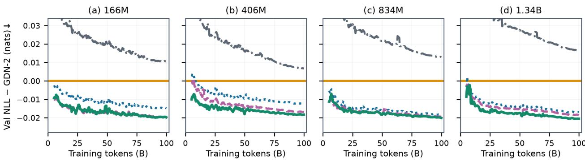  
— Transformer GDN-2 … Muir (no γ)   Muir (static γ) Muir  
Figure 5 | Muir consistently lowers validation NLL relative to GDN-2 and Transformer throughout 100B-token pretraining. Held-out FineWeb-Edu validation token NLL diference relative to GDN-2 across 166M–1.34B parameters as a function of training tokens. All three Muir variants improve over GDN-2 within the first 10B tokens and reach a 12–20 mnat reduction by 100B tokens, while static and dynamic matched-filter readout provide additional reductions over Muir (no �).

Table 1 | Muir improves language modeling and downstream reasoning over Transformer and GDN-2 across model scale. We report FineWeb-Edu validation token NLL (FW-Edu), WikiText (Wiki.) and LAMBADA (LMB.) word-level perplexity, zero-shot accuracy across eight commonsense reasoning benchmarks and their mean (Avg.), and 5-shot WinoGrande (Wino.) and TriviaQA (TQA) accuracy after 100B training tokens. Best results per scale are in bold and second-best are underlined.
<table><tr><td colspan="2" rowspan="2">Model</td><td colspan="3">Language Modeling</td><td colspan="10">Zero-Shot Commonsense Reasoning</td><td colspan="2">5-Shot</td></tr><tr><td>FW-Edu NLL↓</td><td>Wiki. LMB. ppl ↓</td><td>ppl↓</td><td>LMB. PIQA acc ↑</td><td>acc ↑</td><td>Hella. acc_n ↑</td><td>Wino. acc ↑</td><td>ARC-e acc ↑</td><td>ARC-c</td><td></td><td>OBQA SIQA</td><td></td><td>Avg.</td><td>Wino. TQA</td></tr><tr><td rowspan="4">16M</td><td>Transformer</td><td>2.4569</td><td>31.64</td><td>52.69</td><td>28.47</td><td>65.67</td><td>35.95</td><td>50.99</td><td>55.35</td><td>acc_n ↑ 26.28</td><td>acc ↑ 20.20</td><td>acc ↑ 36.39</td><td>acc ↑ 39.91</td><td>acc ↑ 49.96</td><td>acc ↑ 4.74</td></tr><tr><td>GDN-2</td><td>2.4466</td><td>30.84</td><td>39.89</td><td>30.60</td><td>64.74</td><td>37.02</td><td>50.28</td><td>56.61</td><td>26.45</td><td>20.40</td><td>37.92</td><td>40.50</td><td>50.12</td><td>5.80</td></tr><tr><td>Muir (no γ)</td><td>2.4322</td><td>30.31</td><td>34.87</td><td>32.68</td><td>65.51</td><td>38.19</td><td>52.01</td><td>56.48</td><td>27.82</td><td>20.80</td><td>38.95</td><td>41.55</td><td>52.49</td><td>3.77</td></tr><tr><td>Muir (static γ)</td><td>2.4273</td><td>29.83</td><td>40.98</td><td>30.58</td><td>66.43</td><td>37.92</td><td>51.78</td><td>55.30</td><td>26.54</td><td>20.80</td><td>38.18</td><td>40.94</td><td>51.54</td><td>4.32</td></tr><tr><td rowspan="4">06M</td><td>Muir (ours)</td><td>2.4276</td><td>30.28</td><td>34.45</td><td>32.72</td><td>63.93</td><td>37.84</td><td>51.70</td><td>54.88</td><td>25.85</td><td>21.80</td><td>38.18</td><td>40.86</td><td>50.51</td><td>5.32</td></tr><tr><td>Transformer</td><td>2.2424</td><td>23.18 21.10</td><td></td><td>39.74</td><td>68.77</td><td>45.34</td><td>53.83</td><td>62.37</td><td>30.03</td><td>25.00</td><td>39.71</td><td>45.60</td><td>52.41</td><td>9.06</td></tr><tr><td>GDN-2</td><td>2.2354</td><td>22.90</td><td>19.15</td><td>40.64</td><td>69.26</td><td>45.51</td><td>53.04</td><td>62.42</td><td>30.29</td><td>25.40</td><td>39.10</td><td>45.71</td><td>53.04</td><td>9.08</td></tr><tr><td>Muir (no γ) Muir (static γ)</td><td>2.2230</td><td>22.26</td><td>18.11</td><td>41.55</td><td>68.34</td><td>46.95</td><td>53.99</td><td>62.12</td><td>30.89</td><td>26.80</td><td>39.51</td><td>46.27</td><td>53.12</td><td>10.30</td></tr><tr><td rowspan="4"></td><td>Muir (ours)</td><td>2.2191</td><td>22.35</td><td>20.15</td><td>39.96</td><td>69.04</td><td>46.50</td><td>54.06</td><td>64.60</td><td>32.17</td><td>24.60</td><td>38.18</td><td>46.14</td><td>52.72</td><td>10.83</td></tr><tr><td></td><td>2.2174</td><td>22.31</td><td>20.00</td><td>40.11</td><td>68.77</td><td>46.97</td><td>52.49</td><td>61.41</td><td>31.66</td><td>25.40</td><td>39.82</td><td>45.83</td><td>52.57</td><td>10.05</td></tr><tr><td>Transformer</td><td>2.1186</td><td>19.46 14.79</td><td></td><td>44.77</td><td>70.78</td><td>52.04</td><td>55.56</td><td>66.04</td><td>32.59</td><td>26.80</td><td>39.36</td><td>48.49</td><td></td><td>11.85</td></tr><tr><td>GDN-2</td><td>2.1060</td><td>19.17</td><td>13.49</td><td>46.54</td><td>71.00</td><td>52.48</td><td>55.41</td><td>66.96</td><td>35.24</td><td>28.00</td><td>39.00</td><td>49.33</td><td>55.17 54.70</td><td>13.40</td></tr><tr><td rowspan="4">8344</td><td>Muir (no γ)</td><td>2.0876</td><td>18.46</td><td>12.57</td><td>47.43</td><td>70.84</td><td>53.91</td><td>58.25</td><td>69.32</td><td>35.41</td><td>28.20</td><td>40.89</td><td>50.53</td><td>58.17</td><td>14.34</td></tr><tr><td>Muir (static γ)</td><td>2.0869</td><td>18.42</td><td>12.64</td><td>47.49</td><td>71.22</td><td>53.80</td><td>56.83</td><td>68.69</td><td>35.32</td><td>27.80</td><td>39.97</td><td>50.14</td><td>57.93</td><td>13.32</td></tr><tr><td>Muir (ours)</td><td>2.0862</td><td>18.58</td><td>11.88</td><td>49.00</td><td>71.38</td><td>53.96</td><td>56.27</td><td>67.09</td><td>36.43</td><td>28.80</td><td>40.02</td><td>50.37</td><td>57.62</td><td>13.58</td></tr><tr><td>Transformer</td><td></td><td></td><td></td><td>51.80</td><td>71.27</td><td>56.96</td><td>57.85</td><td>71.04</td><td></td><td></td><td></td><td></td><td></td><td></td></tr><tr><td rowspan="5">1.34B</td><td>GDN-2</td><td>2.0335</td><td>17.17</td><td>10.30</td><td>50.92</td><td>72.36</td><td>57.91</td><td>58.72</td><td>70.71</td><td>36.60 38.74</td><td>28.40 30.40</td><td>42.48</td><td>52.05</td><td>57.77</td><td>14.56</td></tr><tr><td></td><td>2.0177 2.0006</td><td>16.80</td><td>10.38</td><td></td><td></td><td></td><td></td><td></td><td></td><td></td><td></td><td>39.92</td><td>52.46</td><td>59.91</td><td>16.48</td></tr><tr><td>Muir (no γ) Muir (static γ)</td><td></td><td>16.46</td><td>10.26</td><td>51.12</td><td>73.01</td><td>59.12 59.47</td><td></td><td>58.48 59.35</td><td>73.23 72.94</td><td>40.27</td><td>33.60 31.80</td><td>41.45 40.38</td><td>53.79</td><td>60.14</td><td>16.52</td></tr><tr><td></td><td>1.9994</td><td>16.35</td><td>10.15</td><td>49.97</td><td>72.14 73.56</td><td></td><td>59.34</td><td>59.67</td><td>73.15</td><td>41.13 39.16</td><td>33.20</td><td></td><td>53.40</td><td>58.48</td><td>17.71</td></tr><tr><td>Muir (ours)</td><td>1.9973</td><td>16.41</td><td>10.00</td><td>51.58</td><td></td><td></td><td></td><td></td><td></td><td></td><td></td><td>41.10</td><td>53.84</td><td>60.69</td><td>19.32</td></tr></table>

Short-Context Parametric Knowledge and Context-Dependent Readout. Standard zero-shot multiple-choice benchmarks (PIQA, HellaSwag, WinoGrande, ARC, OBQA, and SIQA) use short prompts (<100 tokens) that place little load on long-range state retention and mainly probe world knowledge in FFN weights (Geva et al., 2021; Meng et al., 2022). Whereas GDN-2 improves temporal mixing over Transformer $( d _ { \mathrm { f f n } } = 4 d )$ at the cost of a 28–31% narrower FFN, Muir retains the gated-delta mixer while restoring near-Transformer FFN width; with this shared FFN expansion, all three Muir variants achieve comparable gains over GDN-2 and Transformer across scales. At 1.34B, Muir outperforms GDN-2 on all eight zero-shot tasks and raises the 8-task average by +1.38 points over GDN-2 (+1.79 over Transformer), while the three Muir variants remain within single-checkpoint sampling noise (0.4–0.7 points) at smaller scales.

(a) RULER S-NIAH-1/2/3 (1.34B)  
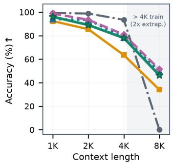

(b) RULER Variable Tracking (1.34B)  
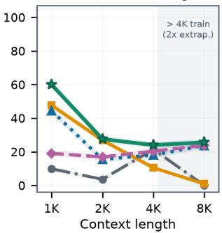  
(e) RULER Avg Recall by Depth (1.34B)

(c) RULER MV-NIAH (1.34B)  
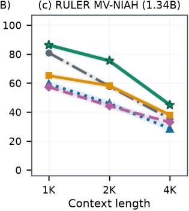

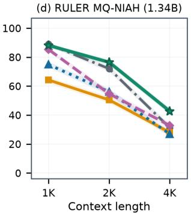  
(f) Based Recall Gain at 2K (1.34B)

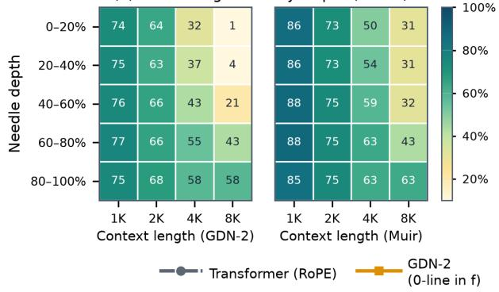

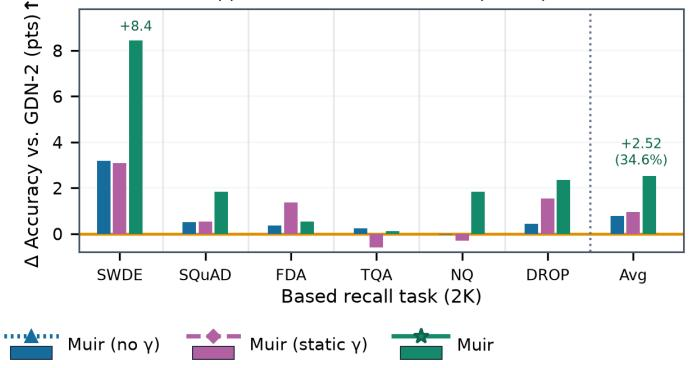  
Figure 6 | Muir improves synthetic single-needle, multi-hop, multi-needle, and real-world retrieval over GDN-2. (a) Averaged across the three single-needle tasks, all Muir variants mitigate the 4K degradation of GDN-2 and extrapolate to 8K, where unextended RoPE Transformer degrades beyond its 4K training window. (b) On 5-hop variable-binding chains, static $\gamma$ fails to match the varying hop lags, whereas dynamic � leads all models at every context length. (c, d) When retrieving four values bound to a single key or four distinct keys queried jointly, dynamic $\gamma _ { t }$ matches or outperforms both GDN-2 and Transformer across 1K–4K. (e) Averaged across the RULER tasks (a–d) by needle depth and context length, Muir achieves the largest gains over GDN-2 on early needles (0–40% depth) at 4K–8K. (f) On real-world document extraction at 2K, Muir improves over GDN-2 on all six tasks, with dynamic $\gamma _ { t }$ driving 69% of the gain.

By contrast, tasks that require resolving predictions from extended context isolate the readout filter. On LAMBADA word-level perplexity (predicting the final word of a passage from the preceding context) and on 5-shot WinoGrande and closed-book TriviaQA (extracting task formatting and entity-answer patterns across five in-context demonstrations while suppressing interference from earlier examples), FFN expansion alone (Muir no �) provides almost no gain over GDN-2 at 1.34B (10.26 vs. 10.38 on LAMBADA perplexity; 16.52% vs. 16.48% on 5-shot TriviaQA). Introducing the dynamic readout gain $\gamma _ { t }$ drives the improvement on these context-sensitive evaluations, lowering 1.34B LAMBADA perplexity to 10.00 (achieving the lowest perplexity at 166M, 834M, and 1.34B)<sup>7</sup> and raising 5-shot TriviaQA accuracy to 19.32%. Consistent with Proposition 3.6 and Remark 3.7, processing a multi-shot prompt requires querying both local syntactic context at short lags and demonstration patterns at lags of several hundred tokens, a bimodal retrieval mixture that dynamic �<sub>�</sub> resolves where a static gain vector cannot.

## 5.2.2. Associative Recall

Figure 6 evaluates synthetic retrieval across the six RULER tasks and real-world document extraction across the six Based/JRT tasks at 1.34B parameters (complete per-task and per-length tables are in Appendix H.2).

Single-Needle, Multi-Hop, and Multi-Needle Retrieval. Across the three single-needle tasks (S-NIAH-1/2/3; Figure 6a), unweighted readout in GDN-2 degrades as context length increases.<sup>8</sup> As established in

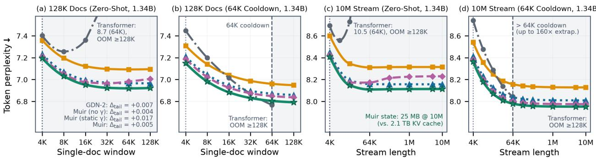  
Transformer (YaRN) GDN-2  Muir (no γ) Muir (static γ) Muir  
Figure 7 | Muir extrapolates to 128K-token documents and 10M-token streams with the lowest perplexity at a constant 25 MB state. (a, c) Zero-shot from 4K pretraining, Dynamic YaRN Transformer diverges past 8K and unchunked evaluation exceeds HBM $\mathrm { a t \geq 1 2 8 K }$ , while Muir (static �) drifts upward past 32K; dynamic $\gamma _ { t }$ avoids this static-gain drift and outperforms GDN-2 across 128K documents and 10M-token streams (2,560× training length). (b, d) After a 64K cooldown (0.3% of pretraining), Transformer improves through 64K before unchunked evaluation exceeds HBM at $\geq 1 2 8 \mathrm { K }$ , static-� drift vanishes, and all Muir variants improve monotonically below GDN-2 through 10M tokens (160× beyond cooldown).

Proposition 3.10 and Remark 3.11, unit readout $( \gamma _ { t } = 1 )$ forces the recurrence to rely on heavier write-time erasure $\bar { b }$ to keep multi-write interference bounded in high-energy rows, which shortens the efective memory horizon $\tau _ { \mathrm { e f f } , j } ( b )$ and flushes distant needles over thousands of intervening tokens. Calibrating channel readout (Proposition 3.6 and Corollary 3.8) lowers the equilibrium erase rate and raises the 1K–8K single-needle mean over both baselines, with Muir holding 100% on S-NIAH-1 through 8K. Because a single needle is queried at one depth at the end of the prompt, a fixed channel filter (Muir static �) sufices to suppress fast-row noise on single-key lookups, and pairing static $\gamma$ with the wider write gate $( r _ { w } = 2 5 6 ~ \mathrm { v s }$ . 128 in full Muir at fixed $R _ { \mathrm { t o t } } = 5 1 2 )$ reaches a slightly higher $\mathrm { S } { \mathrm { - N I A H { - } 1 } } / 2 / 3$ average, particularly on S-NIAH-3 where writing a 36-character UUID across roughly 34 tokens benefits from higher write-gate rank.

By contrast, resolving a 5-hop pointer chain on VT (Figure 6b) or sequentially retrieving four values on MV-NIAH (Figure 6c) and MQ-NIAH (Figure 6d) requires querying associations stored at multiple depths and shifting the readout filter across state channels as each answer token is generated. Because a single static gain vector cannot match multiple retrieval lags simultaneously (Remark 3.7), static $\gamma$ falls below unweighted Muir on VT and below GDN-2 on MV-NIAH. Reallocating half of the write-gate rank to parameterize token-dependent $\gamma _ { t }$ trades single-UUID write capacity for lag-adaptive readout, enabling Muir to outperform all recurrent and attention baselines and achieve the highest overall RULER suite average.

Depth Horizon and Real-World Extractive Recall. In the depth-by-length breakdown (Figure 6e), both GDN-2 and Muir maintain uniform recall across needle depths at 1K–2K (with Muir leading by 7–12 points), whereas decoupling query-time noise suppression from write-time erasure (Proposition 3.10) prevents the premature overwriting that causes GDN-2 accuracy to drop sharply on early-context needles (0–40% depth) at 4K–8K. Similarly, on Based/JRT (Figure 6f), extracting semi-structured attributes (SWDE, FDA) and passage spans (SQuAD, TriviaQA, NQ, DROP) from natural documents requires resolving query-target lags that vary widely across examples. Consequently, FFN expansion (Muir no �) and static scaling (Muir static $\gamma )$ yield only modest gains over GDN-2, whereas dynamic $\gamma _ { t }$ adapts the channel filter per query token to drive the bulk of the six-task improvement and surpass Transformer on DROP.

## 5.2.3. Length Extrapolation

Figures 7 and 8 evaluate length extrapolation up to 10M-token language-modeling streams and 1M-token passkey retrieval at 1.34B parameters (full tables in Appendix H.3). In zero-shot language modeling (Figure $^ { 7 \mathrm { a , c ) } }$ , Dynamic YaRN slows Transformer divergence past 4K, but perplexity rises past 8K and unchunked evaluation exceeds HBM at ≥ 128K; even if chunked, a 10M-token KV cache needs 2.1 TB in bfloat16, or 0.32 TB at 2.5 bits (Zandieh et al., 2026), compared to a 25 MB float32 state across all 24 layers. Whereas EOS-separated packed streams reset discourse context and stay flat $( \Delta _ { \mathrm { t a i l } } \approx 0 )$ , continuous topical accumulation in 128K documents and 10M streams causes Muir (static �) to drift upward past 32K $( \Delta _ { \mathrm { t a i l } } = + 0 . 0 1 7 ~ \mathrm { n a t s } )$ because a fixed gain calibrated at 4K over-weights slow-decaying rows once their energy builds over longer horizons (Proposition 3.4 and Remark 3.7). Adapting the channel filter per query via dynamic $\gamma _ { t }$ cuts tail drift by 3.6× (vs. static �) and achieves the lowest perplexity at every horizon up to 10M tokens. After the 64K cooldown (Figure 7b,d), Transformer improves through 64K before unchunked evaluation exceeds HBM at $\geq 1 2 8 \mathrm { K }$ , whereas recalibrated slow-channel gains eliminate static-� drift $( \Delta _ { \mathrm { t a i l } } = - 0 . 0 1 2 ~ \mathrm { n a t s } )$ and full Muir outperforms Transformer and GDN-2 across the entire 10M stream.

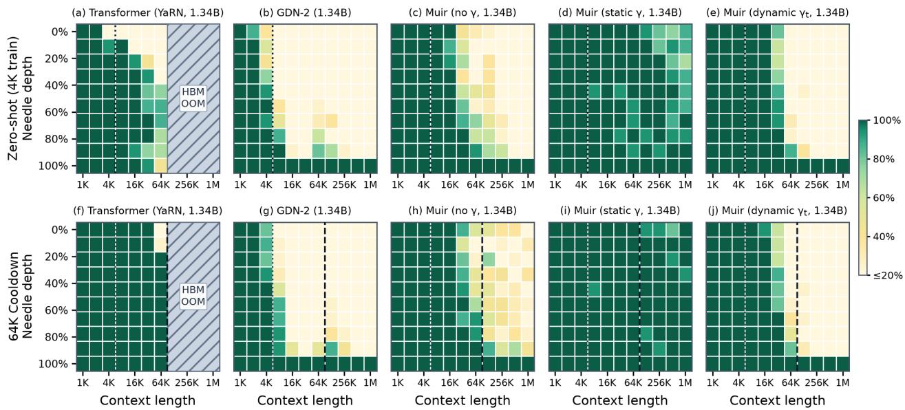  
Figure 8 | Static matched-filter readout extends passkey retrieval to 1M tokens both zero-shot and after a 64K cooldown. S-NIAH-1 accuracy across 10 needle-depth bins and context lengths 1K–1M (256× pretraining length) at 1.34B scale under (top) zero-shot evaluation from 4K pretraining and (bottom) pure-text continual cooldown at 64K. Cooldown extends Dynamic YaRN Transformer from 8K to 32K before early-depth accuracy drops at 64K and unchunked prefill exceeds HBM at ≥ 128K, whereas recurrent horizons change little under pure-text cooldown: GDN-2 collapses past 4K–8K, Muir (no �) fades past 32K, Muir (dynamic $\gamma _ { t }$ , splitting $( r _ { w } , r _ { q } ) = ( 1 2 8 , 1 2 8 )$ for multi-lag recall) holds through 32K before tapering at $\geq 6 4 \mathrm { K }$ , and Muir (static �, keeping $r _ { w } = 2 5 6$ for single-lag lookup) maintains near-perfect recall to 1M tokens in both regimes.

On RULER S-NIAH-1 (Figure 8), unseen RoPE positions limit zero-shot Transformer past 8K, and raising the RoPE base during cooldown restores 100% recall through 32K before early-depth accuracy drops at 64K and unchunked prefill exceeds HBM $\mathrm { a t \geq 1 2 8 K }$ . By contrast, recurrent models have no positional encodings to recalibrate, so pure-text cooldown without synthetic passkeys only refines slow-channel statistics and leaves the retrieval horizons learned at 4K largely unchanged. Under unweighted readout $( \gamma _ { t } = 1 )$ , heavy write-time erasure overwrites distant needles (Remark 3.11): GDN-2 collapses past 4K–8K, and even with low-rank erase regularization (Remark 3.3), Muir (no �) fades on early-depth needles past 32K. Adding matched-filter readout relaxes this erasure; because S-NIAH-1 queries a single needle at the end of the prompt, a fixed filter sufices while keeping the wider $r _ { w } = 2 5 6$ write gate, so Muir (static �) reaches 90.0% zero-shot and 99.4% post-cooldown recall at 1M tokens (256× pretraining length). Conversely, splitting $( r _ { w } , r _ { q } ) = ( 1 2 8 , 1 2 8 )$ under a fixed rank budget in full Muir trades half of that write rank for the per-token routing that resolves multi-lag recall and prevents 10M-stream drift (Figures 6 and 7), retaining near-perfect average passkey recall across 1K–32K before tapering at $\geq 6 4 \mathrm { K }$

## 5.2.4. Training Throughput and Numerical Stability

Training Throughput. Figure 1c compares training throughput (p50 of 100-step intervals) on 8 TPU7x chips at a fixed global batch size of $B \times T = 5 2 4 { , } 2 8 8$ tokens/step across sequence lengths � from 2K to 32K at 1.34B scale, where both GDN-2 and Muir use our boundary-pivoted chunkwise kernel (complete throughput, compiled XLA FLOP, and HBM trafic breakdowns are in Appendix F.3). Replacing the two dense � × � gate projections in GDN-2 with the fused low-rank projection allows Muir to widen the FFN by +30.4% (from $d _ { \mathrm { f f n } } = 5 , 8 8 8$ to 7,680) and add the dynamic readout gain $\gamma _ { t }$ while keeping compiled per-step FLOPs (−1.8%) and HBM trafic $\left( - 0 . 7 \% \ \mathrm { t o } \ - 1 . 4 \% \right)$ nearly unchanged relative to GDN-2. Consequently, Muir matches GDN-2 at the 4K pretraining length (179.4 vs. 179.3 K tokens/s) and runs +1.0%–1.6% faster at 16K–32K.

At $T \leq 8 \mathrm { K }$ , Transformer is faster because $\mathcal { O } ( T ^ { 2 } d )$ causal attention is small and Transformer uses a hand-

(c) Backward Error vs. Float64

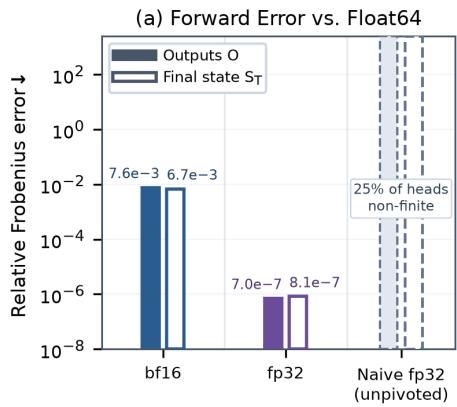

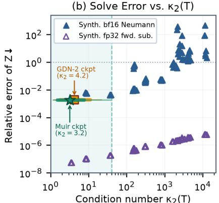

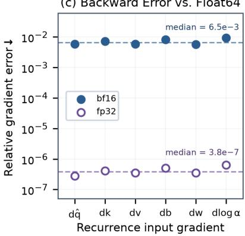  
Figure 9 | Boundary-pivoted chunkwise execution eliminates decay overflow and maintains wellconditioned forward and backward passes. (a) Against an exact float64 sequential reference, naive unpivoted float32 decay factorization overflows and produces NaN on 25% of heads, whereas the boundarypivoted bfloat16 and float32 kernels match the reference to machine precision on both chunk outputs and final state. (b) Across synthetic stress regimes spanning $\kappa _ { 2 } ( T ) \in [ 1 , 1 0 ^ { 4 } ]$ , the bfloat16 block-Neumann inverse stays near its precision floor throughout the well-conditioned regime $( \kappa _ { 2 } ( \pmb { T } ) < 4 0$ , shaded), which contains the sampled 100B-token checkpoints of GDN-2 and Muir (markers show medians). (c) Single-layer backward gradients $( T = 1 2 8 , C = 6 4 , d _ { k } = 1 6 )$ match the float64 reference across all six inputs without log-decay drift.

tuned TPU Pallas Splash-Attention kernel fused with block GEMMs, whereas our pure-JAX chunkwise recurrence incurs XLA kernel-boundary HBM reads and writes between chunk stages. As � increases from 4K to 32K, quadratic attention nearly doubles Transformer per-step FLOPs (348 → 652 TFLOP/step/device) and reduces throughput by $4 . 2 \times$ . By contrast, because recurrent per-step FLOPs are invariant to $T ,$ both GDN-2 and Muir maintain flat throughput across 2K–8K. At $T \geq 1 6 \mathrm { K } \ ( N _ { c } \geq 6 4 $ chunks per sequence at $B \leq 3 2 )$ , deeper per-sequence chunk loops allow XLA to fuse boundary temporaries (cutting HBM trafic by 330–356 GB/step/device at 32K vs. 4K) and overlap asynchronous HBM transfers with MXU execution across chunks, raising memory-bandwidth utilization and increasing throughput by 48–53% at 16K vs. 8K. Consequently, Muir crosses over Transformer at $T \approx 1 1 \mathrm { K }$ and trains 1.64× and 2.74× faster at 16K and 32K.

Numerical Stability. Figure 9 verifies the numerical accuracy and conditioning of the boundary-pivoted chunkwise kernel (full tables in Appendix F.3). In Figure 9a, forming $\pmb { L } _ { \mathrm { s t r i c t } }$ and � via the unpivoted split $\pmb { \pi } _ { t , s } = \pmb { \pi } _ { t } \oslash \pmb { \pi } _ { s }$ divides keys by prefix decay $\pi _ { s } = \exp ( \pmb { \Lambda } _ { s } )$ in $\pmb { K } _ { \oslash \pi } ;$ on fast-decaying channels (25% of heads) where $\Lambda _ { s , j } < - \ln ( \mathrm { F L T \_ M A X } ) \approx - 8 8 . 7 , K _ { \emptyset \pi }$ overflows float32 to ±∞, producing NaN in $\hat { \pmb { K } } _ { \odot \pi } \pmb { K } _ { \oslash \pi } ^ { \top }$ even though every relative decay $\pi _ { t , s } = \exp ( { \pmb { \Lambda } } _ { t } - { \pmb { \Lambda } } _ { s } )$ lies in (0, 1]. Splitting $\pi _ { t , s } = \pi _ { t , p } \odot \pi _ { p , s }$ across each sub-block boundary � keeps both exponential factors in (0, 1] without division, and maintaining $\mathbf { \Delta } \Lambda _ { t }$ and the recurrent state carry $\pmb { S } _ { t }$ in float32 keeps forward errors at the precision floor of the GEMM inputs.

In Figure 9b, the bfloat16 block-Neumann inverse multiplies 7-bit-mantissa MXU operands across leaf squaring and sub-block merges, so rounding error grows with $\kappa _ { 2 } ( \pmb { T } )$ and exceeds $1 0 ^ { 0 }$ once $\kappa _ { 2 } ( \pmb { T } ) \gtrsim 1 0 ^ { 3 }$ whereas sequential float32 forward substitution remains accurate across $\kappa _ { 2 } ( T ) \in [ 1 , 1 0 ^ { 4 } ]$ . In trained models, however, exponential decay $\pi _ { t , s }$ across lags � − � and small cross-step inner products between ℓ -normalized keys damp the strictly lower-triangular entries $( { L } _ { \mathrm { s t r i c t } } ) _ { t , s } = \langle \hat { k } _ { t } , { \pi } _ { t , s } \odot { k } _ { s } \rangle$ and keep $\kappa _ { 2 } ( \pmb { T } )$ well within the stable regime $\mathrm { ( m a x < 4 0 }$ for both GDN-2 and Muir across 1,536 chunk systems from the 166M checkpoints). Moreover, Muir attains lower p90 $\kappa _ { 2 } ( \pmb { T } )$ than GDN-2 (7.7 vs. 11.1) because matched-filter readout lowers erasure (Proposition 3.10), shrinking $\ddot { \pmb { k } } _ { t } = \pmb { b } _ { t } \odot \pmb { k } _ { t }$ and further contracting $\lVert \mathbf { L } _ { \mathrm { s t r i c t } } \rVert _ { 2 }$

Finally, reusing $\pmb { T } ^ { - 1 }$ from the forward solve and recomputing the boundary-pivoted decay factors across the merge tree keeps d log � at the same precision floor as the query, key, value, and gate gradients (Figure 9c), so pretraining runs without loss spikes or NaNs.

## 5.3. Ablations

Table 2 ablates the gate-rank allocation across all four model scales by comparing our sensitivity-allocated Muir ranks $( R _ { \mathrm { t o t } } = 5 1 2 )$ against wider output-gate allocations $( r _ { g } = 2 5 6 )$ and uniform gate ranks (128 across active gates). We also decouple low-rank gate compression from FFN expansion by varying gate ranks and FFN width independently at 406M (full control tables are in Appendix H.4).

Table 2 | Sensitivity-allocated gate ranks and dynamic readout match or outperform wider output-gate and uniform-rank allocations while preserving MXU alignment and FFN width. For each configuration of gate bottleneck ranks and FFN width (shown at $d = 2 , 0 4 8 )$ , we report FineWeb-Edu validation token NLL across all four model scales, alongside 1.34B WikiText (Wiki.) and LAMBADA (LMB.) word-level perplexity, 8-task zero-shot commonsense accuracy (LM-Eval), 6-task Based extractive recall accuracy (Based), and 5-shot TriviaQA accuracy (TQA) after 100B training tokens.
<table><tr><td colspan="2" rowspan="2"></td><td rowspan="2"></td><td colspan="6">Configuration</td><td rowspan="2" colspan="3">FineWeb-Edu Validation NLL ↓</td><td rowspan="2">1.34B PPL ↓</td><td colspan="2" rowspan="2"></td><td rowspan="2">1.34B Accuracy ↑</td><td rowspan="2"></td></tr><tr><td></td><td> $r _ { b }$ </td><td> $r _ { w }$ </td><td></td><td> $d _ { \mathrm { f f n } }$ </td><td>166M 406M</td></tr><tr><td colspan="2">Model Transformer</td><td> $r _ { f }$ </td><td></td><td> $r _ { g }$ </td><td></td><td> $r _ { q }$ </td><td>|8,192|</td><td></td><td>2.2424</td><td>834M 2.1186</td><td>1.34B 2.0335</td><td>Wiki. 17.17</td><td>LMB. 10.30</td><td>LM-Eval 52.05</td><td>Based TQA 45.92 14.56</td></tr><tr><td rowspan="3">Base</td><td>GDN-2</td><td>128</td><td>d 128</td><td></td><td>d</td><td></td><td>5,888</td><td>2.4569 2.4466</td><td>2.2354</td><td>2.1060</td><td>2.0177</td><td>16.80 10.38</td><td></td><td>52.46 32.08</td><td>16.48</td></tr><tr><td>Muir (no γ)</td><td>64</td><td></td><td>64 128 256</td><td></td><td>0</td><td>|7,680</td><td>2.4322</td><td>2.2230</td><td>2.0876 2.0006</td><td>16.46</td><td>10.26</td><td>53.79</td><td>32.86</td><td>16.52</td></tr><tr><td>Muir (static  $\gamma )$ </td><td>64</td><td>64 128 256</td><td></td><td></td><td>0</td><td>7,680</td><td>2.4273</td><td>2.2191 2.0869</td><td>1.9994</td><td>16.35</td><td>10.15</td><td>53.40</td><td>33.02</td><td>17.71</td></tr><tr><td rowspan="3">Ours</td><td>Muir (ours)</td><td>64</td><td></td><td>64 128 128</td><td></td><td>128</td><td>7,680</td><td>2.4276</td><td>2.2174</td><td>2.0862</td><td>1.9973</td><td>16.41</td><td>10.00</td><td>53.84 34.60</td><td>19.32</td></tr><tr><td></td><td></td><td></td><td></td><td></td><td></td><td></td><td></td><td>2.2202</td><td>2.0867</td><td></td><td></td><td></td><td></td><td></td></tr><tr><td>Muir (no γ) Muir</td><td>64 64</td><td>64 256 256 64 256 256</td><td></td><td></td><td>0 0</td><td>|7,552| 7,552</td><td>2.4293 2.4285</td><td>2.2194 2.0873</td><td>2.0009 1.9988</td><td>16.31 16.35</td><td>10.27 9.72</td><td>52.47 53.27</td><td>32.47 34.38</td><td>18.57 16.96</td></tr><tr><td>6=5db</td><td>(static γ) Muir (dynamic γt)</td><td>64</td><td>64 256 256</td><td></td><td></td><td>128</td><td>7,424</td><td>2.4260</td><td>2.2187</td><td>2.0845 2.0002</td><td></td><td>16.44 10.12</td><td></td><td>52.95 33.36</td><td>17.34</td></tr><tr><td></td><td>Muir (no γ)</td><td>128</td><td>128</td><td>128 128</td><td></td><td>0</td><td>|7,680|</td><td>2.4292</td><td>2.2207</td><td>2.0879</td><td>2.0001</td><td>16.42</td><td>10.28</td><td>52.69</td><td></td></tr><tr><td>Uiom</td><td>Muir (static γ)</td><td>128</td><td>128</td><td>128 128</td><td></td><td>0</td><td>7,680</td><td>2.4288</td><td>2.2205</td><td>2.0893</td><td>2.0001</td><td>16.51</td><td>10.22</td><td>34.18 52.99 34.87</td><td>16.67 15.67</td></tr><tr><td></td><td>Muir (dynamic  $\gamma _ { t } )$ </td><td>128</td><td>128</td><td></td><td></td><td>128 128 128</td><td>7,552</td><td>2.4281</td><td>2.2213</td><td>2.0871</td><td>1.9999</td><td>16.40</td><td>9.89</td><td>53.10 33.84</td><td>17.19</td></tr></table>

Output-Gate Rank Allocation. Doubling the output-gate rank from $r _ { g } = 1 2 8$ to 256 requires $R _ { \mathrm { t o t } } = 6 4 0$ for no or static $\gamma$ and $R _ { \mathrm { t o t } } = 7 6 8$ for dynamic $\gamma _ { t } ,$ which shrinks $d _ { \mathrm { f f n } }$ by 128 and 256 channels, respectively. While (64, 64, 256, 256, 128) achieves slightly lower validation NLL at 166M and 834M, Muir surpasses it at 406M and outperforms all three $r _ { g } = 2 5 6$ variants at 1.34B across validation NLL, zero-shot commonsense reasoning, Based recall, and 5-shot TriviaQA. At larger scale, preserving $d _ { \mathrm { f f n } } = 4 d - 5 1 2$ and two-tile $R _ { \mathrm { t o t } } = 5 1 2$ alignment outweighs a wider output gate.

Sensitivity-Allocated vs. Uniform Gate Ranks. When readout gain is omitted or static $( r _ { q } = 0 )$ , four uniform rank-128 gates (128, 128, 128, 128, 0) sum to $R _ { \mathrm { t o t } } = 5 1 2$ and perform comparably to the sensitivityallocated (64, 64, 128, 256, 0) variants across scales. However, adding a fifth rank-128 gate for dynamic � under uniform allocation (128, 128, 128, 128, 128) raises the total rank to $R _ { \mathrm { t o t } } = 6 4 0$ , which breaks 256-column MXU tile alignment and narrows $d _ { \mathrm { { f f n } } }$ by 128 channels. Because state updates are much less sensitive to the decay and erase gates than to the write gate (Proposition 3.1 and Remarks 3.2 and 3.3), compressing $( r _ { f } , r _ { b } )$ to (64, 64) in Muir fits the rank-128 dynamic readout gain within $R _ { \mathrm { t o t } } = 5 1 2$ without reducing $d _ { \mathrm { f f n } } ,$ and outperforms the uniform dynamic-� variant on validation NLL at every scale and on 1.34B zero-shot commonsense reasoning, Based recall, and 5-shot TriviaQA.

Decoupling Gate Compression from FFN Expansion. To separate the efect of low-rank gating from FFN expansion under the $\mathsf { \bar { 1 2 } } d ^ { 2 }$ budget, we vary gate ranks and FFN width independently at 406M relative to $\mathrm { G D N - 2 } ~ ( d _ { \mathrm { f f n } } = 4 \mathrm { , 3 5 2 } )$ . Compressing the dense $( b , w )$ gates into rank-128 projections alongside rank-128 $\gamma _ { t }$ $( R _ { \mathrm { t o t } } = 6 4 0 )$ while holding the FFN fixed at $d _ { \mathrm { f f n } } = 4 { , } 3 5 2$ cuts gate-projection FLOPs by 2.8× and reduces non-embedding parameters and FLOPs by 12.5% (−38.9M parameters across all layers) at a validation NLL cost of only +7.4 mnats. Conversely, adding the same +38.9M parameters (+12.5% non-embedding capacity, $d _ { \mathrm { f f n } } = 5 { , } 5 0 4 )$ to widen the GDN-2 FFN with dense gates improves validation NLL by −20.5 mnats (2.8× larger NLL reduction per parameter). Reinvesting the freed parameters into $d _ { \mathrm { { f f n } } }$ and low-rank $\gamma _ { t }$ in iso-parameter Muir achieves −18.0 mnats, recovering 88% of the unconstrained wide-FFN gain at zero parameter or FLOP overhead. By contrast, parameterizing $\gamma _ { t }$ with a dense � × � projection in GDN-2 forces $d _ { \mathrm { f f n } }$ down to 3,584 under the iso-parameter budget and degrades validation NLL by +8.3 mnats, which confirms that under an iso-parameter budget, dynamic readout requires a low-rank rather than dense parameterization.

## 6. Mechanistic Analysis

We now evaluate our theoretical predictions from §3.1 directly on the 100B-token checkpoints without retraining (protocols and supplementary tables are in Appendix I).

Write-Erase Gate Sensitivity. Figure 10 confirms the write-erase sensitivity asymmetry of Proposition 3.1 in trained models and explains why compressing (�, �) to rank 64 while keeping $( g , w , q )$ at rank 128 in (9)

Token position bucket in 4K window

— = = Identity (mj = mj)

(a) SVD Gate-Rank Truncation (406M)  
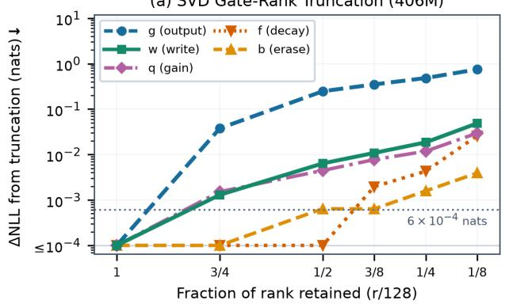

(b) Causal Gate-Freezing (834M)  
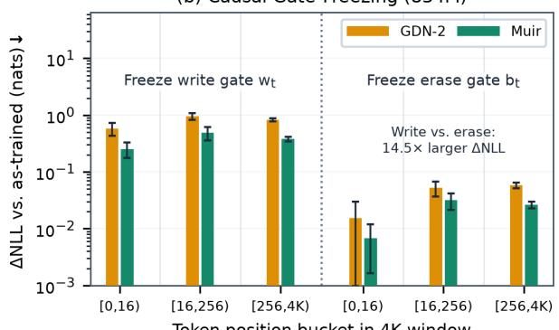  
(c) Learned Static Gain vs. $\rho _ { \mathrm { j } }$ (166M)

Figure 10 | Trained models exhibit the predicted write-erase sensitivity asymmetry under both SVD rank truncation and causal gate freezing. (a) Truncating each rank-128 gate projection of the uniform-rank Muir checkpoint via SVD (one gate at a time across all layers) shows that the decay (�) and erase (�) gates saturate by rank 64, whereas the output $( g )$ , write (�), and readout gain (�) gates require rank 128. (b) Replacing the dynamic write gate with its token-averaged channel mean $( \pmb { w } _ { t }  \bar { \pmb { w } } )$ across all layers degrades validation NLL 14.5× more than freezing the erase gate $( \pmb { b } _ { t }  \bar { \pmb { b } } )$ in both GDN-2 and Muir.  
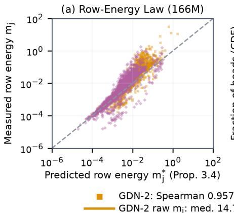

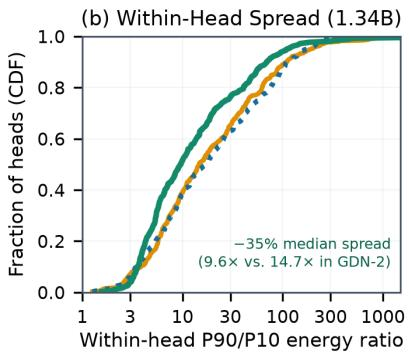

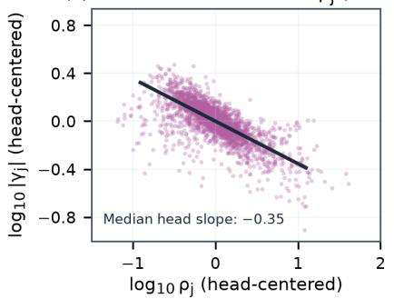  
Muir y2mj: med. 9.6×

Figure 11 | Stationary state row energies obey the closed-form law and are balanced by fractional power-law readout gains. (a) Across state channels, the analytical fixed point $m _ { j } ^ { * }$ (5) closely tracks measured stationary row energy $m _ { j } = \mathbb { E } [ \| S _ { t , j , : } \| _ { 2 } ^ { 2 } ]$ in both GDN-2 and Muir. (b) Across all heads, weighting state rows by the learned readout gain compresses the within-head $\mathrm { p 9 0 / p 1 0 }$ energy spread by 35% relative to GDN-2. (c) Within each head, learned static gains $| \gamma _ { j } |$ follow a fractional power law �<sub>�</sub> ∝ $\rho _ { i } ^ { - p } \ ( p = 0 . 3 5 )$ of stationary row RMS $\rho _ { j }$ , intermediate between unit readout $( p = 0 )$ and full whitening $( p = \bar { 1 } )$ ).

preserves model quality. In Figure 10a, truncating the singular values of � or � from rank 128 to rank 64 across all layers of the 406M uniform-rank Muir checkpoint increases validation NLL by at most 0.6 mnats, whereas truncating �, �, or � to rank 64 increases validation NLL by 4.5, 6.4, and 247 mnats, respectively. Figure 10b tests this asymmetry directly on the recurrence at 834M: freezing ${ \pmb w } _ { t }$ degrades validation NLL across all three position buckets and increases overall NLL 14.5× more than freezing $\mathbf { \delta } _ { \pmb { b } _ { t } }$ in both GDN-2 (+0.833 vs. +0.0574 nats) and Muir (+0.385 vs. +0.0266 nats). Consistent with Remark 3.2, erase perturbations have limited efect on the state because post-convolution SiLU keys concentrate their energy onto a small subspace, with a key participation ratio of only 7.43 in GDN-2 and 5.98 in Muir out of $d _ { k } = 1 2 8$ channels (Table 3).

Stationary Row-Energy Scaling. Figure 11 evaluates the stationary row-energy law (Proposition 3.4) and learned readout scaling (Corollary 3.8). In Figure 11a, the closed-form prediction $m _ { i } ^ { * }$ in (5) matches the empirical row energy $m _ { j }$ across state channels at 166M with Spearman correlation $r _ { s } = 0 . 9 5 7$ in GDN-2 and 0.960 in Muir (static $\gamma )$ . Since the readout $\mathbf { } \mathbf { } \mathbf { } \mathbf { } \mathbf { } \mathbf { } \mathbf { } \mathbf { } \mathbf { } \mathbf { } \mathbf { } \mathbf { } \mathbf { } \mathbf { } \mathbf { } \mathbf { } \mathbf { } \mathbf { } \mathbf { } \mathbf { } \mathbf { } \mathbf { } \mathbf { } \mathbf { } \mathbf { } \mathbf { } \mathbf { } \mathbf { } \mathbf { } \mathbf { } \mathbf { } \mathbf { } \mathbf { } \mathbf { } \mathbf { } \mathbf { } \mathbf { } \mathbf { } \mathbf { } \mathbf { } \mathbf { } \mathbf { } \mathbf { } \mathbf { } \mathbf { } \mathbf { } \mathbf { } \mathbf { } \mathbf { } \mathbf { } \mathbf { } \mathbf { } \mathbf { } \mathbf { } \mathbf { } \mathbf { } \mathbf { } \mathbf { } \mathbf { } \mathbf { } \mathbf { } \mathbf { } \mathbf { } \mathbf { } \mathbf { } \mathbf { } \mathbf { } \mathbf { } \mathbf { } \mathbf { } \mathbf { } \mathbf { } \mathbf { } \mathbf { } \mathbf { } \mathbf { } \mathbf { } \mathbf { } \mathbf { } \mathbf { } \mathbf { } \mathbf { } \mathbf { } \mathbf { } \mathbf { } \mathbf { } \mathbf { } \mathbf { } \mathbf { } \mathbf { } \mathbf { } \mathbf { }  \mathbf { } \mathbf { } \mathbf { } \mathbf { } \mathbf { } \mathbf { } \mathbf { } \mathbf { } \mathbf { } \mathbf { } \mathbf { } \mathbf { } \mathbf { } \mathbf { } \mathbf { } \mathbf { } \mathbf { } \mathbf { } \mathbf { } \mathbf { } \mathbf { } \mathbf { } \mathbf { } \mathbf { } \mathbf { } \mathbf { } \mathbf { } \mathbf { } \mathbf { } \mathbf { } \mathbf { } \mathbf { } \mathbf { } \mathbf { } \mathbf { } \mathbf { } \mathbf { } \mathbf { } \mathbf { } \mathbf { } \mathbf { } \mathbf { } \mathbf { } \mathbf { } \mathbf { } \mathbf { } \mathbf { } \mathbf { } \mathbf { } \mathbf { } \mathbf { } \mathbf { } \mathbf { } \mathbf \mathbf { } \mathbf { } \mathbf { } \mathbf { } \mathbf \mathbf { } \mathbf { } \mathbf { } \mathbf \mathbf { } \mathbf { } \mathbf \mathbf { } \mathbf { } \mathbf \mathbf { } \mathbf { } \mathbf \mathbf { } \mathbf \mathbf { } \mathbf \mathbf  $ scales each state row $j$ by $\gamma _ { t , j }$ , weighting $m _ { j }$ by the mean readout gain $\bar { \gamma } _ { j } = \mathbb { E } [ \gamma _ { t , j } ]$ in Muir reduces the median within-head $\mathrm { p 9 0 / p 1 0 }$ spread of gainweighted row energy $\bar { \gamma } _ { j } ^ { 2 } m _ { j }$ from 14.7× in GDN-2 to $9 . 6 \times$ (Figure 11b, Table 3). Consistent with Corollary 3.8, regressing $\log _ { 1 0 } | \gamma _ { j } |$ against $\log _ { 1 0 } \rho _ { j }$ within each head (Figure 11c) yields a median log-log slope of −0.35, which corresponds to a fractional power-law exponent $p = 0 . 3 5 \in ( 0 , 1 )$ in $\gamma _ { j } \propto \rho _ { j } ^ { - p } .$

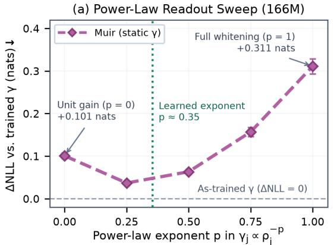

(b) Erase-Logit Shift by Position (834M)  
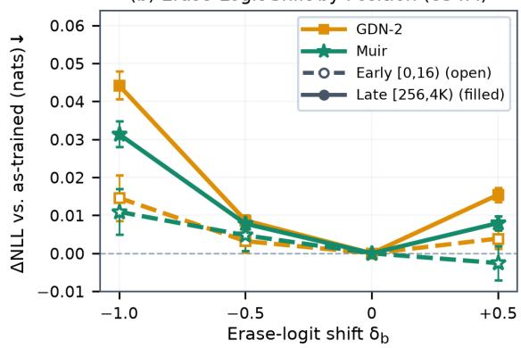  
Figure 12 | Readout-exponent sweeps and erase-logit shifts confirm the optimality of fractional power-law readout and the early-vs.-late erasure trade-of. (a) Replacing the learned static gain in each head with an RMS-matched power law $\gamma _ { j } ( p ) \propto \rho _ { j } ^ { - p }$ yields a U-shaped loss curve minimized near the learned exponent $\left( p \approx 0 . 3 5 \right)$ , outperforming both unit readout $( p = 0 )$ and full whitening $( p = 1 )$ . (b) Shifting the pre-activation erase logit $( z _ { t } ^ { b } \bar { \gets } z _ { t } ^ { b } + \delta _ { b } )$ shows that weaker erasure degrades predictions across all positions, whereas stronger erasure leaves early tokens [0, 16) nearly unchanged while degrading late tokens [256, 4K).

Table 3 | Trained GDN-2 and Muir checkpoints confirm the predicted write-erase sensitivity asymmetry, stationary row-energy law, and readout-induced erasure reduction. Diagnostics are measured on held-out FineWeb-Edu validation sequences $( T = 4 , 0 9 6 )$ at 166M (gate sensitivity and stationary row-law fit) and 1.34B (within-head row-energy spread and write-time erasure).
<table><tr><td rowspan=1 colspan=2>Diagnostic</td><td rowspan=1 colspan=1>Statistic</td><td rowspan=1 colspan=1>Scale</td><td rowspan=1 colspan=1>GDN-2Muir</td><td rowspan=1 colspan=1>Effect</td><td rowspan=1 colspan=1>Theory</td></tr><tr><td rowspan=1 colspan=1>Sens.</td><td rowspan=1 colspan=1>Key participation ratioWrite-erase sensitivity</td><td rowspan=1 colspan=1> $\bar { \eta } _ { \mathrm { e f f } } = 1 / \mathbb { E } [ \| \pmb { k } _ { t } \| _ { 4 } ^ { 4 } ]$ Layer-mean $\mathbb { E } [ \| \mathbf { D } _ { z ^ { w } } \pmb { S } _ { t } \| _ { F } ^ { 2 } ] / \mathbb { E } [ \| \mathbf { D } _ { z ^ { b } } \pmb { S } _ { t } \| _ { F } ^ { 2 } ]$ </td><td rowspan=1 colspan=1>166M166M</td><td rowspan=1 colspan=1>7.43  5.9813.2  13.3</td><td rowspan=1 colspan=1> ${ \ll } 1 2 8 ~ \mathrm { c h } .$ 13× w vs. b</td><td rowspan=1 colspan=1>Remark 3.2Proposition 3.1</td></tr><tr><td rowspan=1 colspan=1>EnergYy</td><td rowspan=1 colspan=1>Stationary row-law fitRaw row-energy spreadReadout energy spread</td><td rowspan=1 colspan=1>Median within-head $r _ { s } ( m _ { j } , m _ { j } ^ { * } )$ Median within-head ${ \bf p 9 0 } / { \bf p 1 0 }$ of $m _ { j }$ Median within-head ${ \bf p 9 0 } / { \bf p 1 0 }$ of $\bar { \gamma } _ { j } ^ { 2 } m _ { j }$ </td><td rowspan=1 colspan=1>166M1.34B1.34B</td><td rowspan=1 colspan=1>0.957 0.96014.7  17.214.7  9.6</td><td rowspan=1 colspan=1>+0.003+17.0%-34.7%</td><td rowspan=1 colspan=1>Proposition 3.4Proposition 3.4Corollary 3.8</td></tr><tr><td rowspan=1 colspan=2>EraseParallel erase rateAdjacent self-erasure</td><td rowspan=1 colspan=1> $\bar { \mu } = \mathbb { E } [ \langle k _ { t } , b _ { t } \odot k _ { t } \rangle ]$  $\mathbb { E } [ | \langle k _ { t - 1 } , b _ { t } \odot k _ { t } \rangle | ]$ </td><td rowspan=1 colspan=1>1.34B1.34B</td><td rowspan=1 colspan=1>0.782 0.6520.406 0.328</td><td rowspan=1 colspan=1>-16.6%-19.2%</td><td rowspan=1 colspan=1>Proposition 3.10Remark 3.11</td></tr></table>

Counterfactual Readout and Erase Interventions. In Figure $^ { 1 2 \mathrm { a } , }$ replacing the learned static gain at 166M with a pure power law of row ${ \mathrm { R M S } } , \gamma _ { j } ( p ) \propto \rho _ { j } ^ { - p }$ , increases validation NLL by +0.10 nats at $p = 0$ (where slow rows dominate readout) and +0.31 nats at $p = 1$ (where noisy fast rows are over-amplified; Remark 3.9), but comes within +0.037 nats of the unconstrained learned gain at $p = 0 . 2 5 \ ( + 0 . 0 6 3$ nats at $p = 0 . 5 0 )$ near the fitted exponent $p = 0 . 3 5$ . In Figure 12b, shifting the erase logit $\pmb { z } _ { t } ^ { b }  \pmb { z } _ { t } ^ { b } + \delta _ { b }$ at 834M confirms the horizon trade-of of Proposition 3.10: weakening erasure $\left( \delta _ { b } = - 1 . 0 \right)$ increases interference across all positions (+0.031–0.044 nats at [256, 4K)), whereas strengthening erasure $\left( \delta _ { b } = + 0 . 5 \right)$ leaves early tokens [0, 16) within noise $( - 0 . 0 0 3 \pm 0 . 0 0 5$ nats in Muir) while degrading late tokens [256, 4K) $( + 0 . 0 0 8 { - 0 . 0 1 5 }$ nats) by overwriting stored context. Consistent with Proposition 3.10 and Remark 3.11, suppressing slow-row interference at readout lets 1.34B Muir (Table 3) operate with a 16.6% lower parallel erase rate $\bar { \mu }$ (0.652 vs. 0.782) and 19.2% lower adjacent self-erasure (0.328 vs. 0.406), preserving +16.1% higher state spectral efective rank and a 59.6% longer temporal lookback window (49.3 → 78.7 tokens; Appendix I.3).

Multi-Value Recall and Multi-Hop Variable Tracking. Figure 13 connects our state-space diagnostics (Table 3) to the 4-value MV-NIAH and 5-hop VT gains in §5.2.2 (details in Appendix I.4). On MV-NIAH, Transformer recalls $V _ { 1 } { - } V _ { 3 }$ , but query heads attend to already-emitted answer tokens on the fourth value $V _ { 4 }$ (Figure 13a). Consistent with latent multi-hop limits (Biran et al., 2024; Yang et al., 2025a), Transformer resolves $H _ { 1 }$ on VT but fails to chain $H _ { 2 } { - } H _ { 5 }$ in one pass (Figure 13b). Recurrent models propagate bindings sequentially through $\pmb { S } _ { t } ,$ , but repeated writes to the same state rows compete for memory. In GDN-2, heavy write-time erasure $\left( \bar { \mu } = 0 . 7 8 2 \right)$ prematurely overwrites early bindings $( V _ { 1 } – V _ { 3 }$ and $H _ { 1 } { - } H _ { 3 } )$ . Removing $\gamma _ { t }$ in Muir lets $V _ { 1 }$ accumulate in slow rows that mask $V _ { 2 } – V _ { 4 }$ (Proposition 3.4). Static $\gamma ^ { \mathrm { s t a t } }$ equalizes write order on MV-NIAH (Corollary 3.8), but one fixed gain cannot match five hop distances (Remark 3.7). Decomposing

Shared-key write order (1K)

(a) RULER MV-NIAH by Write Order (1.34B)  
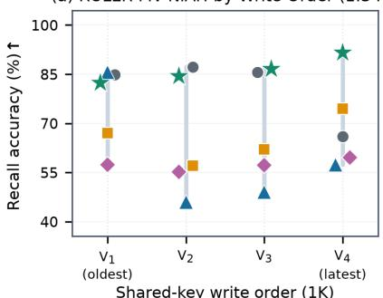

(b) RULER VT Recall by Hop (1.34B)  
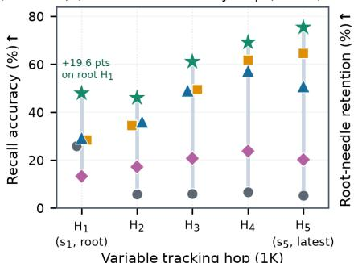  
(d) Within-Model Needle Retention Across Milestones (1.34B)

(c) Root-Needle Retention H1 Over Time (1.34B)  
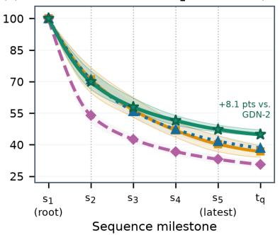

(e) Answer-Step Effective Attention (1.34B)  
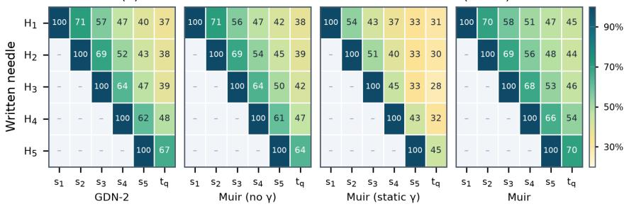

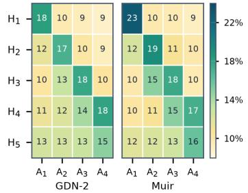  
Transformer (RoPE)GDN-2Muir (no γ) Muir (static γ)Muir  
Figure 13 | Muir preserves early variable bindings and routes readout to the target hop at each answer step. (a) On 4-value MV-NIAH, Transformer drops on the final write $V _ { 4 }$ and unit-readout recurrences degrade after $V _ { 1 }$ , whereas Muir remains accurate across $V _ { 1 } { - } V _ { 4 } .$ . (b) On 5-hop RULER VT, Transformer recalls only the root assignment $H _ { 1 }$ , whereas Muir maintains accuracy across all five hops $H _ { 1 } { - } H _ { 5 }$ . (c) Within-model root-needle $\left( H _ { 1 } \right)$ retention in $\pmb { S } _ { t }$ from write milestone $s _ { 1 }$ (100%) to query milestone $t _ { \mathrm { q } }$ across 16 held-out prompts (interquartile bands across prompts). (d) Within-model retention of written needles $H _ { 1 } { - } H _ { 5 }$ from each write (100%) across sequence milestones $s _ { 1 } { - } s _ { 5 } ~ \mathrm { t o } ~ t _ { \mathrm { q } } . ~ ( \mathrm { e } )$ Share of readout weight $\hat { \pmb q } _ { t } \pmb S _ { t }$ (over the haystack) on each needle $H _ { 1 } { - } H _ { 5 }$ across the four answer-generation steps $A _ { 1 } { - } A _ { 4 }$ that chain $H _ { 1 }  \cdots  H _ { 5 }$

$\pmb { o } _ { t } = \hat { \pmb q } _ { t } \pmb S _ { t }$ into per-needle write contributions, we track within-model retention of each hop write $\left( \boldsymbol { s } _ { 1 } – \boldsymbol { s } _ { 5 } \right)$ in $\pmb { S } _ { t }$ until query token $t _ { \mathrm { q } } \ ( \mathrm { F i g u r e 1 3 c , d } )$ and how much weight $\hat { \pmb q } _ { t } \pmb S _ { t }$ places on each hop across answer steps $A _ { 1 } – A _ { 4 }$ (Figure 13e). Lower write-time erasure (Proposition 3.10) raises retention in Muir at $t _ { \mathrm { q } }$ over GDN-2 from 37% to 45% on $H _ { 1 }$ and from 46% to 52% on average across $H _ { 1 } { - } H _ { 5 }$ (Figure 13c,d). Across $A _ { 1 } { - } A _ { 4 } ,$ , dynamic $\gamma _ { t }$ shifts the channel filter (Proposition 3.6) so $\hat { \pmb q } _ { t } \pmb S _ { t }$ concentrates weight along the target diagonal $H _ { 1 } { - } H _ { 4 }$ most notably on the oldest root hop (18% to 23% at $A _ { 1 } ;$ Figure 13e).

## 7. Conclusion

Channel-wise gates give delta-rule models fine-grained control over a fixed-size state, but its efective capacity depends on the state dynamics those gates induce. In our trained models, key activation and unit normalization concentrate key energy onto roughly 5% of channels per head, making the state 13× more sensitive to write than to erase perturbations; Muir therefore fuses all gates into a low-rank projection with smaller decay and erase bottlenecks, widening the FFN by up to 30.4% at fixed parameters and FLOPs. Meanwhile, consistent with our theory, multi-timescale decay drives state row-energy variation across orders of magnitude, exceeding 100× in heads mixing fast and slow channels. Compared to GDN-2, Muir reduces median readout-energy spread by 35% and write-time erasure by 17%, improves root-needle multi-hop retention from 37% to 45%, and lowers the median condition number of the chunkwise triangular solve by 24%.

Our results also reveal two remaining limitations. First, under a fixed gate-rank budget, static and dynamic readout trade single-horizon retention against multi-lag adaptability. On passkey lookup, a static filter sufices for a single query lag and preserves write rank for near-perfect recall to 1M tokens, whereas halving write rank to fund dynamic readout limits single-needle retention beyond 32K. Conversely, static readout cannot match varying lags on multi-hop and extractive tasks, and drifts on continuous text as slow-row energy accumulates, whereas dynamic readout adapts per token to resolve multi-lag queries and hold flat perplexity across 10M-token streams. Second, while our pure-JAX kernel matches GDN-2 throughput and trains 2.74× faster than Transformer at 32K, Splash Attention remains faster at short contexts (< 11K) because its Pallas kernel fuses masking and block contractions in VMEM while XLA materializes chunk temporaries in HBM.

These limitations suggest several directions for future work. Parameterizing dynamic readout through our analytical matched filter by predicting one lag per head and tracking expected row energy could unify distant passkey recall, multi-lag routing, and stream stability without sacrificing write rank. Alternatively, pairing sliding-window attention with static-readout Muir would resolve this tension architecturally: local attention copies nearby spans exactly in constant memory, freeing the recurrent state to keep full write rank for distant lookup without periodic global attention or a growing KV cache. At the kernel level, fusing leaf Neumann inversion, the boundary-pivoted merge tree, and the cross-chunk state scan into a single Pallas kernel would keep chunk temporaries in VMEM and narrow the short-context throughput gap. Beyond gated delta recurrences, sensitivity-allocated gating and matched-filter readout extend to matrix-state test-time optimization models whose channels decay or update at diferent rates under unweighted queries.

## Acknowledgments

We thank Amanda Tomlinson, Burkay Donderici, Nick Tombari, and Xinling Yu for helpful discussions and feedback throughout this work. We also thank Kostia Liepieshov for early work on numerically stable matrix inversion that informed our chunkwise kernel. Finally, we are especially grateful to Jake Ades for dedicated hardware and infrastructure support that made our large-scale training runs possible.

## References

Zeyuan Allen-Zhu. Physics of language models: Part 4.1, architecture design and the magic of canon layers. In D Belgrave, C Zhang, H Lin, R Pascanu, P Koniusz, M Ghassemi, and N Chen, editors, Advances in Neural Information Processing Systems 38, volume 38, pages 47319–47339, San Diego, California, USA, 2025. Neural Information Processing Systems Foundation, Inc. (NeurIPS). URL https://proceedings.neurips. cc/paper\_files/paper/2025/hash/3c4141c12660ad3625eb4ae845e0a6f9-Abstract-Conference.html.

Keston Aquino-Michaels. The orthogonalized read is a removable training scafold for recurrent memory. arXiv [cs.LG], 2 July 2026. URL http://arxiv.org/abs/2607.19390.

Simran Arora, Sabri Eyuboglu, Aman Timalsina, Isys Johnson, Michael Poli, James Zou, Atri Rudra, and Christopher Ré. Zoology: Measuring and improving recall in eficient language models. arXiv [cs.CL], 8 December 2023a. URL http://arxiv.org/abs/2312.04927.

Simran Arora, Brandon Yang, Sabri Eyuboglu, Avanika Narayan, Andrew Hojel, Immanuel Trummer, and Christopher Ré. Language models enable simple systems for generating structured views of heterogeneous data lakes. arXiv [cs.CL], 19 April 2023b. URL http://arxiv.org/abs/2304.09433.

Simran Arora, Sabri Eyuboglu, Michael Zhang, Aman Timalsina, Silas Alberti, Dylan Zinsley, James Zou, Atri Rudra, and Christopher Ré. Simple linear attention language models balance the recall-throughput tradeof. arXiv [cs.CL], 28 February 2024a. URL http://arxiv.org/abs/2402.18668.

Simran Arora, Aman Timalsina, Aaryan Singhal, Benjamin Spector, Sabri Eyuboglu, Xinyi Zhao, Ashish Rao, Atri Rudra, and Christopher Ré. Just read twice: closing the recall gap for recurrent language models. arXiv [cs.CL], 7 July 2024b. URL http://arxiv.org/abs/2407.05483.

Jacob Austin, Sholto Douglas, Roy Frostig, Anselm Levskaya, Charlie Chen, Sharad Vikram, Federico Lebron, Peter Choy, Vinay Ramasesh, Albert Webson, and Reiner Pope. How to Scale Your Model. Google DeepMind, 2025. URL https://jax-ml.github.io/scaling-book.

Jimmy Ba, Geofrey Hinton, Volodymyr Mnih, Joel Z Leibo, and Catalin Ionescu. Using fast weights to attend to the recent past. arXiv [stat.ML], 20 October 2016. URL http://arxiv.org/abs/1610.06258.

Zishuo Bao, Zeshen Zhang, Linkun Chen, and Yucheng Lu. FlyWheel: Attention Kernels Built for the TPU. arXiv [cs.CL], 2026. URL http://arxiv.org/abs/2611.01426.

Maximilian Beck, Korbinian Pöppel, Markus Spanring, Andreas Auer, Oleksandra Prudnikova, Michael Kopp, Günter Klambauer, Johannes Brandstetter, and Sepp Hochreiter. xLSTM: Extended Long Short-Term Memory. arXiv [cs.LG], 7 May 2024. URL http://arxiv.org/abs/2405.04517.

Maximilian Beck, Korbinian Pöppel, Phillip Lippe, and Sepp Hochreiter. Tiled Flash Linear Attention: More Eficient Linear RNN and xLSTM Kernels. In The Thirty-ninth Annual Conference on Neural Information Processing Systems, 29 October 2025. URL https://openreview.net/forum?id=b6H64u6TqI.

Ali Behrouz, Zeman Li, Praneeth Kacham, Majid Daliri, Yuan Deng, Peilin Zhong, Meisam Razaviyayn, and Vahab Mirrokni. ATLAS: Learning to optimally memorize the context at test time. arXiv [cs.CL], 29 May 2025a. URL http://arxiv.org/abs/2505.23735.

Ali Behrouz, Meisam Razaviyayn, Peilin Zhong, and Vahab Mirrokni. It’s all connected: A journey through test-time memorization, attentional bias, retention, and online optimization. arXiv [cs.LG], 17 April 2025b. URL http://arxiv.org/abs/2504.13173.

Ali Behrouz, Peilin Zhong, and Vahab Mirrokni. Titans: Learning to Memorize at Test Time. In D Belgrave, C Zhang, H Lin, R Pascanu, P Koniusz, M Ghassemi, and N Chen, editors, Advances in Neural Information Processing Systems, volume 38, pages 113506–113543. Curran Associates, Inc., 2025c. URL https://proceedings.neurips.cc/paper\_files/paper/2025/file/ a4ca07aa108036f80cbb5b82285fd4b1-Paper-Conference.pdf.

Dario Bini and Victor Y Pan. Polynomial and matrix computations: Fundamental algorithms. Progress in Theoretical Computer Science. Birkhäuser, Cambridge, MA, 1 August 1994. URL https://link.springer. com/book/10.1007/978-1-4612-0265-3.

Eden Biran, Daniela Gottesman, Sohee Yang, Mor Geva, and Amir Globerson. Hopping too late: Exploring the limitations of large language models on multi-hop queries. In Proceedings of the 2024 Conference on Empirical Methods in Natural Language Processing, pages 14113–14130, Stroudsburg, PA, USA, November 2024. Association for Computational Linguistics. URL https://aclanthology.org/2024.emnlp-main.781.

Christian Bischof and Charles Van Loan. The WY representation for products of Householder matrices. SIAM Journal on Scientific and Statistical Computing, 8(1):s2–s13, January 1987. URL https://epubs.siam.org/ doi/10.1137/0908009.

Yonatan Bisk, Rowan Zellers, Ronan Le Bras, Jianfeng Gao, and Yejin Choi. PIQA: Reasoning about physical commonsense in natural language. Proceedings of the AAAI Conference on Artificial Intelligence, 34(05): 7432–7439, 3 April 2020. URL https://ojs.aaai.org/index.php/AAAI/article/view/6239.

G E Blelloch. Scans as primitive parallel operations. IEEE Transactions on Computers, 38(11):1526–1538, 1989. URL http://ieeexplore.ieee.org/document/42122/.

James Bradbury, Roy Frostig, Peter Hawkins, Matthew James Johnson, Chris Leary, Dougal Maclaurin, George Necula, Adam Paszke, Jake VanderPlas, Skye Wanderman-Milne, and Qiao Zhang. JAX: composable transformations of Python+NumPy programs, 2018. URL http://github.com/jax-ml/jax.

Loïc Cabannes, Pierre-Emmanuel Mazaré, Gergely Szilvasy, Matthijs Douze, Maria Lomeli, Ilze Amanda Auzina, Justin Carpentier, Gabriel Synnaeve, and Hervé Jégou. Sparse Delta Memory: Scaling the state of linear RNNs through sparsity. arXiv [cs.LG], 8 July 2026. URL http://arxiv.org/abs/2607.07386.

Tommaso Cerruti, Tim Rieder, George Rowlands, Lingfeng Jin, and Imanol Schlag. Linear attention architectures: Mechanisms, trade-ofs, and cross-layer routing. arXiv [cs.LG], 8 July 2026. URL http: //arxiv.org/abs/2607.07953.

Krzysztof Choromanski, Valerii Likhosherstov, David Dohan, Xingyou Song, Andreea Gane, Tamas Sarlos, Peter Hawkins, Jared Davis, Afroz Mohiuddin, Lukasz Kaiser, David Belanger, Lucy Colwell, and Adrian Weller. Rethinking attention with Performers. arXiv [cs.LG], 30 September 2020. URL http://arxiv.org/ abs/2009.14794.

Christopher Clark, Kenton Lee, Ming-Wei Chang, Tom Kwiatkowski, Michael Collins, and Kristina Toutanova. BoolQ: Exploring the Surprising Dificulty of Natural Yes/No Questions. In Proceedings of the 2019 Conference of the North American Chapter of the Association for Computational Linguistics: Human Language Technologies, Volume 1 (Long and Short Papers), pages 2924–2936, Stroudsburg, PA, USA, 2019. Association for Computational Linguistics. URL https://aclanthology.org/N19-1300/.

Peter Clark, Isaac Cowhey, Oren Etzioni, Tushar Khot, Ashish Sabharwal, Carissa Schoenick, and Oyvind Tafjord. Think you have Solved Question Answering? Try ARC, the AI2 Reasoning Challenge. arXiv [cs.AI], 14 March 2018. URL http://arxiv.org/abs/1803.05457.

Tri Dao. FlashAttention-2: Faster attention with better parallelism and work partitioning. arXiv [cs.LG], 17 July 2023. URL http://arxiv.org/abs/2307.08691.

Tri Dao and Albert Gu. Transformers are SSMs: Generalized models and eficient algorithms through structured state space duality. arXiv [cs.LG], 31 May 2024. URL http://arxiv.org/abs/2405.21060.

Tri Dao, Daniel Y Fu, Stefano Ermon, Atri Rudra, and Christopher Ré. FlashAttention: Fast and memoryeficient exact attention with IO-awareness. arXiv [cs.LG], 27 May 2022. URL http://arxiv.org/abs/2205. 14135.

Soham De, Samuel L Smith, Anushan Fernando, Aleksandar Botev, George Cristian-Muraru, Albert Gu, Ruba Haroun, Leonard Berrada, Yutian Chen, Srivatsan Srinivasan, Guillaume Desjardins, Arnaud Doucet, David Budden, Yee Whye Teh, Razvan Pascanu, Nando De Freitas, and Caglar Gulcehre. Grifin: Mixing gated linear recurrences with local attention for eficient language models. arXiv [cs.LG], 29 February 2024. URL http://arxiv.org/abs/2402.19427.

Mostafa Dehghani, Josip Djolonga, Basil Mustafa, Piotr Padlewski, Jonathan Heek, Justin Gilmer, Andreas Steiner, Mathilde Caron, Robert Geirhos, Ibrahim Alabdulmohsin, Rodolphe Jenatton, Lucas Beyer, Michael Tschannen, Anurag Arnab, Xiao Wang, Carlos Riquelme, Matthias Minderer, Joan Puigcerver, Utku Evci, Manoj Kumar, Sjoerd van Steenkiste, Gamaleldin F Elsayed, Aravindh Mahendran, Fisher Yu, Avital Oliver, Fantine Huot, Jasmijn Bastings, Mark Patrick Collier, Alexey Gritsenko, Vighnesh Birodkar, Cristina Vasconcelos, Yi Tay, Thomas Mensink, Alexander Kolesnikov, Filip Pavetić, Dustin Tran, Thomas Kipf, Mario Lučić, Xiaohua Zhai, Daniel Keysers, Jeremiah Harmsen, and Neil Houlsby. Scaling vision Transformers to 22 billion parameters. arXiv [cs.CV], 10 February 2023. URL http: //arxiv.org/abs/2302.05442.

Xin Dong, Yonggan Fu, Shizhe Diao, Wonmin Byeon, Zijia Chen, Ameya Sunil Mahabaleshwarkar, Shih-Yang Liu, Matthijs Van Keirsbilck, Min-Hung Chen, Yoshi Suhara, Yingyan Celine Lin, Jan Kautz, and Pavlo Molchanov. Hymba: A Hybrid-head Architecture for Small Language Models. In The Thirteenth International Conference on Learning Representations, 2025. URL https://openreview.net/forum?id= A1ztozypga.

Dheeru Dua, Yizhong Wang, Pradeep Dasigi, Gabriel Stanovsky, Sameer Singh, and Matt Gardner. DROP: A reading comprehension benchmark requiring Discrete Reasoning Over paragraphs. arXiv [cs.CL], 1 March 2019. URL http://arxiv.org/abs/1903.00161.

Daniel Y Fu, Tri Dao, Khaled K Saab, Armin W Thomas, Atri Rudra, and Christopher Ré. Hungry hungry hippos: Towards language modeling with state space models. arXiv [cs.LG], 28 December 2022. URL http://arxiv.org/abs/2212.14052.

Yao Fu, Rameswar Panda, Xinyao Niu, Xiang Yue, Hannaneh Hajishirzi, Yoon Kim, and Hao Peng. Data Engineering for Scaling Language Models to 128K Context. In International Conference on Machine Learning, pages 14125–14134. PMLR, 8 July 2024. URL https://proceedings.mlr.press/v235/fu24d.html.

Leo Gao, Jonathan Tow, Baber Abbasi, Stella Biderman, Sid Black, Anthony DiPofi, Charles Foster, Laurence Golding, Jefrey Hsu, Alain Le Noac’h, Haonan Li, Kyle McDonell, Niklas Muennighof, Chris Ociepa, Jason Phang, Laria Reynolds, Hailey Schoelkopf, Aviya Skowron, Lintang Sutawika, Eric Tang, Anish Thite, Ben Wang, Kevin Wang, and Andy Zou. The Language Model Evaluation Harness, 2024. URL https://github.com/EleutherAI/lm-evaluation-harness.

Mor Geva, Roei Schuster, Jonathan Berant, and Omer Levy. Transformer feed-forward layers are key-value memories. In Proceedings of the 2021 Conference on Empirical Methods in Natural Language Processing, Stroudsburg, PA, USA, 2021. Association for Computational Linguistics. URL https://aclanthology.org/ 2021.emnlp-main.446.

Ayoub Ghriss and Sourav Chakraborty. Kernelized linear attention: Breaking the capacity wall with symmetric cones. arXiv [cs.LG], 19 July 2026. URL http://arxiv.org/abs/2607.17419.

Riccardo Grazzi, Julien Siems, Arber Zela, Jörg K H Franke, Frank Hutter, and Massimiliano Pontil. Unlocking state-tracking in linear RNNs through negative eigenvalues. arXiv [cs.LG], 19 November 2024. URL http://arxiv.org/abs/2411.12537.

Albert Gu and Tri Dao. Mamba: Linear-time sequence modeling with selective state spaces. arXiv [cs.LG], 1 December 2023. URL http://arxiv.org/abs/2312.00752.

Albert Gu, Karan Goel, and Christopher Ré. Eficiently modeling long sequences with structured state spaces. arXiv [cs.LG], 31 October 2021. URL http://arxiv.org/abs/2111.00396.

Han Guo, Songlin Yang, Tarushii Goel, Eric P Xing, Tri Dao, and Yoon Kim. Log-Linear Attention. In The Fourteenth International Conference on Learning Representations, 2026. URL https://openreview.net/ forum?id=mOJgZWkXKW.

Ali Hatamizadeh, Yejin Choi, and Jan Kautz. Gated DeltaNet-2: Decoupling erase and write in linear attention. arXiv [cs.AI], 21 May 2026. URL http://arxiv.org/abs/2605.22791.

David Heineman, Valentin Hofmann, Ian Magnusson, Yuling Gu, Noah A Smith, Hannaneh Hajishirzi, Kyle Lo, and Jesse Dodge. Signal and noise: A framework for reducing uncertainty in language model evaluation. arXiv [cs.CL], 18 August 2025. URL http://arxiv.org/abs/2508.13144.

Don Heller. A determinant theorem with applications to parallel algorithms. SIAM Journal on Numerical Analysis, 11(3):559–568, 1 June 1974. URL https://www.jstor.org/stable/2156162.

Don Heller. A survey of parallel algorithms in numerical linear algebra. SIAM Review, 20(4):740–777, October 1978. URL https://epubs.siam.org/doi/10.1137/1020096.

Dan Hendrycks and Kevin Gimpel. Gaussian Error Linear Units (GELUs). arXiv [cs.LG], 27 June 2016. URL http://arxiv.org/abs/1606.08415.

Alex Henry, Prudhvi Raj Dachapally, Shubham Shantaram Pawar, and Yuxuan Chen. Query-key normalization for transformers. In Findings of the Association for Computational Linguistics: EMNLP 2020, pages 4246–4253, Stroudsburg, PA, USA, November 2020. Association for Computational Linguistics. URL https://aclanthology.org/2020.findings-emnlp.379.

J J Hopfield. Neural networks and physical systems with emergent collective computational abilities. Proceedings of the National Academy of Sciences of the United States of America, 79(8):2554–2558, 1 April 1982. URL https://www.pnas.org/doi/abs/10.1073/pnas.79.8.2554.

Cheng-Ping Hsieh, Simeng Sun, Samuel Kriman, Shantanu Acharya, Dima Rekesh, Fei Jia, Yang Zhang, and Boris Ginsburg. RULER: What’s the real context size of your long-context language models? arXiv [cs.CL], 9 April 2024. URL http://arxiv.org/abs/2404.06654.

Jiaxi Hu, Yongqi Pan, Jusen Du, Disen Lan, Xiaqiang Tang, Qingsong Wen, Yuxuan Liang, and Weigao Sun. Comba: Improving Bilinear RNNs with Closed-loop Control. arXiv [cs.LG], 3 June 2025. URL http://arxiv.org/abs/2506.02475.

Weizhe Hua, Zihang Dai, Hanxiao Liu, and Quoc Le. Transformer Quality in Linear Time. In International Conference on Machine Learning, pages 9099–9117. PMLR, 28 June 2022. URL https://proceedings.mlr. press/v162/hua22a.html.

Yulong Huang, Xiang Liu, Hongxiang Huang, Xiaopeng Lin, Zunchang Liu, Xiaowen Chu, Zeke Xie, and Bojun Cheng. MDN: Parallelizing Stepwise Momentum for Delta Linear Attention. arXiv [cs.LG], 7 May 2026. URL http://arxiv.org/abs/2605.05838.

Samy Jelassi, David Brandfonbrener, Sham M Kakade, and Eran Malach. Repeat after me: Transformers are better than state space models at copying. arXiv [cs.LG], 1 February 2024. URL http://arxiv.org/abs/ 2402.01032.

Jevin Jiang, Ying Chen, Blake A Hechtman, Fenghui Zhang, and Yarong Mu. Ragged Paged Attention: A high-performance and flexible LLM inference kernel for TPU. arXiv [cs.PF], 16 April 2026. URL http://arxiv.org/abs/2604.15464.

Thierry Jofrain, Tze Meng Low, Enrique S Quintana-Ortí, Robert van de Geijn, and Field G Van Zee. Accumulating Householder transformations, revisited. ACM Transactions on Mathematical Software, 32(2): 169–179, 1 June 2006. URL https://dl.acm.org/doi/10.1145/1141885.1141886.

William B Johnson and Joram Lindenstrauss. Extensions of Lipschitz mappings into a Hilbert space. In Conference in Modern Analysis and Probability, volume 26 of Contemporary Mathematics, pages 189–206. American Mathematical Society, 1984.

Mandar Joshi, Eunsol Choi, Daniel Weld, and Luke Zettlemoyer. TriviaQA: A large scale distantly supervised challenge dataset for reading comprehension. In Proceedings of the 55th Annual Meeting of the Association for Computational Linguistics (Volume 1: Long Papers), pages 1601–1611, Stroudsburg, PA, USA, 2017. Association for Computational Linguistics. URL https://aclanthology.org/P17-1147/.

Praneeth Kacham, Vahab Mirrokni, and Peilin Zhong. PolySketchFormer: Fast Transformers via Sketching Polynomial Kernels. In International Conference on Machine Learning, pages 22748–22770. PMLR, 8 July 2024. URL https://proceedings.mlr.press/v235/kacham24a.html.

Mahdi Karami, Razvan Pascanu, and Vahab Mirrokni. Lattice: Learning to eficiently compress the memory. arXiv [cs.LG], 8 April 2025. URL http://arxiv.org/abs/2504.05646.

Angelos Katharopoulos, Apoorv Vyas, Nikolaos Pappas, and François Fleuret. Transformers are RNNs: Fast Autoregressive Transformers with Linear Attention. In International Conference on Machine Learning, pages 5156–5165. PMLR, 21 November 2020. URL https://proceedings.mlr.press/v119/katharopoulos20a.html.

Kimi Team, Yu Zhang, Zongyu Lin, Xingcheng Yao, Jiaxi Hu, Fanqing Meng, Chengyin Liu, Xin Men, Songlin Yang, Zhiyuan Li, Wentao Li, Enzhe Lu, Weizhou Liu, Yanru Chen, Weixin Xu, Longhui Yu, Yejie Wang, Yu Fan, Longguang Zhong, Enming Yuan, Dehao Zhang, Yizhi Zhang, T Y Liu, Haiming Wang, Shengjun Fang, Weiran He, Shaowei Liu, Yiwei Li, Jianlin Su, Jiezhong Qiu, Bo Pang, Junjie Yan, Zhejun Jiang, Weixiao Huang, Bohong Yin, Jiacheng You, Chu Wei, Zhengtao Wang, Chao Hong, Yutian Chen, Guanduo Chen, Yucheng Wang, Huabin Zheng, Feng Wang, Yibo Liu, Mengnan Dong, Zheng Zhang, Siyuan Pan, Wenhao Wu, Yuhao Wu, Longyu Guan, Jiawen Tao, Guohong Fu, Xinran Xu, Yuzhi Wang, Guokun Lai, Yuxin Wu, Xinyu Zhou, Zhilin Yang, and Yulun Du. Kimi Linear: An Expressive, Eficient Attention Architecture. arXiv [cs.CL], 30 October 2025. URL http://arxiv.org/abs/2510.26692.

Tom Kwiatkowski, Jennimaria Palomaki, Olivia Redfield, Michael Collins, Ankur Parikh, Chris Alberti, Danielle Epstein, Illia Polosukhin, Jacob Devlin, Kenton Lee, Kristina Toutanova, Llion Jones, Matthew Kelcey, Ming-Wei Chang, Andrew M Dai, Jakob Uszkoreit, Quoc Le, and Slav Petrov. Natural Questions: A benchmark for question answering research. Transactions of the Association for Computational Linguistics, 7:453–466, November 2019. URL https://aclanthology.org/Q19-1026/.

Aakash Lahoti, Kevin Y Li, Berlin Chen, Caitlin Wang, Aviv Bick, J Zico Kolter, Tri Dao, and Albert Gu. Mamba-3: Improved sequence modeling using state space principles. arXiv [cs.LG], 16 March 2026. URL http://arxiv.org/abs/2603.15569.

Dong Le, Thong Thanh Nguyen, Cong-Duy T Nguyen, and Anh Tuan Luu. Don’t read everything: A curvatureconditioned query for linear attention. In Proceedings of the 2026 Conference on Empirical Methods in Natural Language Processing, pages 26439–26458, Stroudsburg, PA, USA, October 2026. Association for Computational Linguistics. URL https://aclanthology.org/2026.emnlp-main.1153.

Barak Lenz, Opher Lieber, Alan Arazi, Amir Bergman, Avshalom Manevich, Barak Peleg, Ben Aviram, Chen Almagor, Clara Fridman, Dan Padnos, Daniel Gissin, Daniel Jannai, Dor Muhlgay, Dor Zimberg, Edden M Gerber, Elad Dolev, Eran Krakovsky, Erez Safahi, Erez Schwartz, Gal Cohen, Gal Shachaf, Haim Rozenblum, Hofit Bata, Ido Blass, Inbal Magar, Itay Dalmedigos, Jhonathan Osin, Julie Fadlon, Maria Rozman, Matan Danos, Michael Gokhman, Mor Zusman, Naama Gidron, Nir Ratner, Noam Gat, Noam Rozen, Oded Fried, Ohad Leshno, Omer Antverg, Omri Abend, Or Dagan, Orit Cohavi, Raz Alon, Ro’i Belson, Roi Cohen, Rom Gilad, Roman Glozman, Shahar Lev, Shai Shalev-Shwartz, Shaked Haim Meirom, Tal Delbari, Tal Ness, Tomer Asida, Tom Ben Gal, Tom Braude, Uriya Pumerantz, Josh Cohen, Yonatan Belinkov, Yuval Globerson, Yuval Peleg Levy, and Yoav Shoham. Jamba: Hybrid Transformer-Mamba Language Models. In The Thirteenth International Conference on Learning Representations, 2025. URL https://openreview.net/forum?id=JFPaD7lpBD.

Bo Liu, Rui Wang, Lemeng Wu, Yihao Feng, Peter Stone, and Qiang Liu. Longhorn: State space models are amortized online learners. arXiv [cs.LG], 19 July 2024. URL http://arxiv.org/abs/2407.14207.

Junchen Liu, Sven Elflein, Or Litany, Zan Gojcic, and Ruilong Li. Test-time training with KV binding is secretly linear attention. arXiv [cs.LG], 24 February 2026. URL http://arxiv.org/abs/2602.21204.

Colin Lockard, Prashant Shiralkar, and Xin Luna Dong. OpenCeres: When open information extraction meets the semi-structured web. In Proceedings of the 2019 Conference of the North American Chapter of the Association for Computational Linguistics: Human Language Technologies, Volume 1 (Long and Short Papers), pages 3047–3056, Stroudsburg, PA, USA, 2019. Association for Computational Linguistics. URL https://aclanthology.org/N19-1309.

Ilya Loshchilov and Frank Hutter. Decoupled weight decay regularization. arXiv [cs.LG], 14 November 2017. URL http://arxiv.org/abs/1711.05101.

Peng Lu, Ivan Kobyzev, Mehdi Rezagholizadeh, Boxing Chen, and Philippe Langlais. ReGLA: Refining Gated Linear Attention. arXiv [cs.CL], 3 February 2025. URL http://arxiv.org/abs/2502.01578.

Lovish Madaan, Aaditya K Singh, Rylan Schaefer, Andrew Poulton, Sanmi Koyejo, Pontus Stenetorp, Sharan Narang, and Dieuwke Hupkes. Quantifying Variance in Evaluation Benchmarks. arXiv [cs.LG], 14 June 2024. URL http://arxiv.org/abs/2406.10229.

Kevin Meng, David Bau, Alex Andonian, and Yonatan Belinkov. Locating and editing factual associations in GPT. In Advances in Neural Information Processing Systems 35, pages 17359–17372, San Diego, California, USA, 2022. Neural Information Processing Systems Foundation, Inc. (NeurIPS). URL https://proceedings. neurips.cc/paper\_files/paper/2022/file/6f1d43d5a82a37e89b0665b33bf3a182-Paper-Conference.pdf.

Stephen Merity, Caiming Xiong, James Bradbury, and Richard Socher. Pointer Sentinel Mixture Models. arXiv [cs.CL], 26 September 2016. URL http://arxiv.org/abs/1609.07843.

Todor Mihaylov, Peter Clark, Tushar Khot, and Ashish Sabharwal. Can a suit of armor conduct electricity? A new dataset for open book question answering. In Proceedings of the 2018 Conference on Empirical Methods in Natural Language Processing, pages 2381–2391, Stroudsburg, PA, USA, 2018. Association for Computational Linguistics. URL http://aclweb.org/anthology/D18-1260.

Evan Miller. Adding error bars to evals: A statistical approach to language model evaluations. arXiv [stat.AP], 1 November 2024. URL http://arxiv.org/abs/2411.00640.

MiniMax, Aonian Li, Bangwei Gong, Bo Yang, Boji Shan, Chang Liu, Cheng Zhu, Chunhao Zhang, Congchao Guo, Da Chen, Dong Li, Enwei Jiao, Gengxin Li, Guojun Zhang, Haohai Sun, Houze Dong, Jiadai Zhu, Jiaqi Zhuang, Jiayuan Song, Jin Zhu, Jingtao Han, Jingyang Li, Junbin Xie, Junhao Xu, Junjie Yan, Kaishun Zhang, Kecheng Xiao, Kexi Kang, Le Han, Leyang Wang, Lianfei Yu, Liheng Feng, Lin Zheng, Linbo Chai, Long Xing, Meizhi Ju, Mingyuan Chi, Mozhi Zhang, Peikai Huang, Pengcheng Niu, Pengfei Li, Pengyu Zhao, Qi Yang, Qidi Xu, Qiexiang Wang, Qin Wang, Qiuhui Li, Ruitao Leng, Shengmin Shi, Shuqi Yu, Sichen Li, Songquan Zhu, Tao Huang, Tianrun Liang, Weigao Sun, Weixuan Sun, Weiyu Cheng, Wenkai Li, Xiangjun Song, Xiao Su, Xiaodong Han, Xinjie Zhang, Xinzhu Hou, Xu Min, Xun Zou, Xuyang Shen, Yan Gong, Yingjie Zhu, Yipeng Zhou, Yiran Zhong, Yongyi Hu, Yuanxiang Fan, Yue Yu, Yufeng Yang, Yuhao Li, Yunan Huang, Yunji Li, Yunpeng Huang, Yunzhi Xu, Yuxin Mao, Zehan Li, Zekang Li, Zewei Tao, Zewen Ying, Zhaoyang Cong, Zhen Qin, Zhenhua Fan, Zhihang Yu, Zhuo Jiang, and Zijia Wu. MiniMax-01: Scaling foundation models with lightning attention. arXiv [cs.CL], 14 January 2025. URL http://arxiv.org/abs/2501.08313.

Mayank Mishra, Zhonglin Han, Percy Liang, Ion Stoica, Tri Dao, Rishabh Iyer, and Joseph E Gonzalez. FLAT: Flash Linear Attention on TPUs. https://trainstation-project.github.io/blog/flat, 2026a.

Mayank Mishra, Shawn Tan, Ion Stoica, Joseph E Gonzalez, and Tri Dao. M<sup>2</sup>RNN: Non-linear RNNs with matrix-valued states for scalable language modeling. arXiv [cs.LG], 15 March 2026b. URL http: //arxiv.org/abs/2603.14360.

Samuel E Orcutt. Parallel solution methods for triangular linear systems of equations. Technical Report 77 (STAN-CS-74-423), Digital Systems Laboratory, Stanford Electronics Laboratories, Stanford University, 1974.

Antonio Orvieto, Samuel L Smith, Albert Gu, Anushan Fernando, Caglar Gulcehre, Razvan Pascanu, and Soham De. Resurrecting recurrent Neural Networks for long sequences. arXiv [cs.LG], 11 March 2023. URL http://arxiv.org/abs/2303.06349.

Denis Paperno, Germán Kruszewski, Angeliki Lazaridou, Ngoc Quan Pham, Rafaella Bernardi, Sandro Pezzelle, Marco Baroni, Gemma Boleda, and Raquel Fernandez. The LAMBADA dataset: Word prediction requiring a broad discourse context. In Proceedings of the 54th Annual Meeting of the Association for Computational Linguistics (Volume 1: Long Papers), pages 1525–1534, Stroudsburg, PA, USA, 2016. Association for Computational Linguistics. URL http://aclweb.org/anthology/P16-1144.

Guilherme Penedo, Hynek Kydlíček, Loubna Ben Allal, Anton Lozhkov, Margaret Mitchell, Colin Rafel, Leandro Von Werra, and Thomas Wolf. The FineWeb datasets: Decanting the web for the finest text data at scale. arXiv [cs.CL], 25 June 2024. URL http://arxiv.org/abs/2406.17557.

Bo Peng, Eric Alcaide, Quentin Anthony, Alon Albalak, Samuel Arcadinho, Stella Biderman, Huanqi Cao, Xin Cheng, Michael Chung, Matteo Grella, Kranthi Kiran Gv, Xuzheng He, Haowen Hou, Jiaju Lin, Przemyslaw Kazienko, Jan Kocon, Jiaming Kong, Bartlomiej Koptyra, Hayden Lau, Krishna Sri Ipsit Mantri, Ferdinand Mom, Atsushi Saito, Guangyu Song, Xiangru Tang, Bolun Wang, Johan S Wind, Stanislaw Wozniak, Ruichong Zhang, Zhenyuan Zhang, Qihang Zhao, Peng Zhou, Qinghua Zhou, Jian Zhu, and Rui-Jie Zhu. RWKV: Reinventing RNNs for the Transformer era. arXiv [cs.CL], 22 May 2023. URL http://arxiv.org/abs/2305.13048.

Bo Peng, Ruichong Zhang, Daniel Goldstein, Eric Alcaide, Xingjian Du, Haowen Hou, Jiaju Lin, Jiaxing Liu, Janna Lu, William Merrill, Guangyu Song, Kaifeng Tan, Saiteja Utpala, Nathan Wilce, Johan S Wind, Tianyi Wu, Daniel Wuttke, and Christian Zhou-Zheng. RWKV-7 “Goose” with expressive dynamic state evolution. arXiv [cs.CL], 18 March 2025. URL http://arxiv.org/abs/2503.14456.

Bowen Peng, Jefrey Quesnelle, Honglu Fan, and Enrico Shippole. YaRN: Eficient Context Window Extension of Large Language Models. In The Twelfth International Conference on Learning Representations, 2024. URL https://openreview.net/forum?id=wHBfxhZu1u.

Liangzu Peng, Aditya Chattopadhyay, Luca Zancato, Elvis Nunez, Wei Xia, and Stefano Soatto. Gated KalmaNet: A Fading Memory Layer through Test-time Ridge Regression. In Proceedings of the IEEE/CVF Conference on Computer Vision and Pattern Recognition, pages 20212–20222, 2026. URL https://openaccess.thecvf.com/content/CVPR2026/html/Peng\_Gated\_KalmaNet\_A\_ Fading\_Memory\_Layer\_through\_Test-time\_Ridge\_Regression\_CVPR\_2026\_paper.html.

Ninh Pham and Rasmus Pagh. Fast and scalable polynomial kernels via explicit feature maps. In Proceedings of the 19th ACM SIGKDD international conference on Knowledge discovery and data mining, New York, NY, USA, 11 August 2013. ACM. URL https://dl.acm.org/doi/10.1145/2487575.2487591.

Michael Poli, Stefano Massaroli, Eric Nguyen, Daniel Y Fu, Tri Dao, Stephen Baccus, Yoshua Bengio, Stefano Ermon, and Christopher Ré. Hyena hierarchy: Towards larger convolutional language models. arXiv [cs.LG], 21 February 2023. URL http://arxiv.org/abs/2302.10866.

Zhen Qin, Songlin Yang, and Yiran Zhong. Hierarchically gated recurrent neural network for sequence modeling. In Advances in Neural Information Processing Systems 36, pages 33202–33221, San Diego, California, USA, 2023. Neural Information Processing Systems Foundation, Inc. (NeurIPS). URL https://proceedings. neurips.cc/paper\_files/paper/2023/file/694be3548697e9cc8999d45e8d16fe1e-Paper-Conference.pdf.

Zhen Qin, Weigao Sun, Dong Li, Xuyang Shen, Weixuan Sun, and Yiran Zhong. Lightning Attention-2: A free lunch for handling unlimited sequence lengths in large language models. arXiv [cs.CL], 9 January 2024a. URL http://arxiv.org/abs/2401.04658.

Zhen Qin, Songlin Yang, Weixuan Sun, Xuyang Shen, Dong Li, Weigao Sun, and Yiran Zhong. HGRN2: Gated linear RNNs with state expansion. arXiv [cs.CL], 11 April 2024b. URL http://arxiv.org/abs/2404.07904.

Zihan Qiu, Zekun Wang, Bo Zheng, Zeyu Huang, Kaiyue Wen, Songlin Yang, Rui Men, Le Yu, Fei Huang, Suozhi Huang, Dayiheng Liu, Jingren Zhou, and Junyang Lin. Gated Attention for Large Language Models: Non-linearity, Sparsity, and Attention-Sink-Free. In The Thirty-ninth Annual Conference on Neural Information Processing Systems, 29 October 2025. URL https://openreview.net/forum?id=1b7whO4SfY.

Zihan Qiu, Zekun Wang, Xiao Li, Yanpeng Li, Yang Xu, Yixuan Wang, Huaqing Zhang, Rui Men, Bochao Mao, Chengruidong Zhang, Fan Zhou, Hao Luo, Haofeng Huang, Haoran Lian, Haoyan Huang, Hongqing Chen, Jianwei Zhang, Jing Xu, Junjie Wang, Langshi Chen, Liangyu Wang, Linlang Jiang, Man Yuan, Minmin Sun, Peng Jin, Siqi Zhang, Siyu Wang, Xingzhang Ren, Yakai Wang, Yi Zhang, Yiming Dong, Yizhong Cao, Yubo Ma, Yunfei Mao, Bo Zheng, and Dayiheng Liu. On the design of Qwen3.8-Next architecture: Evaluation, eficiency, and training stability. arXiv [cs.CL], 31 August 2026. URL http://arxiv.org/abs/2608.30320.

Pranav Rajpurkar, Robin Jia, and Percy Liang. Know what you don’t know: Unanswerable questions for SQuAD. In Proceedings of the 56th Annual Meeting of the Association for Computational Linguistics (Volume 2: Short Papers), pages 784–789, Stroudsburg, PA, USA, 2018. Association for Computational Linguistics. URL http://aclweb.org/anthology/P18-2124.

Prajit Ramachandran, Barret Zoph, and Quoc V Le. Searching for Activation Functions. In International Conference on Learning Representations (ICLR), Workshop Track, 2018. URL https://openreview.net/ forum?id=Hkuq2EkPf.

Liliang Ren, Yang Liu, Yadong Lu, Yelong Shen, Chen Liang, and Weizhu Chen. Samba: Simple hybrid state space models for eficient unlimited context language modeling. arXiv [cs.CL], 11 June 2024. URL http://arxiv.org/abs/2406.07522.

Amit Sabne. XLA: Compiling Machine Learning for Peak Performance. Google Research, 2020. URL https://openxla.org/xla.

Keisuke Sakaguchi, Ronan Le Bras, Chandra Bhagavatula, and Yejin Choi. WinoGrande: an adversarial winograd schema challenge at scale. Communications of the ACM, 64(9):99–106, 24 September 2021. URL https://dl.acm.org/doi/10.1145/3474381.

Cosmo Santoni. Compiler-first state space duality and portable �(1) autoregressive caching for inference. arXiv [cs.LG], 10 March 2026. URL http://arxiv.org/abs/2603.09555.

Maarten Sap, Hannah Rashkin, Derek Chen, Ronan Le Bras, and Yejin Choi. Social IQa: Commonsense Reasoning about Social Interactions. In Proceedings of the 2019 Conference on Empirical Methods in Natural Language Processing and the 9th International Joint Conference on Natural Language Processing (EMNLP-IJCNLP), pages 4463–4473, Stroudsburg, PA, USA, November 2019. Association for Computational Linguistics. URL https://www.aclweb.org/anthology/D19-1454.

Imanol Schlag, Kazuki Irie, and Jürgen Schmidhuber. Linear Transformers Are Secretly Fast Weight Programmers. In International Conference on Machine Learning, pages 9355–9366. PMLR, 1 July 2021. URL https://proceedings.mlr.press/v139/schlag21a.html.

Jürgen Schmidhuber. Learning to control fast-weight memories: An alternative to dynamic recurrent networks. Neural Computation, 4(1):131–139, 1 January 1992. URL https://direct.mit.edu/neco/article/4/ 1/131-139/5620.

Robert Schreiber and Charles Van Loan. A storage-eficient �� representation for products of Householder transformations. SIAM Journal on Scientific and Statistical Computing, 10(1):53–57, January 1989. URL https://epubs.siam.org/doi/10.1137/0910005.

Jay Shah, Ganesh Bikshandi, Ying Zhang, Vijay Thakkar, Pradeep Ramani, and Tri Dao. FlashAttention-3: Fast and accurate attention with asynchrony and low-precision. arXiv [cs.LG], 11 July 2024. URL http://arxiv.org/abs/2407.08608.

Noam Shazeer. GLU Variants Improve Transformer. arXiv [cs.LG], 12 February 2020. URL http://arxiv. org/abs/2002.05202.

Oliver Sieberling, Bharat Runwal, David Jin, Ryan Chin, Rameswar Panda, and Yoon Kim. Triadic linear attention: Three-dimensional recurrent states for long-context sequence modeling. arXiv [cs.LG], 29 September 2026. URL http://arxiv.org/abs/2609.36529.

Julien Siems, Timur Carstensen, Arber Zela, Frank Hutter, Massimiliano Pontil, and Riccardo Grazzi. DeltaProduct: Improving state-tracking in linear RNNs via Householder products. arXiv [cs.LG], 14 February 2025. URL http://arxiv.org/abs/2502.10297.

Paul Smolensky. Tensor product variable binding and the representation of symbolic structures in connectionist systems. Artificial Intelligence, 46(1-2):159–216, 1 November 1990. URL https://www.sciencedirect.com/ science/article/pii/000437029090007M.

Aleksandros Sobczyk, Gioele Gottardo, Christos K Matzoros, Mirko De Vita, Filip Skogh, Anastasios Zouzias, and Jiawei Zhuang. Fast and stable triangular inversion for Delta-Rule linear transformers. arXiv [cs.LG], 20 May 2026. URL http://arxiv.org/abs/2605.21325.

Jianlin Su, Yu Lu, Shengfeng Pan, Ahmed Murtadha, Bo Wen, and Yunfeng Liu. RoFormer: Enhanced transformer with Rotary Position Embedding. arXiv [cs.CL], 20 April 2021. URL http://arxiv.org/abs/ 2104.09864.

Weigao Sun, Jiaxi Hu, Yucheng Zhou, Jusen Du, Disen Lan, Kexin Wang, Tong Zhu, Xiaoye Qu, Yu Zhang, Xiaoyu Mo, Daizong Liu, Yuxuan Liang, Wenliang Chen, Guoqi Li, and Yu Cheng. Speed always wins: A survey on eficient architectures for large Language Models. arXiv [cs.CL], 13 August 2025. URL http://arxiv.org/abs/2508.09834.

Yu Sun, Xinhao Li, Karan Dalal, Jiarui Xu, Arjun Vikram, Genghan Zhang, Yann Dubois, Xinlei Chen, Xiaolong Wang, Sanmi Koyejo, Tatsunori Hashimoto, and Carlos Guestrin. Learning to (learn at test time): RNNs with expressive hidden states. arXiv [cs.LG], 5 July 2024. URL http://arxiv.org/abs/2407.04620.

Yutao Sun, Li Dong, Shaohan Huang, Shuming Ma, Yuqing Xia, Jilong Xue, Jianyong Wang, and Furu Wei. Retentive Network: A successor to Transformer for large language models. arXiv [cs.CL], 17 July 2023. URL http://arxiv.org/abs/2307.08621.

Hugo Touvron, Thibaut Lavril, Gautier Izacard, Xavier Martinet, Marie-Anne Lachaux, Timothée Lacroix, Baptiste Rozière, Naman Goyal, Eric Hambro, Faisal Azhar, Aurelien Rodriguez, Armand Joulin, Edouard Grave, and Guillaume Lample. LLaMA: Open and eficient foundation language models. arXiv [cs.CL], 27 February 2023. URL http://arxiv.org/abs/2302.13971.

Jos van der Westhuizen and Joan Lasenby. The unreasonable efectiveness of the forget gate. arXiv [cs.NE], 13 April 2018. URL http://arxiv.org/abs/1804.04849.

Ashish Vaswani, Noam Shazeer, Niki Parmar, Jakob Uszkoreit, Llion Jones, Aidan N Gomez, Lukasz Kaiser, and Illia Polosukhin. Attention is all you need. arXiv [cs.CL], 12 June 2017. URL http://arxiv.org/abs/ 1706.03762.

Johannes von Oswald, Nino Scherrer, Seijin Kobayashi, Luca Versari, Songlin Yang, Maximilian Schlegel, Kaitlin Maile, Yanick Schimpf, Oliver Sieberling, Alexander Meulemans, Rif A Saurous, Guillaume Lajoie, Charlotte Frenkel, Razvan Pascanu, Blaise Agüera y Arcas, and João Sacramento. MesaNet: Sequence modeling by locally optimal test-time training. arXiv [cs.LG], 5 June 2025. URL http://arxiv.org/abs 2506.05233.

Junxiong Wang, Jing Yan, Albert Gu, and Alexander Rush. Pretraining Without Attention. In Findings of the Association for Computational Linguistics: EMNLP 2023, pages 58–69, Stroudsburg, PA, USA, December 2023. Association for Computational Linguistics. URL https://aclanthology.org/2023.findings-emnlp.5.

Ke Alexander Wang, Jiaxin Shi, and Emily B Fox. Test-time regression: a unifying framework for designing sequence models with associative memory. arXiv [cs.LG], 21 January 2025. URL http://arxiv.org/abs/ 2501.12352.

Bernard Widrow and Marcian E Hof. Adaptive Switching Circuits. In 1960 IRE WESCON Convention Record, Part 4, pages 96–104, New York, 1960. Institute of Radio Engineers. URL https://doi.org/10. 7551/mitpress/4943.003.0012.

Wenhan Xiong, Jingyu Liu, Igor Molybog, Hejia Zhang, Prajjwal Bhargava, Rui Hou, Louis Martin, Rashi Rungta, Karthik Abinav Sankararaman, Barlas Oguz, Madian Khabsa, Han Fang, Yashar Mehdad, Sharan Narang, Kshitiz Malik, Angela Fan, Shruti Bhosale, Sergey Edunov, Mike Lewis, Sinong Wang, and Hao Ma. Efective long-context scaling of foundation models. In Proceedings of the 2024 Conference of the North American Chapter of the Association for Computational Linguistics: Human Language Technologies (Volume 1: Long Papers), pages 4643–4663, Stroudsburg, PA, USA, 2024. Association for Computational Linguistics. URL https://aclanthology.org/2024.naacl-long.260.

Sohee Yang, Nora Kassner, Elena Gribovskaya, Sebastian Riedel, and Mor Geva. Do large language models perform latent multi-hop reasoning without exploiting shortcuts? In Findings of the Association for Computational Linguistics: ACL 2025, pages 3971–3992, Stroudsburg, PA, USA, 2025a. Association for Computational Linguistics. URL https://aclanthology.org/2025.findings-acl.205.

Songlin Yang and Yu Zhang. FLA: A Triton-Based Library for Hardware-Eficient Implementations of Linear Attention Mechanism, January 2024. URL https://github.com/fla-org/flash-linear-attention.

Songlin Yang, Bailin Wang, Yikang Shen, Rameswar Panda, and Yoon Kim. Gated linear attention Transformers with hardware-eficient training. arXiv [cs.LG], 11 December 2023. URL http://arxiv.org/abs/ 2312.06635.

Songlin Yang, Bailin Wang, Yu Zhang, Yikang Shen, and Yoon Kim. Parallelizing Linear Transformers with the Delta Rule over Sequence Length. In The Thirty-eighth Annual Conference on Neural Information Processing Systems, 6 November 2024. URL https://openreview.net/forum?id=y8Rm4VNRPH.

Songlin Yang, Jan Kautz, and Ali Hatamizadeh. Gated Delta Networks: Improving Mamba2 with Delta Rule. In The Thirteenth International Conference on Learning Representations, 2025b. URL https: //openreview.net/forum?id=r8H7xhYPwz.

Amir Zandieh, Majid Daliri, Majid Hadian, and Vahab Mirrokni. TurboQuant: Online Vector Quantization with Near-optimal Distortion Rate. In The Fourteenth International Conference on Learning Representations, 2026. URL https://openreview.net/forum?id=tO3ASKZlok.

Rowan Zellers, Ari Holtzman, Yonatan Bisk, Ali Farhadi, and Yejin Choi. HellaSwag: Can a machine really finish your sentence? In Proceedings of the 57th Annual Meeting of the Association for Computational Linguistics, pages 4791–4800, Stroudsburg, PA, USA, 2019. Association for Computational Linguistics. URL https://aclanthology.org/P19-1472.

Tianyuan Zhang, Sai Bi, Yicong Hong, Kai Zhang, Fujun Luan, Songlin Yang, Kalyan Sunkavalli, William T Freeman, and Hao Tan. Test-Time Training Done Right. arXiv [cs.LG], 29 May 2025. URL http: //arxiv.org/abs/2505.23884.

Yu Zhang, Songlin Yang, Ruijie Zhu, Yue Zhang, Leyang Cui, Yiqiao Wang, Bolun Wang, Freda Shi, Bailin Wang, Wei Bi, Peng Zhou, and Guohong Fu. Gated Slot Attention for eficient linear-time sequence modeling. arXiv [cs.CL], 11 September 2024. URL http://arxiv.org/abs/2409.07146.

Jiaxuan Zou, Ruifeng Ren, and Yong Liu. Kaczmarz Linear Attention. arXiv [cs.LG], 9 May 2026. URL http://arxiv.org/abs/2605.08587.

## Appendix

A Additional Related Work 36   
B Summary of Notation 38   
C Online Regression Formulation 39   
D Mathematical Proofs 40   
D.1 First-Order Gate Sensitivity and Spectral Norm of Oblique Erase Transitions 40   
D.2 Stationary Row-Energy Law and Fourth-Moment Expansion . 41   
D.3 Lag-Dependent Matched-Filter Readout 41   
D.4 Geometric Horizon Survival Profile and Fractional Power Law 42   
D.5 Erase-Readout Substitution 42   
E Synthetic Memory Experiment Details 44   
E.1 Single-Head Stationary Retrieval 44   
E.2 Learned Multi-Query Associative Recall 44   
F Chunkwise Kernel Analysis 46   
F.1 MXU and VPU FLOP Breakdown 46   
F.2 Chunkwise Backward Pass 46   
F.3 Training Throughput and Numerical Stability 48   
G Training Setup and Model Configurations 49   
G.1 Pretraining Setup . 49   
G.2 Long-Context Cooldown and Position Extrapolation 49   
H Evaluation Protocols and Supplementary Results 51   
H.1 Language Modeling and Commonsense Reasoning . 51   
H.2 Associative Recall 51   
H.3 Length Extrapolation 55   
H.4 Architecture and Gate-Allocation Controls . 57   
T Mechanistic Probe Protocols and Supplementary Diagnostics 58   
I.1 Gate-Sensitivity Diagnostics . 58   
I.2 Stationary Row-Energy Law Ablation and Readout Scaling 58   
I.3 Counterfactual Interventions and Memory-Horizon Diagnostics 59   
I.4 Multi-Value Recall and Multi-Hop Variable Tracking 61   
J Reference Implementation 62

## A. Additional Related Work

Linear Attention, State-Space Models, and Fast-Weight Memories. Replacing the �(�) key-value cache and $\mathcal { O } ( T ^ { 2 } )$ attention matrix of softmax attention (Vaswani et al., 2017) with a fixed-size associative state matrix has roots in Hopfield networks (Hopfield, 1982) and fast-weight controllers (Schmidhuber, 1992; Ba et al., 2016). Kernelized linear transformers (Katharopoulos et al., 2020; Choromanski et al., 2020; Pham and Pagh, 2013; Kacham et al., 2024; Ghriss and Chakraborty, 2026) factorize the attention kernel into feature maps so that causal sequence mixing reduces to an additive outer-product recurrence $\pmb { S } _ { t } = \pmb { S } _ { t - 1 } + \pmb { k } _ { t } ^ { \top } \pmb { v } _ { t }$ , but purely additive accumulation sufers from unbounded state growth and associative cross-talk once sequence length exceeds the key dimension (Schlag et al., 2021; Arora et al., 2023a; Jelassi et al., 2024; Arora et al., 2024a;b). Structured state-space models (SSMs), long-convolution architectures, and fixed-decay linear recurrences such as S4 (Gu et al., 2021), BiGS (Wang et al., 2023), H3 (Fu et al., 2022), Hyena (Poli et al., 2023), LRU (Orvieto et al., 2023), RWKV (Peng et al., 2023), and RetNet (Sun et al., 2023) introduce data-independent exponential decay across state channels or heads, while selective SSMs and gated linear recurrences, including Mamba (Gu and Dao, 2023), Mamba-2 (Dao and Gu, 2024), Gated Attention Unit (FLASH; Hua et al., 2022), Grifin (De et al., 2024), HGRN (Qin et al., 2023), HGRN2 (Qin et al., 2024b), xLSTM (Beck et al., 2024), Gated Linear Attention (GLA; Yang et al., 2023), Gated Slot Attention (GSA; Zhang et al., 2024), ReGLA (Lu et al., 2025), and Mamba-3 (Lahoti et al., 2026), make decay gates data-dependent so the model can selectively forget stale context (van der Westhuizen and Lasenby, 2018; Sun et al., 2025). Although data-dependent exponential decay bounds the total state norm, diagonal decay scales an entire state channel uniformly and cannot selectively erase a single key-value association without flushing other associations stored along the same channel (Yang et al., 2024; 2025b).

Delta-Rule Recurrences and Online Test-Time Optimization. To support targeted associative updates, Fast Weight Programmers (Schlag et al., 2021) and DeltaNet (Yang et al., 2024) replace additive writes with the Widrow-Hof delta rule (Widrow and Hof, 1960), which subtracts the current state prediction $\pmb { k } _ { t } \pmb { S } _ { t - 1 }$ along key $\pmb { k } _ { t }$ prior to writing the new value. Gated DeltaNet (Yang et al., 2025b) combines scalar exponential decay with a scalar Householder-like delta transition; more broadly, selective SSMs and gated linear recurrences are widely interleaved with softmax attention in hybrid sequence models (Ren et al., 2024; Dong et al., 2025; Lenz et al., 2025; MiniMax et al., 2025; Kimi Team et al., 2025; Qiu et al., 2026). Subsequent extensions introduce vector or matrix-valued erasure and decay in RWKV-7 (Peng et al., 2025), Kimi Linear (KDA; Kimi Team et al., 2025), and GDN-2 (Hatamizadeh et al., 2026), cross-layer value and residual routing in Cerruti et al. (2026), multi-step or negative-eigenvalue state transitions in Grazzi et al. (2024), DeltaProduct (Siems et al., 2025), and Comba (Hu et al., 2025), non-linear matrix-state transitions in M<sup>2</sup>RNN (Mishra et al., 2026b), sparse slot-addressed state expansion in Sparse Delta Memory (Cabannes et al., 2026), and hierarchical or higher-order recurrent states in Log-Linear Attention (Guo et al., 2026) and Triadic Linear Attention (Sieberling et al., 2026). A parallel line of work interprets these recurrences as online test-time optimization of an internal regression or associative memory objective: Test-Time Training (TTT; Sun et al., 2024; Zhang et al., 2025; Liu et al., 2026), Longhorn (Liu et al., 2024), Titans (Behrouz et al., 2025c), ATLAS (Behrouz et al., 2025a), Miras (Behrouz et al., 2025b), Test-Time Regression (Wang et al., 2025), MesaNet (von Oswald et al., 2025), Lattice (Karami et al., 2025), Gated KalmaNet (Peng et al., 2026), Kaczmarz Linear Attention (Zou et al., 2026), and Momentum Delta Networks (Huang et al., 2026) derive recurrent state updates as single-step gradient, momentum, Kaczmarz, Newton, or Kalman updates on a key-value reconstruction loss (see Appendix C for the optimization lens). Across these architectures, KDA (Kimi Team et al., 2025) and RWKV-7 (Peng et al., 2025) retain a 4� FFN by avoiding dense � × � recurrence gates: KDA restricts key erasure and value writes to a shared per-head scalar alongside low-rank decay and output gates, while RWKV-7 uses low-rank decay, removal, value-residual, and output gates with decoupled removal and replacement keys. By contrast, GDN-2 (Hatamizadeh et al., 2026) decouples channel wise erasure and writes on a shared key via dense �×� projections at the expense of FFN width (Shazeer, 2020; Geva et al., 2021). For state readout, whereas query-key normalized attention (Hua et al., 2022; Dehghani et al., 2023) and diagonal SSMs (Lahoti et al., 2026) apply learned per-channel gains to both queries and keys after normalization, delta-rule recurrences require unit-norm keys $( \| \pmb { k } _ { t } \| _ { 2 } = 1 )$ to keep rank-one erasure contractive and therefore evaluate the unweighted product $\mathbf { \sigma } _ { o _ { t } } = \mathbf { \sigma } _ { q _ { t } } \mathbf { \mathcal { S } } _ { t }$ (or a scalar per-head rescaling; Hu et al., 2025) after parameter-free $\ell _ { 2 }$ normalization (Henry et al., 2020; Schlag et al., 2021; Yang et al., 2024) and post-readout gating (Qiu et al., 2025). Recent test-time optimization models instead precondition queries via a running key-covariance state (von Oswald et al., 2025; Peng et al., 2026; Le et al., 2026) or orthogonalize $\pmb { S } _ { t }$ via Newton-Schulz iterations during training (Aquino-Michaels, 2026). Our analysis in §3 shows that state updates are much more sensitive to write-gate than to erase-gate perturbations (Proposition 3.1), allowing all five gates to share a low-rank bottleneck, and that a diagonal matched-filter readout $\pmb { O } _ { t } = ( \gamma _ { t } \odot \pmb { q } _ { t } ) \pmb { S } _ { t }$ corrects the row-energy imbalance of channel-wise decay (Propositions 3.4, 3.6 and 3.10) without covariance state or matrix orthogonalization.

Hardware-Eficient Chunkwise Algorithms. Executing token-level matrix recurrences eficiently on modern accelerators requires reformulating sequential outer products into block-parallel matrix multipli cations (Blelloch, 1989; Dao et al., 2022; Dao, 2023; Shah et al., 2024). For diagonal decay recurrences, FLASH (Hua et al., 2022), RetNet (Sun et al., 2023), GLA (Yang et al., 2023), Lightning Attention-2 (Qin et al., 2024a), Mamba-2 (Dao and Gu, 2024; Santoni, 2026), FLA (Yang and Zhang, 2024), and Tiled Flash Linear Attention (Beck et al., 2025) partition the sequence into chunks of length �, compute within-chunk outputs via masked matrix-matrix multiplications, and propagate the state across chunk boundaries. When the state transition includes rank-one key erasure $\mathbf { I } - \pmb { k } _ { t } ^ { \top } \hat { \pmb { k } } _ { t }$ , unrolling a chunk of � transitions yields a product of � rank-one perturbations. DeltaNet (Yang et al., 2024) and Gated DeltaNet (Yang et al., 2025b) compact this product using the classical WY representation of Householder transformations (Bischof and Van Loan, 1987; Schreiber and Van Loan, 1989; Jofrain et al., 2006), which reduces within-chunk parallelization to solving a $C \times C$ unit lower-triangular system $\pmb { T } = \mathbf { I } + \pmb { L } _ { \mathrm { s t r i c t } }$ . On GPUs, FLA (Yang and Zhang, 2024) and KDA (Kimi Team et al., 2025) subdivide each � = 64 chunk into 16-token sub-chunks (Yang et al., 2023), compute decays relative to sub-chunk boundaries instead of dividing by full-chunk prefixes, invert the four diagonal $1 6 \times 1 6$ blocks sequentially in SRAM, and merge of-diagonal $1 6 \times 1 6$ blocks on TensorCores. On TPUs, however, the matrix multiply unit (MXU) is a 256 × 256 systolic array while the vector processing unit (VPU) is over 60× slower in bfloat16 (Austin et al., 2025; Jiang et al., 2026), so $1 6 \times 1 6$ tiles under-utilize the MXU and sequential leaf substitution stalls on the VPU. Concurrent work on FLAT (Mishra et al., 2026a) provides hand-tuned Pallas TPU kernels for diagonal-decay recurrences (Linear Attention, Mamba-2, GLA) without the delta-rule triangular solve; FlyWheel (Bao et al., 2026) develops Pallas TPU kernels for softmax attention and for Gated DeltaNet inference via MXU triangular inversion; and Sobczyk et al. (2026) benchmark matrix-product-rich triangular inversion (including hybrid leaf-Neumann and recursive block-merge forward kernels) on an already-materialized � on GPUs and NPUs. In §4.2, rather than materializing � upfront via prefix division, we form cross-blocks via boundary-pivoted log-decay splitting at each merge step of recursive block-Neumann inversion (Heller, 1974; Orcutt, 1974; Heller, 1978; Bini and Pan, 1994; Sobczyk et al., 2026) and diferentiate the solve in two full-chunk GEMMs with on-the-fly VMEM pivot recomputation, routing 98% of � = 256 training FLOPs onto 256 × 256 MXU contractions.

## B. Summary of Notation

Table 4 | Summary of notation. All vectors are row vectors; hats (^·) denote gate-modulated vectors or decayed states, bars (¯·) denote expectations or empirical means, and asterisks (<sup>\*</sup>) denote stationary fixed points or optimal solutions.
<table><tr><td>Symbol</td><td></td><td>|Definition</td></tr><tr><td> $L$ </td><td>N</td><td>Number of residual layers</td></tr><tr><td> $d$ </td><td>N</td><td>Model residual-stream width</td></tr><tr><td> $d _ { \mathrm { { f f n } } }$ </td><td>N</td><td>FFN intermediate width (4d in Transformer, 3d − 256 in GDN-2, 4d – 512 in Muir)</td></tr><tr><td> $d _ { k } , d _ { v }$ </td><td>N</td><td>Per-head key and value dimensions  $( d _ { k } = d _ { v } = 1 2 8 )$ </td></tr><tr><td> $N _ { h }$ </td><td>N</td><td>Number of attention heads  $( N _ { h } = d / d _ { k } )$ </td></tr><tr><td> $T , C$ </td><td>N</td><td>Sequence length and chunk length  $( C = 2 5 6 )$ </td></tr><tr><td> $N _ { c }$ </td><td>ZZZZ</td><td>Number of chunks per sequence  $( N _ { c } = T / C )$ </td></tr><tr><td> $r _ { f } , r _ { b } , r _ { g } , r _ { w } , r _ { q }$ </td><td></td><td>Bottleneck ranks of decay, erase, output, write, and query-gain projections</td></tr><tr><td> $R _ { \mathrm { t o t } }$ </td><td></td><td>Total fused gate rank  $R _ { \mathrm { t o t } } : = r _ { f } + r _ { b } + r _ { g } + r _ { w } + r _ { q } \ ( R _ { \mathrm { t o t } } = 5 1 2 $  in Muir)</td></tr><tr><td> $n _ { 0 }$ </td><td></td><td>Diagonal leaf block size  $( n _ { 0 } = 8 )$ </td></tr><tr><td> $r$ </td><td>N</td><td>Binary merge-tree depth  $( r = \log _ { 2 } ( C / n _ { 0 } ) = 5 )$ </td></tr><tr><td> $\scriptstyle \mathbf { \mathscr { x } } _ { t }$ </td><td> $\mathbb { R } ^ { 1 \times d }$ </td><td>Token embedding entering a sequence-mixing block at timestep t</td></tr><tr><td> $\mathbf { } q _ { t } , k _ { t }$ </td><td> $\mathbb { S } ^ { d _ { k } - 1 }$ </td><td> $\ell _ { 2 } \cdot$  normalized per-head query and key vectors  $( \| \pmb { q } _ { t } \| _ { 2 } = \| \pmb { k } _ { t } \| _ { 2 } = 1 )$ </td></tr><tr><td> ${ \pmb v } _ { t }$ </td><td> $\mathbb { R } ^ { 1 \times d _ { v } }$ </td><td>Per-head value vector after SiLU activation</td></tr><tr><td> $\pmb { \alpha } _ { t }$ </td><td> $( 0 , 1 ) ^ { 1 \times d _ { k } }$ </td><td>Channel-wise exponential decay (retention) gate</td></tr><tr><td> $\pmb { b } _ { t }$ </td><td> $( 0 , 2 ) ^ { 1 \times d _ { k } }$ </td><td>Channel-wise erase gate  $\pmb { b } _ { t } = 2 \sigma ( z _ { t } ^ { b } )$ </td></tr><tr><td> ${ \pmb w } _ { t }$ </td><td> $\dot { ( 0 , 1 ) } ^ { 1 \times d _ { v } }$ </td><td>Channel-wise write gate  ${ \pmb w } _ { t } = \sigma ( \pmb { z } _ { t } ^ { w } )$ </td></tr><tr><td> $\pmb { g } _ { t }$ </td><td> $\dot { \mathbb { R } } ^ { 1 \times \dot { d } _ { v } }$ </td><td>Pre-activation output gate  $\mathrm { ( S i L U } ( \pmb { g } _ { t } )$  modulates  $\mathrm { R M S N o r m } ( o _ { t } ) )$ </td></tr><tr><td> $\gamma ^ { \mathrm { s t a t } }$ </td><td> $\mathbb { R } ^ { 1 \times d _ { k } }$ </td><td>Learnable per-head static query-gain vector (initialized to  $\mathbf { 1 } _ { d _ { k } } )$ </td></tr><tr><td> $\gamma _ { t }$ </td><td> $\mathbb { R } ^ { 1 \times d _ { k } }$ </td><td>Dynamic query-readout gain  $\gamma _ { t } = \gamma ^ { \mathrm { s t a t } } \odot 2 \sigma \dot { ( } z _ { t } ^ { q } )$ </td></tr><tr><td> $\hat { q } _ { t } , \hat { k } _ { t }$ </td><td> $\mathbb { R } ^ { 1 \times d _ { k } }$ </td><td>Gain-modulated query  $\hat { q } _ { t } : = \gamma _ { t } \odot q _ { t }$  and erase-gated key  $\hat { \pmb { k } } _ { t } : = \pmb { b } _ { t } \odot \pmb { k } _ { t }$ </td></tr><tr><td> $\hat { \pmb { v } } _ { t }$ </td><td> $\mathbb { R } ^ { 1 \times d _ { v } }$ </td><td>Write-gated value vector  $\widehat { \pmb { v } } _ { t } : = \pmb { w } _ { t } \odot \pmb { v } _ { t }$ </td></tr><tr><td> $\pmb { S } _ { t }$ </td><td> $\mathbb { R } ^ { d _ { k } \times d _ { v } }$ </td><td>Per-head recurrent associative state matrix at timestep t</td></tr><tr><td> $\hat { \pmb { S } } _ { t }$ </td><td> $\mathbb { R } ^ { d _ { k } \times d _ { v } }$ </td><td>Decayed prior state  $\hat { \pmb { S } } _ { t } : = \mathrm { D i a g } ( \pmb { \alpha } _ { t } ) \pmb { S } _ { t - 1 }$ </td></tr><tr><td> $\tilde { \mathbf { \nabla } } \tilde { \mathbf { v } } _ { t }$ </td><td> $\mathbb { R } ^ { 1 \times d _ { v } }$ </td><td>Effective delta write vector  $\tilde { \pmb { v } } _ { t } : = \hat { \pmb { v } } _ { t } - \hat { \pmb { k } } _ { t } \hat { \pmb { S } } _ { t }$ </td></tr><tr><td> $\scriptstyle \mathbf { o } _ { t }$ </td><td> $\mathbb { R } ^ { 1 \times d _ { v } }$ </td><td>Per-head state readout  $\pmb { o } _ { t } = \hat { \pmb q } _ { t } \pmb { S } _ { t }$  (or  $\mathbf { \mu } _ { \pmb { q } _ { t } \pmb { S } _ { t } }$  under unit gain)</td></tr><tr><td> $\mu _ { t }$ </td><td>(0,2)</td><td>Parallel erase strength  $\mu _ { t } : = \langle k _ { t } , \hat { k } _ { t } \rangle = \langle b _ { t } , k _ { t } ^ { \odot 2 } \rangle$  along  ${ \pmb { k } } _ { t } \ ( \mathrm { P r o p . \ 3 . 1 } )$ </td></tr><tr><td> $\pmb { s } _ { t }$ </td><td> $\mathbb { R } ^ { 1 \times d _ { k } }$ </td><td>Orthogonal erase residual st := kt − µtkt ((st, kt〉 = 0) (Prop. 3.1)</td></tr><tr><td> $\eta _ { \mathrm { e f f } } ( \pmb { k } _ { t } )$ </td><td> $[ 1 , d _ { k } ]$ </td><td>Per-token key participation ratio  $\eta _ { \mathrm { e f f } } ( k _ { t } ) : = 1 / \| k _ { t } \| _ { 4 } ^ { 4 } ~ ( \mathrm { P r o p . ~ 3 . 1 } )$ </td></tr><tr><td> $c _ { j }$ </td><td>(0,1)</td><td>Expected channel key energy  $c _ { j } : = \textstyle \mathbb { E } [ k _ { t , j } ^ { 2 } ] ( \sum _ { j = 1 } ^ { d _ { k } } c _ { j } = 1 )$ </td></tr><tr><td> $\lambda _ { j }$ </td><td>(0,1)</td><td>Mean squared channel decay factor  $\lambda _ { j } : = \mathbb { E } [ \alpha _ { t , j } ^ { 2 } ]$ </td></tr><tr><td> ${ \bar { b } } _ { i }$ </td><td>(0,2)</td><td>Expected channel erase rate  $\bar { b } _ { j } : = \mathbb { E } [ b _ { t , j } ]$ </td></tr><tr><td> $\sigma _ { v } ^ { 2 }$ </td><td>(0,∞)</td><td>Expected gated value energy  $\breve { \sigma } _ { v } ^ { 2 } : = \bar { \mathbb { E } } [ \| \hat { \pmb { v } } _ { t } \| _ { 2 } ^ { 2 } ]$ </td></tr><tr><td> $\tau _ { \mathrm { e f f } , j } ( \bar { b } _ { j } )$ </td><td> $( 1 / 2 , \infty )$ </td><td>Effective channel memory horizon  $( 1 - \lambda _ { j } + 2 \lambda _ { j } \bar { b } _ { j } c _ { j } ) ^ { - 1 } \ ( 5 )$ </td></tr><tr><td> $\mathbf { \Delta } m _ { t , j }$ </td><td>[0,∞)</td><td>Expected state-row energy  $m _ { t , j } : = \mathbb { E } [ \| S _ { t , j , : } \| _ { 2 } ^ { 2 } ]$  at timestep t (4)</td></tr><tr><td> $m _ { j } ^ { * } , \rho _ { j }$ </td><td>[0,∞)</td><td>Stationary row energy  $\begin{array} { r } { m _ { j } ^ { * } : = \operatorname* { l i m } _ { t  \infty } m _ { t , j } = c _ { j } \sigma _ { v } ^ { 2 } \tau _ { \mathrm { e f f } , j } ( \bar { b } _ { j } ) } \end{array}$  and RMS  $\rho _ { j } : = \sqrt { m _ { j } ^ { * } } \ ( 5 )$ </td></tr><tr><td> $a _ { \ell , j } , \bar { a } _ { \ell , j }$ </td><td>(−1, 1), (0, 1)</td><td>Lag-l cumulative retention  $\begin{array} { r } { \prod _ { s = t - \ell + 1 } ^ { t } \alpha _ { s , j } ( 1 - b _ { s , j } k _ { s , j } ^ { 2 } ) } \end{array}$  and its mean  ${ \mathbb E } [ a \ell , j ] ~ ( \mathrm { P r o p . ~ } 3 . 6 )$ </td></tr><tr><td> $\gamma _ { i } ^ { * } ( \ell )$ </td><td>(0,∞)</td><td>Lag-l matched-filter readout gain  $\gamma _ { j } ^ { * } ( \ell ) = \kappa _ { \ell } \bar { a } _ { \ell , j } / m _ { j } ^ { * } \propto \bar { a } _ { \ell , j } / \rho _ { j } ^ { 2 } \ ( 7 )$ </td></tr><tr><td> $g _ { H } ( \lambda _ { j } )$ </td><td>(0,1)</td><td>Geometric-horizon signal survival  $\check { g _ { H } } ( \lambda _ { j } ) : = \mathbb { E } _ { \ell } [ \lambda _ { j } ^ { \ell / 2 } ]$  under mean lag  $H > 1 \ ( \mathrm { C o r . \ 3 . 8 } )$ </td></tr><tr><td> $\boldsymbol { \mathcal { T } } ( \bar { b } , \boldsymbol { \gamma } )$ </td><td>(0,∞)</td><td>Normalized horizon-averaged interference-to-signal ratio (Prop. 3.10)</td></tr><tr><td> $\bar { b } ^ { * } ( \Phi )$ </td><td>(0,2)</td><td>Equilibrium uniform erase rate under interference multiplier Φ &gt; 0 (Prop. 3.10)</td></tr><tr><td> $\mathbf { \Delta } \Lambda _ { t }$ </td><td> $( - \infty , 0 ] ^ { 1 \times d _ { k } }$ </td><td>Within-chunk cumulative log-decay  $\mathbf { A } _ { t } : = \textstyle \sum _ { r = 1 } ^ { t }$  log αr (rows of  $\pmb { \Lambda } \in \mathbb { R } ^ { C \times d _ { k } } )$ </td></tr><tr><td> $\pi _ { t } , \pi _ { t , s }$ </td><td> $( 0 , 1 ] ^ { \mathrm { 1 } \times \mathbf { \dot { d } } _ { k } }$ </td><td>Chunk-prefix decay  $\pmb { \pi } _ { t } : = \exp ( \pmb { \Lambda } _ { t } )$  and pairwise relative decay  $\pi _ { t , s } : = \exp ( \Lambda _ { t } - \Lambda _ { s } ) \ ( t \geq s )$ </td></tr><tr><td> $\pmb { L } _ { \mathrm { s t r i c t } }$ </td><td> $\dot { \mathbb { R } } \dot { C } \times \dot { C }$ </td><td>Strictly lower-triangular coupling matrix  $( L _ { \mathrm { s t r i c t } } ) _ { t , s } = \langle \hat { { \pmb k } } _ { t } , { \pmb \pi } _ { t , s } \odot { \pmb k } _ { s } \rangle ~ ( t > s )$ </td></tr><tr><td> $\mathbf { \Delta } ^ { \mathbf { T } }$ </td><td> $\mathbb { R } ^ { C \times C }$ </td><td>Unit lower-triangular chunk system matrix  $\pmb { T } : = \mathbf { I } + \pmb { L } _ { \mathrm { s t r i c t } }$ </td></tr><tr><td>M</td><td> $\mathbb { R } ^ { C \times C }$ </td><td>Lower-triangular causal readout matrix  $M _ { t , s } = \left. \hat { q } _ { t } , \pi _ { t , s } \odot k _ { s } \right. ( t \geq s )$ </td></tr><tr><td> $\hat { \pmb { K } } _ { \odot \pi } , \hat { \pmb { Q } } _ { \odot \pi } , \tilde { \pmb { K } }$ </td><td> $\mathbb { R } ^ { C \times d _ { k } }$ </td><td>Prefix-decayed keys  $\pmb { \pi } _ { t } \odot \hat { \pmb { k } } _ { t } .$  queries πt  t, and suffix-decayed keys  $\pi _ { C , s } \odot k _ { s }$ </td></tr><tr><td> $\pmb { U }$ </td><td> $\mathbb { R } ^ { C \times d _ { v } }$ </td><td>Solved chunk value operator  $\pmb { U } : = \pmb { T } ^ { - 1 } \hat { \pmb { V } }$  (where  $\hat { V }$  has rows ût)</td></tr><tr><td></td><td></td><td></td></tr><tr><td> $\mathbf { r }$   $\tilde { \mathbf { \Gamma } }$ </td><td> $\mathbb { R } ^ { C \times d _ { k } }$   $\mathbb { R } ^ { C \times d _ { v } }$ </td><td>Solved chunk key operator  $\pmb { Y } : = \pmb { T } ^ { - 1 } \hat { \pmb { K } } _ { \odot \pi }$   $\tilde { \pmb { V } } = \pmb { U } - \pmb { Y } \pmb { S } _ { 0 }$ </td></tr><tr><td> ${ \cal { S } } _ { 0 } , { \cal { S } } _ { C }$ </td><td> $\mathbb { R } ^ { d _ { k } \times d _ { v } }$ </td><td>Stacked effective chunk writes (with rows ¯t) Chunk-initial state and end-of-chunk state  $\begin{array} { r } { \pmb { S } _ { C } = ( \mathrm { D i a g } ( \pmb { \pi } _ { C } ) - \tilde { \pmb { K } } ^ { \top } \pmb { Y } ) \pmb { S } _ { 0 } + \tilde { \pmb { K } } ^ { \top } \pmb { U } \ ( 1 0 ) } \end{array}$ </td></tr><tr><td>0</td><td> $\mathbb { R } ^ { C \times d _ { v } }$ </td><td>Chunk output matrix  $\pmb { O } = ( \hat { \pmb { Q } } _ { \odot \pi } - \pmb { M } \pmb { Y } ) \pmb { S } _ { 0 } + \pmb { M } \pmb { U } \ ( 1 0 )$ </td></tr></table>

Table 5 | Comparison of per-head state recurrence, query readout, and gate projection parameterizations across linear-time sequence models. For each model, we list the per-head decay, key-erasure, and value-write factors, the query readout, and whether each learned gate projection across heads is a per-head scalar $( d  N _ { h } )$ , low-rank bottleneck $( d \to r \to d )$ , or dense matrix $( d  d )$ . (<sup>†</sup>RetNet fixes its per-head decay scalar � without an input projection; <sup>‡</sup>RWKV-7 combines decay and removal additively, writes with a decoupled replacement key $\tilde { \pmb { k } } _ { t } ^ { \top } \pmb { v } _ { t } ,$ and includes a low-rank cross-layer value-residual gate.)
<table><tr><td rowspan="2">Model</td><td colspan="4">Per-Head Recurrence and Readout</td><td colspan="3">Gate Projections</td></tr><tr><td>Decay</td><td>Erase</td><td>Write</td><td>Readout</td><td>Scalar</td><td>Low-Rank</td><td>Dense</td></tr><tr><td>Lin. Attn. (Katharopoulos et al., 2020)</td><td>I</td><td>I</td><td> ${ \pmb v } _ { t }$ </td><td> $\mathbf { \mu } _ { \pmb { q } _ { t } } \mathbf { S } _ { t }$ </td><td></td><td></td><td></td></tr><tr><td>RetNet (Sun et al., 2023)</td><td>αI</td><td>I</td><td> ${ \pmb v } _ { t }$ </td><td> $\mathbf { \mu } _ { \pmb { q } _ { t } } \mathbf { S } _ { t }$ </td><td>-t</td><td></td><td>gt</td></tr><tr><td>Mamba-2 (Dao and Gu, 2024)</td><td> $\alpha _ { t } \mathbf { I }$ </td><td>I</td><td> $\beta _ { t } { \pmb v } _ { t }$ </td><td> $\mathbf { \mu } _ { \pmb { q } _ { t } } \mathbf { S } _ { t }$ </td><td> $\alpha _ { t } , \beta _ { t }$ </td><td></td><td>gt</td></tr><tr><td>GLA (Yang et al., 2023)</td><td>Diag(αt)</td><td>I</td><td> ${ \pmb v } _ { t }$ </td><td> $\mathbf { \mu } _  \mathbf { \lambda } \mathbf { \lambda } \mathbf { \lambda } \mathbf { \lambda } \mathbf { \lambda } \mathbf { \lambda } \mathbf { \lambda } \mathbf { \lambda } \mathbf { \lambda } \mathbf { \lambda } \mathbf { \lambda } \mathbf { \lambda } \mathbf { \lambda } \mathbf { \lambda } \mathbf { \lambda } \mathbf { \lambda } \mathbf { \lambda } \mathbf { \lambda } \mathbf { \lambda } \mathbf { \lambda } \mathbf { \lambda } \mathbf { \lambda } \mathbf { \lambda } \mathbf { \lambda } \mathbf { \lambda } \mathbf { \lambda } \mathbf { \lambda } \mathbf { \lambda } \mathbf { \lambda } \mathbf { \lambda } \mathbf { \lambda } \mathbf { \lambda } \mathbf { \lambda } \mathbf { \lambda } \mathbf { \lambda } \mathbf { \lambda } \mathbf { \lambda } \mathbf { \lambda } \mathbf { \lambda } \mathbf { \lambda } \left. \mathbf { \lambda } \mathbf { \lambda } \mathbf { \lambda } \mathbf { \lambda } \right.$ </td><td></td><td> $\pmb { \alpha } _ { t }$ </td><td>gt</td></tr><tr><td>DeltaNet (Yang et al., 2024)</td><td>I</td><td> $\mathbf { I } - \beta _ { t } \pmb { k } _ { t } ^ { \top } \pmb { k } _ { t }$ </td><td> $\beta _ { t } { \pmb v } _ { t }$ </td><td> $\mathbf { \mu } _  \mathbf { \lambda } \mathbf { \lambda } \mathbf { \lambda } \mathbf { \lambda } \mathbf { \lambda } \mathbf { \lambda } \mathbf { \lambda } \mathbf { \lambda } \mathbf { \lambda } \mathbf { \lambda } \mathbf { \lambda } \mathbf { \lambda } \mathbf { \lambda } \mathbf { \lambda } \mathbf { \lambda } \mathbf { \lambda } \mathbf { \lambda } \mathbf { \lambda } \mathbf { \lambda } \mathbf { \lambda } \mathbf { \lambda } \mathbf { \lambda } \mathbf { \lambda } \mathbf { \lambda } \mathbf { \lambda } \mathbf { \lambda } \mathbf { \lambda } \mathbf { \lambda } \mathbf { \lambda } \mathbf { \lambda } \mathbf { \lambda } \mathbf { \lambda } \mathbf { \lambda } \mathbf { \lambda } \mathbf { \lambda } \mathbf { \lambda } \mathbf { \lambda } \mathbf { \lambda } \mathbf { \lambda } \mathbf { \lambda } \left. \mathbf { \lambda } \mathbf { \lambda } \mathbf { \lambda } \mathbf { \lambda } \right.$ </td><td> $\beta _ { t }$ </td><td></td><td>gt</td></tr><tr><td>RWKV-7 (Peng et al., 2025)‡</td><td></td><td> $\mathrm { D i a g } ( { \pmb \alpha } _ { t } ) - ( { \pmb b } _ { t } \odot { \pmb k } _ { t } ) ^ { \top } { \pmb k } _ { t }$ </td><td> ${ \mathbf { } } { \mathbf { } } { \mathbf { } } { \mathbf { } } { \mathbf { } } { \mathbf { } } ^ { \dagger } { \mathbf { } }$ </td><td> $\mathbf { \mu } _  \mathbf { \lambda } \mathbf { \lambda } \mathbf { \lambda } \mathbf { \lambda } \mathbf { \lambda } \mathbf { \lambda } \mathbf { \lambda } \mathbf { \lambda } \mathbf { \lambda } \mathbf { \lambda } \mathbf { \lambda } \mathbf { \lambda } \mathbf { \lambda } \mathbf { \lambda } \mathbf { \lambda } \mathbf { \lambda } \mathbf { \lambda } \mathbf { \lambda } \mathbf { \lambda } \mathbf { \lambda } \mathbf { \lambda } \mathbf { \lambda } \mathbf { \lambda } \mathbf { \lambda } \mathbf { \lambda } \mathbf { \lambda } \mathbf { \lambda } \mathbf { \lambda } \mathbf { \lambda } \mathbf { \lambda } \mathbf { \lambda } \mathbf { \lambda } \mathbf { \lambda } \mathbf { \lambda } \mathbf { \lambda } \mathbf { \lambda } \mathbf { \lambda } \mathbf { \lambda } \mathbf { \lambda } \mathbf { \lambda } \left. \mathbf { \lambda } \mathbf { \lambda } \mathbf { \lambda } \mathbf { \lambda } \right.$ </td><td></td><td> $\mathbf { \alpha } _ { \alpha _ { t } , b _ { t } , g _ { t } }$ </td><td>一</td></tr><tr><td>Gated DeltaNet (Yang et al., 2025b)</td><td> $\alpha _ { t } \mathbf { I }$ </td><td> $\mathbf { I } - \beta _ { t } \pmb { k } _ { t } ^ { \top } \pmb { k } _ { t }$ </td><td> $\beta _ { t } { \pmb v } _ { t }$ </td><td> $\mathbf { \mu } _ { \pmb { q } _ { t } } \mathbf { S } _ { t }$ </td><td> $\alpha _ { t } , \beta _ { t }$ </td><td></td><td>gt</td></tr><tr><td>KDA (Kimi Team et al., 2025)</td><td> $\mathrm { D i a g } ( \pmb { \alpha } _ { t } )$ </td><td> $\mathbf { I } - \beta _ { t } \pmb { k } _ { t } ^ { \top } \pmb { k } _ { t }$ </td><td> $\beta _ { t } { \pmb v } _ { t }$ </td><td> $\mathbf { \mu } _ { \pmb { q } _ { t } } \mathbf { S } _ { t }$ </td><td> $\beta _ { t }$ </td><td> $\mathbf { \alpha } _ { \alpha } , \mathbf { \beta } _ { \mathrm { { ~ f ~ } ~ } }$ </td><td></td></tr><tr><td>GDN-2 (Hatamizadeh et  $\mathrm { a l . , 2 0 2 6 ) }$ </td><td> $\mathrm { D i a g } ( \pmb { \alpha } _ { t } )$ </td><td> $\mathbf { I } - \pmb { k } _ { t } ^ { \top } ( \pmb { b } _ { t } \odot \pmb { k } _ { t } )$ </td><td> ${ \pmb w } _ { t } \odot { \pmb v } _ { t }$ </td><td> $\mathbf { \mu } _ { \pmb { q } _ { t } } \mathbf { S } _ { t }$ </td><td></td><td> $\mathbf { \alpha } _ { \alpha } , \mathbf { \beta } _ { \mathrm { { ~ f ~ } ~ } }$ </td><td> $\mathbf { } _ { b _ { t } , w _ { t } }$ </td></tr><tr><td>Muir (ours)</td><td>Diag(αt)</td><td> $\mathbf { I } - \pmb { k } _ { t } ^ { \top } ( \pmb { b } _ { t } \odot \pmb { k } _ { t } )$ </td><td> ${ \pmb w } _ { t } \odot { \pmb v } _ { t }$ </td><td> $( \gamma _ { t } \odot { q } _ { t } ) S _ { t }$ </td><td></td><td> $\pmb { \alpha } _ { t } , \pmb { b } _ { t } , \pmb { g } _ { t } , \pmb { w } _ { t } , \gamma _ { t }$ </td><td></td></tr></table>

## C. Online Regression Formulation

Here, we show how the state update and readout of GDN-2 and Muir arise from a preconditioned online regression objective (Schlag et al., 2021; Yang et al., 2024; Sun et al., 2024; Liu et al., 2024; Yang et al., 2025b; Behrouz et al., 2025b; Wang et al., 2025; Hatamizadeh et al., 2026), and summarize how Muir compares with prior linear-time sequence models (Table 5).

Online Associative Memory Update. Consider a single head maintaining a linear associative memory $\pmb { S } \in \mathbb { R } ^ { d _ { k } \times d _ { v } }$ that maps keys $\pmb { k } \in \mathbb { S } ^ { d _ { k } - 1 }$ to values $\pmb { v } \in \mathbb { R } ^ { 1 \times d _ { v } }$ via $\pmb { k } \mapsto \pmb { k } \pmb { S } ,$ . At timestep $t ,$ updating $S _ { t - 1 } \to S _ { t }$ upon observing $\left( k _ { t } , v _ { t } \right)$ proceeds in two stages. First, before incorporating the new observation, the prior state $\pmb { S } _ { t - 1 }$ is contracted row-wise via the channel-wise decay operator $\hat { \pmb { S } } _ { t } : = \mathrm { D i a g } ( \pmb { \alpha } _ { t } ) \pmb { S } _ { t - 1 }$ , which minimizes the row-weighted Frobenius proximity objective $\begin{array} { r } { \| S - S _ { t - 1 } \| _ { F } ^ { 2 } + \sum _ { j = 1 } ^ { d _ { k } } ( \alpha _ { t , j } ^ { - 1 } - 1 ) \| S _ { j , : } \| _ { 2 } ^ { 2 } } \end{array}$ . Second, given the decayed state $\hat { \pmb { S } } _ { t } ,$ consider the gated key-value reconstruction loss

$$
\mathcal { L } _ { t } \big ( \boldsymbol { S } \big ) : = \frac { 1 } { 2 } \| \hat { \boldsymbol { k } } _ { t } \boldsymbol { S } - \hat { \boldsymbol { v } } _ { t } \| _ { 2 } ^ { 2 } , \qquad \mathrm { w h e r e } \qquad \hat { \boldsymbol { k } } _ { t } : = \boldsymbol { b } _ { t } \odot \boldsymbol { k } _ { t } , \quad \hat { \boldsymbol { v } } _ { t } : = \boldsymbol { w } _ { t } \odot \boldsymbol { v } _ { t } ,
$$

whose Euclidean gradient with respect to � is $\nabla _ { S } \mathcal { L } _ { t } ( S ) = \hat { k } _ { t } ^ { \top } ( \hat { k } _ { t } S - \hat { v } _ { t } )$ . Applying a left row preconditioner $P _ { t } : = { \mathrm { D i a g } } ( b _ { t } ) ^ { - 1 } { \mathrm { ~ a t ~ } } S = { \hat { S } } _ { t } $ so that the update direction aligns with the unit key $\pmb { k } _ { t } = \hat { \pmb { k } } _ { t } \operatorname { D i a g } ( \pmb { b } _ { t } ) ^ { - 1 }$ yields the single-step update

$$
\begin{array} { r } { S _ { t } = \hat { S } _ { t } - P _ { t } \nabla _ { S } \mathcal { L } _ { t } \big ( \hat { S } _ { t } \big ) = \hat { S } _ { t } - k _ { t } ^ { \top } \big ( \hat { k } _ { t } \hat { S } _ { t } - \hat { v } _ { t } \big ) = \big ( { \mathbf { I } } - k _ { t } ^ { \top } ( b _ { t } \odot k _ { t } ) \big ) \operatorname { D i a g } ( \alpha _ { t } ) S _ { t - 1 } + k _ { t } ^ { \top } ( w _ { t } \odot v _ { t } ) , } \end{array}
$$

which recovers the state update in GDN-2 (1) and Muir (8).

Matched-Filter Readout. In standard delta-rule architectures (DeltaNet, Gated DeltaNet, RWKV-7, KDA, GDN-2), querying $\pmb { S } _ { t }$ with $\pmb q _ { t }$ evaluates the unweighted readout $\begin{array} { r } { \pmb { O } _ { t } = \pmb { q } _ { t } \pmb { S } _ { t } = \sum _ { j = 1 } ^ { d _ { k } } q _ { t , j } \pmb { S } _ { t , j , : } } \end{array}$ . However, because each row $j \in \{ 1 , \ldots , d _ { k } \}$ evolves under its own decay factor $\alpha _ { t , j }$ and erase gate $\begin{array} { r } { \boldsymbol { b } _ { t , j } , } \end{array}$ the rows of $\pmb { S } _ { t }$ accumulate multi-write interference with unequal stationary variance $m _ { j } ^ { * } = \mathbb { E } [ \| S _ { t , j , : } \| _ { 2 } ^ { 2 } ]$ (Proposition 3.4). When querying a target association written ℓ timesteps earlier, the �-th row carries signal amplitude proportional to $\lambda _ { i } ^ { \ell / 2 }$ and noise variance $m _ { j } ^ { * }$ . By Proposition $3 . 6 ,$ the minimum-MSE linear estimator weights each row $j$ by its signal-to-noise ratio $\check { \gamma } _ { t , j } \propto \bar { a } _ { \ell , j } / m _ { j } ^ { * } \approx \lambda _ { j } ^ { \ell / 2 } / m _ { j } ^ { * }$ , which is equivalent to querying $\pmb { S } _ { t }$ with the gain-modulated query $\hat { \pmb q } _ { t } = \gamma _ { t } \odot { \pmb q } _ { t }$ in (8):

$$
o _ { t } = \hat { q } _ { t } S _ { t } = \big ( \gamma _ { t } \odot q _ { t } \big ) S _ { t } = q _ { t } \operatorname { D i a g } ( \gamma _ { t } ) S _ { t } .
$$

As summarized in Table 5, prior delta-rule models restrict state decay and key erasure to per-head scalars (DeltaNet, Gated DeltaNet), pair channel-wise decay with scalar erasure (KDA), use low-rank decay and removal gates on decoupled removal and replacement keys (RWKV-7), or use dense � $\times \ d$ projections for channel-wise erasure and write gating (GDN-2), all with unweighted readout $\mathbf { \mu } _ { \pmb { q } _ { t } } \pmb { S } _ { t }$ . By contrast, Muir pairs channel-wise decay, erasure, and write gating on a shared key with gain-modulated readout $( \gamma _ { t } \odot \mathbf { q } _ { t } ) S _ { t }$ while parameterizing all five channel-wise gates via a fused low-rank projection.

## D. Mathematical Proofs

## D.1. First-Order Gate Sensitivity and Spectral Norm of Oblique Erase Transitions

Proof of Proposition $\it 3 . 1 . \ ( i )$ Because $\hat { \pmb { S } } _ { t }$ does not depend on $( \pmb { b } _ { t } , \pmb { w } _ { t } )$ , the update (1) is afine in $\mathbf { } _ { \pmb { b } _ { t } }$ and in �<sub>�</sub> separately. For any $\epsilon \neq 0 , \epsilon ^ { - 1 } \big ( S _ { t } \big ( b _ { t } + \epsilon \delta b , w _ { t } \big ) - S _ { t } \big ( \bar { b } _ { t } , w _ { t } \big ) \big ) = - k _ { t } ^ { \top } \big ( \big ( \delta b \odot \bar { k _ { t } } \big ) \hat { S } _ { t } \big )$ and $\epsilon ^ { - 1 } ( S _ { t } ( b _ { t } , { \pmb w } _ { t } + \epsilon \delta { \pmb w } ) -$ $S _ { t } ( b _ { t } , { \pmb w } _ { t } ) ) = { \pmb k } _ { t } ^ { \top } ( \delta { \pmb w } \odot { \pmb v } _ { t } )$ , which gives (2).

(ii) For any $\pmb { u } \in \mathbb { R } ^ { 1 \times d _ { k } }$ and $\boldsymbol { r } \in \mathbb { R } ^ { 1 \times d _ { v } }$ , the rank-one outer product $\pmb { u } ^ { \top } \pmb { r } \in \mathbb { R } ^ { d _ { k } \times d _ { v } }$ satisfies $\| \pmb { u } ^ { \top } \pmb { r } \| _ { F } ^ { 2 } =$ $\mathrm { \mathop { T r } } ( \pmb { r } ^ { \top } \pmb { u } \pmb { u } ^ { \top } \pmb { r } ) = \| \pmb { u } \| _ { 2 } ^ { 2 } \| \pmb { r } \| _ { 2 } ^ { 2 }$ . Applying this to (2) with $\pmb { u } = \pmb { k } _ { t }$ and $\| \pmb { k } _ { t } \| _ { 2 } ^ { 2 } = 1$ gives $\| \mathrm { D } _ { b } { \pmb S } _ { t } [ \delta { \pmb b } ] \| _ { F } ^ { 2 } = \| { \pmb r } _ { b } \| _ { 2 } ^ { 2 }$ and $\| \mathrm { D } _ { w } {  \boldsymbol { S } } _ { t } [ \delta \pmb { w } ] \| _ { F } ^ { 2 } = \| \pmb { r } _ { w } \| _ { 2 } ^ { 2 }$ , where $\begin{array} { r } { \pmb { r } _ { b } : = ( \delta \pmb { b } \odot \pmb { k } _ { t } ) \hat { \pmb { S } } _ { t } = \sum _ { i = 1 } ^ { d _ { k } } \delta b _ { j } k _ { t , j } \hat { \pmb { S } } _ { t , j , 1 } } \end{array}$ and $\pmb { r } _ { w } : = \delta \pmb { w } \odot \pmb { v } _ { t }$ . Taking expectations over $\delta \pmb { b } \sim \mathcal { N } ( \mathbf { 0 } , \mathbf { I } _ { d _ { k } } )$ and �� $\sim \mathcal { N } ( \mathbf { 0 } , \mathbf { I } _ { d _ { v } } )$ using $\mathbb { E } [ \delta b _ { i } \delta \dot { b } _ { j } ] = \delta _ { i j }$ and $\mathbb { E } [ \delta w _ { j } ^ { 2 } ] = 1$ yields (3):

$$
\mathbb { E } _ { \delta b } \left[ \| r _ { b } \| _ { 2 } ^ { 2 } \right] = \sum _ { i , j = 1 } ^ { d _ { k } } \mathbb { E } [ \delta b _ { i } \delta b _ { j } ] k _ { t , i } k _ { t , j } \langle \hat { S } _ { t , i , : } , \hat { S } _ { t , j , : } \rangle = \sum _ { j = 1 } ^ { d _ { k } } k _ { t , j } ^ { 2 } \| \hat { S } _ { t , j , : } \| _ { 2 } ^ { 2 } , \quad \mathbb { E } _ { \delta w } \left[ \| r _ { w } \| _ { 2 } ^ { 2 } \right] = \sum _ { j = 1 } ^ { d _ { v } } \mathbb { E } [ \delta w _ { j } ^ { 2 } ] v _ { t , j } ^ { 2 } = \| v _ { t } \| _ { 2 } ^ { 2 } .
$$

(iii) Since $\begin{array} { r } { \langle \pmb { s } _ { t } , \pmb { k } _ { t } \rangle = 0 , \sum _ { j = 1 } ^ { d _ { k } } k _ { t , j } ^ { 2 } = 1 } \end{array}$ , and $\begin{array} { r } { \sum _ { j = 1 } ^ { d _ { k } } k _ { t , j } ^ { 2 } b _ { t , j } = \mu _ { t } } \end{array}$ , the Pythagorean theorem gives

$$
\| s _ { t } \| _ { 2 } ^ { 2 } = \| \hat { k } _ { t } \| _ { 2 } ^ { 2 } - \mu _ { t } ^ { 2 } = \sum _ { j = 1 } ^ { d _ { k } } k _ { t , j } ^ { 2 } b _ { t , j } ^ { 2 } - \mu _ { t } ^ { 2 } = \sum _ { j = 1 } ^ { d _ { k } } k _ { t , j } ^ { 2 } \big ( b _ { t , j } - \mu _ { t } \big ) ^ { 2 } .
$$

Diferentiating $\begin{array} { r } { \mu _ { t } = \sum _ { j = 1 } ^ { d _ { k } } b _ { t , j } k _ { t , j } ^ { 2 } } \end{array}$ with respect to $\pmb { b } _ { t }$ gives $\nabla _ { \boldsymbol { b } } \mu _ { t } = \boldsymbol { k } _ { t } ^ { \odot 2 } ,$ , so $\begin{array} { r } { \| \nabla _ { b } \mu _ { t } \| _ { 2 } ^ { 2 } = \sum _ { j = 1 } ^ { d _ { k } } k _ { t , j } ^ { 4 } = \| \pmb { k } _ { t } \| _ { 4 } ^ { 4 } = } \end{array}$ $\eta _ { \mathrm { e f f } } ( \pmb { k } _ { t } ) ^ { - 1 }$ . Since each $k _ { t , j } ^ { 2 } \in [ 0 , 1 ]$ , we have $k _ { t , j } ^ { 4 } \leq k _ { t , j } ^ { 2 }$ and summing over � gives $\| \pmb { k } _ { t } \| _ { 4 } ^ { 4 } \leq 1$ (with equality if and only if $\pmb { k } _ { t }$ is 1-sparse). Conversely, Cauchy-Schwarz applied to $\pmb { k } _ { t } ^ { \odot 2 }$ and $\mathbf { 1 } _ { d _ { k } }$ yields $1 = \langle \pmb { k } _ { t } ^ { \odot 2 } , \mathbf { 1 } _ { d _ { k } } \rangle ^ { 2 } \leq d _ { k } \| \pmb { k } _ { t } \| _ { 4 } ^ { 4 }$ (with equality if and only if $| k _ { t , j } | = d _ { k } ^ { - 1 / 2 }$ for all $j )$ , which completes the proof. 口

In Proposition 3.1(iii) and Remark 3.3, we decompose the erase-gated key $\hat { \pmb { k } } _ { t } : = \pmb { b } _ { t } \odot \pmb { k } _ { t } \in \mathbb { R } ^ { 1 \times d _ { k } }$ relative to the unit key $\pmb { k } _ { t } \in \dot { \mathbb { S } } ^ { d _ { k } - 1 } \left( d _ { k } \geq 2 \right)$ into its parallel component $\mu _ { t } k _ { t }$ and orthogonal residual $\begin{array} { r } { \pmb { s } _ { t } : = \hat { \pmb { k } } _ { t } - \mu _ { t } \pmb { k } _ { t } } \end{array}$ as

$$
\begin{array} { r } { \hat { k } _ { t } = \mu _ { t } k _ { t } + s _ { t } = \mu _ { t } k _ { t } + s _ { t } u _ { t } , \qquad \mu _ { t } : = \left. k _ { t } , b _ { t } \odot k _ { t } \right. \in ( 0 , 2 ) , \qquad s _ { t } : = \| s _ { t } \| _ { 2 } \ge 0 , } \end{array}
$$

where $\langle k _ { t } , \pmb { u } _ { t } \rangle = 0$ and $\| \pmb { u } _ { t } \| _ { 2 } = 1$ (with $\pmb { u } _ { t } : = \pmb { s } _ { t } / s _ { t }$ whenever $s _ { t } > 0$ , and any unit vector orthogonal to $\pmb { k } _ { t }$ when $s _ { t } = 0 )$ . The following lemma establishes the exact spectral norm and lower bound of the rank-one erase transition matrix $\pmb { E } _ { t } : = \mathbf { I } - \pmb { k } _ { t } ^ { \top } \hat { \pmb { k } } _ { t }$ cited in Remark 3.3.

Lemma D.1 (Spectral norm of oblique rank-one erase). Let $\pmb { k } _ { t } \in \mathbb { S } ^ { d _ { k } - 1 } \ ( d _ { k } \geq 2 )$ and $\pmb { b } _ { t } \in ( 0 , 2 ) ^ { 1 \times d _ { k } }$ with $\mu _ { t } \in ( 0 , 2 ) , s _ { t } = \| \pmb { s } _ { t } \| _ { 2 } \geq 0$ , and $\delta _ { t } : = \mu _ { t } ( 2 - \mu _ { t } ) \in ( 0 , 1 ]$ . Then the erase transition matrix $\pmb { { \cal E } } _ { t } : = \mathbf { I } - \pmb { { \cal k } } _ { t } ^ { \top } ( \pmb { { \cal b } } _ { t } \odot \pmb { { \cal k } } _ { t } )$ satisfies

$$
\| E _ { t } \| _ { 2 } = \sqrt { 1 + \frac { s _ { t } ^ { 2 } - \delta _ { t } + \sqrt { ( s _ { t } ^ { 2 } - \delta _ { t } ) ^ { 2 } + 4 s _ { t } ^ { 2 } } } { 2 } } \geq \sqrt { 1 + s _ { t } ^ { 2 } } ,\tag{13}
$$

with the sma $\left| l - s _ { t } \right.$ expansion

$$
\| E _ { t } \| _ { 2 } = 1 + \frac { s _ { t } ^ { 2 } } { 2 \delta _ { t } } + \mathcal { O } ( s _ { t } ^ { 4 } ) = 1 + \frac { \| s _ { t } \| _ { 2 } ^ { 2 } } { 2 \mu _ { t } ( 2 - \mu _ { t } ) } + \mathcal { O } ( \| s _ { t } \| _ { 2 } ^ { 4 } ) .
$$

In particular, $\| \pmb { E } _ { t } \| _ { 2 } = 1$ if and only if $\mathbf { \boldsymbol { s } } _ { t } = \mathbf { \boldsymbol { 0 } }$ (uniform erase $\pmb { b } _ { t } = \mu _ { t } \mathbf { 1 }$ on the support of $\boldsymbol { k } _ { t } \big )$ , and $\Vert \pmb { { \cal E } } _ { t } \Vert _ { 2 } \geq$ $\sqrt { 1 + \| s _ { t } \| _ { 2 } ^ { 2 } } > 1$ whenever $\mathbf { \boldsymbol { s } } _ { t } \neq \mathbf { \boldsymbol { 0 } }$

Proof. For any vector $z \in \mathrm { s p a n } ( \pmb { k } _ { t } , \pmb { u } _ { t } ) ^ { \bot }$ , we have $\langle k _ { t } , z \rangle = 0$ and $\langle \hat { k } _ { t } , z \rangle = 0 , \mathrm { s o } z E _ { t } = z$ and $\pmb { E } _ { t } \pmb { z } ^ { \top } = \pmb { z } ^ { \top }$ Thus $\pmb { { \cal E } } _ { t }$ acts as the identity on the $( d _ { k } - 2 )$ -dimensional orthogonal complement of span $( k _ { t } , \pmb { u } _ { t } )$ , with all $( d _ { k } - 2 )$ corresponding singular values equal to 1. On the two-dimensional invariant subspace span $( k _ { t } , \pmb { u } _ { t } )$ with orthonormal basis $( k _ { t } , \pmb { u } _ { t } )$ , we have

$$
k _ { t } E _ { t } = k _ { t } - \underbrace { \langle k _ { t } , k _ { t } \rangle } _ { = 1 } \left( \mu _ { t } k _ { t } + s _ { t } u _ { t } \right) = ( 1 - \mu _ { t } ) k _ { t } - s _ { t } u _ { t } , \qquad u _ { t } E _ { t } = u _ { t } - \underbrace { \langle u _ { t } , k _ { t } \rangle } _ { = 0 } \hat { k } _ { t } = u _ { t } .
$$

Hence the restriction of $\pmb { { \cal E } } _ { t }$ to span $( k _ { t } , \mathbf { \Delta } \mathbf { \mu } _ { u _ { t } } )$ has the $2 \times 2$ matrix representation and Gram matrix

$$
\begin{array} { r } { E _ { t | 2 } = \left[ { 1 - \mu _ { t } \quad - s _ { t } } \right] , \qquad G _ { t } : = E _ { t | 2 } E _ { t | 2 } ^ { \top } = \left[ { ( 1 - \mu _ { t } ) ^ { 2 } + s _ { t } ^ { 2 } \quad - s _ { t } } \right] . } \\ { 0 \qquad 1 \qquad 1 \qquad \quad } \end{array}
$$

Since $( 1 - \mu _ { t } ) ^ { 2 } = 1 - \mu _ { t } ( 2 - \mu _ { t } ) = 1 - \delta _ { t }$ , the trace and determinant of $\mathbf { } G _ { t }$ are

$$
\mathrm { T r } G _ { t } = 2 + s _ { t } ^ { 2 } - \delta _ { t } , \qquad \operatorname* { d e t } G _ { t } = ( 1 - \mu _ { t } ) ^ { 2 } = 1 - \delta _ { t } .
$$

Solving the characteristic polynomial $\nu ^ { 2 } - ( \mathrm { T r } G _ { t } ) \nu + \mathrm { d e t } G _ { t } = 0$ for the larger eigenvalue $\nu _ { \mathrm { m a x } } ( G _ { t } )$ and

taking its square root $\| E _ { t } \| _ { 2 } = \sqrt { \nu _ { \operatorname* { m a x } } ( G _ { t } ) }$ yields the exact equality in (13). Because $\delta _ { t } \in ( 0 , 1 ]$ , we have $\sqrt { ( s _ { t } ^ { 2 } - \delta _ { t } ) ^ { 2 } + 4 s _ { t } ^ { 2 } } = \sqrt { ( s _ { t } ^ { 2 } + \delta _ { t } ) ^ { 2 } + 4 ( 1 - \delta _ { t } ) s _ { t } ^ { 2 } } \geq s _ { t } ^ { 2 } + \delta _ { t } , \mathrm { s o } \nu _ { \operatorname* { m a x } } ( G _ { t } ) \geq 1 + s _ { t } ^ { 2 }$ , which establishes the lower bound $\| \pmb { \cal E } _ { t } \| _ { 2 } \ge \sqrt { 1 + s _ { t } ^ { 2 } }$ . Finally, expanding the inner square root as $s _ { t } \to 0$ gives

$$
\sqrt { ( \delta _ { t } - s _ { t } ^ { 2 } ) ^ { 2 } + 4 s _ { t } ^ { 2 } } = \sqrt { \delta _ { t } ^ { 2 } + 2 ( 2 - \delta _ { t } ) s _ { t } ^ { 2 } + s _ { t } ^ { 4 } } = \delta _ { t } - s _ { t } ^ { 2 } + \frac { 2 s _ { t } ^ { 2 } } { \delta _ { t } } + \mathcal { O } ( s _ { t } ^ { 4 } ) ,
$$

which implies $\nu _ { \mathrm { m a x } } ( G _ { t } ) = 1 + s _ { t } ^ { 2 } / \delta _ { t } + \mathcal { O } ( s _ { t } ^ { 4 } )$ and $\| E _ { t } \| _ { 2 } = 1 + s _ { t } ^ { 2 } / ( 2 \delta _ { t } ) + \mathcal { O } ( s _ { t } ^ { 4 } )$

## D.2. Stationary Row-Energy Law and Fourth-Moment Expansion

Proof of Proposition $\ 3 . 4 \cdot$ From (1), the ${ j \mathrm { - t h } }$ row of $\pmb { S } _ { t } = \hat { \pmb { S } } _ { t } - \pmb { k } _ { t } ^ { \top } ( \hat { \pmb { k } } _ { t } \hat { \pmb { S } } _ { t } ) + \pmb { k } _ { t } ^ { \top } \hat { \pmb { v } } _ { t }$ decomposes as $s _ { t , j , i } =$ $\mathbf { \boldsymbol { a } } _ { j } - \mathbf { \boldsymbol { r } } _ { j } + \mathbf { \boldsymbol { w } } _ { j } ,$ , where $\begin{array} { r } { \mathbf { { a } } _ { j } : = \alpha _ { t , j } \mathbf { { S } } _ { t - 1 , j , : } } \end{array}$ is the decayed prior row, $\pmb { w } _ { j } : = k _ { t , j } \hat { \pmb { v } } _ { t }$ is the new write row, and $\begin{array} { r } { \pmb { r } _ { j } : = k _ { t , j } \sum _ { i = 1 } ^ { d _ { k } } b _ { t , i } k _ { t , i } \alpha _ { t , i } \pmb { S } _ { t - 1 , i , \pm } } \end{array}$ is the key-erasure row. (Note that if $\pmb { S } _ { 0 } = \mathbf { 0 }$ and key coordinates have zero odd cross-moments $\mathbb { E } [ k _ { t , j } k _ { t , j ^ { \prime } } k _ { t , i } ^ { 2 } ] = 0$ for $j \neq j ^ { \prime }$ , taking the inner product $\mathbb { E } [ \langle S _ { t , j , i } , S _ { t , j ^ { \prime } , i } \rangle ]$ preserves row orthogonality $\mathbb { E } [ \langle S _ { t , j , i } , S _ { t , j ^ { \prime } , i } \rangle ] = \delta _ { j j ^ { \prime } } m _ { t , j }$ inductively for all $t \geq 0 . )$ Because $\mathbb { E } [ \tilde { \pmb { v } } _ { t } ] = \mathbf { 0 }$ and $\hat { \pmb { v } } _ { t }$ is independent of $( k _ { t } , \alpha _ { t } , b _ { t } , S _ { t - 1 } )$ , we have $\mathbb { E } [ \langle \mathbf { a } _ { j } - \mathbf { r } _ { j } , \mathbf { w } _ { j } \rangle ] = 0 .$ , and expanding $\begin{array} { r } { \big \langle \lVert \boldsymbol { S } _ { t , j , : } \big \rVert _ { 2 } ^ { 2 } } \end{array}$ in expectation yields

$$
m _ { t , j } = \mathbb { E } [ \| \pmb { a } _ { j } \| _ { 2 } ^ { 2 } ] - 2 \mathbb { E } [ \langle \pmb { a } _ { j } , \pmb { r } _ { j } \rangle ] + \mathbb { E } [ \| \pmb { r } _ { j } \| _ { 2 } ^ { 2 } ] + \mathbb { E } [ \| \pmb { w } _ { j } \| _ { 2 } ^ { 2 } ] .
$$

Define the exact fourth-order key moments $\kappa _ { j i } : = \mathbb { E } [ k _ { t , j } ^ { 2 } k _ { t , i } ^ { 2 } ]$ for $i , j \in \{ 1 , \ldots , d _ { k } \}$ . Because $\begin{array} { r } { \| \pmb { k } _ { t } \| _ { 2 } ^ { 2 } = \sum _ { i = 1 } ^ { d _ { k } } k _ { t , i } ^ { 2 } = } \end{array}$ 1 identically at every timestep $t ,$ summing $\kappa _ { j i }$ over � gives the exact marginal identity

$$
\sum _ { i = 1 } ^ { d _ { k } } \kappa _ { j i } = \mathbb { E } \left[ k _ { t , j } ^ { 2 } \sum _ { i = 1 } ^ { d _ { k } } k _ { t , i } ^ { 2 } \right] = \mathbb { E } [ k _ { t , j } ^ { 2 } ] = c _ { j } , \qquad \mathrm { s o ~ t h a t } \quad 0 \leq \kappa _ { j j } \leq c _ { j } \quad \mathrm { a n d } \quad \sum _ { i \neq j } \kappa _ { j i } = c _ { j } - \kappa _ { j j } .
$$

Conditioning on $\pmb { S } _ { t - 1 }$ and applying mutual independence of $\left( k _ { t } , \hat { \pmb v } _ { t } , \pmb { \alpha } _ { t } , \pmb { b } _ { t } \right)$ together with $\mathbb { E } [ k _ { t , i } k _ { t , j } ] = \delta _ { i j } c _ { j }$ and $\mathbb { E } [ \langle S _ { t - 1 , i , : } , S _ { t - 1 , i ^ { \prime } , : } \rangle ] = \delta _ { i i ^ { \prime } } m _ { t - 1 , i }$ (which eliminates all of-diagonal cross-row inner products $i \neq j$ in $\mathbb { E } [ \langle a _ { j } , r _ { j } \rangle ]$ and $i \neq i ^ { \prime } \mathrm { i n } \mathbb { E } [ \| r _ { j } \| _ { 2 } ^ { 2 } ] )$ , the four terms evaluate exactly to

$$
\begin{array} { r } { \mathbb { E } [ \| \pmb { a } _ { j } \| _ { 2 } ^ { 2 } ] = \mathbb { E } [ \alpha _ { t , j } ^ { 2 } ] \mathbb { E } [ \| S _ { t - 1 , j ; \cdot } \| _ { 2 } ^ { 2 } ] = \lambda _ { j } m _ { t - 1 , j } , \qquad \mathbb { E } [ \| \pmb { w } _ { j } \| _ { 2 } ^ { 2 } ] = \mathbb { E } [ k _ { t , j } ^ { 2 } ] \mathbb { E } [ \| \hat { \pmb { v } } _ { t } \| _ { 2 } ^ { 2 } ] = c _ { j } \sigma _ { v } ^ { 2 } , } \end{array}
$$

$$
- 2 \mathbb { E } [ \langle a _ { j } , \pmb { r } _ { j } \rangle ] = - 2 \sum _ { i = 1 } ^ { d _ { k } } \mathbb { E } [ \alpha _ { t , j } \alpha _ { t , i } b _ { t , i } k _ { t , j } k _ { t , i } ] \mathbb { E } [ \langle S _ { t - 1 , j , : } , S _ { t - 1 , i , : } \rangle ] = - 2 \lambda _ { j } \bar { b } _ { j } c _ { j } m _ { t - 1 , j } ,
$$

$$
\mathbb { E } [ \Vert r _ { j } \Vert _ { 2 } ^ { 2 } ] = \sum _ { i , i ^ { \prime } = 1 } ^ { d _ { k } } \mathbb { E } [ k _ { t , j } ^ { 2 } k _ { t , i } k _ { t , i ^ { \prime } } b _ { t , i } b _ { t , i ^ { \prime } } \alpha _ { t , i } \alpha _ { t , i ^ { \prime } } ] \mathbb { E } [ \langle S _ { t - 1 , i , : } , S _ { t - 1 , i ^ { \prime } , : } \rangle ] = \sum _ { i = 1 } ^ { d _ { k } } \mathbb { E } [ b _ { t , i } ^ { 2 } ] \kappa _ { j i } \lambda _ { i } m _ { t - 1 , i } .
$$

Summing these four expressions yields the exact fourth-moment recurrence

$$
m _ { t , j } = \lambda _ { j } \bigl ( 1 - 2 \bar { b } _ { j } c _ { j } + \mathbb { E } [ b _ { t , j } ^ { 2 } ] \kappa _ { j j } \bigr ) m _ { t - 1 , j } + \sum _ { i \neq j } \mathbb { E } [ b _ { t , i } ^ { 2 } ] \kappa _ { j i } \lambda _ { i } m _ { t - 1 , i } + c _ { j } \sigma _ { v } ^ { 2 } .
$$

Applying the second-order closures $\kappa _ { j i } \approx c _ { j } c _ { i }$ and $\mathbb { E } [ b _ { t , i } ^ { 2 } ] \approx \bar { b } _ { i } ^ { 2 }$ (while noting that on the diagonal $i = j ,$ $\mathbb { E } [ b _ { t , j } ^ { 2 } ] \kappa _ { j j } = \mathcal { O } ( c _ { j } ^ { 2 } )$ is a second-order correction to $2 { \bar { b } } _ { j } c _ { j } )$ gives (4). Dropping the cross-row coupling term reduces (4) to the scalar recurrence $m _ { t , j } = \lambda _ { j } ( 1 - 2 \bar { b } _ { j } c _ { j } ) m _ { t - 1 , j } + c _ { j } \sigma _ { v } ^ { 2 }$ . Since $\lambda _ { j } \in ( 0 , 1 )$ and $\bar { b } _ { j } c _ { j } \in ( 0 , 1 )$ imply $| \lambda _ { j } ( \bar { 1 } - 2 \bar { b } _ { j } c _ { j } ) | < 1$ , this recurrence is a strict contraction and converges as $t \to \infty$ to the unique fixed point $m _ { t , j } = m _ { t - 1 , j } = m _ { i } ^ { * }$ satisfying $( 1 - \lambda _ { j } + 2 \lambda _ { j } \bar { b } _ { j } c _ { j } ) m _ { j } ^ { * } = c _ { j } \sigma _ { v } ^ { 2 }$ , which gives (5). Moreover, in (4), the cross-row sum $\Sigma _ { \mathrm { c r o s s } } : = \bar { \sum } _ { i = 1 } ^ { d _ { k } } \bar { b } _ { i } ^ { 2 } c _ { i } { \lambda } _ { i } m _ { i } ^ { * }$ is independent of � and enters through $c _ { j } ( \sigma _ { v } ^ { 2 } + \Sigma _ { \mathrm { c r o s s } } )$ , so retaining it at stationarity simply rescales $\begin{array} { r } { \sigma _ { v } ^ { 2 }  \tilde { \sigma } _ { v } ^ { 2 } : = \sigma _ { v } ^ { 2 } / \big ( 1 - \sum _ { i = 1 } ^ { d _ { k } } \bar { b } _ { i } ^ { 2 } c _ { i } ^ { 2 } \lambda _ { i } \tau _ { \mathrm { e f f } , i } ( \bar { b } _ { i } ) \big ) > 0 } \end{array}$ (where the denominator is strictly positive since $\begin{array} { r } { \bar { b } _ { i } ^ { 2 } c _ { i } ^ { 2 } \lambda _ { i } \tau _ { \mathrm { e f f } , i } ( \bar { b } _ { i } ) < \frac { 1 } { 2 } \bar { b } _ { i } c _ { i } } \end{array}$ and $\begin{array} { r } { \frac { 1 } { 2 } \sum _ { i = 1 } ^ { d _ { k } } \bar { b } _ { i } c _ { i } < 1 ) } \end{array}$ while preserving the exact relative channel profile $m _ { j } ^ { * } \propto c _ { j } \tau _ { \mathrm { e f f } , j } ( \bar { b } _ { j } )$ and the matched-filter direction in Proposition 3.6. □

## D.3. Lag-Dependent Matched-Filter Readout

Proof of Proposition 3.6. (i) Substituting $\pmb { S } _ { t , j , : } = a _ { \ell , j } k _ { t - \ell , j } \hat { \pmb { v } } _ { t - \ell } + \pmb { \xi } _ { t , j }$ and $q _ { t , j } = k _ { t - \ell , j }$ into $\pmb { o } _ { t } ( \pmb { \gamma } )$ gives

$$
o _ { t } ( \gamma ) - \hat { v } _ { t - \ell } = \left( \sum _ { j = 1 } ^ { d _ { k } } \gamma _ { j } k _ { t - \ell , j } ^ { 2 } a _ { \ell , j } - 1 \right) \hat { v } _ { t - \ell } + \sum _ { j = 1 } ^ { d _ { k } } \gamma _ { j } k _ { t - \ell , j } \pmb { \xi } _ { t , j } .
$$

Because $\hat { \pmb { v } } _ { t - \ell }$ is zero-mean with $\mathbb { E } [ \| \hat { \pmb { v } } _ { t - \ell } \| _ { 2 } ^ { 2 } ] = \sigma _ { v } ^ { 2 }$ , independent of $( k _ { t - \ell } , a _ { \ell , : } )$ , and uncorrelated with $\pmb { \xi } _ { t , : } ,$ the cross term between the signal residual and the interference sum vanishes in expectation. Applying $\mathbb { E } [ k _ { t - \ell , i } ^ { 2 } k _ { t - \ell , j } ^ { 2 } ] \approx c _ { i } c _ { j }$ and $\mathbb E [ a _ { \ell , i } a _ { \ell , j } ] \approx \bar { a } _ { \ell , i } \bar { a } _ { \ell , j }$ to the squared signal term and $\mathbb { E } [ \langle \pmb { \xi } _ { t , i } , \pmb { \xi } _ { t , j } \rangle \mid \pmb { k } _ { t - \ell } ] = \delta _ { i j } m _ { j } ^ { * }$ to the squared interference term yields (6).

□

(ii) Under the constraint $\begin{array} { r } { \sum _ { j = 1 } ^ { d _ { k } } \gamma _ { j } c _ { j } \bar { a } _ { \ell , j } = 1 } \end{array}$ , let $u _ { j } : = \gamma _ { j } \sqrt { c _ { j } m _ { j } ^ { * } }$ and $v _ { j } : = \sqrt { c _ { j } / m _ { j } ^ { * } } \bar { a } _ { \ell , j }$ . By Cauchy-Schwarz,

$$
1 = \left( \sum _ { j = 1 } ^ { d _ { k } } u _ { j } v _ { j } \right) ^ { 2 } \leq \left( \sum _ { j = 1 } ^ { d _ { k } } u _ { j } ^ { 2 } \right) \left( \sum _ { j = 1 } ^ { d _ { k } } v _ { j } ^ { 2 } \right) = \left( \sum _ { j = 1 } ^ { d _ { k } } \gamma _ { j } ^ { 2 } c _ { j } m _ { j } ^ { * } \right) \left( \sum _ { j = 1 } ^ { d _ { k } } \frac { c _ { j } \bar { a } _ { \ell , j } ^ { 2 } } { m _ { j } ^ { * } } \right) ,
$$

with equality if and only if $u _ { j } \propto v _ { j } , \mathrm { i . e . , } \ \gamma _ { j } ^ { * } ( \ell ) \propto \bar { a } _ { \ell , j } / m _ { j } ^ { * }$ . Setting $\partial \mathcal { L } _ { \ell } ( \gamma ) / \partial \gamma _ { j } = 0$ in (6) gives $\gamma _ { j } ^ { * } ( { \boldsymbol { \ell } } ) =$ $\kappa _ { \ell } \bar { a } _ { \ell , j } / m _ { j } ^ { * }$ with $\kappa _ { \ell } = \sigma _ { v } ^ { 2 } \big ( 1 + \sigma _ { v } ^ { 2 } \sum _ { i = 1 } ^ { d _ { k } } c _ { i } \bar { a } _ { \ell , i } ^ { 2 } / m _ { i } ^ { * } \big ) ^ { - 1 }$ , which establishes (7). □

## D.4. Geometric Horizon Survival Profile and Fractional Power Law

Proof of Corollary 3.8. Under the geometric lag distribution $\mathbb { P } ( \ell = k ) = ( 1 - \theta ) \theta ^ { k - 1 } \left( k \in \{ 1 , 2 , \dots \} \right)$ of mean horizon $H = \mathbb { E } [ \ell ] = ( 1 - \theta ) ^ { - 1 } > 1$ , we have $\bar { \theta ^ { } } = 1 - H ^ { - 1 } \in \dot { ( 0 , 1 ) }$ . Because $\lambda _ { j } \in ( 0 , 1 )$ and $\theta \in ( 0 , 1 )$ , the product $\theta \sqrt { \lambda _ { j } } \overset { \textstyle \cdot } { < } 1$ , so the geometric series for $g _ { H } ( \lambda _ { j } ) : = \mathbb { E } _ { \ell } [ \lambda _ { j } ^ { \ell / 2 } ]$ converges absolutely:

$$
g _ { H } ( \lambda _ { j } ) = \sum _ { k = 1 } ^ { \infty } ( 1 - \theta ) \theta ^ { k - 1 } \lambda _ { j } ^ { k / 2 } = ( 1 - \theta ) \sqrt { \lambda _ { j } } \sum _ { m = 0 } ^ { \infty } \left( \theta \sqrt { \lambda _ { j } } \right) ^ { m } = \frac { ( 1 - \theta ) \sqrt { \lambda _ { j } } } { 1 - \theta \sqrt { \lambda _ { j } } } .
$$

Substituting $1 - \theta = H ^ { - 1 }$ and $\theta = ( H - 1 ) H ^ { - 1 }$ and multiplying numerator and denominator by � gives

$$
g _ { H } ( \lambda _ { j } ) = \frac { \sqrt { \lambda _ { j } } } { H - ( H - 1 ) \sqrt { \lambda _ { j } } } = \frac { \sqrt { \lambda _ { j } } } { 1 + ( H - 1 ) \bigl ( 1 - \sqrt { \lambda _ { j } } \bigr ) } .
$$

Applying Proposition 3.6(ii) under the horizon-averaged constraint $\begin{array} { r } { \sum _ { j = 1 } ^ { d _ { k } } \gamma _ { j } c _ { j } g _ { H } ( \lambda _ { j } ) = 1 } \end{array}$ yields $\gamma _ { j } ^ { \mathrm { s t a t } }$ ∝ $g _ { H } ( \lambda _ { j } ) / m _ { j } ^ { * } = g _ { H } ( \lambda _ { j } ) / \rho _ { j } ^ { 2 }$ . In the decay-dominated regime $1 - \lambda _ { j } = \tau _ { \mathrm { e f f } , j } ^ { - 1 } \ll 1$ , substituting the first-order expansion $1 - \sqrt { \lambda _ { j } } \approx ( 2 \tau _ { \mathrm { e f f } , j } ) ^ { - 1 }$ into $g _ { H } ( \lambda _ { j } )$ and diferentiating log $\gamma _ { j } ^ { \mathrm { s t a t } } = \log g _ { H } ( \lambda _ { j } ) - \log \tau _ { \mathrm { e f f } , j } +$ const with respect to log $\rho _ { j }$ (d log $\tau _ { \mathrm { e f f } , j } / \mathrm { d } \log \rho _ { j } = 2 )$ gives

$$
g _ { H } ( \lambda _ { j } ) \approx \frac { 2 \tau _ { \mathrm { e f f } , j } } { 2 \tau _ { \mathrm { e f f } , j } + H - 1 } , \qquad - \frac { \mathrm { d } \log \gamma _ { j } ^ { \mathrm { s t a t } } } { \mathrm { d } \log \rho _ { j } } = 2 \biggl ( 1 - \frac { \mathrm { d } \log g _ { H } ( \lambda _ { j } ) } { \mathrm { d } \log \tau _ { \mathrm { e f f } , j } } \biggr ) \approx \frac { 4 \tau _ { \mathrm { e f f } , j } } { 2 \tau _ { \mathrm { e f f } , j } + H - 1 } ,
$$

which lies strictly inside (0, 1) whenever $\tau _ { \mathrm { e f f } , j } < ( H - 1 ) / 2$ , completing the proof.

To extend the log-slope derivation of Corollary 3.8 beyond the pure decay-dominated limit by retaining the key-erasure floor $2 \lambda _ { j } \bar { b } c > 0$ at fixed channel key energy $c _ { j } = c$ and erase rate ${ \bar { b } } _ { j } = { \bar { b } } ,$ write $\epsilon _ { j } : = 1 - \lambda _ { j } \in ( 0 , 1 )$ and retain the per-step target-erasure factor $( 1 - { \bar { b } } c )$ in $\check { a } _ { \ell , j } \approx \bar { a } _ { 1 , j } ^ { \ell }$ with $\bar { a } _ { 1 , j } : = \sqrt { \lambda _ { j } } ( 1 - \bar { b } c )$ (Proposition 3.6). For $\epsilon _ { j } \ll 1$ and $\bar { b } c \ll 1$ , we have $1 - \bar { a } _ { 1 , j } \approx ( \epsilon _ { j } + 2 \bar { b } c ) / 2 \approx ( 2 \tau _ { \mathrm { e f f } , j } ) ^ { - 1 }$ from $\tau _ { \mathrm { e f f } , j } = ( \epsilon _ { j } + 2 \lambda _ { j } \bar { b } c ) ^ { - 1 } \approx ( \epsilon _ { j } + 2 \bar { b } c ) ^ { - 1 }$ in $( 5 )$ , so the horizon-averaged signal survival $\tilde { g } _ { H } ( \bar { a } _ { 1 , j } ) : = \mathbb { E } _ { \ell } [ \bar { a } _ { 1 , j } ^ { \ell } ] = \bar { a } _ { 1 , j } / \big ( \bar { 1 } + \big ( \bar { H } - 1 \big ) \big ( 1 - \bar { a } _ { 1 , j } \big ) \big )$ takes the same functional form in $\textstyle \tau _ { \mathrm { e f f } , j } \colon$

$$
\tau _ { \mathrm { e f f } , j } \approx ( \epsilon _ { j } + 2 \bar { b } c ) ^ { - 1 } , \qquad \tilde { g } _ { H } ( \bar { a } _ { 1 , j } ) \approx \frac { 2 \tau _ { \mathrm { e f f } , j } } { 2 \tau _ { \mathrm { e f f } , j } + H - 1 } .
$$

Because $m _ { i } ^ { * } = \rho _ { i } ^ { 2 } = c \sigma _ { v } ^ { 2 } \tau _ { \mathrm { e f f } , j }$ at fixed $^ { c , }$ we have d log $\tau _ { \mathrm { e f f } , j } / \mathrm { d } \log \rho _ { j } = 2 .$ , and diferentiating log $\gamma _ { i } ^ { \mathrm { s t a t } } =$ log $\tilde { g } _ { H } ( \bar { a } _ { 1 , j } ) ^ { \circ } - \log ^ { \prime } \ d \tau _ { \mathrm { e f f } , j }$ + const with respect to log $\rho _ { j }$ via the chain rule yields the exact same local power-law exponent for all $b c > 0 { : }$

$$
p ( \tau _ { \mathrm { e f f } , j } ) : = - \frac { \mathrm { d } \log \gamma _ { j } ^ { \mathrm { s t a t } } } { \mathrm { d } \log \rho _ { j } } = 2 \left( 1 - \frac { \mathrm { d } \log \tilde { g } _ { H } ( \bar { a } _ { 1 , j } ) } { \mathrm { d } \log \tau _ { \mathrm { e f f } , j } } \right) \approx \frac { 4 \tau _ { \mathrm { e f f } , j } } { 2 \tau _ { \mathrm { e f f } , j } + H - 1 } \in ( 0 , 2 ) ,
$$

which lies strictly in $( 0 , 1 )$ across all channels whose efective memory horizon satisfies $\tau _ { \mathrm { e f f } , j } < ( H - 1 ) / 2$

## D.5. Erase-Readout Substitution

Proof of Proposition 3.10. For each channel $j ,$ diferentiating $\tau _ { \mathrm { e f f } , j } ( \bar { b } ) = ( 1 - \lambda _ { j } + 2 \lambda _ { j } \bar { b } c _ { j } ) ^ { - 1 }$ with respect to $\bar { b }$ yields

$$
\tau _ { \mathrm { e f f } , j } ^ { \prime } ( \bar { b } ) = - \frac { 2 \lambda _ { j } c _ { j } } { ( 1 - \lambda _ { j } + 2 \lambda _ { j } \bar { b } c _ { j } ) ^ { 2 } } < 0 , \qquad \tau _ { \mathrm { e f f } , j } ^ { \prime \prime } ( \bar { b } ) = \frac { 8 \lambda _ { j } ^ { 2 } c _ { j } ^ { 2 } } { ( 1 - \lambda _ { j } + 2 \lambda _ { j } \bar { b } c _ { j } ) ^ { 3 } } > 0 ,
$$

so $\begin{array} { r } { \bar { \tau } ( \bar { b } ) = S ( \mathbf { 1 } ) ^ { - 2 } \sum _ { j = 1 } ^ { d _ { k } } c _ { j } ^ { 2 } \tau _ { \mathrm { e f f } , j } ( \bar { b } ) } \end{array}$ is strictly decreasing $( \bar { \tau } ^ { \prime } ( \bar { b } ) < 0 )$ and strictly convex $( \bar { \tau } ^ { \prime \prime } ( \bar { b } ) > 0 )$ on $( 0 , 2 )$ By Corollary $^ { 3 . 8 , }$ among all $\gamma$ satisfying $S ( \gamma ) = S ( \mathbf { 1 } )$ , the static matched filter $\gamma _ { j } ^ { * } \propto g _ { H } ( \lambda _ { j } ) / m _ { j } ^ { * } ( \bar { b } )$ strictly minimizes the numerator of $\underline { { \boldsymbol { \mathcal { T } } } } ( \bar { b } , \gamma )$ whenever $m _ { j } ^ { * } ( { \bar { b } } ) / g _ { H } ( \lambda _ { j } )$ varies across $j ,$ which gives $\Phi ^ { * } = \mathcal { T } ( \bar { b } , \check { \gamma ^ { * } } ) / \bar { \tau } ( \bar { b } ) < 1$ $\mathbf { A t }$ an interior minimizer $\bar { b } ^ { * } ( \Phi )$ , the first-order optimality condition is $\Phi \bar { \tau } ^ { \prime } ( \bar { b } ^ { * } ( \Phi ) ) + B ^ { \prime } ( \bar { b } ^ { * } ( \Phi ) ) = 0$ . Implicitly diferentiating with respect to $\Phi > 0$ gives

$$
\frac { \mathrm { d } \bar { b } ^ { * } ( \Phi ) } { \mathrm { d } \Phi } = - \frac { \bar { \tau } ^ { \prime } ( \bar { b } ^ { * } ( \Phi ) ) } { \Phi \bar { \tau } ^ { \prime \prime } ( \bar { b } ^ { * } ( \Phi ) ) + B ^ { \prime \prime } ( \bar { b } ^ { * } ( \Phi ) ) } > 0 ,
$$

since $\bar { \tau } ^ { \prime } ( \bar { b } ^ { * } ) < 0 , \bar { \tau } ^ { \prime \prime } ( \bar { b } ^ { * } ) > 0 .$ 0, and $B ^ { \prime \prime } ( \bar { b } ^ { * } ) \geq 0$ . Because $\bar { b } ^ { * } ( \Phi )$ is strictly increasing in Φ and $\Phi ^ { * } < 1$ , we obtain $\bar { b } ^ { * } ( \Phi ^ { * } ) < \bar { b } ^ { * } ( 1 )$ . Since $\tau _ { \mathrm { e f f } , j } ( b )$ is strictly decreasing in <sup>¯</sup>� for every $j ,$ the inequality $\tau _ { \mathrm { e f f } , j } ( \bar { b } ^ { * } ( \Phi ^ { * } ) ) > \tau _ { \mathrm { e f f } , j } ( \bar { b } ^ { * } ( 1 ) )$ follows immediately, which completes the proof.

Table 6 | Single-head stationary row-energy verification, geometric-horizon retrieval sweep, and bimodal two-lag readout comparison. All results are reported as mean ± SD across 20 random seeds for a single recurrent head with $d _ { k } = d _ { v } = 6 4$ . (Top) Verification of the closed-form row-energy law at $\mu = 0 . 6 0$ (Middle) Optimal erase strength $\mu ^ { * }$ and normalized retrieval MSE under geometric lag distributions of mean $\dot { H } \in \{ 1 0 , 2 7 , 8 1 \}$ . (Bottom) Retrieval MSE on short $( \ell = 2 )$ , long $( \ell = 8 0 )$ , and mixed (50/50) queries at � = 0.60, along with the Spearman correlation $r _ { s } ( \gamma , \pmb { \alpha } )$ between readout gain � and the channel decay factor �.
<table><tr><td>Row-Energy Law Diagnostic  $( \mu = 0 . 6 0 )$ </td><td>Key Rank  $\mathbb { E } [ \eta _ { \mathrm { e f f } } ( k _ { t } ) ]$ </td><td>Max / Min  $\mathbf { m a x } _ { j } m _ { j } / \mathbf { m i n } _ { j } m _ { j }$ </td><td>RMS Spread  $\mathrm { p 9 0 / p 1 0 } ( \rho _ { j } )$ </td><td> $\mathrm { p 9 0 / p 1 0 } r _ { s } ( m _ { j } , m _ { j } ^ { * } )$ </td><td></td><td>Energy Spearman Log-Pearson  $r _ { \mathrm { l o g } }$ </td></tr><tr><td>|Stationary row energy mj</td><td>12.24</td><td>52.4×</td><td>5.69×</td><td>32.3×</td><td>1.0000</td><td>1.0000</td></tr><tr><td rowspan="2">Geometric Horizon Readout γ</td><td colspan="3">Normalized Retrieval MSE ↓</td><td colspan="3">Optimal Erase  $\mu ^ { * }$ </td></tr><tr><td> $\mathrm { H o r i z o n } \ H { = } 1 0$ </td><td> $\mathrm { H o r i z o n } \ H { = } 2 7$ </td><td>Horizon H =81 | H =10</td><td></td><td> $H { = } 2 7$ </td><td>H=81</td></tr><tr><td rowspan="6">Unit gain  $\gamma _ { j } = 1 \ \mathrm { ( G D N { - } 2 ) }$  Geomttric Full whitening Half-power Corollary</td><td> $0 . 3 5 9 9 \pm 0 . 0 0 1 9$ </td><td> $0 . 6 3 8 9 \pm 0 . 0 0 1 7$ </td><td> $0 . 8 6 0 7 \pm 0 . 0 0 1 7$ </td><td>0.90</td><td>0.60</td><td>0.30</td></tr><tr><td> $\gamma _ { j } \propto \rho _ { i } ^ { - 1 } \left( p = 1 \right)$   $0 . 4 0 6 8 \pm 0 . 0 0 2 5$ </td><td> $0 . 6 8 0 2 \pm 0 . 0 0 2 1$ </td><td> $0 . 8 8 1 7 \pm 0 . 0 0 1 6$ </td><td>0.80</td><td>0.50</td><td>0.20</td></tr><tr><td> $\gamma _ { j } \propto \rho _ { i } ^ { - 1 / 2 } \ ( p = 1 / 2 )$   $0 . 3 5 7 7 \pm 0 . 0 0 2 0$ </td><td> $0 . 6 3 7 2 \pm 0 . 0 0 1 8$ </td><td> $0 . 8 5 7 8 \pm 0 . 0 0 1 7$ </td><td>0.80</td><td>0.50</td><td>0.20</td></tr><tr><td> $3 . 8 \ \gamma _ { j } ^ { \mathrm { s t a t } } \propto g _ { H } ( \lambda _ { j } ) / m _ { j } ^ { * }$   $\underline { { 0 . 3 5 5 9 } } \pm 0 . 0 0 2 1$  (64 params)</td><td> $0 . 6 2 0 5 \pm 0 . 0 0 1 9$ </td><td> $0 . 8 4 8 4 \pm 0 . 0 0 1 7$ </td><td>0.80</td><td>0.50</td><td>0.20</td></tr><tr><td> $\mathbf { 0 . 3 3 9 8 \pm 0 . 0 0 2 0 }$ </td><td> $\mathbf { 0 . 6 1 9 2 \pm 0 . 0 0 1 8 }$ </td><td> $\mathbf { 0 . 8 4 8 3 \pm 0 . 0 0 1 8 }$ </td><td>0.90</td><td>0.50</td><td>0.20</td></tr><tr><td colspan="3">Normalized Retrieval MSE↓</td><td colspan="3">Params &amp;  $r _ { s } ( \gamma , \pmb { \alpha } )$ </td></tr><tr><td rowspan="3">Unit gain Bimmoddal Shared static oracle</td><td>Bimodal Readout  $( \ell \in \{ 2 , 8 0 \} )$   $\gamma _ { j } = 1 \ \mathrm { ( G D N { - } 2 ) }$ </td><td>Short (l=2)  $\mathrm { L o n g ~ } ( \ell = 8 0 )$ </td><td>Mixed</td><td>Params</td><td>l=2</td><td>l=80</td></tr><tr><td> $0 . 1 8 3 1 \pm 0 . 0 0 0 5$   $\gamma ^ { \mathrm { L S } }$ </td><td> $1 . 0 4 8 7 \pm 0 . 0 0 1 1$   $1 . 0 4 0 1 { \scriptstyle \pm 0 . 0 0 1 0 }$ </td><td> $0 . 6 1 5 9 \pm 0 . 0 0 0 7$   $0 . 5 7 4 9 \pm 0 . 0 0 0 6$ </td><td>1 scalar</td><td></td><td></td></tr><tr><td></td><td> $0 . 1 0 9 6 \pm 0 . 0 0 0 6$ </td><td></td><td>64 static</td><td>-0.98</td><td>-0.98</td></tr><tr><td>Proposition Lag-matched oracle</td><td> $3 . 6 \ \gamma _ { j } ^ { * } ( \ell ) \propto \lambda _ { j } ^ { \ell / 2 } / m _ { j } ^ { * }$   $\gamma ^ { \mathrm { L S } } ( \check { \ell } )$ </td><td> $0 . 1 6 1 7 \pm 0 . 0 0 0 7$   $\underline { { 0 . 9 5 7 6 \pm 0 . 0 0 0 4 } }$   $\mathbf { 0 . 0 8 7 9 \pm 0 . 0 0 0 5 }$   $\mathbf { 0 . 9 5 6 1 \pm 0 . 0 0 0 4 }$ </td><td> $\underline { { 0 . 5 5 9 7 \pm 0 . 0 0 0 5 } }$   $\mathbf { 0 . 5 2 2 0 \pm 0 . 0 0 0 3 }$ </td><td>1 / lag 64 / lag</td><td>-0.97 -0.98</td><td>+0.98 +0.83</td></tr></table>

## E. Synthetic Memory Experiment Details

This appendix provides the complete experimental protocols and numerical results for the two controlled memory tasks in §3.2.

## E.1. Single-Head Stationary Retrieval

We simulate a single recurrent head with $d _ { k } = d _ { v } = 6 4$ under the stationary stream conditions of §3.1. To model the anisotropic, heavy-tailed channel key energy after the SiLU nonlinearity in trained language models, we set power-law weights $\tilde { c } _ { j } \propto ( 6 5 - j ) ^ { - 0 . 2 5 }$ for $j \in \{ 1 , \ldots , 6 4 \}$ with $\textstyle \sum _ { j = 1 } ^ { 6 4 } { \tilde { c } } _ { j } = 1$ . At each timestep �, we draw $g _ { t , j } \sim \mathcal { N } ( 0 , 1 )$ i.i.d., form post-SiLU-like coordinates $u _ { t , j } = \sqrt { { { \tilde { c } } _ { j } } } \left( { \mathrm { s i g n } ( g _ { t , j } ) | g _ { t , j } | ^ { 1 . 6 } } + 0 . 2 2 \right)$ , and normalize $\pmb { k } _ { t } = \pmb { u } _ { t } / \| \pmb { u } _ { t } \| _ { 2 } \in \mathbb { S } ^ { 6 3 }$ , yielding mean key participation ratio $\bar { \mathbb { E } } [ \tilde { \eta _ { \mathrm { e f f } } } ( { k _ { t } } ) ] = \bar { \mathbb { E } } [ 1 / \lVert \boldsymbol { k } _ { t } \rVert _ { 4 } ^ { 4 } ] = 1 2 . 2 4$ and channel second moments $c _ { j } = \mathbb { E } [ k _ { t , j } ^ { 2 } ]$ . Values are drawn i.i.d. as $\pmb { v } _ { t } \sim \mathcal { N } ( \mathbf { 0 } , d _ { v } ^ { - 1 } \mathbf { I } _ { d _ { v } } )$ so that $\sigma _ { v } ^ { 2 } = \mathbb { E } [ \| v _ { t } \| _ { 2 } ^ { 2 } ] = 1$ . The decay profile $\pmb { \alpha } \in ( 0 , 1 ) ^ { 1 \times 6 4 }$ uses retention timescales $\tau _ { j }$ log-spaced over [1.2, 600] $( \alpha _ { j } = \exp ( - 1 / \tau _ { j } ) \in [ 0 . 4 3 5 , 0 . 9 9 8 3 ]$ with $\lambda _ { j } = \alpha _ { j } ^ { 2 } )$ , and the state evolves as $\pmb { S } _ { t } = ( \mathbf { I } _ { 6 4 } - \mu \pmb { k } _ { t } ^ { \top } \pmb { k } _ { t } ) \operatorname { D i a g } ( \bar { \pmb { \alpha } } ) \pmb { S } _ { t - 1 } + \dot { \pmb { k } _ { t } ^ { \top } } \pmb { v } _ { t }$ over 3,000 burn-in and 30,000 evaluation steps across 20 random seeds.

At each evaluation step �, we sample a retrieval lag $\ell _ { t } \sim p ( \ell )$ , query the state with $\pmb { q } _ { t } = \pmb { k } _ { t - \pmb { \ell } _ { t } }$ and readout gain $\gamma \in \mathbb { R } ^ { 1 \times 6 4 }$ to form $\pmb { o } _ { t } ( \pmb { \gamma } ) = ( \pmb { \gamma } \odot \pmb { k } _ { t - \ell _ { t } } ) \pmb { S } _ { t } .$ , and measure normalized retrieval MSE $\mathbb { E } [ \| \pmb { o } _ { t } ( \pmb { \gamma } ) - \pmb { v } _ { t - \ell _ { t } } \| _ { 2 } ^ { 2 } ] / \sigma _ { v } ^ { 2 }$ . For the geometric-horizon sweep across $\mu \in \{ 0 . 1 , 0 . 2 , \ldots , 1 . 9 \}$ and $H \in \{ 1 0 , 2 7 , 8 1 \}$ , lags follow $p ( \ell ) \propto ( \bar { 1 } - \not q ) ^ { \ell - 6 }$ on $\ell \in \{ 6 , \ldots , 1 , 0 2 4 \}$ with $q = 1 / ( H - 5 ) \ ( \mathrm { m e a n } \ H ) ;$ ; for the bimodal mixture at $\mu = \mu _ { \mathrm { u n i t } } ^ { * } = 0 . 6 0$ , we draw $\ell _ { t } \in \{ 2 , 8 0 \}$ with equal probability. Because each analytical profile $\tilde { \gamma } \in \mathbb { R } ^ { 1 \times 6 4 }$ specifies only the relative weighting across channels up to the global shrinkage scalar $\kappa _ { \ell }$ in (7), we multiply $\tilde { \gamma }$ by $\kappa ^ { \ast } =$ arg min $\lvert \cdot \rangle _ { \kappa \in \mathbb { R } } \mathbb { E } [ \lVert \kappa \pmb { \sigma } _ { t } ( \tilde { \pmb { \gamma } } ) - \pmb { v } _ { t - \ell _ { t } } \rVert _ { 2 } ^ { 2 } ]$ fitted on the even-� evaluation steps (15,000 steps) and evaluated without refitting on the disjoint odd-� split (15,000 steps); the unconstrained 64-parameter least-squares static oracle $\gamma ^ { \mathrm { L S } }$ and lag-conditioned oracle $\mathsf { \bar { \rho } } _ { \gamma } \mathrm { { L S } } ( \ell )$ are fitted and evaluated on the same disjoint split. Table 6 reports the complete stationary row-energy verification, geometric-horizon retrieval sweep across $H \in \{ 1 0 , 2 7 , \hat { 8 } 1 \}$ , and bimodal two-lag mixture $( \ell _ { t } \in \{ 2 , 8 0 \} )$ ) results.

## E.2. Learned Multi-Query Associative Recall

We train a single-layer, two-head gated delta mode $( N _ { h } = 2 , d _ { k } = d _ { v } = 3 2 , N _ { h } d _ { k } = 6 4$ , residual width $d = 1 2 8 )$ end-to-end on streaming multi-query associative recall (Arora et al., 2023a) with overwriting writes.

Table 7 | Learned multi-query associative recall accuracy, erase-logit token variance, and state row energy across gate-rank and readout-gain configurations. All results are evaluated on a two-head recurrent model with $d _ { k } = d _ { v } = 3 2$ and residual width $d = 1 2 8$ across 20 random seeds $( { \mathrm { m e a n } } \pm { \mathrm { S D } } ;$ dense gates have full head-channel rank $N _ { h } d _ { k } = 6 4 )$ . We report read accuracy overall and by event lag across single-gate rank sweeps and readout-gain variants with low-rank $( b , w )$ at $r _ { b } = r _ { w } = 4 \ ( r _ { q } = 8$ for dynamic � ), along with the token-dependent fraction of projected erase-logit energy on write steps $\mathbb { E } [ \| \tilde { \pmb { z } } _ { t } ^ { b } - \bar { \pmb { z } } ^ { b } \| _ { 2 } ^ { \bar { 2 } } ] / \mathbb { E } [ \| \tilde { \pmb { z } } _ { t } ^ { b } \| _ { 2 } ^ { 2 } ]$ $( \tilde { z } _ { t } ^ { b } = z _ { t } ^ { b } - c _ { b } )$ and mean terminal row energy $\bar { m } _ { T } = ( N _ { h } d _ { k } ) ^ { - 1 } \mathbb { E } [ \| S _ { T } \| _ { F } ^ { 2 } ]$
<table><tr><td colspan="2" rowspan="2">Model</td><td rowspan="2"></td><td colspan="2">Gate Config</td><td colspan="4">Associative Recall Accuracy (%) ↑</td><td colspan="2">Diagnostics</td></tr><tr><td rowspan="2">rb  $r _ { w }$ </td><td rowspan="2">Yt</td><td rowspan="2">Overall acc ↑</td><td rowspan="2">Short [8,32)</td><td rowspan="2">Medium</td><td rowspan="2">[32, 128)</td><td rowspan="2">Long [128,256)</td><td rowspan="2">Erase Row Ener. tok var↓ mT ↓</td></tr><tr><td></td><td></td></tr><tr><td>|Dense Erase rank</td><td> $( b , w )$  (GDN-2)</td><td></td><td>64 64</td><td>1</td><td> $9 0 . 4 0 \pm 3 . 7 9$ </td><td> $9 6 . 2 9 \pm 2 . 7 7$ </td><td> $7 7 . 3 2 \pm 8 . 4 9$ </td><td> $3 3 . 6 8 \pm 9 . 4 7$ </td><td>27.9%</td><td>1,593.0</td></tr><tr><td rowspan="6">Eras r6</td><td> $r _ { b } = 1$ </td><td>1</td><td>64</td><td>1</td><td> $9 1 . 2 8 \pm 3 . 2 6 $ </td><td> $9 7 . 0 6 \pm 2 . 1 0 $ </td><td> $7 9 . 0 1 \pm 8 . 1 2$ </td><td> $3 5 . 7 7 \pm 9 . 0 3$ </td><td>8.4%</td><td>1,451.0</td></tr><tr><td>Erase rank  $r _ { b } = 2$ </td><td>2</td><td>64</td><td>1</td><td> $9 1 . 3 3 \pm 2 . 9 1 $ </td><td> $9 7 . 0 4 \pm 1 . 6 8$ </td><td> $7 9 . 3 0 \pm 7 . 4 6$ </td><td> $3 5 . 7 6 \pm 9 . 4 5$ </td><td>3.0%</td><td>1,436.1</td></tr><tr><td>Erase rank  $r _ { b } = 4$ </td><td>4</td><td>64</td><td>1</td><td> $9 1 . 5 1 \pm 3 . 3 7$ </td><td> $9 7 . 0 3 \pm 2 . 3 6$ </td><td> $8 0 . 0 5 \pm 7 . 9 1$ </td><td> $3 6 . 9 1 \pm 9 . 0 7$ </td><td>4.0%</td><td>1,446.3</td></tr><tr><td>Erase rank  $r _ { b } = 8$ </td><td>8</td><td>64</td><td>1</td><td> $9 1 . 2 3 \pm 3 . 6 5$ </td><td> $9 6 . 8 5 \pm 2 . 4 6$ </td><td> $7 9 . 2 8 \pm 8 . 8 1$ </td><td> $3 6 . 0 3 \pm 9 . 5 5$ </td><td>6.7%</td><td>1,500.9</td></tr><tr><td>Erase rank  $r _ { b } = 1 6$ </td><td>16</td><td>64</td><td>1</td><td> ${ \bf 9 1 . 9 7 \pm 2 . 7 2 }$ </td><td> $\mathbf { 9 7 . 3 6 \pm 1 . 6 2 }$ </td><td> $\mathbf { 8 0 . 9 8 \pm 6 . 8 4 }$ </td><td> ${ \bf 3 8 . 0 8 \pm 8 . 5 7 }$ </td><td>8.9%</td><td>1,601.3</td></tr><tr><td>Erase rank  $r _ { b } = 3 2$ </td><td>32</td><td>64</td><td>1</td><td> $\underline { { 9 1 . 7 1 \pm 2 . 6 9 } }$ </td><td> $9 7 . 2 3 \pm 1 . 7 7$ </td><td> $8 0 . 3 9 \pm 6 . 4 3 $ </td><td> $3 7 . 3 9 \pm 8 . 0 2 $ </td><td>15.6%</td><td>1,561.9</td></tr><tr><td rowspan="6">Wit-r</td><td>Write rank  $r _ { w } = 1$  Write rank  $r _ { w } = 2$ </td><td>64 64</td><td>1 2</td><td>1</td><td> $8 9 . 5 5 \pm 4 . 9 9$   $9 0 . 0 6 \pm 3 . 8 7$ </td><td> $9 5 . 6 2 \pm 4 . 1 4$   $9 6 . 0 6 \pm 3 . 0 6$ </td><td> $7 5 . 4 5 \pm 1 0 . 8 6$   $7 6 . 4 9 \pm 8 . 5 1$ </td><td> $3 1 . 7 4 \pm 1 0 . 1 5$   $3 2 . 5 2 \pm 8 . 6 6$ </td><td>26.8% 27.5%</td><td>865.7 1,053.2</td></tr><tr><td>Write rank</td><td>64</td><td>4</td><td>1</td><td> $8 9 . 3 8 \pm 3 . 9 9$ </td><td> $9 5 . 6 6 \pm 3 . 0 3$ </td><td> $7 4 . 5 1 \pm 9 . 1 3$ </td><td> $3 0 . 9 9 \pm 9 . 4 6$ </td><td>28.9%</td><td></td></tr><tr><td> $r _ { w } = 4$  Write rank</td><td>64</td><td>8</td><td>1 1</td><td> $8 8 . 9 7 \pm 6 . 1 7$ </td><td> $9 5 . 1 7 \pm 5 . 2 5$ </td><td> $7 4 . 1 0 \pm 1 3 . 0 3$ </td><td> $3 0 . 8 7 \pm 1 0 . 3 1$ </td><td>27.8%</td><td>1,102.0 1,142.6</td></tr><tr><td> $r _ { w } = 8$  Write rank  $r _ { w } = 1 6$ </td><td>64 16</td><td></td><td>1</td><td> $9 0 . 7 0 \pm 2 . 7 1 $ </td><td> $9 6 . 6 4 \pm 1 . 7 7$ </td><td> $7 7 . 8 5 \pm 6 . 6 1$ </td><td> $3 3 . 1 5 \pm 7 . 8 0$ </td><td>27.9%</td><td></td></tr><tr><td>Write rank  $r _ { w } = 3 2$ </td><td>64</td><td>32</td><td>1</td><td> $9 1 . 3 7 \pm 4 . 1 6$ </td><td> $9 6 . 8 6 \pm 3 . 2 1 $ </td><td> $7 9 . 8 0 \pm 9 . 4 3 $ </td><td> $3 6 . 6 8 \pm 8 . 6 8$ </td><td>22.5%</td><td>1,447.7</td></tr><tr><td></td><td></td><td>4</td><td>1</td><td> $8 9 . 5 9 \pm 4 . 8 7$ </td><td></td><td></td><td></td><td></td><td>1,463.3</td></tr><tr><td>Gai</td><td> $\operatorname { L o w - r a n k } \ ( b , w ) , \operatorname { n o } \gamma$  Low-rank  $( b , w ) , \mathrm { s t a t . } \ \gamma$ </td><td>4 4</td><td>4</td><td> $2 \sigma ( c _ { q } )$ </td><td> $9 0 . 4 0 \pm 4 . 3 0 $ </td><td> $9 5 . 7 9 \pm 4 . 1 0$   $9 6 . 4 0 \pm 3 . 3 8$ </td><td> $7 5 . 1 0 \pm 1 0 . 6 1$   $7 7 . 1 0 \pm 9 . 6 2$ </td><td> $3 1 . 5 0 \pm 9 . 1 0$   $3 3 . 5 4 \pm 8 . 9 8$ </td><td>4.3% 3.9%</td><td>1,047.8 741.5</td></tr><tr><td></td><td> $\mathrm { L o w – r a n k } ( b , w ) , \mathrm { d y n . } \ \gamma _ { t }$ </td><td>4</td><td>4</td><td> $2 \sigma ( z _ { t } ^ { \bar { q } } )$ </td><td> $9 1 . 3 5 \pm 2 . 4 4$ </td><td> $9 7 . 0 0 \pm 1 . 5 6 $ </td><td> $7 9 . 4 1 \pm 5 . 9 3 $ </td><td> $3 5 . 6 8 \pm 7 . 1 8$ </td><td>3.9%</td><td>569.2</td></tr><tr><td></td><td></td><td></td><td></td><td></td><td></td><td></td><td></td><td></td><td></td><td></td></tr></table>

Each sequence consists of $T = 2 5 6$ write/read events (each encoded as a single composite input vector) over a vocabulary of $K = 2 5 6$ keys and $V = 6 4$ values. For each sequence, we sample $K _ { \mathrm { l i v e } } = 9 6$ active keys $( 1 . 5 \times$ the total state rank $N _ { h } d _ { k } = 6 4 )$ and assign them $\operatorname { Z i p f } ( 1 . 0 )$ occurrence probabilities. Each timestep $t \in \{ 1 , \ldots , 2 5 6 \}$ is independently chosen as a write event with probability 0.7 (binding a sampled active key to a uniformly drawn value in $\{ 1 , \ldots , V \}$ and overwriting any previous value stored for that key) or a read event with probability 0.3 (querying a previously written active key at event lag $\ell _ { t } = t - t _ { \mathrm { l a s t } } \in [ 1 , 2 5 6 )$ since its most recent write).

To require subspace-selective value gating amid background residual-stream activity, we partition the $V = 6 4$ values evenly across four orthogonal $d _ { \mathrm { s u b } }$ -dimensional subspaces $\{ Q _ { m } \} _ { m = 1 } ^ { 4 } ~ ( d _ { \mathrm { s u b } } = \mathsf { \bar { 1 6 } } , ~ Q _ { m } ~ \in ~ \mathbb { R } ^ { 1 6 \times 1 2 8 } ,$ $\pmb { Q } _ { m } \pmb { Q } _ { m ^ { \prime } } ^ { \top } = \delta _ { m , m ^ { \prime } } \mathbf { I } _ { 1 6 } ,$ , spanning 64 dimensions of R<sup>1×128</sup>). On write steps, value $v \in \{ 1 , \ldots , V \}$ activates its assigned subspace $\bar { m } ( v ) \in \left\{ 1 , \ldots , 4 \right\}$ with $e _ { v } ^ { \mathrm { s u b } } Q _ { m ( v ) } + e _ { m ( v ) } ^ { \mathrm { c a t } } ,$ while inactive subspaces $m \neq m ( v )$ carry scaled Gaussian noise �<sub>bg</sub>√︀�/�<sub>sub</sub> $z _ { t , m } Q _ { m } \ ( z _ { t , m } \sim \mathcal { N } ( \mathbf { 0 } , \mathbf { I } _ { 1 6 } ) , \sigma _ { \mathrm { b g } } = 0 . 3 )$ ; on read steps, all four subspaces carry only this background noise. Adding the key and write/read role embeddings forms the pre-RMS input $( E _ { \mathrm { k e y } } ^ { \mathsf { ^ { \prime } } } \in \mathbb { R } ^ { 2 5 6 \times \breve { 1 } 2 8 }$ $\pmb { E } _ { \mathrm { r o l e } } \in \mathbb { R } ^ { 2 \times 1 2 8 }$ , and ${ E _ { \mathrm { { c a t } } } } \doteq \mathbb { R } ^ { 4 \times 1 2 8 }$ initialized from $\mathcal { N } ( 0 , 1 )$ , and $E _ { \mathrm { v a l } } ^ { \mathrm { s u b } } ~ \mathrm { ~ \bar { \in } ~ \mathbb { R } ^ { 6 4 \times 1 6 } }$ from $\mathcal { N } ( 0 , \dot { d } / d _ { \mathrm { s u b } } )$ so $\mathbb { E } [ \| e _ { v } ^ { \mathrm { s u b } } Q _ { m ( v ) } \| _ { 2 } ^ { 2 } ] = d ) .$ while queries and keys apply SiLU before $\ell _ { 2 }$ normalization. All linear projections $( W _ { q } , W _ { k } , \dot { W } _ { v } \in \mathbb { R }$ 128×64 $W _ { \mathrm { o u t } } ~ \in ~ \mathbb { R } ^ { 6 4 \times 6 4 }$ , dense $W _ { b } , W _ { w }$ , and bottleneck factors $W _ { m \downarrow } , W _ { m \uparrow } )$ use fan-in initialization $\mathcal { N } ( 0 , d _ { \mathrm { i n } } ^ { - 1 } )$ with zero gate biases $( \pmb { c } _ { b } = \pmb { c } _ { w } = \mathbf { 0 } )$ , except the rank-8 decay gate (�<sub>�↑</sub> ∼ � (0, 0.01�<sup>−1</sup><sub>�</sub> ), $\mathrm { e x p } ( { \pmb a } _ { \mathrm { l o g } } ) \sim \mathrm { U n i f } ( 1$ , 16), softplus(� ) ∼ LogUnif(10<sup>−3</sup>, 10<sup>−1</sup>)) and readout gain $( r _ { q } = 8 , \dot { \pmb { W } } _ { q \uparrow } = \mathbf { 0 } , \pmb { c } _ { q } = \dot { \mathbf { 0 } } ,$ so $\gamma _ { t } = 1$ initially). All models are trained for 1,000 steps at batch size 32 using Adam (peak $\mathrm { L R } = 4 \times 1 0 ^ { - 3 }$ with 100-step linear warmup and cosine decay to $8 \times 1 0 ^ { - 5 }$ , global gradient-norm clip 1.0) across 20 random seeds and evaluated on 256 held-out sequences (≈ 19,700 read queries per seed) partitioned into short $( \ell _ { t } \in [ 8 , 3 2 ) )$ ), medium $( \ell _ { t } \in [ 3 2 , 1 2 8 ) )$ , and long $( \ell _ { t } \in [ 1 2 8 , 2 5 6 ) )$ event-lag buckets.

Table 7 reports all 16 gate-rank and readout-gain configurations, alongside the token-dependent erase-logit variance fraction on write steps (Remark 3.3) and mean terminal row energy.

Table 8 | Per-token, per-head FLOP breakdown of the boundary-pivoted chunkwise kernel and naive chunkwise execution. Stage rows report leading per-token MXU and VPU operation counts (given cumulative log-decay Λ) as a function of chunk length $C ,$ head dimensions $\left( d _ { k } , d _ { v } \right)$ , leaf size $n _ { 0 } .$ and tree depth $r = \log _ { 2 } ( C / n _ { 0 } )$ . MXU shares and totals are evaluated at $C = 2 5 6$ $d _ { k } = d _ { v } = 1 2 8 .$ , and ${ n _ { 0 } } = 8 \ ( { r } = 5 )$ .
<table><tr><td rowspan="2">Kernel Stage</td><td colspan="3">Naive Chunkwise</td><td colspan="3">Boundary-Pivoted Kernel (Ours)</td></tr><tr><td>MXU</td><td>VPU</td><td>|MXU</td><td>MXU</td><td>VPU</td><td>MXU</td></tr><tr><td></td><td>FLOPs</td><td>FLOPs</td><td>Share</td><td>FLOPs</td><td>FLOPs</td><td>Share</td></tr><tr><td>Diag. blocks  $( n _ { 0 } ) ,  { T _ { \mathrm { l e a f } } } ^ { - 1 } \ ( 1 2 )$ </td><td>0</td><td> $\mathcal { O } ( n _ { 0 } d _ { k } )$ </td><td>0.0%</td><td> $4 n _ { 0 } ^ { 2 } ( \log _ { 2 } n _ { 0 } - 1 )$ </td><td> $\mathcal { O } ( n _ { 0 } d _ { k } )$ </td><td>6.3%</td></tr><tr><td>Off-diag. blocks  $( \pmb { T } _ { \mathrm { c r o s s } } , \pmb { M } _ { \mathrm { c r o s s } } )$ </td><td>0</td><td> $7 ( C - n _ { 0 } ) d _ { k }$ </td><td>0.0%</td><td> $2 ( C - n _ { 0 } ) d _ { k }$ </td><td> $\mathcal { O } ( r d _ { k } )$ </td><td>96.6%</td></tr><tr><td> $2 \times 2$  block-tri. merges (11)</td><td>0</td><td>0</td><td></td><td> ${ \scriptstyle \frac { 2 } { 3 } } \left( C ^ { 2 } - n _ { 0 } ^ { 2 } \right)$ </td><td>0</td><td>100.0%</td></tr><tr><td>Tri. solve  $T Z = [ \hat { V } \ \hat { K } _ { \odot \pi } ]$ </td><td>0</td><td> $C ( d _ { k } { + } d _ { v } )$ </td><td>0.0%</td><td> $2 C ( d _ { k } + d _ { v } )$ </td><td>0</td><td>100.0%</td></tr><tr><td>Chunk readout, state scan (10)</td><td> $\begin{array} { r } { \frac { 2 } { C } ( C + d _ { k } ) ^ { 2 } d _ { v } + 2 ( C + d _ { k } ) d _ { k } } \end{array}$ </td><td> $\mathcal { O } ( d _ { k } )$ </td><td>99.5%</td><td> $\begin{array} { r } { \frac { 2 } { C } ( C + d _ { k } ) ^ { 2 } d _ { v } + 2 ( C + d _ { k } ) d _ { k } } \end{array}$ </td><td> $\mathcal { O } ( d _ { k } )$ </td><td>99.5%</td></tr><tr><td>Fwd pass subtotal</td><td>245,760</td><td>296,576</td><td>|45.3%|</td><td>484,480</td><td>11,072</td><td>97.8%</td></tr><tr><td>Rev. state scan &amp; chunk grads</td><td> $\begin{array} { r } { \frac { 4 } { C } ( C + d _ { k } ) ^ { 2 } d _ { v } + 4 ( C + d _ { k } ) d _ { k } } \end{array}$ </td><td> $\mathcal { O } ( d _ { k } )$ </td><td>|99.5%</td><td> $\begin{array} { r } { \frac { 4 } { C } ( C + d _ { k } ) ^ { 2 } d _ { v } + 4 ( C + d _ { k } ) d _ { k } } \end{array}$ </td><td> $\mathcal { O } ( d _ { k } )$ </td><td>99.5%</td></tr><tr><td>Tri. solve grads  $\begin{array} { r } { ( \mathrm { d } Z , \mathrm { d } L _ { \mathrm { s t r i c t } } ) } \end{array}$ </td><td> $2 C ( d _ { k } + d _ { v } )$ </td><td> $C ( d _ { k } { + } d _ { v } )$ </td><td>66.7%</td><td> $4 C ( d _ { k } + d _ { v } )$ </td><td>0</td><td>100.0%</td></tr><tr><td>Off-diag. grads  $( \mathrm { d } T _ { \mathrm { c r o s s } } , \mathrm { d } M _ { \mathrm { c r o s s } } )$ </td><td>0</td><td> $1 1 ( C - n _ { 0 } ) d _ { k }$ </td><td>0.0%</td><td> $4 ( C - n _ { 0 } ) d _ { k }$ </td><td> $\mathcal { O } ( r d _ { k } )$ </td><td>96.4%</td></tr><tr><td>Diag. leaf grads  $\left( \mathrm { d } L _ { \mathrm { l e a f } } , \mathrm { d } M _ { \mathrm { l e a f } } \right)$ </td><td>0</td><td> $\mathcal { O } ( n _ { 0 } d _ { k } )$ </td><td>0.0%</td><td>0</td><td> $\mathcal { O } ( n _ { 0 } d _ { k } )$ </td><td>0.0%</td></tr><tr><td>Bwd pass subtotal</td><td>622,592</td><td> $^ { 4 2 8 , 5 4 4 }$ </td><td>|59.2%|</td><td>880,640</td><td> ${ \bf 1 8 , 6 2 4 }$ </td><td>97.9%</td></tr><tr><td>Full fwd+bwd total</td><td>868,352</td><td>725,120</td><td>|54.5%|</td><td> $\mathbf { 1 , 3 6 5 , 1 2 0 }$ </td><td>29,696</td><td>97.9%</td></tr></table>

## F. Chunkwise Kernel Analysis

## F.1. MXU and VPU FLOP Breakdown

Table 8 compares the per-token, per-head MXU and VPU operation counts of our boundary-pivoted chunkwise kernel $( \ S 4 . 2 )$ against naive chunkwise execution, partitioning � and � into the $N _ { \mathrm { l e a f } } = C / n _ { 0 }$ diagonal blocks of size $n _ { 0 } \times n _ { 0 }$ and the of-diagonal blocks across the $r = \log _ { 2 } ( C / n _ { 0 } )$ merge levels. Naive chunkwise execution evaluates the of-diagonal blocks via the 3D decayed-key tensor on the VPU and solves $\pmb { T } \pmb { Z } = \lceil \hat { \pmb { V } } \quad \hat { \pmb { K } } _ { \odot \pi } \rceil$ via sequential forward and backward substitution on the VPU. In our kernel, at merge level � $\bar { \in } \{ 0 , \ldots , r ^ { \top } - 1 \}$ $( n _ { m } = n _ { 0 } 2 ^ { m } , N _ { m } = C / ( 2 n _ { m } )$ merges per chunk), forming the pivoted cross-blocks $( \pmb { T } _ { \mathrm { c r o s s } } , \pmb { M } _ { \mathrm { c r o s s } } )$ costs $2 n _ { m } d _ { k }$ MXU FLOPs per token (with $\pi _ { \mathcal { R } } , \pi _ { \mathcal { L } }$ evaluated on the VPU) and merging $\pmb { T } _ { \mathrm { b l k } } ^ { - 1 }$ via (11) costs $2 n _ { m } ^ { 2 }$ MXU FLOPs per token, which sum over $\begin{array} { r } { \sum _ { m = 0 } ^ { r - 1 } n _ { m } = C - n _ { 0 } } \end{array}$ and $\begin{array} { r } { \sum _ { m = 0 } ^ { r - 1 } n _ { m } ^ { 2 } = \frac { 1 } { 3 } ( C ^ { 2 } - \stackrel {  } { n _ { 0 } ^ { 2 } } ) } \end{array}$ in the forward pass while the backward pass reuses the saved $\pmb { T } ^ { - 1 }$ directly.

## F.2. Chunkwise Backward Pass

Given upstream gradients $\mathrm { d } O \in \mathbb { R } ^ { C \times d _ { v } }$ for each chunk and $\mathrm { d } S _ { N _ { c } } \in \mathbb { R } ^ { d _ { k } \times d _ { v } }$ at the end of the sequence (where $\mathrm { d } X : = \partial \mathcal { I } / \partial X$ denotes the gradient of the scalar loss $\mathcal { I }$ with respect to $\pmb { X } )$ , the backward pass proceeds in reverse order through the chunk readout and state scan, the triangular solve, and the boundary-pivoted merge tree.

Reverse Cross-Chunk State Scan and Readout Gradients. In the forward pass (10), each chunk advances $S _ { 0 }  ( O , S _ { C } )$ via $O = ( \hat { \cal Q } _ { \odot \pi } - M Y ) S _ { 0 } + M U$ and ${ \pmb S } _ { C } = ( { \mathrm { D i a g } } ( { \pmb \pi } _ { C } ) - \tilde { \pmb K } ^ { \top } \tilde { \pmb Y } ) { \pmb S } _ { 0 } + \tilde { \pmb K } ^ { \top } \pmb U$ . Running the backward scan in reverse chunk order $n = N _ { c } , \ldots , 1$ from terminal state gradient $\mathrm { d } S _ { C }$ and chunk output gradient d� computes

$$
\mathrm { d } S _ { 0 } = \hat { Q } _ { \odot \pi } ^ { \top } \mathrm { d } O + \mathrm { D i a g } ( \pi _ { C } ) \mathrm { d } S _ { C } - \boldsymbol { Y } ^ { \top } ( \boldsymbol { M } ^ { \top } \mathrm { d } O + \tilde { \boldsymbol { K } } \mathrm { d } S _ { C } )
$$

entirely in VMEM, passing d $\pmb { S } _ { 0 }$ as $\mathrm { d } S _ { C }$ to chunk $n - 1$ . Once $\pmb { S } _ { 0 }$ and d� are available for all chunks, the gradients with respect to $( M , \tilde { K } , U , Y , \hat { Q } _ { \odot \pi } )$ and $\pi _ { C }$ (with $\tilde { \pmb { V } } = \pmb { U } - \pmb { Y } \pmb { S } _ { 0 } )$ are computed across all chunks in parallel via packed MXU matrix multiplications:

$$
\begin{array} { r l } { \mathrm { d } M = \mathrm { t r i l } ( \mathrm { d } O \tilde { \cal { V } } ^ { \top } ) , \qquad } & { \mathrm { d } \tilde { \cal { K } } = \tilde { \cal { V } } \mathrm { d } S _ { C } ^ { \top } , \qquad } & { \mathrm { d } U = M ^ { \top } \mathrm { d } O + \tilde { \cal { K } } \mathrm { d } S _ { C } , } \\ { \mathrm { d } Y = - \mathrm { d } U S _ { 0 } ^ { \top } , \qquad } & { \mathrm { d } \hat { Q } _ { \odot \pi } = \mathrm { d } O S _ { 0 } ^ { \top } , \qquad } & { \mathrm { d } \pi _ { C } = { \bf { 1 } } _ { d _ { \mathrm { v } } } \left( \mathrm { d } S _ { C } \odot S _ { 0 } \right) ^ { \top } . } \end{array}
$$

Finally, diferentiating the forward solve ${ \pmb Z } = { \pmb T } ^ { - 1 } [ \hat { \pmb V } \ \hat { \pmb K } _ { \odot \pi } ]$ (where $\pmb { Z } = [ \pmb { U } \ \pmb { Y } ]$ and $\mathrm { d } Z = \left[ \mathrm { d } U \ \mathrm { d } Y \right] )$ yields

$$
\begin{array} { r l } { \big [ \mathrm { d } \hat { V } } & { \mathrm { d } \hat { K } _ { \odot \pi } \big ] = \pmb { T } ^ { - \top } \mathrm { d } Z , \qquad \mathrm { d } L _ { \mathrm { s t r i c t } } = - \mathrm { s t r i l } \Big ( \mathrm { d } \hat { V } \pmb { U } ^ { \top } + \mathrm { d } \hat { K } _ { \odot \pi } \pmb { Y } ^ { \top } \Big ) , } \end{array}
$$

where $\pmb { T } ^ { - \top } \mathrm { d } \pmb { Z }$ is evaluated in a single $2 5 6 \times 2 5 6$ MXU matrix multiplication per chunk using the saved $\pmb { T } ^ { - 1 }$

Table 9 | End-to-end training throughput, compiled XLA FLOPs, and HBM trafic across sequence lengths at 1.34B scale. All measurements are collected on 8 TPU7x chips over 100-step puretraining intervals at a fixed global batch size of $B \times T = 5 2 4 { , } 2 8 8$ tokens/step, comparing iso-parameter Muir $( d _ { \mathrm { f f n } } = 7 , 6 8 0 )$ and matched-FFN Muir $( d _ { \mathrm { f f n } } = 5 , 8 8 8 )$ against Transformer (TPU Pallas Splash Attention) and GDN-2. (XLA profile metrics are reported per TensorCore device across the 16 TensorCores of the 8 TPU7x chips; compiled TFLOP/dev includes activation rematerialization, whereas MFU counts non-rematerialized model FLOPs. Bottom-row XLA profile ratios are evaluated at $\begin{array} { r } { T = 3 2 \mathrm { K } . ) } \end{array}$
<table><tr><td rowspan="2">Model (1.34B)</td><td rowspan="2"></td><td colspan="4">Throughput (K tokens/s)</td><td rowspan="2"></td><td colspan="3">XLA Profile (4K → 32K)</td></tr><tr><td>T=2K (B=256)</td><td>T=4K (B=128)</td><td>T=8K T=16K (B=64)</td><td>T=32K (B=32) (B=16)</td><td>Compiled  $\mathrm { T F L O P / d e v }$ </td><td>Achieved MFU (%)</td><td>HBM Traffic (GB/dev)</td></tr><tr><td rowspan="4">P0g0</td><td>Transformer (8,192)</td><td>523.5</td><td>396.9</td><td>267.9</td><td>163.6</td><td>93.6</td><td>348→652</td><td> $1 8 . 2  8 . 6 $ </td><td>613→750</td></tr><tr><td>GDN-2 (5,888)</td><td>179.6</td><td>179.3</td><td>179.1</td><td>264.3</td><td>253.5</td><td>330→330</td><td> $7 . 1  1 0 . 1$ </td><td> $4 , 4 7 8  4 , 1 4 8$ </td></tr><tr><td>Muir (matched, 5,888)</td><td>183.4</td><td>183.2</td><td>182.6</td><td>276.8</td><td>261.8</td><td>285→285</td><td> $6 . 2  8 . 9$ </td><td> $^ { 4 , 4 1 3  4 , 0 5 8 }$ </td></tr><tr><td>Muir (ours; iso, 7,680)</td><td>179.5</td><td>179.4</td><td>175.6</td><td>268.5</td><td>256.1</td><td>324→324</td><td></td><td>7.1 → 10.2 4,445 → 4,089</td></tr><tr><td rowspan="3">Ratio</td><td>Muir vs. GDN-2 (iso)</td><td>0.999×</td><td>1.001×</td><td>0.980×</td><td>1.016×</td><td>1.010×</td><td>-1.8%</td><td>+0.1 pt</td><td>-1.4%</td></tr><tr><td>Muir vs. GDN-2 (matched)</td><td>1.021×</td><td>1.022×</td><td>1.020×</td><td>1.047×</td><td>1.033×</td><td>-13.6%</td><td>−1.2 pt</td><td>-2.2%</td></tr><tr><td>Muir vs. Transformer</td><td>0.343×</td><td>0.452×</td><td>0.655×</td><td>1.641×</td><td>2.736×</td><td>-50.3%</td><td> $+ 1 . 6 \ \mathrm { p t }$ </td><td>5.45×</td></tr></table>

Table 10 | Numerical accuracy and unit lower-triangular conditioning of our boundary-pivoted chunkwise kernel. (Top) Forward $( T = 4 , 0 9 6 , C = 2 5 6 , d _ { k } = d _ { v } = 1 2 8 )$ and single-layer backward pass $( T = 1 2 8 , C = 6 4 , d _ { k } = d _ { v } = 1 6 )$ relative $\ell _ { 2 }$ errors against an exact float64 sequential reference. (Bottom) Condition numbers $\kappa _ { 2 } ( \pmb { T } )$ and triangular-solve relative errors $( Z = \pmb { T } ^ { - 1 } [ \hat { \pmb { V } }$ $\hat { K } _ { \odot \pi } ] ;$ bf16 block-Neumann vs. sequential fp32 forward substitution) across 1,536 chunk systems (� = 256) sampled from 166M 100B-token checkpoints and synthetic stress regimes.
<table><tr><td rowspan="2">Kernel Implementation</td><td rowspan="2"></td><td colspan="2">Forward Error ↓</td><td colspan="6">Backward Gradient Relative  $\ell _ { 2 }$  Error ↓</td></tr><tr><td>Out O</td><td>State  ${ \pmb S } _ { T }$ </td><td> $\mathbf { d } \pmb { q }$ </td><td>dk</td><td>dv</td><td>db</td><td>dw</td><td>d logα</td></tr><tr><td></td><td>Naive unpivoted</td><td>NaN</td><td>NaN</td><td>NaN</td><td>NaN</td><td>NaN</td><td>NaN</td><td>NaN</td><td>NaN</td></tr><tr><td>ET</td><td>Boundary-pivoted bf16</td><td> $7 . 6 2 \times 1 0 ^ { - 3 }$ </td><td> $6 . 7 2 \times 1 0 ^ { - 3 }$ </td><td> $5 . 7 6 \times 1 0 ^ { - 3 }$ </td><td> $7 . 1 5 \times 1 0 ^ { - 3 }$ </td><td> $5 . 8 1 \times 1 0 ^ { - 3 }$ </td><td> $8 . 1 4 \times 1 0 ^ { - 3 }$ </td><td> $5 . 6 5 \times 1 0 ^ { - 3 }$ </td><td> $9 . 1 4 \times 1 0 ^ { - 3 }$ </td></tr><tr><td></td><td>Boundary-pivoted fp32</td><td> $6 . 9 9 \times 1 0 ^ { - 7 }$ </td><td> $8 . 1 2 \times 1 0 ^ { - 7 }$ </td><td> $2 . 7 4 \times 1 0 ^ { - 7 }$ </td><td> $4 . 0 4 \times 1 0 ^ { - 7 }$ </td><td> $3 . 4 9 \times 1 0 ^ { - 7 }$ </td><td> $5 . 0 4 \times 1 0 ^ { - 7 }$ </td><td> $3 . 5 3 \times 1 0 ^ { - 7 }$ </td><td> $6 . 4 3 \times 1 0 ^ { - 7 }$ </td></tr></table>

<table><tr><td rowspan="2" colspan="2">Conditioning Regime</td><td colspan="2">Regime Bounds</td><td colspan="4">Condition Number  $\kappa _ { 2 } ( \pmb { T } )$ </td><td colspan="2">Solve Error  $\boldsymbol { z } \downarrow$ </td></tr><tr><td>Decay  $\alpha _ { t , j }$ </td><td>Erase  $\bar { \mu }$ </td><td> $\mathrm { p 5 0 }$ </td><td>p90</td><td>p99</td><td>Max</td><td>bf16</td><td>fp32</td></tr><tr><td rowspan="2">Opt</td><td>|GDN-2 (100B)</td><td>[0.083,0.9992]</td><td>0.65</td><td>4.23</td><td>11.13</td><td>17.75</td><td>21.74</td><td> ${ \left| 1 . 8 5 \times 1 0 ^ { - 3 } \right. }$ </td><td> $5 . 4 5 \times 1 0 ^ { - 8 }$ </td></tr><tr><td>Muir (static γ, 100B)</td><td>[0.048, 0.9995]</td><td>0.57</td><td>3.20</td><td>7.73</td><td>20.69</td><td>39.18</td><td> $1 . 8 0 \times 1 0 ^ { - 3 }$ </td><td> $4 . 5 8 \times 1 0 ^ { - 8 }$ </td></tr><tr><td rowspan="3">Synth.</td><td>|Synth. mild</td><td>[0.069, 0.9992]</td><td>1.12</td><td>6.13</td><td>43.74</td><td>45.79</td><td>47.00</td><td> $| 2 . 1 1 \times 1 0 ^ { - 3 }$ </td><td> $5 . 9 5 \times 1 0 ^ { - 8 }$ </td></tr><tr><td>Synth. moderate</td><td>[0.050, 0.9990]</td><td>1.12</td><td>11.46</td><td>64.74</td><td>67.20</td><td>68.01</td><td> $2 . 6 3 \times 1 0 ^ { - 3 }$ </td><td>7.65×10-8</td></tr><tr><td>Synth. coherent keys</td><td>[0.985, 0.9992]</td><td>1.12</td><td>158.6</td><td>161.8</td><td>164.0</td><td>164.2</td><td> $1 . 1 9 \times 1 0 ^ { - 2 }$ </td><td> $4 . 0 2 \times 1 0 ^ { - 7 }$ </td></tr><tr><td></td><td>Synth. adversarial</td><td>[0.988, 0.9993]</td><td>1.99</td><td>11,662</td><td>12,396</td><td>12,818</td><td>12,865</td><td> $5 . 2 3 \times 1 0 ^ { 0 }$ </td><td> $5 . 7 9 \times 1 0 ^ { - 6 }$ </td></tr></table>

Sub-Block Merge Tree and Log-Decay Gradients. At each merge level $m \in \{ 0 , \ldots , r - 1 \}$ with adjacent child intervals ℒ and ℛ of length $n _ { m } = n _ { 0 } 2 ^ { m }$ pivoted at $p = \mathrm { l a s t } ( \mathcal { L } )$ , slicing $\mathrm { d } { \pmb { T } } _ { \mathrm { c r o s s } } = ( \mathrm { d } { \pmb { L } } _ { \mathrm { s t r i c t } } ) _ { { \mathcal { R } } , { \mathcal { L } } }$ and $\mathrm { d } M _ { \mathrm { c r o s s } } = ( \mathrm { d } M ) _ { \mathcal { R } , \mathcal { L } }$ and contracting via the stacked MXU equations in §4.2 produces $\mathrm { d } ( \hat { K } _ { \mathcal { R } } \odot \pi _ { \mathcal { R } } )$ $\mathrm { d } ( \hat { Q } _ { \mathcal { R } } \odot \pi _ { \mathcal { R } } )$ , and $\mathrm { d } ( K _ { \mathcal { L } } \odot \pi _ { \mathcal { L } } )$ . Because $\pi _ { \mathcal { R } , t } = \exp ( \pmb { \Lambda } _ { t } - \pmb { \Lambda } _ { p } )$ for $t \in \mathcal { R }$ and $\pi _ { \mathcal { L } , s } = \exp ( \pmb { \Lambda } _ { p } - \pmb { \Lambda } _ { s } )$ for $s \in { \mathcal { L } } ,$ the elementwise chain rule accumulates $\mathrm { d } \hat { K } _ { \mathcal { R } } \mathrel { \mathop : } = \mathrm { d } ( \hat { K } _ { \mathcal { R } } \odot \pi _ { \mathcal { R } } ) \odot \pi _ { \mathcal { R } }$ , d�<sup>^</sup><sub>ℛ</sub> += d(�<sup>^</sup><sub>ℛ</sub> ⊙ �<sub>ℛ</sub>) ⊙ �<sub>ℛ</sub>, and $\mathrm { d } K _ { \mathcal { L } } \mathrel { + } = \mathrm { d } ( K _ { \mathcal { L } } \odot \pi _ { \mathcal { L } } ) \odot \pi _ { \mathcal { L } }$ alongside the log-decay gradients dΛ:

$$
\begin{array} { r l } & { \mathrm { d } \pi _ { \mathcal { R } , t } : = \mathrm { d } ( \hat { K } _ { \mathcal { R } } \odot \pi _ { \mathcal { R } } ) _ { t } \odot \hat { k } _ { t } + \mathrm { d } ( \hat { Q } _ { \mathcal { R } } \odot \pi _ { \mathcal { R } } ) _ { t } \odot \hat { q } _ { t } , \quad \quad \quad \mathrm { d } \pi _ { \mathcal { L } , s } : = \mathrm { d } ( K _ { \mathcal { L } } \odot \pi _ { \mathcal { L } } ) _ { s } \odot k _ { s } , } \\ & { \quad \mathrm { d } \Lambda _ { t } + = \mathrm { d } \pi _ { \mathcal { R } , t } \odot \pi _ { \mathcal { R } , t } \quad ( t \in \mathcal { R } ) , \quad \quad \quad \quad \quad \quad \mathrm { d } \Lambda _ { s } - = \mathrm { d } \pi _ { \mathcal { L } , s } \odot \pi _ { \mathcal { L } , s } \quad ( s \in \mathcal { L } ) , } \end{array}
$$

with the pivot row $p = \mathrm { l a s t } ( \mathcal { L } )$ receiving the net boundary flux $\begin{array} { r } { \mathrm { d } \Lambda _ { p } \mathrel { + } \mathrel { - } \sum _ { s \in \mathcal { L } } \mathrm { d } \pi _ { \mathcal { L } , s } \odot \pi _ { \mathcal { L } , s } - \sum _ { t \in \mathcal { R } } \mathrm { d } \pi _ { \mathcal { R } , t } \odot \pi _ { \mathcal { R } , t } } \end{array}$ Finally, adding the prefix/sufix contributions from $\hat { \pmb { K } } _ { \odot \pi } , \hat { \pmb { Q } } _ { \odot \pi } , \tilde { \pmb { K } }$ , and �<sub>�</sub> into (d�<sup>^</sup>, d�, d�<sup>^</sup> , dΛ) and multiplying by the transposed lower-triangular all-ones matrix on the MXU converts dΛ into d log � = $\mathrm { t r i l } ( \mathbf { 1 } _ { C \times C } ) ^ { \top } \mathrm { d } \mathbf { \hat { A } } = \mathrm { t r i u } ( \mathbf { 1 } _ { C \times C } ) \mathrm { d } \mathbf { A }$ (with rows d log $\begin{array} { r } { \pmb { \alpha } _ { t } = \sum _ { u = t } ^ { C } \mathrm { d } \pmb { \Lambda } _ { u } ; } \end{array}$ see Algorithms 1 and 2, reference JAX implementation in Appendix J).

```latex
Algorithm 1 Boundary-Pivoted Chunkwise Forward Pass
Input: $\hat { Q } , \pmb { K } , \hat { \pmb { K } } \in \mathbb { R } ^ { N _ { c } \times C \times d _ { k } }$ $\hat { V } \in \mathbb R ^ { N _ { c } \times C \times d _ { v } }$ , log � $\in \mathbb { R } ^ { N _ { c } \times C \times d _ { k } }$ (� = 256, �<sub>0</sub> = 8, $r = \log _ { 2 } ( C / n _ { 0 } ) = 5 )$
Output: $\dot { \pmb { O } } \in \mathbb { R } ^ { N _ { c } \times C \times d _ { v } }$
1: Compute $\pmb { \Lambda } = \mathrm { t r i l } ( \mathbf { 1 } _ { C \times C } )$ log �, prefix decay $\pmb { \pi } = \mathbf { e x p } ( \pmb { \Lambda } )$ , sufix decay �˜ with rows $\pi _ { C , s } = \exp ( \pmb { \Lambda } _ { C } - \pmb { \Lambda } _ { s } )$
2: On $2 ^ { r }$ leaves of size $^ { n _ { 0 } , }$ compute $\pi _ { t , s } = \exp ( \Lambda _ { t } - \Lambda _ { s } ) \ ( t \geq s ) , \ ( L _ { \mathrm { l e a f } } ) _ { t , s } = \langle \hat { k } _ { t } , \pi _ { t , s } \odot k _ { s } \rangle \ ( t > s )$ , and
$( M _ { \mathrm { l e a f } } ) _ { t , s } = \langle \hat { \pmb q } _ { t } , \pmb { \pi } _ { t , s } \odot \pmb { k } _ { s } \rangle \ ( t \geq s )$
3: Invert diagonal leaf blocks $\begin{array} { r } { \pmb { T } _ { \mathrm { l e a f } } ^ { - 1 } = ( \mathbf { I } _ { n _ { 0 } } + \pmb { L } _ { \mathrm { l e a f } } ) ^ { - 1 } = \prod _ { j = 0 } ^ { \log _ { 2 } n _ { 0 } - 1 } ( \mathbf { I } _ { n _ { 0 } } + ( - \pmb { L } _ { \mathrm { l e a f } } ) ^ { 2 ^ { j } } ) } \end{array}$
4: for merge level $m = 0 , \ldots , r - 1$ (adjacent child intervals $\cdot , \mathcal { R }$ of size $n _ { m } = n _ { 0 } 2 ^ { m } ,$ , pivot $p = \mathrm { l a s t } ( \mathcal { L } ) )$ do
5: Compute boundary-pivot decays $\begin{array} { r } { \pmb { \pi } _ { \mathcal { R } } = \exp ( \pmb { \Lambda } _ { \mathcal { R } } - \pmb { \Lambda } _ { p } ) } \end{array}$ and $\pmb { \pi } _ { \mathcal { L } } = \exp ( \pmb { \Lambda } _ { p } - \pmb { \Lambda } _ { \mathcal { L } } )$
6: Compute of-diagonal blocks $\pmb { T } _ { \mathrm { c r o s s } } = ( \hat { \pmb { K } } _ { \mathcal { R } } \odot \pmb { \pi } _ { \mathcal { R } } ) ( \hat { \pmb { K _ { \mathcal { L } } } } \odot \pmb { \pi } _ { \mathcal { L } } ) _ { . } ^ { \top }$ and $M _ { \mathrm { c r o s s } } ^ { \mathrm { ~ \tiny ~ \cdot ~ } } = ( \hat { Q } _ { \mathcal { R } } \odot \pmb { \pi } _ { \mathcal { R } } ) ( \pmb { K } _ { \mathcal { L } } \odot \pmb { \pi } _ { \mathcal { L } } ) ^ { \top }$
7: Merge of-diagonal inverse block $( { \pmb T } _ { \mathrm { b l k } } ^ { - 1 } ) _ { \mathcal { R } , \mathcal { L } } = - { \pmb T } _ { \mathcal { R } } ^ { - 1 } { \pmb T } _ { \mathrm { c r o s s } } { \pmb T } _ { \mathcal { L } } ^ { - 1 } \left( 1 1 \right)$
8: end for
9: Compute $\hat { K } _ { \odot \pi } = \pi \odot \hat { K } , \hat { Q } _ { \odot \pi } = \pi \odot \hat { Q }$ , and $\tilde { \cal K } = \tilde { \pi } \odot { \cal K }$ (with rows $\tilde { \pmb { K } } _ { s , : } = \pmb { \pi } _ { C , s } \odot \pmb { k } _ { s } )$
10: Compute $\pmb { Z } = [ U \ \pmb { Y } ] = \pmb { T } ^ { - 1 } [ \hat { V } \ \hat { \pmb { K } } _ { \odot \pi } ]$
11: Compute $P _ { \mathrm { r e a d } } { \stackrel { \cdot } { = } } [ { \hat { Q _ { \odot \pi } } } - M { \stackrel { \cdot } { Y } } ;$ Diag $\mathbf { \Sigma } ( \pi _ { C } ) - \tilde { \mathbf { K } } ^ { \top } \mathbf { Y } ]$ and $P _ { \mathrm { b i a s } } = [ M U ; \tilde { K } ^ { \top } U ]$ (10)
12: Initialize recurrent state $\pmb { S } = \mathbf { 0 } \in \mathbb { R } ^ { d _ { k } ^ { - } \times d _ { v } }$ in VMEM
13: for $n = 1 , \ldots , N _ { c }$ do
14: Save chunk-initial state ${ \pmb S } _ { 0 , [ n ] } = { \pmb S }$ and update $[ \pmb { O } _ { [ n ] } ; \pmb { S } ]  \pmb { P } _ { \mathrm { r e a d } , [ n ] } \pmb { S } + \pmb { P } _ { \mathrm { b i a s } , [ n ] }$
15: end for
16: return ${ \cal O } = \{ { \cal O } _ { [ 1 ] } , \ldots , { \cal O } _ { [ N _ { c } ] } \}$
Algorithm 2 Boundary-Pivoted Chunkwise Custom Backward Pass
Input: Saved $\pmb { T } ^ { - 1 } , \pmb { M } , \pmb { Z } = [ \pmb { U } \ \pmb { Y } ]$ , chunk-initial states ${ \pmb S } _ { 0 } = \{ { \pmb S } _ { 0 , [ n ] } \} _ { n = 1 } ^ { N _ { c } }$ , inputs $( \hat { \pmb { Q } } , { \pmb { K } } , \hat { \pmb { K } }$ , log �), and d�
Output: $\mathrm { d } \hat { Q } , \mathrm { d } K , \mathrm { d } \hat { K } , \mathrm { d } \hat { V } ,$ d log �
1: Compute $\pmb { \Lambda } = \mathrm { t r i l } ( \mathbf { 1 } _ { C \times C } )$ log $\begin{array} { r } { \mathbf { \tilde { \alpha } } } \\ { \mathbf { \tilde { \alpha } } , \pi = \exp ( \mathbf { A } ) , \hat { Q } _ { \odot \pi } = \pi \odot \hat { Q } , } \end{array}$ , and $\tilde { \kappa }$ with rows $\pmb { \pi } _ { C , s } \odot \pmb { k } _ { s }$ (with $\pi _ { C } = \pi _ { C , : } )$
2: Initialize terminal state gradient $\mathrm { d } \pmb { S } = \pmb { 0 } \in \mathbb { R } ^ { d _ { k } \times d _ { v } }$ in VMEM
3: for $n = N _ { c } , \ldots , 1$ do
4: Save $\mathrm { d } S _ { C , [ n ] } = \mathrm { d } S$ and update $\mathrm { d } S \gets \hat { Q } _ { \odot \pi , [ n ] } ^ { \top } \mathrm { d } O _ { [ n ] } + \mathrm { D i a g } ( \pi _ { C , [ n ] } ) \mathrm { d } S - { \cal Y } _ { [ n ] } ^ { \top } ( { \cal M } _ { [ n ] } ^ { \top } \mathrm { d } O _ { [ n ] } + \tilde { K } _ { [ n ] } \mathrm { d } S )$
5: end for
6: Compute $\tilde { \pmb { V } } = \pmb { U } - \pmb { Y } \pmb { S } _ { 0 } , \mathrm { d } \pmb { M } = \mathrm { t r i l } ( \mathrm { d } \pmb { O } \tilde { \pmb { V } } ^ { \top } )$ , and $\mathrm { d } \tilde { \pmb { K } } = \tilde { \pmb { V } } \mathrm { d } \pmb { S } _ { C } ^ { \top }$
7: Compute $\mathrm { d } U _ { \mathrm { { \varepsilon } } } = M ^ { \top } \mathrm { d } O + \tilde { \underline { { K } } } \mathrm { d } S _ { C } , \mathrm { d } Y = - \mathrm { d } U S _ { 0 } ^ { \top } , \mathrm { d } \hat { Q } _ { \odot \pi } = \mathrm { d } \tilde { O } S _ { 0 , \perp } ^ { \top } \mathrm { , a n d ~ } \mathrm { d } \pi _ { C } = \mathbf { 1 } _ { d _ { \mathrm { v } } } ( \mathrm { d } S _ { C } \odot S _ { 0 } ) ^ { \top }$
8: Compute $\begin{array} { r } { [ \mathrm { d } \hat { V } \mathrm { d } \hat { K } _ { \odot \pi } ] = { \pmb { T } } ^ { - \top } [ \mathrm { d } \hat { U } \mathrm { d } { \pmb { Y } } ] \mathrm { a n d } \mathrm { d } L _ { \mathrm { s t r i c t } } = - \mathrm { s t r i l } ( \mathrm { d } \hat { V } \check { U } ^ { \top } + \mathrm { d } \hat { K } _ { \odot \pi } { \pmb { Y } } ^ { \top } ) } \end{array}$
9: Diferentiate 2<sup>�</sup> diagonal leaves $\mathrm { d } { \cal L } _ { \mathrm { l e a f } } = ( \mathrm { d } { \cal L } _ { \mathrm { s t r i c t } } ) _ { \mathrm { l e a f } }$ and $\mathrm { d } M _ { \mathrm { l e a f } } = ( \mathrm { d } M ) _ { \mathrm { l e a f } }$ into $( \mathrm { d } \hat { Q } , \mathrm { d } K , \mathrm { d } \hat { K } , \mathrm { d } { \pmb { \Lambda } } )$
10: for merge level $m = 0 , \ldots , r - 1$ (adjacent child intervals ${ \mathcal { L } } , { \mathcal { R } }$ of size $n _ { m } = n _ { 0 } 2 ^ { m } ,$ , pivot $p = \mathrm { l a s t } ( \mathcal { L } ) )$ do
11: Recompute boundary-pivot decays $\pi _ { \mathcal { R } } = \exp ( \pmb { \Lambda } _ { \mathcal { R } } - \pmb { \Lambda } _ { p } )$ and $\pi _ { \mathcal { L } } = \exp ( \pmb { \Lambda } _ { p } - \pmb { \Lambda } _ { \mathcal { L } } )$
12: Slice $\mathrm { d } \bar { \mathbf { \cal T } } _ { \mathrm { c r o s s } } = ( \mathrm { d } { \cal L } _ { \mathrm { s t r i c t } } ) _ { \mathcal { R } , \mathcal { L } }$ and $\mathrm { d } M _ { \mathrm { c r o s s } } = ( \mathrm { d } M ) _ { \mathcal { R } , \mathcal { L } }$
13: Compute d $\begin{array} { r } { \mathsf { l } \left( \hat { K } _ { \mathcal { R } } \odot \pmb { \pi } _ { \mathcal { R } } \right) = \mathrm { d } \pmb { T } _ { \mathrm { c r o s s } } \big ( \pmb { K } _ { \mathcal { L } } \odot \pmb { \pi } _ { \mathcal { L } } \big ) } \end{array}$ and $\mathrm { d } ( \hat { \cal Q } _ { \mathcal { R } } \odot \pi _ { \mathcal { R } } ) = \mathrm { d } M _ { \mathrm { c r o s s } } ( K _ { \mathcal { L } } \odot \pi _ { \mathcal { L } } )$
14: Compute $\mathrm { d } \big ( { \pmb { K } } _ { \mathcal { L } } \odot { \pmb { \pi } } _ { \mathcal { L } } \big ) = \mathrm { d } { \pmb { T } } _ { \mathrm { c r o s s } } ^ { \top } \big ( \hat { \pmb { K } } _ { \mathcal { R } } \odot { \pmb { \pi } } _ { \mathcal { R } } \big ) + \mathrm { d } { \pmb { M } } _ { \mathrm { c r o s s } } ^ { \top } \big ( \hat { \pmb { Q } } _ { \mathcal { R } , \odot } { \pmb { \pi } } _ { \mathcal { R } } \big )$
15: Accumulate chain-rule gradients through $( \pmb { \pi } \pmb { \mathcal { R } } , \pmb { \pi } \pmb { \mathcal { L } } )$ into $\left( \mathrm { d } \hat { Q } _ { \mathcal { R } } , \mathrm { d } \hat { K } _ { \mathcal { R } } , \mathrm { d } K _ { \mathcal { L } } \right)$ and $\left( \mathrm { d } \mathbf { A } _ { \mathcal { R } } , \mathrm { d } \mathbf { A } _ { \mathcal { L } } , \mathrm { d } \mathbf { A } _ { p } \right)$
16: end for
17: Accumulate prefix/sufix decay gradients from $( \mathrm { d } \hat { \pmb { K } } _ { \odot \pi } , \mathrm { d } \hat { \pmb { Q } } _ { \odot \pi } , \mathrm { d } \tilde { \pmb { K } } , \mathrm { d } \pmb { \pi } _ { C } )$ into $( \mathrm { d } \hat { Q } , \mathrm { d } K , \mathrm { d } \hat { K } , \mathrm { d } { \pmb { \Lambda } } )$
18: Compute d log $\pmb { \alpha } = \mathrm { t r i l } ( \mathbf { 1 } _ { C \times C } ) ^ { \top } \dot { \mathbf { d } } \mathbf { \Lambda } = \mathrm { t r i u } ( \mathbf { 1 } _ { C \times C } ) \mathrm { d } \hat { \mathbf { \Lambda } }$
19: return $\mathrm { d } \hat { Q } , \mathrm { d } K , \mathrm { d } \hat { K } , \mathrm { d } \hat { V } , \mathrm { d } \log \alpha$
```

## F.3. Training Throughput and Numerical Stability

Table 9 reports the complete 1.34B training throughput (p50 over 100-step training intervals), speedup ratios, compiled XLA (Sabne, 2020) $\mathrm { F L O P s } ,$ achieved model FLOP utilization (MFU), and HBM trafic for sequence lengths $T \in \{ \mathrm { 2 K } \}$ , 4K, 8K, 16K, 32K} on 8 TPU7x chips at a fixed global batch size $B { \times } T = 5 2 4 { , } 2 8 8$ tokens/step. Across all Transformer runs, TPU Pallas Splash Attention uses 512-token bfloat16 query and key-value VMEM tiles, with 128-token key-value compute sub-blocks in the forward and key-value backward kernels. Table 10 reports the forward and backward relative errors against an exact float64 sequential reference and the empirical condition number $\kappa _ { 2 } ( \pmb { T } )$ across synthetic stress regimes and 100B-token trained checkpoints.

Table 11 | Architectural specifications and parameter accounting across all four iso-parameter scales (166M to 1.34B). All models at a given scale share depth $L ,$ residual width $d ,$ head dimensions $d _ { k } = d _ { v } = 1 2 8$ , head count $N _ { h } = d / 1 2$ 8 (so all recurrent models are strictly iso-state with $N _ { h } d _ { k } d _ { v } = 1 2 8 d$ state elements per layer), vocabulary size $V = 3 2 { , } 0 0 0$ (untied input/output embeddings), per-layer non-embedding budget $1 2 d ^ { 2 }$ , global batch size 524,288 tokens/step $( B = 1 2 8 , T = 4 , 0 9 6 )$ , and 100B training tokens.
<table><tr><td colspan="2" rowspan="2">Model</td><td rowspan="2">L</td><td colspan="3">Configuration</td><td rowspan="2"></td><td colspan="6">Gate Ranks &amp; FFN Width</td><td colspan="3">Param Breakdown (M)</td></tr><tr><td rowspan="2"> $d$ </td><td rowspan="2"> $N _ { h } \quad d _ { k } = d _ { v }$ </td><td rowspan="2"></td><td rowspan="2"> $r _ { f }$ </td><td rowspan="2"> $r _ { b }$ </td><td rowspan="2"> $r _ { g }$ </td><td rowspan="2"> $r _ { w }$ </td><td rowspan="2"> $r _ { q }$ </td><td rowspan="2"> $d _ { \mathrm { { f f n } } }$ </td><td rowspan="2">Mixer + Gates</td><td rowspan="2">FFN Params</td><td rowspan="2">Total Params</td></tr><tr><td></td></tr><tr><td rowspan="5">166M</td><td>Transformer GDN-2</td><td>8</td><td>1,024</td><td>8</td><td>128</td><td></td><td></td><td></td><td></td><td></td><td>4,096</td><td>33.55</td><td>67.11</td><td>166.20</td></tr><tr><td></td><td>8</td><td>1,024</td><td>8</td><td>128</td><td>128</td><td>1,024 64</td><td>128 128</td><td>1,024 256</td><td></td><td>2,816</td><td>54.53</td><td>46.14</td><td>166.20</td></tr><tr><td>Muir (no γ)</td><td>8</td><td>1,024</td><td>8</td><td>128</td><td>64</td><td></td><td></td><td></td><td>0</td><td>3,584</td><td>41.94</td><td>58.72</td><td>166.20</td></tr><tr><td>Muir (static γ)</td><td>8</td><td>1,024</td><td>8</td><td>128</td><td>64</td><td>64</td><td>128</td><td>256</td><td>0</td><td>3,584</td><td>41.95</td><td>58.72</td><td>166.21</td></tr><tr><td>Muir (ours)</td><td>8</td><td>1,024</td><td>8</td><td>128</td><td>64</td><td>64</td><td>128</td><td>128</td><td>128</td><td>3,584</td><td>41.95</td><td>58.72</td><td>166.21</td></tr><tr><td rowspan="5">406M</td><td>Transformer GDN-2</td><td>11</td><td>1,536</td><td>12</td><td>128</td><td>128</td><td>1,536</td><td>128</td><td>1,536</td><td></td><td>6,144 4,352</td><td>103.81 164.36</td><td>207.62 147.06</td><td>409.73</td></tr><tr><td>Muir (no γ)</td><td>11 11</td><td>1,536 1,536</td><td>12</td><td>128</td><td></td><td></td><td></td><td></td><td></td><td></td><td></td><td></td><td>409.73</td></tr><tr><td>Muir (static γ)</td><td>11</td><td>1,536</td><td>12 12</td><td>128</td><td>64 64</td><td>64 64</td><td>128 128</td><td>256 256</td><td>0</td><td>5,632</td><td>121.11</td><td>190.32</td><td>409.73</td></tr><tr><td>Muir (ours)</td><td>11</td><td>1,536</td><td>12</td><td>128</td><td>64</td><td>64</td><td>128</td><td>128</td><td>0 128</td><td>5,632</td><td>121.13 121.13</td><td>190.32</td><td>409.75</td></tr><tr><td></td><td></td><td></td><td></td><td>128</td><td></td><td></td><td></td><td></td><td></td><td>5,632</td><td></td><td>190.32</td><td>409.75</td></tr><tr><td rowspan="5">834M</td><td>Transformer GDN-2</td><td>14 14</td><td>2,048 2,048</td><td>16 16</td><td>128 128</td><td>128</td><td>2,048</td><td>128</td><td>2,048</td><td></td><td>8,192 5,888</td><td>234.88 367.00</td><td>469.76 337.64</td><td>835.72</td></tr><tr><td>Muir (no γ)</td><td>14</td><td>2,048</td><td>16</td><td></td><td></td><td>64</td><td>64</td><td>128</td><td>256</td><td>0 7,680</td><td></td><td></td><td></td><td>835.72</td></tr><tr><td>Muir (static γ)</td><td>14</td><td>2,048</td><td>16</td><td>128 128</td><td></td><td>64</td><td>64</td><td>128</td><td>256</td><td>0</td><td>7,680</td><td>264.24 264.27</td><td>440.40 440.40</td><td>835.72</td></tr><tr><td>Muir (ours)</td><td>14</td><td>2,048</td><td>16</td><td>128</td><td></td><td>64</td><td>64</td><td>128</td><td>128</td><td>128</td><td>7,680</td><td>264.27</td><td>440.40</td><td>835.74</td></tr><tr><td>Transformer</td><td></td><td></td><td></td><td></td><td></td><td></td><td></td><td></td><td></td><td></td><td></td><td></td><td></td><td>835.74</td></tr><tr><td rowspan="5">1.34B</td><td>GDN-2</td><td>24</td><td>2,048 2,048</td><td>16</td><td>128</td><td></td><td></td><td></td><td></td><td></td><td></td><td>8,192 5,888</td><td>402.65 629.15</td><td>805.31 578.81</td><td>1,339.03</td></tr><tr><td>Muir (no γ)</td><td>24</td><td></td><td></td><td>16</td><td>128</td><td>128</td><td>2,048</td><td>128</td><td>2,048</td><td></td><td></td><td></td><td></td><td>1,339.03</td></tr><tr><td>Muir (static γ)</td><td>24</td><td>2,048</td><td>16</td><td>128</td><td></td><td>64 64</td><td>64 64</td><td>128 128</td><td>256 256</td><td>0 0</td><td>7,680 7,680</td><td>452.98</td><td>754.97</td><td>1,339.03</td></tr><tr><td></td><td>24</td><td>2,048</td><td>16</td><td>128</td><td></td><td>64</td><td>64</td><td>128</td><td>128</td><td>128</td><td>7,680</td><td>453.03</td><td>754.97</td><td>1,339.08</td></tr><tr><td>Muir (ours)</td><td>24</td><td>2,048</td><td>16</td><td>128</td><td></td><td></td><td></td><td></td><td></td><td></td><td></td><td>453.03</td><td>754.97</td><td>1,339.08</td></tr></table>

## G. Training Setup and Model Configurations

## G.1. Pretraining Setup

Across all four model scales (Table 11), every layer allocates $4 d ^ { 2 }$ parameters to the core query, key, value, and output projections $( W _ { q } , \dot { W } _ { k } , W _ { v } , \dot { W } _ { o } \in \dot { \mathbb R } ^ { d \times { d } } )$ and $8 d ^ { 2 }$ parameters between the gate projections and the two-matrix GELU FFN $( 2 d d _ { \mathrm { f f } }$ parameters), yielding an exact per-layer non-embedding budget of $1 2 d ^ { 2 }$

$$
d _ { \mathrm { f n } } = 4 d ; \mathrm { G D N - 2 } ; d _ { \mathrm { f f n } } = 3 d - 2 5 6 ; \mathrm { M u i r : } d _ { \mathrm { f f n } } = 4 d - R _ { \mathrm { t o t } } = 4 d - 5 1 2 .
$$

All recurrent models include a four-token depthwise causal convolution over the concatenated $( q , k , v )$ channels (4 × 3� parameters per layer) and per-head RMSNorm normalization prior to the output gate $\mathrm { S i L U } ( { \pmb g } _ { t } )$

Adapting the decay parameterization of Yang et al. (2025b) and Hatamizadeh et al. (2026), we stratify the $N _ { h }$ heads across four quartiles $k \in \{ 1 , 2 , 3 , 4 \}$ to reduce initialization variance at fixed seed:<sup>9</sup>

$$
\begin{array} { r } { \mathrm { e x p } ( a _ { \mathrm { i o g } } ) \sim \mathrm { U n i f } \left( 2 ^ { k - 1 } , 2 ^ { k } \right) ; \qquad \mathrm { s o f t p l u s } ( c _ { f , i } ) \sim \mathrm { L o g U n i f } \left( \tau _ { k - 1 } , \tau _ { k } \right) , \tau _ { 0 : 4 } = ( 0 . 0 0 1 , 0 . 0 0 4 , 0 . 0 1 5 , 0 . 0 5 , 0 . 1 5 ) . } \end{array}
$$

The remaining up-projection biases $( c _ { g }$ inherited from GDN-2, and $c _ { b } , c _ { w } , c _ { q }$ newly added in Muir) are initialized to 0. In Muir, the dynamic readout up-projection is initialized to $\bar { W _ { q \uparrow } } = \mathbf { 0 }$ and the static readout gain to $\gamma ^ { \mathrm { s t a t } } = 1$ so that $2 \sigma ( z _ { t } ^ { q } ) = \mathbf { 1 }$ and $\gamma _ { t } = 1$ at initialization (with zero weight decay on $a _ { \log } ,$ additive biases $\mathbf { c } _ { m } .$ , and $\gamma ^ { \mathrm { s t a t } } )$ . All pretraining runs across all scales use a fixed random seed of 0 for both model initialization and deterministic data-shard ordering, and all models and the boundary-pivoted chunkwise kernel are implemented in JAX (Bradbury et al., 2018) and compiled with XLA (Sabne, 2020).

## G.2. Long-Context Cooldown and Position Extrapolation

For the 64K continual cooldown at 1.34B parameters, we initialize model weights from the 100B-token checkpoints with fresh optimizer state and train for 300 steps at sequence length $T = 6 5 { , } 5 3 6$ and global batch size 1,048,576 tokens/step (16 sequences sharded across 16 TPU7x TensorCores via fully sharded data parallelism, FSDP), totaling 314,572,800 tokens (0.315B, or 0.3% of pretraining). Following Fu et al. (2024), the cooldown stream is drawn from FineWeb-Edu shards disjoint from both pretraining and evaluation data, using a 70/30 token mixture of intact long documents $^ { ( \ge 1 6 , 3 8 4 }$ tokens) and standard documents $( < 1 6 , 3 8 4$ tokens) without synthetic retrieval examples. Optimization uses AdamW $( \beta _ { 1 } = 0 . 9 , \beta _ { 2 } = 0 . 9 9 9$ , weight decay 0.1, gradient norm clip 1.0) with a 30-step (10%) linear warmup to $1 0 ^ { - 4 }$ and cosine decay to $1 0 ^ { - 5 }$

Recurrent models keep identical parameterization and hyperparameters across context lengths, whereas Transformer raises its RoPE base from $\theta = 1 0 ^ { 4 } \mathrm { t o } 5 \times 1 0 ^ { 5 }$ during cooldown (Xiong et al., 2024). At evaluation lengths $T > T _ { 0 }$ beyond the active training window $( T _ { 0 } = 4 \small { , } 0 9 6$ zero-shot and $T _ { 0 } = 6 5 { , } 5 3 6$ post-cooldown), our Transformer baseline applies training-free Dynamic YaRN (Peng et al., 2024) with scale factor $s ( T ) = \dot { T } / T _ { 0 } ,$ NTK-by-parts rotation thresholds $( \beta _ { \mathrm { s l o w } } , \beta _ { \mathrm { f a s t } } ) = ( 1 , 3 2 )$ across rotary dimension pairs, and query-key rotary amplitude scale 0.1 ln $s ( T ) + 1$

Table 12 | Supplementary language modeling perplexities, zero-shot BoolQ accuracy, and 9-task commonsense average across all four scales. Complementing Table 1, we report FineWeb-Edu validation token perplexity (PPL), full-window $( T = 4 , 0 9 6 )$ WikiText word-level perplexity, zero-shot BoolQ accuracy, and the 9-task zero-shot commonsense average including BoolQ $( ^ { 6 } \mathrm { { A v g . } } ^ { \bar { ( 9 ) ^ { \prime } ) } } )$
<table><tr><td rowspan=2 colspan=2>Model</td><td rowspan=1 colspan=1>Perplexity</td><td rowspan=1 colspan=1>Zero-Shot Accuracy (%)</td></tr><tr><td rowspan=1 colspan=1>FW-Edu      WikiTextToken PPL ↓  (4K) PPL ↓</td><td rowspan=1 colspan=1>BoolQ     Avg. (9)acc ↑    w/ BoolQ ↑</td></tr><tr><td rowspan=5 colspan=1>16</td><td rowspan=1 colspan=1>Transformer</td><td rowspan=1 colspan=1>11.67          30.15</td><td rowspan=1 colspan=1>59.11        42.04</td></tr><tr><td rowspan=1 colspan=1>GDN-2</td><td rowspan=1 colspan=1>11.55          29.32</td><td rowspan=1 colspan=1>53.46        41.94</td></tr><tr><td rowspan=1 colspan=1>Muir (no γ)</td><td rowspan=1 colspan=1>11.38          28.87</td><td rowspan=1 colspan=1>58.99        43.49</td></tr><tr><td rowspan=2 colspan=1>Muir (static γ)Muir (ours)</td><td rowspan=1 colspan=1>11.33          28.31</td><td rowspan=1 colspan=1>57.13        42.74</td></tr><tr><td rowspan=1 colspan=1>11.33          28.81</td><td rowspan=1 colspan=1>53.64        42.28</td></tr><tr><td rowspan=5 colspan=1>40M</td><td rowspan=2 colspan=1>TransformerGDN-2</td><td rowspan=1 colspan=1>9.42          21.94</td><td rowspan=2 colspan=1>58.32        47.0160.98        47.40</td></tr><tr><td rowspan=1 colspan=1>9.35          21.76</td></tr><tr><td rowspan=3 colspan=1>Muir (no γ)Muir (static γ)Muir (ours)</td><td rowspan=1 colspan=1>9.24          21.16</td><td rowspan=2 colspan=1>57.34        47.50</td></tr><tr><td rowspan=1 colspan=1>9.20          21.24</td><td rowspan=2 colspan=1>53.61        46.69</td></tr><tr><td rowspan=1 colspan=1>9.18          21.22</td></tr><tr><td rowspan=5 colspan=1>834M</td><td rowspan=2 colspan=1>TransformerGDN-2</td><td rowspan=1 colspan=1>8.32          18.44</td><td rowspan=1 colspan=1>62.78        50.08</td></tr><tr><td rowspan=1 colspan=1>8.22          18.26</td><td rowspan=1 colspan=1>59.60        50.47</td></tr><tr><td rowspan=3 colspan=1>Muir (no γ)Muir (static γ)Muir (ours)</td><td rowspan=1 colspan=1>8.07          17.57</td><td rowspan=1 colspan=1>57.43        51.30</td></tr><tr><td rowspan=1 colspan=1>8.06          17.53</td><td rowspan=1 colspan=1>54.31        50.60</td></tr><tr><td rowspan=1 colspan=1>8.05          17.67</td><td rowspan=1 colspan=1>55.14        50.90</td></tr><tr><td rowspan=5 colspan=1>1.34B</td><td rowspan=2 colspan=1>TransformerGDN-2</td><td rowspan=1 colspan=1>7.64          16.28</td><td rowspan=1 colspan=1>63.36        53.31</td></tr><tr><td rowspan=1 colspan=1>7.52          15.96</td><td rowspan=1 colspan=1>53.27        52.55</td></tr><tr><td rowspan=3 colspan=1>Muir (no γ)Muir (static γ)Muir (ours)</td><td rowspan=1 colspan=1>7.39          15.69</td><td rowspan=1 colspan=1>57.86        54.24</td></tr><tr><td rowspan=1 colspan=1>7.38          15.59</td><td rowspan=1 colspan=1>59.14        54.04</td></tr><tr><td rowspan=1 colspan=1>7.37          15.63</td><td rowspan=1 colspan=1>53.79        53.84</td></tr></table>

## H. Evaluation Protocols and Supplementary Results

## H.1. Language Modeling and Commonsense Reasoning

All perplexity and zero-shot commonsense evaluations in Tables 1 and 2 are executed via the lm-evaluationharness (v0.4.11; Gao et al., 2024) with float32 output logits, rolling log-likelihood context window 2,048 (and 4,096 in Table 12) for WikiText, and length-normalized accuracy (acc n) for HellaSwag and ARC-Challenge (Yang et al., 2025b; Lahoti et al., 2026). As noted in §5.1, the BoolQ validation split (3,270 binary yes/no passages) has a 62.2% majority-class (“yes”) baseline (Clark et al., 2019). For language models below 1.5B parameters trained on 100B tokens, log-likelihood margins between “yes” and “no” cluster near zero, so small shifts in decision threshold flip hundreds of predictions and induce 5–8 percentage points of single-checkpoint variance that is uncorrelated with held-out validation NLL (Madaan et al., 2024; Miller, 2024; Heineman et al., 2025). Complementing the FineWeb-Edu validation NLL, 2K WikiText and LAMBADA perplexities, and 8-task zero-shot commonsense average in Table 1, Table 12 reports FineWeb-Edu validation token perplexity, full-context $( T = 4 , 0 9 6 )$ WikiText word perplexity, zero-shot BoolQ accuracy, and the 9-task zero-shot average including BoolQ (“Avg. (9)”) across all four scales.

## H.2. Associative Recall

RULER Benchmark Protocol. For synthetic associative retrieval on RULER (Hsieh et al., 2024), we evaluate six tasks across context lengths $T \in \{ 1 \mathrm { K } , 2 \mathrm { K } , 4 \mathrm { K } , 8 \mathrm { K } \}$ (� = 500 examples per task and context length, generated with fixed random seed 42 and tokenized with the Llama-2 vocabulary, reserving 64 tokens for generation so each input prompt contains at most � − 64 tokens). For each task and context length, target needles are inserted across 40 uniformly spaced relative depth positions � ∈ [0, 1] from the start (0%) to the end (100%) of the haystack.

On single-needle retrieval (S-NIAH-1/2/3), each example embeds a single needle of the form "One of the special magic {type} for {key} is: {value}." inside a background haystack of repetitive noise sentences (on S-NIAH-1) or concatenated Paul Graham essays (on S-NIAH-2 and S-NIAH-3). Here, {key} is a random

Table 13 | Complete synthetic associative recall accuracy on the six RULER benchmarks at 1.34B parameters. (Top) Single-needle retrieval on S-NIAH-1/2/3, and their 3-task mean. (Bottom) Multi-hop VT, multi-value (MV-NIAH) and multi-query (MQ-NIAH) retrieval, and suite-wide averages across multi-needle retrieval (MV+MQ), all six tasks at 1K–4K, and all evaluated lengths (1K–8K).
<table><tr><td></td><td colspan="4">S-NIAH-1</td><td colspan="3">S-NIAH-2</td><td>S-NIAH-3</td><td colspan="4">S-NIAH-1/2/3 Avg.</td></tr><tr><td>Model (1.34B)</td><td>1K</td><td>2K</td><td>4K</td><td>8K</td><td>1K</td><td>2K</td><td>4K 8K</td><td>1K 2K 4K</td><td>8K 1K</td><td>2K 4K</td><td>8K 1-4K 1-8K</td><td></td></tr><tr><td>Transformer</td><td></td><td>100.0 100.0</td><td>99.6</td><td>0.0</td><td>99.8</td><td>100.0</td><td>100.0 0.0</td><td>98.0</td><td>96.4 80.8 0.0</td><td>99.3 98.8</td><td>93.5 0.0</td><td>97.2 72.9</td></tr><tr><td>GDN-2</td><td>99.8</td><td>99.2</td><td>86.2</td><td>40.8</td><td>100.0</td><td>99.6 83.6</td><td>51.6</td><td>77.4 57.6 20.6</td><td>9.8 92.4</td><td>85.5 63.5</td><td>34.1 80.4</td><td>68.9</td></tr><tr><td>Muir (no γ)</td><td>100.0</td><td>100.0</td><td>99.6</td><td>99.8</td><td>98.2</td><td>99.8 93.8</td><td>39.2</td><td>84.0 80.4 41.6</td><td>10.4 94.1</td><td>93.4 78.3</td><td>49.8 88.6</td><td>78.9</td></tr><tr><td>Muir (static γ)</td><td></td><td>100.0 100.0 100.0</td><td></td><td>99.6</td><td>100.0</td><td>100.0 99.0</td><td>41.0</td><td>96.2 80.6 43.8</td><td>13.6 98.7</td><td>93.5 80.9</td><td>51.4 91.1</td><td>81.2</td></tr><tr><td>Muir (ours)</td><td></td><td>100.0 100.0 100.0 100.0</td><td></td><td></td><td>100.0</td><td>99.8</td><td>96.2 32.0</td><td>88.2 67.4 37.8</td><td>7.0 96.1</td><td>89.1 78.0</td><td>46.3 87.7</td><td>77.4</td></tr></table>

<table><tr><td></td><td colspan="5">Variable Tracking (VT)</td><td colspan="4">MV-NIAH</td><td colspan="2">MQ-NIAH</td><td colspan="3">RULER Suite Avg.</td></tr><tr><td>Model (1.34B)</td><td>1K</td><td>2K</td><td>4K</td><td>8K</td><td>Avg.</td><td>1K</td><td>2K</td><td>4K</td><td>|Avg.</td><td>1K 2K 4K</td><td>|Avg.|</td><td>|MV+MQ</td><td>1-4K</td><td>1-8K</td></tr><tr><td>Transformer</td><td>9.9</td><td>3.6</td><td>21.5</td><td>0.0</td><td>8.8</td><td>80.9</td><td>57.8 35.4|</td><td></td><td>58.0</td><td>|88.9 72.0 31.2</td><td>64.0</td><td>61.0</td><td>70.9</td><td>58.0</td></tr><tr><td>GDN-2</td><td>47.7</td><td>26.9</td><td>10.5</td><td>0.9</td><td>21.5</td><td>65.1</td><td>58.2</td><td>38.0</td><td>53.8</td><td>64.2 50.5 28.0</td><td>47.6</td><td>50.7</td><td>61.8</td><td>55.3</td></tr><tr><td>Muir (no γ)</td><td>44.4</td><td>15.5</td><td>18.1</td><td>23.8</td><td>25.5</td><td>59.5</td><td>46.0</td><td>28.6</td><td>44.7</td><td>74.9 56.0 26.9</td><td>52.6</td><td>48.7</td><td>64.9</td><td>60.9</td></tr><tr><td>Muir (static γ)</td><td>19.0</td><td>16.9</td><td>20.4</td><td>23.9</td><td>20.1</td><td>57.4</td><td>44.2 33.0</td><td></td><td>44.8</td><td>85.2 54.7 32.8</td><td>57.6</td><td>51.2</td><td>65.7</td><td>61.9</td></tr><tr><td>Muir (ours)</td><td>60.0</td><td>27.6</td><td>24.0</td><td>25.6</td><td>34.3</td><td>86.2</td><td>75.4 45.0</td><td></td><td>68.9</td><td>88.1 76.5 42.6</td><td>69.1</td><td>69.0</td><td>73.0</td><td>67.2</td></tr></table>

two-word hyphenated string (e.g., "wandering-age") and ({type}, {value}) is ("number", 7-digit integer) on S-NIAH-1/2 and ("uuid", 36-char UUID) on S-NIAH-3, formatted with the prompt template:  
A special magic {type} is hidden within the following text. Make sure to memorize it. I will quiz you about the {type} afterwards.  
{haystack\_with\_needle}  
What is the special magic {type} for {key} mentioned in the provided text? The special magic {type} for {key} mentioned in the provided text is:  
On multi-value retrieval (MV-NIAH), four distinct 7-digit integer values $( V _ { 1 } , V _ { 2 } , V _ { 3 } , V _ { 4 } )$ bound to a single shared key are inserted in chronological write order inside a Paul Graham essay haystack ("One of the special magic numbers for {key} is: $\{ V _ { m } \} . \ " )$ and queried together:  
Some special magic numbers are hidden within the following text. Make sure to memorize it. I will quiz you about the numbers afterwards.  
{haystack\_with\_needles}  
What are all the special magic numbers for {key} mentioned in the provided text? The special magic numbers for {key} mentioned in the provided text are:

On multi-query retrieval (MQ-NIAH), four distinct keys $K _ { 1 } , K _ { 2 } , K _ { 3 } , K _ { 4 }$ paired with 7-digit integer values �<sub>1</sub>, �<sub>2</sub>, �<sub>3</sub>, �<sub>4</sub> are embedded at four positions inside a Paul Graham essay haystack and queried jointly:

{haystack\_with\_needles}

What are all the special magic numbers for $\{ K _ { 1 } \} , \ \{ K _ { 2 } \} , \ \{ K _ { 3 } \} ,$ , and $\{ K _ { 4 } \}$ mentioned in the provided text? The special magic numbers for $\{ K _ { 1 } \} , \ \{ K _ { 2 } \} , \ \{ K _ { 3 } \}$ , and $\{ K _ { 4 } \}$ mentioned in the provided text are:

On variable tracking (VT), following Hsieh et al. (2024), each prompt prepends a fixed one-shot demonstration of a 5-hop variable-binding chain in noise text, followed by a test passage of repetitive noise sentences containing a target chain of 5 random 5-letter uppercase variable names $( \mathrm { V A R } _ { - } 1 , \dotsc , \mathrm { V A R } _ { - } 5 )$ bound sequentially to a 5-digit integer � across five hop statements $H _ { 1 } { - } H _ { 5 }$ at token positions $s _ { 1 } < \cdots < s _ { 5 } ~ ( " \mathrm { V A R } _ { - } 1 = V " $ $" \mathrm { V A R \_ 2 } = \mathrm { V A R \_ 1 " , } \ldots , " \mathrm { V A R \_ 5 } = \mathrm { V A R \_ 4 " } )$ before the query token $t _ { \mathrm { q } } \mathrm { : }$

Table 14 | Complete real-world extractive recall accuracy on the six Based/JRT benchmarks across all four model scales. Per-task accuracies are reported under the oficial 2K context-cut JRT protocol (12,077 validation examples across structured attribute extraction and passage question answering; the 1.34B 2K context-cut average is reported in Table 2), alongside the 6-task average under 1K context-cut truncation and un-cut 2K left-truncation.
<table><tr><td colspan="2" rowspan="2">Model</td><td colspan="2">Extraction (%) ↑</td><td colspan="4">Passage Q/A (2K Cut; %) ↑</td><td colspan="3">6-Task Avg. (%) ↑</td></tr><tr><td>SWDE</td><td>FDA</td><td>SQuAD</td><td>TQA</td><td>NQ</td><td>DROP</td><td>2K Cut</td><td>1K Cut</td><td>2K Trunc.</td></tr><tr><td rowspan="6">16M</td><td rowspan="6">Transformer GDN-2</td><td>29.80</td><td>39.51</td><td>30.47</td><td>44.91</td><td>17.83</td><td>16.20</td><td>29.79</td><td>31.41</td><td>23.33</td></tr><tr><td>12.37</td><td>9.90</td><td>25.56</td><td>44.25</td><td>12.13</td><td>17.01</td><td>20.20</td><td>21.60</td><td>19.41</td></tr><tr><td>Muir (no γ) 12.00</td><td>8.90</td><td>27.38</td><td>46.80</td><td>13.97</td><td>18.97</td><td>21.34</td><td>22.29</td><td>20.41</td></tr><tr><td>Muir (static γ)</td><td>10.50</td><td>7.63</td><td>25.26 45.85</td><td>12.48</td><td>17.87</td><td>19.93</td><td>22.01</td><td>18.96</td></tr><tr><td>Muir (ours)</td><td>10.97</td><td>5.27</td><td>27.68 46.27</td><td>13.40</td><td>18.78</td><td>20.39</td><td>21.78</td><td>19.51</td></tr><tr><td>Transformer</td><td>41.05</td><td>54.31</td><td>38.36 54.03</td><td>19.77</td><td>19.41</td><td>37.82</td><td>40.90</td><td>29.81</td></tr><tr><td rowspan="5">406M</td><td rowspan="4">GDN-2 Muir (no γ)</td><td>18.18</td><td>11.35</td><td>32.75</td><td>52.25</td><td>17.10</td><td>21.42</td><td>25.51</td><td>27.89</td><td>24.05</td></tr><tr><td>17.34</td><td>14.35</td><td>31.81</td><td>53.20</td><td>18.12</td><td>21.32</td><td>26.02</td><td>28.49</td><td>24.52</td></tr><tr><td>(static γ) 16.40</td><td>15.71</td><td>31.41</td><td>52.49</td><td>17.52</td><td>20.03</td><td>25.59</td><td>28.80</td><td>24.08</td></tr><tr><td>Muir (ours) 18.37</td><td>14.99</td><td>30.94</td><td>52.13</td><td>17.71</td><td>21.13</td><td>25.88</td><td>28.79</td><td>24.65</td></tr><tr><td rowspan="4">Transformer</td><td>42.08</td><td>58.67</td><td>39.47</td><td>60.07</td><td>24.58</td><td>22.62</td><td>41.25</td><td>43.40</td><td>32.03</td></tr><tr><td>GDN-2</td><td>22.59</td><td>15.80</td><td>33.32</td><td>58.06 21.41</td><td>21.80</td><td></td><td>28.83</td><td>31.55</td><td>26.81</td></tr><tr><td>Muir (no γ)</td><td>23.43</td><td>16.44</td><td>33.66</td><td>58.65</td><td>21.35</td><td>21.95</td><td>29.25</td><td>32.56</td><td>27.15</td></tr><tr><td>Muir (static γ) Muir (ours)</td><td>26.15</td><td>22.62</td><td>34.97</td><td>57.70</td><td>21.57</td><td>19.50</td><td>30.42</td><td>33.20</td><td>28.43</td></tr><tr><td rowspan="5">1.34B</td><td rowspan="5">Transformer GDN-2 Muir (no γ)</td><td>23.62</td><td>14.71</td><td>34.93</td><td>58.29</td><td>20.78</td><td>22.42</td><td>29.13</td><td>32.57</td><td>27.09</td></tr><tr><td>49.30</td><td>70.12</td><td>44.68</td><td>61.43</td><td>26.51</td><td>23.48</td><td>45.92</td><td>47.00</td><td>35.01</td></tr><tr><td>26.71 29.90</td><td>24.80 25.16</td><td>36.08</td><td>61.32</td><td>22.36</td><td>21.23</td><td>32.08</td><td>35.44</td><td>29.93</td></tr><tr><td></td><td></td><td></td><td>36.58</td><td>61.55 22.33</td><td></td><td>21.66</td><td>32.86</td><td>36.20 30.70</td></tr><tr><td>Muir (static γ) Muir (ours)</td><td>29.80 35.15</td><td>26.16 25.34</td><td>36.61 37.92</td><td>60.72 61.43 24.20</td><td>22.05 22.76</td><td>23.57</td><td>33.02 34.60 37.53</td><td>36.50 30.10 31.97</td></tr></table>

{haystack\_with\_variable\_assignments}  
Question: Find all variables that are assigned the value {�} in the text above. Answer: According to the chain(s) of variable assignment in the text above, 5 variables are assigned the value {�}, they are:

Decoding, Scoring, and Depth-Resolved Analysis. Under greedy decoding, following the oficial RULER string\_match\_all metric (Hsieh et al., 2024), an example with reference target list $\mathcal { Y } = ( y _ { 1 } , \dots , y _ { M } ) \ ( M = 1$ on S-NIAH-1/2/3, � = 4 on MV-NIAH and MQ-NIAH, and � = 5 on VT) and generated continuation �^ receives fractional recall score

$$
\mathrm { S c o r e } ( \hat { s } , \mathcal { V } ) = \frac { 1 } { M } \sum _ { m = 1 } ^ { M } \mathbb { I } [ y _ { m } \in \hat { s } ] \times 1 0 0 \%
$$

For the depth-by-length heatmap in Figure 6e, each target needle $y _ { m }$ is assigned to one of five 20% relative depth quintiles ({0–20%, 20–40%, 40–60%, 60–80%, 80–100%}) according to the character ofset of its insertion statement within the haystack passage (excluding the one-shot header on VT and the trailing question sufix), and each cell reports the unweighted mean across the plotted tasks at that context length (6 tasks at 1K–4K and the 4 single-needle and variable-tracking tasks at 8K). In Figure 13a,b, we average $\mathbb { I } [ y _ { m } \in \hat { s } ]$ for each target index $m \in \{ 1 , \ldots , M \}$ separately across the � = 500 examples to compute per-write $\left( V _ { 1 }  – V _ { 4 } \right)$ and per-hop $\left( H _ { 1 }  – H _ { 5 } \right)$ recall accuracies.

Table 13 reports the complete per-task and per-length results across all six RULER tasks at 1.34B parameters, with all models (including our GDN-2 baseline) pretrained from scratch and evaluated under the same pipeline (§5.1). While our re-trained 1.34B GDN-2 baseline closely matches the language modeling perplexities and zero-shot accuracies in Hatamizadeh et al. (2026), its RULER scores difer in several cells from Table 3 of Hatamizadeh et al. (2026) for three reasons. First, we evaluate $\mathrm { S } { \mathrm { - N I A H { - } 1 } } / 2 / 3$ with lm-evaluationharness (v0.4.11), which constructs diferent essay haystacks and prompt lengths than the standalone NVIDIA/RULER scripts (for example, on S-NIAH-3 at 1K, our same 1.34B GDN-2 checkpoint scores 77.4% under lm-evaluation-harness vs. 84.6% under NVIDIA/RULER). Second, we include a trailing colon in the answer prefix $( " \mathrm { i } \mathsf { s } ; " / " \mathrm { a r e } ; " )$ across all tasks to match the needle format inside the haystack. Third, whereas in-distribution recall at 1K and 2K agrees within 0.8% across both studies (99.2% to 100.0% on S-NIAH-1/2), zero-shot length extrapolation fluctuates substantially across runs and scales: on S-NIAH-1 at 8K, our 406M and 834M GDN-2 checkpoints reach 99.0% and 88.8% while our 1.34B checkpoint drops to 40.8%, whereas on S-NIAH-2 at 8K our 1.34B checkpoint scores higher than Hatamizadeh et al. (2026) (51.6% vs. 39.2%).

Table 15 | Zero-shot length extrapolation from 4K to 128K on contiguous FineWeb-Edu long documents and packed control streams. For each evaluation window $T \in \{ \mathrm { i } \mathrm { K } , 8 \mathrm { K } , 1 6 \mathrm { K } , 3 2 \mathrm { K } , 6 4 \mathrm { K } , 1 2 8 \mathrm { K } \}$ we report aggregate token perplexity alongside the paired tail NLL diferential $\Delta _ { \mathrm { t a i l } } : = \mathrm { N L L } _ { [ 1 2 7 \mathrm { K } , 1 2 8 \mathrm { K } ) } ( T =$ $1 2 8 \mathrm { K } { \bar { ) } } - \mathrm { N L } \mathrm { L } _ { [ 1 2 7 \mathrm { K } , 1 2 8 \mathrm { K } ) } ( T = 4 \mathrm { K } )$ (mean ± paired SE in nats across $N _ { \mathrm { d o c s } }$ sequences).
<table><tr><td colspan="2" rowspan="2"></td><td colspan="6">PPL↓</td><td rowspan="2"> $\Delta _ { \mathrm { t a i l } } \ \mathrm { ( n a t s ) \downarrow }$ </td></tr><tr><td colspan="2">4K</td><td colspan="4"></td></tr><tr><td colspan="2">Model</td><td>Contiguous FineWeb-Edu Long Documents</td><td>8K</td><td>16K</td><td>32K</td><td>64K</td><td>128K</td><td></td></tr><tr><td rowspan="5">16I Muir</td><td rowspan="5">Transformer GDN-2</td><td>11.55</td><td>50.97</td><td>199.85</td><td>473.31</td><td>728.84</td><td>895.74</td><td> $+ 4 . 5 3 4 9 \pm 0 . 0 7 9 8$ </td></tr><tr><td>11.69</td><td>11.44</td><td>11.32</td><td>11.29</td><td>11.28</td><td>11.28</td><td> $\mathbf { + 0 . 0 0 5 1 \pm 0 . 0 0 1 8 }$ </td></tr><tr><td> $( \mathbf { n o } \ \gamma )$  11.49</td><td>11.25</td><td>11.14</td><td>11.11</td><td>11.10</td><td>11.10</td><td> $\mathbf { + 0 . 0 0 5 1 \pm 0 . 0 0 1 5 }$ </td></tr><tr><td>Muir (static γ) 11.39</td><td>11.14</td><td>11.03</td><td>11.00</td><td>10.99</td><td>10.99</td><td> $+ 0 . 0 0 7 6 \pm 0 . 0 0 2 0$ </td></tr><tr><td>Muir (ours) 11.40</td><td>11.15</td><td>11.04</td><td>11.02</td><td>11.03</td><td>11.05</td><td> $\overline { { + 0 . 0 1 1 3 \pm 0 . 0 0 2 7 } }$ </td></tr><tr><td rowspan="5">406</td><td rowspan="2">Transformer GDN-2</td><td>9.22</td><td>40.93</td><td>163.44</td><td>393.91</td><td>591.18</td><td>663.24</td><td> $+ 4 . 3 6 2 9 \pm 0 . 0 7 7 1$ </td></tr><tr><td>9.26</td><td>9.05</td><td>8.95</td><td>8.91</td><td>8.90</td><td>8.90</td><td> $\mathbf { + 0 . 0 0 2 2 \pm 0 . 0 0 1 4 }$ </td></tr><tr><td rowspan="2">Muir (no γ) Muir (static γ)</td><td>9.17</td><td>8.96</td><td>8.87</td><td>8.86</td><td>8.88</td><td>8.91</td><td> $+ 0 . 0 1 5 4 \pm 0 . 0 0 3 6$ </td></tr><tr><td>9.11</td><td>8.90</td><td>8.81</td><td>8.79</td><td>8.79</td><td>8.80</td><td> $+ 0 . 0 0 7 5 \pm 0 . 0 0 2 7$ </td></tr><tr><td>Muir (ours)</td><td>9.09</td><td>8.88</td><td>8.78</td><td>8.74</td><td>8.73</td><td>8.73</td><td> $\pm 0 . 0 0 2 6 \pm 0 . 0 0 1 5$ </td></tr><tr><td rowspan="5">834MM</td><td>Transformer</td><td>8.09</td><td>35.59</td><td>175.10</td><td>476.67</td><td>906.21</td><td>1253.03</td><td> $+ 5 . 3 8 3 3 \pm 0 . 0 6 6 6$ </td></tr><tr><td>GDN-2</td><td>8.09</td><td>7.91</td><td>7.83</td><td>7.81</td><td>7.81</td><td>7.81</td><td> $\pm 0 . 0 0 6 4 \pm 0 . 0 0 2 0$ </td></tr><tr><td>Muir (no γ)</td><td>7.93</td><td>7.75</td><td>7.68</td><td>7.66</td><td>7.66</td><td>7.68</td><td> $+ 0 . 0 1 0 0 \pm 0 . 0 0 2 7$ </td></tr><tr><td>Muir (static γ)</td><td>7.92</td><td>7.74</td><td>7.66</td><td>7.65</td><td>7.65</td><td>7.67</td><td> $+ 0 . 0 1 1 2 \pm 0 . 0 0 2 1$ </td></tr><tr><td>Muir (ours)</td><td>7.90</td><td>7.73</td><td>7.64</td><td>7.61</td><td>7.60</td><td>7.60</td><td> $\mathbf { + 0 . 0 0 3 7 \pm 0 . 0 0 1 4 }$ </td></tr><tr><td rowspan="5">1.344B</td><td rowspan="4">Transformer GDN-2</td><td>7.40</td><td>35.26</td><td>214.64</td><td>532.59</td><td>775.44</td><td>978.62</td><td> $+ 5 . 2 1 0 2 \pm 0 . 0 7 5 3$ </td></tr><tr><td>7.36</td><td>7.20</td><td>7.12</td><td>7.10</td><td>7.09</td><td>7.10</td><td> $+ 0 . 0 0 6 9 \pm 0 . 0 0 2 4$ </td></tr><tr><td>Muir (no γ) 7.23</td><td>7.07</td><td>7.00</td><td>6.97</td><td>6.97</td><td>6.97</td><td> $\mathbf { + 0 . 0 0 4 3 \pm 0 . 0 0 1 8 }$ </td></tr><tr><td>Muir (static γ) 7.21 Muir (ours) 7.19</td><td>7.05 7.03</td><td>6.98</td><td>6.96 6.92</td><td>6.98</td><td>7.01</td><td> $+ 0 . 0 1 7 1 \pm 0 . 0 0 3 5$ </td></tr><tr><td colspan="8">6.95 6.92 6.92</td></tr><tr><td rowspan="5">Transformer GDN-2 16M Muir (no γ)</td><td rowspan="10">11.59</td><td></td><td>54.11</td><td>241.07</td><td>525.78</td><td>Packed Validation Control Streams 827.66</td><td>976.74</td><td> $+ 4 . 5 6 6 4 \pm 0 . 0 7 0 7$ </td></tr><tr><td>11.48</td><td>11.35</td><td>11.29</td><td>11.27</td><td>11.25</td><td>11.24</td><td> $\mathbf { + 0 . 0 0 0 2 \pm 0 . 0 0 0 4 }$ </td></tr><tr><td>11.34</td><td>11.22</td><td>11.16</td><td>11.14</td><td>11.12</td><td>11.12</td><td> $+ 0 . 0 0 0 6 \pm 0 . 0 0 0 5$ </td></tr><tr><td>Muir (static γ) 11.29</td><td>11.16</td><td>11.10</td><td>11.08</td><td>11.07</td><td>11.06</td><td> $\overline { { + 0 . 0 0 1 2 \pm 0 . 0 0 0 6 } }$ </td></tr><tr><td>Muir (ours)</td><td>11.28 11.16</td><td>11.10</td><td>11.07</td><td>11.06</td><td>11.05</td><td> $+ 0 . 0 0 1 0 { \scriptstyle \pm 0 . 0 0 0 4 }$ </td></tr><tr><td rowspan="4">406M</td><td>Transformer</td><td>9.37 47.88</td><td>232.23</td><td>547.77</td><td>785.32</td><td>847.72</td><td> $+ 4 . 5 8 6 9 \pm 0 . 0 6 3 7$ </td></tr><tr><td>GDN-2</td><td>9.31 9.21</td><td>9.15</td><td>9.13</td><td>9.12</td><td>9.11</td><td> $\mathbf { + 0 . 0 0 0 2 \pm 0 . 0 0 0 4 }$ </td></tr><tr><td>Muir (no γ)</td><td>9.19 9.09</td><td>9.04</td><td>9.02</td><td>9.02</td><td>9.02</td><td> $+ 0 . 0 0 2 7 \pm 0 . 0 0 0 9$ </td></tr><tr><td>Muir (static γ)</td><td>9.16 9.05</td><td>9.00</td><td>8.98</td><td>8.97</td><td>8.97</td><td> $\pm 0 . 0 0 1 2 \pm 0 . 0 0 0 7$ </td></tr><tr><td rowspan="4">8344</td><td>Muir (ours)</td><td>9.14</td><td>9.04 8.98</td><td>8.96</td><td></td><td>8.95</td><td>8.94</td><td> $\mathbf { + 0 . 0 0 0 2 \pm 0 . 0 0 0 5 }$ </td></tr><tr><td>Transformer</td><td>8.27</td><td>35.88</td><td>226.16</td><td>565.41</td><td>1071.82</td><td>1465.40</td><td> $+ 5 . 4 5 2 3 \pm 0 . 0 5 6 9$ </td></tr><tr><td>GDN-2</td><td>8.17</td><td>8.08</td><td>8.03</td><td>8.01</td><td>8.00</td><td>8.00</td><td> $+ 0 . 0 0 1 4 \pm 0 . 0 0 0 9$ </td></tr><tr><td>Muir (no γ) Muir (static γ)</td><td>8.02 8.01</td><td>7.92 7.92</td><td>7.88 7.87</td><td>7.86 7.86</td><td>7.85</td><td>7.85</td><td> $+ 0 . 0 0 1 4 \pm 0 . 0 0 0 9$ </td></tr><tr><td rowspan="4"></td><td>Muir (ours)</td><td></td><td></td><td></td><td></td><td>7.85</td><td>7.84 7.83</td><td> $\overline { { + 0 . 0 0 1 7 \pm 0 . 0 0 0 8 } }$   $\mathbf { + 0 . 0 0 0 6 \pm 0 . 0 0 0 6 }$ </td></tr><tr><td></td><td>8.01</td><td>7.91</td><td>7.87</td><td>7.85</td><td>7.84</td><td></td><td></td></tr><tr><td>Transformer GDN-2</td><td>7.59 7.47</td><td>37.67</td><td>245.28</td><td>609.58</td><td>835.47</td><td>993.22</td><td> $+ 5 . 1 5 0 2 \pm 0 . 0 5 7 8$   $+ 0 . 0 0 1 4 \pm 0 . 0 0 0 9$ </td></tr><tr><td colspan="2">Muir (no γ)</td><td>7.38</td><td>7.34</td><td>7.32</td><td>7.31</td><td>7.31</td><td></td></tr><tr><td rowspan="4">1.344B</td><td></td><td>7.34</td><td>7.25</td><td>7.21</td><td>7.19</td><td>7.18</td><td>7.18</td><td> $\mathbf { + 0 . 0 0 1 3 \pm 0 . 0 0 0 7 }$ </td></tr><tr><td>Muir (static γ)</td><td>7.33</td><td>7.24</td><td>7.20</td><td>7.19</td><td>7.19</td><td>7.19</td><td> $+ 0 . 0 0 4 8 \pm 0 . 0 0 1 1$ </td></tr><tr><td></td><td></td><td></td><td></td><td></td><td></td><td></td><td></td></tr><tr><td>Muir (ours)</td><td>7.31</td><td>7.22</td><td>7.18</td><td>7.16</td><td>7.15</td><td>7.15</td><td> $+ 0 . 0 0 1 8 \pm 0 . 0 0 0 5$ </td></tr></table>

Based/JRT Extractive Recall Protocol. For real-world extractive recall on Based/JRT (Arora et al., 2024a;b), Table 14 reports per-task accuracy across all four scales (12,077 total validation examples across

Table 16 | Zero-shot and post-cooldown language-modeling extrapolation up to 10M-token streams at 1.34B parameters. Complementing Figure 7 and Table 15, we evaluate 1.34B checkpoints both zero-shot $( T _ { 0 } = 4 \mathrm { K } )$ and after the 300-step 64K continual cooldown $( T _ { 0 } = 6 4 \mathrm { K }$ , 0.315B tokens) on (top) 64 contiguous 128K-token FineWeb-Edu documents and (bottom) three continuous 10M-token streams without EOS resets; Transformer (YaRN) applies Dynamic YaRN for $T > T _ { 0 } ~ ( \theta = 5 \times 1 0 ^ { 5 }$ during cooldown), and unchunked evaluation exceeds HBM (OOM) at $T \geq 1 2 8 \mathrm { K }$
<table><tr><td colspan="2" rowspan="2">Model (1.34B)</td><td colspan="6">Contiguous 128K Documents PPL ↓</td><td rowspan="2"> $\Delta _ { \mathrm { t a i l } } \ \mathrm { ( n a t s ) \downarrow }$ </td></tr><tr><td>4K</td><td>8K</td><td>16K</td><td>32K</td><td>64K</td><td>128K</td></tr><tr><td rowspan="4">Zeroo-Shot Muir (ours)</td><td rowspan="4">Transformer (YaRN) GDN-2 Muir  $( \mathbf { n o } \gamma )$  Muir (static γ)</td><td>7.40</td><td>7.26</td><td>7.36</td><td>7.77</td><td>8.74</td><td>OOM</td><td rowspan="2"> $+ 0 . 0 0 6 9 \pm 0 . 0 0 2 4$ </td></tr><tr><td>7.36</td><td>7.20</td><td>7.12</td><td>7.10</td><td>7.09</td><td>7.10</td></tr><tr><td>7.23</td><td>7.07</td><td>7.00</td><td>6.97</td><td>6.97</td><td>6.97</td><td rowspan="2"> $\mathbf { + 0 . 0 0 4 3 \pm 0 . 0 0 1 8 }$   $+ 0 . 0 1 7 1 \pm 0 . 0 0 3 5$ </td></tr><tr><td>7.21 7.19</td><td>7.05 7.03</td><td>6.98</td><td>6.96</td><td>6.98</td><td>7.01 6.92  $\pm 0 . 0 0 4 7 \pm 0 . 0 0 2 0$ </td></tr><tr><td rowspan="4">64d om Muir</td><td rowspan="4">Transformer (YaRN) GDN-2  $( \mathbf { n o } \gamma )$  Muir (static γ) Muir (ours)</td><td>7.45</td><td>7.20</td><td>6.95 7.02</td><td>6.92 6.87</td><td>6.92 6.77</td><td>OOM</td><td></td></tr><tr><td>7.31</td><td>7.14</td><td>7.04</td><td>6.99 6.96</td><td>6.95</td><td></td><td> $- 0 . 0 1 1 5 \pm 0 . 0 0 2 5$ </td></tr><tr><td>7.21</td><td>7.04</td><td>6.95</td><td>6.90</td><td>6.87</td><td>6.86</td><td> $- 0 . 0 1 1 9 \pm 0 . 0 0 3 0$ </td></tr><tr><td>7.19 7.15</td><td>7.02 6.98</td><td>6.93 6.88</td><td>6.87 6.83</td><td>6.85 6.80</td><td>6.84 6.79</td><td> $- 0 . 0 1 2 2 \pm 0 . 0 0 2 7$   $\mathbf { - 0 . 0 1 2 4 \pm 0 . 0 0 2 9 }$ </td></tr><tr><td colspan="2">Model (1.34B)</td><td colspan="6">Continuous 10M-Token Streams PPL ↓</td></tr><tr><td colspan="2">Transformer (YaRN) GDN-2 Muir</td><td colspan="6">4K 16K 8.69</td><td>5M 10M OOM OOM</td></tr><tr><td rowspan="4">Zeroo-Shot 64 on</td><td rowspan="4"> $( \mathbf { n o } \gamma )$  Muir  $( \sec \tt { a t i c } \gamma )$  Muir (ours) Transformer (YaRN)</td><td rowspan="4">8.60 8.45 8.43 8.41</td><td rowspan="4">8.73 8.35</td><td rowspan="4">10.51 8.31 8.16</td><td rowspan="4">OOM 8.31 8.16</td><td rowspan="4">OOM 8.31 8.16 8.23</td><td rowspan="4">8.23</td><td rowspan="4">8.31 8.16 8.23</td></tr><tr><td>8.31 8.16</td></tr><tr><td>8.19 8.17</td></tr><tr><td>8.17 8.21 8.11</td></tr><tr><td rowspan="5">GDN-2 Muir (no γ) Muir (static γ) Muir (ours)</td><td rowspan="5"></td><td rowspan="5">8.74 8.41</td><td>8.15 8.29</td><td>8.11 8.04</td><td>OOM</td><td>8.11</td><td>8.11 OOM OOM</td><td>8.11 OOM</td></tr><tr><td>8.54</td><td>8.25</td><td>8.16</td><td>8.13 8.13</td><td>8.13</td><td>8.13</td></tr><tr><td>8.13</td><td></td><td>8.04</td><td>8.02 8.01</td><td>8.01</td><td>8.01</td></tr><tr><td>8.38</td><td>8.09</td><td>8.00</td><td>7.98</td><td>7.98</td><td>7.98 7.98 7.95</td></tr><tr><td>8.36</td><td>8.07</td><td>7.98</td><td>7.96</td><td>7.95</td><td>7.95</td></tr></table>

SWDE, FDA, SQuAD, TriviaQA, Natural Questions, and DROP) under the oficial 2K context-cut protocol, which truncates passages to a 2,048-token window centered around the target answer span following Yang et al. (2025b), alongside the 6-task average under two additional context-truncation protocols: the 1K context-cut protocol (1,024-token window) and uncut 2K left-truncation (each raw document is left-truncated to fit the 2,048-token window, reserving 48 tokens for generation).

## H.3. Length Extrapolation

Language-Modeling Extrapolation Protocol. We construct three long-context evaluation corpora from held-out FineWeb-Edu validation shards disjoint from both pretraining and cooldown data: (i) $N _ { \mathrm { d o c s } } = 6 4$ single contiguous documents truncated to $\boldsymbol { S } = 1 3 1 , 0 7 2$ target tokens each (8.39M target tokens, with a single leading BOS token and no internal BOS or EOS resets); (ii) $N _ { \mathrm { d o c s } } = 6 4$ packed validation control slices of $\boldsymbol { S } = 1 3 1 , 0 7 2$ target tokens each, formed by concatenating standard validation documents separated by EOS tokens; and (iii) $N _ { \mathrm { s t r e a m s } } = 3$ continuous long-document streams of $S = 1 0 , 4 8 5 , 7 6 0 \ ( 1 0 \times 2 ^ { 2 0 } )$ target tokens each (31.46M target tokens, formed from concatenated $\ge 1 6 \mathrm { K }$ documents with a single leading BOS token and internal EOS tokens stripped so recurrent state accumulation proceeds uninterrupted across 10M tokens). For each evaluation window $_ T$ dividing ${ \cal S } ,$ each sequence is partitioned into $S / T$ non-overlapping windows with recurrent state or KV cache reset at window boundaries so every $_ T$ scores the identical target tokens; on the 128K corpora, $\Delta _ { \mathrm { t a i l } }$ pairs per-sequence mean NLL over the final 1,024 target positions [127K, 128K) between $T = 1 2 8 \mathrm { K }$ and $T = 4 \mathrm { K }$

All 1.34B evaluations run on 8 TPU7x chips (16 TensorCores) without rematerialization or chunked KV prefill: data-parallel RoPE Transformer (Table 15) fits through $T = 1 2 8 \mathrm { K }$ , whereas unchunked evaluation and prefill in our 16-way model-sharded harnesses (Tables 16 and 17) exceed HBM at $T \geq 1 2 8 \mathrm { K }$ (OOM), while recurrent models carry a fixed 25 MB float32 state across fixed-length segments through $T = 1 0 \mathrm { M }$

Table 17 | Zero-shot and post-cooldown RULER S-NIAH-1 passkey retrieval from 1K to 1M tokens at 1.34B parameters. Complementing the depth-by-length heatmaps in Figure $^ { 8 , }$ each context length $T \in \{ 1 \mathrm { K } , . . . , 1 \mathrm { M } \}$ evaluates $N = 1 6 0$ examples stratified uniformly across 10 needle-depth bins under greedy decoding, both zero-shot (4K) and after the 64K continual cooldown (0.315B FineWeb-Edu tokens); unchunked Transformer (YaRN) prefill exceeds HBM (OOM) at $T \geq 1 2 8 \mathrm { K }$ . Under Zero-Shot, the bottom two rows freeze dynamic readout in Muir at inference time to $\gamma ^ { \mathrm { s t a t } } \left( z _ { t } ^ { q } \gets \mathbf { 0 } \right)$ or its held-out text mean $\bar { \boldsymbol { \gamma } } = \mathbb { E } [ \boldsymbol { \gamma _ { t } } ]$
<table><tr><td colspan="2" rowspan="2">Model (1.34B)</td><td colspan="10">RULER S-NIAH-1 Accuracy (%) ↑</td><td colspan="2"> $\mathbf { A v g } .$  (%) ↑</td></tr><tr><td>1K</td><td>2K 4K</td><td>8K</td><td>16K</td><td>32K</td><td></td><td>64K</td><td>128K</td><td>256K</td><td>512K</td><td>1M 1-32K</td><td>1K-1M</td></tr><tr><td rowspan="6">ZEero-SSot</td><td>Transformer (YaRN) GDN-2</td><td>100.0</td><td>100.0</td><td>90.0</td><td>90.6</td><td>78.8</td><td>68.1</td><td>45.6</td><td>OOM</td><td>OOM OOM</td><td>OOM</td><td>87.9</td><td></td></tr><tr><td></td><td>100.0 98.8</td><td>80.0</td><td>40.0</td><td>13.8</td><td>11.9</td><td>34.4</td><td>23.8</td><td>15.0</td><td>10.0</td><td>10.0</td><td>57.4</td><td>39.8</td></tr><tr><td>Muir (no γ)</td><td>100.0 100.0</td><td>100.0</td><td>100.0</td><td>98.1</td><td>73.8</td><td>46.2</td><td>46.9</td><td>26.2</td><td>15.6</td><td>11.9</td><td>95.3</td><td>65.3</td></tr><tr><td>Muir (static γ)</td><td>100.0</td><td>100.0 100.0</td><td>99.4</td><td>100.0</td><td>98.8</td><td>98.1</td><td>98.8</td><td>95.6</td><td>91.9</td><td>90.0</td><td>99.7</td><td>97.5</td></tr><tr><td>Muir r (ours)</td><td>100.0 100.0</td><td>100.0</td><td>100.0</td><td>100.0</td><td>85.6</td><td>26.2</td><td>22.5</td><td>17.5</td><td>13.1</td><td>12.5</td><td>97.6</td><td>61.6</td></tr><tr><td>Muir  $( \gamma _ { t }  \gamma ^ { \mathrm { s t a t } } )$ </td><td>99.4</td><td>100.0 90.0</td><td>54.4</td><td>23.8</td><td>13.1</td><td>10.6</td><td>10.0</td><td>10.0</td><td>10.0</td><td>10.0</td><td>63.4</td><td>39.2</td></tr><tr><td rowspan="4"></td><td>Muir  $( \gamma _ { t }  \bar { \gamma } )$ </td><td>99.4</td><td>100.0 100.0</td><td></td><td>100.0</td><td>99.4</td><td>55.6</td><td>20.6</td><td>16.9</td><td>16.2</td><td>12.5 11.2</td><td></td><td>92.4 57.4</td></tr><tr><td>Transformer (YaRN)</td><td>100.0 100.0</td><td>100.0</td><td>100.0</td><td>100.0</td><td>100.0</td><td>82.5</td><td>OOM</td><td>00M</td><td>00M</td><td>00M</td><td>100.0</td><td></td></tr><tr><td>GDN-2</td><td>100.0 100.0</td><td>94.4</td><td>60.6</td><td>17.5</td><td>11.9</td><td>15.6</td><td>29.4</td><td>19.4</td><td>10.0</td><td>10.6</td><td>64.1</td><td>42.7</td></tr><tr><td>Muir (no γ)</td><td>100.0 100.0</td><td>100.0</td><td>100.0</td><td>100.0</td><td>89.4</td><td>65.6</td><td>56.2</td><td>41.9</td><td>39.4</td><td>32.5</td><td>98.2</td><td>75.0</td></tr><tr><td>6 n</td><td>Muir (static  $\gamma )$ </td><td>100.0</td><td>100.0 100.0</td><td></td><td>99.4</td><td>100.0</td><td>100.0</td><td>100.0</td><td>98.8</td><td>98.8</td><td>97.5 99.4</td><td>99.9</td><td>99.4</td></tr><tr><td></td><td>Muir (ours)</td><td>100.0</td><td>100.0</td><td>100.0</td><td>100.0</td><td>99.4</td><td>83.8</td><td>33.1</td><td>24.4</td><td>18.1</td><td>15.0 12.5</td><td>97.2</td><td>62.4</td></tr></table>

Table 18 | Fixed-FFN gate-compression, dense dynamic-readout, and unconstrained wide-FFN controls at the 406M scale. Complementing the multi-scale rank ablations in Table 2, we evaluate fixed-FFN gate compression $( d _ { \mathrm { f f n } } = 4 , 3 5 2 )$ , dense dynamic-readout $( r _ { q } = d , d _ { \mathrm { f f n } } = 3 , 5 8 4 )$ , and non-iso-parameter wide-FFN $( d _ { \mathrm { f f n } } = 5 , 5 0 4$ , 448.7M) controls at the 406M scale $( L = 1 1 , d = 1 , 5 3 6$ , 100B tokens); ΔNLL is reported in millinats relative to GDN-2, with best and second-best iso-parameter models in bold and underlined.
<table><tr><td colspan="2" rowspan="2">Model (406M)</td><td rowspan="2">Params</td><td colspan="6">Gate Ranks &amp; FFN (d = 1,536)</td><td colspan="3">FineWeb-Edu Val</td><td>WikiText</td></tr><tr><td> $r _ { f }$ </td><td> $r _ { b }$ </td><td> $r _ { g }$ </td><td> $r _ { w }$ </td><td> $r _ { q }$ </td><td> $d _ { \mathrm { { f f } n } }$ </td><td>Token NLL ↓</td><td>∆NLL (mnat) ↓</td><td>Token PPL↓</td><td>(4K) PPL↓</td></tr><tr><td rowspan="2">Base Transformer GDN-2</td><td rowspan="2"></td><td rowspan="2">(M) 409.7 409.7</td><td rowspan="2"></td><td rowspan="2">一</td><td rowspan="2"></td><td rowspan="2">一</td><td rowspan="2"></td><td rowspan="2"> $^ { 6 , 1 4 4 }$ </td><td rowspan="2">2.2424</td><td rowspan="2">+7.0</td><td rowspan="2">9.42</td><td rowspan="2">21.94</td></tr><tr><td></td></tr><tr><td rowspan="2">Muir Ous</td><td rowspan="2"> $( \mathbf { n o } \ \gamma )$  Muir (static γ)</td><td rowspan="2">409.7</td><td>128 64</td><td>d</td><td>128</td><td>d</td><td></td><td>4,352</td><td>2.2354</td><td>0.0</td><td>9.35</td><td>21.76</td></tr><tr><td rowspan="2"></td><td rowspan="2">64</td><td rowspan="2">128 128</td><td rowspan="2"></td><td rowspan="2">256 256</td><td rowspan="2">0 0</td><td rowspan="2">5,632 5,632</td><td rowspan="2">2.2230 2.2191</td><td rowspan="2">-12.4 -16.3</td><td rowspan="2">9.24 9.20</td><td rowspan="2">21.16 21.24</td></tr><tr><td>409.7</td><td>64</td><td>64</td></tr><tr><td rowspan="4">Coantrols</td><td rowspan="4">Muir (ours)  $\mathrm { G D N - 2 } \mathrm { ~ + ~ } \mathrm { d e n s e } \ \gamma _ { t } \ ( \mathrm { n o } \ c _ { q } )$   $\mathrm { G D N - 2 } + \mathrm { d e n s e } \ \gamma _ { t } \ ( \mathrm { w i t h } \ c _ { q } )$ </td><td>409.7</td><td>64</td><td>64</td><td>128</td><td>128</td><td>128</td><td>5,632</td><td>2.2174</td><td>-18.0</td><td>9.18</td><td>21.22</td></tr><tr><td>409.7</td><td>128</td><td>d</td><td>128</td><td>d</td><td>d</td><td>3,584</td><td>2.2457</td><td>+10.3</td><td>9.45</td><td>22.13</td></tr><tr><td>409.7</td><td>128</td><td>d</td><td>128</td><td>d</td><td>d</td><td>3,584</td><td>2.2437</td><td>+8.3</td><td>9.43</td><td>22.22</td></tr><tr><td>370.8</td><td>128</td><td>128</td><td>128</td><td>128</td><td>128</td><td>4,352</td><td>2.2428</td><td>+7.4</td><td>9.42</td><td>22.02</td></tr><tr><td rowspan="2">Muir (fixed dfn)  $\mathbf { G D N - 2 } \ \mathrm { ( w i d e \ } d _ { \mathrm { f i n } } )$ </td><td rowspan="2">448.7</td><td rowspan="2">128</td><td rowspan="2">d</td><td rowspan="2">128</td><td rowspan="2"></td><td rowspan="2">d</td><td rowspan="2"></td><td rowspan="2">5,504</td><td rowspan="2">2.2149</td><td rowspan="2">-20.5</td><td rowspan="2">9.16</td><td rowspan="2">21.01</td></tr><tr><td></td></tr></table>

Table 15 reports cross-scale (166M–1.34B) zero-shot extrapolation from 4K to 128K on contiguous documents and packed control streams, and Table 16 reports 1.34B zero-shot and 64K-cooldown extrapolation across the 128K documents and 10M-token streams.

Long-Context Passkey Retrieval Protocol. To evaluate passkey retrieval up to 1M tokens (Table 17), we construct RULER S-NIAH-1 prompts across 11 geometric context lengths $T = \bar { 2 } ^ { k } \times 1 , 0 2 4$ for $k \in \{ 0 , \ldots , 1 0 \}$ using the S-NIAH-1 template in §H.2, reserving 128 tokens for the query sufix and 32-token greedy continuation. At each context length, $N = 1 6 0$ examples are stratified evenly across 10 relative needle-depth bins (16 examples per 10% depth bin from 0% to 100%), which directly populate the depth-by-length heatmaps in Figure 8 and the per-length accuracies in Table 17.

Table 17 also evaluates zero-shot Muir with dynamic query modulation frozen at inference time: setting $\gamma _ { t }  \gamma ^ { \mathrm { s t a t } }$ (using $\pmb { z } _ { t } ^ { q } \gets \mathbf { 0 } )$ breaks co-adaptation with $\gamma ^ { \mathrm { { \bar { s t a t } } } }$ by 8K–16K, while setting $\gamma _ { t }  \bar { \gamma } \ ( 2 \sigma ( z _ { t } ^ { q } )$ fixed to its held-out text mean) preserves recall through 16K yet remains below active Muir at ≥ 32K, confirming that the $\geq 6 4 \mathrm { K }$ passkey gap reflects halved write rank $( r _ { w } = 1 2 8 \ \mathrm { v s . } \ 2 5 6 )$ rather than query-gate drift.

## H.4. Architecture and Gate-Allocation Controls

Table 18 reports the parameter counts, gate-rank allocations, FineWeb-Edu validation NLL and token perplexity, and full-window (� = 4,096) WikiText word-level perplexity for the dense dynamic-readout, fixed-FFN gate-compression, and unconstrained wide-FFN controls at the 406M scale.

Table 19 | Post-hoc SVD gate-rank truncation sensitivity on the trained 406M uniform-rank checkpoint. For each gate � $\in \ \{ f , b , g , w , q \}$ , we replace its rank-128 factor $W _ { m \downarrow } W _ { m \uparrow }$ across all 11 layers with its best rank-� SVD approximation (retaining the additive bias $\pmb { c } _ { m } )$ and measure $\Delta \mathrm { N L L } ( r ) : =$ $\mathrm { N L L } ( r ) - \mathrm { N L L } ( 1 2 8 )$ (in nats ± paired SE) on held-out FineWeb-Edu sequences.
<table><tr><td rowspan="2">Gate</td><td colspan="6">Kept SVD Rank r (Validation ∆NLL vs. r = 128 in nats ± SE ↓)</td></tr><tr><td> $r = 0 ~ ( \mathrm { b i a s } )$ </td><td>r = 16</td><td>r = 32</td><td> $r = 4 8$ </td><td> $r = 6 4$ </td><td> $r = 9 6$ </td></tr><tr><td>Decay  $\textbf { \textit { f } } ( \pmb { \alpha } _ { t } )$ </td><td> $+ 0 . 5 8 0 1 \pm 0 . 2 1 4 7$ </td><td> $+ 0 . 0 2 5 9 \pm 0 . 0 0 8 4$ </td><td> $+ 0 . 0 0 4 3 \pm 0 . 0 0 1 8$ </td><td>+0.0020±0.0015 −0.0007±0.0015</td><td></td><td> $- 0 . 0 0 0 1 { \scriptstyle \pm 0 . 0 0 0 4 }$ </td></tr><tr><td>Erase b (bt)</td><td> $+ 0 . 1 1 9 3 \pm 0 . 0 1 5 4$ </td><td> $+ 0 . 0 0 3 9 \pm 0 . 0 0 0 4$ </td><td> $+ 0 . 0 0 1 6 \pm 0 . 0 0 0 9$ </td><td> $+ 0 . 0 0 0 6 \pm 0 . 0 0 0 8$ </td><td>+0.0006±0.0004</td><td> $+ 0 . 0 0 0 0 { \scriptstyle \pm 0 . 0 0 0 1 }$ </td></tr><tr><td>Write w (wt)</td><td> $+ 0 . 4 4 5 4 \pm 0 . 2 2 4 8$ </td><td> $+ 0 . 0 4 8 6 \pm 0 . 0 0 4 8$ </td><td> $+ 0 . 0 1 8 5 \pm 0 . 0 0 2 2$ </td><td>+0.0108±0.0015+0.0064±0.0010</td><td></td><td> $+ 0 . 0 0 1 3 \pm 0 . 0 0 0 7$ </td></tr><tr><td>Query q (γt)</td><td> $+ 0 . 5 6 3 9 \pm 0 . 2 3 5 2$ </td><td></td><td></td><td>+0.0296±0.0057+0.0118±0.0023 +0.0077±0.0013 +0.0045±0.0013</td><td></td><td> $+ 0 . 0 0 1 5 \pm 0 . 0 0 0 8$ </td></tr><tr><td>Output g (gt)</td><td> $+ 2 . 7 7 2 5 \pm 0 . 2 1 8 9$ </td><td> $+ 0 . 7 4 8 9 \pm 0 . 2 3 2 8$ </td><td> $+ 0 . 4 8 2 4 \pm 0 . 2 4 8 3$ </td><td>+0.3492±0.2225+0.2472±0.1783+0.0376±0.0209</td><td></td><td></td></tr></table>

## I. Mechanistic Probe Protocols and Supplementary Diagnostics

All mechanistic probes in §6 and this appendix are evaluated without retraining, on the 100B-token checkpoints, over held-out FineWeb-Edu validation sequences of length $T = 4 { , } 0 9 6$ (16 sequences, 65,536 tokens per evaluation pass). To eliminate floating-point accumulation drift when comparing closed-form stationary moments against empirical state trajectories, we execute the token-level recurrence in float64 when recording channel-wise state norms and logit sensitivities, and discard the initial burn-in window $t < 1 , 0 2 4 \ ( t \ \in$ [1,024, 4,096)). All counterfactual validation loss changes $\Delta \mathrm { N L L } : = \mathrm { N L L } _ { \mathrm { i n t e r v e n e } } - \mathrm { N L L } _ { \mathrm { b a s e } }$ are paired per sequence across the held-out evaluation batch, and we report the mean diference alongside its paired standard error (SE).

## I.1. Gate-Sensitivity Diagnostics

Post-Hoc Gate-Rank Truncation. To evaluate the marginal value of bottleneck rank across all five gates $( f , b , g , w , q )$ (Figure 10a and Table 19), we inspect the trained 406M uniform-rank Muir checkpoint $( L = 1 1$ $\dot { d } = 1 , 5 3 6 , \dot { N } _ { h } = 1 2 , d _ { k } = d _ { v } = 1 2 8 )$ , in which every gate is parameterized with an identical bottleneck rank of 128. For a single gate � $\in \{ f , b , g , w , q \}$ at a time, we compute the singular value decomposition (SVD) of its rank-128 factor $W _ { m \downarrow } W _ { m \uparrow } \in \mathbb { R } ^ { d \times d }$ in every layer, zero out the trailing $1 2 8 - r$ singular values for $r \in \{ 0 , 1 6 , 3 2 , 4 8 , 6 4 , 9 6 \}$ while keeping the learned bias $\scriptstyle { \mathbf { c } } _ { m }$ intact (so � = 0 reduces the gate to its static channel bias), and evaluate validation NLL with the remaining four gates fixed at rank 128. As an architecture-independent cross-check on dense gates, applying the same SVD rank truncation to the dense �×� erase and write projections $\left( W _ { b } , W _ { w } \right)$ of the 166M GDN-2 checkpoint yields $\Delta \mathrm { N L L } _ { w } / \Delta \mathrm { N L L } _ { b } = 8 . 3 – 1 1 . 3 \times$ across � ∈ {32, 64, 128, 256} (e.g., +145.9 vs. +13.2 mnats at $r = 6 4 )$ , which confirms that the write-erase sensitivity asymmetry is intrinsic to the channel-wise delta recurrence and not an artifact of the low-rank parameterization.

Write/Erase Perturbations. To verify Proposition 3.1 layer by layer on the 166M checkpoints, we evaluate the expected squared Frobenius logit sensitivities $\mathbb { E } [ \| \mathbf { D } _ { z ^ { w } } \dot { \pmb { S } } _ { t } [ \delta z ^ { w } ] \| _ { F } ^ { 2 } ]$ and $\mathbb { E } [ \| \mathbf { D } _ { z ^ { b } } \pmb { S } _ { t } [ \delta z ^ { b } ] \| _ { F } ^ { 2 } ]$ induced by (3) under isotropic pre-activation perturbations $\delta z ^ { b } \sim \ddot { \mathcal { N } } ( \mathbf { 0 } , \mathbf { I } _ { d _ { k } } )$ and $\delta \tilde { z } ^ { w } \sim \mathcal { N } ( \bar { \mathbf { 0 } } , \mathbf { I } _ { d _ { v } } )$ . Across individual layers, the write-to-erase sensitivity ratio $\mathbb { E } [ \| \mathrm { D } _ { z ^ { w } } \pmb { S } _ { t } [ \delta z ^ { w } ] \| _ { F } ^ { 2 } ] / \dot { \mathbb { E } } [ \| \mathrm { D } _ { z ^ { b } } \pmb { S } _ { t } [ \delta z ^ { b } ] \| _ { F } ^ { 2 } ]$ spans 2.5× to 29.7×, with a layer-wise geometric mean of 11.9× in GDN-2 and 11.0× in Muir (arithmetic mean of 13.2× and 13.3×). Furthermore, under $\delta \pmb { b } \sim \mathcal { N } ( \mathbf { 0 } , \mathbf { I } _ { d _ { k } } )$ , evaluating the ratio of parallel-to-total key-erase sensitivity $\mathbb { E } [ ( \mathrm { D } _ { b } \mu _ { t } [ \delta \dot { b } ] ) ^ { 2 } ] / \mathbb { E } [ \| \mathrm { D } _ { b } \hat { \pmb { k } } _ { t } [ \delta \dot { b } ] \| _ { 2 } ^ { 2 } ]$ reproduces the empirical fourth-moment key concentration $\mathbb { E } [ \| \pmb { k } _ { t } \| _ { 4 } ^ { 4 } ] = \mathbb { E } [ \eta _ { \mathrm { e f f } } ( \pmb { k } _ { t } ) ^ { \top } ]$ to within 0.3% across all layers, which verifies Proposition 3.1(iii) on real token activations.

## I.2. Stationary Row-Energy Law Ablation and Readout Scaling

Empirical Channel-Moment Estimators and Row-Law Ablation. To evaluate the closed-form stationary row-energy law $m _ { i } ^ { * } = { c _ { j } \sigma _ { v } ^ { 2 } } / ( { 1 - \lambda _ { j } + 2 \lambda _ { j } \bar { b } _ { j } c _ { j } } )$ in (5) on the 166M GDN-2 and Muir (static �) checkpoints, we estimate for each head and channel $j \in \left. 1 , \ldots , d _ { k } \right.$ over the post-burn-in trajectory $t \in [ 1 , 0 2 4 , 4 , 0 9 6 )$ the empirical moments $c _ { j } = \mathbb { E } [ k _ { t , j } ^ { 2 } ] , \lambda _ { j } = \mathbb { E } [ \alpha _ { t , j } ^ { 2 } ] , \bar { b } _ { j } = \mathbb { E } [ \bar { b _ { t , j } } ]$ , and head-level written value energy $\sigma _ { v } ^ { 2 } = \mathbb { E } [ \| \dot { \pmb { v } } _ { t } \| _ { 2 } ^ { 2 } ]$ excluding dead channels with $\rho _ { j } = \sqrt { m _ { j } } < 1 0 ^ { - 1 0 } ~ ( < 1 . 5 \%$ of channels). Table 20 compares the full key-anderasure-corrected fixed point $m _ { j } ^ { * } ~ ( 5 )$ against the naive decay-only approximation $m _ { j , \mathrm { n a i v e } } ^ { * } \propto ( 1 - \lambda _ { j } ) ^ { - \tilde { 1 } }$ that omits heterogeneous key write energy $c _ { j }$ and diagonal erasure $2 \lambda _ { j } \bar { b } _ { j } c _ { j }$ . Across live channels, $\boldsymbol { m } _ { i } ^ { * }$ achieves a median within-head log-Pearson correlation $r ( \log _ { 1 0 } m _ { j } , \log _ { 1 0 } m _ { j } ^ { * } )$ of 0.951 in both GDN-2 and Muir (0.932 and 0.916 pooled across all heads), whereas dropping $c _ { j }$ in $( 1 - \lambda _ { j } ) ^ { - 1 }$ lowers median within-head log-Pearson correlation to 0.840 and 0.803 (0.869 and 0.827 pooled). This confirms that both heterogeneous decay $\lambda _ { j }$ and non-uniform key channel variance $c _ { j }$ are required to predict stationary state energy (Remark 3.5).

Table 20 | Supplementary stationary row-energy and readout-scaling diagnostics across trained GDN-2 and Muir checkpoints. Complementing Table 3, row-law ablations and static-gain alignment are evaluated across live channels $( \rho _ { j } \geq \bar { 1 0 } ^ { - 1 0 } )$ on the 166M GDN-2 and Muir (static $\gamma )$ checkpoints, and dynamic-gain scaling and readout row-RMS spread are evaluated across all 24 layers (384 heads) at 1.34B (with $\bar { \gamma } _ { j } = 1$ in GDN-2); values report the median across heads.
<table><tr><td>Diagnostic</td><td>Within-Head Statistic</td><td>Scale</td><td>GDN-2</td><td>Muir</td><td>Effect</td><td>|Theory</td></tr><tr><td>Full row-law log-Pearson r Decay-only log-Pearson r</td><td> $r ( \log _ { 1 0 } m _ { j } , \log _ { 1 0 } m _ { j } ^ { * } )$   $r ( \log _ { 1 0 } m _ { j } , - \log _ { 1 0 } ( 1 - \lambda _ { j } ) )$ </td><td>166M 166M</td><td>0.951 0.840</td><td>0.951 0.803</td><td>0.932/0.916 pooled -0.13 (0.869/0.827 pooled)</td><td>|Prop. 3.4 Rem. 3.5</td></tr><tr><td>Static gain alignment</td><td> $r _ { s } ( | \gamma _ { j } | , \rho _ { j } ^ { - 1 } )$ </td><td>166M</td><td></td><td>+0.710</td><td> $1 0 0 \% \ \mathrm { h e a d s } > 0$ </td><td>Cor. 3.8</td></tr><tr><td>Readout power-law slope</td><td> $- \mathrm { d } \log \bar { \gamma } _ { j } / \mathrm { d } \log \rho _ { j }$ </td><td>1.34B</td><td>0.00</td><td>0.44</td><td> $p \in ( 0 , 1 )$ </td><td>Cor. 3.8</td></tr><tr><td></td><td></td><td></td><td>3.83×</td><td></td><td></td><td></td></tr><tr><td>Readout row-RMS spread</td><td> $\mathrm { p 9 0 / p 1 0 ~ o f ~ } \bar { \gamma } _ { j } \rho _ { j }$ </td><td>1.34B</td><td></td><td>3.10×</td><td> $- 1 9 . 1 \%$ </td><td>Cor. 3.8</td></tr></table>

Cross-Scale Readout Scaling and Within-Head Alignment. Across all heads of the 166M Muir (static �) checkpoint, the learned readout gain magnitude |� | has a median within-head Spearman rank correlation with inverse stationary row RMS $\rho _ { i } ^ { - 1 }$ of $r _ { s } ( | \gamma _ { j } | , \rho _ { i } ^ { - 1 } ) = + 0 . 7 1$ , with positive alignment $( r _ { s } > 0 )$ in 100% of heads (+0.706 and 98% across live channels in uniform Muir static $\gamma ;$ Table 20). In the 1.34B Muir model with token-dependent $\gamma _ { t } ,$ , regressing the log time-averaged readout gain lo $\mathbf { \underline { { y } } _ { 1 0 } } \mathbf { \overline { { \gamma } } } _ { j } = \log _ { 1 0 } \mathbb { E } [ \gamma _ { t , j } ]$ against $\log _ { 1 0 } \rho _ { j }$ within each of the 384 heads yields a median power-law slope −d log ¯� /d log � = 0.44 $( \bar { \gamma } _ { j } \propto \rho _ { i } ^ { - 0 . 4 4 }$ Table 20), which matches the 166M static exponent $p = 0 . 3 5$ and lies inside the fractional interval $p \in ( 0 , 1 )$ of Corollary 3.8. On the amplitude (RMS) scale at 1.34B, weighting state rows by $\bar { \gamma } _ { j }$ reduces the median within-head $\mathrm { p 9 0 / p 1 0 }$ readout row-RMS ratio from 3.83× in GDN-2 (unweighted $\rho _ { j } = \stackrel { \cdot } { \sqrt { m _ { j } } } , \mathrm { i . e . , } \bar { \gamma } _ { j } = 1 )$ to 3.10× for $\bar { \gamma } _ { j } \rho _ { j }$ in Muir (−19.1%).

## I.3. Counterfactual Interventions and Memory-Horizon Diagnostics

Position-Stratified Gate Freezing, Isotropic Erase, and Erase-Logit Shifts. Table 21 provides the complete position-stratified breakdown ([0, 16), [16, 256), and [256, 4,096)) and induced parallel erase rates �¯ for the causal gate interventions on the 834M checkpoints (Figure 10b and Figure 12b). In addition to temporal gate freezing $( \pmb { w } _ { t }  \pmb { w }$ and ${ \pmb b } _ { t } \gets \bar { { \pmb b } } )$ , we evaluate an isotropic channel-erase intervention $\pmb { b } _ { t }  \mu _ { t } \mathbf { 1 }$ that preserves the exact token-by-token parallel erase scalar $\mu _ { t } = \langle k _ { t } , b _ { t } \odot k _ { t } \rangle$ while zeroing out the oblique erase residual $\pmb { s } _ { t } = \left( \pmb { b } _ { t } - \mu _ { t } \pmb { 1 } \right) \odot \pmb { k } _ { t }$ (Proposition 3.1(iii) and Lemma D.1). Zeroing out the oblique residual $\mathbf { \delta } _ { \pmb { s } _ { t } }$ degrades validation NLL by only $+ 0 . 0 8 4$ nats in GDN-2 and +0.049 nats in Muir (8–10× smaller than freezing ${ \pmb w } _ { t } ;$ slightly above $\mathbf { \delta } _ { \mathbf { \delta } _ { \mathbf { \delta } _ { t } }  \bar { \mathbf { \delta } _ { \mathbf { \delta } _ { \mathbf { \delta } _ { t } } } } }$ because <sup>¯</sup>� retains static per-channel baseline erase rates across rows whereas $\mu _ { t } \mathbf { 1 }$ enforces a uniform channel scalar, Remark 3.3), which confirms that the dynamic action of the erase gate is captured mainly by $\mu _ { t }$ along the active key subspace.

Counterfactual Readout Gain. Table 22 reports the full counterfactual readout sweep (Figure 12a) on both 166M static-� checkpoints (Muir static � with gate ranks (64, 64, 128, 256, 0) and uniform Muir static � with gate ranks (128, 128, 128, 128, 0)). In each head, the surrogate profile is rescaled to match the $\ell _ { 2 }$ norm of the learned $\dot { \gamma } ^ { \mathrm { s t a t } }$ (setting dead channels with $\rho _ { j } < 1 0 ^ { - 1 0 }$ to the within-head median live $\rho _ { j }$ prior to norm-matching) so that ΔNLL isolates the efect of the relative channel-weighting shape.

Beyond the power-law family $\gamma _ { j } ( p ) \propto \rho _ { j } ^ { - p } ~ ( p \in [ 0 , 1 ] )$ , we evaluate three additional controls: (i) randomly permuting the learned $\gamma ^ { \mathrm { s t a t } }$ entries across channels within each head (which preserves the exact per-head gain distribution while breaking alignment with $\rho _ { j } ^ { - 1 } )$ degrades validation NLL $\mathrm { b y + 0 . 1 3 0 \pm 0 . 0 1 0 }$ nats in Muir and $+ 0 . 1 4 1 \pm 0 . 0 1 1$ nats in uniform Muir (worse than unit gain $p = 0 )$ , which shows that the benefit of $\gamma$ comes specifically from ordering gains inversely with channel row energy; (ii) inverting the power law to amplify slow rows $( \gamma _ { j } \propto \rho _ { i } ^ { + 1 } )$ causes a loss spike of $+ 2 . 2 9 1 \pm 0 . 0 3 7$ nats in Muir (+2.541 ± 0.038 nats in uniform Muir); and (iii) replacing $\gamma ^ { \mathrm { s t a t } }$ with the unregularized single-horizon ratio $g _ { H } ( \lambda _ { j } ) / m _ { j } ^ { * }$ (Table 22, right) achieves its lowest loss at intermediate horizons $H \in [ 6 4 , 2 5 6 ]$ tokens (+0.768 nats at $H \overset { \smile } { = } 6 4 )$ , which confirms that language modeling queries integrate a broad mixture of target lags (Remark 3.9).

Across all horizons $H ,$ however, the raw ratio $g _ { H } ( \lambda _ { j } ) / m _ { j } ^ { * }$ incurs a larger ΔNLL than the fractional power law for two reasons. First, because post-SiLU keys concentrate energy onto a few active channels $( \eta _ { \mathrm { e f f } } ( k _ { t } ) \approx 6 - 7 ;$

Table 21 | Causal gate-freezing and erase-logit shift interventions on trained 834M checkpoints. (Top) Validation ΔNLL and mean erase rate $\bar { \mu }$ when replacing the dynamic write gate � or erase gate $\mathbf { \delta } _ { \pmb { b } _ { t } }$ with its stream mean (�¯ or <sup>¯</sup>�) or isotropic key-space projection $\left( \mu _ { t } \mathbf { 1 } \right)$ across all layers. (Bottom) Additive erase-gate logit shifts $\dot { \pmb { z } _ { t } ^ { b } } \gets \pmb { z } _ { t } ^ { b } + \delta _ { b }$ for $\bar { \delta _ { b } } \in \{ - 1 . \bar { 0 } , - 0 . \bar { 5 } , + 0 . 5 \}$ , reported overall ([0, 4,096)) and stratified by token position bucket ([0, 16), [16, 256), and [256, 4,096)).
<table><tr><td rowspan="2" colspan="3">Intervention |Model</td><td rowspan="2">Mean Erase</td><td colspan="4">Validation ∆NLL (nats ± SE) Across Token Positions</td></tr><tr><td>Overall</td><td>Early</td><td>Mid</td><td>Late</td></tr><tr><td rowspan="5">reeze</td><td>Freeze write gate</td><td>(834M) GDN-2</td><td> $\bar { \mu }$ </td><td>[0,4,096)</td><td>[0,16)</td><td>[16,256)</td><td>[256, 4,096)</td></tr><tr><td>Freeze erase gate</td><td></td><td>0.733</td><td></td><td> $+ 0 . 8 3 2 5 \pm 0 . 0 5 8 1 ~ + 0 . 5 7 9 9 \pm 0 . 1 4 6 7 ~ + 0 . 9 5 1 7 \pm 0 . 1 2 7 5$ </td><td></td><td> $+ 0 . 8 2 6 1 \pm 0 . 0 5 6 6$ </td></tr><tr><td>Isotropic erase  $\pmb { b } _ { t }  \mu _ { t } \mathbf { 1 }$ </td><td>GDN-2</td><td>0.672</td><td> $+ 0 . 0 5 7 4 \pm 0 . 0 0 6 6 \ + 0 . 0 1 5 3 \pm 0 . 0 1 4 3 \ + 0 . 0 5 2 3 \pm 0 . 0 1 5 2$ </td><td></td><td></td><td> $+ 0 . 0 5 7 8 \pm 0 . 0 0 6 2$ </td></tr><tr><td></td><td>GDN-2</td><td>0.732</td><td> $+ 0 . 0 8 4 4 \pm 0 . 0 0 4 4 \ + 0 . 0 1 8 9 \pm 0 . 0 1 1 6 \ + 0 . 0 6 5 8 \pm 0 . 0 1 5 7$ </td><td></td><td></td><td> $+ 0 . 0 8 5 9 \pm 0 . 0 0 4 4$ </td></tr><tr><td>Freeze write  ${ \mathrm { g a t e } }$ </td><td>|Muir</td><td>0.610</td><td></td><td> $+ 0 . 3 8 4 5 \pm 0 . 0 3 6 8 \ + 0 . 2 5 3 4 \pm 0 . 0 7 6 7 \ + 0 . 4 8 7 7 \pm 0 . 1 3 0 9$ </td><td></td><td> $+ 0 . 3 7 8 6 \pm 0 . 0 3 2 8$ </td></tr><tr><td rowspan="6">Shiet</td><td>Freeze erase gate Isotropic erase  $\pmb { b } _ { t }  \mu _ { t } \mathbf { 1 }$ </td><td>Muir Muir</td><td>0.559 0.611</td><td> $+ 0 . 0 2 6 6 \pm 0 . 0 0 3 9 \ + 0 . 0 0 6 8 \pm 0 . 0 0 5 1 \ + 0 . 0 3 1 6 \pm 0 . 0 1 0 1$ </td><td></td><td></td><td> $+ 0 . 0 2 6 4 \pm 0 . 0 0 3 8$   $+ 0 . 0 4 9 4 \pm 0 . 0 0 4 3$ </td></tr><tr><td></td><td></td><td></td><td> $+ 0 . 0 4 8 5 \pm 0 . 0 0 4 0 - 0 . 0 0 3 9 \pm 0 . 0 1 3 5 + 0 . 0 3 7 4 \pm 0 . 0 0 5 9$ </td><td></td><td></td><td></td></tr><tr><td>Erase shift  $\delta _ { b } = - 1 . 0$ </td><td>GDN-2</td><td> $0 . 7 3 7  0 . 4 4 0$ </td><td></td><td></td><td> $+ 0 . 0 4 3 7 \pm 0 . 0 0 3 8 ~ + 0 . 0 1 4 6 \pm 0 . 0 0 6 0 ~ + 0 . 0 3 6 7 \pm 0 . 0 1 1 5$ </td><td> $+ 0 . 0 4 4 2 \pm 0 . 0 0 3 7$ </td></tr><tr><td>Erase shift  $\delta _ { b } = - 0 . 5$ </td><td>GDN-2</td><td> $0 . 7 3 7  0 . 5 7 9$ </td><td></td><td></td><td> $+ 0 . 0 0 8 2 \pm 0 . 0 0 1 3 ~ + 0 . 0 0 3 2 \pm 0 . 0 0 3 0 ~ + 0 . 0 0 1 9 \pm 0 . 0 0 3 2$ </td><td> $+ 0 . 0 0 8 7 \pm 0 . 0 0 1 4$ </td></tr><tr><td>Erase shift  $\delta _ { b } = + 0 . 5$ </td><td>GDN-2</td><td> $0 . 7 3 7  0 . 9 0 7$ </td><td></td><td></td><td> $+ 0 . 0 1 5 8 \pm 0 . 0 0 1 7 \ + 0 . 0 0 3 9 \pm 0 . 0 0 2 7 \ + 0 . 0 2 2 2 \pm 0 . 0 0 4 2$ </td><td> $+ 0 . 0 1 5 4 \pm 0 . 0 0 1 8$ </td></tr><tr><td>Erase shift  $\delta _ { b } = - 1 . 0$ </td><td>|Muir</td><td> $\lvert 0 . 6 1 1  0 . 3 6 9$ </td><td></td><td></td><td> $+ 0 . 0 3 1 3 \pm 0 . 0 0 3 2 \ + 0 . 0 1 0 9 \pm 0 . 0 0 6 0 \ + 0 . 0 3 0 9 \pm 0 . 0 1 1 5$ </td><td> $+ 0 . 0 3 1 4 \pm 0 . 0 0 3 4$ </td></tr><tr><td>Erase shift Erase shift</td><td> $\delta _ { b } = - 0 . 5$   $\delta _ { b } = + 0 . 5$ </td><td>Muir Muir</td><td> $0 . 6 1 1  0 . 4 8 1$   $| 0 . 6 1 1  0 . 7 5 6$ </td><td>+0.0078±0.0018 −0.0026±0.0045</td><td>+0.0079±0.0013 +0.0047±0.0041 +0.0091±0.0054</td><td> $+ 0 . 0 0 6 6 \pm 0 . 0 0 4 3$ </td><td> $+ 0 . 0 0 7 8 \pm 0 . 0 0 1 4$   $+ 0 . 0 0 8 0 { \pm } 0 . 0 0 1 9$ </td></tr></table>

Table 22 | Counterfactual readout gain replacement on trained 166M static-� checkpoints. In every head and layer, we replace the learned static readout gain $\gamma ^ { \mathrm { s t a t } }$ (which has empirical log-log slope −d log $| \gamma _ { j } | / \mathrm { d }$ log $\rho _ { j } = 0 . 3 5 4$ in Muir static $\gamma$ and 0.353 in uniform Muir static $\gamma )$ with a norm-matched power-law profile $\gamma _ { j } \propto \rho _ { j } ^ { - p }$ for $p \in \{ 0 . 0 0 , 0 . 2 5 , 0 . 5 0 , 0 . 7 5 , 1 . 0 0 \}$ (left) or a single-horizon Corollary 3.8 profile $g _ { H } ( \lambda _ { j } ) / m _ { j } ^ { * }$ for $H \in \{ 1 6 , 6 4 , 2 5 6 , 1 , 0 2 4 , 4 , 0 9 6 \} ~ ( \mathrm { r i g h t } )$
<table><tr><td colspan="3">Power-Law Surrogate  $\gamma _ { j } \propto \rho _ { j } ^ { - p }$  (∆NLL ↓)</td><td colspan="3">Single-Horizon Filter  $g _ { H } ( \lambda _ { j } ) / m _ { j } ^ { * }$  (∆NLL ↓)</td></tr><tr><td>Exponent p (Norm-Matched)</td><td>Muir  $( \sec \tt { a t i c } \gamma )$ </td><td>Uniform Muir (static γ)</td><td>Horizon H (Norm-Matched)</td><td>Muir (static γ)</td><td>Uniform Muir (static γ)</td></tr><tr><td>Unit gain  $p = 0 . 0 0 \ ( \gamma _ { j } = 1 )$ </td><td> $+ 0 . 1 0 0 7 \pm 0 . 0 0 6 6$ </td><td> $+ 0 . 1 1 4 2 \pm 0 . 0 0 9 4$ </td><td> $H = 1 6 ~ \mathrm { t o k s }$ </td><td> $+ 0 . 9 4 1 7 \pm 0 . 0 3 4 6$ </td><td> $+ 1 . 1 0 1 4 \pm 0 . 0 4 0 0$ </td></tr><tr><td>Fractional power  $p = 0 . 2 5$ </td><td> $\mathbf { + 0 . 0 3 6 9 \pm 0 . 0 0 3 0 }$ </td><td> $\mathbf { + 0 . 0 4 0 6 \pm 0 . 0 0 3 9 }$ </td><td> $H = 6 4 ~ \mathrm { t o k s }$ </td><td> $\mathbf { + 0 . 7 6 8 1 \pm 0 . 0 2 9 3 }$ </td><td> $\mathbf { + 1 . 0 3 6 7 \pm 0 . 0 3 9 8 }$ </td></tr><tr><td>Half-power  $p = 0 . 5 0 \ ( 1 / \sqrt { \rho _ { j } } )$ </td><td> $\pm 0 . 0 6 3 3 \pm 0 . 0 0 5 3$ </td><td> $\pm 0 . 0 6 3 0 \pm 0 . 0 0 5 6$ </td><td> $H = 2 5 6 ~ \mathrm { t o k s }$ </td><td> $\pm 0 . 7 9 1 1 \pm 0 . 0 2 6 2$ </td><td> $+ 1 . 0 9 6 4 \pm 0 . 0 3 8 8$ </td></tr><tr><td>Fractional power</td><td> $+ 0 . 1 5 6 8 \pm 0 . 0 1 0 9$ </td><td> $+ 0 . 1 5 4 9 \pm 0 . 0 1 0 9$ </td><td>H = 1,024 toks</td><td> $+ 0 . 9 5 3 7 \pm 0 . 0 2 2 9$ </td><td></td></tr><tr><td> $p = 0 . 7 5$ </td><td></td><td></td><td></td><td></td><td> $+ 1 . 3 1 3 9 \pm 0 . 0 3 1 5$ </td></tr><tr><td>Full whitening  $p = 1 . 0 0 \ ( 1 / \rho _ { j } )$ </td><td> $+ 0 . 3 1 1 0 { \scriptstyle \pm 0 . 0 1 7 9 }$ </td><td> $+ 0 . 3 1 2 8 \pm 0 . 0 1 7 1$ </td><td> $H = 4 , 0 9 6 ~ \mathrm { t o k s }$ </td><td> $+ 1 . 1 0 3 2 \pm 0 . 0 2 4 6$ </td><td> $+ 1 . 4 4 4 4 \pm 0 . 0 3 2 4$ </td></tr></table>

Table 3), dividing directly by $m _ { j } ^ { * } \propto c _ { j }$ assigns large weights $c _ { j } ^ { - 1 }$ to weakly active channels $( c _ { j } \ll 1 / d _ { k } )$ dominating the head norm budget and suppressing active channels. Second, on slow channels with $2 \tau _ { \mathrm { e f f } , j } >$ � − 1, the local exponent $p ( \tau _ { \mathrm { e f f } , j } )$ in Corollary 3.8 exceeds 1 $( p  2 )$ , over-damping the slow rows that store long-range context.

State Spectral Efective Rank and Memory Horizon. Finally, to test the prediction of Proposition 3.10 and Remark 3.11 that relaxing write-time erasure $\bar { \mu }$ (Table 3) preserves more historical associations in $\pmb { S } _ { t } ,$ we measure two complementary dimensions of stored memory across all 384 heads at 1.34B: spatial subspace capacity (how many orthogonal key-value directions coexist in $\pmb { S } _ { t }$ at timestep �) and temporal lookback range (how far back in token lag the readout $\mathbf { o } _ { t }$ attributes its output).

First, we quantify the spatial subspace capacity via spectral efective rank erank $\begin{array} { r } { \mathbf { \sigma } : ( \pmb { S } _ { t } ) : = \exp ( - \sum _ { j = 1 } ^ { d _ { k } } p _ { j } \log p _ { j } ) } \end{array}$ where $p _ { j } = \sigma _ { i } ^ { 2 } ( S _ { t } ) / \| S _ { t } \| _ { F } ^ { 2 }$ is the fraction of state Frobenius energy in the �-th singular direction of the singlehead state ${ \pmb S } _ { t } ^ { ' } \left( \mathrm { e r a n k } ( { \pmb S } _ { t } ) = K \right)$ when � orthogonal key-value pairs are stored with equal energy). Second, to quantify temporal lookback range, unrolling the linear recurrence $\pmb { S } _ { t } = \pmb { A } _ { t } \pmb { S } _ { t - 1 } + \pmb { \bar { k } } _ { t } ^ { \top } \hat { \pmb { v } } _ { t }$ with single-step transition $\mathbf { A } _ { s } : = ( \mathbf { I } - \pmb { k } _ { s } ^ { \top } \hat { \pmb { k } } _ { s } ) \operatorname { D i a g } ( \bar { \pmb { \alpha } } _ { s } )$ expresses the readout $\mathbf { } \pmb { o } _ { t } = \hat { \pmb { q } } _ { t } \pmb { S } _ { t } \ \left( \hat { \pmb { q } } _ { t } = \gamma _ { t } \odot \pmb { q } _ { t } \right)$ as a linear-attention sum over all past written values $\hat { \pmb { v } } _ { t - \ell } \left( \ell \in \{ 0 , \dots , t - 1 \} \right)$

$$
o _ { t } = \sum _ { \ell = 0 } ^ { t - 1 } a _ { t , t - \ell } { \hat { v } } _ { t - \ell } , \qquad a _ { t , t - \ell } : = { \hat { q } } _ { t } \Phi _ { t , t - \ell } k _ { t - \ell } ^ { \top } , \qquad \Phi _ { t , s } : = A _ { t } A _ { t - 1 } \cdot \cdot \cdot A _ { s + 1 } ,
$$

Table 23 | Write-order MV-NIAH and hop-resolved variable tracking recall at 1.34B parameters. All results are evaluated over $N = 5 0 0$ examples per task at 1K (top) and 4K context lengths (bottom). MV-NIAH columns $V _ { 1 } { - } V _ { 4 }$ order the four target values bound to the shared key from oldest write $\left( V _ { 1 } \right)$ to most recent write $( V _ { 4 } )$ , and VT columns $H _ { 1 } { - } H _ { 5 }$ order the five target variables from earliest root binding $( H _ { 1 }$ $\mathsf { V A R } _ { - } 1 = \mathsf { V } )$ to latest alias $( H _ { 5 } , \mathrm { \ V A R \ \_ 5 = V A R \ \_ 4 ) }$
<table><tr><td rowspan=2 colspan=4>MV-NIAH Recall (%)↑Model (1.34B)</td><td rowspan=1 colspan=2>5-Hop VT Recall $( \% ) \uparrow$ </td></tr><tr><td rowspan=1 colspan=1>V1 V2 V3 V4</td><td rowspan=1 colspan=1>Avg.</td><td rowspan=1 colspan=2> $H _ { 1 }$    $H _ { 2 }$    $H _ { 3 }$    $H _ { 4 }$    $H _ { 5 }$    $\mathbf { A v g } .$ </td></tr><tr><td rowspan=2 colspan=1></td><td rowspan=2 colspan=1>TransformerGDN-2</td><td rowspan=2 colspan=1>84.887.285.666.067.057.062.074.4</td><td rowspan=1 colspan=1>80.9</td><td rowspan=1 colspan=1>25.85.8 6.0 6.6 5.2</td><td rowspan=1 colspan=1>9.9</td></tr><tr><td rowspan=1 colspan=1>65.1</td><td rowspan=1 colspan=1>28.434.449.461.664.6</td><td rowspan=1 colspan=1>47.7</td></tr><tr><td rowspan=3 colspan=1>K</td><td rowspan=3 colspan=1>Muir $( \mathbf { n o } \ \gamma )$ Muir (static γ)Muir (ours)</td><td rowspan=1 colspan=1>85.646.049.057.4</td><td rowspan=1 colspan=1>59.5</td><td rowspan=1 colspan=1>29.236.049.057.250.8</td><td rowspan=1 colspan=1>44.4</td></tr><tr><td rowspan=1 colspan=1>57.455.257.259.6</td><td rowspan=1 colspan=1>57.4</td><td rowspan=1 colspan=1>13.217.220.823.820.2</td><td rowspan=1 colspan=1>19.0</td></tr><tr><td rowspan=1 colspan=1>82.484.486.691.6</td><td rowspan=1 colspan=1>86.2</td><td rowspan=1 colspan=1>48.046.061.269.275.4</td><td rowspan=1 colspan=1>60.0</td></tr><tr><td rowspan=2 colspan=1></td><td rowspan=2 colspan=1>TransformerGDN-2</td><td rowspan=1 colspan=1>15.443.245.437.6</td><td rowspan=1 colspan=1>35.4</td><td rowspan=1 colspan=1>34.813.820.025.613.2</td><td rowspan=1 colspan=1>21.5</td></tr><tr><td rowspan=1 colspan=1>10.620.640.280.6</td><td rowspan=1 colspan=1>38.0</td><td rowspan=1 colspan=1>3.6 5.6 11.822.49.2</td><td rowspan=1 colspan=1>10.5</td></tr><tr><td rowspan=1 colspan=1>K</td><td rowspan=1 colspan=1>Muir (no γ)</td><td rowspan=1 colspan=1>15.014.032.453.0</td><td rowspan=1 colspan=1>28.6</td><td rowspan=1 colspan=1>14.413.622.631.88.2</td><td rowspan=1 colspan=1>18.1</td></tr><tr><td rowspan=2 colspan=1></td><td rowspan=1 colspan=1>Muir (static γ)</td><td rowspan=1 colspan=1>14.621.036.859.4</td><td rowspan=1 colspan=1>33.0</td><td rowspan=1 colspan=1>8.615.422.834.820.2</td><td rowspan=1 colspan=1>20.4</td></tr><tr><td rowspan=1 colspan=1>Muir (ours)</td><td rowspan=1 colspan=1>18.234.653.473.6</td><td rowspan=1 colspan=1>45.0</td><td rowspan=1 colspan=1>16.222.029.632.819.4</td><td rowspan=1 colspan=1>24.0</td></tr></table>

with $\Phi _ { t , t } = \mathbf { I } ,$ , where $a _ { t , t - \ell } \in \mathbb { R }$ is the efective attention weight from query timestep � to the token written ℓ steps earlier. For late query positions $t \geq 2 { , } 0 4 8$ (where at least 2,048 steps of context are available), we define the 50%-mass memory horizon $L _ { 5 0 }$ as the smallest lag � at which the cumulative attribution $\scriptstyle \sum _ { \ell = 0 } ^ { L } \left| a _ { t , t - \ell } \right|$ reaches 50% of the total historical attribution $\begin{array} { r } { \sum _ { \ell = 0 } ^ { t - 1 } | a _ { t , t - \ell } | } \end{array}$ . Across held-out sequences, mean erank $\cdot ( S _ { t } )$ increases by 16.1% (6.16 → 7.15) and layer-mean median $L _ { 5 0 }$ by 59.6% (49.3 → 78.7 tokens).

## I.4. Multi-Value Recall and Multi-Hop Variable Tracking

Table 23 reports the complete write-order MV-NIAH $\left( V _ { 1 }  – V _ { 4 } \right)$ and hop-resolved $\mathrm { V T } \left( H _ { 1 }  – H _ { 5 } \right)$ recall accuracies across the 1.34B models at 1K and 4K context lengths $( N = 5 0 0$ prompts per task).

Using the 1K RULER VT protocol and per-target scoring from Appendix H.2, we track how each written VT hop statement $H _ { m }$ at $s _ { m } ~ ( m \in \{ 1 , . . . , 5 \} )$ is preserved in $\pmb { S } _ { t }$ and read out at generation time across $N = 1 6$ held-out prompts. At each sequence milestone $t \in \{ s _ { m } , \ldots , s _ { 5 } , t _ { \mathrm { q } } \}$ , we measure the remaining initial-query-projected signal of needle $H _ { m }$ in $\pmb { S } _ { t }$ (summed over the token span $\mathcal { T } _ { m }$ of statement $H _ { m }$ ending at $s _ { m } )$ via

$$
R _ { m } ( t ) : = \sum _ { s \in \mathcal { T } _ { m } } | \hat { \pmb q } _ { t _ { \mathrm { q } } } \ \pmb \Phi _ { t , s } \pmb k _ { s } ^ { \top } | \ | \hat { \pmb v } _ { s } \| _ { 2 } ,
$$

averaged across the top-quartile active retrieval heads (ranked by total needle signal $\textstyle \sum _ { m = 1 } ^ { 5 } R _ { m } ( t _ { \mathrm { q } } )$ at $t _ { \mathrm { q } } )$ in the middle associative-memory layers (layers 8–19 of our 1.34B model). Because per-head RMSNorm $\left( o _ { t } \right)$ cancels uniform multiplicative scaling of $\hat { \pmb q } _ { t _ { \mathrm { q } } }$ and $\hat { \pmb { v } } _ { s } ,$ within each prompt and model we normalize the headmean needle trace to its initial value at write milestone $s _ { m } , \tilde { R } _ { m } ( t ) : = R _ { m } ( t ) / R _ { m } ( s _ { m } ) \ ( \tilde { R } _ { m } ( s _ { m } ) = 1 0 0 \% )$ and average $\tilde { R } _ { m } ( t )$ across the 16 prompts to isolate retention across $\Phi _ { t , s }$ from pre-RMSNorm gate scale and random needle placement. Figure 13c plots prompt-mean $\tilde { R } _ { 1 } ( t )$ across milestones $\pmb { s } _ { 1 } - \pmb { s } _ { 5 }$ to $t _ { \mathrm { q } }$ (with interquartile bands across the 16 prompts), and Figure 13d reports prompt-mean $\tilde { R } _ { m } ( t )$ across all five needles $H _ { 1 } { - } H _ { 5 }$ . Across the four teacher-forced answer-step transitions $A _ { 1 } – A _ { 4 } \ ( t _ { 1 } < t _ { 2 } < t _ { 3 } < t _ { 4 }$ , as the model emits $\mathrm { V A R } _ { - } 1 \to \cdots \to \mathrm { V A R } _ { - } 4$ to chain each hop to the next), Figure 13e reports the share of readout weight over the haystack ℋ placed on each needle $H _ { m }$ (excluding the trailing question and answer sufix, averaged over the top-10 active heads per answer step across the 16 prompts):

$$
\tilde { a } _ { m } ( A _ { k } ) : = \frac { \sum _ { s \in \mathcal { T } _ { m } } \left| a _ { t _ { k } , s } \right| \left\| \hat { \boldsymbol { v } } _ { s } \right\| _ { 2 } } { \sum _ { s \in \mathcal { H } } \left| a _ { t _ { k } , s } \right| \left\| \hat { \boldsymbol { v } } _ { s } \right\| _ { 2 } } , \qquad k \in \{ 1 , 2 , 3 , 4 \} .
$$

## J. Reference Implementation

In this appendix, we provide a JAX implementation of the Muir token mixer and the boundary-pivoted chunkwise forward and backward passes for wide-matrix-unit accelerators. On GPUs, because replacing �<sub>�</sub> with $\widehat { \pmb q } _ { t } = \gamma _ { t } \odot \pmb q _ { t }$ reduces the Muir recurrence to the chunkwise linear system of GDN-2, the mixer in Listing 1 also runs directly on existing Triton kernels for GDN-2 (Yang and Zhang, 2024; Hatamizadeh et al., 2026) without kernel changes by $\ell _ { 2 } .$ -normalizing queries and keys to unit norm $\left( q _ { t } , k _ { t } \right)$ before forming $\hat { \pmb q } _ { t } = \gamma _ { t } \odot { \pmb q } _ { t } ,$ and passing $\left( \hat { \pmb q } _ { t } , \pmb k _ { t } , \pmb v _ { t } , \log \pmb { \alpha } _ { t } , \pmb { b } _ { t } , \pmb { w } _ { t } \right)$ with in-kernel query-key $\ell _ { 2 }$ normalization disabled so $\hat { \pmb q } _ { t }$ is not re-normalized.

Listing 1 | Muir token mixer. Fused low-rank gate projection $( r _ { f } , r _ { b } , r _ { g } , r _ { w } , r _ { q } ) = ( 6 4 , 6 4 , 1 2 8 , 1 2 8 , 1 2 8 )$ dynamic matched-filter readout $\gamma _ { t } ,$ pre-permutation fusion, and post-RMSNorm output gating.

```python
1 import functools, jax
from jax import numpy as jnp
3 # Assumes depthwise causal_conv1d(u, w), l2_norm(x), and rms_norm(x, scale).
4
5 def muir_mixer(x, params, num_heads=16, chunk_size=256):
6 """Muir token mixer (x: (B, T, d) bf16/fp32; c_f, a_log, gamma_stat, w_rms fp32)."""
7 batch, seq_len, d_model = x.shape
8 d_head, num_chunks = d_model // num_heads, seq_len // chunk_size
9
10 u = causal_conv1d(jnp.dot(x, params['W_qkv']), params['w_conv'])
11 q, k, v = jnp.split(jax.nn.silu(u), 3, axis=-1)
12
13 h = jnp.dot(x, params['W_down'])
14 h_fb = h[..., :128].reshape(batch, seq_len, 2, 64)
15 h_gwq = h[..., 128:].reshape(batch, seq_len, 3, 128)
16 z_f, z_b = jnp.einsum('btgr,grd->gbtd', h_fb, params['W_up_fb'])
17 z_b = z_b + params['c_b']
18 z_g, z_w, z_q = (jnp.einsum('btgr,grd->gbtd', h_gwq, params['W_up_gwq'])
19 + params['c_gwq'][:, None, None, :])
20
21 q, k, v, z_f, z_b, z_w, z_q = [
22 t.reshape(batch, seq_len, num_heads, d_head)
23 for t in (q, k, v, z_f, z_b, z_w, z_q)
24 ]
25 q_norm, k_norm = l2_norm(q), l2_norm(k)
26 q_hat = params['gamma_stat'] * (2.0 * jax.nn.sigmoid(z_q)) * q_norm
27 k_hat = 2.0 * jax.nn.sigmoid(z_b) * k_norm
28 v_hat = v * jax.nn.sigmoid(z_w)
29
30 chunk_shape = (batch, num_chunks, chunk_size, num_heads, d_head)
31 q_hat, k_norm, k_hat, v_hat, z_f = [
32 t.astype(x.dtype).reshape(chunk_shape).transpose(1, 0, 3, 2, 4)
33 for t in (q_hat, k_norm, k_hat, v_hat, z_f)
34 ]
35 log_alpha = -jnp.exp(params['a_log'])[:, None, None] * jax.nn.softplus(
36 z_f.astype(jnp.float32) + params['c_f'].reshape(num_heads, 1, d_head))
37
38 out = muir_chunkwise(q_hat, k_norm, k_hat, v_hat, log_alpha)
39 out = out.transpose(1, 0, 3, 2, 4).reshape(batch, seq_len, num_heads, d_head)
40 out = rms_norm(out, params['w_rms']) * jax.nn.silu(
41 z_g.reshape(batch, seq_len, num_heads, d_head))
42 return jnp.dot(out.astype(x.dtype).reshape(batch, seq_len, d_model), params['W_o'])
```

Listing 2 | Top-level chunkwise recurrence and VMEM cross-chunk state scan. Computes cumulative log-decay Λ on the MXU, invokes the boundary-pivoted solver, forms $( \mathbf { \phi } _ { P \mathrm { r e a d } } , \mathbf { \mathit { P } } _ { \mathrm { b i a s } } )$ , and scans $\pmb { S } \in \mathbb { R } ^ { d _ { k } \times d _ { v } }$ in float32 (delegating the Stage (iii) scan backward pass to JAX autodif for brevity).

```python
1 def _mxu(lhs, rhs, high_prec=False, out_dtype=jnp.float32, fp32=None):
2 """Batched MXU matmul (1-pass bf16; 3-pass bf16 if high_prec; full fp32 if both fp32)."""
3 if fp32 is None:
4 fp32 = (lhs.dtype == jnp.float32) and (rhs.dtype == jnp.float32)
```

```python
5 in_dtype = jnp.float32 if (fp32 or high_prec) else jnp.bfloat16
6 prec = (jax.lax.Precision.HIGHEST if fp32 else
7 jax.lax.Precision.HIGH if high_prec else jax.lax.Precision.DEFAULT)
8 return jnp.matmul(lhs.astype(in_dtype), rhs.astype(in_dtype), precision=prec,
9 preferred_element_type=jnp.float32).astype(out_dtype)
10
11 def _clamp_neg(x):
12 return jnp.where(x <= 0.0, x, 0.0)
13
14 def _leaf_blocks(q_b, k_b, kh_b, lam_b, orig_dtype):
15 """Evaluates causal readout M_leaf and strict-tril L_leaf on diagonal leaves."""
16 tril = jnp.tri(q_b.shape[-2], q_b.shape[-2], dtype=bool)
17 d_raw = _clamp_neg(lam_b[..., :, None, :] - lam_b[..., None, :, :])
18 k_dec = k_b[..., None, :, :] * jnp.exp(jnp.where(tril[..., None], d_raw, 0.0))
19 L_blk = jnp.tril(jnp.sum(kh_b[..., :, None, :] * k_dec, axis=-1), k=-1)
20 M_blk = jnp.tril(jnp.sum(q_b[..., :, None, :] * k_dec, axis=-1))
21 return M_blk.astype(orig_dtype), L_blk
22
23 def muir_chunkwise(q_hat, k, k_hat, v_hat, log_alpha, leaf_size=8, init_state=None):
24 """Top-level chunkwise recurrence and VMEM cross-chunk state scan."""
25 _, batch, num_heads, chunk_size, d_k = q_hat.shape
26 d_v, orig_dtype = v_hat.shape[-1], v_hat.dtype
27
28 lam = _mxu(jnp.tril(jnp.ones((chunk_size, chunk_size), jnp.float32)),
29 log_alpha, high_prec=True, fp32=(orig_dtype == jnp.float32))
30 pi = jnp.exp(_clamp_neg(lam))
31 rhs = jnp.concatenate([v_hat, (k_hat * pi).astype(orig_dtype)], axis=-1)
32 M, Z = _build_and_solve(q_hat, k, k_hat, lam, rhs, leaf_size, orig_dtype)
33
34 q_hat_pi, pi_end = q_hat * pi, pi[..., -1, :]
35 k_tilde = (k * jnp.exp(_clamp_neg(lam[..., -1:, :] - lam))).astype(orig_dtype)
36 prop = _mxu(jnp.concatenate([M, k_tilde.mT], axis=-2), Z)
37 MU, K_tilde_U = prop[..., :chunk_size, :d_v], prop[..., chunk_size:, :d_v]
38 MY, K_tilde_Y = prop[..., :chunk_size, d_v:], prop[..., chunk_size:, d_v:]
39
40 eye_k = jnp.eye(d_k, dtype=jnp.float32)
41 A_state = pi_end[..., None] * eye_k - K_tilde_Y
42 P_read = jnp.concatenate([q_hat_pi - MY, A_state], axis=-2)
43 P_bias = jnp.concatenate([MU, K_tilde_U], axis=-2)
44 if init_state is None:
45 init_state = jnp.zeros((batch, num_heads, d_k, d_v), jnp.float32)
46
47 def scan_step(state, xs):
48 packed = _mxu(xs[0], state, high_prec=True, fp32=(orig_dtype == jnp.float32)) + xs[1]
49 return packed[..., chunk_size:, :], packed[..., :chunk_size, :].astype(orig_dtype)
50
51 _, out = jax.lax.scan(scan_step, init_state, (P_read, P_bias))
52 return out
```

Listing 3 | Boundary-pivoted matrix construction and block-triangular inversion. Exact nilpotent Neumann leaf inversion (�<sub>0</sub> = 8) and �-level division-free boundary-pivoted merge tree (� = 256).

```python
1 def _neumann_inv(L, mxu_dtype):
2 """Exact nilpotent Neumann inverse (I + L)^{-1} on leaf blocks."""
3 n0, eye = L.shape[-1], jnp.eye(L.shape[-1], dtype=jnp.float32)
4 T_inv, L_pow, step = eye - L, L, 2
5 while step < n0:
6 L_pow = jnp.tril(_mxu(L_pow, L_pow.astype(mxu_dtype)), k=-step)
7 T_inv = jnp.tril(T_inv + _mxu(T_inv, L_pow.astype(mxu_dtype)), k=-1) + eye
8 step *= 2
9 return T_inv
10
11 def _build_and_solve_impl(q_hat, k, k_hat, lam, rhs, leaf_size, orig_dtype):
12 """Constructs M and T^{-1} via boundary-pivoted merges and solves T Z = rhs."""
```

```python
13 prefix, (chunk_size, d_k) = q_hat.shape[:-2], q_hat.shape[-2:]
14 leaf_shape = (*prefix, chunk_size // leaf_size, leaf_size, d_k)
15 q_b, k_b, kh_b, lam_b = [t.reshape(leaf_shape) for t in (q_hat, k, k_hat, lam)]
16
17 M_blk, L_blk = _leaf_blocks(q_b, k_b, kh_b, lam_b, orig_dtype)
18 T_inv_blk = _neumann_inv(L_blk, orig_dtype).astype(orig_dtype)
19
20 n = leaf_size
21 while n < chunk_size:
22 p_shape = (*prefix, chunk_size // (2 * n), 2 * n, d_k)
23 q_p, k_p, kh_p, lam_p = [t.reshape(p_shape) for t in (q_hat, k, k_hat, lam)]
24 k_L, lam_L = k_p[..., :n, :], lam_p[..., :n, :]
25 q_R, kh_R, lam_R = q_p[..., n:, :], kh_p[..., n:, :], lam_p[..., n:, :]
26
27 lam_piv = lam_L[..., -1:, :]
28 pi_R = jnp.exp(_clamp_neg(lam_R - lam_piv))
29 pi_L = jnp.exp(_clamp_neg(lam_piv - lam_L))
30
31 lhs_R = jnp.concatenate([kh_R * pi_R, q_R * pi_R], axis=-2).astype(orig_dtype)
32 TM_cross = _mxu(lhs_R, (k_L * pi_L).astype(orig_dtype).mT, out_dtype=orig_dtype)
33 T_cross, M_cross = TM_cross[..., :n, :], TM_cross[..., n:, :]
34
35 T_inv_L, T_inv_R = T_inv_blk[..., 0::2, :, :], T_inv_blk[..., 1::2, :, :]
36 T_cross_L = _mxu(T_cross, T_inv_L, out_dtype=orig_dtype)
37 X_21 = -_mxu(T_inv_R, T_cross_L, out_dtype=orig_dtype)
38 T_inv_blk = jnp.block([[T_inv_L, jnp.zeros_like(X_21)], [X_21, T_inv_R]])
39 M_L, M_R = M_blk[..., 0::2, :, :], M_blk[..., 1::2, :, :]
40 M_blk = jnp.block([[M_L, jnp.zeros_like(M_cross)], [M_cross, M_R]])
41 n *= 2
42
43 M, T_inv = M_blk[..., 0, :, :], T_inv_blk[..., 0, :, :]
44 return M, _mxu(T_inv, rhs, out_dtype=orig_dtype), T_inv
Listing 4 | Custom chunkwise backward pass. Diferentiates � = �<sup>−1</sup>[�<sup>^</sup> �<sup>^</sup> ] directly from the saved
(�<sup>−1</sup>, �) and recomputes (�<sub>ℛ</sub>, �<sub>ℒ</sub>) in VMEM across the � merge levels.
@functools.partial(jax.custom_vjp, nondiff_argnums=(5, 6))
def _build_and_solve(q_hat, k, k_hat, lam, rhs, leaf_size, orig_dtype):
3 return _build_and_solve_impl(q_hat, k, k_hat, lam, rhs, leaf_size, orig_dtype)[:2]
4
5 def _build_and_solve_fwd(q_hat, k, k_hat, lam, rhs, leaf_size, orig_dtype):
6 M, Z, T_inv = _build_and_solve_impl(q_hat, k, k_hat, lam, rhs, leaf_size, orig_dtype)
7 return (M, Z), (q_hat, k, k_hat, lam, T_inv, Z)
8
9 def _build_and_solve_bwd(leaf_size, orig_dtype, res, cotangents):
10 """Memory-efficient backward pass recomputing boundary-pivot decays on the fly."""
11 q_hat, k, k_hat, lam, T_inv, Z = res
12 dM, dZ = cotangents[0].astype(orig_dtype), cotangents[1]
13 prefix, (chunk_size, d_k) = q_hat.shape[:-2], q_hat.shape[-2:]
14
15 def diag_blocks(mat, blk):
16 nb = chunk_size // blk
17 d = jnp.diagonal(mat.reshape(*prefix, nb, blk, nb, blk), axis1=-4, axis2=-2)
18 return jnp.moveaxis(d, -1, -3)
19
20 drhs = _mxu(T_inv.mT, dZ)
21 dL = -jnp.tril(_mxu(drhs, Z.mT, high_prec=True), k=-1)
22 leaf_in = [t.reshape(*prefix, chunk_size // leaf_size, leaf_size, d_k)
23 for t in (q_hat, k, k_hat, lam)]
24 _, leaf_vjp = jax.vjp(lambda *xs: _leaf_blocks(*xs, orig_dtype), *leaf_in)
25 d_leaf = (diag_blocks(dM, leaf_size), diag_blocks(dL, leaf_size))
26 dq, dk, dkh, dlam = [g.reshape(q_hat.shape) for g in leaf_vjp(d_leaf)]
27
28 n = leaf_size
```

29 while n < chunk\_size:   
30 p\_shape = (\*prefix, chunk\_size // (2 \* n), 2 \* n, d\_k)   
31 q\_p, k\_p, kh\_p, lam\_p = [t.reshape(p\_shape) for t in (q\_hat, k, k\_hat, lam)]   
32 k\_L, lam\_L = k\_p[..., :n, :], lam\_p[..., :n, :]   
33 q\_R, kh\_R, lam\_R = q\_p[..., n:, :], kh\_p[..., n:, :], lam\_p[..., n:, :]   
34 lam\_piv = lam\_L[..., -1:, :]   
35 pi\_R = jnp.exp(\_clamp\_neg(lam\_R - lam\_piv))   
36 pi\_L = jnp.exp(\_clamp\_neg(lam\_piv - lam\_L))   
37   
38 dT\_c = diag\_blocks(dL, 2 \* n)[..., n:, :n].astype(orig\_dtype)   
39 dTM = jnp.concatenate([dT\_c, diag\_blocks(dM, 2 \* n)[..., n:, :n]], axis=-2)   
40 lhs\_R = jnp.concatenate([kh\_R \* pi\_R, q\_R \* pi\_R], axis=-2).astype(orig\_dtype)   
41 dkh\_q\_R = \_mxu(dTM, (k\_L \* pi\_L).astype(orig\_dtype))   
42 dkh\_R\_pi, dq\_R\_pi = dkh\_q\_R[..., :n, :], dkh\_q\_R[..., n:, :]   
43 dk\_L\_pi = \_mxu(dTM.mT, lhs\_R)   
44   
45 flux\_R = jnp.where(lam\_R <= lam\_piv, (dkh\_R\_pi \* kh\_R + dq\_R\_pi \* q\_R) \* pi\_R, 0.0)   
46 flux\_L = jnp.where(lam\_piv <= lam\_L, (dk\_L\_pi \* k\_L) \* pi\_L, 0.0)   
47 dlam\_L = (-flux\_L).at[..., -1:, :].add(jnp.sum(flux\_L - flux\_R, axis=-2, keepdims=True))   
48 zeros = jnp.zeros\_like(k\_L)   
49 dq += jnp.concatenate([zeros, dq\_R\_pi \* pi\_R], axis=-2).reshape(q\_hat.shape)   
50 dkh += jnp.concatenate([zeros, dkh\_R\_pi \* pi\_R], axis=-2).reshape(k\_hat.shape)   
51 dk += jnp.concatenate([dk\_L\_pi \* pi\_L, zeros], axis=-2).reshape(k.shape)   
52 dlam += jnp.concatenate([dlam\_L, flux\_R], axis=-2).reshape(lam.shape)   
53 n \*= 2   
54   
55 return (dq.astype(q\_hat.dtype), dk.astype(k.dtype), dkh.astype(k\_hat.dtype),   
56 dlam.astype(lam.dtype), drhs.astype(orig\_dtype))   
57   
58 \_build\_and\_solve.defvjp(\_build\_and\_solve\_fwd, \_build\_and\_solve\_bwd)