# PBPO: Prefix-Block Policy Optimization for Diffusion Language Models

Katherine Tieu<sup>1,2,∗</sup>, Dongqi Fu<sup>1</sup>, Si Zhang<sup>1</sup>, Hanqing Zeng<sup>1</sup>, Tianxin Wei<sup>1</sup>, Chenglin Wei<sup>1</sup>, Yinglong Xia<sup>1</sup>, Hong Li<sup>1</sup>, Jingrui He<sup>2</sup>

<sup>1</sup>Meta, <sup>2</sup>University of Illinois Urbana-Champaign <sup>∗</sup>Work done at Meta

Difusion Large Language Models (dLLMs) commonly decode responses by proceeding autoregressively across blocks while iteratively denoising multiple tokens within each block. This structure makes block-level policy optimization a natural adaptation of autoregressive policy optimization. However, the exact likelihood of a completed block is intractable because it marginalizes over the intermediate states and reveal orders of the denoising process. To realize the block-level formulation, we construct a prefix-block state and use a single model evaluation to define a factorized one-step surrogate for the block likelihood. The resulting block surrogate ratio is a product of its token surrogate ratios, allowing variation at individual positions to propagate across the entire block before clipping. We therefore introduce Prefix-Block Policy Optimization (PBPO), which preserves block-level conditioning but applies surrogate importance weighting and clipping separately to each token. PBPO further diversifies repeated updates by resampling corrupted views of the prompt and revealed prefix, a design motivated by masked-dLLM pre-training. Under our analysis assumptions, block-product weighting amplifies the variance of gradient contributions relative to token-local weighting. Across two LLaDA-family initializations, six benchmarks, and three generation lengths, PBPO achieves competitive performance against existing dLLM RL methods.

Date: November 6, 2026

∞Meta

## 1 Introduction

Reinforcement learning with verifiable rewards has substantially improved the reasoning capabilities of autoregressive large language models (LLMs) (Shao et al., 2024; DeepSeek-AI, 2025; Yu et al., 2025). Masked difusion language models (dLLMs) provide a complementary generation paradigm: rather than predicting strictly from left to right, they iteratively denoise masked positions and can update multiple tokens in parallel. Recent works such as LLaDA (Nie et al., 2025) and LLaDA-1.5 (Zhu et al., 2026a) scale this paradigm to open-ended language generation and employ block-wise decoding, which combines autoregressive dependencies across blocks with parallel denoising within each block. Efectively adapting RL post-training to this decoding structure remains an important challenge, which lies in likelihood evaluation, as autoregressive policies admit a unique left-to-right factorization, so each generated token has a tractable conditional likelihood and importance sampling ratio. In contrast, for a dLLM, its response likelihood marginalizes over all denoising trajectories and is therefore intractable to evaluate, preventing a direct adaptation of autoregressive policy optimization objectives.

Recent work addresses this challenge through diferent approximations and reformulations. d1 uses one-step token predictions under a mean-field approximation (Zhao et al., 2025), GDPO estimates a sequence-level difusion lower bound (Rojas et al., 2026), wd1 removes explicit policy ratios in favor of reward-weighted likelihood optimization (Tang et al., 2025), and DMPO casts post-training as distribution matching to a reward-modified target (Zhu et al., 2026b). These approaches primarily difer in how they approximate the intractable response likelihood or or reformulate the intractable objective. We study a complementary question induced by block-wise decoding: once a surrogate is chosen, at what granularity should policy change be measured and clipped?

As block-wise generation proceeds autoregressively across blocks, the most direct adaptation is to treat each completed block as the optimization unit conditioned on the previously generated blocks. Its exact conditional likelihood remains intractable because the block itself is produced by multi-step denoising. We therefore define a prefix-block state that reveals the completed prefix blocks while masking the current and future blocks, and approximate the completed block with factorized one-step tokens denoising from this shared state. This construction yields a tractable surrogate for a direct block-level policy objective. However, the direct construction also exposes an optimization dificulty. The surrogate ratio of a block is the product of all token surrogate ratios within that block, and this single product weights the aggregate contribution of its tokens. Consequently, a large or small ratio at one position can afect every token update in the block, with within-block variation compounding before clipping. Our analysis characterizes this variance amplification under its stated assumptions, and we observe the corresponding instability when training the direct block-level formulation.

We introduce Prefix-Block Policy Optimization (PBPO), which evaluates every token in the current block conditioning on the same prefix-block state, but clips each token’s surrogate ratio independently. When a rollout batch is reused for multiple updates, PBPO also resamples corrupted views of the prompt and revealed prefix. Motivated by masked-dLLM pre-training, this per-update corruption diversifies the conditioning signal without requiring additional computational overhead on rollouts generation. Our main contributions are:

• We formulate two policy optimization objectives for dLLMs: a direct block-level objective based on a factorized one-step likelihood surrogate, and PBPO, which retains prefix-block conditioning while applying clipped surrogate ratios at token level.

• We analyze why multiplicative block-level ratios can amplify gradient variance under our assumptions and empirically demonstrate that PBPO provides more stable optimization than the direct block-level adaptation.

• We evaluate PBPO across two LLaDA-family initializations and six benchmarks under varied generation lengths and denoising settings, where it achieves competitive performance compared to existing dLLM RL methods.

## 2 Preliminaries

## 2.1 Masked Diffusion Language Models

Foundational masked difusion models specialize discrete difusion to an absorbing-state corruption process (Shi et al., 2024; Sahoo et al., 2024; Ou et al., 2025). Let V denote the token vocabulary, $x _ { 0 } = ( x _ { 0 } ^ { 1 } , \ldots , x _ { 0 } ^ { L } ) \in \mathcal { V } ^ { L }$ a clean sequence of length $L ,$ and [MASK] the absorbing mask token. At difusion time $t \in [ 0 , 1 ]$ , the forward process independently masks each token with probability $1 - \alpha _ { t }$ , where the noise schedule $\alpha _ { t } \ \in$ [0, 1] decreases from $\alpha _ { 0 } = 1$ to $\alpha _ { 1 } = 0$ , producing a corrupted sequence $x _ { t }$ according to $q _ { t | 0 } ( x _ { t } \mid x _ { 0 } ) =$ $\begin{array} { r } { \prod _ { k = 1 } ^ { L } \left( \alpha _ { t } \mathbf { 1 } [ x _ { t } ^ { k } = x _ { 0 } ^ { k } ] + \left( 1 - \alpha _ { t } \right) \mathbf { 1 } [ x _ { t } ^ { k } = [ \mathtt { M A S K } ] ] \right) } \end{array}$ . As t increases, $x _ { t }$ therefore transitions from clean data to a fully masked sequence. The reverse process is parameterized by a bidirectional denoising model $f _ { \theta }$ that predicts the clean token at every masked position. For absorbing difusion, the negative evidence lower bound reduces to a weighted cross-entropy over these predictions (Shi et al., 2024; Sahoo et al., 2024). Modern dLLMs scale this formulation using large Transformer models, for instance, LLaDA (Nie et al., 2025) adopts the linear schedule $\alpha _ { t } = 1 - t .$ , yielding

$$
\mathcal { L } _ { \mathrm { D C E } } ( \theta ) = - \mathbb { E } _ { x _ { 0 } \sim p _ { \mathrm { d a t a } } , t \sim \mathcal { U } [ 0 , 1 ] } , \left[ \frac { 1 } { t } \sum _ { k = 1 } ^ { L } \mathbf { 1 } [ x _ { t } ^ { k } = [ \boldsymbol { \mathrm { M A S K } } ] ] \log f _ { \theta } ( x _ { 0 } ^ { k } \mid x _ { t } ) \right] ,\tag{1}
$$

where $p _ { \mathrm { d a t a } }$ is the distribution of clean sequences. Equation 1 is an upper bound on the negative log-likelihood of the induced generative distribution. For conditional language generation, let $q$ and o denote the prompt and response, and let $\pi _ { \theta } ( o \mid q )$ denote the conditional response distribution induced by the complete reverse process. Modern dLLMs apply the masking and denoising processes only to $o \mathrm { : }$ the response begins fully masked and is iteratively revealed through denoising. Therefore, the conditional response likelihood is $\begin{array} { r } { \pi _ { \theta } ( o \mid q ) = \mathbb { E } _ { \sigma } \left[ \prod _ { m = 1 } ^ { L } f _ { \theta } \left( o ^ { \sigma _ { m } } \mid q , o ^ { \sigma _ { < m } } \right) \right] } \end{array}$ , where $\sigma = ( \sigma _ { 1 } , \dots , \sigma _ { L } )$ is a token-reveal order, and positions in $\sigma _ { < m }$ are revealed and all remaining response positions are masked. Thus, log $\pi _ { \boldsymbol { \theta } } ( o \mid q )$ is the log of a marginal over reveal orders, making its exact evaluation intractable.

## 2.2 Reinforcement Learning for Large Language Models

Reinforcement learning with verifiable rewards (RLVR) improves LLM reasoning by optimizing sequence-level feedback (Ouyang et al., 2022; Shao et al., 2024; DeepSeek-AI, 2025). PPO (Schulman et al., 2017) stabilizes policy updates through clipped importance ratios, while GRPO (Shao et al., 2024) estimates advantages from a group of responses and avoids training a separate value model. To be more specific, given a prompt $q \sim \mathcal { D }$ , the behavior policy $\pi _ { \mathrm { o l d } }$ samples G responses $\{ o _ { i } \} _ { i = 1 } ^ { G } \stackrel { \mathrm { i . i . d . } } { \sim } \pi _ { \mathrm { o l d } } ( \cdot \mid q )$ , and each response receives a reward $R ( q , o _ { i } )$ . Following prior work (Liu et al., 2025; Zhao et al., 2025), we use the unnormalized grouprelative advantage $\begin{array} { r } { A _ { i } = R ( q , o _ { i } ) - \frac { 1 } { G } \sum _ { j = 1 } ^ { G } R ( q , o _ { j } ) } \end{array}$ . An autoregressive policy admits the exact left-to-right factorization $\begin{array} { r } { \pi _ { \theta } ( o _ { i } \mid q ) = \prod _ { k = 1 } ^ { \left| o _ { i } \right| } \pi _ { \theta } \left( o _ { i } ^ { k } \mid q , o _ { i } ^ { < k } \right) } \end{array}$ . Each generated token therefore has a unique conditioning state $( q , o _ { i } ^ { < k } )$ , and its importance sampling ratio is $\begin{array} { r } { r _ { i } ^ { k } ( \theta ) = \frac { \pi _ { \theta } \left( o _ { i } ^ { k } | { q , o _ { i } ^ { < k } } \right) } { \pi _ { \mathrm { o l d } } \left( o _ { i } ^ { k } | { q , o _ { i } ^ { < k } } \right) } } \end{array}$ . The corresponding clipped objective is

$$
J _ { \mathrm { R L } } ( \theta ) = \mathbb { E } _ { q \sim \mathcal { D } , \{ o _ { i } \} _ { i = 1 } ^ { G } \sim \pi _ { \mathrm { o l d } } ( \cdot | q ) } \left[ \frac { 1 } { G } \sum _ { i = 1 } ^ { G } \frac { 1 } { | o _ { i } | } \sum _ { k = 1 } ^ { | o _ { i } | } \operatorname* { m i n } \left( r _ { i } ^ { k } ( \theta ) A _ { i } , \mathrm { c l i p } \left( r _ { i } ^ { k } ( \theta ) , 1 - \epsilon _ { l } , 1 + \epsilon _ { r } \right) A _ { i } \right) \right] .\tag{2}
$$

Clipping limits the contribution of ratios outside the interval $[ 1 - \epsilon _ { l } , 1 + \epsilon _ { r } ]$ . This notation includes symmetric clipping in PPO and GRPO as well as the asymmetric Clip-Higher rule introduced by DAPO (Yu et al., 2025).

Policy optimization for masked dLLMs. As shown in Section 2.1, the conditional response likelihood $\pi _ { \boldsymbol { \theta } } ( o _ { i } \mid q )$ is intractable, resulting in policy optimization objectives involving $\pi _ { \theta } { \left( o _ { i } \mid q \right) }$ intractable. d1 addresses this challenge using one-step token predictions with a mean-field approximation (Zhao et al., 2025). The next section addresses the same central challenge for block-wise generation by constructing a tractable block-likelihood approximation, which serves as the starting point for PBPO.

## 3 Methodology

We introduce Prefix-Block Policy Optimization (PBPO), a policy optimization method for RL post-training of masked difusion language models (dLLMs). PBPO is motivated by the block-wise decoding procedure used by modern dLLMs (Nie et al., 2025; Zhu et al., 2026a). Specifically, the procedure proceeds autoregressively across blocks and iteratively denoise multiple positions within the current block. Therefore, the denoised response is therefore naturally viewed as a sequence of block-level actions, where each block is conditioned on the previously generated blocks. The most direct adaptation of autoregressive policy optimization is to replace its token-level action with this block-level action.

However, realizing this block-level formulation requires evaluating the conditional likelihood of each completed block, which is intractable. Specifically, as a block is produced through multi-step denoising, obtaining its likelihood requires marginalizing over all possible intermediate masked states and token-reveal orders that can produce the same completed block. We therefore approximate the block likelihood with a single forward pass conditioned on a partially masked response, where the previously generated blocks are unveiled, and the current and future blocks remain masked. We refer to this conditioning input, as the prefix-block state, which is formalized in Section 3.1. This approximation makes the direct block-level policy-optimization formulation tractable (Section 3.2). Although block-level policy optimization is the natural starting point, its importance ratio introduces a distinct optimization dificulty: the ratio for a block is the product of the ratios of all tokens within that block. In Section 3.4, our analyses further show that this multiplicative structure can amplify the variance of policy-gradient estimates, and also result in unstable optimization in practice. Together, these findings motivate the final PBPO objective, which is elaborated in Section 3.3. PBPO retains the prefix-block conditioning states used by the block-level formulation, but decomposes each block ratio and applies importance weighting and clipping separately to its tokens. It thereby preserves alignment with block-autoregressive generation while avoiding a single multiplicative importance weight for an entire block.

## 3.1 Prefix-Block States

As motivated above, approximating the likelihood of each block requires a conditioning input associated with the corresponding block boundary. Let $\pi _ { \theta ^ { \prime } } ( o ^ { k } \mid q , z )$ denote the categorical probability assigned to the k-th token by one forward pass of a masked dLLM with parameters $\theta ^ { \prime }$ , conditioned on prompt q and a partially masked response $z . \textrm { A }$ masked position in z is represented by the special token [MASK]. Let $B _ { l }$ denote the predefined block length. Given a response $o _ { i } .$ , we divide it into $\begin{array} { r } { \dot { B _ { i } } = \left\lceil \frac { | o _ { i } | } { B _ { l } } \right\rceil } \end{array}$ consecutive blocks. The b-th block spans token positions $( b - 1 ) B _ { l } + 1$ through min $\left( b B _ { l } , \left| o _ { i } \right| \right)$ . For each $b \in \{ 1 , \dots , B _ { i } \}$ , we define the corresponding prefix-block state as

$$
\begin{array} { r } { z _ { i } ^ { < b } = o _ { i } ^ { 1 : ( b - 1 ) B _ { l } } \oplus \underbrace { [ \mathrm { M A S K } ] \ldots [ \mathrm { M A S K } ] } _ { | o _ { i } | - ( b - 1 ) B _ { l } } , } \end{array}\tag{3}
$$

where $\oplus$ denotes concatenation. The state $z _ { i } ^ { < b }$ reveals the previously generated $( b - 1 )$ blocks and masks every position in the current and future blocks. For the first block, no response tokens have yet been revealed, so its prefix-block state is fully masked: $z _ { i } ^ { < 1 } = \underline { { [ \mathrm { M A S K } ] \ldots [ \mathrm { M A S K } ] } } _ { \bf \cdot \cdot \cdot } \mathrm { [ \underline { { { M A S K } } } ] } _ { \bf \cdot \cdot }$

The prefix-block state therefore represents the conditioning input immediately before block b is denoised.   
Thus, the sequence of prefix-block states preserves the autoregressive dependency across blocks.

## 3.2 Block-Level Policy Optimization

Using the prefix-block state $z _ { i } ^ { < b }$ , we approximate the intractable conditional likelihood of the b-th block with a single model forward pass. As a masked dLLM predicts all positions in the block in parallel, so we define the surrogate block probability as the factorized product as follows

$$
\pi _ { * } \left( o _ { i } ^ { \left( b - 1 \right) B _ { l } + 1 : \operatorname* { m i n } \left( b B _ { l } , \left| o _ { i } \right| \right) } \mid q , z _ { i } ^ { < b } \right) = \exp \left( \sum _ { k = \left( b - 1 \right) B _ { l } + 1 } ^ { \operatorname* { m i n } \left( b B _ { l } , \left| o _ { i } \right| \right) } \log \pi _ { * } \left( o _ { i } ^ { k } \mid q , z _ { i } ^ { < b } \right) \right) ,\tag{4}
$$

where ∗ denotes either the current policy $\pi _ { \theta }$ or the behavior policy $\pi _ { \mathrm { o l d } }$ . The surrogate retains the blockautoregressive conditioning structure because each block is evaluated from its corresponding $z _ { i } ^ { < b }$ . Applying the same approximation to both policies gives the block-level surrogate ratio

$$
r _ { i } ^ { b } = \frac { \pi _ { \theta } \left( o _ { i } ^ { \left( b - 1 \right) B _ { l } + 1 : \operatorname* { m i n } \left( b B _ { l } , \left. o _ { i } \right. \right) } \mid q , z _ { i } ^ { < b } \right) } { \pi _ { \mathrm { o l d } } \left( o _ { i } ^ { \left( b - 1 \right) B _ { l } + 1 : \operatorname* { m i n } \left( b B _ { l } , \left. o _ { i } \right. \right) } \mid q , z _ { i } ^ { < b } \right) } = \prod _ { k = \left( b - 1 \right) B _ { l } + 1 } ^ { \operatorname* { m i n } \left( b B _ { l } , \left. o _ { i } \right. \right) } \frac { \pi _ { \theta } \left( o _ { i } ^ { k } \mid q , z _ { i } ^ { < b } \right) } { \pi _ { \mathrm { o l d } } \left( o _ { i } ^ { k } \mid q , z _ { i } ^ { < b } \right) } .\tag{5}
$$

Using the group-relative sequence-level advantage $\begin{array} { r } { A _ { i } = R ( q , o _ { i } ) - \frac { 1 } { G } \sum _ { j = 1 } ^ { G } R ( q , o _ { j } ) } \end{array}$ , where details for taskspecific reward definitions used in our experiments are provided in Appendix A.1, the block-level PPO-style objective can be formulated as

$$
J _ { \mathrm { b l o c k } } ( \theta ) = \mathbb { E } _ { q \sim \mathcal { D } , \{ \sigma _ { i } \} _ { i = 1 } ^ { G } \sim \pi _ { \mathrm { o l d } } ( \cdot | q ) } \left[ \frac { 1 } { G } \sum _ { i = 1 } ^ { G } \frac { 1 } { B _ { i } } \sum _ { b = 1 } ^ { B _ { i } } \operatorname* { m i n } \left( r _ { i } ^ { b } A _ { i } , \mathrm { c l i p } \left( r _ { i } ^ { b } , 1 - \epsilon _ { l } , 1 + \epsilon _ { r } \right) A _ { i } \right) \right] .\tag{6}
$$

The next subsection retains its prefix-block conditioning while revising the granularity of importance weighting.

## 3.3 Prefix-Block Policy Optimization

The block-level objective (Equation 6) follows the generation structure, but its product ratio couples the policy changes of all tokens within a block. PBPO removes this coupling while preserving the prefix-block conditioning introduced above. Specifically, all tokens within a block remain conditioned on the same $z _ { i } ^ { < b }$ but each token receives its own importance ratio and clipping operation. PBPO therefore separates the conditioning granularity, which remains block-level, from the importance-weighting granularity, which is token-level.

Algorithm 1 Prefix-Block Policy Optimization (PBPO)   
Require: Initial masked dLLM policy $\pi _ { 0 } .$ , prompt distribution ${ \mathcal { D } } ,$ , reward function $R ,$ group size $G ,$ and block   
length $B _ { l }$ , block-difusion sampling strategy $s ,$ , inner updates $\mu ,$ masking probabilities $p _ { q }$ and $p _ { z }$ , and   
clipping coeficients $\epsilon _ { l } , \epsilon _ { r }$   
1: Initialize the trainable policy $\pi _ { \theta }  \pi _ { 0 }$   
2: while not converged do   
3: Set the behavior policy $\pi _ { \mathrm { o l d } }  \pi _ { \theta }$   
4: Sample a prompt $q \sim \mathcal { D } ,$ and $G$ responses $\{ o _ { i } \} _ { i = 1 } ^ { G } \sim \pi _ { \mathrm { o l d } } ( \cdot \mid q )$ using $s$   
5: Compute $R ( q , o _ { i } )$ and $\begin{array} { r } { A _ { i } \gets R ( q , o _ { i } ) - \frac { 1 } { G } \sum _ { j = 1 } ^ { G } R ( q , o _ { j } ) , \forall i \in \{ 1 , \dots , G \} } \end{array}$   
6: for $u = 1 , \ldots , \mu$ do   
7: for $i = 1 , \dots , G$ do   
8: Construct $\widetilde { q } _ { i } ^ { ( u ) } \gets \mathcal { M } _ { p _ { q } } ( q )$   
9: Partition $o _ { i }$ into $B _ { i }  \lceil \lvert o _ { i } \rvert / B _ { l } \rceil$ consecutive blocks   
10: for $b = 1 , \dots , B _ { i }$ do   
11: Construct the corrupted prefix-block state $\widetilde { z } _ { i } ^ { < b , ( u ) }$ ← Equation 8   
12: Compute $r _ { i } ^ { t , ( u ) }$ for every token t in block $b \gets$ Equation 9   
$\widehat { J } _ { \mathrm { P B P O } } ^ { ( u ) } ( \theta ) = \frac { 1 } { G } \sum _ { i = 1 } ^ { G } \frac { 1 } { | o _ { i } | } \sum _ { t = 1 } ^ { | o _ { i } | } \operatorname* { m i n } \Bigl ( r _ { i } ^ { t , ( u ) } A _ { i } , \mathrm { c l i p } \Bigl ( r _ { i } ^ { t , ( u ) } , 1 - \epsilon _ { l } , 1 + \epsilon _ { r } \Bigr ) A _ { i } \Bigr )$   
13: Update θ by applying one optimizer step to minimize $- \widehat { J } _ { \mathrm { P B P O } } ^ { ( u ) } ( \theta )$   
14: return π<sub>θ</sub>

For the t-th token of response $o _ { i }$ , let its block index be $\begin{array} { r } { b _ { i } ^ { t } = \left\lceil \frac { t } { B _ { l } } \right\rceil } \end{array}$ . PBPO defines the token-level surrogate ratio under the corresponding prefix-block state as $\begin{array} { r } { r _ { i } ^ { t } = \frac { \pi _ { \theta } \Big ( o _ { i } ^ { t } \vert \boldsymbol { q } , \boldsymbol { z } _ { i } ^ { < b _ { i } ^ { t } } \Big ) } { \pi _ { \mathrm { o l d } } \Big ( o _ { i } ^ { t } \vert \boldsymbol { q } , \boldsymbol { z } _ { i } ^ { < b _ { i } ^ { t } } \Big ) } } \end{array}$ Thus, PBPO optimizes the following objective

$$
J _ { \mathrm { P B P O } } ( \theta ) = \mathbb { E } _ { q \sim \mathcal { D } \{ o _ { i } \} _ { i = 1 } ^ { G } \sim \pi _ { \mathrm { o l d } } ( \cdot | q ) } \left[ \frac { 1 } { G } \sum _ { i = 1 } ^ { G } \frac { 1 } { | o _ { i } | } \sum _ { t = 1 } ^ { | o _ { i } | } \operatorname* { m i n } \left( r _ { i } ^ { t } A _ { i } , \exp \left( r _ { i } ^ { t } , 1 - \epsilon _ { l } , 1 + \epsilon _ { r } \right) A _ { i } \right) \right] .\tag{7}
$$

Equation $7$ clips each $r _ { i } ^ { t }$ independently, as a policy change at one position therefore afects that token’s surrogate term rather than being multiplied into a shared ratio for the entire block. PBPO remains distinct from autoregressive token-level policy optimization through its conditioning states. An autoregressive model evaluates token $o _ { i } ^ { t }$ from the token prefix $o _ { i } ^ { < t }$ , whereas PBPO evaluates it from the prefix-block state $z _ { i } ^ { < b _ { i } ^ { t } }$ Tokens in the same block share this state, while tokens in diferent blocks condition on diferent revealed prefixes. Consequently, token-level importance weighting does not require token-by-token forward passes, as a single dLLM forward pass produces the probabilities for all tokens that share a prefix-block state.

## 3.3.1 Diversified Conditioning via Per-Update Masking

Masked dLLMs are pre-trained to predict clean tokens from randomly corrupted inputs. For example, LLaDA samples a noise level and constructs a corresponding partially masked sequence during pre-training (Nie et al., 2025). This training paradigm motivates exposing a fixed rollout through diferent corrupted conditioning views during policy optimization, with the goal of diversifying the training signal. We therefore resample the conditioning context at every update. Following d1 (Zhao et al., 2025), we independently resample a random prompt mask. We additionally sample one prefix masking pattern for each response; for block $b ,$ we restrict this pattern to its $\left( b - 1 \right)$ previously generated blocks. To be more specific, let $\textstyle { \mathcal { M } } _ { p } ( x )$ denote the resulting masked sequence of $x ,$ in which each token is independently replaced with [MASK] with probability $p .$ Suppose $\{ o _ { i } \} _ { i = 1 } ^ { G } \sim \pi _ { \mathrm { o l d } } ( \cdot \mid q )$ has been collected and is reused for $\mu$ policy-update iterations. We use $p _ { q }$ and $p _ { z }$ to denote the masking probabilities for the prompt and revealed prefix, respectively. For each response $o _ { i }$ and update iteration $u \in \{ 1 , \ldots , \mu \}$ , each prompt token is independently masked with probability $p _ { q } .$ , so the corrupted prompt is constructed as $\widetilde { q } _ { i } ^ { ( u ) } = \mathcal { M } _ { p _ { q } } ( q )$ . Then, we sample one response-wide masking pattern by selecting each response position independently with probability $p _ { z }$ . For obtaining token’s likelihood in block $b ,$ we apply only the portion of this pattern corresponding to the revealed prefix $o _ { i } ^ { 1 : ( b - 1 ) B _ { l } }$ . The corrupted prefix-block state for block b can be obtained as

$$
\widetilde { z } _ { i } ^ { < b , ( u ) } = ( \mathcal { M } _ { p _ { z } } ( o _ { i } ) ) ^ { 1 : ( b - 1 ) B _ { l } } \oplus \underbrace { [ \mathrm { M A S K } ] \ldots [ \mathrm { M A S K } ] } _ { | o _ { i } | - ( b - 1 ) B _ { l } } ,\tag{8}
$$

which additionally corrupts only the revealed prefix; the current and future blocks remain fully masked as in the original prefix-block state $\boldsymbol { z } _ { i } ^ { < b }$ . The resulting PBPO importance ratio at update iteration u is

$$
r _ { i } ^ { t , ( u ) } = \frac { \pi _ { \theta } \left( o _ { i } ^ { t } \mid \widetilde { q } _ { i } ^ { ( u ) } , \widetilde { z } _ { i } ^ { < b _ { i } ^ { t } , ( u ) } \right) } { \pi _ { \mathrm { o l d } } \left( o _ { i } ^ { t } \mid \widetilde { q } _ { i } ^ { ( u ) } , \widetilde { z } _ { i } ^ { < b _ { i } ^ { t } , ( u ) } \right) } .\tag{9}
$$

Per-update masking therefore converts one rollout batch into multiple conditioning views without additional rollout generation. Empirically, only applying prompt masking and masking both prompt and prefix-block states consistently yield better results than clean prompt and clean prefix-block states, as reported in Table 2 in Section 4.3.

The complete algorithmic training procedure of PBPO is presented in Algorithm 1.

## 3.4 Why Token-Level Importance Weighting?

The block-level objective (Equation 6) and PBPO use the same prefix-block conditioning but difer in the granularity of importance weighting. We now analyze how this distinction afects gradient variance. Theorem 1 formalizes the comparison (the full proof deferred to Appendix C), showing that the multiplicative block ratio couples the contributions of all tokens in a block: an unusually large or small ratio at one position can influence the update contributed by the entire block. PBPO instead confines each importance weight to its cor-

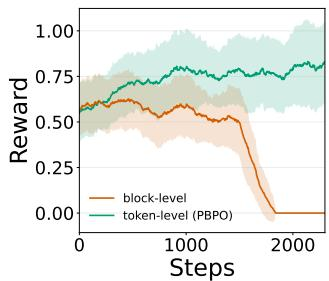  
Figure 1 Reward dynamics on MATH500, trained upon LLaDA-8B-Instruct. PBPO demonstrates stable training, while block-level objective collapses early during training.

responding token, avoiding this within-block propagation. Empirically, we observe the same behavior. In Figure 1, under identical training configurations, the block-level formulation becomes unstable and collapses earlier during training, while PBPO demonstrates substantially more stable optimization.

Theorem 1 (Blockwise Importance Weighting Produces Noisier Gradient Contributions). Given a question $q ,$ and a group of G rollouts $\{ o _ { i } \} _ { i = 1 } ^ { G } \sim \pi _ { \mathrm { o l d } } ( \cdot \mid q )$ . For any b-th block of a rollout $o _ { i . }$ , let the block-wise gradient contribution of the b-th block of $o _ { i } , \stackrel { \cdot } { o _ { i } ^ { ( b - 1 ) B _ { l } + 1 : b B _ { l } } }$ , in Equation 6 be

$$
g _ { \mathrm { b l o c k } } = \left[ \prod _ { k = ( b - 1 ) B _ { l } + 1 } ^ { b B _ { l } } \frac { \pi _ { \theta } ( o _ { i } ^ { k } \mid q , z _ { i } ^ { < b } ) } { \pi _ { \mathrm { o l d } } ( o _ { i } ^ { k } \mid q , z _ { i } ^ { < b } ) } \right] \left[ \sum _ { k = ( b - 1 ) B _ { l } + 1 } ^ { b B _ { l } } \nabla _ { \theta } \log \pi _ { \theta } ( o _ { i } ^ { k } \mid q , z _ { i } ^ { < b } ) \right] ,\tag{10}
$$

and let the gradient contribution of the tokens $o _ { i } ^ { ( b - 1 ) B _ { l } + 1 : b B _ { l } }$ in Equation 7 be

$$
g _ { \mathrm { t o k e n } } = \sum _ { k = ( b - 1 ) B _ { l } + 1 } ^ { b B _ { l } } \frac { \pi _ { \theta } ( o _ { i } ^ { k } \mid q , z _ { i } ^ { < b } ) } { \pi _ { \mathrm { o l d } } ( o _ { i } ^ { k } \mid q , z _ { i } ^ { < b } ) } \nabla _ { \theta } \log \pi _ { \theta } ( o _ { i } ^ { k } \mid q , z _ { i } ^ { < b } ) .\tag{11}
$$

Under the additional assumptions stated in Appendix $C ,$ we have

$$
\mathrm { V a r } \left[ g _ { \mathrm { b l o c k } } \right] > \mathrm { V a r } \left[ g _ { \mathrm { t o k e n } } \right] .\tag{12}
$$

Thus, block-wise importance weighting in Equation 6 induces noisier gradient contributions than the token-wise importance weighting used by $P B P O$

Table 1 Main results across six reasoning and coding benchmarks at generation lengths 128, 256, and 512. Best result per column within each backbone block is in bold, and the second-best is underlined.
<table><tr><td></td><td colspan="3">GSM8K</td><td colspan="3">MATH500</td><td colspan="3">HumanEval</td><td colspan="3">MBPP</td><td colspan="3">Countdown</td><td colspan="3">Sudoku</td></tr><tr><td>Baseline / Seq Len</td><td>128</td><td>256</td><td>512</td><td>128</td><td>256</td><td>512</td><td>128</td><td>256</td><td>512</td><td>128</td><td>256</td><td>512</td><td>128</td><td>256</td><td>512</td><td>128</td><td>256</td><td>512</td></tr><tr><td>LLaDA-8B-Instruct</td><td>69.37</td><td>77.94</td><td>79.61</td><td>26.80</td><td>32.80</td><td>34.20</td><td>23.17</td><td>31.71</td><td>30.49</td><td>35.41</td><td>39.69</td><td>40.86</td><td>19.92</td><td>17.97</td><td>17.97</td><td>9.33</td><td>5.74</td><td>5.12</td></tr><tr><td>d1</td><td>72.55</td><td>78.01</td><td>81.20</td><td>29.00</td><td>34.40</td><td>37.60</td><td>29.88</td><td>35.37</td><td>37.80</td><td>41.25</td><td>42.41</td><td>41.63</td><td>30.08</td><td>23.44</td><td>30.08</td><td>21.29</td><td>14.98</td><td>9.76</td></tr><tr><td>wd1</td><td>73.01</td><td>80.06</td><td>81.50</td><td>32.80</td><td>34.80</td><td>36.20</td><td>27.44</td><td>34.15</td><td>37.20</td><td>42.80</td><td>42.02</td><td>42.80</td><td>48.83</td><td>51.17</td><td>49.22</td><td>24.40</td><td>24.16</td><td>22.97</td></tr><tr><td>GDPO DMPO</td><td>75.66 75.59</td><td>79.91</td><td>80.59</td><td>31.40</td><td>34.80</td><td>37.40</td><td>23.17</td><td>37.20</td><td>36.59</td><td>42.41</td><td>41.25</td><td>42.80</td><td>62.50</td><td>73.05</td><td>73.05</td><td>28.09</td><td>28.09</td><td>26.12</td></tr><tr><td>PBPO (Ours)</td><td></td><td>80.74</td><td>82.79</td><td>29.80</td><td>35.40</td><td>38.20</td><td>24.39</td><td>35.98</td><td>37.80</td><td>43.19</td><td>43.58</td><td>43.58</td><td>50.00</td><td>57.81</td><td>64.84</td><td>21.15</td><td>17.13</td><td>15.50</td></tr><tr><td></td><td>76.72</td><td>84.08</td><td>84.38</td><td>34.80</td><td>36.80</td><td>41.40</td><td>30.49</td><td>37.20</td><td>37.80</td><td>43.97</td><td>48.25</td><td>47.47</td><td>52.73</td><td>64.06</td><td>64.45</td><td>34.93</td><td>38.13</td><td>38.13</td></tr><tr><td>LLaDA-1.5</td><td>71.27</td><td>79.38</td><td>82.11</td><td>28.40</td><td>32.20</td><td>38.40</td><td>21.95</td><td>30.49</td><td>34.76</td><td>36.19</td><td>44.36</td><td>38.91</td><td>21.09</td><td>18.36</td><td>21.09</td><td>13.78</td><td>10.10</td><td>8.33</td></tr><tr><td>d1</td><td>74.15</td><td>81.35</td><td>80.74</td><td>28.00</td><td>36.20</td><td>36.00</td><td>26.22</td><td>33.54</td><td>33.54</td><td>40.86</td><td>46.69</td><td>42.02</td><td>29.69</td><td>19.14</td><td>33.20</td><td>21.05</td><td>15.69</td><td>11.53</td></tr><tr><td>wd1</td><td>73.09</td><td>78.77</td><td>81.12</td><td>30.00</td><td>34.80</td><td>36.40</td><td>23.78</td><td>35.98</td><td>31.71</td><td>40.08</td><td>40.47</td><td>42.41</td><td>42.97</td><td>56.25</td><td>48.05</td><td>24.31</td><td>23.16</td><td>22.73</td></tr><tr><td>GDPO</td><td>74.60</td><td>78.39</td><td>79.38</td><td>30.20</td><td>34.40</td><td>38.40</td><td>23.78</td><td>36.59</td><td>35.98</td><td>38.91</td><td>45.91</td><td>41.25</td><td>51.56</td><td>67.58</td><td>71.88</td><td>25.50</td><td>26.70</td><td>24.26</td></tr><tr><td>DMPO</td><td>49.81</td><td>50.87</td><td>51.33</td><td>31.40</td><td>35.80</td><td>39.00</td><td>25.00</td><td>39.63</td><td>35.37</td><td>42.41</td><td>44.36</td><td>43.19</td><td>49.61</td><td>58.98</td><td>69.92</td><td>26.12</td><td>24.98</td><td>23.88</td></tr><tr><td>PBPO (Ours)</td><td>78.24</td><td>83.47</td><td>84.61</td><td>33.40</td><td>42.00</td><td>39.00</td><td>31.71</td><td>41.46</td><td>35.98</td><td>42.80</td><td>46.69</td><td>44.36</td><td>57.03</td><td>69.14</td><td>69.53</td><td>37.75</td><td>39.33</td><td>36.17</td></tr></table>

## 4 Experiments

## 4.1 Experimental Settings

Datasets and evaluation metrics. We evaluate PBPO on six benchmarks spanning mathematical reasoning, planning, and coding. For (1) mathematical reasoning, we train on the GSM8K’s training split and MATH dataset (Hendrycks et al., 2021) (without the subset of 500 problems from MATH500 (Lightman et al., 2023)) and evaluate on the GSM8K test set (Cobbe et al., 2021) and MATH500 (Lightman et al., 2023), respectively. For planning, we train on three-number TinyZero Countdown problems (Pan et al., 2025) and a 4 × 4 Sudoku split, then evaluate on 256 held-out Countdown problems and a solution-disjoint Sudoku set (Arel, 2025; Wang et al., 2025). For coding, we train on KodCode-Light-RL-10K (Xu et al., 2025) and evaluate on HumanEval’s 164 problems (Chen et al., 2021) and the 257 tasks in sanitized MBPP (Austin et al., 2021). We report accuracy using final-answer matching for GSM8K and MATH500, valid target-reaching expressions for Countdown, and complete-puzzle correctness for Sudoku; for HumanEval and MBPP, we report execution-based pass@1. Further dataset, split, and training reward details are provided in Appendix A.1.

Base models and baselines. We initialize RL training from two masked difusion language models, LLaDA-8B-Instruct (Nie et al., 2025) and LLaDA-1.5 (Zhu et al., 2026a). We compare PBPO against recent approaches for RL post-training of dLLMs, including d1 (Zhao et al., 2025), wd1 (Tang et al., 2025), GDPO (Rojas et al., 2026), and DMPO (Zhu et al., 2026b).

Training setup. We perform task-specific RL post-training and train a separate policy for each benchmark and initialization checkpoint. Following d1 (Zhao et al., 2025), we use Low-Rank Adaptation (LoRA) (Hu et al., 2022) for parameter-eficient optimization. Unless otherwise specified, all training runs share the same rollout generation process. We use confidence-based block-wise decoding proposed in LLaDA (Nie et al., 2025), which unmasks the two positions with the highest confidence within the current block at each denoising step. Complete training configurations, rollout generation details, and hyperparameters are provided in Appendix A.2.

Evaluation protocol. For each RL run, we evaluate the final saved checkpoint after the prescribed number of optimization steps, with GDPO as the only exception. As GDPO collapses early during training, we evaluate its last saved checkpoint immediately before the collapse. Following prior dLLM RL works (Zhao et al., 2025; Tang et al., 2025), we report results at maximum completion lengths of 128, 256, and 512. For a maximum generation length of N, we use N/2 difusion steps and block length B<sub>l</sub> = 32, utilizing LLaDA’s confidence-based unmasking strategy, as described above. During evaluation, we use temperature 0.0 for deterministic decoding.

## 4.2 Main Results

PBPO achieves competitive performance. In Tables 1, across all configurations, PBPO outperforms d1, wd1, GDPO, and DMPO in 27 settings and ties the leading baseline in five more. In the other four settings, PBPO remains competitive, ranking second or third. This performance is consistent across both model initializations and task domains: PBPO leads or ties throughout GSM8K, MATH500, Sudoku, HumanEval, and MBPP, while remaining competitive on Countdown. Averaged across the three generation lengths, PBPO’s margins over the runner-up on GSM8K, MATH500, Sudoku, HumanEval, and MBPP are 2.00, 2.20, 9.63, 0.20, and 3.11 percentage points, respectively, with LLaDA-8B-Instruct. With LLaDA-1.5, the corresponding margins are 3.08, 2.60, 12.06, 2.44, and 0.52 percentage points. Qualitative PBPO generations from both model initializations are provided in Appendix D.

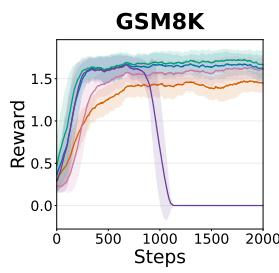

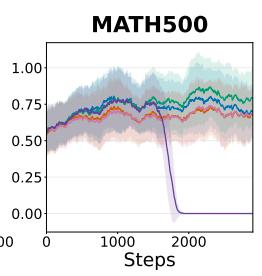

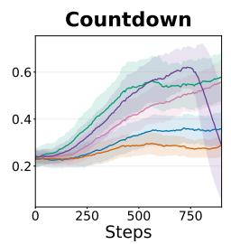  
d1 wd1 GDPO DMPO PBPO

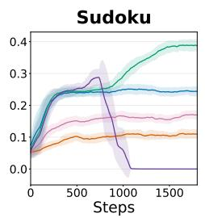

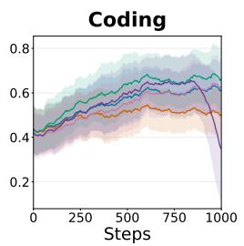

Figure 2 Reward dynamics during five RL post-training runs initialized from LLaDA-8B-Instruct. We report the mean and standard deviation over a rolling window of 50 training steps.  
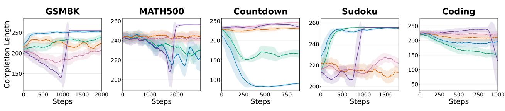  
Figure 3 Completion length dynamics during five RL post-training runs initialized from LLaDA-8B-Instruct. We report the mean and standard deviation over a rolling window of 50 training steps.

Training dynamics. Figures 2 and 4 show that PBPO improves steadily and maintains stable optimization throughout training with both model initializations. It finishes with the highest reward across all five training runs, complementing its competitive final evaluation performance in Table 1.

Effective utilization of the generation budget. Figures 3 and 5 show that PBPO couples improving reward with efective use of the generation budget. Although PBPO converges to the highest completion-length regime alongside wd1 and GDPO on Sudoku, it achieves substantially higher reward and evaluation accuracy than both. Tables 5 and 6 reinforce this eficiency at evaluation time: PBPO pairs strong accuracy with compact efective responses, ranking as the shortest or second-shortest method in 29 configurations. On the coding benchmarks, it produces the shortest responses in 11 of 12 settings and the second-shortest in the remaining one while attaining the highest pass@1 throughout. These results show that PBPO yields strong task performance with efective generation.

Robustness across various denoising configurations. We further vary the block length B and evaluate both confidence-based and random token-selection strategies, which were proposed in LLaDA (Nie et al., 2025). Complete configuration details and empirical results are provided in Appendix B.3. Across the 30 combinations of six benchmarks and five denoising configurations, PBPO achieves the best result in 20, ties the leading baseline in two, ranks second in five, and ranks third in three. PBPO achieves the best result on GSM8K and Sudoku under every configuration, while the two confidence-based block-length variants nearly preserve its default mean accuracy across all six benchmarks (53.22% versus 53.68%). Under random token selection, PBPO ranks first or second in 17 of 18 comparisons. Its efective sequence length also ranks first or second in 20 configurations, demonstrating robust task performance together with efective generation across various decoding configurations.

Table 2 Ablation across three PBPO variants on Countdown and MATH500 at generation lengths 128, 256, and 512, with LLaDA-1.5 as the base model. Best result per column is in bold, and second-best result is highlighted with underline.
<table><tr><td rowspan="2">Baseline / Seq Len</td><td colspan="3">Countdown</td><td colspan="3">MATH500</td></tr><tr><td>128</td><td>256</td><td>512</td><td>128</td><td>256</td><td>512</td></tr><tr><td>PBPO + clean prompt + clean prefix</td><td>46.09</td><td>47.27</td><td>51.56</td><td>30.80</td><td>32.60</td><td>36.20</td></tr><tr><td>PBPO + prompt masking + clean prefix</td><td>47.27</td><td>57.81</td><td>62.89</td><td>33.40</td><td>42.00</td><td>39.00</td></tr><tr><td>PBPO + prompt masking + prefix masking</td><td>57.03</td><td>69.14</td><td>69.53</td><td>31.00</td><td>35.60</td><td>38.20</td></tr></table>

## 4.3 Ablation Study

We next examine the efect of the conditioning diversification strategy introduced in Section 3.3.1. We compare three ablations: (1) PBPO with a clean prompt and clean prefix; (2) PBPO with per-update prompt masking but a clean prefix; and (3) PBPO with per-update masking of both the prompt and revealed prefix. For the masked variants, each eligible token is independently replaced by [MASK] with probability 0.15. We conduct this ablation on MATH500 and Countdown using LLaDA-1.5 as the initialization checkpoint.

As shown in Table 2, introducing per-update corruption consistently improves over using a clean prompt and clean prefix across both benchmarks and all three generation lengths. This supports the motivation in Section 3.3.1, as exposing the dLLM to multiple corrupted conditioning views provides a more efective way to reuse a fixed rollout batch during policy optimization. The efect of additionally masking the revealed prefix is task-dependent. On Countdown, prompt-and-prefix masking substantially outperforms prompt-only masking, improving accuracy by 9.76, 11.33, and 6.64 percentage points at generation lengths 128, 256, and 512, respectively. On MATH500, prompt-only masking performs better than additionally masking the prefix, although both masked variants outperform the fully clean configuration. These results suggest that conditioning diversification is consistently beneficial, while the preferred amount of corruption in the revealed prefix can depend on the reasoning task.

## 5 Related Works

Masked diffusion language models. Masked difusion language models specialize discrete difusion to absorbingstate corruption, with training objectives that reduce to weighted denoising losses over masked positions (Shi et al., 2024; Sahoo et al., 2024). RADD further connects absorbing difusion to clean-data conditional prediction and any-order autoregressive modeling (Ou et al., 2025). Building on these foundations, LLaDA and LLaDA-1.5 scale masked difusion to large language models and use block-wise decoding to combine parallel denoising with dependencies across completed blocks (Nie et al., 2025; Zhu et al., 2026a). PBPO focuses on RL post-training under this block-wise generation structure.

Policy optimization for masked dLLMs. Because exact response likelihoods are intractable, existing methods adopt diferent optimization surrogates. d1 applies group-relative policy optimization using one-step token predictions under a mean-field approximation (Zhao et al., 2025). wd1 instead avoids explicit importance ratios and optimizes a reward-weighted token likelihood (Tang et al., 2025). GDPO constructs a sequence-level ratio from a difusion evidence lower bound and uses structured estimation to manage its cost and variance (Rojas et al., 2026), whereas DMPO replaces clipped ratio optimization with matching to a reward-modified target distribution (Zhu et al., 2026b). PBPO retains clipped surrogate ratios and addresses the distinct question of how these ratios should be assigned within the block-wise structure.

## 6 Conclusion

We propose Prefix-Block Policy Optimization (PBPO) for RL post-training of dLLMs. Starting from the block-level adaptation of autoregressive policy optimization, PBPO approximates intractable completed-block likelihoods with factorized one-step predictions from a prefix-block state. Whereas the block-level objective multiplies the token surrogate ratios into one shared weight, PBPO retains the same prefix-block conditioning while applying surrogate importance weighting and clipping separately to each token, yielding more stable training. Across two LLaDA-family initializations, six benchmarks, and varied denoising configurations, PBPO achieves competitive performance against existing dLLM RL methods while maintaining stable reward improvement. PBPO still relies on a one-step approximation to the exact multi-step denoising likelihood; extending the formulation to broader dLLM families and decoding procedures is therefore an important direction for future work.

## References

Arel. Arel’s sudoku generator. https://www.ocf.berkeley.edu/\~arel/sudoku/main.html, 2025.

Jacob Austin, Augustus Odena, Maxwell I. Nye, Maarten Bosma, Henryk Michalewski, David Dohan, Ellen Jiang, Carrie J. Cai, Michael Terry, Quoc V. Le, and Charles Sutton. Program synthesis with large language models. CoRR, abs/2108.07732, 2021. https://arxiv.org/abs/2108.07732.

Mark Chen, Jerry Tworek, Heewoo Jun, Qiming Yuan, Henrique Pondé de Oliveira Pinto, Jared Kaplan, Harri Edwards, Yuri Burda, Nicholas Joseph, Greg Brockman, Alex Ray, Raul Puri, Gretchen Krueger, Michael Petrov, Heidy Khlaaf, Girish Sastry, Pamela Mishkin, Brooke Chan, Scott Gray, Nick Ryder, Mikhail Pavlov, Alethea Power, Lukasz Kaiser, Mohammad Bavarian, Clemens Winter, Philippe Tillet, Felipe Petroski Such, Dave Cummings, Matthias Plappert, Fotios Chantzis, Elizabeth Barnes, Ariel Herbert-Voss, William Hebgen Guss, Alex Nichol, Alex Paino, Nikolas Tezak, Jie Tang, Igor Babuschkin, Suchir Balaji, Shantanu Jain, William Saunders, Christopher Hesse, Andrew N. Carr, Jan Leike, Joshua Achiam, Vedant Misra, Evan Morikawa, Alec Radford, Matthew Knight, Miles Brundage, Mira Murati, Katie Mayer, Peter Welinder, Bob McGrew, Dario Amodei, Sam McCandlish, Ilya Sutskever, and Wojciech Zaremba. Evaluating large language models trained on code. CoRR, abs/2107.03374, 2021. https://arxiv.org/abs/2107.03374.

Karl Cobbe, Vineet Kosaraju, Mohammad Bavarian, Mark Chen, Heewoo Jun, Lukasz Kaiser, Matthias Plappert, Jerry Tworek, Jacob Hilton, Reiichiro Nakano, Christopher Hesse, and John Schulman. Training verifiers to solve math word problems. CoRR, abs/2110.14168, 2021. https://arxiv.org/abs/2110.14168.

DeepSeek-AI. Deepseek-r1: Incentivizing reasoning capability in llms via reinforcement learning. CoRR, abs/2501.12948, 2025. doi: 10.48550/ARXIV.2501.12948. https://doi.org/10.48550/arXiv.2501.12948.

Dan Hendrycks, Collin Burns, Saurav Kadavath, Akul Arora, Steven Basart, Eric Tang, Dawn Song, and Jacob Steinhardt. Measuring mathematical problem solving with the MATH dataset. In Joaquin Vanschoren and Sai-Kit Yeung, editors, Proceedings of the Neural Information Processing Systems Track on Datasets and Benchmarks 1, NeurIPS Datasets and Benchmarks 2021, December 2021, virtual, 2021. https://datasets-benchmarks-proceedings. neurips.cc/paper/2021/hash/be83ab3ecd0db773eb2dc1b0a17836a1-Abstract-round2.html.

Edward J. Hu, Yelong Shen, Phillip Wallis, Zeyuan Allen-Zhu, Yuanzhi Li, Shean Wang, Lu Wang, and Weizhu Chen. Lora: Low-rank adaptation of large language models. In The Tenth International Conference on Learning Representations, ICLR 2022, Virtual Event, April 25-29, 2022. OpenReview.net, 2022. https://openreview.net/ forum?id=nZeVKeeFYf9.

Hunter Lightman, Vineet Kosaraju, Yura Burda, Harri Edwards, Bowen Baker, Teddy Lee, Jan Leike, John Schulman, Ilya Sutskever, and Karl Cobbe. Let’s verify step by step. arXiv preprint arXiv:2305.20050, 2023.

Zichen Liu, Changyu Chen, Wenjun Li, Penghui Qi, Tianyu Pang, Chao Du, Wee Sun Lee, and Min Lin. Understanding r1-zero-like training: A critical perspective. CoRR, abs/2503.20783, 2025. doi: 10.48550/ARXIV.2503.20783. https://doi.org/10.48550/arXiv.2503.20783.

Shen Nie, Fengqi Zhu, Zebin You, Xiaolu Zhang, Jingyang Ou, Jun Hu, Jun Zhou, Yankai Lin, Ji-Rong Wen, and Chongxuan Li. Large language difusion models. In Danielle Belgrave, Cheng Zhang, Laura N. Montoya, Hsuan-Tien Lin, Razvan Pascanu, Piotr Koniusz, Marzyeh Ghassemi, Nancy Chen, Iván Vladimir Meza Ruíz, and Arturo Loaiza-Bonilla, editors, Advances in Neural Information Processing Systems 38: Annual Conference on Neural Information Processing Systems 2025, NeurIPS 2025, San Diego, CA, USA, December 2-7, 2025 / Mexico City, Mexico, November 30 - December 5, 2025, 2025. http://papers.nips.cc/paper\_files/paper/2025/hash/ 48b383b24230e0e6e649d9c98dae4d8c-Abstract-Conference.html.

Jingyang Ou, Shen Nie, Kaiwen Xue, Fengqi Zhu, Jiacheng Sun, Zhenguo Li, and Chongxuan Li. Your absorbing discrete difusion secretly models the conditional distributions of clean data. In The Thirteenth International Conference on Learning Representations, ICLR 2025, Singapore, April 24-28, 2025. OpenReview.net, 2025. https: //openreview.net/forum?id=sMyXP8Tanm.

Long Ouyang, Jefrey Wu, Xu Jiang, Diogo Almeida, Carroll L. Wainwright, Pamela Mishkin, Chong Zhang, Sandhini Agarwal, Katarina Slama, Alex Ray, John Schulman, Jacob Hilton, Fraser Kelton, Luke Miller, Maddie Simens, Amanda Askell, Peter Welinder, Paul F. Christiano, Jan Leike, and Ryan Lowe. Training language models to follow instructions with human feedback. In Sanmi Koyejo, S. Mohamed, A. Agarwal, Danielle Belgrave, K. Cho, and A. Oh, editors, Advances in Neural Information Processing Systems 35: Annual Conference on Neural Information Processing Systems 2022, NeurIPS 2022, New Orleans, LA, USA, November 28 - December 9, 2022, 2022. http: //papers.nips.cc/paper\_files/paper/2022/hash/b1efde53be364a73914f58805a001731-Abstract-Conference.html.

Jiayi Pan, Junjie Zhang, Xingyao Wang, Lifan Yuan, Hao Peng, and Alane Suhr. Tinyzero. https://github.com/ Jiayi-Pan/TinyZero, 2025. Accessed: 2025-01-24.

Kevin Rojas, Jiahe Lin, Kashif Rasul, Anderson Schneider, Yuriy Nevmyvaka, Molei Tao, and Wei Deng. Improving reasoning for difusion language models via group difusion policy optimization. ICLR, 2026.

Subham Sekhar Sahoo, Marianne Arriola, Yair Schif, Aaron Gokaslan, Edgar Marroquin, Justin T. Chiu, Alexander M. Rush, and Volodymyr Kuleshov. Simple and efective masked difusion language models. In Advances in Neural Information Processing Systems, 2024.

John Schulman, Filip Wolski, Prafulla Dhariwal, Alec Radford, and Oleg Klimov. Proximal policy optimization algorithms. CoRR, abs/1707.06347, 2017. http://arxiv.org/abs/1707.06347.

Zhihong Shao, Peiyi Wang, Qihao Zhu, Runxin Xu, Junxiao Song, Mingchuan Zhang, Y. K. Li, Y. Wu, and Daya Guo. Deepseekmath: Pushing the limits of mathematical reasoning in open language models. CoRR, abs/2402.03300, 2024. doi: 10.48550/ARXIV.2402.03300. https://doi.org/10.48550/arXiv.2402.03300.

Jiaxin Shi, Kehang Han, Zhe Wang, Arnaud Doucet, and Michalis K. Titsias. Simplified and generalized masked difusion for discrete data. In Advances in Neural Information Processing Systems, 2024.

Xiaohang Tang, Rares Dolga, Sangwoong Yoon, and Ilija Bogunovic. wd1: Weighted policy optimization for reasoning in difusion language models. CoRR, abs/2507.08838, 2025. doi: 10.48550/ARXIV.2507.08838. https: //doi.org/10.48550/arXiv.2507.08838.

Chenyu Wang, Paria Rashidinejad, DiJia Su, Song Jiang, Sid Wang, Siyan Zhao, Cai Zhou, Shannon Zejiang Shen, Feiyu Chen, Tommi S. Jaakkola, Yuandong Tian, and Bo Liu. SPG: sandwiched policy gradient for masked difusion language models. CoRR, abs/2510.09541, 2025. doi: 10.48550/ARXIV.2510.09541. https: //doi.org/10.48550/arXiv.2510.09541.

Zhangchen Xu, Yang Liu, Yueqin Yin, Mingyuan Zhou, and Radha Poovendran. Kodcode: A diverse, challenging, and verifiable synthetic dataset for coding. In Wanxiang Che, Joyce Nabende, Ekaterina Shutova, and Mohammad Taher Pilehvar, editors, Findings of the Association for Computational Linguistics, ACL 2025, Vienna, Austria, July 27 - August 1, 2025, volume ACL 2025 of Findings of ACL, pages 6980–7008. Association for Computational Linguistics, 2025. doi: 10.18653/V1/2025.FINDINGS-ACL.365. https://doi.org/10.18653/v1/2025.findings-acl.365.

Qiying Yu, Zheng Zhang, Ruofei Zhu, Yufeng Yuan, Xiaochen Zuo, Yu Yue, Weinan Dai, Tiantian Fan, Gaohong Liu, Juncai Liu, Lingjun Liu, Xin Liu, Haibin Lin, Zhiqi Lin, Bole Ma, Guangming Sheng, Yuxuan Tong, Chi Zhang, Mofan Zhang, Ru Zhang, Wang Zhang, Hang Zhu, Jinhua Zhu, Jiaze Chen, Jiangjie Chen, Chengyi Wang, Hongli Yu, Yuxuan Song, Xiangpeng Wei, Hao Zhou, Jingjing Liu, Wei-Ying Ma, Ya-Qin Zhang, Lin Yan, Yonghui Wu, and Mingxuan Wang. DAPO: an open-source LLM reinforcement learning system at scale. In Danielle Belgrave, Cheng Zhang, Laura N. Montoya, Hsuan-Tien Lin, Razvan Pascanu, Piotr Koniusz, Marzyeh Ghassemi, Nancy Chen, Iván Vladimir Meza Ruíz, and Arturo Loaiza-Bonilla, editors, Advances in Neural Information Processing Systems 38: Annual Conference on Neural Information Processing Systems 2025, NeurIPS 2025, San Diego, CA, USA, December 2-7, 2025 / Mexico City, Mexico, November 30 - December 5, 2025, 2025. http: //papers.nips.cc/paper\_files/paper/2025/hash/a4277440d50f1f15d2cb4c14f7e0c0d2-Abstract-Conference.html.

Siyan Zhao, Devaansh Gupta, Qinqing Zheng, and Aditya Grover. d1: Scaling reasoning in difusion large language models via reinforcement learning. In Danielle Belgrave, Cheng Zhang, Laura N. Montoya, Hsuan-Tien Lin, Razvan Pascanu, Piotr Koniusz, Marzyeh Ghassemi, Nancy Chen, Iván Vladimir Meza Ruíz, and Arturo Loaiza-Bonilla, editors, Advances in Neural Information Processing Systems 38: Annual Conference on Neural Information Processing Systems 2025, NeurIPS 2025, San Diego, CA, USA, December 2-7, 2025 / Mexico City, Mexico, November 30 - December 5, 2025, 2025. http://papers.nips.cc/paper\_files/paper/2025/hash/ 52190a0362148d179f1cbd9080956872-Abstract-Conference.html.

Fengqi Zhu, Rongzhen Wang, Shen Nie, Xiaolu Zhang, Chunwei Wu, Jun Zhou, Yankai Lin, Ji-Rong Wen, and Chongxuan Li. Llada 1.5: Variance-reduced preference optimization for large language difusion models. In Maria Liakata, Viviane P. Moreira, Jiajun Zhang, and David Jurgens, editors, Proceedings of the 64th Annual Meeting of the Association for Computational Linguistics (Volume 1: Long Papers), ACL 2026, San Diego, California, United States, July 2-7, 2026, pages 11425–11460. Association for Computational Linguistics, 2026a. doi: 10.18653/V1/2026.ACL-LONG.524. https://doi.org/10.18653/v1/2026.acl-long.524.

Yuchen Zhu, Wei Guo, Jaemoo Choi, Petr Molodyk, Bo Yuan, Molei Tao, and Yongxin Chen. Enhancing reasoning for difusion llms via distribution matching policy optimization. ICML, 2026b.

## Appendix

## A Additional Experimental Details

## A.1 Datasets and Reward Functions

We follow the task-specific verifiable rewards used in prior dLLM RL work (Zhao et al., 2025; Tang et al., 2025), while specifying the exact parsing and scoring rules used in our implementation. All reward functions operate on the decoded response string o. When a task uses M reward components, the sequence-level reward is their equal-weight sum,

$$
R ( q , o ) = \sum _ { m = 1 } ^ { M } R _ { m } ( q , o ) ,\tag{13}
$$

where $R _ { m }$ denotes the m-th task-specific component. Countdown and Sudoku use a single component. $\mathrm { P B P O }$ subsequently converts $R ( q , o )$ into the group-relative advantage in Section 2.2; no additional reward normalization is applied.

GSM8K. We perform RL training on the standard GSM8K training split and evaluate on the held-out test split. Let $a ( o )$ be the whitespace-trimmed substring after the final <answer> tag and before the next </answer> tag. If an opening answer tag is absent, the parser falls back to the response content preceding a closing answer tag, if present. The ground-truth answer y is the trimmed substring following the #### delimiter in the GSM8K reference solution. The training reward is

$$
R _ { \mathrm { G S M 8 K } } ( q , o ) = R _ { \mathrm { X M L } } ( o ) + R _ { \mathrm { s o f t } } ( o ) + R _ { \mathrm { s t r i c t } } ( o ) + R _ { \mathrm { i n t } } ( o ) + R _ { \mathrm { c o r r e c t } } ( o , y ) ,\tag{14}
$$

with the following five components:

• XML structure. R<sub>XML</sub> adds 0.125 when each of the following literal delimiters occurs exactly once: <reasoning>\n, \n</reasoning>\n, \n<answer>\n, and $\scriptstyle \lambda = / \mathsf { a n s w e r } >$ . The trailing-content adjustment follows the implementation literally. If \n<answer>\n occurs exactly once, it subtracts 0.001 times the number of characters returned after splitting on \n</answer>\n; if that closing delimiter is absent, this operation returns the full response. A second check, activated when \n</answer> occurs exactly once, subtracts $0 . 0 0 1 ( L - 1 )$ , where L is the length of the sufix after that delimiter. This operation does not verify that the omitted character is a newline: it adds 0.001 when the sufix is empty and otherwise ignores one trailing character. The two adjustments are added when both checks apply.

• Soft format. $R _ { \mathrm { s o f t } } = 0 . 5$ when the response matches the code-like pattern <reasoning>...</reasoning>\s\*<answer>...</answer> from the beginning of the string, and is zero otherwise. Because the regular expression does not enable multiline matching, the content inside each tag pair must lie on a single line.

• Strict format. $R _ { \mathrm { s t r i c t } } = 0 . 5$ only for the exact layout <reasoning>\n...\n</reasoning> followed by \n<answer>\n...\n</answer>\n; otherwise, it is zero. Here, each ellipsis again matches only singleline content. Consequently, the soft and strict format indicators cannot both be active for the same response under these regular expressions.

• Integer answer. $R _ { \mathrm { i n t } } = 0 . 5$ when every character of $a ( o )$ is a decimal digit, and is zero otherwise.

• Answer correctness. $R _ { \mathrm { c o r r e c t } } ( o , y ) = 2 { \bf 1 } [ a ( o ) = y ]$ , where equality is an exact string comparison after trimming surrounding whitespace.

Because the soft and strict patterns are mutually exclusive, the largest executed reward is 3.5, attained by a correct integer answer satisfying the strict layout and all four XML checks. Trailing content can further reduce the XML component. Evaluation reports the percentage of examples for which the extracted final answer exactly matches the ground-truth answer.

MATH500. For RL training, we load the training split of the MATH500 dataset and evaluate on its held-out split. We first extract the final \boxed{} expression from the response, or the final \fbox{} expression when no \boxed expression occurs; if neither is found, the full response is retained as the candidate. We remove the outer box and apply the same procedure to the reference solution. The candidate and reference are then normalized using a deterministic string procedure. Specifically, the normalizer removes newline characters and literal spaces, inverse spacing \!, \left and \right, degree markers, escaped dollar and percentage symbols, and all content beginning at the exact substring \text{ when that substring occurs once. If it occurs multiple times, normalization fails and the comparator falls back to raw-string equality. The procedure also canonicalizes doubled backslashes, \tfrac, and \dfrac; repairs simple fraction and square-root syntax; converts a simple $a / b$ expression and 0.5 to fractional notation; normalizes leading decimals; and drops a variable name of at most two characters preceding a single equality. Let $\mathcal { N } ( o )$ and $\mathcal { N } ( y )$ denote the resulting normalized candidate and reference strings, respectively.

For the format component, let $h _ { \mathrm { a n s } } ( o )$ indicate that the literal opening tag <answer> occurs; a closing tag is not required by the implemented split operation. Moreover, let $h _ { \mathrm { b o x } } ( o )$ indicate the literal control-character sequence tested by the implementation, within the extracted answer content when $h _ { \mathrm { a n s } } ( o ) = 1$ and within the full response otherwise. This sequence is U+0008oxed (a backspace followed by oxed), rather than the printed LaTeX command \boxed; consequently, $h _ { \mathrm { b o x } } ( o ) = 0$ for ordinary model outputs containing \boxed. The executed reward is

$$
R _ { \mathrm { M A T H } } ( q , o ) = 2 { \bf 1 } [ { \cal N } ( o ) = { \cal N } ( y ) ] + 0 . 2 5 + 0 . 5 h _ { \mathrm { a n s } } ( o ) + 0 . 2 5 h _ { \mathrm { b o x } } ( o ) .\tag{15}
$$

Accordingly, correctness is determined by equality after deterministic string normalization rather than by a computer-algebra solver. For ordinary decoded text, the format component is 0.75 when <answer> is present and 0.25 otherwise, giving a maximum attainable reward of 2.75; the literal program maximum is 3.0 if the control-character condition is met. Evaluation applies the same normalized-answer comparison.

Countdown. We use the training split of the Countdown dataset from TinyZero (Pan et al., 2025), restricted to problems containing three input numbers. After shufling with the experiment seed, we reserve the final 500 examples and train on the remainder. Following d1 (Zhao et al., 2025), we evaluate on a fixed set of 256 synthetically generated three-number Countdown problems. The parser extracts the final substring enclosed by <answer> and $< /$ answer>. Let $e ( o )$ denote this expression, $T \in \mathbb { R }$ the target, and $\textstyle { \mathcal { N } } _ { q }$ the multiset of three input numbers. The verifier extracts every maximal digit sequence in $e ( o )$ , converts each sequence to an integer, and requires the resulting multiset to equal $\textstyle { \mathcal { N } } _ { q }$ . It then evaluates expressions containing only digits, whitespace, decimal points, parentheses, and the operators $+ , - , * ,$ and $/$ in an environment without Python built-ins. The reward used in our runs is

$$
R _ { \mathrm { C o u n t d o w n } } ( q , o ) = \left\{ \begin{array} { l l } { 1 , } & { \mathrm { i f ~ a n ~ e x p r e s s i o n ~ i s ~ e x t r a c t e d , ~ u s e s ~ e x a c t l y ~ \mathcal { N } _ { q } ~ , } } \\ { \mathrm { ~ } } & { \mathrm { e v a l u a t e s ~ s u c c e s s f u l l y , ~ a n d ~ d i f f e r s ~ f r o m ~ \mathcal { T } ~ b y ~ l e s s ~ t h a n ~ 1 0 ^ { - 5 } , } } \\ { 0 , } & { \mathrm { i f ~ n o ~ a n s w e r ~ e x p r e s s i o n ~ c a n ~ b e ~ e x t r a c t e d , } } \\ { 0 . 1 , } & { \mathrm { o t h e r w i s e . } } \end{array} \right.\tag{16}
$$

Thus, the 0.1 fallback also covers an extracted expression with an invalid number multiset, unsupported characters, an evaluation error, or an incorrect value; it is not restricted to well-formed expressions that merely miss the target.

Sudoku. We use the 4 × 4 Sudoku dataset generated by Arel (Arel, 2025), whose original training set contains one million unique puzzles spanning all 288 possible 4 × 4 solution grids. Following (Wang et al., 2025), we construct a solution-disjoint train–test split to prevent leakage through memorization of complete solutions. Specifically, we randomly select 200 solution grids and include all puzzles associated with them in the training pool, resulting in 694,006 puzzles. The loader shufles this pool with the experiment seed, reserves its final 500 examples, and therefore uses 693,506 puzzles for RL training. The test set contains 256 puzzles sampled from the remaining 88 solution grids, ensuring that no test solution appears in the RL training set.

For a puzzle string $p \in \{ 0 , 1 , 2 , 3 , 4 \} ^ { 1 6 }$ , let $g \in \{ 1 , 2 , 3 , 4 \} ^ { 1 6 }$ denote its ground-truth solution and $\mathcal { E } ( p ) = \{ j \in$ $\{ 1 , \ldots , 1 6 \} : p _ { j } = 0 \}$ the indices of originally empty cells. The parser takes the final answer-tag span, removes every non-digit character, and obtains a candidate digit string $s ( o )$ . Candidates shorter than 16 digits are right-padded with zeros, whereas candidates longer than 16 digits are truncated; denote the resulting length-16 string by s¯(o). If no nonempty answer can be extracted, the reward is zero. Otherwise,

$$
R _ { \mathrm { S u d o k u } } ( q , o ) = \frac { 1 } { | \mathcal { E } ( p ) | } \sum _ { j \in \mathcal { E } ( p ) } \mathbf { 1 } [ \bar { s } _ { j } ( o ) = g _ { j } ] .\tag{17}
$$

Only originally empty cells contribute: copied clues receive no credit, and there is no separate reward for satisfying row, column, or subgrid constraints. Evaluation is stricter than the dense training reward and reports the fraction of puzzles for which the complete solution is correct.

Code generation. We perform coding RL on the training portion of KodCode-Light-RL-10K (Xu et al., 2025). Following a deterministic split with seed 42, we use 90% of its training split; each example provides a coding problem, a reference solution, and synthetic unit tests. The coding reward combines the XML-structure component defined for GSM8K with a code-specific component that evaluates both output placement and functional correctness.

More precisely, let $c ( o )$ denote the program extracted from the first literal code block matching “ ‘python\n...“ ‘ in response o. Let $h _ { \mathrm { p l a c e } } ( o )$ indicate that this entire code block occurs inside the first <answer> $\cdots ^ { < / }$ answer> span. For a valid KodCode test specification, let $\mathcal { T } = \{ \tau _ { j } \} _ { j = 1 } ^ { J }$ denote the J unit tests associated with the problem, and let $\operatorname { P a s s } ( c ( o ) , \tau _ { j } ) \in \{ 0 , 1 \}$ indicate whether executing c(o) with test $\tau _ { j }$ terminates successfully. The resulting reward is

$$
R _ { \mathrm { C o d e } } ( q , o ) = R _ { \mathrm { X M L } } ( o ) + 0 . 5 h _ { \mathrm { p l a c e } } ( o ) + \frac { 1 } { J } \sum _ { j = 1 } ^ { J } \mathrm { P a s s } ( c ( o ) , \tau _ { j } ) ,\tag{18}
$$

where the test-pass fraction is defined as zero when no executable test is available. Thus, a correctly formatted response whose program passes every test receives a maximum reward of 2.0: up to 0.5 from XML structure, 0.5 from placing the Python code block inside the answer tags, and 1.0 from functional correctness.

Before execution, the verifier identifies the expected function name from a literal statement of the form from solution import <name> or, otherwise, from the first assertion that invokes a function. It extracts the first function defined by the generated program and renames that definition to the expected name when necessary. The verifier then rejects programs containing any blocked module or keyword from os, sys, subprocess, shutil, socket, psutil, ctypes, pathlib, builtins, and \_\_import\_\_. Unsafe programs and outputs without a function definition receive no functional-correctness credit, although a correctly placed code block retains its 0.5 placement reward. Finally, each unit test is executed in a separate worker process with a 1-GB memory limit and a one-second deadline; exceptions, timeouts, and missing test results are counted as failures. During evaluation on HumanEval and MBPP, we instead report the stricter execution-based pass@1 metric described in Section 4.1.

## A.2 Training and Implementation Details

Here, we provide the complete rollout, optimization, and implementation configurations required for reproducibility.

Rollout generation. For each prompt, we sample $G = 6$ responses with maximum completion length 256 and temperature 0.9. Following LLaDA (Nie et al., 2025) and prior dLLM RL work (Zhao et al., 2025; Tang et al., 2025), generation proceeds block-by-block with block length $B _ { l } = 3 2$ over 128 denoising steps. At each step, the two currently masked positions with the highest predicted-token confidence within the active block are revealed, while all remaining positions in that block stay masked. Generation advances to the next block after the active block is fully revealed. Each resulting rollout batch is reused for $\mu = 4$ policy-update iterations.

We use a per-device training batch size of 6 with 2 gradient accumulation steps. Every training run is conducted on 8 NVIDIA H200 GPUs.

Following d1 (Zhao et al., 2025), we use LoRA with rank $r = 1 2 8$ , scaling factor $\alpha = 6 4$ , and dropout 0.05. LoRA adapters are applied to the query, key, value, and output projections in the attention layers, as well as the up, down, and gate projections in the feed-forward layers. We optimize the LoRA parameters using AdamW with $\beta _ { 1 } = 0 . 9 , \beta _ { 2 } = 0 . 9 9$ , weight decay 0.1, learning rate $3 \times 1 0 ^ { - 6 }$ , and maximum gradient norm 0.2. The learning rate follows a constant\_with\_warmup schedule with warmup ratio $1 0 ^ { - 4 }$

Table 3 Dataset-specific PBPO training hyperparameters for policies initialized from LLaDA-8B-Instruct.
<table><tr><td>Hyperparameter</td><td>GSM8K</td><td>MATH500</td><td>Countdown</td><td>Sudoku</td><td>KodCode-Light-RL-10K</td></tr><tr><td>Training steps</td><td>2,000</td><td>2,900</td><td>900</td><td>1,800</td><td>1,000</td></tr><tr><td>Prompt masking probability  $p _ { q }$ </td><td>0.15</td><td>0.15</td><td>0.15</td><td>0.15</td><td>0.15</td></tr><tr><td>Prefix masking probability  $p _ { z }$ </td><td>0</td><td>0</td><td>0.15</td><td>0</td><td>0.15</td></tr><tr><td>€l</td><td>0.5</td><td>0.2</td><td>0.2</td><td>0.2</td><td>0.2</td></tr><tr><td> $\epsilon _ { r }$ </td><td>0.5</td><td>0.28</td><td>0.28</td><td>0.28</td><td>0.28</td></tr></table>

Table 4 Dataset-specific PBPO training hyperparameters for policies initialized from LLaDA-1.5.
<table><tr><td>Hyperparameter</td><td>GSM8K</td><td>MATH500</td><td>Countdown</td><td>Sudoku</td><td>KodCode-Light-RL-10K</td></tr><tr><td>Training steps</td><td>2,200</td><td>2,400</td><td>1,000</td><td>1,900</td><td>1,000</td></tr><tr><td>Prompt masking probability  $p _ { q }$ </td><td>0.15</td><td>0.15</td><td>0.15</td><td>0.15</td><td>0.15</td></tr><tr><td>Prefix masking probability  $p _ { z }$ </td><td>0</td><td>0</td><td>0.15</td><td>0</td><td>0.15</td></tr><tr><td> $\epsilon _ { l }$ </td><td>0.2</td><td>0.2</td><td>0.2</td><td>0.2</td><td>0.2</td></tr><tr><td> $\epsilon _ { r }$ </td><td>0.28</td><td>0.28</td><td>0.28</td><td>0.28</td><td>0.28</td></tr></table>

For PBPO with per-update masking, the clean prompt, clean revealed prefixes, generated responses, and behavior policy $\pi _ { \mathrm { o l d } }$ remain fixed while a rollout batch is reused. At each policy-update iteration, a fresh masking pattern is independently sampled and applied to the same clean prompt and prefix sequences, as described in Section 3.3.1.

The optimization, batching, rollout, and LoRA settings are shared across all experiments. Tables 3 and 4 report the dataset-specific hyperparameters separately for policies initialized from LLaDA-8B-Instruct and LLaDA-1.5, respectively.

## B Additional Empirical Results

## B.1 Training Dynamics with LLaDA-1.5

Figures 4 and 5 provide the reward and completion length trajectories for the five training runs when PBPO and the baselines are initialized from LLaDA-1.5.

## B.2 Effective Sequence Length Across Benchmarks

Reasoning benchmarks. Table 5 reports the average efective sequence length of the checkpoints evaluated in Table 1 across the four reasoning benchmarks.

Coding benchmarks. Table 6 reports the corresponding average efective sequence lengths on HumanEval and MBPP for both initialization checkpoints.

## B.3 Robustness Across Various Evaluation Configurations

We further evaluate LLaDA-1.5 and its RL-post-trained variants under five additional decoding configurations. All configurations use a maximum generation length of 256 and 128 denoising steps, while varying the block length $B _ { l }$ and token-selection strategy. For each configuration, we report task accuracy and average efective sequence length across GSM8K, MATH500, Countdown, Sudoku, HumanEval, and MBPP.

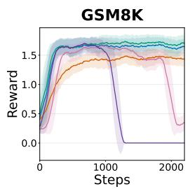

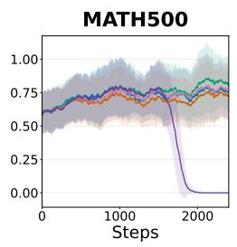

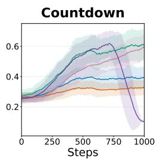  
d1 wd1 GDPO DMPO PBPO

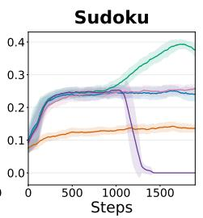

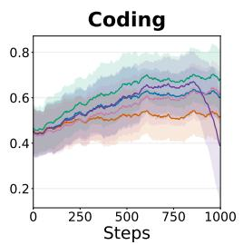

Figure 4 Reward dynamics during five RL post-training runs initialized from LLaDA-1.5. We report the mean and standard deviation over a rolling window of 50 training steps.  
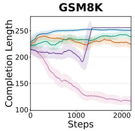

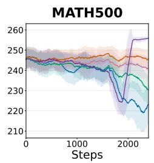

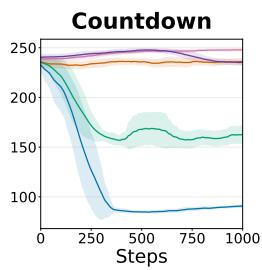

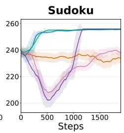

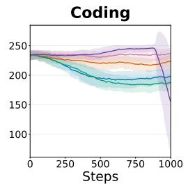  
Figure 5 Completion length dynamics during five RL post-training runs initialized from LLaDA-1.5. We report the mean and standard deviation over a rolling window of 50 training steps.

Low-confidence selection with $B _ { l } = 1 6$ . Tables 7 and 8 report accuracy and average efective sequence length, respectively.

Low-confidence selection with $B _ { l } = 6 4$ . Tables 9 and 10 report accuracy and average efective sequence length, respectively.

Random selection with $B _ { l } = 1 6$ . Tables 11 and 12 report accuracy and average efective sequence length, respectively.

Random selection with $B _ { l } = 3 2$ . Tables 13 and 14 report accuracy and average efective sequence length, respectively.

Random selection with $B _ { l } = 6 4$ . Tables 15 and 16 report accuracy and average efective sequence length, respectively.

Table 5 Efective sequence length for each baseline across four reasoning benchmarks at generation lengths 128, 256, and 512.
<table><tr><td></td><td colspan="3">GSM8K</td><td colspan="3">MATH500</td><td colspan="3">Countdown</td><td colspan="3">Sudoku</td></tr><tr><td>Baseline / Seq Len</td><td>128</td><td>256</td><td>512</td><td>128</td><td>256</td><td>512</td><td>128</td><td>256</td><td>512</td><td>128</td><td>256</td><td>512</td></tr><tr><td>LLaDA-8B-Instruct</td><td>114.31</td><td>211.21</td><td>256.14</td><td>121.62</td><td>234.50</td><td>399.00</td><td>110.49</td><td>212.89</td><td>409.96</td><td>115.42</td><td>216.92</td><td>432.95</td></tr><tr><td>d1</td><td>115.85</td><td>217.13</td><td>275.15</td><td>122.05</td><td>234.47</td><td>392.75</td><td>107.49</td><td>209.75</td><td>397.20</td><td>115.54</td><td>225.42</td><td>435.74</td></tr><tr><td>wd1</td><td>114.25</td><td>226.42</td><td>326.66</td><td>120.21</td><td>209.63</td><td>319.50</td><td>76.34</td><td>80.60</td><td>85.30</td><td>111.13</td><td>236.70</td><td>465.87</td></tr><tr><td>GDPO</td><td>109.46</td><td>192.20</td><td>204.85</td><td>120.45</td><td>222.81</td><td>367.36</td><td>114.25</td><td>213.27</td><td>351.79</td><td>114.17</td><td>213.92</td><td>355.32</td></tr><tr><td>DMPO</td><td>114.22</td><td>213.28</td><td>258.28</td><td>121.78</td><td>234.64</td><td>395.15</td><td>110.21</td><td>212.17</td><td>364.04</td><td>114.11</td><td>228.31</td><td>243.07</td></tr><tr><td>PBPO (Ours)</td><td>113.78</td><td>221.08</td><td>281.70</td><td>121.62</td><td>226.61</td><td>359.10</td><td>103.37</td><td>134.61</td><td>159.16</td><td>102.94</td><td>164.98</td><td>244.54</td></tr><tr><td>LLaDA-1.5</td><td>115.15</td><td>214.51</td><td>263.16</td><td>123.23</td><td>237.43</td><td>405.48</td><td>113.36</td><td>214.66</td><td>412.64</td><td>115.17</td><td>222.07</td><td>434.49</td></tr><tr><td>d1</td><td>115.39</td><td>218.81</td><td>277.47</td><td>123.25</td><td>237.25</td><td>404.29</td><td>111.15</td><td>212.18</td><td>392.13</td><td>115.36</td><td>225.80</td><td>437.36</td></tr><tr><td>wd1</td><td>114.83</td><td>225.94</td><td>321.35</td><td>121.50</td><td>223.21</td><td>347.84</td><td>84.52</td><td>87.63</td><td>91.93</td><td>113.93</td><td>228.88</td><td>443.33</td></tr><tr><td>GDPO</td><td>114.39</td><td>213.37</td><td>252.97</td><td>122.54</td><td>234.22</td><td>386.49</td><td>115.04</td><td>217.39</td><td>339.80</td><td>112.47</td><td>220.21</td><td>423.35</td></tr><tr><td>DMPO</td><td>106.20</td><td>130.93</td><td>157.57</td><td>122.65</td><td>232.52</td><td>385.49</td><td>112.77</td><td>214.88</td><td>346.28</td><td>114.55</td><td>230.29</td><td>445.87</td></tr><tr><td>PBPO (Ours)</td><td>113.96</td><td>223.17</td><td>297.08</td><td>118.92</td><td>224.55</td><td>363.46</td><td>105.34</td><td>136.72</td><td>181.89</td><td>113.63</td><td>220.81</td><td>438.93</td></tr></table>

Table 6 Average efective tokens across two coding benchmarks at generation lengths 128, 256, and 512.
<table><tr><td rowspan="2">Baseline Seq Len</td><td colspan="3">HumanEval</td><td colspan="3">MBPP</td></tr><tr><td>128</td><td>256</td><td>512</td><td>128</td><td>256</td><td>512</td></tr><tr><td>LLaDA-8B-Instruct</td><td>120.87</td><td>216.43</td><td>310.78</td><td>118.14</td><td>206.96</td><td>265.30</td></tr><tr><td>d1</td><td>119.16</td><td>194.93</td><td>246.77</td><td>114.72</td><td>189.01</td><td>241.53</td></tr><tr><td>wd1</td><td>112.15</td><td>144.70</td><td>165.38</td><td>105.12</td><td>133.28</td><td>138.68</td></tr><tr><td>GDPO</td><td>116.87</td><td>223.54</td><td>393.85</td><td>115.93</td><td>209.94</td><td>330.08</td></tr><tr><td>DMPO</td><td>116.68</td><td>206.83</td><td>284.57</td><td>113.96</td><td>204.62</td><td>260.07</td></tr><tr><td>PBPO (Ours)</td><td>95.81</td><td>117.86</td><td>127.59</td><td>84.72</td><td>93.35</td><td>97.53</td></tr><tr><td>LLaDA-1.5</td><td>120.82</td><td>220.32</td><td>317.95</td><td>119.60</td><td>210.50</td><td>273.32</td></tr><tr><td>d1</td><td>118.32</td><td>207.38</td><td>269.42</td><td>117.13</td><td>199.17</td><td>258.67</td></tr><tr><td>wd1</td><td>112.83</td><td>148.90</td><td>170.27</td><td>104.30</td><td>127.45</td><td>145.92</td></tr><tr><td>GDPO</td><td>118.35</td><td>229.54</td><td>427.01</td><td>118.48</td><td>222.93</td><td>384.49</td></tr><tr><td>DMPO</td><td>119.79</td><td>226.69</td><td>316.39</td><td>119.39</td><td>214.48</td><td>275.40</td></tr><tr><td>PBPO (Ours)</td><td>111.04</td><td>144.02</td><td>172.57</td><td>103.58</td><td>121.60</td><td>131.81</td></tr></table>

Table 7 Accuracy (%) across six benchmarks for LLaDA-1.5 baselines with generation length 256, 128 difusion steps, block length 16, and low-confidence remasking. Best values in each benchmark column are in bold, and second-best distinct values are underlined.
<table><tr><td>Baseline</td><td>GSM8K</td><td>MATH500</td><td>Countdown</td><td>Sudoku</td><td>HumanEval</td><td>MBPP</td></tr><tr><td>LLaDA-1.5</td><td>79.08</td><td>33.40</td><td>16.02</td><td>10.96</td><td>32.32</td><td>45.53</td></tr><tr><td>d1</td><td>80.21</td><td>35.40</td><td>19.53</td><td>18.66</td><td>37.80</td><td>47.08</td></tr><tr><td>wd1</td><td>80.52</td><td>35.60</td><td>43.75</td><td>23.11</td><td>34.76</td><td>43.97</td></tr><tr><td>GDPO</td><td>79.76</td><td>36.00</td><td>69.14</td><td>24.64</td><td>35.37</td><td>47.47</td></tr><tr><td>DMPO</td><td>47.69</td><td>36.60</td><td>55.86</td><td>25.02</td><td>41.46</td><td>44.75</td></tr><tr><td>PBPO (Ours)</td><td>84.38</td><td>38.40</td><td>73.83</td><td>38.09</td><td>37.20</td><td>45.53</td></tr></table>

Table 8 Average efective sequence length in tokens across six benchmarks for LLaDA-1.5 baselines with generation length 256, 128 difusion steps, block length 16, and low-confidence remasking.
<table><tr><td>Baseline</td><td>GSM8K</td><td>MATH500</td><td>Countdown</td><td>Sudoku</td><td>HumanEval</td><td>MBPP</td></tr><tr><td>LLaDA-1.5</td><td>214.68</td><td>235.92</td><td>213.92</td><td>215.34</td><td>216.71</td><td>209.89</td></tr><tr><td>d1</td><td>218.30</td><td>236.67</td><td>209.41</td><td>224.58</td><td>203.32</td><td>199.69</td></tr><tr><td>wd1</td><td>225.21</td><td>223.35</td><td>87.38</td><td>231.79</td><td>150.53</td><td>132.07</td></tr><tr><td>GDPO</td><td>213.72</td><td>234.65</td><td>217.75</td><td>208.46</td><td>228.23</td><td>223.84</td></tr><tr><td>DMPO</td><td>136.23</td><td>233.55</td><td>214.05</td><td>229.50</td><td>226.51</td><td>218.67</td></tr><tr><td>PBPO (Ours)</td><td>222.81</td><td>224.18</td><td>147.56</td><td>219.10</td><td>145.73</td><td>121.81</td></tr></table>

Table 9 Accuracy (%) across six benchmarks for LLaDA-1.5 baselines with generation length 256, 128 difusion steps, block length 64, and low-confidence remasking. Best values in each benchmark column are in bold, and second-best distinct values are underlined.
<table><tr><td>Baseline</td><td>GSM8K</td><td>MATH500</td><td>Countdown</td><td>Sudoku</td><td>HumanEval</td><td>MBPP</td></tr><tr><td>LLaDA-1.5</td><td>80.44</td><td>35.80</td><td>21.48</td><td>7.70</td><td>32.32</td><td>43.97</td></tr><tr><td>d1</td><td>79.76</td><td>35.40</td><td>24.61</td><td>15.50</td><td>35.37</td><td>45.14</td></tr><tr><td>wd1</td><td>80.14</td><td>36.20</td><td>53.52</td><td>24.35</td><td>32.32</td><td>40.47</td></tr><tr><td>GDPO</td><td>78.17</td><td>33.20</td><td>69.92</td><td>25.17</td><td>34.15</td><td>44.75</td></tr><tr><td>DMPO</td><td>55.34</td><td>36.60</td><td>60.16</td><td>27.13</td><td>37.80</td><td>45.53</td></tr><tr><td>PBPO (Ours)</td><td>83.47</td><td>41.00</td><td>67.58</td><td>40.33</td><td>40.24</td><td>48.64</td></tr></table>

Table 10 Average efective sequence length in tokens across six benchmarks for LLaDA-1.5 baselines with generation length 256, 128 difusion steps, block length 64, and low-confidence remasking.
<table><tr><td>Baseline</td><td>GSM8K</td><td>MATH500</td><td>Countdown</td><td>Sudoku</td><td>HumanEval</td><td>MBPP</td></tr><tr><td>LLaDA-1.5</td><td>213.00</td><td>236.11</td><td>213.25</td><td>219.71</td><td>221.51</td><td>213.12</td></tr><tr><td>d1</td><td>218.31</td><td>236.60</td><td>211.13</td><td>226.96</td><td>211.35</td><td>201.00</td></tr><tr><td>wd1</td><td>226.24</td><td>224.47</td><td>80.70</td><td>229.16</td><td>145.35</td><td>120.46</td></tr><tr><td>GDPO</td><td>213.24</td><td>233.43</td><td>215.94</td><td>220.77</td><td>229.77</td><td>227.17</td></tr><tr><td>DMPO</td><td>129.48</td><td>234.84</td><td>215.18</td><td>229.09</td><td>225.58</td><td>211.99</td></tr><tr><td>PBPO (Ours)</td><td>223.12</td><td>226.33</td><td>123.18</td><td>222.70</td><td>145.60</td><td>121.19</td></tr></table>

Table 11 Accuracy (%) across six benchmarks for LLaDA-1.5 baselines with generation length 256, 128 difusion steps, block length 16, and random remasking. Best values in each benchmark column are in bold, and second-best distinct values are underlined.
<table><tr><td>Baseline</td><td>GSM8K</td><td>MATH500</td><td>Countdown</td><td>Sudoku</td><td>HumanEval</td><td>MBPP</td></tr><tr><td>LLaDA-1.5</td><td>70.43</td><td>25.80</td><td>10.55</td><td>9.67</td><td>22.56</td><td>30.35</td></tr><tr><td>d1</td><td>74.07</td><td>31.00</td><td>16.80</td><td>16.08</td><td>24.39</td><td>34.24</td></tr><tr><td>wd1</td><td>74.45</td><td>27.80</td><td>35.16</td><td>23.68</td><td>23.17</td><td>36.58</td></tr><tr><td>GDPO</td><td>76.27</td><td>31.20</td><td>57.42</td><td>23.30</td><td>29.27</td><td>36.19</td></tr><tr><td>DMPO</td><td>35.86</td><td>31.80</td><td>44.92</td><td>23.88</td><td>26.83</td><td>31.91</td></tr><tr><td>PBPO (Ours)</td><td>79.38</td><td>33.00</td><td>64.06</td><td>36.60</td><td>29.27</td><td>37.74</td></tr></table>

Table 12 Average efective sequence length in tokens across six benchmarks for LLaDA-1.5 baselines with generation length 256, 128 difusion steps, block length 16, and random remasking.
<table><tr><td>Baseline</td><td>GSM8K</td><td>MATH500</td><td>Countdown</td><td>Sudoku</td><td>HumanEval</td><td>MBPP</td></tr><tr><td>LLaDA-1.5</td><td>210.08</td><td>236.85</td><td>200.35</td><td>215.43</td><td>218.97</td><td>216.00</td></tr><tr><td>d1</td><td>213.42</td><td>233.93</td><td>188.89</td><td>213.16</td><td>208.24</td><td>192.67</td></tr><tr><td>wd1</td><td>225.39</td><td>220.64</td><td>80.82</td><td>227.92</td><td>144.90</td><td>131.38</td></tr><tr><td>GDPO</td><td>211.10</td><td>230.42</td><td>210.82</td><td>206.92</td><td>216.91</td><td>208.46</td></tr><tr><td>DMPO</td><td>223.87</td><td>229.37</td><td>206.87</td><td>216.55</td><td>219.80</td><td>214.87</td></tr><tr><td>PBPO (Ours)</td><td>222.92</td><td>221.82</td><td>164.72</td><td>220.76</td><td>148.30</td><td>128.40</td></tr></table>

Table 13 Accuracy (%) across six benchmarks for LLaDA-1.5 baselines with generation length 256, 128 difusion steps, block length 32, and random remasking. Best values in each benchmark column are in bold, and second-best distinct values are underlined.
<table><tr><td>Baseline</td><td>GSM8K</td><td>MATH500</td><td>Countdown</td><td>Sudoku</td><td>HumanEval</td><td>MBPP</td></tr><tr><td>LLaDA-1.5</td><td>67.55</td><td>24.20</td><td>9.77</td><td>11.29</td><td>13.41</td><td>24.90</td></tr><tr><td>d1</td><td>70.13</td><td>25.60</td><td>18.36</td><td>15.79</td><td>19.51</td><td>26.46</td></tr><tr><td>wd1</td><td>73.84</td><td>24.80</td><td>37.11</td><td>22.87</td><td>19.51</td><td>28.40</td></tr><tr><td>GDPO</td><td>72.86</td><td>28.00</td><td>57.81</td><td>24.78</td><td>19.51</td><td>28.40</td></tr><tr><td>DMPO</td><td>33.51</td><td>28.80</td><td>45.70</td><td>24.11</td><td>17.68</td><td>25.68</td></tr><tr><td>PBPO (Ours)</td><td>76.88</td><td>29.40</td><td>50.39</td><td>35.74</td><td>19.51</td><td>26.46</td></tr></table>

Table 14 Average efective sequence length in tokens across six benchmarks for LLaDA-1.5 baselines with generation length 256, 128 difusion steps, block length 32, and random remasking.
<table><tr><td>Baseline</td><td>GSM8K</td><td>MATH500</td><td>Countdown</td><td>Sudoku</td><td>HumanEval</td><td>MBPP</td></tr><tr><td>LLaDA-1.5</td><td>208.34</td><td>236.18</td><td>194.70</td><td>216.06</td><td>221.29</td><td>212.11</td></tr><tr><td>d1</td><td>212.64</td><td>236.13</td><td>193.55</td><td>216.88</td><td>204.54</td><td>195.19</td></tr><tr><td>wd1</td><td>225.28</td><td>220.74</td><td>79.19</td><td>226.87</td><td>142.20</td><td>119.60</td></tr><tr><td>GDPO</td><td>211.06</td><td>233.40</td><td>206.23</td><td>204.16</td><td>219.20</td><td>211.19</td></tr><tr><td>DMPO</td><td>237.31</td><td>230.98</td><td>202.77</td><td>218.60</td><td>222.04</td><td>210.03</td></tr><tr><td>PBPO (Ours)</td><td>223.15</td><td>223.46</td><td>167.75</td><td>219.19</td><td>151.60</td><td>121.26</td></tr></table>

Table 15 Accuracy (%) across six benchmarks for LLaDA-1.5 baselines with generation length 256, 128 difusion steps, block length 64, and random remasking. Best values in each benchmark column are in bold, and second-best distinct values are underlined.
<table><tr><td>Baseline</td><td>GSM8K</td><td>MATH500</td><td>Countdown</td><td>Sudoku</td><td>HumanEval</td><td>MBPP</td></tr><tr><td>LLaDA-1.5</td><td>63.99</td><td>22.80</td><td>8.59</td><td>11.53</td><td>15.85</td><td>21.01</td></tr><tr><td>d1</td><td>66.26</td><td>25.80</td><td>20.31</td><td>17.42</td><td>14.02</td><td>20.62</td></tr><tr><td>wd1</td><td>68.31</td><td>25.40</td><td>35.55</td><td>23.92</td><td>17.68</td><td>28.02</td></tr><tr><td>GDPO</td><td>70.58</td><td>29.20</td><td>60.16</td><td>23.44</td><td>15.85</td><td>20.23</td></tr><tr><td>DMPO</td><td>29.04</td><td>27.60</td><td>45.70</td><td>24.35</td><td>12.80</td><td>24.51</td></tr><tr><td>PBPO (Ours)</td><td>75.59</td><td>26.00</td><td>51.56</td><td>36.22</td><td>15.85</td><td>30.74</td></tr></table>

Table 16 Average efective sequence length in tokens across six benchmarks for LLaDA-1.5 baselines with generation length 256, 128 difusion steps, block length 64, and random remasking.
<table><tr><td>Baseline</td><td>GSM8K</td><td>MATH500</td><td>Countdown</td><td>Sudoku</td><td>HumanEval</td><td>MBPP</td></tr><tr><td>LLaDA-1.5</td><td>207.31</td><td>232.23</td><td>189.29</td><td>210.69</td><td>221.56</td><td>213.26</td></tr><tr><td>d1</td><td>213.74</td><td>236.24</td><td>184.30</td><td>212.71</td><td>197.27</td><td>195.75</td></tr><tr><td>wd1</td><td>226.47</td><td>219.60</td><td>71.83</td><td>227.71</td><td>135.05</td><td>114.01</td></tr><tr><td>GDPO</td><td>212.44</td><td>234.97</td><td>197.49</td><td>202.65</td><td>222.63</td><td>216.20</td></tr><tr><td>DMPO</td><td>259.03</td><td>234.39</td><td>197.01</td><td>231.22</td><td>218.78</td><td>214.25</td></tr><tr><td>PBPO (Ours)</td><td>223.22</td><td>225.75</td><td>130.59</td><td>219.43</td><td>148.45</td><td>126.32</td></tr></table>

## C Proof for Theorem 1

This section presents the proof for Theorem 1. The comparison concerns the unclipped, advantage-free gradient contributions displayed in the theorem. Before presenting the proof, we first state the assumptions required for the variance comparison and clarify why they are appropriate for this analysis.

Assumptions. Fix the prompt $q ,$ rollout index $i ,$ block index $b ,$ and prefix-block state $z _ { i } ^ { < b }$ . We consider a full block with $B _ { l } \geq 2$ and define its index set as

$$
\begin{array} { r } { \mathcal { K } _ { b } = \{ ( b - 1 ) B _ { l } + 1 , \ldots , b B _ { l } \} . } \end{array}
$$

All expectations and covariances below are conditional on $( q , z _ { i } ^ { < b } )$ and are taken under the factorized one-step behavior surrogate

$$
\prod _ { k \in \mathcal { K } _ { b } } \pi _ { \mathrm { o l d } } ( o _ { i } ^ { k } \mid q , z _ { i } ^ { < b } )
$$

used in Equation 4. For each $k \in \mathcal { K } _ { b }$ , abbreviate the token surrogate ratio and score vector by

$$
\rho _ { i } ^ { k } = \frac { \pi _ { \theta } ( o _ { i } ^ { k } \mid q , z _ { i } ^ { < b } ) } { \pi _ { \mathrm { o l d } } ( o _ { i } ^ { k } \mid q , z _ { i } ^ { < b } ) } , \qquad s _ { i } ^ { k } = \nabla _ { \theta } \log \pi _ { \theta } ( o _ { i } ^ { k } \mid q , z _ { i } ^ { < b } ) .\tag{19}
$$

We assume that the pairs $\{ ( \rho _ { i } ^ { k } , s _ { i } ^ { k } ) \} _ { k \in \mathcal { K } _ { b } }$ are conditionally independent and identically distributed. We further assume that $\pi _ { \theta }$ and $\pi _ { \mathrm { o l d } }$ have common positive support over the finite vocabulary $\nu ,$ that $\pi _ { \theta }$ is diferentiable with parameter-independent support, and that the second moments used below are finite.

Because $g _ { \mathrm { b l o c k } }$ and $g _ { \mathrm { t o k e n } }$ are vectors, we interpret the variance in Theorem 1 as total variance:

$$
\operatorname { V a r } [ g ] : = \operatorname { t r } ( \operatorname { C o v } ( g ) ) = \mathbb { E } \left[ \left\| g - \mathbb { E } [ g ] \right\| _ { 2 } ^ { 2 } \right] .\tag{20}
$$

By the identical-distribution assumption, the moments

$$
m _ { 2 } : = \mathbb { E } \left[ ( \rho _ { i } ^ { k } ) ^ { 2 } \right] , \qquad H : = \mathbb { E } \left[ ( \rho _ { i } ^ { k } ) ^ { 2 } s _ { i } ^ { k } ( s _ { i } ^ { k } ) ^ { \top } \right] , \qquad c : = \mathbb { E } \left[ ( \rho _ { i } ^ { k } ) ^ { 2 } s _ { i } ^ { k } \right]\tag{21}
$$

do not depend on $k \in \mathcal { K } _ { b }$ . For the strict comparison, we additionally assume that $\mathrm { V a r } [ \rho _ { i } ^ { k } ] > 0$ and $H \neq 0$

Remark 1 (Factorized surrogate assumptions). The conditional independence assumption follows from the factorized one-step block surrogate in Equation 4. It is an assumption about the surrogate probability space used in this comparison, not a claim that tokens produced by the true multi-step denoising trajectory are independent. Identical ratio-score moments across positions are an additional homogeneity assumption that isolates the efect of importance-weighting granularity.

Remark 2 (Regularity and strictness). For standard full-softmax policies, all vocabulary tokens have positive probability, so the common-support condition is satisfied. With a finite vocabulary and finite score vectors, the required moments are also finite. The positive-ratio-variance and nonzero-score conditions characterize a nontrivial policy update and are necessary for strictness: if $\pi _ { \theta } = \pi _ { \mathrm { o l d } }$ , or if $B _ { l } = 1$ , the two contributions can coincide. A partial final block follows by replacing $B _ { l }$ with its actual number of positions, provided that this number is at least two.

Remark 3 (Advantage and clipping). Theorem 1 compares the unclipped, advantage-free contributions displayed in its statement. Multiplying both contributions by the same fixed nonzero advantage $A _ { i }$ scales their covariance matrices by $A _ { i } ^ { 2 }$ and preserves the strict comparison. PPO-style clipping introduces a piecewise dependence on the surrogate ratios, so the covariance identities below do not directly characterize the complete clipped-objective gradients.

Having stated and justified the assumptions, we now prove the variance comparison.

Proof. The common-support assumption and normalization of the token distributions give

$$
\mathbb { E } [ \rho _ { i } ^ { k } ] = \sum _ { v \in \mathcal { V } } \pi _ { \mathrm { o l d } } ( o _ { i } ^ { k } = v \mid q , z _ { i } ^ { < b } ) \frac { \pi _ { \theta } ( o _ { i } ^ { k } = v \mid q , z _ { i } ^ { < b } ) } { \pi _ { \mathrm { o l d } } ( o _ { i } ^ { k } = v \mid q , z _ { i } ^ { < b } ) }\tag{22}
$$

$$
= \sum _ { v \in \mathcal { V } } \pi _ { \theta } ( o _ { i } ^ { k } = v \mid q , z _ { i } ^ { < b } ) = 1 .\tag{23}
$$

Diferentiability and parameter-independent support similarly yield the importance-weighted score identity

$$
\mathbb { E } [ \rho _ { i } ^ { k } s _ { i } ^ { k } ] = \sum _ { v \in \mathcal { V } } \pi _ { \theta } ( o _ { i } ^ { k } = v \mid q , z _ { i } ^ { < b } ) \nabla _ { \theta } \log \pi _ { \theta } ( o _ { i } ^ { k } = v \mid q , z _ { i } ^ { < b } )\tag{24}
$$

$$
= \nabla _ { \boldsymbol { \theta } } \sum _ { \boldsymbol { v } \in \mathcal { V } } \pi _ { \boldsymbol { \theta } } ( o _ { i } ^ { k } = \boldsymbol { v } \mid \boldsymbol { q } , z _ { i } ^ { < b } ) = 0 .\tag{25}
$$

Equation 23 also implies

$$
m _ { 2 } = 1 + \mathrm { V a r } [ \rho _ { i } ^ { k } ] \geq 1 .\tag{26}
$$

Using Equation 19, the token-level contribution in Theorem 1 is

$$
g _ { \mathrm { t o k e n } } = \sum _ { k \in \mathcal { K } _ { b } } \rho _ { i } ^ { k } s _ { i } ^ { k } .
$$

Equation 25 gives $\mathbb { E } [ g _ { \mathrm { t o k e n } } ] = 0$ . Moreover, conditional independence implies that, for distinct $k , \ell \in \mathcal { K } _ { b }$

$$
\begin{array} { r } { \mathbb { E } \big [ \rho _ { i } ^ { k } s _ { i } ^ { k } ( \rho _ { i } ^ { \ell } s _ { i } ^ { \ell } ) ^ { \top } \big ] = \mathbb { E } [ \rho _ { i } ^ { k } s _ { i } ^ { k } ] \mathbb { E } [ \rho _ { i } ^ { \ell } s _ { i } ^ { \ell } ] ^ { \top } = 0 . } \end{array}
$$

Consequently, all cross-position terms vanish and

$$
\operatorname { C o v } ( g _ { \mathrm { t o k e n } } ) = \sum _ { k \in { \mathcal { K } } _ { b } } \mathbb { E } \big [ ( \rho _ { i } ^ { k } ) ^ { 2 } s _ { i } ^ { k } ( s _ { i } ^ { k } ) ^ { \top } \big ] = B _ { l } H .\tag{27}
$$

The block-level contribution can be written in the same notation as

$$
\begin{array} { l } { g _ { \mathrm { b l o c k } } = \displaystyle \left( \prod _ { j \in { \cal K } _ { b } } \rho _ { i } ^ { j } \right) \left( \sum _ { k \in { \cal K } _ { b } } s _ { i } ^ { k } \right) } \\ { \displaystyle \quad = \sum _ { k \in { \cal K } _ { b } } \rho _ { i } ^ { k } s _ { i } ^ { k } \prod _ { j \in { \cal K } _ { b } } \rho _ { i } ^ { j } . } \end{array}\tag{28}
$$

(29)

By conditional independence, together with Equations 23 and 25,

$$
\mathbb { E } [ g _ { \mathrm { b l o c k } } ] = \sum _ { k \in \mathcal { K } _ { b } } \mathbb { E } [ \rho _ { i } ^ { k } s _ { i } ^ { k } ] \prod _ { \stackrel { j \in \mathcal { K } _ { b } } { j \neq k } } \mathbb { E } [ \rho _ { i } ^ { j } ] = 0 .\tag{30}
$$

Its covariance therefore equals its second moment. Expanding that moment and separating the terms with matching and distinct token indices gives

$$
\mathrm { C o v } ( g _ { \mathrm { b l o c k } } ) = \sum _ { k \in \mathcal { K } _ { b } } \mathbb { E } \left[ ( \rho _ { i } ^ { k } ) ^ { 2 } s _ { i } ^ { k } ( s _ { i } ^ { k } ) ^ { \top } \prod _ { j \in \mathcal { K } _ { b } \atop j \neq k } ( \rho _ { i } ^ { j } ) ^ { 2 } \right]\tag{31}
$$

$$
+ \sum _ { \stackrel { k , \ell \in \mathcal { K } _ { b } } { k \neq \ell } } \mathbb { E } \left[ ( \rho _ { i } ^ { k } ) ^ { 2 } ( \rho _ { i } ^ { \ell } ) ^ { 2 } s _ { i } ^ { k } ( s _ { i } ^ { \ell } ) ^ { \top } \prod _ { j \in K _ { b } \atop j \neq k , \ell } ( \rho _ { i } ^ { j } ) ^ { 2 } \right]\tag{32}
$$

$$
= B _ { l } m _ { 2 } ^ { B _ { l } - 1 } H + B _ { l } ( B _ { l } - 1 ) m _ { 2 } ^ { B _ { l } - 2 } c c ^ { \top } .\tag{33}
$$

Combining Equations 27 and 33 yields

$$
\mathrm { C o v } ( g _ { \mathrm { b l o c k } } ) - \mathrm { C o v } ( g _ { \mathrm { t o k e n } } )\tag{34}
$$

$$
= B _ { l } \left( m _ { 2 } ^ { B _ { l } - 1 } - 1 \right) H + B _ { l } ( B _ { l } - 1 ) m _ { 2 } ^ { B _ { l } - 2 } c c ^ { \top } .\tag{35}
$$

Both H and $c c ^ { \top }$ are positive semidefinite. Since $m _ { 2 } \geq 1$ and $B _ { l } \geq 2$ , both coeficients on the right-hand side of Equation 35 are nonnegative. Thus,

$$
\operatorname { C o v } ( g _ { \mathrm { b l o c k } } ) \succeq \operatorname { C o v } ( g _ { \mathrm { t o k e n } } ) .\tag{36}
$$

It remains to establish the strict scalar comparison. Since $\mathrm { V a r } [ \rho _ { i } ^ { k } ] > 0$ , Equation 26 gives $m _ { 2 } > 1$ . In addition, the assumed nonzero importance-weighted score second moment implies $H \neq 0 ;$ ; because $H \succeq 0$ , it follows that $\operatorname { t r } ( H ) > 0$ . Taking the trace of Equation 35 therefore gives

$$
\mathrm { V a r } [ g _ { \mathrm { b l o c k } } ] - \mathrm { V a r } [ g _ { \mathrm { t o k e n } } ]\tag{37}
$$

$$
= B _ { l } \left( m _ { 2 } ^ { B _ { l } - 1 } - 1 \right) \mathrm { t r } ( H ) + B _ { l } ( B _ { l } - 1 ) m _ { 2 } ^ { B _ { l } - 2 } \| c \| _ { 2 } ^ { 2 } > 0 .\tag{38}
$$

By the total-variance convention in Equation 20, this establishes the inequality in Theorem 1 under the assumptions stated above. □

## D Qualitative Examples

We present representative outputs from PBPO initialized from LLaDA-1.5 and LLaDA-8B-Instruct. The responses are reproduced from the saved evaluation generations, with only special end-of-sequence and padding tokens removed.

## D.1 MATH500 Examples

Model: LLaDA-1.5 + PBPO

Dataset: MATH500

## Generation Sequence Length: 512

Question: What is the probability that a randomly selected integer in the set {1, 2, 3, . . . , 100} is divisible by 2 and not divisible by 3? Express your answer as a common fraction.

## Model Response

## <reasoning>

First, we determine the total number of integers in the set $\{ 1 , 2 , 3 , \ldots , 1 0 0 \}$ , which is 100.

Next, we count the number of integers divisible by 2 in this set. The sequence of integers divisible by 2 is 2, 4, 6, . . . , 100. This is an arithmetic sequence with the first term $a = 2$ and common diference $d = 2 .$ . The number of terms in this sequence is found by solving

$$
a _ { n } = a + ( n - 1 ) d \implies 1 0 0 = 2 + ( n - 1 ) \cdot 2 \implies 1 0 0 = 2 n \implies n = 5 0 .
$$

So, there are 50 integers divisible by 2.

Now, we count the number of integers divisible by both 2 and 3 (i.e., divisible by 6). The sequence of integers divisible by 6 is $6 , 1 2 , 1 8 , \ldots , 9 6 .$ This is an arithmetic sequence with the first term $a = 6$ and common diference $d = 6$ . The number of terms in this sequence is found by solving

$$
a _ { n } = a + ( n - 1 ) d \implies 9 6 = 6 + ( n - 1 ) \cdot 6 \implies 9 6 = 6 n \implies n = 1 6 .
$$

So, there are 16 integers divisible by 6 in the set.

The number of integers divisible by 2 but not divisible by 3 is the total number of integers divisible by 2 minus the number of integers divisible by 6:

$$
5 0 - 1 6 = 3 4 .
$$

Thus, the probability that a randomly selected integer in the set $\{ 1 , 2 , 3 , \ldots , 1 0 0 \}$ is divisible by 2 and not divisible by 3 is

$$
{ \frac { 3 4 } { 1 0 0 } } = { \frac { 1 7 } { 5 0 } } .
$$

</reasoning>

<answer>

$$
\boxed { \frac { 1 7 } { 5 0 } }
$$

</answer>

Model: LLaDA-8B-Instruct + PBPO

Dataset: MATH500

Generation Sequence Length: 512

Question: What is the distance, in units, between the points $( 2 , - 6 )$ and $( - 4 , 3 ) ?$ Express your answer in simplest radical form.

## Model Response

<reasoning>

To find the distance between two points $( x _ { 1 } , y _ { 1 } )$ and $( x _ { 2 } , y _ { 2 } )$ , we use the distance formula:

$$
d = { \sqrt { ( x _ { 2 } - x _ { 1 } ) ^ { 2 } + ( y _ { 2 } - y _ { 1 } ) ^ { 2 } } } .
$$

Given the points $( 2 , - 6 )$ and $( - 4 , 3 )$ , we substitute these coordinates into the formula:

$$
d = { \sqrt { ( ( - 4 ) - 2 ) ^ { 2 } + ( 3 - ( - 6 ) ) ^ { 2 } } } .
$$

Simplify inside the parentheses:

$$
= - 6 \quad { \mathrm { a n d } } \quad 3 + 6 = 9 .
$$

Square these results:

$$
( - 6 ) ^ { 2 } = 3 6 \quad \mathrm { a n d } \quad 9 ^ { 2 } = 8 1 .
$$

Add the squares:

$$
3 6 + 8 1 = 1 1 7 .
$$

Take the square root:

$$
d = { \sqrt { 1 1 7 } } .
$$

Simplify ${ \sqrt { 1 1 7 } } { \mathrm { : } }$

$$
{ \sqrt { 1 1 7 } } = { \sqrt { 9 \times 1 3 } } = 3 { \sqrt { 1 3 } } .
$$

Thus, the distance between the points is $\left| 3 { \sqrt { 1 3 } } \right|$

</reasoning>

<answer>

$$
\left\lceil 3 { \sqrt { 1 3 } } \right\rceil
$$

</answer>

## D.2 MBPP Examples

```erb
Model: LLaDA-1.5 + PBPO
Dataset: MBPP
Generation Sequence Length: 512
Question: Write a Python function number is divisible by 11.
Tests: is_Dif(12345) == False, is_Dif(1212112) == True, and is_Dif(1212) == False.
Model Response
<reasoning>
To determine if a number is divisible by 11, we can use the simple divis for 11 rule. The rule states that a
number is divisible by 11 if the diference between the sum of the digits in the odd positions and the sum of
the digits in the even positions is either 0 or a multiple of 11.
</reasoning>
<answer>
def is_Dif(number):
# Convert the number to a string to easily iterate over digits
digits = str(number)
# Initialize sums for odd and even positions
odd_sum = 0
even_sum = 0
# Iterate over the digits of the number
for i in range(len(digits)):
if i % 2 == 0:
even_sum += int(digits[i])
else:
odd_sum += int(digits[i])
# Calculate the diference between the sums
diference = odd_sum - even_sum
# Check if the diference is 0 or a multiple of 11
return diference == 0 or diference % 11 == 0
</answer>
```

```m4
Model: LLaDA-8B-Instruct + PBPO
Dataset: MBPP
Generation Sequence Length: 512
Question: Write a function to flatten a list and sum all of its elements.
Tests: recursive_list_sum(([1,2,[3,4],[5,6]])) == 21, recursive_list_sum(([7,10,[15,14],[19,41]])) == 106,
and recursive_list_sum(([10,20,[30,40],[50,60]])) == 210.
Model Response
<reasoning>
To flatten a list and sum all of its elements, we need to recursively traverse the list and accumulate the sum of
its elements.
</reasoning>
<answer>
def recursive_list_sum(lst):
total = 0
for item in lst:
if isinstance(item, list):
total += recursive_list_sum(item)
else:
total += item
return total
</answer>
```