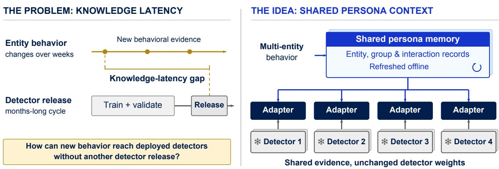
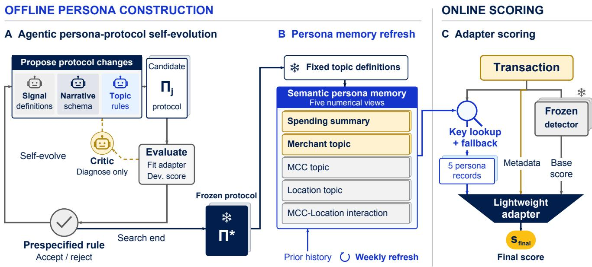
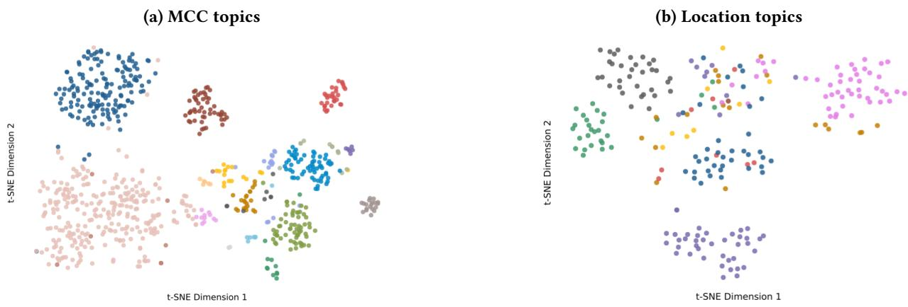
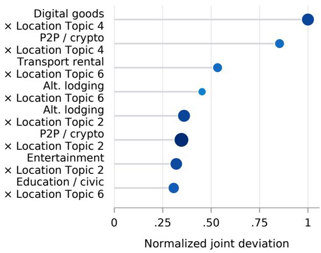
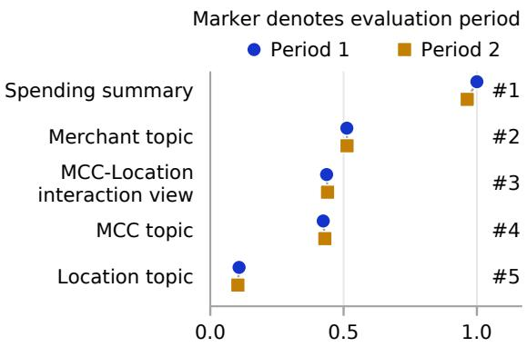
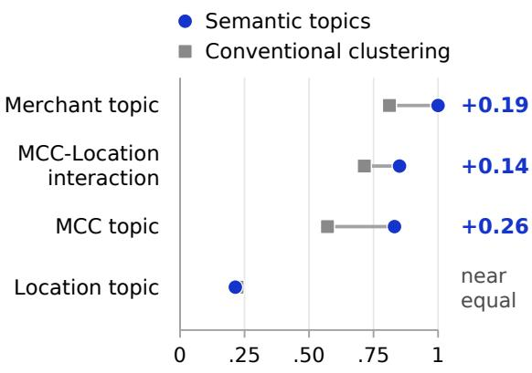
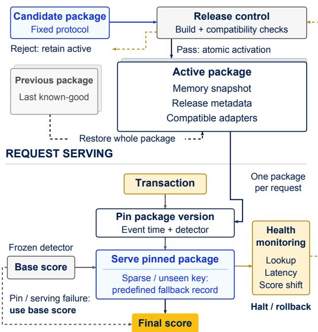

# PersonaAgent: Retrieval-Augmented Transaction Anomaly Scoring with Refreshable Multi-Entity Persona Memory

Zhengyu Fang✉ Case Western Reserve University Cleveland, OH, USA zxf177@case.edu

Shubham Jain   
Visa Research   
Foster City, CA, USA   
shubhjai@visa.com   
Liang Wang   
Visa Research   
Foster City, CA, USA   
liawang@visa.com   
Jiarui Sun   
Visa Research   
Foster City, CA, USA   
jiaruis2@visa.com

Junpeng Wang Visa Research Foster City, CA, USA junpenwa@visa.com

Yingtong Dou Visa Research Foster City, CA, USA yidou@visa.com

Xiran Fan   
Visa Research   
Foster City, CA, USA   
xirafan@visa.com   
Yan Zheng   
Visa Research   
Foster City, CA, USA   
yazheng@visa.com

Yuzhong Chen Visa Research Foster City, CA, USA yuzchen@visa.com

Menghai Pan   
Visa Research   
Foster City, CA, USA   
menpan@visa.com

Yiwei Cai Visa Research Austin, TX, USA yicai@visa.com

## Abstract

In large-scale payment networks, entities (card, merchant, etc.) and their interactions play a key role in transaction anomaly detection. However, transaction patterns between diferent entities usually change more frequently than the production model refresh schedule. Meanwhile, entity embedding tables sufer from highcardinality and sparse interaction issues. To resolve the above challenges, we present PersonaAgent, an agentic transaction anomaly detection framework which represents the latest entity behavior signals as personas and saves them in a refreshable memory. Offline, a weekly scheduled batch job is used to extract the latest behavior signals and update them in the memory. At inference time, a lightweight adapter retrieves the corresponding entity behavior signals of each transaction from memory and uses them to augment the base anomaly classifier’s scoring. Through comprehensive benchmarking with diferent anomaly detection models at Visa, PersonaAgent is able to score transactions eficiently (a 1,000- transaction CPU batch in 1–2 ms), lifting the PR-AUC by 0.65–6.58% and the production business metric by 8.93–14.24% relatively in deployment.

## CCS Concepts

• Computing methodologies → Machine learning; • Applied computing → Electronic funds transfer; • Information systems → Data mining.

## Keywords

transaction anomaly detection, retrieval-augmented scoring, semantic persona memory, agentic workflow

## 1 Introduction

In fiscal year 2025, Visa reported 4.9B credentials and 175M+ merchant locations across 200+ countries and territories. Visa-branded payment and cash transactions totaled 329B that year, including those processed by other networks [40]. Transaction anomaly detection at this scale requires Visa’s detection models, which we call detectors, to score each authorization within a tight latency budget despite rare anomalies, concept drift, and delayed labels [6, 22, 26]. Much of the evidence for an anomaly comes from context: the card’s spending history, merchant behavior, merchant category code (MCC), and location. Payment systems therefore model entity histories, peer cohorts, and relations [30, 43, 54]. Joint context also matters: an MCC that appears unremarkable in aggregate can behave diferently within one location. Transaction foundation models use large-scale pretraining [3, 52], building on earlier sequential tabular transformers [25, 55]. These advances increase what a detector can represent, but do not necessarily shorten its release cycle.

Industrial detectors such as Visa’s are large models. Each release requires integration and validation [32], so a detector’s update cycle typically lasts at least several months. Entity behavior drifts much faster; in the setting we study, it can be re-estimated weekly, so the knowledge encoded in a deployed detector’s parameters falls behind. We call this diference a knowledge-latency gap (Fig. 1). Closing the gap requires behavior evidence that generalizes beyond individual identifiers and can be refreshed without changing detector weights. Entity embedding tables [1], the common way to learn entity behavior and interactions, provide limited evidence for rare entities, even less for entity combinations such as MCC– Location pairs, and none for unseen IDs; semantic initialization enriches such embeddings [5], but they remain part ofthe detector’s weights, so updating them still requires a new release. Feature stores serve refreshed aggregates for individual entities but leave two questions open: which behavior signals describe an entity, and how entities with similar behavior should be grouped so that longtail entities, whose own evidence is scarce, can borrow from their group. Hand-written rules and feature-engineering pipelines rely on people to answer these questions across millions of Merchants, 800+ MCCs, and 230+ Location codes, while clustering numerical features alone groups entities by value similarity rather than by what their behavior means. Large language model (LLM) agents can answer these questions instead: through self-evolution, they find semantic topics, groups of entities with similar behavior, and the behavior features that describe them, keeping only revisions that improve held-out development performance. Calling an LLM for each transaction during online scoring (inference) [15, 19, 36], however, would put text generation on the latency-critical path. These observations lead to our design: agents learn ofline what personas should capture, and a lightweight adapter injects them into each frozen detector online.

  
Figure 1: Knowledge-latency motivation and shared persona context. Behavior may change before the next detector release. Ofline-refreshed entity, group, and interaction records supply shared context to detector-specific adapters, which combine this context with each detector’s own score, while the four detectors remain frozen. Detectors 1–4 are Visa’s proprietary detection models: one production and three internal.

Following this design, we present PersonaAgent, an agentic framework that stores refreshable multi-entity behavior outside frozen detectors in Semantic Persona Memory. A persona is an auditable behavior record of an entity, group, or supported interaction at a cutof time. PersonaAgent uses LLM agents only at design time: an LLM selects salient signals from many candidates and describes them in grounded narratives that use a shared behavioral vocabulary. These narratives organize the selected numerical signals with their temporal and peer-group context, helping agents compare entity behavior. A narrative schema ties each claim to a declared field, window, baseline, and support value. An example sentence, with numerical details omitted, reads: “Over the declared window, this Merchant’s cross-location activity is above its peer-group baseline and its recent transaction size above its own prior level.” The agents search for a persona protocol specifying the signals, narrative schema, and rules for grouping MCCs, Locations, and Merchants with similar behavior into semantic topics. Three LLM roles propose revisions, while a fourth, the Protocol Critic, diagnoses each candidate. Agents use MCC and Location narratives and their embeddings to formulate MCC and Location topics, with behavior-feature clustering forming Merchant topics within the MCC topics. Adapter performance on a development set, held out from all evaluation data, guides revisions to this hierarchical construction; a prespecified rule selects the protocol to freeze (Section 4.1). The resulting semantic topics outperform matched conventional clustering in standalone prediction for three of four group views (Section 5.3). A weekly refresh then applies the frozen protocol to eligible history, updating numerical records under its fixed topic definitions without an LLM or further revision, while online scoring reads the active validated memory. SR-Fraud [35] also uses LLM agents to adapt detection to changing payment behavior, but calls an LLM at scoring time to make decisions on transactions. PersonaAgent keeps every LLM call ofline to meet Visa’s eficiency and determinism requirements.

The five persona views cover the Card Spending Behavior Summary (spending summary), Merchant topics, MCC topics, Location topics, and supported MCC-topic–Location-topic interactions. Deterministic lookup by key (the card, a topic, or a topic pair) and fallback supply one record per view. A lightweight, detector-specific, tree-based adapter then computes the final score: five encoders, one per view, turn each view’s record into an anomaly prediction, and a small neural network fuses these predictions with the detector’s own score and its metadata-adjusted version (Section 4.3). Only the adapter is fitted; the detector’s weights stay unchanged, so new behavioral evidence reaches each detector without waiting for its next release (Fig. 2). We evaluate four frozen detectors in a held-out ofline test (Period 1) and a post-launch deployment (Period 2), where live trafic was scored before outcomes were known. PersonaAgent goes live as a release package: one memory snapshot, the detector-specific adapters that read it, and release metadata recording their versions. A package is validated and activated as a whole, so each adapter always reads memory with the schema and topics it was fitted on. Both periods used the same, unchanged package. Matched ablations, refit without persona views and evaluated on independent test data, show the contribution of persona evidence beyond added adapter capacity. Our contributions are as follows:

• We introduce PersonaAgent, an agentic framework for transaction anomaly detection that stores multi-entity behavioral evidence in refreshable Semantic Persona Memory. LLM agents design the persona protocol offline, while memory can be refreshed independently of detector parameters.

  
Figure 2: PersonaAgent lifecycle. (A) Three LLM proposal roles and a Protocol Critic perform bounded protocol self-evolution A prespecified rule selects revisions using development-set results. (B) Weekly refresh updates numerical persona memory under the frozen protocol and fixed topic definitions. (C) Exact-key lookup and predefined fallback supply one record for each of five views. The adapter combines these with the frozen base score and its metadata-adjusted version. LLMs are used only at design time.

• We develop a lightweight retrieval-augmented scoring method that enables multiple frozen detectors to use shared persona memory. The method combines retrieved behavioral evidence with existing detector scores without changing detector parameters or calling an LLM online.

• We evaluate PersonaAgent through a held-out ofline test and a post-launch deployment at Visa. Across four detectors, it achieves an 8.93–14.24% relative improvement in the production business metric (BM1) during deployment.

## 2 Related Work

Transaction representations. Transaction foundation models and sequential tabular transformers learn temporal representations from event histories [3, 25, 34, 52, 55]. Graph models and embedding tables for entities or peer cohorts encode relationships [4, 30, 37, 43, 50], while payment-network studies incorporate merchant history [54]. LLM-based sentence embeddings can also initialize entity embeddings, enriching representations within the model [5]. Transaction anomaly detection operates under extreme class imbalance, with confirmed anomalies far rarer than other transactions [22, 26]. Related work examines anomaly detection in financial data and general time series [11, 20, 27], label delay in financial prediction [31], and forecasting or imputation under missing or shifting observations [14, 46–48, 53]. PersonaAgent pools evidence for low-volume Merchants in behavior-derived topics, applies minimum-support requirements to group records, and routes previously unseen Merchants through a predefined parent MCCtopic fallback. This is related to hierarchical smoothing for highcardinality categorical attributes with many distinct values, where a rarely seen value borrows statistics from its parent group [23].

Retrieval-augmented scoring. Retrieval-augmented generation grounds a language model’s output in documents retrieved from an external corpus [18], while tabular retrieval methods use similar rows (nearest neighbors) as additional context for prediction [7, 29]. BRIGHT separates batch computation of entity embeddings from real-time prediction within one model [21]. The post-hoc calibration methods in [9, 17] align predictions with observed outcome rates using only the trained model’s output at scoring time. PersonaAgent retrieves numerical behavioral context from shared, refreshable multi-entity memory and combines it with each frozen detector’s score through a lightweight, detector-specific adapter. Deterministic key lookup with predefined fallback serves records built ofline, so online scoring requires no similarity search or generation. The memory and compatible adapters are validated and released as one versioned package, allowing behavioral evidence to be updated independently of detector weights.

Agentic design and optimization. LLM-based optimizers refine instructions and structured pipelines [16, 24, 33, 45, 56]. CAAFE retains LLM-proposed features only when they improve validation performance [12], while FeatLLM constructs features ofline so that inference needs no LLM query [10]. LLMs can also induce interpretable topics or clusters from text [28, 42] or assign retrieval tags [38]. LLM agents forecast time series [51], and a recent survey identifies memory and knowledge as one capability layer in agentic time-series systems [13]. TimeEvo turns a time-series agent’s diagnosed failures into new tools and accepts tool-library revisions only if they pass a paired validation check [49]. PersonaAgent iteratively refines a persona protocol at design time, with proposal roles suggesting revisions and a Protocol Critic diagnosing each candidate. This bounded protocol self-evolution determines how shared, versioned multi-entity memory is built and used by several frozen detectors. Because LLM evaluators can difer systematically when judging the same evidence under a common rubric [41], acceptance follows a prespecified development rule: a candidate is accepted only when development BM1 improves and the required checks pass.

## 3 Preliminaries and Problem Formulation

A transaction � occurs at event time �(�), but its outcome $y ( x ) \in \{ 0 , 1 \}$ may not be known until much later. Here, �(�) = 1 denotes a confirmed anomaly under the confidential labeling policy. Each snapshot of Semantic Persona Memory (Section 4.2) is built from transactions observed by a cutof time � and may use an outcome only if it was available by �; we call evidence available by � cutof-valid. We score � using the release package (memory with compatible adapters) that was active at its event time $t ( x )$ even if the request is processed later. Its memory was built at a cutof $T ( x ) < t ( x )$ using only evidence available by �(�); applying the same rule in ofline evaluation therefore prevents scores from using outcomes learned after the memory cutof.

A detector is a base classifier that scores a transaction from the transaction’s own features. We refer to the four proprietary detectors as Detectors 1–4. Detector � is a frozen function $f _ { m }$ with base score $s _ { \mathrm { b a s e } } ( x ) = f _ { m } ( x ) \in [ 0 , 1 ]$ , where higher means more anomalous; we treat it as a black box and keep it fixed.

Problem. For each detector �, we fit a lightweight adapter that computes a final anomaly score $s _ { \mathrm { f i n a l } } ( x )$ using three types of information: the frozen base score $s _ { \mathrm { b a s e } } ( x )$ , the cutof-valid persona records for � in the memory built at � (�), and a metadata input derived from a predefined transaction metadata field (Section 4.3). Our goal is to improve anomaly detection performance, as measured by the metrics below, while keeping $f _ { m }$ unchanged and ensuring that retrieval and scoring are deterministic and meet the online latency requirement.

We report BM1, the production business metric at the deployed operating point, together with PR-AUC and AUC; higher is better for all three. Because the definition of BM1 and all absolute metric values are confidential, we report each metric’s relative improvement over the frozen detector. For BM1, this is $\Delta \mathrm { B M 1 } = \left( \mathrm { B M 1 } _ { \mathrm { f i n a l } } - \mathrm { B M 1 } _ { \mathrm { b a s e } } \right) / \mathrm { B M 1 } _ { \mathrm { b a s e } } ; \Delta \mathrm { P R - A U C }$ and ΔAUC are defined likewise, and a relative improvement of +10% means 1.1 times the base metric value.

## 4 Method

PersonaAgent has three core parts, one for each stage in Fig. 2: agentic persona-protocol self-evolution, Semantic Persona Memory, and a tree-based adapter for each detector. At design time (Section 4.1), LLM roles propose changes to a persona protocol, and a prespecified rule selects the protocol to freeze. At each weekly refresh (Section 4.2), a batch job applies the frozen protocol to cutof-valid history and builds a new memory snapshot, which can be activated only after validation, together with compatible adapters in one release package. At scoring time (Section 4.3), each detector’s adapter reads five numerical records from the active package and uses them with the frozen base score and metadata input to compute the final score. The LLM is used only at design time; the weekly build and online scoring follow the fixed protocol, and scoring is deterministic. Release controls, fallback rules, and pseudocode are given in Appendices B, C, and E, respectively.

## 4.1 Agentic Persona-Protocol Self-Evolution

At design time, the agents define how persona memory is built and used during scoring. These rules form the persona protocol, which has five parts: the behavior signals to compute; the narrative schema, which specifies how narratives are written; topic construction, which groups MCCs, Locations, and Merchants with similar measured behavior into semantic topics; the retrieval rules for looking up records and choosing fallbacks; and the release checks a build must pass. Appendix Table 7 gives an example of each. To compare measured behavior when defining MCC and Location topics, the agents use grounded narratives produced under the protocol’s narrative schema. For each narrative, the LLM selects 4–6 numerical behavior signals that it considers important or indicative of changes in behavior. The schema requires each claim to name its numerical field, history window, baseline, and support value (the amount of supporting history). These numerical details constrain what the narrative can claim while the LLM chooses which behaviors to emphasize.

The protocol is refined and selected through a protocol search that ends before either reported period and uses a separate development set, with no data from either period. One LLM performs four ofline roles, with a separate prompt for each role (Fig. 2(A)). The Signal Definition, Narrative Schema, and Topic Rule roles propose changes to the behavior signals, narrative schema, and topic construction, respectively. In round �, these changes are combined into one candidate protocol Π . For each candidate, the system rebuilds memory and fits a temporary adapter for Detector 4, after which the development evaluation reports development BM1 and check results. Source-consistency checks flag narrative values that do not match the aggregates they were based on. To guide the next revision, the fourth role, the Protocol Critic, reviews these flagged values and development BM1. Its feedback can also lead to changes in the retrieval rules and release checks. Under the fixed selection rule, a candidate replaces the current best protocol only when development BM1 improves and the required checks pass. The development evaluation, selection rule, and search budget (the maximum number of candidates) are fixed before the search starts (Algorithm 1). Section 5.2 tests whether the selected protocol transfers to Detectors 1–3.

The Topic Rule role proposes a hierarchical topic scheme in which the agents interpret MCC and Location narratives and their embeddings to select which MCCs and Locations belong to each topic. The embeddings are numerical vectors that place similar narratives close together (Fig. 3). Within each MCC topic, behaviorfeature clustering groups Merchants with similar behavior into

  
Figure 3: Descriptive visualization of semantic MCC and Location topics on two-dimensional t-SNE [39] maps of narrative embeddings. Each equal-size point represents one MCC or Location, and color indicates its topic; Locations are anonymized. Section 5.3 evaluates the topics’ predictive value.

Table 1: Non-sensitive schema for the five persona views. The summary key identifies the card. Every returned record also contains its support, valid time interval, source metadata, age, missing-value status, and fallback level. “Prior” means history available by the construction cutof; all five views are rebuilt weekly.
<table><tr><td>Persona view</td><td>Key</td><td>Main signal families</td></tr><tr><td>Card Spending Behavior Summary</td><td>Summary key</td><td>Aggregates over twelve months of eligible history; relative and temporal transforms; concentration and diversity; activity distributions (the card&#x27;s shares of eligible historical activity) over 56 Merchant topics, 19 MCC topics, and nine Location topics</td></tr><tr><td>Merchant topic</td><td>One of 56 topics</td><td>Merchants grouped within the parent MCC topic; authorization behavior, channel cross-location activity, historical transaction-size patterns, outcomes available by cutoff T, support, peer-relative deviation, and parent-topic aggregates</td></tr><tr><td>MCC topic</td><td>One of 19 topics</td><td>Prior-period levels, trends, recent-to-long-run ratios, robust (outlier-resistant) deviations, ranks, and population-relative behavior</td></tr><tr><td>Location topic</td><td>One of 9 topics</td><td>Prior-period geographic behavior with the same temporal and population-relative families as MCC topics</td></tr><tr><td>MCC-Location interaction</td><td>One of up to 19 × 9 = 171 MCC-topic-Location-topic interactions</td><td>Supported interaction or predefined MCC-topic/Location-topic fallback; temporal change and departures from the separate MCC and Location topic patterns</td></tr></table>

Merchant topics at design time. For example, under one MCC topic, separate Merchant topics describe predominantly online domestic activity and predominantly online cross-location activity. Because each candidate’s development results guide the next revision, the MCC and Location topics result from multi-agent self-evolution rather than a single clustering pass. Section 5.3 compares the resulting topic scheme with matched conventional clustering of numerical features. When the search ends, the selected protocol Π★, including its topic definitions, is frozen together with an execution configuration that records the software and execution settings.

An example topic. The MCC topic for airline and cruise travel provides a concrete example, with a narrative that describes behavior pooled across its member MCCs. With numerical details omitted here, it reports average transaction size, card-not-present share, and cross-location share above their overall baselines, and approval rate below its baseline. Appendix D illustrates a possible protocol revision using this example. Scoring reads the topic’s numerical record, not the narrative, and the weekly build recomputes this record from eligible history under the same topic definition. The adapter can use this record to score a purchase at a cruise line the memory has never seen, a previously unseen Merchant. The purchase’s MCC still identifies this topic even when the cruise line has no supported Merchant-topic mapping. Section 4.3 follows this purchase through scoring.

## 4.2 Semantic Persona Memory Refresh

With the protocol frozen, weekly builds update the numerical records in Semantic Persona Memory. Each record stores behavior statistics for one card, semantic topic, or supported MCC-topic– Location-topic pair, and its key identifies that card, topic, or pair. A Merchant-topic record, for example, contains statistics such as the topic’s cross-location share. The record is computed from eligible transactions observed by cutof � , using only outcomes available by � , and its support measures how much eligible history was used.

  
Figure 4: Selected supported MCC-topic–Location-topic interactions from an ofline snapshot. The horizontal position, normalized within the displayed examples, shows the joint deviation (how far a pair’s behavior difers from what its separate MCC and Location patterns imply); dots grow in area and darken with MCC-relative interaction lift, which compares the pair’s behavior with that of its MCC topic alone. Topic IDs carry no risk ordering, and absolute values and Location identities are not disclosed.

Support decides whether a group has enough history for its own record and tells the adapter how reliable the record is. Each versioned memory snapshot contains these records and the maps that assign Merchants, MCCs, and Locations to their topics.

The memory has five views (Table 1). The spending summary records twelve months of the card’s behavior, including how its activity is distributed across Merchant, MCC, and Location topics, while the Merchant, MCC, and Location views summarize behavior in the topics assigned to the transaction’s Merchant, MCC, and Location. The interaction view records how an MCC-topic– Location-topic pair difers from its separate MCC and Location patterns. Topic records combine history across their members, providing statistics for entities with little or no history of their own. Unlike the per-card spending summaries, group records are kept for 56 Merchant topics instead of millions of Merchant keys, 19 MCC topics instead of 800+ MCCs, nine Location topics instead of 230+ Location codes, and at most 19 × 9 = 171 topic pairs instead of 184,000+ potential MCC–Location code pairs.

Because an MCC topic can behave diferently across Location topics, we keep a separate record for each supported MCC-topic– Location-topic pair. Figure 4 illustrates this variation in one ofline snapshot. Section 5.3 tests whether the interaction view predicts anomalies on its own.

The weekly build. Each week, the batch job (Fig. 2(B)) uses eligible historical transactions observed by that week’s cutof� and outcomes available by �. It applies the selected protocol Π★ and its execution configuration to recompute all five numerical views (Appendix C). Topics are settled at design time: the build updates the aggregated feature values under those topics and maps new Merchants or codes to existing topics by the fixed topic-assignment rules. Narratives and embeddings are produced only at design time and are never read during scoring. The serving memory contains numerical records and their source metadata, and the weekly build calls no LLM. Before activation, each build must pass compatibility checks on schema and topic identity; a failed build leaves the previously validated package active (Appendix B).

## 4.3 Online Adapter Scoring

All detectors use the same memory, but their scores are on diferent scales. Each detector therefore has its own adapter, a lightweight model (tree-based encoders and a small neural network) that combines its base score with information from the retrieved persona records and the metadata input to compute a final score (Fig. 2(C)); the detector itself is never changed. Scoring retrieves one persona record per view, forms the adapter’s inputs, and runs the adapter.

Retrieving persona records. The card’s own key selects its spending summary, the topic-assignment maps assign the transaction’s Merchant, MCC, and Location to their topics, and the pair of MCC and Location topics forms the interaction key. Exact-key lookup then returns one numerical record per view, so the number of retrievals is fixed and scoring involves no nearest-neighbor search or topic construction. When a Merchant has no supported topic mapping or a group has too little history for its own record, a predefined fallback record from a larger group fills the view (Appendix C).

Adapter inputs. From each record, the adapter takes a fixed set of numerical fields, including behavior values and reliability indicators such as support and fallback level. Together with three activity shares from the spending summary (the card’s shares of eligible historical activity in the transaction’s Merchant, MCC, and Location topics), these fields form the persona feature vector, whose length is fixed regardless of how many cards and Merchants the memory covers (Appendix C). The system computes the metadata input by comparing a predefined transaction metadata field with a memory-derived Merchant-topic reference.

The example purchase. For the cruise purchase of Section 4.1, the MCC maps to the airline-and-cruise topic and the Location to a Location topic, which together give its interaction key; the cruise line itself has no supported mapping to a Merchant topic. The MCC view therefore reads the airline-and-cruise topic’s record, and the Merchant view uses the parent MCC-topic fallback record for the same topic. In the persona feature vector, the MCC share is the card’s share of eligible historical activity in the airline-and-cruise topic, or 0 if the card has none there; the Merchant share is marked missing, not replaced by the MCC share. Section 5.5 shows that PersonaAgent’s gain holds on transactions served by MCC-topic fallback, such as this one.

Adapter model. Five tree-based encoders, one per persona view, handle the diferent fields and missing values across views. Each encoder takes the features of one view and produces an anomaly prediction between 0 and 1; the spending-summary encoder also uses the three activity shares. The metadata input enters the adapter only through the metadata-adjusted base score ${ \widetilde { s } } _ { \mathrm { b a s e } } ( x )$ . The fusion network Fuse, a small multilayer perceptron (MLP) with hundreds of parameters, models interactions among the five view predictions, the base score, and the metadata-adjusted base score to compute the final score (Appendix B):

Table 2: Design, fitting, and evaluation stages. Detectors remain frozen throughout. Neither reported period is used for adapter or protocol selection.
<table><tr><td>Stage</td><td>What is fitted or held fixed</td></tr><tr><td>Protocol design</td><td>Each candidate rebuilds memory and fits a temporary Detector 4 adapter for development evaluation.</td></tr><tr><td>Final fitting</td><td>The selected protocol governs persona construction; four final adapters are fitted and selected. One compatible package is frozen before Period 1.</td></tr><tr><td>Period 1</td><td>The frozen package is evaluated on held-out offline transactions.</td></tr><tr><td>Period 2</td><td>The same package scores live traffic; outcomes are joined later. No snapshot or adapter is replaced.</td></tr></table>

$$
\begin{array} { r l } & { s _ { \mathrm { f i n a l } } ( x ) = \mathrm { F u s e } \bigl ( \log \mathrm { i t } u _ { \mathrm { c b } } ( x ) , \log \mathrm { i t } u _ { \mathrm { m e r } } ( x ) , \qquad } \\ & { ~ \mathrm { l o g i t } u _ { \mathrm { m c c } } ( x ) , \log \mathrm { i t } u _ { \mathrm { l o c } } ( x ) , } \\ & { ~ \mathrm { l o g i t } u _ { \mathrm { i n t } } ( x ) , s _ { \mathrm { b a s e } } ( x ) , \widetilde { s } _ { \mathrm { b a s e } } ( x ) \bigr ) , } \end{array}\tag{1}
$$

where each � is the prediction from one view, with subscripts cb for the spending summary and int for the interaction view. Final adapters are fitted ofline before Period 1; a weekly build is released with them only if it passes the compatibility checks (Section 4.2). Starting from precomputed base scores, the online path scores a 1,000-transaction CPU batch in 1–2 ms, with no LLM call or nearestneighbor search (Section 5.5).

## 5 Evaluation

Following the setup in Section 5.1, we address four research questions (RQs) in Sections 5.2–5.5. RQ1 asks whether PersonaAgent improves all four frozen detectors, ofline and in deployment. RQ2 asks how informative the persona views and semantic topics are, RQ3 which alerts the final score would change in deployment, and RQ4 how eficient and robust PersonaAgent is in operation.

## 5.1 Evaluation Setup

To evaluate the contribution of persona memory to detectors already in use, we compare each detector’s final score with its own frozen base score. The comparison measures score quality, not authorization decisions. The BM1 operating-point rule was fixed before Period 1 and is applied unchanged to the base and final scores in both periods. Table 2 separates protocol design and adapter fitting from the two evaluation periods. Period 1 is a held-out ofline test; Period 2 scored live trafic before any outcome was known, and outcomes were joined later. The memory snapshot and four adapters frozen before Period 1 stay unchanged through Period 2, which tests whether gains over the frozen detectors persist as the memory ages without weekly refresh.

Table 3: Relative improvement (%) over each frozen detector, with 95% confidence intervals. Period 1: held-out ofline test; Period 2: deployment. †Design-time protocol selection used development-set feedback from Detector 4; neither reported period was used for selection.
<table><tr><td></td><td>Detector Period</td><td>∆BM1</td><td>∆PR-AUC</td><td>ΔAUC</td></tr><tr><td>1</td><td>Period 1</td><td>+15.03 [11.91, 19.22]</td><td>+1.40 [1.28, 1.52]</td><td>+0.27 [0.25, 0.29]</td></tr><tr><td></td><td>Period 2</td><td>+8.93 [7.73, 10.23]</td><td>+1.30 [1.19, 1.42]</td><td>+0.27 [0.25, 0.29]</td></tr><tr><td>2</td><td>Period 1</td><td>+20.08 [16.99, 22.69]</td><td>+4.91 [4.72, 5.09]</td><td>+0.73 [0.70, 0.75]</td></tr><tr><td></td><td>Period 2</td><td>+14.24 [12.43, 15.98]</td><td>+3.53 [3.31, 3.75] +0.66 [0.64, 0.69]</td><td></td></tr><tr><td>3</td><td>Period 1</td><td>+4.99 [4.13, 5.91]</td><td>+0.69 [0.60, 0.77]</td><td>+0.28 [0.26, 0.30]</td></tr><tr><td></td><td>Period 2</td><td>+11.15 [8.65, 13.60]</td><td>+0.65 [0.55, 0.74] +0.23 [0.22, 0.24]</td><td></td></tr><tr><td> $4 ^ { \dagger }$ </td><td>Period 1</td><td>+11.76 [9.88, 13.24]</td><td>+5.58 [5.38, 5.77] +0.40 [0.38, 0.42]</td><td></td></tr><tr><td></td><td></td><td>Period 2 +10.86 [9.31, 12.65]</td><td>+6.58 [6.30, 6.84] +0.49 [0.47, 0.51]</td><td></td></tr></table>

## 5.2 RQ1: Does PersonaAgent Improve Four Frozen Detectors?

The release package improves every detector on every metric in both periods. Table 3 reports relative improvements over each frozen detector: all 24 detector–period–metric comparisons show improvements, and every 95% confidence interval lies above zero. These intervals are computed with a paired bootstrap over transactions (Appendix F).

All 24 comparisons also show improvements when the fusion network is refitted on the same data with five random seeds. Protocol search used only Detector 4 feedback, so Detectors 1–3 test transfer of the selected protocol. Detector 2 achieves the largest gain on the selection metric BM1 in both periods, showing that the protocol’s benefit extends beyond the detector used to select it.

In deployment, BM1 improves by a relative 8.93–14.24%, while the threshold-free PR-AUC and AUC improve by 0.65–6.58% and 0.23–0.66%, respectively. The gains therefore extend from the deployed operating point to both ranking metrics, with smaller relative improvements in AUC.

From Period 1 to Period 2, relative improvements fall in eight of the twelve detector–metric combinations, are unchanged in one, and rise in three. The relative improvement in BM1 falls for Detectors 1, 2, and 4 but more than doubles for Detector 3 (Appendix F). The unchanged release package nonetheless improves all four frozen detectors in Period 2.

## 5.3 RQ2: How Informative Are Persona Views and Semantic Topics?

Contribution of persona views. RQ1 shows that the release package improves every detector; RQ2 first uses matched ablations to assess what the five persona views add to the adapter beyond its base-score inputs. Each variant refits the fusion network on the same training rows, changing only its inputs, and scores the transactions of both periods ofline (Appendix F). With the frozen base score as its only input, the refit adapter leaves PR-AUC and AUC unchanged (0.00% relative improvement) for every detector in both periods. A second variant adds the metadata-adjusted base score but none of the five persona views; it slightly reduces PR-AUC for Detectors 1–3 and gives a +1.17% relative improvement for Detector 4. Adding the five persona views to this second variant increases the relative improvements in PR-AUC and AUC by 3.20 and 0.44 percentage points on average, and PR-AUC, AUC, and BM1 all rise in each of the eight detector–period combinations.

  
Normalized standalone AUC strength  
Figure 5: Normalized standalone AUC strength of singleview predictors trained before Period 1 and frozen across both periods. AUC above chance is divided by that of the spending summary in Period 1. Both periods share this scale: 0 denotes chance, and 1 matches the reference, not perfect prediction.

Standalone view prediction. We next assess the information in each view alone. Each single-view predictor scores transactions from one persona view, without the base score or the fusion network, on a pre-release memory snapshot built under the released package’s protocol and topic definitions. Both figures report normalized strength: a predictor’s AUC above chance, AUC − 0.5, divided by that of a reference predictor. Here the reference is the spending summary in Period 1; the topic comparison below uses a diferent reference, so values should be compared within each figure. All five views predict anomalies above chance in both periods, and their ranking holds as the memory ages: the spending summary first, followed by Merchant topics (Fig. 5). The top-ranked spending summary itself draws on the topics: it records the card’s shares of eligible historical activity across Merchant, MCC, and Location topics, such as its share in the MCC topic for airline and cruise travel (Appendix C). The interaction predictor ranks slightly above the MCC predictor and well above the Location predictor in both periods, so joint MCC-topic–Location-topic context, kept for supported pairs (Section 4.2), predicts better than either topic alone.

Semantic topics versus conventional clustering. We finally assess the hierarchical topic grouping as a whole by comparing the topics selected at design time with conventional clustering for the Merchant, MCC, Location, and interaction views. Conventional clustering forms groups directly from numerical features without narrative embeddings or agent-formulated topic definitions. Both groupings use the same held-out Period 1 transactions, numbers of groups, single-view predictor, and evaluation procedure, and each derives its interaction view from its own MCC and Location groups. The selected scheme follows the hierarchical construction of Section 4.1: agent-formulated MCC and Location topics, mapped in Fig. 3, with Merchant topics formed by behavior-feature clustering within the MCC topics. In standalone prediction, the selected topic scheme outperforms matched conventional clustering for three of the four group views (Fig. 6). Here normalized strength uses the semantic Merchant-topic predictor’s AUC above chance as its reference. On this scale, semantic topics lead by +0.26 on MCC (about a quarter of the reference’s AUC above chance), +0.19 on Merchant, and +0.14 on the interaction view; Location scores are nearly equal.

  
Normalized standalone AUC strength  
Figure 6: Semantic topics versus matched conventional clustering in Period 1, by group view. AUC above chance is normalized by that of the semantic Merchant-topic predictor, the largest plotted value: 0 denotes chance and 1 matches this reference. Labels give the diferences in normalized strength; Location scores are nearly equal.

## 5.4 RQ3: Which Alerts Would the Final Score Change in Deployment?

RQ3 examines individual alert changes in addition to aggregate metrics. The base and final scores were recorded live in Period 2, before outcomes were known. Once outcomes became available, we reconstructed alerts from those recorded scores using the same BM1 operating-point rule fixed before Period 1, with a separate analysis threshold determined for each score. Compared with the base score’s alerts, the final score can recover a missed anomaly (a recovery), withdraw a false alert, introduce a false alert, or lose a detected anomaly (a lost detection). The relative improvements in BM1 in Table 3, measured at this same operating point, show the combined efect of these four changes.

Recovered anomalies are largely detector-specific: of the distinct anomalies recovered for at least one detector in Period 2, 71.7% are recovered for exactly one detector and 10.6% for three or more. To compare correction patterns across periods, we use a detector’s correction fingerprint, which contrasts its recovered anomalies with its lost detections on characteristics that include the five persona-view scores. For every detector, the Period 1 and Period 2 fingerprints have a cosine similarity of at least 0.93, indicating similar patterns of relative diferences in these characteristics across periods (Appendix F). Table 4 illustrates these corrections with two recovered anomalies and two withdrawn false alerts from Period 2, with persona-view scores given as percentiles (pct).

Table 4: Four sanitized Period 2 cases at the retrospective BM1 operating point. FN: an anomaly the frozen detector missed; FP: a false alert it raised. pct� gives the percentile of a view’s prediction score before fusion, among that detector’s Period 2 transactions whose alert status changed (all four change types).
<table><tr><td>Error</td><td>Transaction context</td><td>Persona evidence and alert change</td></tr><tr><td>FN</td><td>A money transfer with low group-view scores (Merchant pct15, MCC pct3, interaction pct9) and a $100-200 amount well below its Merchant</td><td>The spending-summary score was at pct99. PersonaAgent recovered this confirmed anomaly.</td></tr><tr><td>FN</td><td>A charge at a direct-marketing digital-goods merchant, with a spending-summary score at pct49 and a $100-200 amount well above its Merchant topic&#x27;s usual level.</td><td>The Merchant-view score was at pct90. PersonaAgent recovered this confirmed anomaly.</td></tr><tr><td>FP</td><td>A charge sharing the view scores at pct90 (Merchant), pct55 (MCC), and pct44 (interaction), and an amount under</td><td>The spending-summary score was Merchant-topic record above, with at pct3. PersonaAgent withdrew this false alert.</td></tr><tr><td>FP</td><td>interaction-view scores at pct83 and pct88 and an amount above $500, far above its Merchant topic&#x27;s usual level.</td><td>A transaction with Merchant- and The spending-summary score was at pct7. PersonaAgent withdrew this false alert.</td></tr></table>

In three of the four cases (rows one, three, and four), the alert changes are consistent with the card’s spending-summary scores despite contrasting group-view scores. Rows two and three share a Merchant-topic record and a Merchant-view score at pct90, but have diferent spending-summary scores and opposite alert changes: row two, with a mid-range spending-summary score (pct49), is a recovered anomaly, whereas row three, with a low score (pct3), is a withdrawn false alert. The anomaly in row one is recovered despite low group-view scores, while the false alert in row four is withdrawn despite high group-view scores. Their spending-summary scores are pct99 and pct7, respectively; the transaction amount is below the Merchant topic’s usual level in row one and far above it in row four.

## 5.5 RQ4: How Eficient and Robust Is PersonaAgent in Operation?

We measure serving cost and performance under sparse history, then describe how scoring and refresh handle failures.

Serving cost. On CPU, the online path scores a batch of 1,000 transactions in 1–2 ms, measured from receiving the transactions and their frozen base scores to returning final scores; this covers lookup, feature-vector construction, the five encoders, and the fusion of Eq. 1. Adding another detector reuses the shared memory build and requires its own adapter fit; fitting one adapter took approximately 20–48 minutes.

Sparse history. On transactions served by MCC-topic fallback (Appendix C), such as those at previously unseen Merchants, the mean relative improvement in PR-AUC across the four detectors is 3.30% and 3.64% in Periods 1 and 2. All 24 detector–period–metric comparisons show improvements with confidence intervals above zero when the comparison in Table 3 is recomputed on this subset. These results address the long-tail case raised in Section 1.

Failure handling. Failures in PersonaAgent’s path do not stop scoring. A serving failure, such as an unavailable lookup, returns the frozen base score; a failed refresh validation leaves the previous package active, so scoring continues with the existing memory. Figure 7 shows release control and request serving, and Appendix Table 5 gives the corresponding controls.

## 6 Discussion

Design principles. Compatibility with an existing adapter requires stable topic meanings as well as stable input dimensions. The spending summary, for example, stores a card’s share of past activity in each topic. If a topic ID were reused for diferent behavior, the adapter would still accept its inputs but misread them: a card’s share of the redefined topic would count as its share of the original one. Topic identity therefore belongs in release checks alongside schema and fallback. The validated release package is the unit of activation, maintenance, and rollback, allowing entity knowledge to be updated independently of each detector’s release cycle. This separates scheduled knowledge construction from serving activation: a weekly build produces a candidate memory, but activation requires a validated package rather than a new detector release.

Scope andfuture directions. The record-age comparison shows that the relative improvement in BM1 is lower for every detector when MCC-topic, Location-topic, and interaction records come from the preceding weekly build (Appendix F). This sensitivity to record age motivates a direct comparison of weekly refresh with a fixed release package. Versioned releases allow the refresh frequency to be varied, so the performance benefit of fresher records can be evaluated against rebuild and validation cost. Locationderived signals may correlate with sensitive attributes, so subgroupimpact assessment should precede policy-level use.

## 7 Conclusion

PersonaAgent addresses the knowledge-latency gap between weekly re-estimation of entity behavior and months-long detector release cycles. It keeps behavioral context in a shared, refreshable persona memory outside the detectors, organized by semantic topics that pool evidence for rare and cold-start entities. At design time, the protocol for building this memory evolves through a bounded agentic search: LLM roles propose revisions, and a prespecified rule selects the protocol to freeze. Online, deterministic retrieval and detector-specific adapters link the memory to frozen detectors without LLM calls. One release package, unchanged across both periods, improved every reported metric for four detectors ofline and in deployment, where the production business metric (BM1) rose by a relative 8.93–14.24%. New behavioral evidence can reach several deployed detectors through one validated release package, without waiting for any detector’s next release.

RELEASE & VERSION CONTROL  
  
Figure 7: Release control and request serving. Memory, release metadata, and compatible adapters are activated atomically as one package only after build and compatibility checks pass. Each scoring request selects one package version by event time and detector; health monitoring can halt a rollout or restore the complete previous package. If package selection or serving fails, the frozen base score is returned.

## References

[1] Qiwei Chen, Huan Zhao, Wei Li, Pipei Huang, and Wenwu Ou. 2019. Behavior sequence transformer for e-commerce recommendation in Alibaba. In Proceedings ofthe 1st International Workshop on Deep Learning Practice for High-Dimensional Sparse Data. 1–4. doi:10.1145/3326937.3341261

[2] Tianqi Chen and Carlos Guestrin. 2016. XGBoost: A scalable tree boosting system. In Proceedings ofthe 22nd ACM SIGKDD International Conference on Knowledge Discovery and Data Mining. Association for Computing Machinery, 785–794. doi:10.1145/2939672.2939785

[3] Yingtong Dou, Zhimeng Jiang, Tianyi Zhang, Mingzhi Hu, Zhichao Xu, Shubham Jain, Uday Singh Saini, Xiran Fan, Jiarui Sun, Menghai Pan, Junpeng Wang, Xin Dai, Liang Wang, Chin-Chia Michael Yeh, Yujie Fan, Yan Zheng, Vineeth Rakesh, Huiyuan Chen, Guanchu Wang, Mangesh Bendre, Zhongfang Zhuang, Xiaoting Li, Prince Aboagye, Vivian Lai, Minghua Xu, Hao Yang, Yiwei Cai, Mahashweta Das, and Yuzhong Chen. 2025. TransactionGPT. arXiv preprint arXiv:2511.08939. https://arxiv.org/abs/2511.08939

[4] Yingtong Dou, Zhiwei Liu, Li Sun, Yutong Deng, Hao Peng, and Philip S Yu. 2020. Enhancing graph neural network-based fraud detectors against camouflaged fraudsters. In Proceedings of the 29th ACM International Conference on Information & Knowledge Management. Association for Computing Machinery, 315–324. doi:10.1145/3340531.3411903

[5] Xiran Fan, Zhimeng Jiang, Chin-Chia Michael Yeh, Yuzhong Chen, Yingtong Dou, Menghai Pan, and Yan Zheng. 2025. Enhancing foundation models in transaction understanding with LLM-based sentence embeddings. In Proceedings of the 2025 Conference on Empirical Methods in Natural Language Processing: Industry Track. Association for Computational Linguistics, 903–911. doi:10. 18653/v1/2025.emnlp-industry.61

[6] João Gama, Indre Žliobait˙ e, Albert Bifet, Mykola Pechenizkiy, and Abdelhamid˙ Bouchachia. 2014. A survey on concept drift adaptation. Comput. Surveys 46, 4 (2014), 1–37. doi:10.1145/2523813

[7] Yury Gorishniy, Ivan Rubachev, Nikolay Kartashev, Daniil Shlenskii, Akim Kotelnikov, and Artem Babenko. 2024. TabR: Tabular deep learning meets nearest neighbors. In International Conference on Learning Representations, Vol. 2024. 18209–18249. https://proceedings.iclr.cc/paper\_files/paper/2024/hash 4ef594af0d9a519db8fb292452c461fa-Abstract-Conference.html

[8] Léo Grinsztajn, Edouard Oyallon, and Gaël Varoquaux. 2022. Why do tree-based models still outperform deep learning on typical tabular data?. In Advances in Neural Information Processing Systems, Vol. 35. Curran Associates, Inc., 507–520. doi:10.52202/068431-0037

[9] Chuan Guo, Geof Pleiss, Yu Sun, and Kilian Q Weinberger. 2017. On calibration of modern neural networks. In Proceedings ofthe 34th International Conference on Machine Learning (Proceedings of Machine Learning Research, Vol. 70). PMLR, 1321–1330. https://proceedings.mlr.press/v70/guo17a.html

[10] Sungwon Han, Jinsung Yoon, Sercan O Arik, and Tomas Pfister. 2024. Large language models can automatically engineer features for few-shot tabular learning. In Proceedings ofthe 41st International Conference on Machine Learning (Proceedings ofMachine Learning Research, Vol. 235). PMLR, 17454–17479. https://proceedings.mlr.press/v235/han24f.html

[11] Jingzhu He, Chin-Chia Michael Yeh, Yanhong Wu, Liang Wang, and Wei Zhang. 2021. Mining anomalies in subspaces ofhigh-dimensional time series for financial transactional data. In Machine Learning and Knowledge Discovery in Databases. Applied Data Science Track. Springer, 19–36. doi:10.1007/978-3-030-86514-6\_2

[12] Noah Hollmann, Samuel Müller, and Frank Hutter. 2023. Large language models for automated data science: Introducing CAAFE for context-aware automated feature engineering. In Advances in Neural Information Processing Systems, Vol. 36. Curran Associates, Inc., 44753–44775. doi:10.52202/075280-1938

[13] Yifan Hu, Jie Yang, Xilin Dai, Wanxu Cai, Kuiye Ding, Yuante Li, Qinghua Liu, Enze Ma, Zhiyuan Qu, Yixin Wang, Binyan Xu, Kexin Zhang, Peiyuan Liu, Zhijian Xu, Guibin Zhang, Yujin Tang, Yanwei Yue, Kening Zheng, Chengze Li, Hanrong Zhang, Haoyan Xu, Naiqi Li, Tao Dai, Dawei Cheng, John Paparrizos, Kaize Ding, Tian Zhou, Qiang Xu, Shu-tao Xia, Shirui Pan, and Philip S. Yu. 2026. The Landscape of Agentic Time Series Systems: Architectures, Reliability, and Frontiers. Author-released manuscript. https://github.com/TROUBADOUR000/ Awesome-Agentic-Time-Series

[14] Yifan Hu, Jie Yang, Tian Zhou, Peiyuan Liu, Yujin Tang, Rong Jin, and Liang Sun. 2025. Bridging past and future: Distribution-aware alignment for time series forecasting. arXiv preprint arXiv:2509.14181. https://arxiv.org/abs/2509.14181

[15] Suraj Kath, Sanket Badhe, Preet Shah, Ashwin Sampathkumar, and Shivani Gupta. 2026. Large language models in the abuse detection pipeline. arXiv preprint arXiv:2604.00323. https://arxiv.org/abs/2604.00323

[16] Omar Khattab, Arnav Singhvi, Paridhi Maheshwari, Zhiyuan Zhang, Keshav Santhanam, Sri Vardhamanan A, Saiful Haq, Ashutosh Sharma, Thomas Joshi, Hanna Moazam, Heather Miller, Matei Zaharia, and Christopher Potts. 2024. DSPy: Compiling declarative language model calls into state-ofthe-art pipelines. In International Conference on Learning Representations, Vol. 2024. 54928–54958. https://proceedings.iclr.cc/paper\_files/paper/2024/hash f1cf02ce09757f57c3b93c0db83181e0-Abstract-Conference.html

[17] Meelis Kull, Miquel Perello Nieto, Markus Kängsepp, Telmo Silva Filho, Hao Song, and Peter Flach. 2019. Beyond temperature scaling: Obtaining well-calibrated multi-class probabilities with Dirichlet calibration. In Advances in Neural Information Processing Systems, Vol. 32. Curran Associates, Inc. https://proceedings.neurips.cc/paper/2019/hash 8ca01ea920679a0fe3728441494041b9-Abstract.html

[18] Patrick Lewis, Ethan Perez, Aleksandra Piktus, Fabio Petroni, Vladimir Karpukhin, Naman Goyal, Heinrich Küttler, Mike Lewis, Wen-tau Yih, Tim Rocktäschel, Sebastian Riedel, and Douwe Kiela. 2020. Retrievalaugmented generation for knowledge-intensive NLP tasks. In Advances in Neural Information Processing Systems, Vol. 33. Curran Associates, Inc., 9459–9474. https://proceedings.neurips.cc/paper/2020/hash/ 6b493230205f780e1bc26945df7481e5-Abstract.html

[19] Cooper Lin, Yanting Zhang, Maohao Ran, Wei Xue, Hongwei Fan, Yibo Xu, Zhenglin Wan, Sirui Han, Yike Guo, and Jun Song. 2026. Reinforcement Learning of Large Language Models for Interpretable Credit Card Fraud Detection. arXiv preprint arXiv:2601.05578. https://arxiv.org/abs/2601.05578

[20] Jun Liu, Chaoyun Zhang, Jiaxu Qian, Minghua Ma, Si Qin, Chetan Bansal, Qingwei Lin, Saravan Rajmohan, and Dongmei Zhang. 2025. Large language models can deliver accurate and interpretable time series anomaly detection. In Proceedings of the 31st ACM SIGKDD Conference on Knowledge Discovery and Data Mining V. 2. Association for Computing Machinery, 4623–4634. doi:10.1145/3711896.3737239

[21] Mingxuan Lu, Zhichao Han, Susie Xi Rao, Zitao Zhang, Yang Zhao, Yinan Shan, Ramesh Raghunathan, Ce Zhang, and Jiawei Jiang. 2022. BRIGHT - Graph neural networks in real-time fraud detection. In Proceedings ofthe 31st ACM International Conference on Information & Knowledge Management. Association for Computing Machinery, 3342–3351. doi:10.1145/3511808.3557136

[22] Yvan Lucas and Johannes Jurgovsky. 2020. Credit card fraud detection using machine learning: A survey. arXiv preprint arXiv:2010.06479. https://arxiv.org/ abs/2010.06479

[23] Daniele Micci-Barreca. 2001. A preprocessing scheme for high-cardinality categorical attributes in classification and prediction problems. ACM SIGKDD Explorations Newsletter 3, 1 (2001), 27–32. doi:10.1145/507533.507538

[24] Krista Opsahl-Ong, Michael J Ryan, Josh Purtell, David Broman, Christopher Potts, Matei Zaharia, and Omar Khattab. 2024. Optimizing instructions and demonstrations for multi-stage language model programs. In Proceedings ofthe 2024 Conference on Empirical Methods in Natural Language Processing. Association for Computational Linguistics, 9340–9366. doi:10.18653/v1/2024.emnlp-main.525

[25] Inkit Padhi, Yair Schif, Igor Melnyk, Mattia Rigotti, Youssef Mroueh, Pierre Dognin, Jerret Ross, Ravi Nair, and Erik Altman. 2021. Tabular transformers for modeling multivariate time series. In ICASSP 2021-2021 IEEE International Conference on Acoustics, Speech and Signal Processing (ICASSP). IEEE, 3565–3569. doi:10.1109/ICASSP39728.2021.9414142

[26] Guansong Pang, Chunhua Shen, Longbing Cao, and Anton van den Hengel. 2021. Deep learning for anomaly detection: A review. Comput. Surveys 54, 2 (2021), 1–38. doi:10.1145/3439950

[27] Giordano Paoletti, Flavio Giobergia, Danilo Giordano, Luca Cagliero, Silvia Ronchiadin, Dario Moncalvo, Marco Mellia, and Elena Baralis. 2025. MAD: Multicriteria anomaly detection of suspicious financial accounts from billions of cash transactions. In Proceedings of the 31st ACM SIGKDD Conference on Knowledge Discovery andData Mining V. 2. Association for Computing Machinery, 4751–4760. doi:10.1145/3711896.3737244

[28] Chau Minh Pham, Alexander Hoyle, Simeng Sun, Philip Resnik, and Mohit Iyyer. 2024. TopicGPT: A prompt-based topic modeling framework. In Proceedings of the 2024 Conference of the North American Chapter of the Association for Computational Linguistics: Human Language Technologies (Volume 1: Long Papers). Association for Computational Linguistics, 2956–2984. doi:10.18653/v1/2024.naacl-long.164

[29] Jiarui Qin, Weinan Zhang, Rong Su, Zhirong Liu, Weiwen Liu, Ruiming Tang, Xiuqiang He, and Yong Yu. 2021. Retrieval & interaction machine for tabular data prediction. In Proceedings of the 27th ACM SIGKDD Conference on Knowledge Discovery & Data Mining. Association for Computing Machinery, 1379–1389. doi:10.1145/3447548.3467216

[30] Susie Xi Rao, Shuai Zhang, Zhichao Han, Zitao Zhang, Wei Min, Zhiyao Chen, Yinan Shan, Yang Zhao, and Ce Zhang. 2022. xFraud: Explainable fraud transaction detection. Proceedings ofthe VLDB Endowment 15, 3 (2022), 427–436. doi:10.14778/3494124.3494128

[31] Tal Sarig, Ido Guy, Ami Tavory, Udi Weinsberg, and Stratis Ioannidis. 2025. Mind the Gap: Delayed Label Bias-Variance Tradeofs in Predicting Likelihood of Nonpayment. In Proceedings of the 31st ACM SIGKDD Conference on Knowledge Discovery and Data Mining V. 2. Association for Computing Machinery, 4784– 4795. doi:10.1145/3711896.3737247

[32] D. Sculley, Gary Holt, Daniel Golovin, Eugene Davydov, Todd Phillips, Dietmar Ebner, Vinay Chaudhary, Michael Young, Jean-François Crespo, and Dan Dennison. 2015. Hidden technical debt in machine learning systems. In Advances in Neural Information Processing Systems, Vol. 28. Curran Associates, Inc. https://proceedings.neurips.cc/paper/2015/hash/ 86df7dcfd896fcaf2674f757a2463eba-Abstract.html

[33] Binpeng Shi, Yu Luo, Jingya Wang, Yongxin Zhao, Shenglin Zhang, Bowen Hao, Chenyu Zhao, Yongqian Sun, Zhi Zhang, Ronghua Sun, Haihua Li, Wei Song, Xiaolong Chen, Jingbo Miao, and Dan Pei. 2025. FlowXpert: Expertizing troubleshooting workflow orchestration with knowledge base and multi-agent coevolution. In Proceedings ofthe 31st ACM SIGKDD Conference on Knowledge Discovery and Data Mining V. 2. Association for Computing Machinery, 4839– 4850. doi:10.1145/3711896.3737221

[34] Piotr Skalski, David Sutton, Stuart Burrell, Iker Perez, and Jason Wong. 2023. Towards a foundation purchasing model: Pretrained generative autoregression on transaction sequences. In Proceedings ofthe Fourth ACM International Conference on AI in Finance. Association for Computing Machinery, 141–149. doi:10.1145/ 3604237.3626850

[35] Xuwei Tan, Yao Ma, and Xueru Zhang. 2026. SR-Fraud: An Outcome-Supervised Reflective LLM Agent Framework for Non-Stationary Payment Fraud Detection. arXiv preprint arXiv:2609.27287. https://arxiv.org/abs/2609.27287

[36] Xuwei Tan, Yao Ma, and Xueru Zhang. 2026. Understanding structured financial data with LLMs: A case study on fraud detection. In Proceedings of the 64th Annual Meeting of the Association for Computational Linguistics (Volume 1: Long Papers). Association for Computational Linguistics, 23375–23390. doi:10.18653/ v1/2026.acl-long.1071

[37] Jianheng Tang, Fengrui Hua, Ziqi Gao, Peilin Zhao, and Jia Li. 2023. GADBench: Revisiting and benchmarking supervised graph anomaly detection. In Advances in Neural Information Processing Systems, Vol. 36. Curran Associates, Inc., 29628– 29653. doi:10.52202/075280-128

[38] Ruiming Tang, Chenxu Zhu, Bo Chen, Weipeng Zhang, Menghui Zhu, Xinyi Dai, and Huifeng Guo. 2025. LLM4Tag: Automatic tagging system for information retrieval via large language models. In Proceedings ofthe 31st ACM SIGKDD Con-

ference on Knowledge Discovery and Data Mining V. 2. Association for Computing Machinery, 4882–4890. doi:10.1145/3711896.3737242

[39] Laurens van der Maaten and Geofrey Hinton. 2008. Visualizing data using t-SNE. Journal of Machine Learning Research 9, 86 (2008), 2579–2605. https: //jmlr.org/papers/v9/vandermaaten08a.htm

[40] Visa Inc. 2025. Visa Fiscal 2025 Annual Report. Accessed: 2026-09- 22. https://s29.q4cdn.com/385744025/files/doc\_downloads/2025/Visa-Fiscal-2025-Annual-Report.pdf

[41] Liang Wang, Junpeng Wang, Chin-chia Michael Yeh, Yan Zheng, Jiarui Sun, Xiran Fan, Xin Dai, Yujie Fan, and Yiwei Cai. 2026. Understanding LLM evaluator behavior: A structured multi-evaluator framework for merchant risk assessment. arXiv preprint arXiv:2602.05110. https://arxiv.org/abs/2602.05110

[42] Zihan Wang, Jingbo Shang, and Ruiqi Zhong. 2023. Goal-driven explainable clustering via language descriptions. In Proceedings of the 2023 Conference on Empirical Methods in Natural Language Processing. Association for Computational Linguistics, 10626–10649. doi:10.18653/v1/2023.emnlp-main.657

[43] Fei Xiao, Shaofeng Cai, Gang Chen, H. V. Jagadish, Beng Chin Ooi, and Meihui Zhang. 2024. VecAug: Unveiling camouflaged frauds with cohort augmentation for enhanced detection. In Proceedings ofthe 30th ACM SIGKDD Conference on Knowledge Discovery and Data Mining. Association for Computing Machinery, 6025–6036. doi:10.1145/3637528.3671527

[44] Jiahuan Yan, Jintai Chen, Qianxing Wang, Danny Z Chen, and Jian Wu. 2024. Team up GBDTs and DNNs: Advancing eficient and efective tabular prediction with tree-hybrid MLPs. In Proceedings ofthe 30th ACM SIGKDD Conference on Knowledge Discovery and Data Mining. Association for Computing Machinery, 3679–3689. doi:10.1145/3637528.3671964

[45] Chengrun Yang, Xuezhi Wang, Yifeng Lu, Hanxiao Liu, Quoc V Le, Denny Zhou, and Xinyun Chen. 2024. Large language models as optimizers. In International Conference on Learning Representations, Vol. 2024. 12028–12068. https://proceedings.iclr.cc/paper\_files/paper/2024/hash/ 3339f19c5fcee3ad74502947a32be9e6-Abstract-Conference.html

[46] Jie Yang, Yifan Hu, Yuante Li, Kexin Zhang, Kaize Ding, and Philip S Yu. 2026. From Observations to States: Latent Time Series Forecasting. arXiv preprint arXiv:2602.00297. https://arxiv.org/abs/2602.00297

[47] Jie Yang, Yifan Hu, Kexin Zhang, Luyang Niu, Philip S Yu, and Kaize Ding. 2025. Revisiting multivariate time series forecasting with missing values. arXiv preprint arXiv:2509.23494. https://arxiv.org/abs/2509.23494

[48] Jie Yang, Kexin Zhang, Guibin Zhang, Philip S Yu, and Kaize Ding. 2025. Glocal information bottleneck for time series imputation. In Advances in Neural Information Processing Systems, Vol. 38, Main Conference. Curran Associates, Inc., 104452–104484. doi:10.52202/085713-3489

[49] Jie Yang, Yan Zheng, Jiarui Sun, Xiran Fan, Junpeng Wang, Liang Wang, Zelin Xu, Qinghua Liu, Zhengyu Fang, Yiwei Cai, and Philip S Yu. 2026. TimeEvo: Failure-Driven Self-Evolution of a Time Series Agent. arXiv preprint arXiv:2609.27277. https://arxiv.org/abs/2609.27277

[50] Chin-Chia Michael Yeh, Dhruv Gelda, Zhongfang Zhuang, Yan Zheng, Liang Gou, and Wei Zhang. 2020. Towards a flexible embedding learning framework. In 2020 International Conference on Data Mining Workshops (ICDMW). IEEE, 605–612. doi:10.1109/ICDMW51313.2020.00086

[51] Chin-Chia Michael Yeh, Vivian Lai, Uday Singh Saini, Xiran Fan, Yujie Fan, Junpeng Wang, Xin Dai, and Yan Zheng. 2025. Empowering time series forecasting with LLM-Agents. arXiv preprint arXiv:2508.04231. https://arxiv.org/abs/2508. 04231

[52] Chin-Chia Michael Yeh, Uday Singh Saini, Xin Dai, Xiran Fan, Shubham Jain, Yujie Fan, Jiarui Sun, Junpeng Wang, Menghai Pan, Yingtong Dou, Yuzhong Chen, Vineeth Rakesh, Liang Wang, Yan Zheng, and Mahashweta Das. 2026. TREASURE: A transformer-based foundation model for high-volume transaction understanding. In Proceedings ofthe 32nd ACM SIGKDD Conference on Knowledge Discovery and Data Mining V. 1. Association for Computing Machinery, 2518– 2527. doi:10.1145/3770854.3783942

[53] Chin-Chia Michael Yeh, Zhongfang Zhuang, Junpeng Wang, Yan Zheng, Javid Ebrahimi, Ryan Mercer, Liang Wang, and Wei Zhang. 2021. Online multi-horizon transaction metric estimation with multi-modal learning in payment networks. In Proceedings of the 30th ACM International Conference on Information & Knowledge Management. Association for Computing Machinery, 4331–4340. doi:10.1145 3459637.3481942

[54] Chin-Chia Michael Yeh, Zhongfang Zhuang, Yan Zheng, Liang Wang, Junpeng Wang, and Wei Zhang. 2020. Merchant category identification using credit card transactions. In 2020 IEEE International Conference on Big Data (Big Data). IEEE, 1736–1744. doi:10.1109/BigData50022.2020.9378417

[55] Dongyu Zhang, Liang Wang, Xin Dai, Shubham Jain, Junpeng Wang, Yujie Fan, Chin-Chia Michael Yeh, Yan Zheng, Zhongfang Zhuang, and Wei Zhang. 2023. FATA-Trans: Field and time-aware transformer for sequential tabular data. In Proceedings ofthe 32nd ACM International Conference on Information and Knowledge Management. Association for Computing Machinery, 3247–3256. doi:10.1145/3583780.3614879

[56] Jiayi Zhang, Jinyu Xiang, Zhaoyang Yu, Fengwei Teng, XiongHui Chen, Jiaqi Chen, Mingchen Zhuge, Xin Cheng, Sirui Hong, Jinlin Wang, Bingnan Zheng,

Bang Liu, Yuyu Luo, and Chenglin Wu. 2025. AFlow: Automating agentic workflow generation. In International Conference on Learning Representations, Vol. 2025. 34040–34077. https://proceedings.iclr.cc/paper\_files/paper/2025/hash/ 5492ecbce4439401798dcd2c90be94cd-Abstract-Conference.htm

## A Privacy and Compliance Statement

The evaluation uses access-controlled derived records and internal lookup keys. The paper reports no primary account number, transaction sequence identifier, raw merchant name, Location identity, exact transaction/cohort count, detector identity, operating threshold, or absolute performance value. Merchant-, MCC-, and Location-topic identifiers have no risk ordering. Card Spending Behavior Summaries describe payment behavior rather than demographic or psychological attributes. The proprietary transaction data, model artifacts, prompts, code, and production configuration remain confidential. This paper documents the data interfaces, lifecycle stages, non-sensitive signal families, algorithms, and relative results without exposing proprietary data or implementation details.

## B Deployment Controls and Failure Handling

Operational controls must prevent an invalid refresh from reaching online scoring unnoticed. Figure 7 shows the boundary between ofline validation and online retrieval from an activated release package; Algorithms 2–3 give the activation and serving steps, and Table 5 summarizes the corresponding failure responses. We check three aspects separately. Build validation checks whether evidence was available by the cutof, whether the schema is complete, and whether support, topic identities, and freshness meet the predefined requirements. Compatibility validation confirms that the memory snapshot provides the topic identities, fields, dimensions, ranges, and fallback behavior expected by the adapter. Online health monitoring tracks successful exact-key lookups, fallback and missing rates, snapshot age, lookup and adapter latency, and changes in score distributions. A package is activated only after it passes the build and compatibility checks; online health monitoring can halt a rollout or trigger rollback.

Fallback records are explicit protocol outputs. Their fallback level, support, age, and missing-value status are passed to the adapter. If any step of the memory path fails, the system returns the frozen detector’s score. After validation, activation switches the complete compatible release package as one unit. Rollback restores the previous release package. The active-package registry A records when each package was active and supports later reconstruction using only the information available at each event time. This reconstruction serves audits; Period 2 scores were produced live, before any outcome was known.

Adapter architecture and fitting. Each persona view contributes one encoder output; the original and metadata-adjusted base scores supply the other two inputs. We use tree-based encoders and an MLP fusion network because trees remain strong on tabular data [2, 8] and tree/MLP hybrids are efective [44]. The deterministic fusion network contains hundreds of parameters, excluding the tree-based encoders. In Eq. 1, each encoder output is first clipped slightly away from 0 and 1 so that its logit is finite. Final adapters are fitted and selected using eligible outcomes and cutof-valid persona feature vectors. The fusion network is trained on out-of-fold encoder predictions: we split the training rows into five parts and predict each part with encoders fitted on the other four.

Table 5: Failure and fallback conditions in PersonaAgent’s path and the safe action for each.
<table><tr><td>Condition</td><td>Observable evidence</td><td>Safe action</td></tr><tr><td>Incomplete or stale build</td><td>completeness/freshness checks</td><td>keep the last active release package</td></tr><tr><td>Sparse or unseen key</td><td>support and fallback-level use predefined fallback; indicators</td><td>preserve its level</td></tr><tr><td>Memory lookup unavailable</td><td>lookup health and timeout return the frozen base</td><td>score</td></tr><tr><td>Unexpected score shift</td><td>t score-change and no-regression checks</td><td>halt activation or restore the prior release package</td></tr></table>

Table 6: Non-sensitive fields associated with persona records and retrieval results. Exact field names and internal limits are implementation details.

<table><tr><td>Field group</td><td>Information</td></tr><tr><td>Identity and time</td><td>Persona view; summary, topic, or interaction key; valid interval; construction cutoff; memory-snapshot and topic-scheme identifiers</td></tr><tr><td>Evidence</td><td>Eligible aggregate values; relative ratios; temporal change; population/topic-relative ranks and robust deviations</td></tr><tr><td>Reliability</td><td>Support, missing-value status, memory age, fallback eligibility, actual fallback level, and validation results</td></tr><tr><td>Topic construction</td><td>Design-time narrative-schema and embedding-configuration IDs, topic identity, parent identity, and identity-consistency status</td></tr><tr><td>Source tracking</td><td>Protocol ID, execution configuration, release metadata, input-data lineage, build identifier, and activation decision</td></tr></table>

## C Persona Records, Retrieval, and Fallback

Table 6 summarizes persona-record fields and retrieval metadata across the five persona views.

Memory construction. At cutof� , the weekly build of Section 4.2 computes the memory

$$
K _ { T } = C _ { \Pi ^ { \star } , E ^ { \star } } ( \boldsymbol { X } _ { T } , \boldsymbol { y } _ { T } ) ,\tag{2}
$$

that is, the build C applies the frozen protocol $\Pi ^ { \star }$ , with its fixed topic definitions, under the execution configuration $E ^ { \star }$ to the eligible historical transactions $\chi _ { T }$ observed by � and their outcomes $y _ { T }$ available by �. Algorithm 2 writes $D _ { T }$ for this evidence and $K _ { T } ^ { \mathrm { c a n d } }$ for the snapshot before validation. The five views are indexed by $\mathcal { L } = \{ \mathrm { c b }$ , mer, mcc, loc, int}, and the topic scheme has three families, $\mathcal { L } _ { \mathrm { t o p i c } } = \{ \mathrm { m e r , m c c } ,$ loc}. The spending summary covers the card’s own history over these topics; the interaction view uses supported MCC-topic–Location-topic pairs. All five views and their topic-assignment maps share this cutof.

Retrieval keys. Online retrieval uses exact-key lookup over a versioned snapshot rather than nearest-neighbor search. Using a snapshot built at cutof � , the system resolves five logical keys for transaction �, one per view (Fig. 2(C)):

$$
\begin{array} { r l } { \kappa _ { T } ( x ) = \big ( k _ { \mathrm { c b } , T } ( x ) , k _ { \mathrm { m e r } , T } ( x ) , k _ { \mathrm { m e c } , T } ( x ) , } & { } \\ { k _ { \mathrm { l o c } , T } ( x ) , k _ { \mathrm { i n t } , T } ( x ) \big ) . } \end{array}\tag{3}
$$

The spending summary is keyed by the card itself; Merchant, MCC, and Location fields resolve through the topic-assignment maps, and $k _ { \mathrm { i n t } , T } ( x ) = \left( k _ { \mathrm { m c c } , T } ( x ) , k _ { \mathrm { l o c } , T } ( x ) \right)$ is the resolved MCC-topic– Location-topic pair.

Lookup and feature vector.

$$
\begin{array} { r } { r _ { \ell } ( x ) = \mathop { \mathrm { L o o k u p O r F a l l b a c k } } \bigl ( K _ { T ( x ) } , \ell , } \\ { \kappa _ { T ( x ) } ( x ) ; \beta _ { \ell , T ( x ) } \bigr ) , \qquad } \end{array}\tag{4}
$$

$$
\phi ( \boldsymbol { x } ) = \mathrm { P r o j e c t } \bigl ( \{ r _ { \ell } ( \boldsymbol { x } ) \} _ { \ell \in \mathcal { L } } , \kappa _ { T ( \boldsymbol { x } ) } ( \boldsymbol { x } ) \bigr ) ,\tag{5}
$$

where LookupOrFallback follows the predefined fallback map $\beta _ { \ell , T ( x ) }$ , and Project returns a fixed-length feature vector: each view’s record values and reliability indicators, plus the three activity shares the resolved topic IDs select from the spending summary. Its length never changes as the population grows.

Fallback rules. A group must meet the protocol’s minimum support requirement to have its own record; otherwise, LookupOrFallback follows $\beta _ { \ell , T ( x ) }$ , which the snapshot stores, to a record for a larger group. A Merchant without a supported topic mapping uses its parent MCC-topic fallback record for the Merchant view, while the MCC view is still read separately with the MCC-topic key; this fills the Merchant view without assigning the Merchant to a Merchant topic. The metadata input for such a Merchant uses the parent MCC-topic reference. If an MCCtopic–Location-topic pair has too little history, the interaction view uses a predefined record for one of the two topics (a marginal record), such as the MCC topic, or a fixed missing-value record if no such record is available. Each view keeps its fixed schema, and the fallback level (exact, parent, marginal, or missing) tells the adapter what evidence was available. Sparse history is therefore handled by fallback; only a serving failure returns the frozen base score. Algorithm 3 gives the scoring pseudocode, including how such failures are handled. Section 5.5 shows that the gain holds on transactions served by MCC-topic fallback.

Card spending behaviorfor the current transaction. The retrieved spending summary stores empirical shares of eligible historical activity across the Merchant, MCC, and Location topic families, written $p _ { \mathrm { c b } , T ( x ) } ^ { \ell }$ . For an unresolved key ⊥ in topic family $\ell \in \mathcal L _ { \mathrm { t o p i c } }$ define $p _ { \mathrm { c b } , T ( x ) } ^ { \ell } \left[ \perp \right] ~ = ~ \mathrm { N A } ;$ ; Project passes that missing-value indicator and never indexes a diferent topic family. Available current topic keys select

$$
\begin{array} { r } { v _ { \mathrm { f a m } } ( x ) = \bigl (  { p _ { \mathrm { c b } , T ( x ) } } ^ { \mathrm { m e r } } [ k _ { \mathrm { m e r } , T ( x ) } ( x ) ] , } \\ {  { p _ { \mathrm { c b } , T ( x ) } } ^ { \mathrm { m c c } } [ k _ { \mathrm { m c c } , T ( x ) } ( x ) ] , } \\ {  { p _ { \mathrm { c b } , T ( x ) } } ^ { \mathrm { l o c } } [ k _ { \mathrm { l o c } , T ( x ) } ( x ) ] \bigr ) . } \end{array}\tag{6}
$$

At scoring time, the stored summary remains fixed.

Illustrative activity shares. These values illustrate Eq. 6, not observed results. Suppose the card’s shares for the resolved Merchant, MCC, and Location topics are $v _ { \mathrm { f a m } } ( x ) = ( 0 . 0 5 , 0 . 0 8 , 0 . 3 0 )$ . If only the Merchant-topic key is unresolved, the first entry is missing, while the MCC share of 0.08 still fills the second entry.

Table 7: Components of the persona protocol, with one instance of each: behavior signals $F ,$ narrative schema $N ,$ topic construction $Q ,$ retrieval rules $R ,$ and release checks �.
<table><tr><td>Part</td><td>What it fixes</td><td>Example</td></tr><tr><td>F</td><td>Behavior signals, history windows, baselines, and support rules</td><td>cross-location share against a peer baseline</td></tr><tr><td>N</td><td>Numerical-evidence coverage, narrative fields, and source-consistency checks</td><td>4-6 selected behavior signals per narrative</td></tr><tr><td>Q</td><td>Semantic topic definitions, Merchant subdivision, and topic identities</td><td>behavior-feature clustering within an MCC topic</td></tr><tr><td>R</td><td>Exact keys, minimum support, fallback order, and missing values</td><td>low-support pair falls back to a predefined marginal, here MCC-only</td></tr><tr><td>G</td><td>Schema, cutoff-validity, freshness, drift, and compatibility checks</td><td>a stale build leaves the last validated package active</td></tr></table>

## D A Worked Persona-Protocol Example

This example uses the selected topic scheme to illustrate topic content and hierarchy, and then shows the kind of revision that protocol search supports. The sanitized travel-topic narrative in Section 4.1 reports transaction size, channel mix, cross-location activity, and approval behavior relative to their respective overall baselines. These comparisons describe the topic-level record rather than specify membership. Separately, under one parent MCC topic, the topic scheme contains Merchant topics whose labels distinguish predominantly online domestic activity from predominantly online cross-location activity within the same qualitative transaction-size band. These labels describe behavioral clusters within the parent MCC topic, not a hand-written assignment rule.

An illustrative revision. Consider a candidate narrative schema � that permits an interpretation such as issuer caution is visible in lower approval. A lower approval rate is an observed comparison; it does not establish issuer intent. The Protocol Critic could diagnose this explanation as unsupported. The Narrative Schema role could then revise � to require an observed field-and-baseline comparison without attributing intent. The resulting description would state approval is below its overall baseline. This would change the rule governing subsequent narratives, not just one sentence; it would not by itself change topic membership. A better-grounded description is not suficient for acceptance. A candidate replaces the current best protocol only if development BM1 improves and the prespecified checks pass; a source-consistent candidate without improvement is rejected, as is an improving candidate that fails a required check. The critic’s diagnosis guides the next proposal but cannot override that rule.

After the protocol is frozen. Newly eligible history supplies updated numerical evidence, and the build applies the fixed topic definitions and topic-assignment rules to construct records and maps. For a previously unseen Merchant without a supported mapping, the predefined parent MCC-topic fallback supplies the context, with fallback level and support passed to the adapter.

## E Protocol, Refresh, and Serving Algorithms

The following algorithms make the three stages in Fig. 2 explicit. Algorithm 1 searches for and freezes the protocol. Algorithm 2 applies that protocol on a schedule and activates a compatible release package only after validation. Algorithm 3 retrieves records from the active package and computes one deterministic score. We denote detector �’s adapter by $a _ { m } ,$ its parameters by $\theta _ { m } ,$ and the metadata input of Section 4.3 by $z _ { \mathrm { m e t a } } ( x )$ . During design, an LLM operating under a shared configuration is prompted to perform the predefined proposal and critic roles, and an approved openweight generator writes the grounded narratives under schema �. Algorithms 2 and 3 have no LLM calling.

Fixed search inputs. The evaluation procedure �, selection rule � , and search budget are fixed inputs, not outputs of an LLM role. Each candidate’s � specifies its release checks; revisions to � are themselves evaluated under the same � and $g _ { \mathrm { d e v } }$ . The execution configuration $E ^ { \star }$ records software and execution settings separately from the selected protocol. It pins the generator and embedding configuration, which are reproducible internally but unnamed under our disclosure policy.

Algorithm 1 Bounded persona-protocol self-evolution   
Require: Initial protocol Π , prespecified execution configuration �, build data $D _ { \mathrm { b u i l d } } ,$   
development set $D _ { \mathrm { d e v } }$   
Require: Frozen detector $f _ { 4 } ,$ search budget �, prespecified evaluation procedure �,   
deterministic selection rule ${ \underset { \mathbf { x } } { g _ { \mathrm { d e v } } } } ,$ prespecified stopping rule   
$\mathrm { 1 : ~ } \Pi _ { \mathrm { b e s t } }  \Pi _ { 0 } \mathrm { ; } A  \emptyset ; d  \tilde { \emptyset }$   
2: $h _ { \mathrm { b e s t } }  H ( \Pi _ { \mathrm { b e s t } } , E , f _ { 4 } ; D _ { \mathrm { b u i l d } } , D _ { \mathrm { d e v } } , \mathrm { B M 1 } )$   
3: for $j = 1 , \dotsc , J \dotsc$ do   
4: Π� ← AssembleProtocolRevision $( \Pi _ { \mathrm { b e s t } } , A , d )$ ⊲ roles: $F , N , Q ;$ � guides   
$R , G$   
5: $h _ { j } \gets H ( \Pi _ { j } , E , f _ { 4 } ; D _ { \mathrm { b u i l d } } , D _ { \mathrm { d e v } } , \mathrm { B M 1 } )$ ⊲ rebuild memory, fit temporary   
adapter   
6: � ← ProtocolCritic $\mathbb { ( } \Pi _ { j } , h _ { j } )$   
7: accep $\mathbf { \partial } :  g _ { \mathrm { d e v } } ( h _ { j } \mid h _ { \mathrm { b e s t } } ) $   
8: $\delta _ { \Pi } \gets 1$ ProtocolDif $( \Pi _ { j } , \Pi _ { \mathrm { b e s t } } )$   
9: append $( \delta _ { \Pi } , h _ { j } , a$ , accept) to �   
10: if accept = 1 then   
11: $\Pi _ { \mathrm { b e s t } }  \Pi _ { j } ; h _ { \mathrm { b e s t } }  h _ { j }$   
12: end if   
13: if stopping rule holds then   
14: break   
15: end if   
16: end for   
17: $\Pi ^ { \star } \gets \Pi _ { \mathrm { b e s t } } ; E ^ { \star } \gets E$   
18: return frozen $( \Pi ^ { \star } , E ^ { \star } )$ and protocol-search log �

For each candidate, � rebuilds memory, fits a temporary adapter around frozen Detector 4, and reports development BM1 and check results; the temporary adapters are not released. The selection rule decides acceptance; ProtocolDif records the changed components. The log retains proposals, diagnoses, and decisions.

Each weekly run of Algorithm 2 updates all five numerical views under the selected topic definitions; it does not repeat protocol search. The complete package is activated in one switch, and a failed validation leaves the prior package active.

The serving procedure (Algorithm 3) uses explicit safe exits so scoring can continue when PersonaAgent’s serving path fails. If package pinning, key resolution, record retrieval, feature-vector construction, metadata derivation, or adapter execution fails, the transaction retains the frozen detector’s original score.

## F Supplementary Diagnostics

Confidence intervals and refits. The intervals in Table 3 come from a paired bootstrap over transactions. Within each period, each of 1,000 draws resamples transactions with replacement, keeping each transaction’s label and its base and final scores together, and recomputes every relative improvement; the 2.5th and 97.5th percentiles of the draws give the interval. The same draws serve all four detectors and all three metrics within a period. To measure fitting variability, we refit the fusion network with five seeds while keeping persona records, view encoders, base scores, and data fixed. All 24 comparisons show improvements in every refit, and the standard deviation of the relative improvement across seeds, averaged over the eight detector–period cells, is 1.21 (BM1), 0.15 (PR-AUC), and 0.013 (AUC) percentage points.

Algorithm 2 Scheduled ofline memory refresh and release  
package activation   
Require: Frozen $( \Pi ^ { \star } , E ^ { \star } )$ , weekly cutof � , last active package $\mathcal { P } ^ { - }$ , compatible   
adapters Θ   
1: load the selected topic definitions and identities from $\Pi ^ { \star }$   
2: � ← EligiblePriorEvidence(�)   
3: $\gamma _ { T }$ ← BuildAllViews $( D _ { T } , \mathcal { L } ; F , Q , R , E ^ { \star } )$ ⊲ records, topic-assignment maps   
4: $K _ { T } ^ { \mathrm { c a n d } } \gets$ AssembleCompatibleSnapshot $( \mathcal { V } _ { T } , T , \Pi ^ { \star } , E ^ { \star } )$   
5: $M _ { T } ^ { \mathrm { c a n d } }$ ← BuildReleaseMetadata $( K _ { T } ^ { \mathrm { c a n d } } , \Pi ^ { \star } , E ^ { \star } , \Theta )$   
6: $\bar { \mathcal { P } _ { T } ^ { \mathrm { c a n d } } }  ( K _ { T } ^ { \mathrm { c a n d } } , M _ { T } ^ { \mathrm { c a n d } } , \Theta )$   
7: status ← Validate $( \mathcal { P } _ { T } ^ { \mathrm { c a n d } } ; G )$   
8: if status = pass then   
9: $\mathcal { P } ^ { s e r v e } $ AtomicActivate $( \mathcal { P } _ { T } ^ { \mathrm { c a n d } } )$   
10: else   
11: Pserve $ \mathcal { P } ^ { - }$ ⊲ last known-good package   
12: end if   
13: return Pserve

Algorithm 3 Online resolved-key retrieval and deterministic scor  
ing   
Require: Transaction � with event time $t ( x ) ,$ , detector index �, frozen detector $f _ { m } ,$   
registry A mapping event times to active compatible packages   
1 $: s _ { \mathrm { b a s e } }  f _ { m } ( x )$   
2: $\mathcal { P } _ { x } $ PinActivePackage( A, � (�), �)   
3: $\mathbf { i f } ~ \mathcal { P } _ { x }$ unavailable or its health check fails then   
4: return $s _ { \mathrm { b a s e } }$ ⊲ safe exit to the base score   
5: end if   
6: extract $K _ { T ( x ) } , \beta _ { T ( x ) } , \theta _ { m } ,$ and the topic scheme from $\mathcal { P } _ { x }$   
7: $\kappa _ { T ( x ) } ( x ) \gets$ ResolveKeys(��(�) , � )   
8: if key-resolution service or schema validation fails then   
9: return $s _ { \mathrm { b a s e } }$ ⊲ service failure; a sparse or unseen key is a normal fallback   
10: end if   
11: for all ℓ ∈ {cb, mer, mcc, loc, int} do   
12: retrieve � (�) under $\operatorname { E q . 4 }$   
13: if infrastructure or schema/interface failure then   
14: return $s _ { \mathrm { b a s e } }$   
15: end if   
16: end for   
17: derive � (�) under $\operatorname { E q } . 5$   
18: if feature-vector construction fails then   
19: return $s _ { \mathrm { b a s e } }$   
20: end if   
21: $\scriptstyle ( z _ { \mathrm { m e t a } } ( x )$ , status) ← DeriveMetadata(�, $K _ { T ( x ) } , \kappa _ { T ( x ) } ( x ) )$   
22: if status = fail then   
23: return �base   
24: end if   
25: (�final, status) ← ExecuteAdapter(��, �base, � (� ), �meta (� ) )   
26: if status = fail then   
27: return $s _ { \mathrm { b a s e } }$   
28: end if   
29: return $s _ { \mathrm { f i n a l } }$

Cross-period performance. Both periods evaluate the same adapters, frozen before Period 1. From Period 1 to Period 2, the relative improvement in BM1 decreases by approximately two-fifths for Detector 1 and nearly three-tenths for Detector 2, while it more than doubles for Detector 3 (Table 3). The gains vary across detectors and metrics but remain positive in Period 2.

Record age. To test whether fresher records matter, we rescore Period 2 after replacing only the frozen package’s MCC-topic, Location-topic, and interaction records with those of the preceding weekly build. The protocol, encoders, and adapters remain fixed within each comparison. The package’s own, fresher records give a higher relative improvement in BM1 for every detector, by 0.86, 0.78, 2.52, and 0.82 percentage points averaged over seeds for Detectors 1–4, and the diference is positive in every seed. The relative improvement in PR-AUC is higher by 0.16, 0.25, and 0.28 percentage points for Detectors 1–3 and unchanged for Detector 4; the relative improvement in AUC changes by at most 0.02 percentage points.

Matched ablations. The matched ablations in Section 5.3 refit the fusion network on the same training rows with the same architecture and fitting procedure, changing only its inputs: the base score alone; the base score and the metadata-adjusted base score; or these two scores with the five view predictions, as in Eq. 1. Variants with views reuse the same out-of-fold encoder predictions. Each variant scores the transactions of both periods ofline, and reported values average three random seeds; diferences between variants are in percentage points of relative improvement.

Correction-fingerprint diagnostic. We define a correction fingerprint for each detector and period as a seven-dimensional efect-size vector contrasting recovered anomalies with lost detections. Recovered anomalies are confirmed anomalies flagged only by Persona-Agent; lost detections are confirmed anomalies flagged only by the frozen detector. Both cohorts use the retrospective analysis thresholds of Section 5.4. The seven features are the five persona-view scores, transaction amount, and Merchant-topic-relative amount. For each feature, Clif’s delta is the fraction of recovered/lost pairs where the recovered transaction’s value is higher minus the fraction where it is lower. Missing values are omitted separately by feature. These seven signed efects form the correction fingerprint, and its cosine similarity across periods is near 1 when they keep the same signs and relative sizes in both periods.