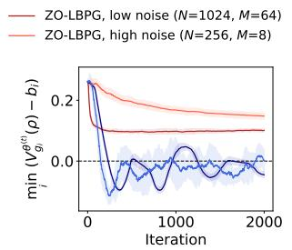
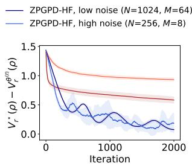
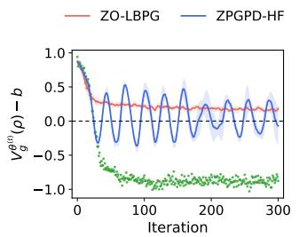
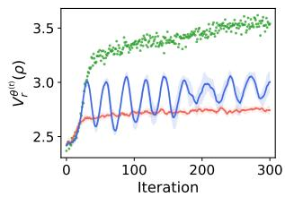
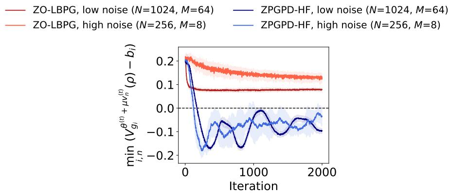

# Provable Zeroth-Order Safe Exploration for Reinforcement Learning from Human Feedback

Weiqin Chen Purdue University

Xinmeng Huang UPenn

Dongsheng Ding Santiago Paternain University of Tennessee, Knoxville RPI

## Abstract

Safe reinforcement learning from human feedback (Safe-RLHF) seeks to improve helpfulness while satisfying harmlessness constraints. Existing primal-dual approaches can converge to feasible policies, but generally do not guarantee constraint satisfaction throughout training. We study a stronger requirement, safe exploration for RLHF, under which every policy executed during training, including auxiliary exploration policies, remains feasible. We propose Zeroth-Order Log-Barrier Policy Gradient (ZO-LBPG), a reward-model-free method that optimizes a log-barrier objective using zeroth-order esti mates derived directly from human preferences. To ensure safety under noisy feedback, we combine conservative constraint margin estimates with coupled rollouts and an adaptive step size that prevents updates from crossing constraint boundaries. We establish a high-probability guarantee that all iterates and auxiliary exploration policies remain strictly feasible throughout training, and that ZO-LBPG globally converges to an approximately optimal constrained policy. We establish a sample complexity of $\widetilde { \mathcal { O } } ( \varepsilon ^ { - 6 } +$ $d ^ { 3 } \varepsilon ^ { - 5 } )$ trajectories and $\widetilde { \mathcal { O } } ( \varepsilon ^ { - 8 } + d ^ { 5 } \varepsilon ^ { - 7 } )$ human queries. Experiments via a synthetic setup and a language-model alignment task corroborate the training-time safety.

## 1 INTRODUCTION

Reinforcement learning from human feedback (RLHF) has become a standard approach for aligning language models and other interactive agents with human preferences (Christiano et al., 2017; Ouyang et al., 2022; Bai et al., 2022). A central objective of RLHF is to improve helpfulness, but optimizing helpfulness alone can produce undesirable or harmful behavior. Safe-RLHF addresses this issue by formulating alignment as a constrained reinforcement-learning problem: maximize helpfulness subject to one or more harmlessness requirements, such as limits on toxicity, deception, or privacy violations (Dai et al., 2023).

Recent work has established global convergence guarantees for Safe-RLHF without explicitly learning reward models (Liu et al., 2026). In particular, formulate Safe-RLHF as an infinite-horizon constrained Markov decision process (CMDP) and estimate policy gradients directly from human feedback using zeroth order perturbations. Their primal-dual method can converge to a feasible solution while avoiding explicit reward and utility models. This reward-model-free formulation is attractive because learned reward models can be vulnerable to reward hacking and other forms of misspecification (Casper et al., 2023; Wang et al., 2026; Helf et al., 2026).

However, convergence to a feasible policy does not guarantee safety during training. A primaldual method (Zhang et al., 2026; Liu et al., 2026) may temporarily violate a constraint while its dual variables adapt. In conventional constrained optimization, such violations may be acceptable if only the final so lution matters. In RLHF, however, policies encountered during training may themselves be evaluated, inspected, or deployed. Moreover, zeroth-order RLHF methods execute auxiliary perturbed policies to obtain human feedback. Thus, even if the current iterate is feasible, the policies used to estimate its gradient may be unsafe. These considerations motivate a stronger requirement, which we call Safe eXploration for RLHF (SafeX-RLHF): every policy executed during training, including both optimization iterates and auxiliary ex ploration policies, satisfy all harmlessness constraints.

Safe exploration has been studied in constrained reinforcement learning using interior-point methods. Logbarrier objectives provide a natural mechanism: as a constraint margin approaches zero, the barrier gradient repulses increasingly, while a conservative step size prevents the update from crossing the boundary (Usmanova et al., 2024). Ni and Kamgarpour (2025), for example, establish global convergence for log-barrier policy optimization in CMDPs with explicit reward signals. Extending this approach to SafeX-RLHF, however, introduces two fundamental dificulties.

First, the objective and constraint values are not directly observed. RLHF provides only noisy binary judgments. Both the helpfulness gradient and the harmlessness gradients must be estimated from human preferences, while the constraint margins themselves must be inferred from absolute safety judgments. The latter is particularly challenging because the margins appear in the denominator of the log-barrier gradient. An error in a constraint margin is consequently amplified as the policy approaches the boundary.

Second, a zeroth-order gradient estimate must be accurate enough to certify an individual update, rather than merely being accurate on average (Zhang and Ying, 2024). Existing zeroth-order RLHF methods perturb the policy along a single random direction at each iteration. Although such an estimator is unbiased after averaging over the random direction, an individual estimate can deviate substantially from the true gradient. Such an estimate is insuficient for certifying that a particular policy update, or the auxiliary policies used to obtain it, remains safe.

We address these challenges with Zeroth-Order Log-Barrier Policy Gradient (ZO-LBPG). The method combines three ingredients. We first estimate constraint margins from absolute harmlessness judgments and use lower confidence bounds in the barrier gradient, which conservatively strengthens the repulsion from each constraint boundary. We then estimate reward and harmlessness gradients using independently sampled perturbation directions and coupled trajectory pairs. Finally, we construct an adaptive step size from confidence bounds on both the current constraint margins and their directional changes, ensuring that no update can cross a constraint boundary. This combination allows us to establish high-probability safety simultaneously for the iterates and for all auxiliary policies executed to collect human feedback. Our main contributions are as follows.

• SafeX-RLHF algorithm. We introduce ZO-LBPG, a reward-model-free zeroth-order method for safe exploration with multiple harmlessness constraints. The method estimates barrier gradients directly from pairwise preferences and abso lute safety judgments, and uses confidence-aware step sizes to preserve feasibility.

• Training-time safety guarantees. We prove that, under a feasible initialization and an extended MFCQ condition, every iterate remains strictly feasible with high probability. Moreover, every perturbed policy executed for gradient estimation remains feasible as well. Thus, the guarantee applies to the entire data-collection process, rather than only to the final policy.

• Global convergence. Under standard RL assumptions, we establish global convergence to an approximately optimal constrained policy. The resulting sample complexity is $\widetilde { \mathcal { O } } ( \epsilon ^ { - 6 } + d ^ { 3 } \epsilon ^ { - 5 } )$ trajectories and $\widetilde { \mathcal { O } } ( \epsilon ^ { - 8 } + d ^ { 5 } \epsilon ^ { - 7 } )$ human queries. The leading terms are independent of the policy dimension and match the trajectory complexity of safe exploration with explicit reward and utility signals (Ni and Kamgarpour, 2025).

• Empirical validation. Experiments on a synthetic CMDP and a language-model alignment task illustrate the practical distinction between training-time safety and eventual feasibility. ZO-LBPG maintains strictly positive constraint margins throughout training, whereas the primal-dual baseline repeatedly crosses the constraint boundary while achieving a smaller reward gap.

## 2 SAFEX-RLHF

CMDP. We formulate Safe-RLHF as an infinitehorizon discounted CMDP (Liu et al., 2026), namely $( \mathcal { S } , \mathcal { A } , P , r , \{ g _ { i } \} _ { i = 1 } ^ { m } , \{ b _ { i } \} _ { i = 1 } ^ { m } , \gamma , \rho )$ with finite state space $s$ (prompts and dialogue histories) and action space A (responses), transition kernel $P ,$ reward (helpfulness) $r \colon \ S \times \ A \  \ [ 0 , 1 ]$ , costs (harmlessness) $g _ { i } \colon$ $S \times \mathcal { A }  [ 0 , 1 ]$ , constraint thresholds $b _ { i }$ , discount factor $\gamma \in \mathsf { \Gamma } ( 0 , 1 )$ and initial distribution $\rho .$ Finiteness follows from the finite vocabulary and context window of an LLM, with the end of a generation modeled by an absorbing state. A policy $\pi$ induces trajectories $\tau = \{ ( s _ { t } , a _ { t } ) \} _ { t \geq 0 } \ \mathrm { w i t h } \ s _ { 0 } \sim \rho , \ a _ { t } \sim \pi ( \cdot | s _ { t } ) , \ s _ { t + 1 } \sim$ $\textstyle P ( \cdot \mid s _ { t } , a _ { t } )$ . For $H \in \mathbb { N } \cup \{ \infty \}$ and $\diamond \in \{ r \} \cup \{ g _ { i } \} _ { i = 1 } ^ { m } .$ define the length-H return and value function

$$
R _ { \diamond } ^ { H } ( \tau ) : = \sum _ { t = 0 } ^ { H - 1 } \gamma ^ { t } \diamond ( s _ { t } , a _ { t } ) , \ V _ { \diamond } ^ { \pi , H } ( \rho ) : = \mathbb { E } _ { \tau \sim \pi } \big [ R _ { \diamond } ^ { H } ( \tau ) \big ] ,
$$

and let $V _ { \diamond } ^ { \pi } ( \rho ) : = V _ { \diamond } ^ { \pi , \infty } ( \rho )$ . Since $\diamond \in [ 0 , 1 ] , R _ { \diamond } ^ { H } ( \tau ) \in$ $[ 0 , G ( H ) ]$ with $\begin{array} { r } { G ( H ) : = \frac { 1 - \gamma ^ { H } } { 1 - \gamma } } \end{array}$ and $V _ { \diamond } ^ { \pi } ( \rho ) \in [ 0 , \bar { G } ]$ with $\begin{array} { r } { \bar { G } : = \frac { 1 } { 1 - \gamma } } \end{array}$ . Without loss of generality, let $b _ { i } \in ( 0 , \bar { G } )$

Problem. Let $\{ \pi _ { \pmb { \theta } } : \pmb { \theta } \in \Theta \}$ be a parameterized policy class with $\Theta \subseteq \mathbb { R } ^ { d } \left( \mathrm { e . g . } \right.$ ., softmax, $\pi _ { \pmb { \theta } } ( a | s ) \propto e ^ { \theta _ { s , a } } , \Theta =$ $\mathbb { R } ^ { | \boldsymbol { s } | | \boldsymbol { A } | } )$ . We take $\Theta = \mathbb { R } ^ { d }$ and write $V _ { \diamond } ^ { \pmb \theta } ( \rho ) : = V _ { \diamond } ^ { \pi _ { \pmb \theta } } ( \rho )$ Safe-RLHF seeks a policy that maximizes helpfulness subject to the harmlessness constraints,

$$
\operatorname* { m a x } _ { \pmb { \theta } \in \Theta } V _ { r } ^ { \pmb { \theta } } ( \rho ) \quad \mathrm { s . t . } \quad V _ { g _ { i } } ^ { \pmb { \theta } } ( \rho ) \geq b _ { i } , i \in [ m ] .\tag{OP}
$$

Denote by $\bar { V } _ { g _ { i } } ^ { \pmb \theta } ( \rho ) : = V _ { g _ { i } } ^ { \pmb \theta } ( \rho ) - b _ { i }$ the constraint margins. SafeX-RLHF distinguishes from standard CMDPs and Safe-RLHF in two aspects: (i) rewards and utilities are never observed; and (ii) every policy executed during training must be feasible. We formalize them below.

Human feedback. RLHF does not return explicit reward or utility signals, and all information about r and $g _ { i }$ comes from binary human judgments. Following the discrete-choice model of Ben-Akiva and Lerman (1985), a judgment about two trajectories $\tau _ { 0 } , \tau _ { 1 }$ is related to their latent returns through a link function, which maps the return diference to the probability of the observed choice. We consider three channels of one–bit feedback: pairwise helpfulness and harmlessness $O _ { \odot } .$ , and absolute harmlessness $o _ { c _ { i } }$ , each with its own monotone link $\sigma _ { \diamond } .$ or $\sigma _ { c _ { i } } \colon { \mathbb { R } }  [ 0 , 1 ]$ 2

$$
\begin{array} { r l } & { \mathbb { P } \big ( o _ { \diamond } = 1 \big ) = \sigma _ { \diamond } \big ( R _ { \diamond } ^ { H } ( \tau _ { 1 } ) - R _ { \diamond } ^ { H } ( \tau _ { 0 } ) \big ) , } \\ & { \mathbb { P } \big ( o _ { c _ { i } } = 1 \big ) = \sigma _ { c _ { i } } \big ( R _ { g _ { i } } ^ { H } ( \tau ) - b _ { i } \big ) , } \end{array}\tag{1}
$$

for $i \in [ m ]$ . The absolute channel measures whether a trajectory satisfies the ith constraint, which is equivalent to a comparison with a virtual trajectory of return $b _ { i }$ (Chatterji et al., 2021), and primal–dual methods rely on the same channel in their dual updates (Liu et al., 2026). The most common link in RLHF is the B-T model $\sigma ( x ) = 1 / ( 1 + e ^ { - x } )$ (Bradley and Terry, 1952). Our analysis is not tied to this specific choice and holds for the broader class below.

Assumption 2.1 (Link functions). Each link σ in (1) is strictly increasing on $\bar { \mathcal { Z } } : = [ - \bar { G } , \bar { G } ]$ , and its inverse $\sigma ^ { - 1 }$ is twice continuously diferentiable on $\mathcal { P } _ { \sigma } : =$ $\sigma ( \bar { \mathcal { T } } ) = [ p , \overline { { p } } ]$ with $| ( \sigma ^ { - 1 } ) ^ { \prime } | \leq \bar { L }$ and $| ( \sigma ^ { - 1 } ) ^ { \prime \prime } | \le L _ { 2 }$ on ${ \mathcal P } _ { \sigma } .$ where $p : = \sigma ( - \bar { G } )$ and ${ \overline { { p } } } : = \sigma ( { \bar { G } } )$

All return diferences and threshold-adjusted returns in (1) lie in I¯. In the B-T model, $\begin{array} { r } { ( \sigma ^ { - 1 } ) ^ { \prime } ( p ) = \frac { 1 } { p ( 1 - p ) } } \end{array}$ and $\begin{array} { r } { ( \sigma ^ { - 1 } ) ^ { \prime \prime } ( p ) = \frac { 2 p - 1 } { p ^ { 2 } ( 1 - p ) ^ { 2 } } } \end{array}$ are bounded on $\mathcal { P } _ { \sigma } \subset ( 0 , 1 )$ . Sampler. We control the randomness with which our policies are executed, as in the case of LLM response generation, and formalize this by a seeded sampler.

Assumption 2.2 (Seeded sampler). Trajectories are generated by a sampler that maps a seed $\omega =$ $( s _ { 0 } , ( u _ { h } , u _ { h } ^ { \prime } ) _ { h < H } )$ with i.i.d. uniform components to a trajectory $\tau ( \pmb { \theta } , \omega )$ through $a _ { h } = \dot { F } _ { \pi _ { \theta } ( { \cdot } \mid s _ { h } ) } ^ { - 1 } \bar { ( u _ { h } ) }$ (inverse-CDF sampling for a fixed ordering of A) and $s _ { h + 1 } =$ $\Phi ( s _ { h } , a _ { h } , u _ { h } ^ { \prime } )$ , where $\Phi ( s , a , U ) \sim P ( \cdot | s , a )$ for $U \sim$ $\mathrm { U n i f } [ 0 , 1 ] .$ A coupled pair consists of two trajectories generated from a common seed under two diferent $p a \textmd { - }$ rameters $\tau ( \pmb { \theta } , \omega )$ and $\tau ( \theta ^ { \prime } , \omega )$

For an LLM, $u _ { h }$ drives token sampling and the transitions are deterministic, so Assumption 2.2 amounts to sampling the two responses of a pair with the same random seed. Each trajectory of a coupled pair has the same marginal distribution as an independently sampled one. The coupling only makes the two trajectories coincide until the first step at which the two policies sample diferent actions, which is what reduces the variance of their return diference in Section 3.1.

Safe exploration. Solving (OP) from human feedback requires executing policies to collect judgments, and some methods, in particular zeroth-order methods, execute not only the iterates but also perturbed policies whose responses are shown to the evaluators. We thus require every such policy to be feasible.

Definition 1 (Safe exploration). An algorithm ensures safe exploration if every policy it executes to collect data (including the iterates $\pi _ { \theta ^ { ( t ) } }$ and any auxiliary policies) satisfies all constraints in (OP).

This requirement is much stronger than constraint satisfaction on average (Liu et al., 2026), and it strengthens the notion of safety in Ni and Kamgarpour (2025), which concerns the iterates only and assumes explicit reward and utility signals. Safe exploration needs a safe starting point. As is standard (Liu et al., 2026), we assume that one is known, for instance a supervised fine-tuned (SFT) reference model that meets every threshold with some margin (Dai et al., 2023).

Assumption 2.3 (Feasible initialization). There exist a known parameter $\pmb { \theta } ^ { ( 0 ) } \in \Theta$ and $\nu > 0$ such that $\bar { V } _ { g _ { i } } ^ { \pmb { \theta } ^ { ( 0 ) } } ( \rho ) \geq \nu$ for all $i \in [ m ]$

Regularity of the value functions. To keep every executed policy feasible, the algorithm must know how much a value function can change when the pol icy parameter moves, both to bound the efect of an update on the constraint margins and to control the error of the zeroth-order gradient estimates. Both are governed by Lipschitz and smoothness constants of the value functions, which follow from the standard policy smoothness condition (Xu et al., 2020; Agarwal et al., 2021; Yuan et al., 2022). The condition holds for softmax, log-linear and clipped Gaussian policies.

Assumption 2.4 (Policy smoothness). There exist $M _ { g } , M _ { h } \ > \ 0$ such that $\| \nabla _ { \pmb \theta } \log \pi _ { \pmb \theta } ( \ b a | s ) \| \le M _ { g }$ and $\| \bar { \nabla } _ { \pmb \theta } ^ { 2 } \log \pi _ { \pmb \theta } ( a \vert s ) \| \le M _ { h }$ for all $\pmb \theta \in \Theta , s \in \mathcal S , a \in \mathcal A$

Lemma 2.1 (Value regularity). Under Assumption $2 . 4 ,$ , for every ⋄ and $H ~ \in ~ \mathbb { N } \cup \{ \infty \} , \theta \mapsto $ $V _ { \diamond } ^ { \theta , H } ( \rho )$ is L -Lipschitz and M -smooth on Θ with $\begin{array} { r } { L _ { V } : = \frac { M _ { g } } { ( 1 - \gamma ) ^ { 3 / 2 } } , M _ { V } : = \frac { M _ { g } ^ { 2 } + M _ { h } } { ( 1 - \gamma ) ^ { 2 } } } \end{array}$ , and the truncation errors satisfy $0 ~ \le ~ V _ { \diamond } ^ { \pmb \theta } ( \rho ) - V _ { \diamond } ^ { \pmb \theta , H } ( \rho ) ~ \le ~ \epsilon _ { V } ( H )$ and $\| \nabla _ { \pmb \theta } V _ { \diamond } ^ { \pmb \theta } ( \rho ) - \nabla _ { \pmb \theta } V _ { \diamond } ^ { \pmb \theta , H } ( \rho ) \| \leq \epsilon _ { \nabla } ( H )$ , where $\epsilon _ { V } ( H ) : =$ $\begin{array} { r } { \frac { \gamma ^ { H } } { 1 - \gamma } , \epsilon _ { \nabla } ( H ) : = \frac { M _ { g } \gamma ^ { H } \sqrt { 1 + H ( 1 - \gamma ) } } { ( 1 - \gamma ) ^ { 3 / 2 } } } \end{array}$

The smoothness modulus $M _ { V }$ controls the secondorder change of a margin along an update and appears in the confidence width and step size in Section 3, while the Lipschitz constant $L _ { V }$ bounds the first-order change of a constraint margin in the worst case. The truncation errors account for the fact that only trajectories of length H are observed.

## 3 ALGORITHM DEVELOPMENT

We address the SafeX-RLHF problem (OP) by maximizing the following log-barrier surrogate over the strictly feasible region,

$$
\operatorname* { m a x } _ { \theta \in \Theta } \ B _ { \eta } ^ { \theta } ( \rho ) : = \ V _ { r } ^ { \pm } ( \rho ) + \eta \sum _ { i = 1 } ^ { m } \log \bar { V } _ { g _ { i } } ^ { \theta } ( \rho ) ,\tag{SP}
$$

where $\eta > 0$ is the barrier parameter. A natural way to solve (SP) is gradient ascent on θ (Usmanova et $\mathrm { a l . , }$ 2024; Ni and Kamgarpour, 2025), i.e., $\pmb { \theta } ^ { ( t + 1 ) } = \pmb { \theta } ^ { ( t ) } +$ $\psi _ { t } \nabla _ { \pmb { \theta } } B _ { \eta } ^ { \pmb { \theta } ^ { ( t ) } } ( \rho )$ with step size $\psi _ { t }$ and gradient

$$
\nabla _ { \pmb { \theta } } B _ { \eta } ^ { \pmb { \theta } ^ { ( t ) } } ( \rho ) \ = \ \nabla _ { \pmb { \theta } } V _ { r } ^ { \pmb { \theta } ^ { ( t ) } } ( \rho ) + \eta \sum _ { i = 1 } ^ { m } \frac { \nabla _ { \pmb { \theta } } \bar { V } _ { g _ { i } } ^ { \pmb { \theta } ^ { ( t ) } } ( \rho ) } { \bar { V } _ { g _ { i } } ^ { \pmb { \theta } ^ { ( t ) } } ( \rho ) } .\tag{2}
$$

As a constraint margin $\bar { V } _ { g _ { i } } ^ { \pmb { \theta } ^ { ( t ) } } ( \rho )$ approaches zero, its term dominates (2) and pushes the update away from the corresponding constraint boundary. This repulsion is what makes log-barrier methods suitable for safe exploration, provided that the step size is small enough so that the repulsion is never overrun. In standard RL, the gradients in (2) are estimated through the policy gradient theorem (Sutton et al., 1999) and the constraint margins through discounted cumulative utilities, both of which require explicit reward and utility signals. In SafeX-RLHF, only binary human feedback is available, and the rest of this section presents how to build the estimates of the constraint margins and gradients and the step size from the human feedback alone, which results in Algorithm 1.

## 3.1 Estimations from human feedback

Inverting the link function. In RLHF, an empirical frequency ˆp of M binary answers can be turned into a return diference by inverting the link function. Prior work (Zhang and Ying, 2024; Liu et al., 2026) clips $\hat { p }$ to $\mathcal { P } _ { \sigma } = [ \underline { { p } } , \overline { { p } } ]$ of Assumption 2.1 and then applies $\sigma ^ { - 1 }$ We instead extend $\sigma ^ { - 1 }$ from ${ \mathcal P } _ { \sigma }$ to the whole interval [0, 1] by its tangents at the two endpoints, i.e.,

$$
\bar { \sigma } ^ { - 1 } ( p ) : = \left\{ \begin{array} { l l } { \sigma ^ { - 1 } ( \underline { { p } } ) + ( \sigma ^ { - 1 } ) ^ { \prime } ( \underline { { p } } ) ( p - \underline { { p } } ) , } & { p < \underline { { p } } , } \\ { \sigma ^ { - 1 } ( p ) , } & { p \in \mathcal { P } _ { \sigma } , } \\ { \sigma ^ { - 1 } ( \overline { { p } } ) + ( \sigma ^ { - 1 } ) ^ { \prime } ( \overline { { p } } ) ( p - \overline { { p } } ) , } & { p > \overline { { p } } . } \end{array} \right.\tag{3}
$$

Its properties are formalized as follows.

Lemma 3.1 (Inverse-link estimation). Let Assumption 2.1 hold, $\begin{array} { r l r } { x } & { { } \in } & { \bar { \mathcal { I } } , \hat { p } } \end{array}$ the mean of M i.i.d. Bernou $l l i ( \sigma ( x ) )$ bits and xˆ $\therefore = \bar { \sigma } ^ { - 1 } ( \hat { p } )$ . Then $| { \hat { x } } - x | \leq$ $L | { \hat { p } } - \sigma ( x ) | \leq L$ almost surely, $\begin{array} { r } { \left| \mathbb { E } [ \hat { x } ] - x \right| \le \beta _ { M } : = \frac { L _ { 2 } } { 8 M } } \end{array}$ Clipping is not diferentiable at the endpoints of $\mathcal { P } _ { \sigma }$ , so its error can only be controlled through the deviation $| \hat { p } - \sigma ( x ) |$ , which is of order $1 / \sqrt { M }$ . Our extension $\bar { \sigma } ^ { - 1 }$ is diferentiable on [0, 1] with an L -Lipschitz derivative, so a second-order expansion applies, in which the first-order term vanishes because $\mathbb { E } [ \hat { p } ] = \sigma ( x )$ . The error of an inverted answer therefore splits into a bias of order $1 / M$ and a bounded fluctuation that averages out over trajectories. With this inversion, we present two phases of each iteration in Algorithm 1.

Phase 1 (Constraint margins). Draw $N _ { c }$ seeds $\{ \omega _ { n } \} _ { n = 1 } ^ { N _ { c } } ,$ which give initial states $s _ { n , 0 } \sim \rho$ and base trajectories $\tau _ { n , 0 } = \tau ( \pmb { \theta } ^ { ( t ) } , \omega _ { n } )$ of length H. For each $\tau _ { n , 0 }$ and each constraint i, query $M _ { c }$ evaluators for absolute harmlessness, denote the frequency of positive answers by $\hat { p } _ { c _ { i } , n } ^ { ( t ) } .$ , and estimate constraint margins by

$$
\widehat { h } _ { c _ { i } } ^ { ( t ) } : = \frac { 1 } { N _ { c } } \sum _ { n = 1 } ^ { N _ { c } } \bar { \sigma } _ { c _ { i } } ^ { - 1 } \big ( \widehat { p } _ { c _ { i } , n } ^ { ( t ) } \big ) , \ i \in [ m ] .\tag{4}
$$

By (1) and (3), $\bar { \sigma } _ { c _ { i } } ^ { - 1 } ( \hat { p } _ { c _ { i } , n } ^ { ( t ) } )$ estimates $R _ { g _ { i } } ^ { H } ( \tau _ { n , 0 } ) \ : - \ : b _ { i }$ whose mean is the truncated margin $V _ { g _ { i } } ^ { \pmb { \theta } ^ { ( t ) } , H } ( \pmb { \rho } ) - b _ { i }$ Phase 2 (Gradients). Draw $N \leq N _ { c }$ i.i.d. directions $\{ \pmb { v } _ { n } ^ { ( t ) } \} _ { n = 1 } ^ { N } \sim \operatorname { U n i f } ( \mathbb { V } ^ { d - 1 } )$ on the unit sphere. Given a perturbation magnitude $\mu ,$ run the perturbed policy $\pi _ { \pmb { \theta } ( t ) + \mu \pmb { v } _ { n } ^ { ( t ) } }$ on the seed $\omega _ { n }$ of the n-th base trajectory to obtain $\tau _ { n , 1 } = \tau ( \pmb { \theta } ^ { ( t ) } + \mu \pmb { v } _ { n } ^ { ( t ) } , \omega _ { n } )$ , and query M evaluators for pairwise helpfulness and pairwise harmlessness on $( \tau _ { n , 1 } , \tau _ { n , 0 } )$ . With the resulting frequencies $\hat { p } _ { \diamond , n } ^ { ( t ) } .$ the zeroth-order smoothing (Zhang and Ying, 2024) gives the gradient estimates for $\diamond \in \{ r \} \cup \{ g _ { i } \} _ { i = 1 } ^ { m }$

$$
\widehat { \pmb { h } } _ { \diamond } ^ { ( t ) } : = \frac { d } { \mu } \cdot \frac { 1 } { N } \sum _ { n = 1 } ^ { N } \bar { \sigma } _ { \diamond } ^ { - 1 } \big ( \widehat { p } _ { \diamond , n } ^ { ( t ) } \big ) \pmb { v } _ { n } ^ { ( t ) } .\tag{5}
$$

By (1) and $( 3 ) , \ \bar { \sigma } _ { \diamond } ^ { - 1 } ( \hat { p } _ { \diamond , n } ^ { ( t ) } )$ estimates the return difference $R _ { \diamond } ^ { H } ( \tau _ { n , 1 } ) - \dot { R } _ { \diamond } ^ { H } ( \tau _ { n , 0 } )$ , whose conditional mean given ${ \pmb v } _ { n } ^ { ( t ) }$ is $V _ { \diamond } ^ { \pmb { \theta } ^ { ( t ) } + \mu \pmb { v } _ { n } ^ { ( t ) } , H } \big ( \rho \big ) - V _ { \diamond } ^ { \pmb { \theta } ^ { ( t ) } , H } \big ( \rho \big )$

Two designs in (5) are essential for our analysis. (i) The two trajectories of a pair are coupled. They differ only if the two policies sample diferent actions at some step, which happens with probability at most $H | { \mathcal { A } } | M _ { g } \mu .$ , so the second moment of the return difference is at most of order $\mu ,$ whereas for independent rollouts it is of order $\hat { G } ^ { 2 }$ even when the two policies coincide. This gain matters since the estimator amplifies the variance by $d ^ { 2 } / \mu ^ { 2 }$ . (ii) Each pair uses its own independently drawn direction ${ \pmb v } _ { n } ^ { ( t ) }$ , so (5) is an average of N i.i.d. bounded random vectors and concentrates around its mean at rate $1 / \sqrt { N }$ (Lemma 4.1). With a single direction shared by all N pairs, as in Zhang and Ying (2024); Liu et al. (2026), the estimate does not concentrate around the true gradient, and thus cannot certify that an update is safe.

## 3.2 Boundary-aware updates

The estimates in Section 3.1 carry bias and noise from three sources: finite-horizon truncation (H), zerothorder smoothing $( \mu )$ , and human feedback with finite evaluators and trajectories $( M , M _ { c } , N , N _ { c } )$ To execute a step that is safe despite these errors, we first fix a confidence level $\delta \in \mathsf { \Gamma } ( 0 , 1 )$ and let $\iota _ { \delta } : =$ log $\textstyle \frac { 2 ( 2 m + 1 ) } { \delta } + \frac { 1 } { 4 }$ . Each iteration forms 2m+1 estimates, one reward gradient, m constraint gradients and m constraint margins. We require each of them to be accurate with probability at least $\begin{array} { r l } {  { 1 - \frac { \delta } { 2 m + 1 } } } \end{array}$ , so that by a union bound all $2 m + 1$ estimates are accurate simultaneously with probability at least $1 - \delta$ . Define the variance proxy of the coupled zeroth-order estimator

$$
\sigma _ { g } ^ { 2 } : = \frac { 2 d ^ { 2 } } { \mu ^ { 2 } } \Bigl ( \bar { G } ^ { 2 } H | A | M _ { g } \mu + \frac { L ^ { 2 } } { 4 M } \Bigr ) ,\tag{6}
$$

whose two terms are the trajectory noise (of order $\mu )$ and the human feedback noise, both amplified by the factor $d ^ { 2 } / \mu ^ { 2 }$ . We show in Section 4.2 that, with probability at least $1 - \delta .$ , the constraint margin estimates (4) and the gradient estimates (5) lie within the following confidence widths of their targets.

$$
w _ { c } : = \epsilon _ { V } ( H ) + \beta _ { M _ { c } } + ( \bar { G } + L ) \sqrt { \frac { 2 \iota _ { \delta } } { N _ { c } } } ,\tag{7}
$$

$$
w _ { g } : = \epsilon _ { \nabla } ( H ) + \frac { d M _ { V } \mu } { 2 } + \frac { d \beta _ { M } } { \mu } + \sqrt { \frac { 8 \sigma _ { g } ^ { 2 } \iota _ { \delta } } { N } } .\tag{8}
$$

Lower confidence bounds on constraint margins. The constraint margins appear in the denominators of (2), and thus underestimating them strength ens the repulsion from the boundary. We then replace each constraint margin in (2) by its lower confidence bound $\underline { { \alpha } } _ { i } ( t ) : = \widehat { h } _ { c _ { i } } ^ { ( t ) } - w _ { c }$ , which satisfies $\underline { { \alpha } } _ { i } ( t ) \leq$ $\bar { V } _ { g _ { i } } ^ { \pmb { \theta } ^ { ( t ) } } ( \rho )$ whenever the constraint margin estimates are wc-accurate, and replace the gradients in (2) by their estimates (5). This gives the estimate of the barrier gradient (2) and the unit vector in its direction

$$
\widehat { \pmb { g } } _ { t } : = \widehat { \pmb { h } } _ { r } ^ { ( t ) } + \eta \sum _ { i = 1 } ^ { m } \frac { \widehat { \pmb { h } } _ { g _ { i } } ^ { ( t ) } } { \underline { { \alpha } } _ { i } ( t ) } , \widehat { \pmb { u } } _ { t } : = \widehat { \pmb { g } } _ { t } / \Vert \widehat { \pmb { g } } _ { t } \Vert .\tag{9}
$$

Upper confidence bounds on the directional derivatives. Let $\beta _ { i } ( t ) : = \langle \nabla _ { \pmb { \theta } } V _ { g _ { i } } ^ { \pmb { \theta } ^ { ( t ) } } ( \rho ) , \hat { u } _ { t } \rangle$ denote the directional derivative of the i-th constraint value along $\hat { u } _ { t } .$ . It measures how fast the i-th constraint margin changes along the update, so the step must be limited by an upper bound on $| \beta _ { i } ( t ) |$ . Since $\beta _ { i } ( t )$ depends on the unknown true gradient, we bound it through the gradient estimate. The projection $\langle \widehat { \pmb { h } } _ { g _ { i } } ^ { ( t ) } , \hat { u } _ { t } \rangle$ is within $w _ { g }$ of $\beta _ { i } ( t )$ whenever the gradient estimate is wg-accurate. We therefore define

$$
\overline { { \beta } } _ { i } ( t ) : = \big | \langle \widehat { h } _ { g _ { i } } ^ { ( t ) } , \hat { u } _ { t } \rangle \big | + w _ { g } , \ i \in [ m ] .\tag{10}
$$

Adaptive step size. Following Ni and Kamgarpour (2025), we define the local smoothness constant $\widehat { M } _ { t }$ of (SP) along $\hat { u } _ { t }$ and the step size $\psi _ { t }$ as

$$
\widehat { M } _ { t } : = M _ { V } + \sum _ { i = 1 } ^ { m } \left( \frac { 1 0 M _ { V } \eta } { \underline { { \alpha } } _ { i } ( t ) } + \frac { 8 \eta \overline { { \beta } } _ { i } ( t ) ^ { 2 } } { \underline { { \alpha } } _ { i } ( t ) ^ { 2 } } \right) ,\tag{11}
$$

$$
\psi _ { t } : = \operatorname* { m i n } \left\{ \frac { 1 } { \widehat { M _ { t } } } , \operatorname* { m i n } _ { i \in [ m ] } \frac { \underline { { \alpha } } _ { i } ( t ) } { \sqrt { M _ { V } \underline { { \alpha } } _ { i } ( t ) } + 2 \overline { { \beta } } _ { i } ( t ) } \cdot \frac { 1 } { \| \widehat { \pmb { g } } _ { t } \| } \right\}\tag{12}
$$

The two terms in (12) serve two purposes. The first term $1 / \widehat { M } _ { t }$ is small enough that the barrier objective increases along $\hat { u } _ { t } .$ , since $\widehat { M _ { t } }$ bounds the curvature of (SP) along the update. The second term ensures that no constraint margin loses more than half of its value in one upda $\mathrm { { ; e , } }$ so that a single step can never cross a constraint boundary. Both terms are computed from the confidence bounds, and no Hessian information is needed. Following Ni and Kamgarpour (2025), Algorithm 1 stops when $\| \widehat { \pmb { g } } _ { t } \| \le \eta / 2$ or after T iterations.

Algorithm 1 ZO-LBPG   
Require: feasible ${ \pmb \theta } ^ { ( 0 ) }$ , parameters $\eta , \mu , H , \delta , T .$ , batch   
sizes $N _ { c } \geq N .$ , evaluator counts $M _ { c } , M .$ , constants   
$M _ { V } , L , L _ { 2 } , M _ { g } ,$ the widths $w _ { c } , w _ { g }$ in (7) and (8).   
1: for $t = 0 , \ldots { \overset { - } { , } } T - 1$ do   
2: Phase 1. Draw $N _ { c }$ seeds $\{ \omega _ { n } \} _ { n = } ^ { N _ { c } }$ and gener  
ate base trajectories $\tau _ { n , 0 } = \tau ( \pmb { \theta } ^ { ( t ) } , \omega _ { n } )$ . Query $M _ { c }$   
evaluators for absolute harmlessness of each $\tau _ { n , 0 }$   
w.r.t. each constraint. Compute $\widehat { h } _ { c _ { i } } ^ { ( t ) }$ by (4) and   
$\underline { { \alpha } } _ { i } ( t ) \gets \widehat { h } _ { c _ { i } } ^ { ( t ) } - w _ { c } .$   
3: Phase 2. Draw $\{ \pmb { v } _ { n } ^ { ( t ) } \} _ { n = 1 } ^ { N } \ \sim \ \mathrm { U n i f } ( \mathbb { V } ^ { d - 1 } )$   
and generate coupled trajectories $\tau _ { n , 1 } = \tau ( \pmb \theta ^ { ( t ) } +$   
$\mu v _ { n } ^ { ( t ) } , \omega _ { n } )$ . Query M evaluators for pairwise help  
fulness and harmlessness on each $( \tau _ { n , 1 } , \tau _ { n , 0 } )$ . Com  
pute $\widehat { h } _ { \diamond } ^ { ( t ) }$ by $( 5 ) , \widehat { \pmb { g } } _ { t } , \widehat { \pmb { u } } _ { t }$ by $( 9 ) .$ , and $\overline { { \beta } } _ { i } ( t )$ by (10).   
4: if $\| \widehat { \pmb { g } } _ { t } \| \le \eta / 2$ then return ${ \pmb \theta } ^ { ( t ) }$   
5: end if   
6: Compute $\widehat { M _ { t } }$ and $\psi _ { t }$ by (11) and (12).   
7: θ(t+1) $ \pmb { \theta } ^ { ( t ) } + \psi _ { t } \widehat { \pmb { g } } _ { t }$   
8: end for   
9: return ${ \pmb \theta } ^ { ( T ) }$

## 4 THEORETICAL GUARANTEES

We state the remaining assumptions in Section 4.1, quantify the estimation errors in Section 4.2, and establish safe exploration in Section 4.3 and global convergence with its sample complexity in Section 4.4. All proofs are provided in the appendices.

## 4.1 Assumptions

The first assumption is the extended Mangasarian– Fromovitz constraint qualification (MFCQ) of Ni and Kamgarpour (2025).

Assumption 4.1 (Extended MFCQ). There exist $0 <$ $\nu _ { \mathrm { e m f } } \le \nu$ and $\ell \in ( 0 , L _ { V } ]$ such that for every $\theta \in \Theta$ there is a unit vector s with $\langle s _ { \pmb \theta } , \nabla _ { \pmb \theta } \bar { V } _ { g _ { i } } ^ { \pmb \theta } ( \rho ) \rangle \geq \acute { \ell }$ for all $i \in \mathcal { T } _ { \nu _ { \mathrm { e m f } } } ( \theta ) : = \{ i | 0 < \bar { V } _ { g _ { i } } ^ { \theta } ( \rho ) \leq \nu _ { \mathrm { e m f } } \}$

Assumption 4.1 is what allows the barrier to repel the iterates from the boundary, since the barrier gradient has a large component along $s _ { \theta }$ whenever some constraint margins are small. The strength of this repulsion is quantified by the constants

$$
\bar { c } : = \frac { \ell } { 6 m L _ { V } } \mathrm { a n d } c : = \frac { 3 } { 2 } \Big ( \frac { \ell } { 1 8 m L _ { V } } \Big ) ^ { m } ,\tag{13}
$$

and we show in Section 4.3 that no constraint margin ever drops below $c \eta .$ . The exponential dependence of c on m is shared with Usmanova et al. (2024); Ni and Kamgarpour (2025).

The next two assumptions are the standard conditions under which the barrier objective satisfies a gradient dominance property, which we use for convergence to a globally optimal policy (Yuan et al., 2022; Masiha et al., 2022; Ni and Kamgarpour, 2025). Let $\begin{array} { r } { d _ { \rho } ^ { \theta } ( s , a ) : = ( 1 - \gamma ) \sum _ { t > 0 } \gamma ^ { t } \mathbb { P } ^ { \pi _ { \theta } } ( s _ { t } = s , a _ { t } = a ) } \end{array}$ be the discounted state-action visitation distribution of $\pi _ { \pmb { \theta } }$ and $F ^ { \pmb \theta } ( \rho ) : = \mathbb { E } _ { d _ { o } ^ { \pmb \theta } } [ \nabla _ { \pmb \theta } \log \pi _ { \pmb \theta } ( a | s ) \nabla _ { \pmb \theta } \log \pi _ { \pmb \theta } ( a | s ) ^ { \top } ]$ the Fisher information matrix.

Assumption 4.2 (Relaxed Fisher non-degeneracy). The smallest non-zero eigenvalue of $F ^ { \pmb \theta } ( \rho )$ is at least $\mu _ { F } > 0$ for every $\pmb \theta \in \Theta$

Assumption 4.3 (Bounded transfer error). $F o r \diamond \in$ $\{ r \} \cup \{ g _ { i } \} _ { i = 1 } ^ { m }$ , let $A _ { \circ } ^ { \theta }$ denote the advantage function and $\bar { \mu } _ { \diamond } ^ { * } : = ( \bar { F } ^ { \bullet } ( \bar { \rho } ) ) ^ { \dagger } \nabla _ { \theta } \bar { V } _ { \diamond } ^ { \pmb { \theta } } ( \rho )$ . For every $\pmb { \theta } \in \Theta$ and every optimal policy $\pi ^ { * }$ of $\mathrm { ( O P ) } , \mathbb { E } _ { ( s , a ) \sim d _ { \rho } ^ { \pi ^ { * } } } [ ( A _ { \diamond } ^ { \theta } ( s , a ) - ( 1 -$ $\gamma ) \mu _ { \diamond } ^ { * } { } ^ { \top } \nabla _ { \pmb \theta } \log \pi _ { \pmb \theta } ( a | s ) ) ^ { 2 } ] \leq \varepsilon _ { \mathrm { b i a s } }$

## 4.2 Estimation guarantees

Let $\mathcal { F } _ { t }$ denote the σ-algebra generated by all seeds, directions and evaluator answers of iterations $\{ 0 , \ldots , t -$ 1}. The following lemma demonstrates that the confidence widths of Section 3.2 are valid.

Lemma 4.1 (Accuracy of the estimators). Let As sumptions 2.1, 2.2 and 2.4 hold, and let

$$
N \ge \frac { 3 2 d ^ { 2 } ( \bar { G } + L ) ^ { 2 } \iota _ { \delta } } { \mu ^ { 2 } \sigma _ { q } ^ { 2 } } .\tag{14}
$$

Then, conditionally on $\mathcal { F } _ { t }$ , the event

$$
\begin{array} { r } { \mathcal { E } _ { t } : = \Big \{ \| \widehat { \pmb { h } } _ { \diamond } ^ { ( t ) } - \nabla _ { \pmb { \theta } } V _ { \diamond } ^ { \pmb { \theta } ^ { ( t ) } } ( \rho ) \| \le w _ { g } , \forall \diamond \in \{ r \} \cup \{ g _ { i } \} _ { i = 1 } ^ { m } , } \end{array}
$$

$$
\lvert \widehat { h } _ { c _ { i } } ^ { ( t ) } - \bar { V } _ { g _ { i } } ^ { \pmb { \theta } ^ { ( t ) } } ( \rho ) \rvert \leq w _ { c } , \forall i \in [ m ] \Biggr \}\tag{15}
$$

has probability at least $1 - \delta$

Condition (14) follows from the Bernstein inequality and is of lower order than the sample sizes needed for accuracy. On $\mathcal { E } _ { t }$ the upper confidence bounds (10) satisfy $| \beta _ { i } ( t ) | \le \overline { { \beta } } _ { i } ( t ) \le | \beta _ { i } ( t ) | + 2 w _ { g }$ for all $i \in [ m ]$

The barrier gradient estimate $\widehat { \mathbf { g } } _ { t }$ combines the individual estimates through (9), and the next result bounds the resulting error. Let $\alpha _ { i } ( t ) : = \bar { V } _ { g _ { i } } ^ { \pmb { \theta } ^ { ( t ) } } ( \rho )$ $\alpha _ { \mathrm { m i n } } ( t ) : = \mathrm { m i n } _ { i } \alpha _ { i } ( t )$ and $\Delta _ { t } : = \widehat { \pmb { g } } _ { t } - \nabla _ { \pmb { \theta } } B _ { \eta } ^ { \pmb { \theta } ^ { ( t ) } } ( \rho )$

Theorem 4.1 (Gradient error). Under Assumptions ${ \it 2 . 1 , \ 2 . 2 , \ 2 . 4 }$ and $4 . 1 ,$ , on $\mathcal { E } _ { t } , \ i f \ w _ { c } \leq \alpha _ { \operatorname* { m i n } } ( t ) / 8$ then $\textstyle { \frac { 3 } { 4 } } \alpha _ { i } ( t ) \leq \underline { { \alpha } } _ { i } ( t ) \leq \alpha _ { i } ( t )$ for all $i \in [ m ]$ and

$$
\| \Delta _ { t } \| \leq w _ { g } \Big ( 1 + \sum _ { i = 1 } ^ { m } \frac { 4 \eta } { 3 \alpha _ { i } ( t ) } \Big ) + \sum _ { i = 1 } ^ { m } \frac { 8 \eta L _ { V } w _ { c } } { 3 \alpha _ { i } ( t ) ^ { 2 } } .\tag{16}
$$

If moreover $\alpha _ { \mathrm { m i n } } ( t ) \geq c \eta$ and

$$
\begin{array} { r l } & { w _ { g } \ \leq \ \bar { w } _ { g } : = C _ { 1 } \operatorname* { m i n } \{ c \eta , 2 \ell \} , } \\ & { w _ { c } \ \leq \ \bar { w } _ { c } : = \eta C _ { 2 } \operatorname* { m i n } \{ c \eta , 2 \ell \} , } \end{array}\tag{17}
$$

where $C _ { 1 } , C _ { 2 } > 0$ depend only on $m , \ c$ and $L _ { V } \subset A p .$ pendix C), then $\| \Delta _ { t } \| \le \eta / 4$

The two terms of (16) come from the numerators and the denominators of the barrier gradient and expose an asymmetry that drives the sample complexity. A gradient error is multiplied by at most $\eta / \alpha _ { i } ( t ) \leq 1 / c$ , so the gradients only need accuracy $\mathcal { O } ( \eta )$ , whereas a constraint margin error is multiplied by $\eta / \alpha _ { i } ( t ) ^ { 2 }$ , which is of order $1 / \eta ,$ so the constraint margins need accuracy $\mathcal { O } ( \eta ^ { 2 } )$ . The more demanding requirement consequently falls on the constraint margin channel, which needs no perturbation and no factor $d / \mu$

## 4.3 Safe exploration

On the good events $\mathcal { E } _ { t }$ , the step size (12) keeps every executed policy feasible throughout the run. The proof (Appendix D) combines three facts. One update never reduces a constraint margin by more than half of its lower confidence bound, the barrier objective is Mct-smooth along the update so that the step size $1 / \widehat { M } _ { t }$ increases it, and whenever the smallest constraint margin drops below $\bar { c } \eta ,$ the repulsion of Assumption 4.1 dominates the barrier gradient, so that the product of the nearly active constraint margins does not decrease.

Theorem 4.2 (Safe exploration). Under Assumptions 2.1, 2.2, 2.3, 2.4, 4.1 and that $\eta \leq \operatorname* { m i n } \{ 1 , \nu _ { \mathrm { e m f } } \}$ Choose the hyperparameters so that (14) holds, $w _ { g } \leq$ $\hat { w } _ { g } , w _ { c } \le \hat { w } _ { c }$ and $\mu \leq c \eta / ( 2 L _ { V } )$ . Then with probability at least $1 - T \delta$ , the following holds for every iteration t reached by Algorithm 1. $( i ) \ \alpha _ { i } ( t ) \geq c \eta$ for all $i \in [ m ]$ (ii) Every exploration policy $\pi _ { \pmb { \theta } ^ { ( t ) } + \mu \pmb { v } _ { n } ^ { ( t ) } }$ has all constraint margins at least cη/2. $( i i i ) \ | | \Delta _ { t } | | \leq \eta / 4$ . (iv) $\psi _ { t } \geq C \eta$ for a constant $C > 0$ that depends only on $m , c , M _ { V } , L _ { V } , \bar { G }$ (Appendix D). Therefore, ZO-LBPG ensures safe exploration with probability at least $1 - T \delta$

Parts (i) and (ii) are the safety guarantee, and parts (iii) and (iv) are what the convergence analysis needs.

Since the constraint margin floor cη does not depend on t, the requirements (17) are uniform over the run and the sample sizes can be fixed in advance.

## 4.4 Convergence and sample complexity

Global convergence rests on the gradient dominance property, connecting the optimality gap of a strictly feasible policy to the norm of its barrier gradient.

Lemma 4.2 (Gradient dominance). Under Assumptions ${ \mathcal { Q } } . 4 , \ 4 . { \mathcal { L } } , \ 4 . { \mathcal { S } } ,$ for every strictly feasible θ and optimal $\pi ^ { * }$ , it holds that

$$
\begin{array} { r } { V _ { r } ^ { \pi ^ { * } } ( \rho ) - V _ { r } ^ { \theta } ( \rho ) \leq m \eta + \cfrac { \sqrt { \varepsilon _ { \mathrm { b i a s } } } } { 1 - \gamma } \Big ( 1 + \displaystyle \sum _ { i = 1 } ^ { m } \frac { \eta } { \bar { V } _ { g _ { i } } ^ { \theta } ( \rho ) } \Big ) } \\ { + \displaystyle \frac { M _ { g } } { \mu _ { F } } \| \nabla _ { \theta } B _ { \eta } ^ { \theta } ( \rho ) \| . \qquad ( 1 } \end{array}\tag{8}
$$

Theorem 4.2 keeps the barrier gradient estimate accurate and the step size bounded below, and together with the ascent property of the step this yields a linear contraction of the optimality gap.

Theorem 4.3 (Global convergence). Let Assumptions 2.1, 2.2, 2.3, 2.4, $4 . 1 , \quad 4 . 2$ and 4.3 hold, $\eta \ \leq \ \operatorname* { m i n } \{ 1 , \nu _ { \mathrm { e m f } } \}$ , and let the hyperparameters satisfy the conditions of Theorem $4 . 2 .$ Set $\bar { C } \quad : = { }$ min $\lbrace C , 8 M _ { g } / ( \mu _ { F } \eta ^ { 2 } ) \rbrace$ and $\begin{array} { r } { \kappa : = \frac { \bar { C } \mu _ { F } \eta ^ { 2 } } { 8 M _ { a } } \in ( 0 , 1 ] } \end{array}$ . With probability at least $1 - T \delta _ { i }$ , the output $\theta _ { \mathrm { o u t } }$ satisfies

$$
\begin{array} { r } { V _ { r } ^ { \pi ^ { * } } ( \rho ) - V _ { r } ^ { \theta _ { \mathrm { o u t } } } ( \rho ) \le ( 1 - \kappa ) ^ { T } \big ( V _ { r } ^ { \pi ^ { * } } ( \rho ) - V _ { r } ^ { \theta ^ { ( 0 ) } } ( \rho ) \big ) } \\ { + \displaystyle \frac { \sqrt { \varepsilon _ { \mathrm { b i a s } } } } { 1 - \gamma } \Big ( 1 + \frac { m } { c } \Big ) + \frac { 3 M _ { g } \eta } { 4 \mu _ { F } } } \\ { + m \eta \Big ( 1 + \log \frac { 1 } { c \eta ( 1 - \gamma ) } \Big ) . ~ ( \frac { \lambda } { r } ^ { 2 } ) } \end{array}\tag{19}
$$

The four terms are the optimization error decaying linearly, the approximation error vanishing for the softmax class, the loss incurred at stopping triggers, and the bias of the barrier, which is $\begin{array} { r } { \mathcal { O } ( \eta \log \frac { 1 } { \eta } ) } \end{array}$ An $\varepsilon -$ optimal policy hence requires $\eta \propto \varepsilon ,$ , and converting (14) and (17) into sample sizes yields the following.

Corollary 4.1 (Sample complexity). Under the assumptions of Theorem 4.3, fix $\varepsilon \in \mathsf { \Gamma } ( 0 , 1 ]$ and $\delta _ { 0 } \in$ $( 0 , 1 )$ , set $\eta = \varepsilon / m$ (assuming $\varepsilon / m \leq$ min $\{ \nu _ { \mathrm { e m f } } , 2 \ell / c \} )$ and $\delta \ = \ \delta _ { 0 } / T$ , and choose $T , \mu , M _ { c } , M , N _ { c } , N , E$ as in Appendix E, with $T \ = \ \widetilde { \mathcal { O } } ( \varepsilon ^ { - 2 } ) , \ N _ { c } \ = \ \widetilde { \mathcal { O } } ( \varepsilon ^ { - 4 } )$ ， $N = \widetilde { \mathcal { O } } ( d ^ { 3 } \varepsilon ^ { - 3 } ) , \ M _ { c } = \mathcal { O } ( \varepsilon ^ { - 2 } ) , \ M = \mathcal { O } ( d ^ { 2 } \varepsilon ^ { - 2 } )$ and $\begin{array} { r } { H \ = \ { \mathcal O } ( { \frac { 1 } { 1 - \gamma } } \log { \frac { d } { \varepsilon } } ) } \end{array}$ . Then with probability at least $1 - \delta _ { 0 } , Z { \bar { O } } { - } L ^ { ' } B P G$ ensures safe exploration and

$$
V _ { r } ^ { \pi ^ { * } } ( \rho ) - V _ { r } ^ { \theta _ { \mathrm { o u t } } } ( \rho )
$$

$$
\leq 2 \varepsilon + \frac { 3 M _ { g } \varepsilon } { 4 m \mu _ { F } } + \varepsilon \log \frac { m } { c \varepsilon ( 1 - \gamma ) } + \frac { 2 m \sqrt { \varepsilon _ { \mathrm { b i a s } } } } { c ( 1 - \gamma ) } ,\tag{20}
$$

using $\widetilde { \mathcal { O } } ( \varepsilon ^ { - 6 } + d ^ { 3 } \varepsilon ^ { - 5 } )$ trajectories and $\widetilde { \mathcal { O } } ( \varepsilon ^ { - 8 } + d ^ { 5 } \varepsilon ^ { - 7 } )$ human queries in total.

The margins need accuracy $\mathcal { O } ( \varepsilon ^ { 2 } )$ , which costs $N _ { c } =$ $\widetilde { \mathcal { O } } ( \varepsilon ^ { - 4 } )$ base trajectories per iteration, but they are estimated from absolute judgments on unperturbed trajectories, so $N _ { c }$ and $M _ { c }$ do not depend on $d .$ The gradients need only $\mathcal { O } ( \varepsilon )$ accuracy. Thus, the zerothorder estimator, the only place where the dimension enters, costs $N = \widetilde { \mathcal { O } } ( d ^ { 3 } \varepsilon ^ { - 3 } )$ pairs per iteration. The leading terms $\varepsilon ^ { - 6 }$ and $\varepsilon ^ { - 8 }$ are thus dimension-free.

Remark 4.1 (The price of human feedback). With explicit reward and utility signals, Ni and Kamgarpour (2025) need $\widetilde { \mathcal { O } } ( \varepsilon ^ { - 6 } )$ trajectories, and Corollary 4.1 attains the same leading rate from human feedback. The additional price is the factor $M _ { c } = \mathcal { O } ( \bar { \varepsilon } ^ { - 2 } )$ of evaluators per trajectory, which turns $\widetilde { \mathcal { O } } ( \varepsilon ^ { - 6 } )$ trajectories into $\widetilde { \mathcal { O } } ( \varepsilon ^ { - 8 } )$ human queries.

## 5 EXPERIMENTS

We evaluate ZO-LBPG in two settings: a synthetic CMDP that allows control of the optimization and feedback noise, and a language-model alignment task that examines the persistence training-time safety in a realistic autoregressive policy. Our primary question is not whether ZO-LBPG achieves the highest final helpfulness, but whether it can improve helpfulness while maintaining safety throughout training. We thus compare ZO-LBPG with ZPGPD-HF (Liu et al., 2026), a zeroth-order primal-dual method that only provides average-feasibility guarantees. Additional details and results are provided in Appendix F.

## 5.1 Synthetic data

Setup. We first consider the synthetic CMDP used to illustrate the SafeX-RLHF setting. The environment has $\vert S \vert ~ = ~ 6$ states, $| { \mathcal { A } } | = 3$ actions, discount factor $\gamma = 0 . 8 5$ , and $m = 3$ harmlessness constraints, giving a policy dimension of $d \ = \ 1 8$ under tabular softmax parameterization. Transition probabilities are sampled from a Dirichlet distribution with concentration parameter 0.5. The reward is sampled uniformly from [0, 1], while the safety utilities are constructed as $g _ { i } = 0 . 4 ( 1 - r ) + 0 . 6 \xi _ { i }$ with $\xi _ { i } \sim \mathrm { U n i f } [ 0 , 1 ]$ , creating a conflict between helpfulness and harmlessness. We set $b _ { i } = 3$ for all i. The constrained optimum has all three constraints active and reward value $V _ { r } ^ { \star } ( \rho ) ~ = ~ 5 . 3 1$ whereas the unconstrained optimum violates all three constraints. Both algorithms are initialized at the uniform policy, which is strictly feasible with initial margins (0.52, 0.40, 0.26). Trajectories have horizon $H \ = \ 4 0$ , and pairwise and absolute judgments are generated using Bradley–Terry evaluators. We consider a low-noise regime with $N = 1 0 2 4 , N _ { c } = 2 0 4 8$ and M = 64 evaluators per query, and a high-noise regime with $N = 2 5 6 , N _ { c } = 5 1 2$ , and $M = 8$ . We run $T = 2 0 0 0$ iterations with ten random seeds.

Results. Figure 1 highlights the central distinction between the two methods. ZPGPD-HF achieves a smaller reward optimality gap, but its iterates repeatedly cross the constraint boundary. In the low- and high-noise regimes, respectively, 66.6% and 68.9% of its iterates are infeasible, with worst constraint margins of −0.118 and −0.179. These oscillations are consistent with the primal-dual mechanism: the policy can move outside the feasible region while the dual variables react to the resulting constraint violation. In contrast, ZO-LBPG maintains a positive margin throughout training in both regimes. No iterate violates any constraint, and the worst margin over all executed exploration policies remains positive as well: +0.052 in the low-noise regime and +0.048 in the high noise regime. The price is a larger final reward gap, reflecting the conservative steps required to maintain a certified safety margin. More ablations in Appendix F further clarify the source of this tradeof.

  
(a) Min constraint margin.

  
(b) Reward optimality gap.  
Figure 1: Synthetic CMDP. ZO-LBPG keeps every iterate strictly feasible, whereas ZPGPD-HF constantly violates the constraints and attains its smaller reward gap through infeasible policies. Curves show means over ten seeds with one-standard-deviation bands.

## 5.2 Experiments on language models

Setup. We next test ZO-LBPG on a language-model alignment task. We use Qwen2.5-3B-Instruct (Qwen Team, 2024) with prompts from PKU-SafeRLHF (Ji et al., 2024), treating each prompt as a state and the generated tokens as the action. The base model is frozen, and we optimize a low-dimensional LoRA-style adapter with $d = 8$ trainable parameters. This lowdimensional parameterization allows us to study the zeroth-order method while keeping the computational cost manageable. We use the Beaver-7B reward and cost models (Dai et al., 2023) to provide latent helpfulness and harmlessness scores. These scores are used only to simulate noisy human judgments and to eval uate the learned policies; neither algorithm has access to the latent scores during optimization. Pairwise and absolute feedback are generated according to the Bradley–Terry model with $M = M _ { c } = 2 5 6$ simulated evaluators. Both methods use the same prompts, feedback pipeline, and batch sizes, with $N \ = \ 5 1 2$

$N _ { c } = 1 0 2 4$ , and $T = 3 0 0$ . We include an unconstrained helpfulness-only run as a reference.

Results. Figure 2 shows that the synthetic-CMDP phenomenon persists in the language-model setting. The unconstrained reference rapidly improves helpfulness but drives the safety margin to approximately −0.9. ZPGPD-HF also oscillates around the constraint boundary and produces infeasible iterates: 43.5% of its iterates have negative estimated margins, and its worst margin is −0.51. ZO-LBPG, in contrast, maintains a positive safety margin throughout the entire run. Across all three seeds, its smallest estimated iterate margin is +0.025, and none of its exploration policies is infeasible. At the same time, ZO-LBPG improves helpfulness from 2.39 to 2.74. ZPGPD-HF reaches a higher final helpfulness of 2.94, but does so while repeatedly entering the infeasible region; even when restricted to its feasible iterates, its average helpfulness is 2.86. These results illustrate the central tradeof of training-time safety. A primal-dual method can move more aggressively toward the reward optimum but constantly violate constraint, whereas ZO LBPG deliberately limits its updates using confidence bounds on the safety margin.

  
Figure 2: LLM experiment. ZO-LBPG keeps every iterate strictly feasible and improves the helpfulness, whereas ZPGPD-HF repeatedly crosses the constraint boundary. Means over three seeds with one-standard deviation bands, smoothed over five iterations.

## 6 CONCLUSION

We developed ZO-LBPG, a reward-model-free method for safe exploration in RLHF. By combining a logbarrier objective with confidence-aware zeroth-order gradient estimates and adaptive step sizes, ZO-LBPG guarantees, with high probability, that both training iterates and auxiliary exploration policies remain strictly feasible throughout training. We further establish global convergence to an approximately optimal constrained policy with dimension-free leadingorder sample complexity. Experiments on a synthetic CMDP and a language-model alignment task demonstrate the central tradeof: ZO-LBPG maintains training-time safety, while the primal-dual baseline achieves higher helpfulness by allowing intermediate constraint violations.

## References

Achiam, J., Held, D., Tamar, A., and Abbeel, P. (2017). Constrained policy optimization. In International conference on machine learning, pages 22–31. PMLR.

Agarwal, A., Kakade, S. M., Lee, J. D., and Mahajan, G. (2021). On the theory of policy gradient methods: Optimality, approximation, and distribution shift. Journal of Machine Learning Research, 22(98):1–76.

Altman, E. (1999). Constrained Markov decision processes: stochastic modeling. Routledge.

Bai, Q., Bedi, A. S., and Aggarwal, V. (2023). Achieving zero constraint violation for constrained reinforcement learning via conservative natural policy gradient primal-dual algorithm. In Proceedings of the AAAI Conference on Artificial Intelligence, volume 37, pages 6737–6744.

Bai, Y., Jones, A., Ndousse, K., Askell, A., Chen, A., DasSarma, N., Drain, D., Fort, S., Ganguli, D., Henighan, T., et al. (2022). Training a helpful and harmless assistant with reinforcement learning from human feedback. arXiv preprint arXiv:2204.05862.

Ben-Akiva, M. E. and Lerman, S. R. (1985). Discrete choice analysis: theory and application to travel demand, volume 9. MIT press.

Berkenkamp, F., Turchetta, M., Schoellig, A., and Krause, A. (2017). Safe model-based reinforcement learning with stability guarantees. Advances in neural information processing systems, 30.

Bradley, R. A. and Terry, M. E. (1952). Rank analysis of incomplete block designs: I. the method of paired comparisons. Biometrika, 39(3/4):324–345.

Calvo-Fullana, M., Paternain, S., Chamon, L. F., and Ribeiro, A. (2023). State augmented constrained reinforcement learning: Overcoming the limitations of learning with rewards. IEEE Transactions on Automatic Control.

Casper, S., Davies, X., Shi, C., Gilbert, T. K., Scheurer, J., Rando, J., Freedman, R., Korbak, T., Lindner, D., Freire, P., et al. (2023). Open problems and fundamental limitations of reinforcement learning from human feedback. arXiv preprint arXiv:2307.15217.

Chatterji, N., Pacchiano, A., Bartlett, P., and Jordan, M. (2021). On the theory of reinforcement learning with once-per-episode feedback. Advances in Neural Information Processing Systems, 34:3401–3412.

Chow, Y., Nachum, O., Duenez-Guzman, E., and Ghavamzadeh, M. (2018). A lyapunov-based approach to safe reinforcement learning. Advances in neural information processing systems, 31.

Chow, Y., Nachum, O., Faust, A., Duenez-Guzman, E., and Ghavamzadeh, M. (2019). Lyapunovbased safe policy optimization for continuous control. arXiv preprint arXiv:1901.10031.

Christiano, P. F., Leike, J., Brown, T., Martic, M., Legg, S., and Amodei, D. (2017). Deep reinforcement learning from human preferences. Advances in neural information processing systems, 30.

Dai, J., Pan, X., Sun, R., Ji, J., Xu, X., Liu, M., Wang, Y., and Yang, Y. (2023). Safe rlhf: Safe reinforcement learning from human feedback. arXiv preprint arXiv:2310.12773.

Ding, D., Wei, C.-Y., Zhang, K., and Ribeiro, A. (2024). Last-iterate convergent policy gradient primal-dual methods for constrained mdps. Advances in Neural Information Processing Systems, 36.

Ding, D., Zhang, K., Basar, T., and Jovanovic, M. (2020). Natural policy gradient primal-dual method for constrained markov decision processes. Advances in Neural Information Processing Systems, 33:8378– 8390.

Ding, D., Zhang, K., Ba¸sar, T., and Jovanovi´c, M. R. (2022). Convergence and optimality of policy gradient primal-dual method for constrained markov decision processes. In 2022 American Control Conference (ACC), pages 2851–2856. IEEE.

Du, Y., Winnicki, A., Dalal, G., Mannor, S., and Srikant, R. (2024). Exploration-driven policy optimization in rlhf: Theoretical insights on eficient data utilization. arXiv preprint arXiv:2402.10342.

Ghadimi, S. and Lan, G. (2013). Stochastic firstand zeroth-order methods for nonconvex stochastic programming. SIAM journal on optimization, 23(4):2341–2368.

Helf, L., Delfosse, Q., Steinmann, D., H¨arle, R., Shindo, H., Schramowski, P., Stammer, W., Kersting, K., and Friedrich, F. (2026). Llms gaming verifiers: Rlvr can lead to reward hacking. arXiv preprint arXiv:2604.15149.

Hinder, O. and Ye, Y. (2018). A polynomial time log barrier method for problems with nonconvex constraints. arXiv preprint arXiv:1807.00404.

Huang, X., Li, S., Dobriban, E., Bastani, O., Hassani, H., and Ding, D. (2024). One-shot safety alignment for large language models via optimal dual ization. In Globerson, A., Mackey, L., Belgrave, D., Fan, A., Paquet, U., Tomczak, J., and Zhang, C., editors, Advances in Neural Information Processing Systems, volume 37, pages 84350–84383. Curran Associates, Inc.

Ji, J., Hong, D., Zhang, B., Chen, B., Dai, J., Zheng, B., Qiu, T., Li, B., and Yang, Y. (2024). PKU-SafeRLHF: Towards multi-level safety alignment for LLMs with human preference. arXiv preprint arXiv:2406.15513.

Kakade, S. and Langford, J. (2002). Approximately optimal approximate reinforcement learning. In Proceedings of the nineteenth international conference on machine learning, pages 267–274.

Kalagarla, K. C., Jain, R., and Nuzzo, P. (2023). Safe posterior sampling for constrained mdps with bounded constraint violation. arXiv preprint arXiv:2301.11547.

Kohler, J. M. and Lucchi, A. (2017). Sub-sampled cubic regularization for non-convex optimization. In International Conference on Machine Learning, pages 1895–1904. PMLR.

Koller, T., Berkenkamp, F., Turchetta, M., Boedecker, J., and Krause, A. (2019). Learning-based model predictive control for safe exploration and reinforcement learning. arXiv preprint arXiv:1906.12189.

Koller, T., Berkenkamp, F., Turchetta, M., and Krause, A. (2018). Learning-based model predictive control for safe exploration. In 2018 IEEE conference on decision and control (CDC), pages 6059– 6066. IEEE.

Liu, Q., Kline, A., and Wei, E. (2026). Policy gradient primal-dual method for safe reinforcement learning from human feedback. arXiv preprint arXiv:2604.19024.

Liu, S., Kailkhura, B., Chen, P.-Y., Ting, P., Chang, S., and Amini, L. (2018). Zeroth-order stochastic variance reduction for nonconvex optimization. Advances in neural information processing systems, 31.

Liu, Y., Ding, J., and Liu, X. (2020). Ipo: Interiorpoint policy optimization under constraints. In Proceedings of the AAAI conference on artificial intelligence, volume 34, pages 4940–4947.

Masiha, S., Salehkaleybar, S., He, N., Kiyavash, N., and Thiran, P. (2022). Stochastic second-order methods improve best-known sample complexity of sgd for gradient-dominated functions. Advances in Neural Information Processing Systems, 35:10862– 10875.

Mondal, W. U. and Aggarwal, V. (2024). Sampleeficient constrained reinforcement learning with general parameterization. arXiv preprint arXiv:2405.10624.

Ni, T. and Kamgarpour, M. (2025). A safe exploration approach to constrained markov decision processes. In International Conference on Artificial Intelligence and Statistics, pages 3592–3600. PMLR.

Ouyang, L., Wu, J., Jiang, X., Almeida, D., Wainwright, C., Mishkin, P., Zhang, C., Agarwal, S., Slama, K., Ray, A., et al. (2022). Training language models to follow instructions with human feedback. Advances in neural information processing systems, 35:27730–27744.

Paternain, S., Chamon, L., Calvo-Fullana, M., and Ribeiro, A. (2019). Constrained reinforcement learning has zero duality gap. Advances in Neural Information Processing Systems, 32.

Qwen Team (2024). Qwen2.5 technical report. arXiv preprint arXiv:2412.15115.

Stooke, A., Achiam, J., and Abbeel, P. (2020). Responsive safety in reinforcement learning by pid lagrangian methods. In International Conference on Machine Learning, pages 9133–9143. PMLR.

Sui, Y., Gotovos, A., Burdick, J., and Krause, A. (2015). Safe exploration for optimization with gaussian processes. In International conference on machine learning, pages 997–1005. PMLR.

Sutton, R. S., McAllester, D., Singh, S., and Mansour, Y. (1999). Policy gradient methods for reinforcement learning with function approximation. Advances in neural information processing systems, 12.

Tessler, C., Mankowitz, D. J., and Mannor, S. (2018). Reward constrained policy optimization. arXiv preprint arXiv:1805.11074.

Usmanova, I., As, Y., Kamgarpour, M., and Krause, A. (2024). Log barriers for safe black-box optimization with application to safe reinforcement learning. Journal of Machine Learning Research, 25(171):1– 54.

Vaswani, S., Yang, L., and Szepesv´ari, C. (2022). Near-optimal sample complexity bounds for constrained mdps. Advances in Neural Information Processing Systems, 35:3110–3122.

Wachi, A., Sui, Y., Yue, Y., and Ono, M. (2018). Safe exploration and optimization of constrained mdps using gaussian processes. In Proceedings of the AAAI Conference on Artificial Intelligence, volume 32.

Wang, X., Tian, M., Zeng, Y., Huang, Z., Yuan, J., Chen, B., Xu, J., Zhou, M., Liu, W., Wu, M., et al. (2026). Reward hacking in the era of large models: Mechanisms, emergent misalignment, challenges. arXiv preprint arXiv:2604.13602.

Wu, R. and Sun, W. (2023). Making rl with preferencebased feedback eficient via randomization. arXiv preprint arXiv:2310.14554.

Xu, P., Gao, F., and Gu, Q. (2020). Sample eficient policy gradient methods with recursive variance re-

duction. In International Conference on Learning Representations.

Xu, T., Liang, Y., and Lan, G. (2021). CRPO: A new approach for safe reinforcement learning with convergence guarantee. In International Conference on Machine Learning, pages 11480–11491. PMLR.

Yuan, R., Gower, R. M., and Lazaric, A. (2022). A general sample complexity analysis of vanilla policy gradient. In International Conference on Artificial Intelligence and Statistics, pages 3332–3380. PMLR.

Zeng, S., Doan, T. T., and Romberg, J. (2022). Finitetime complexity of online primal-dual natural actorcritic algorithm for constrained markov decision processes. In 2022 IEEE 61st Conference on Decision and Control (CDC), pages 4028–4033. IEEE.

Zhan, W., Uehara, M., Sun, W., and Lee, J. D. (2023). Provable reward-agnostic preferencebased reinforcement learning. arXiv preprint arXiv:2305.18505.

Zhang, B., Li, S., Hounie, I., Bastani, O., Ding, D., and Ribeiro, A. (2026). Alignment of large language models with constrained learning. Advances in Neural Information Processing Systems, 38:30960–31011.

Zhang, Q., Wei, H., and Ying, L. (2024). Reinforcement learning from human feedback without reward inference: Model-free algorithm and instance-dependent analysis. arXiv preprint arXiv:2406.07455.

Zhang, Q. and Ying, L. (2024). Zeroth-order policy gradient for reinforcement learning from human feedback without reward inference. arXiv preprint arXiv:2409.17401.

Zhu, B., Jordan, M., and Jiao, J. (2023). Principled reinforcement learning with human feedback from pairwise or k-wise comparisons. In International Conference on Machine Learning, pages 43037–43067. PMLR.

# Appendices

## A RELATED WORK

RLHF and Safe-RLHF. Most analyses of RLHF (Zhan et al., 2023; Zhu et al., 2023; Wu and Sun, 2023; Du et al., 2024) fit a reward through the Bradley–Terry model (Bradley and Terry, 1952) and then optimize rewardbased objectives. Huang et al. (2024); Zhang and Ying (2024); Zhang et al. (2024) estimate value diferences directly through the inverse link and prove convergence to stationary points. Dai et al. (2023) introduced Safe-RLHF, and Liu et al. (2026) gave the first global guarantees, for one constraint, through natural and zerothorder primal–dual methods, reaching averaged constraint satisfaction. However, none of these works explicitly guarantees the safety of individual iterates throughout training.

Constrained MDPs. Primal-dual and Lagrangian methods for CMDPs (Altman, 1999; Paternain et al., 2019; Achiam et al., 2017; Tessler et al., 2018; Ding et al., 2020, 2022; Zeng et al., 2022; Xu et al., 2021; Mondal and Aggarwal, 2024) typically provide guarantees on average constraint violation. Bai et al. (2023) achieve zero constraint violation in an averaged sense, while Ding et al. (2024) establish last-iterate convergence. Individua iterates of these methods overshoot the boundary (Stooke et al., 2020; Calvo-Fullana et al., 2023). Lower bounds and safe posterior sampling are studied by Vaswani et al. (2022); Kalagarla et al. (2023).

Safe exploration. Feasibility during learning (Koller et al., 2019) has been obtained with Gaussian-process models (Sui et al., 2015; Berkenkamp et al., 2017; Wachi et al., 2018; Koller et al., 2018), Lyapunov functions (Chow et al., 2018, 2019) and interior-point methods (Hinder and Ye, 2018; Liu et al., 2020). Usmanova et al. (2024) introduced LB-SGD, a log-barrier method with feasible iterates for black-box optimization with unknown constraints, and Ni and Kamgarpour (2025) extended it to CMDPs with a gradient-dominance argument that yields global optimality. We inherit the interior-point mechanism but leverage the human feedback only.

Zeroth-order methods. Random-perturbation gradient estimators (Ghadimi and Lan, 2013; Liu et al., 2018) underlie the RLHF estimators of Zhang and Ying (2024); Liu et al. (2026), who use the same direction for all trajectory pairs per iteration. We instead use one direction per trajectory pair in each iteration, enabling the resulting estimates to concentrate around the target gradient.

## B VALUE-FUNCTION REGULARITY (PROOF OF LEMMA 2.1)

For $t \geq 0 .$ , let $\tau _ { 0 : t } = ( s _ { 0 } , a _ { 0 } , \ldots , s _ { t } , a _ { t } )$ denote a trajectory prefix, whose law under $\pi _ { \theta }$ is

$$
p _ { \pmb \theta } \big ( \tau _ { 0 : t } \big ) = \rho \big ( s _ { 0 } \big ) \prod _ { k = 0 } ^ { t } \pi _ { \pmb \theta } \big ( a _ { k } \bigm | s _ { k } \big ) \prod _ { k = 0 } ^ { t - 1 } P ( s _ { k + 1 } | s _ { k } , a _ { k } ) ,\tag{21}
$$

and define the cumulative score and its derivative

$$
\Psi _ { t } ( \pmb \theta ) : = \sum _ { k = 0 } ^ { t } \nabla _ { \pmb \theta } \log \pi _ { \pmb \theta } ( \boldsymbol a _ { k } \mid \boldsymbol s _ { k } ) = \nabla _ { \pmb \theta } \log p _ { \pmb \theta } ( \tau _ { 0 : t } ) ,
$$

$$
\Phi _ { t } ( \pmb \theta ) : = \sum _ { k = 0 } ^ { t } \nabla _ { \pmb \theta } ^ { 2 } \log \pi _ { \pmb \theta } ( a _ { k } \mid s _ { k } ) = \nabla _ { \pmb \theta } ^ { 2 } \log p _ { \pmb \theta } ( \tau _ { 0 : t } ) .\tag{22}
$$

Lemma B.1 (Moment bounds for the cumulative score). Under Assumption ${ 2 . 4 } ,$ for all $t \geq 0$ and $\pmb \theta \in \Theta$ we have $\lVert \Phi _ { t } ( \pmb { \theta } ) \rVert \leq ( t + 1 ) M _ { h }$ almost surely, and

$$
\begin{array} { r } { \mathbb { E } _ { \tau _ { 0 : t } \sim p _ { \theta } } \big [ \| \Psi _ { t } ( \pmb \theta ) \| ^ { 2 } \big ] \leq ( t + 1 ) M _ { g } ^ { 2 } , \qquad \mathbb { E } _ { \tau _ { 0 : t } \sim p _ { \theta } } \big [ \| \Psi _ { t } ( \pmb \theta ) \| \big ] \leq \sqrt { t + 1 } M _ { g } . } \end{array}\tag{23}
$$

Proof. The bound on $\Phi _ { t }$ follows from the triangle inequality. For $\Psi _ { t } .$ , expand

$$
\mathbb { E } \Vert \Psi _ { t } \Vert ^ { 2 } = \sum _ { k = 0 } ^ { t } \mathbb { E } \Vert \nabla _ { \theta } \log \pi _ { \theta } ( a _ { k } \mid s _ { k } ) \Vert ^ { 2 } + 2 \sum _ { 0 \leq j < k \leq t } \mathbb { E } \big \langle \nabla _ { \theta } \log \pi _ { \theta } ( a _ { j } \mid s _ { j } ) , \nabla _ { \theta } \log \pi _ { \theta } ( a _ { k } \mid s _ { k } ) \big \rangle .\tag{24}
$$

For $j < k ,$ conditioning on $\left( \tau _ { 0 : k - 1 } , s _ { k } \right)$ and using that $a _ { k } \sim \pi _ { \pmb { \theta } } ( \cdot \vert s _ { k } )$

$$
\mathbb { E } \left[ \nabla _ { \theta } \log \pi _ { \theta } ( a _ { k } | s _ { k } ) \middle | \tau _ { 0 ; k - 1 } , s _ { k } \right] = \sum _ { a \in A } \pi _ { \theta } ( a | s _ { k } ) \frac { \nabla _ { \theta } \pi _ { \theta } ( a | s _ { k } ) } { \pi _ { \theta } ( a | s _ { k } ) } = \nabla _ { \theta } \sum _ { a \in A } \pi _ { \theta } ( a | s _ { k } ) = 0 ,\tag{25}
$$

so every cross term vanishes, and $\mathbb { E } \| \Psi _ { t } \| ^ { 2 } \leq ( t + 1 ) M _ { g } ^ { 2 }$ . The bound on $\mathbb { E } \| \Psi _ { t } \|$ follows from Jensen’s inequality.

Proof of Lemma 2.1. Fix ⋄ and write $\diamond _ { t } : = \diamond ( s _ { t } , a _ { t } ) \in [ 0 , 1 ]$

Step 1 (derivatives of the truncated value). For finite H, $\begin{array} { r } { V _ { \diamond } ^ { \theta , H } ( \rho ) = \sum _ { t = 0 } ^ { H - 1 } \gamma ^ { t } \mathbb { E } _ { p _ { \theta } } [ \diamond _ { t } ] } \end{array}$ , and $\begin{array} { r l } { \mathbb { E } _ { p _ { \theta } } [ \diamond _ { t } ] } & { { } = } \end{array}$ $\sum _ { \tau _ { 0 : t } } p _ { \pm } ( \tau _ { 0 : t } ) \diamond _ { t }$ is a finite sum of smooth functions of θ. Diferentiating term by term and using $\nabla p _ { \pmb { \theta } } = p _ { \pmb { \theta } } \nabla$ log pθ and $\nabla ^ { 2 } p _ { \pmb { \theta } } = p _ { \pmb { \theta } } ( \nabla ^ { 2 } \log p _ { \pmb { \theta } } + \nabla \log p _ { \pmb { \theta } } \nabla \log p _ { \pmb { \theta } } ^ { \top } )$ ，

$$
\nabla _ { \theta } \mathbb { E } _ { p _ { \theta } } \big [ \diamond _ { t } \big ] = \mathbb { E } _ { p _ { \theta } } \big [ \diamond _ { t } \Psi _ { t } ( \theta ) \big ] , \qquad \nabla _ { \theta } ^ { 2 } \mathbb { E } _ { p _ { \theta } } \big [ \diamond _ { t } \big ] = \mathbb { E } _ { p _ { \theta } } \big [ \diamond _ { t } \big ( \Phi _ { t } ( \theta ) + \Psi _ { t } ( \theta ) \Psi _ { t } ( \theta ) ^ { \top } \big ) \big ] .\tag{26}
$$

Hence, using $\diamond _ { t } \in [ 0 , 1 ]$ , Lemma B.1 and $\| \mathbb { E } [ \circ _ { t } \Psi _ { t } \Psi _ { t } ^ { \top } ] \| \leq \mathbb { E } [ \circ _ { t } \| \Psi _ { t } \| ^ { 2 } ]$

$$
\| \nabla _ { \theta } V _ { \diamond } ^ { \theta , H } ( \rho ) \| \leq \sum _ { t = 0 } ^ { H - 1 } \gamma ^ { t } \mathbb { E } \| \Psi _ { t } \| \leq M _ { g } \sum _ { t = 0 } ^ { \infty } \gamma ^ { t / 2 } \cdot \gamma ^ { t / 2 } \sqrt { t + 1 }
$$

$$
\leq M _ { g } \sqrt { \sum _ { t \geq 0 } \gamma ^ { t } } \sqrt { \sum _ { t \geq 0 } \gamma ^ { t } ( t + 1 ) } = \frac { M _ { g } } { ( 1 - \gamma ) ^ { 3 / 2 } } = L _ { V } ,\tag{27}
$$

$$
\| \nabla _ { \theta } ^ { 2 } V _ { \diamond } ^ { \theta , H } ( \rho ) \| \leq \sum _ { t = 0 } ^ { H - 1 } \gamma ^ { t } \big ( \mathbb { E } \| \Phi _ { t } \| + \mathbb { E } \| \Psi _ { t } \| ^ { 2 } \big ) \leq ( M _ { h } + M _ { g } ^ { 2 } ) \sum _ { t \geq 0 } \gamma ^ { t } ( t + 1 ) = \frac { M _ { g } ^ { 2 } + M _ { h } } { ( 1 - \gamma ) ^ { 2 } } = M _ { V } ,\tag{28}
$$

where we used the Cauchy–Schwarz inequality and $\begin{array} { r } { \sum _ { t > 0 } \gamma ^ { t } ( t { + } 1 ) = ( 1 - \gamma ) ^ { - 2 } } \end{array}$ . Since Θ is convex, the mean value theorem yields that $V _ { \diamond } ^ { \theta , H } ( \rho )$ is LV-Lipschitz and that its gradient is MV-Lipschitz, i.e., $V _ { \diamond } ^ { \pmb { \theta } , H } ( \rho )$ is $M _ { V } { \mathrm { - s m o o t h } }$ so that for all $\theta , \theta ^ { \prime } \in \Theta$

$$
\big | V _ { \diamond } ^ { \theta ^ { \prime } , H } ( \rho ) - V _ { \diamond } ^ { \theta , H } ( \rho ) - \langle \nabla _ { \theta } V _ { \diamond } ^ { \theta , H } ( \rho ) , \theta ^ { \prime } - \theta \rangle \big | \leq \frac { M _ { V } } { 2 } \| \theta ^ { \prime } - \theta \| ^ { 2 } .\tag{29}
$$

Step 2 (the infinite-horizon value). The series $\begin{array} { r l } { \sum _ { t } \gamma ^ { t } \mathbb { E } _ { p _ { \theta } } [ \diamond _ { t } ] , \sum _ { t } \gamma ^ { t } \mathbb { E } _ { p _ { \theta } } [ \diamond _ { t } \Psi _ { t } ] } & { { } } \end{array}$ and $\begin{array} { r } { \sum _ { t } \gamma ^ { t } \mathbb { E } _ { p _ { \theta } } [ \diamond _ { t } ( \Phi _ { t } + \Psi _ { t } \Psi _ { t } ^ { \top } ) ] } \end{array}$ converge uniformly on Θ, because their terms are bounded in norm by $\gamma ^ { t } , \gamma ^ { t } \sqrt { t + 1 } M _ { g }$ and $\gamma ^ { t } ( t + 1 ) ( M _ { q } ^ { 2 } + M _ { h } )$ respectively, which are summable and independent of θ. By the theorem on term-wise diferentiation of uniformly convergent series, $V _ { \circ } ^ { \pmb \theta } ( \rho )$ is twice continuously diferentiable with $\begin{array} { r } { \nabla _ { \theta } V _ { \diamond } ^ { \theta } ( \rho ) = \sum _ { t > 0 } \gamma ^ { t } \mathbb { E } [ \diamond _ { t } \Psi _ { t } ] } \end{array}$ and $\begin{array} { r } { \nabla _ { \theta } ^ { 2 } V _ { \diamond } ^ { \theta } ( \rho ) = \sum _ { t > 0 } \gamma ^ { t } \mathbb { E } [ \diamond _ { t } ( \Phi _ { t } + \Psi _ { t } \Psi _ { t } ^ { \top } ) ] } \end{array}$ , and the bounds (27), (28) and (29) hold verbatim for $H = \infty$

Step 3 (truncation errors). By definition, $\begin{array} { r } { V _ { \diamond } ^ { \theta } ( \rho ) - V _ { \diamond } ^ { \theta , H } ( \rho ) = \sum _ { t > H } \gamma ^ { t } \mathbb { E } [ \diamond _ { t } ] \in [ 0 , \sum _ { t > H } \gamma ^ { t } ] = [ 0 , \epsilon _ { V } ( H ) ] } \end{array}$ . For the gradient, by Step 2 and Lemma B.1,

$$
\| \nabla _ { \theta } V _ { \diamond } ^ { \theta } ( \rho ) - \nabla _ { \theta } V _ { \diamond } ^ { \theta , H } ( \rho ) \| \leq M _ { g } \sum _ { t \geq H } \gamma ^ { t } \sqrt { t + 1 } \leq M _ { g } \sqrt { \sum _ { t \geq H } \gamma ^ { t } } \sqrt { \sum _ { t \geq H } \gamma ^ { t } ( t + 1 ) } .\tag{30}
$$

Since $\begin{array} { r } { \sum _ { t \ge H } \gamma ^ { t } = \frac { \gamma ^ { H } } { 1 - \gamma } \mathrm { ~ a n d ~ } \sum _ { t \ge H } \gamma ^ { t } ( t + 1 ) = \gamma ^ { H } \sum _ { k \ge 0 } \gamma ^ { k } ( k + 1 + H ) = \gamma ^ { H } \big ( \frac { 1 } { ( 1 - \gamma ) ^ { 2 } } + \frac { H } { 1 - \gamma } \big ) } \end{array}$ , we obtain

$$
\| \nabla _ { \theta } V _ { \diamond } ^ { \theta } ( \rho ) - \nabla _ { \theta } V _ { \diamond } ^ { \theta , H } ( \rho ) \| \leq M _ { g } \sqrt { \frac { \gamma ^ { 2 H } ( 1 + H ( 1 - \gamma ) ) } { ( 1 - \gamma ) ^ { 3 } } } = \frac { M _ { g } \gamma ^ { H } \sqrt { 1 + H ( 1 - \gamma ) } } { ( 1 - \gamma ) ^ { 3 / 2 } } = \epsilon _ { \nabla } ( H ) .
$$

## C ESTIMATION GUARANTEES

This appendix proves the estimation results of Sections 3.1 and 4.2. We first establish the two properties of the extended inverse link (Lemma 3.1), then two auxiliary tools: a vector Bernstein inequality and the sphericalsmoothing identity, then the coupling lemma (Lemma C.3), which bounds the variance reduction achieved by the coupled rollouts, then the accuracy of the estimators (Lemma 4.1) and finally the error bound for the barrier gradient estimate (Theorem 4.1), including the explicit constants $C _ { 1 } , C _ { 2 }$ of (17).

## C.1 Proof of Lemma 3.1 (inverse-link estimation)

Proof. Write $p ^ { * } : = \sigma ( x ) \in \mathcal { P } _ { \sigma }$ and $f : = \bar { \sigma } ^ { - 1 }$ , so that $x = \sigma ^ { - 1 } ( p ^ { * } ) = f ( p ^ { * } )$ and ${ \hat { x } } = f ( { \hat { p } } )$

Regularity of the extension. On $\mathcal { P } _ { \sigma } ~ = ~ [ p , \overline { { p } } ]$ we have $f = \sigma ^ { - 1 }$ , hence $| f ^ { \prime } | \le L$ and $f ^ { \prime }$ is $L _ { \mathrm { { 2 } } \mathrm { { - } L i p s c h i t z } }$ there (Assumption 2.1). On $[ 0 , \underline { { p } } )$ and $( { \overline { { p } } } , 1 ] , \ f$ is afine with slopes $( \sigma ^ { - 1 } ) ^ { \prime } ( p )$ and $( \sigma ^ { - 1 } ) ^ { \prime } ( \overline { { p } } )$ , both bounded by L in absolute value. By construction $f$ and $f ^ { \prime }$ are continuous at $\underline { { \boldsymbol { p } } }$ and ${ \overline { { p } } } ,$ so $f \in C ^ { 1 } ( [ 0 , 1 ] )$ with $| f ^ { \prime } | \le L$ on [0, 1], i.e., $f$ is L-Lipschitz on [0, 1].

We now show that $f ^ { \prime }$ is $L _ { \mathrm { { 2 } } \mathrm { { - } L i p s c h i t z } }$ on $[ 0 , 1 ] , \mathrm { i . e . , } | f ^ { \prime } ( b ) - f ^ { \prime } ( a ) | \leq L _ { 2 } ( b - a )$ for all $0 \leq a < b \leq 1$ . The interval $[ 0 , 1 ]$ is the union of the three pieces $[ 0 , p ) , [ p , \overline { { p } } ]$ and $( { \overline { { p } } } , 1 ]$ , on which $f ^ { \prime }$ equals the constant $( \sigma ^ { - 1 } ) ^ { \prime } ( p )$ , the function $( \sigma ^ { - 1 } ) ^ { \prime }$ and the constant $( \sigma ^ { - 1 } ) ^ { \prime } ( \overline { { p } } )$ , respectively. We distinguish the following cases according to the pieces that contain a and b.

(1) a and b lie in the same afine piece, i.e., $a < b < \underline { { { p } } } \ \mathrm { o r } \ \overline { { { p } } } < a < b$ . Then $f ^ { \prime }$ is constant on the piece, so $f ^ { \prime } ( b ) - f ^ { \prime } ( a ) = 0$

(2) a and b lie in $[ p , { \overline { { p } } } ]$ . Then $f ^ { \prime } = ( \sigma ^ { - 1 } ) ^ { \prime }$ on $[ a , b ]$ , and since $| ( \sigma ^ { - 1 } ) ^ { \prime \prime } | \le L _ { 2 }$ on $\mathcal { P } _ { \sigma }$ by Assumption 2.1, the mean value theorem gives $| f ^ { \prime } ( b ) - f ^ { \prime } ( a ) | \leq L _ { 2 } ( b - a )$

(3) $a < p \leq b \leq \overline { { p } }$ . Then $f ^ { \prime } ( a ) = ( \sigma ^ { - 1 } ) ^ { \prime } ( \underline { { { p } } } ) = f ^ { \prime } ( \underline { { { p } } } )$ by construction, and case (2) applied to the points $\underline { { p } } \le b$ gives

$$
| f ^ { \prime } ( b ) - f ^ { \prime } ( a ) | = | f ^ { \prime } ( b ) - f ^ { \prime } ( \underline { { { p } } } ) | \leq L _ { 2 } ( b - \underline { { { p } } } ) \leq L _ { 2 } ( b - a ) .\tag{31}
$$

(4) $p \leq a \leq \overline { { p } } < b$ . Symmetrically, $f ^ { \prime } ( b ) = f ^ { \prime } ( \overline { { p } } )$ and case (2) gives $| f ^ { \prime } ( b ) - f ^ { \prime } ( a ) | = | f ^ { \prime } ( \overline { { { p } } } ) - f ^ { \prime } ( a ) | \leq L _ { 2 } ( \overline { { { p } } } - a ) \leq$ ${ \overline { { L } } } _ { 2 } ( b - a )$

(5) $a < p$ and $b > { \overline { { p } } } .$ Then $f ^ { \prime } ( a ) = f ^ { \prime } ( \underline { { p } } )$ and $f ^ { \prime } ( b ) = f ^ { \prime } ( \overline { { p } } )$ , and case (2) gives $| f ^ { \prime } ( b ) - f ^ { \prime } ( a ) | = | f ^ { \prime } ( \overline { { { p } } } ) - f ^ { \prime } ( \underline { { { p } } } ) | \leq$ $L _ { 2 } ( \bar { p _ { \mathrm { ~ - ~ } p } } ) \leq L _ { 2 } ( b - a )$

In every case $| f ^ { \prime } ( b ) - f ^ { \prime } ( a ) | \leq L _ { 2 } ( b - a )$ , which proves the claim.

Almost-sure bound. Since f is L-Lipschitz on [0, 1] and $\begin{array} { r } { \hat { p } , p ^ { * } \in [ 0 , 1 ] , | \hat { x } - x | = | f ( \hat { p } ) - f ( p ^ { * } ) | \leq L | \hat { p } - p ^ { * } | \leq L . } \end{array}$ Bias bound. Since $f ^ { \prime }$ is L2-Lipschitz on [0, 1], for every $p \in [ 0 , 1 ]$

$$
\left| f ( p ) - f ( p ^ { * } ) - f ^ { \prime } ( p ^ { * } ) ( p - p ^ { * } ) \right| = \Big | \int _ { p ^ { * } } ^ { p } \left( f ^ { \prime } ( u ) - f ^ { \prime } ( p ^ { * } ) \right) d u \Big | \leq \frac { L _ { 2 } } { 2 } ( p - p ^ { * } ) ^ { 2 } .\tag{32}
$$

Taking $p = \hat { p }$ and expectations, and using $\mathbb { E } [ \hat { p } ] = p ^ { * }$ and $\begin{array} { r } { \mathbb { E } [ ( \hat { p } - p ^ { * } ) ^ { 2 } ] = \frac { p ^ { * } ( 1 - p ^ { * } ) } { M } \leq \frac { 1 } { 4 M } } \end{array}$

$$
\begin{array} { r l } & { | \mathbb { E } [ \hat { x } ] - x | = \big | \mathbb { E } [ f ( \hat { p } ) ] - f ( p ^ { * } ) \big | = \big | \mathbb { E } [ f ( \hat { p } ) - f ( p ^ { * } ) ] - f ^ { \prime } ( p ^ { * } ) \mathbb { E } [ \hat { p } - p ^ { * } ] \big | } \\ & { \qquad = \big | \mathbb { E } [ f ( \hat { p } ) - f ( p ^ { * } ) - f ^ { \prime } ( p ^ { * } ) ( \hat { p } - p ^ { * } ) ] \big | \le \mathbb { E } \big [ \big | f ( \hat { p } ) - f ( p ^ { * } ) - f ^ { \prime } ( p ^ { * } ) ( \hat { p } - p ^ { * } ) \big | \big ] } \\ & { \qquad \le \frac { L _ { 2 } } { 2 } \mathbb { E } [ ( \hat { p } - p ^ { * } ) ^ { 2 } ] = \frac { L _ { 2 } p ^ { * } ( 1 - p ^ { * } ) } { 2 M } \le \frac { L _ { 2 } } { 8 M } = \beta _ { M } . } \end{array}\tag{33}
$$

## C.2 Auxiliary lemmas

Lemma C.1 (Vector Bernstein inequality (Kohler and Lucchi, 2017, Lemma 18)). Let $Y _ { 1 } , \dots , Y _ { N }$ be independent random vectors in $\mathbb { R } ^ { d }$ with $\mathbb { E } [ Y _ { n } ] = { \overset { \vartriangle } { 0 } } , \ \lVert { \dot { Y } } _ { n } \rVert \leq B$ and $\mathbb { E } \Vert Y _ { n } \Vert ^ { 2 } \leq \sigma ^ { 2 }$ . Then for every $0 < \epsilon \le \sigma ^ { 2 } / B$

$$
\mathbb { P } \Big ( \Big \| \frac { 1 } { N } \sum _ { n = 1 } ^ { N } Y _ { n } \Big \| \ge \epsilon \Big ) \le \exp \Big ( \frac { 1 } { 4 } - \frac { N \epsilon ^ { 2 } } { 8 \sigma ^ { 2 } } \Big ) .\tag{34}
$$

Equivalently, for $\delta ^ { \prime } \in ( 0 , 1 )$ , with probability at least $1 - \delta ^ { \prime } { } _ { \perp }$ , it holds that $\begin{array} { r } { \| \frac { 1 } { N } \sum _ { n = 1 } ^ { N } Y _ { n } \| \leq \epsilon = \sqrt { 8 \sigma ^ { 2 } ( \log \frac { 1 } { \delta ^ { \prime } } + \frac { 1 } { 4 } ) / N } } \end{array}$ Given that $\epsilon \leq \sigma ^ { 2 } / B$ , it follows that $\begin{array} { r } { N \ge 8 B ^ { 2 } ( \log \frac { 1 } { \delta ^ { \prime } } + \frac { 1 } { 4 } ) / \sigma ^ { 2 } } \end{array}$

Lemma C.2 (Spherical smoothing). Let $f : \Theta \to \mathbb { R }$ be M-smooth on a convex set $\Theta \subseteq \mathbb { R } ^ { d }$ , let $\theta \in \Theta$ and $\mu > 0$ be such that the closed ball of radius $\mu$ around θ is contained in $\Theta _ { i }$ and let $\pmb { v } \sim \mathrm { U n i f } ( \mathbb { V } ^ { d - 1 } )$ be uniformly distributed on the unit sphere. Then

$$
\left\| \mathbb { E } _ { v } \Big [ \frac { d } { \mu } \big ( f ( \pmb { \theta } + \mu \pmb { v } ) - f ( \pmb { \theta } ) \big ) \pmb { v } \Big ] - \nabla f ( \pmb { \theta } ) \right\| \leq \frac { d M \mu } { 2 } .\tag{35}
$$

Proof. The assumption on the ball guarantees that for every unit vector v the whole segment $\left\{ \pmb \theta + u \pmb v : u \in \left[ 0 , \mu \right] \right\}$ lies in $\Theta ,$ so that the smoothness of $f$ can be used along it. For $\Theta = \mathbb { R } ^ { d }$ , as in the main text, this assumption is void. We proceed in three steps.

Step 1 (Taylor expansion along each direction). Fix a unit vector v and define $\zeta ( { \pmb v } ) : = f ( { \pmb \theta } + { \mu } { \pmb v } ) - f ( { \pmb \theta } ) -$ $\mu \langle \nabla f ( \pmb \theta ) , \pmb v \rangle$ . Since $f$ is M-smooth and the segment between θ and $\pmb \theta + \mu \pmb v$ lies in Θ, it holds tha

$$
| \zeta ( { \pmb v } ) | \leq \frac { M } { 2 } \| \mu { \pmb v } \| ^ { 2 } = \frac { M \mu ^ { 2 } } { 2 } , \qquad \mathrm { f o r ~ e v e r y ~ u n i t ~ v e c t o r ~ } { \pmb v } .\tag{36}
$$

Step $\mathcal { Q }$ (second moment of a uniform unit vector). We claim that $\begin{array} { r } { \mathbb E _ { \pmb { v } } [ \pmb { v } \pmb { v } ^ { \top } ] = \frac { 1 } { d } I _ { d } } \end{array}$ . The matrix $\Sigma : = \mathbb { E } _ { v } [ v v ^ { \top } ]$ is symmetric, and for every orthogonal matrix Q the vector $_ { Q v }$ is again uniformly distributed on the unit sphere, so $\Sigma = \mathbb { E } [ ( Q \pmb { v } ) ( Q \pmb { v } ) ^ { \top } ] = Q \Sigma Q ^ { \top }$ . A symmetric matrix that commutes with every orthogonal matrix is a multiple of the identity, $\Sigma = \kappa I _ { d } .$ and taking the trace gives $d \kappa = \mathbb { E } [ \| \pmb { v } \| ^ { 2 } ] = 1$ , hence $\textstyle \kappa = { \frac { 1 } { d } }$

Step 3 (combining the two steps). Multiplying the identity $f ( \pmb \theta + \mu \pmb v ) - f ( \pmb \theta ) = \mu \langle \nabla f ( \pmb \theta ) , \pmb v \rangle + \zeta ( \pmb v )$ by $\begin{array} { r } { { \frac { d } { \mu } } v } \end{array}$ and taking expectations yields

$$
\mathbb { E } _ { v } \left[ \frac { d } { \mu } \big ( f ( \theta + \mu v ) - f ( \theta ) \big ) v \right] = d \mathbb { E } _ { v } \left[ v v ^ { \top } \right] \nabla f ( \theta ) + \frac { d } { \mu } \mathbb { E } _ { v } [ \zeta ( v ) v ] = \nabla f ( \theta ) + \frac { d } { \mu } \mathbb { E } _ { v } [ \zeta ( v ) v ] ,\tag{37}
$$

where we used $\langle \nabla f ( \pmb { \theta } ) , \pmb { v } \rangle \pmb { v } = \pmb { v v } ^ { \top } \nabla f ( \pmb { \theta } )$ and Step 2. Therefore, by Jensen’s inequality, $\lVert \boldsymbol { v } \rVert = 1$ and Step 1,

$$
\Big \lvert \Big \lvert \mathbb { E } _ { \mathbf { v } } \Big [ \frac { d } { \mu } \big ( f ( \theta + \mu \mathbf { v } ) - f ( \theta ) \big ) v \Big ] - \nabla f ( \theta ) \Big \rvert \Big \rvert = \frac { d } { \mu } \big \lvert \big \lvert \mathbb { E } _ { \mathbf { v } } [ \zeta ( v ) v ] \big \rvert \big \rvert \leq \frac { d } { \mu } \mathbb { E } _ { \mathbf { v } } \big [ \lvert \zeta ( v ) \rvert \| v \| \big ] \leq \frac { d } { \mu } \cdot \frac { M \mu ^ { 2 } } { 2 } = \frac { d M \mu } { 2 } \cdot \mathbf { \nabla } \big \Omega
$$

## C.3 Coupled trajectories rarely difer

The following lemma is the source of the term $\bar { G } ^ { 2 } H | \mathcal { A } | M _ { g } \mu$ in the variance proxy $\sigma _ { g } ^ { 2 }$ of (6), since the two trajectories of a pair in Phase 2 are generated at parameters that are µ apart.

Lemma C.3 (Coupled trajectories). Under Assumptions 2.2 and ${ 2 . 4 } ,$ for $\theta , \theta ^ { \prime } \in \Theta$ and a seed $\omega _ { i }$

$$
\begin{array} { r } { \mathbb { P } \big ( \tau ( \theta , \omega ) \neq \tau ( \theta ^ { \prime } , \omega ) \big ) \leq H | \mathcal { A } | \mathcal { M } _ { g } \| \theta - \theta ^ { \prime } \| , \quad \mathbb { E } \big [ ( R _ { \circ } ^ { H } ( \tau ( \theta ^ { \prime } , \omega ) ) - R _ { \circ } ^ { H } ( \tau ( \theta , \omega ) ) ) ^ { 2 } \big ] \leq \bar { G } ^ { 2 } \operatorname* { m i n } \{ 1 , H | \mathcal { A } | \mathcal { M } _ { g } \| \theta - \theta ^ { \prime } \| \} . } \end{array}\tag{38}
$$

Proof. Throughout the proof, $\omega = ( s _ { 0 } , ( u _ { h } , u _ { h } ^ { \prime } ) _ { h < H } )$ is a fixed seed with i.i.d. Unif[0, 1] components, and all probabilities and expectations are with respect to ω. Write $\tau = \tau ( \pmb { \theta } , \omega ) = \{ \left( s _ { h } , a _ { h } \right) \} _ { h < H }$ and $\tau ^ { \prime } = \tau ( \pmb { \theta } ^ { \prime } , \omega ) =$ $\{ ( s _ { h } ^ { \prime } , a _ { h } ^ { \prime } ) \} _ { h < H }$ for the two coupled trajectories, and recall from Assumption $2 . 2$ that both are generated by the same deterministic rules $a _ { h } = F _ { \pi _ { \theta } ( \cdot \mid s _ { h } ) } ^ { - 1 } ( u _ { h } ) , s _ { h + 1 } = \Phi ( s _ { h } , a _ { h } , u _ { h } ^ { \prime } )$ and $\bar { a } _ { h } ^ { \prime } = F _ { \pi _ { \theta ^ { \prime } } ( \cdot \mid s _ { h } ^ { \prime } ) } ^ { - 1 } ( u _ { h } ) , s _ { h + 1 } ^ { \prime } = \Phi ( s _ { h } ^ { \prime } , a _ { h } ^ { \prime } , u _ { h } ^ { \prime } )$

with $s _ { 0 } = s _ { 0 } ^ { \prime }$ . Here, for a distribution q on A and the fixed ordering $a ^ { ( 1 ) } \prec \cdots \prec a ^ { ( | A | ) }$ of $\mathcal { A } , \ F _ { q } ( \boldsymbol { a } ^ { ( k ) } ) : =$ $\textstyle \sum _ { j < k } q ( a ^ { ( j ) } )$ is the cumulative distribution function and $F _ { q } ^ { - 1 } ( u ) : = a ^ { ( k ) }$ for the smallest k with $F _ { q } ( a ^ { ( k ) } ) \geq u .$ We proceed in four steps.

Step 1 (the two trajectories agree until the first disagreement of the actions). Define the first disagreement time $h ^ { * } : = \operatorname* { m i n } \{ h < H : a _ { h } \neq a _ { h } ^ { \prime } \}$ , with $h ^ { * } : = H$ if the actions agree at every step. We claim that $s _ { h } = s _ { h } ^ { \prime }$ and $a _ { h } = a _ { h } ^ { \prime }$ for all $h < h ^ { * }$ , and that $s _ { h } = s _ { h } ^ { \prime }$ also for $h = h ^ { * }$ . This follows by induction on h. For $h = 0 , s _ { 0 } = s _ { 0 } ^ { \prime }$ by construction. If $s _ { h } = s _ { h } ^ { \prime }$ for some $h < h ^ { * }$ , then $a _ { h } = a _ { h } ^ { \prime }$ by the definition of $h ^ { * }$ , and since the next states are computed from the same state, the same action and the same uniform $u _ { h } ^ { \prime }$ through the same function Φ, we get $s _ { h + 1 } = \Phi \bigl ( s _ { h } , a _ { h } , u _ { h } ^ { \prime } \bigr ) = \Phi \bigl ( s _ { h } ^ { \prime } , a _ { h } ^ { \prime } , u _ { h } ^ { \prime } \bigr ) = s _ { h + 1 } ^ { \prime }$ . In particular, $\tau \neq \tau ^ { \prime }$ implies $h ^ { * } < H$ , so that

$$
\mathbb { P } ( \tau \neq \tau ^ { \prime } ) \le \mathbb { P } ( h ^ { * } < H ) \le \sum _ { h = 0 } ^ { H - 1 } \mathbb { P } \big ( a _ { h } \neq a _ { h } ^ { \prime } , s _ { h } = s _ { h } ^ { \prime } \big ) ,\tag{39}
$$

where we used that $h ^ { * } = h$ requires $a _ { h } \neq a _ { h } ^ { \prime }$ together with $s _ { h } = s _ { h } ^ { \prime }$ , and a union bound over h.

Step 2 (probability of a disagreement at a given step). Fix $h \ < \ H$ and condition on the even $\left\{ s _ { h } \right. \ =$ $s _ { h } ^ { \prime } = s \}$ for some state s. This event depends only on $( s _ { 0 } , ( u _ { k } , u _ { k } ^ { \prime } ) _ { k < h } )$ , so it is independent of the uniform $u _ { h }$ . On this event, both actions are obtained from the same uniform $u _ { h }$ by inverse-CDF sampling from $p : = \pi _ { \pmb { \theta } } ( \cdot \vert s )$ and $p ^ { \prime } : = \pi _ { \pmb { \theta } ^ { \prime } } ( \cdot \vert s )$ , respectively. Inverse-CDF sampling returns $a ^ { ( k ) }$ exactly when $u _ { h } \in \mathsf { \Gamma } ( F _ { p } ( a ^ { ( k - 1 ) } ) , F _ { p } ( a ^ { ( k ) } ) ]$ (with $F _ { p } ( a ^ { ( 0 ) } ) : = 0 )$ , and similarly for $p ^ { \prime }$ . If $u _ { h }$ belongs to the interval $( F _ { p } ( a ^ { ( k - 1 ) } ) , \dot { F _ { p } } \dot { ( a ^ { ( k ) } ) } ]$ for $p$ and to the interval $( F _ { p ^ { \prime } } ( a ^ { ( \dot { k } - 1 ) } ) , F _ { p ^ { \prime } } ( a ^ { ( k ) } ) ]$ for $p ^ { \prime }$ with the same index $k ,$ the two actions coincide. Hence the actions can difer only if $u _ { h }$ lies between $F _ { p } ( a ^ { ( k ) } )$ and $F _ { p ^ { \prime } } ( a ^ { ( k ) } )$ for some $k ,$ $\mathrm { i . e . }$ , in the set $\textstyle \bigcup _ { k = 1 } ^ { | \mathcal { A } | }$  min $\{ F _ { p } ( a ^ { ( k ) } ) , F _ { p ^ { \prime } } ( a ^ { ( k ) } ) \}$ , max $\{ F _ { p } ( a ^ { ( k ) } ) , F _ { p ^ { \prime } } ( a ^ { ( k ) } ) \} ]$ , whose Lebesgue measure is at most $\begin{array} { r l } { \sum _ { k = 1 } ^ { | A | } | F _ { p } ( a ^ { ( k ) } ) - F _ { p ^ { \prime } } ( a ^ { ( k ) } ) | } & { { } } \end{array}$ . Since $u _ { h }$ is uniform on [0, 1] and independent of the conditioning event,

$$
\mathbb { P } \big ( a _ { h } \neq a _ { h } ^ { \prime } \big | s _ { h } = s _ { h } ^ { \prime } = s \big ) \leq \sum _ { k = 1 } ^ { | A | } \big | F _ { p } ( a ^ { ( k ) } ) - F _ { p ^ { \prime } } ( a ^ { ( k ) } ) \big | \leq \sum _ { k = 1 } ^ { | A | } \sum _ { j \leq k } \big | p ( a ^ { ( j ) } ) - p ^ { \prime } ( a ^ { ( j ) } ) \big | \leq | A | \| p - p ^ { \prime } \| _ { 1 } ,\tag{40}
$$

where the second inequality is the triangle inequality applied to the partial sums that define $F _ { p }$ and $F _ { p ^ { \prime } }$ , and the third one bounds each of the |A| partial sums by the full sum $\begin{array} { r } { \| p - p ^ { \prime } \| _ { 1 } = \sum _ { a \in \mathcal { A } } | p ( a ) - p ^ { \prime } ( a ) | } \end{array}$

Step 3 (the total variation distance between the two policies at a state). We bound $\| \pi _ { \pmb { \theta } } ( \cdot \vert s ) - \pi _ { \pmb { \theta } ^ { \prime } } ( \cdot \vert s ) \| _ { 1 }$ . Since Θ is convex, the segment $\bar { \theta } ( r ) : = \theta ^ { \prime } + r ( \theta - \theta ^ { \prime } ) , r \in [ 0 , 1 ]$ , lies in Θ, and for every action a the fundamental theorem of calculus gives

$$
\pi _ { \pmb { \theta } } ( a | s ) - \pi _ { \pmb { \theta } ^ { \prime } } ( a | s ) = \int _ { 0 } ^ { 1 } \left. \nabla _ { \pmb { \theta } } \pi _ { \bar { \pmb { \theta } } ( r ) } ( a | s ) , \pmb { \theta } - \pmb { \theta } ^ { \prime } \right. d r .\tag{41}
$$

Taking absolute values, summing over a, using the Cauchy–Schwarz inequality and exchanging sum and integral,

$$
\| \pi _ { \theta } ( \cdot \vert s ) - \pi _ { \theta ^ { \prime } } ( \cdot \vert s ) \| _ { 1 } \leq \| \theta - \theta ^ { \prime } \| \int _ { 0 } ^ { 1 } \sum _ { a \in \mathcal A } \| \nabla _ { \theta } \pi _ { \bar { \theta } ( r ) } ( a \vert s ) \| d r \leq \| \theta - \theta ^ { \prime } \| \operatorname* { s u p } _ { r \in [ 0 , 1 ] } \sum _ { a \in \mathcal A } \| \nabla _ { \theta } \pi _ { \bar { \theta } ( r ) } ( a \vert s ) \| .\tag{42}
$$

For every parameter $\bar { \pmb { \theta } }$ we have $\nabla _ { \pmb { \theta } } \pi _ { \bar { \pmb { \theta } } } ( a \mid s ) = \pi _ { \bar { \pmb { \theta } } } ( a \mid s ) \nabla _ { \pmb { \theta } }$ log $\pi _ { \bar { \theta } } ( a | s )$ , so by Assumption 2.4

$$
\sum _ { a \in \mathcal { A } } \| \nabla _ { \theta } \pi _ { \bar { \theta } } ( a \left| s \right) \| = \sum _ { a \in \mathcal { A } } \pi _ { \bar { \theta } } ( a \left| s \right) \| \nabla _ { \theta } \log \pi _ { \bar { \theta } } ( a \left| s \right) \| \le M _ { g } \sum _ { a \in \mathcal { A } } \pi _ { \bar { \theta } } ( a \left| s \right) = M _ { g } .\tag{43}
$$

Note that the supremum over r is taken of the whole sum, which is what makes the bound $M _ { g }$ rather than $| \mathcal { A } | M _ { g }$ . Combining the last two displays,

$$
\| \pi _ { \pmb \theta } ( \cdot \| s ) - \pi _ { \pmb \theta ^ { \prime } } ( \cdot \| s ) \| _ { 1 } \le M _ { g } \| \pmb \theta - \pmb \theta ^ { \prime } \| , \qquad \mathrm { f o r ~ e v e r y ~ } s \in \mathcal S .\tag{44}
$$

Step 4 (conclusion). By (40) and (44), for every $h < H$

$$
\mathbb { P } \big ( a _ { h } \neq a _ { h } ^ { \prime } , ~ s _ { h } = s _ { h } ^ { \prime } \big ) = \sum _ { s \in S } \mathbb { P } \big ( s _ { h } = s _ { h } ^ { \prime } = s \big ) \mathbb { P } \big ( a _ { h } \neq a _ { h } ^ { \prime } \big | ~ s _ { h } = s _ { h } ^ { \prime } = s \big ) \leq \big | \mathcal { A } \big | M _ { g } \| \theta - \theta ^ { \prime } \big | \sum _ { s \in S } \mathbb { P } \big ( s _ { h } = s _ { h } ^ { \prime } = s \big )
$$

$$
\leq \lvert \mathcal { A } \rvert M _ { g } \lvert \lvert \theta - \theta ^ { \prime } \rvert \rvert .\tag{45}
$$

Inserting the previous expression into (39) gives the first claim, $\mathbb { P } ( \tau \neq \tau ^ { \prime } ) \neq H | \mathbf { \nabla } A | M _ { g } \| \pmb \theta - \pmb \theta ^ { \prime } \|$ . For the second claim, let $D : \dot { = } R _ { \diamond } ^ { H } ( \tau ^ { \prime } ) - \mathsf { \tilde { { \cal R } } } _ { \diamond } ^ { H } ( \tau )$ . On the event $\{ \tau = \tau ^ { \prime } \}$ we have $D = 0$ , and on its complement $| D | \leq G ( H ) \leq { \bar { G } }$ because both returns lie in $[ 0 , G ( H ) ]$ . Hence

$$
\begin{array} { r } { \mathbb { E } [ D ^ { 2 } ] = \mathbb { E } \big [ D ^ { 2 } \mathbf { 1 } \{ \tau \neq \tau ^ { \prime } \} \big ] \leq \bar { G } ^ { 2 } \mathbb { P } ( \tau \neq \tau ^ { \prime } ) \leq \bar { G } ^ { 2 } H | \mathcal { A } | M _ { g } \| \pmb { \theta } - \pmb { \theta } ^ { \prime } \| . } \end{array}\tag{46}
$$

Since $\mathbb { E } [ D ^ { 2 } ] \leq \bar { G } ^ { 2 }$ trivially as well, the second claim follows by taking the minimum of the two bounds.

## C.4 Proof of Lemma 4.1 (accuracy of the estimators)

We decompose the widths of Section 3.2 into their bias and concentration parts, $w _ { c } = b _ { c } + s _ { c } \sqrt { \iota _ { \delta } }$ and $w _ { g } =$ $b _ { g } + s _ { g } \sqrt { \iota _ { \delta } }$ with

$$
b _ { c } : = \epsilon _ { V } ( H ) + \beta _ { M _ { c } } , \quad s _ { c } : = ( \bar { G } + L ) \sqrt { 2 / N _ { c } } , \quad b _ { g } : = \epsilon _ { \nabla } ( H ) + \frac { d M _ { V } \mu } { 2 } + \frac { d \beta _ { M } } { \mu } , \quad s _ { g } : = \sqrt { 8 \sigma _ { g } ^ { 2 } / N } ,\tag{47}
$$

and write $B _ { g } : = { \textstyle \frac { d ( { \bar { G } } + L ) } { \mu } }$ for the range bound of the gradient estimator. Lemma 4.1 follows from the following more detailed statement by a union bound.

Lemma C.4 (Bias and concentration of the estimators). Let Assumptions $\it { 2 . 1 , ~ 2 . 2 }$ and $\it 2 . 4$ hold and let (14) hold. Conditionally on $\mathcal { F } _ { t }$ , the following holds for every $\diamond \in \{ r \} \cup \{ g _ { i } \} _ { i = 1 } ^ { m }$ and $i \in [ m ]$

$$
\mathrm { i } ) \ \lvert | \mathbb { E } [ \widehat { \pmb { h } } _ { \diamond } ^ { ( t ) } ] - \nabla _ { \theta } V _ { \diamond } ^ { \theta ^ { ( t ) } } ( \rho ) \rvert | \leq b _ { g } \ a n d \ \lvert \mathbb { E } [ \widehat { \pmb { h } } _ { c i } ^ { ( t ) } ] - \bar { V } _ { g i } ^ { \theta ^ { ( t ) } } ( \rho ) \vert \leq b _ { c } .
$$

ii) For each fixed $\diamond , \| \widehat { \pmb { h } } _ { \diamond } ^ { ( t ) } - \mathbb { E } [ \widehat { \pmb { h } } _ { \diamond } ^ { ( t ) } ] \| \leq s _ { g } \sqrt { \iota _ { \delta } }$ with probability at least $\begin{array} { r l } { \mathrm { ~ 1 ~ - ~ } \frac { \delta } { 2 m + 1 } } \end{array}$ , and for each fixed $i , | \widehat { h } _ { c _ { i } } ^ { ( t ) } - $ $\mathbb { E } [ \widehat { h } _ { c _ { i } } ^ { ( t ) } ] | \leq s _ { c } \sqrt { \iota _ { \delta } }$ with probability at least $\begin{array} { r l } { \mathrm { ~ 1 ~ - ~ } \frac { \delta } { 2 m + 1 } } \end{array}$

Proof of Lemmas C.4 and 4.1. Condition on $\mathcal { F } _ { t }$ , write $\pmb \theta : = \pmb \theta ^ { ( t ) }$ and drop the superscript (t). Within Phases 1 and 2, the tuples $\xi _ { n } : = ( \omega _ { n } , \pmb { v } _ { n } , \tau _ { n , 0 } , \tau _ { n , 1 } , \{ o _ { \diamond , n , j } \} _ { \diamond , j } , \{ o _ { c i , n , j } \} _ { i , j } ) , n \in [ N ]$ , are i.i.d., and so are the base tuples $( \omega _ { n } , \tau _ { n , 0 } , \{ o _ { c _ { i } , n , j } \} _ { i , j } ) , n \in [ N _ { c } ]$ . The coupling of $\tau _ { n , 0 }$ and $\tau _ { n , 1 }$ through the common seed $\omega _ { n }$ does not afect the marginal law of either trajectory, so $\tau _ { n , 0 } \sim \pi _ { \theta }$ and, conditionally on $v _ { n } , \tau _ { n , 1 } \sim \pi _ { \theta + \mu v _ { n } }$ , both of length H with initial state drawn from $\rho .$

Gradient estimators, bias. Fix ⋄. Let $\Delta R _ { n } : = R _ { \diamond } ^ { H } ( \tau _ { n , 1 } ) - R _ { \diamond } ^ { H } ( \tau _ { n , 0 } ) \in [ - G ( H ) , G ( H ) ] \subset \bar { \mathcal { I } } , \hat { x } _ { n } : = \bar { \sigma } _ { \diamond } ^ { - 1 } ( \hat { p } _ { \diamond , n } )$ and $\begin{array} { r } { X _ { n } : = \frac { d } \mu \hat { x } _ { n } { \pmb v } _ { n } . } \end{array}$ , so that $\begin{array} { r } { \widehat { \pmb { h } } _ { \diamond } = \frac { 1 } { N } \sum _ { n = 1 } ^ { N } X _ { n } . } \end{array}$ . Conditionally on $( \pmb { v } _ { n } , \tau _ { n , 0 } , \tau _ { n , 1 } )$ , the feedback bits $O _ { \diamond , n , 1 } , \dots , O _ { \diamond , n , M }$ are i.i.d. Bernoull $\left( \sigma _ { \circ } ( \Delta R _ { n } ) \right)$ , so Lemma 3.1 gives $\mathbb { E } [ \hat { x } _ { n } | { \pmb v } _ { n } , \tau _ { n , 0 } , \tau _ { n , 1 } ] = \Delta R _ { n } + \beta _ { n }$ with $| \beta _ { n } | \le \beta _ { M }$ . By the marginal laws above, $\mathbb { E } [ \Delta R _ { n } | { \pmb v } _ { n } ] = V _ { \diamond } ^ { \pmb { \theta } + \mu { \pmb v } _ { n } , H } ( \rho ) - V _ { \diamond } ^ { \pmb { \theta } , H } ( \rho )$ . By the tower property,

$$
\mathbb { E } [ X _ { n } ] = \frac { d } { \mu } \mathbb { E } _ { \pmb { v } _ { n } } \Big [ \big ( V _ { \diamond } ^ { \theta + \mu \pmb { v } _ { n } , H } ( \rho ) - V _ { \diamond } ^ { \theta , H } ( \rho ) \big ) \pmb { v } _ { n } \Big ] + \frac { d } { \mu } \mathbb { E } [ \beta _ { n } \pmb { v } _ { n } ] .\tag{48}
$$

By Lemma 2.1, $\pmb \theta \mapsto V _ { \diamond } ^ { \pmb \theta , H } ( \rho )$ is $M _ { V } { \mathrm { - s m o o t h } }$ , so Lemma C.2 bounds the distance of the first term to $\nabla _ { \pmb { \theta } } V _ { \diamond } ^ { \pmb { \theta } , H } ( \rho )$ $\mathrm { b y } ~ { \frac { d M _ { V } \mu } { 2 } }$ , Lemma 2.1 bounds $\| \nabla _ { \pmb \theta } V _ { \diamond } ^ { \pmb \theta , H } ( \rho ) - \nabla _ { \pmb \theta } V _ { \diamond } ^ { \pmb \theta } ( \rho ) \| \leq \epsilon _ { \nabla } ( H )$ , and $\begin{array} { r } { \| \frac { d } { \mu } \mathbb { E } [ \beta _ { n } { \pmb v } _ { n } ] \| \le \frac { d \beta _ { M } } { \mu } } \end{array}$ . Since $\mathbb { E } [ \widehat { \pmb { h } } _ { \diamond } ] = \mathbb { E } [ X _ { n } ]$ 2 the triangle inequality gives $\| \mathbb { E } [ \widehat { \pmb h } _ { \diamond } ] - \nabla _ { \pmb \theta } V _ { \diamond } ^ { \pmb \theta } ( \rho ) \| \leq b _ { g }$

Gradient estimators, concentration. By Lemma 3.1, $\begin{array} { r } { | \hat { x } _ { n } | \leq | \Delta R _ { n } | + | \hat { x } _ { n } - \Delta R _ { n } | \leq \bar { G } + L , \mathrm { s o } \ \| X _ { n } \| \leq B _ { g } = \frac { d ( \bar { G } + L ) } { u } } \end{array}$ and $\| X _ { n } - \mathbb { E } X _ { n } \| \leq 2 B _ { g }$ . For the second moment, the pair $( \tau _ { n , 0 } , \tau _ { n , 1 } )$ is coupled with parameter distance $\parallel ( \pmb { \theta } +$ $\mu { \pmb v } _ { n } ) - { \pmb \theta } \| = \mu ,$ so Lemma C.3 gives $\mathbb { E } [ ( \Delta R _ { n } ) ^ { 2 } ] \le \bar { G } ^ { 2 } H | \bar { A } | M _ { g } \mu$ , and Lemma 3.1 gives $\begin{array} { r } { \mathbb { E } [ ( \hat { x } _ { n } - \Delta R _ { n } ) ^ { 2 } \vert \tau _ { n , 0 } , \tau _ { n , 1 } ] \leq } \end{array}$ $\begin{array} { r } { L ^ { 2 } \mathbb { E } [ ( \hat { p } _ { \diamond , n } - \sigma _ { \diamond } ( \Delta R _ { n } ) ) ^ { 2 } | \tau _ { n , 0 } , \tau _ { n , 1 } ] \leq \frac { L ^ { 2 } } { 4 M } } \end{array}$ . Since $\| \pmb { v } _ { n } \| = 1$ and $( a + b ) ^ { 2 } \leq 2 a ^ { 2 } + 2 b ^ { 2 }$ 2

$$
\mathbb { E } \| X _ { n } - \mathbb { E } X _ { n } \| ^ { 2 } \leq \mathbb { E } \| X _ { n } \| ^ { 2 } = \frac { d ^ { 2 } } { \mu ^ { 2 } } \mathbb { E } [ \hat { x } _ { n } ^ { 2 } ] \leq \frac { 2 d ^ { 2 } } { \mu ^ { 2 } } \Big ( \mathbb { E } [ ( \Delta R _ { n } ) ^ { 2 } ] + \mathbb { E } [ ( \hat { x } _ { n } - \Delta R _ { n } ) ^ { 2 } ] \Big ) \leq \sigma _ { g } ^ { 2 } .\tag{49}
$$

Lemma C.1 applied to the i.i.d. centered vectors $Y _ { n } = X _ { n } - \mathbb { E } X _ { n }$ with $B = 2 B _ { g }$ and $\begin{array} { r } { \delta ^ { \prime } = \frac { \delta } { 2 m + 1 } } \end{array}$ yields, with probability at least $\begin{array} { r } { 1 - \delta ^ { \prime } , \| \widehat { \pmb { h } } _ { \diamond } - \mathbb { E } \widehat { \pmb { h } } _ { \diamond } \| \leq \sqrt { 8 \sigma _ { g } ^ { 2 } ( \log \frac { 1 } { \delta ^ { \prime } } + \frac { 1 } { 4 } ) / N } \leq s _ { g } \sqrt { \iota _ { \delta } } } \end{array}$ . Its range condition $\begin{array} { r } { N \ge 8 ( 2 B _ { g } ) ^ { 2 } ( \log \frac { 1 } { \delta ^ { \prime } } + } \end{array}$ $\scriptstyle { \frac { 1 } { 4 } } ) / \sigma _ { g } ^ { 2 }$ is implied by (14).

Constraint margin estimators. Fix $i \in [ m ]$ , let $x _ { n } : = R _ { q _ { i } } ^ { H } ( \tau _ { n , 0 } ) - b _ { i }$ and $Z _ { n } : = \bar { \sigma } _ { c _ { i } } ^ { - 1 } ( \hat { p } _ { c _ { i } , n } )$ for $n \in [ N _ { c } ]$ , so that $\begin{array} { r } { \widehat { h } _ { c _ { i } } = \frac { 1 } { N _ { c } } \sum _ { n } Z _ { n } } \end{array}$ . Since $R _ { q _ { i } } ^ { H } ( \tau _ { n , 0 } ) \in [ 0 , G ( H ) ]$ and $b _ { i } \in ( 0 , \bar { G } ) , x _ { n } \in \bar { \mathcal { T } } .$ . Conditionally on $\tau _ { n , 0 }$ , the bits $\mathbf { \Delta } _ { O _ { c _ { i } , n , j } }$ are i.i.d. Bernoull $\mathrm { i } ( \sigma _ { c _ { i } } ( x _ { n } ) )$ , so by Lemma 3.1 (with $M _ { c }$ evaluators), $| Z _ { n } - x _ { n } | \leq L$ almost surely and $| \mathbb { E } [ Z _ { n } | \tau _ { n , 0 } ] - x _ { n } | \le \beta _ { M _ { c } }$ . Moreover $\overset { \vartriangle } { \mathbb { E } } [ x _ { n } ] = V _ { g _ { i } } ^ { \pmb { \theta } , H } ( \rho ) - b _ { i }$ , which difers from $\bar { V } _ { g _ { i } } ^ { \pmb { \theta } } ( \rho )$ by at most $\epsilon _ { V } ( H )$ (Lemma 2.1). Hence $| \mathbb { E } [ \widehat { h } _ { c _ { i } } ] - \bar { V } _ { g _ { i } } ^ { \pmb { \theta } } ( \rho ) | \leq b _ { c }$ . For the concentration, $Z _ { n } \in [ - \bar { G } - L , \bar { G } + L ]$ , an interval of length $2 ( \bar { G } + L )$ , and the $Z _ { n }$ are i.i.d., so Hoefding’s inequality gives $\begin{array} { r } { \mathbb { P } ( | \widehat { h } _ { c _ { i } } - \mathbb { E } \widehat { h } _ { c _ { i } } | \geq \epsilon ) \leq 2 \exp ( - \frac { 2 N _ { c } \epsilon ^ { 2 } } { 4 ( \bar { G } + L ) ^ { 2 } } ) } \end{array}$ , i.e., with probability at least $1 - \delta ^ { \prime }$

$$
| \widehat { h } _ { c _ { i } } - \mathbb { E } [ \widehat { h } _ { c _ { i } } ] | \leq ( \bar { G } + L ) \sqrt { \frac { 2 \log ( 2 / \delta ^ { \prime } ) } { N _ { c } } } \leq s _ { c } \sqrt { \iota _ { \delta } } .\tag{50}
$$

Union bound. The $2 m + 1$ concentration events $( \widehat { \boldsymbol { h } } _ { r } , \ \widehat { \boldsymbol { h } } _ { g _ { 1 } } , \ldots , \widehat { \boldsymbol { h } } _ { g _ { m } } , \ \widehat { \boldsymbol { h } } _ { c _ { 1 } } , \ldots , \widehat { \boldsymbol { h } } _ { c _ { m } } )$ each fail with conditional probability at most $\frac { \delta } { 2 m + 1 }$ . On their intersection, which has conditional probability at least $1 - \delta$ given $\mathcal { F } _ { t } ,$ the triangle inequality with the bias bounds gives $\| \widehat { h } _ { \diamond } - \nabla _ { \theta } V _ { \diamond } ^ { \theta } ( \rho ) \| \leq b _ { g } + s _ { g } \sqrt { \iota _ { \delta } } = w _ { g }$ and $| \widehat { h } _ { c _ { i } } - \bar { V } _ { g _ { i } } ^ { \pm } ( \rho ) | \leq$ $b _ { c } + s _ { c } \sqrt { \iota _ { \delta } } = w _ { c } , \mathrm { i . e . , } \mathcal { E } _ { t }$ holds.

## C.5 Proof of Theorem 4.1 (log-barrier gradient error)

The constants in (17) are

$$
C _ { 1 } : = \frac { 3 } { 8 ( 3 c + 4 m ) } , \qquad C _ { 2 } : = \frac { 3 c } { 6 4 m L _ { V } } ,\tag{51}
$$

so that $\begin{array} { r } { \bar { w } _ { g } = \frac { 3 \operatorname* { m i n } \{ c \eta , 2 \ell \} } { 8 ( 3 c + 4 m ) } } \end{array}$ and $\begin{array} { r } { \bar { w } _ { c } = \frac { 3 c \eta \operatorname* { m i n } \{ c \eta , 2 \ell \} } { 6 4 m L _ { V } } } \end{array}$ . For $\eta \leq 2 \ell / c$ these reduce to $\begin{array} { r } { \bar { w } _ { g } = \frac { 3 c \eta } { 8 ( 3 c + 4 m ) } } \end{array}$ and $\begin{array} { r } { \bar { w } _ { c } = \frac { 3 c ^ { 2 } \eta ^ { 2 } } { 6 4 m L _ { V } } } \end{array}$ The form min $\{ c \eta , 2 \ell \}$ ensures that the conditions of Lemma D.3 below are met for every $\eta \leq 1$

Proof. On $\mathcal { E } _ { t } , | \widehat { h } _ { c _ { i } } ^ { ( t ) } - \alpha _ { i } ( t ) | \leq w _ { c }$ for all i, so $\underline { { \alpha } } _ { i } ( t ) = \widehat { h } _ { c _ { i } } ^ { ( t ) } - w _ { c } \in [ \alpha _ { i } ( t ) - 2 w _ { c } , \alpha _ { i } ( t ) ]$ . If $w _ { c } \le \alpha _ { \mathrm { m i n } } ( t ) / 8$ , then $\begin{array} { r } { \underline { { \alpha } } _ { i } ( t ) \geq \alpha _ { i } ( t ) - \frac { \alpha _ { i } ( t ) } { 4 } = \frac { 3 } { 4 } \alpha _ { i } ( t ) } \end{array}$ , which proves the first claim. Next, decompose

$$
\Delta _ { t } = \big ( \widehat { h } _ { r } ^ { ( t ) } - \nabla _ { \theta } V _ { r } ^ { \theta ^ { ( t ) } } ( \rho ) \big ) + \eta \sum _ { i = 1 } ^ { m } \Big [ \frac { \widehat { h } _ { g _ { i } } ^ { ( t ) } - \nabla _ { \theta } V _ { g _ { i } } ^ { \theta ^ { ( t ) } } ( \rho ) } { \underline { { \alpha _ { i } } } ( t ) } + \nabla _ { \theta } V _ { g _ { i } } ^ { \theta ^ { ( t ) } } ( \rho ) \Big ( \frac { 1 } { \underline { { \alpha _ { i } } } ( t ) } - \frac { 1 } { \alpha _ { i } ( t ) } \Big ) \Big ] .\tag{52}
$$

On $\mathcal { E } _ { t }$ the first term has norm at most $w _ { g }$ , the numerators in the sum have norm at most $w _ { g } .$ , and $\| \nabla _ { \pmb { \theta } } V _ { g _ { i } } ^ { \pmb { \theta } ^ { ( t ) } } ( \rho ) \| \leq$ $L _ { V }$ (Lemma 2.1). Using $\underline { { \alpha } } _ { i } ( t ) \geq \frac { 3 } { 4 } \alpha _ { i } ( t )$ and $0 \leq \alpha _ { i } ( t ) - \underline { { \alpha } } _ { i } ( t ) \leq 2 w _ { c }$

$$
\frac { 1 } { \underline { { \alpha } } _ { i } ( t ) } \le \frac { 4 } { 3 \alpha _ { i } ( t ) } , \qquad 0 \le \frac { 1 } { \underline { { \alpha } } _ { i } ( t ) } - \frac { 1 } { \alpha _ { i } ( t ) } = \frac { \alpha _ { i } ( t ) - \underline { { \alpha } } _ { i } ( t ) } { \alpha _ { i } ( t ) \underline { { \alpha } } _ { i } ( t ) } \le \frac { 2 w _ { c } } { \frac { 3 } { 4 } \alpha _ { i } ( t ) ^ { 2 } } = \frac { 8 w _ { c } } { 3 \alpha _ { i } ( t ) ^ { 2 } } ,\tag{53}
$$

and the triangle inequality yields (16).

For the second claim, note first that $\begin{array} { r } { \bar { w } _ { c } \leq \frac { 3 c \eta \cdot 2 \ell } { 6 4 m L _ { V } } \leq \frac { c \eta } { 8 } \cdot \frac { 3 \ell } { 4 m L _ { V } } \leq \frac { c \eta } { 8 } \leq \frac { \alpha _ { \operatorname* { m i n } } ( t ) } { 8 } } \end{array}$ , using $\ell \leq L _ { V }$ and $m \geq 1$ , so the first claim applies. Then, by (16), $\begin{array} { r } { \alpha _ { i } ( t ) \geq c \eta , w _ { g } \leq \frac { 3 c \eta } { 8 ( 3 c + 4 m ) } } \end{array}$ and $\begin{array} { r } { w _ { c } \leq \frac { 3 c ^ { 2 } \eta ^ { 2 } } { 6 4 m L _ { V } } } \end{array}$

$$
\| \Delta _ { t } \| \leq w _ { g } \Big ( 1 + \frac { 4 m } { 3 c } \Big ) + \frac { 8 m \eta L _ { V } w _ { c } } { 3 c ^ { 2 } \eta ^ { 2 } } \leq \frac { 3 c \eta } { 8 ( 3 c + 4 m ) } \cdot \frac { 3 c + 4 m } { 3 c } + \frac { 8 m L _ { V } } { 3 c ^ { 2 } \eta } \cdot \frac { 3 c ^ { 2 } \eta ^ { 2 } } { 6 4 m L _ { V } } = \frac { \eta } { 8 } + \frac { \eta } { 8 } = \frac { \eta } { 4 } . \quad \boxed { \vphantom { \bigg ( 3 c + 4 m ) } }
$$

## D SAFE EXPLORATION (PROOF OF THEOREM 4.2)

Throughout this appendix we use the elementary facts $\begin{array} { r } { \ell \le L _ { V } , \bar { c } \le \frac { 1 } { 6 } , c \le \frac { \bar { c } } { 2 } \le \frac { \ell } { 1 2 m L _ { V } } } \end{array}$ (since $\bar { c } / 3 < 1$ and $m \geq 1 )$ , and $\bar { G } \geq 1$ . We fix an iteration t at which Algorithm 1 performs an update $\left( \mathrm { i . e . , ~ } \lVert \widehat { \pmb { g } } _ { t } \rVert > \eta / 2 \right)$ , assume that ${ \pmb \theta } ^ { ( t ) }$ is strictly feasible $( \alpha _ { \mathrm { m i n } } ( t ) > 0 )$ , and work on the good event $\mathcal { E } _ { t }$ of (15). We write $u _ { t } ^ { * } : = \psi _ { t } \| \widehat { \pmb { g } } _ { t } \|$ for the

length of the update, $\pmb { \theta } ( u ) : = \pmb { \theta } ^ { ( t ) } + u \hat { u } _ { t }$ for $u \geq 0$ , so that $\pmb { \theta } ^ { ( t + 1 ) } = \pmb { \theta } ( u _ { t } ^ { * } )$ , and we use the following standing conditions on the widths,

$$
w _ { c } \leq \frac { \alpha _ { \mathrm { m i n } } ( t ) } { 8 } , \qquad w _ { g } \leq \frac { L _ { V } } { 2 } .\tag{54}
$$

By Theorem 4.1, (54) implies $\textstyle { \frac { 3 } { 4 } } \alpha _ { i } ( t ) \leq \underline { { \alpha } } _ { i } ( t ) \leq \alpha _ { i } ( t )$ for all i. Moreover, on $\begin{array} { r } { \mathcal { E } _ { t } , \| \widehat { \pmb { h } } _ { \diamond } ^ { ( t ) } \| \leq L _ { V } + w _ { g } \leq \frac { 3 } { 2 } L _ { V } } \end{array}$ for every $\diamond ,$ and since $| \langle \widehat { \pmb { h } } _ { g _ { i } } ^ { ( t ) } , \widehat { \pmb { u } } _ { t } \rangle - \beta _ { i } ( t ) | \leq \| \widehat { \pmb { h } } _ { g _ { i } } ^ { ( t ) } - \nabla _ { \pmb { \theta } } V _ { g _ { i } } ^ { \pmb { \theta } ^ { ( t ) } } ( \rho ) \| \leq w _ { g }$ with $| \beta _ { i } ( t ) | = | \langle \nabla _ { \pmb { \theta } } V _ { g _ { i } } ^ { \pmb { \theta } ^ { ( t ) } } ( \rho ) , \hat { u } _ { t } \rangle | \leq L _ { V }$ ，

$$
| \beta _ { i } ( t ) | \le \overline { { \beta } } _ { i } ( t ) \le | \beta _ { i } ( t ) | + 2 w _ { g } \le L _ { V } + 2 w _ { g } \le 2 L _ { V } .\tag{55}
$$

## D.1 No overshoot

Lemma D.1 (No overshoot and bounded constraint margin growth). Let Assumptions 2.1 and $\it 2 . 4$ hold, and let $a _ { 1 } , \ldots , a _ { m } \geq 0$ satisfy $a _ { i } \geq | \beta _ { i } ( t )$ |. $\begin{array} { r } { I f 0 \leq \bar { u } \leq \operatorname* { m i n } _ { i } \frac { \underline { { \alpha } } _ { i } ( t ) } { \sqrt { M _ { V } \underline { { \alpha } } _ { i } ( t ) } + 2 a _ { i } } } \end{array}$ and $\underline { { \alpha } } _ { i } ( t ) \leq \alpha _ { i } ( t )$ for all $i ,$ then for every $i \in [ m ]$ and every $u \in [ 0 , \bar { u } ]$

$$
\alpha _ { i } ( t ) - \frac { \alpha _ { i } ( t ) } { 2 } ~ \leq ~ \bar { V } _ { g _ { i } } ^ { \theta ( u ) } ( \rho ) ~ \leq ~ \alpha _ { i } ( t ) + \frac { \alpha _ { i } ( t ) } { 2 } .\tag{56}
$$

In particular, on $\mathcal { E } _ { t }$ and under (54), with $a _ { i } = \overline { { \beta } } _ { i } ( t )$ and $\bar { u } = u _ { t } ^ { * }$ (admissible by (12) and $( 5 5 ) ) , \ { \textstyle { \frac { 1 } { 2 } } } \alpha _ { i } ( t ) \ \leq$ $\alpha _ { i } ( t + 1 ) \leq \frac { 3 } { 2 } \alpha _ { i } ( t )$ , so $\pmb { \theta } ^ { ( t + 1 ) }$ is strictly feasible and $\bar { V } _ { g _ { i } } ^ { \pmb { \theta } ( u ) } ( \rho ) \geq \frac { 1 } { 2 } \underline { { \alpha } } _ { i } ( t )$ along the whole update segment.

Proof. By the quadratic bound (29) (Lemma 2.1) applied to $V _ { g _ { i } }$ and by $a _ { i } \geq | \beta _ { i } ( t ) |$

$$
\left| \hat V _ { g _ { i } } ^ { \theta ( u ) } ( \rho ) - \alpha _ { i } ( t ) \right| \le u \left| \beta _ { i } ( t ) \right| + \frac { M _ { V } } { 2 } u ^ { 2 } \le u a _ { i } + \frac { M _ { V } } { 2 } u ^ { 2 } = : q _ { i } ( u ) .\tag{57}
$$

The function $q _ { i }$ is increasing on $[ 0 , \infty )$ , so it sufices to show $q _ { i } ( \bar { u } ) \leq \frac { 1 } { 2 } \underline { { { \alpha } } } _ { i } ( t )$ . By assumption,

$$
\bar { u } \leq \frac { \underline { { \alpha _ { i } } } ( t ) } { \sqrt { M _ { V } \underline { { \alpha _ { i } } } ( t ) } + 2 a _ { i } } = \frac { \underline { { \alpha _ { i } } } ( t ) } { s + 2 a } , \qquad a : = a _ { i } , \ s : = \sqrt { M _ { V } \underline { { \alpha _ { i } } } ( t ) } .\tag{58}
$$

Since $q _ { i }$ is increasing and $M _ { V } \underline { { \alpha } } _ { i } ( t ) = s ^ { 2 }$

$$
q _ { i } ( \bar { u } ) \leq \frac { \underline { { \alpha _ { i } } } ( t ) a } { s + 2 a } + \frac { M _ { V } \underline { { \alpha _ { i } } } ( t ) ^ { 2 } } { 2 ( s + 2 a ) ^ { 2 } } = \underline { { \alpha _ { i } } } ( t ) \frac { 2 a ( s + 2 a ) + s ^ { 2 } } { 2 ( s + 2 a ) ^ { 2 } } = \underline { { \alpha _ { i } } } ( t ) \frac { 4 a ^ { 2 } + 2 a s + s ^ { 2 } } { 2 ( 4 a ^ { 2 } + 4 a s + s ^ { 2 } ) } \leq \frac { \underline { { \alpha _ { i } } } ( t ) } { 2 } ,\tag{59}
$$

because $4 a ^ { 2 } + 2 a s + s ^ { 2 } \leq 4 a ^ { 2 } + 4 a s + s ^ { 2 }$ . The consequence follows from $\underline { { \alpha } } _ { i } ( t ) \leq \alpha _ { i } ( t ) \ ( \mathrm { s o } \ \alpha _ { i } ( t ) \pm \frac { 1 } { 2 } \underline { { \alpha } } _ { i } ( t )$ lies in $[ \textstyle { \frac { 1 } { 2 } } \alpha _ { i } ( t ) , \textstyle { \frac { 3 } { 2 } } \alpha _ { i } ( t ) ] )$ and from $\alpha _ { i } ( t ) - \textstyle { \frac { 1 } { 2 } } \alpha _ { i } ( t ) \geq \textstyle { \frac { 1 } { 2 } } \alpha _ { i } ( t )$

## D.2 Local smoothness of the barrier along the update

Lemma D.2 (Local smoothness). Let Assumptions 2.1 and 2.4 hold. On $\mathcal { E } _ { t }$ and under (54), define $\phi ( u ) : = \quad$ $B _ { \eta } ^ { \pmb { \theta } ( u ) } ( \rho )$ and, for a nonempty $\begin{array} { r } { \mathcal { T } \subseteq [ m ] , \ \phi _ { \mathcal { T } } ( u ) : = \eta \sum _ { i \in \mathcal { T } } \log \bar { V } _ { g _ { i } } ^ { \theta ( u ) } ( \rho ) , \ u \in [ 0 , u _ { t } ^ { * } ] } \end{array}$ . Then $\phi$ and ϕI are twice diferentiable on $[ 0 , u _ { t } ^ { * } ]$ with

$$
| \phi ^ { \prime \prime } ( u ) | \leq \widehat { M _ { t } } , \qquad | \phi _ { Z } ^ { \prime \prime } ( u ) | \leq \sum _ { i \in \mathcal { I } } \Big ( \frac { 1 0 M _ { V } \eta } { \underline { { \alpha } } _ { i } ( t ) } + \frac { 8 \eta \overline { { \beta } } _ { i } ( t ) ^ { 2 } } { \underline { { \alpha } } _ { i } ( t ) ^ { 2 } } \Big ) \leq \widehat { M } _ { t } ,\tag{60}
$$

where $\widehat { M _ { t } }$ is defined in (11). Consequently,

$$
B _ { \eta } ^ { \theta ^ { ( t + 1 ) } } ( \rho ) \geq B _ { \eta } ^ { \theta ^ { ( t ) } } ( \rho ) + \psi _ { t } \big \langle \nabla _ { \theta } B _ { \eta } ^ { \theta ^ { ( t ) } } ( \rho ) , \widehat { \pmb { g } } _ { t } \big \rangle - \frac { \widehat { M } _ { t } \psi _ { t } ^ { 2 } } { 2 } \| \widehat { \pmb { g } } _ { t } \| ^ { 2 } ,\tag{61}
$$

$$
\eta \sum _ { i \in \cal Z } \log \alpha _ { i } ( t + 1 ) \geq \eta \sum _ { i \in \cal Z } \log \alpha _ { i } ( t ) + \psi _ { t } \Big \langle \eta \sum _ { i \in \cal Z } \frac { \nabla _ { \theta } V _ { g _ { i } } ^ { \theta ^ { ( t ) } } ( \rho ) } { \alpha _ { i } ( t ) } , \widehat { \mathbf { g } } _ { t } \Big \rangle - \frac { \widehat { M } _ { t } \psi _ { t } ^ { 2 } } { 2 } \| \widehat { \mathbf { g } } _ { t } \| ^ { 2 } .\tag{62}
$$

Proof. By Lemma D.1, $\bar { V } _ { g _ { i } } ^ { \pmb \theta ( u ) } ( \rho ) \geq \frac { 1 } { 2 } \underline { { \alpha } } _ { i } ( t ) > 0$ on $[ 0 , u _ { t } ^ { * } ]$ , so the logarithms are well defined and, by Lemma 2.1, $\phi$ and $\phi _ { \mathcal { I } }$ are twice diferentiable. Diferentiating log $\bar { V } _ { g _ { i } } ^ { \pmb { \theta } } ( \rho )$ twice along $\hat { u } _ { t }$ gives

$$
\frac { d ^ { 2 } } { d u ^ { 2 } } \log \bar { V } _ { g _ { i } } ^ { \theta ( u ) } ( \rho ) = \frac { \hat { u } _ { t } ^ { \top } \nabla _ { \theta } ^ { 2 } V _ { g _ { i } } ^ { \theta ( u ) } ( \rho ) \hat { u } _ { t } } { \bar { V } _ { g _ { i } } ^ { \theta ( u ) } ( \rho ) } - \frac { \langle \nabla _ { \theta } V _ { g _ { i } } ^ { \theta ( u ) } ( \rho ) , \hat { u } _ { t } \rangle ^ { 2 } } { \bar { V } _ { g _ { i } } ^ { \theta ( u ) } ( \rho ) ^ { 2 } } .\tag{63}
$$

We bound the two terms. First, $\vert \hat { u } _ { t } ^ { \top } \nabla _ { \theta } ^ { 2 } V _ { g _ { i } } ^ { \theta ( u ) } ( \rho ) \hat { u } _ { t } \vert \leq M _ { V }$ and $\begin{array} { r } { \bar { V } _ { g _ { i } } ^ { \pmb { \theta } ( u ) } ( \rho ) \geq \frac { 1 } { 2 } \underline { { \alpha } } _ { i } ( t ) } \end{array}$ , so the first term is at most $\frac { 2 M _ { V } } { \underline { { \alpha } } _ { i } ( t ) }$ in absolute value. Second, by MV-smoothness and (55),

$$
\begin{array} { r } { \big | \langle \nabla _ { \theta } V _ { g _ { i } } ^ { \theta ( u ) } ( \rho ) , \hat { u } _ { t } \rangle \big | \leq \big | \langle \nabla _ { \theta } V _ { g _ { i } } ^ { \theta ^ { ( t ) } } ( \rho ) , \hat { u } _ { t } \rangle \big | + M _ { V } u \leq \overline { { \beta } } _ { i } ( t ) + M _ { V } u _ { t } ^ { * } \leq \overline { { \beta } } _ { i } ( t ) + \sqrt { M _ { V } \underline { { \alpha } } _ { i } ( t ) } , } \end{array}\tag{64}
$$

where the last step uses $u _ { t } ^ { * } \leq \underline { { \alpha } } _ { i } ( t ) / \sqrt { M _ { V } \underline { { \alpha } } _ { i } ( t ) }$ , a consequence of (12). Hence $\langle \nabla _ { \theta } V _ { g _ { i } } ^ { \theta ( u ) } ( \rho ) , \hat { u } _ { t } \rangle ^ { 2 } \leq 2 \overline { { \beta } } _ { i } ( t ) ^ { 2 } +$ $2 M _ { V } \underline { { \alpha } } _ { i } ( t )$ , and the second term is at most $\begin{array} { r } { \frac { 4 ( 2 \overline { { \beta } } _ { i } ( t ) ^ { 2 } + 2 M _ { V } \underline { { \alpha } } _ { i } ( t ) ) } { \underline { { \alpha } } _ { i } ( t ) ^ { 2 } } = \frac { 8 \overline { { \beta } } _ { i } ( t ) ^ { 2 } } { \underline { { \alpha } } _ { i } ( t ) ^ { 2 } } + \frac { 8 M _ { V } } { \underline { { \alpha } } _ { i } ( t ) } } \end{array}$ in absolute value. Summing,

$$
\bigg \vert \frac { d ^ { 2 } } { d u ^ { 2 } } \eta \log { \bar { V } _ { g _ { i } } ^ { \pmb { \theta } ( u ) } ( \rho ) } \bigg \vert \leq \frac { 1 0 M _ { V } \eta } { \underline { { \alpha _ { i } ( t ) } } } + \frac { 8 \eta \overline { { \beta } } _ { i } ( t ) ^ { 2 } } { \underline { { \alpha _ { i } ( t ) ^ { 2 } } } } ,\tag{65}
$$

which gives the bound on $| \phi _ { \mathcal { T } } ^ { \prime \prime } |$ , and adding $\lvert \hat { u } _ { t } ^ { \top } \nabla _ { \pmb { \theta } } ^ { 2 } V _ { r } ^ { \pmb { \theta } ( u ) } ( \rho ) \hat { u } _ { t } \rvert \leq M _ { V }$ gives $| \phi ^ { \prime \prime } | \leq \widehat { M } _ { t }$ . Finally, Taylor’s theorem with the second-derivative bound yields $\begin{array} { r } { \phi ( u _ { t } ^ { * } ) \geq \phi ( 0 ) + u _ { t } ^ { * } \phi ^ { \prime } ( 0 ) - \frac { \widehat { M } _ { t } } { 2 } ( u _ { t } ^ { * } ) ^ { 2 } } \end{array}$ with $\phi ^ { \prime } ( 0 ) = \langle \nabla _ { \theta } B _ { \eta } ^ { \theta ^ { ( t ) } } ( \rho ) , \hat { u } _ { t } \rangle$ and $u _ { t } ^ { * } = \psi _ { t } \| \widehat { \pmb { g } } _ { t } \|$ , which is (61), and (62) follows in the same way from $\begin{array} { r } { \phi _ { \mathcal { T } } ^ { \prime } ( 0 ) = \langle \eta \sum _ { i \in \mathcal { T } } \nabla _ { \pmb { \theta } } V _ { g _ { i } } ^ { \pmb { \theta } ^ { ( t ) } } ( \rho ) / \alpha _ { i } ( t ) , \hat { u } _ { t } \rangle } \end{array}$

## D.3 Boundary repulsion through the product of the near-active constraint margins

Lemma D.3 (Product of near-active constraint margins is non-decreasing near the boundary). Let Assumptions 2.1, 2.4 and 4.1 hold, let $\eta \leq \nu _ { \mathrm { e m f } }$ , and let $\mathcal { T } _ { t } : = \{ i \in [ m ] : \alpha _ { i } ( t ) \leq \eta \}$ . Suppose that on $\mathcal { E } _ { t }$

$$
w _ { g } \le \frac { 3 \ell } { 1 6 m } , \qquad w _ { c } \le \frac { 3 \ell \alpha _ { \mathrm { m i n } } ( t ) } { 3 2 m L _ { V } } , \qquad a n d \qquad \alpha _ { \mathrm { m i n } } ( t ) \le \bar { c } \eta = \frac { \ell \eta } { 6 m L _ { V } } .\tag{66}
$$

Then for every index set I with ${ \mathcal { T } } _ { t } \subseteq { \mathcal { T } } \subseteq [ m ]$

$$
\prod _ { i \in \mathcal { T } } \alpha _ { i } ( t + 1 ) \ \geq \ \prod _ { i \in \mathcal { T } } \alpha _ { i } ( t ) .\tag{67}
$$

Proof. The conditions (66) imply (54), because $\begin{array} { r } { \frac { 3 \ell } { 3 2 m L _ { V } } \le \frac { 3 } { 3 2 } < \frac { 1 } { 8 } } \end{array}$ since $\ell \leq L _ { V }$ , and $\begin{array} { r } { \frac { 3 \ell } { 1 6 m } \le \frac { 3 L _ { V } } { 1 6 } < \frac { L _ { V } } { 2 } } \end{array}$ . Hence Lemmas D.1 and D.2 apply. Note also that $\mathcal { T } _ { t } \neq \bar { \boldsymbol { \emptyset } }$ , because the index attaining $\alpha _ { \mathrm { m i n } } ( t ) \leq \bar { c } \eta < \eta$ belongs to $\mathcal { T } _ { t }$ Step 1 (reduction to a comparison of two vectors). Write $\nabla V _ { g _ { i } } : = \nabla _ { \pmb { \theta } } V _ { g _ { i } } ^ { \pmb { \theta } ^ { ( t ) } } ( \rho )$ and define

$$
D _ { 1 } : = \sum _ { i \in \mathbb { Z } } \frac { \nabla V _ { g _ { i } } } { \alpha _ { i } ( t ) } , \qquad D _ { 2 } : = \widehat { \frac { g _ { t } } { \eta } } - D _ { 1 } , \qquad \mathrm { s o ~ t h a t } \qquad \widehat { g } _ { t } = \eta ( D _ { 1 } + D _ { 2 } ) .\tag{68}
$$

By (62) and $\psi _ { t } \leq 1 / \widehat { M } _ { t }$ (definition (12)),

$$
\begin{array} { r l } { \eta \displaystyle \sum _ { i \in \mathcal { I } } \big ( \log \alpha _ { i } ( t + 1 ) - \log \alpha _ { i } ( t ) \big ) \geq \psi _ { t } \langle \eta D _ { 1 } , \widehat { g } _ { t } \rangle - \displaystyle \frac { \psi _ { t } } { 2 } \| \widehat { g } _ { t } \| ^ { 2 } } & { } \\ { \quad } & { = \displaystyle \frac { \psi _ { t } \eta ^ { 2 } } { 2 } \Big ( 2 \langle D _ { 1 } , D _ { 1 } + D _ { 2 } \rangle - \| D _ { 1 } + D _ { 2 } \| ^ { 2 } \Big ) } \\ { \quad } & { = \displaystyle \frac { \psi _ { t } \eta ^ { 2 } } { 2 } \big ( \| D _ { 1 } \| ^ { 2 } - \| D _ { 2 } \| ^ { 2 } \big ) . } \end{array}\tag{69}
$$

It therefore sufices to prove $\| D _ { 2 } \| \leq \| D _ { 1 } \|$

Step 2 (lower bound on $\lVert D _ { 1 } \rVert )$ . Since ${ \pmb \theta } ^ { ( t ) }$ is strictly feasible and $\eta \le \nu _ { \mathrm { e m f } }$ , every $i \in \mathcal { Z } _ { t }$ satisfies $0 < \alpha _ { i } ( t ) \leq \nu _ { \mathrm { e m f } }$ i.e., $\mathcal { T } _ { t } \subseteq \mathcal { T } _ { \nu _ { \mathrm { e m f } } } ( \pmb { \theta } ^ { ( t ) } )$ . Let $s : = s _ { \pmb { \theta } ^ { ( t ) } }$ be the unit vector of Assumption 4.1, so that $\langle s , \nabla V _ { g _ { i } } \rangle \geq \ell$ for $i \in \mathcal { Z } _ { t }$ , while $| \langle s , \nabla V _ { g _ { i } } \rangle | \leq L _ { V }$ and $\alpha _ { i } ( t ) > \eta$ for $i \in \mathcal { T } \backslash \mathcal { T } _ { t }$ . Hence

$$
\| D _ { 1 } \| \geq \langle s , D _ { 1 } \rangle = \sum _ { i \in \mathbb { Z } _ { t } } \frac { \langle s , \nabla V _ { g _ { i } } \rangle } { \alpha _ { i } ( t ) } + \sum _ { i \in \mathcal { T } \backslash \mathcal { Z } _ { t } } \frac { \langle s , \nabla V _ { g _ { i } } \rangle } { \alpha _ { i } ( t ) } \geq \frac { \ell } { \alpha _ { \operatorname* { m i n } } ( t ) } - \frac { ( m - | \mathcal { Z } _ { t } | ) L _ { V } } { \eta } ,\tag{70}
$$

where we kept only the term of the minimizing index in the first sum (all its terms are positive) and used $\left| \mathcal { T } \right. \left| \mathcal { T } _ { t } \right| \leq m - \left| \mathcal { T } _ { t } \right|$

Step 3 (upper bound on $\left\| D _ { 2 } \right\| )$ . By the definition (9) of $\widehat { \mathbf { g } } _ { t }$

$$
D _ { 2 } = \frac { \widehat { \pmb { h } } _ { r } ^ { ( t ) } } { \eta } + \sum _ { j \notin \mathbb { Z } } \frac { \widehat { \pmb { h } } _ { g _ { j } } ^ { ( t ) } } { \underline { { \alpha } } _ { j } ( t ) } + \sum _ { j \in \mathbb { Z } } \Big ( \frac { \widehat { \pmb { h } } _ { g _ { j } } ^ { ( t ) } } { \underline { { \alpha } } _ { j } ( t ) } - \frac { \nabla V _ { g _ { j } } } { \alpha _ { j } ( t ) } \Big ) .\tag{71}
$$

On $\mathcal { E } _ { t }$ we have $\begin{array} { r } { \| \widehat { \pmb { h } } _ { r } ^ { ( t ) } \| \leq \frac { 3 } { 2 } L _ { V } } \end{array}$ . For $j \not \in \mathcal { I }$ (hence $j \notin \mathcal { T } _ { t }$ , so $\alpha _ { j } ( t ) > \eta )$ we have $\begin{array} { r } { \underline { { \alpha } } _ { j } ( t ) \geq \frac { 3 } { 4 } \alpha _ { j } ( t ) > \frac { 3 } { 4 } \eta } \end{array}$ and thus $\begin{array} { r } { \| \widehat { \pmb { h } } _ { g _ { j } } ^ { ( t ) } \| / \underline { { \alpha } } _ { j } ( t ) \le \frac { 3 L _ { V } / 2 } { 3 \eta / 4 } = \frac { 2 L _ { V } } { \eta } } \end{array}$ . For $j \in \mathcal { T } ,$ exactly as in the proof of Theorem 4.1,

$$
\begin{array} { r l } & { \Big \| \displaystyle \frac { \widehat { h } _ { g _ { j } } ^ { ( t ) } } { \underline { { \alpha } } _ { j } ( t ) } - \displaystyle \frac { \nabla V _ { g _ { j } } } { \alpha _ { j } ( t ) } \Big \| \leq \displaystyle \frac { w _ { g } } { \underline { { \alpha } } _ { j } ( t ) } + L _ { V } \Big ( \displaystyle \frac { 1 } { \underline { { \alpha } } _ { j } ( t ) } - \displaystyle \frac { 1 } { \alpha _ { j } ( t ) } \Big ) } \\ & { \qquad \leq \displaystyle \frac { 4 w _ { g } } { 3 \alpha _ { j } ( t ) } + \displaystyle \frac { 8 L _ { V } w _ { c } } { 3 \alpha _ { j } ( t ) ^ { 2 } } \leq \displaystyle \frac { 4 w _ { g } } { 3 \alpha _ { \operatorname* { m i n } } ( t ) } + \displaystyle \frac { 8 L _ { V } w _ { c } } { 3 \alpha _ { \operatorname* { m i n } } ( t ) ^ { 2 } } . } \end{array}\tag{72}
$$

Since $| \mathcal { T } | \leq m$ , the width conditions in (66) give

$$
\begin{array} { r l r } & { } & { \displaystyle \sum _ { j \in \mathcal { Z } } \bigg ( \frac { 4 w _ { g } } { 3 \alpha _ { \operatorname* { m i n } } ( t ) } + \frac { 8 L _ { V } w _ { c } } { 3 \alpha _ { \operatorname* { m i n } } ( t ) ^ { 2 } } \bigg ) \leq \frac { 4 m } { 3 \alpha _ { \operatorname* { m i n } } ( t ) } \cdot \frac { 3 \ell } { 1 6 m } + \frac { 8 m L _ { V } } { 3 \alpha _ { \operatorname* { m i n } } ( t ) ^ { 2 } } \cdot \frac { 3 \ell \alpha _ { \operatorname* { m i n } } ( t ) } { 3 2 m L _ { V } } } \\ & { } & { \displaystyle \qquad = \frac { \ell } { 4 \alpha _ { \operatorname* { m i n } } ( t ) } + \frac { \ell } { 4 \alpha _ { \operatorname* { m i n } } ( t ) } = \frac { \ell } { 2 \alpha _ { \operatorname* { m i n } } ( t ) } . } \end{array}\tag{73}
$$

Therefore

$$
\| D _ { 2 } \| \leq \frac { 3 L _ { V } } { 2 \eta } + \frac { 2 ( m - | \mathcal { T } | ) L _ { V } } { \eta } + \frac { \ell } { 2 \alpha _ { \operatorname* { m i n } } ( t ) } .\tag{74}
$$

Step 4 (comparison). Combining (70) and (74), and using $| \mathcal { T } | \geq | \mathcal { T } _ { t } | \geq 1$ ，

$$
\begin{array} { r l r } {  { \| D _ { 1 } \| - \| D _ { 2 } \| \ge \frac { \ell } { 2 \alpha _ { \operatorname* { m i n } } ( t ) } - \frac { L _ { V } } { \eta } \Big ( \frac 3 2 + 2 ( m - | \mathcal { Z } | ) + ( m - | \mathcal { Z } _ { t } | ) \Big ) } } \\ & { } & { \ge \frac { \ell } { 2 \alpha _ { \operatorname* { m i n } } ( t ) } - \frac { L _ { V } } { \eta } \Big ( 3 m - \frac 3 2 \Big ) \ge \frac { \ell } { 2 \alpha _ { \operatorname* { m i n } } ( t ) } - \frac { 3 m L _ { V } } { \eta } . } \end{array}\tag{75}
$$

Finally, $\begin{array} { r } { \alpha _ { \mathrm { m i n } } ( t ) \leq \bar { c } \eta = \frac { \ell \eta } { 6 m L _ { V } } } \end{array}$ is equivalent to $\begin{array} { r } { \frac { 3 m L _ { V } } { \eta } \leq \frac { \ell } { 2 \alpha _ { \operatorname* { m i n } } ( t ) } , \mathrm { s o } \left\| D _ { 1 } \right\| \geq \left\| D _ { 2 } \right\| } \end{array}$ . By Step 1, $\begin{array} { r } { \sum _ { i \in \mathcal { T } } \log \alpha _ { i } ( t + 1 ) \ge } \end{array}$ $\textstyle \sum _ { i \in { \mathcal { I } } }$ log $\alpha _ { i } ( t )$ , which is the claim (all constraint margins involved are positive by Lemma D.1).

## D.4 Lower bound on the step size

The constant C of Theorem 4.2 is

$$
C : = \operatorname* { m i n } { \Big \{ } { \Big [ } M _ { V } { \Big ( } 1 + { \frac { 4 0 m } { 3 c } } { \Big ) } + { \frac { 5 1 2 m L _ { V } ^ { 2 } } { 9 c ^ { 2 } } } { \Big ] } ^ { - 1 } , { \frac { c } { 2 L _ { V } { \big ( } 1 + { \frac { 2 m } { c } } { \big ) } { \big ( } { \sqrt { M _ { V } { \bar { G } } } } + 4 L _ { V } { \big ) } } } { \Big \} } ,\tag{76}
$$

and its two terms correspond to the two terms of the step size (12).

Lemma D.4 (Step-size lower bound). Let Assumptions 2.1 and $\it 2 . 4$ hold and $\eta \leq 1$ . On $\mathcal { E } _ { t } , i f \alpha _ { \operatorname* { m i n } } ( t ) \geq c \eta$ and (54) holds, then $\psi _ { t } \geq C \eta$ with C as in (76).

Proof. On $\mathcal { E } _ { t }$ under (54), $\begin{array} { r } { \frac { 3 } { 4 } c \eta \leq \frac { 3 } { 4 } \alpha _ { i } ( t ) \leq \underline { { \alpha } } _ { i } ( t ) \leq \alpha _ { i } ( t ) \leq \bar { G } } \end{array}$ and $\overline { { \beta } } _ { i } ( t ) \leq 2 L _ { V }$ by (55). Hence, using $\eta \leq 1$ in the last step,

$$
\begin{array} { l } { \displaystyle \widehat { M } _ { t } \leq M _ { V } + \sum _ { i = 1 } ^ { m } \Big ( \frac { 1 0 M _ { V } \eta } { \frac { 3 } { 4 } c \eta } + \frac { 8 \eta ( 2 L _ { V } ) ^ { 2 } } { ( \frac { 3 } { 4 } c \eta ) ^ { 2 } } \Big ) = M _ { V } \Big ( 1 + \frac { 4 0 m } { 3 c } \Big ) + \frac { 5 1 2 m L _ { V } ^ { 2 } } { 9 c ^ { 2 } \eta } } \\ { \displaystyle \leq \frac { 1 } { \eta } \Big [ M _ { V } \Big ( 1 + \frac { 4 0 m } { 3 c } \Big ) + \frac { 5 1 2 m L _ { V } ^ { 2 } } { 9 c ^ { 2 } } \Big ] , } \end{array}\tag{77}
$$

so the first term in (12) is at least $C _ { \mathrm { a } } \eta$ with $\begin{array} { r } { C _ { \mathrm { a } } : = [ M _ { V } ( 1 + \frac { 4 0 m } { 3 c } ) + \frac { 5 1 2 m L _ { V } ^ { 2 } } { 9 c ^ { 2 } } ] ^ { - 1 } } \end{array}$ . For the second term, $\| \widehat { \pmb { g } } _ { t } \| \leq$ $\begin{array} { r } { \| \widehat { \pmb { h } } _ { r } ^ { ( t ) } \| + \eta \sum _ { i } \| \widehat { \pmb { h } } _ { g _ { i } } ^ { ( t ) } \| / \underline { { \alpha } } _ { i } ( t ) \le \frac { 3 } { 2 } L _ { V } + \eta m \cdot \frac { 3 L _ { V } / 2 } { 3 c \eta / 4 } = \frac { 3 } { 2 } L _ { V } \Big ( 1 + \frac { 2 m } { c } \Big ) } \end{array}$ . The map $\begin{array} { r } { x \mapsto \frac { x } { \sqrt { M _ { V } x } + 2 \overline { { \beta } } _ { i } ( t ) } } \end{array}$ is increasing on $( 0 , \infty )$ , so, using $\begin{array} { r } { \underline { { \alpha } } _ { i } ( t ) \geq \frac { 3 } { 4 } c \eta , \overline { { \beta } } _ { i } ( t ) \leq 2 L _ { V } } \end{array}$ and $\begin{array} { r } { \frac { 3 } { 4 } c \eta \leq \bar { G } } \end{array}$

$$
\begin{array} { r } { \frac { \underline { { \alpha _ { i } } } ( t ) } { \sqrt { M _ { V } \underline { { \alpha _ { i } } } ( t ) } + 2 \overline { { \beta } } _ { i } ( t ) } \geq \frac { \frac { 3 } { 4 } c \eta } { \sqrt { M _ { V } \cdot \frac { 3 } { 4 } c \eta } + 4 L _ { V } } \geq \frac { 3 c \eta } { 4 \left( \sqrt { M _ { V } \bar { G } } + 4 L _ { V } \right) } . } \end{array}\tag{78}
$$

Dividing by $\begin{array} { r } { \| \widehat { \pmb { g } } _ { t } \| \ \le \ \frac { 3 } { 2 } L _ { V } ( 1 + \frac { 2 m } { c } ) } \end{array}$ shows that the second term in (12) is at least $C _ { \mathrm b } \eta$ with $C _ { \mathrm { { b } } } : =$ c . Thus $\psi _ { t } \geq \mathrm { m i n } \{ C _ { \mathrm { a } } , C _ { \mathrm { b } } \} \eta = C \eta$ by (76).   
$\overline { { 2 L _ { V } ( 1 + \frac { 2 m } { c } ) ( \sqrt { M _ { V } \bar { G } } + 4 L _ { V } ) } }$

## D.5 Proof of Theorem 4.2

Proof. Let $T ^ { \prime } \leq T$ denote the number of iterations at which Algorithm 1 forms estimates (the algorithm either updates at every $t < T$ , in which case $T ^ { \prime } = T$ , or stops at the first $t _ { b } < T$ with $\| \widehat { \pmb { g } } _ { t _ { b } } \| \le \eta / 2$ , in which case $T ^ { \prime } = t _ { b } + 1 )$ . Let $\textstyle { \mathcal { E } } : = \bigcap _ { t < T ^ { \prime } } { \mathcal { E } } _ { t }$ . Conditionally on the history up to iteration t, the estimators at $\pmb \theta ^ { ( t ) }$ are formed from fresh samples, so Lemma 4.1 gives $\mathbb { P } ( \mathcal { E } _ { t } ^ { c } \mid \mathrm { h i s t o r y } ) \le \delta$ , hence $\mathbb { P } ( \mathcal { E } _ { t } ^ { c } ) \leq \delta$ and, by the union bound, $\mathbb { P } ( \mathcal { E } ) \geq 1 - T \delta$ . We show that all four claims hold deterministically on $\mathcal { E } .$

Preliminaries on the widths. By assumption, (14) holds (so that Lemma 4.1 applies at every iteration), and $w _ { g } \le \bar { w } _ { g } , w _ { c } \le \bar { w } _ { c }$ with $\bar { w } _ { g } , \bar { w } _ { c }$ from (17). We record the consequences of the width bounds,

$$
w _ { g } \leq \frac { 3 \cdot 2 \ell } { 8 ( 3 c + 4 m ) } \leq \frac { 3 \ell } { 1 6 m } \leq \frac { L _ { V } } { 2 } ,\tag{79}
$$

$$
w _ { c } \leq \frac { 3 c \eta \cdot 2 \ell } { 6 4 m L _ { V } } = \frac { 3 \ell c \eta } { 3 2 m L _ { V } } \leq \frac { c \eta } { 8 } .\tag{80}
$$

In particular, whenever $\alpha _ { \operatorname* { m i n } } ( t ) \geq c \eta$ , the standing conditions (54) hold and $\begin{array} { r } { w _ { c } \leq \frac { 3 \ell \alpha _ { \mathrm { m i n } } ( t ) } { 3 2 m L _ { V } } } \end{array}$ , so that Lemmas D.1, D.2, D.4 and (if additionally $\alpha _ { \mathrm { m i n } } ( t ) \leq \bar { c } \eta )$ Lemma D.3 are applicable at iteration t.

Claim $( i ) , \alpha _ { \mathrm { m i n } } ( t ) \geq c \eta$ for all $t \leq T ^ { \prime }$ . We argue by induction on t. For $t = 0 .$ Assumption 2.3 gives $\alpha _ { i } ( 0 ) \geq \nu \geq$ $\nu _ { \mathrm { e m f } } \geq \eta \geq c \eta$ because $c < 1$ . Suppose that $\alpha _ { \mathrm { m i n } } ( u ) \geq c \eta$ for all $u \leq t ,$ where $t < T ^ { \prime }$ is an iteration at which an update is performed (if no update is performed at t, there is nothing to prove). Then the lemmas above apply at every $u \leq t$

Case $A , \alpha _ { \mathrm { m i n } } ( t ) > \bar { c } \eta$ . By Lemma D.1, $\begin{array} { r } { \alpha _ { i } ( t + 1 ) \ge \frac { 1 } { 2 } \alpha _ { i } ( t ) > \frac { \bar { c } \eta } { 2 } \ge c \eta } \end{array}$ for all i, since $c \leq \bar { c } / 2$

Case $B , \alpha _ { \mathrm { m i n } } ( t ) \leq \bar { c } \eta$ . Let $t _ { 0 } \leq t$ be the smallest index such that $\alpha _ { \mathrm { m i n } } ( u ) \leq \bar { c } \eta$ for every $u \in \{ t _ { 0 } , \ldots , t \}$ (the current “danger phase”). Since $\alpha _ { \mathrm { m i n } } ( 0 ) \geq \eta > \bar { c } \eta$ , we have $t _ { 0 } \geq 1$ and $\alpha _ { \mathrm { m i n } } ( t _ { 0 } - 1 ) > \bar { c } \eta$ , and Lemma D.1 at iteration $t _ { 0 } - 1$ then yields

$$
\alpha _ { i } ( t _ { 0 } ) \geq { \frac { 1 } { 2 } } \alpha _ { i } ( t _ { 0 } - 1 ) > { \frac { { \bar { c } } \eta } { 2 } } \quad { \mathrm { f o r ~ a l l ~ } } i \in [ m ] .\tag{81}
$$

For $v \in \{ t _ { 0 } , \ldots , t + 1 \}$ let $\mathcal { T } _ { v } : = \{ i : \alpha _ { i } ( v ) \leq \eta \}$ be the near-active set at iteration $v \ ( \mathrm { f o r } \ v = t + 1$ this refers to the new iterate), and for $u \in \{ t _ { 0 } , \ldots , t + 1 \}$ define the nested sets

$$
\begin{array} { r } { \mathcal { Z } ^ { ( u ) } : = \displaystyle \bigcup _ { v = u } ^ { t + 1 } \mathcal { T } _ { v } , \qquad \mathrm { s o ~ t h a t } \qquad \mathcal { Z } ^ { ( u ) } = \mathcal { T } _ { u } \cup \mathcal { Z } ^ { ( u + 1 ) } \supseteq \mathcal { T } _ { u } \quad \mathrm { a n d } \quad \mathcal { Z } ^ { ( t + 1 ) } = \mathcal { T } _ { t + 1 } . } \end{array}\tag{82}
$$

For every $u \in \{ t _ { 0 } , \ldots , t \}$ , the hypotheses of Lemma D.3 hold at iteration u (we are on $\mathcal { E } _ { u } , \alpha _ { \mathrm { m i n } } ( u ) \geq c \eta$ by the induction hypothesis, and $\alpha _ { \mathrm { m i n } } ( u ) \leq \bar { c } \eta$ by the definition of the phase), and $\dot { \mathcal { Z } } ^ { ( u ) } \supseteq \mathcal { T } _ { u }$ . Hence

$$
\prod _ { i \in \mathbb { Z } ^ { ( u ) } } \alpha _ { i } ( u + 1 ) \geq \prod _ { i \in \mathbb { Z } ^ { ( u ) } } \alpha _ { i } ( u ) .\tag{83}
$$

Every $i \in \mathcal { T } ^ { ( u ) } \setminus \mathcal { T } ^ { ( u + 1 ) }$ belongs to $\mathcal { T } _ { u }$ , so $\alpha _ { i } ( u ) \leq \eta$ and, by Lemma D.1, $\begin{array} { r } { \alpha _ { i } ( u + 1 ) \leq \frac { 3 } { 2 } \alpha _ { i } ( u ) \leq \frac { 3 } { 2 } \eta } \end{array}$ . Dividing (83) by $\begin{array} { r } { \prod _ { i \in \mathcal { I } ^ { ( u ) } \backslash \mathcal { T } ^ { ( u + 1 ) } } \alpha _ { i } \big ( u + 1 \big ) \leq ( \frac 3 2 \eta ) ^ { | \mathcal { Z } ^ { ( u ) } \backslash \mathcal { T } ^ { ( u + 1 ) } | } } \end{array}$ gives

$$
\prod _ { i \in \mathbb { Z } ^ { ( u + 1 ) } } \alpha _ { i } ( u + 1 ) \geq \frac { \prod _ { i \in \mathbb { Z } ^ { ( u ) } } \alpha _ { i } ( u ) } { ( \frac { 3 } { 2 } \eta ) ^ { | \mathbb { Z } ^ { ( u ) } \backslash \mathbb { Z } ^ { ( u + 1 ) } | } } , \qquad u = t _ { 0 } , \ldots , t .\tag{84}
$$

Chaining these inequalities from $u = t _ { 0 } { \mathrm { t o } } u = t _ { : }$ , and noting that the sets $\mathcal { T } ^ { ( u ) } \backslash \mathcal { T } ^ { ( u + 1 ) } , u = t _ { 0 } , . . . , t .$ , are pairwise disjoint with union $\dot { \mathcal { T } } ^ { ( t _ { 0 } ) } \setminus \mathcal { T } ^ { ( t + 1 ) }$ , we obtain

$$
\prod _ { i \in \mathcal { T } _ { t + 1 } } \alpha _ { i } ( t + 1 ) \geq \frac { \prod _ { i \in \mathcal { T } ^ { ( t _ { 0 } ) } } \alpha _ { i } ( t _ { 0 } ) } { ( \frac { 3 } { 2 } \eta ) ^ { | \mathcal { T } ^ { ( t _ { 0 } ) } \setminus \mathcal { T } _ { t + 1 } | } } .\tag{85}
$$

Now fix $j \in \mathcal { T } _ { t + 1 } \mathrm { ~ ( i f ~ } \mathcal { T } _ { t + 1 } = \emptyset$ there is nothing to prove) and let $k : = | \mathcal { T } ^ { ( t _ { 0 } ) } | \in \{ 1 , \ldots , m \}$ . Dividing (85) by $\begin{array} { r } { \prod _ { i \in \mathbb { Z } _ { t + 1 } \backslash \{ j \} } \alpha _ { i } ( i + \dot { 1 } ) \leq \dot { \eta } ^ { | \mathcal { Z } _ { t + 1 } | - 1 } \leq ( \frac { 3 } { 2 } \eta ) ^ { | \mathcal { T } _ { t + 1 } | - 1 } } \end{array}$ and using (81),

$$
\alpha _ { j } ( t + 1 ) \geq \frac { \prod _ { i \in \mathcal { I } ^ { ( t _ { 0 } ) } } \alpha _ { i } ( t _ { 0 } ) } { ( \frac { 3 } { 2 } \eta ) ^ { | \mathcal { I } ^ { ( t _ { 0 } ) } | - 1 } } \geq \frac { ( \bar { c } \eta / 2 ) ^ { k } } { ( \frac { 3 } { 2 } \eta ) ^ { k - 1 } } = \frac { \bar { c } \eta } { 2 } \Big ( \frac { \bar { c } } { 3 } \Big ) ^ { k - 1 } \geq \frac { \bar { c } \eta } { 2 } \Big ( \frac { \bar { c } } { 3 } \Big ) ^ { m - 1 } = c \eta ,\tag{86}
$$

where the last inequality uses $\bar { c } / 3 < 1$ and $k \leq m$ . For $j \notin \mathcal { T } _ { t + 1 }$ we have $\alpha _ { j } ( t + 1 ) > \eta \geq c \eta$ directly. This completes the induction and proves (i) for all iterates generated by the algorithm.

Claim (ii), safety of the exploration policies. For $t < T ^ { \prime } , i \in [ m ]$ and $n \in [ N ]$ , Lemma 2.1 (LV-Lipschitz continuity of $V _ { g _ { i } } )$ and $\begin{array} { r } { \| \mu \pmb { v } _ { n } ^ { ( t ) } \| = \mu \leq \frac { c \eta } { 2 L _ { V } } } \end{array}$ give

$$
{ \bar { V } _ { g _ { i } } } ^ { \theta ^ { ( t ) } + \mu { { \pmb v } _ { n } ^ { ( t ) } } } ( \rho ) \geq \alpha _ { i } ( t ) - \mu L _ { V } \geq c \eta - \frac { c \eta } { 2 } = \frac { c \eta } { 2 } .\tag{87}
$$

Claim (iii), barrier-gradient error. For $t < T ^ { \prime }$ , by (i), (17) and Theorem 4.1, $\| \Delta _ { t } \| \le \eta / 4$

Claim (iv), step size. For every $t < T ^ { \prime }$ at which an update is performed, (i), (79), (80) and Lemma D.4 give $\psi _ { t } \geq C \eta$

Finally, (i) and (ii) show that every policy executed by ZO-LBPG is strictly feasible on $\mathcal { E } ,$ i.e., safe exploration holds with probability at least $1 - T \delta$

## E GLOBAL CONVERGENCE AND SAMPLE COMPLEXITY

This appendix proves the results of Section 4.4. We recall the performance diference lemma, prove gradient dominance (Lemma 4.2), derive the linear contraction of the optimality gap (Theorem 4.3) and translate the accuracy requirements into sample sizes (Corollary 4.1).

## E.1 Performance diference lemma

Lemma E.1 (Performance diference (Kakade and Langford, 2002)). For any policies $\pi , \pi ^ { \prime }$ and $\diamond \in \{ r \} \cup \{ g _ { i } \} _ { i = 1 } ^ { m } ,$

$$
V _ { \diamond } ^ { \pi ^ { \prime } } ( \rho ) - V _ { \diamond } ^ { \pi } ( \rho ) = \frac { 1 } { 1 - \gamma } \mathbb { E } _ { ( s , a ) \sim d _ { \rho } ^ { \pi } } [ A _ { \diamond } ^ { \pi ^ { \prime } } ( s , a ) ] ,\tag{88}
$$

where $A _ { \diamond } ^ { \pi ^ { \prime } } ( s , a ) = { Q _ { \diamond } ^ { \pi ^ { \prime } } } ( s , a ) - V _ { \diamond } ^ { \pi ^ { \prime } } ( s )$ is the advantage function of $\pi ^ { \prime }$

## E.2 Proof of Lemma 4.2 (gradient dominance)

Proof. Fix a strictly feasible θ and write $F : = F ^ { \theta } ( \rho ) , { \alpha } _ { i } : = \bar { V } _ { q _ { i } } ^ { \theta } ( \rho ) > 0 , \nabla V _ { \diamond } : = \nabla _ { \theta } V _ { \diamond } ^ { \theta } ( \rho )$ and $\nabla B : = \nabla _ { \pmb { \theta } } B _ { \eta } ^ { \pmb { \theta } } ( \rho ) =$ $\begin{array} { r } { \nabla V _ { r } + \sum _ { i } \frac { \eta } { \alpha _ { i } } \nabla V _ { g _ { i } } } \end{array}$

Step 1 (performance-diference expansion). Applying Lemma E.1 with $\pi = \pi ^ { * }$ and $\pi ^ { \prime } = \pi _ { \theta }$ to r and to each $g _ { i }$

$$
V _ { r } ^ { \pi ^ { * } } ( \rho ) - V _ { r } ^ { \theta } ( \rho ) + \sum _ { i = 1 } ^ { m } \frac { \eta } { \alpha _ { i } } \big ( V _ { g _ { i } } ^ { \pi ^ { * } } ( \rho ) - V _ { g _ { i } } ^ { \theta } ( \rho ) \big ) = \frac { 1 } { 1 - \gamma } \mathbb { E } _ { ( s , a ) \sim d _ { \rho } ^ { \pi ^ { * } } } \Big [ A _ { r } ^ { \theta } ( s , a ) + \sum _ { i = 1 } ^ { m } \frac { \eta } { \alpha _ { i } } A _ { g _ { i } } ^ { \theta } ( s , a ) \Big ] .\tag{89}
$$

Step $\mathcal { Q }$ (approximation by score functions). By Assumption 4.3 and Jensen’s inequality, for each $\diamond ,$

$$
\begin{array} { r l } & { \mathbb { E } _ { d _ { \rho } ^ { { \sigma } ^ { * } } } \big [ A _ { \circ } ^ { \theta } ( s , a ) - ( 1 - \gamma ) { \mu _ { \circ } ^ { * } } ^ { \top } \nabla _ { \theta } \log \pi _ { \theta } ( a | s ) \big ] \le \mathbb { E } _ { d _ { \rho } ^ { { \sigma } ^ { * } } } \big | A _ { \circ } ^ { \theta } ( s , a ) - ( 1 - \gamma ) { \mu _ { \circ } ^ { * } } ^ { \top } \nabla _ { \theta } \log \pi _ { \theta } ( a | s ) \big | } \\ & { \qquad \le \sqrt { \varepsilon _ { \mathrm { b i a s } } } . } \end{array}\tag{90}
$$

Adding and subtracting $( 1 - \gamma ) \mu _ { \diamond } ^ { \ast \intercal } \nabla _ { \theta } \log \pi _ { \theta }$ inside (89) and using that all coeficients $\eta / \alpha _ { i }$ are positive,

$$
\begin{array} { r l } & { \displaystyle V _ { r } ^ { \pi ^ { * } } ( \rho ) - V _ { r } ^ { \theta } ( \rho ) + \sum _ { i = 1 } ^ { m } \frac { \eta } { \alpha _ { i } } \big ( V _ { g _ { i } } ^ { \pi ^ { * } } ( \rho ) - V _ { g _ { i } } ^ { \theta } ( \rho ) \big ) } \\ & { \quad \le \mathbb { E } _ { d _ { \rho } ^ { \pi ^ { * } } } \Big [ \Big ( \mu _ { r } ^ { * } + \sum _ { i = 1 } ^ { m } \frac { \eta } { \alpha _ { i } } \mu _ { g _ { i } } ^ { * } \Big ) ^ { \top } \nabla _ { \theta } \log \pi _ { \theta } ( a | s ) \Big ] + \frac { \sqrt { \varepsilon _ { \mathrm { b i a s } } } } { 1 - \gamma } \Big ( 1 + \sum _ { i = 1 } ^ { m } \frac { \eta } { \alpha _ { i } } \Big ) . } \end{array}\tag{91}
$$

Step 3 (identification of the barrier gradient). Since $\mu _ { \diamond } ^ { * } = F ^ { \dagger } \nabla V _ { \diamond }$ and $F ^ { \dagger }$ is linear,

$$
\mu _ { r } ^ { * } + \sum _ { i = 1 } ^ { m } \frac { \eta } { \alpha _ { i } } \mu _ { g _ { i } } ^ { * } = F ^ { \dagger } \Bigl ( \nabla V _ { r } + \sum _ { i = 1 } ^ { m } \frac { \eta } { \alpha _ { i } } \nabla V _ { g _ { i } } \Bigr ) = F ^ { \dagger } \nabla B .\tag{92}
$$

Step 4 (Fisher non-degeneracy). Let $P _ { \mathrm { I m } }$ denote the orthogonal projection onto Im(F). Since $F$ is symmetric positive semidefinite, $F ^ { \dagger } = F ^ { \dagger } { \dot { P } } _ { \mathrm { I m } }$ and the nonzero eigenvalues of $F ^ { \dagger }$ are the reciprocals of the nonzero eigenvalues of $F _ { \mathrm { { ; } } }$ which are at least $\mu _ { F }$ by Assumption 4.2. Hence $\begin{array} { r } { \| F ^ { \dagger } \nabla B \| = \| F ^ { \dagger } P _ { \mathrm { I m } } \nabla B \| \le \frac { 1 } { \mu _ { F } } \| P _ { \mathrm { I m } } \nabla B \| \le \frac { \| \nabla B \| } { \mu _ { F } } } \end{array}$ Together with $\parallel \nabla _ { \theta }$ log $\pi _ { \pmb { \theta } } ( a | s ) \| \leq M _ { g }$ (Assumption 2.4) and the Cauchy–Schwarz inequality,

$$
\mathbb { E } _ { d _ { \rho } ^ { \pi ^ { * } } } \Big [ \big ( F ^ { \dagger } \nabla B \big ) ^ { \top } \nabla _ { \theta } \log \pi _ { \theta } ( a | s ) \Big ] \leq \| F ^ { \dagger } \nabla B \| \mathbb { E } _ { d _ { \rho } ^ { \pi ^ { * } } } \big \| \nabla _ { \theta } \log \pi _ { \theta } ( a | s ) \big \| \leq \frac { M _ { g } } { \mu _ { F } } \| \nabla B \| .\tag{93}
$$

Step 5 (feasibility of $\pi ^ { * } )$ . Since $\pi ^ { * }$ is feasible, $V _ { g _ { i } } ^ { \pi ^ { * } } ( \rho ) \geq b _ { i }$ , hence $\begin{array} { r l r } & { } & { \frac { { V _ { g _ { i } } ^ { \pi ^ { * } } ( \rho ) - V _ { g _ { i } } ^ { \theta } ( \rho ) } } { \alpha _ { i } } = \frac { { V _ { g _ { i } } ^ { \pi ^ { * } } ( \rho ) - b _ { i } } } { \alpha _ { i } } - 1 \ge - 1 } \end{array}$ and $\begin{array} { r } { \sum _ { i } \frac { \eta } { \alpha _ { i } } \bigl ( V _ { g _ { i } } ^ { \pi ^ { * } } ( \rho ) - V _ { g _ { i } } ^ { \pmb { \theta } } ( \rho ) \bigr ) \geq - m \eta , } \end{array}$

Step 6 (conclusion). Combining (91) with Steps 3, 4 and 5,

$$
{ V _ { r } ^ { \pi ^ { * } } } ( \rho ) - { V _ { r } ^ { \theta } } ( \rho ) - m \eta \le \frac { M _ { g } } { \mu _ { F } } \| \nabla _ { \theta } { B _ { \eta } ^ { \theta } } ( \rho ) \| + \frac { \sqrt { \varepsilon _ { \mathrm { b i a s } } } } { 1 - \gamma } \Big ( 1 + \sum _ { i = 1 } ^ { m } \frac { \eta } { \bar { V } _ { g _ { i } } ^ { \theta } ( \rho ) } \Big ) ,\tag{94}
$$

which is the claim.

## E.3 Proof of Theorem 4.3 (global convergence)

Proof. Let $T ^ { \prime }$ and $\begin{array} { r } { \mathcal { E } = \bigcap _ { t < T ^ { \prime } } \mathcal { E } _ { t } } \end{array}$ be as in the proof of Theorem 4.2, so that $\mathbb { P } ( \mathcal { E } ) \geq 1 - T \delta$ , and work on E. By Theorem 4.2, for every $t < T ^ { \prime }$ we have $\alpha _ { \mathrm { m i n } } ( t ) \geq c \eta$ and $\| \Delta _ { t } \| \le \eta / 4$ , and, whenever an update is performed, $\psi _ { t } \geq C \eta \geq \bar { C } \eta$ and the ascent inequality (61) holds. Write $\boldsymbol { B } _ { t } : = \boldsymbol { B } _ { \eta } ^ { \boldsymbol { \theta } ^ { ( t ) } } ( \rho ) , \nabla B _ { t } : = \nabla _ { \boldsymbol { \theta } } \boldsymbol { B } _ { \eta } ^ { \boldsymbol { \theta } ^ { ( t ) } } ( \rho )$ $D _ { t } : = V _ { r } ^ { \pi ^ { * } } ( \rho ) - V _ { r } ^ { \theta ^ { ( t ) } } ( \rho )$ and

$$
a : = m \eta + \frac { \sqrt { \varepsilon _ { \mathrm { b i a s } } } } { 1 - \gamma } \Big ( 1 + \frac { m } { c } \Big ) .\tag{95}
$$

Since $\eta / \alpha _ { i } ( t ) \leq 1 / c$ , Lemma 4.2 yields, for every $t < T ^ { \prime }$

$$
D _ { t } \leq a + \frac { M _ { g } } { \mu _ { F } } \| \nabla B _ { t } \| .\tag{96}
$$

Step 1 (one-step ascent). Suppose an update is performed at iteration t, i.e., $\| \widehat { \pmb { g } } _ { t } \| > \eta / 2$ . From (61), $\psi _ { t } \leq 1 / \widehat { M } _ { t }$ and $\widehat { \pmb { g } } _ { t } = \nabla B _ { t } + \Delta _ { t }$

$$
\begin{array} { r l } & { B _ { t + 1 } - B _ { t } \geq \psi _ { t } \langle \nabla B _ { t } , \widehat { \pmb { g } } _ { t } \rangle - \displaystyle \frac { \psi _ { t } } { 2 } \| \widehat { \pmb { g } } _ { t } \| ^ { 2 } = \displaystyle \frac { \psi _ { t } } { 2 } \Big ( 2 \langle \nabla B _ { t } , \nabla B _ { t } + \Delta _ { t } \rangle - \| \nabla B _ { t } + \Delta _ { t } \| ^ { 2 } \Big ) } \\ & { \qquad = \displaystyle \frac { \psi _ { t } } { 2 } \big ( \| \nabla B _ { t } \| ^ { 2 } - \| \Delta _ { t } \| ^ { 2 } \big ) . } \end{array}\tag{97}
$$

Since $\begin{array} { r } { \| \nabla B _ { t } \| \ge \| \widehat { \pmb g } _ { t } \| - \| \Delta _ { t } \| > \frac { \eta } { 2 } - \frac { \eta } { 4 } = \frac { \eta } { 4 } } \end{array}$ , we have $\begin{array} { r } { \| \Delta _ { t } \| ^ { 2 } \leq \frac { \eta ^ { 2 } } { 1 6 } \leq \frac { \eta } { 4 } \| \nabla B _ { t } \| } \end{array}$ and $\begin{array} { r } { \| \nabla B _ { t } \| ^ { 2 } - \| \Delta _ { t } \| ^ { 2 } \geq \frac { \eta } { 4 } \| \nabla B _ { t } \| - \frac { \eta ^ { 2 } } { 1 6 } \geq } \end{array}$ 0. Using $\psi _ { t } \geq \bar { C } \eta$ and then (96),

$$
B _ { t + 1 } - B _ { t } \geq \frac { \bar { C } \eta } { 2 } \Bigl ( \frac { \eta } { 4 } \| \nabla B _ { t } \| - \frac { \eta ^ { 2 } } { 1 6 } \Bigr ) = \frac { \bar { C } \eta ^ { 2 } } { 8 } \| \nabla B _ { t } \| - \frac { \bar { C } \eta ^ { 3 } } { 3 2 } \geq \kappa ( D _ { t } - a ) - \frac { \bar { C } \eta ^ { 3 } } { 3 2 } , \qquad \kappa = \frac { \bar { C } \mu _ { F } \eta ^ { 2 } } { 8 M _ { g } } .\tag{98}
$$

On the other hand, by the definition of the barrier,

$$
\begin{array} { r } { B _ { t + 1 } - B _ { t } = \big ( V _ { r } ^ { \theta ^ { ( t + 1 ) } } ( \rho ) - V _ { r } ^ { \theta ^ { ( t ) } } ( \rho ) \big ) + \eta \displaystyle \sum _ { i = 1 } ^ { m } \Lambda _ { i } ( t ) = D _ { t } - D _ { t + 1 } + \eta \displaystyle \sum _ { i = 1 } ^ { m } \Lambda _ { i } ( t ) , } \\ { \Lambda _ { i } ( t ) : = \log \alpha _ { i } ( t + 1 ) - \log \alpha _ { i } ( t ) . } \end{array}\tag{99}
$$

Combining with (98),

$$
D _ { t + 1 } \leq ( 1 - \kappa ) D _ { t } + \kappa a + \frac { \bar { C } \eta ^ { 3 } } { 3 2 } + \eta \sum _ { i = 1 } ^ { m } \Lambda _ { i } ( t ) .\tag{100}
$$

Step 2 (no early stop). Suppose the algorithm performs all T updates $( T ^ { \prime } = T , \theta _ { \mathrm { o u t } } = \pmb { \theta } ^ { ( T ) } )$ . Since $\kappa \in ( 0 , 1 ]$ unrolling (100) from $t = 0$ to $T - 1$ gives

$$
\begin{array} { r } { D _ { T } \leq ( 1 - \kappa ) ^ { T } D _ { 0 } + \Big ( \kappa a + \frac { \bar { C } \eta ^ { 3 } } { 3 2 } \Big ) \displaystyle \sum _ { j = 0 } ^ { T - 1 } ( 1 - \kappa ) ^ { T - 1 - j } + \eta \displaystyle \sum _ { i = 1 } ^ { m } S _ { i } , } \\ { S _ { i } : = \displaystyle \sum _ { j = 0 } ^ { T - 1 } ( 1 - \kappa ) ^ { T - 1 - j } \Lambda _ { i } ( j ) . } \end{array}\tag{101}
$$

The geometric sum is at most $1 / \kappa ,$ so the middle term is at most $\begin{array} { r } { a + \frac { \bar { C } \eta ^ { 3 } } { 3 2 \kappa } = a + \frac { M _ { g } \eta } { 4 \mu _ { F } } } \end{array}$ . For the weighted telescoping sums $S _ { i } ,$ write $\ell _ { j } : = \log \alpha _ { i } ( j )$ and $w _ { j } : = ( 1 - \kappa ) ^ { T - 1 - j }$ for $0 \leq j \leq T - 1$ . Then $w _ { T - 1 } = 1$ and $w _ { j - 1 } - w _ { j } = - \kappa ( 1 - \kappa ) ^ { T - 1 - \stackrel { . } { j } } \leq 0$ for $1 \leq j \leq T - 1$ , and Abel summation gives

$$
\begin{array} { l } { { S _ { i } = \displaystyle \sum _ { j = 0 } ^ { T - 1 } w _ { j } ( \ell _ { j + 1 } - \ell _ { j } ) = w _ { T - 1 } \ell _ { T } - w _ { 0 } \ell _ { 0 } + \displaystyle \sum _ { j = 1 } ^ { T - 1 } ( w _ { j - 1 } - w _ { j } ) \ell _ { j } } } \\ { { \ ~ } } \\ { { = \ell _ { T } - ( 1 - \kappa ) ^ { T - 1 } \ell _ { 0 } - \kappa \displaystyle \sum _ { j = 1 } ^ { T - 1 } ( 1 - \kappa ) ^ { T - 1 - j } \ell _ { j } . } } \end{array}\tag{102}
$$

Now $\ell _ { T } = \log \alpha _ { i } ( T ) \leq \log \bar { G }$ because $\alpha _ { i } ( T ) \leq V _ { g _ { i } } ^ { \pmb { \theta } ^ { ( T ) } } ( \rho ) \leq \bar { G }$ , and $\ell _ { j } \geq \log ( c \eta )$ for $0 \leq j \leq T - 1$ by Theorem 4.2. Since the coeficients $( 1 - \kappa ) ^ { T - 1 }$ and $\kappa ( 1 - \kappa ) ^ { T - 1 - j }$ are nonnegative and sum to $\begin{array} { r } { ( 1 - \kappa ) ^ { T - 1 } + \kappa \sum _ { k = 0 } ^ { T - 2 } ( 1 - \kappa ) ^ { k } = } \end{array}$ $( 1 - \kappa ) ^ { T - 1 } + 1 - ( 1 - \kappa ) ^ { T - 1 } = 1$

$$
S _ { i } \le \log \bar { G } - \log ( c \eta ) = \log \frac { 1 } { c \eta ( 1 - \gamma ) } .\tag{103}
$$

Therefore

$$
D _ { T } \leq ( 1 - \kappa ) ^ { T } D _ { 0 } + a + \frac { M _ { g } \eta } { 4 \mu _ { F } } + m \eta \log \frac { 1 } { c \eta ( 1 - \gamma ) } .\tag{104}
$$

Step $3 { \mathrm { ~ ( e a r l y ~ s t o p ) } } .$ . Suppose instead that the algorithm stops at iteration $t _ { b } < T$ , returning $\pmb \theta _ { \mathrm { o u t } } = \pmb \theta ^ { ( t _ { b } ) }$ , because $\| \widehat { \pmb { g } } _ { t _ { b } } \| \le \eta / 2$ . Since $\mathcal { E } _ { t _ { h } }$ holds (the estimates at $t _ { b }$ are formed before the stopping test, so $t _ { b } < T ^ { \prime } )$ , Theorem 4.2(iii) gives $\| \Delta _ { t _ { b } } \| \le \eta / 4$ and thus $\begin{array} { r } { \| \nabla B _ { t _ { b } } \| \le \| \widehat { \pmb { g } } _ { t _ { b } } \| + \| \Delta _ { t _ { b } } \| \le \frac { 3 \eta } { 4 } } \end{array}$ . By (96),

$$
D _ { t _ { b } } \leq a + \frac { 3 M _ { g } \eta } { 4 \mu _ { F } } .\tag{105}
$$

Step 4 (conclusion). In both cases, (104) and (105) imply

$$
{ V _ { r } ^ { \pi ^ { * } } } ( \rho ) - { V _ { r } ^ { \theta _ { \mathrm { o u t } } } } ( \rho ) \leq ( 1 - \kappa ) ^ { T } D _ { 0 } + a + \frac { 3 M _ { g } \eta } { 4 \mu _ { F } } + m \eta \log \frac { 1 } { c \eta ( 1 - \gamma ) } ,\tag{106}
$$

and substituting a yields the statement of the theorem (note that $c \eta ( 1 - \gamma ) < 1$ , so the logarithm is positive).

## E.4 Proof of Corollary 4.1 (sample complexity)

The hyperparameters of Corollary 4.1 are, with $\eta = \varepsilon / m$ and $\delta = \delta _ { 0 } / T$

$$
\begin{array} { r l r } { T = \Big \lceil \frac { 8 M _ { g } m ^ { 2 } } { \bar { C } \mu _ { F } \varepsilon ^ { 2 } } \log \frac { \bar { G } } { \varepsilon } \Big \rceil , } & { \mu = \operatorname* { m i n } \Big \{ \frac { \bar { w } _ { g } } { 2 d M _ { V } } , \frac { c \eta } { 2 L _ { V } } \Big \} , } & { M _ { c } = \Big \lceil \frac { 3 L _ { 2 } } { 8 \bar { w } _ { c } } \Big \rceil , \quad M = \Big \lceil \frac { d L _ { 2 } } { 2 \mu \bar { w } _ { g } } \Big \rceil , } \\ { N _ { c } = \Big \lceil \frac { 1 8 ( \bar { G } + L ) ^ { 2 } \iota _ { \delta } } { \bar { w } _ { c } ^ { 2 } } \Big \rceil , } & { N = \Big \lceil \operatorname* { m a x } \Big \{ \frac { 1 2 8 \sigma _ { g } ^ { 2 } \iota _ { \delta } } { \bar { w } _ { g } ^ { 2 } } , \frac { 1 6 ( \bar { G } + L ) ^ { 2 } \iota _ { \delta } } { \bar { G } ^ { 2 } H | \mathcal { A } | M _ { g } \mu } \Big \} \Big \rceil , } \end{array}\tag{107}
$$

and $H$ is the smallest integer with $\epsilon _ { V } ( H ) \ \leq \ \bar { w } _ { c } / 3$ and $\epsilon _ { \nabla } ( H ) \leq \bar { w } _ { g } / 4$ . The proof verifies the hypotheses of Theorems 4.2 and 4.3 for these choices, derives the optimality gap, and then computes the orders of magnitude, including the dependence on $m , c , { \bar { C } }$ and $\mu _ { F }$ that is hidden in the statement of the corollary.

Proof. Width requirements. With $\eta \ = \ \varepsilon / m \ \leq \ \operatorname* { m i n } \{ 1 , \nu _ { \mathrm { e m f } } \} \ ( \mathrm { a s } \ \varepsilon \leq 1 )$ and $\eta \le 2 \ell / c ,$ , the widths (17) read $\begin{array} { r } { \bar { w } _ { g } = \frac { 3 c \eta } { 8 ( 3 c + 4 m ) } } \end{array}$ and $\begin{array} { r } { \bar { w } _ { c } = \frac { 3 c ^ { 2 } \eta ^ { 2 } } { 6 4 m L _ { V } } } \end{array}$ . We verify the range condition (14), $w _ { c } \le \bar { w } _ { c } , w _ { g } \le \bar { w } _ { g }$ and $\mu \leq c \eta / ( 2 L _ { V } )$ , the hypotheses of Theorem 4.2 and Theorem 4.3.

Range condition. Since $\begin{array} { r } { \mu ^ { 2 } \sigma _ { g } ^ { 2 } = 2 d ^ { 2 } ( \bar { G } ^ { 2 } H | A | M _ { g } \mu + \frac { L ^ { 2 } } { 4 M } ) \geq 2 d ^ { 2 } \bar { G } ^ { 2 } H | A | M _ { g } \mu } \end{array}$ , condition (14) is implied by $N \geq$ $\frac { 1 6 ( \bar { G } + L ) ^ { 2 } \iota _ { \delta } } { \bar { G } ^ { 2 } H | \mathcal { A } | M _ { g } \mu }$ , which the choice of N in (107) ensures.

Constraint margins. $\epsilon _ { V } ( H ) \leq \bar { w } _ { c } / 3$ by the choice of H, $\begin{array} { r } { \beta _ { M _ { c } } = \frac { L _ { 2 } } { 8 M _ { c } } \leq \frac { \bar { w } _ { c } } { 3 } } \end{array}$ by the choice of $M _ { c } .$ and $s _ { c } \sqrt { \iota _ { \delta } } =$ $\begin{array} { r } { ( \bar { G } + L ) \sqrt { 2 \iota _ { \delta } / N _ { c } } \leq \frac { \sqrt { 2 } \bar { w } _ { c } } { \sqrt { 1 8 } } = \frac { \bar { w } _ { c } } { 3 } } \end{array}$ by the choice of $N _ { c }$ . Hence $w _ { c } \leq \bar { w } _ { c }$

Gradients. $\epsilon _ { \nabla } ( H ) \leq \bar { w } _ { g } / 4$ by the choice of H, $\begin{array} { r } { \frac { d M _ { V } \mu } { 2 } \leq \frac { \bar { w } _ { g } } { 4 } } \end{array}$ and $\begin{array} { r } { \mu \le \frac { c \eta } { 2 L _ { V } } } \end{array}$ by the choice of $\begin{array} { r } { \mu , \frac { d \beta _ { M } } { \mu } = \frac { d L _ { 2 } } { 8 M \mu } \leq \frac { \bar { w } _ { g } } { 4 } } \end{array}$ since $\begin{array} { r } { M \geq \frac { d L _ { 2 } } { 2 \mu \bar { w } _ { g } } } \end{array}$ , and $\begin{array} { r } { s _ { g } \sqrt { \iota _ { \delta } } = \sqrt { 8 \sigma _ { g } ^ { 2 } \iota _ { \delta } / N } \leq \sqrt { 8 \bar { w } _ { g } ^ { 2 } / 1 2 8 } = \frac { \bar { w } _ { g } } { 4 } } \end{array}$ since $\begin{array} { r } { N \ge \frac { 1 2 8 \sigma _ { g } ^ { 2 } \iota _ { \delta } } { \bar { w } _ { g } ^ { 2 } } } \end{array}$ . Hence $w _ { g } \leq \bar { w } _ { g }$

With $\delta = \delta _ { 0 } / T$ the failure probability is at most $T \delta = \delta _ { 0 }$

Optimality gap. With $\begin{array} { r } { \kappa = \frac { \bar { C } \mu _ { F } \varepsilon ^ { 2 } } { 8 M _ { g } m ^ { 2 } } } \end{array}$ and $\begin{array} { r } { T \geq \frac { 1 } { \kappa } \log \frac { \bar { G } } { \varepsilon } , ( 1 - \kappa ) ^ { T } D _ { 0 } \leq e ^ { - \kappa T } \bar { G } \leq \varepsilon , } \end{array}$ , using $D _ { 0 } \leq V _ { r } ^ { \pi ^ { * } } ( \rho ) \leq \bar { G }$ Theorem 4.3 with $\eta = \varepsilon / m$ and $\begin{array} { r } { \mathrm { ~ 1 ~ + ~ } \frac { m } { c } \le \frac { 2 m } { c } } \end{array}$ (as $c < 1 \leq m )$ gives

$$
V _ { r } ^ { \pi ^ { * } } ( \rho ) - V _ { r } ^ { \theta _ { \mathrm { o u t } } } ( \rho ) \leq \varepsilon + \frac { 2 m \sqrt { \varepsilon _ { \mathrm { b i a s } } } } { c ( 1 - \gamma ) } + \frac { 3 M _ { g } \varepsilon } { 4 m \mu _ { F } } + \varepsilon \Big ( 1 + \log \frac { m } { c \varepsilon ( 1 - \gamma ) } \Big ) ,\tag{108}
$$

which is the stated bound.

Orders of magnitude. Since $3 c \leq 3 m$ $\begin{array} { r } { \frac { 3 c \varepsilon } { 5 6 m ^ { 2 } } \leq \bar { w } _ { g } \leq \frac { 3 c \varepsilon } { 3 2 m ^ { 2 } } } \end{array}$ , i.e., $\bar { w } _ { g } = \Theta ( c \varepsilon / m ^ { 2 } )$ , and $\begin{array} { r } { { \bar { w } } _ { c } = \frac { 3 c ^ { 2 } \varepsilon ^ { 2 } } { 6 4 m ^ { 3 } L _ { V } } } \end{array}$ . Hence $\begin{array} { r } { \mu = \Theta ( \operatorname* { m i n } \{ \frac { c \varepsilon } { m ^ { 2 } d M _ { V } } , \frac { c \varepsilon } { m L _ { V } } \} ) , \frac { 1 } { \mu \bar { w } _ { g } } = \mathcal O \big ( \frac { m ^ { 4 } d M _ { V } + m ^ { 3 } L _ { V } } { c ^ { 2 } \varepsilon ^ { 2 } } \big ) } \end{array}$ , and

$$
M _ { c } = \mathcal { O } \Big ( \frac { m ^ { 3 } L _ { V } L _ { 2 } } { c ^ { 2 } \varepsilon ^ { 2 } } \Big ) , \qquad M = \mathcal { O } \Big ( \frac { m ^ { 4 } d ^ { 2 } M _ { V } L _ { 2 } + m ^ { 3 } d L _ { V } L _ { 2 } } { c ^ { 2 } \varepsilon ^ { 2 } } \Big ) = \mathcal { O } \Big ( \frac { m ^ { 4 } d ^ { 2 } } { c ^ { 2 } } \varepsilon ^ { - 2 } \Big ) ,\tag{109}
$$

$$
N _ { c } = \mathcal { O } \Big ( \frac { m ^ { 6 } L _ { V } ^ { 2 } ( \bar { G } + L ) ^ { 2 } \iota _ { \delta } } { c ^ { 4 } \varepsilon ^ { 4 } } \Big ) ,\tag{110}
$$

$$
N = \mathcal { O } \Big ( \frac { \iota _ { \delta } } { \bar { w } _ { g } ^ { 2 } } \Big ( \frac { d ^ { 2 } \bar { G } ^ { 2 } H | A | M _ { g } } { \mu } + \frac { d ^ { 2 } L ^ { 2 } } { \mu ^ { 2 } M } \Big ) + \frac { ( \bar { G } + L ) ^ { 2 } \iota _ { \delta } } { \bar { G } ^ { 2 } H | A | M _ { g } \mu } \Big )
$$

$$
= \widetilde { \mathcal { O } } \Bigl ( \frac { m ^ { 6 } d ^ { 3 } } { c ^ { 3 } } \varepsilon ^ { - 3 } + \frac { m ^ { 4 } d ^ { 2 } } { c ^ { 2 } } \varepsilon ^ { - 2 } + \frac { m ^ { 2 } d } { c } \varepsilon ^ { - 1 } \Bigr ) = \widetilde { \mathcal { O } } \Bigl ( \frac { m ^ { 6 } d ^ { 3 } } { c ^ { 3 } } \varepsilon ^ { - 3 } \Bigr ) ,\tag{111}
$$

$$
T = \mathcal { O } \Big ( \frac { M _ { g } m ^ { 2 } } { \bar { C } \mu _ { F } \varepsilon ^ { 2 } } \log \frac { \bar { G } } { \varepsilon } \Big ) ,\tag{112}
$$

where for N we used $\begin{array} { r } { \frac { d ^ { 2 } } { \mu } = \mathcal { O } ( \frac { m ^ { 2 } d ^ { 3 } M _ { V } + m d ^ { 2 } L _ { V } } { c \varepsilon } ) } \end{array}$ and $\begin{array} { r } { \mu ^ { 2 } M \geq \frac { \mu d L _ { 2 } } { 2 \bar { w } _ { q } } = \Omega ( \frac { L _ { 2 } } { M _ { V } } ) } \end{array}$ (from $\begin{array} { r } { M \geq \frac { d L _ { 2 } } { 2 \mu \bar { w } _ { g } } } \end{array}$ and $\begin{array} { r } { \mu \leq \frac { \bar { w } _ { g } } { 2 d M _ { V } } ) } \end{array}$ . For $H .$ , using $\gamma ^ { H } \leq e ^ { - ( 1 - \gamma ) H }$ and $\sqrt { 1 + x } \leq e ^ { x / 2 }$ , it sufices that $\begin{array} { r } { H \geq \frac { 1 } { 1 - \gamma } \log \frac { 3 } { ( 1 - \gamma ) \bar { w } _ { c } } } \end{array}$ and $\begin{array} { r } { H \ge \frac { 2 } { 1 - \gamma } \log \frac { 4 M _ { g } } { ( 1 - \gamma ) ^ { 3 / 2 } \bar { w } _ { g } } } \end{array}$ , so $\begin{array} { r } { H = \mathcal { O } \big ( \frac { 1 } { 1 - \gamma } \log \frac { m d M _ { g } L _ { V } } { c ( 1 - \gamma ) \varepsilon } \big ) } \end{array}$ . Each iteration uses $N _ { c }$ base trajectories and N perturbed trajectories, and m $. N _ { c } M _ { c } +$ + $( 1 + m ) N M$ human queries. Multiplying by T, the constraint margin channel contributes $\begin{array} { r } { T N _ { c } = \widetilde { \mathcal { O } } ( \frac { m ^ { 8 } } { \bar { C } \mu _ { F } c ^ { 4 } } \varepsilon ^ { - 6 } ) } \end{array}$ trajectories and $\begin{array} { r } { T m N _ { c } M _ { c } = \widetilde { \mathcal { O } } ( \frac { m ^ { 1 2 } } { \bar { C } \mu _ { F } c ^ { 6 } } \varepsilon ^ { - 8 } ) } \end{array}$ queries, the gradient channel $\begin{array} { r } { T N = \widetilde { \mathcal { O } } ( \frac { m ^ { 8 } d ^ { 3 } } { \bar { C } \mu _ { F } c ^ { 3 } } \varepsilon ^ { - 5 } ) } \end{array}$ trajectories and $\begin{array} { r } { T ( 1 + m ) N M = \widetilde { \mathcal { O } } ( \frac { m ^ { 1 3 } d ^ { 5 } } { \bar { C } \mu _ { F } c ^ { 5 } } \varepsilon ^ { - 7 } ) } \end{array}$ queries. Here $\widetilde { \mathcal { O } }$ hides $\begin{array} { r } { \iota _ { \delta } , \log \frac { \bar { G } } { \varepsilon } } \end{array}$ and the problem constants.

## F EXPERIMENTAL DETAILS

This appendix completes Section 5.1. It specifies the environment, the simulated evaluators and the hyperparameters of both methods, reports the full results in Table 1, and discusses two variants of the estimator.

Environment. The CMDP is generated with a fixed seed, with $P ( \cdot \mid s , a )$ ∼ Dirichlet $( 0 . 5 , \ldots , 0 . 5 )$ independently for each $( s , a ) , r ( s , a ) \sim \mathrm { U n i f } [ 0 , 1 ] , g _ { i } ( s , a ) = \mathrm { c l i p } ( 0 . 4 ( 1 - r ( s , a ) ) + 0 . 6 \xi _ { i } ( s , a ) , 0 , 1 )$ with $\xi _ { i } \sim \mathrm { U n i f } [ 0 , 1 ]$ , ρ uniform, $\gamma = 0 . 8 5$ and $b = ( 3 , 3 , 3 )$ . The constrained optimum $V _ { r } ^ { \star } ( \rho ) = 5 . 3 0 6$ is computed by the linear program over occupancy measures $q \in \mathbb { R } _ { + } ^ { | S | | \mathcal { A } | }$ that maximizes $\langle q , r \rangle$ subject to $\begin{array} { r } { \sum _ { a } q ( s ^ { \prime } , a ) - \gamma \sum _ { s , a } P ( s ^ { \prime } \mid s , a ) q ( s , a ) = \rho ( s ^ { \prime } ) } \end{array}$ and $\left. q , g _ { i } \right. \geq b _ { i }$ . All three constraints are active at the optimum (utilities $( 3 . 0 0 , 3 . 0 0 , 3 . 0 0 ) )$ , whereas the unconstrained optimum has $V _ { r } = 5 . 8 8$ and utilities (2.34, 2.64, 2.60). The uniform policy has $V _ { r } = 3 . 8 7$ and constraint margins (0.518, 0.398, 0.262).

Sampler and simulated feedback. Trajectories of length $H = 4 0 \left( \epsilon _ { V } ( H ) = 0 . 0 1 \right)$ are generated by the seeded sampler of Assumption 2.2, with actions drawn by inverse-CDF sampling from a uniform $u _ { h }$ and next states from a uniform $u _ { h } ^ { \prime }$ . For ZO-LBPG the two trajectories of every pair in Phase 2 share the seed $( s _ { 0 } , u _ { h } , u _ { h } ^ { \prime } ) _ { h < H } .$ . Each pairwise query on $( \tau _ { 1 } , \tau _ { 0 } )$ and channel ⋄ is answered by M evaluators with success probability $\sigma ( R _ { \diamond } ^ { H } ( \tau _ { 1 } ) { - } R _ { \diamond } ^ { H } ( \tau _ { 0 } ) )$ each absolute query on $\tau _ { 0 }$ and constraint i with probability $\sigma ( R _ { g _ { i } } ^ { H } ( \tau _ { 0 } ) - b _ { i } )$ , where $\sigma$ is the Bradley–Terry link, and the frequencies are inverted with (3) on $\mathcal { P } _ { \sigma } = [ \sigma ( - \bar { G } ) , \sigma ( \bar { G } ) ]$ . The same number of evaluators is used for all channels $( M _ { c } = M )$ . The returns are used only to simulate the evaluators and to evaluate the policies, and neither method observes them.

ZO-LBPG. Algorithm 1 with $\eta = 0 . 0 5 , \delta = 0 . 0 5$ and data-driven confidence widths as in Ni and Kamgarpour (2025), all with the confidence multiplier $\sqrt { \iota _ { \delta } } \approx 2 . 5 0$ of Section 3.2. Specifically, $w _ { c }$ is the empirical standard error of the $N _ { c }$ constraint margin samples $\{ \bar { \sigma } _ { c _ { i } } ^ { - 1 } ( \hat { p } _ { c _ { i } , n } ) \} ,$ n times $\sqrt { \iota _ { \delta } } .$ , plus $\epsilon _ { V } ( H )$ , and the width in $\overline { { \beta } } _ { i } ( t )$ is the empirical standard error of the N projected samples $\begin{array} { r } { \{ \frac { d } { \mu _ { t } } \bar { \sigma } _ { g _ { i } } ^ { - 1 } ( \hat { p } _ { g _ { i } , n } ) \langle v _ { n } ^ { ( t ) } , \hat { u } _ { t } \rangle \} _ { i } } \end{array}$ times $\sqrt { \iota _ { \delta } }$ . The smoothness constant is $M _ { V } = 0 . 5$ , five times the largest Hessian norm of the value functions measured along the runs $( \leq 0 . 1 )$ ), and $\hat { L } = 0 . 5$ upper-bounds the measured gradient norms. After Phase 1 the perturbation magnitude is set to $\mu _ { t } = \operatorname* { m i n } \{ 0 . 5 , \operatorname* { m i n } _ { i } \underline { { \alpha } } _ { i } ( t ) / \hat { L } \}$ , floored at 0.05 (Section 3.2). The stopping rule was never triggered within $T = 2 0 0 0$ iterations.

ZPGPD-HF. Algorithm 2 of Liu et al. (2026) extended to m constraints, with N independent directions, independently sampled trajectories in each pair, the same simulated evaluators, the softmax parameterization (no projection of θ), $\mu = 0 . 5 { \ : } .$ , one dual variable per constraint, $\lambda ^ { ( 0 ) } = 0$ , and dual projection onto $[ 0 , \frac { 2 } { ( 1 - \gamma ) \xi } ]$ with $\xi = 0 . 2 6 2$ the initial Slater margin. The theoretical step sizes of Liu et al. (2026) are stated for the direct parameterization and are too small to be useful here, so we tuned the primal and dual step sizes $( \psi _ { 1 } , \psi _ { 2 } { \sqrt { T } } )$ over $\{ 0 . 0 1 , 0 . 0 2 \} \times \{ 1 , 4 \}$ (one seed, $T \in \{ 1 0 0 0 , 1 5 0 0 \} )$ and selected $\psi _ { 1 } = 0 . 0 2 , \psi _ { 2 } = 4 / \sqrt { T }$ , the setting whose average constraint margin over the second half of training is closest to zero, i.e., the one that comes closest to the average-feasibility guarantee of the method. All settings produce between 33% and 83% infeasible iterates, and those with smaller final gaps have average constraint margins between −0.05 and −0.09.

Results. Table 1 reports all runs after $T = 2 0 0 0$ iterations with ten seeds, and Figure 3 shows the smallest constraint margin over the exploration policies executed at each iteration. ZO-LBPG never violates a constraint, neither at its iterates nor at any of the N exploration policies of each iteration, while ZPGPD-HF violates the constraints on about two thirds of its iterates in both regimes. The average constraint margin of ZPGPD-HF over the second half of training is close to zero, so it satisfies the constraints on average, exactly as its theory predicts.

Table 1: Results after $T = 2 0 0 0$ iterations. “Infeasible” is the fraction of iterates that violate a constraint, $\mathrm { ^ { 6 6 } W o r s t ^ { 9 5 } }$ is the smallest constraint margin over all iterates and seeds, and “Worst Executed” is the smallest constraint margin over all executed exploration policies. All runs use 10 seeds. The last three rows are the variants discussed below.
<table><tr><td>Algorithm</td><td>Noise</td><td>Coupling</td><td>Infeasible</td><td>Worst</td><td>Worst Executed</td><td>Final Reward Gap</td></tr><tr><td>ZO-LBPG</td><td>low</td><td>√</td><td>0.0%</td><td>+0.081</td><td>+0.052</td><td> $0 . 5 8 \pm 0 . 0 5$ </td></tr><tr><td>ZO-LBPG</td><td>high</td><td>√</td><td>0.0%</td><td>+0.127</td><td>+0.048</td><td> $0 . 9 3 \pm 0 . 0 3$ </td></tr><tr><td>ZPGPD-HF</td><td>low</td><td>x</td><td>66.6%</td><td>-0.118</td><td>-0.192</td><td> $0 . 0 8 \pm 0 . 0 2$ </td></tr><tr><td>ZPGPD-HF</td><td>high</td><td>x</td><td>68.9%</td><td>-0.179</td><td>-0.242</td><td> $0 . 1 8 \pm 0 . 1 6$ </td></tr><tr><td>ZPGPD-HF</td><td>low</td><td>√</td><td>64.1%</td><td>-0.113</td><td>-0.192</td><td> $0 . 0 8 \pm 0 . 0 1$ </td></tr><tr><td>ZO-LBPG</td><td>low</td><td>x</td><td>0.0%</td><td>+0.088</td><td>+0.057</td><td> $0 . 6 5 \pm 0 . 0 4$ </td></tr><tr><td> $\mathrm { Z O - L B P G } , N = 2 0 4 8$ </td><td>low</td><td>√</td><td>0.0%</td><td>+0.080</td><td>+0.055</td><td> $0 . 4 8 \pm 0 . 0 2$ </td></tr></table>

Coupling and batch size. The last three rows of Table 1 vary the estimator in the low-noise regime. Sampling the two trajectories of each pair of ZO-LBPG independently instead of coupling them, which is the estimator of prior work (Zhang and Ying, 2024; Liu et al., 2026) with independent directions, raises the final gap from 0.58 to 0.65, since the wider confidence widths enter the step size quadratically through $\overline { { \beta } } _ { i } ( t )$ , while safety is unafected, as the theory predicts. Doubling the number of pairs to $N = 2 0 4 8$ lowers the gap to 0.48 at the same level of safety. Both variants confirm that the reward performance of $\mathrm { Z O - L B P G }$ is governed by the width $w _ { g }$ of the gradient estimate. Giving ZPGPD-HF the coupled estimator reduces its fraction of infeasible iterates only marginally (from 66.6% to 64.1%) and leaves its gap unchanged, because the coupling reduces the variance of its gradient estimate but does nothing about the oscillations of the dual variables that drive its iterates across the boundary.

## G DETAILS OF THE LLM EXPERIMENT

Model and sampling. The base model Qwen2.5-3B-Instruct is kept frozen and sampled at temperature 0.7 with at most 128 new tokens. Responses are generated by inverse-CDF sampling over the vocabulary in a fixed order, with one uniform per token position drawn before generation, in single precision. We verified that with $\theta ^ { \prime } = \theta$ coupled pairs coincide token by token, also across separate generation calls with diferent batch sizes, and the fraction of identical pairs decreases smoothly with $\| \theta ^ { \prime } - \theta \|$ . Prompts are drawn uniformly from the 32,374

  
Figure 3: Minimum constraint margin over all policies executed for data collection at iteration t (the N exploration policies $\pi _ { \pmb { \theta } ^ { ( t ) } + \mu _ { t } \pmb { v } _ { n } ^ { ( t ) } } )$ . Means over ten seeds with one-standard-deviation bands. ZO-LBPG keeps every executed policy feasible.

## training prompts of PKU-SafeRLHF.

Policy class. Since the variance of the zeroth-order estimator grows with the dimension, the policy parameter is low-dimensional. For each of the four targeted linear maps $W$ (the attention output projection and the MLP down projection in layers 14 and 18 of the 36-layer model), the adapter is $W + B R A$ with frozen $B \in \mathbb { R } ^ { 2 0 4 8 \times 2 }$ $A \in \mathbb { R } ^ { 1 \times d _ { \mathrm { i n } } }$ and trainable $R \in \mathbb R ^ { 2 \times 1 }$ , so that $d = 8 .$ . The factors are computed once from PKU-SafeRLHF training responses before training. The first column of B is the top principal direction of the per-pair diference of the layer output, averaged over response tokens, between the unsafe and the safe response of 256 pairs that difer in safety. The second column is the analogous direction between the more and the less helpful response of 256 pairs in which both responses are safe, orthogonalized against the first. Each column is scaled to the root-mean-square size of its diference component. The row of A is the top uncentered principal direction of the module input on response tokens, scaled to unit root-mean-square coeficient, so that A acts as a nearly constant gain and a unit entry of R shifts the activations by about one typical contrastive diference. The factors use responses from the dataset only, never the reward or cost models or the evaluators. With factors taken instead from the singular value decomposition of $W$ , a finite-diference probe showed that the helpfulness and harmlessness values are nearly constant in θ even when almost every response changes, so we use data-informed factors. The initial parameter $\theta ^ { ( 0 ) }$ sets each entry of R that maps the input direction to the safety direction to 0.5 (a unit vector along this axis) and the remaining entries to 0. At $\theta ^ { ( 0 ) }$ helpfulness and harmlessness conflict, so that ascending the reward alone decreases the margin.

Latent signals and evaluators. The Beaver-7B reward and cost scores $s _ { r } , s _ { c }$ of a prompt–response pair are mapped to returns $R _ { r } = 5 \mathrm { s i g m o i d } ( ( s _ { r } + 6 ) / 2 )$ and $R _ { g } = 5 \mathrm { s i g m o i d } ( - ( s _ { c } + 2 ) / 3 )$ in [0, 5], with centers and scales calibrated on responses of the base model. The pairwise and absolute channels follow (1) with the Bradley– Terry link $\sigma ( x ) = 1 / ( 1 + e ^ { - x } )$ . Each query is answered by 256 independent Bernoulli draws, and the answers are inverted with (4). The threshold b = 2.25 gives the initial margin $\bar { V } _ { g } ^ { \theta ^ { ( 0 ) } } ( \rho ) \approx 0 . 8 9$

Hyperparameters. ZO-LBPG: $\eta ~ = ~ 0 . 0 5 ; ~ \delta ~ = ~ 0 . 1$ , with confidence widths built from empirical standard errors as in Section 5.1 (so z = 2.86 standard errors); $M _ { V } = 1$ , five times the largest curvature measured by finite diferences; perturbation radius $\mu _ { t } = \operatorname* { m a x } \lbrace 1 0 ^ { - 3 }$ , min{0.5, mini $\alpha _ { i } ( t ) / \hat { L } \} ]$ with $\hat { L } = 0 . 5$ , which keeps every exploration policy within the certified margin. ZPGPD-HF uses the same estimator and batches, primal step 0.15, dual step 0.4, and a dual variable projected onto [0, 50] and initialized at 0; the unconstrained reference is ZPGPD-HF with the dual variable fixed at 0. Shared: $N = 5 1 2 , N _ { c } = 1 0 2 4 , M = M _ { c } = 2 5 6 , T = 3 0 0$ , and the same three seeds for both methods, so that both see the same prompts at every iteration. Each iteration takes about two minutes on one H100 GPU.

Evaluation. The true values of each iterate are estimated from the oracle scores of its $N _ { c }$ on-policy responses (standard error about 0.05), and the average value of its exploration policies from the N perturbed responses.

Additional results. Table 2 summarizes the runs. Ascending the helpfulness alone drives the margin to about −0.9 within 60 iterations. ZPGPD-HF oscillates around the boundary as its dual variable builds up and decays, and its exploration policies are on average significantly infeasible at 26.6% of the iterations. ZO-LBPG raises the helpfulness from 2.39 to 2.74 while its margin decreases from 0.89 and settles near 0.17, roughly one confidence width from the boundary. ZPGPD-HF reaches a higher average helpfulness (2.94 over the last 100 iterations), partly through its infeasible iterates; restricted to its feasible iterates, its average helpfulness is 2.86. The distance at which ZO-LBPG settles is set by the width of the margin confidence bounds, consistent with the role of the margin-estimation cost in Corollary 4.1.

Table 2: LLM experiment after T = 300 iterations (three seeds, one seed for the unconstrained reference). “Infeasible” is the fraction of iterates whose estimated margin is negative, with the fraction significantly negative at two standard errors in parentheses. “Exploration” is the fraction of iterations whose exploration policies have a significantly negative average margin. “Worst” is the smallest estimated margin over all iterates and seeds. “Helpfulness” is the mean over the last 100 iterations, and “Feasible” restricts it to feasible iterates.
<table><tr><td>Algorithm</td><td>Infeasible</td><td>Exploration</td><td>Worst</td><td>Helpfulness</td><td>Feasible</td></tr><tr><td>ZO-LBPG</td><td>0% (0%)</td><td>0%</td><td>+0.025</td><td> $2 . 7 4 \pm 0 . 0 1$ </td><td>2.74</td></tr><tr><td>ZPGPD-HF</td><td>43.5% (31.3%)</td><td>26.6%</td><td>-0.512</td><td> $2 . 9 4 \pm 0 . 0 4$ </td><td>2.86</td></tr><tr><td>Unconstrained</td><td>91.7% (91.4%)</td><td>90.7%</td><td>-1.029</td><td>3.52</td><td></td></tr></table>