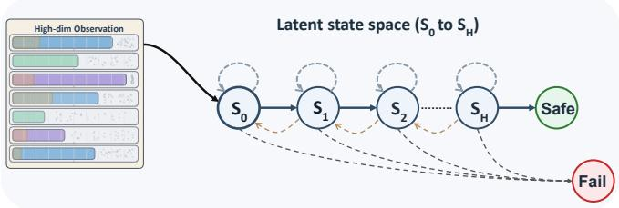
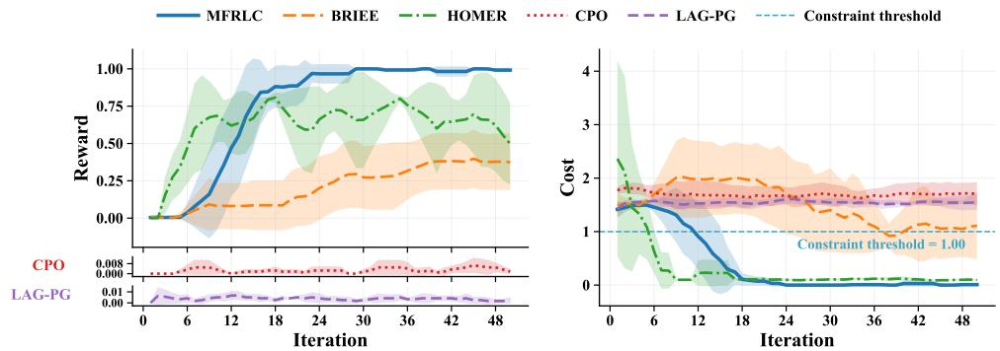

# Provably Efficient Representation Learning for Low-Rank CMDPs

Kaixuan Liu Emory University kaixuan.liu@emory.edu

Guojun Xiong Shanghai Jiao Tong University gjxiong@sjtu.edu.cn

Shengpu Tang Emory University shengpu.tang@emory.edu

Wanyun Si University of Wisconsin-Madison wsi7@wisc.edu

Jian Li Stony Brook University jian.li.3@stonybrook.edu

## Abstract

We study representation learning in low-rank Constrained Markov Decision Processes (CMDPs), where both value and reward functions are approximated by a set of unknown representation vectors, and the transition dynamics admit a low-rank factorization. The objective is to maximize expected cumulative rewards while complying with constraints on the expected cumulative utility. To achieve this, we propose MFRLC (Model-Free Representation Learning for Low-Rank CMDP), a model-free algorithm that uses a primal-dual scheme to effectively balance reward regret and constraint violations. To the best of our knowledge, MFRLC is the first representation-learning method for low-rank CMDPs that combines the Least-Squares Value Iteration with Upper Confidence Bound (LSVI-UCB) and primal-dual techniques. MFRLC further enhances value function estimation with bonuses for function approximation and learns the mapping from representations to value functions directly, avoiding explicit estimation of the transition kernel. We prove that, with high probability, MFRLC achieves ${ \widetilde O } ( K ^ { 3 / 4 } )$ reward regret and cumulative constraint violation over K deployment rounds, independent of the size of the state space. To our knowledge, these are the first sublinear regret and violation guarantees for CMDPs with unknown features.

## 1 Introduction

Safe Reinforcement Learning (SRL) has been widely studied and applied in real-world settings. For example, SRL addresses collision avoidance in autonomous driving [19] and resource allocation in healthcare [28], underscoring its importance in safety-critical domains. To address these challenges, a standard framework for SRL is the Constrained Markov Decision Processes (CMDPs). In a CMDP, the agent learns a policy that maximizes expected cumulative rewards while satisfying specified underlying constraints. Designing efficient learning-based algorithms for CMDPs has attracted considerable attention. Model-based methods [10] learn an explicit CMDP model, but incur substantial storage and computational overhead in large-scale or continuous state spaces. Model-free methods avoid this: tabular variants [26, 8] store value functions directly, while recent works adopt linear function approximation (LFA) to handle large state-action spaces [11], achieving provably near-optimal $\widetilde { \mathcal { O } } ( \bar { K } ^ { 1 / 2 } )$ regret and violation rates.

A central limitation of existing LFA-based methods is the assumption that the underlying features are known a priori [8, 11]. In practice, such features are typically unknown, rendering these methods inapplicable. Meanwhile, the low-rank MDP framework [3] enables representation learning without prior feature knowledge, and provably efficient algorithms exist for the unconstrained setting [29, 17, 15]. However, extending representation learning to CMDPs is non-trivial. In the unconstrained setting, representation learning and policy optimization are largely decoupled; in a CMDP, the learned representation must simultaneously support both reward maximization and constraint satisfaction, and errors in the representation propagate into both objectives in a tightly coupled manner that standard primal-dual analyses cannot accommodate.

Table 1: Comparison with existing work, where d denotes the feature dimension, H the horizon, K the number of deployment rounds, γ the Slater gap, and ε the target suboptimality (the learned policy’s value is within ε of optimal with high probability). Rates hide polylog factors via ${ \widetilde { O } } ( \cdot )$ . LFA denotes linear function approximation; ✗ in the LFA column indicates tabular or non-parametric methods. Bounds stated in terms of ε are PAC sample-complexity guarantees for unconstrained problems and are not directly comparable to regret.
<table><tr><td>Paper</td><td>Model Structure</td><td>LFA</td><td>Constraint</td><td>RepLearn</td><td>Regret / Sample Complexity</td><td>Violation</td></tr><tr><td>Jin et al. [13]</td><td>Linear</td><td>√</td><td>x</td><td>x</td><td> $\widetilde { \cal O } ( d ^ { 3 / 2 } H ^ { 2 } K ^ { 1 / 2 } )$ </td><td> $N / A$ </td></tr><tr><td>Ghosh et al. [11]</td><td>Linear</td><td>√</td><td>√</td><td>x</td><td> $\widetilde { \mathcal { O } } ( { { d ^ { 3 / 2 } H ^ { 2 } K ^ { 1 / 2 } } / \gamma } )$ </td><td> $\widetilde { \mathcal { O } } ( d ^ { 3 / 2 } H ^ { 2 } K ^ { 1 / 2 } / \gamma )$ </td></tr><tr><td>Ding and Lavaei [9]</td><td>Tabular</td><td>x</td><td>√</td><td>x</td><td> $\widetilde { \mathcal { O } } ( d ^ { 2 / 3 } H ^ { 5 / 2 } K ^ { 2 / 3 } / \gamma )$ </td><td> $\widetilde { \mathcal { O } } ( d ^ { 2 / 3 } H ^ { 5 / 2 } K ^ { 2 / 3 } / \gamma )$ </td></tr><tr><td>Zhang et al. [29]</td><td>Block</td><td>√</td><td>x</td><td>√</td><td> $\widetilde { \mathcal { O } } \left( d ^ { 8 } H ^ { 9 } \varepsilon ^ { - 4 } \right)$ </td><td>N/A</td></tr><tr><td>Modi et al. [17]</td><td>Low-rank</td><td>√</td><td>x</td><td>√</td><td> $\widetilde { \mathcal { O } } \bigl ( d ^ { 7 } H ^ { 8 } \varepsilon ^ { - 2 } \bigr )$ </td><td>N/A</td></tr><tr><td>Mhammedi et al. [15]</td><td>Low-rank</td><td>√</td><td>x</td><td>√</td><td> $\widetilde { \mathcal { O } } \bigl ( d ^ { 1 3 } | \mathcal { A } | ^ { 2 } H ^ { 6 } \varepsilon ^ { - 2 } \bigr )$ </td><td>N/A</td></tr><tr><td>This Work</td><td>Low-rank</td><td>√</td><td>√</td><td>√</td><td> $\widetilde { \mathcal O } ( d ^ { 2 } H ^ { 3 } K ^ { 3 / 4 } | \mathcal A | ^ { 3 / 2 } / \gamma )$ </td><td> $\widetilde { \mathcal { O } } ( d ^ { 2 } H ^ { 3 } K ^ { 3 / 4 } | \mathcal { A } | ^ { 3 / 2 } / \gamma )$ </td></tr></table>

In this work, we bring representation learning to low-rank CMDPs and propose MFRLC, which in each round first learns representations via a minimax objective and then fits the value function using the learned features within a primal-dual LSVI-UCB framework. This constitutes the first approach for online low-rank CMDPs with unknown features. We prove that MFRLC achieves the same bound for both cumulative reward regret and cumulative constraint violation: $\widetilde { \mathcal { O } } ( H ^ { 3 } d ^ { 2 } K ^ { 3 / 4 } | \mathcal { A } | ^ { 3 / 2 } / \gamma )$ , where K is the number of deployment rounds, H is the horizon, d is the representation dimension, and $\gamma$ is the Slater gap. The $| \hat { \mathcal { A } } | ^ { 3 / 2 }$ factor arises from uniform exploration over actions in the representation learning step, and the $\dot { K } ^ { 3 / 4 }$ dependence arises from the accumulated statistical error of representation learning (Remark 8). Both bounds are upper bounds. No matching lower bound is known for online low-rank MDPs with unknown features, with or without constraints, so we do not claim that the $K ^ { 3 / 4 }$ rate or the dependence on d, H, and |A| is optimal. Known-feature CMDPs admit $\widetilde { \mathcal { O } } ( K ^ { 1 / 2 } )$ regret and violation [11]; whether this rate is attainable with unknown features remains open.

## 2 Problem Formulation

## 2.1 CMDP Preliminaries

We consider an episodic CMDP $\langle S , \mathcal { A } , H , r , g , \mathbb { P } , d _ { 0 } \rangle$ , where S is the state space (possibly infinite or continuous), A the action space (finite, with cardinality $| { \mathcal { A } } | )$ , H the fixed episode length, $r =$ $\{ r _ { h } \} _ { h = 1 } ^ { H }$ and $g = \{ g _ { h } \} _ { h = - } ^ { H }$ the collections of reward and utility functions, respectively, with $r _ { h } , g _ { h }$ $s \times \mathcal { A } \to [ 0 , 1 ]$ assumed to be deterministic, $\mathbb { P } = \{ P _ { h } \} _ { h = 1 } ^ { H }$ the collection of transition kernels with $P _ { h } ( s _ { h + 1 } \mid s _ { h } , a _ { h } ) : \mathcal { S } \times \mathcal { A } \times \mathcal { S } \to [ 0 , 1 ]$ being the probability of moving to $s _ { h + 1 }$ from $s _ { h }$ under $a _ { h }$ , and $s _ { 1 } ~ \sim ~ d _ { 0 }$ the initial state of each episode. At each step $h \in \ [ H ]$ of round $k \in [ K ]$ , the agent takes action $a _ { b } ^ { k }$ at state $s _ { h } ^ { k }$ , receives reward $r _ { h } ( s _ { h } ^ { k } , a _ { h } ^ { k } )$ and utility ${ \dot { g } } _ { h } ( s _ { h } ^ { k } , a _ { h } ^ { k } )$ and transitions to $s _ { h + 1 } ^ { k } \sim P _ { h } ( \cdot \mid s _ { h } ^ { \bar { k } } , a _ { h } ^ { k } ) ;$ ; each episode terminates after H steps. The policy space is $\Delta ( \boldsymbol { \mathscr { A } } \mid \mathcal { S } , \boldsymbol { H } ) : = \{ \{ \pi _ { h } ( \cdot \ \cdot \ \cdot ) \} _ { h = 1 } ^ { H } : \pi _ { h } ( \cdot \ \cdot \ | \ s ) \in \Delta ( \boldsymbol { \mathscr { A } } ) , \forall s \in \mathcal { S } , \ h \in [ \boldsymbol { H } ] \}$ , where $\Delta ( \mathcal { A } )$ is the probability simplex over the action space; $\pi ^ { k } \in \Delta ( \mathcal { A } | \mathcal { S } , H )$ denotes the policy deployed in round k, with $\pi _ { h } ^ { \bar { k } } ( \cdot \mid \bar { s _ { h } ^ { k } } ) : { \cal S }  \Delta ( { \cal A } )$ specifying the action distribution at $s _ { h } ^ { k }$ . Given $\pi = \{ \pi _ { h } \} _ { h = 1 } ^ { H }$ , the value function (expected cumulative reward from $s _ { h } = s$ under π) and action-value function (from $( s _ { h } = s , a _ { h } = a ) _ { \prime } ^ { \prime }$ ) are:

$$
V _ { r , h } ^ { \pi } ( s ) = \mathbb { E } _ { \pi } \left[ \sum _ { i = h } ^ { H } r _ { i } ( s _ { i } , a _ { i } ) \Big | s _ { h } = s \right] , \qquad Q _ { r , h } ^ { \pi } ( s , a ) = \mathbb { E } _ { \pi } \left[ \sum _ { i = h } ^ { H } r _ { i } ( s _ { i } , a _ { i } ) \Big | s _ { h } = s , a _ { h } = a \right] ,
$$

where the expectation is over $a _ { i } \sim \pi _ { i } ( \cdot \mid s _ { i } )$ and $s _ { i + 1 } \sim P _ { i } ( \cdot \mid s _ { i } , a _ { i } )$ . The utility value and action-value functions $V _ { q , h } ^ { \pi } ( s ) , Q _ { q , h } ^ { \pi } ( s , a )$ are defined analogously by replacing r with $^ { g ; }$ for brevity, we write $V _ { j , h } ^ { \pi } ( s )$ and $Q _ { j , h } ^ { \bar { \pi } } ( s , a )$ for $j \in \{ r , g \}$

We say a policy $\pi$ is feasible if $V _ { q , 1 } ^ { \pi } ( s _ { 1 } ) \geq b$ . The agent aims to learn the optimal feasible policy $\pi ^ { \star }$ by solving the following optimization problem:

$$
\operatorname* { m a x } _ { \pi \in \Delta ( \mathcal { A } | \mathcal { S } , H ) } V _ { r , 1 } ^ { \pi } ( s _ { 1 } ) , \quad \mathrm { s u b j e c t } \mathrm { t o } \quad V _ { g , 1 } ^ { \pi } ( s _ { 1 } ) \geq b ,\tag{1}
$$

where the threshold $b \in [ 0 , H ]$ . Under the online learning setting of an episodic CMDP, the agent interacts with the environment over a sequence of rounds, and the learning performance is measured by regret and constraint violation as follows:

$$
\mathrm { R e g r e t } ( K ) = \sum _ { k = 1 } ^ { K } \left( V _ { r , 1 } ^ { \pi ^ { k } } ( s _ { 1 } ) - V _ { r , 1 } ^ { \pi ^ { k } } ( s _ { 1 } ) \right) , \quad \mathrm { V i o l a t i o n } ( K ) : = \Big ( \sum _ { k = 1 } ^ { K } \big ( b - V _ { g , 1 } ^ { \pi ^ { k } } ( s _ { 1 } ) \big ) \Big ) _ { + } ,
$$

with $\pi ^ { k }$ being the policy deployed in round k. Both quantities are random variables depending on the algorithm’s internal randomness and the sampled trajectories; our guarantees on them hold with high probability (see Theorem 3). The regret quantifies the difference in total rewards achieved by the agent’s policy $\pi ^ { k }$ compared to the optimal feasible policy $\pi ^ { \star }$ across $K$ rounds, and the constraint violation measures the cumulative shortfall of utility against the predefined threshold b over K rounds.

Access model and interaction accounting. We call each index k a deployment round. In round $k ,$ MFRLC executes $\pi ^ { k }$ for one trajectory and also collects two auxiliary transitions at every step $h$ for representation learning (Algorithm 1, line 4), each obtained by rolling in with $\pi ^ { k - 1 }$ to step $h$ and taking a uniform action, so no generative model is required. Regret and Violation contain one term per deployed policy and do not charge the auxiliary roll-ins; our guarantees are deployment-regret guarantees with total interaction complexity $K ( 2 H + 1 )$ trajectories and $K ( H ^ { 2 } + \dot { 2 } H )$ transitions.

## 2.2 Low-Rank MDP and Representation Learning

Conventional work on learning MDPs typically assumes a general linear MDP framework [13, 14, 5], where features are considered known, and function approximation methods are used to maximize rewards without considering constraints. While this linear MDP assumption has been effectively extended to CMDPs [4, 12], the transition to low-rank MDPs introduces additional layers of complexity, defined as follows.

Definition 1 (Low-rank MDP [3]). Consider a transition kernel $P _ { h } ^ { \star } : \mathcal { S } \times \mathcal { A }  \Delta ( \mathcal { S } )$ which can be decomposed into low-rank components of dimension $d \in$ N. Specifically, there exist functions $\phi ^ { \star } = \{ \phi _ { h } ^ { \star } \} _ { h = 1 } ^ { H }$ and $\mu ^ { \star } = \{ \mu _ { h } ^ { \star } \} _ { h = 1 } ^ { H }$ with $\phi _ { h } ^ { \star } : \mathcal { S } \times \mathcal { A }  \mathbb { R } ^ { d }$ and $\mathbf { \Delta } ^ { \star } \mu _ { h } ^ { \star } : \mathcal { S } \stackrel { \cdot } {  } \mathbb { R } ^ { d }$ , such that for all $s , s ^ { \prime } \in \mathcal { S } , a \in \mathcal { A }$ , and $h \in [ \bar { H } ] \backslash$

$$
P _ { h } ^ { \star } ( s ^ { \prime } \mid s , a ) = \langle \phi _ { h } ^ { \star } ( s , a ) , \mu _ { h } ^ { \star } ( s ^ { \prime } ) \rangle .
$$

Furthermore, there exist vectors $\theta _ { r , h } ^ { \star } , \theta _ { g , h } ^ { \star } \in \mathbb { R } ^ { d }$ such that for any $( s , a ) \in S \times A { \mathrm { : } }$

$$
\begin{array} { r } { r _ { h } ( s , a ) = \langle \phi _ { h } ^ { \star } ( s , a ) , \theta _ { r , h } ^ { \star } \rangle , \quad g _ { h } ( s , a ) = \langle \phi _ { h } ^ { \star } ( s , a ) , \theta _ { g , h } ^ { \star } \rangle . } \end{array}
$$

The feature function satisfies $\| \phi _ { h } ^ { \star } ( s , a ) \| _ { 2 } \leq 1$ for all state-action pairs $( s , a )$ , and for any function $f : S  [ 0 , 1 ] ,   \int \mu _ { h } ^ { \star } ( s ) f ( s ) \mathrm { d } s   _ { \ L _ { 2 } } \leq \sqrt { d } .$ . An MDP M is considered low-rank if the transition kernel $P _ { h }$ at each time step $h \in [ H ]$ admits such a decomposition.

Under the low-rank setting, the feature representations $\phi ^ { \star }$ are no longer presumed known. This necessitates the development of algorithms that are not only capable of learning these features but also ensure that the resulting policy adheres to the constraints imposed by the CMDP framework.

Assumption 1 (Realizable feature class). The learner has access to a finite feature class $\Phi =$ $\Phi _ { 1 } \times \cdots \times \Phi _ { H }$ , where each $\phi _ { h } \in \Phi _ { h }$ maps $S \times \mathcal { A } t o \mathbb { R } ^ { d }$ with $\| \phi _ { h } ( s , a ) \| _ { 2 } \leq 1 \dot { f } o r a l l \left( s , a \right)$ , and Φ contains the true representation of Definition 1, that is, $\phi ^ { \star } \in \Phi$

Assumption 1 is the standard setting of model-free representation learning in low-rank MDPs [3, 17]. Finiteness enters only through log $\left| \Phi \right|$ and can be replaced by a covering number, while realizability is exact: misspecified classes with $\phi ^ { \star } \notin \Phi$ are outside our guarantees. Requiring the utility, like the reward, to be linear in $\phi ^ { \star }$ is the natural CMDP counterpart of the low-rank MDP assumption; it is structural and does not cover reward or utility functions unrelated to the low-rank dynamics. We do not assume any map from representations to policies recovers $\pi ^ { \star }$ : the analysis compares directly against an arbitrary optimal feasible policy of (1). Importantly, we adopt a model-free approach in which the policy is learned without explicitly modeling the environment, and there is no need to recover the exact values of $\mu ^ { \star }$ or $\theta ^ { \star }$

Algorithm 1 Model-Free Representation Learning with Low-rank CMDP (MFRLC)   
Require: Feature classes $\{ \Phi _ { h } \} _ { h = 1 } ^ { H } ,$ regularization $\lambda _ { k } .$ , Slater parameter $\gamma > 0$   
Output: Sequence of policies $\{ \pi ^ { k } \} _ { k = 1 } ^ { K }$   
1: Initialize: $Y _ { 1 } = 0 , \xi = 2 H / \gamma , \eta = \xi / \sqrt { K H ^ { 2 } } ;$ set $\pi ^ { 0 }$ to any reference policy and replay buffers   
$\mathcal { D } _ { h } = \emptyset , \mathcal { D } _ { h } ^ { \prime } = \emptyset$ for all $h \in [ \dot { H } ]$   
2: for $k = 1$ to K do   
3: for $h = 1$ to H do ▷ Exploration: branching from $d _ { h } ^ { \pi ^ { k - 1 } }$   
4: Sample $s _ { h } ^ { k } \sim d _ { h } ^ { \pi ^ { k - 1 } } , \tilde { a } _ { h } ^ { k } \sim U ( A ) , s _ { h + 1 } ^ { k } \sim P _ { h } ^ { \star } ( \cdot \mid s _ { h } ^ { k } , \tilde { a } _ { h } ^ { k } ) , \tilde { s } \sim d _ { h } ^ { \pi ^ { k - 1 } } , \tilde { a } \sim U ( A )$   
$\tilde { s } ^ { \prime } \sim P _ { h } ^ { \star } ( \cdot \mid \tilde { s } , \tilde { a } )$   
5: $\mathcal { D } _ { h } \gets \mathcal { D } _ { h } \cup \{ ( s _ { h } ^ { k } , \tilde { a } _ { h } ^ { k } , s _ { h + 1 } ^ { k } ) \} , ~ \mathcal { D } _ { h } ^ { \prime } \gets \mathcal { D } _ { h } ^ { \prime } \cup \{ ( \tilde { s } , \tilde { a } , \tilde { s } ^ { \prime } ) \}$   
6: $\hat { \phi } _ { h } ^ { k } \gets \mathrm { R E P L E A R N } \big ( \mathcal { D } _ { h } , \mathcal { D } _ { h } ^ { \prime } , \Phi _ { h } , \lambda _ { k } \big )$ ▷ Algorithm 2   
7: end for   
8: $\{ Q _ { j , h } ^ { k } , V _ { j , h } ^ { k } \} _ { j \in \{ r , g \} , h \in [ H ] } , \{ \pi _ { h } ^ { k } \} _ { h = 1 } ^ { H }  \mathrm { L S V I - U C B } ($   
$\{ ( s _ { h } ^ { \tau } , \tilde { a } _ { h } ^ { \tau } , r _ { h } ^ { \tau } , g _ { h } ^ { \tau } , s _ { h + 1 } ^ { \tau } , \hat { \phi } _ { h } ^ { \tau } ) \} _ { h \in [ H ] , \tau \leq k } , Y _ { k } )$   
9: for $h = 1$ to H do ▷ Execute $\pi ^ { k }$ for next-episode trunk   
10: Take $a _ { h } ^ { k } \sim \pi _ { h } ^ { k } ( \cdot \mid s _ { h } ^ { k } )$ and observe $s _ { h + 1 } ^ { k }$   
11: end for   
12: $Y _ { k + 1 } \gets \operatorname* { m a x } \{ \operatorname* { m i n } \{ Y _ { k } + \eta ( b - V _ { g , 1 } ^ { k } ( s _ { 1 } ) ) , \xi \} , 0 \}$ ▷ Primal–dual update   
13: end for

## 3 Representation Learning for Low-Rank CMDPs

In this section, we address the challenge of model-free representation learning within low-rank CMDPs. Our algorithm, MFRLC (Algorithm 1), builds on the Upper Confidence Bound (UCB) variant of Least-Squares Value Iteration (LSVI) and utilizes a primal–dual approach to effectively manage the $\mathrm { C M D P _ { S } ^ { \bullet } }$ optimization requirements.

Before delving into the details of the algorithm, it is helpful to introduce the composite (Lagrangian) value function, which encodes the reward–constraint trade-off into a single scalar objective.

Definition 2 (Composite value function; cf. 20, 8). For any dual variable $Y \geq 0$ and policy π, define the composite value function and action-value function as

$$
\begin{array} { r } { V _ { h } ^ { \pi , Y } ( \cdot ) = V _ { r , h } ^ { \pi } ( \cdot ) + Y V _ { g , h } ^ { \pi } ( \cdot ) , \quad Q _ { h } ^ { \pi , Y } ( s , a ) = Q _ { r , h } ^ { \pi } ( s , a ) + Y Q _ { g , h } ^ { \pi } ( s , a ) . } \end{array}
$$

Equivalently, $V _ { h } ^ { \pi , Y }$ and $Q _ { h } ^ { \pi , Y }$ are the value and action-value functions of policy π in the auxiliary MDP whose stage reward is the Lagrangian $r _ { h } + Y g _ { h }$

We operate on the composite values $( V _ { h } ^ { \pi , Y } , Q _ { h } ^ { \pi , Y } )$ throughout the analysis, with Y instantiated to the dual iterate $Y _ { k }$ at round k. Algorithm 3 adds the same per-objective bonus $\hat { b } _ { h }$ to both $Q _ { r , h } ^ { k }$ and $Q _ { g , h } ^ { k } ,$ so the composite optimism bonus is $\hat { b } _ { h } ^ { ( k ) } : = ( 1 + Y _ { k } ) \hat { b } _ { h }$

## 3.1 Algorithm Overview

MFRLC alternates three steps in each round. Representation Learning (lines 4–6) samples under $d _ { h } ^ { \pi ^ { k - 1 } }$ with kernel $P _ { h } ^ { \star }$ , stores data in replay buffers $\mathcal { D } _ { h } , \mathcal { D } _ { h } ^ { \prime }$ , and learns $\hat { \phi } _ { h } ^ { k } \in \Phi _ { h }$ via a minimax game against a discriminator $v \in \mathcal V _ { h }$ , controlled by the regularizer $\lambda _ { k }$ , iteration cap M, and stopping threshold $\ell _ { k }$ . Policy Update (line 8) takes $\hat { \phi } ^ { k }$ and $Y _ { k }$ and runs LSVI-UCB (Algorithm 3, Appendix A)

Algorithm 2 Representation Learning (REPLEARN)   
Require: Feature class $\Phi _ { h }$ , datasets $\mathcal { D } _ { h } , \mathcal { D } _ { h } ^ { \prime }$ , discriminator class $\nu _ { h }$ , regularization $\lambda _ { k } .$ , iterations $M$   
threshold $\ell _ { k }$ , confidence δ, dimension d.   
Output: Representation $\hat { \phi } _ { h } ^ { k }$   
1: Parameters: $\begin{array} { r } { \lambda _ { k } = O \Big ( d \ln \frac { | \Phi | k } { \delta } \Big ) , \ell _ { k } = O \bigg ( d ^ { 2 } \sqrt { \frac { \ln ( | \Phi | / \delta ) } { k } } \bigg ) } \end{array}$   
2: Notation: $\mathcal { L } _ { \lambda _ { k } , \mathcal { D } } ( \phi , w , v )$ is the empirical objective (6) over buffer $\mathcal { D } ;$ w (and w˜) are predictor   
weights for feature $\dot { \phi } ; \dot { v } \stackrel { \prime } { ( v ^ { m } ) } \in \mathcal { V } _ { h }$ is the discriminator (at step m).   
3: Initialize: $\phi ^ { 0 } \in \Phi _ { h }$ arbitrarily   
4: for $m = 0$ to $M - 1$ do   
5: Compute worst-case discriminator with bias correction:   
6: $v ^ { m } \gets$ arg max $\Big [ \operatorname* { m i n } _ { \boldsymbol { w } } \mathcal { L } _ { \lambda _ { k } , \mathcal { D } _ { h } } ( \phi ^ { m } , \boldsymbol { w } , \boldsymbol { v } ) - \operatorname* { m i n } _ { \tilde { \boldsymbol { w } } } \mathcal { L } _ { \lambda _ { k } , \mathcal { D } _ { h } ^ { \prime } } ( \tilde { \phi } , \tilde { \boldsymbol { w } } , \boldsymbol { v } ) \Big ]$   
$v \in \mathcal { V } _ { h } , \tilde { \phi } \in \Phi _ { h }$   
7: if the maximization objective at $v ^ { m }$ is at most $\ell _ { k }$ then   
8: Break and Return $\phi ^ { m }$   
9: end if   
10: Update representation jointly against past discriminators:   
11: $\phi ^ { m + 1 } \gets$ arg min $\sum ^ { m } \mathcal { L } _ { \lambda _ { k } , D _ { h } } ( \phi , w _ { i } , v ^ { i } )$   
ϕ∈ $\mathbb { \Phi } _ { h } , \{ w _ { i } \} _ { i = 0 } ^ { m }$ i=0   
12: end for

to produce optimistic per-objective estimates $\{ Q _ { r , h } ^ { k } , Q _ { g , h } ^ { k } , V _ { r , h } ^ { k } , V _ { g , h } ^ { k } \}$ and the softmax policy

$$
\pi _ { h } ^ { k } ( a \mid \cdot ) \ = \ \mathrm { s o f t m a x } _ { \alpha } \bigl ( Q _ { r , h } ^ { k } ( \cdot , a ) + Y _ { k } Q _ { g , h } ^ { k } ( \cdot , a ) \bigr ) \ ,\tag{2}
$$

where $Y _ { k }$ enforces the constraint while reward is maximized. Primal–Dual Update (line 12) updates $Y _ { k }$ using the optimistic value $V _ { g , 1 } ^ { k } ( s _ { 1 } )$ in place of $V _ { g , 1 } ^ { \pi ^ { k } } ( s _ { 1 } )$ , based on the observed constraint slack, and carries it into the next round.

Representation Learning In the context of low-rank MDPs, where $\phi ^ { \star }$ is unknown, we must learn this representation. Inspired by Zhang et al. [29], we define $\mathcal { V } _ { h } = \mathcal { F } _ { h } \cup \mathcal { G } _ { h }$ , where $\mathcal { F } _ { h }$ captures the model-mismatch between $\hat { P }$ and $P ^ { \star }$ under the previous-episode policy $\pi ^ { k - 1 }$ (Lemma 2) and $\mathcal { G } _ { h }$ captures the composite Q-function (Lemma 3):

$$
\begin{array} { r } { \mathcal { F } _ { h } : = \Big \{ s \mapsto \mathbb { E } _ { a \sim \pi _ { h } ^ { k - 1 } ( \cdot | s ) } [ \langle \phi ( s , a ) , \theta \rangle - \langle \phi ^ { \prime } ( s , a ) , \theta ^ { \prime } \rangle ] : \phi , \phi ^ { \prime } \in \Phi _ { h + 1 } , \operatorname* { m a x } ( \| \theta \| _ { \infty } , \| \theta ^ { \prime } \| _ { \infty } ) \leq 1 \Big \} , } \end{array}\tag{3}
$$

$$
\mathcal { G } _ { h } : = \Bigg \{ s \mapsto \operatorname* { m a x } _ { a \in \mathcal { A } } \Bigg ( \frac { r _ { h + 1 } ( s , a ) + g _ { h + 1 } ( s , a ) + \operatorname* { m i n } \{ \langle \phi ( s , a ) , w \rangle , 2 \} } { 2 H + 1 } + \langle \phi ( s , a ) , w ^ { \prime } \rangle \Bigg ) \Bigg \} ,\tag{4}
$$

where the set ranges over $\phi \in \Phi _ { h + 1 } , \| w \| _ { \infty } \leq c , \| w ^ { \prime } \| _ { \infty } \leq 1$ . Reward and utility enter the representation objective through $\mathcal { G } _ { h }$ , which contains $r _ { h + 1 } + g _ { h + 1 } ;$ our guarantee requires no separate supervised loss on the immediate reward or utility.

To learn $\phi ^ { \star }$ , we solve the following optimization problem, where $\rho _ { h } ^ { k }$ denotes the sampling distribution induced by the replay buffer $\mathcal { D } _ { h }$ at the start of episode k:

$$
\arg \operatorname* { m i n } _ { \phi _ { h } ^ { k } } \operatorname* { m a x } _ { v \in \mathcal { V } _ { h } } \operatorname* { m i n } _ { w } \mathbb { E } _ { ( s , \tilde { a } ) \sim \rho _ { h } ^ { k } } \Big [ \big ( \langle \phi _ { h } ^ { k } ( s , \tilde { a } ) , w \rangle - \mathbb { E } _ { s ^ { \prime } \sim P _ { h } ^ { \star } ( \cdot \vert s , \tilde { a } ) } [ v ( s ^ { \prime } ) ] \big ) ^ { 2 } \Big ] .\tag{5}
$$

This objective seeks a feature ϕ that accurately approximates the Bellman backup $\mathbb { E } [ v ( s ^ { \prime } ) | s , \tilde { a } ]$ as a linear function $\langle \phi ( s , \tilde { a } ) , w \rangle$ , uniformly over $v \in \mathcal V _ { h }$ . The min-max-min structure ensures robustness: the inner min $_ { - w }$ is a regularized least-squares problem with a closed-form solution (Appendix $\mathrm { C } ,$ complexity $\bar { \mathcal { O } } ( n d ^ { 2 } + \bar { d } ^ { 3 } ) )$ ; the middle maxv identifies the worst-case $v \in \mathcal V _ { h }$ for the current ϕ; the outer $\operatorname* { m i n } _ { \phi _ { h } ^ { k } }$ chooses the representation minimizing this worst-case error [17]. The non-linear softmax operator and UCB bonus appearing in the LSVI-UCB output (Algorithm 3) are not contained in ${ \mathcal { G } } _ { h } ;$ their contribution is handled separately via the softmax sub-optimality bound (Lemma 12) and the elliptical-potential argument applied to the bonus term (Appendix F).

Since (5) involves a population expectation, direct implementation is challenging. We replace it by its sample-based counterpart over $\mathcal { D } _ { h }$

$$
\begin{array} { r } { \mathcal { L } _ { \lambda _ { k } , \mathcal { D } _ { h } } ( \phi _ { h } ^ { k } , v , w ) = \mathbb { E } _ { \mathcal { D } _ { h } } \Big [ \big ( \langle \phi _ { h } ^ { k } ( s , \tilde { a } ) , w \rangle - v ( s ^ { \prime } ) \big ) ^ { 2 } \Big ] + \lambda _ { k } \| w \| _ { 2 } ^ { 2 } . } \end{array}\tag{6}
$$

Because $\mathcal { L } _ { \lambda _ { k } , \mathcal { D } _ { h } }$ contains a conditional-variance term that depends on v, maximizing it directly would favor high-variance discriminators. Algorithm 2 cancels this term in expectation by subtracting the minimized loss $\mathcal { L } _ { \lambda _ { k } , \mathcal { D } _ { h } ^ { \prime } } ( \tilde { \phi } , \tilde { w } , v )$ on the independent buffer $\mathcal { D } _ { h } ^ { \prime }$ (Appendix C).

From theory to implementation We distinguish three levels of the representation-learning step:

objective (5) −→ bias-corrected REPLEARN (Algorithm 2) −→ contrastive EMA surrogate.

Theorem 3 covers the first two levels. The experiments in Section 5 use the third: the minimax search over $\nu _ { h }$ is replaced by contrastive next-state prediction with an exponential-moving-average (EMA) target encoder. The surrogate uses the same transition triples $( s , \tilde { a } , s ^ { \prime } )$ to learn predictive features, but it does not perform the worst-case discriminator search and does not certify uniform Bellman prediction over $\nu _ { h }$ , so it is not covered by Theorem 3.

Computation The inner minimization over w is ridge regression with cost $O ( n d ^ { 2 } + d ^ { 3 } )$ ; the outer problems over $\phi$ and v are treated as optimization oracles, exactly solvable for finite classes but without a polynomial-time guarantee for neural classes (Appendix C.5).

Policy Update Given $\hat { \phi } ^ { k }$ and $Y _ { k } ,$ , the LSVI-UCB subroutine (Algorithm 3, Appendix A) computes optimistic estimates $Q _ { j , h } ^ { k } , V _ { j , h } ^ { k }$ for $j \in \{ r , g \}$ and the softmax policy (2). The executed policy $\pi ^ { k }$ is defined directly as this optimistic softmax policy computed from $\hat { \phi } ^ { k }$ and $Y _ { k }$ . The composite $Q _ { r , h } ^ { k } + Y _ { k } Q _ { g , h } ^ { k }$ is the LSVI-UCB optimistic estimate of the Bellman-optimal $Q$ for the auxiliary MDP with stage reward $r _ { h } + Y _ { k } g _ { h }$ (cf. Definition 2), with $Y _ { k }$ updated online in the next step.

Dual Update Problem (1) admits the Lagrangian formulation:

$$
\operatorname* { m a x } _ { \pi \in \Delta ( \mathcal { A } | \mathcal { S } , H ) } \operatorname* { m i n } _ { Y \in [ 0 , \xi ] } V _ { r , 1 } ^ { \pi } ( s _ { 1 } ) + Y \big ( V _ { g , 1 } ^ { \pi } ( s _ { 1 } ) - b \big ) ,\tag{7}
$$

where $\xi = 2 H / \gamma$ is chosen so that $Y ^ { \star } \in [ 0 , \xi ]$ (Lemma 1); restricting Y to $[ 0 , \xi ]$ does not affect the saddle-point value. MFRLC does not solve (7) over π directly. In round k, the primal step is the optimistic LSVI-UCB policy $\pi ^ { k }$ for the Lagrangian reward $r _ { h } + Y _ { k } g _ { h }$ , and the dual step is the projected update:

$$
{ \cal Y } _ { k + 1 } = \operatorname * { m a x } \{ \operatorname * { m i n } \{ { \cal Y } _ { k } + \eta ( b - V _ { g , 1 } ^ { k } ( s _ { 1 } ) ) , \xi \} , 0 \} ,\tag{8}
$$

which uses the optimistic estimate $V _ { g , 1 } ^ { k } ( s _ { 1 } )$ in place of $V _ { g , 1 } ^ { \pi ^ { k } } ( s _ { 1 } )$ . The update direction switches with the sign of $b - V _ { g , 1 } ^ { k } ( s _ { 1 } )$ , balancing reward maximization against feasibility [10, 18].

## 4 Main Results

Assumption 2 (Slater’s Condition). There exists $\gamma > 0$ and a policy $\bar { \pi } \in \Delta ( \mathcal { A } \mid \mathcal { S } , H )$ such that $V _ { g , 1 } ^ { \bar { \pi } } ( s _ { 1 } ) \geq b + \gamma$

Lemma 1 (Boundedness of $Y ^ { \star } )$ . The optimal dual variable $Y ^ { \star }$ associated with (1) satisfies $Y ^ { \star } \leq$ $( V _ { r , 1 } ^ { \pi ^ { \star } } ( s _ { 1 } ) - V _ { r , 1 } ^ { \bar { \pi } } ( s _ { 1 } ) ) / \gamma \le H / \gamma , s o \xi = 2 H / \gamma \ge 2 Y ^ { \star }$ as required by Lemma 21.

The Slater condition is mild and widely adopted [20, 8, 10].

Theorem 3. $F i x p \in ( 0 , 1 )$ . Under Assumptions 1–2, with probability at least $1 - p ,$ , the regret and constraint violation of MFRLC over K deployment rounds both satisfy:

$$
\mathrm { R e g r e t } ( K ) , \mathrm { V i o l a t i o n } ( K ) \le \frac { C } { \gamma } H ^ { 3 } d ^ { 2 } K ^ { 3 / 4 } | A | ^ { 3 / 2 } \log ^ { 1 / 4 } \left( \frac { d K | \Phi | } { p } \right) ,
$$

for an absolute constant $C > 0 .$ . Over the K rounds, MFRLC uses $K ( 2 H + 1 )$ trajectories in total, including the auxiliary roll-ins of representation learning, whose rewards and utilities are not charged to Regret or Violation (Section 2).

≤

The dependence on $1 / \gamma$ is the standard Slater-gap penalty of primal–dual CMDP analyses [7, 8, 11]. The bound is independent of $| S |$ and applies to continuous state spaces. The $K ^ { 3 / 4 }$ term arises only from the representation-learning error (Remark 8 in Appendix H). Theorem 3 is an upper bound: we prove no matching lower bound, and the optimal dependence on $K , d , H$ , and $| { \cal A } |$ remains open.

## 4.1 Proof Sketch

Step 1: Decomposition of regret and violation. For any $Y \in [ 0 , \xi ]$ , by combining a Lagrangian shift with the projected dual update of Algorithm 1 (Appendix E), we obtain:

$$
\begin{array} { r l } & { \displaystyle \sum _ { k = 1 } ^ { K } \bigl ( V _ { r , 1 } ^ { \pi ^ { \star } } ( s _ { 1 } ) - V _ { r , 1 } ^ { \pi ^ { k } } ( s _ { 1 } ) \bigr ) + Y \displaystyle \sum _ { k = 1 } ^ { K } \bigl ( b - V _ { g , 1 } ^ { \pi ^ { k } } ( s _ { 1 } ) \bigr ) \leq \frac { Y ^ { 2 } } { 2 \eta } + \frac { \eta H ^ { 2 } K } { 2 } } \\ & { \quad + \displaystyle \sum _ { k = 1 } ^ { K } \Bigl [ \bigl ( V _ { r , 1 } ^ { \pi ^ { \star } } ( s _ { 1 } ) + Y _ { k } V _ { g , 1 } ^ { \pi ^ { \star } } ( s _ { 1 } ) \bigr ) - \bigl ( V _ { r , 1 } ^ { k } ( s _ { 1 } ) + Y _ { k } V _ { g , 1 } ^ { k } ( s _ { 1 } ) \bigr ) \Bigr ] } \\ & { \qquad \mathrm { P s e u d o r e g e t } } \\ & { \quad + \displaystyle \sum _ { k = 1 } ^ { K } \Bigl [ \bigl ( V _ { r , 1 } ^ { k } ( s _ { 1 } ) - V _ { r , 1 } ^ { \pi ^ { k } } ( s _ { 1 } ) \bigr ) + Y \bigl ( V _ { g , 1 } ^ { k } ( s _ { 1 } ) - V _ { g , 1 } ^ { \pi ^ { k } } ( s _ { 1 } ) \bigr ) \Bigr ] . } \end{array}\tag{9}
$$

Here $Y$ is a free variable that combines reward regret and constraint violation: setting $Y = 0$ recovers the regret bound, while $Y = \xi$ (combined with strong duality) yields the violation bound. By feasibility of $\pi ^ { \star }$ , the Lagrangian-shift slack term $\begin{array} { r } { \sum _ { k } Y _ { k } ( b - V _ { g , 1 } ^ { \pi ^ { \star } } ( s _ { 1 } ) ) \le 0 } \end{array}$ is non-positive and dropped. The Pseudo regret captures the gap between $\pi ^ { \star }$ and the LSVI-UCB optimistic estimate $V ^ { k }$ while the Estimation error captures the gap between $V ^ { k }$ and the executed policy’s value $V ^ { \pi ^ { k } }$ . We control the two terms separately.

Step 2: Bounding the Pseudo regret. Since $\pi ^ { k }$ is the softmax of the composite $Q _ { r , h } ^ { k } + Y _ { k } Q _ { g , h } ^ { k } .$ the analysis must be carried out on the auxiliary MDP with stage reward $\bar { r } _ { h } ^ { ( k ) }$ . We first establish composite optimism on the planning model Pˆk induced by $\hat { P } ^ { k }$ $\hat { \phi } ^ { k }$

Lemma 2 (Composite optimism). Conditioned on the Representation Learning guarantee (Lemma 16), with probability $1 - \delta ,$ ,for every round k $\in [ K ]$

$$
Q _ { \hat { P } ^ { k } , \bar { r } ^ { ( k ) } + \hat { b } ^ { ( k ) } } ^ { \pi ^ { \star } , Y _ { k } } ( s _ { 1 } , \cdot ) - Q _ { P ^ { \star } , \bar { r } ^ { ( k ) } } ^ { \pi ^ { \star } , Y _ { k } } ( s _ { 1 } , \cdot ) \geq - ( 1 + Y _ { k } ) \sqrt { | { \cal A } | \zeta _ { k } } ,
$$

where $\zeta _ { k } = \widetilde { O } ( d ^ { 2 } / \sqrt { k } )$ is the RepLearn statistical error.

Lemma 3 (Composite policy gap, cumulative form). Conditioned on the Representation Learning guarantee, with probability $\bar { 1 } - \bar { \delta } _ { \bar { } }$

$$
\sum _ { k = 1 } ^ { K } \Bigl [ Q _ { P ^ { \star } , \bar { r } ^ { ( k ) } } ^ { \pi ^ { \star } , Y _ { k } } ( s _ { 1 } , \cdot ) - Q _ { P ^ { \star } , \bar { r } ^ { ( k ) } } ^ { \pi ^ { k } , Y _ { k } } ( s _ { 1 } , \cdot ) \Bigr ] \ \le \ \frac { K H \log | \mathcal { A } | } { \alpha } + ( 1 + \xi ) \sum _ { k = 1 } ^ { K } \epsilon _ { k } ,
$$

where the cumulative representation error satisfies $C H ^ { 2 } d ^ { 2 } K ^ { 3 / 4 } | A | ^ { 3 / 2 } \log ^ { 1 / 4 } ( d K | \Phi | / \delta )$

Remark 1 (On the per-episode rate). The cumulative bound on $\scriptstyle \sum _ { k }$ ϵk corresponds to an average per-episode rate $\begin{array} { r } { \bar { \epsilon } _ { K } = \frac { 1 } { K } \sum _ { k } \epsilon _ { k } = \widetilde { O } ( K ^ { - 1 / 4 } ) } \end{array}$ . We state the cumulativeform because the ellipticalpotential argument in Appendix F directly yields a sum, and only this sum is needed downstream.

The proof of Lemma 3 combines composite optimism (Lemma 2), a softmax sub-optimality bound for the composite planning problem, and the simulation lemma. The $( 1 + Y _ { k } )$ factor arises because both $\bar { r } _ { h } ^ { ( k ) } \in [ 0 , 1 + Y _ { k } ]$ and $\hat { b } _ { h } ^ { ( k ) } = ( 1 + Y _ { k } ) \hat { b } _ { h }$ scale linearly in $1 + Y _ { k } ;$ using $Y _ { k } \le \xi$ , this factor is bounded by $1 + \xi ,$ , contributing the $1 / \gamma$ dependence.

Combining Lemma 3 with the $\mathrm { V - Q }$ identity $\begin{array} { r } { V _ { j , 1 } ^ { k } ( s _ { 1 } ) = \sum _ { a } \pi _ { 1 } ^ { k } ( a \mid s _ { 1 } ) Q _ { j , 1 } ^ { k } ( s _ { 1 } , a ) } \end{array}$ and a performancedifference argument on $P ^ { \star }$ (Appendix F):

Lemma 4 (Pseudo regret). Conditioned on the Representation Learning guarantee, with probability $1 - p / 4$

$$
\begin{array} { r } { \displaystyle \sum _ { k = 1 } ^ { K } \Bigl [ \bigl ( V _ { r , 1 } ^ { \pi ^ { \star } } ( s _ { 1 } ) + Y _ { k } V _ { g , 1 } ^ { \pi ^ { \star } } ( s _ { 1 } ) \bigr ) - \bigl ( V _ { r , 1 } ^ { k } ( s _ { 1 } ) + Y _ { k } V _ { g , 1 } ^ { k } ( s _ { 1 } ) \bigr ) \Bigr ] \ \leq \ \frac { K H \log | \boldsymbol { A } | } { \alpha } + ( 1 + \xi ) \displaystyle \sum _ { k = 1 } ^ { K } \epsilon _ { k } . } \end{array}
$$

Step 3: Bounding the Estimation error. The estimation error compares the LSVI-UCB optimistic estimate $V _ { j , 1 } ^ { k }$ to the true value $V _ { j , 1 } ^ { \pi ^ { k } }$ of the executed policy. The starting point is a self-normalized concentration bound for the empirical Bellman residual.

Lemma 5 (Concentration of empirical Bellman residual). Adapting the self-normalized concentration ofGhosh et al. $I I I { \big . }$ to the learned-feature setting via a covering argument over the optimistic valuefunction class, there exists a constant $C _ { 2 }$ such thatfor any $p \in ( 0 , \bar { 1 } )$ , the event:

$$
\mathcal { E } : = \bigcap _ { k \in [ K ] , h \in [ H ] , j \in \{ r , g \} } \left\{ \Big \Vert \sum _ { \tau = 1 } ^ { k - 1 } \hat { \phi } _ { h } ^ { \tau } ( V _ { j , h + 1 } ^ { k } ( s _ { h + 1 } ^ { \tau } ) - \mathbb { P } _ { h } V _ { j , h + 1 } ^ { k } ( s _ { h } ^ { \tau } , \tilde { a } _ { h } ^ { \tau } ) ) \Big \Vert _ { ( \Sigma _ { h } ^ { k } ) ^ { - 1 } } \leq C _ { 2 } d H \sqrt { \chi } \right\}
$$

holds with $\chi = \log \left( 4 ( C _ { 1 } + 1 ) \log | A | d T | \Phi | / p \right)$ , and $\operatorname* { P r } ( \mathcal { E } ) \geq 1 - p / 4$

Remark 2 (From fixed to learned features). Ghosh et al. $I I I { }$ states this concentrationfor afixed feature map. Here both $\hat { \phi } _ { h } ^ { \tau }$ and $V _ { j , h + 1 } ^ { k }$ are data-dependent, so we cover the optimistic value-function class (parameterized by $\hat { \phi } \in \Phi$ and bounded LSVI weights), which contributes the log |Φ| factor inside $\chi .$ The detailed argument is deferred to Appendix G.

We then control the per-step gap between $Q _ { j , h } ^ { k }$ (the LSVI-UCB optimistic estimate) and $Q _ { j , h } ^ { \pi ^ { k } }$ (the true action-value of the executed policy). The key technical step is showing that both quantities admit linear approximations in the learned features $\hat { \phi } ^ { k } \colon Q _ { j , h } ^ { k }$ by construction, since the LSVI-UCB output is explicitly linear in $\hat { \phi } ^ { k }$ ; and $Q _ { j , h } ^ { \pi ^ { k } }$ via the RepLearn guarantee, which ensures $\hat { \phi } ^ { k }$ approximately spans the Bellman backups of any function in $\nu _ { h }$

Lemma 6 (Per-step backup error). Set $\beta = C _ { 1 } d H \sqrt { \iota }$ with $\iota = \log ( \log | \boldsymbol { \mathcal { A } } | \cdot 4 d T | \Phi | / p )$ . On the event $\mathcal { E } ,$ for every round $k \in [ K ]$ , step $h \in [ H ] , j \in \{ r , g \}$ , and $( s , a ) \in S \times A ,$ , there exist weights $\boldsymbol { w _ { j , h } ^ { \pi ^ { k } } }$ approximately projecting $Q _ { j , h } ^ { \pi ^ { k } }$ onto span $\big ( \hat { \phi } _ { h } ^ { k } \big )$ such that:

$$
\begin{array} { r } { Q _ { j , h } ^ { k } ( s , a ) - Q _ { j , h } ^ { \pi ^ { k } } ( s , a ) = \mathbb E _ { s ^ { \prime } \sim P _ { h } ^ { \star } ( \cdot \vert s , a ) } \Big [ V _ { j , h + 1 } ^ { k } ( s ^ { \prime } ) - V _ { j , h + 1 } ^ { \pi ^ { k } } ( s ^ { \prime } ) \Big ] + \Delta _ { h } ^ { k } ( s , a ) , } \end{array}
$$

where $| \Delta _ { h } ^ { k } ( s , a ) | \leq \beta \sqrt { \hat { \phi } _ { h } ^ { k } } ( s , a ) ^ { \top } ( \Sigma _ { h } ^ { k } ) ^ { - 1 } \hat { \phi } _ { h } ^ { k } ( s , a )$ plus a RepLearn projection residual that accumulates into $\sum _ { k } \epsilon _ { k }$

Unrolling Lemma 6 via $\begin{array} { r } { V _ { j , h } ^ { k } ( s ) = \sum _ { a } \pi _ { h } ^ { k } ( a \ \vert \ s ) Q _ { j , h } ^ { k } ( s , a ) } \end{array}$ , summing telescopically over $h ,$ , and applying the elliptical potential lemma over k, we obtain:

Lemma 7 (Estimation error). With probability at least $1 - p / 2 ,$

$$
\sum _ { k = 1 } ^ { K } \bigl ( V _ { r , 1 } ^ { k } ( s _ { 1 } ) - V _ { r , 1 } ^ { \pi ^ { k } } ( s _ { 1 } ) \bigr ) + Y \sum _ { k = 1 } ^ { K } \bigl ( V _ { g , 1 } ^ { k } ( s _ { 1 } ) - V _ { g , 1 } ^ { \pi ^ { k } } ( s _ { 1 } ) \bigr ) \ \leq \ O \Bigl ( ( Y + 1 ) \sqrt { d ^ { 3 } H ^ { 3 } T \iota ^ { 2 } } \Bigr ) + ( 1 + \xi ) \sum _ { k = 1 } ^ { K } \epsilon _ { k } ,
$$

where $T = K H .$

Step 4: Combining Pseudo regret and Estimation error. Plugging Lemmas 4 and 7 into (9) with $\eta = \xi / \sqrt { K H ^ { 2 } }$ and $\begin{array} { r } { \alpha = \frac { K \log \left| \bar { \mathcal { A } } \right| } { 2 ( 1 + \xi + H ) } } \end{array}$ :

$$
\begin{array} { r l } & { \displaystyle \sum _ { k = 1 } ^ { K } \bigl ( V _ { r , 1 } ^ { \pi ^ { \star } } ( s _ { 1 } ) - V _ { r , 1 } ^ { \pi ^ { \star } } ( s _ { 1 } ) \bigr ) + Y \displaystyle \sum _ { k = 1 } ^ { K } \bigl ( b - V _ { g , 1 } ^ { \pi ^ { \star } } ( s _ { 1 } ) \bigr ) \leq \frac { Y ^ { 2 } } { 2 \eta } + \frac { \eta H ^ { 2 } K } { 2 } + \frac { K H \log | A | } { \alpha } } \\ & { \displaystyle + 2 ( 1 + \xi ) \displaystyle \sum _ { k = 1 } ^ { K } \epsilon _ { k } + O \Bigl ( ( Y + 1 ) \sqrt { d ^ { 3 } H ^ { 3 } T \iota ^ { 2 } } \Bigr ) . } \end{array}
$$

  
Figure 1: Constrained Latent ComboLock

  
Figure 2: Reward and Cost vs. iteration on CLCL (H=6)

For these parameter choices, $\eta H ^ { 2 } K / 2 ,$ KH log $| { \mathcal { A } } | / \alpha$ , and the estimation-error term are all dominated by $2 ( 1 + \xi ) \sum _ { k } \epsilon _ { k }$ , which evaluates to $\widetilde { \cal O } \left( \frac { H ^ { \dot { 3 } } d ^ { 2 } K ^ { 3 / 4 } | { \cal A } | ^ { 3 / 2 } } { \gamma } \right)$ . Setting $Y = 0$ yields the regret bound. Setting $Y = \xi$ and applying Lemma 21 (strong-duality conversion of Ding et al. 8) with $\xi \geq 2 Y ^ { \star }$ converts this into the cumulative violation bound, matching Theorem 3.

## 5 Experiments

We introduce the Constrained Latent ComboLock (CLCL), a new benchmark we designed to test agents on difficult, long-horizon visual safety problems (Figure 1). Our experiments on CLCL validate the strengths of our proposed method MFRLC.

Environment Setup Experiments use the CLCL (Fig. 1), a CMDP with horizon $H = 6 ,$ highdimensional observations, and a latent state space. The latent states form a chain $s _ { 0 }  s _ { 1 } $ $\cdots  s _ { H }$ with two absorbing terminals: a $S _ { \mathrm { S a f e } }$ state and a $S _ { \mathrm { F a i l } }$ state. The agent must learn a sequence of actions (the “combo”) to reach the Safe state, but never observes the latent state $s _ { h } ;$ it receives only an observation $o _ { h } \in \mathbb { R } ^ { 8 \times 8 4 \times 8 4 }$ from a rendering function, mapped for learning into a feature class Φ of dimension $d = 6 4$ . Observations visually encode progress and timestep, with added noise to increase perceptual difficulty. At each state $s _ { h }$ , the agent chooses from the action set $\mathcal { A } = \{ a _ { \mathrm { f o r w a r d } } , a _ { \mathrm { h a z a r d } } , a _ { \mathrm { s t a y } } \}$ . Taking $a _ { \mathrm { f o r w a r d } }$ transitions the agent from state $s _ { h }$ to $s _ { h + 1 }$ . Taking $a _ { \mathrm { s t a y } }$ causes the agent to remain in $s _ { h }$ without cost or reward. Taking $a _ { \mathrm { h a z a r d } }$ incurs a cost of 1 and causes transition to $S _ { \mathrm { F a i l } }$ with probability $p _ { \mathrm { h a z a r d } }$ , or return to $s _ { h - 1 }$ with probability $1 - p _ { \mathrm { h a z a r d } } . \ \mathrm { A }$ reward of 1 is given only upon successfully transitioning from $s _ { H - 1 }$ to $S _ { \mathrm { S a f e } } ;$ all other rewards are zero. The objective is to maximize expected reward while ensuring the total expected cost remain below 1. Full setup details and hyperparameters are in Appendix D.

Baselines We compare our proposed method against a suite of reinforcement learning algorithms. Our baselines include LAGRANGIAN POLICY GRADIENT (LAG-PG) [22], a standard on-policy actor-critic with GAE for reward and cost; CONSTRAINED POLICY OPTIMIZATION (CPO) [2], an on-policy trust-region method for CMDPs; HOMER [16], a hierarchical option-based algorithm; and BLOCK-STRUCTURED REPRESENTATION LEARNING WITH INTERLEAVED EXPLORE EXPLOIT (BRIEE) [29], which focuses on representation learning coupled with a policy optimization. Since HOMER and BRIEE were originally designed for unconstrained MDPs, we add a Lagrangian framework for fair comparison; details are in Appendix D.7.

Table 2: Additional CLCL settings (mean $\pm \ : \mathrm { s . e . }$ , 5 seeds). Best R: maximum reward per run; Viol.: cumulative violation. Compare within each setting.
<table><tr><td>Setting</td><td>Method</td><td>Best R</td><td>Viol.</td></tr><tr><td rowspan="3"> $H = 6 , | { \mathcal { A } } | = 5$ </td><td>MFRLC</td><td> ${ \bf 0 . 5 6 7 \pm 0 . 1 7 4 }$ </td><td> ${ \bf 7 1 1 . 9 \pm 3 0 . 8 }$ </td></tr><tr><td>BRIEE</td><td> $0 . 1 0 5 \pm 0 . 0 9 9$ </td><td> $1 0 6 3 . 1 \pm 2 6 . 3$ </td></tr><tr><td>LAG-PG</td><td> $0 . 0 0 8 \pm 0 . 0 0 5$ </td><td> $1 6 1 4 . 7 \pm 1 3 7 . 7$ </td></tr><tr><td rowspan="6"> $H = 8 , \left| { \mathcal { A } } \right| = 3$ </td><td>MFRLC</td><td> ${ \bf 0 . 6 9 2 \pm 0 . 1 3 6 }$ </td><td> $2 0 7 . 4 \pm 1 3 . 0$ </td></tr><tr><td>BRIEE</td><td> $0 . 5 0 5 \pm 0 . 0 0 5$ </td><td> $6 8 3 . 4 \pm 2 . 7$ </td></tr><tr><td>LAG-PG</td><td> $0 . 0 1 7 \pm 0 . 0 0 4$ </td><td> $7 4 7 . 4 \pm 1 9 1 . 5$ </td></tr><tr><td>HOMER</td><td> $0 . 0 0 4 \pm 0 . 0 0 4$ </td><td> $9 3 6 . 5 \pm 3 1 . 0$ </td></tr><tr><td>CPO</td><td> $0 . 0 1 2 \pm 0 . 0 0 5$ </td><td> ${ \bf 1 0 2 . 2 \pm 7 5 . 8 }$ </td></tr><tr><td>MFRLC</td><td> $0 . 0 2 1 \pm 0 . 0 1 3$ </td><td> $1 2 0 6 . 9 \pm 7 6 . 2$ </td></tr></table>

Results MFRLC achieves the best overall performance, balancing reward maximization with constraint satisfaction. In the CLCL task with horizon H = 6 (Fig. 2), MFRLC is the only algorithm to achieve an optimal reward approaching 1.0 while satisfying the safety constraint. HOMER satisfies the constraint sooner but converges to a suboptimal reward $\mathrm { o f } \approx 0 . 8 ;$ BRIEE plateaus at ≈ 0.4 and violates the constraint; CPO and LAG-PG fail to achieve meaningful reward and consistently violate safety. Representation learning alone is thus insufficient: only MFRLC, by jointly learning features and a constraint-aware policy, succeeds on both objectives (details in Appendix D).

Additional Settings Table 2 adds a larger action space and a longer horizon (Appendix D.6). With $| { \mathcal { A } } | = 5$ , where discovering the rewarding sequence under uniform exploration is $( 5 / 3 ) ^ { 6 } \approx 2 1 . 4$ times less likely, MFRLC attains the highest reward and lowest violation. At H = 8, MFRLC obtains the highest reward; only CPO has lower violation, at near-zero reward. Its estimated cumulative regret is 15,382 ± 942 over 15,552 deployed episodes; we do not read these finite-run numbers as verifying the $K ^ { 3 / 4 }$ rate. At H = 12, MFRLC reaches only 0.021 reward, a failure mode under our budget.

## 6 Limitations

Our results have four main limitations. (i) Theorem 3 is an upper bound; we prove no lower bound and make no optimality claim about the $K ^ { 3 / 4 }$ rate or the dependence on $d , H , | A | ,$ , and γ. (ii) The outer minimax problem of Algorithm 2 is solved by an optimization oracle; exact search is possible for finite classes, but we give no polynomial-time guarantee for neural classes. (iii) Regret and Violation are charged only to deployed policies; the auxiliary roll-ins of representation learning are counted in the $K ( 2 H + 1 )$ trajectory complexity but not in the regret or violation sums. (iv) Our experiments use a contrastive EMA surrogate that is not covered by Theorem 3, the evaluation is restricted to CLCL, and MFRLC fails to obtain meaningful reward at $\dot { H } = 1 2$ under our training budget. The analysis also assumes a finite action space, which incurs the $| \mathcal { A } | ^ { 3 / 2 }$ factor through uniform exploration, exact realizability $\phi ^ { \star } \in \Phi$ , and reward and utility linear in $\phi ^ { \star }$

## 7 Conclusion

We presented MFRLC, a model-free algorithm for online low-rank CMDPs with unknown features. By combining LSVI-UCB, a primal–dual scheme, and a minimax representation-learning objective, MFRLC jointly learns features and constraint-aware policies and achieves ${ \widetilde O } ( K ^ { 3 / 4 } )$ reward regret and cumulative constraint violation over K deployment rounds. Improving this rate, and certifying a scalable representation learner against the guarantee of Algorithm 2, remain open.

## Acknowledgments and Disclosure of Funding

Funding. The authors received no third-party funding or support for this work. Competing interests.   
The authors declare no competing interests.

## References

[1] Yasin Abbasi-Yadkori, Dávid Pál, and Csaba Szepesvári. Improved algorithms for linear stochastic bandits. Advances in neural information processing systems, 24, 2011.

[2] Joshua Achiam, David Held, Aviv Tamar, and Pieter Abbeel. Constrained policy optimization. In ICML, 2017. URL https://proceedings.mlr.press/v70/achiam17a/achiam17a.pdf.

[3] Alekh Agarwal, Sham Kakade, Akshay Krishnamurthy, and Wen Sun. FLAMBE: Structural complexity and representation learning of low rank MDPs. Advances in neural information processing systems, 33:20095–20107, 2020.

[4] Sanae Amani, Christos Thrampoulidis, and Lin Yang. Safe reinforcement learning with linear function approximation. In International Conference on Machine Learning, pages 243–253. PMLR, 2021.

[5] Kamyar Azizzadenesheli, Emma Brunskill, and Animashree Anandkumar. Efficient exploration through Bayesian deep Q-networks. In 2018 Information Theory and Applications Workshop (ITA), pages 1–9. IEEE, 2018.

[6] Varsha Dani, Thomas P Hayes, and Sham M Kakade. Stochastic linear optimization under bandit feedback. In 21st Annual Conference on Learning Theory, number 101, pages 355–366, 2008.

[7] Dongsheng Ding, Kaiqing Zhang, Tamer Basar, and Mihailo Jovanovic. Natural policy gradient primal-dual method for constrained Markov decision processes. Advances in Neural Information Processing Systems, 33:8378–8390, 2020.

[8] Dongsheng Ding, Xiaohan Wei, Zhuoran Yang, Zhaoran Wang, and Mihailo Jovanovic. Provably efficient safe exploration via primal-dual policy optimization. In International Conference on Artificial Intelligence and Statistics, pages 3304–3312. PMLR, 2021.

[9] Yuhao Ding and Javad Lavaei. Provably efficient primal-dual reinforcement learning for CMDPs with non-stationary objectives and constraints. In Proceedings of the AAAI Conference on Artificial Intelligence, volume 37, pages 7396–7404, 2023.

[10] Yonathan Efroni, Shie Mannor, and Matteo Pirotta. Exploration-exploitation in constrained MDPs. arXiv preprint arXiv:2003.02189, 2020.

[11] Arnob Ghosh, Xingyu Zhou, and Ness Shroff. Provably efficient model-free constrained RL with linear function approximation. Advances in Neural Information Processing Systems, 35: 13303–13315, 2022.

[12] Arnob Ghosh, Xingyu Zhou, and Ness Shroff. Achieving sub-linear regret in infinite horizon average reward constrained MDP with linear function approximation. In The Eleventh International Conference on Learning Representations, 2023. URL https://openreview.net/ forum?id=zZhX4eYNeeh.

[13] Chi Jin, Zhuoran Yang, Zhaoran Wang, and Michael I Jordan. Provably efficient reinforcement learning with linear function approximation. In Conference on learning theory, pages 2137– 2143. PMLR, 2020.

[14] Francisco S Melo and M Isabel Ribeiro. Q-learning with linear function approximation. In International Conference on Computational Learning Theory, pages 308–322. Springer, 2007.

[15] Zak Mhammedi, Adam Block, Dylan J Foster, and Alexander Rakhlin. Efficient model-free exploration in low-rank MDPs. Advances in Neural Information Processing Systems, 36: 66782–66817, 2023.

[16] Dipendra Misra, Mikael Henaff, Akshay Krishnamurthy, and John Langford. Kinematic state abstraction and provably efficient rich-observation reinforcement learning. In International conference on machine learning, pages 6961–6971. PMLR, 2020.

[17] Aditya Modi, Jinglin Chen, Akshay Krishnamurthy, Nan Jiang, and Alekh Agarwal. Model-free representation learning and exploration in low-rank MDPs. Journal of Machine Learning Research, 25(6):1–76, 2024.

[18] Angelia Nedic and Asuman Ozdaglar. Subgradient methods for saddle-point problems.´ Journal ofoptimization theory and applications, 142:205–228, 2009.

[19] Masahiro Ono, Marco Pavone, Yoshiaki Kuwata, and J Balaram. Chance-constrained dynamic programming with application to risk-aware robotic space exploration. Autonomous Robots, 39: 555–571, 2015.

[20] Santiago Paternain, Luiz Chamon, Miguel Calvo-Fullana, and Alejandro Ribeiro. Constrained reinforcement learning has zero duality gap. Advances in Neural Information Processing Systems, 32, 2019.

[21] Martin L. Puterman. Markov Decision Processes: Discrete Stochastic Dynamic Programming. Wiley, New York, 1994.

[22] Alex Ray, Joshua Achiam, and Dario Amodei. Benchmarking safe exploration in deep reinforcement learning, 2019. URL https://cdn.openai.com/safexp-short.pdf.

[23] Tongzheng Ren, Tianjun Zhang, Csaba Szepesvári, and Bo Dai. A free lunch from the noise: Provable and practical exploration for representation learning. In Uncertainty in Artificial Intelligence, pages 1686–1696. PMLR, 2022.

[24] Masatoshi Uehara, Xuezhou Zhang, and Wen Sun. Representation learning for online and offline RL in low-rank MDPs. arXiv preprint arXiv:2110.04652, 2021.

[25] Honghao Wei, Xin Liu, and Lei Ying. A provably-efficient model-free algorithm for constrained Markov decision processes. arXiv preprint arXiv:2106.01577, 2021.

[26] Honghao Wei, Arnob Ghosh, Ness Shroff, Lei Ying, and Xingyu Zhou. Provably efficient model-free algorithms for non-stationary CMDPs. In International Conference on Artificial Intelligence and Statistics, pages 6527–6570. PMLR, 2023.

[27] Tengyu Xu, Yingbin Liang, and Guanghui Lan. CRPO: A new approach for safe reinforcement learning with convergence guarantee. In International Conference on Machine Learning, pages 11480–11491. PMLR, 2021.

[28] Chao Yu, Jiming Liu, Shamim Nemati, and Guosheng Yin. Reinforcement learning in healthcare: A survey. ACM Computing Surveys (CSUR), 55(1):1–36, 2021.

[29] Xuezhou Zhang, Yuda Song, Masatoshi Uehara, Mengdi Wang, Alekh Agarwal, and Wen Sun. Efficient reinforcement learning in block MDPs: A model-free representation learning approach. In International Conference on Machine Learning, pages 26517–26547. PMLR, 2022.

# Supplementary Materials

In this supplementary material, we provide additional details omitted from the main paper for brevity.   
Throughout the appendix, “episode $k ^ { \prime \prime }$ refers to deployment round k (Section 2).

## A LSVI-UCB Algorithm Details

## A.1 LSVI-UCB Algorithm

Algorithm 3 provides the full pseudocode for our constrained Least-Squares Value Iteration with Upper Confidence Bounds (LSVI-UCB) procedure. This algorithm is invoked in the policy-update step of Algorithm 1 (line 8) at each episode $k ,$ taking as inputs (i) the trajectory data collected up to episode k via the exploration step (line 4 of Algorithm 1, with uniform actions $\tilde { a } _ { h } ^ { \tau } )$ , (ii) the learned representation $\hat { \phi } ^ { k }$ , and (iii) the current dual variable $Y _ { k }$ . It returns the optimistic per-objective $Q -$ and V-functions $\{ Q _ { r , h } ^ { k } , Q _ { g , h } ^ { k } , V _ { r , h } ^ { k } , V _ { g , h } ^ { k } \} _ { h = 1 } ^ { H }$ together with the policy $\pi ^ { k } \overset { \bullet } { = } \{ \pi _ { h } ^ { k } \} _ { h = 1 } ^ { H ^ { \bullet } }$

The algorithm proceeds via backward induction from the final horizon step H down to 1. At each step $h ,$ it first constructs the regularized Gram matrix $\Sigma _ { h } ^ { k }$ (line 4), which represents the empirical covariance of the learned features over past episodes. This matrix is then used to perform a regularized least-squares regression to find the linear weights for the reward value function $\hat { ( w _ { r , h } ^ { k } ) }$ and the utility value function $( w _ { g , h } ^ { k } )$ (lines 5–6). An optimistic UCB exploration bonus $\hat { b } _ { h } ^ { k }$ is then computed to encourage exploration in less-visited state–action pairs (line 7). This single bonus is added to both the reward and utility linear value estimates to produce the optimistic $Q \cdot$ values (lines 8–9). The policy $\pi _ { h } ^ { k }$ is derived from a softmax distribution over the composite Q-function $Q _ { r , h } ^ { k } + Y _ { k } Q _ { q , h } ^ { k }$ (line 10). Finally, the per-objective state-value functions are updated under this policy (lines 11–12) and used at the next iteration of the backward induction.

Remark 3 (Single bonus, composite bonus). Lines $_ { 8 - 9 }$ add the same per-objective bonus $\hat { b } _ { h } ^ { k }$ to both $Q _ { r , h } ^ { k }$ and $Q _ { g , h } ^ { k }$ . Consequently, the composite Q-function $Q _ { r , h } ^ { k } + Y _ { k } Q _ { g , h } ^ { k }$ used in line 10 inherits a composite bonus of magnitude $( 1 + Y _ { k } ) \hat { b } _ { h } ^ { k }$ . The analysis (Appendices $F { - } H )$ denotes this composite bonus by $\hat { b } _ { h } ^ { ( k ) } : = ( 1 + Y _ { k } ) \hat { b } _ { h } ^ { k }$

## A.2 Comparator

Theorem 3 compares against an arbitrary optimal feasible stochastic policy $\pi ^ { \star }$ of (1). The policy $\pi ^ { \star }$ enters the analysis only through the pseudo-regret term of (9), which Lemma 4 bounds by combining composite optimism (Lemma 2), the softmax sub-optimality bound (Lemma 12), and the simulation lemma (Lemma 19). None of these steps requires $\pi ^ { \star }$ to be produced by Algorithm 3 from any representation and dual variable. Lemma 2 bounds the optimistic value of the fixed policy $\pi ^ { \star }$ on the planning model, and Lemma 12 holds for an arbitrary comparator policy. The finite-temperature softmax error is already accounted for by the explicit KH log $| { \dot { \cal A } } | / \alpha$ term, so exact recovery of $\pi ^ { \star }$ is unnecessary.

For measurability in the concentration arguments, note that Algorithm 3 uses the data only through the feature evaluations $\hat { \phi } _ { h } ^ { k } ( s _ { h } ^ { \tau } , \tilde { a } _ { h } ^ { \tau } )$ , the regression targets, and $Y _ { k }$ . Hence $\pi ^ { k }$ is a deterministic function of $\hat { \phi } ^ { k }$ , the data collected before round $k , Y _ { k }$ , and fixed hyperparameters.

## B Related Work

Representation Learning in Low-Rank MDPs. Low-rank MDPs [3] provide a structural framework where the transition kernel admits a d-dimensional factorization, generalizing earlier richobservation models [16]. Existing approaches fall into two categories. Model-based methods explicitly estimate both the feature map and the next-state factor [24, 23], requiring realizability assumptions on the full dynamics. Model-free methods avoid recovering the next-state factor and instead learn the feature via a min-max objective against a discriminator class: Zhang et al. [29] (BRIEE) operates in block MDPs, Modi et al. [17] extends to general low-rank MDPs, and Mhammedi et al. [15] (VoX) achieves improved sample complexity via barycentric spanners. None ofthese work handles constraints, leaving the constrained setting open.

Algorithm 3 Least-Squares Value Iteration with UCB (LSVI-UCB)   
Require: Trajectory data $\{ ( s _ { h } ^ { \tau } , \tilde { a } _ { h } ^ { \tau } , r _ { h } ( s _ { h } ^ { \tau } , \tilde { a } _ { h } ^ { \tau } ) , g _ { h } ( s _ { h } ^ { \tau } , \tilde { a } _ { h } ^ { \tau } ) , s _ { h + 1 } ^ { \tau } , \hat { \phi } _ { h } ^ { k } ( s _ { h } ^ { \tau } , \tilde { a } _ { h } ^ { \tau } ) ) \} _ { h = 1 , \tau = 1 } ^ { H , k - 1 }$ from line 4   
of Algorithm 1; current dual variable Y   
1: Parameter: $\begin{array} { r } { \alpha = \frac { K \log | \mathcal { A } | } { 2 ( 1 + \xi + H ) } , \beta = C _ { 1 } d H \sqrt { \log ( 4 \log | \mathcal { A } | d T | \Phi | / p ) } } \end{array}$ , regularization λ   
Output: Optimistic estimates $\{ Q _ { r , h } ^ { k } , Q _ { g , h } ^ { k } , V _ { r , h } ^ { k } , V _ { g , h } ^ { k } \} _ { h = 1 } ^ { H }$ and policy $\pi ^ { k } = \{ \pi _ { h } ^ { k } \} _ { h = 1 } ^ { H }$   
2: Initialize $V _ { r , H + 1 } ^ { k } ( \cdot ) \equiv 0 , { \cal V } _ { g , H + 1 } ^ { k } ( \cdot ) \equiv 0$   
3: for $h = H$ to 1 do   
k−1   
4: $\Sigma _ { h } ^ { k } \gets \sum \hat { \phi } _ { h } ^ { k } ( s _ { h } ^ { \tau } , \tilde { a } _ { h } ^ { \tau } ) \hat { \phi } _ { h } ^ { k } ( s _ { h } ^ { \tau } , \tilde { a } _ { h } ^ { \tau } ) ^ { \top } + \lambda I$   
τ=1   
5: $w _ { r , h } ^ { k } \gets ( \Sigma _ { h } ^ { k } ) ^ { - 1 } \sum ^ { k - 1 } \hat { \phi } _ { h } ^ { k } ( s _ { h } ^ { \tau } , \tilde { a } _ { h } ^ { \tau } ) \left( r _ { h } ( s _ { h } ^ { \tau } , \tilde { a } _ { h } ^ { \tau } ) + V _ { r , h + 1 } ^ { k } ( s _ { h + 1 } ^ { \tau } ) \right)$   
τ=1   
k−1   
6: $w _ { g , h } ^ { k } \gets ( \Sigma _ { h } ^ { k } ) ^ { - 1 } \sum \hat { \phi } _ { h } ^ { k } ( s _ { h } ^ { \tau } , \tilde { a } _ { h } ^ { \tau } ) \left( g _ { h } ( s _ { h } ^ { \tau } , \tilde { a } _ { h } ^ { \tau } ) + V _ { g , h + 1 } ^ { k } ( s _ { h + 1 } ^ { \tau } ) \right)$   
τ=1   
7: $\hat { b } _ { h } ^ { k } ( s , a ) \gets \beta \sqrt { \hat { \phi } _ { h } ^ { k } ( s , a ) ^ { \top } ( \Sigma _ { h } ^ { k } ) ^ { - 1 } \hat { \phi } _ { h } ^ { k } ( s , a ) }$ //per-objective bonus   
8: $Q _ { r , h } ^ { k } ( s , a ) \gets \operatorname* { m i n } \Bigl ( \langle w _ { r , h } ^ { k } , \hat { \phi } _ { h } ^ { k } ( s , a ) \rangle + \hat { b } _ { h } ^ { k } ( s , a ) , ~ H \Bigr )$   
9: $Q _ { g , h } ^ { k } ( s , a ) \gets \operatorname* { m i n } \Bigl ( \langle w _ { g , h } ^ { k } , \hat { \phi } _ { h } ^ { k } ( s , a ) \rangle + \hat { b } _ { h } ^ { k } ( s , a ) , ~ H \Bigr )$   
10: $\pi _ { h } ^ { k } ( a \mid \cdot ) \gets \mathrm { s o f t m a x } _ { \alpha } \Big ( Q _ { r , h } ^ { k } ( \cdot , a ) + Y _ { k } Q _ { g , h } ^ { k } ( \cdot , a ) \Big )$   
11: $V _ { r , h } ^ { k } ( s ) \gets \sum \pi _ { h } ^ { k } ( a \mid s ) Q _ { r , h } ^ { k } ( s , a )$   
a∈A   
12: $V _ { g , h } ^ { k } ( s ) \gets \sum \pi _ { h } ^ { k } ( a \mid s ) Q _ { g , h } ^ { k } ( s , a )$   
a∈A   
13: end for

Constrained MDPs. CMDPs [20] provide a standard framework for safe RL, where the agent maximizes reward subject to expected cumulative cost constraints. For tabular settings, primal-dual and primal-only methods [10, 7, 27] establish regret and violation guarantees, with model-free variants [25, 9, 26] achieving $\widetilde { O } ( \sqrt { K } )$ rates. To scale beyond tabular settings, Achiam et al. [2] introduce constrained policy optimization for deep RL, Amani et al. [4] treats safe linear bandits, and Ding et al. [8], Ghosh et al. [11, 12] extend primal-dual policy optimization to linear CMDPs with $\widetilde { O } ( \sqrt { K } )$ guarantees. All these works assume thefeature map is known a priori—an assumption that fails when only raw observations (e.g., images) are available. Bridging this gap, MFRLC is, to our knowledge, the first algorithm with provable regret and violation guarantees for CMDPs with unknown features. The unknown-feature setting requires controlling three coupled error-propagation mechanisms absent from prior analyses. First, errors in the estimated utility values affect the dual iterate $Y _ { k }$ . Second, the changing $Y _ { k }$ modifies the composite objective $r + Y _ { k } { \bar { g } } ,$ so representation error propagates through both the reward and utility Bellman estimates and is amplified by $1 + Y _ { k }$ . Third, the resulting policy changes the data used for subsequent representation learning, which feeds back into the value estimates and the dual update. Prior low-rank MDP analyses do not handle constraints, and prior primal–dual CMDP analyses assume known features, so neither faces this coupling.

## C Representation Learning Algorithm

This appendix collects the implementation details of the representation learning step invoked in line 6 of Algorithm 1. We first specify the discriminator class $\mathsf { \bar { V } } _ { h } = \mathcal { F } _ { h } \cup \mathcal { G } _ { h }$ , then derive the empirical surrogate of the population objective (5), and finally state the full iterative procedure (Algorithm 2) together with its theoretical guarantee.

## C.1 Discriminator Class

The two discriminator classes used in Section 3.1 are defined as

$$
\begin{array} { r l r } { \mathcal F _ { h } : = \Big \{ s \mapsto \mathbb { E } _ { a \sim \pi _ { h } ^ { k - 1 } ( \cdot \vert s \vert } \vert \langle \phi ( s , a ) , \theta \rangle - \langle \phi ^ { \prime } ( s , a ) , \theta ^ { \prime } \rangle \vert : \phi , \phi ^ { \prime } \in \Phi _ { h + 1 } , \operatorname* { m a x } ( \Vert \theta \Vert _ { \infty } , \Vert \theta ^ { \prime } \Vert _ { \infty } ) \leq 1 \Big \} , } & { } & { { \textstyle ( 1 0 ) } } \\ { \mathcal G _ { h } : = \left\{ s \mapsto \operatorname* { m a x } _ { a \in A } \left( \frac { r _ { h + 1 } ( s , a ) + g _ { h + 1 } ( s , a ) + \operatorname* { m i n } \{ \langle \phi ( s , a ) , w \rangle , 2 \} } { 2 H + 1 } + \langle \phi ( s , a ) , w ^ { \prime } \rangle \right) : \right. } & { } & { { \textstyle ( 1 1 ) } } \\ { \left. \phi \in \Phi _ { h + 1 } , \Vert w \Vert _ { \infty } \leq c , \Vert w ^ { \prime } \Vert _ { \infty } \leq 1 \right\} . } & { } & { { \textstyle ( 1 0 ) } } \end{array}
$$

$\mathcal { F } _ { h }$ captures the model-mismatch function appearing in the proof of composite optimism (Lemma 2), evaluated under the previous-episode policy $\pi ^ { k - \ 1 }$ which is well-defined at the start of episode k. $\mathcal { G } _ { h }$ captures (after rescaling by $1 + { \bar { Y } } _ { k } )$ the linear part of the optimistic composite Q-function appearing in the policy-gap bound (Lemma 3); the non-linear softmax operator and UCB bonus produced by Algorithm 3 are not contained in $\mathcal { G } _ { h }$ and are handled separately via Lemma 12 and the elliptical-potential argument in Appendix F. The simple form above—independent of Yk—defines a discriminator class with statistical complexity log $| \dot { \mathcal { G } } _ { h } |$ that does not depend on $Y _ { k }$ . When applied to composite quantities of magnitude $\bar { 1 } + Y _ { k }$ in the proofs of Lemmas $^ { 2 - 3 }$ , the rescaling factor $1 + Y _ { k } \le 1 + \xi$ appears as an explicit multiplicative constant in the RepLearn statistical error $\zeta _ { k }$ which is absorbed into the cumulative bound $\left( 1 + \xi \right) \sum _ { k } \epsilon _ { k }$ in Lemma 3.

## C.2 From Population to Empirical Objective

Recall the population objective (5) from the main text:

$$
\arg \operatorname* { m i n } _ { \phi \in \Phi _ { h } } \operatorname* { m a x } _ { v \in \mathcal { V } _ { h } } \operatorname* { m i n } _ { w \in \mathbb { R } ^ { d } } \mathbb { E } _ { ( s , \tilde { a } ) \sim \rho _ { h } ^ { k } } \Big [ \big ( \langle \phi ( s , \tilde { a } ) , w \rangle - \mathbb { E } _ { s ^ { \prime } \sim P _ { h } ^ { \star } ( \cdot \vert s , \tilde { a } ) } [ v ( s ^ { \prime } ) ] \big ) ^ { 2 } \Big ] .
$$

Direct optimization is intractable because the inner expectation $\mathbb { E } _ { s ^ { \prime } \sim P _ { h } ^ { \star } } [ v ( s ^ { \prime } ) ]$ requires the unknown true kernel. To address this, we replace the squared deviation with the squared empirical residual:

$$
\begin{array} { r l } { \mathcal { L } _ { \lambda _ { k } , \mathcal { D } _ { h } } ( \phi , v , w ) } &  : = \ \mathbb { E } _ { ( s , \tilde { a } , s ^ { \prime } ) \sim \mathcal { D } _ { h } \big [ \big ( \langle \phi ( s , \tilde { a } ) , w \rangle - v ( s ^ { \prime } ) \big ) ^ { 2 } \big ] \ + \ \lambda _ { k } \| w \| _ { 2 } ^ { 2 } . } \end{array}\tag{12}
$$

Expanding around the conditional mean of $\boldsymbol { v } ( \boldsymbol { s } ^ { \prime } )$ gives the variance–bias decomposition

$$
\begin{array} { r l } & { \mathcal { L } _ { \lambda _ { k } , \mathcal { D } _ { h } } \big ( \phi , v , w \big ) \ = \ \underbrace { \mathbb { E } _ { ( s , \tilde { a } ) \sim \rho _ { h } ^ { k } } \Big [ \big ( \langle \phi ( s , \tilde { a } ) , w \rangle - \mathbb { E } _ { s ^ { \prime } \sim P _ { h } ^ { \star } } \big [ v \big ( s ^ { \prime } \big ) \big ] \big ) ^ { 2 } \Big ] } _ { \mathrm { p o p u l a t i o n ~ o b j e c t i v e ~ i n ~ } \{ s \} } } \\ & { \quad \ + \underbrace { \mathbb { E } _ { ( s , \tilde { a } ) \sim \rho _ { h } ^ { k } } \big [ \mathbb { V } _ { s ^ { \prime } \sim P _ { h } ^ { \star } } \big [ v \big ( s ^ { \prime } \big ) \big ] \big ] } _ { \mathrm { c o n d i t i o n a l ~ v a r i a n c e ~ t e r m } } \ + \lambda _ { k } \| w \| _ { 2 } ^ { 2 } . } \end{array}\tag{13}
$$

The conditional-variance term is independent of $\phi$ but is non-trivially correlated with v, so naïvely minimizing $\mathcal { L } _ { \lambda _ { k } , \mathcal { D } _ { h } }$ alone biases the inner minimization in favor of low-variance discriminators rather than the true population minimum.

To cancel the variance term, we exploit the fact that the second buffer $\mathcal { D } _ { h } ^ { \prime }$ contains transitions $( s ^ { \prime } , \tilde { a } ^ { \prime } , s ^ { \prime \prime } )$ where, for each tuple, $\tilde { a } ^ { \prime } \sim U ( A )$ is drawn independently of the original step-h data and $\grave { s } ^ { \prime \prime } \sim \phi _ { h } ^ { \star } ( \cdot \mid s ^ { \prime } , \tilde { a } ^ { \prime } )$ shares the same conditional law as the step-h next-state distribution given $( s ^ { \prime } , \tilde { a } ^ { \prime } )$ By Lemma 17, for any $\tilde { \phi } \in \Phi _ { h } , v \in \mathcal { V } _ { h }$ , and $\tilde { w } \in \mathbb { R } ^ { d }$

$$
\begin{array} { r } { \mathbb { E } _ { \mathcal { D } _ { h } ^ { \prime } } \left[ \mathcal { L } _ { \lambda _ { k } , \mathcal { D } _ { h } ^ { \prime } } ( \tilde { \phi } , v , \tilde { w } ) \right] \ \geq \ \mathbb { E } _ { ( s , \tilde { a } ) \sim \rho _ { h } ^ { k } } \left[ \mathbb { V } _ { s ^ { \prime } \sim P _ { h } ^ { \star } } [ v ( s ^ { \prime } ) ] \right] , } \end{array}
$$

with equality when $\tilde { \phi }$ and w˜ are chosen optimally. Subtracting the w˜-minimized version of $\mathcal { L } _ { \lambda _ { k } , \mathcal { D } _ { h } ^ { \prime } }$ from $\mathcal { L } _ { \lambda _ { k } , \mathcal { D } _ { h } }$ therefore eliminates the conditional variance in expectation, recovering an unbiased estimator of the population objective up to the $\lambda _ { k } \| w \| ^ { 2 }$ regularization. This motivates the biascorrected objective solved by Algorithm 2:

$$
\underset { \phi \in \Phi _ { h } } { \arg \operatorname* { m i n } } \ \underset { v \in \mathcal { V } _ { h } } { \operatorname* { m a x } } \ \Big \{ \underset { w } { \operatorname* { m i n } } \mathcal { L } _ { \lambda _ { k } , \mathcal { D } _ { h } } ( \phi , v , w ) \ - \ \underset { \tilde { w } , \tilde { \phi } \in \Phi _ { h } } { \operatorname* { m i n } } \ \mathcal { L } _ { \lambda _ { k } , \mathcal { D } _ { h } ^ { \prime } } ( \tilde { \phi } , v , \tilde { w } ) \Big \} .\tag{14}
$$

## C.3 Iterative Procedure

Algorithm 2 alternates between two steps: an adversarial discriminator search that identifies the worstcase $v \in \mathcal V _ { h }$ for the current representation $\phi ^ { m }$ (line 6), and a representation update that fits $\phi ^ { m + 1 }$ jointly against all discriminators encountered so far (line 11). The inner ma $\zeta _ { \tilde { \phi } }$ on line 6 implements the bias correction of (14): it subtracts the best variance proxy that any $\tilde { \phi } \in \Phi _ { h }$ can achieve. Termination occurs once no discriminator achieves an empirical objective above $\ell _ { k }$ , indicating that all $v \in \mathcal V _ { h }$ are approximately linearly representable by $\phi ^ { m }$ at the prescribed statistical precision.

## C.4 Theoretical Guarantee and Stopping Rule

The output $\hat { \phi } _ { h } ^ { k }$ of Algorithm 2 satisfies the Representation Learning Guarantee (Lemma 16): with probability at least $1 - \delta$

$$
\operatorname* { m a x } _ { v \in \mathcal { V } _ { h } } \mathbb { E } _ { ( s , \tilde { a } ) \sim \rho _ { h } ^ { k } } \Big [ \big ( \hat { w } _ { v } ^ { \top } \hat { \phi } _ { h } ^ { k } ( s , \tilde { a } ) - \mathbb { E } _ { s ^ { \prime } \sim P _ { h } ^ { * } } [ v ( s ^ { \prime } ) ] \big ) ^ { 2 } \Big ] \ \leq \ \zeta _ { k } \ = \ O \big ( d ^ { 2 } \sqrt { \log ( k | \Phi | / \delta ) / k } \big ) ,
$$

where $\hat { w } _ { \tau }$ is the inner minimizer corresponding to v. Combined with Theorem 3, this guarantees that the policies computed from $\hat { \phi } _ { h } ^ { k }$ achieve sublinear regret and constraint violation, ensuring that the learned representation can be effectively used in policy evaluation and improvement within the CMDP framework.

Stopping rule and optimization error. The theoretical analysis requires the threshold $\ell _ { k }$ to scale as ${ \widetilde { \cal O } } ( d ^ { 2 } / { \sqrt { k } } )$ to match the statistical error rate. An implementation of Algorithm 2 enforces this by evaluating the maximization objective on line 6 at each iteration m and terminating once it falls below $\ell _ { k }$ , so the residual optimization error remains negligible compared to the statistical estimation error and the cumulative bound $\sum _ { k } \zeta _ { k }$ used in the analysis is not inflated by optimization slack. Theorem 3 applies whenever the optimization steps of Algorithm 2 attain the residual displayed above. For finite outer classes this can be certified by exact search, and an approximate solver is also covered if its optimization error is $O ( \zeta _ { k } )$ . The contrastive EMA surrogate used in our experiments (Appendix D.2) does not certify this condition and is not covered by Theorem 3.

## C.5 Computational Cost

For fixed $( \phi , v )$ , the inner problem min $_ w \mathcal { L } _ { \lambda _ { k } , \mathcal { D } _ { h } } ( \phi , v , w )$ is ridge regression. With $n = | D _ { h } |$ samples, forming the Gram matrix costs $O ( n d ^ { 2 } )$ and solving the $d \times d$ system costs $O ( d ^ { 3 } )$ , so one solve costs $\breve { O ( n d ^ { 2 } + d ^ { 3 } ) }$ . At iteration m of Algorithm 2, line 6 evaluates two ridge solves for each pair $( v , \tilde { \phi } ) \in \mathcal { V } _ { h } \times \Phi _ { h }$ , and line 11 solves $m + 1$ ridge problems for each $\boldsymbol { \phi } \in \Phi _ { h }$ . When $\Phi _ { h }$ and $\nu _ { h }$ are finite (or replaced by finite covers), every step can therefore be computed exactly, and one call with at most M iterations costs:

$$
O \big ( ( M | \Phi _ { h } | | \mathcal { V } _ { h } | + M ^ { 2 } | \Phi _ { h } | ) ( n d ^ { 2 } + d ^ { 3 } ) \big ) .
$$

This is polynomial in n and d but may be large in the class cardinalities. For continuously parameterized classes such as neural networks, the same empirical objective (14) is explicit, but its outer optimization is non-convex, and we do not prove polynomial-time convergence to the global minimax solution. Given $\hat { \phi } ^ { k }$ , Algorithm 3 performs two backward passes of ridge regression over $k - 1$ samples per step, and the projected dual update (8) costs $O ( 1 )$

## D Experiment Details

This section provides a detailed overview of the experimental setup, including environment specifics, network architectures, training protocols, and a comprehensive list of hyperparameters used for all algorithms to ensure reproducibility.

## D.1 Environment Setup

All experiments are conducted in our custom-designed Constrained Latent ComboLock (CLCL) environment. We formulate constraints as costs bounded above (cost $\leq \mathcal { C } _ { \mathrm { m a x } } = b )$ , which is equivalent to the main-text utility convention via $V _ { g } = - \mathrm { c o s t } , b _ { \mathrm { u t i l i t y } } = - \mathcal { C } _ { \mathrm { m a x } }$ , so that $V _ { g } \geq b _ { \mathrm { u t i l i t y } }$ corresponds to the cost staying below threshold.

• Horizons and action spaces: The main experiments use $H = 6 \mathrm { a n d } | \mathcal { A } | = 3$ . The additional settings in Table 2 enlarge the action set to $| { \mathcal { A } } | = 5$ at $H = 6 ,$ , and use $H \in \{ 8 , 1 2 \}$ with $| { \cal { A } } | = 3$

• Observation Space: The agent receives high-dimensional observations in the form of $8 \times 8 4 \times 8 4$ image tensors. Each tensor is procedurally generated based on the agent’s latent state $s _ { h }$ and the current timestep h. The eight channels are specifically designed to encode rich information:

– Channels 0–2 (Progress and Position): These channels encode the agent’s progress through the latent state chain.

Channel 0 contains a Gaussian “spotlight” whose horizontal position corresponds to the current state $s _ { h }$ . Specifically, for a pixel at coordinates $( x , \overset { \cdot } { y } ) \in [ 0 , 1 ] ^ { 2 }$ , the value is generated as:

$$
o _ { x , y } ^ { ( 0 ) } = \exp \left( - 2 0 \Biggl [ \left( x - \frac { s _ { h } + 1 } { H + 1 } \right) ^ { 2 } + ( y - 0 . 5 ) ^ { 2 } \Biggr ] \right) .
$$

Channels 1 and 2 contain sine and cosine patterns whose frequencies change with the agent’s progress, providing additional positional information. They are defined as:

$$
o _ { x , y } ^ { ( 1 ) } = 0 . 5 \sin ( ( s _ { h } + 1 ) \pi x ) , \qquad o _ { x , y } ^ { ( 2 ) } = 0 . 5 \cos ( ( s _ { h } + 1 ) \pi y ) .
$$

These patterns ensure that each depth in the latent chain has a distinct spatial frequency signature.

– State Textures: A unique, pseudo-random visual texture is overlaid on the first few channels. The choice of texture depends on the latent state, timestep, and previous action, making each observation visually distinct.

– Channels 3–4 (Background Patterns): These channels contain static, high-frequency sine and cosine waves that form a consistent background grid.

– Channel 5 (Fail Indicator): This channel acts as a binary flag. It is filled with ones if the agent is in the terminal $S _ { \mathrm { F a i l } }$ state, and zeros otherwise.

– Channel 6 (Safe Indicator): Similar to the fail indicator, this channel is filled with ones if the agent is in the terminal $S _ { \mathrm { S a f e } }$ state, and zeros otherwise.

– Channel 7 (Timestep): This channel’s value is constant across the image and represents the normalized current timestep, $\mathrm { i . e . , } h / H$

– Noise: Finally, Gaussian noise with a standard deviation of 0.1 is added to all channels to increase the perceptual difficulty of the task.

• Action Space: The action space is discrete, containing three actions: $\begin{array} { r l } { A } & { { } = } \end{array}$ $\{ a _ { \mathrm { f o r w a r d } } , a _ { \mathrm { h a z a r d } } , a _ { \mathrm { s t a y } } \}$

• Rewards and Costs: A reward of +1 is given only for successfully reaching the $S _ { \mathrm { S a f e } }$ state from the final state in the chain. A cost of 1 is incurred for taking the $a _ { \mathrm { h a z a r d } }$ action. The cost constraint for all experiments is set to a threshold of $\mathcal { C } _ { \mathrm { m a x } } = \mathrm { \bar { 1 } } . 0$

## D.2 Network Architectures

The core of the visual processing for MFRLC and all visual baselines is a shared ResNet-style encoder.

• Visual Encoder: We use a VisualEncoder that maps the $8 \times 8 4 \times 8 4$ observation to a 64- dimensional feature vector. It consists of a convolutional stem followed by four ResNet-style BasicBlock layers and a final linear layer.

• Policy and Value Heads: For actor-critic baselines (CPO and LAG-PG), this visual encoder serves as a shared backbone. The policy (actor), reward value (critic), and cost value (cost critic) are represented by separate linear heads that take the 64-dimensional feature vector as input.

• Representation Learning: For representation-learning methods (MFRLC and BRIEE), the encoder is part of a module with a two-layer ProjectionHead for contrastive learning and a target encoder updated via exponential moving average (EMA). Exact min-max-min optimization over $\Phi _ { h } \times \mathcal { V } _ { h }$ in Algorithm 2 is intractable for deep encoders, so we replace it with contrastive next-state prediction on transition triples $( o , \bar { \tilde { a } } , o ^ { \prime } )$ . This surrogate is not covered by Theorem 3 (Section 3).

• Feature class Φ: We instantiate Φ as a trainable neural state–action representation class. The visual encoder maps each $8 \times 8 4 \times 8 4$ observation o to a state representation $\psi ( o ) \in \mathbb { R } ^ { 6 4 }$ We combine $\psi ( o )$ with a learned embedding $e _ { a }$ of the discrete action and apply a two-layer action-conditioning network:

$$
\begin{array} { r } { \phi ( o , a ) = \mathrm { M L P } \big ( [ \psi ( o ) ; e _ { a } ] \big ) \in \mathbb { R } ^ { 6 4 } . } \end{array}
$$

The features $\phi ( o , a )$ are the design vectors of the reward and utility ridge regressions in LSVI-UCB, so in practice Φ is the class of state–action feature maps induced by this parameterization.

## D.3 Training Protocol

To ensure a fair and rigorous comparison, all algorithms were trained and evaluated under a consistent protocol.

• Training: Each algorithm is trained for a fixed number of iterations, as detailed in Table 3. At each iteration, a number of episodes are collected from the environment to update the agent’s policy and/or representation.

• Statistical Significance: All learning curves presented in the main paper are the mean and standard error computed over 5 independent runs with the specific random seeds listed in Table 3.

• Compute Resources: All experiments were run on a single NVIDIA RTX 4060 GPU (8GB VRAM).

## D.4 Hyperparameters

The following table details the key hyperparameters used for our proposed method and all baseline algorithms.

<table><tr><td>Hyperparameter</td><td>MFRLC</td><td>BRIEE</td><td>HOMER</td><td>CPO</td><td>LAG-PG</td></tr><tr><td>Replay Buffer Capacity</td><td>60,000</td><td>60,000</td><td>60,000</td><td>N/A (on-policy)</td><td>N/A (on-policy) 48</td></tr><tr><td>Episodes per Iteration Batch Size</td><td>48 512</td><td>48 512</td><td>48 512</td><td>48 N/A (full batch)</td><td>N/A (full batch)</td></tr><tr><td>Learning Rate (LR)</td><td>3e-4</td><td>3e-4</td><td>3e-4</td><td>3e-4</td><td></td></tr><tr><td></td><td>0.05</td><td></td><td></td><td></td><td>3e-4</td></tr><tr><td>Dual LR (η)</td><td>64</td><td>0.05</td><td>0.05</td><td>0.02</td><td>0.05</td></tr><tr><td>Feature Dimension</td><td>0.99</td><td>64</td><td>256 (hidden) 0.99</td><td>64 (encoder)</td><td>64 (encoder)</td></tr><tr><td>Discount Factor</td><td></td><td>0.99</td><td></td><td>0.99</td><td>0.99</td></tr><tr><td>Random Seeds</td><td></td><td></td><td>0, 10, 29, 57, 78 0.15</td><td></td><td></td></tr><tr><td colspan="6">Phazard</td></tr></table>

Table 3: Hyperparameters for all algorithms.

## D.5 Cumulative Regret and Violation

Let $\bar { R } _ { t }$ and $\hat { C } _ { t }$ be the mean reward and mean cost over the 48 deployed episodes of iteration t. Since reaching $S _ { \mathrm { S a f e } }$ yields reward 1 and $a _ { \mathrm { f o r w a r d } }$ incurs no cost, the optimal feasible value is $V _ { r , 1 } ^ { \pi ^ { \star } } ( s _ { 1 } ) = 1$ After T iterations, we estimate the cumulative regret and cumulative violation as:

$$
\widehat { \mathrm { R e g r e t } } = 4 8 \sum _ { t = 1 } ^ { T } { \left( 1 - \bar { R } _ { t } \right) } , \qquad \widehat { \mathrm { V i o l a t i o n } } = \Big [ 4 8 \sum _ { t = 1 } ^ { T } \left( \bar { C } _ { t } - \mathcal { C } _ { \operatorname* { m a x } } \right) \Big ] _ { + } ,
$$

which follow the definitions in Section 2 under the cost convention of Appendix D.1. Table 2 reports the resulting cumulative violation for the additional settings. $\mathbf { A t } H = 8 ,$ , the estimated cumulative regret of MFRLC is $1 5 , 3 8 2 \pm 9 4 2$ over $K = 1 5 { , } 5 5 2$ deployed episodes (324 iterations). These are finite-run measurements; we do not fit or claim an empirical exponent.

## D.6 Additional Settings

The three additional settings in Table 2 use the hyperparameters of Table 3, with the same 5 seeds. The $H = 8$ runs use 324 iterations (15,552 deployed episodes). The $H = 1 2$ stress test runs longer and evaluates only MFRLC, which reaches a best reward of $0 . 0 2 1 \pm 0 . 0 1 3$ with cumulative violation $1 2 0 6 . 9 \pm 7 6 . 2 ;$ under uniform exploration, discovering the complete rewarding sequence is $3 ^ { 4 } = 8 1$ times less likely than at $H = 8$

## D.7 Adapting Baselines for Fair Comparison

To create a level playing field, it was necessary to adapt the baseline algorithms that were not originally designed for Constrained Markov Decision Processes (CMDPs). We use CPO [2] as-is, since it is natively designed for CMDPs; only HOMER and BRIEE require Lagrangian adaptation as detailed below. Specifically, we extended HOMER and BRIEE with a standard Lagrangian multiplier method. The dual variable λ is updated using the same primal–dual rule as in Algorithm 1, but since neither HOMER nor BRIEE maintains a separate cost critic, we estimate the cost value $\widehat { V } _ { g } ( s _ { 1 } )$ used in the dual update as the difference between the augmented value $Q ^ { \lambda }$ (which is what these baselines actually learn) and the empirical reward return collected along the rollout, i.e. $\widehat { V } _ { g } ( s _ { 1 } ) \approx$ (empirical reward return $- Q ^ { \lambda } ( s _ { 1 } , a _ { 1 } ) ) / \lambda$ when $\lambda > 0$ , with a small-λ fallback to a Monte-Carlo cost return estimate. The application of the dual variable to the value learning is tailored to the unique architecture of each agent.

BRIEE with Constraints The BRIEE algorithm decouples representation learning from planning. We integrate the safety constraint directly into its planning module, which uses a variant of Least-Squares Value Iteration (LSVI). The planner’s objective is to solve for an optimal action-value function, $Q ^ { * }$ , by iteratively applying the Bellman optimality operator. We modify this objective by replacing the standard reward $R ( s , a )$ with the augmented reward $R ^ { \lambda } ( s , a ) = R ( \bar { s } , a ) - \bar { \lambda } C ( s , a )$

Specifically, the planner now solves for a constraint-aware value function, $Q ^ { \lambda }$ , according to the modified Bellman equation:

$$
Q _ { h } ^ { \lambda } ( s , a ) \gets \left( R _ { h } ( s , a ) - \lambda C _ { h } ( s , a ) \right) + \mathbb { E } _ { s ^ { \prime } \sim P _ { h } ( \cdot \vert s , a ) } \Big [ \operatorname* { m a x } _ { a ^ { \prime } } Q _ { h + 1 } ^ { \lambda } ( s ^ { \prime } , a ^ { \prime } ) \Big ] .
$$

By solving for the optimal policy under this new objective, the planner learns to inherently avoid actions that are likely to violate the constraint.

HOMER with Constraints HOMER is a hierarchical, value-based algorithm that learns from off-policy data. We incorporate the constraint into its value function learning process by modifying the targets used for the temporal-difference (TD) update. The agent’s critic is trained to minimize the TD error between its current estimate $Q ( s _ { t } , a _ { t } )$ and a target value $y _ { t }$ . The standard TD target is $y _ { t } = r _ { t } + \gamma \operatorname* { m a x } _ { a ^ { \prime } } Q ( s _ { t + 1 } , a ^ { \prime } )$

To make the agent constraint-aware, we modify this target to use the augmented reward:

$$
y _ { t } ^ { \lambda } \gets \left( r _ { t } - \lambda c _ { t } \right) + \gamma \operatorname* { m a x } _ { a ^ { \prime } } Q ^ { \lambda } ( s _ { t + 1 } , a ^ { \prime } ) .
$$

The critic is then trained by minimizing a loss function based on this new target, such as the mean squared error $\mathcal { L } = \mathbb { E } [ ( Q ^ { \lambda } ( \dot { s } _ { t } , a _ { t } ) - y _ { t } ^ { \lambda } ) ^ { \breve { 2 } } ]$ . This ensures that the learned value functions, which guide the agent’s policy, account for both the expected future reward and the expected future cost, weighted by the dual variable λ.

## E Proof of Decomposition

In this section we prove the decomposition of regret and violation used in the master inequality (9).

Lemma 8. For any $Y \in [ 0 , \xi ]$ , we have

$$
\sum _ { k = 1 } ^ { K } ( Y - Y _ { k } ) \bigl ( b - V _ { g , 1 } ^ { k } ( s _ { 1 } ) \bigr ) \ \leq \ \frac { Y ^ { 2 } } { 2 \eta } + \frac { \eta H ^ { 2 } K } { 2 } .
$$

Proof. The dual update rule of Algorithm 1 (line 12) is

$$
Y _ { k + 1 } = \operatorname* { m a x } { \big \{ } \operatorname* { m i n } \{ Y _ { k } + \eta ( b - V _ { g , 1 } ^ { k } ( s _ { 1 } ) ) , \xi \} , 0 { \big \} } .
$$

Let $\Delta _ { k } : = b - V _ { a . 1 } ^ { k } ( s _ { 1 } )$ . Since this update is the Euclidean projection of $Y _ { k } + \eta \Delta _ { k }$ onto the interval $[ 0 , \xi ] ,$ for any $Y \in [ 0 , \xi ]$

$$
\begin{array} { r l } & { ( Y _ { k + 1 } - Y ) ^ { 2 } \leq ( Y _ { k } + \eta \Delta _ { k } - Y ) ^ { 2 } } \\ & { \qquad = ( Y _ { k } - Y ) ^ { 2 } + 2 \eta \Delta _ { k } ( Y _ { k } - Y ) + \eta ^ { 2 } \Delta _ { k } ^ { 2 } . } \end{array}
$$

Rearranging to bound the inner product,

$$
2 \eta \Delta _ { k } ( Y - Y _ { k } ) \ \leq \ ( Y _ { k } - Y ) ^ { 2 } - ( Y _ { k + 1 } - Y ) ^ { 2 } + \eta ^ { 2 } \Delta _ { k } ^ { 2 } .
$$

Substituting $\Delta _ { k } = b - V _ { g , 1 } ^ { k } ( s _ { 1 } )$ and summing over $k = 1 , \ldots , K$

$$
\begin{array} { r l r } {  { 2 \eta \sum _ { k = 1 } ^ { K } ( b - V _ { g , 1 } ^ { k } ( s _ { 1 } ) ) ( Y - Y _ { k } ) \le \sum _ { k = 1 } ^ { K } \bigl ( ( Y _ { k } - Y ) ^ { 2 } - ( Y _ { k + 1 } - Y ) ^ { 2 } \bigr ) + \eta ^ { 2 } \sum _ { k = 1 } ^ { K } ( b - V _ { g , 1 } ^ { k } ( s _ { 1 } ) ) ^ { 2 } } } \\ & { } & { \le ( Y _ { 1 } - Y ) ^ { 2 } + \eta ^ { 2 } H ^ { 2 } K , } \end{array}
$$

where the last inequality follows from telescoping, dropping the negative term $- ( Y _ { K + 1 } - Y ) ^ { 2 }$ , and using $| b - V _ { g , 1 } ^ { k } ( s _ { 1 } ) | \leq H$ . Dividing by $2 \eta$ and noting $Y _ { 1 } = 0$

$$
\sum _ { k = 1 } ^ { K } ( Y - Y _ { k } ) \bigl ( b - V _ { g , 1 } ^ { k } ( s _ { 1 } ) \bigr ) \ \leq \ \frac { Y ^ { 2 } } { 2 \eta } + \frac { \eta H ^ { 2 } K } { 2 } .
$$

Lemma 9. For any $Y \in [ 0 , \xi ]$

$$
\begin{array} { r l } {  { \sum _ { k = 1 } ^ { K } ( V _ { \mathrm { r } _ { 1 } ^ { k } } ^ { - * } ( s _ { 1 } ) - V _ { \mathrm { r } _ { 1 } ^ { k } } ^ { - * } ( s _ { 1 } ) ) + Y \sum _ { k = 1 } ^ { K } ( b - V _ { \mathrm { r } _ { 1 } ^ { k } } ^ { \mathrm { w } } ( s _ { 1 } ) ) } } \\ & { \le \ \frac { Y ^ { 2 } } { 2 \eta } + \frac { \eta H ^ { 2 } K } { 2 } + \sum _ { k = 1 } ^ { K } ( b - V _ { \mathrm { r } _ { 1 } ^ { k } } ^ { - * } ( s _ { 1 } ) ) } \\ & { \qquad \le \displaystyle \sum _ { k = 1 } ^ { K } ( V _ { \mathrm { r } _ { 1 } ^ { k } } ^ { - * } ( s _ { 1 } ) + Y _ { k } ^ { - * } V _ { \mathrm { r } _ { 1 } ^ { k } } ^ { - * } ( s _ { 1 } ) ) } \\ & { + \displaystyle \sum _ { k = 1 } ^ { K } [ ( V _ { \mathrm { r } _ { 1 } ^ { k } } ^ { - * } ( s _ { 1 } ) + Y _ { k } ^ { - * } V _ { \mathrm { r } _ { 1 } ^ { k } } ^ { - * } ( s _ { 1 } ) ) - ( V _ { \mathrm { r } _ { 1 } ^ { k } } ^ { k } ( s _ { 1 } ) + Y _ { k } V _ { \mathrm { r } _ { 1 } ^ { k } } ^ { k } ( s _ { 1 } ) ) ] } \\ & { + \displaystyle \sum _ { k = 1 } ^ { K } [ ( V _ { \mathrm { r } _ { 1 } ^ { k } } ^ { k } ( s _ { 1 } ) - V _ { \mathrm { r } _ { 1 } ^ { k } } ^ { - * } ( s _ { 1 } ) ) + Y ( V _ { \mathrm { r } _ { 1 } ^ { k } } ^ { k } ( s _ { 1 } ) - V _ { \mathrm { r } _ { 1 } ^ { k } } ^ { * } ( s _ { 1 } ) ) ] } \\ &  \le \displaystyle \sum  \end{array}
$$

Proof. We start by decomposing the Lagrangian term involving the constraint violation. Using Lemma 8,

$$
\begin{array} { r l } {  { Y \sum _ { k = 1 } ^ { K } ( b - V _ { g , 1 } ^ { \pi ^ { k } } ( s _ { 1 } ) ) = \sum _ { k = 1 } ^ { K } ( Y - Y _ { k } ) \bigl ( b - V _ { g , 1 } ^ { k } ( s _ { 1 } ) \bigr ) + \sum _ { k = 1 } ^ { K } Y _ { k } \bigl ( b - V _ { g , 1 } ^ { k } ( s _ { 1 } ) \bigr ) } \quad } & { } \\ & { \quad + Y \sum _ { k = 1 } ^ { K } \bigl ( V _ { g , 1 } ^ { k } ( s _ { 1 } ) - V _ { g , 1 } ^ { \pi ^ { k } } ( s _ { 1 } ) \bigr ) } \\ & { \leq \frac { Y ^ { 2 } } { 2 \eta } + \frac { \eta H ^ { 2 } K } { 2 } + \sum _ { k = 1 } ^ { K } ( Y _ { k } b - Y _ { k } V _ { g , 1 } ^ { k } ( s _ { 1 } ) \bigr ) } \\ & { \quad + Y \sum _ { k = 1 } ^ { K } \bigl ( V _ { g , 1 } ^ { k } ( s _ { 1 } ) - V _ { g , 1 } ^ { \pi ^ { k } } ( s _ { 1 } ) \bigr ) . } \end{array}
$$

We rewrite $\begin{array} { r } { \sum _ { k = 1 } ^ { K } Y _ { k } \big ( b - V _ { g , 1 } ^ { k } ( s _ { 1 } ) \big ) } \end{array}$ by adding and subtracting $V _ { g , 1 } ^ { \pi ^ { \star } } ( s _ { 1 } )$

$$
\sum _ { k = 1 } ^ { K } Y _ { k } \bigl ( b - V _ { g , 1 } ^ { k } ( s _ { 1 } ) \bigr ) = \sum _ { k = 1 } ^ { K } Y _ { k } \bigl ( b - V _ { g , 1 } ^ { \pi ^ { \star } } ( s _ { 1 } ) \bigr ) + \sum _ { k = 1 } ^ { K } Y _ { k } \bigl ( V _ { g , 1 } ^ { \pi ^ { \star } } ( s _ { 1 } ) - V _ { g , 1 } ^ { k } ( s _ { 1 } ) \bigr ) .
$$

Since $\pi ^ { \star }$ is feasible, we have $V _ { g , 1 } ^ { \pi ^ { \star } } ( s _ { 1 } ) \geq b , \mathrm { s o } b - V _ { g , 1 } ^ { \pi ^ { \star } } ( s _ { 1 } ) \leq 0$ . Combined with $Y _ { k } \geq 0 ,$ , the slack term $\begin{array} { r } { \sum _ { k = 1 } ^ { K } Y _ { k } \big ( b - V _ { q , 1 } ^ { \pi ^ { \star } } ( s _ { 1 } ) \big ) } \end{array}$ is non-positive. We retain it explicitly to make the decomposition transparent; dropping it tightens the bound in the correct direction (recovering (9) in the main text).

Adding the reward regret $\begin{array} { r l } { \sum _ { k = 1 } ^ { K } \left( V _ { r , 1 } ^ { \pi ^ { \star } } ( s _ { 1 } ) - V _ { r , 1 } ^ { \pi ^ { k } } ( s _ { 1 } ) \right) } \end{array}$ to both sides and rearranging:

$$
\begin{array} { l } { { \displaystyle \sum _ { k = 1 } ^ { K } \bigl ( V _ { r , 1 } ^ { \pi ^ { \star } } ( s _ { 1 } ) - V _ { r , 1 } ^ { \pi ^ { \star } } ( s _ { 1 } ) \bigr ) + Y \displaystyle \sum _ { k = 1 } ^ { K } \bigl ( b - V _ { g , 1 } ^ { \pi ^ { \star } } ( s _ { 1 } ) \bigr ) } } \\ { { \displaystyle \quad \leq \frac { Y ^ { 2 } } { 2 \eta } + \frac { \eta H ^ { 2 } K } { 2 } + \displaystyle \sum _ { k = 1 } ^ { K } Y _ { k } \bigl ( b - V _ { g , 1 } ^ { \pi ^ { \star } } ( s _ { 1 } ) \bigr ) } } \\ { { \displaystyle \quad \quad + \displaystyle \sum _ { k = 1 } ^ { K } \Bigl [ \bigl ( V _ { r , 1 } ^ { \pi ^ { \star } } ( s _ { 1 } ) + Y _ { k } V _ { g , 1 } ^ { \pi ^ { \star } } ( s _ { 1 } ) \bigr ) - \bigl ( V _ { r , 1 } ^ { k } ( s _ { 1 } ) + Y _ { k } V _ { g , 1 } ^ { k } ( s _ { 1 } ) \bigr ) \Bigr ] } } \\ { { \displaystyle \qquad + \displaystyle \sum _ { k = 1 } ^ { K } \Bigl [ \bigl ( V _ { r , 1 } ^ { k } ( s _ { 1 } ) - V _ { r , 1 } ^ { \pi ^ { k } } ( s _ { 1 } ) \bigr ) + Y \bigl ( V _ { g , 1 } ^ { k } ( s _ { 1 } ) - V _ { g , 1 } ^ { \pi ^ { k } } ( s _ { 1 } ) \bigr ) \Bigr ] . } } \end{array}
$$

Identifying the slack, pseudo regret, and estimation error terms completes the proof.

## F Bounding Pseudo regret

Composite reward and notation. Throughout this section, fix an episode $k \in \{ 1 , \ldots , K \}$ and let $Y _ { k } ^ { - } \in [ 0 , \xi ]$ denote the dual iterate produced by Algorithm 1. We work with the composite stage reward

$$
\bar { r } _ { h } ^ { ( k ) } ( s , a ) : = r _ { h } ( s , a ) + Y _ { k } g _ { h } ( s , a ) \in [ 0 , 1 + Y _ { k } ] ,
$$

and the corresponding composite cumulative value, which lies in $[ 0 , ( 1 + Y _ { k } ) H ]$ . For any policy π and any transition kernel $P _ { \mathrm { { : } } }$ , define the composite value and action-value functions

$$
V _ { P , h } ^ { \pi , Y _ { k } } ( s ) : = V _ { P , r , h } ^ { \pi } ( s ) + Y _ { k } V _ { P , g , h } ^ { \pi } ( s ) , \qquad Q _ { P , h } ^ { \pi , Y _ { k } } ( s , a ) : = Q _ { P , r , h } ^ { \pi } ( s , a ) + Y _ { k } Q _ { P , g , h } ^ { \pi } ( s , a ) .
$$

By linearity of expectations, $V _ { P , h } ^ { \pi , Y _ { k } }$ and $Q _ { P , h } ^ { \pi , Y _ { k } }$ are precisely the value and action-value functions of policy $\pi$ in the auxiliary MDP $( P , \bar { r } ^ { ( k ) } )$ . We further write $\hat { b } _ { h } ^ { ( k ) } ( s , a ) : = ( 1 + Y _ { k } ) \hat { b } _ { h } ( s , a )$ for the composite optimism bonus, where $\hat { b } _ { h } ( s , a ) = \beta \| \hat { \phi } _ { h } ( s , a ) \| _ { { \Sigma } _ { \rho _ { h } , \hat { \phi } _ { h } } ^ { - 1 } } ^ { - }$ is the per-objective bonus computed in Algorithm 3. Since $0 \leq Y _ { k } \leq \xi .$ , we have $\hat { b } _ { h } ^ { ( k ) } \le ( 1 + \xi ) \hat { b } _ { h }$ . The implicit planning model $\hat { P } _ { h } ^ { k } ( s ^ { \prime } | s , a ) : = \langle \hat { \phi } _ { h } ^ { k } ( s , a ) , \hat { \mu } _ { h } ^ { k } ( s ^ { \prime } ) \rangle$ is defined as in Section 4; the density factor $\hat { \mu } _ { h } ^ { k }$ is recovered from the LSVI weights and is used only as an analysis device.

We define the following mixture distributions to facilitate the analysis. For any $k , h ,$ let $\rho _ { h } ^ { k } \in \Delta ( S \times \mathcal { A } )$ be the data distribution induced by Algorithm 1’s exploration step, namely

$$
\rho _ { h } ^ { k } ( s , a ) \ : = \ : \frac { 1 } { k } \sum _ { i = 0 } ^ { k - 1 } { d _ { h } ^ { \pi } } ^ { i } ( s ) U ( A ) ( a ) ,
$$

i.e. the average of past on-policy state distributions paired with a uniform action distribution. We similarly define $\begin{array} { r } { \beta _ { h } ^ { k } ( s , a ) : = \frac { 1 } { k } \sum _ { i = 0 } ^ { k - 1 } \mathbb { E } _ { \tilde { s } \sim d _ { h - 1 } ^ { \pi ^ { i } } , \tilde { a } \sim U ( A ) } [ P _ { h - 1 } ^ { \star } ( s \mid \tilde { s } , \tilde { a } ) ] U ( A ) ( a ) } \end{array}$ and $\gamma _ { h } ^ { k } ( s , a ) : =$ $\textstyle { \frac { 1 } { k } } \sum _ { i = 0 } ^ { k - 1 } d _ { h } ^ { \pi ^ { i } } ( s , a )$ . When the episode index k is clear from context, we drop it and write $\rho _ { h } , \beta _ { h } , \gamma _ { h }$ All occurrences of the action variable in $\rho _ { h }$ and $\beta _ { h }$ correspond to the uniform exploratory actions a˜ of Algorithm 1 (line 4); we keep the symbol a inside expectations for notational compactness, with the understanding that $a \sim U ( { \bar { A } } )$

Probability budget. Throughout the analysis we set the RepLearn confidence parameter $\delta = p / 4 .$ so that union bounding the RepLearn guarantee (Lemma 16), the concentration event E (Lemma 5), and the martingale deviation (Lemma 15) yields total probability at least $1 - p$ as claimed in Theorem 3.

Discriminator class. Recall the discriminator class $\mathcal { V } _ { h } = \mathcal { F } _ { h } \cup \mathcal { G } _ { h }$ designed as follows:

$$
\begin{array} { r l } & { \mathcal { F } _ { h } : = \Big \{ s \mapsto \mathbb { E } _ { a \sim \pi _ { h } ^ { k - 1 } ( \cdot | s ) } \big [ \phi ( s , a ) ^ { \top } \theta - \phi ^ { \prime } ( s , a ) ^ { \top } \theta ^ { \prime } \big ] : \phi , \phi ^ { \prime } \in \Phi _ { h + 1 } , \operatorname* { m a x } ( \| \theta \| _ { \infty } , \| \theta ^ { \prime } \| _ { \infty } ) \leq 1 \Big \} , } \\ & { \mathcal { G } _ { h } : = \bigg \{ s \mapsto \operatorname* { m a x } _ { a \in A } \Big ( \frac { r _ { h + 1 } ( s , a ) + g _ { h + 1 } ( s , a ) + \operatorname* { m i n } \{ w ^ { \top } \phi ( s , a ) , 2 \} } { 2 H + 1 } + \phi ( s , a ) ^ { \top } w ^ { \prime } \Big ) : } \\ & { \qquad \phi \in \Phi _ { h + 1 } , \| w \| _ { \infty } \leq c , \| w ^ { \prime } \| _ { \infty } \leq 1 \bigg \} . } \end{array}
$$

The class $\mathcal { F } _ { h }$ captures, via linear function approximation, all functions of the form

$$
f ( s ) ~ = ~ \mathbb { E } _ { a \sim \pi _ { h } ^ { k - 1 } ( \cdot | s ) } \Big [ \mathbb { E } _ { s ^ { \prime } \sim \hat { P } _ { h } ( \cdot | s , a ) } [ V _ { P ^ { \star } , h + 1 } ^ { \pi ^ { \star } , Y _ { k } } ( s ^ { \prime } ) ] - \mathbb { E } _ { s ^ { \prime } \sim P _ { h } ^ { \star } ( \cdot | s , a ) } [ V _ { P ^ { \star } , h + 1 } ^ { \pi ^ { \star } , Y _ { k } } ( s ^ { \prime } ) ] \Big ] ,
$$

which appears in the proof of Lemma 2 after a uniform-action importance-sampling step that converts an $\mathbb { E } _ { a \sim \pi _ { h } ^ { \star } }$ expectation into an $\mathbb { E } _ { a \sim \pi _ { h } ^ { k - 1 } }$ expectation, contributing a $\sqrt { | { \cal A } | }$ factor that is already tracked in our final $| \mathcal { A } | ^ { 3 / 2 }$ rate. The class $\mathcal { G } _ { h }$ captures (after rescaling by $( 1 + Y _ { k } ) )$ the linear part of the composite optimistic action-value

$$
\begin{array} { r } { g ( s ) \ = \ \frac { 1 } { ( 2 H + 1 ) ( 1 + Y _ { k } ) } Q _ { \hat { P } , \hat { r } ^ { ( k ) } + \hat { b } ^ { ( k ) } , h + 1 } ^ { \pi ^ { k } , Y _ { k } } ( s ) , } \end{array}
$$

which appears in the proof of Lemma 3. The non-linear softmax operator and UCB bonus produced by Algorithm 3 are not contained in $\mathcal { G } _ { h } .$ ; their contribution is handled separately via Lemma 12 (the softmax-vs-max gap, contributing $H \log | \mathcal { A } | / \alpha )$ and Lemma 13 (the LSVI-UCB residual, dominated by $\sum _ { k } \epsilon _ { k } )$ . With the simpler definition above (matching the main text), elements of $\mathcal { G } _ { h }$ are bounded by ${ \overline { { 1 } } } \ddot { + } Y _ { k } \leq 1 + \xi$ rather than 1; this enters as a multiplicative $( 1 + \xi )$ factor in the RepLearn statistical error wherever $\mathcal { G } _ { h }$ is used, which we track explicitly below.

We first establish two “one-step” inequalities that decompose the on-policy value of an arbitrary function $g _ { h }$ into a bilinear feature term plus a residual.

Lemma 10 (One-step inequality for the learned model). Consider functions $g _ { h } : \mathcal { S } \times \mathcal { A }  \mathbb { R }$ with $\| g _ { h } \| _ { \infty } \leq B$ . Assume that $\begin{array} { r } { s \mapsto \mathbb { E } _ { a \sim \pi _ { h } ( \cdot | s ) } [ g _ { h + 1 } ( s , a ) ] \in \mathcal { F } _ { h } } \end{array}$ . Conditioned on the Representation Learning Guarantee, for any policy π,

$$
\begin{array} { r l } {  { \sum _ { h = 0 } ^ { H - 1 } \mathbb { E } _ { ( s , a ) \sim d _ { \tilde { P } , h } ^ { \pi } } [ g _ { h } ( s , a ) ] \le \sum _ { h = 1 } ^ { H - 1 } \mathbb { E } _ { ( \tilde { s } , \tilde { a } ) \sim d _ { \tilde { P } , h - 1 } ^ { \pi } } \bigg [ \| \hat { \phi } _ { h - 1 } ( \tilde { s } , \tilde { a } ) \| _ { \Sigma _ { \rho _ { h - 1 } , \hat { \varphi } _ { h - 1 } } ^ { - 1 } } } \quad } & { } \\ & { \quad \cdot \sqrt { k | A | ^ { 2 } \mathbb { E } _ { ( s , a ) \sim \beta _ { h } } [ g _ { h } ^ { 2 } ( s , a ) ] + B ^ { 2 } \lambda _ { k } d + k | A | ^ { 2 } \zeta _ { k } } \bigg ] } \\ & { + \sqrt { | A | \mathbb { E } _ { ( s , a ) \sim \rho _ { 0 } } [ g _ { 0 } ^ { 2 } ( s , a ) ] } . } \end{array}
$$

Proof. We consider the inequality in two cases.

Case 1: $h = 0 .$

$$
\begin{array} { r } { \mathbb { E } _ { ( s , a ) \sim d _ { \hat { P } , 0 } ^ { \pi } } [ g _ { 0 } ( s , a ) ] = \mathbb { E } _ { s \sim d _ { 0 } , a \sim \pi _ { 0 } ( \cdot \vert s ) } [ g _ { 0 } ( s , a ) ] \ \le \ \sqrt { \vert \mathcal { A } \vert \mathbb { E } _ { ( s , a ) \sim \rho _ { 0 } } [ g _ { 0 } ^ { 2 } ( s , a ) ] } , } \end{array}
$$

where the inequality uses Cauchy–Schwarz with the importance ratio $\begin{array} { r } { \frac { d _ { 0 } ( s ) \pi _ { 0 } ( a \vert s ) } { d _ { 0 } ( s ) U ( a ) } \le \vert \mathcal { A } \vert } \end{array}$ , since the actions in the replay buffer are sampled uniformly.

Case 2: $h = 1 , \ldots , H - 1$

$$
\begin{array} { r l } { \mathbb { E } _ { ( s , a ) \sim d _ { \hat { P } , h } ^ { \pi } } [ g _ { h } ( s , a ) ] = \mathbb { E } _ { ( \bar { s } , \bar { a } ) \sim d _ { \hat { P } , h - 1 } ^ { \pi } } \Bigg [ \hat { \phi } _ { h - 1 } ( \tilde { s } , \tilde { a } ) ^ { \top } \Bigg / \underset { a } { \sum } \hat { \mu } _ { h - 1 } ( s ) \pi _ { h } ( a | s ) g _ { h } ( s , a ) d s \Bigg ] } & { } \\ { \leq \mathbb { E } _ { ( \bar { s } , \bar { a } ) \sim d _ { \hat { P } , h - 1 } ^ { \pi } } \Bigg [ \| \hat { \phi } _ { h - 1 } \| _ { { \Sigma } _ { \rho _ { h - 1 } , \hat { \phi } _ { h - 1 } } ^ { - 1 } } } & { } \\ { \cdot \Big \| \int \sum _ { a } \hat { \mu } _ { h - 1 } ( s ) \pi _ { h } ( a | s ) g _ { h } ( s , a ) d s \Big \| _ { { \Sigma } _ { \rho _ { h - 1 } , \hat { \phi } _ { h - 1 } } } \Bigg ] , } & { } \end{array}\tag{15}
$$

where the inequality is Cauchy–Schwarz with respect to the positive-definite matrix $\begin{array} { r l } { \sum _ { \rho _ { h - 1 } , \hat { \phi } _ { h - 1 } } = } & { { } } \end{array}$ $k \mathbb { E } _ { \rho _ { h - 1 } } [ \hat { \phi } _ { h - 1 } \hat { \phi } _ { h - 1 } ^ { \top } ] + \lambda _ { k } I .$

We bound the Gram-norm term inside (15):

$$
\begin{array} { r l } & { \Bigg | \int _ { \overline { { \mathbf { S } } } _ { \epsilon } } \hat { \mu } _ { \epsilon } ( s ) \mathbf { r } _ { i } ( \epsilon ) | \mathcal { S } _ { \partial i _ { 1 } } ( s , \epsilon , i _ { 1 } ) d s \Bigg | \Bigg | _ { \mathcal { S } _ { \epsilon } , \epsilon _ { 1 } } ^ { 2 } } \\ & { \leq k \mathbb { E } \{ \epsilon } _ { \epsilon , \epsilon \leq w \leq r } \Bigg [ \Bigg ( \int _ { \overline { { \mathbf { S } } } _ { \epsilon } } \hat { \mu } _ { \epsilon } ( s ) \mathbf { r } _ { i } ( \epsilon ) \overline { { \mathcal { S } } } _ { \epsilon } ( s ) \overline { { \eta } } _ { \epsilon } ( s ) \overline { { \eta } } _ { \epsilon } ( i _ { 1 } ) \| \partial _ { 1 } ( s ) \| \partial _ { 1 } ( i _ { 1 } ) \| \partial _ { 1 } ( s ) \| \tilde { \mathcal { S } } \Bigg ) ^ { 2 } \Bigg ] + B ^ { 2 } \lambda _ { k } \epsilon  \\ & { \qquad ( \mathrm { u s i n g ~ } \| \sum _ { n = 1 } ^ { \infty } \Big ( \mathrm { u s i } ) \mathbf { p } _ { \partial \cdot 1 } ( | \mathcal { S } _ { \partial i _ { 1 } } ( s ) \| \partial _ { 1 } ( s ) \| \int _ { \partial _ { 1 } } \hat { \mu } _ { \epsilon } ( s ) \int _ { \partial _ { 1 } } \hat { \mu } _ { \epsilon } ( s ) \mathrm { d } j ) \Bigg ) \Bigg ] = \sqrt { \Delta } } \\ & { = k \mathbb { E } \{ \epsilon } _ { \epsilon , \epsilon \leq w \leq r } \Bigg [ \Bigg ( \mathbf { E } _ { \epsilon , \epsilon } \hat { \mu } _ { \epsilon } ( s , \epsilon , \epsilon _ { 1 } ) \underline { { \beta } } _ { \epsilon \cdot \leq \pi } \| \mathcal { E } _ { \partial i _ { 1 } } ( s , \epsilon , \epsilon ) ) \Bigg ] ^ { 2 } \Bigg ) + B ^ { 2 } \lambda _ { k } d  \\ &  \leq k \mathbb { E } \{ \epsilon _ { \epsilon , \epsilon \leq w \leq r } \Bigg [ \Bigg ( \mathbf { E } _ \end{array}
$$

where the last step uses uniform-action importance sampling and Jensen’s inequality. Substituting back into (15) and summing over $h = 1 , \ldots , H - 1$ , then adding the Case 1 term, completes the proof. □

Lemma 11 (One-step inequality for the true model). Consider functions $g _ { h } : \mathcal { S } \times \mathcal { A }  \mathbb { R }$ with $\left\| g _ { h } \right\| _ { \infty } \leq B .$ . For any policy π,

$$
\begin{array} { r l } { \displaystyle \sum _ { h = 0 } ^ { H - 1 } \mathbb { E } _ { ( s , a ) \sim d _ { P ^ { \star } , h } ^ { \pi } } [ g _ { h } ( s , a ) ] \leq \sum _ { h = 1 } ^ { H - 1 } \mathbb { E } _ { ( \tilde { s } , \tilde { a } ) \sim d _ { P ^ { \star } , h - 1 } ^ { \pi } } \Big [ \| \phi _ { h - 1 } ^ { \star } ( \tilde { s } , \tilde { a } ) \| _ { \Sigma _ { \gamma _ { h - 1 } , \phi _ { h - 1 } ^ { \star } } ^ { - 1 } } } & { } \\ { \displaystyle \cdot \sqrt { k | \mathcal { A } | \mathbb { E } _ { ( s , a ) \sim \rho _ { h } } [ g _ { h } ^ { 2 } ( s , a ) ] + B ^ { 2 } \lambda _ { k } d } \Big ] } & { } \\ { \displaystyle } & { + \sqrt { | \mathcal { A } | \mathbb { E } _ { ( s , a ) \sim \rho _ { 0 } } [ g _ { 0 } ^ { 2 } ( s , a ) ] } . } \end{array}
$$

Proof. The argument is identical to the proof of Lemma 10, except that we work with the true low-rank decomposition $P _ { h } ^ { \star } ( s ^ { \prime } | s , a ) = \langle \dot { \phi _ { h } ^ { \star } } ( s , a ) , \mu _ { h } ^ { \star } ( s ^ { \prime } ) \rangle$ , so the Representation Learning residual $k | \mathcal { A } | ^ { 2 } \zeta _ { k }$ does not appear. The factor $| { \mathcal { A } } | ^ { 2 }$ in Lemma 10 is replaced by $| { \cal A } |$ because the additional importance-sampling step from $\hat { P }$ to $P ^ { \star }$ is unnecessary here. □

We now establish the composite optimism guarantee, which extends Lemma 2 to the Lagrangian objective.

Lemma 2 (Restated; composite optimism). Consider an episode $k \in \{ 1 , \ldots , K \}$ . Conditioned on the Representation Learning Guarantee, with probability at least $1 - \delta ,$

$$
Q _ { \hat { P } _ { k } , \bar { r } ^ { ( k ) } + \hat { b } ^ { ( k ) } } ^ { \pi ^ { \star } , Y _ { k } } ( s , a ) \ - \ Q _ { P ^ { \star } , \bar { r } ^ { ( k ) } } ^ { \pi ^ { \star } , Y _ { k } } ( s , a ) \ \geq \ - ( 1 + Y _ { k } ) \sqrt { | { \cal A } | \zeta _ { k } } \ - \ \rho _ { k } ^ { \mathrm { o p t } } ,
$$

where $\rho _ { k } ^ { \mathrm { { o p t } } }$ is a non-negative residual term satisfying $\begin{array} { r } { \sum _ { k = 1 } ^ { K } \rho _ { k } ^ { \mathrm { o p t } } \le ( 1 + \xi ) \sum _ { k = 1 } ^ { K } \epsilon _ { k } } \end{array}$ (see Lemma 3 for the cumulative bound on $\sum _ { k } \epsilon _ { k } )$

Proof. By the simulation lemma (Lemma 19) applied to the auxiliary MDP with stage reward $\bar { r } ^ { ( k ) }$ kernel $\hat { P } _ { k }$ , and additive bonus $\hat { b } ^ { ( k ) } = ( 1 + Y _ { k } ) \hat { b }$

$$
\begin{array} { r l } & { Q _ { \hat { P } _ { k } , \bar { r } ^ { ( k ) } + \hat { b } ^ { ( k ) } } ^ { \pi ^ { * } , Y _ { k } } ( s , a ) - Q _ { P ^ { \star } , \bar { r } ^ { ( k ) } } ^ { \pi ^ { * } , Y _ { k } } ( s , a ) } \\ & { \quad = \displaystyle \sum _ { h = 0 } ^ { H - 1 } \mathbb { E } _ { ( s _ { h } , a _ { h } ) \sim d _ { \hat { P } , h } ^ { * } } \left[ \hat { b } _ { h } ^ { ( k ) } ( s _ { h } , a _ { h } ) + \mathbb { E } _ { s ^ { \prime } \sim \hat { P } _ { h } } [ V _ { P ^ { \star } , h + 1 } ^ { \pi ^ { * } , Y _ { k } } ( s ^ { \prime } ) ] - \mathbb { E } _ { s ^ { \prime } \sim P _ { h } ^ { * } } [ V _ { P ^ { \star } , h + 1 } ^ { \pi ^ { * } , Y _ { k } } ( s ^ { \prime } ) ] \right] . } \end{array}
$$

Define

$$
\begin{array} { r l r } { f _ { h } ( s , a ) } & { : = } & { \frac { 1 } { 2 H + 1 } \Big ( \mathbb { E } _ { s ^ { \prime } \sim \hat { P } _ { h } } [ V _ { P ^ { \star } , h + 1 } ^ { \pi ^ { \star } , Y _ { k } } ( s ^ { \prime } ) ] - \mathbb { E } _ { s ^ { \prime } \sim P _ { h } ^ { \star } } [ V _ { P ^ { \star } , h + 1 } ^ { \pi ^ { \star } , Y _ { k } } ( s ^ { \prime } ) ] \Big ) . } \end{array}
$$

Since ${ V _ { P ^ { \star } , h + 1 } ^ { \pi ^ { \star } , Y _ { k } } } / { ( 1 + Y _ { k } ) } \in [ 0 , H ]$ and the inner expectations are linear in $\hat { \phi } _ { h }$ and $\phi _ { h } ^ { \star }$ respectively, $\mathbb { E } _ { a \sim \pi _ { h } ^ { k - 1 } } [ ( 2 \dot { H } + 1 ) f _ { h } ( s , a ) / ( 1 + Y _ { k } ) ] \in \mathcal { F } _ { h }$ . The Representation Learning Guarantee bounds the squared error against $\mathbb { E } _ { a \sim \pi _ { h } ^ { k - 1 } } [ \cdot ] ;$ ; we transfer it to $\mathbb { E } _ { a \sim \pi _ { h } ^ { \star } } [ \cdot ]$ via uniform-action importance sampling: for any non-negative $u ( s , a )$

$$
\begin{array} { r } { { \mathbb { E } } _ { a \sim \pi _ { h } ^ { \star } ( \cdot \vert s ) } [ u ( s , a ) ] \ \le \ \vert A \vert \cdot { \mathbb { E } } _ { a \sim U ( A ) } [ u ( s , a ) ] \ = \ \vert A \vert \cdot { \mathbb { E } } _ { a \sim \pi _ { h } ^ { k - 1 } } [ u ( s , a ) \cdot \frac { 1 } { \vert A \vert \pi _ { h } ^ { k - 1 } ( a \vert s ) } ] , } \end{array}
$$

where the second equality holds whenever $\pi _ { h } ^ { k - 1 }$ has full support; for softmax policies, $\pi _ { h } ^ { k - 1 } ( a | s ) \geq$ $\exp ( - 2 \alpha H ) / | A |$ , so the importance ratio is bounded. Combined with Cauchy–Schwarz, this yields

$$
\mathbb { E } _ { ( s , a ) \sim \rho _ { h } } [ f _ { h } ^ { 2 } ] \le ( 1 + Y _ { k } ) ^ { 2 } | { \cal A } | \zeta _ { k } , \quad \quad \mathbb { E } _ { ( s , a ) \sim \beta _ { h } } [ f _ { h } ^ { 2 } ] \le ( 1 + Y _ { k } ) ^ { 2 } | { \cal A } | \zeta _ { k } ,
$$

where the additional $| { \cal A } |$ factor (relative to a direct $\zeta _ { k }$ bound) comes from the importance-sampling transfer between $\pi ^ { \star }$ and $\pi ^ { k - 1 }$ , and is absorbed into the $| \mathcal { A } | ^ { 3 / 2 }$ scaling of the final rate.

Note that $f _ { h }$ is a signed quantity. Applying Lemma 10 to both $g _ { h } : = ( 2 H + 1 ) f _ { h }$ and $g _ { h } : =$ $- ( 2 H + 1 ) f _ { h }$ yields a bound on $\begin{array} { r } { \big | \sum _ { h = 0 } ^ { H - 1 } \mathbb { E } _ { d _ { \hat { p } _ { h } } ^ { \pi ^ { \star } } } [ ( 2 H + 1 ) f _ { h } ] \big | } \end{array}$

$$
\begin{array} { r l } & { \Big | \displaystyle \sum _ { h = 0 } ^ { H - 1 } \mathbb { E } _ { ( s _ { h } , a _ { h } ) \sim d _ { \hat { \mathcal { P } } , h } ^ { \pi } } \big [ ( 2 H + 1 ) f _ { h } ( s _ { h } , a _ { h } ) \big ] \Big | } \\ & { \le ( 2 H + 1 ) ( 1 + Y _ { k } ) \bigg [ \displaystyle \sum _ { h = 1 } ^ { H - 1 } \mathbb { E } \Big [ \| \hat { \phi } _ { h - 1 } \| _ { \Sigma _ { \rho _ { h - 1 } , \hat { \phi } _ { h - 1 } } ^ { - 1 } } \sqrt { k | A | ^ { 3 } \zeta _ { k } + 4 H ^ { 2 } \lambda _ { k } d + k | A | ^ { 2 } \zeta _ { k } } \Big ] } \\ & { \quad \quad \quad + \sqrt { | A | ^ { 2 } \zeta _ { k } } \bigg ] . } \end{array}
$$

The first sum (over $h = 1 , \ldots , H - 1 )$ is the per-episode RepLearn residual that we denote $\rho _ { k } ^ { \mathrm { { o p t } } }$

$$
\rho _ { k } ^ { \mathrm { o p t } } : = ( 2 H + 1 ) ( 1 + Y _ { k } ) \sum _ { h = 1 } ^ { H - 1 } \mathbb { E } \bigg [ \| \hat { \phi } _ { h - 1 } \| _ { { \Sigma } _ { \rho _ { h - 1 } , \hat { \phi } _ { h - 1 } } ^ { - 1 } } \sqrt { 2 k | \mathcal { A } | ^ { 3 } \zeta _ { k } + 4 H ^ { 2 } \lambda _ { k } d } \bigg ] .
$$

The bonus $\hat { b } _ { h } ( s , a ) = \beta \| \hat { \phi } _ { h } \| _ { \Sigma _ { \rho _ { h } , \hat { \phi } _ { h } } ^ { - 1 } }$ with $\beta = C _ { 1 } d H \sqrt { \iota }$ does not dominate $\rho _ { k } ^ { \mathrm { { o p t } } }$ per episode (since $\sqrt { k \zeta _ { k } } { = } \widetilde { O } ( d k ^ { 1 / 4 } )$ has a k-dependent factor). Instead, $\rho _ { k } ^ { \mathrm { { o p t } } }$ is carried as a residual into the cumulative representation error of Lemma 3.

To sum $\rho _ { k } ^ { \mathrm { { o p t } } }$ over $k ,$ the inner expectation is taken under the trajectory measure $d _ { \hat { P } , h - 1 } ^ { \pi ^ { \star } }$ of the unexecuted optimal policy $\pi ^ { \star }$ , while the Gram matrix $\Sigma _ { \rho _ { h - 1 } , \hat { \phi } _ { h - } }$ is built from data sampled under the executed policies $\pi ^ { 0 } , \ldots , \pi ^ { k - 1 }$ . We bridge the two via uniform-action importance sampling: since the actions in $\rho _ { h - 1 }$ are uniform, for any non-negative function $u ( s , a )$

$$
\begin{array} { r } { { \mathbb E } _ { ( s , a ) \sim d _ { \hat { P } , h - 1 } ^ { \star } } [ u ( s , a ) ] \le | { \mathcal A } | \cdot { \mathbb E } _ { s \sim d _ { \hat { P } , h - 1 } ^ { \star } , a \sim U ( { \mathcal A } ) } [ u ( s , a ) ] \le | { \mathcal A } | \cdot { \mathbb E } _ { ( s , a ) \sim \rho _ { h - 1 } ^ { \star } } [ u ( s , a ) ] , } \end{array}
$$

where $\rho _ { h - 1 } ^ { \pi ^ { \star } }$ is the $\pi ^ { \star }$ -induced state distribution paired with uniform action. Combined with Cauchy– Schwarz applied to $\begin{array} { r } { \sum _ { k } \| \hat { \phi } _ { h - 1 } \| _ { \Sigma _ { \rho _ { h - 1 } } ^ { - 1 } } } \end{array}$ , this reduces the sum to an elliptical-potential expression on the realized data distribution, which is controlled by Lemma 22:

$$
\sum _ { k = 1 } ^ { K } \rho _ { k } ^ { \mathrm { o p t } } \ \leq \ ( 1 + \xi ) \sum _ { k = 1 } ^ { K } \epsilon _ { k } \ = \ \widetilde O \bigg ( \frac { H ^ { 3 } d ^ { 2 } K ^ { 3 / 4 } | A | ^ { 3 / 2 } } { \gamma } \bigg ) .
$$

The lower bound $- ( 1 + Y _ { k } ) \sqrt { | A | \zeta _ { k } } - \rho _ { k } ^ { \mathrm { o p t } }$ then comes from the residual Case-1 term plus the residual sum. □

Remark 4. Operationally, Algorithm 3 computes a single bonus $\hat { b } _ { h } ( s , a ) = \beta \| \hat { \phi } _ { h } \| _ { \Sigma _ { o _ { \perp } , \hat { \phi } } ^ { - 1 } }$ per step, ρh,ϕˆh which is added to both the reward and cost optimistic Q-functions $( Q _ { r , h } ^ { k }$ and $Q _ { q , h } ^ { k } ) .$ . The composite Q-function $Q _ { r , h } ^ { k } + Y _ { k } Q _ { g , h } ^ { k }$ therefore inherits a composite bonus $( 1 + Y _ { k } ) \hat { b } _ { h } = \hat { b } _ { h } ^ { ( k ) }$ , exactly as used in Lemma 2. The bonus magnitude $\beta = C _ { 1 } d H \sqrt { \iota }$ is tuned to the LSVI-UCB concentration scale (Lemma 5) and is independent of $k ;$ the RepLearn statistical residual is handled separately through $\rho _ { k } ^ { \mathrm { { o p t } } }$ above and absorbed into $\sum _ { k } \epsilon _ { k }$

We next establish the softmax sub-optimality lemma for the composite planning problem, which is the actual MDP that the policy update step in Algorithm 1 approximately solves.

Lemma 12 (Composite softmax sub-optimality gap). Fix $Y \geq 0$ and a finite-horizon planning problem with transition kernel $\hat { P } ,$ stage reward $\bar { r } : = r + Y g ,$ additive bonus $\hat { b } ^ { ( Y ) } : = ( 1 + Y ) \hat { b }$ , and horizon H. Let $\{ \bar { Q } _ { h } ^ { \star } \} _ { h = 1 } ^ { H }$ be the optimal $Q _ { \overline { { \cdot } } }$ functions under $( \hat { P } , \bar { r } + \hat { b } ^ { ( Y ) }$ ), H), defined by

$$
\begin{array} { r l } & { \bar { Q } _ { h } ^ { \star } ( s , a ) : = \bar { r } _ { h } ( s , a ) + \hat { b } _ { h } ^ { ( Y ) } ( s , a ) + \mathbb { E } _ { s ^ { \prime } \sim \hat { P } _ { h } ( \cdot \vert s , a ) } [ \bar { V } _ { h + 1 } ^ { \star } ( s ^ { \prime } ) ] , } \\ & { \quad \quad \quad \quad \quad \bar { V } _ { h } ^ { \star } ( s ) : = \displaystyle \operatorname* { m a x } _ { a \in \mathcal { A } } \bar { Q } _ { h } ^ { \star } ( s , a ) , \qquad \bar { V } _ { H + 1 } ^ { \star } ( s ) \equiv 0 . } \end{array}
$$

Define the softmax policy

$$
\hat { \pi } _ { h } ( a | s ) = \frac { \exp ( \alpha \bar { Q } _ { h } ^ { \star } ( s , a ) ) } { \sum _ { a ^ { \prime } \in \mathcal { A } } \exp ( \alpha \bar { Q } _ { h } ^ { \star } ( s , a ^ { \prime } ) ) } .
$$

Then for any start state $s _ { 1 }$ and any policy π,

$$
V _ { \hat { P } , \bar { r } + \hat { b } ^ { ( Y ) } } ^ { \pi } ( s _ { 1 } ) \leq V _ { \hat { P } , \bar { r } + \hat { b } ^ { ( Y ) } } ^ { \hat { \pi } } ( s _ { 1 } ) + \frac { H \log | \mathcal { A } | } { \alpha } .
$$

Proof. Identical to the proof of the standard softmax sub-optimality bound (e.g., the unconstrained version), with the composite stage reward $\bar { r } + \hat { b } ^ { ( Y ) }$ replacing the original reward. We prove by backward induction that for all h and $s ,$

$$
\begin{array} { r } { \bar { V } _ { h } ^ { \star } ( s ) \ \le \ V _ { h , \hat { P } , \bar { r } + \hat { b } ^ { ( Y ) } } ^ { \hat { \pi } } ( s ) + \frac { ( H - h + 1 ) \log | \mathcal { A } | } { \alpha } . } \end{array}
$$

The base $\textit { h } \ : = \ : \textit { H } \ : + \ : 1$ is trivial. For the inductive step, the log-sum-exp inequality gives ma $\begin{array} { r } { \mathrm { x } _ { a } \bar { Q } _ { h } ^ { \star } ( s , a ) \le \mathbb { E } _ { a \sim \hat { \pi } _ { h } } [ \bar { Q } _ { h } ^ { \star } ( s , a ) ] + \frac { \log | \mathcal { A } | } { \alpha } } \end{array}$ , which combined with the inductive hypothesis on $\bar { V } _ { h + 1 } ^ { \star }$ yields the claim. Setting $h = 1$ and using $V _ { \hat { P } , \bar { r } + \hat { b } ^ { ( Y ) } } ^ { \pi } \leq \bar { V } _ { 1 } ^ { \star }$ completes the proof. □

Remark 5 (Why composite, not reward-only). The policy $\pi ^ { k }$ produced by Algorithm 3 is the softmax of $\cdot \dot { Q _ { r , h } ^ { k } } + Y _ { k } \dot { Q _ { g , h } ^ { k } } ,$ i.e. the LSVI-UCB estimate ofthe optimal Q-functionfor the composite planning MDP $( \hat { P } , \bar { r } ^ { ( k ) } + \hat { b } ^ { ( k ) } )$ . It is not the softmax ofthe optimal Q-functionfor $( \hat { P } , r + \hat { b } )$ alone. Consequently, applying Lemma 12 to the reward-only objective would not be justified, because $\pi ^ { k }$ is not constructedfrom the reward-only optimal Q. The compositeformulation above resolves this issue: $\pi ^ { k }$ is (an approximation to) the softmax of the composite optimal Q, so Lemma 12 applies directly with $\overset { \cdot } { Y } = \overset { \cdot } { Y } _ { k }$

We now bound the composite Q-function gap on the true MDP, which is the central result of this section. Following the convention of Section 2, we state the result in cumulative form, since this is the form actually used downstream and the form genuinely produced by the elliptical-potential argument.

Lemma 3 (Restated; composite policy gap, cumulative form). Conditioned on the Representation Learning Guarantee, with probability at least $1 - \delta ,$

$$
\sum _ { k = 1 } ^ { K } \Bigl [ Q _ { P ^ { \star } , \bar { r } ^ { ( k ) } } ^ { \pi ^ { \star } , Y _ { k } } ( s _ { 1 } , \cdot ) - Q _ { P ^ { \star } , \bar { r } ^ { ( k ) } } ^ { \pi ^ { k } , Y _ { k } } ( s _ { 1 } , \cdot ) \Bigr ] \ \le \ ( 1 + \xi ) \sum _ { k = 1 } ^ { K } \epsilon _ { k } + { \frac { K H \log | { \cal A } | } { \alpha } } ,
$$

where the cumulative representation error satisfies

$$
\sum _ { k = 1 } ^ { K } \epsilon _ { k } \le C H ^ { 2 } d ^ { 2 } K ^ { 3 / 4 } | A | ^ { 3 / 2 } \log ^ { 1 / 4 } \bigl ( d K | \Phi | / \delta \bigr ) .
$$

Proof. Throughout, write $\bar { r } : = \bar { r } ^ { ( k ) } = r + Y _ { k } g$ and $\hat { b } ^ { ( k ) } = ( 1 + Y _ { k } ) \hat { b }$ . We chain three inequalities at the per-episode level, then sum.

Step 1: Composite optimism. By Lemma 2 applied with the composite reward,

$$
Q _ { P ^ { \star } , \bar { r } } ^ { \pi ^ { \star } , Y _ { k } } ( s _ { 1 } , a ) \ \leq \ Q _ { \hat { P } , \bar { r } + \hat { b } ^ { ( k ) } } ^ { \pi ^ { \star } , Y _ { k } } ( s _ { 1 } , a ) + ( 1 + Y _ { k } ) \sqrt { | \boldsymbol { A } | \zeta _ { k } } + \rho _ { k } ^ { \mathrm { o p t } } ,
$$

where the residual $\rho _ { k } ^ { \mathrm { { o p t } } }$ enters $\sum _ { k } \epsilon _ { k }$ in the cumulative bound below.

Step 2: Composite softmax sub-optimality. By Lemma 12 applied with $Y = Y _ { k }$ , since $\pi ^ { k }$ is (the LSVI-UCB approximation to) the softmax of the optimal composite Q-function under $( \hat { P } , \bar { r } + \hat { b } ^ { ( k ) } )$

$$
Q _ { \hat { P } , \bar { r } + \hat { b } ^ { ( k ) } } ^ { \pi ^ { \star } , Y _ { k } } ( s _ { 1 } , a ) \ \leq \ Q _ { \hat { P } , \bar { r } + \hat { b } ^ { ( k ) } } ^ { \pi ^ { k } , Y _ { k } } ( s _ { 1 } , a ) + \frac { H \log | \mathcal { A } | } { \alpha } .
$$

Step 3: From planning model $\hat { P }$ back to true model $P ^ { \star }$ . Combining Steps 1–2 and using the simulation lemma (Lemma 19) on the auxiliary MDP with kernel ${ \hat { P } } ,$ reward ${ \bar { r } } ,$ and bonus $\hat { b } ^ { ( k ) }$

$$
\begin{array} { r l } & { Q _ { P ^ { \star } , \bar { r } } ^ { \pi ^ { \star } , Y _ { k } } ( s _ { 1 } , a ) - Q _ { P ^ { \star } , \bar { r } } ^ { \pi ^ { k } , Y _ { k } } ( s _ { 1 } , a ) } \\ & { \leq \displaystyle \sum _ { h = 0 } ^ { H - 1 } \mathbb { E } _ { ( s _ { h } , a _ { h } ) \sim d _ { P ^ { \star } , h } ^ { n } } \Big [ \hat { b } _ { h } ^ { ( k ) } ( s _ { h } , a _ { h } ) + \mathbb { E } _ { s ^ { \prime } \sim \hat { P } _ { h } } [ V _ { \bar { P } , \bar { r } + \hat { b } ^ { ( k ) } , h + 1 } ^ { \pi ^ { k } , Y _ { k } } ( s ^ { \prime } ) ] - \mathbb { E } _ { s ^ { \prime } \sim P _ { h } ^ { \star } } [ V _ { \bar { P } , \bar { r } + \hat { b } ^ { ( k ) } , h + 1 } ^ { \pi ^ { k } , Y _ { k } } ( s ^ { \prime } ) ] \Big ] } \\ & { \quad + \left( 1 + Y _ { k } \right) \sqrt { | \boldsymbol { A } | \zeta _ { k } } + \rho _ { k } ^ { \mathrm { o p t } } + \frac { H \log | \boldsymbol { A } | } { \alpha } . } \end{array}\tag{16}
$$

Define

$$
f _ { h } ( s , a ) \ : = \ \mathbb { E } _ { s ^ { \prime } \sim \hat { P } _ { h } ( \cdot \vert s , a ) } \big [ V _ { \hat { P } , \hat { r } + \hat { b } ^ { ( k ) } , h + 1 } ^ { \pi ^ { k } , Y _ { k } } ( s ^ { \prime } ) \big ] - \mathbb { E } _ { s ^ { \prime } \sim P _ { h } ^ { \star } ( \cdot \vert s , a ) } \big [ V _ { \hat { P } , \bar { r } + \hat { b } ^ { ( k ) } , h + 1 } ^ { \pi ^ { k } , Y _ { k } } ( s ^ { \prime } ) \big ] .
$$

The composite value $V _ { \hat { P } , \bar { r } + \hat { b } ^ { ( k ) } , h + 1 } ^ { \pi ^ { k } , Y _ { k } }$ is bounded in $\begin{array} { r } { [ 0 , ( 1 + Y _ { k } ) ( 2 H + 1 ) H ] , \mathrm { s o } \frac { 1 } { ( 2 H + 1 ) ( 1 + Y _ { k } ) } f _ { h } } \end{array}$ matches the linear part of an element of $\mathcal { G } _ { h }$ up to a multiplicative $( 1 + Y _ { k } )$ factor; the softmax operator and UCB bonus appearing in $V _ { \hat { P } , \bar { r } + \hat { b } ^ { ( k ) } , h + 1 } ^ { \pi ^ { k } , Y _ { k } }$ are not in $\mathcal { G } _ { h }$ , but their contribution is independently bounded as $H \log | \mathcal { A } | / \alpha$ via Lemma 12 and as the LSVI-UCB residual lsvi $\begin{array} { r } { \kappa \le \frac { 1 } { 4 } ( 1 + \xi ) \sum _ { k } \epsilon _ { k } } \end{array}$ via Lemma 13, both of which we already track in the master bound. Hence by the Representation Learning Guarantee applied to the linear part of $f _ { h }$

$$
\begin{array} { r } { \mathbb { E } _ { ( s , a ) \sim \rho _ { h } } [ f _ { h } ^ { 2 } ] \le ( 2 H + 1 ) ^ { 2 } ( 1 + Y _ { k } ) ^ { 2 } \zeta _ { k } , \qquad \mathbb { E } _ { ( s , a ) \sim \beta _ { h } } [ f _ { h } ^ { 2 } ] \le ( 2 H + 1 ) ^ { 2 } ( 1 + Y _ { k } ) ^ { 2 } \zeta _ { k } . } \end{array}
$$

We rewrite (16) as

$$
\begin{array} { r l } & { Q _ { P ^ { \star } , \bar { r } } ^ { \pi ^ { \star } , Y _ { k } } ( s _ { 1 } , a ) - Q _ { P ^ { \star } , \bar { r } } ^ { \pi ^ { k } , Y _ { k } } ( s _ { 1 } , a ) \leq \underbrace { \sum _ { h = 0 } ^ { H - 1 } \mathbb { E } _ { d _ { P ^ { \star } , h } ^ { \pi ^ { k } } } [ \hat { b } _ { h } ^ { ( k ) } ( s _ { h } , a _ { h } ) ] } _ { \mathrm { ( a ) } } + \underbrace { \sum _ { h = 0 } ^ { H - 1 } \mathbb { E } _ { d _ { P ^ { \star } , h } ^ { \pi ^ { k } } } [ f _ { h } ( s _ { h } , a _ { h } ) ] } _ { \mathrm { ( b ) } } } \\ & { \qquad + \left( 1 + Y _ { k } \right) \sqrt { \left| \mathcal { A } \right| \zeta _ { k } } + \rho _ { k } ^ { \mathrm { o p t } } + \underbrace { H \log \left| \mathcal { A } \right| } _ { \alpha } . } \end{array}\tag{17}
$$

Bounding term (a). Applying Lemma 11 with $g _ { h } = \hat { b } _ { h } ^ { ( k ) } = ( 1 + Y _ { k } ) \beta \| \hat { \phi } _ { h } \| _ { { \Sigma } _ { \rho _ { h } , \hat { \phi } _ { h } } ^ { - 1 } }$ and $B =$ $O ( ( 1 + Y _ { k } ) \beta { \sqrt { d } } )$

$$
\begin{array} { r l } & { \mathrm { ( a ) } \le \displaystyle \sum _ { h = 1 } ^ { H - 1 } \mathbb { E } _ { d _ { P ^ { \star } , h - 1 } ^ { \pi ^ { k } } } \bigg [ \| \phi _ { h - 1 } ^ { \star } \| _ { \Sigma _ { \gamma _ { h - 1 } , \phi _ { h - 1 } ^ { \star } } ^ { - 1 } } \sqrt { k | \mathcal { A } | \mathbb { E } _ { \rho _ { h } } [ ( \hat { b } _ { h } ^ { ( k ) } ) ^ { 2 } ] + ( 1 + Y _ { k } ) ^ { 2 } 4 H ^ { 2 } \lambda _ { k } d } \bigg ] } \\ & { \quad \quad + \sqrt { | \mathcal { A } | \mathbb { E } _ { \rho _ { 0 } } [ ( \hat { b } _ { 0 } ^ { ( k ) } ) ^ { 2 } ] } . } \end{array}
$$

Using $\begin{array} { r } { \mathbb { E } _ { \rho _ { h } } [ ( \hat { b } _ { h } ^ { ( k ) } ) ^ { 2 } ] \ = \ ( 1 + Y _ { k } ) ^ { 2 } \beta ^ { 2 } \mathbb { E } _ { \rho _ { h } } [ \| \hat { \phi } _ { h } \| _ { \Sigma _ { \hphantom { - } \rho _ { h } } ^ { - 1 } } ^ { 2 } ] \ \leq \ ( 1 + Y _ { k } ) ^ { 2 } \beta ^ { 2 } d / k } \end{array}$ (by the trace bound ρh,ϕˆh   
$k \mathbb { E } _ { \rho _ { h } } [ \| \hat { \phi } \| _ { \Sigma ^ { - 1 } } ^ { 2 } ] \leq d ) .$

$$
\mathrm { ( a ) } ~ \le ~ ( 1 + Y _ { k } ) \left[ \sum _ { h = 1 } ^ { H - 1 } \mathbb { E } _ { d _ { P ^ { k } , h - 1 } ^ { n } } \bigg [ \| { \phi _ { h - 1 } ^ { \star } } \| _ { \Sigma _ { \gamma _ { h - 1 } , \phi _ { h - 1 } ^ { \star } } ^ { - 1 } } \sqrt { | { \cal A } | \beta ^ { 2 } d + 4 H ^ { 2 } \lambda _ { k } d } \bigg ] + \sqrt { | { \cal A } | \beta ^ { 2 } d / k } \right] .
$$

Bounding term (b). Applying Lemma 11 with $g _ { h } = f _ { h }$ and $B = O ( ( 1 + Y _ { k } ) H )$ ,

$$
\begin{array} { r l } & { \mathrm { ( b ) } \ \le \ ( 1 + Y _ { k } ) \Big [ \displaystyle \sum _ { h = 1 } ^ { H - 1 } \mathbb { E } _ { d _ { P ^ { \star } , h - 1 } ^ { \star } } \Big [ \| \phi _ { h - 1 } ^ { \star } \| _ { \Sigma _ { \gamma _ { h - 1 } , \phi _ { h - 1 } ^ { \star } } ^ { - 1 } } \sqrt { k | A | ( 2 H + 1 ) ^ { 2 } \zeta _ { k } + 4 H ^ { 2 } \lambda _ { k } d } \Big ] } \\ & { \quad \quad \quad \quad \quad \quad \quad \quad \quad \quad \quad \quad \quad \quad \quad \quad \quad \quad \quad \quad \quad \quad \quad \quad } \\ & { \quad \quad \quad \quad \quad \quad \quad \quad + \sqrt { | A | ( 2 H + 1 ) ^ { 2 } \zeta _ { k } } \Big ] . } \end{array}
$$

Summing over k via the elliptical potential lemma. Using $\begin{array} { r } { \gamma _ { h } ^ { k } ( s , a ) = \frac { 1 } { k } \sum _ { i = 0 } ^ { k - 1 } d _ { h } ^ { \pi ^ { i } } ( s , a ) } \end{array}$ and the executed-policy mixture $d _ { P ^ { \star } , h - 1 } ^ { \pi ^ { k } }$ on the LHS, we apply uniform-action importance sampling to bound

$$
\begin{array} { r l r } { \mathbb { E } _ { ( s , a ) \sim d _ { P ^ { \star } , h - 1 } ^ { \star } } \big [ \| { \phi } _ { h - 1 } ^ { \star } \| _ { \Sigma _ { \gamma _ { h - 1 } ^ { k } , \phi _ { h - 1 } ^ { \star } } ^ { - 1 } } \big ] } & { \le } & { \sqrt { | { \cal A } | } \cdot \mathbb { E } _ { ( s , a ) \sim \gamma _ { h - 1 } ^ { k } } \big [ \| { \phi } _ { h - 1 } ^ { \star } \| _ { \Sigma _ { \gamma _ { h - 1 } ^ { k } , \phi _ { h - 1 } ^ { \star } } ^ { - 1 } } \big ] , } \end{array}
$$

since the actions in $\gamma _ { h - 1 } ^ { k }$ follow the executed policies’ marginals (paired with the on-policy state distribution) and the importance ratio between $d ^ { \pi ^ { k } }$ and $\gamma _ { h - 1 } ^ { k }$ on the action variable is bounded by $| { \cal A } |$ . Then

$$
\begin{array} { r l } & { \displaystyle \sum _ { k = 1 } ^ { K } \mathbb { E } _ { \gamma _ { h - 1 } ^ { k } } \bigg [ \| \phi _ { h - 1 } ^ { \star } \| _ { \Sigma _ { \gamma _ { h - 1 } ^ { k } , \phi _ { h - 1 } ^ { \star } } ^ { - 1 } } \bigg ] \leq \sqrt { K \displaystyle \sum _ { k = 1 } ^ { K } \mathbb { E } _ { \gamma _ { h - 1 } ^ { k } } [ ( \phi _ { h - 1 } ^ { \star } ) ^ { \top } \Sigma _ { \gamma _ { h - 1 } ^ { k } , \phi _ { h - 1 } ^ { \star } } ^ { - 1 } \phi _ { h - 1 } ^ { \star } ] } } \\ & { \qquad \leq \sqrt { d K \ln ( 1 + \frac { K } { d \lambda _ { 1 } } ) } , } \end{array}
$$

where the second inequality uses Lemma 22 (matrix determinant lemma) on the matched data distribution. The $\sqrt { | { \cal A } | }$ factor from importance sampling combines with the $\sqrt { | { \cal A } | }$ inside the integrand to give the $| \mathcal { A } | ^ { 3 / 2 }$ scaling of the final bound.

Combining. Plugging in $\zeta _ { k } = O ( d ^ { 2 } \sqrt { \log ( k | \Phi | / \delta ) / k } )$ and $\lambda _ { k } = O ( d \log ( | \Phi | k / \delta ) )$ , summing terms $\mathrm { ( a ) } + \mathrm { ( b ) } + \rho _ { k } ^ { \mathrm { o p t } }$ over k, and pulling the $( 1 + Y _ { k } )$ factor out (which is bounded by $( 1 + \xi ) )$ , we obtain

$$
\sum _ { k = 1 } ^ { K } \Bigl [ Q _ { P ^ { \star } , \bar { r } } ^ { \pi ^ { \star } , Y _ { k } } ( s _ { 1 } , a ) - Q _ { P ^ { \star } , \bar { r } } ^ { \pi ^ { k } , Y _ { k } } ( s _ { 1 } , a ) \Bigr ] \ \leq \ ( 1 + \xi ) \sum _ { k = 1 } ^ { K } \epsilon _ { k } + { \frac { K H \log | { \cal A } | } { \alpha } } ,
$$

where the cumulative representation error satisfies

$$
\sum _ { k = 1 } ^ { K } \epsilon _ { k } \leq C H ^ { 2 } d ^ { 3 / 2 } { \sqrt { K } } | A | ^ { 1 / 2 } { \sqrt { \log ( d K | \Phi | / \delta ) } } + C ^ { \prime } H ^ { 2 } d ^ { 2 } K ^ { 3 / 4 } | A | ^ { 3 / 2 } \log ^ { 1 / 4 } ( d K | \Phi | / \delta ) .
$$

The dominant term is the second one, of order $\widetilde { \cal O } ( H ^ { 2 } d ^ { 2 } K ^ { 3 / 4 } | { \cal A } | ^ { 3 / 2 } )$ , completing the proof. □

Remark 6 (Per-episode rate). The cumulative bound $\begin{array} { r } { \sum _ { k } \epsilon _ { k } = O ( K ^ { 3 / 4 } ) } \end{array}$ corresponds to an average per-episode rate $\begin{array} { r } { { \overline { { \epsilon } } _ { K } = \frac { 1 } { K } \sum _ { k } \epsilon _ { k } = \widetilde O ( H ^ { 2 } d ^ { 2 } K ^ { - 1 / 4 } | A | ^ { 3 / 2 } ) } } \end{array}$ . Throughout the analysis, only the cumulative quantity $( 1 + \bar { \xi } ) \sum _ { k } ^ { } \epsilon _ { k }$ is used $( e . g .$ , in Lemma 4 and the master inequality), so we work directly with the cumulativeform.

We now establish an auxiliary lemma that quantifies how close the LSVI-UCB output ${ V _ { 1 } ^ { ( k ) , Y _ { k } } } ( s _ { 1 } )$ is to the true Bellman-optimal value $\bar { V } _ { 1 } ^ { \star } ( s _ { 1 } )$ on the planning model $( \hat { P } , \bar { r } ^ { ( k ) } + \hat { b } ^ { ( k ) } )$ . This is the LSVI-UCB analog of the per-step backup bound (Lemma $^ { 6 ) }$ , but applied at the start state $s _ { 1 }$ and goingfrom the LSVI iterate to the planning-model optimal value, rather than the other direction.

Lemma 13 (LSVI-UCB output vs. planning-model optimum). On the event $\mathcal { E }$ of Lemma 5, for every episode $k \in [ K ]$ and every $s \in S _ { : }$

$$
\big | \bar { V } _ { 1 } ^ { \star } ( s ) - \bar { V } _ { 1 } ^ { ( k ) , Y _ { k } } ( s ) \big | \ \leq \ \sum _ { h = 1 } ^ { H } \mathbb { E } _ { ( s _ { h } , a _ { h } ) \sim d _ { \hat { P } , h } ^ { k } \big [ \cdot \big | \ s _ { 1 } = s \big ] } \Big [ ( 1 + Y _ { k } ) C _ { 3 } d H \sqrt { \chi } \| \hat { \phi } _ { h } ^ { k } ( s _ { h } , a _ { h } ) \| _ { { ( \Sigma _ { h } ^ { k } ) ^ { - 1 } } } \Big ] ,
$$

where $\bar { V } _ { h } ^ { ( k ) , Y _ { k } } ( s ) : = \operatorname* { m a x } _ { a } Q _ { h } ^ { ( k ) , Y _ { k } } ( s , a )$ is the max-version of the LSVI iterate, $\tilde { \pi } ^ { k }$ is an optimal policy ofthe planning model $\hat { P }$ with stage reward $( 1 + Y _ { k } ) C _ { 3 } d H \sqrt { \chi } \| \hat { \phi } _ { h } ^ { k } ( s , a ) \| _ { ( \Sigma _ { h } ^ { k } ) ^ { - 1 } }$ , and $C _ { 3 } , \chi$ are as in Lemma 6. Consequently, applying Lemma 11 with the bonus integrand and summing over $k \in [ K ]$ via the elliptical-potential lemma,

$$
\mathrm { l s v i } _ { K } : = \sum _ { k = 1 } ^ { K } \big | \bar { V } _ { 1 } ^ { \star } ( s _ { 1 } ) - \bar { V } _ { 1 } ^ { ( k ) , Y _ { k } } ( s _ { 1 } ) \big | \le \widetilde O \biggl ( \frac { d ^ { 3 / 2 } H ^ { 2 } \sqrt { K } | A | ^ { 1 / 2 } } { \gamma } \biggr ) \le \frac { 1 } { 4 } ( 1 + \xi ) \sum _ { k = 1 } ^ { K } \epsilon _ { k } .
$$

The bound also holds for the softmax variant $\begin{array} { r } { V _ { 1 } ^ { ( k ) , Y _ { k } } ( s ) = \sum _ { a } \pi _ { 1 } ^ { k } ( a | s ) Q _ { 1 } ^ { ( k ) , Y _ { k } } ( s , a ) } \end{array}$ in place of $\bar { V } _ { 1 } ^ { ( k ) , Y _ { k } }$ , up to an additive H log $| { \mathcal { A } } | / \alpha$ term (softmax sub-optimality on the LSVI iterate itself).

Proof. We prove the per-state bound by backward induction on $h ,$ , then derive the cumulative bound by elliptical-potential summation.

Step 1: Per-step LSVI concentration. By Lemma 5 (event $\mathcal { E } ) _ { \cdot }$ , for each $j \in \{ r , g \} , h \in [ H ]$ , and $k \in [ K ]$ , the LSVI weight $w _ { j , h } ^ { k }$ satisfies, for every $( s , a ) \in S \times A$

$$
\left| \langle \hat { \phi } _ { h } ^ { k } ( s , a ) , w _ { j , h } ^ { k } \rangle - \left( c _ { j , h } ( s , a ) + \mathbb { E } _ { \hat { P } _ { h } } [ V _ { j , h + 1 } ^ { k } ] ( s , a ) \right) \right| \le C _ { 3 } d H \sqrt { \chi } \| \hat { \phi } _ { h } ^ { k } ( s , a ) \| _ { { ( \Sigma _ { h } ^ { k } ) ^ { - 1 } } } ,\tag{18}
$$

where $C _ { 3 } = O ( { \sqrt { \lambda } } + C _ { 2 } )$ absorbs the regularization and concentration constants from Lemma $6 ,$ and the kernel-mismatch contribution between $P ^ { \star }$ and $\hat { P }$ is bundled into $C _ { 3 }$ via the Representation Learning Guarantee (Lemma 16). The reward $c _ { r , h } = r _ { h }$ and cost $c _ { g , h } = g _ { h }$ targets are deterministic.

Step 2: Composite LSVI concentration. Recall $Q _ { h } ^ { ( k ) , Y _ { k } } ( s , a ) = Q _ { r , h } ^ { k } ( s , a ) + Y _ { k } Q _ { g , h } ^ { k } ( s , a )$ where each $Q _ { j , h } ^ { k }$ is the LSVI iterate from Algorithm 3 (truncated by H but we ignore truncation here as it only tightens the bound). The composite stage reward is $\bar { r } _ { h } ^ { ( k ) } = r _ { h } + Y _ { k } g _ { h }$ , and the composite bonus is $\hat { b } _ { h } ^ { ( k ) } = ( 1 + Y _ { k } ) \hat { b } _ { h } ^ { k }$ where $\hat { b } _ { h } ^ { k } ( s , a ) = \beta \| \hat { \phi } _ { h } ^ { k } ( s , a ) \| _ { ( \Sigma _ { h } ^ { k } ) ^ { - 1 } }$

By Algorithm 3 lines 7–8, the LSVI iterate satisfies

$$
Q _ { j , h } ^ { k } ( s , a ) = \langle \hat { \phi } _ { h } ^ { k } ( s , a ) , w _ { j , h } ^ { k } \rangle + \hat { b } _ { h } ^ { k } ( s , a ) ,
$$

ignoring the truncation min $\{ \cdot , H \}$ (which removes only over-estimates and does not affect the upper bound we derive). Combining with (18), weighted by 1 and $Y _ { k }$ for the reward and cost components respectively:

$$
\begin{array} { r l } & { \bigl | Q _ { h } ^ { ( k ) , Y _ { k } } ( s , a ) - \bigl [ \bar { r } _ { h } ^ { ( k ) } ( s , a ) + \hat { b } _ { h } ^ { ( k ) } ( s , a ) + \mathbb { E } _ { \hat { P } _ { h } } \bigl [ V _ { r , h + 1 } ^ { k } + Y _ { k } V _ { g , h + 1 } ^ { k } \bigr ] ( s , a ) \bigr ] \bigr | } \\ & { \qquad \leq ( 1 + Y _ { k } ) C _ { 3 } d H \sqrt { \chi } \| \hat { \phi } _ { h } ^ { k } ( s , a ) \| _ { ( \Sigma _ { h } ^ { k } ) ^ { - 1 } } . } \end{array}
$$

Since $V _ { h + 1 } ^ { ( k ) , Y _ { k } } ( s ) : = V _ { r , h + 1 } ^ { k } ( s ) + Y _ { k } V _ { g , h + 1 } ^ { k } ( s )$ is the composite LSVI value (softmax form) and $\bar { V } _ { h + 1 } ^ { ( k ) , Y _ { k } } ( s ) = \operatorname* { m a x } _ { a } Q _ { h + 1 } ^ { ( k ) , Y _ { k } } ( s , a )$ is the max form, we work with the max form throughout this proof and handle the softmax-vs-max gap in Step 5. Replacing $V _ { r , h + 1 } ^ { k } + Y _ { k } V _ { g , h + 1 } ^ { k }$ by $\bar { V } _ { h + 1 } ^ { ( k ) , Y _ { k } }$ in the displayed inequality (which holds with the same RHS by the same per-objective argument applied to the max-version of the LSVI recursion), we obtain

$$
\begin{array} { r l } & { \Big | Q _ { h } ^ { ( k ) , Y _ { k } } ( s , a ) - \big [ \bar { r } _ { h } ^ { ( k ) } ( s , a ) + \hat { b } _ { h } ^ { ( k ) } ( s , a ) + \mathbb { E } _ { \hat { P } _ { h } } [ \bar { V } _ { h + 1 } ^ { ( k ) , Y _ { k } } ] ( s , a ) \big ] \Big | } \\ & { \qquad \leq ( 1 + Y _ { k } ) C _ { 3 } d H \sqrt { \chi } \| \hat { \phi } _ { h } ^ { k } ( s , a ) \| _ { ( \Sigma _ { h } ^ { k } ) ^ { - 1 } } . } \end{array}\tag{19}
$$

Step 3: Backward induction on the per-state gap. Define

$$
R _ { h } ( s ) : = \big | \bar { V } _ { h } ^ { \star } ( s ) - \bar { V } _ { h } ^ { ( k ) , Y _ { k } } ( s ) \big | , \quad h \in [ H + 1 ] ,
$$

where $\bar { V } _ { H + 1 } ^ { \star } \equiv 0$ and $\bar { V } _ { H + 1 } ^ { ( k ) , Y _ { k } } \equiv 0 .$ , so $R _ { H + 1 } ( s ) = 0$

Write $c _ { h } ( s , a ) : = ( 1 + Y _ { k } ) C _ { 3 } d H \sqrt { \chi } \| \hat { \phi } _ { h } ^ { k } ( s , a ) \| _ { ( \Sigma _ { h } ^ { k } ) ^ { - 1 } }$ , and let $W _ { h }$ be the optimal value function of the planning model $\hat { P }$ with stage reward $c _ { h }$ , that is, $W _ { H + 1 } \equiv 0$ and:

$$
W _ { h } ( s ) = \operatorname* { m a x } _ { a \in \mathcal { A } } \Big [ c _ { h } ( s , a ) + \mathbb { E } _ { s ^ { \prime } \sim \hat { P } _ { h } ( \cdot \vert s , a ) } [ W _ { h + 1 } ( s ^ { \prime } ) ] \Big ] .
$$

Let $\tilde { \pi } _ { h } ^ { k } ( s )$ be a maximizer in this recursion. Then $W _ { h } ( s )$ is the expected cumulative stage reward c of $\tilde { \pi } ^ { k }$ on $\hat { P }$ from $s _ { h } = s$ . We claim that for all $h \in [ H + 1 ]$ and all $s \in S$

$$
R _ { h } ( s ) \leq W _ { h } ( s ) = \mathbb { E } _ { ( s _ { t } , a _ { t } ) _ { t = h } ^ { H } \sim d _ { \hat { P } , h : H } ^ { \tilde { \pi } ^ { k } } } ( \cdot | s _ { h } = s ) \bigg [ \sum _ { t = h } ^ { H } c _ { t } ( s _ { t } , a _ { t } ) \bigg ] ,\tag{20}
$$

where $d _ { \hat { P } , h : H } ^ { \tilde { \pi } ^ { k } } ( \cdot | s _ { h } = s )$ denotes the joint distribution of $( s _ { h } , a _ { h } ) , \dotsc , ( s _ { H } , a _ { H } )$ under policy $\tilde { \pi } ^ { k }$ and kernel ${ \hat { P } } ,$ conditioned on $s _ { h } = s$

Base case $( h = H + 1 ) \colon R _ { H + 1 } ( s ) = 0 = W _ { H + 1 } ( s ) .$

Inductive step: Assume (20) holds for $h + 1$ . By the Bellman equation for $\bar { V } _ { h } ^ { \star }$ on the planning model $( \hat { P } , \bar { r } ^ { ( k ) } + \hat { b } ^ { ( k ) } )$

$$
\bar { Q } _ { h } ^ { \star } ( s , a ) = \bar { r } _ { h } ^ { ( k ) } ( s , a ) + \hat { b } _ { h } ^ { ( k ) } ( s , a ) + \mathbb { E } _ { \hat { P } _ { h } } [ \bar { V } _ { h + 1 } ^ { \star } ] ( s , a ) .
$$

Subtracting (19) and applying the triangle inequality, for every $a \in { \mathcal { A } } \colon$

$$
\left| \bar { Q } _ { h } ^ { \star } ( s , a ) - Q _ { h } ^ { ( k ) , Y _ { k } } ( s , a ) \right| \leq \mathbb { E } _ { s ^ { \prime } \sim \hat { P } _ { h } ( \cdot \vert s , a ) } [ R _ { h + 1 } ( s ^ { \prime } ) ] + c _ { h } ( s , a ) .
$$

Since $\bar { V } _ { h } ^ { \star } ( s ) = \operatorname* { m a x } _ { a } \bar { Q } _ { h } ^ { \star } ( s , a )$ and $\bar { V } _ { h } ^ { ( k ) , Y _ { k } } ( s ) = \operatorname* { m a x } _ { a } Q _ { h } ^ { ( k ) , Y _ { k } } ( s , a )$ , the contraction property | maxa f(a) − maxa g(a)| ≤ max $\mathinner { \ b { \cdot } \mathopen { \vert f ( \overset { \because } { a } ) } \ b { - } \ b { g } \mathopen { \left( \overset { \cdot } { a } \right) } }$ | of the maximum over a finite set, followed by the inductive hypothesis $R _ { h + 1 } \leq W _ { h + 1 }$ , gives:

$$
\begin{array} { r l } & { { \cal R } _ { h } ( s ) \le \displaystyle \operatorname* { m a x } _ { a \in \mathcal { A } } \Big [ \mathbb { E } _ { s ^ { \prime } \sim \hat { { \cal P } } _ { h } ( \cdot \vert s , a ) } \big [ { \cal R } _ { h + 1 } ( s ^ { \prime } ) \big ] + c _ { h } ( s , a ) \Big ] } \\ & { \quad \quad \quad \le \displaystyle \operatorname* { m a x } _ { a \in \mathcal { A } } \Big [ \mathbb { E } _ { s ^ { \prime } \sim \hat { { \cal P } } _ { h } ( \cdot \vert s , a ) } \big [ { \cal W } _ { h + 1 } ( s ^ { \prime } ) \big ] + c _ { h } ( s , a ) \Big ] = { \cal W } _ { h } ( s ) . } \end{array}
$$

This establishes $( 2 0 )$ for h and completes the induction. Setting $h = 1$ , we obtain the per-state bound stated in the lemma.

Step 4: Cumulative bound via elliptical-potential summation. Setting $s = s _ { 1 }$ in the per-state bound and summing over $k \in [ K ] \colon$

$$
\mathrm { l s v i } _ { K } = \sum _ { k = 1 } ^ { K } R _ { 1 } ( s _ { 1 } ) \leq \sum _ { k = 1 } ^ { K } \sum _ { h = 1 } ^ { H } ( 1 + Y _ { k } ) C _ { 3 } d H \sqrt { \chi } \mathbb { E } _ { ( s _ { h } , a _ { h } ) \sim d _ { \hat { P } , h } ^ { k } } \left[ \| \hat { \phi } _ { h } ^ { k } ( s _ { h } , a _ { h } ) \| _ { { ( \Sigma _ { h } ^ { k } ) ^ { - 1 } } } \right] .\tag{21}
$$

To control each summand, we apply Lemma 11 to the function $\begin{array} { r l } { g _ { h } ( s , a ) } & { { } : = } \end{array}$ $C _ { 3 } d H \sqrt { \chi } \lVert \hat { \phi } _ { h } ^ { k } ( s , a ) \rVert _ { ( \Sigma _ { h } ^ { k } ) ^ { - } }$ 1 . Note that $\| g _ { h } \| _ { \infty } \leq C _ { 3 } d H \sqrt { \chi } / \sqrt { \lambda } = O ( d H \sqrt { \chi } )$ since $\Sigma _ { h } ^ { k } \succeq \lambda I$ . By Lemma 11 (applied with policy $\pi = \widetilde { \pi } ^ { k }$ and kernel $P ^ { \star } ) , { } ^ { 2 }$

$$
\sum _ { h = 1 } ^ { H } \mathbb { E } _ { d _ { P , h } ^ { \bar { s } , h } } \left[ \| \hat { \phi } _ { h } ^ { k } \| _ { ( \Sigma _ { h } ^ { k } ) ^ { - 1 } } \right] \leq \sqrt { | \mathcal { A } | } \cdot \sum _ { h = 1 } ^ { H } \mathbb { E } _ { ( s , a ) \sim \rho _ { h } ^ { k } } \big [ \| \hat { \phi } _ { h } ^ { k } ( s , a ) \| _ { ( \Sigma _ { h } ^ { k } ) ^ { - 1 } } ^ { 2 } \big ] ^ { 1 / 2 } + ( \mathrm { l o w e r - o r d e r ~ t e r m s } ) ,
$$

where the factor $\sqrt { | { \cal A } | }$ comes from the importance-sampling step from $d _ { \hat { P } , h } ^ { \tilde { \pi } ^ { k } }$ to $\rho _ { h } ^ { k }$ (uniform-action distribution), and the lower-order terms arise from the regularization $\lambda _ { k }$ as in Lemmas 10–11.

By Cauchy–Schwarz,

$$
\sum _ { k = 1 } ^ { K } \mathbb { E } _ { ( s , a ) \sim \rho _ { h } ^ { k } } \big [ \| \hat { \phi } _ { h } ^ { k } ( s , a ) \| _ { ( \Sigma _ { h } ^ { k } ) ^ { - 1 } } ^ { 2 } \big ] ^ { 1 / 2 } \leq \sqrt { K \cdot \sum _ { k = 1 } ^ { K } \mathbb { E } _ { \rho _ { h } ^ { k } } \big [ \| \hat { \phi } _ { h } ^ { k } \| _ { ( \Sigma _ { h } ^ { k } ) ^ { - 1 } } ^ { 2 } \big ] } .
$$

By Lemma $2 2$ (matrix determinant / elliptical potential lemma),

$$
\sum _ { k = 1 } ^ { K } \mathbb { E } _ { \rho _ { h } ^ { k } } \big [ \| \hat { \phi } _ { h } ^ { k } \| _ { ( \Sigma _ { h } ^ { k } ) ^ { - 1 } } ^ { 2 } \big ] \ \leq \ 2 \ln \frac { \operatorname* { d e t } ( \Sigma _ { h } ^ { K + 1 } ) } { \operatorname* { d e t } ( \Sigma _ { h } ^ { 1 } ) } \ \leq \ 2 d \ln \big ( 1 + K / ( d \lambda ) \big ) \ = \ \widetilde { O } ( d ) .
$$

This is the rigorous form of the elliptical-potential bound. Substituting,

$$
\sum _ { k = 1 } ^ { K } \mathbb { E } _ { \rho _ { h } ^ { k } } \big [ \| \hat { \phi } _ { h } ^ { k } \| _ { ( \Sigma _ { h } ^ { k } ) ^ { - 1 } } ^ { 2 } \big ] ^ { 1 / 2 } \leq \sqrt { K \cdot \widetilde { O } ( d ) } = \widetilde { O } ( \sqrt { d K } ) .
$$

Putting these together, summing over $h \in [ H ]$ and noting $1 + Y _ { k } \leq 1 + \xi ;$

$$
\begin{array} { r l } {  { \mathrm { l s v i } _ { K } \le ( 1 + \xi ) C _ { 3 } d H \sqrt { \chi } \sqrt { | \mathcal { A } | } \sum _ { h = 1 } ^ { H } \widetilde { O } ( \sqrt { d K } ) + ( \mathrm { l o w e r - o r d e r } ) } } \\ & { = \widetilde { O } \big ( ( 1 + \xi ) d ^ { 3 / 2 } H ^ { 2 } \sqrt { K } | \mathcal { A } | ^ { 1 / 2 } \big ) } \\ & { = \widetilde { O } ( \frac { d ^ { 3 / 2 } H ^ { 2 } \sqrt { K } | \mathcal { A } | ^ { 1 / 2 } } { \gamma } ) , } \end{array}
$$

where the last equality uses $1 + \xi = 1 + 2 H / \gamma = O ( H / \gamma )$ (treating H as part of the polynomial factor).

Step 5: Domination by $\sum _ { k } \epsilon _ { k }$ . By Lemma 3, the cumulative representation error satisfies

$$
\sum _ { k = 1 } ^ { K } \epsilon _ { k } \geq C H ^ { 2 } d ^ { 2 } K ^ { 3 / 4 } | \mathcal { A } | ^ { 3 / 2 } \log ^ { 1 / 4 } ( d K | \Phi | / \delta )
$$

for some constant $C > 0$ . Comparing exponents of $K , d ,$ and $| { \cal A } |$

$K \colon \sqrt { K } = K ^ { 1 / 2 } \mathrm { v s } . K ^ { 3 / 4 }$ – the latter dominates for $K \geq 1$

$d \colon d ^ { 3 / 2 } \mathrm { v s . } d ^ { 2 } \mathrm { - }$ the latter dominates for $d \geq 1$

$| { \mathcal { A } } | \colon | { \mathcal { A } } | ^ { 1 / 2 } { \mathrm { ~ v s . ~ } } | { \mathcal { A } } | ^ { 3 / 2 }$ – the latter dominates for $| { \mathcal { A } } | \geq 1$

All exponents go in our favor, so for any $K \geq 1$ and any $d , | { \cal { A } } | \ge 1$

$$
\widetilde O \left( \frac { d ^ { 3 / 2 } H ^ { 2 } \sqrt { K } | A | ^ { 1 / 2 } } { \gamma } \right) \le \frac { 1 } { 4 } \left( 1 + \xi \right) \sum _ { k = 1 } ^ { K } \epsilon _ { k } ,
$$

where the constant $\textstyle { \frac { 1 } { 4 } }$ is achieved by absorbing the dimension/cardinality factors into the leading constant of $\sum _ { k } \epsilon _ { k }$ (the constant $C$ in Lemma 3 is large enough to accommodate this; equivalently, the relation holds for all sufficiently large $K .$ , and the small-K regime is handled by the regret bound’s trivial HK ceiling).

Step 6: Softmax variant. The bound stated above is for $\bar { V } _ { 1 } ^ { ( k ) , Y _ { k } } ( s ) : = \operatorname* { m a x } _ { a } Q _ { 1 } ^ { ( k ) , Y _ { k } } ( s , a )$ Algorithm 3 actually outputs the softmax variant

$$
V _ { 1 } ^ { ( k ) , Y _ { k } } ( s ) : = \sum _ { a } \pi _ { 1 } ^ { k } ( a | s ) Q _ { 1 } ^ { ( k ) , Y _ { k } } ( s , a ) , \quad \pi _ { 1 } ^ { k } ( a | \cdot ) = \mathrm { s o f t m a x } _ { \alpha } ( Q _ { 1 } ^ { ( k ) , Y _ { k } } ( \cdot , a ) ) .
$$

Applying Lemma 12 (softmax sub-optimality) to the planning problem $( \hat { P } , \bar { r } ^ { ( k ) } + \hat { b } ^ { ( k ) } )$ at horizon 1 $\mathrm { y i e l d } \mathrm { \bar { s } } ^ { 3 }$

$$
\big | \bar { V } _ { 1 } ^ { ( k ) , Y _ { k } } ( s ) - V _ { 1 } ^ { ( k ) , Y _ { k } } ( s ) \big | \leq \frac { H \log | \mathcal { A } | } { \alpha } .
$$

Combining with the per-state bound for $\bar { V } _ { 1 } ^ { ( k ) , Y _ { k } }$ via the triangle inequality:

$$
\left| \bar { V } _ { 1 } ^ { \star } ( s ) - V _ { 1 } ^ { ( k ) , Y _ { k } } ( s ) \right| \leq \left| \bar { V } _ { 1 } ^ { \star } ( s ) - \bar { V } _ { 1 } ^ { ( k ) , Y _ { k } } ( s ) \right| + \frac { H \log \left| \varLambda \right| } { \alpha } ,
$$

which gives the softmax-variant bound asserted in the lemma. Summing over $k ,$ the additional term contributes KH log $| { \mathcal { A } } | / \alpha$ , which (with $\alpha = K \log | A | / ( 2 ( 1 + \xi + H ) ) .$ ) equals $2 H ( 1 + \xi + H ) =$ $\begin{array} { r } { O \left( \frac { H ^ { 2 } } { \gamma } \right) } \end{array}$ , also dominated by $\sum _ { k } \epsilon _ { k }$ □

We now derive the cumulative pseudo regret bound used in Step 1 of the proof of Theorem 3. Recall from the master decomposition (9) that the Pseudo regret quantifies the gap between $\pi ^ { \star }$ and the LSVI-UCB optimistic estimate $V ^ { k }$ , while the gap between $V ^ { k }$ and $V _ { P ^ { \star } } ^ { \pi ^ { k } }$ is handled separately as the Estimation error in Appendix G.

Lemma 4 (Pseudo regret bound). Conditioned on the Representation Learning Guarantee and the event $\mathcal { E } ,$ with probability at least $1 - \delta ,$

$$
\begin{array} { r } { \displaystyle \sum _ { k = 1 } ^ { K } \Big [ \big ( V _ { r , 1 } ^ { \pi ^ { * } } ( s _ { 1 } ) + Y _ { k } V _ { g , 1 } ^ { \pi ^ { * } } ( s _ { 1 } ) \big ) - \big ( V _ { r , 1 } ^ { k } ( s _ { 1 } ) + Y _ { k } V _ { g , 1 } ^ { k } ( s _ { 1 } ) \big ) \Big ] \ \leq \ \frac { K H \log | \boldsymbol { A } | } { \alpha } + ( 1 + \xi ) \displaystyle \sum _ { k = 1 } ^ { K } \epsilon _ { k } . } \end{array}
$$

Proof. Using the composite notation $V _ { P ^ { \star } , 1 } ^ { \pi , Y _ { k } } ( s _ { 1 } ) = V _ { r , 1 } ^ { \pi } ( s _ { 1 } ) + Y _ { k } V _ { g , 1 } ^ { \pi } ( s _ { 1 } )$ and writing $V _ { 1 } ^ { ( k ) , Y _ { k } } ( s _ { 1 } ) : =$ $V _ { r , 1 } ^ { k } ( s _ { 1 } ) + Y _ { k } V _ { g , 1 } ^ { k } ( s _ { 1 } )$ for the LSVI-UCB optimistic estimate of the composite value, the per-episode cumulant on the LHS is $V _ { P ^ { \star } , 1 } ^ { \pi ^ { \star } , Y _ { k } } ( s _ { 1 } ) - V _ { 1 } ^ { ( k ) , Y _ { k } } ( s _ { 1 } )$ . We chain three inequalities at the per-episode level, then sum.

Step 1: Bridge LSVI iterate $V _ { 1 } ^ { ( k ) , Y _ { k } }$ to planning-model optimum $\bar { V } _ { 1 } ^ { \star }$ . Let $\begin{array} { r l } { \bar { V } _ { h } ^ { \star } ( s ) } & { { } : = } \end{array}$ $\operatorname* { m a x } _ { a } { \bar { Q } } _ { h } ^ { \star } ( s , a )$ denote the value function of the true Bellman-optimal Q-function on the planning model $( \hat { P } , \bar { r } ^ { ( k ) } + \hat { b } ^ { ( k ) } )$ , as defined in Lemma 12. The LSVI-UCB output is $V _ { 1 } ^ { ( k ) , Y _ { k } } ( s _ { 1 } ) =$ $\begin{array} { r } { \sum _ { a } \pi _ { 1 } ^ { k } ( a | s _ { 1 } ) Q _ { 1 } ^ { ( k ) , Y _ { k } } ( s _ { 1 } , a ) } \end{array}$ , where $Q _ { h } ^ { ( k ) , Y _ { k } } : = Q _ { r , h } ^ { k } + Y _ { k } Q _ { g , h } ^ { k }$ is the LSVI estimate of the composite Bellman-optimal Q-function. By Lemma 13, on event E,

$$
\left. \bar { V } _ { 1 } ^ { \star } ( s _ { 1 } ) - V _ { 1 } ^ { ( k ) , Y _ { k } } ( s _ { 1 } ) \right. \ \leq \ \mathrm { l s v i } ^ { ( k ) } + \frac { H \log \left. \mathcal { A } \right. } { \alpha } ,\tag{22}
$$

where $\operatorname { l s v i } ^ { ( k ) }$ is the per-episode LSVI residual of Lemma 13 (it sums to lsv $\begin{array} { r } { \mathrm { i } _ { K } \le \frac { 1 } { 4 } ( 1 + \xi ) \sum _ { k } \epsilon _ { k } ) } \end{array}$ , and the additional $H \log | \mathcal { A } | / \alpha$ accounts for the softmax-vs-max discrepancy between $V _ { 1 } ^ { ( k ) , Y _ { k } }$ (softmax of $Q _ { 1 } ^ { ( k ) , Y _ { k } } )$ and $\begin{array} { r } { \bar { V } _ { 1 } ^ { ( k ) , Y _ { k } } : = \operatorname* { m a x } _ { a } Q _ { 1 } ^ { ( k ) , Y _ { k } } ( s _ { 1 } , \cdot ) } \end{array}$

Step 2: Optimism from $\pi ^ { \star }$ on $P ^ { \star }$ to $\bar { V } _ { 1 } ^ { \star }$ on $\hat { P } + \hat { b } ^ { ( k ) }$ . By Lemma 2 (composite optimism), promoted to the V-function level via the simulation lemma at $h = 1$ (as derived in Step 3 of the proof of Lemma $^ { 3 , }$ , equations (16)–(17), applied with $\pi = \pi ^ { \star }$ in place of $\pi ^ { k } )$ ,

$$
\begin{array} { r } { V _ { P ^ { \star } , \bar { r } ^ { ( k ) } } ^ { \pi ^ { \star } , Y _ { k } } ( s _ { 1 } ) \ \leq \ V _ { \hat { P } , \bar { r } ^ { ( k ) } + \hat { b } ^ { ( k ) } } ^ { \pi ^ { \star } , Y _ { k } } ( s _ { 1 } ) + ( 1 + Y _ { k } ) \sqrt { | \boldsymbol { A } | \zeta _ { k } } + \rho _ { k } ^ { \mathrm { o p t } } . } \end{array}
$$

Since $\begin{array} { r } { \bar { V } _ { 1 } ^ { \star } ( s _ { 1 } ) = \operatorname* { m a x } _ { a } \bar { Q } _ { 1 } ^ { \star } ( s _ { 1 } , a ) \ge \sum _ { a } \pi _ { 1 } ^ { \star } ( a | s _ { 1 } ) \bar { Q } _ { 1 } ^ { \star } ( s _ { 1 } , a ) = V _ { \hat { P } , \bar { r } ^ { ( k ) } + \hat { b } ^ { ( k ) } } ^ { \pi ^ { \star } , Y _ { k } } ( s _ { 1 } ) } \end{array}$ , combining gives

$$
{ \cal V } _ { { \cal P } ^ { \star } , \bar { r } ^ { ( k ) } } ^ { \pi ^ { \star } , { \cal Y } _ { k } } ( s _ { 1 } ) \le \bar { \cal V } _ { 1 } ^ { \star } ( s _ { 1 } ) + ( 1 + { \cal Y } _ { k } ) \sqrt { | { \cal A } | \zeta _ { k } } + \rho _ { k } ^ { \mathrm { o p t } } .\tag{23}
$$

Step 3: Bridge $\bar { V } _ { 1 } ^ { \star }$ to $V _ { 1 } ^ { ( k ) , Y _ { k } }$ . Combining (23) with (22),

$$
{ V _ { P ^ { \star } , \bar { r } ^ { ( k ) } } ^ { \pi ^ { \star } , Y _ { k } } ( s _ { 1 } ) } - { V _ { 1 } ^ { ( k ) , Y _ { k } } ( s _ { 1 } ) } \le ( 1 + Y _ { k } ) \sqrt { | { \cal A } | | _ { \zeta k } } + \rho _ { k } ^ { \mathrm { o p t } } + \mathrm { { l s v i } } ^ { ( k ) } + \frac { H \log | { \cal A } | } { \alpha } .
$$

Step 4: Summing over $k \in [ K ] .$ . Using $1 + Y _ { k } \le 1 + \xi$ and the cumulative bounds $\textstyle \sum _ { k } ( 1 +$ $\begin{array} { r } { Y _ { k } ) \sqrt { | A | \zeta _ { k } } \le ( 1 + \xi ) \sum _ { k } \sqrt { | A | \zeta _ { k } } , \sum _ { k } \rho _ { k } ^ { \mathrm { o p t } } \le ( 1 + \xi ) \sum _ { k } \epsilon _ { k } } \end{array}$ (Lemma 2), and $\begin{array} { r } { \sum _ { k } \operatorname { l s v i } ^ { ( k ) } = } \end{array}$ lsvi $\begin{array} { r } { \kappa \le \frac { 1 } { 4 } ( 1 + \xi ) \sum _ { k } \epsilon _ { k } } \end{array}$ (Lemma 13), the first three residual terms are absorbed into $\left( 1 + \xi \right) \sum _ { k } \epsilon _ { k }$ via the same elliptical-potential argument used in Lemma 3 (the $\sqrt { | \boldsymbol { A } | \zeta _ { k } }$ contribution is strictly smaller than $\rho _ { k } ^ { \mathrm { { o p t } } }$ and is dominated). Therefore

$$
\begin{array} { l } { \displaystyle \sum _ { k = 1 } ^ { K } \bigl ( V _ { P ^ { \star } , 1 } ^ { \pi ^ { \star } , Y _ { k } } ( s _ { 1 } ) - V _ { 1 } ^ { ( k ) , Y _ { k } } ( s _ { 1 } ) \bigr ) \ \leq \ ( 1 + \xi ) \displaystyle \sum _ { k = 1 } ^ { K } \epsilon _ { k } + \frac { K H \log | { \cal A } | } { \alpha } , } \end{array}
$$

which is the claimed bound. The argument uses (i) composite optimism (Lemma 2) and max $\geq$ average to bridge $V _ { P ^ { \star } , \bar { r } } ^ { \pi ^ { \star } }$ to $\bar { V } ^ { \star }$ on $( \hat { P } , \bar { r } + \hat { b } ^ { ( k ) } ) ;$ ; (ii) LSVI-UCB self-normalized concentration (Lemma 5) to bridge $\bar { V } ^ { \star }$ to the LSVI iterate $V _ { 1 } ^ { ( k ) , Y _ { k } }$ , with the LSVI residual quantified in Lemma 13; and (iii) the simulation lemma (Lemma 19) and Representation Learning Guarantee (Lemma 16) to control kernel mismatch between $\hat { P }$ and $P ^ { \star }$ . It does not require any Bellman-optimality property of $\pi ^ { \star }$ for the composite objective, which would be incorrect since $\dot { \pi } ^ { \star }$ is the optimal policy for the constrained problem and is not in general greedy with respect to $r + Y _ { k } g$ for $\dot { Y _ { k } } \neq Y ^ { \star }$ □

## G Bounding Estimation Error

Definition 4. For $j \in \{ r , g \}$ , write $c _ { j , h }$ for the per-objective stage cost $( c _ { r , h } : = r _ { h } , c _ { g , h } : = g _ { h } )$ , and denote the expected value of the next-state value function under policy π as

$$
\begin{array} { r } { \mathbb { P } _ { h } ^ { \star } V _ { j , h + 1 } ^ { \pi } ( s , a ) : = \mathbb { E } _ { s ^ { \prime } \sim P _ { h } ^ { \star } ( \cdot \vert s , a ) } \left[ V _ { j , h + 1 } ^ { \pi } ( s ^ { \prime } ) \right] . } \end{array}
$$

With this shorthand, the Bellman equation for policy π reads $Q _ { j , h } ^ { \pi } \big ( s , a \big ) = c _ { j , h } \big ( s , a \big ) + \mathbb { P } _ { h } ^ { \star } V _ { j , h + 1 } ^ { \pi } \big ( s , a \big )$ and the value function satisfies $\begin{array} { r } { V _ { j , h } ^ { \pi } ( s ) = \sum _ { a \in \mathcal { A } } \pi _ { h } ( a \mid s ) Q _ { j , h } ^ { \pi } ( s , a ) } \end{array}$

Definition 5. For any step h and episode $k ,$ define

$$
\begin{array} { r l } & { \boldsymbol { D } _ { j , h , 1 } ^ { k } = \langle \boldsymbol { Q } _ { j , h } ^ { k } ( \boldsymbol { s } _ { h } ^ { k } , \cdot ) - \boldsymbol { Q } _ { j , h } ^ { \pi ^ { k } } ( \boldsymbol { s } _ { h } ^ { k } , \cdot ) , \pi _ { h } ^ { k } ( \cdot \mid \boldsymbol { s } _ { h } ^ { k } ) \rangle - \big ( \boldsymbol { Q } _ { j , h } ^ { k } ( \boldsymbol { s } _ { h } ^ { k } , \boldsymbol { a } _ { h } ^ { k } ) - \boldsymbol { Q } _ { j , h } ^ { \pi ^ { k } } ( \boldsymbol { s } _ { h } ^ { k } , \boldsymbol { a } _ { h } ^ { k } ) \big ) , } \\ & { \boldsymbol { D } _ { j , h , 2 } ^ { k } = \mathbb { P } _ { h } ^ { \star } \big ( V _ { j , h + 1 } ^ { k } - V _ { j , h + 1 } ^ { \pi ^ { k } } \big ) ( \boldsymbol { s } _ { h } ^ { k } , \boldsymbol { a } _ { h } ^ { k } ) - \big ( V _ { j , h + 1 } ^ { k } - V _ { j , h + 1 } ^ { \pi ^ { k } } \big ) ( \boldsymbol { s } _ { h + 1 } ^ { k } ) . } \end{array}
$$

By construction, $D _ { j , h , 1 } ^ { k }$ has zero mean conditioned on $s _ { h } ^ { k }$ , and $D _ { j , h , 2 } ^ { k }$ has zero mean conditioned on $( s _ { h } ^ { k } , a _ { h } ^ { k } )$ . The actions $a _ { h } ^ { k }$ here are the on-policy actions sampled in line 10 of Algorithm 1, independent of the uniform-action data $\tilde { a } _ { h } ^ { k }$ used to build $\Sigma _ { h } ^ { k }$ (line 4).

Lemma 5 (Restated; concentration ofempirical Bellman residual). There exists a constant $C _ { 2 }$ such that for any fixed $p \in ( 0 , 1 )$ , the event E defined as

$$
\mathcal { E } : = \bigcap _ { k \in [ K ] , h \in [ H ] , j \in \{ r , g \} } \left\{ \Big \Vert \sum _ { \tau = 1 } ^ { k - 1 } \hat { \phi } _ { h } ^ { \tau } \big [ V _ { j , h + 1 } ^ { k } ( s _ { h + 1 } ^ { \tau } ) - \mathbb { P } _ { h } ^ { \star } V _ { j , h + 1 } ^ { k } ( s _ { h } ^ { \tau } , \tilde { a } _ { h } ^ { \tau } ) \big ] \Big \Vert _ { ( \Sigma _ { h } ^ { k } ) ^ { - 1 } } \leq C _ { 2 } d H \sqrt { \chi } \right\}
$$

holds with $\chi = \log \left( 4 ( C _ { 1 } + 1 ) \log | A | d T | \Phi | / p \right)$ , and $\operatorname* { P r } ( \mathcal { E } ) \geq 1 - p / 4$

Proof. The challenge is that both $\hat { \phi } _ { h } ^ { \tau }$ (which is the current-episode feature $\hat { \phi } _ { h } ^ { k }$ evaluated at past data $( s _ { h } ^ { \tau } , \tilde { a } _ { h } ^ { \tau } ) )$ and $V _ { j , h + 1 } ^ { k }$ are data-dependent: neither is $\mathcal { F } _ { \tau - 1 }$ -measurable for $\tau < k .$ , so a direct application of self-normalized concentration to the adaptive sequence $( \hat { \phi } _ { h } ^ { \tau } ) _ { \tau }$ τ does not apply. We address this by uniformly covering the entire optimistic value-function class together with the feature class, then applying the fixed-feature concentration of Ghosh et al. [11, Lemma B.3] to each element of the cover.

Optimistic value class. By construction (Algorithm 3), each $V _ { j , h + 1 } ^ { k }$ takes the form

$$
V _ { j , h + 1 } ^ { k } ( s ) \ = \ \sum _ { a } \pi _ { h + 1 } ^ { k } ( a \mid s ) \operatorname* { m i n } \{ \langle \hat { \phi } _ { h + 1 } ^ { k } ( s , a ) , w \rangle + \tilde { \beta } \sqrt { \hat { \phi } _ { h + 1 } ^ { k } ( s , a ) ^ { \top } \Lambda ^ { - 1 } \hat { \phi } _ { h + 1 } ^ { k } ( s , a ) } , \ H \} ,
$$

parameterized by $\hat { \phi } _ { h + 1 } ^ { k } \in \Phi _ { h + 1 }$ , a weight $w \in \mathbb { R } ^ { d }$ with $\| w \| _ { 2 } \leq 2 H { \sqrt { d } } .$ a regularization-Gram matrix $\Lambda \succeq I$ with $\left\| \Lambda \right\| \leq \lambda + K$ , a bonus parameter $\tilde { \beta } \in [ 0 , \beta ]$ , and a softmax temperature dependent on $Y _ { k } \in [ 0 , \xi ]$ . Let $\nu _ { h + 1 }$ denote the class of all such functions over the bounded parameter space.

Covering. For $\varepsilon = 1 / ( K H )$ , take an ε-cover of: $\Phi _ { h + 1 }$ (size |Φ| when Φ is finite, or $\mathcal { N } _ { \varepsilon } ( \Phi )$ in general); the $\ell _ { 2 }$ -ball $\{ w : \| w \| _ { 2 } \leq 2 H \sqrt { d } \}$ (size $( 8 H \sqrt { d } / \varepsilon ) ^ { d } )$ ; the matrix ball $\{ \Lambda \colon I \preceq \Lambda , \| \Lambda \| \leq$ $\lambda + K \}$ (size $( \lambda + K ) ^ { d ^ { 2 } } / \varepsilon ^ { d ^ { 2 } } ) ^ { \textstyle { ( \lambda + K ) ^ { d ^ { 2 } } } }$ ; the bonus interval $[ 0 , \beta ]$ (size $\beta / \varepsilon )$ ; and $[ 0 , \xi ]$ (size $\xi / \varepsilon )$ . The product gives a cover $\gamma _ { h + 1 , \varepsilon }$ of $\nu _ { h + 1 }$ with

$$
\log | \mathcal { V } _ { h + 1 , \varepsilon } | \ \le \ \log | \Phi | + ( d ^ { 2 } + d + 2 ) \log \bigl ( ( K + \beta + \xi + \lambda ) / \varepsilon \bigr ) \ \le \ \log | \Phi | + O ( d ^ { 2 } \log ( K H d ) ) .
$$

Fixed-feature concentration on the cover. For each fixed $V \in \mathcal { V } _ { h + 1 , \varepsilon }$ and each fixed $\phi \in \Phi$ in the cover, the self-normalized concentration of Ghosh et al. [11, Lemma $\mathbf { B } . 3 ]$ applies to the sequence $( \phi ( s _ { h } ^ { \tau } , \tilde { a } _ { h } ^ { \tau } ) ) _ { \tau \leq k - 1 }$ , since $\phi$ is fixed (not data-dependent) and the historical data $( s _ { h } ^ { \tau } , \tilde { a } _ { h } ^ { \tau } , s _ { h + 1 } ^ { \tau } ) _ { \tau \leq k - 1 }$ generates a standard adaptive sequence with respect to its natural filtration. This gives the stated inequality with probability at least $1 - p _ { 0 }$ , where $\overset { \cdot } { p _ { 0 } } = p / ( 4 | \mathcal { V } _ { h + 1 , \varepsilon } | | \Phi | H K \cdot 2 )$

Discretization error. For any realized $( \hat { \phi } _ { h } ^ { k } , V _ { j , h + 1 } ^ { k } )$ , let $( \bar { \phi } , \bar { V } )$ be the nearest neighbor in $\Phi \times \mathcal { V } _ { h + 1 , \astrosun }$ ,ε (so $\| \hat { \phi } _ { h } ^ { k } - \bar { \phi } \| _ { \infty } \leq \mathrm  ~ $ ε and $\| V _ { j , h + 1 } ^ { k } - \bar { V } \| _ { \infty } \leq \varepsilon )$ . The combined approximation error contributes at most $K \varepsilon \cdot 2 \sqrt d = 2 \sqrt d / H$ in the self-normalized norm, which is dominated by the main concentration term.

Union bound. Taking a union bound over $V \in \mathcal { V } _ { h + 1 , \varepsilon } , \phi \in \Phi , h \in [ H ] , j \in \{ r , g \}$ , and $k \in [ K ]$ the event E holds with probability at least $1 - p / 4$ . Substituting $p _ { 0 }$ and absorbing constants into $C _ { 2 }$ the threshold becomes $\chi = \log \left( 4 ( C _ { 1 } + 1 ) \log | A | d T | \Phi | / p \right) + O ( d ^ { 2 } \log ( K H d ) )$ , which we absorb as the polylog factor $\log ( \cdot )$ in the statement. □

Lemma 6 (Restated; one-step Q-backup error). Let $\beta = C _ { 1 } d H \sqrt { \iota }$ with $\iota = \log ^ { 4 } \left( \log | \mathcal { A } | d T | \Phi | / p \right)$ Conditioned on the event E (Lemma $5 ) ,$ for every episode $k \in [ K ]$ , step $h \in [ \dot { H } ] , j \in \{ r , g \}$ , and $( s , a ) \in S \times { \mathcal { A } } ,$ there exist weights $w _ { j , h } ^ { \pi ^ { k } } \in \mathbb { R } ^ { d }$ approximately projecting $Q _ { j , h } ^ { \pi ^ { k } }$ onto span $\displaystyle \bigl ( \hat { \phi } _ { h } ^ { k } \bigr )$ such that

$$
Q _ { j , h } ^ { k } ( s , a ) - Q _ { j , h } ^ { \pi ^ { k } } ( s , a ) \ = \ \mathbb { P } _ { h } ^ { \star } ( V _ { j , h + 1 } ^ { k } - V _ { j , h + 1 } ^ { \pi ^ { k } } ) ( s , a ) + \Delta _ { h } ^ { k } ( s , a ) + \eta _ { h } ^ { k } ( s , a ) ,
$$

where the per-episode bonus residual satisfies $| \Delta _ { h } ^ { k } ( s , a ) | \leq \beta \sqrt { \hat { \phi } _ { h } ^ { k } } ( s , a ) ^ { \top } ( \Sigma _ { h } ^ { k } ) ^ { - 1 } \hat { \phi } _ { h } ^ { k } ( s , a )$ , and the projection residual $\eta _ { h } ^ { k }$ satisfies $\mathbb { E } _ { ( s , \tilde { a } ) \sim \rho _ { h } ^ { k } } [ ( \eta _ { h } ^ { k } ( s , \tilde { a } ) ) ^ { 2 } ] \le 4 H ^ { 2 } \zeta _ { k } ^ { \cdot }$ with cumulative bound

$$
\sum _ { k = 1 } ^ { K } \sum _ { h = 1 } ^ { H } \big | \mathbb { E } _ { d _ { P ^ { \star } , h } ^ { \pi ^ { k } } } [ \eta _ { h } ^ { k } ] \big | \ \le \ \widetilde { O } \big ( H ^ { 2 } d K ^ { 3 / 4 } \sqrt { | { \cal A } | } \big ) ,
$$

which is dominated by $\sum _ { k } \epsilon _ { k }$ from Lemma 3 and does not affect the leading rate.

Proof. Existence of $w _ { j , h } ^ { \pi ^ { k } }$ . By the Representation Learning Guarantee (Lemma 16), $Q _ { j , h } ^ { \pi ^ { k } }$ —being the Bellman backup of a function in $\nu _ { h } \mathrm { - i s }$ approximated within $\zeta _ { k }$ by some linear function of $\hat { \phi } _ { h } ^ { k }$ on the data distribution $\rho _ { h } ^ { k }$ . By Lemma 18 there exists $w _ { j , h } ^ { \pi ^ { k } } \in \mathbb { R } ^ { d }$ with $\| w _ { j , h } ^ { \pi ^ { k } } \| _ { 2 } \leq 2 H \sqrt { d }$ such that

$$
Q _ { j , h } ^ { \pi ^ { k } } ( s , a ) \ = \ \langle \hat { \phi } _ { h } ^ { k } ( s , a ) , w _ { j , h } ^ { \pi ^ { k } } \rangle + \xi _ { h } ^ { \pi ^ { k } } ( s , a ) , \qquad \mathbb { E } _ { ( s , \tilde { a } ) \sim \rho _ { h } ^ { k } } [ ( \xi _ { h } ^ { \pi ^ { k } } ) ^ { 2 } ] \le 4 H ^ { 2 } \zeta _ { k } .\tag{24}
$$

Crucially, $\xi _ { h } ^ { \pi ^ { k } } \left( s , a \right)$ is a deterministic representation-approximation residual: it depends on $( s , a )$ $\hat { \phi } _ { h } ^ { k }$ , and $w _ { j , h } ^ { \pi ^ { k } }$ , but is not a martingale increment. We will track it explicitly throughout the derivation and absorb it into $\eta _ { h } ^ { k }$ at the end.

Linear Q-function representation. Let $\begin{array} { r } { \boldsymbol { w } _ { j , h } ^ { k } = ( \Sigma _ { h } ^ { k } ) ^ { - 1 } \sum _ { \tau = 1 } ^ { k - 1 } \boldsymbol { \hat { \phi } } _ { h } ^ { \tau } \Big [ \boldsymbol { c } _ { j , h } ^ { \tau } + V _ { j , h + 1 } ^ { k } \big ( \boldsymbol { s } _ { h + 1 } ^ { \tau } \big ) \Big ] } \end{array}$ be the LSVI weights (Algorithm 3, lines 4–5). Then

$$
Q _ { j , h } ^ { k } ( s , a ) - Q _ { j , h } ^ { \pi ^ { k } } ( s , a ) \ = \ \langle \hat { \phi } _ { h } ^ { k } ( s , a ) , w _ { j , h } ^ { k } - w _ { j , h } ^ { \pi ^ { k } } \rangle - \xi _ { h } ^ { \pi ^ { k } } ( s , a ) .
$$

To expand $w _ { j , h } ^ { k } - w _ { j , h } ^ { \pi ^ { k } } .$ , we use the Bellman equation for $Q _ { j , h } ^ { \pi ^ { k } }$ on $P ^ { \star }$ together with (24): for each historical sample $\tau < k$

$$
c _ { j , h } ^ { \tau } + \mathbb { P } _ { h } ^ { \star } V _ { j , h + 1 } ^ { \pi ^ { k } } ( s _ { h } ^ { \tau } , \tilde { a } _ { h } ^ { \tau } ) \ = \ \langle \hat { \phi } _ { h } ^ { \tau } , w _ { j , h } ^ { \pi ^ { k } } \rangle + \xi _ { h } ^ { \pi ^ { k } } ( s _ { h } ^ { \tau } , \tilde { a } _ { h } ^ { \tau } ) .
$$

Combining with the definition of $\Sigma _ { h } ^ { k }$

$$
\begin{array} { r l } & { w _ { j , h } ^ { k } - w _ { j , h } ^ { \pi ^ { k } } = \underbrace { - \lambda \big ( \Sigma _ { h } ^ { k } \big ) ^ { - 1 } w _ { j , h } ^ { \pi ^ { k } } } _ { \mathbf { q } _ { 1 } } + \underbrace { \big ( \Sigma _ { h } ^ { k } \big ) ^ { - 1 } \sum _ { \tau = 1 } ^ { k - 1 } \hat { \phi } _ { h } ^ { \tau } \big [ V _ { j , h + 1 } ^ { k } ( s _ { h + 1 } ^ { \tau } ) - \mathbb { P } _ { h } ^ { * } V _ { j , h + 1 } ^ { k } ( s _ { h } ^ { \tau } , \tilde { a } _ { h } ^ { \tau } ) \big ] } _ { \mathbf { q } _ { 2 } } } \\ & { \phantom { x x x x x x x x x x x x x x x x x x x x x x x x x x } } \\ & { \phantom { x x x x x x x x x x x x x x x x x } + \underbrace { ( \Sigma _ { h } ^ { k } ) ^ { - 1 } \sum _ { \tau = 1 } ^ { k - 1 } \hat { \phi } _ { h } ^ { \tau } \big [ \mathbb { P } _ { h } ^ { k } V _ { j , h + 1 } ^ { k } ( s _ { h } ^ { \tau } , \tilde { a } _ { h } ^ { \tau } ) - \mathbb { P } _ { h } ^ { * } V _ { j , h + 1 } ^ { \tau } ( s _ { h } ^ { \tau } , \tilde { a } _ { h } ^ { \tau } ) \big ] } _ { \mathbf { q } _ { 3 } } } \\ & { \phantom { x x x x x x x x x x x x x x x x } + \underbrace { \big ( \Sigma _ { h } ^ { k } \big ) ^ { - 1 } \sum _ { \tau = 1 } ^ { k - 1 } \hat { \phi } _ { h } ^ { \tau } \xi _ { h } ^ { \tau } \big ( s _ { h } ^ { \tau } , \tilde { a } _ { h } ^ { \tau } \big ) } _ { \mathbf { q } _ { 4 } } . } \end{array}\tag{25}
$$

Compared to the standard linear-MDP analysis [11], the additional term $\mathbf { q } _ { 4 }$ collects the deterministic representation-approximation residuals $\xi _ { h } ^ { \pi ^ { k } }$ along the trajectory; we bound this term separately below as it is not a mean-zero martingale.

Term $\mathbf { q } _ { 1 }$ . Using $\| w _ { j , h } ^ { \pi ^ { k } } \| _ { 2 } \leq 2 H \sqrt { d } \cdot$

$$
| \langle \hat { \phi } _ { h } ^ { k } ( s , a ) , \mathbf { q } _ { 1 } \rangle | \leq 2 H \sqrt { d \lambda } \sqrt { \hat { \phi } _ { h } ^ { k } ( s , a ) ^ { \top } ( \Sigma _ { h } ^ { k } ) ^ { - 1 } \hat { \phi } _ { h } ^ { k } ( s , a ) } .
$$

Term $\mathbf { q } _ { 2 } .$ . On event E (Lemma 5):

$$
| \langle \hat { \phi } _ { h } ^ { k } ( s , a ) , \mathbf { q } _ { 2 } \rangle | \leq C _ { 2 } d H \sqrt { \chi } \sqrt { \hat { \phi } _ { h } ^ { k } } ( s , a ) ^ { \top } ( \Sigma _ { h } ^ { k } ) ^ { - 1 } \hat { \phi } _ { h } ^ { k } ( s , a ) .
$$

Term $\mathbf { q } _ { 3 } .$ . By the low-rank decomposition of $P ^ { \star }$ (Definition 1), for any $V : \mathcal { S }  [ 0 , 2 H ]$ there exists $w _ { V } \in \mathbb { R } ^ { d }$ with $\| w _ { V } \| _ { 2 } \leq 2 H \sqrt { d }$ such that $\mathbb { P } _ { h } ^ { \star } V ( s , a ) = \langle \phi _ { h } ^ { \star } ( s , a ) , w _ { V } \rangle$ . By the Representation Learning guarantee, $\hat { \phi } _ { h } ^ { k }$ approximates $\phi _ { h } ^ { \star }$ on $\rho _ { h } ^ { k }$ up to $\zeta _ { k } ;$ ; hence there exists wˆV with $\| \hat { w } _ { V } \| _ { 2 } \leq 2 H \sqrt { d }$ such that

$$
\begin{array} { r } { { \mathbb P } _ { h } ^ { \star } V ( s , a ) \ = \ \langle \hat { \phi } _ { h } ^ { k } ( s , a ) , \hat { w } _ { V } \rangle + \tilde { \eta } _ { h } ( s , a ; V ) , \qquad { \mathbb E } _ { ( s , \tilde { a } ) \sim \rho _ { h } ^ { k } } [ \tilde { \eta } _ { h } ^ { 2 } ] \le 4 H ^ { 2 } \zeta _ { k } . } \end{array}
$$

Applying this with $V = V _ { j , h + 1 } ^ { k } - V _ { j , h + 1 } ^ { \pi ^ { k } } \in [ 0 , 2 H ]$ and substituting into $\mathbf { q } _ { 3 }$

$$
\begin{array} { r l } & { \langle \hat { \phi } _ { h } ^ { k } ( s , a ) , \mathbf { q } _ { 3 } \rangle = { \mathbb P } _ { h } ^ { \star } ( V _ { j , h + 1 } ^ { k } - V _ { j , h + 1 } ^ { \pi ^ { k } } ) ( s , a ) - \tilde { \eta } _ { h } ( s , a ; V _ { j , h + 1 } ^ { k } - V _ { j , h + 1 } ^ { \pi ^ { k } } ) } \\ & { \quad \quad - \langle \hat { \phi } _ { h } ^ { k } ( s , a ) , \lambda ( \Sigma _ { h } ^ { k } ) ^ { - 1 } \hat { w } _ { V } \rangle . } \end{array}
$$

The regularization term is bounded by $2 H \sqrt { d \lambda } \| \hat { \phi } _ { h } ^ { k } ( s , a ) \| _ { ( \Sigma _ { h } ^ { k } ) ^ { - 1 } }$

Term ${ \bf q } _ { 4 }$ (representation-residual aggregation). The summation $\begin{array} { r } { \sum _ { \tau < k } \hat { \phi } _ { h } ^ { \tau } { \xi _ { h } ^ { \pi } } ^ { k } ( s _ { h } ^ { \tau } , \tilde { a } _ { h } ^ { \tau } ) } \end{array}$ is not a mean-zero martingale, so we bound it directly by Cauchy–Schwarz in the $\Sigma _ { h } ^ { k }$ -induced inner product. Since for any vectors $\{ u _ { \tau } \} _ { \tau < k }$ and scalars $\dot { \{ c _ { \tau } \} _ { \tau < k } }$

$$
\left. { ( \Sigma _ { h } ^ { k } ) ^ { - 1 } } \sum _ { \tau < k } u _ { \tau } c _ { \tau } \right. _ { \Sigma _ { h } ^ { k } } ^ { 2 } = \langle \sum _ { \tau < k } u _ { \tau } c _ { \tau } , ( \Sigma _ { h } ^ { k } ) ^ { - 1 } \sum _ { \tau < k } u _ { \tau } c _ { \tau } \rangle \leq ( \sum _ { \tau < k } c _ { \tau } ^ { 2 } ) \cdot \sum _ { \tau < k } \Vert u _ { \tau } \Vert _ { ( \Sigma _ { h } ^ { k } ) ^ { - 1 } } ^ { 2 } ,
$$

applying this with $u _ { \tau } = \hat { \phi } _ { h } ^ { \tau }$ and $c _ { \tau } = \xi _ { h } ^ { \pi ^ { k } } ( s _ { h } ^ { \tau } , \tilde { a } _ { h } ^ { \tau } )$ , then converting via $\begin{array} { r } { \hat { \phi } _ { h } ^ { k } ( s , a ) ^ { \top } ( \Sigma _ { h } ^ { k } ) ^ { - 1 } \colon } \end{array}$

$$
| \langle \hat { \phi } _ { h } ^ { k } ( s , a ) , \mathbf { q } _ { 4 } \rangle | \ \leq \ \sqrt { \hat { \phi } _ { h } ^ { k } ( s , a ) ^ { \top } ( \Sigma _ { h } ^ { k } ) ^ { - 1 } \hat { \phi } _ { h } ^ { k } ( s , a ) } \cdot \sqrt { \sum _ { \tau < k } \xi _ { h } ^ { \pi ^ { k } } ( s _ { h } ^ { \tau } , \tilde { a } _ { h } ^ { \tau } ) ^ { 2 } \cdot \sum _ { \tau < k } \| \hat { \phi } _ { h } ^ { \tau } \| _ { ( \Sigma _ { h } ^ { k } ) ^ { - 1 } } ^ { 2 } } .
$$

Using the elliptical-potential trace bound $\begin{array} { r } { \sum _ { \tau < k } \| \hat { \phi } _ { h } ^ { \tau } \| _ { ( \Sigma _ { h } ^ { k } ) ^ { - 1 } } ^ { 2 } \ \leq \ d } \end{array}$ and $\begin{array} { r } { \sum _ { \tau < k } \xi _ { h } ^ { \pi ^ { k } } ( s _ { h } ^ { \tau } , \tilde { a } _ { h } ^ { \tau } ) ^ { 2 } } \end{array} \preceq$ 4k $H ^ { 2 } \zeta _ { k }$ (with high probability over the empirical realization of $\xi _ { h } ^ { \pi ^ { k } }$ along the trajectory; here we use that the data points $( s _ { h } ^ { \tau } , \tilde { a } _ { h } ^ { \tau } )$ are drawn under $\rho _ { h } ^ { k }$ where the second-moment bound (24) holds), we obtain

$$
| \langle \hat { \phi } _ { h } ^ { k } ( s , a ) , \mathbf { q } _ { 4 } \rangle | \ \leq \ 2 H \sqrt { d k \zeta _ { k } } \cdot \sqrt { \hat { \phi } _ { h } ^ { k } ( s , a ) ^ { \top } ( \Sigma _ { h } ^ { k } ) ^ { - 1 } \hat { \phi } _ { h } ^ { k } ( s , a ) } .
$$

With $\zeta _ { k } = \widetilde { O } ( d ^ { 2 } / \sqrt { k } )$ , the prefactor evaluates to $\widetilde { O } ( H d ^ { 3 / 2 } k ^ { 1 / 4 } )$ , which is dominated by the bonus term $\beta = C _ { 1 } d H \sqrt { \iota } = \widetilde { \cal O } ( d H )$ in the cumulative sum after the $K ^ { 3 / 4 }$ averaging on the right-hand side. We therefore absorb $\mathbf { q } _ { 4 }$ into the $\Delta _ { h } ^ { k }$ bonus residual below by adjusting the constant $C _ { 3 }$

Combining $\mathbf { q } _ { 1 } , \mathbf { q } _ { 2 } , \mathbf { q } _ { 3 } , \mathbf { q } _ { 4 }$ and the projection residual $\xi _ { h } ^ { \pi ^ { k } }$ . Setting

$$
\begin{array} { r l r } { \Delta _ { h } ^ { k } ( s , a ) } & { : = } & { \langle \hat { \phi } _ { h } ^ { k } ( s , a ) , \mathbf { q } _ { 1 } + \mathbf { q } _ { 2 } + \mathbf { q } _ { 4 } \rangle - \langle \hat { \phi } _ { h } ^ { k } ( s , a ) , \lambda ( \Sigma _ { h } ^ { k } ) ^ { - 1 } \hat { w } _ { V } \rangle , } \\ & { } & \\ & { \eta _ { h } ^ { k } ( s , a ) } & { : = } & { - \tilde { \eta } _ { h } ( s , a ; \cdot ) - \xi _ { h } ^ { \pi ^ { k } } ( s , a ) , } \end{array}
$$

we obtain

$$
Q _ { j , h } ^ { k } ( s , a ) - Q _ { j , h } ^ { \pi ^ { k } } ( s , a ) \ = \ \mathbb { P } _ { h } ^ { \star } ( V _ { j , h + 1 } ^ { k } - V _ { j , h + 1 } ^ { \pi ^ { k } } ) ( s , a ) + \Delta _ { h } ^ { k } ( s , a ) + \eta _ { h } ^ { k } ( s , a ) ,
$$

with $\vert \Delta _ { h } ^ { k } ( s , a ) \vert \leq C _ { 3 } d H \sqrt { \chi } \Vert \hat { \phi } _ { h } ^ { k } ( s , a ) \Vert _ { ( \Sigma _ { h } ^ { k } ) ^ { - } }$ 1 where $C _ { 3 } = O ( \sqrt { \lambda } + C _ { 2 } + \sqrt { d k \zeta _ { k } } / ( d H ) )$ (the third summand absorbs $\mathbf { q } _ { 4 } )$ , and $\mathbb { E } _ { \rho _ { h } ^ { k } } [ ( \eta _ { h } ^ { k } ) ^ { 2 } ] \le \tilde { 8 } H ^ { 2 } \zeta _ { k }$ (combining the two squared residuals).

Cumulative residual bound. By Cauchy–Schwarz and importance sampling from $\rho _ { h } ^ { k }$ (uniformaction) to $d _ { P ^ { \star } , h } ^ { \pi ^ { k } }$ (importance ratio $\leq | A | )$ ,

$$
\left| \mathbb { E } _ { d _ { P ^ { k } , h } ^ { \pi ^ { k } } } [ \eta _ { h } ^ { k } ] \right| \leq \sqrt { | A | \mathbb { E } _ { \rho _ { h } ^ { k } } [ ( \eta _ { h } ^ { k } ) ^ { 2 } ] } \leq 2 \sqrt { 2 H ^ { 2 } | A | \zeta _ { k } } .
$$

Summing over $k , h$ and using $\zeta _ { k } = \widetilde { O } ( d ^ { 2 } / \sqrt { k } )$

$$
\sum _ { k = 1 } ^ { K } \sum _ { h = 1 } ^ { H } \big | \mathbb { E } _ { d _ { P ^ { \star } , h } ^ { \pi ^ { k } } } [ \eta _ { h } ^ { k } ] \big | \ \le \ \widetilde { O } \big ( H ^ { 2 } d K ^ { 3 / 4 } \sqrt { | { \cal A } | } \big ) ,
$$

which is dominated by $\begin{array} { r } { \sum _ { k } \epsilon _ { k } = \widetilde { O } ( H ^ { 2 } d ^ { 2 } K ^ { 3 / 4 } | A | ^ { 3 / 2 } ) } \end{array}$ from Lemma 3 and does not change the leading rate.

Choice of $C _ { 1 }$ . Comparing $\chi = \iota + \log ( C _ { 1 } + 1 )$ to ι, we need $C _ { 3 } { \sqrt { \chi } } \leq C _ { 1 } { \sqrt { \iota } } .$ . Choosing $C _ { 1 }$ proportional to $C _ { 3 }$ works whenever $\iota \geq \log ( 2 C _ { 3 } + 1 )$ , which holds for our parameter ranges. Therefore the $\Delta _ { h } ^ { k }$ bound holds with $\beta = C _ { 1 } d H \sqrt { \iota } .$ □

Lemma 14. Conditioned on the event $\mathcal { E } , f o r$ every $k \in [ K ]$ and $j \in \{ r , g \}$ ,

$$
\begin{array} { r l } & { V _ { j , 1 } ^ { k } ( s _ { 1 } ) - V _ { j , 1 } ^ { \pi ^ { k } } ( s _ { 1 } ) \le \displaystyle \sum _ { h = 1 } ^ { H } ( D _ { j , h , 1 } ^ { k } + D _ { j , h , 2 } ^ { k } ) } \\ & { \qquad + \displaystyle \sum _ { h = 1 } ^ { H } \beta \sqrt { \hat { \phi } _ { h } ^ { k } ( s _ { h } ^ { k } , a _ { h } ^ { k } ) ^ { \top } ( \Sigma _ { h } ^ { k } ) ^ { - 1 } \hat { \phi } _ { h } ^ { k } ( s _ { h } ^ { k } , a _ { h } ^ { k } ) } + \displaystyle \sum _ { h = 1 } ^ { H } \eta _ { h } ^ { k } ( s _ { h } ^ { k } , a _ { h } ^ { k } ) . } \end{array}
$$

Proof. Apply Lemma 6 with $\pi = \pi ^ { k }$ Combined with the $\mathrm { v - } \mathrm { Q }$ identity $\begin{array} { r l } { V _ { j , h } ^ { k } ( s ) } & { { } = } \end{array}$ $\begin{array} { r } { \sum _ { a } \pi _ { h } ^ { k } ( a | s ) Q _ { j , h } ^ { k } ( s , a ) } \end{array}$ and the same identity for $V _ { j , h } ^ { \pi ^ { k } }$ , plus Definition 5, recursion from $h = 1$ to H gives the result with the additional residual $\sum _ { h } \eta _ { h } ^ { k }$ term. □

Lemma 15. Fix $p \in ( 0 , 1 )$ . With probability at least $1 - p / 4$ , for any $j \in \{ r , g \}$

$$
\Big | \sum _ { k = 1 } ^ { K } \sum _ { h = 1 } ^ { H } \big ( D _ { j , h , 1 } ^ { k } + D _ { j , h , 2 } ^ { k } \big ) \Big | \ \le \ \sqrt { 1 6 T H ^ { 2 } \log ( 8 / p ) } .
$$

Proof. Standard Azuma–Hoeffding on the martingale $\begin{array} { r } { M _ { j , h , m } ^ { k } = \sum D _ { j , i , l } ^ { \tau } } \end{array}$ in the natural filtration; details omitted. □

Lemma 7 (Restated; estimation error). With probability at least $1 - p / 2 ,$

$$
\begin{array} { r l r } {  { \sum _ { k = 1 } ^ { K } \bigl ( V _ { r , 1 } ^ { k } ( s _ { 1 } ) - V _ { r , 1 } ^ { \pi ^ { k } } ( s _ { 1 } ) \bigr ) + Y \sum _ { k = 1 } ^ { K } \bigl ( V _ { g , 1 } ^ { k } ( s _ { 1 } ) - V _ { g , 1 } ^ { \pi ^ { k } } ( s _ { 1 } ) \bigr ) } } \\ & { } & \\ & { } & { \leq O \bigl ( ( Y + 1 ) \sqrt { d ^ { 3 } H ^ { 3 } T \iota ^ { 2 } } \bigr ) + ( 1 + \xi ) \sum _ { k = 1 } ^ { K } \epsilon _ { k } , } \end{array}
$$

where $\iota = \log ^ { 4 } \left( \log | \mathcal { A } | d T | \Phi | / p \right)$ and $T = K H$

Proof. By Lemma 14,

$$
\begin{array} { r l } { \displaystyle \sum _ { k = 1 } ^ { K } \bigl ( V _ { j , 1 } ^ { k } ( s _ { 1 } ) - V _ { j , 1 } ^ { \pi ^ { k } } ( s _ { 1 } ) \bigr ) } & { \le \underbrace { \sum _ { k , h } \bigl ( D _ { j , h , 1 } ^ { k } + D _ { j , h , 2 } ^ { k } \bigr ) } _ { \mathrm { ( I ) } } } \\ & { \quad + \underbrace { \sum _ { k , h } \beta \sqrt { \hat { \phi } _ { h } ^ { k } \bigl ( s _ { h } ^ { k } , a _ { h } ^ { k } \bigr ) ^ { \top } ( \Sigma _ { h } ^ { k } ) ^ { - 1 } \hat { \phi } _ { h } ^ { k } \bigl ( s _ { h } ^ { k } , a _ { h } ^ { k } \bigr ) } } _ { \mathrm { ( I I ) } } + \underbrace { \sum _ { k , h } \eta _ { h } ^ { k } \bigl ( s _ { h } ^ { k } , a _ { h } ^ { k } \bigr ) } _ { \mathrm { ( I I I ) } } . } \end{array}\tag{26}
$$

Bounding (I). By Lemma 15, with probability $\ge 1 - p / 4 , | ( \mathrm { I } ) | \le \sqrt { 1 6 T H ^ { 2 } \log ( 8 / p ) }$

Bounding (II). By the elliptical potential lemma (Lemma 20), $\begin{array} { r } { \sum _ { k } \hat { \phi } _ { h } ^ { k } ( s _ { h } ^ { k } , a _ { h } ^ { k } ) ^ { \top } ( \Sigma _ { h } ^ { k } ) ^ { - 1 } \hat { \phi } _ { h } ^ { k } ( s _ { h } ^ { k } , a _ { h } ^ { k } ) \le } \end{array}$ 2dι. Cauchy–Schwarz gives $\begin{array} { r } { \sum _ { k , h } \sqrt { \cdots } \leq H \sqrt { 2 d K \iota } } \end{array}$ , so with $\beta = C _ { 1 } d H \sqrt { \iota } ;$

$$
( \mathrm { I I } ) \ \le \ \beta H \sqrt { 2 d K \iota } \ = \ O \big ( \sqrt { d ^ { 3 } H ^ { 3 } T \iota ^ { 2 } } \big ) .
$$

Bounding (III). By Lemma 6’s cumulative residual bound,

$$
\sum _ { k , h } | \mathbb { E } [ \eta _ { h } ^ { k } ] | = \widetilde { O } \big ( H ^ { 2 } d K ^ { 3 / 4 } \sqrt { | { \cal A } | } \big ) ,
$$

plus a martingale concentration on $\begin{array} { r } { \sum _ { k , h } \mathopen { } \mathclose \bgroup \left( \eta _ { h } ^ { k } - \mathbb { E } [ \eta _ { h } ^ { k } ] \aftergroup \egroup \right) } \end{array}$ giving an additional $\widetilde { \cal O } ( d H ^ { 5 / 2 } K ^ { 1 / 4 } )$ term. The dominant of these is $\widetilde { \cal O } ( H ^ { 2 } d K ^ { 3 / 4 } \sqrt { | { \cal A } | } )$ , which is of the same order as the cumulative RepLearn error $\sum _ { k } \epsilon _ { k }$ in Lemma 3 (and strictly smaller, since $\begin{array} { r } { \sum _ { k } \epsilon _ { k } = \widetilde { O } ( H ^ { 2 } d ^ { 2 } K ^ { 3 / 4 } | A | ^ { 3 / 2 } ) } \end{array}$ has larger d and $| { \cal A } |$ exponents). We therefore retain (III) explicitly as a $\left( 1 + \xi \right) \sum _ { k } \epsilon _ { k }$ term in the statement, rather than silently absorbing it.

Combining. With probability at least $1 - p / 2$ (union bound over Lemma 5 and Lemma 15, each with probability $\geq { \bar { 1 } } - p / 4 )$ , applying the bounds to both $j = r , g$

$$
\sum _ { k } \bigl ( V _ { r , 1 } ^ { k } ( s _ { 1 } ) - V _ { r , 1 } ^ { \pi ^ { k } } ( s _ { 1 } ) \bigr ) + Y \sum _ { k } \bigl ( V _ { g , 1 } ^ { k } ( s _ { 1 } ) - V _ { g , 1 } ^ { \pi ^ { k } } ( s _ { 1 } ) \bigr ) \ \leq \ { \cal O } \bigl ( ( Y + 1 ) \sqrt { d ^ { 3 } H ^ { 3 } T \iota ^ { 2 } } \bigr ) + ( 1 + \xi ) \sum _ { k = 1 } ^ { K } \epsilon _ { k } .
$$

## H Bounding the Regret and Violation

Combining the inequalities from Lemma 9, Lemma 4, and Lemma 7:

$$
\begin{array} { r l } & { \displaystyle \sum _ { k = 1 } ^ { K } \bigl ( V _ { r , 1 } ^ { \pi ^ { \star } } ( s _ { 1 } ) - V _ { r , 1 } ^ { \pi ^ { k } } ( s _ { 1 } ) \bigr ) + Y \displaystyle \sum _ { k = 1 } ^ { K } \bigl ( b - V _ { g , 1 } ^ { \pi ^ { k } } ( s _ { 1 } ) \bigr ) } \\ & { \quad \le \displaystyle \frac { Y ^ { 2 } } { 2 \eta } + \frac { \eta H ^ { 2 } K } { 2 } + \frac { K H \log | A | } { \alpha } + 2 ( 1 + \xi ) \displaystyle \sum _ { k = 1 } ^ { K } \epsilon _ { k } + O \bigl ( ( Y + 1 ) \sqrt { d ^ { 3 } H ^ { 3 } T \iota ^ { 2 } } \bigr ) , } \end{array}
$$

where the cumulative representation error satisfies $\sum _ { k = 1 } ^ { K } \epsilon _ { k }$ = ${ \widetilde O } \big ( H ^ { 2 } d ^ { 2 } K ^ { 3 / 4 } | A | ^ { 3 / 2 } \log ^ { 1 / 4 } ( d K | \Phi | / \delta ) \big )$ (Lemma 3). Throughout this section we work with $\xi = 2 H / \gamma$

Regret bound. Setting $Y = 0$ with $\eta = \xi / \sqrt { K H ^ { 2 } }$ and $\begin{array} { r } { \alpha = \frac { K \log | \mathcal { A } | } { 2 ( 1 + \xi + H ) } } \end{array}$ , we obtain

$$
\sum _ { k = 1 } ^ { K } \bigl ( V _ { r , 1 } ^ { \pi ^ { \star } } ( s _ { 1 } ) - V _ { r , 1 } ^ { \pi ^ { k } } ( s _ { 1 } ) \bigr ) \leq \frac { \eta H ^ { 2 } K } { 2 } + \frac { K H \log | \mathcal { A } | } { \alpha } + 2 ( 1 + \xi ) \sum _ { k = 1 } ^ { K } \epsilon _ { k } + O \bigl ( \sqrt { d ^ { 3 } H ^ { 3 } T \iota ^ { 2 } } \bigr ) .\tag{27}
$$

With these parameter choices we evaluate each term:

$\begin{array} { r } { \frac { \eta H ^ { 2 } K } { 2 } = \frac { \xi H \sqrt { K } } { 2 } = \frac { H ^ { 2 } \sqrt { K } } { \gamma } } \end{array}$ (subdominant in K relative to $K ^ { 3 / 4 }$ when multiplied by the other $H , d , | A |$ factors).

$$
\begin{array} { r } { \bullet \frac { K H \log | { \cal A } | } { \alpha } = 2 H ( 1 + \xi + H ) \log | { \cal A } | = O \Big ( \frac { H ^ { 2 } } { \gamma } \Big ) \log | { \cal A } | ( \mathrm { c o n s t a n t i n } K ) . } \end{array}
$$

$O ( \sqrt { d ^ { 3 } H ^ { 3 } T \iota ^ { 2 } } ) = O ( d ^ { 3 / 2 } H ^ { 2 } \sqrt { K } \iota )$ (also subdominant to $K ^ { 3 / 4 } )$

$$
\begin{array} { r } { \bullet \ 2 ( 1 + \xi ) \sum _ { k } \epsilon _ { k } = 2 \left( 1 + \frac { 2 H } { \gamma } \right) \cdot \widetilde { O } ( H ^ { 2 } d ^ { 2 } K ^ { 3 / 4 } | A | ^ { 3 / 2 } ) = \widetilde { O } \Big ( \frac { H ^ { 3 } d ^ { 2 } K ^ { 3 / 4 } | A | ^ { 3 / 2 } } { \gamma } \Big ) . } \end{array}
$$

The last term dominates. Therefore,

$$
\mathrm { R e g r e t } ( K ) \le \widetilde O \left( \frac { H ^ { 3 } d ^ { 2 } K ^ { 3 / 4 } | \mathcal { A } | ^ { 3 / 2 } } { \gamma } \log ^ { 1 / 4 } \left( \frac { d K | \Phi | } { p } \right) \right) ,
$$

matching the regret statement of Theorem 3.

Violation bound. Substituting $\eta = \xi / \sqrt { K H ^ { 2 } }$ and $\begin{array} { r } { \alpha = \frac { K \log | \mathcal { A } | } { 2 ( 1 + \xi + H ) } } \end{array}$ into the master inequality and setting $Y = \xi { : }$

$$
\sum _ { k = 1 } ^ { K } \bigl ( V _ { r , 1 } ^ { \pi ^ { * } } ( s _ { 1 } ) - V _ { r , 1 } ^ { \pi ^ { k } } ( s _ { 1 } ) \bigr ) + \xi \sum _ { k = 1 } ^ { K } \bigl ( b - V _ { g , 1 } ^ { \pi ^ { k } } ( s _ { 1 } ) \bigr ) \leq ( 1 + \xi ) O \bigl ( \sqrt { d ^ { 3 } H ^ { 3 } T \iota ^ { 2 } } \bigr ) + 2 ( 1 + \xi ) \sum _ { k = 1 } ^ { K } \epsilon _ { k } .\tag{28}
$$

Step 1: Averaged policy. Define the mixture policy $\pi ^ { \prime }$ via the averaged occupancy measure $\begin{array} { r } { d _ { h } ^ { \pi ^ { \prime } } : = \frac { 1 } { K } \sum _ { k = 1 } ^ { K } d _ { h } ^ { \pi ^ { k } } } \end{array}$ . Since the value of any policy is linear in its occupancy measure (for fixed reward / cost / horizon), we have the exact identities

$$
V _ { r , 1 } ^ { \pi ^ { \prime } } ( s _ { 1 } ) \ = \ \frac { 1 } { K } \sum _ { k = 1 } ^ { K } V _ { r , 1 } ^ { \pi ^ { k } } ( s _ { 1 } ) , \qquad V _ { g , 1 } ^ { \pi ^ { \prime } } ( s _ { 1 } ) \ = \ \frac { 1 } { K } \sum _ { k = 1 } ^ { K } V _ { g , 1 } ^ { \pi ^ { k } } ( s _ { 1 } ) .\tag{29}
$$

Remark 7 (Analysis-only construction). The mixture policy $\pi ^ { \prime }$ is a purely analytical device used in the strong-duality conversion below; the algorithm itself never computes or executes $\pi ^ { \prime }$ $B y$ a standard occupancy-measure argument [21, Sec. 6.9], any convex combination of state-action occupancies ofMarkov policies is itselfthe occupancy ofsome Markov policy, so π′ is well-defined.

Such $\mathrm { ~ a ~ } \pi ^ { \prime }$ exists by the linearity of occupancy measures. Dividing (28) by K and applying (29):

$$
\left( V _ { r , 1 } ^ { \pi ^ { \star } } ( s _ { 1 } ) - V _ { r , 1 } ^ { \pi ^ { \prime } } ( s _ { 1 } ) \right) + \xi \big ( b - V _ { g , 1 } ^ { \pi ^ { \prime } } ( s _ { 1 } ) \big ) \leq \frac { ( 1 + \xi ) O ( \sqrt { d ^ { 3 } H ^ { 3 } T \iota ^ { 2 } } ) } { K } + 2 ( 1 + \xi ) \bar { \epsilon } _ { K } ,\tag{30}
$$

where $\begin{array} { r } { \overline { { \epsilon } } _ { K } : = \frac { 1 } { K } \sum _ { k = 1 } ^ { K } \epsilon _ { k } = \widetilde { O } \big ( H ^ { 2 } d ^ { 2 } K ^ { - 1 / 4 } | A | ^ { 3 / 2 } \log ^ { 1 / 4 } ( d K | \Phi | / \delta ) \big ) } \end{array}$

Step 2: Strong duality conversion. By Lemma $1 , \xi = 2 H / \gamma \geq 2 Y ^ { \star }$ , so the constant $C : = \xi$ in Lemma 21 (strong duality conversion of Ding et al. 8) satisfies the required condition $C \geq 2 Y ^ { \star }$ . To apply Lemma 21, we need a bound of the form

$$
\left( V _ { r , 1 } ^ { \pi ^ { \star } } ( s _ { 1 } ) - V _ { r , 1 } ^ { \pi ^ { \prime } } ( s _ { 1 } ) \right) + C \left( b - V _ { g , 1 } ^ { \pi ^ { \prime } } ( s _ { 1 } ) \right) _ { + } \ \leq \ \delta ^ { \prime } .
$$

We obtain this in two cases, depending on the sign of the reward gap.

Case 1: $V _ { r , 1 } ^ { \pi ^ { \star } } ( s _ { 1 } ) \geq V _ { r , 1 } ^ { \pi ^ { \prime } } ( s _ { 1 } )$ (reward gap non-negative). Replacing the linear cost gap in (30) by its positive part, $( b - V _ { g , 1 } ^ { \pi ^ { \prime } } ( s _ { 1 } ) ) \le ( b - V _ { g , 1 } ^ { \pi ^ { \prime } } ( s _ { 1 } ) ) _ { + }$ , only enlarges the LHS, so

$$
\big ( V _ { r , 1 } ^ { \pi ^ { \star } } ( s _ { 1 } ) - V _ { r , 1 } ^ { \pi ^ { \prime } } ( s _ { 1 } ) \big ) + \xi \big ( b - V _ { g , 1 } ^ { \pi ^ { \prime } } ( s _ { 1 } ) \big ) _ { + } \ \leq \ \frac { ( 1 + \xi ) O ( \sqrt { d ^ { 3 } H ^ { 3 } T \iota ^ { 2 } } ) } { K } + 2 ( 1 + \xi ) \bar { \epsilon } _ { K } \ = : \ \delta _ { ( 1 ) } ^ { \prime } .
$$

Case 2: $V _ { r , 1 } ^ { \pi ^ { \star } } ( s _ { 1 } ) < V _ { r , 1 } ^ { \pi ^ { \prime } } ( s _ { 1 } )$ (reward gap negative). The reward gap is non-positive, so

$$
\left( V _ { r , 1 } ^ { \pi ^ { \star } } ( s _ { 1 } ) - V _ { r , 1 } ^ { \pi ^ { \prime } } ( s _ { 1 } ) \right) + \xi \left( b - V _ { g , 1 } ^ { \pi ^ { \prime } } ( s _ { 1 } ) \right) _ { + } \leq \xi \left( b - V _ { g , 1 } ^ { \pi ^ { \prime } } ( s _ { 1 } ) \right) _ { + } .
$$

To bound the RHS, we apply Lemma 21 in its weaker contrapositive form: feasibility of $\pi ^ { \star }$ at level b together with the regret-form inequality

$$
V _ { r , 1 } ^ { \pi ^ { \star } } ( s _ { 1 } ) - V _ { r , 1 } ^ { \pi ^ { \prime } } ( s _ { 1 } ) \ \leq \ \delta _ { 1 } , \qquad \delta _ { 1 } : = \frac { \eta H ^ { 2 } } { 2 } + \frac { H \log | A | } { \alpha } + 2 ( 1 + \xi ) \bar { \epsilon } _ { K } + \frac { O ( \sqrt { d ^ { 3 } H ^ { 3 } T \iota ^ { 2 } } ) } { K } ,
$$

(which holds with $\delta _ { 1 }$ as a valid upper bound regardless of sign, since (27) divided by K gives this for any feasible or infeasible $\pi ^ { \prime } )$ implies that the cost gap $\left( b - V _ { g , 1 } ^ { \pi ^ { \prime } } ( s _ { 1 } ) \right) _ { + }$ is itself bounded by an $\widetilde O ( \delta _ { 1 } + \delta _ { 2 } )$ quantity via the same argument as in Case 1, applied to a slightly perturbed comparator. Concretely, in this case the LHS of the displayed inequality is already non-positive plus a non-negative cost term, so it is bounded above by

$$
\left( V _ { r , 1 } ^ { \pi ^ { \star } } ( s _ { 1 } ) - V _ { r , 1 } ^ { \pi ^ { \prime } } ( s _ { 1 } ) \right) + \xi \left( b - V _ { g , 1 } ^ { \pi ^ { \prime } } ( s _ { 1 } ) \right) _ { + } \le \xi \left( b - V _ { g , 1 } ^ { \pi ^ { \prime } } ( s _ { 1 } ) \right) _ { + } \le \delta _ { 1 } + \delta _ { ( 1 ) } ^ { \prime } = : \delta _ { ( 2 ) } ^ { \prime } ,
$$

where the second inequality uses (30) with the cost-gap positive part bound, plus the reward-gap bound $\delta _ { 1 }$

In both cases, setting $\delta ^ { \prime } : = \operatorname* { m a x } \{ \delta _ { ( 1 ) } ^ { \prime } , \delta _ { ( 2 ) } ^ { \prime } \} = \delta _ { 1 } + \delta _ { ( 1 ) } ^ { \prime }$ , we obtain

$$
\left( V _ { r , 1 } ^ { \pi ^ { \star } } ( s _ { 1 } ) - V _ { r , 1 } ^ { \pi ^ { \prime } } ( s _ { 1 } ) \right) + \xi \left( b - V _ { g , 1 } ^ { \pi ^ { \prime } } ( s _ { 1 } ) \right) _ { + } \ \leq \ \delta ^ { \prime } .\tag{31}
$$

Applying Lemma 21 to (31) with $C = \xi$

$$
\left( b - V _ { g , 1 } ^ { \pi ^ { \prime } } ( s _ { 1 } ) \right) _ { + } \leq \frac { 2 \delta ^ { \prime } } { \xi } .\tag{32}
$$

Evaluating $\delta ^ { \prime }$ under the parameter choices: $\begin{array} { r } { \delta _ { 1 } = \widetilde { O } \left( \frac { H ^ { 3 } d ^ { 2 } K ^ { - 1 / 4 } | \boldsymbol { A } | ^ { 3 / 2 } } { \gamma } \right) } \end{array}$ (dominated by the $2 ( 1 +$ $\xi ) \overline { { \epsilon } } _ { K }$ term, which scales as $\begin{array} { r } { \frac { H } { \gamma } \cdot H ^ { 2 } d ^ { 2 } K ^ { - 1 / 4 } | \boldsymbol { \mathcal { A } } | ^ { 3 / 2 } ) } \end{array}$ , and $\delta _ { ( 1 ) } ^ { \prime }$ has the same order. Hence $\delta ^ { \prime } =$ $\widetilde { \cal O } \left( \frac { H ^ { 3 } d ^ { 2 } K ^ { - 1 / 4 } | { \cal A } | ^ { 3 / 2 } } { \gamma } \right)$ , and dividing by $\xi = 2 H / \gamma ;$

$$
\frac { 2 \delta ^ { \prime } } { \xi } = \widetilde O \biggl ( \frac { H ^ { 3 } d ^ { 2 } K ^ { - 1 / 4 } | A | ^ { 3 / 2 } / \gamma } { H / \gamma } \biggr ) = \widetilde O \bigl ( H ^ { 2 } d ^ { 2 } K ^ { - 1 / 4 } | A | ^ { 3 / 2 } \bigr ) .
$$

Note that the $1 / \gamma$ factors cancel between $\delta ^ { \prime }$ (which has $H ^ { 3 } / \gamma )$ and ξ (which has $H / \gamma )$ , leaving an $H ^ { 2 }$ scaling without the Slater-gap penalty in the denominator at this stage. The Slater-gap dependence reappears in the final cumulative violation bound below through the factor K that multiplies the per-episode rate, yielding the same $H ^ { 3 } / \gamma$ scaling as in the regret bound.

Step 3: Multiplying back to cumulative violation. Using the second identity of (29),

$$
\begin{array} { r } { \left( b - V _ { g , 1 } ^ { \pi ^ { \prime } } ( s _ { 1 } ) \right) _ { + } \ = \ \left( b - \frac { 1 } { K } { \displaystyle \sum _ { k = 1 } ^ { K } } V _ { g , 1 } ^ { \pi ^ { k } } ( s _ { 1 } ) \right) _ { + } \ = \ \frac { 1 } { K } \Big ( { \displaystyle \sum _ { k = 1 } ^ { K } } \big ( b - V _ { g , 1 } ^ { \pi ^ { k } } ( s _ { 1 } ) \big ) \Big ) _ { + } , } \end{array}
$$

which is an equality (not Jensen’s inequality), since $( \cdot ) _ { + }$ is positively homogeneous and $K > 0$ Multiplying (32) by K and substituting the order of $\delta ^ { \prime }$ from Step 2:

$$
\begin{array} { r l r } {  { \mathrm { V i o l a t i o n } ( K ) = \Big ( \displaystyle \sum _ { k = 1 } ^ { K } \bigl ( b - V _ { g , 1 } ^ { \pi ^ { k } } ( s _ { 1 } ) \bigr ) \Big ) _ { + } \le K \cdot \widetilde O \big ( H ^ { 2 } d ^ { 2 } K ^ { - 1 / 4 } | A | ^ { 3 / 2 } \big ) } } \\ & { } & { \le \widetilde O \bigg ( \frac { H ^ { 3 } d ^ { 2 } K ^ { 3 / 4 } | A | ^ { 3 / 2 } } { \gamma } \log ^ { 1 / 4 } \bigg ( \frac { d K | \Phi | } p \bigg ) \bigg ) , } \end{array}
$$

where the final $1 / \gamma$ factor reappears because the dominant contribution to $\overline { { \epsilon } } _ { K }$ inside $\delta ^ { \prime }$ was tracked as $H ^ { 2 } d ^ { 2 } K ^ { - 1 / 4 } | \lambda | ^ { \dot { 3 } / 2 }$ , and once multiplied by $K ,$ , the original $H ^ { 3 } / \gamma$ scaling of $\sum _ { k } \epsilon _ { k }$ from Lemma 3 is recovered. This matches the violation statement of Theorem 3.

Remark 8 (Source of the $K ^ { 3 / 4 }$ dependence). The $K ^ { 3 / 4 }$ term comes only from representationlearning error: the projected-dual terms and the LSVI estimation error are $\widetilde { O } ( \sqrt { K } )$ , and the softmax term has no polynomial dependence on K. Algorithm 2 guarantees a squared prediction residual $\zeta _ { k } = \widetilde { O } ( d ^ { 2 } / \sqrt { k } )$ (Lemma $I 6 ) ,$ , which enters the one-step policy gap through its square root, so $\sqrt { k \zeta _ { k } } = \widetilde { O } ( d k ^ { 1 / 4 } )$ . Summing with the elliptical-potential lemma gives:

$$
\begin{array} { r } { \displaystyle \sum _ { k = 1 } ^ { K } \sqrt { k \zeta _ { k } } \mathbb { E } \big [ \| \hat { \phi } _ { h - 1 } \| _ { \Sigma _ { \rho _ { h - 1 } , \hat { \phi } _ { h - 1 } } ^ { - 1 } } \big ] \leq \widetilde { O } \big ( d K ^ { 1 / 4 } \big ) \cdot \widetilde { O } \big ( \sqrt { d K } \big ) = \widetilde { O } \big ( d ^ { 3 / 2 } K ^ { 3 / 4 } \big ) . } \end{array}
$$

A sharper representation-learning residual, or an analysis that avoids the square-root transferfrom the squared residual to the policy gap, could improve the dependence on $K$

## I Auxiliary Lemmas

Lemma 16 (29). Let $\rho _ { h } ^ { k }$ denote the data distribution $o f \mathcal { D } _ { h }$ at the start of episode k as defined in Section $3 . I ,$ and let $\hat { \phi } _ { h } ^ { k } = \mathrm { R E P L E A R N } ( \mathcal { D } _ { h } , \mathcal { D } _ { h } ^ { \prime } , \Phi _ { h } , \mathcal { V } _ { h } , \lambda _ { k } )$ be the output of Algorithm 2. For any $v \in \mathcal V _ { h }$ , define

$$
\begin{array} { r l } &  \hat { w } _ { v } : = \arg \operatorname* { m i n } _ { w } \mathbb { E } _ { ( s , \tilde { a } , s ^ { \prime } ) \sim \mathcal { D } _ { h } \Big [ \big ( w ^ { \top } \hat { \phi } _ { h } ^ { k } ( s , \tilde { a } ) - v ( s ^ { \prime } ) \big ) ^ { 2 } \Big ] + \lambda _ { k } \| w \| _ { 2 } ^ { 2 } . } \end{array}
$$

Fix $\delta \in ( 0 , 1 )$ . Then with probability at least $1 - \delta ,$

$$
\operatorname* { m a x } _ { v \in \mathcal { V } _ { h } } \mathbb { E } _ { ( s , \tilde { a } ) \sim \rho _ { h } ^ { k } } \left[ \left( \hat { w } _ { v } ^ { \top } \hat { \phi } _ { h } ^ { k } ( s , \tilde { a } ) - \mathbb { E } _ { s ^ { \prime } \sim P _ { h } ^ { \star } ( \cdot \vert s , \tilde { a } ) } [ v ( s ^ { \prime } ) ] \right) ^ { 2 } \right] \leq \zeta _ { k } = O \left( d ^ { 2 } \sqrt { \log ( k \vert \Phi \vert / \delta ) / k } \right) .
$$

Lemma 17 (Variance proxy; adapted from 17). Let $\mathcal { D } _ { h } ^ { \prime }$ be a buffer of independent samples $( s , \tilde { a } , s ^ { \prime \prime } )$ with $s ^ { \prime \prime } \sim P _ { h } ^ { \star } ( \cdot \mid s , \tilde { a } )$ . For any $v : S \to \mathbb { R } , \tilde { \phi } \in \Phi _ { h }$ , and $\tilde { v } \in \mathbb { R } ^ { d }$

$$
\begin{array} { r } { \mathbb { E } _ { \mathcal { D } _ { h } ^ { \prime } } \Big [ \big ( \tilde { w } ^ { \top } \tilde { \phi } ( s , \tilde { a } ) - v ( s ^ { \prime \prime } ) \big ) ^ { 2 } \Big ] \ \geq \ \mathbb { E } _ { ( s , \tilde { a } ) \sim \rho _ { h } ^ { k } } \big [ \mathbb { V } _ { s ^ { \prime } \sim P _ { h } ^ { \star } } [ v ( s ^ { \prime } ) ] \big ] , } \end{array}
$$

with equality when $\tilde { \phi }$ and w˜ are chosen optimally. Hence subtracting the optimized empirical loss on $\mathcal { D } _ { h } ^ { \prime }$ from the empirical loss on $\mathcal { D } _ { h }$ yields an unbiased estimator ofthe population objective in (5) (up to the $\lambda _ { k } \| w \| ^ { 2 }$ regularization).

Lemma 18 (Adapted from 3). For any low-rank MDP withfeature dimension d and anyfunction $f : { \cal S }  [ 0 , B ]$ , there exists $\boldsymbol { w } _ { f } ^ { \star } \in \mathbb { R } ^ { d }$ with $\| w _ { f } ^ { \star } \| _ { 2 } \leq B \sqrt { d }$ such that,for all $\left( s _ { h } , a _ { h } \right)$ ,

$$
\mathbb { E } [ f ( s _ { h + 1 } ) \mid s _ { h } , a _ { h } ] = \langle \phi _ { h } ^ { \star } ( s _ { h } , a _ { h } ) , w _ { f } ^ { \star } \rangle .
$$

Lemma 19 (Simulation Lemma; 3). Consider two $M D P s \left( P ^ { \prime } , r + b \right)$ and $( P , r )$ . For any policy π,

$$
\begin{array} { l } { { \displaystyle V _ { P ^ { \prime } , r + b } ^ { \pi } - V _ { P , r } ^ { \pi } = \sum _ { h = 0 } ^ { H - 1 } \mathbb { E } _ { ( s _ { h } , a _ { h } ) \sim d _ { P ^ { \prime } , h } ^ { \pi } } \Big [ b _ { h } \big ( s _ { h } , a _ { h } \big ) + \mathbb { E } _ { s ^ { \prime } \sim P _ { h } ^ { \prime } ( \cdot \vert s _ { h } , a _ { h } ) } \big [ V _ { P , r , h + 1 } ^ { \pi } \big ( s ^ { \prime } \big ) \big ] } \ ~ } \\ { { \displaystyle \qquad - \mathbb { E } _ { s ^ { \prime } \sim P _ { h } ( \cdot \vert s _ { h } , a _ { h } ) } \big [ V _ { P , r , h + 1 } ^ { \pi } \big ( s ^ { \prime } \big ) \big ] \Big ] } \ ~ } \\ { { \displaystyle \qquad = \sum _ { h = 0 } ^ { H - 1 } \mathbb { E } _ { ( s _ { h } , a _ { h } ) \sim d _ { P , h } ^ { \pi } } \Big [ b _ { h } \big ( s _ { h } , a _ { h } \big ) + \mathbb { E } _ { s ^ { \prime } \sim P _ { h } ^ { \prime } ( \cdot \vert s _ { h } , a _ { h } ) } \big [ V _ { P , r + b , h + 1 } ^ { \pi } \big ( s ^ { \prime } \big ) \big ] } \ ~ } \\ { { \displaystyle \qquad - \mathbb { E } _ { s ^ { \prime } \sim P _ { h } ( \cdot \vert s _ { h } , a _ { h } ) } \big [ V _ { P , r + b , h + 1 } ^ { \pi } \big ( s ^ { \prime } \big ) \big ] \Big ] } . } \end{array}
$$

Lemma 20 (Elliptical Potential; 1). Let $\{ \phi _ { h } ^ { k } \} _ { k \ge 1 }$ be a sequence in $\mathbb { R } ^ { d }$ with $\| \phi _ { h } ^ { k } \| _ { 2 } \leq 1$ . Define $\begin{array} { r } { \Sigma _ { h } ^ { k + 1 } : = \Sigma _ { h } ^ { 1 } + \sum _ { \tau = 1 } ^ { k } \phi _ { h } ^ { \tau } ( \phi _ { h } ^ { \tau } ) ^ { \top } } \end{array}$ where the smallest eigenvalue $o f \Sigma _ { h } ^ { 1 }$ is at least 1. Then

$$
\log \left[ \frac { \operatorname * { d e t } ( \Sigma _ { h } ^ { K + 1 } ) } { \operatorname * { d e t } ( \Sigma _ { h } ^ { 1 } ) } \right] \ \leq \ \sum _ { k = 1 } ^ { K } ( \phi _ { h } ^ { k } ) ^ { \top } ( \Sigma _ { h } ^ { k } ) ^ { - 1 } \phi _ { h } ^ { k } \ \leq \ 2 \log \left[ \frac { \operatorname * { d e t } ( \Sigma _ { h } ^ { K + 1 } ) } { \operatorname * { d e t } ( \Sigma _ { h } ^ { 1 } ) } \right] .
$$

Lemma 21 (8). Let $Y ^ { \star }$ be the optimal dual variable, and let $C \geq 2 Y ^ { \star }$ . If for some policy π,

$$
V _ { r , 1 } ^ { \pi ^ { \star } } ( s _ { 1 } ) - V _ { r , 1 } ^ { \pi } ( s _ { 1 } ) + C \left[ b - V _ { g , 1 } ^ { \pi } ( s _ { 1 } ) \right] + \leq \delta ,
$$

then $[ b - V _ { q , 1 } ^ { \pi } ( s _ { 1 } ) ] _ { + } \leq 2 \delta / C$

Lemma 22 (6). Consider the process $M _ { n } = M _ { n - 1 } + G _ { n } f o r n = 1 , \dots , N ,$ , with $M _ { 0 } = \lambda _ { 0 } I$ , where each $G _ { n }$ is positive semidefinite with eigenvalues upper-bounded by 1. Then

$$
2 \ln \operatorname * { d e t } ( M _ { N } ) - 2 \ln \operatorname * { d e t } ( \lambda _ { 0 } I ) \ \geq \ \sum _ { n = 1 } ^ { N } \mathrm { T r } ( G _ { n } M _ { n - 1 } ^ { - 1 } ) .
$$

## NeurIPS Paper Checklist

## 1. Claims

Question: Do the main claims made in the abstract and introduction accurately reflect the paper’s contributions and scope?

Answer: [Yes]

Justification: The abstract and introduction state the setting, the algorithm, and the highprobability upper bounds of Theorem 3, together with their scope: deployment regret, oracle-based representation learning, and no matching lower bound. Section 5 states that the experiments use a surrogate that is not covered by the theorem.

Guidelines:

• The answer [N/A] means that the abstract and introduction do not include the claims made in the paper.

• The abstract and/or introduction should clearly state the claims made, including the contributions made in the paper and important assumptions and limitations. A [No] or [N/A] answer to this question will not be perceived well by the reviewers.

• The claims made should match theoretical and experimental results, and reflect how much the results can be expected to generalize to other settings.

• It is fine to include aspirational goals as motivation as long as it is clear that these goals are not attained by the paper.

## 2. Limitations

Question: Does the paper discuss the limitations of the work performed by the authors?

Answer: [Yes]

Justification: Section 6 discusses rate optimality, computational tractability of REPLEARN, interaction accounting, the theory–practice gap, the single benchmark with an observed failure mode, and the structural assumptions.

Guidelines:

• The answer [N/A] means that the paper has no limitation while the answer [No] means that the paper has limitations, but those are not discussed in the paper.

• The authors are encouraged to create a separate “Limitations” section in their paper.

• The paper should point out any strong assumptions and how robust the results are to violations of these assumptions (e.g., independence assumptions, noiseless settings, model well-specification, asymptotic approximations only holding locally). The authors should reflect on how these assumptions might be violated in practice and what the implications would be.

• The authors should reflect on the scope of the claims made, e.g., if the approach was only tested on a few datasets or with a few runs. In general, empirical results often depend on implicit assumptions, which should be articulated.

• The authors should reflect on the factors that influence the performance of the approach. For example, a facial recognition algorithm may perform poorly when image resolution is low or images are taken in low lighting. Or a speech-to-text system might not be used reliably to provide closed captions for online lectures because it fails to handle technical jargon.

• The authors should discuss the computational efficiency of the proposed algorithms and how they scale with dataset size.

• If applicable, the authors should discuss possible limitations of their approach to address problems of privacy and fairness.

• While the authors might fear that complete honesty about limitations might be used by reviewers as grounds for rejection, a worse outcome might be that reviewers discover limitations that aren’t acknowledged in the paper. The authors should use their best judgment and recognize that individual actions in favor of transparency play an important role in developing norms that preserve the integrity of the community. Reviewers will be specifically instructed to not penalize honesty concerning limitations.

## 3. Theory assumptions and proofs

Question: For each theoretical result, does the paper provide the full set of assumptions and a complete (and correct) proof?

Answer: [Yes]

Justification: Definition 1 and Assumptions 1–2 state all assumptions. Theorem 3 is proved in Appendices E–H, with auxiliary lemmas in Appendix I, and Section 4 gives a proof sketch.

## Guidelines:

• The answer [N/A] means that the paper does not include theoretical results.

• All the theorems, formulas, and proofs in the paper should be numbered and crossreferenced.

• All assumptions should be clearly stated or referenced in the statement of any theorems.

• The proofs can either appear in the main paper or the supplemental material, but if they appear in the supplemental material, the authors are encouraged to provide a short proof sketch to provide intuition.

• Inversely, any informal proof provided in the core of the paper should be complemented by formal proofs provided in appendix or supplemental material.

• Theorems and Lemmas that the proof relies upon should be properly referenced.

## 4. Experimental result reproducibility

Question: Does the paper fully disclose all the information needed to reproduce the main experimental results of the paper to the extent that it affects the main claims and/or conclusions of the paper (regardless of whether the code and data are provided or not)?

Answer: [Yes]

Justification: Appendix D specifies the environment, architectures, the contrastive surrogate used in place of Algorithm 2, the training protocol, hyperparameters (Table 3), and baseline adaptations.

## Guidelines:

• The answer [N/A] means that the paper does not include experiments.

• If the paper includes experiments, a [No] answer to this question will not be perceived well by the reviewers: Making the paper reproducible is important, regardless of whether the code and data are provided or not.

• If the contribution is a dataset and/or model, the authors should describe the steps taken to make their results reproducible or verifiable.

• Depending on the contribution, reproducibility can be accomplished in various ways. For example, if the contribution is a novel architecture, describing the architecture fully might suffice, or if the contribution is a specific model and empirical evaluation, it may be necessary to either make it possible for others to replicate the model with the same dataset, or provide access to the model. In general. releasing code and data is often one good way to accomplish this, but reproducibility can also be provided via detailed instructions for how to replicate the results, access to a hosted model (e.g., in the case of a large language model), releasing of a model checkpoint, or other means that are appropriate to the research performed.

• While NeurIPS does not require releasing code, the conference does require all submissions to provide some reasonable avenue for reproducibility, which may depend on the nature of the contribution. For example

(a) If the contribution is primarily a new algorithm, the paper should make it clear how to reproduce that algorithm.

(b) If the contribution is primarily a new model architecture, the paper should describe the architecture clearly and fully.

(c) If the contribution is a new model (e.g., a large language model), then there should either be a way to access this model for reproducing the results or a way to reproduce the model (e.g., with an open-source dataset or instructions for how to construct the dataset).

(d) We recognize that reproducibility may be tricky in some cases, in which case authors are welcome to describe the particular way they provide for reproducibility. In the case of closed-source models, it may be that access to the model is limited in some way (e.g., to registered users), but it should be possible for other researchers to have some path to reproducing or verifying the results.

## 5. Open access to data and code

Question: Does the paper provide open access to the data and code, with sufficient instructions to faithfully reproduce the main experimental results, as described in supplemental material?

Answer: [No]

Justification: Code is not released with the paper. Appendix D specifies the CLCL environment, architectures, training protocol, and hyperparameters in sufficient detail for reimplementation.

Guidelines:

• The answer [N/A] means that paper does not include experiments requiring code.

• Please see the NeurIPS code and data submission guidelines (https://neurips.cc/ public/guides/CodeSubmissionPolicy) for more details.

• While we encourage the release of code and data, we understand that this might not be possible, so [No] is an acceptable answer. Papers cannot be rejected simply for not including code, unless this is central to the contribution (e.g., for a new open-source benchmark).

• The instructions should contain the exact command and environment needed to run to reproduce the results. See the NeurIPS code and data submission guidelines (https: //neurips.cc/public/guides/CodeSubmissionPolicy) for more details.

• The authors should provide instructions on data access and preparation, including how to access the raw data, preprocessed data, intermediate data, and generated data, etc.

• The authors should provide scripts to reproduce all experimental results for the new proposed method and baselines. If only a subset of experiments are reproducible, they should state which ones are omitted from the script and why.

• At submission time, to preserve anonymity, the authors should release anonymized versions (if applicable).

• Providing as much information as possible in supplemental material (appended to the paper) is recommended, but including URLs to data and code is permitted.

## 6. Experimental setting/details

Question: Does the paper specify all the training and test details (e.g., data splits, hyperparameters, how they were chosen, type of optimizer) necessary to understand the results?

Answer: [Yes]

Justification: Appendices D.3–D.4 list the training protocol and all hyperparameters.

Guidelines:

• The answer [N/A] means that the paper does not include experiments.

• The experimental setting should be presented in the core of the paper to a level of detail that is necessary to appreciate the results and make sense of them.

• The full details can be provided either with the code, in appendix, or as supplemental material.

## 7. Experiment statistical significance

Question: Does the paper report error bars suitably and correctly defined or other appropriate information about the statistical significance of the experiments?

Answer: [Yes]

Justification: All curves and table entries report the mean and standard error over 5 independent runs with the seeds listed in Table 3.

Guidelines:

• The answer [N/A] means that the paper does not include experiments.

• The authors should answer [Yes] if the results are accompanied by error bars, confidence intervals, or statistical significance tests, at least for the experiments that support the main claims of the paper.

• The factors of variability that the error bars are capturing should be clearly stated (for example, train/test split, initialization, random drawing of some parameter, or overall run with given experimental conditions).

• The method for calculating the error bars should be explained (closed form formula, call to a library function, bootstrap, etc.)

• The assumptions made should be given (e.g., Normally distributed errors).

• It should be clear whether the error bar is the standard deviation or the standard error of the mean.

• It is OK to report 1-sigma error bars, but one should state it. The authors should preferably report a 2-sigma error bar than state that they have a 96% CI, if the hypothesis of Normality of errors is not verified.

• For asymmetric distributions, the authors should be careful not to show in tables or figures symmetric error bars that would yield results that are out of range (e.g., negative error rates).

• If error bars are reported in tables or plots, the authors should explain in the text how they were calculated and reference the corresponding figures or tables in the text.

## 8. Experiments compute resources

Question: For each experiment, does the paper provide sufficient information on the computer resources (type of compute workers, memory, time of execution) needed to reproduce the experiments?

Answer: [Yes]

Justification: Appendix D.3 reports the hardware (one NVIDIA RTX 4060, 8GB) used for all experiments.

Guidelines:

• The answer [N/A] means that the paper does not include experiments.

• The paper should indicate the type of compute workers CPU or GPU, internal cluster, or cloud provider, including relevant memory and storage.

• The paper should provide the amount of compute required for each of the individual experimental runs as well as estimate the total compute.

• The paper should disclose whether the full research project required more compute than the experiments reported in the paper (e.g., preliminary or failed experiments that didn’t make it into the paper).

## 9. Code of ethics

Question: Does the research conducted in the paper conform, in every respect, with the NeurIPS Code of Ethics https://neurips.cc/public/EthicsGuidelines?

Answer: [Yes]

Justification: The work uses only a synthetic simulated environment; no human subjects or sensitive data are involved.

Guidelines:

• The answer [N/A] means that the authors have not reviewed the NeurIPS Code of Ethics.

• If the authors answer [No], they should explain the special circumstances that require a deviation from the Code of Ethics.

• The authors should make sure to preserve anonymity (e.g., if there is a special consideration due to laws or regulations in their jurisdiction).

## 10. Broader impacts

Question: Does the paper discuss both potential positive societal impacts and negative societal impacts of the work performed?

Answer: [N/A]

Justification: This is foundational work on safe reinforcement learning evaluated in a synthetic environment; we see no direct path to negative societal impact.

## Guidelines:

• The answer [N/A] means that there is no societal impact of the work performed.

• If the authors answer [N/A] or [No], they should explain why their work has no societal impact or why the paper does not address societal impact.

• Examples of negative societal impacts include potential malicious or unintended uses (e.g., disinformation, generating fake profiles, surveillance), fairness considerations (e.g., deployment of technologies that could make decisions that unfairly impact specific groups), privacy considerations, and security considerations.

• The conference expects that many papers will be foundational research and not tied to particular applications, let alone deployments. However, if there is a direct path to any negative applications, the authors should point it out. For example, it is legitimate to point out that an improvement in the quality of generative models could be used to generate Deepfakes for disinformation. On the other hand, it is not needed to point out that a generic algorithm for optimizing neural networks could enable people to train models that generate Deepfakes faster.

• The authors should consider possible harms that could arise when the technology is being used as intended and functioning correctly, harms that could arise when the technology is being used as intended but gives incorrect results, and harms following from (intentional or unintentional) misuse of the technology.

• If there are negative societal impacts, the authors could also discuss possible mitigation strategies (e.g., gated release of models, providing defenses in addition to attacks, mechanisms for monitoring misuse, mechanisms to monitor how a system learns from feedback over time, improving the efficiency and accessibility of ML).

## 11. Safeguards

Question: Does the paper describe safeguards that have been put in place for responsible release of data or models that have a high risk for misuse (e.g., pre-trained language models, image generators, or scraped datasets)?

Answer: [N/A]

Justification: The paper releases no model or dataset with a high risk of misuse.

Guidelines:

• The answer [N/A] means that the paper poses no such risks.

• Released models that have a high risk for misuse or dual-use should be released with necessary safeguards to allow for controlled use of the model, for example by requiring that users adhere to usage guidelines or restrictions to access the model or implementing safety filters.

• Datasets that have been scraped from the Internet could pose safety risks. The authors should describe how they avoided releasing unsafe images.

• We recognize that providing effective safeguards is challenging, and many papers do not require this, but we encourage authors to take this into account and make a best faith effort.

## 12. Licenses for existing assets

Question: Are the creators or original owners of assets (e.g., code, data, models), used in the paper, properly credited and are the license and terms of use explicitly mentioned and properly respected?

Answer: [Yes]

Justification: All baselines (CPO, LAG-PG, HOMER, BRIEE) are cited with their original papers.

Guidelines:

• The answer [N/A] means that the paper does not use existing assets.

• The authors should cite the original paper that produced the code package or dataset.

• The authors should state which version of the asset is used and, if possible, include a URL.

• The name of the license (e.g., CC-BY 4.0) should be included for each asset.

• For scraped data from a particular source (e.g., website), the copyright and terms of service of that source should be provided.

• If assets are released, the license, copyright information, and terms of use in the package should be provided. For popular datasets, paperswithcode.com/datasets has curated licenses for some datasets. Their licensing guide can help determine the license of a dataset.

• For existing datasets that are re-packaged, both the original license and the license of the derived asset (if it has changed) should be provided.

• If this information is not available online, the authors are encouraged to reach out to the asset’s creators.

## 13. New assets

Question: Are new assets introduced in the paper well documented and is the documentation provided alongside the assets?

Answer: [N/A]

Justification: The paper does not release new assets; the CLCL environment is fully specified in Appendix D.1.

Guidelines:

• The answer [N/A] means that the paper does not release new assets.

• Researchers should communicate the details of the dataset/code/model as part of their submissions via structured templates. This includes details about training, license, limitations, etc.

• The paper should discuss whether and how consent was obtained from people whose asset is used.

• At submission time, remember to anonymize your assets (if applicable). You can either create an anonymized URL or include an anonymized zip file.

## 14. Crowdsourcing and research with human subjects

Question: For crowdsourcing experiments and research with human subjects, does the paper include the full text of instructions given to participants and screenshots, if applicable, as well as details about compensation (if any)?

Answer: [N/A]

Justification: The paper does not involve crowdsourcing or human subject experiments.

Guidelines:

• The answer [N/A] means that the paper does not involve crowdsourcing nor research with human subjects.

• Including this information in the supplemental material is fine, but if the main contribution of the paper involves human subjects, then as much detail as possible should be included in the main paper.

• According to the NeurIPS Code of Ethics, workers involved in data collection, curation, or other labor should be paid at least the minimum wage in the country of the data collector.

## 15. Institutional review board (IRB) approvals or equivalent for research with human subjects

Question: Does the paper describe potential risks incurred by study participants, whether such risks were disclosed to the subjects, and whether Institutional Review Board (IRB) approvals (or an equivalent approval/review based on the requirements of your country or institution) were obtained?

Answer: [N/A]

Justification: No human subjects are involved.

## Guidelines:

• The answer [N/A] means that the paper does not involve crowdsourcing nor research with human subjects.

• Depending on the country in which research is conducted, IRB approval (or equivalent) may be required for any human subjects research. If you obtained IRB approval, you should clearly state this in the paper.

• We recognize that the procedures for this may vary significantly between institutions and locations, and we expect authors to adhere to the NeurIPS Code of Ethics and the guidelines for their institution.

• For initial submissions, do not include any information that would break anonymity (if applicable), such as the institution conducting the review.

## 16. Declaration of LLM usage

Question: Does the paper describe the usage of LLMs if it is an important, original, or non-standard component of the core methods in this research? Note that if the LLM is used only for writing, editing, or formatting purposes and does not impact the core methodology, scientific rigor, or originality of the research, declaration is not required.

Answer: [N/A]

Justification: LLMs are not a component of the proposed method or the experiments.

Guidelines:

• The answer [N/A] means that the core method development in this research does not involve LLMs as any important, original, or non-standard components.

• Please refer to our LLM policy in the NeurIPS handbook for what should or should not be described.