# QRAE: QUERY-RELEVANT ATTENTION ENTROPYFOR CONTEXT COMPRESSION INDEEPSEARCH AGENTS

Yingjie Tan1∗ Haiquan Qiu1 Quanming Yao1 Manyi Zhong2 Xianzhi Yu2 Yaqing Wang1

1Tsinghua University 2Huawei Technologies Ltd.

## ABSTRACT

DeepSearch LLM agents repeatedly search and carry retrieved sources into subsequent reasoning steps. This expanding context increases token consumption and latency, although many results do not contribute to later reasoning. We propose Query-Relevant Attention Entropy (QRAE), an online context compression method that uses sparse evidence-assessment heads to decide which intact retrieved chunks should persist across reasoning steps. It scores bounded candidate batches through paired prefills: a query-free control suppresses shared attention responses, while normalized entropy measures the breadth of the positive response within each chunk. High-scoring chunks enter a persistent evidence whitelist and are included in the reasoning context. Uncertain chunks remain outside the reasoning context but are retained in a candidate cache, where they can be retrieved for later reevaluation. QRAE requires neither an additional generative compression pass nor modification of the attention operator. Across multiple DeepSearch benchmarks and reasoning models, QRAE improves task success by an average of 2.35 percentage points and reduces end-to-end latency and reported token usage by an average of 30% and 45%, respectively. These benefits generalize to a model with nearly 100B parameters.

## 1 INTRODUCTION

DeepSearch agents answer information-intensive questions through a cycle of thought and action, as exemplified by Tongyi DeepResearch and OpenResearcher (Tongyi DeepResearch Team, 2025; Li et al., 2026c). At each step, the agent generates reasoning and a tool action, such as searching, opening a page, or finding information within it, then reads the result and continues until it can synthesize an answer. Search returns text snippets, also known as chunks. Because each search returns multiple results, these snippets make up most of the reasoning context and accumulate across steps, requiring repeated processing in later model calls.

To reduce token cost and bound context length, many agent systems invoke an LLM to summarize, reflect on, or refine the accumulated history. RE-TRAC turns completed search trajectories into structured states for subsequent exploration (Zhu et al., 2026); ACON condenses observations and interaction histories; and Context-Folding replaces completed subtrajectories with compact summaries (Kang et al., 2026; Sun et al., 2025). Although effective, these approaches require an additional language-model compression pass, adding compute and wall-clock latency. Retrieval compression can instead prune passages before reasoning, while KV-cache compression reduces serving memory and attention cost (Sharifymoghaddam & Lin, 2026; Li et al., 2024; Zhang et al., 2023). These methods remain useful, but they operate on different dimensions from deciding which redundant search results should persist across reasoning steps. This motivates a mechanism-grounded compression method that derives its selection signal from the reasoning model itself without an additional LLM call.

We propose Query-Relevant Attention Entropy (QRAE), an online context compression method that scores search snippets before they enter the reasoning context, using attention entropy from the reasoning model itself. New chunks enter a candidate cache, and each bounded candidate batch receives normalized-entropy scores from prefill-only evaluation. Chunks ranked highest by their running-mean scores enter a persistent evidence whitelist and remain in the reasoning context across subsequent steps. Uncertain chunks stay in a candidate cache outside the reasoning context, allowing the manager to retrieve, reevaluate, and admit them when later evidence changes their utility.

We use the attention entropy of a small set of localized query-relevant heads as a model-internal signal of each search snippet’s relevance to the current query. We draw inspiration from transformer-circuit analyses (Elhage et al., 2021; Olsson et al., 2022): models contain circuits that direct attention toward query-relevant input tokens before answer generation, acting as an internal gating mechanism. We therefore localize heads offline whose query-conditioned prefill attention consistently responds to answer-bearing spans. We observe that relevant chunks tend to elicit responses across multiple supporting tokens, whereas incidental matches produce isolated peaks. We use normalized entropy to quantify the breadth of the positive query-induced response, yielding the QRAE score used by the compression framework.

We evaluate QRAE across multiple models and datasets. End-to-end agent experiments show that QRAE substantially reduces wall-clock time and token consumption while modestly improving overall task success. The QRAE signal identifies relevant chunks containing supporting evidence. Sparse query-relevant heads recur across models and architectures, including hybrid architectures with linear-time components and sparse-attention models. Their consistent responses across datasets and reasoning steps support a model-level mechanism that generalizes beyond the localization data. Finally, strengthening the signals of these heads substantially improves downstream task performance.

## Our contributions are:

• Method contribution: We propose a context compression method for DeepSearch agents, framing context management as decisions about which intact retrieved snippets to pass to the reasoning context. It combines model-internal scoring with recoverable deferral to manage context efficiently.

• Mechanistic contribution: Through mechanistic analysis, we identify a model-internal evidence signal carried by a family of model-level heads. These heads consistently respond to query-relevant input, and this mechanism generalizes across models of different sizes and architectures.

• Experimental contribution: Agent experiments show that QRAE substantially reduces end-to-end time and token costs while modestly improving overall task success. Evaluation experiments show that the QRAE signal effectively identifies query-relevant input content.

## 2 QRAE AGENT FRAMEWORK

This section describes how the QRAE framework manages agent context. It uses model-internal attention entropy scores to select retrieved chunks for the reasoning context, reducing the length of context supplied to the model and enabling efficient inference. Figure 1 summarizes how the QRAE framework interacts with the reasoning LLM. The construction of the QRAE signal is detailed in Section 3.

## 2.1 PROBLEM FORMULATION

At agent step t, the DeepSearch agent receives a reasoning context $P _ { t }$ and generates reasoning followed by a tool action. A search action returns snippets $\mathcal { D } _ { t } = \{ d _ { t , 1 } , \ldots , d _ { t , k } \}$ , each of which is one chunk. These snippets form the bulk of the reasoning context. Without compression, they accumulate in the interaction history and are repeatedly processed by later model calls, even when redundant or no longer useful. QRAE compresses this portion by scoring and selecting snippets before they enter the reasoning context.

The reasoning context is the input supplied to the agent for a reasoning step. The context manager maintains two disjoint states. The persistent whitelist ${ \mathcal { W } } _ { t }$ contains admitted chunks that are included in the reasoning context. The candidate cache $\mathcal { C } _ { t }$ stores chunks outside the reasoning context, retaining them for later retrieval and reevaluation. Thus, $\mathcal { W } _ { t } \cap \mathcal { C } _ { t } = \mathcal { O }$ . The cache stores raw retrieved text rather than model KV states. As shown in Figure 1(c), only whitelisted retrieved chunks enter the reasoning context. Chunks in $\mathcal { C } _ { t }$ remain available to the evaluator but are excluded from the agent’s reasoning input.

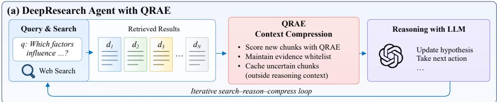

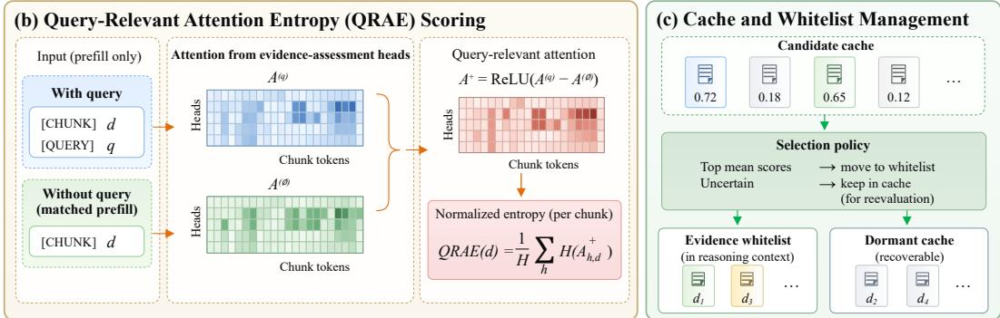  
Figure 1: Overview of QRAE for context compression in DeepSearch agents. (a) Retrieved chunks pass through QRAE before the LLM updates its hypothesis and takes the next action. (b) The QRAE signal is derived from the attention distributions of the model’s query-relevant heads. (c) Chunks with the highest running-mean scores in the candidate cache enter the whitelist and the reasoning context; deferred chunks remain in the candidate cache.

QRAE modifies only the search-snippet portion of the reasoning context. The instruction, user query, generated reasoning, tool calls, and other tool outputs are preserved by the underlying agent. After processing retrievals from step t, the next reasoning context therefore replaces the accumulated retrieved chunks $\mathcal { D } _ { \leq t }$ with the current whitelist ${ \ w } _ { t }$ . The objective is to retain useful evidence in the reasoning context while keeping uncertain chunks recoverable in the candidate cache.

## 2.2 ONLINE CACHE-TO-WHITELIST ADMISSION

After each search, newly retrieved chunks are deduplicated against the existing states and merged with previously deferred candidates, yielding the pool

$$
\mathcal { U } _ { t } = \mathrm { D e d u p } ( \mathcal { C } _ { t - 1 } \cup \mathcal { D } _ { t } ) \setminus \mathcal { W } _ { t - 1 } .
$$

The batch size K equals the agent’s configured search-result count per query. Evaluation is triggered only if $| \mathcal { U } _ { t } | \geq K$ The scheduler selects the K candidates with the fewest previous evaluations, prioritizing chunks that have never been scored. Evaluation occurs at most once per query update, even if the remaining cache still contains at least K chunks. We write $B _ { t }$ for the selected batch, with $| B _ { t } | = K$ at a trigger and $\boldsymbol { B } _ { t } = \boldsymbol { \mathcal { O } }$ otherwise. Candidates outside $B _ { t }$ incur no scoring cost at that step. The bound applies to the evaluated batch, not to the total off-context store in Figure 1(c).

For each $d \in B _ { t }$ , the evaluator produces a score $\mathrm { Q R A E } _ { t } ( d )$ using the paired prefills and entropy aggregation in Figure 1(b). Both calls use the same frozen reasoning LLM as the agent and generate no output tokens. They return the selected attention responses without modifying model weights or token-level KV-cache semantics. Section 3 defines this signal.

Let ${ \mathcal { T } } _ { t } ( d ) = \{ r \leq t : d \in { \mathcal { B } } _ { r } \}$ be the steps at which d has been evaluated. For a nonempty score history, the running mean is

$$
\overline { { \mathrm { Q R A E } } } _ { t } ( d ) = \frac { 1 } { | { \mathcal T } _ { t } ( d ) | } \sum _ { r \in { \mathcal T } _ { t } ( d ) } { \mathrm { Q R A E } } _ { r } ( d ) .
$$

After updating the histories of $B _ { t }$ , admission ranks all scored candidates in the entire cache, including those not reevaluated at step t. Let $\mathcal { E } _ { t } = \{ d \in \mathcal { U } _ { t } : | \mathcal { T } _ { t } ( d ) | > 0 \}$ and let $\rho \in ( 0 , 1 ]$ denote the

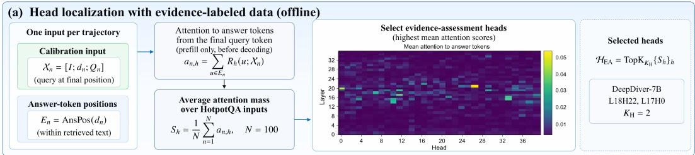

(b) Query-conditional attention response (online scoring)  
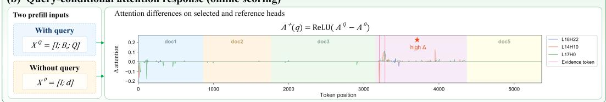

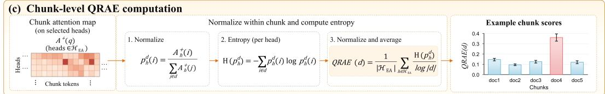  
Figure 2: Construction of the QRAE signal. (a) Offline localization selects the model heads with the highest attention mass on answer tokens in the input. (b) During online scoring, prefills with and without the query yield signed attention differences. (c) Positive attention differences are first normalized within each chunk. Normalized entropy is then computed and averaged across the selected heads.

retention rate. At a trigger,

$$
\begin{array} { r } { \boldsymbol { \mathcal { A } } _ { t } = \mathrm { T o p } _ { \left[ \rho K \right] } \big ( \mathcal { E } _ { t } ; \overline { { \mathrm { Q R A E } } } _ { t } \big ) , \qquad \rho = 0 . 5 \mathrm { b y d e f a u l t } . } \end{array}
$$

Here $\mathrm { T o p } _ { j } ( \mathcal { E } ; s )$ selects the $j$ members of E with the largest scores s. All K evaluated candidates have scores after the update, so $| \mathcal { E } _ { t } | \geq K$ . Thus $K = 5$ admits three chunks and $K = 1 0$ admits five. Admission uses a fixed retention rate without an absolute score cutoff. Unscored candidates are ineligible. If evaluation is not triggered, $A _ { t } = \emptyset$ . The states are then updated as

$$
\mathcal { W } _ { t } = \mathcal { W } _ { t - 1 } \cup \mathcal { A } _ { t } , \qquad \mathcal { C } _ { t } = \mathcal { U } _ { t } \setminus \mathcal { A } _ { t } .
$$

Admission is persistent: once a chunk enters ${ \ w } _ { t }$ , later score variation does not remove it from the reasoning context. All non-admitted chunks remain recoverable in $\mathcal { C } _ { t }$ for later evaluation, while only ${ \ w } _ { t }$ is included in subsequent reasoning contexts. Algorithm 1 gives the complete procedure; Appendix B.3 records the implementation settings.

The manager operates outside the model and requires only access to selected attention rows during prefill, introducing only lightweight time overhead. Backend-specific hooks can expose these rows without changing the decoding path or backend operators. Appendix E.5 analyzes the evaluation overhead and token savings from deferred admission.

## 3 QRAE SIGNAL

This section defines the model-internal QRAE signal and details its scoring procedure for assessing the value of retrieved chunks for subsequent reasoning. We first localize the model’s query-relevant heads offline and then compute QRAE during online inference. Figure 2 summarizes the complete QRAE signal construction process.

## 3.1 OFFLINE HEAD LOCALIZATION

We localize heads by examining the model’s query-conditioned prefill attention distributions. For each model, we sample 100 HotpotQA trajectories and select one input from each, requiring that its

retrieved text contain the correct answer tokens. Let $\mathcal { D } _ { \mathrm { c a l } } = \{ ( Q _ { n } , d _ { n } , E _ { n } ) \} _ { n = 1 } ^ { N }$ , where $N = 1 0 0$ and $E _ { n }$ marks the answer-token positions in the retrieved text $d _ { n }$ . Each localization input ends with the query:

$$
{ \mathcal { X } } _ { n } = [ I ; d _ { n } ; Q _ { n } ] .
$$

At the end of prefill, before decoding, let $R _ { g } ( u ; \mathcal { X } _ { n } )$ be the attention from the final query token to input token u for layer–head pair $g = ( \ell , h )$ . Summing over answer tokens and averaging over inputs gives

$$
S _ { g } = \frac { 1 } { N } \sum _ { n = 1 } ^ { N } \sum _ { u \in E _ { n } } R _ { g } ( u ; \mathcal { X } _ { n } ) , \qquad \mathcal { H } _ { \mathrm { E A } } = \mathrm { T o p K } _ { K _ { \mathrm { H } } } \{ S _ { g } \} _ { g } .\tag{1}
$$

The reference answer identifies $E _ { n }$ but is not appended to the input. The localized head set is a model-level property that generalizes across datasets and trajectories; it remains fixed throughout online evaluation. We write $K _ { \mathrm { H } }$ for the selected head count, distinct from the candidate-batch size $K$ Appendix B.3 lists the heads and sampling protocol. Appendix E gives a finite-sample condition for repeatable $\mathrm { \ t o p { - } } K _ { \mathrm { H } }$ localization.

## 3.2 ONLINE QRAE SCORE COMPUTATION

During online inference, the QRAE framework uses the heads localized offline to compute attention differences against a query-free control, then computes normalized entropy to obtain the QRAE signal.

Computing attention differences with a query-free control. For a bounded batch $B _ { t }$ , the QRAE evaluator constructs inputs with and without the query,

$$
\mathcal { X } _ { t } ^ { Q } = [ I ; \mathcal { B } _ { t } ; Q ] , \qquad \mathcal { X } _ { t } ^ { 0 } = [ I ; \mathcal { B } _ { t } ] .\tag{2}
$$

Here and below, u indexes a token position in a candidate chunk. Each prefill reads attention from its own final input token: the final query token in $\chi _ { t } ^ { Q }$ and the final candidate-input token in $\mathcal { X } _ { t } ^ { 0 }$ . The instruction and serialized candidate batch form their common prefix, which is reused through vLLM prefix caching. Let $h \in \mathcal { H } _ { \mathrm { E A } }$ index a selected layer–head pair. The responses $\mathrm { A t t e n t i o n } _ { h } ( u ; \mathcal { X } _ { t } ^ { Q } )$ and Attention ${ . } _ { h } ( u ; \mathcal { X } _ { t } ^ { 0 } )$ are separately normalized to unit mass over the same candidate tokens, as detailed in Appendix B.2. The score uses the positive difference between these normalized rows:

$$
\Delta _ { h } ( u ) = \Big [ \mathrm { A t t e n t i o n } _ { h } ( u ; \mathcal { X } _ { t } ^ { Q } ) - \mathrm { A t t e n t i o n } _ { h } ( u ; \mathcal { X } _ { t } ^ { 0 } ) \Big ] _ { + } .
$$

The subtraction suppresses response shared by the two prefills, and positive clipping retains increases in the query-conditioned row. The pairing matches the instruction and candidate tokens, but the final readout positions differ. Appendix E bounds the effect of this imperfect matching under an explicit shared-response decomposition.

The curves in Figure 2(b) show signed differences for the selected heads L18H22 and L17H0. The fourth chunk contains the highlighted evidence tokens and exhibits multiple positive responses.

Computing the QRAE signal with normalized entropy. A supporting statement commonly distributes information across several tokens: an entity, relation, value, qualifier, or temporal constraint may all contribute to the relevant fact. An incidental match, by contrast, can produce one sharp response without supporting the complete relation. For each chunk d $\in \boldsymbol { B } _ { t }$ , QRAE measures how broadly the positive response $\Delta _ { h }$ is distributed over the tokens in d and averages normalized entropy across the selected heads:

$$
\mathrm { Q R A E } _ { t } ( d ) = \frac { 1 } { \vert \mathcal { H } _ { \mathrm { E A } } \vert } \sum _ { h \in \mathcal { H } _ { \mathrm { E A } } } \frac { \mathrm { E n t r o p y } ( \{ \Delta _ { h } ( u ) \} _ { u \in d } ) } { \log \vert d \vert } .\tag{3}
$$

Here Entropy $\cdot ( \{ \Delta _ { h } ( u ) \} _ { u \in d } )$ denotes entropy after normalizing the positive responses within $\begin{array} { r } { d \colon p _ { h } ^ { d } ( u ) \ = \ \tilde { \Delta } _ { h } ( u ) / \sum _ { v \in d } \Delta _ { h } ( v ) } \end{array}$ when the denominator is nonzero, and Entropy $( p _ { h } ^ { d } ) \ =$ $\begin{array} { r l } { - \sum _ { u \in d } p _ { h } ^ { d } ( u ) \log p _ { h } ^ { d } ( u ) } \end{array}$ . These are the normalization and entropy steps in Figure 2(c). The score lies in [0, 1] and measures response breadth. Appendix B.2 gives the complete normalization and zero-mass convention.

Appendix E.3 provides a theoretical analysis of normalized-entropy scoring and its robustness to control mismatch.

## 4 EXPERIMENTS

We organize the experimental evaluation in the following order to validate the effectiveness of QRAE. RQ1 (DeepSearch agent benefits): Can QRAE reduce latency and token costs while maintaining task performance? RQ2 (signal validity): Can the QRAE score consistently and reliably identify useful evidence across datasets and models? RQ3 (component contributions): We evaluate whether query-free subtraction, entropy scoring, and context management provide benefits. We first present the benefits for DeepSearch agents, then analyze the QRAE signal and the individual components.

## 4.1 EXPERIMENTAL SETUP

Benchmarks. We use established DeepSearch benchmarks covering diverse task types and difficulty levels: BrowseComp-Plus (Chen et al., 2025b) for local retrieval, and XBench-DeepSearch (Chen et al., 2025a), FRAMES (Krishna et al., 2024), and SimpleQA for online retrieval. We use HotpotQA solely to localize evidence-assessment heads, then evaluate the effectiveness and efficiency gains of QRAE on the remaining benchmarks with these heads fixed to assess model-level generalization.

Models. We use DeepDiver-7B, a model designed for DeepSearch, as the primary model for evaluating QRAE. To assess cross-model generalization, we also localize heads and evaluate QRAE scoring in the DeepSearch models LiteResearcher-4B, WebSeer-14B, and OpenResearcher-30B (Li et al., 2026b; He et al., 2026; Li et al., 2026c), as well as OpenPangu-2.0-Flash-92B with nearly 100B parameters (openPangu, 2026).

Baselines. We use DeepSearch as the uncompressed baseline. Under matched inference backends, we compare QRAE with this baseline and the compression methods LLMLingua-2, ACON, Rerank, QRHead, and SideQuest (Pan et al., 2024; Kang et al., 2026; Sharifymoghaddam & Lin, 2026; Zhang et al., 2025; Kariyappa & Suh, 2026). These baselines cover different compression strategies: LLMLingua-2 removes tokens using a learned general-purpose compression policy; ACON rewrites agent history through LLM summarization; Rerank reranks retrieved results; QRHead uses selected attention heads for text selection; and SideQuest combines context management with inference-level KV-cache optimization.

Metrics. We evaluate all methods on all trajectories of each dataset. We report the overall task success rate and per-trajectory means of end-to-end latency and cumulative token consumption. Unless otherwise specified, tokens include all model inputs, outputs, and QRAE evaluator inputs; latency includes inference, retrieval, webpage processing, and evaluation time. All methods are run serially to ensure a fair comparison. Appendix C provides the detailed experimental settings and evaluation protocol.

## 4.2 QRAE EFFECTIVENESS IN DEEPSEARCH AGENTS

We first evaluate QRAE with DeepDiver-7B against the full set of baselines across all four benchmarks. Table 1 reports task success, end-to-end latency, and total processed tokens to jointly assess task effectiveness and computational efficiency.

Relative to the uncompressed DeepSearch agent, QRAE improves success by up to 6.0 percentage points. In settings with larger gains, processed tokens and latency fall by roughly 60% and 30%, respectively. Among compression methods, QRAE offers the best overall balance between task effectiveness and computational efficiency. Appendix D.3 reports mean ± STD over five runs with different random seeds. Higher mean success and lower mean token consumption and latency across all four benchmarks support the stability of these gains.

To assess transfer across model architectures, we extend the full baseline comparison to OpenResearcher-30B with its hybrid Mamba–Transformer architecture (Li et al., 2026c) and OpenPangu-2.0-Flash-92B with hybrid sparse attention (openPangu, 2026). We use BrowseComp-Plus, the most challenging benchmark in our evaluation, whose fixed local corpus enables reproducible retrieval. Table 2 reports task success, end-to-end latency, and cumulative processed tokens. The results show that QRAE remains effective in architectures with linear-time sequence modeling or sparse attention.

Table 1: QRAE effectiveness in DeepSearch agents with DeepDiver-7B across four benchmarks. Results report task success, end-to-end time, and total processed tokens from one representative run per benchmark. Bold and underlined values denote the best and second-best results, respectively.
<table><tr><td rowspan="2">Dataset</td><td rowspan="2">Metric</td><td></td><td>DeepSearch Lingua-2 ACON Rerank QRHead SideQuest QRAE</td><td></td><td></td><td></td><td></td><td></td></tr><tr><td>No comp.</td><td></td><td>Compression baselines</td><td></td><td></td><td></td><td>Ours</td></tr><tr><td rowspan="2">BrowseComp- Plus</td><td>Succ. (%) ↑</td><td>13.8</td><td>14.3</td><td>12.1</td><td>14.7</td><td>11.6</td><td>10.6</td><td>17.2</td></tr><tr><td>Time (s) ↓ Tokens↓</td><td>29.5 177k</td><td>28.8 171k</td><td>50.0 98k</td><td>35.6 148k</td><td>45.1 149k</td><td>24.3</td><td>20.5 54k</td></tr><tr><td rowspan="2">XBench- DeepSearch</td><td>Succ. (%) ↑</td><td>38.0</td><td>43.0</td><td>40.0</td><td>41.0</td><td>35.0</td><td>66k 36.0</td><td>44.0</td></tr><tr><td>Time (s) ↓</td><td>276.0</td><td>245.3</td><td>324.8</td><td>213.6</td><td>357.5</td><td>167.2</td><td>150.4</td></tr><tr><td rowspan="2">FRAMES</td><td>Tokens ↓</td><td>319k</td><td>288k</td><td>146k</td><td>227k</td><td>303k</td><td>144k</td><td>117k</td></tr><tr><td>Succ. (%) ↑</td><td>40.9</td><td>41.2</td><td>39.5</td><td>43.1</td><td>37.3</td><td>38.9</td><td>42.8</td></tr><tr><td rowspan="2"></td><td>Time (s) ↓</td><td>158.7</td><td>155.2</td><td>184.3</td><td>114.4</td><td>203.7</td><td>105.8</td><td>90.7</td></tr><tr><td>Tokens↓</td><td>140k</td><td>137k</td><td>105k</td><td>102k</td><td>124k</td><td>99k</td><td>94k</td></tr><tr><td rowspan="2">SimpleQA</td><td>Succ. (%) ↑</td><td>79.6</td><td>79.9</td><td>80.4</td><td>77.6</td><td>78.2</td><td>75.9</td><td>82.2</td></tr><tr><td>Time (s) ↓ Tokens ↓</td><td>145.6 74k</td><td>141.3 73k</td><td>132.8 52k</td><td>120.5 60k</td><td>194.5 65k</td><td>106.5 38k</td><td>98.6 45k</td></tr></table>

Table 2: Cross-model evaluation of QRAE on BrowseComp-Plus, reporting task success, end-toend time, and total processed tokens. Token counts for OpenPangu include inputs only. Bold and underlined values denote the best and second-best results, respectively.
<table><tr><td rowspan="2">Method</td><td colspan="3">OpenResearcher-30B</td><td colspan="3">OpenPangu-2.0-Flash-92B</td></tr><tr><td>Success (%) ↑</td><td>Time (s) ↓</td><td>Tokens↓</td><td>Success (%) ↑</td><td>Time (s) ↓</td><td>Tokens↓</td></tr><tr><td>DeepSearch</td><td>53.2</td><td>151.0</td><td>1981k</td><td>54.9</td><td>308.6</td><td>1077k</td></tr><tr><td>LLMLingua-2</td><td>52.1</td><td>154.7</td><td>2037k</td><td>54.2</td><td>304.5</td><td>1057k</td></tr><tr><td>ACON</td><td>49.4</td><td>188.1</td><td>842k</td><td>50.1</td><td>429.8</td><td>879k</td></tr><tr><td>Rerank</td><td>50.7</td><td>162.0</td><td>2157k</td><td>54.3</td><td>344.7</td><td>970k</td></tr><tr><td>QRHead</td><td>51.1</td><td>189.3</td><td>1771k</td><td>53.8</td><td>393.8</td><td>982k</td></tr><tr><td>SideQuest</td><td>47.6</td><td>144.6</td><td>1605k</td><td>51.3</td><td>284.5</td><td>801k</td></tr><tr><td>QRAE</td><td>53.0</td><td>134.7</td><td>1453k</td><td>55.3</td><td>255.4</td><td>660k</td></tr></table>

## 4.3 QRAE SIGNAL VALIDITY

We localize evidence-assessment heads in DeepDiver-7B using only HotpotQA and keep the selected head set fixed for subsequent evaluation. Figure 3 presents the head-localization results: L18H22 and L17H0 consistently receive the highest localization scores across all evaluated datasets, indicating that the localized heads are model-level and remain unchanged across datasets.

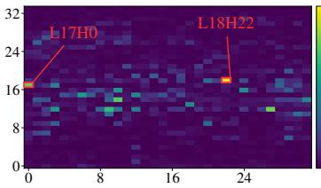  
(a) HotpotQA

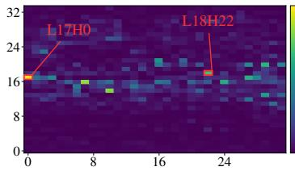  
(b) BrowseComp-Plus

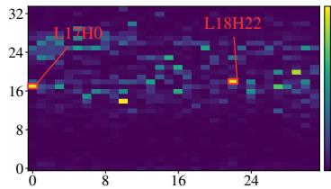  
(c) XBench-DeepSearch  
Figure 3: Global layer–head localization scores for DeepDiver-7B, computed from attention to answer-bearing spans. Heads are selected on HotpotQA (a) and validated on BrowseComp-Plus (b) and XBench-DeepSearch (c), neither of which is used for head selection.

Appendix D.1 provides head-localization results for LiteResearcher-4B, WebSeer-14B, OpenResearcher-30B, and OpenPangu-2.0-Flash-92B. The agent-level benefits of QRAE in OpenResearcher-30B and OpenPangu-2.0-Flash-92B are evaluated in Section 4.2.

We compare QRAE scoring across all five models using the same BrowseComp-Plus candidate sets of 5 and 20 chunks, with each model’s localized heads fixed. AUC denotes AUROC and measures how well the scores distinguish evidence-bearing chunks from other candidates overall. Recall@1 tests the extreme retention setting in which only the top-ranked chunk is kept. Recall@3 for 5 chunks and Recall@10 for 20 chunks assess evidence recall when retaining multiple chunks, more closely reflecting context filtering during agent execution. Recall@k is the fraction of annotated evidence chunks in the candidate set retained among the top k.

Table 3: Cross-model QRAE scoring on BrowseComp-Plus with 5- and 20-chunk candidate sets. AUC denotes AUROC; all metrics are percentages and higher is better.
<table><tr><td rowspan="2">Model</td><td colspan="3">5 chunks</td><td colspan="3">20 chunks</td></tr><tr><td>AUC</td><td>Recall@1</td><td>Recall@3</td><td>AUC</td><td>Recall@1</td><td>Recall@10</td></tr><tr><td>LiteResearcher-4B</td><td>76.6</td><td>48.3%</td><td>76.6%</td><td>81.8</td><td>35.2%</td><td>83.2%</td></tr><tr><td>DeepDiver-7B</td><td>83.2</td><td>54.6%</td><td>83.2%</td><td>84.4</td><td>44.6%</td><td>88.7%</td></tr><tr><td>WebSeer-14B</td><td>84.1</td><td>53.9%</td><td>84.5%</td><td>85.1</td><td>47.8%</td><td>89.2%</td></tr><tr><td>OpenResearcher-30B</td><td>90.3</td><td>74.1%</td><td>90.5%</td><td>89.6</td><td>57.4%</td><td>93.0%</td></tr><tr><td>OpenPangu-2.0-Flash-92B</td><td>92.5</td><td>83.8%</td><td>93.4%</td><td>92.2</td><td>66.2%</td><td>96.8%</td></tr></table>

Table 3 shows that QRAE exhibits nontrivial evidence-scoring ability in all five models, with AUC exceeding 75% in both candidate-set settings. Larger models generally achieve higher AUC and recall, indicating stronger evidence discrimination and retention. Attention interventions further support a functional role for the localized heads in subsequent reasoning (Appendix D.4).

## 4.4 ABLATION STUDY

We examine the contributions of QRAE’s components through three variants. All variants use DeepDiver-7B with the same localized head set.

• w/o query-free subtraction. Remove the query-free prefill and compute normalized entropy directly from query-conditioned attention, retaining within-chunk normalization and the same context-management policy.

• Attention sum. Retain query-free subtraction and context management, and replace entropy with summed positive attention responses averaged over the selected heads.

• Current-search filtering. Apply the full QRAE score only to current search results, retaining selected chunks in the history and discarding the rest, without a persistent whitelist or a cache for later reevaluation.

We evaluate scoring quality and agent performance. The former tests evidence ranking with fixed candidate sets and a fixed number of retained chunks; the latter measures task success and the actual costs of the resulting agent trajectories.

Scoring quality. Table 4 compares the full QRAE score with the two scoring variants on BrowseComp-Plus, using the same 5- and 20-chunk candidate sets and six metrics as in Section 4.3. Current-search filtering is evaluated only at the agent level because it uses the unchanged QRAE score and modifies cross-step context management.

Both scoring ablations consistently reduce AUC and every recall metric for both candidate-set sizes. The drop without query-free subtraction supports the utility of suppressing responses shared with the query-free control. With this subtraction held fixed, entropy outperforms attention summation on every metric, indicating that response breadth better identifies useful evidence than total attention mass.

Table 4: Scoring ablations on BrowseComp-Plus with DeepDiver-7B. Candidate sets and retainedchunk budgets are shared across variants. AUC denotes AUROC; all metrics are percentages and higher is better.
<table><tr><td rowspan="2">Variant</td><td colspan="3">5 chunks</td><td colspan="3">20 chunks</td></tr><tr><td>AUC</td><td>Recall@1</td><td>Recall@3</td><td>AUC</td><td>Recall@1</td><td>Recall@10</td></tr><tr><td>QRAE (full)</td><td>83.2</td><td>54.6%</td><td>83.2%</td><td>84.4</td><td>44.6%</td><td>88.7%</td></tr><tr><td>w/o query-free subtraction</td><td>79.6</td><td>48.6%</td><td>80.9%</td><td>78.8</td><td>34.2%</td><td>84.5%</td></tr><tr><td>Attention sum</td><td>75.0</td><td>44.7%</td><td>79.5%</td><td>81.3</td><td>32.6%</td><td>80.0%</td></tr></table>

End-to-end agent performance. Table 5 compares the full method with all three variants on BrowseComp-Plus and XBench-DeepSearch, using the same retrieval settings and all evaluation trajectories. Success, latency, and processed tokens capture the task-level effects of both scoring and context management, including the evaluator overhead required by each variant.

Table 5: Agent-level component ablations on BrowseComp-Plus and XBench-DeepSearch. Success is in percent, time in seconds, and tokens in thousands. End-to-end costs include the evaluator calls required by each variant.
<table><tr><td rowspan="2">Variant</td><td colspan="3">BrowseComp-Plus</td><td colspan="3">XBench-DeepSearch</td></tr><tr><td></td><td>Succ. (%) ↑ Time (s) ↓</td><td>Tokens↓</td><td></td><td>Succ. (%) ↑ Time (s) ↓</td><td>Tokens↓</td></tr><tr><td>QRAE (full)</td><td>17.2</td><td>20.5</td><td>54</td><td>44.0</td><td>150.4</td><td>117</td></tr><tr><td>w/o query-free subtraction</td><td>15.8</td><td>24.1</td><td>73</td><td>42.0</td><td>192.8</td><td>186</td></tr><tr><td>Attention sum</td><td>14.6</td><td>27.3</td><td>92</td><td>42.0</td><td>181.6</td><td>177</td></tr><tr><td>Current-search filtering</td><td>14.9</td><td>30.2</td><td>129</td><td>41.0</td><td>232.3</td><td>225</td></tr></table>

Every ablation lowers success while increasing token consumption and latency on both datasets, supporting the contribution of all three components. For the two scoring variants, these losses align with their weaker evidence ranking in Table 4. Current-search filtering retains the full scorer but loses chunk reevaluation over the evolving trajectory. When one search returns multiple query-relevant chunks, immediate filtering can discard evidence needed later. Recovering that evidence may require additional reasoning steps and tool calls, providing a plausible explanation for the higher end-to-end costs despite filtering each search.

Appendix D.2 examines the sensitivity of QRAE AUC and recall to input-chunk permutations within fixed candidate sets.

## 5 CONCLUSION

We introduced QRAE, an online context compression method that uses query-relevant attention entropy to select retrieved chunks for DeepSearch agents. Persistent admission keeps useful chunks in subsequent contexts, while cached candidates remain available for reevaluation.

Averaged equally across six model–benchmark settings, QRAE improves task success by 2.35 percentage points and reduces reported token usage and end-to-end latency by approximately 45% and 30%, respectively, relative to uncompressed DeepSearch. Both the signal and method generalize across the evaluated datasets and model architectures, including hybrid Mamba–Transformer and sparse-attention models.

Prefill-only scoring adds little overhead and integrates with existing inference backends through hooks, without modifying decoding or backend operators. Future work will clarify how the localized heads route information into subsequent reasoning and extend QRAE to tasks whose evidence cannot be localized to retrieved text.

## AI USE STATEMENT

We used generative AI tools solely for language polishing to improve the clarity and readability of the manuscript. No generative AI tools were used for research ideation, theoretical proofs, data processing, or experimental design. The authors take full responsibility for the content of this paper.

## ETHICS STATEMENT

This work aims to improve the inference efficiency of DeepSearch agents. We do not identify specific ethical concerns associated with the proposed method.

## REPRODUCIBILITY STATEMENT

Sections 2 and 3 specify the framework and scoring rule. Appendix B provides pseudocode, normalization conventions, selected heads, and implementation details. Appendix C documents datasets, model checkpoints, agent and retrieval configurations, baseline adaptations, hardware, cost accounting, and random seeds. Appendix D reports robustness checks, repeated-run results, and cost breakdowns, while Appendix E states the assumptions and proofs for the theoretical analysis.

## REFERENCES

Kaiyuan Chen, Yixin Ren, Yang Liu, Xiaobo Hu, Haotong Tian, Tianbao Xie, Fangfu Liu, et al. xbench: Tracking agents productivity scaling with profession-aligned real-world evaluations. arXiv preprint arXiv:2506.13651, 2025a.

Zijian Chen, Xueguang Ma, Shengyao Zhuang, Ping Nie, Kai Zou, Andrew Liu, Joshua Green, Kshama Patel, Ruoxi Meng, Mingyi Su, Sahel Sharifymoghaddam, Yanxi Li, Haoran Hong, Xinyu Shi, Xuye Liu, Nandan Thakur, Crystina Zhang, Luyu Gao, Wenhu Chen, and Jimmy Lin. BrowseComp-Plus: A more fair and transparent evaluation benchmark of deep-research agent. arXiv preprint arXiv:2508.06600, 2025b.

Nelson Elhage, Neel Nanda, Catherine Olsson, Tom Henighan, Nicholas Joseph, Ben Mann, Amanda Askell, Yuntao Bai, Anna Chen, Tom Conerly, Nova DasSarma, Dawn Drain, Deep Ganguli, Zac Hatfield-Dodds, Danny Hernandez, Andy Jones, Jackson Kernion, Liane Lovitt, Kamal Ndousse, Dario Amodei, Tom Brown, Jack Clark, Jared Kaplan, Sam McCandlish, and Chris Olah. A mathematical framework for transformer circuits. Transformer Circuits Thread, 2021.

Weizhi Fei, Xueyan Niu, Guoqing Xie, Yingqing Liu, Bo Bai, and Wei Han. Efficient prompt compression with evaluator heads for long-context transformer inference. In Advances in Neural Information Processing Systems, volume 38, pp. 154566–154593, 2025.

Guanzhong He, Zhen Yang, Jinxin Liu, Bin Xu, Lei Hou, and Juanzi Li. WebSeer: Training deeper search agents through reinforcement learning with self-reflection. In International Conference on Learning Representations, 2026.

Minki Kang, Wei-Ning Chen, Dongge Han, Huseyin A. Inan, Lukas Wutschitz, Yanzhi Chen, Robert Sim, and Saravan Rajmohan. ACON: Optimizing context compression for long-horizon LLM agents. In International Conference on Machine Learning, 2026.

Sanjay Kariyappa and G. Edward Suh. SideQuest: Model-driven KV cache management for longhorizon agentic reasoning. arXiv preprint arXiv:2602.22603, 2026.

Satyapriya Krishna, Kalpesh Krishna, Anhad Mohananey, Steven Schwarcz, Adam Stambler, Shyam Upadhyay, and Manaal Faruqui. Fact, fetch, and reason: A unified evaluation of retrievalaugmented generation. arXiv preprint arXiv:2409.12941, 2024.

Junjie Li, Jiong Lou, and Jie Li. IntentKV: Cross-turn intent-aware KV cache pruning for agent inference. arXiv preprint arXiv:2606.09916, 2026a.

Wanli Li, Bince Qu, Bo Pan, Jianyu Zhang, Zheng Liu, Pan Zhang, Wei Chen, and Bo Zhang. LiteResearcher: A scalable agentic reinforcement learning training framework for deep research agent. arXiv preprint arXiv:2604.17931, 2026b.

Yuhong Li, Yingbing Huang, Bowen Yang, Bharat Venkitesh, Acyr Locatelli, Hanchen Ye, Tianle Cai, Patrick Lewis, and Deming Chen. SnapKV: LLM knows what you are looking for before generation. In Advances in Neural Information Processing Systems, volume 37, pp. 22947–22970, 2024.

Zhuofeng Li, Dongfu Jiang, Xueguang Ma, Haoxiang Zhang, Ping Nie, Yuyu Zhang, Kai Zou, Jianwen Xie, Yu Zhang, and Wenhu Chen. OpenResearcher: A fully open pipeline for longhorizon deep research trajectory synthesis. arXiv preprint arXiv:2603.20278, 2026c.

Weizhe Lin, Hui-Ling Zhen, Shuai Yang, Xian Wang, Renxi Liu, Hanting Chen, Wangze Zhang, Chuansai Zhou, Yiming Li, Chen Chen, Xing Li, Zhiyuan Yang, Xiaosong Li, Xianzhi Yu, Zhenhua Dong, Mingxuan Yuan, and Yunhe Wang. Towards efficient agents: A co-design of inference architecture and system. arXiv preprint arXiv:2512.18337, 2025.

Catherine Olsson, Nelson Elhage, Neel Nanda, Nicholas Joseph, Nova DasSarma, Tom Henighan, Ben Mann, Amanda Askell, Yuntao Bai, Anna Chen, Tom Conerly, Dawn Drain, Deep Ganguli, Zac Hatfield-Dodds, Danny Hernandez, Scott Johnston, Andy Jones, Jackson Kernion, Liane Lovitt, Kamal Ndousse, Dario Amodei, Tom Brown, Jack Clark, Jared Kaplan, Sam McCandlish, and Chris Olah. In-context learning and induction heads. Transformer Circuits Thread, 2022.

openPangu. openPangu-2.0-Flash model card. https://huggingface.co/openpangu/ openPangu-2.0-Flash, 2026. Accessed September 25, 2026.

Zhuoshi Pan, Qianhui Wu, Huiqiang Jiang, Menglin Xia, Xufang Luo, Jue Zhang, Qingwei Lin, Victor Ruhle, Yuqing Yang, Chin-Yew Lin, H. Vicky Zhao, Lili Qiu, and Dongmei Zhang. LLMLingua-2:¨ Data distillation for efficient and faithful task-agnostic prompt compression. In Findings of the Associationfor Computational Linguistics: ACL 2024, pp. 963–981, 2024.

Sahel Sharifymoghaddam and Jimmy Lin. Rerank before you reason: Analyzing reranking tradeoffs through effective token cost in deep search agents. In Findings of the Association for Computational Linguistics: ACL 2026, pp. 25874–25886, 2026.

Weiwei Sun, Miao Lu, Zhan Ling, Kang Liu, Xuesong Yao, Yiming Yang, and Jiecao Chen. Scaling long-horizon LLM agent via context-folding. arXiv preprint arXiv:2510.11967, 2025.

Tongyi DeepResearch Team. Tongyi DeepResearch Technical Report. arXiv preprint arXiv:2510.24701, 2025.

Lei Wei, Xiao Peng, Tt, Guannan Zhang, Chenhao Jiang, Hongyu Li, Lanbo Lin, Yuanwu Xu, Jiayao Liu, Kesu Wang, and Bin Wang. PACE: Predictive adaptive context extraction for long-horizon LLM agents. In Proceedings ofthe 64th Annual Meeting ofthe Associationfor Computational Linguistics, pp. 27184–27199, 2026.

Wenhao Wu, Yizhong Wang, Guangxuan Xiao, Hao Peng, and Yao Fu. Retrieval head mechanistically explains long-context factuality. In International Conference on Learning Representations, 2025.

Guangxuan Xiao, Jiaming Tang, Jingwei Zuo, Junxian Guo, Shang Yang, Haotian Tang, Yao Fu, and Song Han. DuoAttention: Efficient long-context LLM inference with retrieval and streaming heads. arXiv preprint arXiv:2410.10819, 2024.

Yilun Yao, Shan Huang, Elsie Dai, Zhewen Tan, Zhenyu Duan, Shousheng Jia, Yanbing Jiang, and Tong Yang. ARC: Active and reflection-driven context management for long-horizon information seeking agents. In Findings of the Association for Computational Linguistics: ACL 2026, pp. 18644–18659, 2026.

Rui Ye, Zhongwang Zhang, Kuan Li, Huifeng Yin, Zhengwei Tao, Yida Zhao, Liangcai Su, Liwen Zhang, Zile Qiao, Xinyu Wang, Pengjun Xie, Fei Huang, Siheng Chen, Jingren Zhou, and Yong Jiang. AgentFold: Long-horizon web agents with proactive context management. arXiv preprint arXiv:2510.24699, 2025.

Wuwei Zhang, Fangcong Yin, Howard Yen, Danqi Chen, and Xi Ye. Query-focused retrieval heads improve long-context reasoning and re-ranking. In Proceedings of the 2025 Conference on Empirical Methods in Natural Language Processing, pp. 23791–23805, 2025.

Zhenyu Zhang, Ying Sheng, Tianyi Zhou, Tianlong Chen, Lianmin Zheng, Ruisi Cai, Zhao Song, Yuandong Tian, Christopher Re, Clark Barrett, Zhangyang Wang, and Beidi Chen. H2O: Heavy-´ hitter oracle for efficient generative inference of large language models. In Advances in Neural Information Processing Systems, volume 36, pp. 34661–34710, 2023.

Yunlong Zhao, Haoran Wu, and Bo Xu. Leveraging attention to effectively compress prompts for long-context LLMs. In AAAI Conference on Artificial Intelligence, volume 39, pp. 26048–26056, 2025.

Jialiang Zhu, Gongrui Zhang, Xiaolong Ma, Lin Xu, Miaosen Zhang, Ruiqi Yang, Song Wang, Kai Qiu, Zhirong Wu, Qi Dai, Ruichun Ma, Bei Liu, Yifan Yang, Chong Luo, Zhengyuan Yang, Linjie Li, Lijuan Wang, Weizhu Chen, Xin Geng, and Baining Guo. RE-TRAC: REcursive TRAjectory compression for deep search agents. In International Conference on Machine Learning, 2026.

## A.1 AGENT CONTEXT MANAGEMENT

Long-horizon agents accumulate reasoning, tool calls, and observations that may be reprocessed across many steps. ACON condenses observations and histories with an optimized compressor, while Context-Folding and AgentFold learn to replace completed trajectory regions with compact folds (Kang et al., 2026; Sun et al., 2025; Ye et al., 2025). RE-TRAC converts completed search trajectories into structured states that guide later exploration (Zhu et al., 2026). PACE reconstructs working context from multigranularity memory using predicted next-step relevance, whereas ARC monitors and revises context through reflection (Wei et al., 2026; Yao et al., 2026).

These methods establish context management as an active part of the agent, but their primary representations are condensations, folds, structured states, or revised histories. QRAE instead makes forwarding decisions over intact retrieved chunks. Whitelisted chunks persist in the reasoning context; deferred chunks remain outside it in the candidate cache as raw text and can be retrieved and rescored when the trajectory changes. The policy therefore avoids a generative rewriting step while leaving reasoning, tool interactions, and document text unchanged.

## A.2 PROMPT EVIDENCE SELECTION

Rerank Before You Reason selects retrieved passages before search-time reasoning, while LLMLingua-2 predicts token importance for single-prompt compression (Sharifymoghaddam & Lin, 2026; Pan et al., 2024). Attention-based methods derive selection signals from the model itself. EHPC identifies evaluator heads in early prefill layers and retains important prompt tokens; AttnComp likewise compresses long inputs using attention-derived importance (Fei et al., 2025; Zhao et al., 2025). Retrieval heads are causally implicated in long-context factual recall, and QRHead aggregates query-focused attention for retrieval and reranking (Wu et al., 2025; Zhang et al., 2025).

The QRAE evaluator differs in both measurement and use. It localizes heads from final-query-token attention to answer tokens before decoding, then uses an online query-free control and scores the breadth of the positive response through normalized within-chunk entropy. Rather than deleting tokens for one call or reranking one retrieval set, the score drives persistent admission and recoverable deferral across agent steps. The intervention experiments further test whether the selected heads are functionally connected to downstream reasoning.

## A.3 INFERENCE-STATE COMPRESSION

KV-cache methods reduce memory or attention work by retaining selected token states. H2O protects recent and high-attention tokens, SnapKV estimates important positions from an observation window, and DuoAttention allocates full caches to retrieval heads (Zhang et al., 2023; Li et al., 2024; Xiao et al., 2024). For agent trajectories, SideQuest asks the reasoning model to manage KV state, IntentKV performs cross-turn intent-aware pruning, and AgentInfer co-designs context management with the inference system (Kariyappa & Suh, 2026; Li et al., 2026a; Lin et al., 2025). These approaches change which cached states participate in inference. QRAE instead changes which retrieved text enters future prefills while preserving token-level cache semantics, so the two families are complementary.

Across these lines, QRAE focuses on the intersection of intact chunk granularity, model-internal prefill scoring, persistent cross-step admission, recoverable deferral, and bounded evaluation. This positioning motivates the heterogeneous baselines in Section 4.1.

## B METHOD DETAILS

## B.1 ONLINE CONTEXT-MANAGEMENT PROCEDURE

Algorithm 1 Recoverable context admission with QRAE   
Require: Query Q, selected heads $\mathcal { H } _ { \mathrm { E A } }$ , search-result count K, retention rate $\rho = 0 . 5$   
1: $\mathbf { \hat { \boldsymbol { c } } } \gets \emptyset , \mathbf { \hat { \boldsymbol { w } } } \gets \mathbf { \tilde { \boldsymbol { \varnothing } } }$   
2: for each search at agent step t do   
3: Retrieve $\mathcal { D } _ { t } \mathbf { ; }$ add chunks not already in $c \cup \mathcal { W }$ to C   
4: Initialize an empty score history for each new chunk   
5: $\mathbf { i f } \left| { \mathcal { C } } \right| \geq K$ then ▷ At most one evaluation per search   
6: Select the $K$ chunks with the fewest recorded scores as $\boldsymbol { B } \subseteq \mathcal { C }$   
7: Score $\boldsymbol { B }$ with query/control prefills and normalized entropy   
8: Append each new score to its chunk history; update its running mean   
9: ${ \mathcal { E } }  \{ d \in { \mathcal { C } } : d$ has at least one recorded score}   
10: $\mathscr { A } \gets \mathrm { T o p } _ { \lceil \rho K \rceil } ( \mathscr { E } ; \overline { { \mathrm { Q R A E } } } )$   
11: $\mathcal { W }  \mathcal { W } \overset { \cdot \cdot } { \cup } \mathcal { A } , \mathcal { C }  \mathcal { C } \setminus \mathcal { A }$   
12: end if   
13: Run the next reasoning step with reasoning context $\mathcal { P } _ { t + 1 } [ \mathcal { D } _ { \leq t }  \mathcal { W } ]$   
14: end for

## B.2 FULL QRAE COMPUTATION

Given the query and control inputs in Equation 2, let $q _ { t } ^ { z } = | \mathcal { X } _ { t } ^ { z } |$ be the final input-token index, using one-based indices. Let $R _ { h } ( u ; \bar { \mathcal { X } } _ { t } ^ { z } )$ denote the attention weight from row $q _ { t } ^ { z }$ to candidate token u for selected head h and input $z \in \{ Q , 0 \}$ . One attention row is read from each prefill, with no aggregation over query positions and no decoding. The QRAE evaluator first normalizes each response over all candidate tokens in the evaluation batch:

$$
\mathrm { A t t e n t i o n } _ { h } ( u ; \mathcal { X } _ { t } ^ { z } ) = \frac { R _ { h } ( u ; \mathcal { X } _ { t } ^ { z } ) } { \sum _ { d ^ { \prime } \in \mathcal { B } _ { t } } \sum _ { v \in d ^ { \prime } } R _ { h } ( v ; \mathcal { X } _ { t } ^ { z } ) } , \qquad z \in \{ Q , 0 \} .
$$

Consequently, each normalized row has total candidate-token mass one (up to numerical precision) before subtraction. This matches the total mass being compared; it does not make the two final-token readout positions identical. The evaluator then takes the positive difference and normalizes it within each chunk:

$$
\begin{array} { r l r } & { \Delta _ { h } ( u ) = \left[ \mathrm { A t t e n t i o n } _ { h } ( u ; \mathcal { X } _ { t } ^ { Q } ) - \mathrm { A t t e n t i o n } _ { h } ( u ; \mathcal { X } _ { t } ^ { 0 } ) \right] _ { + } , } & \\ & { m _ { h } ( d ) = \displaystyle \sum _ { v \in d } \Delta _ { h } ( v ) , } & \\ & { p _ { h } ^ { d } ( u ) = \displaystyle \frac { \Delta _ { h } ( u ) } { m _ { h } ( d ) } , \qquad u \in d , \quad m _ { h } ( d ) > 0 . } & \end{array}
$$

The per-head contribution and final chunk score are

$$
\begin{array} { r l } & { \quad e _ { h } ( d ) = \Big \{ \displaystyle \mathrm { E n t r o p y } ( p _ { h } ^ { d } ) / \log | d | , \quad m _ { h } ( d ) > 0 \mathrm { a n d } | d | > 1 , } \\ & { \quad \mathrm { o t h e r w i s e } , } \\ & { \quad \mathrm { Q R A E } _ { t } ( d ) = \displaystyle \frac { 1 } { | \mathcal { H } _ { \mathrm { E A } } | } \sum _ { h \in \mathcal { H } _ { \mathrm { E A } } } e _ { h } ( d ) . } \end{array}
$$

Here Entropy $\begin{array} { r } { \mathbf { \rho } ( p ) \mathbf { \rho } = - \sum _ { u } p ( u ) } \end{array}$ log p(u) with 0 log 0 = 0. Thus a head assigning no positive difference mass to a chunk contributes zero, while every nonzero contribution lies in [0, 1].

## B.3 IMPLEMENTATION SETTINGS AND HEAD LOCALIZATION

Offline inputs and heatmaps. For each model, localization uses 100 randomly sampled HotpotQA trajectories, with one input selected per trajectory. Each selected input must contain correct-answer tokens in its retrieved text. The input is $[ I ; d ; Q ]$ and ends with the query; the reference answer is used only to identify the answer-token positions within d. At the end of prefill, before any answer is generated, we read the attention row of the final query token. For each head, we sum its attention over these answer-token positions and average over the 100 inputs, as in Equation 1. The resulting layer– head matrix is the localization heatmap. There is no offline subtraction or negative-chunk pairing. This prefill-only criterion measures attention to evidence already in the input, rather than attention while generating or copying an answer during decoding, distinguishing it from a decoding-time retrieval-head criterion.

The heads annotated in Figures 3 and 4 are the selected sets, listed in Table 6. For every model, the set is chosen on HotpotQA and held fixed online. The BrowseComp-Plus and XBench-DeepSearch heatmaps use the same measurement on 100 randomly sampled, answer-containing inputs per dataset, one per trajectory. These heatmaps evaluate cross-dataset generalization and do not alter the selected sets.

Table 6: Fixed evidence-assessment heads. Layer and head indices are zero-based.
<table><tr><td>Model</td><td> $K _ { \mathrm { H } }$ </td><td>Selected layer-head pairs</td></tr><tr><td>LiteResearcher-4B</td><td>2</td><td>L20H15, L18H15</td></tr><tr><td>DeepDiver-7B</td><td>2</td><td>L18H22, L17H0</td></tr><tr><td>WebSeer-14B</td><td>2</td><td>L36H21, L47H33</td></tr><tr><td>OpenResearcher-30B</td><td>3</td><td>L26H9, L26H25, L19H18</td></tr><tr><td>OpenPangu-2.0-Flash-92B</td><td>5</td><td>L45H36, L39H24, L39H30, L39H32, L36H41</td></tr></table>

Online readout and prefix reuse. Online inputs are $\left[ I ; B _ { t } ; Q \right]$ and $[ I ; B _ { t } ]$ , with the same instruction, candidate ordering, and candidate serialization. Each call reads its own last input token’s attention before decoding. The query-free call ends at the candidate input, and the query-conditioned call appends Q to that same prefix. vLLM prefix caching is enabled to reuse the common prefix’s KV states. This serving cache is separate from the external candidate cache, which stores raw chunk text and score histories. Both evaluator inputs remain included in the processed-token accounting, while prefix reuse affects the computation actually performed. Each attention row is normalized over the same candidate-token set before positive subtraction, followed by within-chunk normalization and entropy as specified in Appendix B.2.

Search-aligned chunking and scheduling. The evaluator treats each search-returned snippet as one chunk, preserving the search configuration’s splitting rules and length limits without additional segmentation. The batch size K equals the configured number of search results per query. Each query’s deduplicated results update the shared cache. If at least K candidates are available, exactly one batch of K is scored; otherwise scoring is deferred. Priority is determined by the number of prior scores, in ascending order. Thus “low confidence” in scheduling means fewer measurements, not a lower mean relevance score. Newly retrieved, unscored chunks have priority; the number introduced by one search is at most K.

Retention and persistent admission. After the batch is scored, each evaluated chunk’s history and arithmetic mean are updated. All scored chunks in the entire candidate cache are then ranked by their historical means; candidates not reevaluated in this batch retain their previous means. The top $\lceil \rho K \rceil$ enter the whitelist, with $\rho = 0 . 5$ by default: three chunks for $K = 5$ or five for $K = 1 0$ . The quota depends on the batch size, not on the total cache size. Unscored chunks are excluded from admission. Admitted chunks are removed from the candidate cache and persist in subsequent reasoning contexts. The others remain available for future evaluation. The manager does not score a second batch within the same query update, even when the remaining cache still has at least K members.

Table 7: Implementation settings shared with the agent or fixed by QRAE.
<table><tr><td>Setting</td><td>Value or rule</td></tr><tr><td>Calibration</td><td>100 HotpotQA trajectories; one answer-containing input each</td></tr><tr><td>Head set</td><td>Fixed per model; Table 6</td></tr><tr><td>Batch size K</td><td>Agent&#x27;s configured search-result count per query</td></tr><tr><td>Chunking</td><td>Agent&#x27;s search splitting rules and length limits</td></tr><tr><td>Trigger</td><td>Candidate count at least K; at most once per query update</td></tr><tr><td>Batch selection</td><td>K candidates with the fewest prior scores</td></tr><tr><td>Retention rate ρ</td><td>0.5; admit [ρK] chunks per trigger</td></tr><tr><td>Admission ranking</td><td>Historical mean over all scored candidates in the cache</td></tr><tr><td>Online evaluator</td><td>Final-token prefill attention; vLLM prefix caching enabled</td></tr></table>

Experiment-specific search and chunking parameters, model revisions, and serving settings are collected in Appendix C.

## C EXPERIMENTAL SETTINGS AND EVALUATION PROTOCOL

This appendix specifies the evaluation tasks, model and agent settings, retrieval and compression configurations, serving environment, and repeated-run protocol. Appendix B defines the scoring and context-management procedures, including the fixed head sets in Table 6.

## C.1 BENCHMARKS AND EVALUATION

Benchmarks and coverage. We evaluate end-to-end performance on the full evaluation sets of BrowseComp-Plus, XBench-DeepSearch, FRAMES, and SimpleQA, without filtering questions. We use the XBench-DeepSearch-2510 release, the FRAMES test split, and the original SimpleQA test set. BrowseComp-Plus uses its fixed local corpus.1 HotpotQA is used for offline head localization and controlled evidence analysis. Table 8 summarizes the datasets and their roles.

Table 8: Datasets and evaluation coverage. All questions in the four end-to-end benchmarks are evaluated.
<table><tr><td>Benchmark</td><td>Role</td><td>Evaluation set</td></tr><tr><td>BrowseComp-Plus</td><td>End-to-end and evidence ranking</td><td>830 questions</td></tr><tr><td>XBench-DeepSearch</td><td>End-to-end and head transfer</td><td>2510 release; 100 questions</td></tr><tr><td>FRAMES</td><td>End-to-end multi-hop QA</td><td>Test split; 824 questions</td></tr><tr><td>SimpleQA</td><td>End-to-end factual QA</td><td>Original test set; 4,326 questions</td></tr><tr><td>HotpotQA</td><td>Offline localization and evidence analysis 100 sampled trajectories</td><td></td></tr></table>

Unified answer evaluation. We use the GPT-5.4 API as a common judge across all benchmarks, models, and methods. Given the question, reference answer, and model’s final response, the judge assesses semantic correctness, accepting equivalent wording. Success is the fraction of evaluated questions whose final answers are judged correct. Trajectories that terminate with a tool error, timeout, unparseable answer, or exhausted interaction budget are counted as failures. They remain in the success-rate denominator and contribute their full elapsed time to the reported mean latency.

Head-localization samples. For each model, we randomly sample 100 HotpotQA trajectories using seed 42 and select one input containing correct-answer tokens from each trajectory. Localization uses the final query token’s attention at the end of prefill, as detailed in Appendix B.3. The resulting head set remains fixed for all subsequent evaluations on the other datasets.

Evidence-ranking evaluation. For the BrowseComp-Plus scoring analysis in Section 4.3, candidate sets are drawn from the same search pipeline used during agent execution. For each evaluation query, we take the first 5 or 20 chunks from a shared search-result list in their original retrieval order. This keeps the scoring evaluation close to the retrieval conditions encountered during reasoning. Positive chunks are identified using dataset-provided evidence annotations where available and semantic judgments of whether a chunk supports the answer otherwise. All models use the same candidates and relevance labels.

We compute AUROC and Recall@k within each query’s candidate set and report macro-averages across queries. Recall@k is the fraction of positive chunks retained among the top k scored candidates, with $k \in \{ 1 , 3 \}$ for the 5-chunk setting and $k \in \{ 1 , 1 0 \}$ for the 20-chunk setting. Each metric is averaged over the queries for which it is defined: AUROC requires both positive and negative candidates, while Recall@k requires at least one positive candidate. Equal scores in top-k selection retain the original retrieval order.

## C.2 MODELS AND AGENT SETTINGS

DeepDiver-7B is the primary model for the four-benchmark comparison. OpenResearcher-30B and OpenPangu-2.0-Flash-92B additionally support the BrowseComp-Plus cross-model comparison. LiteResearcher-4B and WebSeer-14B appear in the signal analysis. Table 9 lists the official checkpoints. We follow each model’s released framework for model loading, system prompts, chat templates, and tool definitions. The agent budgets used in our experiments are listed in Table 10.

Table 9: Official checkpoint identifiers, linked to their model cards.
<table><tr><td>Model</td><td>Official checkpoint</td></tr><tr><td>DeepDiver-7B</td><td>openpangu/openPangu-Embedded-7B-DeepDiver</td></tr><tr><td>OpenResearcher-30B</td><td>OpenResearcher/OpenResearcher-30B-A3B</td></tr><tr><td>OpenPangu-2.0-Flash-92B</td><td>openpangu/openPangu-2.0-Flash</td></tr><tr><td>LiteResearcher-4B</td><td>simplex-ai-inc/LiteResearcher-4B</td></tr><tr><td>WebSeer-14B</td><td>99hgz/WebSeer-14b</td></tr></table>

Table 10: Generation and interaction budgets for the end-to-end agents. Within each model– benchmark setting, all compared methods use the same budgets.
<table><tr><td>Model</td><td>Max. output tokens per call</td><td>Max. interaction rounds</td></tr><tr><td>DeepDiver-7B</td><td>256</td><td>50</td></tr><tr><td>OpenResearcher-30B</td><td>8,192</td><td>50</td></tr><tr><td>OpenPangu-2.0-Flash-92B</td><td>4,096</td><td>50</td></tr></table>

Decoding and termination. Across the end-to-end experiments, we use temperature 0.5, topp = 0.95, and top-k = 20. Each trajectory is limited to 50 interaction rounds and terminates when the agent produces a final answer or reaches this budget. For OpenPangu, two of the 50 model requests are reserved for producing the final answer. The per-call output limits are 256 tokens for DeepDiver, 8,192 for OpenResearcher, and 4,096 for OpenPangu.

Context limits and error handling. When an input exceeds the model framework’s context limit, we discard the oldest context entries and retain the most recent content until the input fits. Malformed tool calls are allowed one fallback attempt. Timeout protection and bounded retries handle transient request and generation failures. If recovery fails, the trajectory terminates and is counted as unsuccessful, with its elapsed time included as specified in Appendix C.1. These safeguards apply consistently to all methods within each experimental setting.

QRAE evaluator. The evaluator uses the same frozen reasoning model as the agent and performs prefill only, generating no output tokens. Its input serialization, attention-token ranges, and cross-step prompt updates are specified in Appendix B.3.

## C.3 RETRIEVAL AND COMPRESSION SETTINGS

BrowseComp-Plus uses its fixed local corpus, while XBench-DeepSearch, FRAMES, and SimpleQA use online search through Serper. A chunk is one search-returned text snippet, constructed using the limits in Table 11. QRAE adds no further splitting or overlap. It compresses only search results; open and find observations are passed to the agent without compression. The scoring batch limit K equals the number of results requested per query, and the default retention rate is ρ = 0.5.

Table 11: Retrieval settings. All result counts are per query. Token and character limits apply to snippet text before compression.
<table><tr><td>Setting</td><td>Retrieval source</td><td>Top-k</td><td>Search snippet</td></tr><tr><td>BrowseComp-Plus: DeepDiver</td><td>BM25, official index</td><td>5</td><td>First 512 tokens per document; Qwen3-0.6B tokenizer</td></tr><tr><td>BrowseComp-Plus: OpenResearcher</td><td>Official dense-retrieval service</td><td>10</td><td>Query-highlighted summary, at most 180 characters</td></tr><tr><td>BrowseComp-Plus: OpenPangu</td><td>BM25, official index</td><td>10</td><td>At most 256 tokens per document</td></tr><tr><td>XBench- DeepSearch</td><td>Serper web search</td><td>10</td><td>API snippet, truncated to 512 tokens if longer</td></tr><tr><td>FRAMES</td><td>Serper web search</td><td>10</td><td>API snippet, truncated to 512 tokens if longer</td></tr><tr><td>SimpleQA</td><td>Serper web search</td><td>10</td><td>API snippet, truncated to 512 tokens if longer</td></tr></table>

Retrieval and snippet construction. DeepDiver and OpenPangu use BM25 over the official BrowseComp-Plus index. DeepDiver follows the standard scaffold with five hits per query and the first 512 tokens of each document, using the Qwen/Qwen3-0.6B tokenizer.2 OpenResearcher uses Qwen/Qwen3-Embedding-8B with the corresponding prebuilt BrowseComp-Plus dense index and a retrieval limit of ten results per query. Its service highlights query-matching passages and truncates the summary to 180 characters, falling back to the first 180 characters when highlighting fails.3 For online search, we use the snippets returned directly by Serper and truncate only those exceeding 512 tokens, keeping their leading text. Online truncation and OpenPangu’s local 256-token limit use the corresponding agent tokenizer. Search results are deduplicated by URL; retained snippets keep their associated source identifiers, titles, and URLs.

OpenPangu browsing configuration. Each search call accepts at most four queries and returns up to ten documents per query. On BrowseComp-Plus, the snippet window is 256 tokens per document; online search follows the Serper settings above. The default open view starts at line 0 and returns 20 lines; both the starting line and the requested line count can be changed. find returns at most 20 distinct matching display lines, retaining their original line numbers. Document text is wrapped at approximately 120 characters per display line, and both tools operate on those display lines. These browsing observations remain uncompressed. For a multi-query search call, QRAE processes the result groups separately in query order, updating the shared candidate cache after each group. Each query therefore has its own scoring update with K = 10 and M = 5; the results of several queries are not merged into a larger scoring batch.

QRAE scheduling and retention. When the candidate cache reaches K chunks, at most one batch of K chunks is scored per query-level search update, prioritizing chunks with the fewest prior scores. After their historical arithmetic means are updated, the top $M = \lceil \rho K \rceil$ scored chunks in the entire candidate cache enter the persistent whitelist. Thus $K = 5$ admits three chunks and $K = 1 0$ admits five at $\rho = 0 . 5 ;$ admission uses ranking rather than a score threshold. Unscored chunks are ineligible for admission. Admitted chunks leave the candidate cache and remain in the agent context. Ties in scoring priority or mean score are resolved by first-seen retrieval order, which is also preserved when retained snippets are presented to the agent. The model-specific frozen head counts are 2, 3, and 5 for DeepDiver, OpenResearcher, and OpenPangu, respectively (Table 6).

Compression baselines and budgets. Within each model–benchmark setting, all methods share the reasoning model, retrieval configuration, and agent budgets in Appendix C.2. We adapt the baseline interfaces to the same search-result stream and protect system instructions, questions, agent-generated reasoning, and non-search tool observations. Table 12 specifies the compression settings, following the mechanisms in the respective papers (Pan et al., 2024; Kang et al., 2026; Sharifymoghaddam & Lin, 2026; Zhang et al., 2025; Kariyappa & Suh, 2026). We align retention with QRAE as closely as each method permits: passage selectors keep ⌈K/2⌉ snippets per query, and text compressors target half of the eligible snippet tokens. Source metadata is preserved outside the text-compression budget. Since passage selection, rewriting, and adaptive cache eviction operate at different granularities, these targets do not imply identical realized token counts.

Table 12: Compression configurations under matched agent and retrieval budgets. Retention targets apply to search-derived content.
<table><tr><td>Method</td><td>Configuration</td></tr><tr><td>DeepSearch</td><td>Uncompressed retrieved context under the matched agent and retrieval budgets.</td></tr><tr><td>QRAE</td><td> $\rho = 0 . 5$  by default; fixed heads in Table  $6 ;$  Search-aligned  $K$  and  $M = \lceil K / 2 \rceil ;$  online paired prefills; no evaluator generation.</td></tr><tr><td>LLMLingua-2</td><td>microsoft/ 1lmlingua-2-xlm-roberta-large-meetingbank;token retention rate 0.5 on each query&#x27;s returned snippet text, before it enters the</td></tr><tr><td>ACON</td><td>agent context; source metadata and snippet boundaries are protected. Observation-compression variant with GPT-4.1-mini and the published observation-compression guideline, conditioned on the task and interaction history. Compress a query&#x27;s search observation when its snippet text exceeds 400 tokens, targeting 50% of its original text length; retain only</td></tr><tr><td>Rerank</td><td>the refined observation and leave the existing history unchanged. Qwen/Qwen3-Reranker-0. 6B, using its query-document relevance prompt and yes/no score. Rerank the same K retrieved snippets and keep the top  $\lceil K / 2 \rceil$  ; use the snippet limits above without retrieving additional</td></tr><tr><td>QRHead</td><td>candidates. QRRetriever scoring on the corresponding frozen reasoning model: 16 heads for DeepDiver and 32 for OpenResearcher and OpenPangu. Average query-token attention mass over selected heads, subtract the score for the null query N/A, and retain the top  $\lceil K / 2 \rceil$  snippets per query.</td></tr><tr><td>SideQuest</td><td>Adapt the auxiliary memory-management procedure to the corresponding frozen reasoning model, invoked every four search updates. Select obsolete search-result cursors for removal from context and KV state, with a soft 50% retention target for eligible search-derived tokens; keep management reasoning outside the main context and preserve non-search content.</td></tr></table>

For QRHead, head selection uses the same 100 HotpotQA calibration inputs specified in Appendix C.1, with its own query-to-relevant-passage attention criterion rather than QRAE’s answer-token criterion. The selected heads are then fixed across benchmarks. ACON’s compression instruction preserves evidence needed for the remaining task, including entities, dates, relations, and source attribution; it requests the half-length target without adding unsupported facts. SideQuest retains its model-driven deletion decisions: the 50% target guides memory-management requests, while the resulting cache size can vary with the evidence still needed by the agent. These baseline adaptations preserve the reasoning checkpoints and require no additional agent fine-tuning.

## C.4 SERVING ENVIRONMENT AND COST ACCOUNTING

Table 13 summarizes the hardware for the main reasoning models. All models use BF16; the additional head-analysis models use the same four-RTX-4090 configuration as the non-OpenPangu backbones. Model parallelism configurations vary across models to accommodate their architectures and resource requirements. All methods are run serially. Within each model–benchmark setting, QRAE and the baselines use matched hardware allocations, precision, backend settings, model parallelism, and agent budgets for a fair comparison.

Table 13: Hardware and precision for the end-to-end comparisons. Execution settings are matched across methods within each model–benchmark setting.
<table><tr><td>Model</td><td>Hardware</td><td>Precision</td></tr><tr><td>DeepDiver-7B</td><td>4× NVIDIA RTX 4090</td><td>BF16</td></tr><tr><td>OpenResearcher-30B</td><td>4× NVIDIA RTX 4090</td><td>BF16</td></tr><tr><td>OpenPangu-2.0-Flash-92B</td><td>4× NVIDIA H200</td><td>BF16</td></tr></table>

Prefix reuse and attention access. The paired evaluator calls reuse their common prefix through vLLM prefix caching. In the DeepDiver client, hooks at the selected layers capture the final input token’s query vector and the candidate tokens’ key vectors after positional encoding. Scaled query– key products reconstruct the selected-head attention rows, normalized over candidate tokens in FP32. The query-conditioned pass populates the prefix cache and stores the candidate key vectors; the query-free pass reuses the prefix and captures its own final-token query vector. This permits attention readout without recomputing the cached document keys. Eager execution ensures that the hooks run while preserving the model’s original attention computation. The client invokes the backend with a one-token output limit and discards the sampled output; scoring uses only prefill activations.

Token accounting. Token counts are accumulated from backend-reported usage over the full trajectory. Unless a table states otherwise, totals include input and output tokens from agent calls, both QRAE scoring calls, and any auxiliary compression, reranking, or memory-management calls used by the baselines. Reused prefixes remain included in reported input-token counts; cache reuse reduces computation rather than removing these tokens from the accounting. The OpenPangu columns in Table 2 report input tokens only, with the same accounting convention applied to all methods.

Timing and aggregation. End-to-end time includes agent inference, retrieval and webpage processing, and all online compression overhead. In particular, QRAE’s attention scoring and contextmanagement time are included, as are the corresponding auxiliary costs of every baseline. We apply the same timing and aggregation procedure to all methods within each setting and report means over all evaluation trajectories. Failed trajectories remain included, as specified in Appendix C.1.

## C.5 REPEATED-RUN PROTOCOL

We use five seeds, {41, 42, 43, 44, 45}, for each benchmark, with the same seed paired between DeepSearch and QRAE in each run. Every run covers all evaluation trajectories. Model generation and sampling settings remain unchanged across runs, as specified in Appendix C.2. The main comparison in Table 1 uses seed 42. Appendix D.3 reports the repeated-run results and their stability analysis.

## C.6 DEFERRED ADMISSION AND EVIDENCE RECOVERY

We examine whether the candidate cache recovers evidence that is not admitted immediately. A delayed admission occurs when a chunk is excluded from the whitelist after its first retrieval but enters the whitelist at a later step. We analyze the original compression runs on BrowseComp-Plus (830 trajectories) and XBench-DeepSearch (100 trajectories), recording both all delayed admissions and the annotated evidence among them. Table 14 summarizes the results. Chunk counts are averaged over all trajectories; admission delay is measured from first retrieval to later admission using the recorded trajectory-step indices.

Table 14: Delayed admission and recovery of annotated evidence in the original compression runs. Evidence counts are a subset of all delayed admissions.
<table><tr><td>Metric</td><td>BrowseComp-Plus</td><td>XBench-DeepSearch</td></tr><tr><td>Delayed admissions per trajectory</td><td>4.36</td><td>11.17</td></tr><tr><td>Annotated evidence among delayed admissions per trajectory</td><td>1.31</td><td>2.69</td></tr><tr><td>Mean admission delay (steps)</td><td>2.00</td><td>2.10</td></tr><tr><td>Trajectories with delayed admission</td><td>745/830 (89.8%)</td><td>89/100 (89.0%)</td></tr></table>

Delayed admission occurs in approximately nine out of ten trajectories on both benchmarks, with a mean admission delay of about two steps. It recovers an average of 1.31 annotated evidence chunks per BrowseComp-Plus trajectory and 2.69 per XBench-DeepSearch trajectory. These observations show that the candidate cache is actively used to bring initially excluded evidence into the reasoning context during ordinary execution.

In most cases of initially deferred correct snippets, other correct snippets from the same search receive higher scores and take the available admission slots. A useful snippet can therefore rank too low for immediate admission when several relevant results compete under a limited retention budget. The candidate cache is designed to handle this situation: it preserves the remaining snippets outside the active reasoning context and makes them available for subsequent reassessment and admission as candidate batches and historical mean scores are updated.

Table 15 illustrates this process with two XBench-DeepSearch trajectories. In question 66, a roastduck snippet is initially ranked sixth by both selected heads at step 3. It remains in the candidate cache until step 5, when its head-wise ranks become second and fifth and it enters the whitelist; the final answer is Peking duck and is correct. In question 75, a snippet about The Voice of China is deferred at step 5 with ranks 14 and 12, then admitted at step 8 with ranks 2 and 1. The final answer, Li Wei, is also correct. These cases trace how initially lower-ranked evidence remains recoverable across steps and later becomes available to the agent.

Table 15: Two XBench-DeepSearch examples of evidence deferred and later admitted. Rank pairs give the respective ranks assigned by the two selected heads; smaller ranks are better.
<table><tr><td>Example</td><td>Initially deferred</td><td>Reassessed and admitted</td><td>Final answer</td></tr><tr><td>Question 66: roast duck</td><td>Step 3; ranks (6, 6)</td><td>Step 5; ranks (2, 5)</td><td>Peking duck (correct)</td></tr><tr><td>Question 75: The Voice of China</td><td>Step 5; ranks (14, 12)</td><td>Step 8; ranks (2, 1)</td><td>Li Wei (correct)</td></tr></table>

## D ADDITIONAL EXPERIMENTAL RESULTS

## D.1 CROSS-MODEL EVIDENCE-ASSESSMENT HEADS

Figure 4 shows head localization in LiteResearcher-4B, WebSeer-14B, OpenResearcher-30B, and OpenPangu-2.0-Flash-92B, complementing the DeepDiver results in Figure 3. All four models exhibit a small set of high-response heads at model-specific locations. Examples include L20H15 and L18H15 in LiteResearcher, and L36H21 and L47H33 in WebSeer.

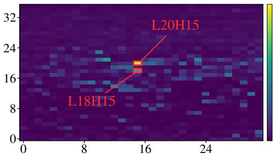  
(a) LiteResearcher-4B

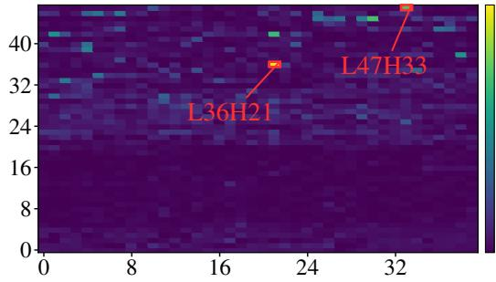  
(b) WebSeer-14B

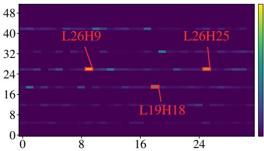  
(c) OpenResearcher-30B

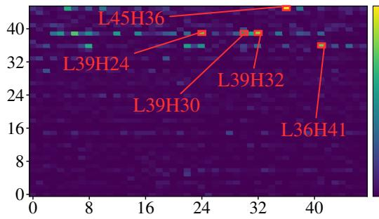  
(d) OpenPangu-2.0-Flash-92B  
Figure 4: Cross-model evidence-assessment head localization. Red boxes mark the annotated heads. The horizontal and vertical axes denote head and layer indices, respectively, both starting from zero.

In OpenResearcher-30B’s hybrid Mamba–Transformer architecture, which combines linear-time sequence modeling with full attention (Li et al., 2026c), the localized evidence-assessment heads reside in the full-attention layers. In OpenPangu’s DeepSeek-style hybrid sparse attention (openPangu, 2026), the signal is concentrated in the main multi-head latent attention (MLA) heads rather than the auxiliary indexer heads. These results support the presence of evidence-assessment heads across the tested architectures, within the attention components that aggregate contextual evidence.

## D.2 ROBUSTNESS OF QRAE SCORING

We assess DeepDiver-7B’s sensitivity to input-chunk order using the same BrowseComp-Plus candidate sets and metrics as in Table 3. For both the 5- and 20-chunk settings, we keep each query, its candidate chunks and evidence labels, and the model’s localized head set fixed, while randomly permuting the chunks within each input. In each repetition, we rescore the full evaluation set and compute AUC and each recall metric with the same aggregation as in Table 3. We summarize the variation across repetitions with the sample STD of each metric.

Table 16: Input-order sensitivity of QRAE scoring with DeepDiver-7B on BrowseComp-Plus. Entries show the reference score from Table 3 ± STD across input permutations. All scores use the percentage scale; STDs are in percentage points.
<table><tr><td rowspan="2">Model</td><td colspan="3">5 chunks</td><td colspan="3">20 chunks</td></tr><tr><td>AUC</td><td>Recall@1</td><td>Recall@3</td><td>AUC</td><td>Recall@1</td><td>Recall@10</td></tr><tr><td>DeepDiver</td><td> $8 3 . 2 \pm 0 . 5$ </td><td> $( 5 4 . 6 \pm 0 . 4 ) \%$ </td><td> $( 8 3 . 2 \pm 0 . 1 ) \%$ </td><td> $8 4 . 4 \pm 0 . 2$ </td><td> $( 4 4 . 6 \pm 0 . 6 ) \%$ </td><td> $( 8 8 . 7 \pm 0 . 1 ) \%$ </td></tr></table>

Across both candidate-set sizes, the STDs range from 0.1 to 0.6 percentage points. This low variation supports the stability of overall evidence discrimination and top-k evidence recall under input-order perturbations, without requiring individual chunk scores to be numerically identical.

Case study: qid-483. As a complementary case study on BrowseComp-Plus, we run QRAE 20 times on qid-483, randomly permuting the retrieved chunks after each search while holding the model, decoding seed, retrieval configuration, and serving environment fixed. We enable deterministic kernels with BATCH INVARIANT=1. All 20 runs produce identical agent-generated trajectories and final answers. Both input- and output-token counts have zero STD, while runtime has an STD of 0.1745 s. This case illustrates consistent downstream behavior under the tested retrieval-order permutations.

## D.3 STABILITY ACROSS RANDOM SEEDS

To assess the reliability of the end-to-end gains, Table 17 summarizes five complete runs of DeepSearch and QRAE on each of the four benchmarks, following the paired-seed protocol in Appendix C.5. Online search uses the Serper API, whose returned results can also vary across runs, adding retrieval variability to seed-induced variation.

For each run, success is the fraction of successful trajectories, while tokens and latency are averaged over all trajectories, including unsuccessful ones. End-to-end costs include evaluator overhead, as defined in Section 4.1. Entries report the mean and sample STD across the five runs, measuring run-to-run variability rather than differences between questions within one run.

Table 17: Comparison of DeepSearch and QRAE over five paired seeds (41–45) per benchmark, with every run covering all evaluation trajectories. Entries show mean ± sample STD; success is in percent, time in seconds, and tokens in thousands.
<table><tr><td>Dataset</td><td>Method</td><td>Success (%) ↑</td><td>Time (s) ↓</td><td>Tokens (k) ↓</td></tr><tr><td rowspan="2">BrowseComp- Plus</td><td>DeepSearch</td><td> $1 3 . 7 \pm 0 . 5$ </td><td> $2 9 . 6 \pm 0 . 3$ </td><td> $1 7 7 \pm 1 9$ </td></tr><tr><td>QRAE</td><td> ${ \bf 1 7 . 4 \pm 0 . 3 }$ </td><td> ${ \bf 2 0 . 6 \pm 0 . 1 }$ </td><td> ${ \bf 5 5 \pm 4 }$ </td></tr><tr><td rowspan="2">XBench- DeepSearch</td><td>DeepSearch</td><td> $3 8 . 4 \pm 3 . 1$ </td><td> $2 6 5 . 8 \pm 9 . 4$ </td><td> $3 1 1 \pm 2 4$ </td></tr><tr><td>QRAE</td><td> ${ \bf 4 4 . 6 \pm 1 . 8 }$ </td><td> ${ \bf 1 5 2 . 3 \pm 7 . 7 }$ </td><td> ${ \bf 1 2 0 \pm 1 5 }$ </td></tr><tr><td rowspan="2">FRAMES</td><td>DeepSearch</td><td> $4 0 . 9 \pm 1 . 1$ </td><td> $1 6 0 . 2 \pm 5 . 6$ </td><td> $1 3 8 \pm 1 4$ </td></tr><tr><td>QRAE</td><td> ${ \bf 4 2 . 7 \pm 1 . 2 }$ </td><td> ${ \bf 9 1 . 8 \pm 3 . 7 }$ </td><td> ${ \bf 9 2 \pm 1 0 }$ </td></tr><tr><td rowspan="2">SimpleQA</td><td>DeepSearch</td><td> $8 0 . 1 \pm 0 . 9$ </td><td> $1 4 3 . 1 \pm 7 . 7$ </td><td> $7 3 \pm 8$ </td></tr><tr><td>QRAE</td><td> ${ \bf 8 2 . 7 \pm 0 . 5 }$ </td><td> ${ \bf 9 9 . 5 \pm 5 . 8 }$ </td><td> ${ \bf 4 5 \pm 3 }$ </td></tr></table>

Across the four benchmarks, QRAE reduces tokens by 50.5% and end-to-end latency by 36.6%, while increasing success by 3.58 percentage points. These equally weighted averages use per-benchmark relative cost reductions and absolute success differences, computed from run means. Efficiency gains are large relative to the reported STDs; mean success improves on all four benchmarks, with a smaller margin relative to variability on FRAMES. These repeated-run results support a stable effectiveness–efficiency improvement.

## D.4 FUNCTIONAL ROLE OF QUERY-RELEVANT HEADS

We test whether the localized heads play a functional role in preparing evidence for subsequent reasoning. Using annotated evidence, we add a controlled bias $\beta$ to these heads’ attention logits and measure downstream task success. For chunk intervention, the same bias is added to every token in the annotated gold chunk. Token intervention restricts the patch to its annotated evidence span. “Prefill” removes the patch before autoregressive decoding, whereas “all” retains it throughout generation. All intervention strengths are evaluated over the same examples.

Table 18: Success (%) under attention intervention. “Prefill” applies the patch only during prefill; “all” retains it through decoding.
<table><tr><td>Target</td><td>Scope</td><td> $\beta = 0$ </td><td>2</td><td>3</td><td>4</td><td>5</td><td>6</td></tr><tr><td>Chunk</td><td>Prefill</td><td>11</td><td>11</td><td>12</td><td>15</td><td>16</td><td>19</td></tr><tr><td>Chunk</td><td>All</td><td>11</td><td>11</td><td>12</td><td>14</td><td>16</td><td>19</td></tr><tr><td>Token</td><td>Prefill</td><td>11</td><td>11</td><td>12</td><td>12</td><td>14</td><td>15</td></tr><tr><td>Token</td><td>All</td><td>11</td><td>11</td><td>12</td><td>13</td><td>14</td><td>16</td></tr></table>

Table 18 shows that chunk-level intervention raises success from 11% at $\beta = 0$ to 19% at $\beta = 6$ At higher bias strengths, chunk-level intervention is more effective than token-level intervention, suggesting a benefit from highlighting the full evidence context. Prefill-only intervention achieves gains comparable to retaining the patch through decoding. Together, these results support the view that the localized heads help prioritize relevant evidence during prefill for subsequent reasoning.

## D.5 TIME AND TOKEN COST BREAKDOWN

We analyze two representative benchmarks: BrowseComp-Plus with local retrieval and XBench-DeepSearch with online web search. Table 19 separates per-trajectory time into reasoning, retrieval, and compression, and token usage into agent inputs, agent outputs, and compression inputs. This breakdown captures both the additional cost of assessment and the savings in subsequent reasoning and tool use.

Table 19: Per-trajectory time and token breakdown for DeepSearch and QRAE. Time is measured in seconds and token counts in thousands (k). Input and output refer to the reasoning agent; compression costs are listed separately. Dashes indicate no compression component.
<table><tr><td rowspan="2">Dataset</td><td rowspan="2">Method</td><td colspan="3">Time (s)</td><td colspan="3">Tokens (k)</td></tr><tr><td>Reasoning</td><td>Tool</td><td>Compression</td><td>Input</td><td>Output</td><td>Compression</td></tr><tr><td rowspan="2">BrowseComp- Plus</td><td>DeepSearch</td><td>28.2</td><td>1.3</td><td></td><td>175</td><td>2.4</td><td></td></tr><tr><td>QRAE</td><td>17.3</td><td>0.9</td><td>2.3</td><td>48</td><td>1.3</td><td>4.9</td></tr><tr><td rowspan="2">XBench- DeepSearch</td><td>DeepSearch</td><td>144.3</td><td>131.7</td><td></td><td>314</td><td>4.6</td><td></td></tr><tr><td>QRAE</td><td>41.1</td><td>98.6</td><td>10.7</td><td>77</td><td>2.8</td><td>37</td></tr></table>

QRAE scoring reads prefill activations without generating a reasoning sequence. Each call processes a bounded batch of search snippets rather than the full accumulated trajectory, keeping its input substantially shorter than the reasoning context in long trajectories. The resulting compression time is modest: 2.3 s on BrowseComp-Plus and 10.7 s on XBench-DeepSearch, compared with reasoning-time savings of 10.9 s and 103.2 s, respectively. Reasoning time falls by approximately 39% and 72%; including compression and retrieval, end-to-end time still falls by approximately 31% and 46%.

The gains also reflect changes in search behavior. We observe approximately 30% fewer search calls with QRAE. Shorter contexts with fewer irrelevant results can make the retained evidence easier to use, particularly on difficult, long trajectories, and help the agent formulate more targeted follow-up search queries. This provides a plausible explanation for reaching an answer with fewer searches. The reduction matters especially for online retrieval: on XBench-DeepSearch, retrieval time falls from 131.7 s to 98.6 s, saving 33.1 s per trajectory.

Token savings arise from both admitting less search text into the reasoning context and taking fewer search and reasoning steps. Agent input tokens fall by approximately 73% on BrowseComp-Plus and 75% on XBench-DeepSearch, while output tokens fall by approximately 46% on BrowseComp-Plus and 39% on XBench-DeepSearch. Including the additional evaluator inputs, total token usage remains approximately 54k and 117k, compared with 177k and 319k for DeepSearch.

Evaluation introduces additional uncached input tokens when candidate batches are first processed, requiring fresh prefill computation. These inputs are therefore more costly to process than an already cached prefix. Nevertheless, in the evaluated runs, the combined uncached input volume of evaluation and reasoning remains below the uncached reasoning input volume of DeepSearch. Cached input volume and output tokens also decrease substantially. Thus, the extra evaluation inputs are offset even when cached and uncached inputs are distinguished, rather than treated as equally costly.

QRAE retains the reasoning-and-tool loop and the backend’s KV-cache semantics, changing which search results enter the active context. Prefix reuse remains enabled, including reuse between the paired evaluator calls, and the observed cache-hit rate is nearly unchanged. The savings therefore come from processing less context and taking fewer calls while retaining prefix reuse, rather than from a higher cache-hit rate.

A further deployment option is to expose a smaller evaluator through an API while using a larger model for reasoning. The evaluator could score candidate batches asynchronously alongside independent reasoning or tool work, reducing assessment cost and potentially hiding part of its latency. This is a prospective deployment extension: its net benefit would depend on evidence selection quality, available overlap, and communication overhead, and is not included in the reported gains.

## D.6 EFFECT OF HEAD SELECTION

We isolate the effect of head selection while keeping query-free subtraction and normalized-entropy scoring fixed. All three conditions use two heads on DeepDiver-7B and the same BrowseComp-Plus candidate sets, evidence labels, and retained-chunk budgets as Table 4. We compare the heads localized by QRAE with randomly selected heads and heads selected by QRHead, applying the same QRAE scoring rule to each set.

Table 20: Head-selection comparison on BrowseComp-Plus with DeepDiver-7B. All head sets use the same QRAE scoring rule. AUC denotes AUROC; all metrics are percentages and higher is better.
<table><tr><td rowspan="2">Head set</td><td colspan="3">5 chunks</td><td colspan="3">20 chunks</td></tr><tr><td>AUC</td><td>Recall@1</td><td>Recall@3</td><td>AUC</td><td>Recall@1</td><td>Recall@10</td></tr><tr><td>QRAE (full)</td><td>83.2</td><td>54.6%</td><td>83.2%</td><td>84.4</td><td>44.6%</td><td>88.7%</td></tr><tr><td>Random heads</td><td>45.7</td><td>9.9%</td><td>38.8%</td><td>53.0</td><td>5.3%</td><td>40.2%</td></tr><tr><td>Heads selected by QRHead</td><td>68.3</td><td>24.5%</td><td>70.0%</td><td>70.4</td><td>13.9%</td><td>63.3%</td></tr></table>

Random heads provide little useful evidence discrimination: their AUCs of 45.7 and 53.0 are close to chance, and Recall@1 is only 9.9% and 5.3% in the 5- and 20-chunk settings, respectively. Heads selected by QRHead show a stronger association with evidence, reaching AUCs of 68.3 and 70.4, but remain consistently weaker than the heads localized by QRAE. The full method improves AUC over this control by 14.9 and 14.0 percentage points and achieves higher recall on every reported metric. With the head count and scoring rule held fixed, these results support the value of QRAE’s offline localization for extracting an effective evidence-ranking signal.

Applying the QRHead localization procedure to DeepDiver-7B yields the following top-10 heads in descending rank: L16H10, L14H31, L16H8, L12H3, L16H16, L12H27, L14H10, L15H6, L11H30, and L14H28. None overlaps with the heads localized by QRAE, L18H22 and L17H0. Although both approaches identify heads responsive to query-related content, they select different head sets in this model. One possible interpretation is that QRHead selection emphasizes query retrieval and the routing of matching context, whereas QRAE localization favors heads that gate the flow of evidence during prefill. This difference in emphasis may explain why QRHead-selected heads retain some relevance signal but provide weaker evidence discrimination under our scoring rule.

## E THEORETICAL ANALYSIS OF QRAE

This appendix records conditional properties of the three components used by QRAE: offline head localization, online query-free control subtraction, and entropy-based admission. It also formalizes the bounded evaluator input and the prompt-token savings from deferred propagation. These results explain the construction of the method under explicit assumptions; they do not establish that highentropy response is semantically relevant or that compression preserves task accuracy. Those claims are evaluated empirically in Section 4.

## E.1 FINITE-SAMPLE STABILITY OF HEAD LOCALIZATION

Let $\mathcal { G }$ be the set of candidate layer–head pairs and $G = | \mathcal { G } |$ . Write $\mathcal { D } _ { \mathrm { c a l } } = \{ ( Q _ { n } , d _ { n } , E _ { n } ) \} _ { n = 1 } ^ { N }$ . For each calibration input and head $^ { g , }$ let $\begin{array} { r } { \bar { Z _ { n , g } } = \sum _ { u \in E _ { n } } \dot { R _ { g } } ( u ; \mathcal { X } _ { n } ) \in [ 0 , 1 ] } \end{array}$ denote the final-querytoken attention mass on the labeled answer tokens, as used in Equation 1. Define its population and empirical means as

$$
\mu _ { g } = \mathbb { E } [ Z _ { n , g } ] , \qquad \widehat { \mu } _ { g } = \frac { 1 } { N } \sum _ { n = 1 } ^ { N } Z _ { n , g } .
$$

We use $K _ { \mathrm { H } }$ for the number of selected heads, distinguishing it from the online candidate-batch limit $K .$

Proposition E.1 (Uniform calibration bound). Ifthe calibration inputs are independent drawsfrom a common calibration distribution, thenfor any $\delta \in ( 0 , 1 )$ , with probability at least $1 - \delta ,$

$$
\operatorname* { m a x } _ { g \in \mathcal { G } } \left. \widehat { \mu } _ { g } - \mu _ { g } \right. \leq \epsilon _ { N } ( \delta ) : = \sqrt { \frac { \log ( 2 G / \delta ) } { 2 N } } .\tag{4}
$$

If the gap between the $K _ { \mathrm { H } } – t h$ and $( K _ { \mathrm { H } } + 1 )$ -th largest population means is greater than $2 \epsilon _ { N } ( \delta )$ empirical $t o p { \cdot } K _ { \mathrm { H } }$ selection recovers the population top-KH set on the same event.

Proof. For a fixed head, Hoeffding’s inequality gives $\operatorname* { P r } ( | \widehat { \mu } _ { g } - \mu _ { g } | > \epsilon ) \leq 2 e ^ { - 2 N \epsilon ^ { 2 } }$ for variables in [0, 1]. A union bound over $G$ heads and the choice $\epsilon = \epsilon _ { N } ( \delta )$ prove Equation 4. On this event, every empirical mean is within $\epsilon _ { N } ( \delta )$ of its population value. A population boundary gap larger than twice this deviation prevents any head below the boundary from overtaking a head above it. □

Proposition E.1 gives a sufficient condition for repeatable offline localization. It does not assert that the required population gap exists or that the same heads must appear in different models; the cross-dataset and cross-model analyses test those empirical questions.

## E.2 ROBUSTNESS OF MATCHED-CONTROL SUBTRACTION

Consider the normalized attention rows restricted to an evaluation batch. Write

$$
\bar { a } ^ { ( Q ) } = b + \Delta + e _ { Q } , \qquad \bar { a } ^ { ( 0 ) } = b + e _ { 0 } ,\tag{5}
$$

where b is response shared by the query and control inputs, $\Delta$ is the ideal query-induced change, and $e _ { Q } , e _ { 0 }$ collect mismatch and measurement error. Let $\begin{array} { r } { \dot { x } = [ \bar { a } ^ { ( Q ) } - \bar { a } ^ { ( 0 ) } ] . } \end{array}$ be the QRAE response and $x ^ { \star } = [ \Delta ] _ { + }$ its ideal counterpart.

Lemma E.2 (Matched-control robustness). For any decomposition in Equation ${ 5 , }$

$$
\| x - x ^ { \star } \| _ { 1 } \leq \| e _ { Q } - e _ { 0 } \| _ { 1 } .
$$

Thus the shared component b cancels exactly, and control mismatch perturbs the positive response by no more than its own $\ell _ { 1 }$ discrepancy.

Proof. Subtraction cancels b and yields $x = [ \Delta + e _ { Q } - e _ { 0 } ] _ { + }$ . Coordinatewise positive clipping is 1-Lipschitz, so $\| [ u ] _ { + } - [ v ] _ { + } \| _ { 1 } \mathbf { \dot { \Omega } } \leq \| u - v \| _ { 1 } \mathbf { \dot { \Omega } }$ . Taking $\boldsymbol { u } = \Delta + e _ { Q } - e _ { 0 }$ and $v = \Delta$ proves the claim. □

The bound can be propagated through within-chunk normalization. Suppose $\rho ~ = ~ \| x ^ { \star } \| _ { 1 } ~ > ~ 0$ $\eta = \| e _ { Q } - e _ { 0 } \| _ { 1 } < \rho ,$ and let $p = x / \| x \| .$ 1 and $p ^ { \star } = x ^ { \star } / \rho .$ . Then

$$
\| p - p ^ { \star } \| _ { 1 } \leq \frac { 2 \eta } { \rho - \eta } .\tag{6}
$$

Indeed, Lemma E.2 implies $\| x \| _ { 1 } \geq \rho - \eta ;$ adding and subtracting $x ^ { \star } / \| x \| _ { 1 }$ proves Equation 6. Consequently, when the ideal positive mass is separated from zero, standard entropy-continuity bounds also control the change in the normalized QRAE score. In particular, total variation satisfies

$$
\mathrm { T V } ( p , p ^ { \star } ) \leq \frac { \eta } { \rho - \eta } ,\tag{7}
$$

which supplies the perturbation radius used in Proposition E.4 whenever the right-hand side satisfies that proposition’s range condition.

## E.3 ROBUST ENTROPY SEPARATION

For a nonzero positive response on a chunk of length $n > 1$ , let p denote the within-chunk distribution obtained by normalizing $\{ \Delta _ { h } ( u ) \} _ { u \in d }$ . Write $E { \bar { ( } } p { \mathrm { ) } } = { \mathrm { E n t r o p y } } ( p ) /$ log n, as in Equation 3. Define $g _ { n } ( \delta ) = h _ { 2 } ( \delta ) + \delta \log ( n - 1 )$ , where $h _ { 2 }$ is binary entropy.

Proposition E.3 (Effective response support). For every distribution p over n tokens,

$$
0 \leq E ( p ) \leq 1 , \qquad \exp ( \mathrm { E n t r o p y } ( p ) ) = n ^ { E ( p ) } .
$$

The lower bound is attained by a point mass and the upper bound by the uniform distribution. The score is invariant to positive rescaling ofthe unnormalized response x. $H p$ is uniform on exactly m tokens, then

$$
E ( p ) = { \frac { \log m } { \log n } } .
$$

Proof. The entropy of a distribution on n outcomes lies in [0, log n], with the stated equality cases. Exponentiating Entropy $\mathbf { \boldsymbol { \cdot } } ( \boldsymbol { p } ) = E ( \boldsymbol { p } )$ log n gives the effective support identity. Positive rescaling cancels between the numerator and denominator of $\begin{array} { r } { p _ { u } = x _ { u } / \sum _ { v } x _ { v } . } \end{array}$ . A uniform distribution on m tokens has entropy log m. □

We now state the condition under which the constructed signal ranks an evidence-bearing response above a narrow distractor.

Proposition E.4 (Robust query-induced breadth separation). For one selected head, consider an evidence chunk and a distractor of equal length $n > 1$ . Let $p _ { \mathrm { e } } ^ { \star }$ and $p _ { \mathrm { d } } ^ { \star }$ be their ideal normalized positive query-induced responses, and let $p _ { \mathrm { e } }$ and $p _ { \mathrm { d } }$ be the distributions recovered by the matchedcontrol construction. Suppose $p _ { \mathrm { e } } ^ { \star }$ is uniform on m tokens, $p _ { \mathrm { d } } ^ { \star }$ is supported on at most $r < m$ tokens, with $\begin{array} { r } { \mathrm { T V } ( p _ { c } , p _ { c } ^ { \star } ) \leq \delta , c \in \{ \mathrm { e , d } \} , 0 \leq \delta \leq 1 - \frac { 1 } { n } } \end{array}$ . Then

$$
E ( p _ { \mathrm { e } } ) - E ( p _ { \mathrm { d } } ) \geq \left[ \log ( m / r ) - 2 g _ { n } ( \delta ) \right] / \log n .\tag{8}
$$

Consequently, the QRAE score ranks the evidence response above the distractor whenever $\log ( m { \bar { / } } r ) > 2 g _ { n } ( \delta )$

Proof. For distributions on n outcomes whose total-variation distance is at most $\delta \leq 1 - 1 / n$ , the entropy-continuity inequality gives

$$
| \operatorname { E n t r o p y } ( p ) - \operatorname { E n t r o p y } ( p ^ { \star } ) | \leq h _ { 2 } ( \delta ) + \delta \log ( n - 1 ) = g _ { n } ( \delta ) .
$$

Because $p _ { \mathrm { e } } ^ { \star }$ is uniform on m tokens, Entropy(p⋆) = log m. Because $p _ { \mathrm { d } } ^ { \star }$ is supported on at most r tokens, Entropy $( p _ { \mathrm { d } } ^ { \star } ) \leq \log r$ . Therefore,

$$
\mathrm { E n t r o p y } ( p _ { \mathrm { e } } ) \ge \log m - g _ { n } ( \delta ) ,
$$

$$
\operatorname { E n t r o p y } ( p _ { \mathrm { d } } ) \leq \log r + g _ { n } ( \delta ) .
$$

Subtracting these inequalities and dividing by log n proves Equation 8. If the condition holds for every selected head, averaging the per-head scores preserves the average of their positive margins.

Proposition E.4 makes the construction’s inductive bias explicit. With an exact control $( \delta = 0 )$ , the score margin is at least $\log ( m / r ) ,$ / log n: broader positive support wins independently of response scale. With imperfect matching, the ranking is preserved when the breadth margin dominates the estimation error.

Equation 7 connects control mismatch to the proposition: for each chunk, a mismatch of mass η against ideal positive mass $\rho$ produces a total-variation radius no larger than $\eta / ( \rho - \eta )$ . Deviations from exact uniformity can likewise be included in the total-variation radius relative to the corresponding ideal response.

These results formalize response breadth, not semantic support. Diffuse noise can also have high entropy, so evidence overlap must be verified empirically. They also expose a residual length effect: for fixed m, the normalized score log m/ log n decreases with chunk length. Normalization places scores on a common [0, 1] scale but does not make them fully length-invariant.

## E.4 CONCENTRATION OF REPEATED SCORES

Proposition E.5 (Running-mean concentration). Let $S _ { 1 } , \ldots , S _ { R } \in [ 0 , 1 ]$ be independent evaluations of one chunk with a common mean $\mu ,$ and let $\begin{array} { r } { \bar { S } _ { R } = R ^ { - 1 } \sum _ { r = 1 } ^ { R } S _ { r } , } \end{array}$ . For any $\epsilon > 0$

$$
\begin{array} { r } { \operatorname* { P r } ( | \bar { S } _ { R } - \mu | \geq \epsilon ) \leq 2 e ^ { - 2 R \epsilon ^ { 2 } } . } \end{array}
$$

Proof. Apply Hoeffding’s inequality to independent variables bounded in [0, 1].

This conditional result describes the running-mean estimates used to rank cached candidates. The actual manager selects the top $\lceil \rho K \rceil$ scored candidates after each evaluation; the proposition does not guarantee that this ranking identifies the most useful evidence. Batch composition and trajectory state can change between evaluations, so the independent common-mean model is an idealization rather than a guaranteed property.

## E.5 EVALUATION COST AND AMORTIZED SAVINGS

QRAE scoring uses the paired query and control prefills described in Section 3. Each evaluation adds input tokens, while keeping deferred chunks outside the reasoning context avoids repeatedly forwarding their tokens through later agent steps (Figure 1). We account for these two terms below.

Let $L _ { I }$ and $L _ { Q }$ be the instruction and query lengths, and suppose every candidate chunk contains at most L tokens. Let $\begin{array} { r } { \ell _ { t } = \sum _ { d \in B _ { t } } | d | } \end{array}$ be the candidate-token volume at trigger t, and let $\mathcal { T } _ { \mathrm { e v a l } }$ contain all evaluation triggers.

Proposition E.6 (Bounded evaluator input). At one evaluation trigger, the total input-token volume ofthe matched query and control prefills is at mos

$$
2 { \cal L } _ { I } + { \cal L } _ { Q } + 2 K { \cal L } ,\tag{9}
$$

independently of the number of chunks stored in the candidate cache.

Proof. The query prefill contains $\begin{array} { r } { L _ { I } + L _ { Q } + \sum _ { d \in B _ { t } } | d | } \end{array}$ tokens and the control prefill contains $\textstyle L _ { I } + \sum _ { d \in B _ { t } } | d |$ . Since $| B _ { t } | \le K$ and $| d | \leq L$ , their sum is bounded by Equation 9. □

Writing $E _ { t } = 2 L _ { I } + L _ { Q } + 2 \ell _ { t }$ for the input-token cost of one evaluation, the cumulative evaluator input is

$$
E _ { \mathrm { e v a l } } = \sum _ { t \in \mathcal { T } _ { \mathrm { e v a l } } } E _ { t } .
$$

Proposition E.6 shows that the per-trigger input bound is independent of the total candidate-cache size $| \mathcal { C } _ { t } |$

Proposition E.7 (Deferred propagation savings). Suppose a chunk d is retrieved at step $t _ { 0 }$ and an uncompressed agent would include it in every subsequent prompt through step T. If QRAE first admits it at step $t _ { a } \geq t _ { 0 } ,$ , deferral avoids

$$
( t _ { a } - t _ { 0 } ) | d |
$$

prompt tokens relative to immediate forwarding. If the chunk is never admitted, the saving is $\bar { ( T - t _ { 0 } ) } | d |$ , under the convention that retrieval at step $t _ { 0 . }$ first affects the prompt for step $t _ { 0 } + 1$

Proof. Immediate forwarding includes d in the prompts for steps $t _ { 0 } + 1 , \ldots , t _ { a }$ , whereas deferred admission does not. There are $t _ { a } - t _ { 0 }$ such prompts, each contributing $| d |$ tokens. If admission never occurs, the same count extends through step $T .$ □

Let $\mathcal { D } _ { \mathrm { d e f } }$ be the set of deferred chunks, and let $h ( d )$ count the subsequent reasoning contexts from which chunk d is withheld. Summing the per-chunk savings in Proposition E.7 gives

$$
S _ { \mathrm { p r o p } } = \sum _ { d \in \mathcal { D } _ { \mathrm { d e f } } } h ( d ) | d | .
$$

Evaluation is amortized in input-token volume when $S _ { \mathrm { p r o p } } > E _ { \mathrm { e v a l } }$ . Longer deferral horizons favor QRAE, whereas frequent triggers or short trajectories reduce net savings.

This condition concerns input-token volume, not uniformly lower attention FLOPs or latency, which also depend on sequence length, model size, backend implementation, and prefix reuse. Token savings alone do not guarantee preserved task accuracy. Appendix C.4 describes prefix reuse and the full token and latency accounting. The end-to-end evaluation in Section 4.2 measures the realized savings, including evaluator overhead, and tests whether useful evidence is preserved through task success.