# Reproducing Kernel (Quasi-)Banach Spaces with the ℓp Coeficient Norms

Tianfang Wang,∗ Guohui Song†, and Haizhang Zhang‡

## Abstract

This paper advances the theory of reproducing kernel Banach spaces (RKBSs) by investigating the general ℓp regularization framework, with a particular focus on the non-convex regime 0 < p < 1. While our preceding work established the foundation for RKBSs with the ℓ1 norm, the pursuit of stronger sparsity—closer to the ℓ0 pseudo-norm—naturally motivates this exploration into ℓp quasinorms. For $0 < p < 1$ , we construct reproducing kernel quasi-Banach spaces (RKQBSs) with ℓp quasi-norms and establish existence and sparsity results for interpolation and regularized learning under appropriate assumptions. We characterize the linear and relaxed representer theorems in terms of a generalized Lebesgue constant and derive bounds under kernel decay, sample spacing, and stability assumptions. For p > 1, we construct RKBSs using a fixed countable dictionary, establish minimizer existence, and identify the optimal relaxed representer factor through an ofsample coeficient operator. These results reveal fundamental diferences between the regimes $0 < p < 1 , p = 1$ , and p > 1. Numerical experiments compare the accuracy and sparsity of solutions for these three cases.

## 1 Introduction

Kernel methods constitute a vital component of machine learning theory, with wide applications in function approximation, regression analysis, classification, numerical solutions of partial diferential equations, and scientific computing, [5, 35, 36, 42, 44]. In recent years, with the rapid development of large-scale data analysis and high-dimensional learning tasks, reducing model complexity and improving representation eficiency while maintaining approximation capability has become a major research direction in kernel learning theory. Among others, learning models that yield sparse representations are highly appealing as they not only exhibit lower computational complexity but also enhance interpretability and generalization ability. Consequently, sparse models have attracted significant attention from fields such as machine learning, compressed sensing, and signal processing, [7, 12, 17, 43, 47, 50].

Classical kernel learning theory is fundamentally built upon the framework of reproducing kernel Hilbert spaces (RKHSs) [2, 14, 15]. Owing to the inner product structure of RKHSs, continuous pointwise evaluation functionals can be uniquely represented via the Riesz representation theorem, leading to elegant reproducing properties. Building upon this foundation, Kimeldorf and Wahba [27] introduced the renowned Representer Theorem, which was later generalized to a broader context [1, 25, 34, 45], thereby establishing the mathematical underpinnings of contemporary kernel learning theory.

Nonetheless, RKHSs employ the Hilbert norm as the regularization term, which essentially corresponds to quadratic regularization and typically leads to dense representations of the optimal solutions. With the advances in compressed sensing, sparse representation, and high-dimensional statistics, researchers have paid increasing attention to learning models that can directly generate sparse solutions. Compared with quadratic regularization, regularization based on the $\ell ^ { p \ }$ norm $( 0 < p \le 1 )$ induces sparsity much more efectively, where $p = 1$ corresponds to the classical convex sparse regularization widely studied in the literature [31, 39, 46, 48]. Indeed, when $0 < p < 1$ , although the $\ell ^ { p \ }$ space is no longer a Banach space, it can induce even stronger sparsity than $\ell ^ { 1 }$ , which is of great importance in compressed sensing, non-convex optimization, variable selection, and signal recovery, [6, 9, 10, 20, 50]. Moreover, for the particular case when $p = { \begin{array} { l } { { \frac { 1 } { 2 } } } \end{array} } \mathrm { o r } \ p = { \begin{array} { l } { { \frac { 2 } { 3 } } } \end{array} }$ , the proximity operator for solving the $\ell ^ { p _ { . } }$ regularized learning problems has an explicit form [8]. On the other hand, when $p > 1$ , the $\ell ^ { p \ }$ space reverts to a Banach space, whose geometric structure difers fundamentally from that of the $0 < p < 1$ regime, necessitating the redevelopment of its representer and approximation theories. Therefore, studying reproducing kernel spaces associated with diferent parameters $p$ under a unified framework is of importance to enriching kernel learning theory.

In recent years, the theory of reproducing kernel Banach spaces (RKBSs) has witnessed rapid development. Existing works have constructed diferent types of RKBSs based on semi-inner products, bi-dual mappings, and bilinear forms, successfully extending representer theorems, interpolation theories, and regularized learning frameworks from RKHSs [19, 30, 46, 49, 51]. Furthermore, remarkable progress has recently been made in utilizing the RKBS framework to describe shallow and deep neural networks, introduce the hypothesis space, establish duality theory, analyze generalization bounds via Rademacher complexity, and extend these models to vector-valued settings for operators and hypernetworks [3, 16, 18, 24, 37, 40, 47]. However, the current RKBS theory heavily relies on the geometric properties of Banach spaces, such as local convexity, the Hahn-Banach theorem, and uniform smoothness, which prevents its direct application to function spaces associated with $0 \textless p \textless 1 \textcircled { 3 2 }$ . To establish a learning theory in this regime, it is first necessary to understand the fundamental analytical properties of the $\ell ^ { p \ }$ space $( 0 < p < 1 )$ , including characterization of continuous linear functionals, basic inequalities of the p-norm, and structural properties of the associated function spaces.

Building upon the aforementioned foundations, the primary purpose of the paper is to construct reproducing kernel (quasi-) Banach spaces with $\ell ^ { p \ }$ coeficient (quasi-) norms and characterize their linear and relaxed representer theorems. Specifically, given a function $K ( x , y )$ (not necessarily positivedefinite or symmetric), we seek a space $B _ { p }$ with the following properties:

1. Point evaluations are continuous linear functionals on $B _ { p }$

2. The space $B _ { p }$ possesses the $\ell ^ { p \ }$ norm (quasi-norm for $0 < p < 1 )$ , that is,

$$
\| f \| _ { B _ { p } } = \| \mathbf { c } \| _ { p } = \left( \sum _ { m = 1 } ^ { \infty } | c _ { m } | ^ { p } \right) ^ { 1 / p } { \mathrm { ~ f o r ~ } } f ( x ) = \sum _ { m = 1 } ^ { \infty } c _ { m } K ( x _ { m } , x ) .
$$

3. Under appropriate conditions, a linear representer theorem holds

$$
\displaystyle \operatorname* { m i n } _ { f = \sum _ { j = 1 } ^ { n } c _ { j } K ( x _ { j } , \cdot ) } \sum _ { j = 1 } ^ { n } L ( f ( x _ { j } ) , y _ { j } ) + \lambda \| { \bf c } \| _ { p } = \operatorname* { m i n } _ { f \in B _ { p } } \sum _ { j = 1 } ^ { n } L ( f ( x _ { j } ) , y _ { j } ) + \lambda \| f \| _ { B _ { p } } ,
$$

where L stands for a loss function.

The case when $p = 1$ was established in [39]. What deters us from investigating the case when $0 < p < 1$ is that $\ell ^ { p \ }$ has a quasi-norm and that the dual space of $L ^ { p } [ 0 , 1 ]$ when $0 < p < 1$ is {0} [13], which means that there are no meaningful continuous linear functionals on $L ^ { p } [ 0 , 1 ]$ . We now realize that the discrete space $\ell ^ { p \ }$ is fundamentally diferent from the continuous space $L ^ { p } [ 0 , 1 ]$ . Although $\ell ^ { p \ }$ when $0 < p < 1$ has a quasi-norm which does not satisfy the triangle inequali ${ \mathrm { , y , } }$ it does satisfy a quasi-triangle inequality, which is suficient for approximation in the corresponding RKBSs. Also, the dual space of $\ell ^ { p \ }$ when $0 < p < 1$ is always $\ell ^ { \infty }$ , which results in bounded point evaluations when $K ( \cdot , x )$ is bounded for each x. For $0 < p < 1$ , we are able to construct reproducing kernel quasi-Banach spaces (RKQBSs) with $\ell ^ { p \ }$ quasi-norms to accommodate sparse learning models with continuous point evaluations.

This paper first investigates the minimum norm interpolation problem in the $0 < p < 1$ regime. Under the continuity and compactness or decay assumptions stated below, we prove existence of minimal norm interpolants for feasible targets and regularized minimizers with freely chosen centers. Nonsingularity of the sample matrix guarantees feasibility for every target. Minimal norm interpolants use at most n centers in the real-valued setting; a regularized minimizer with the same bound exists. These centers need not be sampling points, so their locations must also be determined, which complicates computation. This motivates the linear representer theorem, which guarantees the existence of a minimizer with the sampling points as centers. Compared with existing $\ell ^ { 1 }$ regularization theories, this work extends representer theorems to non-locally convex function spaces, providing a unified functional analytic framework for non-convex kernel learning models. We emphasize that the linear representer theorem in the current study seeks minimal solutions expressed as a linear combination of the kernel functions at the sampling points, making the corresponding coeficient regularization learning algorithms computationally tractable, whereas existing studies [45, 46, 48, 51] on representer theorems in Banach spaces express the minimizer in the dual space of RKBSs, which may cause computational dificulties.

The linear representer theorem is closely related to the generalized Lebesgue constant of the associated kernel. Our main theoretical results distinguish $0 < p < 1$ and $p > 1$ , with the classical case $p = 1$ providing a comparison. For $p = 1$ , the linear representer theorem is characterized by the condition $\Lambda _ { 1 } ( \mathbf { x } ) = 1$ , where $\Lambda _ { 1 }$ is the Lebesgue constant associated with interpolation [39]. Kernels satisfying this condition include the Brownian bridge. For $0 < p < 1$ , the necessary and suficient condition is $\Lambda _ { p } ( { \bf x } ) = 1$ , where $\Lambda _ { p }$ is the generalized Lebesgue constant defined in (18). This condition fails for two-point configurations of several classical kernels. By allowing a relaxed representer theorem with a factor $\beta _ { n } > 1$ , we show that for $0 < p < 1$ , the relaxed theorem holds precisely when $\Lambda _ { p } ( \mathbf { x } ) \leq \beta _ { n }$ Decay assumptions, sample spacing, and uniform stability of the finite sample matrices give bounds on this factor as the sample size grows. For $p > 1$ , we show in Section 5 that the representer theorem fails in general. We shall turn to establish a suficient condition for a relaxed representer theorem by requiring the $\ell ^ { p _ { - } }$ Lebesgue constant to be bounded by $\beta _ { n } - 1$

The remainder of this paper is organized as follows. Section 2 introduces RKQBSs with $\ell ^ { p \ }$ quasinorms for $0 ~ < ~ p ~ < ~ 1$ , establishes their basic properties, and gives suficient conditions for their construction. Section 3 establishes existence and sparsity results for interpolation and regularized learning and characterizes the linear representer theorem. Section 4 establishes the relaxed representer theorem in the $0 < p < 1$ regime and investigates the corresponding Lebesgue constant estimates. Section 5 develops the fixed-dictionary RKBS construction, spectral conditions, linear representer obstruction, and sharp relaxed estimates for $p > 1$ . Section 6 presents numerical experiments using three typical translation-invariant kernels: the Gaussian kernel, the Laplacian kernel, and the inverse multiquadric (IMQ) kernel. The experiments are performed under various target functions, noise levels, regularization parameters, and values of $p .$ The experimental results indicate that when $0 <$ $p < 1$ , our proposed model achieves sparser representations while maintaining high approximation accuracy.

## 2 RKQBSs with ℓp Norms for $0 < p < 1$

This section constructs RKQBSs with $\ell ^ { p \ }$ quasi-norms for $0 < p < 1$ . We begin with the sequencespace properties needed for kernel synthesis and define the function space through a global coeficient representation. We then verify the kernel assumptions for a class of translation-invariant kernels, establish completeness and bounded point evaluations, and construct a continuous bilinear pairing that gives the reproducing identity. Throughout the paper, we shall work mainly on the field R of real numbers.

## 2.1 ℓp Spaces

Definition 1 For $0 < p < + \infty$ , the sequence space $\ell ^ { p \ }$ is defined as the set of all real-valued sequences $\mathbf { c } = \{ c _ { n } \} _ { n \in \mathbb { N } }$ such that

$$
\sum _ { n = 1 } ^ { \infty } | c _ { n } | ^ { p } < \infty .
$$

It is equipped with the norm for $p \geq 1$ or quasi-norm for $0 < p < 1$ , denoted by $\| \cdot \| _ { p }$ and defined by

$$
\| \mathbf { c } \| _ { p } : = \left( \sum _ { n = 1 } ^ { \infty } | c _ { n } | ^ { p } \right) ^ { 1 / p } .\tag{1}
$$

The spaces $\ell ^ { \infty }$ and $c _ { 0 }$ consist of bounded real-valued sequences, and real sequences that converge to zero at infinity, respectively. The norm on $\ell ^ { \infty }$ and $c _ { 0 }$ is

$$
\| \mathbf { c } \| _ { \infty } = \operatorname* { s u p } _ { n \in \mathbb { N } } | c _ { n } | .
$$

Note that $c _ { 0 }$ is a subspace of $\ell ^ { \infty }$ . We present below properties for $0 < p < 1$ that will be needed in later sections.

When $0 < p < 1$ , the space $\ell ^ { p \ }$ difers significantly from standard Banach spaces.

Lemma 2 [26] Let $0 < p < 1$ . The following statements hold:

1. $\| \cdot \| _ { p } ^ { p }$ satisfies the triangle inequality

$$
\| \mathbf { x } + \mathbf { y } \| _ { p } ^ { p } \leq \| \mathbf { x } \| _ { p } ^ { p } + \| \mathbf { y } \| _ { p } ^ { p } , ~ \mathbf { x } , \mathbf { y } \in \ell ^ { p } .\tag{2}
$$

2. $\ell ^ { p \ }$ is a complete metric space with the metric

$$
d ( \mathbf { x } , \mathbf { y } ) = \| \mathbf { x } - \mathbf { y } \| _ { p } ^ { p } , ~ \mathbf { x } , \mathbf { y } \in \ell ^ { p } .
$$

3. The quasi-norm $\| \cdot \| _ { p }$ satisfies a quasi-triangle inequality

$$
\begin{array} { r } { \| \mathbf { x } + \mathbf { y } \| _ { p } \leq 2 ^ { \frac { 1 } { p } - 1 } ( \| \mathbf { x } \| _ { p } + \| \mathbf { y } \| _ { p } ) , \mathbf { x } , \mathbf { y } \in \ell ^ { p } . } \end{array}
$$

4. Every continuous linear functional L on $\ell ^ { p \ }$ has a unique representation

$$
L ( \mathbf { a } ) = \sum _ { n = 1 } ^ { \infty } a _ { n } c _ { n } , \qquad \mathbf { a } \in \ell ^ { p } ,
$$

with $\mathbf { c } \in \ell ^ { \infty }$ , and

$$
\| L \| : = \operatorname* { s u p } _ { \| \mathbf { a } \| _ { p } \leq 1 } | L ( \mathbf { a } ) | = \| \mathbf { c } \| _ { \infty } .
$$

Thus $( \ell ^ { p } ) ^ { * }$ is isometrically identified with $\ell ^ { \infty }$ through this bilinear pairing.

The following lemma extends finite subadditivity of $\| \cdot \| _ { p } ^ { p }$ to infinite subadditivity.

Lemma 3 Let $0 < p < 1$ and let $\mathbf { x } ^ { ( j ) } = \{ x _ { i } ^ { ( j ) } \} _ { i \geq 1 } \in \ell ^ { p }$ for $j \geq 0$ . Suppose that, for every $i \geq 1$ , the scalar series

$$
x _ { i } : = \sum _ { j = 0 } ^ { \infty } x _ { i } ^ { ( j ) }
$$

converges and that $\mathbf { x } = \{ x _ { i } \} _ { i \geq 1 } \in \ell ^ { p }$ . Then

$$
\| \mathbf { x } \| _ { p } ^ { p } \leq \sum _ { j = 0 } ^ { \infty } \| \mathbf { x } ^ { ( j ) } \| _ { p } ^ { p } .
$$

Proof: Finite subadditivity gives

$$
\left\| \sum _ { j = 0 } ^ { N } \mathbf { x } ^ { ( j ) } \right\| _ { p } ^ { p } \leq \sum _ { j = 0 } ^ { N } \| \mathbf { x } ^ { ( j ) } \| _ { p } ^ { p } .\tag{3}
$$

By coordinatewise convergence and Fatou’s lemma,

$$
\| \mathbf { x } \| _ { p } ^ { p } \leq \operatorname* { l i m i n f } _ { N \to \infty } \left\| \sum _ { j = 0 } ^ { N } \mathbf { x } ^ { ( j ) } \right\| _ { p } ^ { p } \leq \sum _ { j = 0 } ^ { \infty } \| \mathbf { x } ^ { ( j ) } \| _ { p } ^ { p } .
$$

The next lemma indicates that for $0 < p < 1 , \ell ^ { p } \subseteq \ell ^ { 1 }$

Lemma 4 For $0 < p < 1 , \ell ^ { p } \subseteq \ell ^ { 1 }$ and it holds

$$
\| \mathbf { a } \| _ { 1 } \leq \| \mathbf { a } \| _ { p } , \qquad \mathbf { a } \in \ell ^ { p } .
$$

Proof: As $0 < p < 1$ , we have the finite subadditivity

$$
\left( \sum _ { n = 1 } ^ { N } | a _ { n } | \right) ^ { p } \leq \sum _ { n = 1 } ^ { N } | a _ { n } | ^ { p } .
$$

Letting $N \to \infty$ and then raising both sides to the power $\frac { 1 } { p }$ proves the claim.

## 2.2 Kernel-based Function Spaces with $\ell ^ { p \ }$ Quasi-Norms

Let X be a nonempty set and let $K : X \times X \to \mathbb { R }$ . We construct a function space from linear combinations of $K ( t , \cdot )$ , with coeficients in ℓp. The function K is not required to be symmetric or positive semi-definite.

Definition 5 For $0 < p < 1$ , denote by $\ell ^ { p } ( X )$ the space of p-integrable functions on X with respect to the counting measure on X. Namely,

$$
\ell ^ { p } ( X ) : = \{ a : X  \mathbb { R } : \sum _ { t \in X } \vert a ( t ) \vert ^ { p } < + \infty \} ,
$$

equipped with the quasi-norm

$$
\| a \| _ { \ell ^ { p } ( X ) } : = \left( \sum _ { t \in X } | a ( t ) | ^ { p } \right) ^ { 1 / p } .
$$

Note that if $a \in \ell ^ { p } ( X )$ then for each $m \geq 1$ , the set $\{ t \in X : | a ( t ) | \geq 1 / m \}$ is finite. Therefore every $a \in \ell ^ { p } ( X )$ has at most countable support. The sums indexed by X in the above definition are taken over at most countable nonzero coeficients of $a \in \ell ^ { p } ( X )$

We next construct function spaces with the $\ell ^ { p \ }$ quasi-norm from K.

Definition 6 Assume that the kernel $K : X \times X \to \mathbb { R } \ s a t i s f i e s .$

(K1) For every $x \in X , M _ { x } : = \operatorname* { s u p } _ { t \in X } | K ( t , x ) | < + \infty$

(K2) Synthesis is injective on the entire coeficient space: if $a \in \ell ^ { p } ( X )$ and $\textstyle \sum _ { t \in X } a ( t ) K ( t , x ) = 0$ for every $x \in X$ , then $a = 0$

Define

$$
( T a ) ( x ) : = \sum _ { t \in X } a ( t ) K ( t , x ) , \ : \ : \ : a \in \ell ^ { p } ( X ) .
$$

Construct

$$
B _ { p } : = T ( \ell ^ { p } ( X ) ) = \left\{ T a = \sum _ { t \in X } a ( t ) K ( t , \cdot ) : \ a \in \ell ^ { p } ( X ) \right\}\tag{4}
$$

and equip $B _ { p }$ with the quasi-norm $\| T a \| _ { B _ { p } } : = \| a \| _ { \ell ^ { p } ( X ) }$

For $0 < p < 1$ , by Lemma 4,

$$
\sum _ { t \in X } \vert a ( t ) K ( t , x ) \vert \leq M _ { x } \| a \| _ { \ell ^ { 1 } } ( X ) \leq M _ { x } \| a \| _ { \ell ^ { p } ( X ) } .
$$

Thus the synthesis series is absolutely convergent and independent of enumeration. Condition (K2) gives a unique coeficient function for every element of $B _ { p }$ , so its quasi-norm is well-defined.

A suficient condition for (K2) is provided by c0-universality. Suppose X is a locally compact Hausdorf space and K is a bounded continuous real-valued positive-definite kernel with $K ( \cdot , x ) \in$ $C _ { 0 } ( X )$ for every $x \in X$ . Recall that $C _ { 0 } ( X )$ is the space of continuous functions f on X such that for every $\varepsilon > 0 , \{ t \in X : | f ( t ) | \geq \varepsilon \}$ is compact. If the RKHS of K is dense in $C _ { 0 } ( X )$ , then the embedding of finite signed Borel measures induced by K is injective [41, Proposition 2]. For $a \in \ell ^ { p } ( X ) \subseteq \ell ^ { 1 } ( X )$ the coeficient measure $\textstyle \mu _ { a } = \sum _ { t \in X } a ( t ) \delta _ { t }$ is finite. Applying injectivity shows that $T a = 0$ implies $\mu _ { a } = 0$ , and hence $a = 0$ . Thus a c0-universal kernel satisfies (K2).

We next verify the global conditions for $0 < p < 1$ for a class of translation-invariant kernels. Recall that $( \ell ^ { p } ) ^ { * } = \ell ^ { \infty }$ for $0 < p < 1$ . Throughout the paper, $\mathbb { R } ^ { d }$ is equipped with the standard Euclidean metric

$$
d ( \mathbf { x } , \mathbf { y } ) = \| \mathbf { x } - \mathbf { y } \| _ { 2 } = { \bigg ( } \sum _ { k = 1 } ^ { d } | x _ { k } - y _ { k } | ^ { 2 } { \bigg ) } ^ { 1 / 2 } , ~ \mathbf { x } , \mathbf { y } \in \mathbb { R } ^ { d } .
$$

The following theorem verifies (K1)–(K2) using the Fourier transform of a finite signed Borel measure.

Theorem 7 Let $X = \mathbb { R } ^ { d }$ . For a given function $\varphi \in L ^ { 1 } ( \mathbb { R } ^ { d } )$ , define K by

$$
K ( \mathbf { x } , \mathbf { y } ) = \int _ { \mathbb { R } ^ { d } } e ^ { - i ( \mathbf { x } - \mathbf { y } ) \cdot \boldsymbol { \xi } } \varphi ( \boldsymbol { \xi } ) d \boldsymbol { \xi } , \quad \mathbf { x } , \mathbf { y } \in \mathbb { R } ^ { d } .\tag{5}
$$

For $0 ~ < ~ p ~ < ~ 1$ , (K1) holds globally, and $K ( \cdot , \mathbf { x } ) \in C _ { 0 } ( \mathbb { R } ^ { d } )$ for every x. $I f \ \varphi$ is nonzero almost everywhere, (K2) holds on $\ell ^ { p } ( \mathbb { R } ^ { d } )$

Proof: Define the Fourier transform of $\varphi$ by

$$
\widehat { \varphi } ( \mathbf { u } ) : = \int _ { \mathbb { R } ^ { d } } e ^ { - i \mathbf { u } \cdot \boldsymbol { \xi } } \varphi ( \boldsymbol { \xi } ) d \boldsymbol { \xi } , \qquad \mathbf { u } \in \mathbb { R } ^ { d } .
$$

By the Riemann–Lebesgue lemma, $\widehat { \varphi } \in C _ { 0 } ( \mathbb { R } ^ { d } )$ . Since $K ( \mathbf { t } , \mathbf { x } ) = \widehat { \varphi } ( \mathbf { t } - \mathbf { x } )$ , the function $K ( \cdot , \mathbf { x } )$ belongs to $C _ { 0 } ( \mathbb { R } ^ { d } )$ for every $\mathbf { x } \in \mathbb { R } ^ { d }$ , and

$$
\underset { \mathbf { t } \in \mathbb { R } ^ { d } } { \operatorname* { s u p } } | K ( \mathbf { t } , \mathbf { x } ) | \leq \| \varphi \| _ { L ^ { 1 } ( \mathbb { R } ^ { d } ) } .
$$

Thus (K1) holds.

Suppose now that $\varphi$ is nonzero almost everywhere. Fix $0 < p < 1$ , and let $a \in \ell ^ { p } (  { \mathbb { R } } ^ { d } )$ satisfy

$$
( T a ) ( x ) = \sum _ { \mathbf { t } \in \mathbb { R } ^ { d } } a ( \mathbf { t } ) K ( \mathbf { t } , \mathbf { x } ) = 0 , \qquad \mathbf { x } \in \mathbb { R } ^ { d } .
$$

As a has at most countable support and $\| a \| _ { \ell ^ { 1 } ( \mathbb { R } ^ { d } ) } \leq \| a \| _ { \ell ^ { p } ( \mathbb { R } ^ { d } ) }$ , the series

$$
\mu : = \sum _ { \mathbf { t } \in \mathbb { R } ^ { d } } a ( \mathbf { t } ) \delta _ { \mathbf { t } }
$$

converges in total variation and defines a finite signed Borel measure. Its Fourier transform is the bounded continuous function

$$
\widehat { \mu } ( \xi ) : = \int _ { \mathbb { R } ^ { d } } e ^ { - i \mathbf { t } \cdot \xi } d \mu ( \mathbf { t } ) = \sum _ { \mathbf { t } \in \mathbb { R } ^ { d } } a ( \mathbf { t } ) e ^ { - i \mathbf { t } \cdot \xi } .
$$

Moreover,

$$
\int _ { \mathbb { R } ^ { d } } \sum _ { \mathbf { t } \in \mathbb { R } ^ { d } } \left. a ( \mathbf { t } ) \varphi ( \boldsymbol { \xi } ) \right. d \boldsymbol { \xi } = \| a \| _ { \ell ^ { 1 } ( \mathbb { R } ^ { d } ) } \| \varphi \| _ { L ^ { 1 } ( \mathbb { R } ^ { d } ) } < \infty .
$$

Fubini’s theorem and (5) therefore give

$$
0 = ( T a ) ( \mathbf { x } ) = \int _ { \mathbb { R } ^ { d } } e ^ { i \mathbf { x } \cdot \boldsymbol { \xi } } \varphi ( \boldsymbol { \xi } ) \widehat { \mu } ( \boldsymbol { \xi } ) d \boldsymbol { \xi } , \qquad \mathbf { x } \in \mathbb { R } ^ { d } .
$$

The product $\varphi \widehat { \mu }$ belongs to $L ^ { 1 } ( \mathbb { R } ^ { d } )$ . Uniqueness of the Fourier transform on $L ^ { 1 } ( \mathbb { R } ^ { d } )$ implies $\varphi { \widehat { \mu } } = 0$ almost everywhere. Since $\varphi \neq 0$ almost everywhere, $\widehat { \mu } = 0$ almost everywhere. The continuity of $\widehat { \mu }$ then gives $\widehat { \mu } = 0$ on all of $\mathbb { R } ^ { d }$ . Uniqueness of the Fourier transform for finite signed Borel measures yields $\mu = 0$ . Finally, $a ( \mathbf { t } ) = \mu ( \{ \mathbf { t } \} ) = 0$ for every $\mathbf { t } \in \mathbb { R } ^ { d }$ , proving (K2). ✷

We now give three translation-invariant kernels to which Theorem 7 applies.

Example 8 (Gaussian Kernel) Let $X = \mathbb { R } ^ { d }$ and let K be the Gaussian kernel defined by

$$
K ( \mathbf { x } , \mathbf { y } ) = \exp \left( - \frac { \| \mathbf { x } - \mathbf { y } \| _ { 2 } ^ { 2 } } { 2 \sigma ^ { 2 } } \right) , \quad \sigma > 0 .\tag{6}
$$

This is a translation-invariant kernel of the form (5) with the spectral density

$$
\varphi ( \xi ) = \left( \frac { \sigma ^ { 2 } } { 2 \pi } \right) ^ { d / 2 } \exp \left( - \frac { \sigma ^ { 2 } \| \xi \| _ { 2 } ^ { 2 } } { 2 } \right) .
$$

Example 9 (Laplacian Kernel) Let $X = \mathbb { R } ^ { d }$ and let K be the Laplacian kernel defined by

$$
K ( \mathbf { x } , \mathbf { y } ) = \exp \left( - \gamma \| \mathbf { x } - \mathbf { y } \| _ { 2 } \right) , \quad \gamma > 0 .\tag{7}
$$

This is a translation-invariant kernel associated with the spectral density

$$
\varphi ( \xi ) = \frac { \gamma \Gamma ( \frac { d + 1 } { 2 } ) } { \pi ^ { \frac { d + 1 } { 2 } } ( \gamma ^ { 2 } + \| \xi \| _ { 2 } ^ { 2 } ) ^ { \frac { d + 1 } { 2 } } } ,
$$

where Γ is the Gamma function.

Example 10 (Inverse Multiquadric Kernel) Let $X = \mathbb { R } ^ { d }$ and let K be the inverse multiquadric kernel defined by

$$
K ( \mathbf { x } , \mathbf { y } ) = \left( c ^ { 2 } + \| \mathbf { x } - \mathbf { y } \| _ { 2 } ^ { 2 } \right) ^ { - \beta } , \quad c > 0 , \quad \beta > d / 2 .\tag{8}
$$

This kernel can be represented as $K ( \mathbf { x } , \mathbf { y } ) = \Phi ( \mathbf { x } - \mathbf { y } )$ , where $\Phi ( \mathbf { x } ) = \left( c ^ { 2 } + \| \mathbf { x } \| _ { 2 } ^ { 2 } \right) ^ { - \beta }$ . Since $\beta > d / 2 ,$ we have $\Phi \in L ^ { 1 } ( \mathbb { R } ^ { d } )$ , and by the Fourier inversion theorem, its associated spectral density $\varphi$ is given by

$$
\varphi ( \xi ) = \frac { 1 } { ( 2 \pi ) ^ { \frac { d } { 2 } } } \frac { 2 ^ { 1 - \beta } } { \Gamma ( \beta ) } \left( \frac { \| \xi \| _ { 2 } } { c } \right) ^ { \beta - \frac { d } { 2 } } \mathcal { K } _ { \frac { d } { 2 } - \beta } ( c \| \xi \| _ { 2 } ) , ~ \xi \neq 0 ,
$$

where $\kappa _ { \nu }$ is the modified Bessel function of the second kind of order ν. The spectral density $\varphi$ belongs to $L ^ { 1 } ( \mathbb { R } ^ { d } )$ and is positive almost everywhere $\it { \Omega } / \it { 2 3 } \it { ] }$

## 2.3 Reproducing Kernel Quasi-Banach Space Structure of $B _ { p }$

We establish completeness and bounded point evaluations for the global construction. We use the term reproducing kernel Quasi-Banach space for the following adaptation of the Banach space framework in [30].

Definition 11 (Reproducing Kernel Quasi-Banach Space) Let X be a nonempty set. A quasi-Banach space B of real-valued functions on X is called a reproducing kernel Quasi-Banach space if, for every $x \in X$ , the point evaluation functional $\delta _ { x } : B \to \mathbb { R }$ , defined by $\delta _ { x } ( f ) = f ( x )$ , is continuous. Equivalently, for every $x \in X$ , there exists a constant $C _ { x } > 0$ such that

$$
| f ( x ) | \leq C _ { x } \| f \| _ { B } , \qquad f \in B .\tag{9}
$$

Proposition 12 Under $( K 1 ) \ – ( K 2 ) , \ B _ { p }$ is isometrically isomorphic to $\ell ^ { p } ( X )$ . In particular, it is a quasi-Banach space. Moreover,

$$
| f ( x ) | \leq M _ { x } \| f \| _ { B _ { p } } , \qquad x \in X .
$$

Proof: The evaluation bound follows from

$$
| ( T a ) ( x ) | \leq \sum _ { t \in X } | a ( t ) | | K ( t , x ) | \leq M _ { x } \| a \| _ { \ell ^ { 1 } ( X ) } \leq M _ { x } \| a \| _ { \ell ^ { p } ( X ) } .
$$

For completeness, $\ell ^ { p } ( X )$ is complete even if X is uncountable: a Cauchy sequence is supported in the countable union of its supports and hence lies in one complete sequence space. Conditions (K1)–(K2) make $T$ a linear bijection from $\ell ^ { p } ( X )$ onto $B _ { p }$ , and the quasi-norm definition makes it an isometry. Thus a Cauchy sequence $T a _ { m }$ converges to $T a$ , where $a _ { m } \to a$ in $\ell ^ { p } ( X )$ . Completeness is with respect to the metric $d ( f , g ) = \| f - g \| _ { B _ { p } } ^ { p }$ ✷

Definition 13 (Reproducing kernel) Let $\Omega _ { 1 }$ and $\Omega _ { 2 }$ be nonempty sets, and let $B _ { 1 }$ be a reproducing kernel quasi-Banach space on $\Omega _ { 1 }$ . A function $K : \Omega _ { 2 } \times \Omega _ { 1 } $ R is called a reproducing kernel for $B _ { 1 }$ if there exist a Banach space $B _ { 2 }$ of real-valued functions on $\Omega _ { 2 }$ and a continuous bilinear form $\langle \cdot , \cdot \rangle _ { B _ { 1 } \times B _ { 2 } }$ such that $K ( \cdot , x ) \in B _ { 2 }$ for every $x \in \Omega _ { 1 }$ and

$$
f ( x ) = \langle f , K ( \cdot , x ) \rangle _ { B _ { 1 } \times B _ { 2 } } , \qquad f \in B _ { 1 } , \quad x \in \Omega _ { 1 } .\tag{10}
$$

To construct the reproducing pairing, let

$$
B _ { 2 } : = \ell ^ { \infty } ( X ) = \left\{ g : X \to \mathbb { R } : \| g \| _ { \infty } : = \operatorname* { s u p } _ { t \in X } | g ( t ) | < \infty \right\} ,
$$

a Banach space with the supremum norm. Define the bilinear form on $B _ { p } \times B _ { 2 }$ by

$$
\langle T a , g \rangle _ { B _ { p } \times B _ { 2 } } : = \sum _ { t \in X } a ( t ) g ( t ) , \qquad a \in \ell ^ { p } ( X ) , \quad g \in B _ { 2 } .
$$

The series converges absolutely, and (K2) makes the form well-defined. Moreover,

$$
\begin{array} { r } { | \langle T a , g \rangle _ { B _ { p } \times B _ { 2 } } | \leq \| a \| _ { \ell ^ { 1 } ( X ) } \| g \| _ { \infty } \leq \| T a \| _ { B _ { p } } \| g \| _ { \infty } , } \end{array}
$$

so the form is continuous. By (K1), $K ( \cdot , x ) \in B _ { 2 }$ for every $x \in X$ , and the definition of synthesis gives

$$
\langle f , K ( \cdot , x ) \rangle _ { B _ { p } \times B _ { 2 } } = f ( x ) , \qquad f \in B _ { p } , \quad x \in X .
$$

Thus K is a reproducing kernel for $\boldsymbol { B } _ { p }$ in the sense of Definition 13.

If X is a metric space and $K ( \cdot , x ) \in C _ { 0 } ( X )$ for every $x \in X$ , the same construction applies with $B _ { 2 } = C _ { 0 } ( X )$ . Define $\textstyle \mu _ { a } = \sum _ { t \in X } a ( t ) \delta _ { t }$ . Then $\mu _ { a }$ is a finite signed Borel measure. The pairing then has the integral representation

$$
\langle T a , g \rangle _ { B _ { p } \times C _ { 0 } ( X ) } = \int _ { X } g ( t ) d \mu _ { a } ( t ) , \qquad g \in C _ { 0 } ( X ) .
$$

## 3 Linear Representer Theorems for $0 < p < 1$

This section studies the existence and representation of minimizers for interpolation and regularized learning in $B _ { p }$ , with $0 < p < 1$ . We establish the equivalence of the linear representer properties for interpolation and regularized learning and show by a counterexample why additional assumptions are needed for general existence results. Under suficient compactness and continuity or decay conditions, we prove existence and sparsity of minimizers. We then characterize the linear representer theorem by a coeficient condition and illustrate its failure for several kernels.

Throughout this section, assume (K1)–(K2). A regularized learning scheme in $B _ { p }$ is typically formulated as finding an optimal function $f _ { 0 } \in B _ { p }$ that solves the regularized minimization problem:

$$
\operatorname* { m i n } _ { f \in B _ { p } } \left[ V ( f ( \mathbf { x } ) ) + \mu \phi ( \| f \| _ { B _ { p } } ) \right] .\tag{11}
$$

Here, $\mathbf { x } : = ( x _ { 1 } , \ldots , x _ { n } )$ is an ordered tuple of pairwise distinct sampling points in $X , f ( \mathbf { x } ) : = ( f ( x _ { j } )$ $j \in \mathbb { N } _ { n } ) \in \mathbb { R } ^ { n }$ , and $\mathbb { N } _ { n } : = \{ 1 , 2 , \cdots , n \}$ . The function $V : \mathbb { R } ^ { n }  \mathbb { R } _ { + }$ represents the loss function, $\mu > 0$ is a positive regularization parameter, and $\phi : \mathbb { R } _ { + } \to \mathbb { R } _ { + }$ is a nondecreasing regularization function, with $\mathbb { R } _ { + } : = [ 0 , + \infty )$ . For a fixed choice of these data, write

$$
J ( f ) : = V ( f ( \mathbf { x } ) ) + \mu \phi ( \| f \| _ { B _ { p } } ) , \qquad f \in B _ { p } .
$$

We use the following conditions on the loss and regularization functions [39].

Definition 14 The regularized learning scheme (11) is acceptable if V and $\phi$ are continuous, and

$$
\operatorname* { l i m } _ { t  \infty } \phi ( t ) = + \infty .\tag{12}
$$

Definition 15 The space $B _ { p }$ is said to satisfy the linear representer theorem for regularized learning if, for every $n \geq 1$ and every ordered tuple x of pairwise distinct points in $X$ , every acceptable learning scheme (11) in $B _ { p }$ admits a minimizer in

$$
S ^ { \mathbf { x } } : = \mathrm { s p a n } \{ K ( x _ { j } , \cdot ) : j \in \mathbb { N } _ { n } \} ,\tag{13}
$$

equivalently, there exists $f _ { * } \in S ^ { \mathbf { x } }$ such that

$$
J ( f _ { * } ) = \operatorname* { i n f } _ { f \in B _ { p } } J ( f ) .
$$

The linear representer theorem is central to kernel methods because it ensures that, for a broad class of regularized learning problems, at least one optimal solution lies in the finite-dimensional span of the kernel functions evaluated at the training points. This reduces an apparently infinite-dimensional optimization problem in $B _ { p }$ to a finite-dimensional one in $S ^ { \mathbf { x } }$ involving only the training data, making learning algorithms computationally tractable. Moreover, the linear representer theorem provides a theoretical guarantee on the generalization ability of the minimizer from

$$
\operatorname* { m i n } _ { f \in S ^ { \mathbf { x } } } \left[ V ( f ( \mathbf { x } ) ) + \mu \phi ( \| f \| _ { B _ { p } } ) \right] .
$$

A widely-used mathematical framework [14, 15] to analyze the generalization ability or learning rate of a regularized kernel method is to decompose the error into the sum of the sampling error, the hypothesis error, and the regularization error. When there is a linear representer theorem, the hypothesis error will disappear automatically [38].

It is well-known that regularized kernel methods are closely related to the minimal norm interpolation problems. For any target vector $\mathbf { y } = ( y _ { j } : j \in \mathbb { N } _ { n } ) \in \mathbb { R } ^ { n }$ , let $I _ { \mathbf { x } } ( \mathbf { y } )$ denote the subset of functions $B _ { p }$ that interpolate the given data at the distinct sampling points $\mathbf { x } : = ( x _ { 1 } , \ldots , x _ { n } )$ , defined by

$$
I _ { \mathbf { x } } ( \mathbf { y } ) : = \left\{ f \in B _ { p } : f ( \mathbf { x } ) = \mathbf { y } \right\} .\tag{14}
$$

To ensure that $I _ { \mathbf { x } } ( \mathbf { y } )$ is always nonempty, we impose another requirement on $K .$

(K3) For every $n \geq 1$ and every ordered tuple $\mathbf { x } = ( x _ { 1 } , \ldots , x _ { n } )$ of pairwise distinct points in $X$ , the matrix

$$
\operatorname { K } [ \mathbf { x } ] : = [ K ( x _ { j } , x _ { i } ) ] _ { 1 \leq i , j \leq n }
$$

is nonsingular.

With this convention, if $\begin{array} { r } { f = \sum _ { j = 1 } ^ { n } c _ { j } K ( x _ { j } , \cdot ) } \end{array}$ , then $f ( \mathbf { x } ) = \operatorname { K } [ \mathbf { x } ] \mathbf { c }$ . Condition (K3) holds for kernels of the form (5) if $\varphi \geq 0$ almost everywhere and $\{ \xi : \varphi ( \xi ) > 0 \}$ has positive Lebesgue measure. Indeed, for $\mathbf { c } \in \mathbb { R } ^ { n }$

$$
\mathbf { c } ^ { \mathsf { T } } \mathrm { K } [ \mathbf { x } ] \mathbf { c } = \int _ { \mathbb { R } ^ { d } } \varphi ( \boldsymbol { \xi } ) \left| \sum _ { j = 1 } ^ { n } c _ { j } e ^ { - i x _ { j } \cdot \boldsymbol { \xi } } \right| ^ { 2 } d \boldsymbol { \xi } .
$$

For $\mathbf { c } \neq 0$ , the exponential polynomial in the integrand is not identically zero, since its frequencies are distinct. Its zero set has Lebesgue measure zero, so the displayed integral is positive. Thus $\mathrm { K } [ \mathbf { x } ]$ is strictly positive definite and hence nonsingular.

A minimal norm interpolation problem in $B _ { p }$ for given $\mathbf { x } = ( x _ { 1 } , \ldots , x _ { n } )$ and $\mathbf { y } \in \mathbb { R } ^ { n }$ is

$$
\operatorname* { m i n } _ { f \in I _ { \mathbf { x } } ( \mathbf { y } ) } { \| f \| _ { B _ { p } } } .\tag{15}
$$

Definition 16 The space $B _ { p }$ is said to satisfy the linear representer theorem for minimal norm interpolation if, for every $n \geq 1$ , every ordered tuple x of pairwise distinct points in X, and every $\mathbf { y } \in \mathbb { R } ^ { n }$ , (15) has a minimizer in $S ^ { \mathbf { x } }$

Lemma 17 Let $0 < p < 1$ and assume $\left( K I \right) - \left( K \mathcal { 3 } \right)$ . Fix an ordered tuple $\mathbf { x } = ( x _ { 1 } , \ldots , x _ { n } )$ of pairwise distinct sampling points. Every acceptable regularized learning problem based on x has a minimizer in $S ^ { \mathbf { x } }$ if and only if, for every $\mathbf { y } \in \mathbb { R } ^ { n }$ , the minimal norm interpolation problem has a minimizer in $S ^ { \mathbf { x } }$ Consequently, the two linear representer properties are equivalent.

Proof: Suppose first that every interpolation problem has a minimal norm solution in $S ^ { \mathbf { x } }$ . Given an acceptable objective $J ( f ) = V ( f ( \mathbf { x } ) ) + \mu \phi ( \| f \| _ { B _ { p } } )$ , replace any $f \in B _ { p }$ by such a solution g with target $f ( \mathbf { x } )$ . Then $g ( \mathbf { x } ) = f ( \mathbf { x } )$ and $\| g \| _ { B _ { p } } \leq \| f \| _ { B _ { p } } , \operatorname { s o } ^ { \cdot } J ( g ) \leq J ( f )$ . Therefore the full-space infimum equals the infimum over $S ^ { \mathbf { x } }$ . On that span the coeficient objective is

$$
\mathbf { c } \longmapsto V ( \mathrm { K } [ \mathbf { x } ] \mathbf { c } ) + \mu \phi ( \| \mathbf { c } \| _ { p } ) .
$$

It is continuous and coercive on $\mathbb { R } ^ { n }$ , since $V \geq 0$ and $\phi ( r ) \to + \infty \mathrm { a s } r \to + \infty$ . It attains its minimum, giving a full-space minimizer in $S ^ { \mathbf { x } }$

Conversely, suppose that every acceptable learning problem based on x has a minimizer in $S ^ { \mathbf { x } }$ . Fix $\mathbf { y } \in \mathbb { R } ^ { n }$ , and let $\begin{array} { r } { h = \sum _ { i = 1 } ^ { n } [ \mathrm { K } [ \mathbf { x } ] ^ { - 1 } \mathbf { y } ] _ { j } K ( x _ { j } , \cdot ) } \end{array}$ . For each integer $m \geq 1$ , choose a full-space minimizer $\begin{array} { r } { f _ { m } = \sum _ { j = 1 } ^ { n } c _ { m , j } K ( x _ { j } , \cdot ) } \end{array}$ of the acceptable objective

$$
J _ { m } ( f ) : = m \| f ( \mathbf { x } ) - \mathbf { y } \| _ { 2 } ^ { 2 } + \| f \| _ { B _ { p } } ^ { p } .
$$

Comparison with h yields

$$
m \| \mathrm { K } [ \mathbf { x } ] \mathbf { c } _ { m } - \mathbf { y } \| _ { 2 } ^ { 2 } + \| \mathbf { c } _ { m } \| _ { p } ^ { p } \leq \| h \| _ { B _ { p } } ^ { p } .
$$

Thus $\{ \mathbf { c } _ { m } \}$ is bounded. Passing to a subsequence gives ${ \bf c } _ { m _ { k } } \  \ { \bf c }$ with $\operatorname { K } [ \mathbf { x } ] \mathbf { c } = \mathbf { y }$ . Set $f \ =$ $\begin{array} { r } { \sum _ { j } c _ { j } K ( x _ { j } , \cdot ) } \end{array}$ . For every $g \in I _ { \mathbf { x } } ( \mathbf { y } )$ , minimality gives $\| \mathbf { c } _ { m _ { k } } \| _ { p } ^ { p } \leq J _ { m _ { k } } ( f _ { m _ { k } } ) \leq J _ { m _ { k } } ( g ) = \| g \| _ { B _ { v } } ^ { p }$ . Passing to the limit proves $\| f \| _ { B _ { p } } \leq \| g \| _ { B _ { p } }$ . Hence $f$ is a minimal norm interpolant in $S ^ { \mathbf { x } }$ ✷

We next establish existence and sparsity for $0 < p < 1$ before characterizing the linear representer theorem. Section 4 treats the relaxed representer theorem.

The following example shows that (K1)–(K3) alone do not guarantee attainment of the minimal norm interpolation problem, even when the kernel is bounded and the target is feasible.

Example 18 (Nonattainment of the interpolation infimum) Let $X =  { \mathbb { N } }$ with its discrete topology, fix $0 < p < 1$ , and define

$$
a _ { i } : = 2 - \frac { 1 } { i } , \qquad K ( i , j ) : = a _ { i } a _ { j } + \frac { 1 } { 2 } \delta _ { i j } , \qquad i , j \in { \mathbb N } ,
$$

where $\delta _ { i j }$ is the Kronecker delta. The kernel is bounded and hence satisfies $( K I )$ . To verify $( K \mathcal { Q } )$ , let $c \in \ell ^ { p }$ satisfy $T c = 0$ , and put $\begin{array} { r } { S : = \sum _ { i \geq 1 } c _ { i } a _ { i } } \end{array}$ . This series converges absolutely since $c \in \ell ^ { 1 }$ and $\{ a _ { i } \}$ is bounded. For every $j$

$$
0 = ( T c ) ( j ) = a _ { j } S + \frac { 1 } { 2 } c _ { j } .
$$

Thus $c _ { j } = - 2 S a _ { j }$ . Since $a _ { j }  2$ and $c _ { j } \to 0$ , we obtain $S = 0$ and $c = 0$ . For any finite sampling tuple of pairwise distinct points in N, its kernel matrix is $\mathbf { \Psi } _ { 2 } ^ { 1 } I + \mathbf { a } _ { \mathbf { x } } \mathbf { a } _ { \mathbf { x } } ^ { T }$ , where $\mathbf { a } _ { \mathbf { x } }$ consists of the corresponding $a _ { i }$ . This matrix is positive definite, so $( K \mathcal { 3 } )$ also holds.

Consider the interpolation constraint $f ( 1 ) = 1$ , and set $r _ { i } : = K ( i , 1 )$ . Then

$$
r _ { 1 } = \frac { 3 } { 2 } , \qquad r _ { i } = 2 - \frac { 1 } { i } \quad ( i \geq 2 ) .
$$

$$
1 = \big | \sum _ { i } c _ { i } r _ { i } \big | \leq \sum _ { i } | c _ { i } | r _ { i } < 2 \sum _ { i } | c _ { i } | \leq 2 \| c \| _ { p } = 2 \| f \| _ { B _ { p } } .
$$

In particular, $0 < r _ { i } < 2$ for every i, and $r _ { i }  2 . ~ I f ~ f = T c$ satisfies $f ( 1 ) = 1$ , then $c \neq 0$ and

The strict inequality follows from $\begin{array} { r } { \sum _ { i } | c _ { i } | ( 2 - r _ { i } ) > 0 } \end{array}$ . On the other hand, the functions

$$
f _ { i } : = \frac { K ( i , \cdot ) } { r _ { i } }
$$

satisfy $f _ { i } ( 1 ) = 1$ , and uniqueness of the coeficient representation gives $\begin{array} { r } { \| f _ { i } \| _ { B _ { p } } = r _ { i } ^ { - 1 } \to \frac { 1 } { 2 } } \end{array}$ . Consequently,

$$
\operatorname* { i n f } \{ \| f \| _ { B _ { p } } : f ( 1 ) = 1 \} = { \frac { 1 } { 2 } } ,
$$

but no feasible function attains this infimum.

Example 18 shows that additional hypotheses beyond (K1)–(K3) are needed to guarantee existence for all feasible interpolation problems. Such hypotheses may take diferent forms. For the existence results below, we use the following suficient set of continuity and compactness or decay conditions:

(K4) Either X is a nonempty compact metric space and $K ( \cdot , x ) \in C ( X )$ for every $x \in X$ , or $X = \mathbb { R } ^ { d }$ and $K ( \cdot , x ) \in C _ { 0 } ( \mathbb { R } ^ { d } )$ for every $x \in X$

On compact X, $C _ { 0 } ( X ) = C ( X )$ . On $\mathbb { R } ^ { d }$ , the functions $K ( \cdot , x )$ in (K4) are continuous and vanish at infinity. Theorem 7 verifies (K4) for its translation-invariant kernels. In particular, for each of the three displayed kernels, $K ( \cdot , x )$ is continuous and vanishes at infinity for every x.

Remark Assumption (K4) is one suficient set of additional conditions for the existence results below. Its role is to provide the compactness and continuity needed to pass to a limit of a minimizing sequence. Other assumptions on the domain and the kernel may also ensure existence; (K4) is not intended to characterize all such cases.

Lemma 19 (Compactness for moving centers) Let $0 \textless p \textless 1$ , and assume $( K I ) , \ ( K 2 )$ , and $( K \ 4 )$ . Every sequence $\{ f _ { m } \} \subset B _ { p }$ bounded in the quasi-norm has a subsequence $\left\{ { { f } _ { { m } _ { k } } } \right\}$ and a function $f \in B _ { p }$ such that

$$
f _ { m _ { k } } ( x ) \longrightarrow f ( x ) \quad ( x \in X ) , \qquad \| f \| _ { B _ { p } } ^ { p } \leq \operatorname* { l i m i n f } _ { m \to \infty } \| f _ { m } \| _ { B _ { p } } ^ { p } .
$$

Proof: First pass to a subsequence along which $\| f _ { m } \| _ { B _ { p } } ^ { p }$ converge to their original lower limit, and denote this subsequence again by $\{ f _ { m } \}$ . Write

$$
f _ { m } = \sum _ { j \geq 1 } c _ { m , j } K ( t _ { m , j } , \cdot ) , \qquad \sum _ { j } | c _ { m , j } | ^ { p } \leq C ,
$$

ordering the nonzero coeficients by decreasing magnitude. Pad finite expansions with zero coeficients and arbitrary centers; these formal zero entries are not required to be distinct. Then

$$
| c _ { m , j } | \le C ^ { 1 / p } j ^ { - 1 / p } , \qquad \operatorname* { s u p } _ { m } \sum _ { j > N } | c _ { m , j } | \le C ^ { 1 / p } \sum _ { j > N } j ^ { - 1 / p } \longrightarrow 0 .\tag{16}
$$

The last limit uses $p < 1$

If X is compact, put ${ \widehat { X } } = X$ . If $X = \mathbb { R } ^ { d }$ , let $\widehat { X } = \mathbb { R } ^ { d } \cup \{ \infty \}$ be its one-point compactification and set $K ( \infty , x ) = 0$ . In both cases $\widehat { X }$ is compact metrizable and, for every $x \in X$ , the extended function $K ( \cdot , x )$ is continuous. Successive subsequence extraction and a diagonal argument give, for every $j ,$

$$
c _ { m _ { k } , j } \to c _ { j } , \qquad t _ { m _ { k } , j } \to t _ { j } \in { \widehat { X } } .
$$

Fatou’s lemma gives

$$
\sum _ { j } | c _ { j } | ^ { p } \leq \operatorname* { l i m } _ { k } \operatorname* { i n f } \sum _ { j } | c _ { m _ { k } , j } | ^ { p } = \operatorname* { l i m } _ { m } \operatorname* { i n f } \| f _ { m } \| _ { B _ { p } } ^ { p } .
$$

Discard indices whose limiting center is ∞, and combine coeficients whose limiting centers coincide:

$$
a ( t ) : = \sum _ { j : t _ { j } = t } c _ { j } , \qquad t \in X .
$$

These sums converge absolutely, and countable subadditivity yields

$$
\sum _ { t \in X } | a ( t ) | ^ { p } \leq \sum _ { j : t _ { j } \neq \infty } | c _ { j } | ^ { p } \leq \sum _ { j } | c _ { j } | ^ { p } .
$$

Thus $a \in \ell ^ { p } ( X )$ and $f : = T a \in B _ { p }$ . For each fixed x, the first N summands converge by continuity on $\widehat { X }$ . Their remaining tails, and the limiting tail, are bounded in absolute value by $M _ { x } C ^ { 1 / p } \sum _ { i > N } j ^ { - 1 / p }$ First passing to the subsequence limit and then letting $N  \infty$ proves $f _ { m _ { k } } ( x )  f ( x ) ^ { \prime }$ . Finally $\| f \| _ { B _ { p } } ^ { p } = \| a \| _ { \ell ^ { p } ( X ) } ^ { p }$ gives the claimed lower-semicontinuity inequality. ✷

Theorem 20 Let $0 < p < 1$ , and assume $( K I ) , ( K 2 )$ , and $( K \ 4 )$ . Fix an ordered tuple $\mathbf { x } = ( x _ { 1 } , \ldots , x _ { n } )$ of pairwise distinct points in X and a target $\mathbf { y } \in \mathbb { R } ^ { n } . \ I f \ I _ { \mathbf { x } } ( \mathbf { y } ) \neq \emptyset$ , then the minimal norm interpolation problem (15) admits a minimizer. $I f ~ ( K { \mathcal { 3 } } )$ also holds, then $I _ { \mathbf { x } } ( \mathbf { y } ) \neq \emptyset$ for every $\mathbf { y } \in \mathbb { R } ^ { n }$ , and hence a minimizer exists for every target.

Proof: Assume that the set $I _ { \mathbf { x } } ( \mathbf { y } )$ is not empty, and define

$$
M : = \operatorname* { i n f } _ { g \in I _ { \mathbf { x } } ( \mathbf { y } ) } \left\| g \right\| _ { B _ { p } } ^ { p } < + \infty .
$$

Select a sequence $\{ f _ { m } \}$ in $I _ { \mathbf { x } } ( \mathbf { y } )$ such that $\| f _ { m } \| _ { B _ { p } } ^ { p } \to M$ . According to Lemma 19, there exists a subsequence that converges at each sample point to a function $f \in B _ { p }$ with $\| f \| _ { B _ { p } } ^ { p } \leq M$ . Since $f ( \mathbf { x } ) = \mathbf { y }$ , it follows that $f \in I _ { \mathbf { x } } ( \mathbf { y } )$ . By the definition of M, we have $\| f \| _ { B _ { p } } ^ { p } = M$ , which establishes the existence of a minimizer.

Moreover, if condition (K3) is satisfied, then for any $\mathbf { y } \in \mathbb { R } ^ { n }$ , the function

$$
h : = \sum _ { j = 1 } ^ { n } [ \mathrm { K } [ \mathbf { x } ] ^ { - 1 } \mathbf { y } ] _ { j } K ( x _ { j } , \cdot )
$$

lies in $B _ { p }$ and fulfills $h ( \mathbf { x } ) = \mathbf { y }$ . Therefore, every target vector y is attainable, and the previous argument applies. ✷

Theorem 21 (Existence for regularized learning) Let $0 < p < 1$ , and assume $( K I ) , \ ( K 2 )$ , and $( K \ 4 )$ . Every acceptable regularized learning scheme (11) admits a minimizer in $B _ { p }$

Proof: Write $J ( g ) = V ( g ( \mathbf { x } ) ) + \mu \phi ( \| g \| _ { B _ { p } } )$ . The zero function has finite objective, so a minimizing sequence $\{ f _ { m } \} \subset B _ { p }$ may be chosen with uniformly bounded objectives. Since $V \geq 0 , \mu > 0$ , and $\phi ( r ) \to + \infty { \mathrm { ~ a s ~ } } r \to + \infty$ , the quasi-norms of $\{ f _ { m } \}$ are bounded. Choose first a subsequence whose quasi-norms converge to their lower limit, and apply Lemma 19 to obtain some $f \in B _ { p }$ with convergent sample values and no larger limiting norm. Continuity of $V ,$ and continuity and monotonicity of $\phi ,$ give

$$
J ( f ) \leq \operatorname* { l i m } _ { m } \operatorname* { i n f } J ( f _ { m } ) = \operatorname* { i n f } _ { g \in B _ { p } } J ( g ) .
$$

Hence the infimum is attained.

Next, we demonstrate that $p \in \mathsf { \Gamma } ( 0 , 1 )$ leads to sparsity in the solutions of the minimal norm interpolation problem within $B _ { p }$ . For each integer $r \geq 1$ , define

$$
S _ { r } : = \left\{ \sum _ { j = 1 } ^ { r } c _ { j } K ( t _ { j } , \cdot ) : c _ { j } \in \mathbb { R } , \ t _ { j } \in X , \ 1 \leq j \leq r \right\} .
$$

Zero coeficients are allowed and the centers need not be sample points.

Lemma 22 (Sparsity after existence) Let $0 < p < 1$ , and assume $( K I ) \ – ( K ^ { \mathcal { Q } } )$ . Every minimizer of a feasible minimal norm interpolation problem belongs to $S _ { n }$

Proof: Suppose, for contradiction, that (15) admits a minimizer of the form

$$
f _ { 0 } ( x ) = \sum _ { j = 1 } ^ { \infty } c _ { j } K ( t _ { j } , x )
$$

with $| \operatorname { s u p p } \left( \mathbf { c } \right) | > n$ , where the centers $t _ { j }$ corresponding to nonzero coeficients are pairwise distinct. As the vectors $( K ( t _ { j } , x _ { i } ) : j \in \mathrm { { s u p p } } ( \mathbf { c } ) ) , 1 \leq i \leq n$ , live in a space with dimension larger than $n ,$ and the dimension of

$$
\operatorname { s p a n } \left\{ ( K ( t _ { j } , x _ { i } ) : j \in \operatorname { s u p p } \left( \mathbf { c } \right) ) : 1 \leq i \leq n \right\}
$$

is at most $n ,$ there exists a nontrivial vector h $\in \ell ^ { p }$ with supp $( \mathbf { h } ) \subseteq \operatorname { s u p p } \left( \mathbf { c } \right)$ such that $| \operatorname { s u p p } \left( \mathbf { h } \right) | <$ +∞ and

$$
\sum _ { j = 1 } ^ { \infty } h _ { j } K ( t _ { j } , x _ { i } ) = 0 , \ \forall 1 \leq i \leq n .
$$

Now consider

$$
f _ { \tau } ( x ) = \sum _ { j = 1 } ^ { \infty } ( c _ { j } + \tau h _ { j } ) K ( t _ { j } , x ) , \tau \in \mathbb { R } .
$$

Then $f _ { \tau } ( \mathbf { x } ) = f _ { 0 } ( \mathbf { x } ) = \mathbf { y }$ . Since $f _ { 0 }$ is a minimizer of (15), we must have

$$
\left\| f _ { \tau } \right\| _ { B _ { p } } ^ { p } \geq \left\| f _ { 0 } \right\| _ { B _ { p } } ^ { p } { \mathrm { ~ f o r ~ a l l ~ } } \tau \in \mathbb { R } .\tag{17}
$$

Let

$$
\Psi ( \tau ) = \| f _ { \tau } \| _ { B _ { p } } ^ { p } = \sum _ { j \in \mathrm { s u p p } ( \mathbf { c } ) } | c _ { j } + \tau h _ { j } | ^ { p } , \tau \in \mathbb { R } .
$$

By $( 1 7 ) , \tau = 0$ is a minimum point of $\Psi ( \tau )$

There exists a suficiently small $\delta > 0$ such that $c _ { j } + \tau h _ { j } \ne 0$ for all $j \in \mathrm { \ s u p p { \left( { \bf { c } } \right) } } \cap$ supp (h) whenever $| \tau | < \delta$ . For $0 < p < 1$ , the function $x \mapsto | x | ^ { p }$ is twice continuously diferentiable on R \ {0} with a strictly negative second derivative

$$
{ \frac { d ^ { 2 } } { d x ^ { 2 } } } | x | ^ { p } = p ( p - 1 ) | x | ^ { p - 2 } < 0 , ~ x \neq 0 .
$$

Therefore, for each $j ~ \in ~ \mathrm { s u p p } \left( \mathbf { c } \right)$ ∩ supp (h), the function $\tau \mapsto | c _ { j } + \tau h _ { j } | ^ { p }$ is strictly concave on $\tau \in ( - \delta , \delta )$ , whereas terms with $h _ { j } = 0$ remain constant. Since h $\neq 0$ , there exists at least one index $j \in \mathrm { { s u p p } } \left( \mathbf { c } \right) \cap \mathrm { { s u p p } } \left( \mathbf { h } \right)$ . As a sum of concave functions containing at least one strictly concave term, $\Psi ( \tau )$ is strictly concave on $( - \delta , \delta )$ . However, this implies that $\tau = 0$ cannot be a local minimizer of $\Psi ( \tau )$ , a contradiction. ✷

Corollary 23 (A sparse regularized minimizer) Under the assumptions of Theorem ${ \mathit { 2 1 } } ,$ every acceptable regularized learning scheme (11) in $B _ { p }$ has a minimizer $f ^ { * }$ that belongs to the sparse set $S _ { n }$

Proof: Let $f ^ { * }$ be a regularized minimizer. The interpolation problem with target $f ^ { * } ( \mathbf { x } )$ is feasible. Moreover, according to Theorem 20 and Lemma 22, there exists a minimal norm interpolant $g$ that satisfies the interpolation conditions, and g belongs to $S _ { n }$ . Since $g ( \mathbf { x } ) = f ^ { * } ( \mathbf { x } ) , \| g \| _ { B _ { p } } \leq \| f ^ { * } \| _ { B _ { p } }$ , and $\phi$ is nondecreasing, we have $J ( g ) \leq J ( f ^ { * } )$ . As $f ^ { * }$ is a global minimizer, equality holds. Thus $g \in S _ { n }$ is also a global minimizer. ✷

The sparse representation above allows centers anywhere in X. We now characterize when a minimizer can be chosen in the sample span $S ^ { \mathbf { x } }$

For an ordered tuple $\mathbf { x } = ( x _ { 1 } , \ldots , x _ { n } )$ of pairwise distinct points, write

$$
K _ { \mathbf { x } } ( t ) : = ( K ( t , x _ { 1 } ) , \ldots , K ( t , x _ { n } ) ) ^ { \intercal } .
$$

Assume (K1)–(K3). The generalized Lebesgue constant associated with the sampling tuple x is defined by

$$
\Lambda _ { p } ( \mathbf { x } ) : = \operatorname* { s u p } _ { t \in X } \| K [ \mathbf { x } ] ^ { - 1 } K _ { \mathbf { x } } ( t ) \| _ { p } ^ { p } .\tag{18}
$$

This convention uses the p-th power of the coeficient quasi-norm.

For comparison with the endpoint $p = 1$ , define

$$
\Lambda _ { 1 } ( \mathbf { x } ) : = \operatorname* { s u p } _ { t \in \cal { X } } \| \mathrm { K } [ \mathbf { x } ] ^ { - 1 } K _ { \mathbf { x } } ( t ) \| _ { 1 } .\tag{19}
$$

To relate this definition to classical interpolation, set

$$
\ell _ { j } ( t ) : = [ K [ { \bf x } ] ^ { - 1 } K _ { \mathbf { x } } ( t ) ] _ { j } , \qquad 1 \leq j \leq n .
$$

These functions satisfy $\ell _ { j } ( x _ { i } ) = \delta _ { i j }$ . If K is symmetric, they form the cardinal basis of $S ^ { \mathbf { x } }$ , and

$$
( { \mathcal { T } } _ { \mathbf { x } } g ) ( t ) : = \sum _ { j = 1 } ^ { n } g ( x _ { j } ) \ell _ { j } ( t )
$$

is the interpolation operator on bounded functions. Its operator norm with respect to the supremum norm is the classical Lebesgue constant $\Lambda _ { 1 } ( \mathbf { x } )$ from (19):

$$
\Lambda _ { 1 } ( { \bf x } ) = \operatorname* { s u p } _ { t \in X } \sum _ { j = 1 } ^ { n } | \ell _ { j } ( t ) | .
$$

Thus $\begin{array} { r } { \Lambda _ { p } ( \mathbf { x } ) = \operatorname* { s u p } _ { t } \sum _ { j } | \ell _ { j } ( t ) | ^ { p } } \end{array}$ extends this expression by using the p-th power of the $\ell ^ { p \ }$ quasi-norm. In particular, for $0 < \overset { \cdot } { p } < 1$

$$
\Lambda _ { 1 } ( { \bf x } ) \le \Lambda _ { p } ( { \bf x } ) ^ { 1 / p } \le n ^ { 1 / p - 1 } \Lambda _ { 1 } ( { \bf x } ) .
$$

For a nonsymmetric kernel, the same cardinal functions instead belong to span $\{ K ( \cdot , x _ { i } ) : 1 \leq i \leq n \}$ , so the classical interpretation applies to interpolation with the transposed kernel.

Theorem 24 Let $0 < p < 1$ and assume $\left( K I \right) - \left( K \mathcal { 3 } \right)$ . Fix an ordered tuple $\mathbf { x } = ( x _ { 1 } , \ldots , x _ { n } )$ of pairwise distinct points in X. Every acceptable learning problem based on x has a minimizer in $S ^ { \mathbf { x } } \textit { i f }$ and only $i f$

$$
\begin{array} { r } { \Lambda _ { p } ( { \bf x } ) = 1 . } \end{array}\tag{20}
$$

Consequently, $B _ { p }$ satisfies the linear representer theorem if and only if this condition holds for every sampling tuple.

Proof: According to Lemma 17, it sufices to demonstrate that the equality

$$
\operatorname* { m i n } _ { f \in I _ { \mathbf { x } } ( \mathbf { y } ) \cap S ^ { \mathbf { x } } } \| f \| _ { B _ { p } } ^ { p } = \operatorname* { m i n } _ { f \in I _ { \mathbf { x } } ( \mathbf { y } ) } \| f \| _ { B _ { p } } ^ { p }\tag{21}
$$

holds for all $\textbf { y } \in \mathbb { R } ^ { n }$ if and only if condition (20) is satisfied. For any $\textbf { y } \in \mathbb { R } ^ { n }$ , the intersection $I _ { \mathbf { x } } ( \mathbf { y } ) \cap S ^ { \mathbf { x } }$ contains a unique element $f _ { 0 } = K ^ { \mathbf { x } } ( \cdot ) \mathrm { K } [ \mathbf { x } ] ^ { - 1 } \mathbf { y } ,$ where $K ^ { \mathbf { x } } ( \cdot ) : = ( K ( x _ { j } , \cdot ) , \ j \in \mathbb { N } _ { n } )$ . Letting $\mathbf { a } : = \mathrm { K } [ \mathbf { x } ] ^ { - 1 } \mathbf { y } \in \mathbb { R } ^ { n }$ , we have

$$
\operatorname* { m i n } _ { f \in I _ { \mathbf { x } } ( \mathbf { y } ) \cap S ^ { \mathbf { x } } } \| f \| _ { B _ { p } } ^ { p } = \| f _ { 0 } \| _ { B _ { p } } ^ { p } = \| \mathbf { a } \| _ { p } ^ { p } .
$$

Note that $\mathrm { K } [ \mathbf { x } ] ^ { - 1 } K _ { \mathbf { x } } ( x _ { i } ) = \mathbf { e _ { i } }$ , where $\mathbf { e _ { i } }$ denotes the standard basis vector of $\mathbb { R } ^ { n }$ . Consequently,

$$
\Lambda _ { p } ( \mathbf { x } ) \geq 1 .\tag{22}
$$

Suppose (21) holds for any $\mathbf { y } \in \mathbb { R } ^ { n }$ . For any $t \in X \setminus { \mathbf { x } }$ and any $\alpha > 0$ , we construct a specific function $g \in I _ { \mathrm { x } } ( \mathbf { y } ) \cap S ^ { \mathbf { x } \cup \{ t \} }$ of the form

$$
g = \sum _ { j = 1 } ^ { n } b _ { j } K ( x _ { j } , \cdot ) + \alpha K ( t , \cdot ) ,
$$

where $\mathbf { b } = ( b _ { j } ) _ { j = 1 } ^ { n } \in \mathbb { R } ^ { n }$ . The interpolation condition $g ( \mathbf { x } ) = \mathbf { y }$ implies $\operatorname { K } [ \mathbf { x } ] \mathbf { b } + \alpha K _ { \mathbf { x } } ( t ) = \mathbf { y }$ , which yields $\mathbf { b } = \mathbf { a } - \alpha \mathbf { c }$ with $\mathbf { c } : = \mathrm { K } [ \mathbf { x } ] ^ { - 1 } K _ { \mathbf { x } } ( t ) \in \mathbb { R } ^ { n }$ . Thus, the quasi-norm of g is

$$
\begin{array} { r } { \| g \| _ { B _ { p } } ^ { p } = \| \mathbf { a } - \alpha \mathbf { c } \| _ { p } ^ { p } + | \alpha | ^ { p } . } \end{array}
$$

Applying (21) to $g \in I _ { \mathbf { x } } ( \mathbf { y } )$ , we obtain

$$
\| \mathbf { a } \| _ { p } ^ { p } \leq \| \mathbf { a } - \alpha \mathbf { c } \| _ { p } ^ { p } + | \alpha | ^ { p } .
$$

Since $\mathrm { K } [ \mathbf { x } ]$ is invertible, and the above inequality holds for any $\textbf { y } \in \mathbb { R } ^ { n }$ and $\alpha > 0$ , by setting $\mathbf { y } = \alpha K _ { \mathbf { x } } ( t )$ , we obtain $\mathbf { a } = \alpha \mathbf { c }$ . Substituting this into the inequality yields

$$
| \alpha | ^ { p } \| \mathbf { c } \| _ { p } ^ { p } \leq | \alpha | ^ { p }
$$

and thus

$$
\| \mathrm { K } [ \mathbf { x } ] ^ { - 1 } K _ { \mathbf { x } } ( t ) \| _ { p } ^ { p } \leq 1 ,
$$

which together with (22) proves the necessity.

Conversely, assume (20) holds. Let $\mathbf { y } \in \mathbb { R } ^ { n }$ and $f _ { 0 } = K ^ { \mathbf { x } } ( \cdot ) \mathrm { K } [ \mathbf { x } ] ^ { - 1 } \mathbf { y } \in I _ { \mathbf { x } } ( \mathbf { y } ) \cap S ^ { \mathbf { x } }$ with $\mathbf { a } : = \mathrm { K } [ \mathbf { x } ] ^ { - 1 } \mathbf { y }$ Any function $g \in I _ { \mathbf { x } } ( \mathbf { y } )$ can be represented as

$$
g = \sum _ { j = 1 } ^ { n } b _ { j } K ( x _ { j } , \cdot ) + \sum _ { j = 1 } ^ { \infty } \alpha _ { j } K ( t _ { j } , \cdot ) ,
$$

where $\{ t _ { j } \} _ { j = 1 } ^ { \infty } \subset X \setminus { \bf x }$ . The interpolation condition $g ( \mathbf { x } ) = \mathbf { y }$ implies

$$
\mathrm { K } [ \mathbf { x } ] \mathbf { b } + \sum _ { j = 1 } ^ { \infty } \alpha _ { j } K _ { \mathbf { x } } ( t _ { j } ) = \mathbf { y } ,
$$

which gives $\begin{array} { r } { \mathbf { b } = \mathbf { a } - \sum _ { j = 1 } ^ { \infty } \alpha _ { j } \mathbf { c } ^ { ( \mathbf { j } ) } } \end{array}$ with $\mathbf { c } ^ { ( \mathbf { j } ) } : = \mathrm { K } [ \mathbf { x } ] ^ { - 1 } K _ { \mathbf { x } } ( t _ { j } )$ . The norm of $g$ is

$$
\| g \| _ { B _ { p } } ^ { p } = \| \mathbf { b } \| _ { p } ^ { p } + \sum _ { j = 1 } ^ { \infty } | \alpha _ { j } | ^ { p } .
$$

For $i > n ,$ we assign $a _ { i } = b _ { i } = c _ { i } ^ { ( j ) } = 0$ . Combining with $\begin{array} { r } { \mathbf { a } = \mathbf { b } + \sum _ { j = 1 } ^ { \infty } \alpha _ { j } \mathbf { c } ^ { ( j ) } } \end{array}$ , it follows that

$$
a _ { i } = b _ { i } + \sum _ { j = 1 } ^ { \infty } \alpha _ { j } c _ { i } ^ { ( j ) } , \quad \forall i \geq 1 .
$$

By Lemma 3,

$$
\begin{array} { l } { \displaystyle \| f _ { 0 } \| _ { B _ { p } } ^ { p } = \| \mathbf { a } \| _ { p } ^ { p } = \left\| \mathbf { b } + \displaystyle \sum _ { j = 1 } ^ { \infty } \alpha _ { j } \mathbf { c } ^ { ( j ) } \right\| _ { p } ^ { p } } \\ { \displaystyle \quad \leq \| \mathbf { b } \| _ { p } ^ { p } + \displaystyle \sum _ { j = 1 } ^ { \infty } \| \alpha _ { j } \mathbf { c } ^ { ( j ) } \| _ { p } ^ { p } } \\ { \displaystyle \quad = \| \mathbf { b } \| _ { p } ^ { p } + \displaystyle \sum _ { j = 1 } ^ { \infty } | \alpha _ { j } | ^ { p } \| \mathbf { c } ^ { ( j ) } \| _ { p } ^ { p } . } \end{array}
$$

Since $\| \mathbf { c } ^ { ( j ) } \| _ { p } ^ { p } \leq 1$ for all $j \geq 1$ by assumption, we obtain

$$
\| f _ { 0 } \| _ { B _ { p } } ^ { p } \leq \| \mathbf { b } \| _ { p } ^ { p } + \sum _ { j = 1 } ^ { \infty } | \alpha _ { j } | ^ { p } = \| g \| _ { B _ { p } } ^ { p } .\tag{23}
$$

Taking the infimum of the right-hand side of (23) over all $g \in I _ { \mathbf { x } } ( \mathbf { y } )$ , we conclude that

$$
\operatorname* { m i n } _ { f \in I _ { \mathbf { x } } ( \mathbf { y } ) \cap S ^ { \mathbf { x } } } \| f \| _ { B _ { p } } ^ { p } \leq \operatorname* { m i n } _ { f \in I _ { \mathbf { x } } ( \mathbf { y } ) } \| f \| _ { B _ { p } } ^ { p } .
$$

The reverse direction of the inequality is clear as $I _ { \mathbf { x } } ( \mathbf { y } ) \cap S ^ { \mathbf { x } } \subseteq I _ { \mathbf { x } } ( \mathbf { y } )$

Introduce an interpolation operator on $B _ { p }$ defined by

$$
Q _ { \mathbf { x } } f : = \sum _ { j = 1 } ^ { n } [ K [ \mathbf { x } ] ^ { - 1 } f ( \mathbf { x } ) ] _ { j } K ( x _ { j } , \cdot ) .\tag{24}
$$

It follows from infinite subadditivity and testing the functions $K ( t , \cdot )$ that

$$
\Lambda _ { p } ( \mathbf { x } ) = \left( \operatorname* { s u p } _ { \| f \| _ { B _ { p } } \leq 1 } \| Q _ { \mathbf { x } } f \| _ { B _ { p } } \right) ^ { p } .
$$

This identity explains the role of the generalized Lebesgue constant in controlling the coeficient quasinorm under interpolation and in the relaxed representer theorem of Section 4.

We have observed in the proof of Theorem 24 that $\Lambda _ { 1 } ( \mathbf { x } )$ is at least one. Kernels for which this constant exactly equals one have been studied in [28, 29, 39]. For $0 < p < 1$ , (20) fails to be true for these kernels, as shown in the following calculations.

First, let $X = ( 0 , 1 )$ , and take either the generalized Brownian bridge kernel

$$
K ( s , x ) = \operatorname* { m i n } \{ s , x \} - \tau s x , \qquad 0 \leq \tau \leq 1 ,
$$

or the triangular kernel $K ( s , x ) = 1 - | s - x |$

Both kernels are bounded, so (K1) holds. To verify (K2), let $c \in \ell ^ { p } ( ( 0 , 1 ) )$ , put $\begin{array} { r } { \mu = \sum _ { t } c ( t ) \delta _ { t } , } \end{array}$ and suppose $T c = 0$ . Since $c \in \ell ^ { 1 } ( ( 0 , 1 ) )$ and the kernels are bounded, the synthesis series converges uniformly. Its second derivative in the sense of distributions on (0, 1) is therefore obtained termwise:

$- ( T c ) ^ { \prime \prime } = \mu$ for the Brownian bridge kernel, $- ( T c ) ^ { \prime \prime } = 2 \mu$ for the triangular kernel.

Thus $\mu = 0$ , and $c ( t ) = \mu ( \{ t \} ) = 0$ for every $t ,$ proving (K2).

For (K3), the Brownian bridge kernel has the representation

$$
K ( s , x ) = \int _ { 0 } ^ { 1 } ( \mathbf { 1 } _ { [ 0 , s ] } ( u ) - s ) ( \mathbf { 1 } _ { [ 0 , x ] } ( u ) - x ) d u + ( 1 - \tau ) s x .
$$

For distinct points $x _ { j } \in ( 0 , 1 )$ , the functions $\mathbf { 1 } _ { [ 0 , x _ { j } ] } - x _ { j }$ are linearly independent in $L ^ { 2 } ( 0 , 1 )$ : a linear combination that vanishes almost everywhere has zero jump at each $x _ { j }$ , forcing every coeficient to vanish. The integral term consequently gives a strictly positive quadratic form, and the remaining term is nonnegative. For the triangular kernel,

$$
K ( s , x ) = \int _ { \mathbb { R } } \mathbf { 1 } _ { [ s - 1 / 2 , s + 1 / 2 ] } ( u ) \mathbf { 1 } _ { [ x - 1 / 2 , x + 1 / 2 ] } ( u ) d u , \qquad s , x \in ( 0 , 1 ) .
$$

The interval indicators for distinct centers are linearly independent: order their left endpoints and examine a short interval immediately to the right of the first one; its coeficient must be zero. Repeating this argument proves independence. Hence the triangular kernel also has strictly positive definite finite matrices. This verifies (K3) for both kernels.

Choose $0 < a < b < 1$ and $a < t < b ,$ and set $\mathbf { x } = ( a , b )$ . For either kernel, each component of $K _ { \mathbf { x } } ( t )$ is afine in $t \mathrm { o n } [ a , b ]$ . The sample matrix is nonsingular: its determinant is $a ( b - a ) ( 1 - \tau b ) > 0$ for the Brownian bridge kernel, and $1 - ( 1 - b + a ) ^ { 2 } > 0$ for the triangular kernel. Since the coeficient vector equals $\mathbf { e } _ { 1 }$ at a and $\mathbf { e } _ { 2 }$ at $b ,$

$$
\operatorname { K } [ \mathbf { x } ] ^ { - 1 } K _ { \mathbf { x } } ( t ) = \left( { \frac { b - t } { b - a } } , { \frac { t - a } { b - a } } \right) ^ { \intercal } .
$$

Both entries belong to (0, 1) and sum to one. However,

$$
\| \mathrm { K } [ \mathbf { x } ] ^ { - 1 } K _ { \mathbf { x } } ( t ) \| _ { p } ^ { p } = \left( { \frac { b - t } { b - a } } \right) ^ { p } + \left( { \frac { t - a } { b - a } } \right) ^ { p } > 1 , t \in ( a , b ) .
$$

Next, let $X = \mathbb { R }$ and $K ( s , x ) = e ^ { - | s - x | }$ . Its spectral density in (5) is $\varphi ( \xi ) = [ \pi ( 1 + \xi ^ { 2 } ) ] ^ { - 1 }$ , which is integrable and strictly positive. Theorem 7 and the quadratic-form argument following (K3) verify

(K1)–(K3). Choose samples $\mathbf { x } = ( a , b )$ with $a < b$ , and put $h = b - a$ . For $t = a + \varepsilon$ , where $0 < \varepsilon < h$ direct inversion gives

$$
\mathrm { K } [ \mathbf { x } ] ^ { - 1 } K _ { \mathbf { x } } ( a + \varepsilon ) = \left( \frac { \sinh ( h - \varepsilon ) } { \sinh h } , \frac { \sinh \varepsilon } { \sinh h } \right) ^ { \top } .
$$

As $\varepsilon \downarrow 0 .$ , its coeficient cost satisfies

$$
\| \mathbf { K } [ \mathbf { x } ] ^ { - 1 } K _ { \mathbf { x } } ( a + \varepsilon ) \| _ { p } ^ { p } = 1 + { \frac { \varepsilon ^ { p } } { ( \sinh h ) ^ { p } } } + o ( \varepsilon ^ { p } ) > 1
$$

for all suficiently small positive $\varepsilon ;$ here $\varepsilon = o ( \varepsilon ^ { p } )$ because $p < 1$ . Thus (20) fails for these two-point configurations.

The preceding discussion naturally motivates the development of a relaxed representer theorem that does not afect the generalization ability of acceptable learning schemes.

## 4 Relaxed Representer Theorems for $0 < p < 1$

This section develops relaxed representer theorems for $0 < p < 1$ , comparing learning over $B _ { p }$ with learning over the sample span through an adjustment of the regularization parameter. We identify the smallest factor as a generalized Lebesgue constant and estimate its growth with the sample size. Under uniform stability of the sample matrices, algebraic kernel decay yields three growth regimes, while exponential decay gives a uniform upper bound independently of the sample size. These results extend the relaxed representer theorem considered for $p = 1$ in [39]. In the subsequent analysis, $\| \cdot \|$ denotes the matrix norm induced by the Euclidean norm.

Throughout this section, assume (K1)–(K2). Fix an ordered tuple $\mathbf { x } = ( x _ { 1 } , \ldots , x _ { n } )$ of pairwise distinct points for which $\mathrm { K } [ \mathbf { x } ]$ is nonsingular.

In the relaxed representer theorem below, the penalty is $\| f \| _ { B _ { p } } ^ { p }$ . The general nondecreasing penalties of Section 3 are retained for the existence results and the linear representer theorem.

Definition 25 The relaxed representer theorem holds at x with factor $\beta _ { n } \geq 1 \ i f ,$ for every continuous function $V : \mathbb { R } ^ { n }  [ 0 , \infty )$ and every $\mu > 0$ ，

$$
\operatorname* { m i n } _ { f \in S ^ { \mathbf { x } } } \{ V ( f ( \mathbf { x } ) ) + \mu \| f \| _ { B _ { p } } ^ { p } \} \leq \operatorname* { i n f } _ { f \in B _ { p } } \{ V ( f ( \mathbf { x } ) ) + \mu \beta _ { n } \| f \| _ { B _ { p } } ^ { p } \} .\tag{25}
$$

For a prescribed family of sampling tuples, the theorem holds uniformly if the same $\beta _ { n }$ applies to every tuple of size n in that family.

By (K2), the quasi-norm of $\begin{array} { r } { \sum _ { j = 1 } ^ { n } c _ { j } K ( x _ { j } , \cdot ) } \end{array}$ is $\| \mathbf { c } \| _ { p }$ . The coeficient objective on the left of (25) is therefore continuous and coercive on $\mathbb { R } ^ { n }$ , so its minimum is attained. The infimum on the right need not be attained. If it is attained, for example under (K4), it may be written as a minimum. When $\beta _ { n } = 1$ , the inclusion $S ^ { \mathbf { x } } \subseteq B _ { p }$ forces equality and hence gives an exact sample-span minimizer. A factor greater than one compares the two problems at diferent regularization parameters.

The following discussion of minimizers presupposes their existence. If the quantity $\beta _ { n }$ in (25) does not grow too fast as n tends to infinity, for example,

$$
\beta _ { n } { \mathrm { ~ i s ~ b o u n d e d , ~ } } \beta _ { n } = O ( \log n ) , { \mathrm { ~ o r ~ } } \beta _ { n } = O ( n ^ { \gamma } )
$$

for some small $\gamma > 0$ , then the minimizer in the whole space $B _ { p }$ and the one in its finite-dimensional subspace $S ^ { \mathbf { x } }$

$$
\arg \operatorname* { m i n } _ { f \in S ^ { \star } } \left\{ V ( f ( \mathbf { x } ) ) + \mu \| f \| _ { B _ { p } } ^ { p } \right\} , \arg \operatorname* { m i n } _ { f \in B _ { p } } \left\{ V ( f ( \mathbf { x } ) ) + \mu \beta _ { n } \| f \| _ { B _ { p } } ^ { p } \right\}
$$

will have comparable generalization ability [38].

## 4.1 The coeficient criterion

Lemma 26 For $\beta _ { n } \geq 1$ , the relaxed representer theorem (25) holds at x if and only if

$$
\operatorname* { m i n } _ { f \in I _ { \mathbf { x } } ( \mathbf { y } ) \cap S ^ { \mathbf { x } } } \| f \| _ { B _ { p } } ^ { p } \leq \beta _ { n } \operatorname* { i n f } _ { f \in I _ { \mathbf { x } } ( \mathbf { y } ) } \| f \| _ { B _ { p } } ^ { p } , \qquad \mathbf { y } \in \mathbb { R } ^ { n } .\tag{26}
$$

Proof: Suppose (26) holds. For each $f \in B _ { p }$ , let $g \in S ^ { \mathbf { x } }$ be the unique interpolant of $f ( \mathbf { x } )$ . Then $\| g \| _ { B _ { p } } ^ { p } \leq \beta _ { n } \| f \| _ { B _ { p } } ^ { p }$ , so

$$
V ( g ( \mathbf { x } ) ) + \mu \| g \| _ { B _ { p } } ^ { p } \leq V ( f ( \mathbf { x } ) ) + \mu \beta _ { n } \| f \| _ { B _ { p } } ^ { p } .
$$

Taking the full-space infimum proves (25).

Conversely, suppose (25) holds. Fix $\mathbf { y } \in \mathbb { R } ^ { n }$ and $h \in I _ { \mathbf { x } } ( \mathbf { y } )$ . For each integer $m \geq 1$ , let $\mathbf { c } _ { m }$ minimize

$$
m \| \mathrm { K } [ \mathbf { x } ] \mathbf { c } - \mathbf { y } \| _ { 2 } ^ { 2 } + \| \mathbf { c } \| _ { p } ^ { p }
$$

over Rn. By (25),

$$
m \| \mathrm { K } [ \mathbf { x } ] \mathbf { c } _ { m } - \mathbf { y } \| _ { 2 } ^ { 2 } + \| \mathbf { c } _ { m } \| _ { p } ^ { p } \leq \beta _ { n } \| h \| _ { B _ { p } } ^ { p } .
$$

Hence $\operatorname { K } [ \mathbf { x } ] \mathbf { c } _ { m }  \mathbf { y }$ as $m  \infty ,$ , and nonsingularity gives ${ \bf c } _ { m }  \mathrm { K } [ { \bf x } ] ^ { - 1 } { \bf y }$ . Passing to the limit and taking the infimum over h proves (26). ✷

Theorem 27 The generalized Lebesgue constant defined in (18) satisfies $1 \leq \Lambda _ { p } ( { \bf x } ) < \infty$ . The relaxed representer theorem holds at x with factor $\beta _ { n } \geq 1$ if and only if

$$
\begin{array} { r } { \Lambda _ { p } ( \mathbf { x } ) \leq \beta _ { n } . } \end{array}\tag{27}
$$

Thus $\Lambda _ { p } ( { \bf x } )$ is the smallest factor in the relaxed representer theorem.

Proof: By (K1), the components of $K _ { \mathbf { x } } ( t )$ are bounded uniformly in t, so $\Lambda _ { p } ( { \bf { x } } ) ~ < ~ \infty$ Since $\operatorname { K } [ \mathbf { x } ] ^ { - 1 } K _ { \mathbf { x } } ( x _ { i } ) = \mathbf { e } _ { i } .$ we also have $\Lambda _ { p } ( { \bf x } ) \geq 1$ . If the relaxed representer theorem holds, then Lemma 26 gives (26). Apply this inequality to $\mathbf { y } = K _ { \mathbf { x } } ( t )$ . The function $K ( t , \cdot )$ is feasible and has quasi-norm one by (K2), giving (27).

Conversely, assume (27), let $f = T a \in B _ { p } ,$ and let $Q _ { \mathrm { x } }$ be the interpolation operator (24). The absolutely convergent coeficient identity and infinite subadditivity give

$$
\| Q _ { \mathbf { x } } f \| _ { B _ { p } } ^ { p } \leq \sum _ { t \in X } | a ( t ) | ^ { p } \| \mathrm { K } [ \mathbf { x } ] ^ { - 1 } K _ { \mathbf { x } } ( t ) \| _ { p } ^ { p } \leq \beta _ { n } \| f \| _ { B _ { p } } ^ { p } .
$$

Taking the infimum over all interpolants of a given target proves (26). Lemma 26 then yields the relaxed representer theorem. ✷

The factor for a fixed sampling tuple is therefore finite under (K1). Uniform estimates over growing sample sets require quantitative control of the sample matrices. We obtain such estimates below under a uniform stability assumption.

## 4.2 Algebraic decay and uniform stability

Lemma 28 (Uniform algebraic inverse decay) Let $\alpha > 1$ . An infinite matrix A, indexed by N, with $| \mathrm { A } _ { i j } | \le M ( 1 + | i - j | ) ^ { - \alpha }$ , which is boundedly invertible on $\ell ^ { 2 } ,$ , has an inverse with the same algebraic decay. Moreover, if a family of nonsingular finite matrices $\mathrm { A } _ { n } \in \mathbb { R } ^ { n \times n }$ satisfies

$$
| ( \mathbb { A } _ { n } ) _ { i j } | \leq M ( 1 + | i - j | ) ^ { - \alpha } , \qquad \operatorname* { s u p } _ { n \geq 1 } \| \mathbb { A } _ { n } ^ { - 1 } \| \leq L ,
$$

then

$$
\begin{array} { r } { | ( \mathrm { A } _ { n } ^ { - 1 } ) _ { i j } | \le C ( 1 + | i - j | ) ^ { - \alpha } , } \end{array}
$$

where C depends only on $\alpha , M , L$

Proof: The quantitative form of Jafard’s theorem controls the algebraic decay bound of an inverse in terms of the original decay bound and its inverse operator norm; see [22]. For finite $\mathrm { A } _ { n } ,$ extend it by the identity on the complement of $\{ 1 , \ldots , n \}$ in $\mathbb { Z } .$ The resulting block diagonal operator has decay bound at most max $\{ M , 1 \}$ and inverse norm at most max{L, 1}. Applying that theorem and restricting to the finite block gives the uniform conclusion. Extending an operator on $\ell ^ { 2 } ( \mathbb { N } )$ by the identity on the remaining indices gives the infinite version in the same way. ✷

In the next two theorems, the center domain is $X = \mathbb { R }$ . The sampling points form an increasing sequence $\{ x _ { j } \} _ { j \ge 1 }$ with $x _ { j + 1 } - x _ { j } \geq h > 0$ , and

$$
\mathbf { x } _ { n } = ( x _ { 1 } , \ldots , x _ { n } ) , \qquad \mathrm { A } _ { n } : = \mathrm { K } [ \mathbf { x } _ { n } ] .
$$

We impose uniform stability of the finite sample matrices:

$$
{ \mathrm { A } } _ { n } { \mathrm { ~ i s ~ n o n s i n g u l a r ~ f o r ~ e v e r y ~ } } n , \qquad \operatorname* { s u p } _ { n \geq 1 } \| { \mathrm { A } } _ { n } ^ { - 1 } \| \leq L < \infty .\tag{28}
$$

This condition holds, for example, if each $\mathrm { A } _ { n }$ is real symmetric and $\mathbf { c } ^ { \mathsf { T } } \mathrm { A } _ { n } \mathbf { c } \geq m _ { 0 } \| \mathbf { c } \| _ { 2 } ^ { 2 }$ with a constant $m _ { 0 } > 0$ independent of n. One may then take $L = m _ { 0 } ^ { - 1 }$

Theorem 29 Let $X = \mathbb { R }$ , and let $\{ x _ { j } \} _ { j \ge 1 }$ be an increasing sampling sequence with $x _ { j + 1 } - x _ { j } \geq h > 0$ Put $\mathbf { x } _ { n } = \left( x _ { 1 } , \ldots , x _ { n } \right)$ and $\mathrm { A } _ { n } = \mathrm { K } [ \mathbf { x } _ { n } ]$ . Assume (28) and

$$
| K ( u , v ) | \leq C _ { 0 } ( 1 + | u - v | ) ^ { - \alpha } , \qquad u , v \in \mathbb { R } ,
$$

where $\alpha > 1$ . There is a constant $C ,$ depending only on $p , \alpha , h , C _ { 0 } , L$ , such that

$$
\begin{array} { r } { \Lambda _ { p } ( \mathbf { x } _ { n } ) \leq C \left\{ \begin{array} { l l } { 1 , } & { \alpha p > 1 , } \\ { 1 + \log n , } & { \alpha p = 1 , } \\ { n ^ { 1 - \alpha p } , } & { 0 < \alpha p < 1 . } \end{array} \right. } \end{array}
$$

Proof: The spacing bound gives $| x _ { i } - x _ { j } | \geq h | i - j | , \mathrm { ~ s o ~ } | ( \mathrm { A } _ { n } ) _ { i j } | \leq M ( 1 + | i - j | ) ^ { - \alpha }$ , with $M =$ $C _ { 0 } \operatorname* { m a x } \{ 1 , h ^ { - \alpha } \}$ . Lemma 28 therefore gives $\vert ( \mathrm { A } _ { n } ^ { - 1 } ) _ { i j } \vert \leq C _ { 1 } ( 1 + \vert i - j \vert ) ^ { - \alpha }$ , uniformly in n. Fix $t \in \mathbb { R }$ , and choose $k \in \{ 1 , \ldots , n \}$ such that $\begin{array} { r } { | t - x _ { k } | = \operatorname* { m i n } _ { 1 \leq j \leq n } | t - x _ { j } | } \end{array}$ . Then $h | j - k | \leq$ $| x _ { j } - x _ { k } | \leq 2 | t - x _ { j } |$ . Consequently,

$$
( 1 + | t - x _ { j } | ) ^ { - \alpha } \leq D _ { h } ( 1 + | j - k | ) ^ { - \alpha } , \qquad D _ { h } : = \operatorname* { m a x } \{ 1 , ( 2 / h ) ^ { \alpha } \} .\tag{29}
$$

Writing $\mathbf { c } ( t ) = \mathrm { A } _ { n } ^ { - 1 } K _ { \mathbf { x } _ { n } } ( t )$ , we obtain

$$
| c _ { i } ( t ) | \leq C _ { 0 } C _ { 1 } D _ { h } \sum _ { j = 1 } ^ { n } ( 1 + | i - j | ) ^ { - \alpha } ( 1 + | j - k | ) ^ { - \alpha } .\tag{30}
$$

For each $j ,$ , at least one of $1 + | i - j |$ and $1 + | j - k |$ is not less than $( 1 + | i - k | ) / 2$ . Since $\alpha > 1$ ， summation gives

$$
\sum _ { j = 1 } ^ { n } ( 1 + | i - j | ) ^ { - \alpha } ( 1 + | j - k | ) ^ { - \alpha } \leq 2 ^ { \alpha + 1 } \left( \sum _ { r \in \mathbb { Z } } ( 1 + | r | ) ^ { - \alpha } \right) ( 1 + | i - k | ) ^ { - \alpha } .
$$

Hence $| c _ { i } ( t ) | \leq C _ { 2 } ( 1 + | i - k | ) ^ { - \alpha }$ , with $C _ { 2 }$ independent of $n , t .$ It follows that

$$
\| \mathbf { c } ( t ) \| _ { p } ^ { p } \leq C _ { 2 } ^ { p } \sum _ { i = 1 } ^ { n } ( 1 + | i - k | ) ^ { - \alpha p } \leq 2 C _ { 2 } ^ { p } \sum _ { r = 1 } ^ { n } r ^ { - \alpha p } .\tag{31}
$$

The final sum is bounded uniformly if $\alpha p > 1$ , is at most 1 + log n if $\alpha p = 1$ , and satisfies

$$
\sum _ { r = 1 } ^ { n } r ^ { - \alpha p } \leq 1 + \int _ { 1 } ^ { n } u ^ { - \alpha p } d u \leq { \frac { n ^ { 1 - \alpha p } } { 1 - \alpha p } } \quad { \mathrm { i f ~ } } 0 < \alpha p < 1 .\tag{32}
$$

Taking the supremum over t proves the asserted bounds.

## 4.3 Exponential decay

Lemma 30 (Uniform exponential inverse decay) Let $\mathrm { A } _ { n } \in \mathbb { R } ^ { n \times n }$ be nonsingular matrices with

$$
| ( \mathrm { A } _ { n } ) _ { i j } | \leq M e ^ { - \alpha | i - j | } , \qquad \operatorname* { s u p } _ { n } \| \mathrm { A } _ { n } ^ { - 1 } \| \leq L ,
$$

where $M , \alpha , L > 0$ . There exists $\theta \in ( 0 , \alpha / 2 )$ , depending only on $M , \alpha , L ,$ , such that

$$
| ( \mathrm { A } _ { n } ^ { - 1 } ) _ { i j } | \leq 2 L e ^ { - \theta | i - j | }\tag{33}
$$

for every $n , i , j$

Proof: Fix a column $j ,$ and let $\mathrm { W } = \mathrm { d i a g } ( e ^ { \theta | i - j | } ) _ { i = 1 } ^ { n }$ . The entries of $\mathrm { B } _ { n } : = \mathrm { W A } _ { n } \mathrm { W } ^ { - 1 }$ satisfy

$$
| ( \mathrm { B } _ { n } - \mathrm { A } _ { n } ) _ { i k } | \leq M e ^ { - \alpha | i - k | } ( e ^ { \theta | i - k | } - 1 ) .
$$

Both absolute row sums and absolute column sums are bounded by

$$
\eta ( \theta ) : = 2 M \sum _ { r = 1 } ^ { \infty } e ^ { - \alpha r } ( e ^ { \theta r } - 1 ) .
$$

Schur’s test gives $\| \mathrm { B } _ { n } - \mathrm { A } _ { n } \| \leq \eta ( \theta )$ . Since $\eta ( \theta )  0 \mathrm { \ a s \ } \theta \downarrow 0$ , we may choose $0 < \theta < \alpha / 2$ so that $L \eta ( \theta ) \le 1 / 2$ . The Neumann series [21] then yields $\| \mathrm { B } _ { n } ^ { - 1 } \| \leq 2 L$ . Because $( \mathrm { B } _ { n } ^ { - 1 } ) _ { i j } = e ^ { \theta | i { \stackrel { . } { - } } j | } ( \mathrm { A } _ { n } ^ { - 1 } ) _ { i j } { . }$ this proves (33). ✷

Theorem 31 Let $X = \mathbb { R }$ , and let $\{ x _ { j } \} _ { j \ge 1 }$ be an increasing sampling sequence with $x _ { j + 1 } - x _ { j } \geq h > 0$ Put $\mathbf { x } _ { n } = \left( x _ { 1 } , \ldots , x _ { n } \right)$ and $\mathrm { A } _ { n } = \mathrm { K } [ \mathbf { x } _ { n } ]$ . Assume (28) and

$$
| K ( u , v ) | \leq C _ { 0 } e ^ { - \gamma | u - v | } , \qquad u , v \in \mathbb { R } ,
$$

where $\gamma > 0$ . There is a constant C, depending only on $p , h , C _ { 0 } , \gamma , L$ , such that $\Lambda _ { p } ( { \bf x } _ { n } ) \leq C$ for every $n .$

Proof: The entries of $\mathrm { A } _ { n }$ are bounded by $C _ { 0 } e ^ { - \gamma h | i - j | }$ . The preceding lemma gives $| ( \mathrm { A } _ { n } ^ { - 1 } ) _ { i j } | \leq$ $2 L e ^ { - \theta | i - j | }$ , with $0 < \theta < \gamma h / 2$ independent of n. Fix $t \in \mathbb { R }$ , and choose $k \in \{ 1 , \ldots , n \}$ such that $\begin{array} { r } { \left| t - x _ { k } \right| = \operatorname* { m i n } _ { 1 \leq j \leq n } \left| t - x _ { j } \right| } \end{array}$ . As in (29), $| t - x _ { j } | \geq h | j - k | / 2$ , so

$$
| [ \mathbf { A } _ { n } ^ { - 1 } K _ { \mathbf { x } _ { n } } ( t ) ] _ { i } | \leq 2 L C _ { 0 } \sum _ { j = 1 } ^ { n } e ^ { - \theta | i - j | } e ^ { - \gamma h | j - k | / 2 } .\tag{34}
$$

Put $\delta = \gamma h / 2 - \theta > 0$ . The triangle inequality gives

$$
e ^ { - \theta | i - j | } e ^ { - \gamma h | j - k | / 2 } \leq e ^ { - \theta | i - k | } e ^ { - \delta | j - k | } .
$$

Hence the left side of (34) is at most $C _ { * } e ^ { - \theta | i - k | }$ , where $\begin{array} { r } { C _ { * } = 2 L C _ { 0 } \sum _ { r \in \mathbb { Z } } e ^ { - \delta | r | } } \end{array}$ . Therefore

$$
\| \mathrm { A } _ { n } ^ { - 1 } K _ { \mathbf { x } _ { n } } ( t ) \| _ { p } ^ { p } \leq C _ { * } ^ { p } \sum _ { r \in \mathbb { Z } } e ^ { - p \theta | r | } = C _ { * } ^ { p } \frac { 1 + e ^ { - p \theta } } { 1 - e ^ { - p \theta } } .
$$

This bound is independent of $n , t .$ , proving the claim.

By Theorem $^ { 2 7 , }$ the preceding estimates give factors in the relaxed representer theorem bounded uniformly in n when $\alpha p > 1$ in the algebraic case, and for every $0 < p < 1$ in the exponential case. In the remaining algebraic regimes, they give logarithmic or polynomial growth. The constants are uniform over families sharing the same decay, spacing, and stability bounds.

## 5 RKBSs with $\ell ^ { p \ }$ norms for $p > 1$

This section studies kernel-based learning in RKBSs with $\ell ^ { p \ }$ coeficient norms for $1 < p < \infty$ . We first motivate the use of a fixed countable dictionary and construct the associated RKBS, including its reproducing pairing and minimizer-existence results. We then give suficient conditions for translationinvariant kernels to satisfy the construction assumptions. Finally, we characterize the optimal factor in the relaxed representer theorem, observe an obstruction to the exact representer theorem, and derive a uniform relaxed factor for a separated discrete dictionary under decay and stability assumptions.

For $p > 1$ , the freedom to choose arbitrary centers is incompatible, in general, with bounded point evaluations under the $\ell ^ { p \ }$ coeficient norm. The following example uses finite expansions to motivate the prescribed dictionary in this section.

Example 32 (Unrestricted centers and unbounded evaluation) Let $K ( t , x ) = e ^ { - ( t - x ) ^ { 2 } }$ on $\mathbb { R } ,$ and fix $p > 1$ . Suppose a function space contains every finite expansion with distinct centers and assigns it the $\ell ^ { p \ }$ norm of its coeficients. Fix $\varepsilon > 0$ . For each $m \geq 1$ , choose distinct points ${ { t } _ { m , 1 } } , \ldots , { { t } _ { m , m } } \in$ $( - \varepsilon , \varepsilon )$ and set

$$
f _ { m } : = m ^ { - 1 / p } \sum _ { j = 1 } ^ { m } K ( t _ { m , j } , \cdot ) .
$$

Each coeficient vector has $\ell ^ { p \ }$ norm one, whereas

$$
f _ { m } ( 0 ) = m ^ { - 1 / p } \sum _ { j = 1 } ^ { m } e ^ { - t _ { m , j } ^ { 2 } } \ge e ^ { - \varepsilon ^ { 2 } } m ^ { 1 - 1 / p } \longrightarrow + \infty , m  \infty .
$$

Thus evaluation at zero is unbounded, and such a space cannot be an RKBS with the prescribed coeficient norm. The obstruction already involves finite expansions with pairwise distinct centers.

To obtain an RKBS while retaining the $\ell ^ { p \ }$ coeficient norm, we restrict the available centers and impose the dual summability condition below. A fixed countable dictionary is one such choice; countability alone does not ensure bounded evaluations. The nonzero coeficients, and hence the active centers within this dictionary, may vary from one function to another.

## 5.1 A fixed countable dictionary and the reproducing pairing

Fix $1 < p < \infty$ , put $q = p / ( p - 1 )$ , and let X be a nonempty set. Let $D = \{ \eta _ { j } : j \geq 1 \} \subseteq X$ be a fixed countably infinite set of pairwise distinct centers. Write

$$
\ell ^ { p } ( D ) : = \{ c : D  \mathbb { R } : \sum _ { t \in D } | c ( t ) | ^ { p } < \infty \} , \qquad \| c \| _ { \ell ^ { p } ( D ) } : = ( \sum _ { t \in D } | c ( t ) | ^ { p } ) ^ { 1 / p } .
$$

For $K : X \times X \to \mathbb { R }$ , assume:

(D1) For every $x \in X$ , the function $k _ { x } : D  \mathbb { R } , k _ { x } ( t ) = K ( t , x )$ , belongs to $\ell ^ { q } ( D )$

(D2) The synthesis map

$$
( T _ { D } c ) ( x ) : = \sum _ { t \in D } c ( t ) K ( t , x ) , \qquad x \in X ,
$$

is injective on $\ell ^ { p } ( D )$

Define

$$
B _ { p } ^ { D } : = T _ { D } ( \ell ^ { p } ( D ) ) , \qquad \| T _ { D } c \| _ { B _ { p } ^ { D } } : = \| c \| _ { \ell ^ { p } ( D ) } .
$$

By (D1) and H¨older’s inequality, the synthesis series converges absolutely at every x, and

$$
| ( T _ { D } c ) ( x ) | \leq \| k _ { x } \| _ { \ell ^ { q } ( D ) } \| c \| _ { \ell ^ { p } ( D ) } .
$$

Condition (D2) makes the norm well-defined. The map $T _ { D }$ is a linear isometry onto $B _ { p } ^ { D }$ , so $B _ { p } ^ { D }$ is complete. The preceding bound shows that every evaluation is continuous. Therefore $B _ { p } ^ { D }$ is an RKBS on $X$

The partner space is the Banach space $\ell ^ { q } ( D )$ . Define

$$
\langle T _ { D } c , g \rangle _ { B _ { p } ^ { D } \times \ell ^ { q } ( D ) } : = \sum _ { t \in D } c ( t ) g ( t ) , \qquad c \in \ell ^ { p } ( D ) , \quad g \in \ell ^ { q } ( D ) .
$$

This is well-defined by (D2), and H¨older’s inequality gives

$$
| \langle T _ { D } c , g \rangle | \leq \| T _ { D } c \| _ { B _ { p } ^ { D } } \| g \| _ { \ell ^ { q } ( D ) } .
$$

Moreover,

$$
\langle f , k _ { x } \rangle = f ( x ) , \qquad f \in B _ { p } ^ { D } , \quad x \in X .
$$

Hence the restriction $K | _ { D \times X }$ is a reproducing kernel for $B _ { p } ^ { D }$ with this pairing.

Conditions (D1)–(D2) replace (K1)–(K2) for this fixed-dictionary construction. For the remainder of this section, write $B _ { p } = B _ { p } ^ { D }$ , and take all sampling points and all expansion centers in D. The learning and interpolation definitions from Section 3 are used with these restrictions, and the relaxed representer theorem is understood in the sense of (25), with the present value of p. Whenever (K3) is required below, it is imposed on tuples of distinct points in D. The dictionary remains fixed throughout each problem.

Proposition 33 (Existence) Under $( D 1 ) - ( D 2 )$ , every feasible minimal norm interpolation problem in $B _ { p } ^ { D }$ has a unique minimizer. Every acceptable regularized learning problem has a minimizer. If the sample matrix is nonsingular, every target is feasible.

Proof: The isometric isomorphism with $\ell ^ { p } ( D )$ makes $B _ { p } ^ { D }$ reflexive and strictly convex. A normbounded sequence has a weakly convergent subsequence, and bounded point evaluations preserve the sample values in this limit. The norm is weakly lower semicontinuous, so a minimizing sequence for a feasible interpolation problem has a minimal norm limit. Strict convexity gives uniqueness.

For an acceptable objective $J ( f ) = V ( f ( \mathbf { x } ) ) + \mu \phi ( \| f \| _ { B _ { p } ^ { D } } )$ , its minimizing sequences are bounded because $V \geq 0$ and $\phi ( r ) \to + \infty$ as $r  + \infty$ . Along a weakly convergent subsequence, the sample vectors converge in $\mathbb { R } ^ { n }$ , so continuity of V and continuity and monotonicity of ϕ give lower semicontinuity of J. Thus J attains its infimum. Finally, an invertible sample matrix supplies a sample-centered interpolant for every target. ✷

In particular, the full-space infimum in (25) is attained in the present fixed-dictionary setting.

## 5.2 Translation-invariant kernels on a separated dictionary

Theorem 34 Let $X = \mathbb { R } ^ { d }$ , let $D = \{ \eta _ { j } : j \geq 1 \}$ } have a positive separation distance, and let $1 < p <$ ∞, with $q = p / ( p - 1 )$ . Suppose $\varphi \in C ^ { d } ( \mathbb { R } ^ { d } )$ satisfies

$$
\partial ^ { \nu } \varphi \in L ^ { 1 } ( \mathbb { R } ^ { d } ) , \qquad \nu \in \{ 0 , 1 \} ^ { d } ,\tag{35}
$$

and define K by (5). Then

$$
\underset { \mathbf { x } \in \mathbb { R } ^ { d } } { \operatorname* { s u p } } \sum _ { j \geq 1 } | K ( \eta _ { j } , \mathbf { x } ) | ^ { q } < \infty .
$$

In particular, (D1) holds. $I f \varphi$ is nowhere zero, then synthesis on $\ell ^ { p } ( D )$ is injective, which implies (D2).

Proof: Write

$$
{ \widehat { g } } ( \mathbf { z } ) = \int _ { \mathbb { R } ^ { d } } e ^ { - i \mathbf { z } \cdot \xi } g ( \xi ) d \xi .
$$

$\operatorname { I f } g$ and its mixed derivatives $\partial ^ { \nu } g , \nu \in \{ 0 , 1 \} ^ { d }$ , belong to $L ^ { 1 }$ , the Fourier derivative identity gives

$$
\widehat { g } ( { \mathbf z } ) = \left( \prod _ { r \in E } \frac { 1 } { i z _ { r } } \right) \widehat { \partial _ { E } g } ( { \mathbf z } ) , \qquad E = \{ r : | z _ { r } | > 1 \} .
$$

Here $\begin{array} { r } { \partial _ { E } = \prod _ { r \in E } \partial _ { \xi _ { r } } } \end{array}$ , with the empty product interpreted as the identity. Thus

$$
| \widehat { g } ( \mathbf { z } ) | \leq M _ { g } \prod _ { r = 1 } ^ { d } ( 1 + | z _ { r } | ) ^ { - 1 } , \qquad M _ { g } : = 2 ^ { d } \operatorname* { m a x } _ { \nu \in \{ 0 , 1 \} ^ { d } } \| \partial ^ { \nu } g \| _ { L ^ { 1 } } .\tag{36}
$$

These identities hold for integrable weak derivatives as well, so no boundary terms at infinity are required.

Separation gives a uniform bound $N _ { D }$ on the number of centers in any translate of a unit cube. Apply this bound to the cubes $\mathbf { x } + \mathbf { m } + [ 0 , 1 ) ^ { d } , \mathbf { m } \in \mathbb { Z } ^ { d }$ . For centers in such a cube, $( 1 + | \eta _ { j , r } - x _ { r } | ) ^ { - 1 } \leq$ $2 ( 1 + | m _ { r } | ) ^ { - 1 }$ . Since $q > 1$ , it follows that

$$
\operatorname* { s u p } _ { \mathbf { x } } \sum _ { j } \prod _ { r = 1 } ^ { d } ( 1 + | \eta _ { j , r } - x _ { r } | ) ^ { - q } \leq N _ { D } 2 ^ { d q } \left( \sum _ { l \in \mathbb { Z } } ( 1 + | l | ) ^ { - q } \right) ^ { d } < \infty .\tag{37}
$$

Taking $g = \varphi$ proves the asserted uniform bound on the kernel values and hence (D1).

Suppose now that $\varphi$ is nowhere zero and $\begin{array} { r } { F ( { \bf x } ) : = \sum _ { i } c _ { j } K ( \eta _ { j } , { \bf x } ) = 0 } \end{array}$ , with $c \in \ell ^ { p } ( D )$ . By the uniform bound just proved and H¨older’s inequality, the partial sums $\begin{array} { r } { F _ { N } = \sum _ { j = 1 } ^ { N } c _ { j } K ( \eta _ { j } , \cdot ) } \end{array}$ converge uniformly to $F .$ . For the locally finite signed measure $\begin{array} { r } { \mu = \sum _ { j } c _ { j } \delta _ { \eta _ { j } } } \end{array}$ , separation gives

$$
| \mu | ( B ( 0 , R ) ) \leq C \| c \| _ { \infty } ( 1 + R ) ^ { d } , \qquad R \geq 0 .
$$

This polynomial growth bound shows that $\mu$ is a tempered distribution. Let $T = \widehat { \mu }$ . For smooth compactly supported $g ,$

$$
\langle T , g \rangle = \sum _ { j } c _ { j } \widehat { g } ( \eta _ { j } ) .
$$

Equations (36) and (37) show more generally that this series defines a functional $\widetilde { T }$ on $C _ { c } ^ { d } ( \mathbb { R } ^ { d } )$ , satisfying

$$
| \widetilde { T } ( g ) | \leq C _ { D } \| c \| _ { p } \operatorname* { m a x } _ { \nu \in \{ 0 , 1 \} ^ { d } } \| \partial ^ { \nu } g \| _ { L ^ { 1 } } .\tag{38}
$$

It is continuous in the $C ^ { d }$ norm on functions with support in a fixed compact set, and agrees with $T$ on smooth tests.

Put $\begin{array} { r } { T _ { N } ( \xi ) = \sum _ { j = 1 } ^ { N } c _ { j } e ^ { - i \eta _ { j } \cdot \xi } } \end{array}$ , and regard it as a distribution through

$$
\langle T _ { N } , g \rangle : = \int _ { \mathbb { R } ^ { d } } T _ { N } ( \xi ) g ( \xi ) d \xi , \qquad g \in C _ { c } ^ { d } ( \mathbb { R } ^ { d } ) .
$$

For $\psi \in C _ { c } ^ { \infty } ( \mathbb { R } ^ { d } )$ , a finite-sum Fourier calculation gives

$$
\langle \widehat { F } _ { N } , \psi \rangle = ( 2 \pi ) ^ { d } \langle T _ { N } , \varphi \psi \rangle .
$$

Uniform convergence of $F _ { N }$ permits passage to the limit on the left, since $\widehat \psi \in L ^ { 1 }$ . On the right, $\varphi \psi \in C _ { c } ^ { d }$ , and (38) applied to coeficient tails permits passage to $\widetilde { T }$ . As $F = 0$ , we obtain $\tilde { T } ( \varphi \psi ) = 0$ Approximation by smooth functions with support in a fixed compact set, together with (38), extends this to

$$
\widetilde { T } ( \varphi \psi ) = 0 , \qquad \psi \in C _ { c } ^ { d } ( \mathbb { R } ^ { d } ) .\tag{39}
$$

Indeed, multiplication by $\varphi \in C ^ { d }$ is continuous in this local $C ^ { d }$ topology. For $\chi \in C _ { c } ^ { \infty }$ , the nowherezero assumption gives $\chi / \varphi \in C _ { c } ^ { d }$ . Substitution into (39) yields $\langle T , \chi \rangle = 0$ . Thus $T = 0$ , and injectivity of the Fourier transform on tempered distributions gives $\mu = 0$ . A smooth test function supported in a ball containing only $\eta _ { j }$ , with value one there, then gives $c _ { j } = 0$ . This proves (D2). ✷

## 5.3 Exact and relaxed representer theorems

Fix a sampling tuple $\mathbf { x } _ { n } \ = \ \left( x _ { 1 } , \ldots , x _ { n } \right)$ in D with nonsingular $\mathrm { A } _ { n } \ = \ \mathrm { K } [ \mathbf { x } _ { n } ]$ , and put $E = D \ \backslash$ $\{ x _ { 1 } , \ldots , x _ { n } \}$ . Define the bounded operator

$$
C _ { \mathbf { x } _ { n } } : \ell ^ { p } ( E ) \to \mathbb { R } ^ { n } , \qquad C _ { \mathbf { x } _ { n } } b : = \mathrm { A } _ { n } ^ { - 1 } \sum _ { t \in E } b ( t ) K _ { \mathbf { x } _ { n } } ( t ) .
$$

The series converges absolutely in each coordinate by (D1). Under the isometry with $\ell ^ { p } ( D ) = \mathbb { R } ^ { n } \oplus _ { p }$ $\ell ^ { p } ( E )$ , the interpolation operator $Q _ { \mathbf { x } _ { r } }$ has coeficient map

$$
P _ { \mathbf { x } _ { n } } ( \mathbf { a } , b ) = \mathbf { a } + C _ { \mathbf { x } _ { n } } b .
$$

For operators between $\ell ^ { p \ }$ spaces, $\| \cdot \| _ { p }$ denotes the induced operator norm. For ordered tuples ${ \bf a } =$ $( a _ { i } ) _ { i = 1 } ^ { r }$ and $\mathbf { b } = ( b _ { j } ) _ { j = 1 } ^ { s }$ in D, write $\mathrm { K } [ { \bf a } , { \bf b } ] = [ K ( b _ { j } , a _ { i } ) ] _ { i , j }$

As in Section 4, the optimal factor is the p-th power of the interpolation operator norm. In the present Banach-space setting, the block map $P _ { { \bf x } _ { n } }$ gives its explicit value.

Theorem 35 The smallest factor in the relaxed representer theorem at $\mathbf { x } _ { n }$ is

$$
\beta _ { \mathbf { x } _ { n } } ^ { * } = \| P _ { \mathbf { x } _ { n } } \| _ { p } ^ { p } = \big ( 1 + \| C _ { \mathbf { x } _ { n } } \| _ { p } ^ { q } \big ) ^ { p / q } .\tag{40}
$$

Equivalently, the relaxed representer theorem holds with a factor $\beta _ { n } \geq 1 \ i f$ and only if

$$
\begin{array} { r } { \| Q _ { \mathbf { x } _ { n } } f \| _ { B _ { p } } ^ { p } \leq \beta _ { n } \| f \| _ { B _ { p } } ^ { p } , \qquad f \in B _ { p } . } \end{array}\tag{41}
$$

Proof: First, $\| Q _ { \mathbf { x } _ { n } } \| = \| P _ { \mathbf { x } _ { n } } \| _ { p }$ by the coeficient isometry. The Banach adjoint of $P _ { { \bf x } _ { n } }$ maps $z \in \ell _ { n } ^ { q }$ to $( z , C _ { { \bf x } _ { n } } ^ { \prime } z )$ . Hence

$$
\| P _ { \mathbf { x } _ { n } } \| _ { p } = \operatorname* { s u p } _ { \| \boldsymbol { z } \| _ { q } = 1 } ( 1 + \| C _ { \mathbf { x } _ { n } } ^ { \prime } \boldsymbol { z } \| _ { q } ^ { q } ) ^ { 1 / q } = \big ( 1 + \| C _ { \mathbf { x } _ { n } } \| _ { p } ^ { q } \big ) ^ { 1 / q } ,
$$

using equality of the norms of an operator and its Banach adjoint.

The interpolation inequality (41) implies the relaxed representer theorem by replacing each f with $Q _ { \mathbf { x } _ { n } } f$ . Conversely, suppose the relaxed representer theorem holds with factor $\beta _ { n }$ . Fix $f \in B _ { p } .$ , put $\mathbf { y } = f ( \mathbf { x } )$ , and minimize

$$
m \| \mathbf { A } _ { n } \mathbf { a } - \mathbf { y } \| _ { 2 } ^ { 2 } + \| \mathbf { a } \| _ { p } ^ { p }
$$

over $\mathbf { a } \in \mathbb { R } ^ { n }$ . This objective is continuous and coercive, so it has a minimizer $\mathbf { a _ { m } }$ . The relaxed inequality and comparison with f give

$$
m \| \mathbf { A } _ { n } \mathbf { a } _ { \mathbf { m } } - \mathbf { y } \| _ { 2 } ^ { 2 } + \| \mathbf { a } _ { \mathbf { m } } \| _ { p } ^ { p } \leq \beta _ { n } \| f \| _ { B _ { p } } ^ { p } .
$$

Thus $\mathbf { a } _ { \mathbf { m } }  \mathbf { A } _ { n } ^ { - 1 } \mathbf { y } ;$ passing to the limit proves (41). It follows that a factor works precisely when $\beta _ { n } \geq \| Q _ { \mathbf { x } _ { n } } \| ^ { p }$ , proving (40). ✷

Corollary 36 The relaxed representer theorem holds at ${ \bf x } _ { n }$ with factor $\beta _ { n } \geq 1$ if and only if, for every finite tuple t of distinct points in E,

$$
\begin{array} { r } { \| \mathrm { A } _ { n } ^ { - 1 } \mathrm { K } [ \mathbf { x } _ { n } , \mathbf { t } ] \| _ { p } \leq \big ( \beta _ { n } ^ { q / p } - 1 \big ) ^ { 1 / q } . } \end{array}\tag{42}
$$

Proof: The norm of $C _ { { \bf x } _ { n } }$ equals the supremum of the norms of its restrictions to finitely supported coeficient vectors:

$$
\| C _ { \mathbf { x } _ { n } } \| _ { p } = \operatorname* { s u p } _ { \mathbf { t } \subset E { \mathrm { ~ f n i t e } } } \| \mathrm { A } _ { n } ^ { - 1 } \mathrm { K } [ \mathbf { x } _ { n } , \mathbf { t } ] \| _ { p } .
$$

This follows from density in $\ell ^ { p } ( E )$ and boundedness of $C _ { { \bf x } _ { n } }$ . The preceding theorem gives the claim. ✷

Theorem 37 Assume (K3) on D. If there are distinct $u , v \in D$ with $K ( u , v ) \neq 0$ , then $B _ { p } ^ { D }$ does not satisfy the exact linear representer theorem for all sampling tuples.

Proof: Take the single sample v, set $b = K ( u , v ) / K ( v , v ) \neq 0$ , and prescribe the target $y = K ( u , v )$ The unique sample-span interpolant is $f _ { 0 } = b K ( v , \cdot )$ . For $0 \leq t \leq 1$ , the function $g _ { t } = ( 1 - t ) b K ( v , \cdot ) +$ $t K ( \boldsymbol { u } , \cdot )$ has the same sample value. By (D2), its coeficient cost is

$$
\| g _ { t } \| _ { B _ { p } } ^ { p } = ( 1 - t ) ^ { p } B + t ^ { p } , \qquad B : = | b | ^ { p } > 0 .\tag{43}
$$

Define

$$
H ( t ) : = ( 1 - t ) ^ { p } B + t ^ { p } - B .\tag{44}
$$

Its minimum on [0, 1] occurs at

$$
t _ { 0 } = { \frac { B ^ { 1 / ( p - 1 ) } } { 1 + B ^ { 1 / ( p - 1 ) } } } ,\tag{45}
$$

and

$$
H ( t _ { 0 } ) = \frac { B } { ( 1 + B ^ { 1 / ( p - 1 ) } ) ^ { p - 1 } } - B < 0 .
$$

Hence $f _ { 0 }$ is not a minimal norm interpolant. Equivalently, $Q _ { ( v ) }$ strictly increases the norm of $g _ { t _ { 0 } }$ Theorem 35, with $\beta _ { n } = 1$ , shows that the exact regularized representer property also fails for this sample. ✷

The optimal factor equals one exactly when $C _ { { \bf x } _ { n } } = 0$ . In this case $Q _ { { \bf x } _ { n } }$ is norm-nonincreasing and preserves the sample values. Applying it to a regularized minimizer also gives a sample-span minimizer for every acceptable nondecreasing penalty. Thus, under (K3), the exact property for every sampling tuple is possible only if $K ( u , v ) = 0$ for all distinct dictionary points; this condition is also suficient.

## 5.4 Entry-wise matrix bounds and a discrete-dictionary estimate

For a real matrix $\mathrm { W } \in \mathbb { R } ^ { r \times s }$ , define

$$
\Vert \mathbf { W } \Vert _ { a b } ^ { E } : = \left. \left( \Vert \mathbf { W } _ { \cdot j } \Vert _ { a } \right) _ { j = 1 } ^ { s } \right. _ { b } , \qquad 1 \leq a , b \leq \infty .
$$

In particular,

$$
\| \mathbf { W } \| _ { p } \leq \| \mathbf { W } \| _ { p q } ^ { E } .
$$

Indeed, the triangle inequality followed by H¨older’s inequality gives $\begin{array} { r } { \| \mathbf { W } \mathbf { z } \| _ { p } \leq \sum _ { j } | z _ { j } | \| \mathbf { W } . _ { j } \| _ { p } \leq } \end{array}$ $\| \mathbf { z } \| _ { p } \| \mathrm { W } \| _ { p q } ^ { E }$

Theorem 38 Fix $1 < p < \infty$ and let $q = p / ( p - 1 )$ . Let $X = \mathbb { R }$ , and let the fixed dictionary have the form $D = \{ x _ { j } : j \geq 1 \}$ , where $x _ { 1 } < x _ { 2 } < \cdots$ and $x _ { j + 1 } - x _ { j } \geq h > 0$ . Assume $( D 1 ) - ( D 2 )$ , and put $\mathbf { x } _ { n } = ( x _ { 1 } , \ldots , x _ { n } ) , \mathrm { A } _ { n } = \mathrm { K } [ \mathbf { x } _ { n } ]$ . Suppose the finite matrices are uniformly stable:

$$
\mathrm { A } _ { n } \ i s \ n o n s i n g u l a r \ f o r \ e v e r y \ n , \qquad \operatorname * { s u p } _ { n } \| \mathrm { A } _ { n } ^ { - 1 } \| \leq L < \infty .
$$

If

$$
\begin{array} { r } { | K ( u , v ) | \leq C _ { 0 } ( 1 + | u - v | ) ^ { - \alpha } , \qquad u , v \in \mathbb { R } , \qquad \alpha > 1 , } \end{array}
$$

then there exists a constant $M > 0$ , depending only on $p , \alpha , h , C _ { 0 } , L$ , such that, for every $n \geq 1$ and every finite tuple t of pairwise distinct points in $D \setminus \{ x _ { 1 } , \ldots , x _ { n } \}$ ，

$$
\| \mathrm { A } _ { n } ^ { - 1 } \mathrm { K } [ \mathbf { x } _ { n } , \mathbf { t } ] \| _ { p q } ^ { E } \leq M .
$$

Consequently, for every initial-segment sampling tuple ${ \bf x } _ { n }$ , the relaxed representer theorem holds with a factor $\beta = ( 1 + M ^ { q } ) ^ { p / q }$ independent of n.

Proof: The spacing and decay bounds give $| ( \mathrm { A } _ { n } ) _ { i j } | \leq C _ { 1 } ( 1 + | i - j | ) ^ { - \alpha }$ . The uniform finite-matrix conclusion of Lemma 28 yields $\vert ( \mathrm { A } _ { n } ^ { - 1 } ) _ { i j } \vert \leq C _ { 2 } ( 1 + \vert i - j \vert ) ^ { - \alpha }$ , with constants independent of $n .$

Permuting columns preserves the mixed norm, so list the distinct of-sample centers as $t _ { 1 } < \cdots <$ $t _ { m }$ . Writing $t _ { k } = x _ { l _ { k } }$ , we have $l _ { k } \ge n + k$ , and therefore

$$
| t _ { k } - x _ { j } | \geq h ( n + k - j ) , \qquad 1 \leq j \leq n .
$$

Put $R = \mathrm { A } _ { n } ^ { - 1 } \mathrm { K } [ \mathbf { x } _ { n } , \mathbf { t } ]$ . The algebraic convolution estimate in the proof of Theorem 29 gives

$$
| R _ { i k } | \leq C _ { 3 } \sum _ { j = 1 } ^ { n } ( 1 + | i - j | ) ^ { - \alpha } ( 1 + n + k - j ) ^ { - \alpha } \leq C _ { 4 } ( 1 + n + k - i ) ^ { - \alpha } .
$$

Since $\alpha p > 1$

$$
\sum _ { i = 1 } ^ { n } | R _ { i k } | ^ { p } \leq C _ { 4 } ^ { p } \sum _ { r = k } ^ { \infty } ( 1 + r ) ^ { - \alpha p } \leq \frac { C _ { 4 } ^ { p } } { \alpha p - 1 } k ^ { 1 - \alpha p } .
$$

Consequently,

$$
\big ( \| R \| _ { p q } ^ { E } \big ) ^ { q } \leq \frac { C _ { 4 } ^ { q } } { ( \alpha p - 1 ) ^ { q / p } } \sum _ { k = 1 } ^ { \infty } k ^ { - ( \alpha p - 1 ) q / p } < \infty ,
$$

because $( \alpha p - 1 ) q / p = ( \alpha p - 1 ) / ( p - 1 ) > 1$ . The bound is independent of $n , m , \mathbf { t }$ . Thus $\| C _ { \mathbf { x } _ { n } } \| _ { p } \leq M$ by the finite-restriction identity in Corollary 36, and (40) gives the asserted factor. ✷

The initial-segment assumption ensures that every of-sample index exceeds the size of the sampled block, which gives the distance bound used in the proof.

## 6 Numerical Experiments

## 6.1 Settings

To validate the theoretical results established in this paper and further investigate the impact of diferent $\ell ^ { p \ }$ regularization parameters on learning performance and sparsity, we conduct a series of numerical experiments. Specifically, we compare the performance of the regularized learning models under various values of $p$ with the classical Reproducing Kernel Hilbert Space (RKHS) models. Our experiments primarily evaluate the function approximation accuracy and the sparse representation capability of each model under diferent noise conditions.

We employ three types of kernels: the Gaussian kernel(6), the Laplacian kernel(7), and the inverse multiquadric (IMQ) kernel(8). We consider five diferent values for the parameter $p ,$ namely $p \in$ $\{ { \textstyle \frac { 1 } { 2 } } , { \frac { 2 } { 3 } } , 1 , { \frac { 3 } { 2 } } , 2 \}$ . Let $B _ { p }$ denote the p-normed space equipped with the $\ell ^ { p \ }$ (quasi-)norm, and let $\mathcal { H } _ { K }$ be the RKHS associated with the kernel $K$ . We formulate the regularized learning model in the space $B _ { p }$ as follows

$$
\operatorname* { m i n } _ { f \in B _ { p } } \left\{ \sum _ { i = 1 } ^ { n } ( f ( x _ { i } ) - y _ { i } ) ^ { 2 } + \mu \| f \| _ { B _ { p } } ^ { p } \right\} ,
$$

where $\mu > 0$ is the regularization parameter. For comparison, the corresponding regularized model in the RKHS is formulated as

$$
\operatorname* { m i n } _ { g \in \mathcal { H } _ { K } } \left\{ \sum _ { i = 1 } ^ { n } ( g ( x _ { i } ) - y _ { i } ) ^ { 2 } + \mu \| g \| _ { \mathcal { H } _ { K } } ^ { 2 } \right\} .
$$

By the representer theorems in previous sections, we search for candidate solutions within the finite-dimensional subspace $S ^ { \mathbf { x } } : = \mathrm { s p a n } \{ K ( x _ { j } , \cdot ) : j \in \mathbb { N } _ { n } \}$ . Consequently, the optimal solutions $f _ { 0 }$ and $g _ { 0 }$ of the two models can be represented as

$$
f _ { 0 } = \mathrm { K } ^ { \mathbf { x } } ( \cdot ) \mathbf { a } , \quad g _ { 0 } = \mathrm { K } ^ { \mathbf { x } } ( \cdot ) \mathbf { b } ,
$$

where the coeficient vectors a and b are given by

$$
\mathbf { a } : = \arg \operatorname* { m i n } _ { \mathbf { c } \in \mathbb { R } ^ { n } } \left\{ \| \mathrm { K } [ \mathbf { x } ] \mathbf { c } - \mathbf { y } \| _ { 2 } ^ { 2 } + \mu \| \mathbf { c } \| _ { p } ^ { p } \right\} ,
$$

$$
\mathbf { b } : = \arg \operatorname* { m i n } _ { \mathbf { c } \in \mathbb { R } ^ { n } } \left\{ \| \mathrm { K } [ \mathbf { x } ] \mathbf { c } - \mathbf { y } \| _ { 2 } ^ { 2 } + \mu \mathbf { c } ^ { T } \mathrm { K } [ \mathbf { x } ] \mathbf { c } \right\} .
$$

To solve the optimization problem for the coeficient vector a, we employ the proximal gradient method proposed in the literature. For the coeficient vector b, the optimal solution has a well-known closed-form expression given by $\mathbf b = ( \operatorname { K } [ \mathbf x ] + \mu  { \mathrm { I } _ { n } } ) ^ { - 1 } \mathbf y$ , where $\mathrm { I } _ { n }$ denotes the $n \times n$ identity matrix. Below we introduce the proximal operator and algorithm.

## 6.2 Proximal gradient methods

Definition 39 $[ 4 ]$ Let $\mu > 0$ be a regularization parameter. For any given vector $\textbf { v } \in \mathbb { R } ^ { n }$ , the proxivmal mapping associated with the scaled function $\mu \| \cdot \| _ { p } ^ { p }$ is defined as

$$
\mathrm { p r o x } _ { \boldsymbol { \mu } \parallel \cdot \parallel _ { p } ^ { p } } ( \mathbf { v } ) : = \arg \operatorname* { m i n } _ { \mathbf { u } \in \mathbb { R } ^ { n } } \left\{ \frac { 1 } { 2 } \| \mathbf { u } - \mathbf { v } \| _ { 2 } ^ { 2 } + \boldsymbol { \mu } \| \mathbf { u } \| _ { p } ^ { p } \right\} .
$$

The proximal gradient method to solve

$$
\operatorname* { m i n } _ { \mathbf { c } \in \mathbb { R } ^ { n } } \| \mathbf { A c - y } \| _ { 2 } ^ { 2 } + \mu \| \mathbf { c } \| _ { p } ^ { p }
$$

starts with an initial $\mathbf { c } ^ { 0 }$ and iterates by

$$
\mathbf { c } ^ { k + 1 } \in \mathrm { p r o x } _ { \tau \mu \parallel \cdot \parallel _ { p } ^ { p } } \left( \mathbf { c } ^ { k } - 2 \tau \mathbf { A } ^ { T } ( \mathbf { A } \mathbf { c } ^ { k } - \mathbf { y } ) \right)
$$

with step size

$$
0 < \tau < \frac { 1 } { 2 \lVert \mathrm { A } \rVert _ { 2 } ^ { 2 } } .
$$

In our numerical experiments, we mainly employ the Fast Iterative Shrinkage-Thresholding Algorithm (FISTA), which incorporates an extrapolation step into the proximal gradient iteration described above. Let $L : = 2 \| \mathrm { A } \| _ { 2 } ^ { 2 }$ be the Lipschitz constant of the gradient of the smooth loss term $\| \mathrm { A c } - \mathbf { y } \| _ { 2 } ^ { 2 }$ We choose the fixed step size $\tau = 1 / ( 1 . 0 1 L )$ and initialize $\mathbf { c } ^ { 0 } = \mathbf { z } ^ { 0 } = 0$ and $\theta _ { 0 } = 1$ . At iteration $k ,$ the coeficient vector is updated by

$$
\begin{array} { r } { \mathbf { c } ^ { k + 1 } \in \mathrm { p r o x } _ { \tau \mu \parallel \cdot \parallel _ { p } ^ { p } } \left( \mathbf { z } ^ { k } - 2 \tau \mathrm { A } ^ { T } ( \mathrm { A } \mathbf { z } ^ { k } - \mathbf { y } ) \right) . } \end{array}
$$

If the stopping criterion is not met then the extrapolation parameters are updated as

$$
\theta _ { k + 1 } = \frac { 1 + \sqrt { 1 + 4 \theta _ { k } ^ { 2 } } } { 2 } , \qquad { \bf z } ^ { k + 1 } = { \bf c } ^ { k + 1 } + \frac { \theta _ { k } - 1 } { \theta _ { k + 1 } } \left( { \bf c } ^ { k + 1 } - { \bf c } ^ { k } \right) .
$$

The experiments use a default stopping criterion

$$
\frac { \| \mathbf { c } ^ { k + 1 } - \mathbf { c } ^ { k } \| _ { 2 } } { \operatorname* { m a x } \{ \| \mathbf { c } ^ { k } \| _ { 2 } , 1 0 ^ { - 1 5 } \} } < 1 0 ^ { - 6 } ,
$$

with a maximum of 50000 iterations.

By the definition of the proximity operator, we have

$$
\begin{array} { r } { \operatorname { p r o x } _ { \mu \parallel \cdot \parallel _ { p } ^ { p } } ( \mathbf { v } ) = ( \operatorname { p r o x } _ { \mu \mid \cdot \mid p } ( v _ { 1 } ) , \operatorname { p r o x } _ { \mu \mid \cdot \mid p } ( v _ { 2 } ) , \cdot \cdot \cdot , \operatorname { p r o x } _ { \mu \mid \cdot \mid p } ( v _ { n } ) ) , \mathbf { v } = ( v _ { 1 } , \cdots , v _ { n } ) \in \mathbb { R } ^ { n } . } \end{array}
$$

For those $p$ used in our experiments, the proximal operator happens to have a closed-form.

Lemma 40 Let $\mu > 0$ and $x \in \mathbb { R }$

i) For $\begin{array} { r } { p = \frac { 1 } { 2 } } \end{array}$ , the proximal operator prox $\dot { \mathbf { \rho } } _ { \mu \vert \cdot \vert ^ { \frac { 1 } { 2 } } } ( x )$ has the closed-form analytical solution:

$$
\begin{array} { r } { \operatorname { p r o x } _ { \mu \mid \cdot \mid ^ { \frac { 1 } { 2 } } } ( x ) = \left\{ \begin{array} { l l } { \{ 0 \} , } & { i f \mid x \mid < \frac { 3 } { 2 } \mu ^ { \frac { 2 } { 3 } } ; } \\ { \{ 0 , \mathrm { s i g n } ( x ) \cdot \mu ^ { \frac { 2 } { 3 } } \} , } & { i f \mid x \mid = \frac { 3 } { 2 } \mu ^ { \frac { 2 } { 3 } } ; } \\ { \left\{ \frac { 2 } { 3 } x \left( 1 + \cos \left( \frac { 2 } { 3 } \operatorname { a r c c o s } \left( - \frac { 3 ^ { \frac { 2 } { 2 } } \mu \mid x \mid ^ { - \frac { 3 } { 2 } } } { 4 } \right) \right) \right) \right\} , } & { o t h e r w i s e . } \end{array} \right. } \end{array}
$$

ii) For $\textstyle p = { \frac { 2 } { 3 } }$

$$
\begin{array} { r } { \operatorname { p r o x } _ { \mu \mid \cdot \mid ^ { \frac { 2 } { 3 } } } ( x ) = \left\{ \begin{array} { l l } { \{ 0 \} , } & { i f \mid x \mid < 2 \left( \frac { 2 } { 3 } \mu \right) ^ { \frac { 3 } { 4 } } ; } \\ { \left\{ 0 , \operatorname { s i g n } ( x ) \cdot \left( \frac { 2 } { 3 } \mu \right) ^ { \frac { 3 } { 4 } } \right\} , } & { i f \mid x \mid = 2 \left( \frac { 2 } { 3 } \mu \right) ^ { \frac { 3 } { 4 } } ; } \\ { \left\{ \operatorname { s i g n } ( x ) \cdot \frac { 1 } { 8 } \left( \sqrt { 2 z } + \sqrt { \frac { 2 \mid x \mid } { \sqrt { 2 z } } - 2 z } \right) ^ { 3 } \right\} , } & { o t h e r w i s e , } \end{array} \right. } \end{array}
$$

where the auxiliary variable z is defined as

$$
z = \left( \frac { 1 } { 1 6 } x ^ { 2 } + \sqrt { \frac { x ^ { 4 } } { 2 5 6 } - \frac { 8 \mu ^ { 3 } } { 7 2 9 } } \right) ^ { 1 / 3 } + \left( \frac { 1 } { 1 6 } x ^ { 2 } - \sqrt { \frac { x ^ { 4 } } { 2 5 6 } - \frac { 8 \mu ^ { 3 } } { 7 2 9 } } \right) ^ { 1 / 3 } .
$$

iii) For $p = 1 , \operatorname { p r o x } _ { \mu | \cdot | } ( x )$ becomes the soft-thresholding

$$
\operatorname { p r o x } _ { \mu | \cdot | } ( x ) = \operatorname { s i g n } ( x ) \operatorname* { m a x } ( | x | - \mu , 0 ) .
$$

iv) For $p = 2$

$$
\operatorname { p r o x } _ { \mu \mid \cdot \mid ^ { 2 } } ( x ) = { \frac { x } { 2 \mu + 1 } } .
$$

v) For $\textstyle p = { \frac { 3 } { 2 } }$

$$
\mathrm { p r o x } _ { \mu | \cdot | ^ { \frac { 3 } { 2 } } } ( x ) = \mathrm { s i g n } ( x ) \left( \frac { - \frac { 3 } { 2 } \mu + \sqrt { \frac { 9 } { 4 } \mu ^ { 2 } + 4 | x | } } { 2 } \right) ^ { 2 } .\tag{46}
$$

Proof: Assertions $( \mathrm { i } ) { - } ( \mathrm { i } \mathrm { v } )$ are well-known in the literature [11, 33], and (v) follows from elementary calculations. ✷

## 6.3 Results

All experiments are conducted on the interval $[ - 1 , 1 ]$ . We select an equispaced grid of 200 points on $[ - 1 , 1 ]$ as candidate kernel centers, given by $\begin{array} { r } { x _ { i } = - 1 + \frac { 2 ( i - 1 ) } { 1 9 9 } } \end{array}$ for $i = 1 , \cdots , 2 0 0$ . The true outputs are generated by the target function $y _ { i } = f ( x _ { i } )$ . To simulate the perturbations in real-world observations, we corrupt these clean outputs by adding random noises, including: Gaussian noise with variance 0.0025, uniform noise defined on the interval $[ - 0 . 1 , 0 . 1 ]$ , and random pepper sauce noise within the same interval.

For the Gaussian, Laplacian, and IMQ kernels, we set the parameters to $\sigma = 0 . 1 , \gamma = 1$ , and $c = 0 . 3$ $\beta = 1$ , respectively. To ensure that our findings are representative and not biased toward a specific class of functions, we choose four target functions with distinct structural characteristics as our test subjects. These functions cover typical features such as local variations, global trends, periodic oscillations, and hybrid structures, thereby providing a comprehensive evaluation of the approximation accuracy, sparse representation capability, and algorithmic stability of diferent kernels and $\ell ^ { p \ }$ regularization models.

The four target functions are explicitly defined as follows:

i) Gaussian Mixture with Oscillation (GMO) $: f _ { 1 } ( x ) = e ^ { - 8 ( x - 0 . 4 ) ^ { 2 } } + 0 . 6 e ^ { - 5 ( x + 0 . 5 ) ^ { 2 } } + 0 . 3 \sin ( 4 \pi x ) ,$

ii) Hybrid Rational–Gaussian Function (HRG) $: f _ { 2 } ( x ) = 0 . 4 5 e ^ { - 6 x ^ { 2 } } + \frac { 0 . 2 5 } { 1 + 2 0 ( x + 0 . 4 ) ^ { 2 } } + 0 . 1 5 \sin ( 2 \pi x ) +$ 0.10x,

iii) Sigmoid–Polynomial Function $\begin{array} { r } { ( \mathbf { S P F } ) { : } f _ { 3 } ( x ) = \frac { 0 . 8 } { 1 + e ^ { - 4 x } } + 0 . 1 5 x ^ { 3 } - 0 . 4 , } \end{array}$

iv) Mixed Trigonometric–Hyperbolic Function $( \mathbf { M T H } ) { : } f _ { 4 } ( x ) = 0 . 5 \sin ( 2 \pi x ) + 0 . 3 \cos ( 3 \pi x ) +$ 0.2 tanh(2x).

The regularization parameter $\mu$ is chosen from the range $\mu \in \{ 1 0 ^ { j } : j = - 7 , - 6 , \ldots , 1 \}$ , where the optimal value is selected to minimize the $L ^ { 2 } ( [ - 1 , 1 ] )$ distance between the learned function and the target function. For each parameter setting, the algorithms are initialized with the zero vector and iteratively solved. The ℓp-regularized models are computed using the FISTA method, whereas the RKHS is obtained by solving its associated linear system. All iterations conclude when the relative diference between successive coeficient vectors falls below $1 0 ^ { - 6 }$ , or upon reaching a maximum of 50000 iterations.

To comprehensively assess the performance of the models, we record the following evaluation metrics:

i) Approximation Error (ℓp Model): The $L ^ { 2 }$ approximation error between the learned function and the true target function;

ii) RKHS Error: The $L ^ { 2 }$ approximation error of the corresponding RKHS model;

iii) Sparsity: The number of non-zero elements in the coeficient vector, which measures the sparsity of the learned model.

To mitigate the efect of randomness, each experiment is independently repeated 50 times. We report the average approximation errors, the average sparsity, and the maximum sparsity over the 50 runs as the final experimental data, which are summarized in the tables below. The sparsity is also illustrated in Figures (a)-(l). We conclude from the results that

1. All models have comparable accuracy in terms of approximation errors.

2. ℓp-coeficient regularizations with $p > 1$ and the classical RKHS regularization method do not enjoy any sparsity.

3. When $p \leq 1$ , sparse representation of the minimizers arises. Compared with $p = 1$ , employing $p < 1$ such as $\begin{array} { r } { p = \frac { 1 } { 2 } } \end{array}$ and $\begin{array} { r } { p = \frac { 2 } { 3 } } \end{array}$ can usually enhance the sparsity dramatically. The solution becomes more sparse when $p$ is closer to 0.

<table><tr><td rowspan="3"></td><td colspan="2">Gaussian noise</td><td colspan="2">Uniform noise</td><td colspan="2">Pepper sauce noise</td></tr><tr><td>Error</td><td>Sparsity (Max)</td><td>Error</td><td>Sparsity (Max)</td><td>Error</td><td>Sparsity (Max)</td></tr><tr><td>l-Regularized Model</td><td>7.38E-4</td><td>13 (16)</td><td>8.18E-4</td><td>13.08 (15)</td><td>9.00E-4</td><td>13.1 (16)</td></tr><tr><td>e-Regularized Model</td><td>6.90E-4</td><td>13.66 (16)</td><td>7.77E-4</td><td>13.66 (16)</td><td>8.63E-4</td><td>13.52 (16)</td></tr><tr><td>l¹-Regularized Model</td><td>6.32E-4</td><td>23.04 (33)</td><td>7.19E-4</td><td>23.14(40)</td><td>8.20E-4</td><td>21.92(28)</td></tr><tr><td>l-Regularized Model</td><td>6.21E-4</td><td>199.98(200)</td><td>7.11E-4</td><td>200 (200)</td><td>8.23E-4</td><td>200 (200)</td></tr><tr><td>l2-Regularized Model</td><td>6.52E-4</td><td>200 (200)</td><td>7.43E-4</td><td>200 (200)</td><td>8.64E-4</td><td>200 (200)</td></tr><tr><td>RKHS</td><td>7.87E-4</td><td>200 (200)</td><td>8.87E-4</td><td>200 (200)</td><td>1.05E-3</td><td>200 (200)</td></tr><tr><td>lž-Regularized Model</td><td>5.73E-04</td><td>12.32 (15)</td><td>6.37E-04</td><td>12.04 (14)</td><td>7.12E-04</td><td>12.26 (15)</td></tr><tr><td>l¹-Regularized Model</td><td>5.51E-04</td><td>20.42 (25)</td><td>6.20E-04</td><td>20.04 (24)</td><td>7.10E-04</td><td>20.18 (24)</td></tr><tr><td>l2-Regularized Model</td><td>5.86E-04</td><td>200 (200)</td><td>6.64E-04</td><td>200 (200)</td><td>7.72E-04</td><td>200 (200)</td></tr><tr><td>l2-Regularized Model</td><td>6.37E-04</td><td>200 (200)</td><td>7.20E-04</td><td>200 (200)</td><td>8.39E-04</td><td>200 (200)</td></tr><tr><td>RKHS</td><td>7.83E-04</td><td>200 (200)</td><td>8.81E-04</td><td>200 (200)</td><td>1.04E-03</td><td>200 (200)</td></tr></table>

Table 6.1: Comparison of Least-Squares Regularization in RKHS and with ℓp-Regularized Models Using the Gaussian Kernel for the GMO function.

Table 6.2: Comparison of Least-Squares Regularization in RKHS and with ℓp-Regularized Models Using the Gaussian Kernel for the HRG function.

<table><tr><td rowspan="2"></td><td colspan="2">Gaussian noise</td><td colspan="2">Uniform noise</td><td colspan="2">Pepper sauce noise</td></tr><tr><td>Error</td><td>Sparsity (Max)</td><td>Error</td><td>Sparsity (Max)</td><td>Error</td><td>Sparsity (Max)</td></tr><tr><td>l-Regularized Model</td><td>6.71E-04</td><td>11.84 (14)</td><td>7.40E-04</td><td>12.32 (14)</td><td>8.58E-04</td><td>11.86 (14)</td></tr><tr><td>lž-Regularized Model</td><td>6.35E-04</td><td>12.36 (15)</td><td>7.30E-04</td><td>12.4 (16)</td><td>8.12E-04</td><td>12.44 (14)</td></tr><tr><td>l¹-Regularized Model</td><td>6.08E-04</td><td>20.52 (25)</td><td>6.97E-04</td><td>20.4 (30)</td><td>8.06E-04</td><td>20.5 (24)</td></tr><tr><td>e2-Regularized Model</td><td>6.49E-04</td><td>199.98 (200)</td><td>7.46E-04</td><td>200 (200)</td><td>8.60E-04</td><td>200 (200)</td></tr><tr><td>l²-Regularized Model</td><td>6.84E-04</td><td>200 (200)</td><td>7.81E-04</td><td>200 (200)</td><td>9.05E-04</td><td>200 (200)</td></tr><tr><td>RKHS</td><td>8.00E-04</td><td>200 (200)</td><td>8.99E-04</td><td>200 (200)</td><td>1.06E-03</td><td>200 (200)</td></tr></table>

Table 6.3: Comparison of Least-Squares Regularization in RKHS and with ℓp-Regularized Models Using the Gaussian Kernel for the SPF function.

<table><tr><td rowspan="3"></td><td colspan="2">Gaussian noise</td><td colspan="2">Uniform noise</td><td colspan="2">Pepper sauce noise</td></tr><tr><td>Error</td><td>Sparsity (Max)</td><td>Error</td><td>Sparsity (Max)</td><td>Error</td><td>Sparsity (Max)</td></tr><tr><td>l-Regularized Model</td><td>6.99E-04</td><td>12.02 (15)</td><td>7.33E-04</td><td>12 (14)</td><td>8.52E-04</td><td>12.16 (14)</td></tr><tr><td>l-Regularized Model</td><td>6.66E-04</td><td>12.38 (15)</td><td>7.24E-04</td><td>12.44 (15)</td><td>8.50E-04</td><td>12.66 (15)</td></tr><tr><td>l¹-Regularized Model</td><td>6.38E-04</td><td>21.46 (29)</td><td>7.18E-04</td><td>20.96 (26)</td><td>8.29E-04</td><td>20.9 (27)</td></tr><tr><td>l-Regularized Model</td><td>6.59E-04</td><td>200 (200)</td><td>7.47E-04</td><td>199.98 (200)</td><td>8.67E-04</td><td>199.98 (200)</td></tr><tr><td>l2-Regularized Model</td><td>6.92E-04</td><td>200 (200)</td><td>7.80E-04</td><td>200 (200)</td><td>9.09E-04</td><td>200 (200)</td></tr><tr><td>RKHS</td><td>8.04E-04</td><td>200 (200)</td><td>8.99E-04</td><td>200 (200)</td><td>1.06E-03</td><td>200 (200)</td></tr><tr><td>lž-Regularized Model</td><td>1.32E-03</td><td>19.98 (23)</td><td>1.46E-03</td><td>19.92 (22)</td><td>1.66E-03</td><td>19.62 (23)</td></tr><tr><td>l¹-Regularized Model</td><td>1.12E-03</td><td>62.36 (93)</td><td>1.25E-03</td><td>58.16 (81)</td><td>1.43E-03</td><td>59.36 (78)</td></tr><tr><td>l2-Regularized Model</td><td>9.92E-04</td><td>200 (200)</td><td>1.11E-03</td><td>200 (200)</td><td>1.26E-03</td><td>200 (200)</td></tr><tr><td>l2-Regularized Model</td><td>9.92E-04</td><td>200 (200)</td><td>1.10E-03</td><td>200 (200)</td><td>1.26E-03</td><td>200 (200)</td></tr><tr><td>RKHS</td><td>1.74E-03</td><td>200 (200)</td><td>2.12E-03</td><td>200 (200)</td><td>2.54E-03</td><td>200 (200)</td></tr></table>

Table 6.4: Comparison of Least-Squares Regularization in RKHS and with ℓp-Regularized Models Using the Gaussian Kernel for the MTH function.

Table 6.5: Comparison of Least-Squares Regularization in RKHS and with ℓp-Regularized Models Using the Laplacian Kernel for the GMO function.

<table><tr><td rowspan="2"></td><td colspan="2">Gaussian noise</td><td colspan="2">Uniform noise</td><td colspan="2">Pepper sauce noise</td></tr><tr><td>Error</td><td>Sparsity (Max)</td><td>Error</td><td>Sparsity (Max)</td><td>Error</td><td>Sparsity (Max)</td></tr><tr><td>l-Regularized Model</td><td>5.33E-04</td><td>9.24 (11)</td><td>5.78E-04</td><td>9.64 (12)</td><td>6.61E-04</td><td>9.52 (12)</td></tr><tr><td>lž-Regularized Model</td><td>4.99E-04</td><td>10.24 (12)</td><td>5.57E-04</td><td>10.36 (14)</td><td>6.45E-04</td><td>10.24 (13)</td></tr><tr><td>l¹-Regularized Model</td><td>4.75E-04</td><td>25.78 (46)</td><td>5.42E-04</td><td>25.6 (37)</td><td>6.56E-04</td><td>24.9 (38)</td></tr><tr><td>e2-Regularized Model</td><td>5.62E-04</td><td>200 (200)</td><td>6.40E-04</td><td>200 (200)</td><td>7.66E-04</td><td>200 (200)</td></tr><tr><td>l2-Regularized Model</td><td>6.74E-04</td><td>200 (200)</td><td>7.68E-04</td><td>200 (200)</td><td>9.05E-04</td><td>200 (200)</td></tr><tr><td>RKHS</td><td>1.61E-03</td><td>200 (200)</td><td>1.98E-03</td><td>200 (200)</td><td>2.39E-03</td><td>200 (200)</td></tr></table>

Table 6.6: Comparison of Least-Squares Regularization in RKHS and with ℓp-Regularized Models Using the Laplacian Kernel for the HRG function.

<table><tr><td rowspan="3"></td><td colspan="2">Gaussian noise</td><td colspan="2">Uniform noise</td><td colspan="2">Pepper sauce noise</td></tr><tr><td>Error</td><td>Sparsity (Max)</td><td>Error</td><td>Sparsity (Max)</td><td>Error</td><td>Sparsity (Max)</td></tr><tr><td>l-Regularized Model</td><td>3.43E-04</td><td>4.02 (5)</td><td>4.32E-04</td><td>4.04 (5)</td><td>4.78E-04</td><td>4.04 (5)</td></tr><tr><td>l-Regularized Model</td><td>3.43E-04</td><td>4.24 (6)</td><td>4.08E-04</td><td>4.14 (5)</td><td>4.82E-04</td><td>4.18 (6)</td></tr><tr><td>l¹-Regularized Model</td><td>2.69E-04</td><td>11.42 (19)</td><td>3.05E-04</td><td>11.16 (20)</td><td>3.61E-04</td><td>11.02 (17)</td></tr><tr><td>lž-Regularized Model</td><td>3.30E-04</td><td>200 (200)</td><td>3.63E-04</td><td>200 (200)</td><td>4.33E-04</td><td>200 (200)</td></tr><tr><td>l2-Regularized Model</td><td>4.15E-04</td><td>200 (200)</td><td>4.67E-04</td><td>200 (200)</td><td>5.48E-04</td><td>200 (200)</td></tr><tr><td>RKHS</td><td>6.32E-04</td><td>200 (200)</td><td>7.32E-04</td><td>200 (200)</td><td>8.68E-04</td><td>200 (200)</td></tr><tr><td>l-Regularized Model</td><td>1.09E-03</td><td>15.36 (18)</td><td>1.20E-03</td><td>15.54 (21)</td><td>1.37E-03</td><td>15.5 (19)</td></tr><tr><td>lž-Regularized Model</td><td>1.04E-03</td><td>16.16 (19)</td><td>1.14E-03</td><td>16.42 (21)</td><td>1.28E-03</td><td>16.32 (20)</td></tr><tr><td>l¹-Regularized Model</td><td>8.69E-04</td><td>50.7 (85)</td><td>9.63E-04</td><td>48.36 (71)</td><td>1.11E-03</td><td>47.6 (75)</td></tr><tr><td> $\ell ^ { \frac { 3 } { 2 } } { \mathrm { - R e g u l a r i z e d } }$  Model</td><td>8.40E-04</td><td>200 (200)</td><td>9.15E-04</td><td>200 (200)</td><td>1.06E-03</td><td>200 (200)</td></tr><tr><td>l²-Regularized Model</td><td>9.15E-04</td><td>200 (200)</td><td>9.98E-04</td><td>200 (200)</td><td>1.15E-03</td><td>200 (200)</td></tr><tr><td>RKHS</td><td>1.72E-03</td><td>200 (200)</td><td>2.09E-03</td><td>200 (200)</td><td>2.51E-03</td><td>200 (200)</td></tr></table>

Table 6.7: Comparison of Least-Squares Regularization in RKHS and with ℓp-Regularized Models Using the Laplacian Kernel for the SPF function.

Table 6.8: Comparison of Least-Squares Regularization in RKHS and with ℓp-Regularized Models Using the Laplacian Kernel for the MTH function.

<table><tr><td rowspan="3"></td><td colspan="2">Gaussian noise</td><td colspan="2">Uniform noise</td><td colspan="2">Pepper sauce noise</td></tr><tr><td>Error</td><td>Sparsity (Max)</td><td>Error</td><td>Sparsity (Max)</td><td>Error</td><td>Sparsity (Max)</td></tr><tr><td>l-Regularized Model</td><td>5.32E-04</td><td>13.04 (17)</td><td>5.88E-04</td><td>13.14 (16)</td><td>6.94E-04</td><td>13.24 (17)</td></tr><tr><td>lž-Regularized Model</td><td>5.15E-04</td><td>18.62 (25)</td><td>5.82E-04</td><td>18.94 (23)</td><td>6.76E-04</td><td>18.46 (23)</td></tr><tr><td>l¹-Regularized Model</td><td>5.16E-04</td><td>129.48 (156)</td><td>5.84E-04</td><td>126.34 (150)</td><td>6.81E-04</td><td>125.78 (149)</td></tr><tr><td>l-Regularized Model</td><td>5.57E-04</td><td>200 (200)</td><td>6.34E-04</td><td>200 (200)</td><td>7.37E-04</td><td>200 (200)</td></tr><tr><td>l2-Regularized Model</td><td>6.00E-04</td><td>200 (200)</td><td>6.87E-04</td><td>200 (200)</td><td>7.98E-04</td><td>200 (200)</td></tr><tr><td>RKHS</td><td>7.57E-04</td><td>200 (200)</td><td>8.54E-04</td><td>200 (200)</td><td>1.00E-03</td><td>200 (200)</td></tr></table>

Table 6.9: Comparison of Least-Squares Regularization in RKHS and with ℓp-Regularized Models Using the IMQ Kernel for the GMO function.

<table><tr><td rowspan="3"></td><td colspan="2">Gaussian noise</td><td colspan="2">Uniform noise</td><td colspan="2">Pepper sauce noise</td></tr><tr><td>Error</td><td>Sparsity (Max)</td><td>Error</td><td>Sparsity (Max)</td><td>Error</td><td>Sparsity (Max)</td></tr><tr><td>l-Regularized Model</td><td>3.80E-04</td><td>9.22 (12)</td><td>4.19E-04</td><td>9.36 (11)</td><td>4.95E-04</td><td>9.54 (12)</td></tr><tr><td> $\ell ^ { \frac { 2 } { 3 } } { \mathrm { - R e g u l a r i z e d } }$  Model</td><td>3.90E-04</td><td>10.28 (12)</td><td>4.40E-04</td><td>10.46 (13)</td><td>5.21E-04</td><td>10.62 (13)</td></tr><tr><td>l¹-Regularized Model</td><td>4.53E-04</td><td>66.54 (109)</td><td>5.02E-04</td><td>70.14 (118)</td><td>5.97E-04</td><td>75.22 (112)</td></tr><tr><td> $\ell ^ { \frac { 3 } { 2 } } { \mathrm { - R e g u l a r i z e d } }$  Model</td><td>5.34E-04</td><td>200 (200)</td><td>6.00E-04</td><td>200 (200)</td><td>7.00E-04</td><td>200 (200)</td></tr><tr><td>l2-Regularized Model</td><td>5.89E-04</td><td>200 (200)</td><td>6.68E-04</td><td>200 (200)</td><td>7.77E-04</td><td>200 (200)</td></tr><tr><td>RKHS</td><td>7.52E-04</td><td>200 (200)</td><td>8.48E-04</td><td>200 (200)</td><td>1.00E-03</td><td>200 (200)</td></tr><tr><td>l-Regularized Model</td><td>3.83E-04</td><td>6.22 (8)</td><td>3.94E-04</td><td>6.26 (7)</td><td>4.65E-04</td><td>6.22 (8)</td></tr><tr><td>l¹-Regularized Model</td><td>3.50E-04</td><td>14.02 (23)</td><td>3.85E-04</td><td>14.38 (22)</td><td>4.59E-04</td><td>14.92 (29)</td></tr><tr><td>l-Regularized Model</td><td>4.27E-04</td><td>200 (200)</td><td>4.82E-04</td><td>200 (200)</td><td>5.71E-04</td><td>200 (200)</td></tr><tr><td>l2-Regularized Model</td><td>5.03E-04</td><td>200 (200)</td><td>5.62E-04</td><td>200 (200)</td><td>6.56E-04</td><td>200 (200)</td></tr><tr><td>RKHS</td><td>5.54E-04</td><td>200 (200)</td><td>6.26E-04</td><td>200 (200)</td><td>7.31E-04</td><td>200 (200)</td></tr></table>

Table 6.10: Comparison of Least-Squares Regularization in RKHS and with ℓp-Regularized Models Using the IMQ Kernel for the HRG function.

Table 6.11: Comparison of Least-Squares Regularization in RKHS and with ℓp-Regularized Models Using the IMQ Kernel for the SPF function.

<table><tr><td rowspan="3"></td><td colspan="2">Gaussian noise</td><td colspan="2">Uniform noise</td><td colspan="2">Pepper sauce noise</td></tr><tr><td>Error</td><td>Sparsity (Max)</td><td>Error</td><td>Sparsity (Max)</td><td>Error</td><td>Sparsity (Max)</td></tr><tr><td>l-Regularized Model</td><td>4.93E-04</td><td>11.04 (14)</td><td>5.58E-04</td><td>10.82 (13)</td><td>6.53E-04</td><td>10.7 (13)</td></tr><tr><td>lž-Regularized Model</td><td>4.86E-04</td><td>12.92 (15)</td><td>5.57E-04</td><td>12.46 (15)</td><td>6.47E-04</td><td>12.42 (14)</td></tr><tr><td>l¹-Regularized Model</td><td>4.91E-04</td><td>104.22 (140)</td><td>5.57E-04</td><td>102.1 (131)</td><td>6.51E-04</td><td>101.7 (131)</td></tr><tr><td>l2-Regularized Model</td><td>5.49E-04</td><td>200 (200)</td><td>6.24E-04</td><td>200 (200)</td><td>7.25E-04</td><td>200 (200)</td></tr><tr><td>l2-Regularized Model</td><td>5.96E-04</td><td>200 (200)</td><td>6.83E-04</td><td>200 (200)</td><td>7.93E-04</td><td>200 (200)</td></tr><tr><td>RKHS</td><td>7.56E-04</td><td>200 (200)</td><td>8.53E-04</td><td>200 (200)</td><td>1.00E-03</td><td>200 (200)</td></tr></table>

Table 6.12: Comparison of Least-Squares Regularization in RKHS and with ℓp-Regularized Models Using the IMQ Kernel for the MTH function.

  
(a) Average Sparsity of RKHS and ℓp-Regularized Models under Diferent Noise Types Using the Gaussian Kernel for the GMO function.

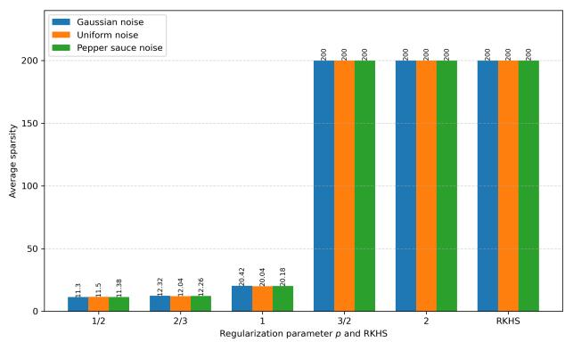  
(b) Average Sparsity of RKHS and ℓp-Regularized Models under Diferent Noise Types Using the Gaussian Kernel for the HRG function.

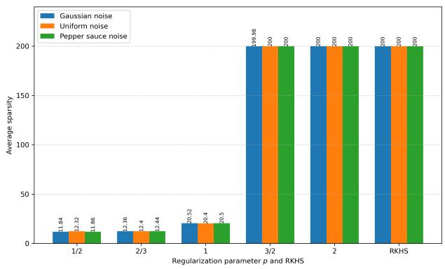  
(c) Average Sparsity of RKHS and ℓp-Regularized Models under Diferent Noise Types Using the Gaussian Kernel for the SPF function.

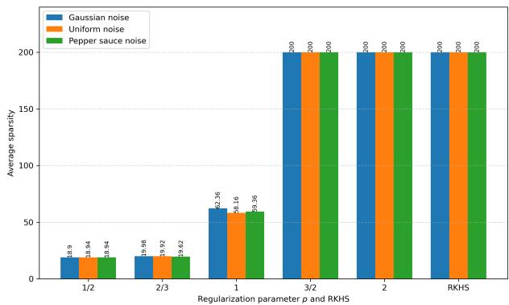  
(e) Average Sparsity of RKHS and ℓp-Regularized Models under Diferent Noise Types Using the Laplacian Kernel for the GMO function.

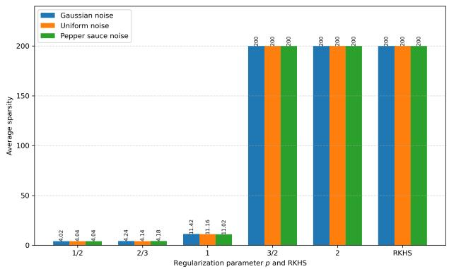  
(g) Average Sparsity of RKHS and ℓp-Regularized Models under Diferent Noise Types Using the Laplacian Kernel for the SPF function.

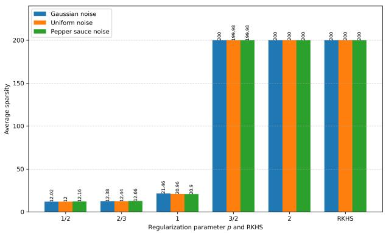  
(d) Average Sparsity of RKHS and ℓp-Regularized Models under Diferent Noise Types Using the Gaus sian Kernel for the MTH function.

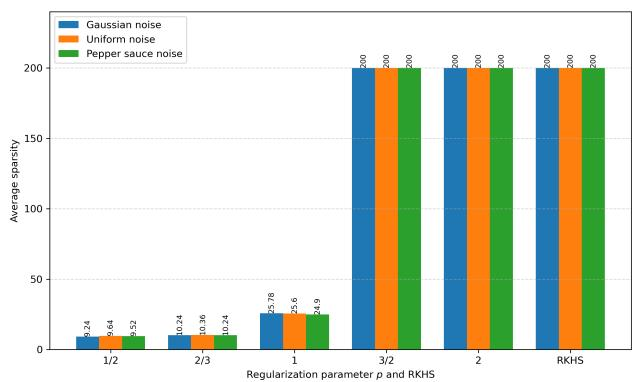  
(f) Average Sparsity of RKHS and ℓp-Regularized Models under Diferent Noise Types Using the Laplacian Kernel for the HRG function.

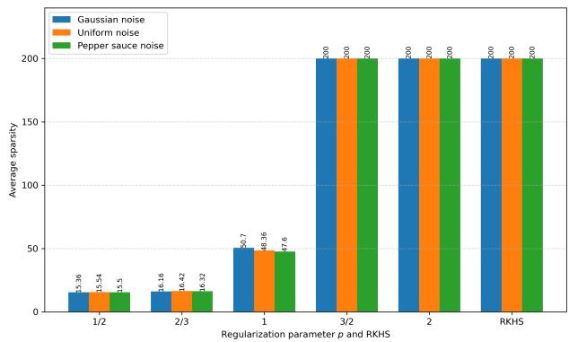  
(h) Average Sparsity of RKHS and ℓp-Regularized Models under Diferent Noise Types Using the Laplacian Kernel for the MTH function.

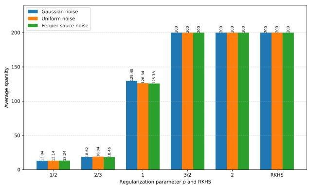  
(i) Average Sparsity of RKHS and ℓp-Regularized Models under Diferent Noise Types Using the IMQ Kernel for the GMO function.

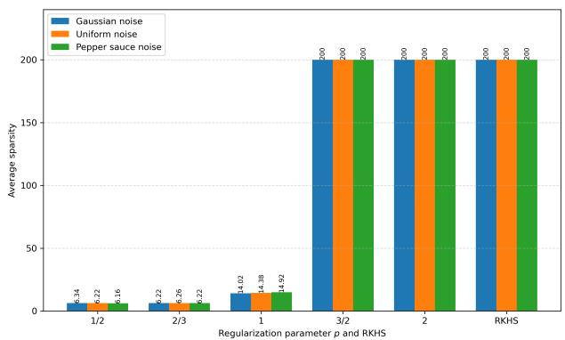  
(k) Average Sparsity of RKHS and ℓp-Regularized Models under Diferent Noise Types Using the IMQ Kernel for the SPF function.

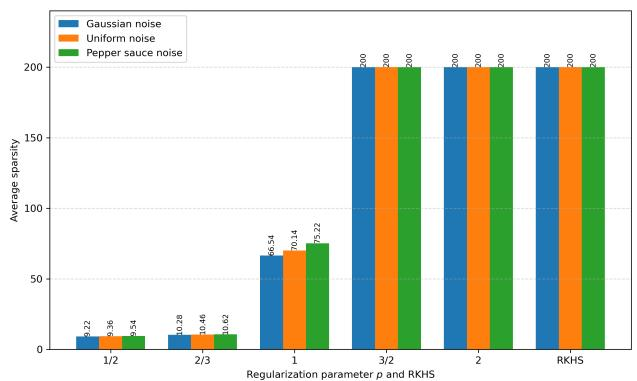  
(j) Average Sparsity of RKHS and ℓp-Regularized Models under Diferent Noise Types Using the IMQ Kernel for the HRG function.

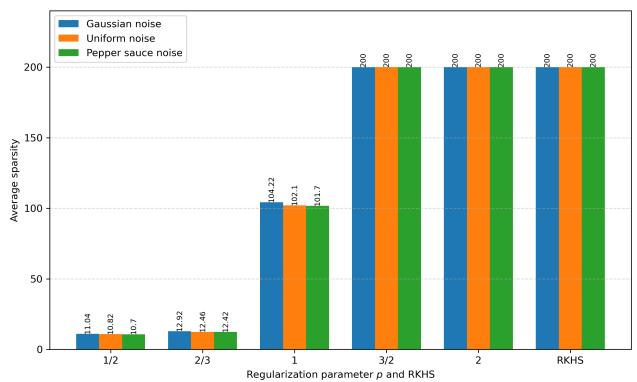  
(l) Average Sparsity of RKHS and ℓp-Regularized Models under Diferent Noise Types Using the IMQ Kernel for the MTH function.

## Declaration of AI use

This work was carried out in the traditional manner, with minimal assistance from AI. The mathematical results and proofs were derived on the blackboard. The initial manuscript was developed by the authors without AI assistance. During subsequent revisions, DeepSeek and GPT-6-Astra were used for translation and language editing. The authors assume full responsibility for the accuracy, originality, and integrity of the final manuscript.

## References

[1] A. Argyriou, C. A. Micchelli, and M. Pontil, When is there a representer theorem? Vector versus matrix regularizers, Journal of Machine Learning Research 10 (2009), no. 87, 2507–2529.

[2] N. Aronszajn, Theory of reproducing kernels, Transactions of the American Mathematical Society 68 (1950), no. 3, 337–404.

[3] F. Bartolucci, E. De Vito, L. Rosasco, and S. Vigogna, Understanding neural networks with reproducing kernel Banach spaces, Applied and Computational Harmonic Analysis 62 (2023), 194–236.

[4] A. Beck and M. Teboulle, A fast iterative shrinkage-thresholding algorithm for linear inverse problems, SIAM Journal on Imaging Sciences 2 (2009), no. 1, 183–202.

[5] A. Berlinet and C. Thomas-Agnan, Reproducing Kernel Hilbert Spaces in Probability and Statistics, Kluwer Academic Publishers, Boston, 2004.

[6] T. Blumensath and M. E. Davies, Iterative thresholding for sparse approximations, Journal of Fourier Analysis and Applications 14 (2008), no. 5–6, 629–654.

[7] E. J. Cand\`es, J. Romberg, and T. Tao, Robust uncertainty principles: Exact signal reconstruction from highly incomplete frequency information, IEEE Transactions on Information Theory 52 (2006), no. 2, 489– 509.

[8] W. Cao, J. Sun, and Z. Xu, Fast image deconvolution using closed-form thresholding formulas of $L _ { q } \left( q = \right.$

[9] R. Chartrand, Exact reconstruction of sparse signals via nonconvex minimization, IEEE Signal Processing Letters 14 (2007), no. 10, 707–710.

[10] R. Chartrand and V. Staneva, Restricted isometry properties and nonconvex compressive sensing, Inverse Problems 24 (2008), no. 3, 035020.

[11] F. Chen, L. Shen, and B. W. Suter, Computing the proximity operator of the $\ell _ { p }$ norm with $0 < p < 1$ , IET Signal Processing 10 (2016), no. 5, 557–565.

[12] S. S. Chen, D. L. Donoho, and M. A. Saunders, Atomic decomposition by basis pursuit, SIAM Review 43 (2001), no. 1, 129–159.

[13] J. B. Conway, A Course in Functional Analysis, 2 ed., Graduate Texts in Mathematics, vol. 96, Springer, New York, 1990.

[14] F. Cucker and S. Smale, On the mathematical foundations of learning, Bulletin of the American Mathematical Society 39 (2002), no. 1, 1–49.

[15] F. Cucker and D.-X. Zhou, Learning Theory: An Approximation Theory Viewpoint, Cambridge Monographs on Applied and Computational Mathematics, vol. 24, Cambridge University Press, Cambridge, 2007.

[16] I. de la Higuera, F. Herrera, and M. V. Velasco, Featured reproducing kernel Banach spaces for learning and neural networks, arXiv preprint arXiv:2602.07141, 2026.

[17] D. L. Donoho, Compressed sensing, IEEE Transactions on Information Theory 52 (2006), no. 4, 1289–1306.

[18] S. Dummer, T. J. Heeringa, and J. A. Iglesias, Vector-valued reproducing kernel Banach spaces for neural networks and operators, arXiv preprint arXiv:2509.26371, 2025.

[19] G. E. Fasshauer, F. J. Hickernell, and Q. Ye, Solving support vector machines in reproducing kernel Banach spaces with positive definite functions, Applied and Computational Harmonic Analysis 38 (2015), no. 1, 115–139.

[20] S. Foucart and M.-J. Lai, Sparsest solutions of underdetermined linear systems via ℓq-minimization for 0 $) < q \leq 1$ , Applied and Computational Harmonic Analysis 26 (2009), no. 3, 395–407.

[21] G. H. Golub and C. F. V. Loan, Matrix Computations, vol. 3, JHU press, 2013.

[22] K. Gr¨ochenig and A. Klotz, Norm-controlled inversion in smooth Banach algebras, II, Mathematische Nachrichten 287 (2014), no. 8–9, 917–937.

[23] K. Hamm, Nonuniform sampling and recovery of bandlimited functions in higher dimensions, Journal of Mathematical Analysis and Applications 450 (2017), no. 2, 1459–1478.

[24] T. J. Heeringa, L. Spek, and C. Brune, Deep networks are reproducing kernel chains, arXiv preprint arXiv:2501.03697, 2025.

[25] L. Huang, C. Liu, L. Tan, and Q. Ye, Generalized representer theorems in Banach spaces, Analysis and Applications 19 (2021), no. 1, 125–146.

[26] N. Kalton, Quasi-Banach Spaces, Handbook of the Geometry of Banach Spaces (W. B. Johnson and J. Lindenstrauss, eds.), vol. 2, Elsevier, Amsterdam, 2003, pp. 1099–1130.

[27] G. Kimeldorf and G. Wahba, Some results on Tchebychefian spline functions, Journal of Mathematical Analysis and Applications 33 (1971), no. 1, 82–95.

[28] R. Lin and H. Feng, Triangular kernels with unit Lebesgue constants, ResearchGate, 2026, Unpublished preprint.

[29] R. Lin, G. Song, and H. Zhang, Multi-task learning in vector-valued reproducing kernel Banach spaces with the ℓ1 norm, Journal of Complexity 63 (2021), 101514.

[30] R. Lin, H. Zhang, and J. Zhang, On reproducing kernel Banach spaces: Generic definitions and unified framework of constructions, Acta Mathematica Sinica, English Series 38 (2022), no. 8, 1459–1483.

[31] S. G. Mallat and Z. Zhang, Matching pursuits with time-frequency dictionaries, IEEE Transactions on Signal Processing 41 (1993), no. 12, 3397–3415.

[32] R. E. Megginson, An Introduction to Banach Space Theory, Graduate Texts in Mathematics, vol. 183, Springer, New York, 1998.

[33] N. Parikh and S. Boyd, Proximal algorithms, Foundations and Trends in Optimization 1 (2014), no. 3, 127–239.

[34] B. Sch¨olkopf, R. Herbrich, and A. J. Smola, A generalized representer theorem, Computational Learning Theory (Berlin, Heidelberg) (D. Helmbold and B. Williamson, eds.), Lecture Notes in Computer Science, vol. 2111, Springer, 2001, pp. 416–426.

[35] B. Sch¨olkopf and A. J. Smola, Learning with Kernels: Support Vector Machines, Regularization, Optimization, and Beyond, Adaptive Computation and Machine Learning, The MIT Press, Cambridge, MA, 2002.

[36] J. Shawe-Taylor and N. Cristianini, Kernel Methods for Pattern Analysis, Cambridge University Press, Cambridge, 2004.

[37] A. Shilton, S. Gupta, S. Rana, and S. Venkatesh, Reproducing kernel Banach space models for neural networks with application to Rademacher complexity analysis, Advances in Neural Information Processing Systems (D. Belgrave, C. Zhang, H. Lin, R. Pascanu, P. Koniusz, M. Ghassemi, and N. Chen, eds.), vol. 38, Curran Associates, Inc., 2025, pp. 69754–69798.

[38] G. Song and H. Zhang, Reproducing kernel Banach spaces with the ℓ1 norm II: Error analysis for regularized least square regression, Neural Computation 23 (2011), no. 10, 2713–2729.

[39] G. Song, H. Zhang, and F. J. Hickernell, Reproducing kernel Banach spaces with the ℓ1 norm, Applied and Computational Harmonic Analysis 34 (2013), no. 1, 96–116.

[40] L. Spek, T. J. Heeringa, F. Schwenninger, and C. Brune, Duality for neural networks through reproducing kernel Banach spaces, Applied and Computational Harmonic Analysis 78 (2025), 101765.

[41] B. K. Sriperumbudur, K. Fukumizu, and G. R. G. Lanckriet, Universality, characteristic kernels and RKHS embedding of measures, Journal of Machine Learning Research 12 (2011), no. 70, 2389–2410.

[42] I. Steinwart and A. Christmann, Support Vector Machines, Information Science and Statistics, Springer, New York, 2008.

[43] R. Tibshirani, Regression shrinkage and selection via the lasso, Journal of the Royal Statistical Society Series B: Statistical Methodology 58 (1996), no. 1, 267–288.

[44] V. N. Vapnik, Statistical Learning Theory, John Wiley & Sons, New York, 1998.

[45] R. Wang and Y. Xu, Representer theorems in Banach spaces: minimum norm interpolation, regularized learning and semi-discrete inverse problems, Journal of Machine Learning Research 22 (2021), no. 225, 1–65.

[46] R. Wang, Y. Xu, and M. Yan, Sparse representer theorems for learning in reproducing kernel Banach spaces, Journal of Machine Learning Research 25 (2024), no. 93, 1–45.

[47] , Hypothesis spaces for deep learning, Neural Networks 193 (2026), 107995.

[48] Y. Xu, Sparse machine learning in Banach spaces, Applied Numerical Mathematics 187 (2023), 138–157.

[49] Y. Xu and Q. Ye, Generalized Mercer Kernels and Reproducing Kernel Banach Spaces, Memoirs of the American Mathematical Society 258 (2019), no. 1243, 1–122.

[50] Z. Xu, X. Chang, F. Xu, and H. Zhang, $L _ { 1 / 2 }$ regularization: A thresholding representation theory and a fast solver, IEEE Transactions on Neural Networks and Learning Systems 23 (2012), no. 7, 1013–1027.

[51] H. Zhang, Y. Xu, and J. Zhang, Reproducing kernel Banach spaces for machine learning, Journal of Machine Learning Research 10 (2009), no. 95, 2741–2775.