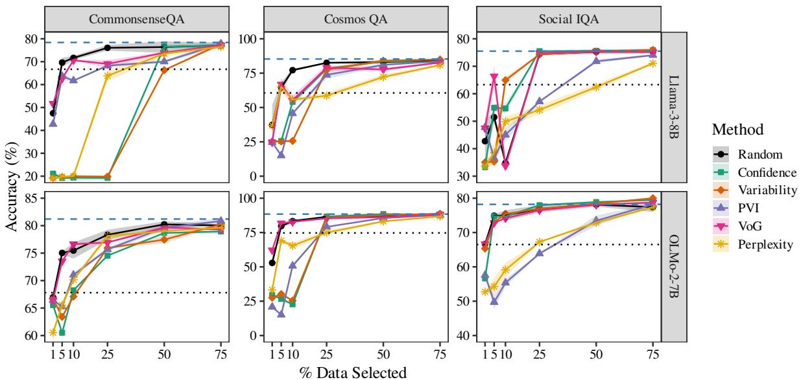
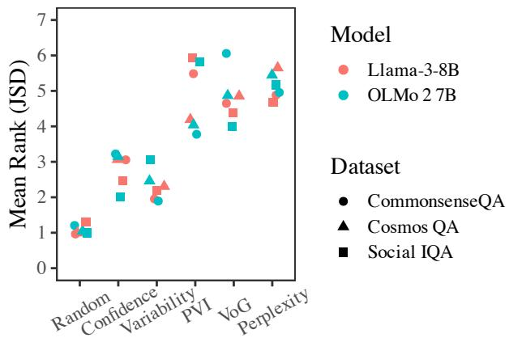
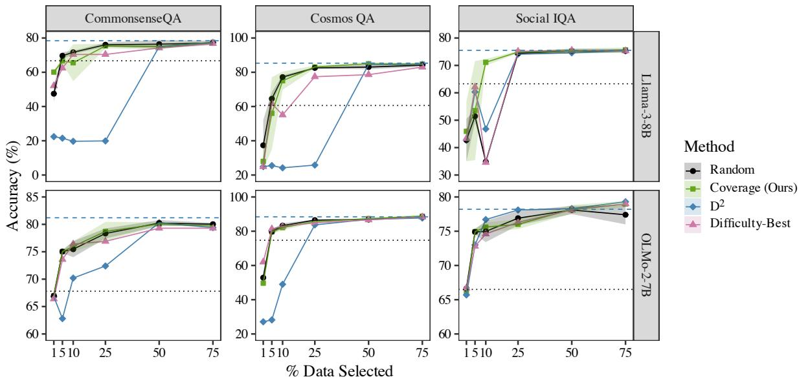
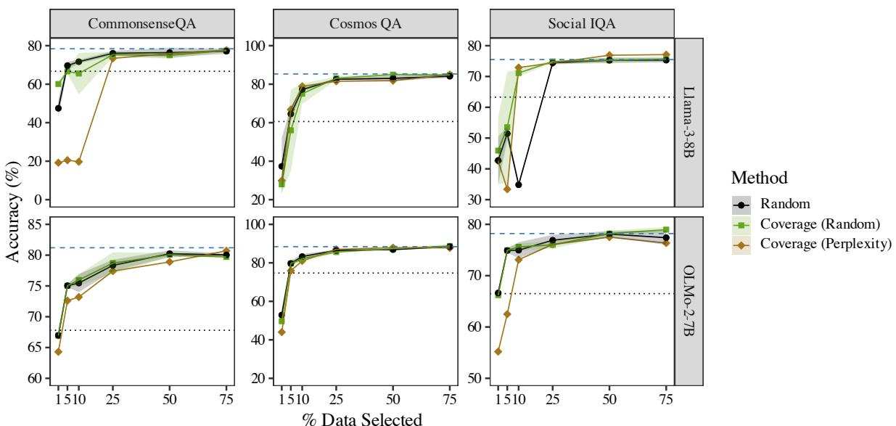
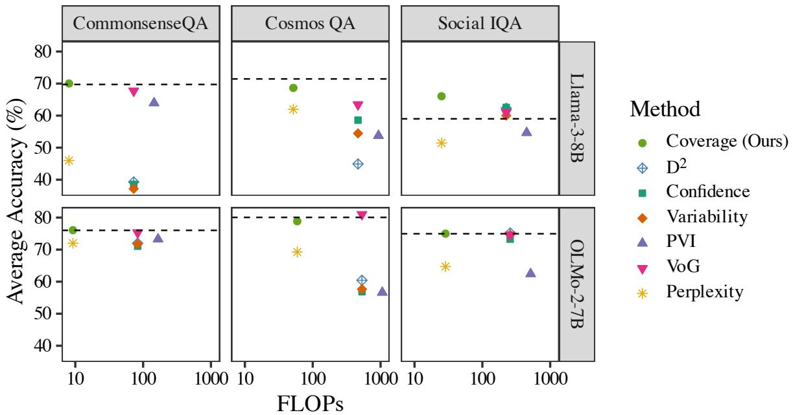
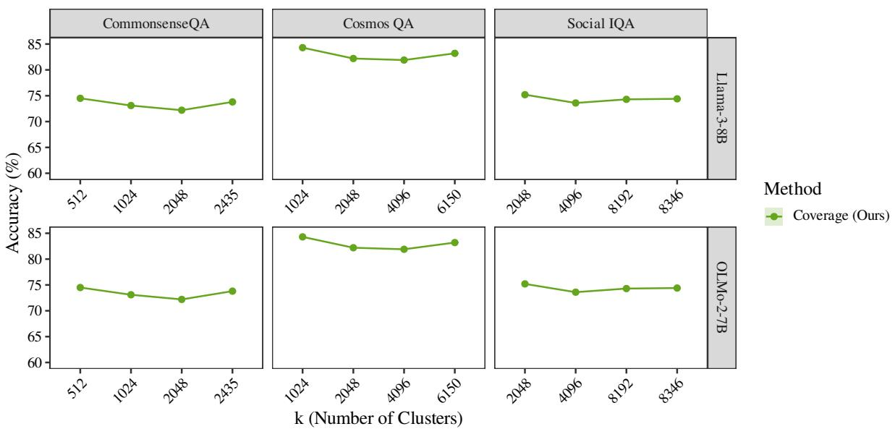
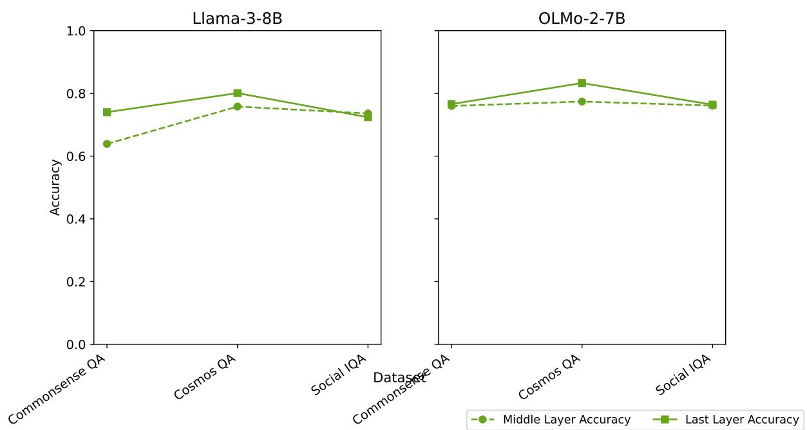

# Rethinking Data Selection: The Importance of Coverage over Difficulty in LLM Fine-Tuning

Lalchand Pandia Department of Computer Science University of Chicago lcpandia@cs.uchicago.edu

Kanishka Misra Department of Linguistics The University of Texas at Austin kmisra@utexas.edu

Allyson Ettinger Allen Institute for Artificial Intelligence allysone@allenai.org

## Abstract

Selecting high-quality training data can reduce computation cost for LLM fine-tuning. Prior work on data selection developed a variety of difficulty-based scores, motivated by the intuition that harder examples are more informative. While effective for smaller classification models, we find that such methods often fail to outperform random selection for LLM fine-tuning. Our analysis reveals that random selection performs better because it is more representative of the underlying input space—i.e., has better coverage. To validate the importance of coverage, we implement a simple clustering-based selection method which selects data that is more representative of the underlying input distribution. On a set of diverse single-domain tasks, this method yields performance at or above that of random selection. On the diverse, multidomain Tülu 3 mixture, where random sampling no longer guarantees a balanced subset, our method outperforms all methods. Overall, our results indicate that prioritizing coverage over difficulty leads to more effective data selection for LLM fine-tuning.

## 1 Introduction

While scaling—in terms of data, parameters, and compute—has become a standard pathway to success in pre-training LLMs (Hoffmann et al., 2022), it can often conflict with the practicalities (financial or otherwise) of deployment of these models at scale. Recent studies have pointed out that, using a small but high-quality dataset can often lead to performance that is competitive with that obtained using a large but potentially noisy dataset (Abbas et al., 2023; Tirumala et al., 2023). Similar observations have been made for instruction tuning (Zhou et al., 2023) and fine-tuning for reasoning (Ye et al., 2025). The field of data selection/pruning, then, presents an alternate pathway to that of data scaling,1 where the goal is to promote sample-efficient training by selecting a high-quality subset of the available data. A promising body of research in data selection has led to the development of various “difficulty scores” which leverage the target model’s internal signals to rank instances in the training set for level of difficulty. As such, difficulty-based data selection has become a popular paradigm in deep-learning, resulting in the proliferation of a variety of difficulty scores (Toneva et al., 2019; Swayamdipta et al., 2020; Paul et al., 2021; Agarwal et al., 2022, i.a.), primarily applied to classification settings, especially in computer vision tasks. While this paradigm has been successful in classification settings, its transfer to LLM finetuning is unclear. Unlike in standard classification settings, in which the model’s output space is constrained to the fixed label-set, LLMs are typically fine-tuned using the same pretraining task of nextword prediction—such that their output space after fine-tuning is still their entire vocabulary. A major reason to hypothesize that difficulty scores may be insufficient for data selection in LLM fine-tuning is that exclusively prioritizing difficult instances results in only capturing a restricted space of the input data, thus suffering from low data coverage. A specific instance of this argument has previously been explored even in case of classification tasks in computer vision (Zheng et al., 2023), who showed that only including difficult instances leads to catas trophic failures at low data-selection percentages, citing lack of sufficient data coverage as a reason. Similarly, efforts in data filtering for pre-training have highlighted the importance of data diversity, and not difficulty, in order to achieve better performance (Tirumala et al., 2023; Sachdeva et al., 2024).

Taking these observations as our motivation, in this paper we explore the extent to which difficultybased data selection transfers to LLM finetuning. We catalog five difficulty scores and extend them to LLM fine-tuning across three tasks, in which LLMs have notable gaps between zero-shot and fine-tuning performance, and two models. Our results from these experiments suggest that transfer of these selection methods for LLM fine-tuning is indeed very weak: random sampling often yields performance that is on par with or sometimes better than these methods. We then hypothesize that this may be due to the abovementioned limitations of difficulty scores in selecting instances with sufficient coverage of the training data. To test this, we first operationalize coverage using a method that compares the full data and selected data in terms of distributions over clusters of the data. We find that the divergence between the selected data and the full training data strongly correlates with the performance obtained by fine-tuning LMs on the selected data, supporting our hypothesis.

Finally, we devise a purely coverage-based selection method that prioritizes data coverage as operationalized in our analysis. We find that while this method outperforms difficulty-based data selection as well as another recently proposed method that balances between difficulty and diversity (Maharana et al., 2023), it remains on par with randomsampling, only occasionally outperforming it. This finding is consistent with our thesis: if random sampling succeeds because it achieves good coverage, then explicitly optimizing for coverage should converge to random’s performance precisely where random already covers the input distribution well. Unlike random sampling, however, our method achieves monotonically increasing performance as more data is selected, avoiding the instability of random selection across selection percentages. To further analyze the effect of coverage, we additionally conduct our experiments on Tülu 3 (Lambert et al., 2025), a highly diverse SFT mixture used in training OLMo 2 7B. We find that as the diversity in data increases, coverage-based selection outperforms all other methods at small data percentages. Overall, our findings support the prioritization of data coverage over difficulty when it comes to LLM

## 2 Related Work

Data selection using difficulty Difficulty-based methods often use artifacts of models’ training dynamics to implicitly or explicitly rank training instances by their “difficulty”. Swayamdipta et al. (2020) use model confidence to categorize data instances, while gradient based methods like VoG (Agarwal et al., 2022; Anand et al., 2023) measure difficulty using variance of the gradients. Ethayarajh et al. (2022) use the notion of usable information for a model to define Pointwise V-usable information (PVI), and use it to quantify the difficulty of data instances. All of the above methods have been devised for fine-tuning to perform classification tasks. Difficulty-based selection has also been applied to pre-training and alignment task during post-training: Marion et al. (2023) use perplexity on a large reference model for data selection during pre-training. We build on these prior methods by extending difficulty scores for LLM fine-tuning tasks (see Section 3).

Data selection using diversity Difficulty-based methods often select redundant instances that cover only a limited portion of the data distribution (Settles and Craven, 2008; Xu et al., 2003). Prior work in active learning (Dasgupta and Hsu, 2008; Ash et al., 2020; Sener and Savarese, 2018) has shown that training on diverse data leads to better performance in computer vision tasks. $\mathrm { D ^ { 2 } }$ (Maharana et al., 2023) aims to balance diversity as well as hardness for data selection and is primarily focused on fixed-label classification tasks. The instructiontuning literature (Bukharin et al., 2024; Zhou et al., 2023) has emphasized the importance of data quality as well as data diversity. Our focus is to investigate whether diversity alone is sufficient for selecting data when fine-tuning LLMs.

## 3 Difficulty Scores

We approach our experiments and analyses with the goal of identifying scores that will enable effective subselection of data for fine-tuning. We begin by investigating existing difficulty-based scores, which are either derived from the training dynamics of a model trained on the full dataset, or require a single forward pass on the dataset. In this section, we discuss our extension of common difficulty scores to LLM fine-tuning. Common to the dataselection methods used in this work is the notion of a utility function, which determines which instances in the target dataset are selected. Since we are primarily focused on difficulty here, our utility functions will operationalize difficulty in some way, and will prioritize data that are deemed to be more difficult (over those deemed less so). Given a supervised training dataset $D _ { t r a i n } = \{ ( x _ { i } , y _ { i } ) \} _ { i = 1 } ^ { n } ,$ our aim is to choose a subset $S \subset D _ { t r a i n }$ such that the model trained on $S$ maximizes accuracy on the test set $D _ { t e s t }$ . Here $y _ { i }$ represents the output sequence instead of a single label. The utility function $f ( x _ { i } ) : D _ { t r a i n } $ R maps a data instance $x _ { i }$ to a real number representing the difficulty score of the instance. Once we obtain these difficulty scores, we select $S _ { m \% }$ , or the subset containing the top-m% of instances ranked by difficulty, as $S _ { m \% } = \{ x _ { j } \in D _ { t r a i n } \mid f ( x _ { j } ) \geq C _ { m \% } \}$ , where $C _ { m \% }$ denotes the $( 1 0 0 - m ) { \cdot } \mathrm { t h }$ percentile of the difficulty score distribution. Below we describe five utility functions used in our analyses.

Perplexity Perplexity-based data selection utilizes LMs to evaluate the utility of data points based on model loss for pre-training (Marion et al., 2023; Ankner et al., 2024). We adopt perplexity as a difficulty score by selecting instances in the training data with higher perplexity.

Confidence and Variability Swayamdipta et al. (2020) propose two utility functions for classification tasks, both measured across training epochs: (1) a model’s confidence of the true label, and (2) its variability. Confidence is calculated as the average likelihood of the true label across epochs, while Variability is its standard deviation. We extend these measures to fine-tuning LLMs as follows: let $E$ be the total number of epochs that the LM is fine-tuned for, $x _ { i }$ be the input sequence corresponding to the i-th data-instance, and $y _ { 1 } , \ldots , y _ { n }$ be the ground-truth output sequence, then the confidence $( \mu _ { i } )$ and variability $( \sigma _ { i } )$ are given as:

$$
\mu _ { i } = \frac { 1 } { E } \sum _ { e = 1 } ^ { E } \left( \prod _ { j = 1 } ^ { n } p _ { e } ( y _ { j } \mid y _ { 1 : j - 1 } x _ { i } ) ^ { 1 / n } \right)
$$

$$
\sigma _ { i } = { \sqrt { { \frac { 1 } { E } } \sum _ { e = 1 } ^ { E } \left( \prod _ { j = 1 } ^ { n } p _ { e } ( y _ { j } \mid y _ { 1 : j - 1 } x _ { i } ) ^ { 1 / n } - \mu _ { i } \right) ^ { 2 } } }
$$

where $p _ { e }$ is the LM’s sequence probability at the $e ^ { \mathrm { t h } }$ epoch. In order to operationalize difficulty-based selection for these metrics, we use smaller values for confidence, and larger values for variability.

Variance of Gradients (VoG) VoG (Agarwal et al., 2022; Anand et al., 2023) is a utility function based on the idea that easy examples lead to saturated losses and stable gradients early in training, whereas “difficult” examples exhibit gradient variability throughout training. We compute the gradients of the logits at the location of target token $y _ { i }$ with respect to the embedding of each word in $x _ { i } .$ . Averaging the gradients across output length gives us $G _ { i } .$ Once $G _ { i }$ is obtained, the computation of VoG follows exactly the same process as the original VoG method. Selection preference is given to instances with high VoG score. For brevity, we describe VoG score calculation in Section A.2

Pointwise V-usable information (PVI) Ethayarajh et al. (2022) propose PVI, which quantifies the usable information an instance provides to a model for predicting the target. PVI involves fine-tuning two copies of the same base model on $D _ { t r a i n }$ and on a modified dataset $D _ { \phi } =$ $\{ ( \phi , y _ { i } ) | ( x _ { i } , y _ { i } ) \in D _ { t r a i n } \}$ , where all inputs $( x _ { i } )$ are replaced with an empty string $\phi .$ After training, the method obtains two models, g (trained on $D _ { t r a i n } ) , g ^ { \prime }$ (trained on $D _ { \phi } )$ . The PVI for each training instance $( x , y )$ is calculated as $\mathrm { P V I } ( x , y ) =$ $- \log _ { 2 } g [ \phi ] ( y )$ + log2 $g ^ { \prime } [ x ] ( y )$ . We apply PVI directly by using the likelihood of the entire output sequence, and select training instances with low PVI as “difficult” instances for fine-tuning.

## 4 Experimental Setup

To test the effectiveness of each of these data selection metrics in LLM fine-tuning, we carry out experiments across 3 main datasets, described below. For all our experiments, we vary the number of selected instances as {1, 5, 10, 25, 50, 75}% of the total training data. We first compute our difficulty scores for the entire dataset (i.e., 100%), use them to select difficult training examples, and then fine-tune a model on the resulting subset. We compare against a random sampling baseline, in which we randomly sample the given percentage of the training data, and then fine-tune our models on this subset.

Models We primarily experiment on two transformer-based language models, both of which are trained on the standard language model objective: Llama 3 8B (Grattafiori et al., 2024) and OLMo 2 7B (OLMo et al., 2025). More experiment details can be found in Appendix A.5

Datasets We choose datasets in which finetuning yields marked improvements compared to zero-shot performance for both models (difference of at least 10% points). Based on this criterion, we select three multiple-choice QA datasets: Social IQa (Sap et al., 2019), CommonsenseQA (Talmor et al., 2019), and CosmosQA (Huang et al., 2019) from among all the datasets that we considered (see Table 3 for our initial results from five different datasets for both models). We use the validation set of these datasets in our tests.

Evaluation We follow the MCF (multiple-choice formulation)-based evaluation procedure (Gu et al., 2025). That is, we compute accuracy as the exactmatch between the first token of the LM’s generated response and the true label.

## 5 Difficulty-based methods are often outperformed by Random Sampling

We evaluate the difficulty score selection methods as outlined in Section 4. This helps us in answering our question: Can we rely on difficulty scores to determine which instances are most useful for fine-tuning LLMs? Figure 1 shows validation accuracies at the end of training as a function of data selected for each of the five difficulty-based selection methods.

We first see that models fine-tuned with as little as 50% of the full dataset achieve performance highly comparable to models fine-tuned on the entire dataset. Across all models and datasets, the performance curves for most selection methods— including the random baseline—reach a plateau at or before the 50% data mark. This suggests that the datasets considered here contain a significant degree of redundancy, and that data selection methods can be highly beneficial for achieving strong performance with reduced training time and computational cost.

We also find that the most effective data selection method is dependent on the specific dataset but is consistent across models. For example, the variability method consistently yields a top-performing accuracy for the Social IQa dataset on both Llama 3 8B and OLMo 2 7B. Similarly, for both the CosmosQA and CommonsenseQA datasets, VoG consistently provides the highest validation accuracy. At an aggregate level, VoG achieves the highest average accuracy among all difficulty-based methods.

Finally, we find that the random baseline is consistently competitive—and often the best performing method—across all selected percentages and datasets. The surprising effectiveness of this simple baseline motivates our subsequent analysis into why random selection outperforms conventional difficulty-based scoring methods.

## 6 Difficulty-based selection suffers from poor data coverage

Why might simple random sampling be as good as— or even better than—principled, difficulty-based selection methods in these fine-tuning settings? We hypothesize that difficulty-based methods may select for items occupying a smaller, more restricted space within the training dataset, resulting in an unrepresentative sample—whereas a simple random sampling method may cover a larger, more representative space. As a result, a model fine-tuned on a difficulty-based data selection may end up biased toward a smaller space of the task, de-prioritizing features that may be important for tasks that are more general in nature. This hypothesis is consistent with the findings of Zheng et al. (2023) for fixed-label computer vision tasks, described in Section 1. In this section we test this hypothesis by defining a measure of coverage and testing whether this measure is predictive of how effective a selection method will be. To do so, we must first operationalize the notion of coverage. However, computing how well a given data-selection scheme picks out a diverse, high-coverage sample of the entire training data requires access to the true distribution of the data, which is intractable. In light of this, we rely on a quantized/discretized embedding space, sensitive to the distributional semantic features of the instances in the training set. This part of our method is inspired by a similar component introduced in the computation of MAUVE (Pillutla et al., 2021), a metric for comparing LM-generated data to that of humans, using divergence curves.

Our estimation process is as follows: first, we use the non-fine-tuned state of the target LM to map training data instances $\left\{ ( x _ { 1 } , y _ { 1 } ) , \dotsc , ( x _ { n } , y _ { n } ) \right\}$ to an embedding space $\operatorname { L M } ( ( x _ { i } , y _ { i } ) )  \mathbb { R } ^ { d }$ , where d is the dimensionality of the embedding space, giving us a collection of vectors $\{ \mathbf { v } _ { 1 } , \ldots , \mathbf { v } _ { n } \} . ^ { 3 }$ We then use k-means clustering (Lloyd, 1982) to quantize these embeddings, allowing us to use the cluster assignments $\{ 1 , \ldots , k \}$ as a support to compare the distribution of the training set to a selected subset. To execute this comparison, we define P and $Q ,$ the (approximate) distributions of the cluster labels in the full training data and a given selected subset, $S _ { m \% }$ , respectively, as:

  
Figure 1: Comparative performance of difficulty-based data selection methods on the Llama 3 8B and OLMo 2 7B models across the three datasets, as a function of the percentage of training data selected. For random selection, the points show the mean test accuracy and shaded regions indicate the ±1 standard deviation band across runs. The blue dashed line indicates results from fine-tuning on 100% training data, while the gray dotted line indicates zero-shot performance. We repeat all our experiments with difficulty-based metrics for 3 random runs where the randomness mainly comes from the training.

$$
P ( j ) = { \frac { 1 } { n } } \sum _ { i = 1 } ^ { n } \mathbb { 1 } [ \psi ( \mathbf { v } _ { i } ) = j ]
$$

$$
Q ( j ) = \frac { 1 } { | S _ { m \% } | } \sum _ { i = 1 } ^ { | S _ { m \% } | } \mathbb { 1 } [ \psi ( \mathbf { v } _ { i } ) = j ] ,
$$

where $\psi ( \mathbf { v } )$ represents the cluster assignment function (i.e., one resulting from the k-means algorithm) that returns a cluster label in $\{ 1 , \ldots , k \}$ . We can now compare how different $Q$ is from P, by computing the Jensen-Shannon Divergence (JSD) between them:

$$
\mathrm { J S D } ( P \parallel Q ) = \frac { 1 } { 2 } \mathrm { K L } ( P \parallel M ) + \frac { 1 } { 2 } \mathrm { K L } ( Q \parallel M )
$$

$$
\mathrm { K L } ( P \parallel Q ) = \sum _ { x } { P ( x ) \log \frac { P ( x ) } { Q ( x ) } } ,
$$

where M is the mixture distribution of $P$ and $Q ,$ computed as $( P { + } Q ) / 2$ . Since this measure, as it is currently defined, is sensitive to the chosen value of $k ,$ , we repeat this computation over 10 different random seeds, as well as across a range of values for k per dataset, model, and data percentage. More specifically for m% selected data, we experiment with values of k ranging from 2 to mn/100, incrementing in powers of 2.

We now explore how this measure patterns against our findings from the previous section, and whether it is a reliable predictor of the effectiveness of different data selection methods. For this, we measure the average JSD for our data selection methods, across different models and datasets. Figure 2 shows the mean rank of each data-selection method, calculated on the basis of its average JSD values across selected-percentages, datasets, and models. We find that the Random data selection method is always the one with the lowest average JSD value across all datasets, both models, and all data-selection percentages, suggesting that it systematically achieves the greatest coverage of the training data relative to other methods. Next, we measure the Spearman’s correlation between average JSD values of different methods and accuracy obtained as a result of deploying them at each data-selection percentage, across different datasets and models. Insofar as coverage—as operationalized by our metric—is related to data-selection performance, we expect there to be a strong negative correlation between average JSD and accuracy, since methods with poorer coverage (i.e., high divergence) are posited to have poorer performance under this prediction. Table 1 shows our results across models and datasets. In line with the aforementioned prediction, we find strong negative correspondence between average JSD and accuracy, across all model-dataset pairs, with values ranging from -0.71 to -0.90.

Our results suggest that this notion of coverage may explain the weakness of the difficulty scores for selecting subsets of training data: we find that reduced coverage directly correlates with lower task accuracy for models trained on these subsets. Random sampling preserves coverage, which may be the source of its consistently strong performance.

## 7 A purely coverage-based method

Our analysis in the previous section indicated that selecting subsets with good coverage of the training data might be key to better LLM fine-tuning performance, and may potentially explain the poor performance of difficulty-based methods. To shed further light on the extent to which coverage alone can serve as an alternative to difficulty—and to provide a practical proof of concept for our analysis— we implement a minimal clustering-based selection method.

Our method builds directly from our analysis in the previous section. We use the embedding space of the training data by using the target LM’s last hidden $\mathrm { s t a t e } ^ { 4 }$ at the last token-position of each training instance. Then we cluster these embeddings using k-means clustering, this time fixing k as mn/100, where n is the total size of the training set, and m denotes the data selection percentage.5 We then simply sample one instance from each cluster, allowing all cluster points to be represented, thereby encouraging “good” coverage of the data.6 We then perform standard fine-tuning as described in Section 4 to obtain performance estimates that represent our coverage-based selection method. We would like to point out that unlike previous works like (Tirumala et al., 2023; Sorscher et al., 2022) we do not rely on pretrained embeddings. We use the target model’s embeddings since these may provide a more direct signal of data usefulness. We compare performance obtained by our method to those from random sampling, as well as the best (overall) difficulty-based selection method—i.e., VoG. In addition, we also compare against $\mathbf { D } ^ { 2 }$ Pruning (Maharana et al., 2023, abbreviated as $\mathrm { D ^ { 2 } } )$ $\mathrm { D ^ { 2 } }$ aims to balance difficulty and diversity by representing the training set as a graph. In our adaptation, we use the variability scores from Section 3 as node features, following Maharana et al. (2023), and the target LLM’s final hidden state at the last token position as embeddings. Each comparison here meaningfully addresses aspects of our research questions: 1) by comparing against the best difficulty-based method, we directly pit diversity against difficulty; 2) by comparing against $\mathrm { D ^ { 2 } }$ Pruning, we can shed light on how well datadiversity (captured by coverage) alone fares against a selection scheme that balances between the two extremes; and 3) by comparing against random, we test if a more principled and stable method of data-selection can compete against the uncertainty of exclusive random-sampling.

Results Figure 3 compares results using our Coverage method to those from random sampling, the best difficulty-based method (VoG), and $\mathrm { D ^ { 2 } }$ First, we see that accuracies obtained from using $\mathrm { D ^ { 2 } }$ are consistently worse at lower percentages, across both models for CommonsenseQA and CosmosQA. In fact, $\mathrm { D ^ { 2 } }$ seems to under perform even VoG in most cases, suggesting that balancing between difficulty and diversity in this setting harms rather than helps with data selection. There are certain instances where $\mathrm { D ^ { 2 } }$ is in fact the best performing method $( \mathrm { e . g . }$ , Social IQa) but these are overshadowed by the fact that it performs substantially worse than zero-shot performance for other datasets. While VoG is fairly competitive against random and our coverage method, there are cases where it is clearly outperformed by them (e.g., CosmosQA and Social IQa with Llama 3 8B), and it sometimes shows a non-monotonic trajectory with respect to the percentage of data selected. In contrast, our coverage-based method almost always shows an upward trajectory with respect to the selected percentage, obtaining similar performance to the fully fine-tuned model at even 25% data. Overall, except in a small number of instances, the finding from Section 5 seems to persist—random sampling is rarely systematically outperformed by any more principled method tested so far.

  
Figure 2: Mean rank (based on Avg. JSD) of each selection method across models and datasets. Methods with lower ranks have lower avg. JSD.

<table><tr><td>Model</td><td>Dataset</td><td>ρ</td></tr><tr><td rowspan="3">Llama 3 8B</td><td>CommonsenseQA</td><td>-0.71</td></tr><tr><td>CosmosQA Social IQa</td><td>-0.87</td></tr><tr><td>CommonsenseQA</td><td>-0.81</td></tr><tr><td rowspan="2">OLMo 2 7B</td><td></td><td>-0.83</td></tr><tr><td>CosmosQA</td><td>-0.88</td></tr><tr><td></td><td>Social IQa</td><td>-0.90</td></tr></table>

Table 1: Spearman’s correlation between avg. JSD and accuracy across data-selection percentages and methods, for each dataset and model. Lower values indicate greater correspondence between coverage and performance.

  
Figure 3: Performance of the Coverage-based selection method on Llama 3 8B and OLMo 2 7B models as a function of training data selected, along with comparisons to random selection, the best overall difficulty-based method (VoG), and $\mathrm { D ^ { 2 } }$ . For random selection and Coverage, the points show the mean test accuracy and shaded regions indicate the ±1 standard deviation band across runs. The blue dashed line indicates results from fine-tuning on 100% training data, while the gray dotted line indicates zero-shot performance.

## 7.1 Results on Tülu 3

We additionally validate our findings on Tülu 3 (downsampled to 50K). Unlike the three QA datasets above, Tülu 3 spans a wide range of domains, making it a more suitable testbed for our analysis. We train OLMo 2 7B using the same setup as described in Section 4. We evaluate on MMLU (Hendrycks et al., 2020), BBH (Srivastava et al., 2023) and HumanEval (Chen et al., 2021) MMLU consists of multiple-choice questions spanning 57 tasks including elementary mathematics, US history, computer science, law, and more; BBH contains challenging reasoning problems for which models benefit from step-by-step reasoning; and HumanEval evaluates models’ ability to complete Python code given docstrings. We report 5-shot accuracy for MMLU (averaged across the 57 subtasks), 3-shot exact-match for BBH, and pass@10 (temperature 0.8) for HumanEval, following the answer-extraction procedure of OLMES (Gu et al., 2025).

Table 2 shows results at key selection percentages on different downstream benchmarks. On a highly diverse multi-domain dataset like Tülu 3, random sampling is less likely to produce a distributionally balanced subset across domains, and principled coverage-based selection—which actively ensures all regions of the embedding space are represented—becomes especially valuable. On MMLU and BBH, coverage is the only method to consistently match or exceed the full fine-tuning baseline, with as little as 5% of the data. On HumanEval, coverage’s advantage over other selection methods grows with budget suggesting that coverage-based selection generalizes to tasks requiring open-ended generation, including functional code generation evaluated by execution.

<table><tr><td></td><td colspan="5">MMLU (Full: 62.2)</td><td colspan="5">BBH (Full: 48.5)</td><td colspan="5">HumanEval (Full: 45.9)</td></tr><tr><td>Method</td><td>1%</td><td>5%</td><td>10%</td><td>15%</td><td>25%</td><td>1%</td><td>5%</td><td>10%</td><td>15%</td><td>25%</td><td>1%</td><td>5%</td><td>10%</td><td>15%</td><td>25%</td></tr><tr><td>VoG</td><td>61.0</td><td>59.6</td><td>60.9</td><td>61.1</td><td>61.2</td><td>45.7</td><td>46.8</td><td>45.5</td><td>47.4</td><td>48.3</td><td>30.5</td><td>33.6</td><td>32.3</td><td>30.5</td><td>32.3</td></tr><tr><td>Variability</td><td>61.6</td><td>61.8</td><td>61.8</td><td>61.6</td><td>61.9</td><td>7.5</td><td>49.7</td><td>49.4</td><td>48.8</td><td>47.9</td><td>14.9</td><td>31.5</td><td>31.9</td><td>30.9</td><td>30.6</td></tr><tr><td>Perplexity</td><td>61.6</td><td>61.0</td><td>61.6</td><td>61.5</td><td>61.7</td><td>11.5</td><td>47.2</td><td>48.7</td><td>49.0</td><td>48.3</td><td>6.5</td><td>30.3</td><td>33.1</td><td>32.6</td><td>31.4</td></tr><tr><td>Confidence</td><td>61.7</td><td>61.6</td><td>61.5</td><td>61.3</td><td>62.1</td><td>45.2</td><td>49.5</td><td>49.1</td><td>48.0</td><td>48.0</td><td>15.7</td><td>27.3</td><td>31.3</td><td>29.9</td><td>29.5</td></tr><tr><td>Random</td><td>60.9</td><td>61.2</td><td>61.6</td><td>61.9</td><td>61.7</td><td>47.4</td><td>48.8</td><td>48.5</td><td>49.6</td><td>48.2</td><td>30.8</td><td>36.5</td><td>31.1</td><td>36.4</td><td>37.5</td></tr><tr><td>Coverage (Ours)</td><td>61.6</td><td>62.6</td><td>62.7</td><td>62.1</td><td>62.6</td><td>48.6</td><td>48.8</td><td>49.6</td><td>48.9</td><td>48.4</td><td>30.5</td><td>31.8</td><td>34.9</td><td>39.6</td><td>40.2</td></tr></table>

Table 2: Downstream accuracy (%) on OLMo 2 7B fine-tuned on subsets of Tülu 3, across selection percentages. Bold marks the best method per column; underline marks any method that meets or exceeds the full fine-tuning baseline (in header).

## 8 Discussion

Our results suggest that coverage rather than difficulty should be prioritized when doing data selection for LLM fine-tuning. This is indicated by the observation that random selection and our coverage-based method perform better than difficulty-based scores for fine-tuning. The benefit of coverage-based selection appears to scale with dataset diversity: on single-domain tasks random sampling approximates good coverage, but this breaks down on multi-domain data, where Tülu 3 results show coverage-based method being better.

Why do we find that lack of coverage leads to such weak performance in fine-tuning? Diversity has been shown to be a driver of performance during pretraining (Tirumala et al., 2023; Sachdeva et al., 2024), so we postulate that the particular importance we see here for coverage in this setting is attributable to the greater similarity between fine-tuning and more generalized language modeling, by contrast to the more focused decision space of fixed-label classification. More specifically, we speculate that fixed-label classification tasks can be solved by learning a more focused set of items that help to identify the decision boundary, while LLM fine-tuning requires models to retain more

generalized capabilities.

A natural extension of this work would be to combine data difficulty and diversity for data selection. We did attempt to combine difficulty and diversity in our method by selecting data with the highest difficulty (e.g., perplexity) from within each cluster—however, as shown in Figure 4, this approach did not yield any performance gains, suggesting that it was coverage that was driving our observed gains.

## 9 Conclusion

We explored how different difficulty-based data selection methods transfer to LLM fine-tuning. We find that each of these methods fall behind random selection. Our results suggest that the strong performance of random selection arises from its better coverage of the training distribution, which appears to have greater importance in LLM finetuning. We also show that a simple coverage-based method consistently outperforms difficulty-based methods, and is at par or sometimes better than random sampling. These findings highlight the importance of coverage in data selection for fine-tuning. Furthermore, on the diverse Tülu 3 dataset, coverage-based selection consistently achieves better downstream performance than all other methods. These findings suggest that coverage may be a more important criterion than difficulty for data selection in LLM fine-tuning, with practical importance that grows with dataset diversity.

## Limitations

Our main goal in this work is to investigate the impact of data coverage and data difficulty while finetuning LLMs. While our empirical analyses reveal a strong correlation between coverage and the task performance, establishing causality is left for future work. Furthermore, while notions of difficulty have been shown to fare well in certain pretraining investigations (Marion et al., 2023), they have not been compared to coverage, leaving open the question of difficulty vs. coverage in those settings.

A practical concern regarding adoption of any of these data selection methods is the compute cost for selection. For instance, almost all difficulty-based scores above, except Perplexity, require training the model on the full dataset—sometimes even twice (in the case of PVI). This reduces their practical utility in fine-tuning settings, where the cost of selection may offset the efficiency gains of subset training. By contrast, our coverage-based method requires only a single forward pass over the training data, though this still incurs non-trivial overhead relative to random sampling. Future work can also explore whether selection utility transfers across model scales, as seen in Bordelon et al. (2023) for learning rates in Vision Transformers, and in Wang et al. (2023) for active learning.

## References

Amro Abbas, Kushal Tirumala, Dániel Simig, Surya Ganguli, and Ari S. Morcos. 2023. Semdedup: Dataefficient learning at web-scale through semantic deduplication. Preprint, arXiv:2303.09540.

Chirag Agarwal, Daniel D’souza, and Sara Hooker. 2022. Estimating example difficulty using variance of gradients. Preprint, arXiv:2008.11600.

Nikhil Anand, Joshua Tan, and Maria Minakova. 2023. Influence scores at scale for efficient language data sampling. In Proceedings of the 2023 Conference on Empirical Methods in Natural Language Processing, pages 2485–2510, Singapore. Association for Computational Linguistics.

Zachary Ankner, Cody Blakeney, Kartik Sreenivasan, Max Marion, Matthew L. Leavitt, and Mansheej Paul. 2024. Perplexed by perplexity: Perplexity-based data pruning with small reference models. Preprint, arXiv:2405.20541.

Jordan T. Ash, Chicheng Zhang, Akshay Krishnamurthy, John Langford, and Alekh Agarwal. 2020. Deep batch active learning by diverse, uncertain gradient lower bounds. Preprint, arXiv:1906.03671.

Blake Bordelon, Lorenzo Noci, Mufan Bill Li, Boris Hanin, and Cengiz Pehlevan. 2023. Depthwise hyperparameter transfer in residual networks: Dynamics and scaling limit. Preprint, arXiv:2309.16620.

Alexander Bukharin, Shiyang Li, Zhengyang Wang, Jingfeng Yang, Bing Yin, Xian Li, Chao Zhang, Tuo Zhao, and Haoming Jiang. 2024. Data diversity matters for robust instruction tuning. In Findings of the Associationfor Computational Linguistics: EMNLP

2024, pages 3411–3425, Miami, Florida, USA. Association for Computational Linguistics.

Mark Chen, Jerry Tworek, Heewoo Jun, Qiming Yuan, Henrique Ponde de Oliveira Pinto, Jared Kaplan, Harri Edwards, Yuri Burda, Nicholas Joseph, Greg Brockman, Alex Ray, Raul Puri, Gretchen Krueger, Michael Petrov, Heidy Khlaaf, Girish Sastry, Pamela Mishkin, Brooke Chan, Scott Gray, and 39 others. 2021. Evaluating large language models trained on code. Preprint, arXiv:2107.03374.

Peter Clark, Isaac Cowhey, Oren Etzioni, Tushar Khot, Ashish Sabharwal, Carissa Schoenick, and Oyvind Tafjord. 2018. Think you have solved question answering? try arc, the ai2 reasoning challenge. Preprint, arXiv:1803.05457.

Sanjoy Dasgupta and Daniel Hsu. 2008. Hierarchical sampling for active learning. In Proceedings ofthe 25th International Conference on Machine Learning, ICML ’08, page 208–215, New York, NY, USA. Association for Computing Machinery.

Kawin Ethayarajh, Yejin Choi, and Swabha Swayamdipta. 2022. Understanding dataset difficulty with V-usable information. In Proceedings of the 39th International Conference on Machine Learning, volume 162 of Proceedings of Machine Learning Research, pages 5988–6008. PMLR.

Aaron Grattafiori, Abhimanyu Dubey, Abhinav Jauhri, Abhinav Pandey, Abhishek Kadian, Ahmad Al-Dahle, Aiesha Letman, Akhil Mathur, Alan Schelten, Alex Vaughan, Amy Yang, Angela Fan, Anirudh Goyal, Anthony Hartshorn, Aobo Yang, Archi Mitra, Archie Sravankumar, Artem Korenev, Arthur Hinsvark, and 542 others. 2024. The llama 3 herd of models. Preprint, arXiv:2407.21783.

Yuling Gu, Oyvind Tafjord, Bailey Kuehl, Dany Haddad, Jesse Dodge, and Hannaneh Hajishirzi. 2025. OLMES: A standard for language model evaluations. In Findings of the Association for Computational Linguistics: NAACL 2025, pages 5005–5033, Albuquerque, New Mexico. Association for Computational Linguistics.

Sylvain Gugger, Lysandre Debut, Thomas Wolf, Philipp Schmid, Zachary Mueller, Sourab Mangrulkar, Marc Sun, and Benjamin Bossan. 2022. Accelerate: Training and inference at scale made simple, efficient and adaptable. https://github.com/huggingface/ accelerate.

Dan Hendrycks, Collin Burns, Steven Basart, Andy Zou, Mantas Mazeika, Dawn Song, and Jacob Steinhardt. 2020. Measuring massive multitask language understanding. CoRR, abs/2009.03300.

Jordan Hoffmann, Sebastian Borgeaud, Arthur Mensch, Elena Buchatskaya, Trevor Cai, Eliza Rutherford, Diego de Las Casas, Lisa Anne Hendricks, Johannes Welbl, Aidan Clark, Tom Hennigan, Eric Noland, Katie Millican, George van den Driessche, Bogdan

Damoc, Aurelia Guy, Simon Osindero, Karen Simonyan, Erich Elsen, and 3 others. 2022. Training compute-optimal large language models. Preprint, arXiv:2203.15556.

Lifu Huang, Ronan Le Bras, Chandra Bhagavatula, and Yejin Choi. 2019. Cosmos QA: Machine reading comprehension with contextual commonsense reasoning. In Proceedings of the 2019 Conference on Empirical Methods in Natural Language Processing and the 9th International Joint Conference on Natu ral Language Processing (EMNLP-IJCNLP), pages 2391–2401, Hong Kong, China. Association for Computational Linguistics.

Jared Kaplan, Sam McCandlish, Tom Henighan, Tom B. Brown, Benjamin Chess, Rewon Child, Scott Gray, Alec Radford, Jeffrey Wu, and Dario Amodei. 2020. Scaling laws for neural language models. Preprint, arXiv:2001.08361.

Nathan Lambert, Jacob Morrison, Valentina Pyatkin, Shengyi Huang, Hamish Ivison, Faeze Brahman, Lester James V. Miranda, Alisa Liu, Nouha Dziri, Shane Lyu, Yuling Gu, Saumya Malik, Victoria Graf, Jena D. Hwang, Jiangjiang Yang, Ronan Le Bras, Oyvind Tafjord, Chris Wilhelm, Luca Soldaini, and 4 others. 2025. Tulu 3: Pushing frontiers in open language model post-training. Preprint, arXiv:2411.15124.

Stuart Lloyd. 1982. Least squares quantization in PCM. IEEE transactions on information theory, 28(2):129– 137.

Adyasha Maharana, Prateek Yadav, and Mohit Bansal. 2023. D2 pruning: Message passing for balancing diversity and difficulty in data pruning. Preprint, arXiv:2310.07931.

Max Marion, Ahmet Üstün, Luiza Pozzobon, Alex Wang, Marzieh Fadaee, and Sara Hooker. 2023. When less is more: Investigating data pruning for pretraining llms at scale. Preprint, arXiv:2309.04564.

Todor Mihaylov, Peter Clark, Tushar Khot, and Ashish Sabharwal. 2018. Can a suit of armor conduct electricity? a new dataset for open book question answering. In Proceedings ofthe 2018 Conference on Empirical Methods in Natural Language Processing, pages 2381–2391, Brussels, Belgium. Association for Computational Linguistics.

Team OLMo, Pete Walsh, Luca Soldaini, Dirk Groeneveld, Kyle Lo, Shane Arora, Akshita Bhagia, Yuling Gu, Shengyi Huang, Matt Jordan, Nathan Lambert, Dustin Schwenk, Oyvind Tafjord, Taira Anderson, David Atkinson, Faeze Brahman, Christopher Clark, Pradeep Dasigi, Nouha Dziri, and 21 others. 2025. 2 olmo 2 furious. Preprint, arXiv:2501.00656.

Mansheej Paul, Surya Ganguli, and Gintare Karolina Dziugaite. 2021. Deep learning on a data diet: Finding important examples early in training. In Advances in Neural Information Processing Systems.

Krishna Pillutla, Swabha Swayamdipta, Rowan Zellers, John Thickstun, Sean Welleck, Yejin Choi, and Zaid Harchaoui. 2021. Mauve: Measuring the gap between neural text and human text using divergence frontiers. Advances in Neural Information Processing Systems, 34:4816–4828.

Jeff Rasley, Samyam Rajbhandari, Olatunji Ruwase, and Yuxiong He. 2020. Deepspeed: System optimizations enable training deep learning models with over 100 billion parameters. In KDD, pages 3505– 3506.

Noveen Sachdeva, Benjamin Coleman, Wang-Cheng Kang, Jianmo Ni, Lichan Hong, Ed H. Chi, James Caverlee, Julian McAuley, and Derek Zhiyuan Cheng. 2024. How to train data-efficient llms. Preprint, arXiv:2402.09668.

Maarten Sap, Hannah Rashkin, Derek Chen, Ronan Le Bras, and Yejin Choi. 2019. Social IQa: Commonsense reasoning about social interactions. In Proceedings of the 2019 Conference on Empirical Methods in Natural Language Processing and the 9th International Joint Conference on Natural Language Processing (EMNLP-IJCNLP), pages 4463– 4473, Hong Kong, China. Association for Computational Linguistics.

Ozan Sener and Silvio Savarese. 2018. Active learning for convolutional neural networks: A core-set approach. In International Conference on Learning Representations.

Burr Settles and Mark Craven. 2008. An analysis of active learning strategies for sequence labeling tasks. In Proceedings of the 2008 Conference on Empirical Methods in Natural Language Processing, pages 1070–1079, Honolulu, Hawaii. Association for Computational Linguistics.

Ben Sorscher, Robert Geirhos, Shashank Shekhar, Surya Ganguli, and Ari Morcos. 2022. Beyond neural scaling laws: beating power law scaling via data pruning. Advances in Neural Information Processing Systems, 35:19523–19536.

Aarohi Srivastava, Abhinav Rastogi, Abhishek Rao, Abu Awal Md Shoeb, Abubakar Abid, Adam Fisch, Adam R. Brown, Adam Santoro, Aditya Gupta, Adrià Garriga-Alonso, Agnieszka Kluska, Aitor Lewkowycz, Akshat Agarwal, Alethea Power, Alex Ray, Alex Warstadt, Alexander W. Kocurek, Ali Safaya, Ali Tazarv, and 431 others. 2023. Beyond the imitation game: Quantifying and extrapolating the capabilities of language models. Transactions on Machine Learning Research. Featured Certification.

Swabha Swayamdipta, Roy Schwartz, Nicholas Lourie, Yizhong Wang, Hannaneh Hajishirzi, Noah A. Smith, and Yejin Choi. 2020. Dataset cartography: Mapping and diagnosing datasets with training dynamics. In Proceedings of the 2020 Conference on Empirical Methods in Natural Language Processing (EMNLP), pages 9275–9293, Online. Association for Computational Linguistics.

Alon Talmor, Jonathan Herzig, Nicholas Lourie, and Jonathan Berant. 2019. CommonsenseQA: A question answering challenge targeting commonsense knowledge. In Proceedings ofthe 2019 Conference ofthe North American Chapter ofthe Associationfor Computational Linguistics: Human Language Technologies, Volume 1 (Long and Short Papers), pages 4149–4158, Minneapolis, Minnesota. Association for Computational Linguistics.

Kushal Tirumala, Daniel Simig, Armen Aghajanyan, and Ari S. Morcos. 2023. D4: Improving LLM pretraining via document de-duplication and diversification. In Thirty-seventh Conference on Neural Information Processing Systems Datasets and Benchmarks Track.

Mariya Toneva, Alessandro Sordoni, Remi Tachet des Combes, Adam Trischler, Yoshua Bengio, and Geoffrey J. Gordon. 2019. An empirical study of example forgetting during deep neural network learning. In International Conference on Learning Representations.

Jiachen T. Wang, Si Chen, and Ruoxi Jia. 2023. Oneround active learning through data utility learning and proxy models. Transactions on Machine Learning Research.

Zhao Xu, Kai Yu, Volker Tresp, Xiaowei Xu, and Jizhi Wang. 2003. Representative sampling for text classification using support vector machines. In Proceedings ofthe 25th European Conference on IR Research, ECIR’03, page 393–407, Berlin, Heidelberg. Springer-Verlag.

Yixin Ye, Zhen Huang, Yang Xiao, Ethan Chern, Shijie Xia, and Pengfei Liu. 2025. Limo: Less is more for reasoning. Preprint, arXiv:2502.03387.

Haizhong Zheng, Rui Liu, Fan Lai, and Atul Prakash. 2023. Coverage-centric coreset selection for high pruning rates. Preprint, arXiv:2210.15809.

Chunting Zhou, Pengfei Liu, Puxin Xu, Srini Iyer, Jiao Sun, Yuning Mao, Xuezhe Ma, Avia Efrat, Ping Yu, LILI YU, Susan Zhang, Gargi Ghosh, Mike Lewis, Luke Zettlemoyer, and Omer Levy. 2023. LIMA: Less is more for alignment. In Thirty-seventh Conference on Neural Information Processing Systems.

## A Appendix

## A.1 Effect of Random Selection vs. Perplexity in our Coverage Method

Figure 4 shows the impact of using perplexity vs. random sampling for our Coverage method. Using perplexity does not provide any noticeable gain, and in fact hurts performance at lower datapercentages—e.g., see performance on Llama 3 8B for CommonsenseQA, or on OLMo 2 7B for Social IQa.

## A.2 VoG Extension

Let $\begin{array} { r l r } { x _ { i } } & { { } = } & { x _ { i , 1 } , x _ { i , 2 } , . . . x _ { i , N } } \end{array}$ and $\begin{array} { r l } { y _ { i } } & { { } = } \end{array}$ $y _ { i , 1 } , y _ { i , 2 } , . . . y _ { i , M } .$ Let $A _ { i , j }$ be the logit at the location of $j \ - \ t h$ token in $y _ { i }$ . Now, $G _ { i , k } = \frac { \sum _ { j = 1 } ^ { M } \frac { \partial A _ { i , j } } { \partial E _ { x _ { i , k } } } } { M } .$

Here, $G _ { i , k }$ represents the gradient of logit at the target location $y _ { j }$ w.r.t the embedding vector of $k - t h$ token in $x _ { i } .$ . We obtain $G _ { i } = G _ { i , 1 } | G _ { i , 2 } | . . . G _ { i , N }$ by concatenating the obtained logit gradients. We calculate the mean and variance across the epochs.

$$
\begin{array} { r } { \mu _ { i } = \frac { \sum _ { e = 1 } ^ { E } G _ { i } } { E } } \end{array}
$$

$$
\begin{array} { r } { V _ { i } = \frac { ( G _ { i } ^ { e } - \mu _ { i } ) ^ { 2 } } { \sqrt { E } } } \end{array}
$$

The (unnormalized) score $v _ { i }$ for each instance $x _ { i }$ is then given by the mean of $V _ { i }$ (that is, we average over the input embeddings)

$$
\begin{array} { r } { V o G ( x _ { i } ) = \frac { v _ { i } - \mu _ { d s e t } } { \sigma _ { d s e t } } } \end{array}
$$

Here, $\mu _ { d s e t }$ and $\sigma _ { d s e t }$ are the mean and standard deviation of $v _ { i }$ for the full dataset.

## A.3 Data Selection FLOPS

For FLOP calculation, we use the common approximation as performed by Kaplan et al. (2020) $C _ { f o r w a r d } = 2 N D$ for forward pass and $C _ { t r a i n } =$ 6ND for one finetuning pass which involves one forward and one backward pass, where D denotes total number of training tokens, and N is the number of parameters. Figure 5 shows a comparison between methods across models and datasets in terms of their average accuracy vs. FLOPs used during data selection.

## A.4 Impact of number of cluster on our method

In our method, we carry out clustering step over embeddings. In the main body of the paper, we utilize the heuristic $K = { \frac { m n } { 1 0 0 } }$ for all experiments. To validate this choice and assess the stability of our method, we conducted an ablation study varying K across a relevant range when $m = 2 5$ . We tested values of K values which are powers of two closest to and below the proposed heuristic $\begin{array} { r } { K = \frac { m n } { 1 0 0 } } \end{array}$ . We evaluate the accuracy, across these variations. As can be seen in Figure 6, our method’s performance remains highly stable across the tested range of K values.

## A.5 Implementation Details

For large-scale model fine-tuning, we use Huggingface Accelerate (Gugger et al., 2022) and utilize Zero3 optimizer in DeepSpeed (Rasley et al., 2020).

  
Figure 4: Effect of random sampling vs. selection using perplexity after performing clustering for our coveragebased method.

We find the optimal values through hyperparameter search over learning rates {1e-05,2e-05}, batch size {64, 128} and, number of epochs {2,3}. Based on the performance, we set learning rate as 2e-05 and batch size as 128 and number of epochs as 3. Models are trained on selected subsets using the same hyperparameters that are used for training 100% of the data. This follows from previous works like (Maharana et al., 2023; Anand et al., 2023; Sorscher et al., 2022)

## A.6 Effect of layer on clustering

In the main paper, we used the embeddings from the last layer for k-means in clustering in Section 7. To investigate if intermediate layer embeddings can be more helpful, we repeat our experiments using embeddings from the middle layer while selecting 10% of the data. Figure 7 shows the performance when using the last layer and the middle layer. Across models and evaluation benchmarks, intermediate-layer embeddings did not provide an improvement: final-layer embeddings consistently achieved higher average accuracy.

<table><tr><td rowspan=1 colspan=1>Dataset</td><td rowspan=1 colspan=1>Model</td><td rowspan=1 colspan=1>Zero-shot</td><td rowspan=1 colspan=1>100%</td></tr><tr><td rowspan=1 colspan=1>Social IQa</td><td rowspan=1 colspan=1>Llama 3 8BOLMo 2 7B</td><td rowspan=1 colspan=1>0.6330.665</td><td rowspan=1 colspan=1>0.7550.782</td></tr><tr><td rowspan=1 colspan=1>CommonsenseQA</td><td rowspan=1 colspan=1>Llama 3 8BOLMo 2 7B</td><td rowspan=1 colspan=1>0.6670.678</td><td rowspan=1 colspan=1>0.7840.812</td></tr><tr><td rowspan=1 colspan=1>CosmosQA</td><td rowspan=1 colspan=1>Llama 3OLMo 2 7B</td><td rowspan=1 colspan=1>0.6060.747</td><td rowspan=1 colspan=1>0.8530.884</td></tr><tr><td rowspan=1 colspan=1>OpenBookQA (Mi-haylov et al., 2018)</td><td rowspan=1 colspan=1>Llama 3 8BOLMo 2 7B</td><td rowspan=1 colspan=1>0.7360.714</td><td rowspan=1 colspan=1>0.8280.844</td></tr><tr><td rowspan=1 colspan=1>ARC-Hard  (Clarket al., 2018)</td><td rowspan=1 colspan=1>Llama 3 8BOLMo 2 7B</td><td rowspan=1 colspan=1>0.7820.709</td><td rowspan=1 colspan=1>0.7430.799</td></tr></table>

Table 3: Datasets considered for experiments. Zero-shot performance and performance on using the entire train data on Llama 3 and OLMo 2
<table><tr><td rowspan=1 colspan=1>Dataset</td><td rowspan=1 colspan=1>Model</td><td rowspan=1 colspan=1>Total tokens</td></tr><tr><td rowspan=1 colspan=1>Social IQa</td><td rowspan=1 colspan=1>Llama 3 8BOLMo 2 7B</td><td rowspan=1 colspan=1>1,786,5311,786,578</td></tr><tr><td rowspan=1 colspan=1>CommonsenseQA</td><td rowspan=1 colspan=1>Llama 3 8BOLMo 2 7B</td><td rowspan=1 colspan=1>577,187577,230</td></tr><tr><td rowspan=1 colspan=1>CosmosQA</td><td rowspan=1 colspan=1>Llama 3 8BOLMo 2 7B</td><td rowspan=1 colspan=1>3,692,4903,692,921</td></tr></table>

Table 4: Total tokens.

  
Figure 5: Data Selection FLOPs $( \times 1 0 ^ { 1 5 } )$ vs. Average Accuracy (calculated over all percentages) across all methods. X axis is in logarithmic scale. Dashed line indicates Random Selection performance which has a data-selection FLOP value of 0.

<table><tr><td>Difficulty Score</td><td>Dataset</td><td>Data Selection FLOPs  $( \times 1 0 ^ { 1 5 } )$ </td></tr><tr><td rowspan="3">Perplexity</td><td>Social IQa</td><td>25</td></tr><tr><td>CommonsenseQA</td><td>8.08</td></tr><tr><td>CosmosQA</td><td>51.7</td></tr><tr><td rowspan="3">Confidence</td><td>Social IQa</td><td>225</td></tr><tr><td>CommonsenseQA</td><td>72.7</td></tr><tr><td>CosmosQA</td><td>465</td></tr><tr><td rowspan="3">Variability</td><td>Social IQa</td><td>225</td></tr><tr><td>CommonsenseQA</td><td>72.7</td></tr><tr><td>CosmosQA</td><td>465</td></tr><tr><td rowspan="3">PVI</td><td>Social IQa</td><td>450</td></tr><tr><td>CommonsenseQA</td><td>145</td></tr><tr><td>CosmosQA</td><td>931</td></tr><tr><td rowspan="3">VoG</td><td>Social IQa</td><td>225</td></tr><tr><td>CommonsenseQA</td><td>72.7</td></tr><tr><td>CosmosQA</td><td>465</td></tr></table>

Table 5: FLOPS utilized for data selection using Llama 3 8B.

<table><tr><td rowspan=1 colspan=1>Difficulty Score</td><td rowspan=1 colspan=1>Dataset</td><td rowspan=1 colspan=1>Data Selection FLOPs $( \times 1 0 ^ { 1 5 } )$ </td></tr><tr><td rowspan=1 colspan=1>Perplexity</td><td rowspan=1 colspan=1>Social IQaCommonsenseQACosmosQA</td><td rowspan=1 colspan=1>28.69.2359.1</td></tr><tr><td rowspan=1 colspan=1>Confidence</td><td rowspan=1 colspan=1>Social IQaCommonsenseQACosmosQA</td><td rowspan=1 colspan=1>25783.1532</td></tr><tr><td rowspan=1 colspan=1>Variability</td><td rowspan=1 colspan=1>Social IQaCommonsenseQACosmosQA</td><td rowspan=1 colspan=1>25783.1532</td></tr><tr><td rowspan=1 colspan=1>PVI</td><td rowspan=1 colspan=1>Social IQaCommonsenseQACosmosQA</td><td rowspan=1 colspan=1>5151661060</td></tr><tr><td rowspan=1 colspan=1>VoG</td><td rowspan=1 colspan=1>Social IQaCommonsenseQACosmosQA</td><td rowspan=1 colspan=1>25783.1532</td></tr></table>

Table 6: FLOPS utilized for data selection using OLMo 2 7B.

  
Figure 6: Per-dataset and average accuracy across different values of the clustering parameter k at 25% selection.

  
Figure 7: Comparative performance of 10% selected data on the Llama 3 8B and OLMo 2 7B models across all the datasets. Accuracy on CommonsenseQA, CosmosQA, and Social IQA using Last Layer vs. Middle Layer embeddings in the clustering step of our coverage based method.