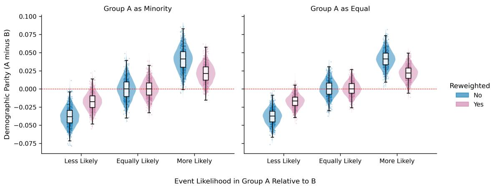
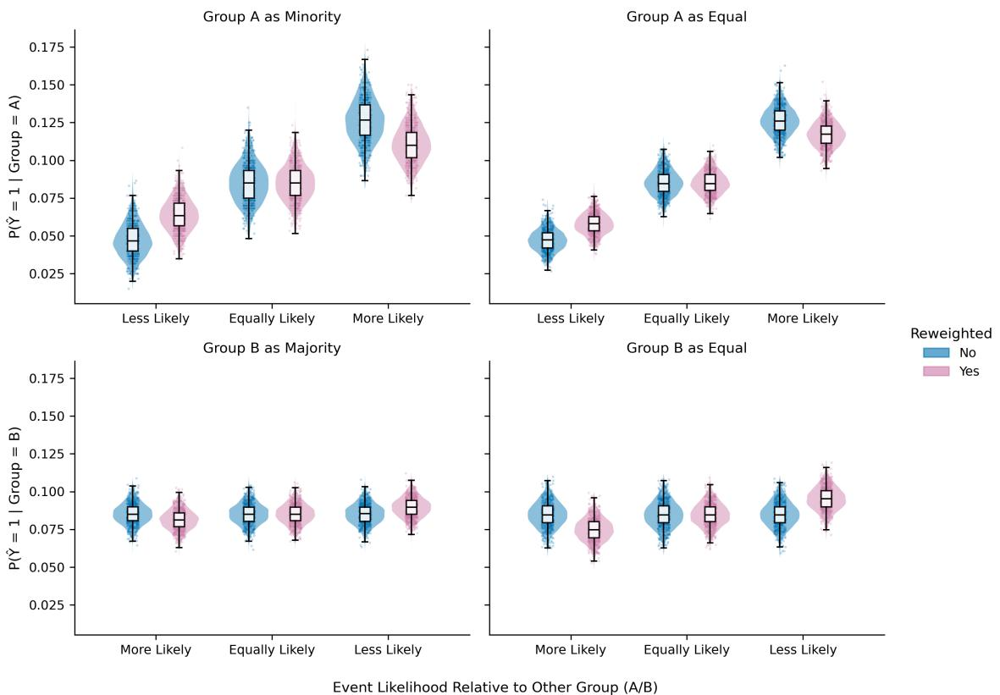
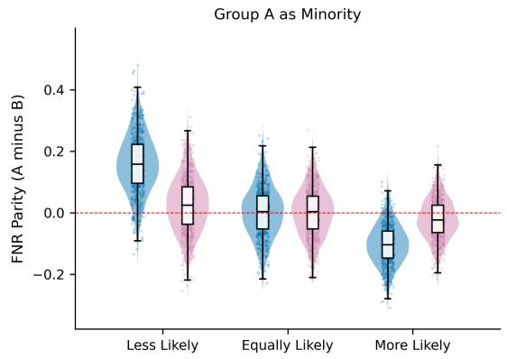
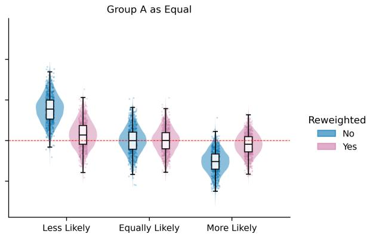
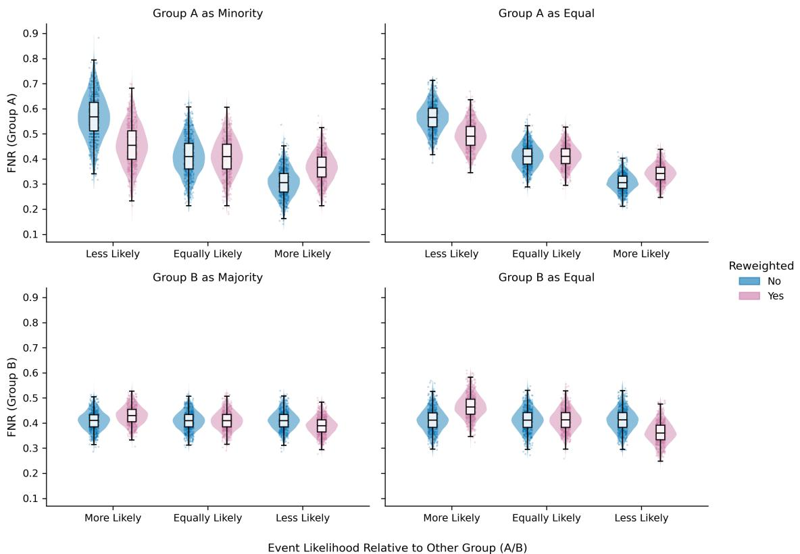
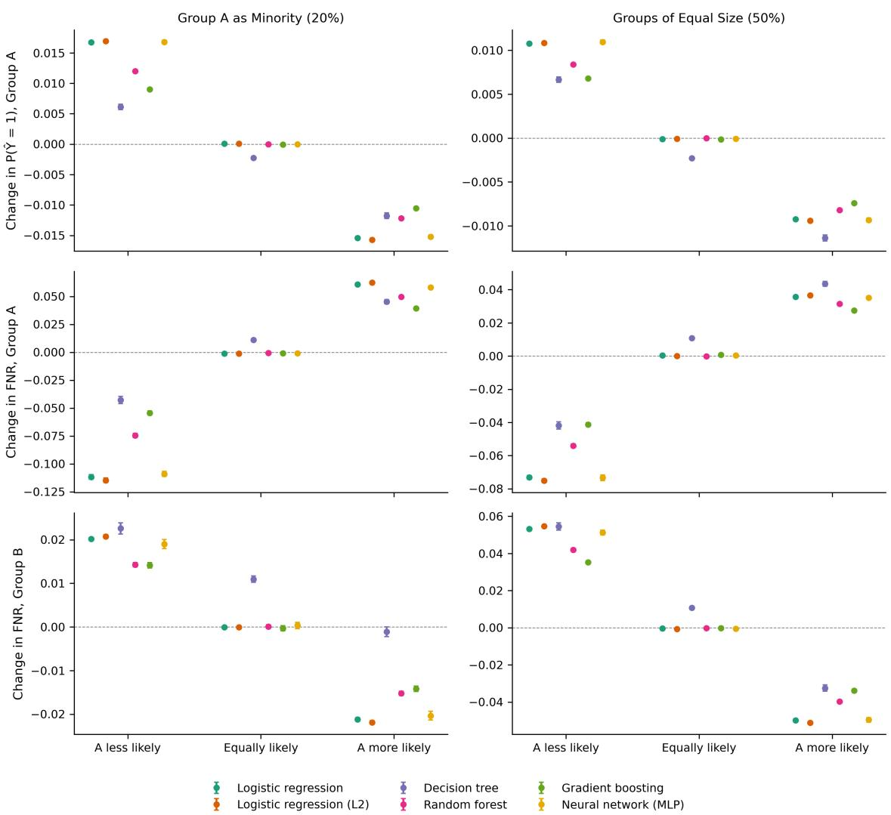

# Reweighting is not Harmless: Understanding the Role of Dataset Characteristics

AMALIA IONESCU, Cedars-Sinai Medical Center, USA

JOSE G. HERNANDEZ, Cedars-Sinai Medical Center, USA

EMILY F. WONG, Cedars-Sinai Medical Center, USA

ANIL K. SAINI, Cedars-Sinai Medical Center, USA

JASON H. MOORE, Cedars-Sinai Medical Center, USA

TIFFANI J. BRIGHT, Cedars-Sinai Medical Center, USA

Reweighting is a widely used pre-processing method for promoting discrimination-free model behavior by assigning diferent weights to data points during model training. While it is often credited with improving fairness, particularly by mitigating systematic underestimation for underrepresented groups, it can also introduce unintended harms under certain data conditions. Using controlled simulations that vary group size and baseline event prevalence, we show how reweighting can yield misleading improvements in fairness by reducing underestimation for one group while introducing it for another. Across 3,000 simulated datasets with event prevalence of 7–14%, reweighting improved parity in positive classification and false negative rates (FNR) between groups, but did so partly by decreasing positive classifications and increasing FNR for the group with higher baseline prevalence. These efects were most pronounced when that group was a minority: its FNR rose by 6 percentage points, approximately 82 additional missed cases per 10,000 group members, and roughly three-quarters of the improvement in FNR parity came from this increase rather than from gains for the other group. The pattern held across six classifiers, from logistic regression to neural networks, while overall accuracy was essentially unchanged, leaving the shift invisible in aggregate performance metrics. These findings mirror patterns reported in real-world applications and underscore the critical role of data characteristics in shaping the impact of this fairness intervention. While reweighting may create desirable outcomes in some applications, practitioners should critically evaluate it relative to their problem area and goals. Specifically, when the goal is to reduce underestimation in one group without introducing underestimation in another, reweighting may not be the appropriate approach

CCS Concepts: • Computing methodologies → Simulation evaluation; Machine learning approaches; Modeling methodologies; • Applied computing → Health informatics.

Additional Key Words and Phrases: Fairness, Reweighting, Bias Mitigation

## ACM Reference Format:

Amalia Ionescu, Jose G. Hernandez, Emily F. Wong, Anil K. Saini, Jason H. Moore, and Tifani J. Bright. 2026. Reweighting is not Harmless: Understanding the Role ofDataset Characteristics. 1, 1 (November 2026), 17 pages. https://doi.org/10.1145/nnnnnnn.nnnnnnn

Authors’ Contact Information: Amalia Ionescu, Cedars-Sinai Medical Center, Los Angeles, California, USA, amalia.ionescu@csmc.edu; Jose G. Hernandez Cedars-Sinai Medical Center, Los Angeles, California, USA, jose.hernandez8@csmc.edu; Emily F. Wong, emily.wong@cshs.org, Cedars-Sinai Medical Center, Los Angeles, California, USA; Anil K. Saini, Cedars-Sinai Medical Center, Los Angeles, California, USA, anil.saini@cshs.org; Jason H. Moore, Cedars-Sinai Medical Center, Los Angeles, California, USA, jason.moore@csmc.edu; Tifani J. Bright, Cedars-Sinai Medical Center, Los Angeles, California USA, tifani.bright@csmc.edu.

Permission to make digital or hard copies of all or part of this work for personal or classroom use is granted without fee provided that copies are not made or distributed for profit or commercial advantage and that copies bear this notice and the full citation on the first page. Copyrights for components of this work owned by others than the author(s) must be honored. Abstracting with credit is permitted. To copy otherwise, or republish, to post on servers or to redistribute to lists, requires prior specific permission and/or a fee. Request permissions from permissions@acm.org.

Manuscript submitted to ACM

## 1 Introduction

Artificial intelligence (AI) and machine learning (ML) tools are increasingly shaping many aspects of our daily lives, from determining credit lending [4] to recommending patients in need of extra care [29]. As these tools become more embedded in high-stakes decision-making, ensuring that their outcomes and benefits are equitable—regardless of race, gender, age, or socioeconomic status—is imperative. In particular, AI and ML tools have already become pivotal in the healthcare domain, where public and private healthcare systems increasingly sufer from deficits in healthcare personnel and soaring expenditures and waste [20, 31]. Such tools have been one avenue for relieving these burdens by aiding healthcare personnel in completing administrative and clinical tasks (e.g., diagnosis) [3, 27]. As a result, the global enthusiasm and investment in health AI has skyrocketed. As of 2024, the global market size of health AI was estimated at \$26.57 billion USD; this number is expected to reach \$187.69 billion USD by 2030 [15].

Despite its promise and garnered enthusiasm, AI tools are not a silver bullet and have raised some ethical concerns. Namely, a number of AI tools have been shown to exacerbate the biases embedded in the training data [7, 11, 29, 30]. AI models are designed to learn general patterns in human-supplied data. As such, social norms, biases, and errors in this data are learned these tools. These limitations are detrimental in high-stakes fields such as healthcare, where systematic model errors can exacerbate public health challenges (e.g., health disparities), delay intervention, or even deny life-saving care. For example, predictive models of health outcomes often rely on proxies of a patient’s true state such as International Classification of Diseases (ICD) codes, treatment records, or healthcare spending. However, these proxies often reflect systematic inequities in access to care [29]. Patients who are never screened or lack access to treatment are often overlooked by these models, thereby perpetuating existing disparities. For instance, even biasmitigated models [30] concluded that non-Hispanic white patients are at higher risk for postpartum depression (PPD) than ethnic and racial minorities, a finding that likely reflects unequal screening and treatment rather than lower true prevalence [6, 23]. These model decisions are due to the fact that expecting mothers belonging to racial and ethnic minority groups are less likely to receive screening and treatment, and therefore are underrepresented in the data [12, 16, 23]. While the current paper is motivated by examples from healthcare, these issues persist in other domains. Large language models (LLMs) used for resume screening have been shown to favor applicants with stereotypically male names over those with stereotypically female names [37]. Mortgage-lending algorithms also tend to approve fewer applications from minority applicants—even in ostensibly race-blind automated underwriting systems [4].

To address concerns of disproportionate harm, researchers have developed numerous bias-mitigating interventions to encourage algorithmic fairness [14]. Among these is reweighting, a widely used pre-processing technique known fo its simplicity and demonstrated efectiveness. Specifically, the current study will assess reweighting as described in Kamiran & Calders [19]. This approach assigns diferent weights to data points during model training to encourage discrimination-free model behavior without requiring explicit relabeling of records in the dataset. Applying this technique has been shown to improve algorithmic fairness, as defined by improved demographic parity (defined below) and more comparable false negative rates between groups. On the other hand, prior work has also shown that there is a general trade-of between fairness and accuracy [13, 22, 25, 32, 34]. It is well established that enforcing demographic parity when base rates difer between groups raises error rates for some individuals [9, 17]. Less attention has been paid to the fact that reweighting, a pre-processing step often applied to reduce disparities in error rates, implicitly enforces such parity, and to the question of which groups bear the resulting cost

In this paper, we argue that reweighting can have unintended and potentially harmful efects, particularly for groups with a higher baseline prevalence of an event. Postpartum depression illustrates why the direction of this efect depends

Manuscript submitted to ACM

on the data. If a minority group’s true prevalence is higher and its cases are accurately recorded, reweighting will lower that group’s predicted risk and increase missed cases, the harm we study here. If instead its cases are under-recorded because its members are less likely to be screened or treated [16, 23], the group appears to have lower prevalence in the data, and reweighting may partially correct that bias. Our simulations use accurate labels and therefore isolate the first case. Through a series of carefully controlled simulations, we demonstrate how dataset characteristics shape the impact of reweighting on model performance and fairness outcomes. Our findings ofer critical insights into the limitations of reweighting and underscore the importance of considering dataset structure and prediction goals when implementing fairness interventions. In particular, reweighting may yield misleading improvements in fairness (e.g., improved demographic parity, reduced diferences in false negative rates between groups) by underestimating outcomes for one group while improving for another. By unpacking when and how reweighting may fail, we aim to equip practitioners and researchers with a more nuanced understanding of its risk, helping them make informed decisions in the pursuit of equitable AI

## 1.1 Assessing Algorithmic Fairness

Numerous metrics exist to quantify the fairness of model predictions [36], a selection of which are discussed in this section. Fairness is often conceptualized at two levels: group and individual. Group fairness seeks to ensure that performance metrics—such as the likelihood of a positive recommendation or prediction accuracy—are comparable across demographic groups (e.g., gender, race, or ethnicity). Individual fairness aims to ensure that individuals with similar characteristics receive similar recommendations. It is important to note that the choice of metric is highly context-sensitive and should be guided by the specific goals of the application. The metrics evaluated in the present study are motivated by healthcare applications, where appropriate identification or recommendation are critical, and where false negatives may be life-threatening. In other domains, such as criminal justice, algorithmic fairness may instead prioritize minimizing false positives between groups (e.g., the COMPAS algorithm was more likely to incorrectly predict re-ofense for Black individuals than for White individuals [2])

For the purposes of illustrating the efects of reweighting in healthcare and similar domains, we focus on two group-level fairness metrics that this technique directly influences: Demographic Parity (DP) and False Negative Rate Parity (FNR Parity). Let $\hat { Y } \in \{ 0 , 1 \}$ indicate the predicted class, $Y \in \{ 0 , 1 \}$ indicate the true/observed class, and $G \in \{ A , B \}$ indicate group membership–also known as sensitive attributes or features such as race and sex.

Demographic Parity (DP) aims to ensure that a model’s predictions are independent of a sensitive attribute (e.g., race or gender). In other words, the probability of a positive prediction should be equal across diferent demographic groups. In classification problems, DP can be expressed as:

$$
D P : = P ( \hat { Y } = 1 | G = A ) - P ( \hat { Y } = 1 | G = B )
$$

Values at zero indicate parity (i.e., fairness), while deviations indicate the degree of disparity (i.e., bias); values closer to zero indicate better fairness. However, DP is not always appropriate, such as when there are true variations in event prevalence between groups. For example, the incidence rate of breast cancer is higher in females than in males due to hormonal diferences between the groups [1]. As such, other fairness metrics emphasize parity in model performance between groups. One such metric is False Negative Rate (FNR) Parity which aims to ensure equal miss rates across groups. Again, the choice of metric is context dependent. However, in many healthcare applications, which is the motivating example behind these simulations, FNR parity is crucial to avoid perpetuating many of the existing health disparities—health disparities typically involve certain groups missing out on care. It can be expressed as:

$$
\mathrm { F N R } \mathrm { P a r i t y } : = P ( \hat { Y } = 0 | Y = 1 , G = A ) - P ( \hat { Y } = 0 | Y = 1 , G = B )
$$

## 1.2 Methods for improving algorithmic fairness

Reweighting is a model-agnostic pre-processing technique used to improve likelihood of identification or recommendation for groups with a lower baseline likelihood of event without requiring re-labeling of the training data. As described in Kamiran & Calders [19]:

Instead of changing the labels, the tuples in the training dataset are assigned weights. As we will show, by carefully choosing the weights, the training dataset can be made discrimination-free w.r.t. S [sensitive attribute] without changing any labels. The weights on the tuples can be used directly in any method based on frequency counts.

Assuming independent, categorical sensitive attributes (�) and classes (�), the weight for each data point, i, in the dataset is calculated as:

$$
w _ { i } : = \frac { P _ { e x p } ( S = s _ { i } \cap C = c _ { i } ) } { P _ { o b s } ( S = s _ { i } \cap C = c _ { i } ) } = \frac { P _ { o b s } ( S = s _ { i } ) \cdot P _ { o b s } ( C = c _ { i } ) } { P _ { o b s } ( S = s _ { i } \cap C = c _ { i } ) } ,
$$

where �� and $c _ { i }$ are the values of the sensitive attribute and the true target value, respectively, for the �−th data point. The numerator in the expression is the expected probability of observing an individual belonging to the group (��) and being in the class (��), assuming independence between sensitive attribute (�) and class (�). The denominator is the observed probability in the dataset. If the observed probability is lower than the expected probability under assumptions of independence, then that individual will be assigned a weight greater than 1. If the observed probability is greater than the expected probability under assumptions of independence, then that individual will be assigned a weight below 1. If the observed and expected probabilities are equal, then that individual will be assigned a weight of 1. These weights are then used to determine the relative contribution of each data point to the model’s learning. As such, these weights are expected to impact classification across groups (based on sensitive attributes), as well as performance.

## 1.3 Results of reweighting in real-data applications

Numerous real-data applications of reweighting have demonstrated its ability to ameliorate underestimation—specifically by increasing the probability of positive predictions for groups with lower baseline probabilities [10, 24, 28, 30, 38]. Similarly, reweighting has also been shown to improve false negative rates for groups in which models initially underestimated risk [38]. Other work has also found that reweighting can improve balanced accuracy of Decision Tree (DT) and reduces bias across various metrics (e.g., Average Odds Diference (AOD), Equal Opportunity Diference (EOD), and Theil Index (TI)), but does not improve fairness of K Nearest Neighbor (KNN) [5]. However, determining the conditions under which reweighting is efective remains a challenge in real-data applications given that the data are not free from societal biases.

## 1.4 Known Trade-ofs

A commonly-discussed limitation of bias mitigation techniques, such as reweighting, is the trade-of between fairness and overall model performance (e.g., [13, 22, 25, 32, 34]). In many cases, enhancing fairness metrics can lead to reduced

Manuscript submitted to ACM

predictive accuracy or other performance measures. However, a decline in accuracy is not necessarily problematic when the ground-truth labels reflect societal inequities or historical bias. In such cases, there should be no aspiration to reproduce incorrect or unjust outcomes.

For example, in credit lending, Black applicants have historically been less likely to receive loan approval relative to White applicants despite equivalent qualifications [4]. A model trained with reweighted samples may adjust its recommendations to increase approvals for Black applicants. Although these predictions may diverge from the historical “true” labels, this divergence can be desirable—since those labels encode discrimination rather than genuine creditworthiness.

More directly related to our work, enforcing demographic parity when base rates difer is known to raise error rates for some individuals [9, 17]. Prior studies have examined how reweighting and related target-balancing methods interact with error-rate metrics [21], how multiple fairness metrics can be jointly balanced [18], and how data and model biases interact to produce fairness–fairness trade-ofs [33]. These studies establish that such trade-ofs exist. Our focus is on how dataset characteristics, specifically group size and baseline prevalence, determine which group bears the cost of a widely used pre-processing method, and by how much.

## 1.5 Present Study

Despite evaluating the benefits of reweighting as a bias mitigation tool, to our knowledge, previous work has yet to systematically examine how efective reweighting is as a function of dataset characteristics such as diversity (presence of majority and minority groups) and baseline prevalence rates. We make three contributions. First, we show that a widely used pre-processing method carries the cost of demographic parity implicitly, even when it is applied to address disparities in error rates. Second, we show that which group bears this cost, and how much, is predictable from group size and baseline prevalence: it falls most heavily on small groups with higher prevalence. Third, we show that this cost is invisible in overall accuracy, so that reweighting can appear to improve fairness at no cost while shifting errors onto the smaller group. Thus, our current study’s objective is to demonstrate the benefits and potential harms of reweighting through carefully controlled simulations, in which the synthetic data are free of societal influence, allowing us to study the efect of reweighting across data characteristics in isolation.

## 1.6 Hypotheses

Given DP’s aspiration towards model predictions that are independent of a sensitive attribute, reweighting as proposed by Kamiran & Calders [19] should reliably improve DP as has been demonstrated in several papers [30, 38] (H1) Reweighting can also be applied to address disproportionate miss (FNR) and false alarm rates between groups (e.g., Wong et al. [38], Chen et al. [8]) (H2). While reweighting has demonstrably improved positive prediction rates for groups with lower baseline rates of event, the formulation also suggests that it can decrease positive prediction rates for groups with higher baseline rates of event (H3a) thus increasing false negative rates (H3b), which may be an undesirable consequence. We demonstrate these limitations through a carefully controlled simulation study.

## 2 Methods

All simulations were performed in Python (version 3.12.16) using Numpy (version 2.5.4) and scikit-learn (version 1.9.1).   
The corresponding Python code is available at: https://anonymous.4open.science/r/reweighting-sims/.

Simulation design. The sensitive feature in the present simulation study was group membership, which consisted of two possible groups: � and �. The six experimental conditions outlined in Table 1 manipulated two dataset characteristics: Manuscript submitted to ACM dataset diversity and relative event likelihood. Dataset diversity was determined by the proportion of the total sample size made up of Group � (e.g., 0.20); the remaining was made up of Group � (e.g., 0.80). Relative event likelihood was determined by the regression parameter associated with the group predictor, $b _ { a } ;$ a positive value indicated that Group � was more likely than Group � to exhibit the positive outcome, a negative value indicated that Group � was less likely, and a value of zero indicated no diference in event likelihood between groups. Table 2 lists a substantive example for each condition. To assess the efect of reweighting in each of the six conditions, models were fit to the simulated data in each condition with and without reweighting as described in Kamiran & Calders [19].

Table 1. Experimental conditions varying two data characteristics: dataset diversity and relative event likelihood.
<table><tr><td>#</td><td>Proportion Group A</td><td>Relative Event Likelihood in Group A</td><td>Prevalence A</td><td>Prevalence B</td></tr><tr><td>1</td><td>0.2 (Minority)</td><td>Less Likely  $( b _ { a } = - 0 . 7 )$ </td><td>7.0%</td><td>10.0%</td></tr><tr><td>2</td><td>0.5 (Equal)</td><td>Less Likely  $( b _ { a } = - 0 . 7 )$ </td><td>7.0%</td><td>10.0%</td></tr><tr><td>3</td><td>0.2 (Minority)</td><td>Equally Likely  $( b _ { a } = 0 )$ </td><td>10.0%</td><td>10.0%</td></tr><tr><td>4</td><td>0.5 (Equal)</td><td>Equally Likely  $( b _ { a } = 0 )$ </td><td>10.0%</td><td>10.0%</td></tr><tr><td>5</td><td>0.2 (Minority)</td><td>More Likely  $( b _ { a } = + 0 . 7 )$ </td><td>13.5%</td><td>10.0%</td></tr><tr><td>6</td><td>0.5 (Equal)</td><td>More Likely  $( b _ { a } = + 0 . 7 )$ </td><td>13.5%</td><td>10.0%</td></tr></table>

Note: Prevalence is the mean realized prevalence across 3,000 repetitions. Each condition drew 10,000 observations, split 70/30 into 7,000 training and 3,000 test observations.

Table 2. Experimental conditions and their corresponding substantive examples.
<table><tr><td>#</td><td>Proportion Group A</td><td>Relative Event Likelihood in Group A</td><td>Substantive Example</td></tr><tr><td>1</td><td>0.2 (Minority)</td><td>Less Likely</td><td>Mortgage Approval [4]</td></tr><tr><td>2</td><td>0.5 (Equal)</td><td>Less Likely</td><td>Resume Selection [37]</td></tr><tr><td>3</td><td>0.2 (Minority)</td><td>Equally Likely</td><td>Control Group</td></tr><tr><td>4</td><td>0.5 (Equal)</td><td>Equally Likely</td><td>Control Group</td></tr><tr><td>5</td><td>0.2 (Minority)</td><td>More Likely</td><td>Postpartum Depression ª [38]</td></tr><tr><td>6</td><td>0.5 (Equal)</td><td>More Likely</td><td>Breast Cancer [1]</td></tr></table>

Note: Examples indicate the direction of the diference in event likelihood, not its mechanism or size; for instance, the diference in breast cancer incidence by sex is far larger than the diferences simulated here. Mortgage approval and resume selection are cases in which observed outcomes partly reflect discrimination (label bias), which our simulations do not model. �Whether true prevalence of postpartum depression difers by race and ethnicity is debated [26]; because members of racial and ethnic minority groups are less likely to receive screening and treatment [16, 23], observed labels may undercount their cases, in which case this example corresponds to Condition 1 rather than Condition 5 (see Section 4).

Data generation. For each observation �, the binary outcome was generated from the logistic regression model:

$$
Y _ { i } \sim \mathrm { B e r n o u l l i } ( \phi _ { i } ) , \qquad \ln \biggl ( { \frac { p _ { i } } { 1 - p _ { i } } } \biggr ) = b _ { 0 } + b _ { a } X _ { a , i } + b _ { 1 } X _ { 1 , i } + b _ { 2 } X _ { 2 , i } + b _ { 3 } X _ { 3 , i } ,
$$

where $X _ { a } \in \{ 0 , 1 \}$ indicated whether an individual belonged to Group � $( X _ { a } = 1 )$ or Group $B \left( X _ { a } = 0 \right)$ . The model also included three independent covariates: $X _ { 1 }$ was normally distributed with mean 0 and standard deviation $1 , X _ { 2 }$ was normally distributed with mean 5 and standard deviation 2, and $X _ { 3 }$ was drawn from a discrete uniform distribution on 0–20. The coeficients $b _ { 1 } , b _ { 2 } ,$ and $b _ { 3 }$ were −0.5, −0.3, and 0.8. Because the covariates are not centered at zero, setting the intercept to ln(0.10/0.90) would give a 10% probability only to an individual with $X _ { 1 } = X _ { 2 } = X _ { 3 } = 0 ;$ averaged over the covariate distribution, the prevalence would be approximately 74%. We therefore computed $b _ { 0 }$ so that the expected prevalence in Group $B \left( X _ { a } = 0 \right)$ was 10%:

$$
\mathbb { E } _ { X _ { 1 } , X _ { 2 } , X _ { 3 } } \left[ \frac { 1 } { 1 + e ^ { - ( b _ { 0 } + b _ { 1 } X _ { 1 } + b _ { 2 } X _ { 2 } + b _ { 3 } X _ { 3 } ) } } \right] \approx 0 . 1 0 .\tag{1}
$$

We approximated the expectation by averaging over 2,000,000 covariate draws generated with a fixed random seed, and solved Equation 1 for $b _ { 0 }$ using Brent’s root-finding method, giving $b _ { 0 } \approx - 1 3 . 4 8$ . The same value was used in every condition and repetition. Because Group � is defined by $X _ { a } = 0 , b _ { a }$ does not afect this calibration, and Group �’s prevalence follows from its log-odds difering by $b _ { a } { \mathrm { : } }$ approximately 7%, 10%, or 13.5% (Table 1).

Training and test data. In each repetition and condition, 10,000 observations were simulated and split into training (70%) and test (30%) sets, stratified by group and outcome. Reweighting weights [19] were computed on the training set only. Covariates were standardized using training-set means and standard deviations.

Classifiers. Six classifiers, implemented in scikit-learn with default settings unless stated, were fit to the same training data within a repetition, with and without reweighting: unpenalized logistic regression $( C = 1 0 ^ { 1 0 } )$ , L2-regularized logistic regression (C=1), a decision tree (minimum 20 observations per leaf), a random forest (200 trees, minimum 5 per leaf), histogram gradient boosting, and a multilayer perceptron (hidden layers of 32 and 16 units). Reweighting was applied through each model’s sample weights. Predicted probabilities were classified at a threshold of 0.5.

Evaluation and statistical analysis. For each model and condition, we computed on the held-out test set the positive-prediction rate, false negative rate (FNR), and false positive rate for each group; DP and FNR parity (Group � minus Group �); and overall accuracy and AUROC. Additional missed cases per 10,000 group members were computed as the change in FNR multiplied by the group’s prevalence and by 10,000. The share of a narrowed FNR gap attributable to the higher-baseline group was its increase in FNR divided by the total reduction in the gap. The simulation was repeated 3,000 times. Each repetition used its own random seed, shared by all conditions, and within each repetition the unweighted and reweighted models were fit to identical data. Efects are therefore reported as the mean paired diference (reweighted minus unweighted) with 95% confidence intervals and tested with two-sided Wilcoxon signed-rank tests. Comparisons between group sizes were also paired by repetition. Because 3,000 paired repetitions make even negligible diferences statistically significant, we interpret efect sizes rather than �-values.

## 3 Results

## 3.1 Demographic parity (DP)

We replicated the previously observed efect of reweighting on DP as shown in Figure 1. The DP values from models without reweighting are shown in blue, and the DP values with reweighting are shown in pink. As expected, reweighting made no significant diference between groups when the event was equally likely between groups. When event prevalence varied between groups, reweighting promoted DP as indicated by the pink distributions being drawn closer to zero (H1 supported): it roughly halved the diference in positive-prediction rates, from −3.8 to −1.7 percentage points when Group � was less likely to experience the event, and from 4.1 to 2.1 percentage points when it was more likely, although it did not eliminate it. However, it is important to highlight a potentially undesired consequence of reweighting, especially for groups in which the baseline likelihood of the event is more likely. While reweighting increased the probability of a positive prediction for groups with lower baseline likelihoods, it also decreased the probability of a positive prediction for groups with higher baseline likelihoods. Figure 2 provides a more detailed breakdown of the proportion of positive predictions for Groups � and � across each of the six experimental conditions. Table 3 shows the change in proportion of positive prediction before and after reweighting in groups with higher baselines (H3a supported). For a minority group with the higher baseline, the positive-prediction rate fell from 12.6% to 11.1% (−1.5 percentage points, a 12% relative decrease). The same pattern held across all six classifiers (Section 3.3).

The decrease in probability of positive prediction is also significantly smaller for the majority group (−0.4 percentage points) compared to the minority $( - 1 . 5 ; p < . 0 0 1 )$ and equal-sized groups $( - 0 . 9 \mathrm { t o } - 1 . 0 ; p ^ { \prime } s < . 0 0 1 )$ . The decrease was likewise significantly smaller for equal-sized groups than for the minority group $\left( p ^ { \prime } s < . 0 0 1 \right)$ . These comparisons were paired by repetition, since conditions within a repetition shared the same random seed. In summary, the unintended and undesirable consequences of reweighting were most pronounced in smaller, non-majority groups with higher baseline event prevalence.

Table 3. The efect of reweighting on the probability of positive classification by group size and relative event likelihood (logistic regression, held-out test set). Before and after are mean rates; Δ is the mean paired diference (reweighted minus unweighted) across 3,000 repetitions, with 95% confidence intervals (CI) and two-sided p-values from Wilcoxon signed-rank tests. Values correspond to Figure 2.
<table><tr><td rowspan="2">Group Label</td><td rowspan="2">Group Size</td><td colspan="5">Relative Event</td><td rowspan="2">Two-sided p-value</td></tr><tr><td>Likelihood</td><td>Before</td><td>After</td><td> $\Delta P ( \hat { Y } = 1 | \cdot )$ </td><td>95% CI</td></tr><tr><td>A</td><td>Minority</td><td>More Likely</td><td>0.1263</td><td>0.1109</td><td>-0.0154</td><td>[-0.0156, -0.0152]</td><td>&lt; .001</td></tr><tr><td>A</td><td>Equal</td><td>More Likely</td><td>0.1264</td><td>0.1172</td><td>-0.0092</td><td>[-0.0094, -0.0091]</td><td>&lt; .001</td></tr><tr><td>B</td><td>Equal</td><td>More Likely</td><td>0.0849</td><td>0.0748</td><td>-0.0101</td><td>[-0.0102, -0.0100]</td><td>&lt; .001</td></tr><tr><td>B</td><td>Majority</td><td>More Likely</td><td>0.0853</td><td>0.0813</td><td>-0.0040</td><td>[-0.0040, -0.0039]</td><td>&lt; .001</td></tr><tr><td>A</td><td>Minority</td><td>Less Likely</td><td>0.0472</td><td>0.0640</td><td>+0.0167</td><td>[+0.0165, +0.0170]</td><td>&lt; .001</td></tr><tr><td>A</td><td>Equal</td><td>Less Likely</td><td>0.0472</td><td>0.0580</td><td>+0.0108</td><td>[+0.0107, +0.0109]</td><td>&lt; .001</td></tr><tr><td>B</td><td>Equal</td><td>Less Likely</td><td>0.0849</td><td>0.0952</td><td>+0.0104</td><td>[+0.0103, +0.0105]</td><td>&lt; .001</td></tr><tr><td>B</td><td>Majority</td><td>Less Likely</td><td>0.0852</td><td>0.0895</td><td>+0.0043</td><td>[+0.0042, +0.0044]</td><td>&lt; .001</td></tr></table>

  
Fig. 1. The efect of reweighting on Demographic Parity (DP) (logistic regression; held-out test set).

## 3.2 False negative rate (FNR)

The efect of reweighting on FNR and FNR parity is consistent with DP, as illustrated in Figures 3 and 4. Like for DP, values from models without reweighting are shown in blue, and values with reweighting are shown in pink. As expected, Manuscript submitted to ACM

  
Fig. 2. The efect of reweighting on model predictions (logistic regression; held-out test set).

reweighting made a negligible diference when the event was equally likely between groups: group FNRs changed by 0.1 percentage points or less, and FNR parity did not change $( p ^ { \prime } s > . 0 5 )$ . When event prevalence varied between groups, reweighting promoted FNR parity, as indicated by the pink distributions being drawn closer to zero (see Figure 3): the diference in FNR between groups fell from 15.8 to 2.6 percentage points when group � was less likely to experience the event, and from $- 1 0 . 3 \mathrm { t o } - 2 . 1$ percentage points when it was more likely (H2 supported). Reweighting improved (i.e., lowered) the FNR for groups with lower baseline likelihoods of the event, most strongly for minority groups (−11.2 percentage points). However, reweighting increased FNRs for groups with higher baseline likelihoods. Table 4 shows the change in FNR before and after reweighting in groups with higher baselines (H3b supported). For a minority group with the higher baseline, FNR rose from 30.7% to 36.8% (+6.1 percentage points), corresponding to approximately 82 additional missed cases per 10,000 members of the group. Across all six classifiers, the increase ranged from 3.9 to 6.2 percentage points (Section 3.3). Like for DP, the increase in FNR is significantly smaller for the majority group (+2.0 percentage points) compared to the minority group $( + 6 . 1 ; p < . 0 0 1 )$ and equal-sized groups $\left( + 3 . 6 \mathrm { t o } + 5 . 3 ; p ^ { \prime } s < . 0 0 1 \right)$ and significantly smaller for equal-sized groups than for the minority group $\left( p ^ { \prime } s < . 0 0 1 \right)$ . Among equal-sized groups, the increase was larger for Group � (+5.3 percentage points) than for Group � (+3.6), even though the diference in log-odds between groups was the same. The increase also depended on how many of a group’s positive cases lay near the decision threshold: Group $B ,$ whose baseline FNR was higher, lost more true positives for a similar shift in predicted risk. Like for DP, the unintended and undesirable consequences of reweighting on FNR were most pronounced in smaller, non-majority groups with higher baseline event prevalence. When the higher-baseline group was the minority, approximately three-quarters (74%) of the reduction in the FNR gap between groups came from that group’s FNR rising rather than from the other group’s falling (42% for equal-sized groups; 15% when the higher-baseline group was the majority).

  
Event Likelihood in Group A Relative to B  
Fig. 3. The efect of reweighting on false negative rates (FNR) parity (logistic regression; held-out test set.

Table 4. The efect of reweighting on FNR for groups with higher baseline likelihoods across group sizes (logistic regression, held-out test set). Values are mean paired diferences (reweighted minus unweighted) across 3,000 repetitions, with 95% confidence intervals (CI) and two-sided p-values from Wilcoxon signed-rank tests. Additional missed cases are ΔFNR × group prevalence × 10,000, using training-set prevalence. Values correspond to Figure 4.
<table><tr><td>Group Label</td><td>Group Size</td><td>Relative Event Likelihood</td><td>∆FNR</td><td>95% CI</td><td>Two-sided p-value</td><td>Additional missed cases per 10,000</td></tr><tr><td>A</td><td>Minority</td><td>More Likely</td><td>+0.0608</td><td>[0.0597, 0.0618]</td><td>&lt; .001</td><td>82</td></tr><tr><td>A</td><td>Equal</td><td>More Likely</td><td>+0.0356</td><td>[0.0351, 0.0362]</td><td>&lt; .001</td><td>48</td></tr><tr><td>B</td><td>Equal</td><td>More Likely</td><td>+0.0531</td><td>[0.0524, 0.0539]</td><td>&lt; .001</td><td>53</td></tr><tr><td>B</td><td>Majority</td><td>More Likely</td><td>+0.0202</td><td>[0.0198, 0.0206]</td><td>&lt; .001</td><td>20</td></tr></table>

## 3.3 Robustness across classifiers

To test whether these efects are specific to logistic regression, we repeated every analysis with five additional classifiers fit to the same data: L2-regularized logistic regression, a decision tree, a random forest, gradient boosting, and a multilayer perceptron. Figure 5 shows the change in positive-prediction rate and FNR after reweighting for every classifier and condition, and Table 5 summarizes the key comparisons. The pattern held for all six classifiers. Reweighting lowered the FNR of the group with the lower baseline and raised the FNR of the group with the higher baseline in every condition where prevalence difered, with one exception: for the decision tree, the FNR of a lower-baseline majority group did not change (−0.1 percentage points, 95% CI [−0.2, 0.0]). All other changes had 95% confidence intervals excluding zero. For a higher-baseline minority group, FNR rose by 3.9 to 6.2 percentage points across classifiers, and for a higher-baseline majority group, by 1.4 to 2.3 percentage points. The increase was therefore larger for a minority Manuscript submitted to ACM

  
Fig. 4. The efect of reweighting on false negative rates (FNR) (logistic regression, held-out test set).

than for a majority group under every classifier. The size of the efects difered by classifier. They were largest for the two logistic regressions and the multilayer perceptron, and smaller for the tree-based models, partly because the tree-based models’ unweighted FNRs already difered less between groups. For the decision tree, the efect of group size was also weaker: the FNR increase for a higher-baseline minority group (+4.5 percentage points) was close to that for an equal-sized group (+4.4). Notably, the decision tree showed almost no FNR gap between groups before reweighting when Group � was the minority with the higher baseline (−0.3 percentage points), but reweighting created a gap of 4.3 percentage points in the opposite direction. In this case, reweighting worsened FNR parity rather than improving it. For every classifier and condition, reweighting changed overall accuracy by less than 0.1 percentage points. The redistribution of errors between groups was therefore invisible in aggregate performance. Tree-based models fit their training data considerably more closely than held-out test data, which is why all results are reported on the held-out test set.

## 4 Discussion

Reweighting is a widely applied pre-processing technique for promoting discrimination-free model behavior without altering training data labels. In real-world applications, reweighting has increased positive prediction rates and reduced false negatives for groups with lower baseline event prevalence [10, 28, 30, 38], but it has also been associated with underestimation for other groups [38]. Because real data are shaped by societal biases, these studies could not determine when such harms arise. In our paper, we reproduced both patterns in synthetic data free from societal biases, for a correctly specified logistic regression and for five classifiers that were not correctly specified. Reweighting consistently improved parity between groups while worsening outcomes for the group with the higher baseline event prevalence, and this cost was greatest when that group was a minority: its FNR rose by 6.1 percentage points, 82 additional missed cases per 10,000 group members, compared with 2.0 percentage points when it was the majority. These results underscore the pivotal role of data characteristics, specifically group size and baseline prevalence, in shaping the efects of fairness interventions.

  
Fig. 5. Change after reweighting (reweighted minus unweighted) in the positive-prediction rate of Group � (top), the FNR of Group � (middle), and the FNR of Group � (botom), for six classifiers. Left: Group � is the minority (20%); right: groups are of equal size. Points are means across 3,000 repetitions on the held-out test set; error bars are 95% confidence intervals.

Manuscript submitted to ACM

Table 5. Change in FNR after reweighting by classifier (held-out test set). Values are mean paired diferences (reweighted minus unweighted) across 3,000 repetitions, with 95% confidence intervals in brackets; all � < .001 (Wilcoxon signed-rank). Higher-baseline groups: Group � as minority (condition 5) and as equal-sized group (condition 6), and Group � as majority (condition 1). Lower-baseline group: Group � as minority (condition 1).
<table><tr><td colspan="2">Test</td><td colspan="3">Higher-baseline group</td><td rowspan="2">Lower-baseline group Minority</td></tr><tr><td>Classifier</td><td>AUROC</td><td>Minority</td><td>Equal</td><td>Majority</td></tr><tr><td>Logistic regression</td><td>0.960</td><td>+0.0608 [0.0597, 0.0618]</td><td>+0.0356 [0.0351, 0.0362]</td><td>+0.0202 [0.0198, 0.0206]</td><td>-0.1117 [-0.1138,-0.1097]</td></tr><tr><td rowspan="2">Logistic regression (L2)</td><td>0.960</td><td>+0.0624</td><td>+0.0365</td><td>+0.0208</td><td>-0.1147</td></tr><tr><td></td><td>[0.0613, 0.0635]</td><td>[0.0360, 0.0371]</td><td>[0.0204, 0.0211]</td><td>[-0.1168,-0.1126]</td></tr><tr><td rowspan="2">Multilayer perceptron</td><td>0.959</td><td>+0.0581</td><td>+0.0352</td><td></td><td>-0.1090</td></tr><tr><td></td><td>[0.0567, 0.0594]</td><td>[0.0343, 0.0362]</td><td>+0.0190</td><td></td></tr><tr><td rowspan="2">Random forest</td><td>0.952</td><td>+0.0496</td><td></td><td>[0.0180, 0.0201]</td><td>[-0.1114,-0.1065]</td></tr><tr><td></td><td>[0.0485, 0.0508]</td><td>+0.0315</td><td>+0.0143</td><td>-0.0745</td></tr><tr><td rowspan="2">Decision tree</td><td>0.930</td><td></td><td>[0.0309, 0.0321]</td><td>[0.0138, 0.0147]</td><td>[-0.0765,-0.0725]</td></tr><tr><td></td><td>+0.0452</td><td>+0.0436</td><td>+0.0226</td><td>-0.0428</td></tr><tr><td rowspan="2">Gradient boosting</td><td></td><td>[0.0433, 0.0472]</td><td>[0.0421, 0.0450]</td><td>[0.0213, 0.0239]</td><td>[-0.0460, -0.0396]</td></tr><tr><td>0.951</td><td>+0.0392</td><td>+0.0274</td><td>+0.0141</td><td>-0.0544</td></tr><tr><td rowspan="2"></td><td></td><td></td><td></td><td></td><td></td></tr><tr><td></td><td>[0.0381, 0.0404]</td><td>[0.0267, 0.0281]</td><td>[0.0135, 0.0147]</td><td>[-0.0562, -0.0525]</td></tr></table>

## 4.1 Why smaller groups bear more of the cost

These patterns follow from how reweighting works. Kamiran and Calders’ weights make group membership and outcome statistically independent in the weighted training data [19]. For a logistic regression that includes group membership, this is equivalent to shifting each group’s predicted log-odds by

$$
\log \operatorname { i t } P ( Y = 1 ) - \log \operatorname { i t } P ( Y = 1 \mid G = g ) ,
$$

that is, toward the overall prevalence: groups with above-average prevalence are shifted down and groups with belowaverage prevalence are shifted up. Because the overall prevalence is dominated by the larger group, it lies closest to that group’s prevalence and furthest from the smaller group’s, so the smaller group receives the largest shift. In our conditions, the shift for the higher-baseline group was −0.26 when it was the minority, −0.16 to −0.18 when groups were of equal size, and −0.07 when it was the majority, matching the pattern of the FNR increases. This identity holds in large samples for a correctly specified, unpenalized logistic regression. Across classifiers, the cost to a higher-baseline minority group exceeded that to a majority group in every case, and the full ordering held for all classifiers except the decision tree. This also clarifies how our findings relate to known trade-ofs in algorithmic fairness. By making group membership independent of the outcome in the training data, reweighting acts as a demographic-parity intervention, and when true prevalence difers between groups, enforcing parity in positive predictions is known to raise error rates for some individuals [9, 17]. Our contribution is to show that a widely used pre-processing step carries this cost implicitly, even when it is applied to address disparities in error rates rather than to enforce demographic parity, to quantify it, and to show which groups bear it.

## 4.2 Implications for practice

Applying reweighting without accounting for dataset structure, particularly group size and baseline event prevalence, can yield misleading improvements in fairness by underestimating outcomes for one group while enhancing outcomes for another. Practitioners should report group-level error rates alongside parity metrics, and inspect group sizes and prevalence before applying reweighting. Whether a shift in errors is harmful also depends on whether observed labels Manuscript submitted to ACM reflect true need: if a group’s labels undercount its true cases, as when members of racial and ethnic minority groups are less likely to be screened for postpartum depression, raising its predicted risk may correct rather than cause harm. When the goal is to equalize error rates, methods that target those rates directly, such as group-specific decision thresholds that equalize FNR [17], may avoid forcing equal positive-prediction rates. Evaluating such alternatives under the conditions studied here is an important next step. More broadly, there is a pressing need for bias mitigation methods that explicitly account for group-level heterogeneity and are robust across diverse data conditions

## 4.3 Limitations

Our simulations were designed to isolate the mechanism by which reweighting redistributes errors, and this design has limits. We studied a binary outcome, a single binary sensitive attribute, and one reweighting method [19]. Outcomes were generated from a logistic model with independent covariates. Because our covariates were independent of group membership, the models could distinguish groups only through the group indicator itself. In clinical practice, the use of race as a model input is contested and often removed [35], in which case group diferences are carried by correlated proxies; the efect of reweighting may then difer, since theoretical work suggests that fairness interventions afect groups less predictably when the sensitive attribute is not used in decisions [39]. Although five of our six classifiers did not match this process, real data involve correlated predictors, nonlinear relationships, missing data, and label noise, none of which we modeled. We varied group size and prevalence over a limited set of values, used a single classification threshold of 0.5, and did not examine intersectional groups, where small groups and extreme weights may make the efects larger. We did not compare reweighting with alternative mitigation strategies or apply it to real-world datasets. Additionally, we did not optimize any model parameters for a given dataset. Finally, whether a given shift in errors constitutes harm depends on the application and on whether observed labels reflect true need. Future work should extend these analyses to real-world data, multiple and intersectional sensitive attributes, alternative thresholds, and other mitigation methods.

## 5 Key Takeaways

Reweighting is a convenient and accessible technique to mitigate algorithmic bias. It may be an efective technique when 1) the likelihood of recommendation (i.e., positive prediction) should be equal between groups, 2) there is evidence of bias that leads to over-recommendation in one group, and 3) under-recommendation in another group. In other conditions, reweighting may introduce undesirable artifacts. In particular, reweighting may not be an efective technique for increasing recommendations for one group without decreasing recommendation for another, and its costs fall most heavily on small groups with higher baseline prevalence. Because these costs are invisible in parity metrics and overall accuracy, practitioners should examine group-level error rates before and after applying it. Our simulations reproduced consequences of reweighting previously observed in real-data applications and provide a controlled setting for understanding its potential pitfalls for fairness.

## Generative AI Usage Statement

The authors used Claude (Anthropic; Claude Opus 5.5) for this manuscript. It was used to (1) review the simulation code and identify errors in the original implementation; (2) revise simulation and analysis code, including the held-out evaluation, the additional classifiers, and the scripts that produce the figures and tables; (3) edit text, including the abstract and parts of the Methods, Results, and Discussion, and format tables in LaTeX. The authors directed all analyses, ran the simulations, reviewed and revised all code and text, and verified the reported results and references. The authors take full responsibility for the content of this paper.

## Ethical Considerations Statement

This study used only simulated data; it involved no human participants, personal data, or deployed systems, and the groups studied are abstract rather than representations of real populations. The main potential adverse impact concerns how the findings are used. Our results show that reweighting can shift errors onto smaller groups with higher baseline prevalence, but they should not be read as an argument against fairness interventions in general, nor as estimates of harm in any particular real-world application, where the size and direction of efects will depend on the data. In particular, when observed labels undercount a group’s true cases, as can occur when some groups are less likely to be screened or diagnosed, reweighting may correct rather than cause harm. To support appropriate use, we report efects alongside the conditions that produce them, recommend that practitioners examine group-level error rates rather than parity metrics alone, and release our code so that others can test these efects under their own data conditions.

## References

[1] William F Anderson, Ismail Jatoi, Julia Tse, and Philip S Rosenberg. 2010. Male breast cancer: a population-based comparison with female breast cancer. Journal ofClinical Oncology 28, 2 (2010), 232–239.

[2] Julia Angwin, Jef Larson, Surya Mattu, and Lauren Kirchner. 2016. Machine Bias: There’s software used across the country to predict future criminals And it’s biased against blacks. ProPublica (May 23 2016). https://www.propublica.org/article/machine-bias-risk-assessments-in-criminal-sentencing Accessed: 2025-11-04.

[3] Yuri YM Aung, David CS Wong, and Daniel SW Ting. 2021. The promise of artificial intelligence: a review of the opportunities and challenges of artificial intelligence in healthcare. British medical bulletin 139, 1 (2021), 4–15

[4] Neil Bhutta, Aurel Hizmo, and Daniel Ringo. 2021. How much does racial bias afect mortgage lending? Evidence from human and algorithmic credit decisions. The Journal ofFinance (2021).

[5] Christina Hastings Blow, Lijun Qian, Camille Gibson, Pamela Obiomon, and Xishuang Dong. 2024. Comprehensive validation on Reweighting samples for bias mitigation via AIF360. Applied Sciences 14, 9 (2024), 3826.

[6] Susan Bodnar-Deren, EKT Benn, Amy Balbierz, and EA Howell. 2017. Stigma and postpartum depression treatment acceptability among black and white women in the first six-months postpartum. Maternal and child health journal 21 (2017), 1457–1468

[7] Leo Anthony Celi, Jacqueline Cellini, Marie-Laure Charpignon, Edward Christopher Dee, Franck Dernoncourt, Rene Eber, William Greig Mitchell, Lama Moukheiber, Julian Schirmer, Julia Situ, et al. 2022. Sources of bias in artificial intelligence that perpetuate healthcare disparities—A global review. PLOS digital health 1, 3 (2022), e0000022.

[8] Richard J Chen, Judy J Wang, Drew FK Williamson, Tifany Y Chen, Jana Lipkova, Ming Y Lu, Sharifa Sahai, and Faisal Mahmood. 2023. Algorithmic fairness in artificial intelligence for medicine and healthcare. Nature biomedical engineering 7, 6 (2023), 719–742.

[9] Sam Corbett-Davies, Emma Pierson, Avi Feller, Sharad Goel, and Aziz Huq. 2017. Algorithmic Decision Making and the Cost of Fairness. In Proceedings ofthe 23rd ACM SIGKDD International Conference on Knowledge Discovery and Data Mining. 797–806. doi:10.1145/3097983.3098095

[10] Harshal Dalvi, Meera Narvekar, Shehal Shah, Priyal Donda, and Jeniel Shah. 2024. Mitigating Data Bias In Machine Learning: Enhancing Model Transparency Through Fairness-Aware Techniques. Frontiers in Health Informatics 13, 4 (2024).

[11] Roxana Daneshjou, Kailas Vodrahalli, Roberto A Novoa, Melissa Jenkins, Weixin Liang, Veronica Rotemberg, Justin Ko, Susan M Swetter, Elizabeth E Bailey, Olivier Gevaert, et al. 2022. Disparities in dermatology AI performance on a diverse, curated clinical image set. Science advances 8, 31 (2022), eabq6147.

[12] Cindy-Lee Dennis and Leinic Chung-Lee. 2006. Postpartum depression help-seeking barriers and maternal treatment preferences: A qualitative systematic review. Birth 33, 4 (2006), 323–331.

[13] Sanghamitra Dutta, Dennis Wei, Hazar Yueksel, Pin-Yu Chen, Sijia Liu, and Kush Varshney. 2020. Is there a trade-of between fairness and accuracy? a perspective using mismatched hypothesis testing. In International conference on machine learning. PMLR, 2803–2813.

[14] Sorelle A Friedler, Carlos Scheidegger, Suresh Venkatasubramanian, Sonam Choudhary, Evan P Hamilton, and Derek Roth. 2019. A comparative study of fairness-enhancing interventions in machine learning. In Proceedings ofthe conference on fairness, accountability, and transparency. 329–338.

[15] Inc. Grand View Research. 2025. AI In Healthcare Market (2025–2030) Size, Share and Trends Analysis Report by Component (Hardware, Services), by Application, by Technology, by Region (North America, Europe, APAC, Latin America, MEA). Technical Report GVR-3-68038-951-7. Grand View Research, Inc., San Francisco, CA, USA. 150 pages. https://www.grandviewresearch.com/industry-analysis/artificial-intelligence-ai-healthcare-market

[16] Sarah C. Haight, Jamie R. Daw, et al. 2024. Racial and Ethnic Inequities in Postpartum Depressive Symptoms, Diagnosis, and Care in 7 US Jurisdictions Health Afairs 43, 4 (2024). doi:10.1377/hlthaf.2023.01434

[17] Moritz Hardt, Eric Price, and Nathan Srebro. 2016. Equality of Opportunity in Supervised Learning. In Advances in Neural Information Processing Systems, Vol. 29. 3315–3323.

[18] Brian Hsu, Rahul Mazumder, Preetam Nandy, and Kinjal Basu. 2022. Pushing the Limits of Fairness Impossibility: Who’s the Fairest of Them All?. In Advances in Neural Information Processing Systems, Vol. 35. 32749–32761.

[19] Faisal Kamiran and Toon Calders. 2012. Data preprocessing techniques for classification without discrimination. Knowledge and information systems 33, 1 (2012), 1–33.

[20] Kassandra Karpathakis, Jessica Morley, and Luciano Floridi. 2024. A justifiable investment in AI for healthcare: aligning ambition with reality Minds and Machines 34, 4 (2024), 38.

[21] Thomas Kehrenberg, Zexun Chen, and Novi Quadrianto. 2020. Tuning Fairness by Balancing Target Labels. Frontiers in Artificial Intelligence 3 (2020), 33.

[22] Joon Sik Kim, Jiahao Chen, and Ameet Talwalkar. 2020. Fact: A diagnostic for group fairness trade-ofs. In International Conference on Machine Learning. PMLR, 5264–5274

[23] Katy Backes Kozhimannil, Connie Mah Trinacty, Alisa B Busch, Haiden A Huskamp, and Alyce S Adams. 2011. Racial and ethnic disparities in postpartum depression care among low-income women. Psychiatric Services 62, 6 (2011), 619–625.

[24] Peizhao Li and Hongfu Liu. 2022. Achieving fairness at no utility cost via data reweighing with influence. In International conference on machine learning. PMLR, 12917–12930.

[25] Xuran Li, Peng Wu, and Jing Su. 2023. Accurate fairness: Improving individual fairness without trading accuracy. In Proceedings of the AAAI Conference on Artificial Intelligence, Vol. 37. 14312–14320.

[26] Cindy H. Liu, Jenny Phan, Miwa Yasui, and Stacey Doan. 2018. Prenatal Life Events, Maternal Employment, and Postpartum Depression across a Diverse Population in New York City. Community Mental Health Journal 54, 4 (2018), 410–419. doi:10.1007/s10597-017-0171-2

[27] Jessica Morley. 2023. On designing an algorithmically enhanced nhs: towards a conceptual model for the successful implementation of algorithmic clinical decision support software in the national health service. University of Oxford (United Kingdom)

[28] Tifany Meg Nyawambi and Henry Muchiri. 2024. Mitigating Racial Algorithmic Bias in Healthcare Artificial Intelligent Systems: A Fairness-Aware Machine Learning Approach. In 2024 5th International Conference on Smart Sensors and Application (ICSSA). IEEE, 1–6.

[29] Ziad Obermeyer, Brian Powers, Christine Vogeli, and Sendhil Mullainathan. 2019. Dissecting racial bias in an algorithm used to manage the health of populations. Science 366, 6464 (2019), 447–453

[30] Yoonyoung Park, Jianying Hu, Moninder Singh, Issa Sylla, Irene Dankwa-Mullan, Eileen Koski, and Amar K Das. 2021. Comparison of methods to reduce bias from clinical prediction models of postpartum depression. JAMA network open 4, 4 (2021), e213909–e213909

[31] Neha Patel and Shubham Singhal. 2023. What to expect in US healthcare in 2023 and beyond. McKinsey and Company (2023).

[32] Carlos Pinzón, Catuscia Palamidessi, Pablo Piantanida, and Frank Valencia. 2022. On the impossibility of non-trivial accuracy in presence of fairness constraints. In Proceedings ofthe AAAI Conference on Artificial Intelligence, Vol. 36. 7993–8000

[33] José Pombal, André F. Cruz, João Bravo, Pedro Saleiro, Mário A. T. Figueiredo, and Pedro Bizarro. 2022. Understanding Unfairness in Fraud Detection through Model and Data Bias Interactions. arXiv preprint arXiv:2207.06273 (2022)

[34] Ying Sun, Fariborz Haghighat, and Benjamin CM Fung. 2022. Trade-of between accuracy and fairness of data-driven building and indoor environment models: A comparative study of pre-processing methods. Energy 239 (2022), 122273

[35] Darshali A. Vyas, Leo G. Eisenstein, and David S. Jones. 2020. Hidden in Plain Sight — Reconsidering the Use of Race Correction in Clinical Algorithms. New England Journal ofMedicine 383, 9 (2020), 874–882. doi:10.1056/NEJMms2004740

[36] Hilde Weerts, Miroslav Dudík, Richard Edgar, Adrin Jalali, Roman Lutz, and Michael Madaio. 2023. Fairlearn: Assessing and Improving Fairness of AI Systems. Journal ofMachine Learning Research 24 (2023). http://jmlr.org/papers/v24/23-0389.html

[37] Kyra Wilson and Aylin Caliskan. 2024. Gender, race, and intersectional bias in resume screening via language model retrieval. In Proceedings of the AAAI/ACM Conference on AI, Ethics, and Society, Vol. 7. 1578–1590.

[38] Emily F Wong, Anil K Saini, Eynav E Accortt, Melissa S Wong, Jason H Moore, and Tifani J Bright. 2024. Evaluating Bias-Mitigated Predictive Models of Perinatal Mood and Anxiety Disorders. JAMA Network Open 7, 12 (2024), e2438152–e2438152

[39] Yi Yang, Xiangyu Chang, and Pei-yu Chen. 2026. Fairness May Backfire: When Leveling-Down Occurs in Fair Machine Learning. arXiv preprint arXiv:2603.06901 (2026).