# Rigorously Certified Neural-Network Computation of Nonlinear Water Waves at Near-Machine Precision

Michal Shavit1\*, Yongji Wang1 and Tristan Buckmaster1

1\*Courant Institute of Mathematical Sciences, New York University, NY, 10012, USA.

\*Corresponding author(s). E-mail(s): ms14479@nyu.edu;

## Abstract

We present a computational framework that combines machine-learning-based discovery with rigorous computer-assisted numerical certification and formal verification for strongly nonlinear partial diferential equations. We demonstrate the approach for periodic gravity–capillary traveling water waves. Physics-informed neural networks are used as a search mechanism, with the wave profile, wave speed and, in continuation experiments, surface tension learned directly from the governing equations without training data. Through a staged training and refinement procedure, the neural networks achieve near-machine-precision residuals of the governing equations, even in strongly nonlinear regimes. A single formulation recovers three classical high-amplitude regimes: pure-gravity Stokes waves, purecapillary Crapper waves and gravity–capillary Wilton ripples. Starting from a high-amplitude Wilton ripple, continuation in surface tension further reveals new high-amplitude candidate solutions. We freeze one such machine-learned candidate as an explicit finite representation and certify its residual using interval arithmetic, rigorously accounting for floating-point roundof, Fourier truncation, aliasing and grid-to-continuum errors. The resulting computation establishes a rigorous uniform bound on the governing-equation residual, independently validating the accuracy achieved through neural-network computation. We then formalize the mathematical structure of the certification argument in Lean, which machine-checks the deductions connecting the certified numerical bounds to the final residual theorem. Both the interval certification and formalization were developed with substantial assistance from a large language model, while the validity of the result remains independent of the language model: the numerical bounds are rigorously enclosed by interval arithmetic and the subsequent mathematical deductions are checked by the Lean kernel. Together, these steps

provide a pipeline from neural discovery to rigorous numerical certification and machine-checked mathematical verification, enabling machine learning to explore strongly nonlinear regimes while retaining explicit and auditable mathematical guarantees.

Keywords: Physics-informed neural networks, Water waves, Interval arithmetic, Computer-assisted proofs, Formal verification in Lean

Paper repository: computer-assisted accuracy proof and Lean verification

## Contents

1 Introduction 2   
2 Results 5   
2.1 Neural discovery and recovery of high-amplitude water waves 7   
2.1.1 Continuation experiments and new solutions . 9   
2.2 Second-stage training and a near-machine-precision candidate 11   
2.3 Certified residual estimates and formal verification in Lean . . 12   
2.3.1 Rigorous certification by interval arithmetic 13   
2.3.2 Formal verification in Lean 13   
3 Discussion 14   
4 Methods 15   
4.1 PINN architecture 15   
4.1.1 Neural representation 15   
4.1.2 Residual, Hilbert transform and loss 16   
4.1.3 Collocation and optimization 16   
4.2 Second-stage training . . 17   
4.2.1 Gradient-normalized residual weighting 17   
4.3 Computer-assisted accuracy proof . 19   
4.3.1 Computer-assisted interval certification of the numerical residual 20   
4.3.2 Formal verification in Lean 22   
4.3.3 Certified profile, computational settings and bounds 24   
4.4 Reproducibility and file map . 24   
5 Data and code availability 25

## 1 Introduction

Machine learning can produce numerical solutions of nonlinear partial diferential equations with remarkably small residuals at finitely many evaluation points [1, 2].

However, a small sampled residual alone does not provide a rigorous bound on the continuous residual or on the error relative to an exact solution [3, 4].

Here we address continuous-residual certification by combining machine-learningbased discovery with rigorous numerical certification and formal verification. We demonstrate the approach for strongly nonlinear, high-amplitude water waves, where physics-informed neural networks discover candidate solutions with residuals approaching the limits of double-precision arithmetic. We then convert a selected candidate into a rigorous uniform residual certificate using interval arithmetic and formally verify the mathematical deductions underlying the certificate in Lean. The resulting pipeline provides a route from machine-learned numerical discovery to certified, machine-checkable scientific computation.

Surface gravity–capillary waves constitute a classical and enduring problem of fluid mechanics. Their governing equations are remarkably rich, describing phenomena ranging from small-amplitude capillary ripples to extreme ocean waves, yet are notoriously dificult to analyze because of their full nonlinearity and nonlocality. The subject has a long history spanning oceanography, mathematical physics and rigorous analysis, from Stokes’ expansions [5] and Zakharov’s Hamiltonian formulation [6] to results on well-posedness and asymptotics [7, 8]; see also the survey of steady water waves in Ref. [9]. Despite this progress, the strongly nonlinear, high-amplitude regime remains substantially more dificult to access. In this regime, perturbative descriptions cease to apply, solution branches can develop intricate structure, and even the systematic construction and accurate numerical representation of nonlinear wave solutions become challenging.

This combination of strong nonlinearity, nonlocality and a rich solution structure makes water waves a stringent setting in which to test whether machine learning can move beyond numerical approximation and become a tool for mathematical discovery with rigorously certified performance. We address this question through three stages: neural discovery, computer-assisted certification by interval arithmetic, and formal verification.

First, we employ physics-informed neural networks (PINNs) [10] as a search mechanism for high-amplitude two-dimensional periodic traveling solutions of the fully nonlinear water-wave equations. The network is optimized directly to satisfy the equations in conformal variables, with the wave profile, wave speed, and, in selected continuation experiments, the surface-tension parameter learned simultaneously. In this way, the network parametrizes and explores nonlinear solution branches. Building on the two-stage training procedure of ref. [1, 2], we obtain neural representations whose residuals approach the limits of double-precision arithmetic. Using the same formulation, we recover three canonical high-amplitude regimes: pure-gravity Stokes waves [11], pure-capillary Crapper waves [12] and mixed gravity–capillary Wilton ripples [13]. Starting from a high-amplitude Wilton ripple and continuing in surface tension, the network further discovers new high-amplitude candidate solutions of the governing equation.

Second, we turn numerical accuracy into a rigorous statement using interval arithmetic. A small residual obtained by floating-point computation does not itself constitute a rigorous certificate, because roundof, truncation, aliasing and discretization errors enter through the nonlinear and nonlocal operations in the water-wave equations. We therefore freeze a selected machine-learned candidate as an explicit finite representation and propagate rigorous intervals through the governing operators, explicitly accounting for floating-point roundof, Fourier truncation, aliasing errors arising from grid-based evaluation, and the error incurred in passing from a finite grid to the continuous domain. This yields a certified uniform upper bound on the residual at near-machine precision, rather than a small residual observed only at finitely many numerical evaluation points.

Third, we formally verify the mathematical structure of the certification argument in Lean [14], a proof assistant and functional programming language, and the mathlib library [15]. At this level of accuracy, the numerical certificate is itself necessarily computer assisted: our interval-arithmetic proof is implemented in Julia using the Arb library [16] and consists of hundreds of lines of code that propagate rigorous bounds through nonlinear and nonlocal operations. Although the resulting computation is mathematically rigorous, its implementation is too extensive and delicate to be audited line by line through conventional peer review. We therefore use Lean to provide a machine-checkable logical layer for the certification argument. Lean verifies the mathematical identities and deductions connecting the certified numerical bounds to the final residual theorem, substantially reducing the amount of computational reasoning that must be manually audited. The numerical interval bounds constitute the numerical trust boundary, while the subsequent mathematical deductions are checked by the Lean kernel.

Both the interval-arithmetic certification and its formalization were developed with substantial assistance from a large language model. Crucially, however, the validity of the resulting certificate does not depend on the reliability of the language model: the numerical bounds are rigorously established using interval arithmetic, while the mathematical deductions built upon them are checked by the Lean kernel. This separation allows a large language model to assist substantially in constructing a complex computer-assisted proof without becoming part of the trusted mathematical foundation of the result. The resulting code, analytic estimates, and formal deductions are documented through archived inputs, executable validation scripts, and Lean proofs, making the full certification pipeline available for inspection and reproduction.

Several lines of prior work motivate the individual components of this approach. PINN error analysis relates training residuals to solution errors under suitable stability assumptions [3], while a posteriori estimates have been developed for PDEdefined PINNs [4]. Eiras et al. [17] developed methods for bounding PDE residuals over continuous domains rather than only at collocation points, and Tanaka and Yatabe [18] combined PINN approximations with interval-based verification for nonlinear ordinary diferential equations. High-accuracy neural training constitutes another ingredient, with natural-gradient and multistage methods reaching increasingly small residuals [1, 2, 19].

Rigorous numerics and proof assistants likewise have an established history. Computer-assisted analysis is surveyed in [20], while verified numerical computation has also been integrated with formal proof assistants [21]. More recently,

TorchLean [22] has developed formal infrastructure for neural-network semantics, diferentiation and residual verification.

Together, the developments presented in this work establish a pipeline from machine-learning-based discovery to rigorous numerical certification and machinechecked mathematical verification. Pairs of these ingredients have previously been combined—including neural approximations with interval-based verification [18] and rigorous numerics with formal verification [21, 22]—but, to our knowledge, the complete chain has not previously been closed from a solution discovered by a neural network, through rigorous interval certification, to formal verification of the resulting certificate in a proof assistant. In the present computation, floating-point roundof, unresolved Fourier modes, aliasing and between-grid errors are enclosed within a single explicit bound for the continuous PDE residual. The framework therefore provides a route for using machine learning not only as a scientific-computing tool, but also as an instrument of mathematical discovery: exploring strongly nonlinear regimes that are dificult to access analytically while retaining explicit, rigorous and auditable mathematical guarantees.

## 2 Results

Surface gravity-capillary waves are described in terms of the Euler equation for an incompressible, irrotational fluid of infinite depth with velocity potential $\phi ,$ velocity $\mathbf { v } = \nabla \phi$ and a free surface $y = \eta ( x , t )$ , where x is the horizontal coordinate and $y$ is the vertical coordinate. Incompressibility gives the Laplace equation $\Delta \phi = 0$ inside the fluid domain $\mathcal { D } = \{ ( x , y ) , ~ - \infty < y \leq \eta ( x , t ) \}$ } with the boundary conditions at the surface $y = \eta ( x , t )$

$$
\begin{array} { r } { ( \partial _ { t } + \mathbf v \cdot \nabla ) ( y - \eta ( x , t ) ) = 0 , } \end{array}\tag{1}
$$

$$
\phi _ { t } + \textstyle \frac { 1 } { 2 } | \nabla \phi | ^ { 2 } + g \eta = \kappa \frac { \eta _ { x x } } { ( 1 + \eta _ { x } ^ { 2 } ) ^ { 3 / 2 } } ,\tag{2}
$$

and $\nabla \phi  0$ as $y  - \infty$ . Here $g$ is the acceleration of gravity, κ is the surface tension coeficient and

$$
\frac { \eta _ { x x } } { ( 1 + \eta _ { x } ^ { 2 } ) ^ { 3 / 2 } } = \partial _ { x } ( \frac { \eta _ { x } } { \sqrt { 1 + \eta _ { x } ^ { 2 } } } )\tag{3}
$$

is the mean curvature of the free surface. The first boundary condition is the kinematic condition, expressing that the free surface moves with the fluid particles. The second is Bernoulli’s condition, in which the pressure jump across the free surface is proportional to the mean curvature.

For periodic waves traveling in one direction, one can reformulate the equations above in terms of a conformal map $z ( w , t ) : = x ( w , t ) + i y ( w , t )$ that maps one periodic strip of the lower half-plane $\{ ( u , v ) \in [ - \pi , \pi ] \times ( - \infty , 0 ] \}$ to the fluid domain $\mathcal { D }$ as illustrated in Fig. 1.

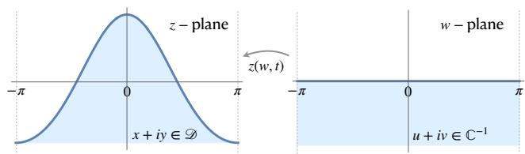  
Fig. 1 The conformal mapping from the region in the w plane $( u , v ) \in [ - \pi , \pi ] \times ( - \infty , 0 ]$ to the domain occupied by the fluid in the $( x , y )$ plane, with $( x , y ) \in [ - \pi , \pi ] \times ( - \infty , \eta ( x , t ) ]$ . The line $v = 0$ (blue line) is mapped onto the free surface $\eta ( \boldsymbol { x } , t )$

Conformal formulations are described in [9, 23, 24]. On $v = 0$ , steady traveling waves $y = y ( u - c t )$ satisfy a gravity–capillary extension of the Babenko formulation [9, 25]:

$$
\begin{array} { r l } { \mathcal { B } ( y ) = - \mu \hat { H } y _ { u } + \left( y + y \hat { H } y _ { u } + \hat { H } ( y y _ { u } ) \right) ~ } & { { } ( 4 ) } \\ { - \beta \partial _ { u } \left( \cfrac { y _ { u } } { \sqrt { y _ { u } ^ { 2 } + ( 1 + \hat { H } y _ { u } ) ^ { 2 } } } \right) ~ + \beta \hat { H } \partial _ { u } \left( \cfrac { 1 + \hat { H } y _ { u } } { \sqrt { y _ { u } ^ { 2 } + ( 1 + \hat { H } y _ { u } ) ^ { 2 } } } \right) ~ } & { { } = 0 , } \end{array}
$$

where $\mu$ is the squared (rescaled) wave speed, $\beta ~ = ~ \kappa / ( g \lambda ^ { 2 } )$ is the Bond number encoding surface tension, gravity, and wavelength $\lambda . \ y ( u )$ is the elevation of the free surface in conformal coordinates and $\hat { H }$ is the periodic Hilbert transform defined on $L _ { 2 } [ - \pi , \pi ]$ by linearity from the relation

$$
\begin{array} { r } { \hat { H } e ^ { i n u } = - i \mathrm { s i g n } ( n ) e ^ { i n u } . } \end{array}\tag{5}
$$

The underlying water-wave equations have classical high-amplitude families in the limits of zero capillarity and zero gravity. The latter limit requires a separate scaling, since the positive-gravity normalization in Eq. (4) divides by g. $\mathrm { A t } \ \beta = 0$ , the classical one-parameter family of Stokes waves is represented as a curve in the speed and amplitude plane $( c , a )$ connecting small amplitude solutions with a limiting Stokes wave of extreme height with a $2 \pi / 3$ crest angle [11]. The amplitude is defined as the diference between the maximal and minimal height divided by the period

$$
a = { \frac { \operatorname* { m a x } y - \operatorname* { m i n } y } { 2 \pi } } .\tag{6}
$$

At zero gravity, $g = 0$ , there is a family of pure capillary solutions, found by Crapper [12], which is represented as a curve in the speed and amplitude plane $( c , a )$ connecting small amplitude capillary waves with a limiting Crapper wave of extreme height that encloses a bubble.

When both gravity and capillarity are present, resonant families of solutions, known as Wilton ripples, arise at special values of the surface tension. At the linear level, a Wilton ripple contains two harmonics, cos(mu) and $\cos ( n u )$ , whose phase speeds coincide. While small-amplitude Wilton ripples are well understood and have been computed numerically, their strongly nonlinear, high-amplitude regime remains much less explored, both analytically and numerically. More broadly, numerical studies have long investigated finite- and large-amplitude gravity–capillary waves [26, 27], and modern work has examined the spectral stability of small-amplitude Wilton ripples [28]. The structure and continuation of high-amplitude Wilton branches remain challenging; even the choice of amplitude constraint can afect access to connected families [29]. More generally, the gravity–capillary problem has a rich bifurcation structure in the wave-speed–surface-tension parameter space. Local and secondary bifurcations, including resonant Wilton branches associated with multiple eigenvalues of the linearized problem, have been studied analytically and numerically [30–32], with Babenko-type formulations providing a useful framework for such analysis [32, 33]. Yet the global organization of strongly nonlinear, high-amplitude branches remains incompletely characterized. In this setting, a rigorous residual bound is already of independent value as a quantitative diagnostic, even without the additional existence argument required to prove a nearby exact solution.

## 2.1 Neural discovery and recovery of high-amplitude water waves

We use physics-informed neural networks (PINNs) [10] to discover water-wave profiles and their associated physical parameters directly from the Babenko equation (4). Rather than being trained on precomputed or experimental data, the network is optimized against the governing equation together with the physical and normalization constraints defining the solution family under consideration. The same neural architecture and residual-based optimization framework is used throughout, while the physical parameters and auxiliary constraints are adapted to select the relevant branch. The trained profile is denoted by $y _ { P }$ . For each run, we minimize a weighted squared residual of the Babenko equation and, when used, its diferentiated form, together with auxiliary conditions controlling quantities such as vertical translation, amplitude and symmetry. The wave speed $c _ { P } = { \sqrt { \mu _ { P } } }$ is optimized simultaneously with the profile. Depending on the experiment, gravity and surface tension are fixed to select a particular physical regime, while in the continuation experiments the surface-tension parameter is itself allowed to vary. Details of the network architecture, Hilbert-transform evaluation, loss function, constraints and optimization procedure are given in Methods.

We first use three canonical high-amplitude solution families as benchmarks for the discovery framework (Fig. 2). These regimes probe qualitatively diferent balances in the same nonlinear equation. In the zero-surface-tension limit, $\beta = 0$ , the network reproduces the classical pure-gravity Stokes branch [5]. In the zero-gravity limit, $g = 0$ , it recovers the pure-capillary Crapper family [12]. When both gravity and surface tension are present, the network recovers high-amplitude (1, 2) Wilton ripples [13], for which the first and second Fourier harmonics travel at the same speed at the linear level. The three families have markedly diferent geometries, dominant physical balances and Fourier structures, and their recovery therefore provides complementary tests of the same computational framework. The physical and normalization constraints difer between these regimes, while the neural representation and equation-based optimization remain common.

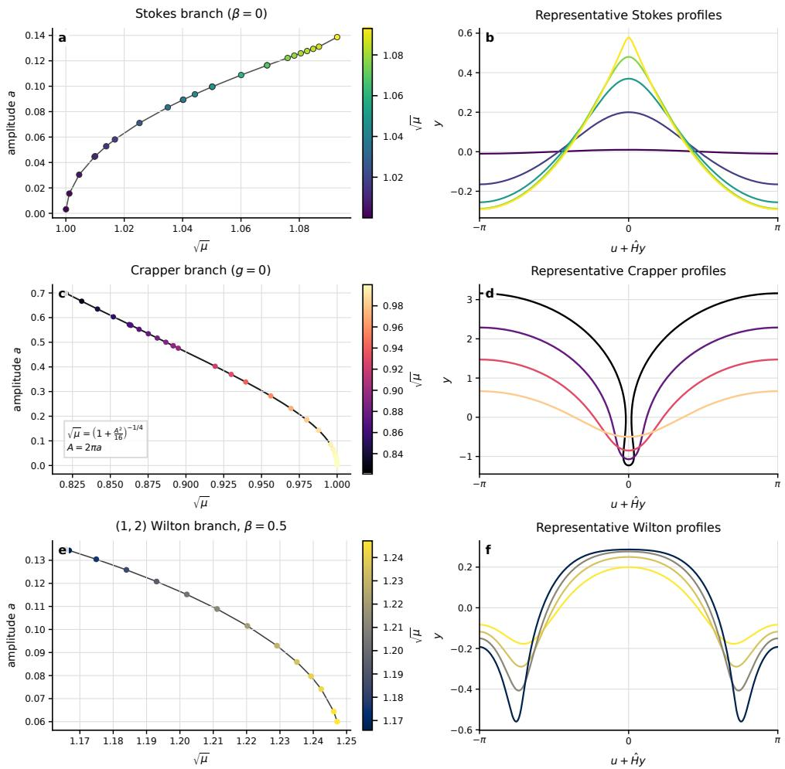  
Fig. 2 Three high-amplitude regimes reproduced by the $\mathbf { P I N N . \ a , }$ , Pure-gravity Stokes branch with $\beta = 0 ;$ , plotted in the $( \sqrt { \mu } , a )$ plane, where a = (max $y - \operatorname* { m i n } y ) / ( 2 \pi )$ . The panel shows the selected Stokes files, including the low-amplitude main-branch runs, that satisfy max $| \bar { B } ( y _ { N } ) | \leq 1 0 ^ { - 7 }$ with the grey curve joining the retained runs. b, Five representative retained Stokes profiles plotted over $[ - \pi , \pi ]$ as $x ( u ) = u + \hat { H } y ( u )$ versus $y ( u ) . \ \mathbf { c } ,$ Pure-capillary Crapper branch with $g = 0$ . All Crapper files in the plotting folder are included as points on the branch, and the black curve shows the displayed relation $\sqrt \mu = ( 1 + A ^ { 2 } / 1 6 ) ^ { - 1 / 4 }$ with $A = 2 \pi a .$ d, Representative Crapper profiles plotted over $[ - \pi , \pi ]$ $\mathbf { e } ,$ Reproduced (1, 2) Wilton branch at $\beta = 0 . 5$ , again with all available branch files included. $\mathbf { f } ,$ Four representative Wilton free-surface profiles, including low- and high-amplitude cases, plotted over $[ - \pi , \pi ]$

The Wilton regime provides a particularly demanding test. At small amplitude, the (1, 2) Wilton branch originates from a linear resonance between two Fourier modes: cos(u) and cos(2u), but at finite amplitude, their contributions are coupled by the full nonlinear water-wave equation. The amplitudes of the resonant components therefore cannot in general be varied independently: nonlinear constraints determine how the harmonics combine along the solution branch. Continuing a high-amplitude Wilton ripple is consequently not equivalent to simply varying the amplitude parameter and reoptimizing an unconstrained profile. The continuation must simultaneously preserve the appropriate nonlinear constraints while allowing the profile and wave speed parameter to adjust, making the high-amplitude resonant regime a substantially more restrictive search problem.

## 2.1.1 Continuation experiments and new solutions

The benchmark and continuation experiments separate two roles of the neural computation. Recovery of the Stokes, Crapper and Wilton families tests whether the framework can represent and optimize solutions across distinct nonlinear regimes when supplied with the appropriate physical constraints. Continuation away from the highamplitude Wilton state then uses the same machinery in a discovery setting, where the resulting profiles are not prescribed in advance. The low-residual candidates obtained in this stage provide the starting point for the rigorous certification described below.

After reproducing a high-amplitude (1, 2) Wilton ripple, we use it as a seed for neural continuation. We allow the surface-tension parameter to vary together with the wave profile and speed. Starting from the same high-amplitude seed, continuation in diferent constrained directions produces new gravity–capillary profiles with small Babenko residuals (Figs. 4 and 3). Although these solutions are reached by continuation from a Wilton ripple, they are not simply nearby members of the known high-amplitude Wilton family: their Fourier composition and values of β depart substantially from those of the corresponding Wilton branch, and their geometry develops qualitatively diferent features as the continuation proceeds. Toward one end of the computed branch, the crest develops a pronounced central depression while the trough becomes increasingly sharp, producing profiles distinct from the high-amplitude Wilton ripples used to initialize the search. To our knowledge, gravity–capillary solutions with this combination of Fourier structure, parameter values and free-surface geometry have not previously been computed. For comparison with the established large-amplitude gravity–capillary families, see [26, 27, 29].

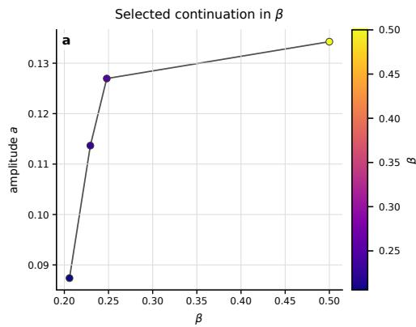

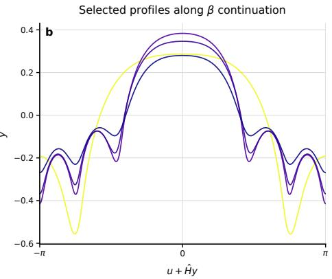

Fig. 3 Continuation near a high-amplitude Wilton ripple. ${ \mathbf { a } } ,$ Selected points on the continuation branch, shown in the amplitude–β plane. $\mathbf { b } ,$ Corresponding free-surface profiles over one period, plotted against the physical horizontal coordinate $x ( u ) = u + \hat { H } y ( u )$ and colored by the same $\beta$ values as in a. The separately displayed degree-150 polynomial in $\mathrm { F i g . ~ 5 }$ is the candidate used for the final residual certificate.  
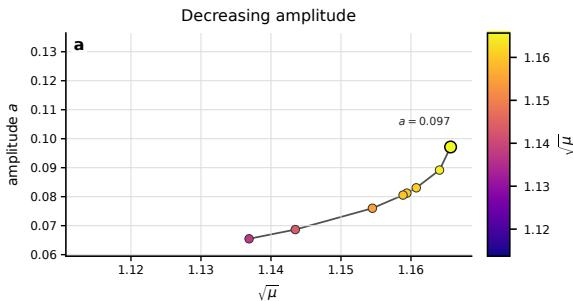

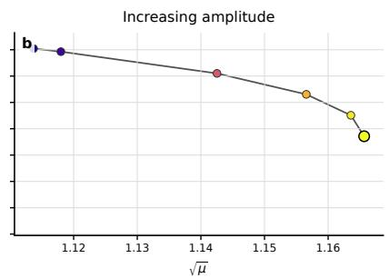

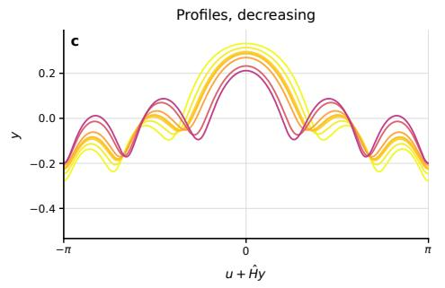

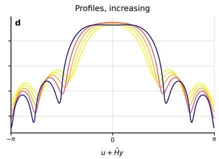  
Fig. 4 Continuation away from the high-amplitude (1, 2) Wilton ripple. ${ \mathbf { a } } ,$ Amplitudedecreasing continuation at $\beta = 0 . 4 9 8 ^ { 2 } \sim$ 0.248004, starting from the shared seed with 0.09 $< a < 0 . 1$ and plotted in the $( \sqrt { \mu } , a )$ plane. b, Amplitude-increasing continuation from the same seed point. $\mathbf { c } ,$ Free-surface profiles along the amplitude-decreasing branch. $\mathbf { d } ,$ Free-surface profiles along the amplitude-increasing branch, with colours in both profile panels matched to the same $\sqrt { \mu }$ scale.

We were also unable to continue this family toward the small-amplitude regime. Within the range accessible to our numerical continuation, the branch instead remains intrinsically finite amplitude. This observation suggests that these profiles may not arise through a conventional bifurcation from a linear water-wave mode, although establishing whether the family is genuinely disconnected from the small-amplitude spectrum requires further analysis. In this sense, the high-amplitude Wilton ripple provides an entry point into a region of the nonlinear solution landscape that is not apparent from the linearized problem.

A detailed mathematical characterization of this solution family, including its global bifurcation structure, possible limiting states, stability and connection, or lack thereof, to small-amplitude solutions, is beyond the scope of the present work. Here these solutions primarily demonstrate the exploratory capability of the computational framework: constrained neural continuation can identify previously uncharacterized high-amplitude states, which can subsequently be passed to rigorous numerical certification. Our focus in the remainder of the work is therefore on establishing this discovery-to-certification pipeline and on rigorously validating a representative machine-learned solution.

## 2.2 Second-stage training and a near-machine-precision candidate

We demonstrate that the Babenko residual can be reduced to near the double-precision round-of level. Successive neural corrections, followed by Fourier projection and Newton polishing, reduced the maximum sampled scalar residual by approximately seven orders of magnitude, from $\mathcal { O } ( 1 0 ^ { - 7 } )$ to $\mathcal { O } ( 1 0 ^ { - 1 4 } )$ , see ${ \mathrm { F i g . } }$ 6. Independent interval validation then established a rigorous uniform residual bound of $\mathcal { O } ( 1 0 ^ { - 1 3 } )$ for the final polynomial.

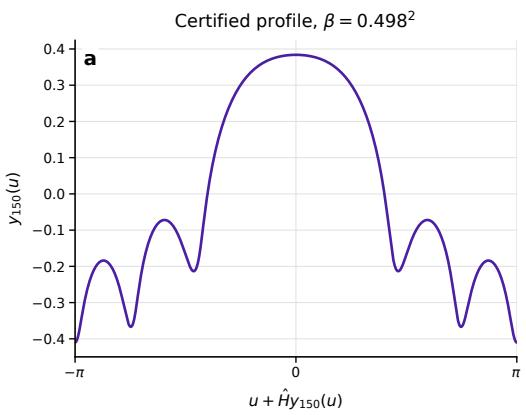

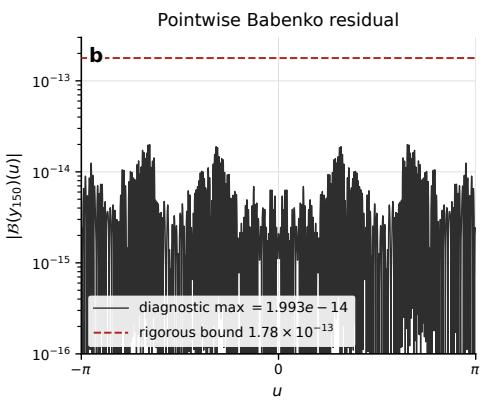  
Fig. 5 Certified high-amplitude Wilton-ripple profile. a, Free-surface profile for the certified solution at $\beta = 0 . 4 9 8 ^ { 2 }$ , plotted over one period against the physical horizontal coordinate $u + { \hat { H } } y .$ . b, Pointwise residual $| B ( y _ { N } ) |$ for the same solution. The dashed line marks the certificate level $\| B ( y _ { N } ) \| _ { \infty } ~ \le$ $1 . 7 8 \times 1 0 ^ { - 1 3 }$ with $N = 1 5 0$

## 2.3 Certified residual estimates and formal verification in Lean

We now turn from numerical discovery to rigorous certification. The neural-network approximation is used to construct a candidate profile; the object ultimately certified is an explicit finite trigonometric polynomial, with fixed coeficients and parameters.

Let

$$
y _ { N } ( u ) = { \frac { a _ { 0 } } { 2 } } + \sum _ { k = 1 } ^ { N } a _ { k } \cos ( k u ) ,\tag{7}
$$

and let $\mu , \beta > 0$ be fixed rational parameters. We write

$$
\mathcal { R } _ { N } ( u ) = \mathcal { B } _ { \mu , \beta } ( y _ { N } ) ( u )\tag{8}
$$

for the residual of the gravity–capillary Babenko equation. We establish the rigorous uniform estimate

$$
\| \mathcal { R } _ { N } \| _ { L ^ { \infty } ( \mathbb { R } ) } = \operatorname* { s u p } _ { u \in \mathbb { R } } \left| \mathcal { R } _ { N } ( u ) \right| \le \varepsilon ,\tag{9}
$$

for an explicitly calculated constant ε. For the candidate certified here,

$$
N = 1 5 0 , \qquad \varepsilon = { \frac { 1 7 8 } { 1 0 ^ { 1 5 } } } = 1 . 7 8 \times 1 0 ^ { - 1 3 } .\tag{10}
$$

This is a uniform residual theorem for a supplied finite series. It is not an existence or uniqueness theorem for an exact nearby water wave. Such a result would additionally require a rigorous inverse bound for the appropriately constrained linearized Babenko operator and control of the nonlinear remainder [20]; these ingredients are not part of the present certificate.

The certification has two complementary components: validated numerical computation and formal verification. Julia/Arb performs the substantive interval-arithmetic calculation, rigorously enclosing numerical errors and producing certified bounds. Lean 4 formalizes the analytic framework and verifies the deductions from these certified numerical inputs to the final global theorem.

This certification has both practical numerical and pure-mathematical motivations. From a numerical perspective, the objective is to replace an empirically observed small residual by a rigorous uniform bound at the same scale. Numerically observing a small residual and rigorously certifying such a bound are distinct achievements.

From a pure-mathematical perspective, the objective is to make PINN-based discovery usable as a high-precision tool for studying highly nonlinear and nonlocal equations. The resulting computations can serve as quantitative inputs to further mathematical analysis: the candidate is explicitly defined, its residual is rigorously controlled, and the computational and logical trust boundaries are made explicit. In particular, the residual certificate provides a first rigorous ingredient toward a computer-assisted proof of the existence of a nearby exact solution.

Source code, archived run evidence, build instructions, and the supplementary mathematical account are indexed in the paper repository.

We now describe the two stages in turn.

## 2.3.1 Rigorous certification by interval arithmetic

The interval calculation is implemented in the Julia package, which produces a computer-assisted proof certificate bounding the residual of Babenko’s equation for steady periodic water waves. Given a candidate profile represented as a truncated even cosine series, the package rigorously evaluates the Babenko residual and generates a Lean 4 certificate encoding the certified numerical bounds as exact rational literals, ready for verification by Lean.

The interval calculation rigorously accounts for floating-point roundof, Fourier truncation and aliasing in nonlinear terms, and the passage from grid-based estimates to bounds valid throughout the continuous domain. For the finite trigonometric profile y and its derivatives, the periodic Hilbert transform is evaluated exactly mode by mode. For nonlinear quantities in the capillary term, which are not finite trigonometric polynomials, unresolved Fourier modes and aliasing errors are bounded explicitly.

The computation also establishes a strictly positive lower bound for

$$
D ( u ) = \sqrt { \left( \partial _ { u } y _ { N } ( u ) \right) ^ { 2 } + \left( 1 + \hat { H } \partial _ { u } y _ { N } ( u ) \right) ^ { 2 } } ,
$$

ensuring that the capillary denominator remains nonzero. Rigorous Taylor bounds on each grid cell then promote the discrete interval estimates to the full period and, by periodicity, to all $u \in \mathbb R$ . Thus,

$$
\| \mathcal B _ { \mu , \beta } ( y _ { N } ) \| _ { L ^ { \infty } ( \mathbb { R } ) } \le \varepsilon , \qquad D ( u ) \ge d _ { \operatorname* { m i n } } > 0 .\tag{11}
$$

The implementation, input coeficients, run logs and reproduction commands are available in the Julia directory.

## 2.3.2 Formal verification in Lean

The mathematical verification layer of the computer-assisted proof is implemented in Lean 4. Julia/Arblib validates the fixed cosine-series profile, rigorously controlling rounding, Fourier truncation, aliasing and between-grid errors, and exports the resulting certified bounds together with the profile and computation parameters as exact rational data. A reusable Lean library formalizes the mathematical structure underlying the certification, including the periodic Hilbert transform, the finite trigonometric profile, the capillary terms and the Babenko residual. It proves the mode-by-mode action of the Hilbert transform on finite trigonometric polynomials, the Fourier-tail and aliasing estimates required for the nonlinear capillary terms, and the derivative, Taylor-remainder and grid-to-continuum estimates used in the certification.

For the candidate considered here, Lean takes the certified denominator bound and one-period residual bound produced by Julia/Arblib as explicit inputs, verifies the analytic deductions and periodic extension to the full real line, and checks the exact rational comparisons yielding the reported constants. Thus, validated numerics establishes the numerical inequalities, while Lean verifies the mathematical deductions from them. The resulting formal library is independent of the particular numerical profile and can be reused for future certified solutions.

The Lean directory contains the formal definitions, theorem modules, certificate deductions, axiom audit and pinned build instructions.

## 3 Discussion

The results presented here demonstrate a route from machine-learning-based exploration of a nonlinear PDE to a rigorously certified and machine-checkable computational statement. The role of the neural network is primarily one of discovery: it provides a flexible representation with which to search nonlinear solution spaces and identify high-accuracy candidate solutions. The subsequent certification is deliberately separated from the training procedure. Once a candidate is selected, it is frozen as an explicit finite representation, and the mathematical claim concerns this representation rather than the neural network, optimizer or training history. This separation allows the exploratory flexibility of machine learning to be combined with the reproducibility and explicit error control of validated numerical computation.

The water-wave problem illustrates both the potential and the limitations of this approach. The same computational framework accesses qualitatively diferent high-amplitude regimes, including pure-gravity, pure-capillary and resonant gravity– capillary waves, but the search is not free of problem-specific mathematical information. Diferent solution families require appropriate physical, normalization and symmetry constraints, and continuation of high-amplitude Wilton ripples requires additional control of the relative amplitudes of the resonant Fourier modes. The neural network therefore does not replace mathematical structure; rather, it provides a flexible computational representation within which such structure can be imposed while leaving the detailed nonlinear profile to be determined by the governing equation. Developing methods that can infer useful continuation coordinates and constraints directly from the learned solution landscape would reduce this dependence on prior analytical knowledge.

A second distinction concerns numerical accuracy and mathematical existence. The certificate established here is a rigorous uniform bound on the residual of an explicit approximate solution. It shows that the reported near-machine-precision residual is not an artifact of floating-point roundof, Fourier truncation, aliasing or finite sampling. It does not, by itself, prove the existence of an exact water-wave solution nearby. Such a result would require quantitative control of the linearized Babenko operator and of the nonlinear remainder, for example through a Newton–Kantorovich or related contraction argument. The certified residual obtained here provides one of the quantitative inputs required for such an existence proof and establishes a natural interface between machine-learning-based discovery and computer-assisted analysis.

Formal verification addresses a diferent source of uncertainty. At the accuracy considered here, the interval-arithmetic certification is itself a substantial computation involving hundreds of lines of validated numerical code and a sequence of analytic estimates that would be dificult to audit completely by conventional inspection. Lean makes the mathematical identities and deductions connecting the numerical certificate to the final theorem machine-checkable. The present implementation nevertheless retains an explicit numerical trust boundary: Lean does not independently reproduce the Arb computation, and the validated numerical bounds supplied by the interval-arithmetic calculation remain trusted inputs to the formal layer.

An important feature of the workflow is that substantial parts of both the rigorous numerical implementation and the formalization were developed with assistance from a large language model. This illustrates a potentially broader role for generative AI in scientific computing: not only in producing numerical candidates, but also in helping construct the machinery required to validate them. The reliability of the final mathematical statement need not inherit the reliability of the generative model, provided that model-generated computations and arguments terminate in independently checkable certificates. In the present framework, interval arithmetic provides rigorous numerical enclosures and Lean checks the subsequent logical deductions.

More broadly, the approach is not specific to water waves or to PINNs. Its essential ingredients are a computational method capable of discovering accurate candidate solutions, an explicit representation to which validated numerics can be applied, rigorous control of discretization and continuum errors, and a formal layer capable of checking the deductions made from the resulting numerical bounds. These ingredients suggest a general architecture for trustworthy machine-learning-assisted scientific computing, particularly for nonlinear problems in which analytical descriptions are incomplete and numerical exploration plays an important role.

## 4 Methods

## 4.1 PINN architecture

## 4.1.1 Neural representation

The unknown free surface is represented in conformal coordinates by a neural function of the periodic variable $u \in [ - \pi , \pi ]$ . For the symmetric runs, periodicity and evenness are imposed by feeding the network the transformed coordinate cos u. The implementation used for the plotted runs consists of three scalar fully connected multilayer perceptrons with tanh activations, initialized with Xavier-scaled truncated normal weights [34]. Each scalar network has three hidden layers of width 30. The networks are combined as

$$
y _ { P } ( u ) = s N _ { 0 } ( \cos u ) , \qquad T _ { 1 , P } ( u ) = N _ { 1 } ( \cos u ) \sin u , \qquad T _ { 2 , P } ( u ) = N _ { 2 } ( \cos u ) ,\tag{12}
$$

where s is the amplitude scale used in a given continuation step. This construction makes $y _ { P }$ and $T _ { 2 , P }$ even and $T _ { 1 , P }$ odd, matching the crest-symmetric geometry. The auxiliary variables $T _ { 1 , P }$ and $T _ { 2 , P }$ represent the two components of the normalized tangent/curvature expression,

$$
T _ { 1 } = \frac { y _ { u } } { \sqrt { y _ { u } ^ { 2 } + ( 1 + \hat { H } y _ { u } ) ^ { 2 } } } , \qquad T _ { 2 } = \frac { 1 + \hat { H } y _ { u } } { \sqrt { y _ { u } ^ { 2 } + ( 1 + \hat { H } y _ { u } ) ^ { 2 } } } ,\tag{13}
$$

so that the surface-tension term can be evaluated stably through first derivatives of the auxiliary outputs.

The wave speed is optimized together with the network weights through a bounded scalar parameterization

$$
c _ { P } = c _ { 0 } + \eta _ { c } \operatorname { t a n h } \rho _ { c } ,\tag{14}
$$

where $c _ { 0 }$ is the continuation seed and $\eta _ { c }$ is the allowed local search radius. In the Wilton continuation runs in which surface tension is trained, the same bounded parametrization is used for $\beta _ { P }$ . Fixed-regime benchmark runs set the corresponding physical parameter to its prescribed value.

## 4.1.2 Residual, Hilbert transform and loss

All derivatives of the neural outputs are obtained by automatic diferentiation in JAX [35], with double-precision arithmetic enabled. The periodic Hilbert transform is evaluated numerically on a dense nonuniform grid of 15, 000 sample points. The singular integral is split into a local contribution around the evaluation point, a closefield correction and an outer contribution evaluated by Gaussian quadrature. The same Hilbert-transform routine is used for $y _ { P } , y _ { P , u }$ , derivatives of $y _ { P } ^ { 2 }$ and derivatives of the auxiliary variables entering the surface-tension term.

Training minimizes a weighted loss

$$
\mathcal { L } = w _ { \mathrm { e q } } \sum _ { u _ { i } \in \mathcal { C } } \omega _ { i } \left. \mathcal { R } _ { P } ( u _ { i } ) \right. ^ { 2 } + w _ { \mathrm { d e r } } \sum _ { v _ { j } \in \mathcal { D } } \nu _ { j } \left. \partial _ { u } \mathcal { B } ( y _ { P } ) ( v _ { j } ) \right. ^ { 2 } + \mathcal { L } _ { \mathrm { a u x } } .\tag{15}
$$

Here $\mathcal { R } _ { P } = ( e _ { 1 } , e _ { 2 } , e _ { 3 } )$ , where $e _ { 1 }$ is the main Babenko residual and $e _ { 2 }$ and $e _ { 3 }$ enforce the definitions of $T _ { 2 , P }$ and $T _ { 1 , P }$ , respectively. The auxiliary loss $\mathcal { L } _ { \mathrm { a u x } }$ fixes the amplitude and, when needed, removes vertical translation through a mean-zero condition or enforces or breaks prescribed symmetry conditions. The active runs use $w _ { \mathrm { e q } } = 0 . 1$ with residual-component weight one; the normalization and mean constraints, when used, are kept on throughout training.

## 4.1.3 Collocation and optimization

The collocation sets are resampled during optimization. In the runs used here, each optimization step combines fixed and moving collocation points: 251 fixed equation points, 201 fixed derivative points, two groups of 71 points concentrated near the endpoints and 121 moving points for each of the equation and derivative residuals. The sampling density is biased toward regions where high-amplitude waves develop sharp features, especially near crests and troughs. After a training pass, the point distribution can be updated from the residual itself so that later passes concentrate efort where the current approximation is least accurate.

We use the Kronecker-factored approximate curvature (K-FAC) optimizer [36], implemented in JAX, with adaptive learning rate, momentum and damping, a minimum damping of $1 0 ^ { - 1 4 }$ , and a typical training horizon of 20,000 iterations per continuation step. New branches are followed by warm starting from a previously trained profile and allowing the speed, and when appropriate the surface tension, to move within a prescribed local window.

## 4.2 Second-stage training

Following the multistage refinement approach of Refs. $[ 1 , 2 ] .$ , we refine the first-stage candidate through successive additive neural corrections targeting its remaining residual. Let $Y _ { p } = ( y _ { p } , T _ { 1 , p } , T _ { 2 , p } )$ denote the previously trained fields, frozen at the start of a refinement pass. The corrected approximation is

$$
Y _ { P } ( u ) = Y _ { p } ( u ) + \varepsilon _ { p } \Phi _ { \theta } ( u ) ,\tag{16}
$$

where $Y _ { P } = ( y _ { P } , T _ { 1 , P } , T _ { 2 , P } )$ , Φθ is a three-component correction network, and $\varepsilon _ { p }$ sets its amplitude scale. Write ${ \mathcal { R } } ( Y )$ for the three-field Babenko residual operator and $\mathcal { R } _ { P } = \mathcal { R } ( Y _ { P } ) = ( e _ { 1 } , e _ { 2 } , e _ { 3 } )$ . When those definitions hold, $e _ { 1 } = { \cal B } ( y _ { P } )$ , where $\boldsymbol { B }$ is the scalar Babenko operator in Eq. (4).

The correction ansatz is motivated by linearization about the frozen fields [1, 2]:

$$
\begin{array} { r } { \mathcal { R } ( Y _ { p } + \varepsilon _ { p } \Phi _ { \theta } ) \simeq \mathcal { R } ( Y _ { p } ) + \varepsilon _ { p } D \mathcal { R } ( Y _ { p } ) \Phi _ { \theta } . } \end{array}\tag{17}
$$

To cancel the existing residual to first order, the correction should therefore approximately satisfy

$$
\varepsilon _ { p } D { \mathcal { R } } ( Y _ { p } ) \Phi _ { \theta } \simeq - { \mathcal { R } } ( Y _ { p } ) .\tag{18}
$$

The linearized equation explains the correction strategy; optimization evaluates the full nonlinear residual $\mathcal { R } _ { P }$

The correction networks used sinusoidal activations and a tunable first-layer frequency scale. We chose the frequency scale of the correction to $y _ { P }$ from the prominent frequencies in the remaining residual, and chose $\varepsilon _ { p }$ according to its magnitude. These choices guide the scales represented by the network; they do not constrain its output to a single Fourier mode or make $\varepsilon _ { p }$ equal to a residual norm. The input cos u makes the outputs periodic and even, while a factor of sin u imposes odd parity on the $T _ { 1 , P }$ correction. After one correction was trained, its contribution was incorporated into the frozen base and a further, smaller-scale correction was trained. The capillary parameter remained fixed, while the wave speed was allowed a small adjustment.

The refinement stage evaluated the periodic Hilbert transform by FFT on full uniform grids rather than by the nonuniform quadrature used during discovery. Neuralfield derivatives were computed by automatic diferentiation. Shifting the uniform grid by fractions of a grid spacing sampled the residual between earlier collocation points while preserving the periodic grid required by the FFT. Later refinement passes used finer grids.

## 4.2.1 Gradient-normalized residual weighting

The second-stage refinement also employs gradient-normalized residual weighting [2], adapted here to the three-field Babenko system. A standard mean-square residual,

$$
\sum _ { j } | \mathcal { R } ( Y _ { P } ) ( u _ { j } ) | ^ { 2 } ,
$$

weights the residual in absolute terms. When the solution contains steep or rapidly varying regions, however, the natural scale of the equation can vary strongly across the domain, causing such regions to dominate the optimization. We therefore normalize the residual by a local scale determined from spatial derivatives of the frozen base fields, leading schematically to

$$
\sum _ { j } \left| \frac { \mathcal { R } ( Y _ { P } ) ( u _ { j } ) } { \mathrm { l o c a l ~ d e r i v a t i v e ~ s c a l e ~ a t ~ } u _ { j } } \right| ^ { 2 } .
$$

In this sense, the loss measures a locally scaled residual rather than a purely absolute one.

For the Babenko system, the second-stage loss retained the component-wise weighted residual structure used during training. Let C denote the collocation points for $\mathcal { R } _ { P }$ and D those used for the derivative of the main equation. To balance regions with diferent levels of spatial variation, the residuals were divided by scales $S _ { \mathrm { e q } }$ and $S _ { \mathrm { d e r } }$ constructed from spatial derivatives of the frozen fields $Y _ { p }$ . These scales combine derivatives of $y _ { p }$ , their Hilbert transforms, and capillary contributions involving $T _ { 1 , p }$ and $T _ { 2 , p }$ . Each scale is normalized by its grid average and clipped to prevent extreme reweighting, while $S _ { \mathrm { d e r } }$ places greater emphasis on the curvature of the base fields. The scales are recomputed whenever the grid is changed and are held fixed during parameter diferentiation, preventing the correction network from reducing the loss merely by altering its normalization.

With component-specific collocation weights $\omega _ { i \ell }$ and derivative weights $\nu _ { j }$ , the refinement loss is

$$
\mathcal { L } = w _ { \mathrm { e q } } \sum _ { u _ { i } \in \mathcal { C } } \sum _ { \ell = 1 } ^ { 3 } \omega _ { i \ell } \left. \frac { e _ { \ell } ( u _ { i } ) } { S _ { \mathrm { e q } } ( u _ { i } ) } \right. ^ { 2 } + w _ { \mathrm { d e r } } \sum _ { v _ { j } \in \mathcal { D } } \nu _ { j } \left. \frac { \partial _ { u } e _ { 1 } ( v _ { j } ) } { S _ { \mathrm { d e r } } ( v _ { j } ) } \right. ^ { 2 } + \mathcal { L } _ { \mathrm { a u x } } .\tag{19}
$$

The derivative term was strengthened for the final correction in order to suppress rapidly varying residual errors. The weights $\omega _ { i \ell }$ emphasize the periodic endpoints and, in intermediate passes, selected residual peaks; they are normalized so that the total weight assigned to each residual component remains fixed. The derivative weights $\nu _ { j }$ are uniform. The term $\mathcal { L } _ { \mathrm { a u x } }$ contains the retained amplitude and crest–trough separation penalties. The derivative term acts on $e _ { 1 }$ , the main equation evaluated with the current auxiliary fields, and agrees with $\partial _ { u } { B } ( y _ { P } )$ when their defining residuals vanish.

After the final refinement pass, the corrected fields were evaluated on shifted grids before Fourier projection and Newton polishing. Rigorous certification was then carried out separately on the resulting frozen trigonometric polynomial.

Figure 6 compares the scalar Babenko residual of the first-stage profile with that of the final trigonometric polynomial, illustrating the reduction achieved through successive neural corrections, Fourier projection, and Newton polishing. The rigorous uniform bound for the final polynomial is shown separately.

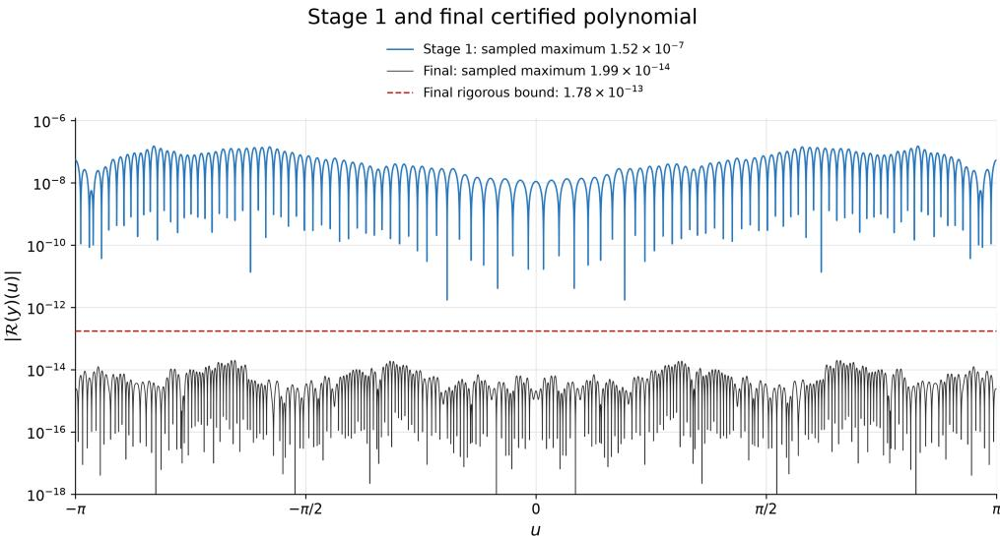  
Fig. 6 Reduction of the scalar Babenko residual. Absolute residual as a function of the conformal coordinate u for the first-stage neural profile (blue) and the final trigonometric polynomial (black), obtained after successive neural corrections, Fourier projection, and Newton polishing. Both curves evaluate the scalar Babenko equation with the auxiliary fields eliminated, at the physical parameters of the corresponding profile. The curves show pointwise numerical evaluations; the dashed red line gives the rigorous uniform residual bound for the final polynomial.

## 4.3 Computer-assisted accuracy proof

We certify a uniform bound on the Babenko residual of a fixed finite profile, as follows: Let

$$
y _ { N } ( u ) = { \frac { a _ { 0 } } { 2 } } + \sum _ { k = 1 } ^ { N } a _ { k } \cos ( k u ) ,\tag{20}
$$

be a fixed finite even cosine series and let $\mu , \beta > 0$ be given rational parameters. Define the residual of the Babenko equation with surface tension by

$$
\begin{array} { l } { \displaystyle \mathcal { R } ( y ) = - \mathcal { B } ( y ) = \mu \hat { H } [ y _ { u } ] - y - y \hat { H } [ y _ { u } ] - \hat { H } [ y y _ { u } ] } \\ { \displaystyle + \beta \partial _ { u } \Big ( \frac { y _ { u } } { D } \Big ) - \beta \hat { H } \left[ \partial _ { u } \left( \frac { 1 + \hat { H } [ y _ { u } ] } { D } \right) \right] , } \end{array}\tag{21}
$$

where

$$
D ( u ) = \sqrt { y _ { u } ^ { 2 } + \left( 1 + \hat { H } [ y _ { u } ] \right) ^ { 2 } } ,\tag{22}
$$

and $\hat { H }$ denotes the 2π-periodic Hilbert transform, with convention

$$
\hat { H } [ \cos ( k u ) ] = \sin ( k u ) , \qquad \hat { H } [ \sin ( k u ) ] = - \cos ( k u ) , \qquad k \geq 1 .\tag{23}
$$

The goal is to establish $D ( u ) \geq d _ { * } > 0$ for every $u \in \mathbb { R }$ and $\| \mathcal { R } ( y _ { N } ) \| _ { L ^ { \infty } ( \mathbb { R } ) } \le \epsilon$ for explicit certified constants $d _ { * }$ and ϵ.

The rigorous proof is split between Julia and Lean 4. A Julia verifier performs the substantive computation using rigorous interval ball arithmetic: it treats the final computed wave as a fixed trigonometric polynomial and establishes a uniform bound on its Babenko residual together with a positive lower bound on the capillary denominator, all with certified error enclosures. A Lean development provides the logical scafolding: it formalizes the relevant operators and reusable estimates, imports the two final numerical conclusions as explicit assumptions, and checks the deduction of the paper’s residual theorem. The Lean kernel checks this conditional deduction without recomputing the numerical enclosures. Once the polynomial has been frozen, the network weights and training trajectory play no role in the proof. Source code, archived run evidence, build instructions, and the supplementary mathematical account are indexed in the paper repository.

## 4.3.1 Computer-assisted interval certification of the numerical residual

After neural training and continuation, we project the profile onto an even cosine series and polish its coeficients with a finite-dimensional Newton iteration. The resulting polynomial has the convention in Eq. (20). Its stored binary coeficients and parameters are interpreted as exact dyadic rationals and fixed before validation. The certified statement concerns this explicit polynomial and these exact parameter values. From this point onward, the certification is independent of the neural network. The normalization and computational settings for the reported profile are collected in Section 4.3.3.

Julia and Arb compute outward-rounded interval enclosures for the nonlinear residual, add analytic corrections for unresolved Fourier modes, and use Taylor’s theorem to pass from a grid to the whole torus.

The Julia package BabenkoRigorous.jl encloses every numerical operation with outward-rounded Arb balls. It first constructs finite Fourier representations of $y _ { N }$ $y _ { N , u } , \hat { H } [ y _ { N , u } ]$ and their polynomial products. Diferentiation and the periodic Hilbert transform act mode by mode, while multiplication uses finite coeficient convolution, with no projection of newly generated modes back to degree N.

Nonlinear capillary quantities require a second representation. With D as defined in Eq. (22), the verifier forms

$$
G ( u ) = \frac { 1 + \hat { H } [ y _ { N , u } ] ( u ) } { D ( u ) } .\tag{24}
$$

At each node of a periodic $\mathrm { g r i d } .$ , a Taylor record contains interval enclosures of a quantity and its derivatives, together with global derivative suprema. Product, reciprocal and square-root rules propagate these records. A grid lower scan combined with ofgrid derivative control first proves $D ( u ) \geq d _ { * } > 0$ over the entire period; only then are $D ^ { - 1 }$ and the capillary fractions evaluated.

The Hilbert-transform work is divided into two pathways.

Path A: finite trigonometric algebra. The input has a finite Fourier representation, so Hˆ acts mode by mode using Eq. (23). No sampling or aliasing correction is needed for this operation.

Path B: certified sampled transform. The input is represented by interval-enclosed values and derivatives on a uniform grid, rather than by a finite coeficient vector. A discrete Hilbert transform is evaluated by certified convolution, and a rigorous Fourier-tail correction is added to enclose the continuous transform.

Path B is essential for $\hat { H } [ \partial _ { u } G ]$ , because the square root and reciprocal in Eqs. (22) and (24) generally give G an infinite Fourier series. The current Julia implementation also routes $\hat { H } [ y _ { N } y _ { N , u } ]$ through Path B for uniformity, although $y _ { N } y _ { N , u }$ is itself a finite trigonometric polynomial of degree at most 2N.

If $\| F ^ { ( p ) } \| _ { \infty } \leq C _ { p }$ $p \geq 2$ , the correction at each grid node is bounded by

$$
\varepsilon _ { \mathrm { a l i a s } } ( F ) = \frac { 4 C _ { p } } { ( p - 1 ) ( N _ { \mathrm { g r i d } } / 2 - 1 ) ^ { p - 1 } } .\tag{25}
$$

Arb encloses arithmetic roundof; the aliasing correction is a separate analytic estimate supplied by the verifier.

The full residual is assembled from these interval records using the same terms as Eq. (21). Global derivative bounds are obtained from the finite Fourier coeficients for trigonometric polynomials and propagated through products, reciprocals and square roots using diferentiation rules and interval arithmetic. The positive lower bound on D controls the denominators arising in these estimates. For sampled Hilbert-transform terms, Fourier-decay estimates provide the additional derivative bounds required by the Taylor remainder.

For grid nodes $u _ { j }$ separated by $h = 2 \pi / N _ { \mathrm { g r i d } }$ , let $I _ { j , m }$ enclose the m-th derivative of the residual at $u _ { j }$ , and set $U _ { j , m } = \operatorname* { s u p } _ { x \in I _ { j , m } } | x |$ . A global bound $C _ { M + 1 } \geq$ $\| \partial _ { u } ^ { M + 1 } B ( y _ { N } ) \| _ { \infty }$ gives, for $u _ { j } \leq u \leq u _ { j } + h$

$$
| \mathcal { B } ( y _ { N } ) ( u ) | \leq \sum _ { m = 0 } ^ { M } \frac { U _ { j , m } h ^ { m } } { m ! } + \frac { C _ { M + 1 } h ^ { M + 1 } } { ( M + 1 ) ! } .\tag{26}
$$

The Taylor order M is chosen together with the grid size $N _ { \mathrm { g r i d } }$ so that the remainder bound is suficiently small to achieve the desired certification accuracy. Taking the outward-rounded maximum over all cells then proves a uniform bound over the entire period. The denominator scan uses the corresponding lower-bound argument.

The production computation uses a sharded implementation: local Taylor data are streamed to disk, Hilbert-transform derivative columns are processed separately, and the final residual is scanned shard by shard.

The implementation, input coeficients, run logs and reproduction commands are in the Julia directory. The detailed interval estimates are in the Supplementary Methods.

## 4.3.2 Formal verification in Lean

The Lean formalization provides the mathematical verification layer of a larger computer-assisted proof. Julia/Arblib acts as the certificate generator: it validates a fixed finite cosine-series profile $y _ { N }$ , evaluates its Babenko residual $\mathcal { R } ( y _ { N } )$ on a fine grid, and uses interval arithmetic and analytic estimates to control rounding, Fourier aliasing and truncation, and between-grid errors. It exports exact rational coeficients, equation parameters and certified endpoints, together with the grid size and Taylor order. The residual endpoint $\varepsilon _ { 0 }$ bounds the continuous residual, including the Taylor remainder.

For the reported candidate, Lean takes two explicit numerical hypotheses from the validated computation: $D ( u ) \geq d _ { * } > 0$ for every real $u ,$ and $| \mathcal { R } ( u ) | \leq \varepsilon _ { 0 } \mathrm { o n } \left[ - \pi , \pi \right]$ From these inputs, Lean proves $\| \mathcal { R } \| _ { L ^ { \infty } ( \mathbb { R } ) } \le \varepsilon _ { 0 }$ by periodic extension and checks the exact rational comparisons yielding the reported constants. These two hypotheses form the numerical trust boundary: the validated computation supplies the numerical enclosures, while Lean verifies the mathematical deductions. In the Lean implementation, the one-period numerical hypothesis is stated on [0, 2π]; by 2π-periodicity, this is equivalent to the formulation on [−π, π] used here.

Independently of this numerical instance, a reusable Lean library formalizes the Fourier definition of the Hilbert transform $H ,$ its action on trigonometric modes and commutation with diferentiation, aliasing estimates, product and composition derivative bounds, Taylor-record semantics, and the Taylor grid-to-continuum argument. The publication proof contains no sorry placeholders or sorryAx dependency.

The Lean source code, certificate data and build instructions are available in the Lean directory of the Paper repository. Table 1 summarizes the Lean modules and their roles. Their mathematical content is described in the Supplementary Methods.

Table 1: Lean modules and their roles in the certification framework.
<table><tr><td>File(s)</td><td>Contents</td><td>Role</td></tr><tr><td colspan="2">Definitions and reusable mathematical library</td><td></td></tr><tr><td>Definitions.lean</td><td>Defines the Fourier-multiplier Hilbert trans- Definitions form, finite profile, derivative, denominator  $D ,$  capillary expression  $G ,$  and residual  $R .$ </td><td></td></tr><tr><td>HilbertOnTrigPoly.lean</td><td>Proves the Hilbert-transform identities for Analysis finite trigonometric profiles, identifying  $H [ y _ { u } ]$  with the explicit cosine sum Hyu.</td><td></td></tr><tr><td>FourierTailHilbert.lean</td><td>Fourier-mode and tail estimates, including Analysis the  $\pi ^ { 2 } / 3$  Hilbert-transform bound.</td><td></td></tr><tr><td>HilbertSmoothness.lean; HilbertSharper.lean;</td><td>Regularity and derivative commutation for Analysis the Hilbert transform under the stated</td><td></td></tr><tr><td>HilbertCommutesDeriv.lean AliasingErrorBound.lean</td><td>smoothness and periodicity hypotheses. Sampled DFT aliasing estimate and equiva- Analysis</td><td></td></tr><tr><td></td><td>lence with the cotangent-kernel convolution. Derivative bounds for products and compo- Analysis</td><td></td></tr><tr><td>LeibnizBound.lean; FaaDiBrunoBound.lean</td><td>sitions.</td><td></td></tr></table>

<table><tr><td rowspan=1 colspan=10>File(s)                             Contents                                        Role</td></tr><tr><td rowspan=2 colspan=10>TaylorRemainder.lean          Taylor-polynomial and remainder estimates Analysison an interval.GridToSupNormTaylor.lean     Converts cellwise Taylor bounds into a uni- Analysisform bound on the full grid interval.TaylorSeries                     Defines Taylor records and their seman- DefinitionsCorrectness.lean               tic invariant; proves arithmetic and grid-to- and proofscontinuum contracts.Correctness results for square-root and Conditional</td></tr><tr><td rowspan=2 colspan=5>SeriesCorrectness.lean</td><td rowspan=1 colspan=1>Conditional</td></tr><tr><td rowspan=1 colspan=4>reciprocal derivative records under explicit</td><td rowspan=1 colspan=1>correctness</td></tr><tr><td rowspan=1 colspan=5></td><td rowspan=1 colspan=4>hypotheses.</td><td rowspan=1 colspan=1>theorems.</td></tr><tr><td rowspan=2 colspan=9>TightenSupBoundsLemma.lean  Justifies downward tightening of derivativebounds.</td><td rowspan=1 colspan=1>Proved</td></tr><tr><td rowspan=1 colspan=1>analysis</td></tr><tr><td rowspan=1 colspan=9>FFTHilbertCorrectness.lean  Correctness contract for Hilbert-transform</td><td rowspan=1 colspan=1>Conditional</td></tr><tr><td rowspan=1 colspan=9>Taylor records, conditional on the required c</td><td rowspan=1 colspan=1>orrectness</td></tr><tr><td rowspan=1 colspan=9>enclosures and analytic bounds.</td><td rowspan=1 colspan=1>theorem</td></tr><tr><td rowspan=1 colspan=9>DLowerBound.lean               Deduces positivity from a positive lower</td><td rowspan=1 colspan=1>Proved</td></tr><tr><td rowspan=1 colspan=9>bound and records the quotient identity for</td><td rowspan=2 colspan=1>implica-tions</td></tr><tr><td rowspan=1 colspan=9>G.</td></tr><tr><td rowspan=1 colspan=5>PipelineSmoothness.lean;</td><td rowspan=1 colspan=4>Smoothness and periodicity of profile and</td><td rowspan=1 colspan=1>Analysis</td></tr><tr><td rowspan=1 colspan=5>RSmoothness.lean</td><td rowspan=2 colspan=5>residual components, with denominator pos-itivity where required.Denominator-bound correctness conditions C</td></tr><tr><td rowspan=1 colspan=5>DminBoundCorrectness.lean;</td><td rowspan=1 colspan=1>onditional</td></tr><tr><td rowspan=1 colspan=5>TightDGSupBounds.lean</td><td rowspan=1 colspan=4>and derivative bounds for the denominator/- c</td><td rowspan=1 colspan=1>orrectness</td></tr><tr><td rowspan=1 colspan=4></td><td rowspan=1 colspan=1></td><td rowspan=1 colspan=4>capillary chain.</td><td rowspan=1 colspan=1>theorem</td></tr><tr><td rowspan=3 colspan=1>ResidualAssembly</td><td></td><td></td><td></td><td></td><td></td><td></td><td></td><td></td><td></td></tr><tr><td rowspan=2 colspan=1></td><td></td><td></td><td></td><td></td><td></td><td></td><td></td><td></td></tr><tr><td rowspan=1 colspan=3></td><td rowspan=1 colspan=4>Generic residual assembly; periodicity of R</td><td rowspan=1 colspan=1>Conditional</td></tr><tr><td rowspan=1 colspan=5>Correctness.lean</td><td rowspan=1 colspan=4>and extension of a one-period bound to all c</td><td rowspan=1 colspan=1>orrectness</td></tr><tr><td rowspan=3 colspan=9>real arguments.</td><td rowspan=1 colspan=1>theorem</td></tr><tr><td rowspan=1 colspan=2></td><td rowspan=1 colspan=2></td><td rowspan=1 colspan=1>and</td></tr><tr><td rowspan=2 colspan=9>Common.lean;                     Shared foundational imports and support for IFoundations.lean               the library.</td><td rowspan=1 colspan=1>analysis</td></tr><tr><td rowspan=1 colspan=1>nfrastructur</td></tr><tr><td rowspan=2 colspan=10>Concrete publication certificatePaperCertificate.lean         Exact rational profile coefficients, parame- Data defini-ters, grid/Taylor metadata, and numerical tionscertificate endpoints.PaperCertificateAxioms.lean Declares two numerical assumptions: global Numericalpositive denominator lower bound and resid- assump-ual bound on one period. Proves conse- tions andquences including periodic extension.         deductionsPaperTheorems.lean             Publication residual and denominator Provedbounds; exact comparisons with the reported from   cer-decimal constants.                              tificateassump-tions</td></tr><tr><td rowspan=1 colspan=1>imp-</td></tr></table>

<table><tr><td>File(s)</td><td>Contents</td><td>Role</td><td></td></tr><tr><td>PaperAudit.lean</td><td>Checks the publication declarations and Audit and axiom dependencies; proves the sign- proofs convention bridge to the manuscript</td><td></td><td></td></tr></table>

## 4.3.3 Certified profile, computational settings and bounds

For the candidate reported in the main text, the certified input is the polynomial in Eq. (20), with stored binary coeficients interpreted as exact dyadic rationals. In the normalization $g = 1$ , the certified parameters are the stored binary64 values:

$$
\mu _ { 0 } = { \frac { 1 5 3 8 0 4 8 8 9 5 2 8 4 2 4 5 } { 1 1 2 5 8 9 9 9 0 6 8 4 2 6 2 4 } } , \qquad \beta _ { 0 } = { \frac { 2 2 3 3 8 2 1 4 4 3 9 7 2 7 8 5 } { 9 0 0 7 1 9 9 2 5 4 7 4 0 9 9 2 } } .\tag{27}
$$

The coeficient and parameter values are supplied with the archived input in the paper repository. The polynomial has degree $N = 1 5 0$ . The validated calculation uses

$$
N _ { \mathrm { g r i d } } = 2 { , } 0 0 0 { , } 0 0 0 , \qquad M = 6 ,\tag{28}
$$

at 128-bit Arb precision.

For these fixed inputs, the computation yields

$$
\boxed { \| \vert \mathcal { B } _ { \mu _ { 0 } , \beta _ { 0 } } ( y _ { 1 5 0 } ) \vert \| _ { L ^ { \infty } ( \mathbb { R } ) } \leq 1 . 7 8 \times 1 0 ^ { - 1 3 } }\tag{29}
$$

and

$$
\left| D ( u ) \geq 0 . 3 4 4 6 5 8 8 > 0 \right. \qquad \mathrm { f o r ~ e v e r y ~ } u \in \mathbb { R } . .\tag{30}
$$

The exact rational certificate endpoints underlying these displayed bounds are recorded in Lean/WaveCAP/PaperCertificate.lean in the paper repository.

The bound (29) accounts for propagated Arb rounding errors, discrete-Hilbert aliasing errors, nonlinear derivative bounds, and the Taylor remainder controlling the intervals between grid points. It is therefore a rigorous uniform residual certificate for the explicit polynomial $y _ { 1 5 0 }$ at the stated exact parameter values.

## 4.4 Reproducibility and file map

The inputs, logs and certificate artifacts for the certified run are archived in

$$
\mathrm { J u l i a / r e s u l t s / p h a s e 4 _ { - } s c a l a r \_ n 1 5 0 _ { - } 2 0 2 6 0 8 2 7 _ { - } 2 m _ { - } 2 0 2 6 0 8 2 9 / k g }
$$

within the paper repository. These include the fixed input coeficients and parameters, reproduction scripts, Arb endpoint dumps, and the generated Lean certificate, together with checksums. The certificate-specific theorems and assumption audit were checked with the pinned Lean and Mathlib versions recorded in the repository.

The certified interval calculation was performed on an NYU CIMS compute server. Table 2 summarizes the execution times and memory use recorded in the archived logs. The eight workers ran concurrently, so their wall times are not summed. The slowest worker followed by the three serial stages gives an estimated production wall time of approximately 2 hours 50 minutes after warmup. The sum of the individual worker memory peaks was 61.5 GB; this does not represent a measured simultaneous peak for the full run.

Table 2 Execution time and memory use. Wall times are taken from the system timing logs. Peak RSS denotes peak resident memory per process.
<table><tr><td>Stage</td><td>Threads</td><td>Wall time</td><td>Peak RSS (GB)</td></tr><tr><td>Worker 1</td><td>4</td><td>1 h 57 min 25 s</td><td>5.019</td></tr><tr><td>Worker 2</td><td>4</td><td>2 h 14 min 58 s</td><td>9.242</td></tr><tr><td>Worker 3</td><td>4</td><td>1 h 56 min 25 s</td><td>4.972</td></tr><tr><td>Worker 4</td><td>4</td><td>2 h 07 min 07 s</td><td>9.287</td></tr><tr><td>Worker 5</td><td>4</td><td>2 h 13 min 04 s</td><td>9.324</td></tr><tr><td>Worker 6</td><td>4</td><td>1 h 58 min 34 s</td><td>5.088</td></tr><tr><td>Worker 7</td><td>4</td><td>2 h 09 min 00 s</td><td>9.267</td></tr><tr><td>Worker 8</td><td>4</td><td>2 h 13 min 52 s</td><td>9.283</td></tr><tr><td>Merge</td><td>8</td><td>1 min 22.08 s</td><td>0.481</td></tr><tr><td>Hilbert-transform stage</td><td>8</td><td>21 min 33.92 s</td><td>5.149</td></tr><tr><td>Final residual scan (s3)</td><td>8</td><td>11 min 49.78 s</td><td>0.477</td></tr></table>

Table 3 reproduces the numerical summary printed by the final s3 stage. The displayed digits summarize the archived Arb enclosures; the Lean certificate uses exact rational endpoints. The top-level run log records ALL STAGES COMPLETE.

Table 3 Final-stage numerical summary. Values transcribed from the archived s3 log.
<table><tr><td>Log entry</td><td>Reported value</td></tr><tr><td>Bound midpoint</td><td>+1.9928311263803702 × 10−14</td></tr><tr><td>Bound radius</td><td>1.5799937398052128 × 10−13</td></tr><tr><td>Bound interval: lower endpoint</td><td>-1.3807106271671758 × 10−13</td></tr><tr><td>Bound interval: upper endpoint</td><td>+1.7792768524432498 × 10−13</td></tr><tr><td>Residual upper bound</td><td>1.7792768524432498 × 10−13</td></tr><tr><td>Denominator lower bound</td><td>3.4465883518530394 × 10−1</td></tr></table>

## 5 Data and code availability

The Julia interval-arithmetic code, numerical certificate data, archived certification run records and Lean formalization are available in the paper repository, together with

pinned software environments and reproduction instructions: https://github.com/m ichalshavitNYU/Rigorously-certified-water-waves.

## Declarations

Declaration of generative AI use. The authors wrote and ran the physics-informed neural-network (PINN) code and wrote the main manuscript. Large language models provided substantial assistance in developing the Julia interval-arithmetic implementation and Lean formalization, and assisted with language editing and proofreading of the manuscript. The numerical certificate relies on Julia/Arb interval arithmetic, while Lean checks the formal deductions conditional on the explicitly stated numerical assumptions.

Competing interests The authors declare no competing interests.

## References

[1] Wang, Y., Lai, C.-Y.: Multi-stage neural networks: Function approximator of machine precision. Journal of Computational Physics 504, 112865 (2024) https: //doi.org/10.1016/j.jcp.2024.112865

[2] Wang, Y., L´eger, T., Lai, C.-Y., Buckmaster, T.: Resolving Sharp Gradients of Unstable Singularities to Machine Precision via Neural Networks (2025). https: //doi.org/10.48550/arXiv.2511.22819 . https://arxiv.org/abs/2511.22819

[3] Mishra, S., Molinaro, R.: Estimates on the generalization error of physicsinformed neural networks for approximating PDEs. IMA Journal of Numerical Analysis 43(1), 1–43 (2023) https://doi.org/10.1093/imanum/drab093

[4] Hillebrecht, B., Unger, B.: Rigorous a posteriori error bounds for PDEdefined PINNs. IEEE Transactions on Neural Networks and Learning Systems 36(1), 1583–1593 (2025) https://doi.org/10.1109/TNNLS.2023.3335837 arXiv:2210.03426

[5] Stokes, G.G.: On the theory of oscillatory waves. Transactions of the Cambridge Philosophical Society 8, 441–455 (1847)

[6] Zakharov, V.E.: Stability of periodic waves of finite amplitude on the surface of a deep fluid. Journal of Applied Mechanics and Technical Physics 9(2), 190–194 (1968) https://doi.org/10.1007/BF00913182

[7] Nalimov, V.I.: The cauchy-poisson problem. Dinamika Sploshn. Sredy 18, 104– 210 (1974)

[8] Lannes, D.: The Water Waves Problem: Mathematical Analysis and Asymptotics vol. 188. American Mathematical Society, Providence, RI (2013)

[9] Haziot, S.V., Hur, V.M., Strauss, W.A., Toland, J.F., Wahl´en, E., Walsh, S., Wheeler, M.H.: Traveling water waves—the ebb and flow of two centuries. Quarterly of Applied Mathematics 80(2), 317–401 (2022) https://doi.org/10.1090/qa m/1614

[10] Raissi, M., Perdikaris, P., Karniadakis, G.E.: Physics-informed neural networks: A deep learning framework for solving forward and inverse problems involving nonlinear partial diferential equations. Journal of Computational Physics 378, 686–707 (2019) https://doi.org/10.1016/j.jcp.2018.10.045

[11] Toland, J.F.: Stokes waves. Topological Methods in Nonlinear Analysis 7, 1–48 (1996)

[12] Crapper, G.D.: An exact solution for progressive capillary waves of arbitrary amplitude. Journal of Fluid Mechanics 2(6), 532–540 (1957) https://doi.org/10 .1017/S0022112057000348

[13] Wilton, J.R.: On ripples. The London, Edinburgh, and Dublin Philosophical Magazine and Journal of Science 29(173), 688–700 (1915) https://doi.org/10.1080/ 14786440508635350

[14] de Moura, L., Ullrich, S.: The Lean 4 theorem prover and programming language. In: Platzer, A., Sutclife, G. (eds.) Automated Deduction—CADE 28. Lecture Notes in Computer Science, vol. 12699, pp. 625–635. Springer, Cham (2021). https://doi.org/10.1007/978-3-030-79876-5 37

[15] The mathlib Community: The Lean mathematical library. In: Proceedings of the 9th ACM SIGPLAN International Conference on Certified Programs and Proofs. CPP 2020. ACM, ??? (2020). https://doi.org/10.1145/3372885.3373824

[16] Johansson, F.: Arb: Eficient arbitrary-precision midpoint-radius interval arithmetic. IEEE Transactions on Computers 66(8), 1281–1292 (2017) https://doi.or g/10.1109/TC.2017.2690633

[17] Eiras, F., Bibi, A., Bunel, R.R., Dvijotham, K.D., Torr, P., Kumar, M.P.: Eficient error certification for physics-informed neural networks. In: Proceedings of the 41st International Conference on Machine Learning. Proceedings of Machine Learning Research, vol. 235, pp. 12318–12347. PMLR, ??? (2024). https://proceedings.mlr.press/v235/eiras24a.html

[18] Tanaka, K., Yatabe, K.: Learn and Verify: A Framework for Rigorous Verification of Physics-Informed Neural Networks (2026). https://doi.org/10.48550/arXiv.2 601.19818 . https://arxiv.org/abs/2601.19818

[19] M¨uller, J., Zeinhofer, M.: Achieving high accuracy with PINNs via energy natural gradient descent. In: Proceedings of the 40th International Conference on Machine Learning. Proceedings of Machine Learning Research, vol. 202, pp. 25471–25485.

PMLR, ??? (2023). https://proceedings.mlr.press/v202/muller23b.html

[20] G´omez-Serrano, J.: Computer-assisted proofs in PDE: a survey. SeMA Journal 76(3), 459–484 (2019) https://doi.org/10.1007/s40324-019-00186-x

[21] Immler, F.: A verified ODE solver and the Lorenz attractor. Journal of Automated Reasoning 61, 73–111 (2018) https://doi.org/10.1007/s10817-017-9448-y

[22] George, R.J., Cruden, J., Adkisson, W., Zhong, X., Zhang, H., Anandkumar, A.: TorchLean: Formalizing Neural Networks in Lean. Version 2 (2026). https: //doi.org/10.48550/arXiv.2602.22631 . https://arxiv.org/abs/2602.22631v2

[23] Tanveer, S.: Singularities in water waves and rayleigh-taylor instability. Proceed ings of the Royal Society of London. Series A 435(1893), 137–158 (1991)

[24] Dyachenko, A.I., Zakharov, V.E., Kuznetsov, E.A.: Nonlinear dynamics of the free surface of an ideal fluid. Plasma Physics Reports 22(10), 829–840 (1996)

[25] Babenko, K.I.: Some remarks on the theory of surface waves of finite amplitude. Soviet Mathematics Doklady 35, 599–603 (1987)

[26] Schwartz, L.W., Vanden-Broeck, J.-M.: Numerical solution of the exact equations for capillary–gravity waves. Journal of Fluid Mechanics 95(1), 119–139 (1979) https://doi.org/10.1017/S0022112079001373

[27] Chen, B., Safman, P.G.: Steady gravity-capillary waves on deep water—II. numerical results for finite amplitude. Studies in Applied Mathematics 62(2), 95–111 (1980) https://doi.org/10.1002/sapm198062295

[28] Trichtchenko, O., Deconinck, B., Wilkening, J.: The instability of Wilton ripples. Wave Motion 66, 147–155 (2016) https://doi.org/10.1016/j.wavemoti.2016.06.0 04

[29] Shelton, J., Milewski, P., Trinh, P.H.: On the structure of steady parasitic gravitycapillary waves in the small surface tension limit. Journal of Fluid Mechanics 922, 16 (2021) https://doi.org/10.1017/jfm.2021.514

[30] Toland, J.F., Jones, M.C.W.: The bifurcation and secondary bifurcation of capillary-gravity waves. Proceedings of the Royal Society of London. Series A, Mathematical and Physical Sciences 399(1817), 391–417 (1985) https://doi.org/ 10.1098/rspa.1985.0063

[31] Jones, M.C.W., Toland, J.F.: Symmetry and the bifurcation of capillary-gravity waves. Archive for Rational Mechanics and Analysis 96(1), 29–53 (1986) https: //doi.org/10.1007/BF00251412

[32] Bufoni, B., Dancer, E.N., Toland, J.F.: The regularity and local bifurcation of steady periodic water waves. Archive for Rational Mechanics and Analysis 152(3),

[33] Wahl´en, E., Weber, J.: Global bifurcation of capillary-gravity water waves with overhanging profiles and arbitrary vorticity. International Mathematics Research Notices 2023(20), 17377–17410 (2023) https://doi.org/10.1093/imrn/rnac280

[34] Glorot, X., Bengio, Y.: Understanding the dificulty of training deep feedforward neural networks. In: Proceedings of the Thirteenth International Conference on Artificial Intelligence and Statistics. Proceedings of Machine Learning Research, vol. 9, pp. 249–256. PMLR, ??? (2010). https://proceedings.mlr.press/v9/glorot10a.html

[35] Bradbury, J., Frostig, R., Hawkins, P., Johnson, M.J., Katariya, Y., Leary, C., Maclaurin, D., Necula, G., Paszke, A., VanderPlas, J., Wanderman-Milne, S., Zhang, Q.: JAX: Composable Transformations of Python+NumPy Programs (2018). https://github.com/jax-ml/jax

[36] Martens, J., Grosse, R.: Optimizing neural networks with kronecker-factored approximate curvature. In: Proceedings of the 32nd International Conference on Machine Learning. Proceedings of Machine Learning Research, vol. 37, pp. 2408–2417. PMLR, ??? (2015). https://proceedings.mlr.press/v37/martens15.html