# SAE Interprets MoE: Sparse AutoEncoders Reveal That MoE Experts Exhibit Human-Interpretable Fine-Grained Specialization

Anyuan Zhuo1,2, Shaohua Zhang1, Yuan Lin1,†, Pinyan Lu2,†

1ByteDance Seed, 2Shanghai University of Finance and Economics

†Corresponding author

## Abstract

Mixture-of-Experts (MoE) models route each token to a few of many experts, yet what an individual expert is responsible for remains unsettled. Existing analyses count how often an expert is selected on domain-labeled corpora, an instrument that fixes the taxonomy in advance, stays coarse, and records selection rather than contribution. We instead study specialization in feature space by training a sparse autoencoder (SAE) on the output of an MoE layer. Since this output is a router-weighted sum of expert outputs and the SAE encoder is afine, the pre-activation of every latent decomposes exactly over the experts. Aggregated over a corpus, this gives each expert a dominant set of latents whose activation it principally drives. On layers 4, 30 and 46 of Qwen3-30B-A3B, contribution is far more concentrated than gating, most latents have only one or two dominators, and the overlap between dominant sets concentrates on a few expert pairs. Auto-interpreting these sets reveals a division of labor below coarse domains, with distinct experts for Java and front-end web code, or for geometry and for arithmetic and polynomials, while the coarse domains themselves take very unequal numbers of experts. Our SAEs and code are available at https://github.com/Bytedance-Seed/SAE-Interprets-MoE.

Date: November 6, 2026

Correspondence: linyuan.0@bytedance.com, lu.pinyan@mail.shufe.edu.cn

## 1 Introduction

Mixture-of-Experts (MoE) architectures underlie much of the recent progress in large language models. By routing each token to a small subset of experts, an MoE model scales its parameter count, and with it the knowledge and capacity it can store, while keeping per-token inference cost close to that of a far smaller dense model. Central to this design is the router, yet the mechanism it implements has received comparatively little scrutiny. How a trained model allocates tokens across experts, and hence what any individual expert comes to be responsible for, remains poorly understood.

The existing evidence is mixed. Some work reports that experts are domain-specialized, activating preferentially on data drawn from particular domains [11, 14]. Another concludes that routing is unrelated to domains as humans conceive of them, and is instead driven by surface properties such as token identity [10, 18]. What they do share is an instrument, namely counting how often each expert fires on corpora carrying human-assigned labels, such as GitHub for code or arXiv for academic. This instrument has four limitations: (a) The taxonomy is imposed by the analyst rather than recovered from the model; such a study can only ask whether the model’s division of labor agrees with a partition chosen in advance, instead of the organization the model actually learned. (b) The labels available at corpus scale are coarse, typically a handful of categories such as code and math. This is far coarser than the division of labor one would expect among the tens to hundreds of experts in a single layer. (c) The label attaches to a corpus while the routing decision being measured is made per token. For example, a math problem statement may contain a great deal of story narrative framing, and counting every token of it toward “math” blurs precisely the distinctions the analysis is meant to detect. (d) Activation frequency records which experts were selected, without regard to the router coeficients that weight them. An expert can be selected on a token and still account for little of what the layer computes there.

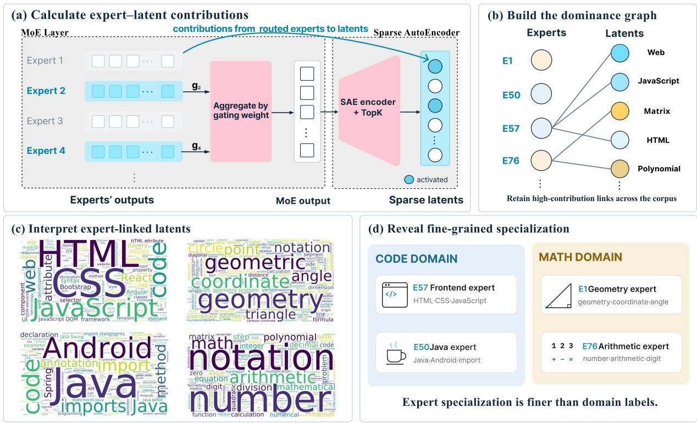  
Figure 1 An MoE layer outputs a router-weighted sum of its active experts (left), and since the SAE encoder is afine, each latent’s activation decomposes exactly over these experts (middle). Thresholding the contribution fractions averaged over a corpus gives the dominance graph (right), and auto-interpreting the latents an expert dominates describes its role (bottom), such as a Java expert (E50) and a front-end web expert (E57) at layer 30 of Qwen3-30B-A3B.

We propose to study expert specialization in the feature space of the model layer. We train a Sparse AutoEncoder (SAE; 9) on the output of an MoE layer. SAE latents approximate the features the model itself uses, and are discovered from its activations rather than stipulated in advance. Moreover, they also admit a natural decomposition into the contributions of individual experts. The output of an MoE layer is a router-weighted sum of the outputs of the active experts; because the SAE encoder is afine in that sum, each latent’s pre-activation decomposes exactly over the experts that produced it. This yields, for every (expert, latent, token) triple, the share of the latent’s activation contributed by that expert, which we aggregate over a corpus into an expert-level contribution profile. Figure 1 gives an overview, from the decomposition of a latent’s activation over experts to the account of an expert’s role that it supports.

Our approach difers from prior analyses along two axes. In the unit of analysis, we replace analyst-defined domains with latents the SAE learns unsupervised, so the resulting account of specialization is not constrained by a taxonomy chosen in advance, and it is finer-grained than any label set that can be assigned at corpus scale. In resolution, we replace corpus-level selection frequency with a per-token, per-expert contribution score, which both avoids attributing every token of a document to a single domain and measures functional contribution rather than mere co-occurrence.

We instantiate this analysis on layers 4, 30, and 46 of Qwen3-30B-A3B [19], chosen to cover shallow, mid-late, and deep positions in the network. Our first observation is that contribution is highly concentrated. Most latents receive the bulk of their activation from a small number of experts. Building on this, we say that an expert dominates a latent when it is a principal contributor to that latent’s activation, and we collect, for each expert, the set of latents it dominates. Interpreting the latents in an expert’s dominant set therefore describes what that expert does in the model’s own vocabulary rather than in categories chosen in advance. We obtain such interpretations by auto-interpreting each latent from activating contexts and logit efects (Section J).

Most pairs of dominant sets share almost nothing, the overlap that exists concentrates on a few pairs of experts, and about half of each expert’s set is its own. Reading these sets yields two further findings. First, experts specialize at a granularity well below that of conventional domain labels; for instance, we identify experts whose dominant set consists primarily of latents on front-end web code rather than on code in general. Second, summarizing the sets into coarse domains shows that the allocation of experts across domains is strongly unequal. Together these show that the experts of this model do divide labor, but along feature-level distinctions rather than the domain-level partitions under which specialization has previously been sought.

## 2 Related work

Expert specialization in MoE models. Prior analyses report either domain-specialized experts [11, 14] or routing driven by surface properties such as token identity [10, 18], and both rest on selection counts over domain-labeled corpora, whose limitations we discuss in Section 1. A recent work leaves the domain level behind. Motivated by k-sparse probing, which finds the neurons inside an expert less polysemantic than those of a comparable dense network, it labels hundreds of whole experts automatically and concludes that they are fine-grained task experts rather than domain specialists or token-level processors [8]. Its specialization score is computed against clusters of the model’s own output embedding, which keeps the categories model-derived, but the number of clusters is a hand-set grid of a few values, so the score reports which of the chosen resolutions fits an expert best rather than the level at which the model has drawn its division of labor. Our units are learned by the SAE without supervision, so an expert’s dominant set is read of instead of being matched against a partition fixed in advance, and the level at which that set is coherent is itself one of our results.

SAEs, interpretability and tracing. Our unit of analysis comes from dictionary learning. Since a model holds more features than it has dimensions, placing them in superposition [5], its neurons are polysemantic, and an SAE instead learns an overcomplete sparse dictionary whose directions are considerably more monosemantic [9], a construction since scaled to frontier models and to millions of latents [6, 17]. We adopt the top-k variant of Gao et al. [6] in Section 3.2 and read latents by auto-interpretation from activating contexts and logit efects (Section J), following Paulo et al. [16]. Latents also serve to trace computation, in sparse feature circuits [13] and attribution graphs [1], which take latents as nodes and attributions between them as edges. Our attribution runs along a diferent axis, because those works trace a computation across layers and components whereas we decompose the activation of one latent within a single layer over the experts that produced it. The decomposition of the pre-activation is also exact rather than approximate, since Equation (5) follows algebraically from the linearity of the layer output in the expert outputs.

## 3 Method

## 3.1 The MoE block linearly combines expert outputs into the layer output

Consider an MoE LLM with hidden dimension d, where one MoE block contains N experts. Given a token sequence $\boldsymbol { x } = ( x _ { 1 } , \dots , x _ { T } )$ , let $\boldsymbol { x } _ { 1 : t } = \left( x _ { 1 } , \ldots , x _ { t } \right)$ be its prefix and $h ( t ) \in  { \mathbb { R } } ^ { d }$ be the corresponding input to the MoE block. The router scores this input, takes the top-k experts and renormalizes their weights. The router assigns a non-negative weight to every expert, the weight of the j-th expert being $g _ { j } ( t ) \in [ 0 , 1 )$ . Only k of the $g _ { j } ( t )$ are positive, and satisfy $\begin{array} { r } { \sum _ { j = 1 } ^ { N } g _ { j } ( t ) = 1 } \end{array}$ . We call an expert with $g _ { j } ( t ) \neq 0$ an activated expert.

Denoting by $\boldsymbol { \mathcal { A } } ( t )$ the set of ids of the activated experts and by $u _ { j } ( t ) \in \mathbb { R } ^ { d }$ the output of the j-th expert, the output of this layer is

$$
y ( t ) = \sum _ { j \in { \cal { A } } ( t ) } g _ { j } ( t ) u _ { j } ( t ) \in \mathbb { R } ^ { d } .\tag{1}
$$

## 3.2 Encoding the MoE output into a latent space with an SAE

We train an SAE whose objective is to reconstruct $y ,$ with latent dimension $m \gg d .$ Its encoding and decoding are

$$
\begin{array} { r } { f ( t ) = \mathrm { T o p K - R e L U } _ { \kappa } \big ( W _ { \mathrm { e n c } } y ( t ) + b _ { \mathrm { e n c } } \big ) , } \end{array}\tag{2}
$$

$$
\hat { y } ( t ) = W _ { \mathrm { d e c } } f ( t ) + b _ { \mathrm { d e c } } \approx y ( t ) ,\tag{3}
$$

where $W _ { \mathrm { e n c } } \in \mathbb { R } ^ { m \times d } , W _ { \mathrm { d e c } } \in \mathbb { R } ^ { d \times m }$ , and the columns of $W _ { \mathrm { d e c } }$ have unit norm. The i-th component $f _ { i } ( t )$ of $f ( t )$ is the activation magnitude of latent i on this prefix, and at most κ components are non-zero. We denote the activated set by $\mathcal { F } ( t ) = \{ i \mid f _ { i } ( t ) > 0 \}$

## 3.3 The contribution of an expert to a latent

We observe that the activated part of a latent is an afine transformation of y. Let $W _ { \mathrm { e n c } , ( i ) } \in \mathbb { R } ^ { d }$ denote the i-th row of the encoder weight and $b _ { \mathrm { e n c } , ( i ) }$ the i-th entry of the encoder bias. Then, for an activated latent $i ,$

$$
f _ { i } ( t ) = W _ { \mathrm { e n c } , ( i ) } \cdot y ( t ) + b _ { \mathrm { e n c } , ( i ) } .\tag{4}
$$

Substituting Equation (1) into Equation (4) gives

$$
f _ { i } ( t ) = \sum _ { j \in A ( t ) } g _ { j } ( t ) W _ { \mathrm { e n c } , ( i ) } \cdot u _ { j } ( t ) + b _ { \mathrm { e n c } , ( i ) } .\tag{5}
$$

Equation (5) decomposes the activation of a latent exactly into the encoder bias plus the sum of the contributions of several experts. It follows that, for an expert j to which $h ( t )$ is routed and an activated latent i, the positive contribution of j to i is

$$
c ( j , i , x _ { 1 : t } ) = \operatorname { R e L U } \big ( g _ { j } ( t ) W _ { \mathrm { e n c } , ( i ) } \cdot u _ { j } ( t ) \big ) .\tag{6}
$$

A negative contribution strong enough to suppress a latent leaves it inactive and is never observed, so any statistics over negative contributions would be systematically biased. We therefore keep only the positive part in Equation (6) and use it exclusively in all subsequent analyses.

## 3.4 Computing the contribution fraction

On a single prefix, the relative magnitude of an expert’s contribution to a latent reflects whether this expert is important for that latent. Normalizing c over the set of activated experts, we obtain

$$
C ( j , i , x _ { 1 : t } ) = \frac { c ( j , i , x _ { 1 : t } ) } { \sum _ { j ^ { \prime } \in A ( t ) } c ( j ^ { \prime } , i , x _ { 1 : t } ) }\tag{7}
$$

for $j \in \mathcal { A } ( t )$ and $i \in \mathcal { F } ( t )$ , and $C ( j , i , x _ { 1 : t } ) = 0$ otherwise. We are interested in which latents an expert is generally better at contributing to, and therefore take the expectation of C over the entire dataset X, obtaining

$$
\mathcal { C } ( j , i ) = \mathbb { E } _ { ( x , t ) \sim \mathcal { U } \left\{ ( x , t ) \vert x \in X , 1 \leq t \leq \vert x \vert \right\} } \left[ C ( j , i , x _ { 1 : t } ) \right] .\tag{8}
$$

Finally, in order to assess whether an expert is generally important for a latent, we normalize C over the set of experts,

$$
s ( j , i ) = \frac { \mathcal { C } ( j , i ) } { \sum _ { j ^ { \prime } = 1 } ^ { N } \mathcal { C } ( j ^ { \prime } , i ) } .\tag{9}
$$

We call Equation (9) the contribution fraction of $j$ to i.

## 3.5 Dominance graph

Given a threshold $\tau , s ( j , i ) \geq \tau$ indicates that $j$ generally makes a substantial contribution to $i ;$ in this case we say that $j$ dominates i. We define the dominant set of an expert $j$ to be the set consisting of all latents dominated by j, denoted $S ( j ) = \{ i \mid i$ is dominated by j }.

We construct a bipartite graph $G ( U , V , E )$ , whose left vertex set U is the expert set and whose right vertex set V is the latent set of the SAE. Its edge set is $E = \left\{ \left( j , i \right) \mid j \in U , i \in S ( j ) \right\}$ }. We call this bipartite graph the dominance graph.

## 4 Qwen3-30B-A3B has specialized experts

We apply Section 3 to layers 4, 30, and 46 of Qwen3-30B-A3B, which we select to represent the model’s shallow, mid-late, and deep-layer behaviors. The model has 48 layers in total, where each MoE layer of this model contains N = 128 experts, with k = 8 experts activated per token and no shared experts. We train one individual SAE with latent size of $2 ^ { 2 0 }$ for each of the three layers. Statistics are computed on a validation set of 1.5B tokens that shares the same distribution as the SAE training set and has no data overlap with it. Every latent of each SAE activates at least once on this set, so $s ( j , i )$ is defined for all latents.

## 4.1 Contribution is more concentrated than gating

The contribution defined in Equation (6) carries $g _ { j } ( t )$ as a factor, and the gating weights are themselves unevenly distributed. The router takes the top-k experts and renormalizes their weights, so higher-ranked experts naturally receive larger $g _ { j } ( t )$ . Before adopting this statistic we therefore have to rule out a trivial explanation, namely that the unevenness of the contribution across the activated experts is merely a direct projection of the unevenness of the gating, and has nothing to do with whether an expert has any preference over latents.

We compare the profiles that the two quantities form once aggregated by rank. For each prefix $x _ { 1 : t }$ we sort the gating weights of the 8 activated experts in descending order, take the value in position $\textit { r } ( r = 0 , \ldots , 7 )$ , and average it over the entire validation set; we denote the result by $\bar { g } _ { r }$ . Analogously, for each (prefix, activated latent) pair $( x _ { 1 : t } , i )$ with $i \in \mathcal { F } ( t )$ , we sort the 8 values $C ( j , i , x _ { 1 : t } )$ in descending order, take the value in position $r ,$ and average it over all such pairs; we denote the result by $\hat { C } _ { r }$ . Note that position r need not correspond to the same expert from one case to the next, because what we aggregate is the rank. The two profiles are directly comparable, because the renormalization performed by the router together with the definition in Equation (7) gives $\begin{array} { r } { \sum _ { r = 0 } ^ { k - 1 } \bar { g } _ { r } = \sum _ { r = 0 } ^ { k - 1 } \bar { C } _ { r } = 1 } \end{array}$ . The two profiles thus distribute one and the same total.

Figure 2 reports the results for the three layers, and in all three $\bar { C } _ { r }$ is markedly steeper than $\bar { g } _ { r }$ . Taking layer 30 as an example, the first three gating values are 0.231, 0.169 and 0.137, decaying gently, whereas the first three contribution values are 0.512, 0.185 and 0.115, the first of them alone accounting for more than half of the total. The two curves cross between $r = 1$ and $r = 2$ , beyond which the contribution stays below the gating throughout; by $r = 7$ we have $\bar { C } _ { 7 } = 0 . 0 0 5$ while $\bar { g } _ { 7 } = 0 . 0 7 4$ . Layers 4 and 46 exhibit the same shape.

The ReLU in Equation (6) could also steepen $\bar { C } _ { r } ,$ since a truncated expert receives $c = 0$ and the remaining experts share the whole unit among themselves. The truncation is mild, however. Of the 8 activated experts of a (prefix, activated latent) pair, on average only 2.09, 1.29 and 1.64 are truncated at layers 4, 30 and 46, so most activated experts keep a positive contribution and the truncation is not the main source of the steepness.

The concentration of the contribution is therefore not an artifact of the top-k routing structure. While the gating profile decays gently, the contribution is highly concentrated on a small number of experts.

## 4.2 The dominance graph reveals the structure of latent dominance

We build the dominance graph of Section 3.5 with $\tau = 0 . 2$ . This threshold sits far above $1 / N \approx 0 . 0 0 8$ , the value an expert would receive if a latent’s activation were sourced evenly from all $N = 1 2 8$ experts, so an edge records a contribution that is significant rather than merely nonzero.

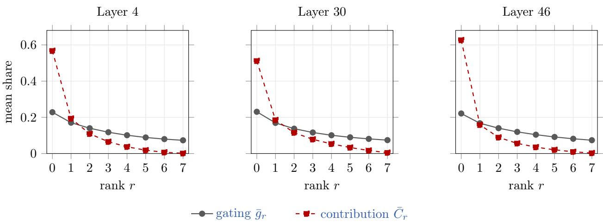  
Figure 2 Rank profiles of the gating weight and of the contribution. $\bar { C } _ { r }$ is markedly steeper than $\bar { g } _ { r }$

We first look at the latent-side degree, that is, the number of experts dominating a latent, whose full distribution is given in Section C. In all three layers over half of the $\bar { 2 } ^ { 2 0 }$ latents have exactly one dominator, namely 57.4% at layer 4, 62.1% at layer 30 and 56.7% at layer 46. Including the latents with two dominators accounts for 89.9%, 85.1% and 92.7% respectively, whereas degree three or above never exceeds 3.7%, and the ceiling of five permitted by $\tau$ is reached in no layer at all. A latent with no dominator is one whose activation is sourced comparatively evenly, no single expert clearing τ ; such latents remain a minority, at 7.0%, 13.6% and 3.7%. Latent dominance is therefore concentrated. The activation of a latent is typically attributable to one or two experts rather than spread over the eight that the router selects or the universal set of experts.

On the expert side, every one of the 128 experts dominates a nonempty set of latents in every layer, and the ten highest-degree experts hold at most 30.1% of all edges. Dominance is thus spread across the whole layer instead of being absorbed by a few hub experts (Section C).

## 4.3 The overlap of dominant sets concentrates on a few expert pairs

Section 4.2 shows that a latent usually has one or two dominators. This alone does not make the dominant sets disjoint, since the same few experts could still co-dominate many latents. We therefore measure the overlap directly by the Jaccard similarity of every pair of dominant sets, $\begin{array} { r } { J ( j , j ^ { \prime } ) = \frac { | S ( j ) \cap S ( j ^ { \prime } ) | } { | S ( j ) \cup S ( j ^ { \prime } ) | } } \end{array}$ , over all $\binom { 1 2 8 } { 2 }$ = 8128 unordered expert pairs of a layer.

Table 1 summarizes the distribution of $J ,$ and the full matrices, which look alike across the three layers, are shown in Section D. The median of J stays near $1 0 ^ { - 4 }$ in all three layers, and between 37.5% and 40.5% of the pairs share no latent at all.

What the degrees leave open is how this total is spread over the pairs, and the spread is strongly skewed. The mean of J is an order of magnitude above the median, and the tenth of the pairs with the largest J carries 83.8%, 78.5% and 81.0% of the total intersection at the three layers. Most pairs thus share almost nothing, and the overlap that exists sits in a right tail, where at most 0.57% of the pairs exceed $J = 0 . 0 5$ and the largest J reaches 0.138, 0.098 and 0.317.

The tail is organized into pairs rather than groups. Of the experts that have a partner above $J = 0 . 0 5$ , most have exactly one, the graph linking these pairs splits into connected components of at most 10 experts, and 26, 33 and 30 pairs of experts are each other’s nearest neighbour by J. The paired sets are not nested, since a pair above $J = 0 . 0 5$ shares a median of 16% to 18% of the smaller of its two sets. On average between 46% and 59% of an expert’s dominant set is dominated by that expert alone. Section 5.3 returns to the pairs in the tail once the experts are labeled.

Table 1 Pairwise Jaccard similarity over the 8128 expert pairs of each layer. The intersection in the top 10% of pairs is the share of the total intersection carried by the 813 pairs with the largest J. The lower block describes the pairs with $J > 0 . 0 5$ , a single partner means exactly one other expert above this threshold; a connected group is a connected component of the graph formed by these pairs.
<table><tr><td></td><td>Layer 4</td><td>Layer 30</td><td>Layer 46</td></tr><tr><td>Mean J</td><td> $1 . 7 3 \times 1 0 ^ { - 3 }$ </td><td> $\overline { { 1 . 5 7 \times 1 0 ^ { - 3 } } }$ </td><td> $\overline { { 2 . 1 2 \times 1 0 ^ { - 3 } } }$ </td></tr><tr><td>Median J</td><td> $1 . 0 6 \times 1 0 ^ { - 4 }$ </td><td> $1 . 0 1 \times 1 0 ^ { - 4 }$ </td><td> $1 . 3 7 \times 1 0 ^ { - 4 }$ </td></tr><tr><td>Pairs sharing no latent</td><td>37.8%</td><td>40.5%</td><td>37.5%</td></tr><tr><td>Intersection in top 10% of pairs</td><td>83.8%</td><td>78.5%</td><td>81.0%</td></tr><tr><td>Pairs with  $\overline { { J > 0 . 0 5 } }$ </td><td>25 (0.31%)</td><td>20 (0.25%)</td><td>46 (0.57%)</td></tr><tr><td>Experts involved (out of 128)</td><td>35</td><td>34</td><td>60</td></tr><tr><td>with a single partner</td><td>22</td><td>28</td><td>36</td></tr><tr><td>Largest connected group of experts</td><td>10</td><td>4</td><td>8</td></tr><tr><td>Largest J</td><td>0.138</td><td>0.098</td><td>0.317</td></tr></table>

  
(a) E50: Java and Android

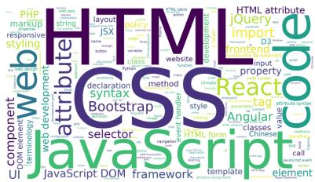  
(b) E57: frontend web

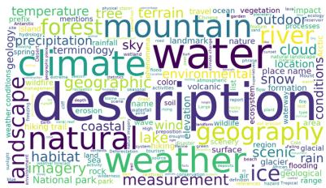  
(c) E93: geography and weather  
Figure 3 Explanation word clouds of three experts of layer 30. Word size is the frequency among the explanations of the latents sampled from the expert’s dominant set.

## 5 Label experts with latent explanations

Section 4 establishes that every expert holds a dominant set of latents, that about half of this set is dominated by that expert alone, and that substantial overlap occurs only between a few pairs of experts. The set attached to an expert is therefore a description of that expert, so interpreting the latents it contains tells us which features the expert is chiefly responsible for. Section 4.2 and Section 4.3 further show that the structure of dominance and its trends are the same at layers 4, 30 and 46, and we therefore report only layer 30 in the rest of this section.

## 5.1 Dominant-set explanations carry more information than tokens

For every expert we sample 2000 latents uniformly from its dominant set, taking the whole set when it holds fewer than 2000 latents. Each sampled latent is interpreted by GPT-5.5 from activating contexts and logit efects, following the pipeline described in Section J. Reading the resulting explanations expert by expert, we find that for most experts they concentrate on a few themes. To make this concentration visible at a glance, we render the explanations of each expert as a word cloud, in which the size of a word is its frequency among the explanations of that expert’s dominant set. Figure 3 shows the explanation word clouds of experts 50, 57 and 93 of layer 30 (a Java expert, a front-end web expert and an expert on natural geography and weather), and the word clouds of the remaining experts are collected in Section K.

We compare this construction with a word cloud drawn directly from the tokens routed to an expert. Ours difers in two respects. The dominant set keeps only the latents the expert principally drives, which leaves less unrelated material in the picture, and an explanation is written from the context around the activating positions, which carries more than the token alone. Figure 4(a) gives the token word cloud of expert 72 of layer 30, in which a word is weighted by the gating mass the expert accumulates on it over the corpus. The words it puts forward are the, and, of and other function words. Such function tokens do carry varied and rich information [20], but that information resides in the features activated at their positions and cannot be read of the tokens themselves, so at the token level they contribute nothing but noise.

  
(a) routed tokens

  
(b) routed tokens, MI reweighted

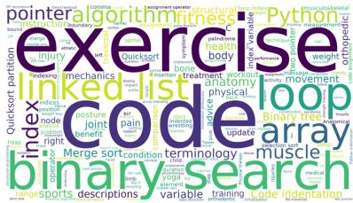  
(c) latent explanations  
Figure 4 Word clouds of expert 72 of layer 30, built from (a) routed tokens weighted by gating mass, (b) the same tokens reweighted by their contribution to mutual information without the top five function words, and (c) laten explanations. The algorithm theme of (c) is barely readable in (a) and (b).

We remove the five most frequent function words1 and reweight each remaining token by its contribution to the mutual information between the expert and the token. Figure 4(b) is the result. It is more informative than Figure 4(a), yet part of what the expert does is still lost. Figure 4(c) is the explanation word cloud of the same expert, which shows that expert 72 is associated with two themes at once, exercise and health, and algorithms and data structures. The second theme is barely readable in Figure 4(b), because the latents that carry it activate only at particular positions within an algorithm. Latent F97783, for instance, activates only at the <= operator of a binary search, and it is its explanation, “Binary search loop condition”, that ties it to binary search. On a token word cloud this latent can contribute no more than the symbol <=, whose origin and meaning are left open.

## 5.2 Experts divide labor below the level of coarse domains

Existing analyses of expert specialization ask whether experts align with domains such as code. Our explanation word clouds show that the model does not stop at this granularity. Inside a single coarse domain we find experts that hold nearly disjoint parts of it, and the part each one holds is a recognizable subfield rather than an arbitrary slice.

Consider the code domain, for instance. Figure 3(a) and (b) show the explanation word clouds of experts 50 and 57, which both work on code. Expert 50 is a Java expert. The words that take the largest font are Java, Android and imports, and the latents behind them are such things as “Java import statements”, “JDBC generated keys” and “ButterKnife Android imports”. Expert 57 is a front-end web expert, carried by HTML, CSS and JavaScript together with the framework names React, Bootstrap and jQuery, and by latents about DOM events, CSS selectors and responsive layout.The same holds inside mathematics. Section K gives experts 1 and 76. Expert 1 is a geometry expert, dominated by geometry, coordinate, triangle and angle. Expert 76 instead concentrates on arithmetic and polynomial computation, with polynomial, matrix, division and decimal in the largest font, over latents such as “Polynomial long division”, and “arbitrary-precision integers”.

To put a number on the separation, we use GPT-5.5 to judge whether each latent explanation of an expert belongs to the corresponding theme, with the prompt reproduced in Section E. Table 2 reports the share of each expert’s explanations falling in the corresponding theme among the latents sampled from its dominant set. For example, 86.7% of the latent explanations in expert 50’s dominant set relate to Java development. Against a random sample of 2000 latents drawn from the dominant sets of the other 127 experts, the share of the same theme falls to between 1.9% and 6.7%.

## 5.3 Specialization is unevenly allocated across domains

Section 5.2 takes the experts one at a time and reads of the theme that each dominant set is chiefly about.   
Here we change the unit of measurement and ask how the layer distributes its experts over coarse domains.

Table 2 Share of latent explanations judged by GPT-5.5 to belong to each theme at layer 30, among the latents sampled from the expert’s dominant set (Share) and among 2000 latents drawn uniformly from the pooled samples of the other 127 experts (Random).
<table><tr><td>Expert</td><td>50</td><td>57</td><td>1</td><td>76</td></tr><tr><td>Theme</td><td>Java development</td><td>Front-end development</td><td>Geometry</td><td>Arithmetic and polynomial</td></tr><tr><td>Share</td><td>86.7%</td><td>78.6%</td><td>78.1%</td><td>59.1%</td></tr><tr><td>Random</td><td>1.9%</td><td>3.5%</td><td>2.0%</td><td>6.7%</td></tr></table>

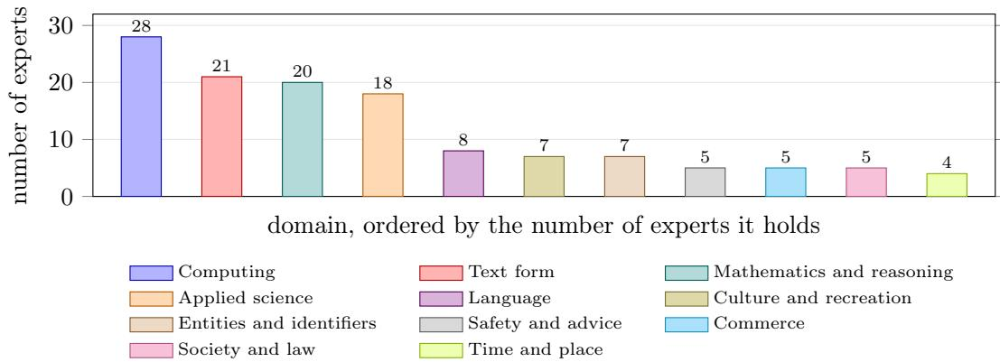  
Figure 5 Number of experts in each of the eleven domains of layer 30. The domains and their names are produced by GPT-5.5 from the expert labels alone. Section H lists the experts of every domain.

We do not fix the domains beforehand. Instead, we recover them by labeling each expert from its dominant-set word cloud and grouping those labels.

The procedure has two steps, carried out by GPT-5.5. We first name each expert. We hand the model the words of one expert in the wordcloud together with their weights and ask for a short label naming what that expert is responsible for, with the prompt in Section F. For instance, expert 50 receives “Java and Android programming” and expert 72 receives “coding algorithms and musculoskeletal fitness”, which recovers from the word cloud alone the two themes that Section 5.1 reads of it. We then group the experts. A single call receives all 128 labels at once and returns a partition of experts together with a name for each part, with the prompt in Section G. We call these parts domains.

Eleven domains come out of the 128 experts of layer 30, and Figure 5 gives the number of experts each of them holds. Section H lists every expert with its label and its domain.

The domains are internally diverse. Besides the Java and front-end experts of Section 5.2, computing holds experts on competitive programming (9, 40 and 118), system administration (51) and Python API documentation (113), each a diferent part of working with code.

The pairs of experts whose dominant sets overlap most (Section 4.3) fall inside domains. Of the 20 pairs with the largest J at layer 30, 19 join two experts of the same domain, whereas only 12.8% of all expert pairs do. The two experts of such a pair cover neighbouring ground, as with experts 83 and 105 on punctuation, 77 and 107 on mojibake, or 57 and 69 on JavaScript web programming. The one exception, experts 11 and 95, links LaTeX algebra in mathematics and reasoning with chemical and algebraic notation in applied science. Each label is written from the whole dominant set, so the shared latents enter both labels of a pair. They make up a median of only 12.3% of the dominant sets of these experts, however, so most of what each label is written from is not shared.

The allocation across domains is strongly unequal. Computing takes 28 of the 128 experts and mathematics and reasoning takes 20, so these two domains alone hold 37.5% of the layer. Most of the labels in computing name code, the remainder covering such things as cybersecurity and software platforms, and mathematics and reasoning also takes in statistics, parts of the physical sciences and problem-solving reasoning. At the other end the model spends very little on areas that a human taxonomy would list in their own right. Art occurs in one label out of 128, that of expert 54, where it sits beside animals inside culture and recreation.

Three of eleven domains (text form, language, and entities and identifiers) are not subject areas, and together they take 36 experts, or 28.1% of the layer. The largest of them, text form with 21 experts, is the second largest domain of the layer and covers document structure, punctuation, delimiters and encoding artifacts. All three are formed from the labels rather than requested. A taxonomy of subject matter alone would have to spread these 36 experts over all of its categories, and would recover none of these domains as a unit.

One plausible source of the imbalance among the topical domains is the composition of the pretraining data, in which code and mathematics take a share well above the one they occupy in general text. Llama 3, for instance, reports a final data mix of roughly 25% mathematical and reasoning tokens and 17% code tokens against 50% of general knowledge [7].2 On this reading the allocation of experts across domains reflects the proportions of the corresponding domains in the training data. The model draws finer distinctions inside a domain that occupies more of the data, and spends more of its experts on holding them.

## 6 Conclusion

We have proposed to study expert specialization in the feature space of an MoE layer instead of in a taxonomy of domains fixed in advance. A layer output is a router-weighted sum of the outputs of the activated experts and the SAE encoder is afine in that output, so the pre-activation of every latent decomposes exactly over the experts that produced it. Tracing latents back through this decomposition yields, for each expert, the dominant set of latents whose activation it principally drives, which describes the expert in the model’s own vocabulary rather than in categories we supply.

We apply this analysis to layers 4, 30 and 46 of Qwen3-30B-A3B, and our findings are the following.

• The contribution profile is markedly steeper than the gating profile that produces it, and the activation of a latent is typically attributable to few experts rather than to all those that the router selects.

• Read from the expert side, most pairs of dominant sets share almost nothing, the overlap that exists concentrates on a few pairs of experts, which at layer 30 almost always belong to the same domain, and about half of each expert’s set is its own.

• Interpreting the latents of these sets shows that the experts are specialized, and that the specialization sits below the granularity of conventional domain labels.

• Summarizing each expert’s dominant set into a short label and grouping those labels into coarse domains shows that the allocation of experts across domains is uneven.

The analysis needs only the expert outputs and an SAE on the layer output, so it applies to any MoE layer whose output is a weighted sum of its experts, and can compare how routing objectives and load balancing losses shape the division of labor. The dominant sets also yield a testable hypothesis for expert pruning, merging and feature-level steering, namely that removing or editing an expert chiefly afects the latents it dominates. We discuss the limitations of this work in Section A.

## References

[1] Emmanuel Ameisen, Jack Lindsey, Adam Pearce, Wes Gurnee, Nicholas L Turner, Brian Chen, Craig Citro, David Abrahams, Shan Carter, Basil Hosmer, et al. Circuit tracing: Revealing computational graphs in language models. Transformer Circuits Thread, 6(16318-16352):1, 2025.

[2] David Chanin, James Wilken-Smith, Tomáš Dulka, Hardik Bhatnagar, Satvik Golechha, and Joseph Bloom. A is for absorption: Studying feature splitting and absorption in sparse autoencoders. Advances in Neural Information Processing Systems, 38:82318–82355, 2026.

[3] Tom Conerly, Hoagy Cunningham, Adly Templeton, Jack Lindsey, Basil Hosmer, and Adam Jermyn. Dictionary learning optimization techniques. Transformer Circuits Thread, Circuits Updates — January 2025, January 2025. URL https://transformer-circuits.pub/2025/january-update/index.html#DL. Accessed: 2026-07-08.

[4] Boyi Deng, Xu Wang, Yaoning Wang, Yu Wan, Yubo Ma, Baosong Yang, Haoran Wei, Jialong Tang, Huan Lin, Ruize Gao, et al. Qwen-scope: Turning sparse features into development tools for large language models. arXiv preprint arXiv:2605.11887, 2026.

[5] Nelson Elhage, Tristan Hume, Catherine Olsson, Nicholas Schiefer, Tom Henighan, Shauna Kravec, Zac Hatfield-Dodds, Robert Lasenby, Dawn Drain, Carol Chen, Roger Grosse, Sam McCandlish, Jared Kaplan, Dario Amodei, Martin Wattenberg, and Christopher Olah. Toy models of superposition, 2022. URL https://arxiv.org/abs/22 09.10652.

[6] Leo Gao, Tom Dupre la Tour, Henk Tillman, Gabriel Goh, Rajan Troll, Alec Radford, Ilya Sutskever, Jan Leike, and Jefrey Wu. Scaling and evaluating sparse autoencoders. In The Thirteenth International Conference on Learning Representations, 2025. URL https://openreview.net/forum?id=tcsZt9ZNKD

[7] Aaron Grattafiori, Abhimanyu Dubey, Abhinav Jauhri, Abhinav Pandey, Abhishek Kadian, Ahmad Al-Dahle, Aiesha Letman, Akhil Mathur, Alan Schelten, Alex Vaughan, et al. The llama 3 herd of models. arXiv preprint arXiv:2407.21783, 2024.

[8] Jeremy Herbst, Stefan Wermter, and Jae Hee Lee. The expert strikes back: Interpreting mixture-of-experts language models at expert level, 2026. URL https://arxiv.org/abs/2604.02178.

[9] Robert Huben, Hoagy Cunningham, Logan Riggs Smith, Aidan Ewart, and Lee Sharkey. Sparse autoencoders find highly interpretable features in language models. In The Twelfth International Conference on Learning Representations, 2024.

[10] Albert Q Jiang, Alexandre Sablayrolles, Antoine Roux, Arthur Mensch, Blanche Savary, Chris Bamford, Devendra Singh Chaplot, Diego de las Casas, Emma Bou Hanna, Florian Bressand, et al. Mixtral of experts. arXiv preprint arXiv:2401.04088, 2024.

[11] Aixin Liu, Bei Feng, Bing Xue, Bingxuan Wang, Bochao Wu, Chengda Lu, Chenggang Zhao, Chengqi Deng, Chenyu Zhang, Chong Ruan, et al. Deepseek-v3 technical report. arXiv preprint arXiv:2412.19437, 2024.

[12] Ilya Loshchilov and Frank Hutter. Decoupled weight decay regularization. arXiv preprint arXiv:1711.05101, 2017.

[13] Samuel Marks, Can Rager, Eric Michaud, Yonatan Belinkov, David Bau, and Aaron Mueller. Sparse feature circuits: Discovering and editing interpretable causal graphs in language models. In International Conference on Learning Representations, volume 2025, pp. 23888–23923, 2025.

[14] Niklas Muennighof, Luca Soldaini, Dirk Groeneveld, Kyle Lo, Jacob Morrison, Sewon Min, Weijia Shi, Evan Pete Walsh, Oyvind Tafjord, Nathan Lambert, Yuling Gu, Shane Arora, Akshita Bhagia, Dustin Schwenk, David Wadden, Alexander Wettig, Binyuan Hui, Tim Dettmers, Douwe Kiela, Ali Farhadi, Noah A. Smith, Pang Wei Koh, Amanpreet Singh, and Hannaneh Hajishirzi. OLMoe: Open mixture-of-experts language models. In The Thirteenth International Conference on Learning Representations, 2025.

[15] Team Olmo, Allyson Ettinger, Amanda Bertsch, Bailey Kuehl, David Graham, David Heineman, Dirk Groeneveld, Faeze Brahman, Finbarr Timbers, Hamish Ivison, et al. Olmo 3. arXiv preprint arXiv:2512.13961, 2025.

[16] Gonçalo Paulo, Alex Mallen, Caden Juang, and Nora Belrose. Automatically interpreting millions of features in large language models. arXiv preprint arXiv:2410.13928, 2024.

[17] Adly Templeton, Tom Conerly, Jonathan Marcus, Jack Lindsey, Trenton Bricken, Brian Chen, Adam Pearce, Craig Citro, Emmanuel Ameisen, Andy Jones, Hoagy Cunningham, Nicholas L Turner, Callum McDougall, Monte MacDiarmid, C. Daniel Freeman, Theodore R. Sumers, Edward Rees, Joshua Batson, Adam Jermyn, Shan Carter,

Chris Olah, and Tom Henighan. Scaling monosemanticity: Extracting interpretable features from claude 3 sonnet. Transformer Circuits Thread, 2024. URL https://transformer-circuits.pub/2024/scaling-monosemantici ty/index.html.

[18] Fuzhao Xue, Zian Zheng, Yao Fu, Jinjie Ni, Zangwei Zheng, Wangchunshu Zhou, and Yang You. Openmoe: An early efort on open mixture-of-experts language models. arXiv preprint arXiv:2402.01739, 2024.

[19] An Yang, Anfeng Li, Baosong Yang, Beichen Zhang, Binyuan Hui, Bo Zheng, Bowen Yu, Chang Gao, Chengen Huang, Chenxu Lv, et al. Qwen3 technical report. arXiv preprint arXiv:2505.09388, 2025.

[20] Shaohua Zhang, Yuan Lin, and Hang Li. Memory retrieval and consolidation in large language models through function tokens. arXiv preprint arXiv:2510.08203, 2025.

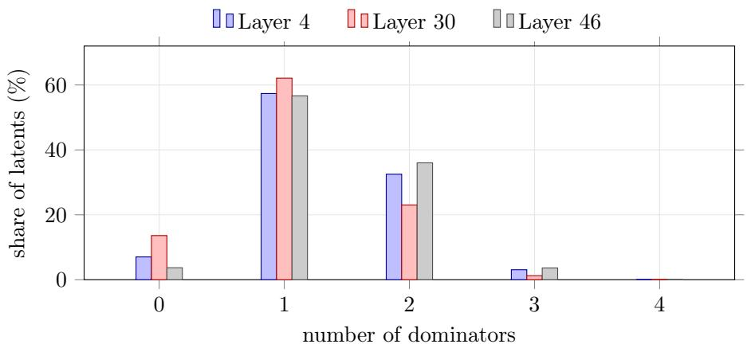  
Figure 6 Latent-side degree distribution of the dominance graph, the share of the $2 ^ { 2 0 }$ latents that are dominated by exactly $0 , \ldots$ , 4 experts. In every layer more than half of the latents have a single dominator. Degree 4 accounts for at most 0.014% and is not visible at this scale.

## Appendix

## A Limitations and future work

• Our analysis inherits the imperfections of the SAE. The reconstruction of the layer output carries an error, and the latents are not a clean basis, since one feature can be split across several latents and can be absorbed into another [2]. A better decomposition of an MLP into features would sharpen the picture of an MoE layer that we draw here.

• The pretraining mixture of Qwen3 is not disclosed, and our statistics are computed on a corpus of our own choosing. What we measure is therefore routing on our data rather than on the data the model was trained on, and the reading of Section 5.3 that relates the allocation of experts to the proportions of domains in the training data remains a conjecture.

• We report a single model. Extending the analysis to more and to larger MoE models would show which of these observations are general, and the same instrument can be used to compare how diferent load balancing losses shape the division of labor among experts.

## B AI use statement

In this work, we used generative AI tools for implementing code, analyzing data, interpreting experimental results, and polishing the writing. Separately, GPT-5.5 is a component of our method, used to explain latents, judge theme membership, label experts and group them into domains, with every prompt reproduced in Sections E to G and J. We have reviewed all AI-assisted work. We take responsibility for the final content of this work, including text, claims or artifacts produced with the aid of generative AI.

## C Degree distributions of the dominance graph

Figure 6 gives the latent-side degree distribution of the dominance graph of Section 4.2, the number of experts dominating a latent, from which the figures quoted in Section 4.2 are read of.

Figure 7 gives the expert-side degree of the dominance graph of Section 4.2, the number of latents an expert dominates, with the experts sorted by degree in ascending order. As in Figure 2 the horizontal axis is a rank rather than an expert identity. Every one of the 128 experts dominates a nonempty set of latents in every layer, the smallest degree observed being 362 at layer 4, 224 at layer 30 and 83 at layer 46. The distribution is right-skewed, its mean degree exceeding its median in all three layers (10786 against 8020, 9170 against

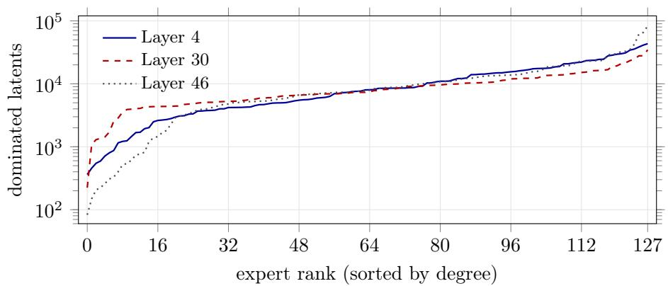  
Figure 7 Expert-side degree of the dominance graph, the number of latents each expert dominates, with the 128 experts of each layer sorted by degree in ascending order. The horizontal axis is a rank rather than an expert identity. No expert has degree zero in any layer.

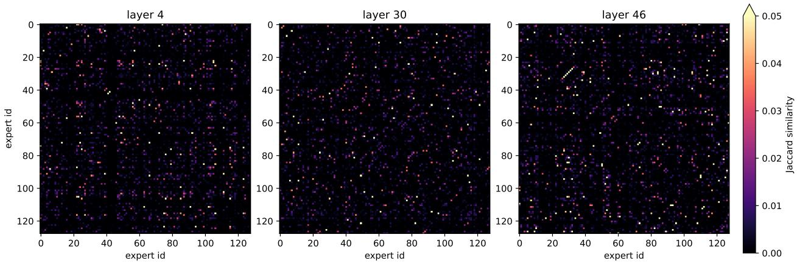  
Figure 8 Pairwise Jaccard similarity of the expert dominant sets at τ = 0.2, with the experts in their original index order on both axes. The three layers share one colour scale, which saturates at 0.05, and the diagonal is masked.

7395, and 11439 against 7835). But the skew is moderate. The ten highest-degree experts hold 24.6%, 20.1% and 30.1% of all edges, against the 7.8% they would hold under a uniform degree. Dominance is thus spread across the whole layer instead of being absorbed by a few hub experts.

## D Pairwise overlap of dominant sets

Figure 8 gives the full matrices of the pairwise Jaccard similarity summarized in Table 1. The three layers look alike. Each matrix is a dark field with a few isolated bright cells. No block of mutually overlapping experts appears, and no row is bright along its whole length, as an expert overlapping with all others would produce.

## E Prompt to judge whether a latent belongs to a theme

The theme name is substituted for {theme} in the prompt below, and the latent explanation is appended after the final line. The model is asked to answer only yes or no. The same prompt is used for the share row of Table 2 and for the random baseline, which draws 2000 latents from the dominant sets of every expert other than the one under study.

You are an expert in mechanistic interpretability, specializing in describing what an individual expert of a   
Mixture-of-Experts (MoE) language model is responsible for.   
## Background   
We study expert specialization in Qwen3-30B-A3B. Every MoE layer holds 128 experts, and a router sends each token to a   
few of them. To find out what an expert is responsible for we do not look at the tokens routed to it, because a   
token is selected by the router but the information the expert adds lives in the features of the layer output.   
A Sparse Autoencoder (SAE) with 2^20 latents is trained to reconstruct the output of one MoE layer, so each of its   
latents is one interpretable feature of what that layer computes. The activated part of a latent is an affine   
function of the layer output, so the activation of a latent decomposes exactly into a sum of per-expert   
contributions. Averaging the normalized contribution over a large corpus gives, for every expert and latent pair,   
the fraction of that latent’s activation the expert is responsible for. When this fraction is large we say the   
expert dominates the latent, and the set of all latents an expert dominates is its dominant set. Dominant sets are   
nearly disjoint across experts, so the dominant set of an expert is a description of that expert alone.   
Latents sampled from each dominant set were separately interpreted by a language model from activating contexts and logit   
effects. The result is a short natural language explanation, a noun phrase such as "Sailing knot names", "Origami   
folding steps" or "Falconry equipment terms".   
## Input   
You are given the word cloud of one expert, built from the explanations of latents sampled from its dominant set. Each   
entry is a word, or a frequent two word collocation, together with a weight. The weight is the frequency of that   
word among the explanations divided by the frequency of the most common word, so the heaviest entry always has   
weight 1.000. Common English stopwords have been removed, plural forms have been merged into their singulars, and   
at most 200 entries are listed in decreasing weight.   
This word cloud is the only evidence you have about the expert. You are seeing the vocabulary of the explanations rather   
than the explanations themselves, so it tells you which concepts recur and how often, but not how they combined   
inside any single latent.   
## Task   
Name what this expert is responsible for, using at most nine words.   
- Weigh words by their weights and spend your attention on the heaviest ones. A long tail of light words is normal and   
does not have to be covered.   
- Look for what sets this expert apart from an arbitrary other expert. Words such as code, text, term, terminology,   
description, name, reference and value are frequent in many experts and are weak evidence on their own. Prefer the   
words that would be surprising in a random expert.

You are an expert in mechanistic interpretability, specializing in deciding whether a Sparse Autoencoder (SAE) latent of a large language model belongs to a given theme.

We study expert specialization in Qwen3-30B-A3B. Every MoE layer holds 128 experts. For each expert we recover the set of SAE latents whose activation that expert principally drives, and we interpret latents sampled from that set into a short natural language explanation, a noun phrase such as "Sailing knot names", "Origami folding steps" or "Falconry equipment terms".

Decide whether the latent explanation below belongs to the theme named after this paragraph. Belonging means the explanation is about that theme, not merely adjacent to it or sharing a generic word with it. For example, under the theme "Beekeeping", "Hive frame inspection" and "Queen bee marking" belong, while "Insect wing anatomy" and "Pollinator garden plants" do not, even though they are also about insects and flowers.

The theme is: {theme}

\## Output format

Your response should contain only yes or no, in lowercase, with no other content.

The feature explanation is:

## F Prompt to label an expert from its explanation word cloud

The word cloud of an expert is passed to the model as one line per entry, of the form word: weight, appended to the prompt below in decreasing order of weight.

\- Say what the expert is about instead of concatenating its heaviest words. For an expert whose cloud is led by hive, honey, beeswax and queen, "hive, honey, beeswax, queen" is a bad answer and "beekeeping" is a good one.

\- You are not choosing from a fixed list of topics. An expert may specialize along an axis that is not a subject area at all. Name that axis when that is what the cloud shows.

- A few experts carry several unrelated themes at once. When the heavy words clearly split into separate groups, name each group and join them with "and", for instance "beekeeping and origami". The nine word limit binds here, so keep every theme to one or two words, and when the groups do not all fit, keep the heaviest ones and drop the rest. Do not force one label onto such an expert, and do not invent a second theme when the cloud only supports one.   
- Be as specific as the evidence allows and no more specific than that. If the cloud is about geometry, say geometry rather than mathematics. If it spreads over several unrelated parts of mathematics, say mathematics.

## ## Output format

Your response should contain only the label with no other content. Write a noun phrase of at most nine words, with no trailing punctuation and no quotation marks. Keep the capitalization of proper nouns such as Kyoto, UNESCO and Darwin, and leave every other word in lowercase.

The word cloud of this expert is:

## G Prompt to group the experts into domains

The 128 labels are appended to the prompt below as one line per expert, of the form E{expert id}: {label}. The only quantities we set are the bounds on the number of groups, between 6 and 13, and the returned number of groups, eleven, falls strictly inside them. The prompt fixes the level of grouping but names no domain that the partition should contain.

You are an expert in mechanistic interpretability, working on the division of labor among the experts of a Mixture-of-Experts (MoE) language model.

## ## Background

We study expert specialization in Qwen3-30B-A3B. One MoE layer holds 128 experts, and a router sends each token to a few of them. For every expert we recovered the set of Sparse Autoencoder latents whose activation that expert is chiefly responsible for, we interpreted latents sampled from that set into short natural language explanations, and we summarized those explanations into one short label naming what the expert is responsible for. Those 128 labels are the input below, one per expert.

The labels were written independently of one another, so their wording is not standardized. Two experts can hold closely related responsibilities while sharing no word, and two labels can share a generic word such as terminology, description or reference while describing responsibilities that have nothing to do with each other. Read for what an expert does rather than for surface overlap.

This grouping asks a coarse question. Group at the coarsest level the labels still support, and leave the internal structure of a group alone.

## ## Task

Partition the 128 experts into between 6 and 13 groups, aiming for about 10.

- Every expert belongs to exactly one group and all 128 experts are placed. Nothing may be dropped and nothing may appear twice.

\- A group is good when its name is true of every expert in it. Among the names that stay true, take the most general one rather than the most specific, and prefer one large group under a general name over several small groups under specific ones.

\- There is no upper bound on the size of a group, and group sizes do not need to be balanced. Do not split a group into subfields merely to even out the sizes.

\- Do not cut a small coherent domain apart either, and do not manufacture groups merely to reach the group count.

\- A group may be organized around any responsibility its members share.

\- Many labels name two or three themes at once. Place such an expert by the theme that carries most of its label, preferring a theme that already has a home among the other experts. Do not open a group for a single odd pairin preferring a theme that already has a home among the other experts. Do not open a group for a single odd pairing.

\- Keep one axis in one place. Two experts responsible for the same kind of thing belong in the same group even when their labels attach that thing to different subject matter, so do not leave near duplicates of a single theme sitting in two different groups.

\- Avoid a catch-all group. A group is a catch-all whenever some of its members lack the property its name states, and giving that group a specific sounding name does not repair it. Check every group by walking its members one at a time and asking whether the name is true of that member, then move out the ones for which it is not. If a few experts genuinely fit nowhere they may share one residual group, which must stay small and must be named for something its members actually have in common.

\- Name each group as generally and as briefly as you can, one or two words wherever the group allows it. Two closely related things may be joined with and. What is not acceptable is a name that enumerates three or more subject areas, of the shape "A, B, and C", because such a name states no organizing principle at all. When the only name you can find for a candidate group is a list of that shape, either find the more general word that covers the list,

or split the group along the very boundaries the list names.   
## Output format   
Respond with JSON and nothing else. No prose before or after it and no markdown code fence. The JSON is a list of objects   
ordered from the largest group to the smallest, each object having exactly two fields:   
- "group", the name of the group   
- "experts", the ids of the experts in that group, as integers in ascending order   
The shape of the response is   
[{"group": "<name of the largest group>", "experts": [0, 7, 19]}, {"group": "<name of the next group>", "experts": [3,   
12]}]   
The 128 expert labels are:

## H Expert labels and domains

Table 3 gives the label of every expert of layer 30 together with the domain it was grouped into, the experts of one domain being listed together. The domains appear in decreasing order of size, and the experts within a domain in increasing order of identity.

Table 3 The 128 experts of layer 30, their labels and the domains they were grouped into. A label is written by GPT-5.5 from the explanation word cloud of that expert alone, and the domains are recovered from the labels in a single further call. Both prompts are given in Section F and Section G.

<table><tr><td>Domain</td><td>Expert</td><td>Label</td></tr><tr><td>Computing</td><td>9</td><td>competitive programming statements and formal instruction phrasing</td></tr><tr><td></td><td>19</td><td>conditional programming logic and edge case handling</td></tr><tr><td></td><td>20</td><td>embedded multimedia hardware programming and specifications</td></tr><tr><td></td><td>21</td><td>C and Python programming input/output</td></tr><tr><td></td><td>31</td><td>database-backed web application code</td></tr><tr><td></td><td>32</td><td>graph algorithms and blockchain protocols</td></tr><tr><td></td><td>40</td><td>competitive programming and algorithmic code</td></tr><tr><td></td><td>45</td><td>source code syntax and declarations</td></tr><tr><td></td><td>47</td><td>Chinese Java source code and technical documentation</td></tr><tr><td></td><td>50</td><td>Java and Android programming</td></tr><tr><td></td><td>51</td><td>command-line software configuration and system administration</td></tr><tr><td></td><td>57</td><td>HTML CSS and JavaScript frontend development</td></tr><tr><td></td><td>59</td><td>Python data processing and machine learning code</td></tr><tr><td></td><td>60</td><td>integer arithmetic and algorithmic code notation</td></tr><tr><td></td><td>66</td><td>software configuration command syntax and game modding</td></tr><tr><td></td><td>68</td><td>software development packages and documentation</td></tr><tr><td></td><td>69</td><td>JavaScript web and Swift iOS programming</td></tr><tr><td></td><td>70</td><td>programming string manipulation and recipes</td></tr><tr><td></td><td>72</td><td>coding algorithms and musculoskeletal fitness</td></tr><tr><td></td><td>81</td><td>code indentation and block syntax formatting</td></tr><tr><td></td><td>100</td><td>cybersecurity and safety risk management</td></tr><tr><td></td><td>102</td><td>software engineering and computing platforms</td></tr><tr><td></td><td>108</td><td>Python code syntax and indentation</td></tr><tr><td></td><td>111</td><td>Python competitive programming and Star Wars</td></tr><tr><td></td><td>112</td><td>code syntax and structured list formatting</td></tr><tr><td></td><td>113</td><td>Python programming types and API documentation</td></tr><tr><td></td><td>117</td><td>government safety and event handler programming</td></tr><tr><td>Text form</td><td>118</td><td>competitive programming problem specifications</td></tr><tr><td></td><td>8</td><td>Markdown answer formatting and Python/math problem solving</td></tr><tr><td></td><td>12</td><td>academic document structure and formatting</td></tr><tr><td></td><td>24</td><td>structured text formatting and delimiters</td></tr><tr><td></td><td>26</td><td>webpage metadata and academic citation boilerplate</td></tr><tr><td>Domain</td><td>Expert 34</td><td>Label definitions and reference page formatting</td></tr><tr><td></td><td>35</td><td>punctuation and separators in code and notation</td></tr><tr><td></td><td>44</td><td></td></tr><tr><td></td><td></td><td>web forum metadata and boilerplate</td></tr><tr><td></td><td>56</td><td>article prose punctuation and formatting</td></tr><tr><td></td><td>58</td><td>academic citation metadata and bibliography formatting</td></tr><tr><td></td><td>71</td><td>educational Q&amp;A and exam page formatting</td></tr><tr><td></td><td>77</td><td>non-English proper names and Unicode mojibake</td></tr><tr><td></td><td>78</td><td>newlines and structured text formatting</td></tr><tr><td></td><td>80</td><td>Python programming solutions and Markdown formatting</td></tr><tr><td></td><td>83</td><td>sentence endings and punctuation formatting</td></tr><tr><td></td><td>98</td><td>web and source code boilerplate notices</td></tr><tr><td></td><td>104</td><td>Japanese text, Unicode mojibake, and competitive programming</td></tr><tr><td></td><td>105</td><td>punctuation and text formatting</td></tr><tr><td></td><td>107</td><td>Unicode replacement characters and mojibake</td></tr><tr><td></td><td>122</td><td>numeric tables and OCR formatting artifacts</td></tr><tr><td></td><td>124 126</td><td>Chinese web boilerplate and contact metadata</td></tr><tr><td>Mathematics</td><td></td><td>comma separated lists and numeric sequences</td></tr><tr><td></td><td>1</td><td>coordinate and Euclidean geometry</td></tr><tr><td>and reasoning</td><td>2</td><td>formal mathematical notation and problem setup</td></tr><tr><td></td><td>11</td><td>LaTeX math notation and algebraic expressions</td></tr><tr><td></td><td>13</td><td>mathematical definitions and corrupted SEO prose</td></tr><tr><td></td><td>15</td><td>LaTeX notation for advanced mathematics and physics</td></tr><tr><td></td><td>16</td><td>quantitative STEM word problems</td></tr><tr><td></td><td>27</td><td>Boolean operators in programming and formal logic</td></tr><tr><td></td><td>29</td><td></td></tr><tr><td></td><td>30</td><td>mathematical physics, geometry, and astronomy</td></tr><tr><td></td><td>41</td><td>problem-solving reasoning and solution exposition</td></tr><tr><td></td><td>42</td><td>unit conversions, sports statistics, and logic puzzles conditional reasoning and self-correction</td></tr><tr><td></td><td>43</td><td>mathematical equations, LaTeX, and Python syntax</td></tr><tr><td></td><td>53</td><td>multiple-choice math exam questions and solutions</td></tr><tr><td></td><td>67</td><td>statistical analysis and research methods</td></tr><tr><td></td><td>73</td><td>mathematical formulas and notation</td></tr><tr><td></td><td>76</td><td>mathematical notation, arithmetic, and algebra</td></tr><tr><td></td><td>88</td><td>mathematical and programming variables, indices, and lists</td></tr><tr><td></td><td>90</td><td>mathematical optimization and modeling notation</td></tr><tr><td></td><td>106</td><td>mathematical problem solving and proofs</td></tr><tr><td></td><td>120</td><td>mathematical equations and problem solving</td></tr><tr><td>Applied</td><td>0</td><td>industrial energy and infrastructure sectors</td></tr><tr><td>science</td><td>6</td><td>chemistry terminology and notation</td></tr><tr><td></td><td>18</td><td>optics, conic sections, and civil engineering</td></tr><tr><td></td><td></td><td>scientific measurement and geoscience laboratory methods</td></tr><tr><td></td><td>33</td><td>biological and biomedical terminology</td></tr><tr><td></td><td>49</td><td></td></tr><tr><td></td><td>61</td><td>medical symptoms and mind-body wellness</td></tr><tr><td></td><td>62</td><td>mechanical engineering specifications and botanical morphology</td></tr><tr><td></td><td>74</td><td>3D CAD engineering and computer vision</td></tr><tr><td></td><td>82</td><td>biomedical research terminology and identifiers</td></tr><tr><td></td><td>84</td><td>food chemistry and nutrition</td></tr><tr><td></td><td>92</td><td>medical anatomy and physiology terminology</td></tr><tr><td></td><td>94</td><td>electrical/audio engineering, probability notation, and grammar terminology</td></tr><tr><td></td><td>95</td><td>chemical and algebraic notation</td></tr><tr><td></td><td>101</td><td>automotive and residential building systems</td></tr><tr><td></td><td>103</td><td>STEM and software technical nomenclature</td></tr><tr><td></td><td>114</td><td>medical treatment and healthcare advice</td></tr><tr><td></td><td>121</td><td>biomedical genetics and disease terminology</td></tr><tr><td></td><td>123</td><td>scientific causal reasoning about quantitative change</td></tr><tr><td>Language</td><td>36</td><td>Chinese webnovel translationese and discourse constructions</td></tr><tr><td></td><td>38</td><td>polite greetings, thanks, and sign-offs</td></tr><tr><td>Domain</td><td>Expert</td><td>Label</td></tr><tr><td rowspan="9"></td><td>52 55</td><td>first-person dialogue and narrative discourse markers adjectival morphology and technical constraints</td></tr><tr><td></td><td></td></tr><tr><td>75</td><td>definitions and NLI tasks</td></tr><tr><td>79</td><td>first and second person instructional dialogue</td></tr><tr><td>85</td><td>temporal and comparative framing of growth and change</td></tr><tr><td>86</td><td>idioms and figurative comparisons</td></tr><tr><td>3</td><td>Christian theology and role-playing game mechanics</td></tr><tr><td>54</td><td>animals and classical arts</td></tr><tr><td>63</td><td>entertainment media metadata and reviews</td></tr><tr><td rowspan="5"></td><td>65</td><td>biblical references, fiction franchises and SVG path coordinates</td></tr><tr><td>89</td><td>history, languages and cultural geography</td></tr><tr><td>109</td><td>physical movement in games, vehicles, and combat</td></tr><tr><td>119</td><td>sports, games, gambling, and number theory</td></tr><tr><td>5</td><td>programming identifier and variable names</td></tr><tr><td rowspan="7">Entities and identifiers</td><td>17</td><td>numeric strings and identifiers</td></tr><tr><td>22</td><td>official government, military, and corporate entity names</td></tr><tr><td>23</td><td>biographical life events and relationships</td></tr><tr><td>87</td><td>proper names titles identifiers and their fragments</td></tr><tr><td>91</td><td>uppercase code identifiers constants and comments</td></tr><tr><td>127</td><td>personal names, roles, and logic puzzle characters</td></tr><tr><td></td><td>food recipes and ingredient descriptions</td></tr><tr><td rowspan="5">Safety and advice</td><td>4</td><td></td></tr><tr><td>7 10</td><td>everyday household, cooking, and safety advice</td></tr><tr><td>46</td><td>refusal constructions and safety request framing</td></tr><tr><td>110</td><td>digital device and software usage instructions</td></tr><tr><td></td><td>positive evaluative phrasing in advice and marketing</td></tr><tr><td rowspan="5">Commerce</td><td>37</td><td>financial accounting, tax, and investment calculations</td></tr><tr><td>39</td><td>financial market news and weather forecasts</td></tr><tr><td>64</td><td>business software marketing and project management</td></tr><tr><td>99</td><td>monetary amounts and pricing calculations</td></tr><tr><td>116</td><td>e-commerce product listings and specifications</td></tr><tr><td rowspan="5">Society and law</td><td>25</td><td>academic education and job requirements</td></tr><tr><td>28</td><td>legal documents and proceedings</td></tr><tr><td>48</td><td>education and management theory terminology</td></tr><tr><td>97</td><td>political economy and social policy discourse</td></tr><tr><td>125</td><td>legal documents, citations, and American history</td></tr><tr><td rowspan="5">Time and place</td><td>14</td><td>spatial and geographic locations</td></tr><tr><td>93</td><td>physical geography and weather</td></tr><tr><td>96</td><td>calendar events, date-time expressions, and weather</td></tr><tr><td>115</td><td>date, time, and duration expressions</td></tr><tr><td></td><td></td></tr></table>

## I SAE training details

We trained our SAE with the latent size of $2 ^ { 2 0 } = 1 , 0 4 8 , 5 7 6$ on the layer 4,30,46 MoE layer output stream of Qwen3-30B-A3B [19] independently. Activations were collected from a mixture of pre-training and post-training data taken from the Olmo 3 [15] training corpus: $5 / 8$ from pre-training data, 1/4 from a reasoning chain-of-thought dataset, 1/8 from an instruction-following supervised fine-tuning dataset.

In order to increase the diversity of the activation sources within a single batch, we dumped all the activations before training. For each example in the dataset, we ran a forward pass of the LLM to obtain the MoE activations and then sampled only 512 of them from that example into the pool, discarding the remaining activations. For each training-batch, we drew a batch from activations we dumped uniformly at random without replacement.

Our hyperparameters are set following the common practice. We used a square-root warmup followed by a linear decay. During the first 100 steps, the learning rate is warmed up from $0 . 1 \eta _ { \mathrm { m a x } }$ to the peak value $\eta _ { \mathrm { m a x } }$ following a square-root schedule, i.e., $\eta ( t ) = \eta _ { 0 } + ( \eta _ { \mathrm { m a x } } - \eta _ { 0 } ) \sqrt { t / 1 0 0 }$ with $\eta _ { 0 } = 0 . 1 \eta _ { \mathrm { m a x } }$ . The learning rate then linearly decays from $\eta _ { \mathrm { m a x } }$ to η0 during the remainder of training. We set $\eta _ { \mathrm { m a x } } = 8 \times 1 0 ^ { - 5 }$

We trained the SAE with the AdamW optimizer [12] with $( \beta _ { 1 } , \beta _ { 2 } ) = ( 0 . 9 , 0 . 9 9 9 )$ and a weight decay of 0.01. We used

Table 4 The FVU of our SAE on each layer.
<table><tr><td>Layer</td><td>FVU</td></tr><tr><td>4</td><td>12.6%</td></tr><tr><td>30</td><td>25.1%</td></tr><tr><td>46</td><td>7.6%</td></tr></table>

a batch size of 8192 and trained each SAE on about 3.2B tokens.

Our initialization setup generally follows Conerly et al. [3] and Ameisen et al. [1]. Let $n = 2 0 4 8$ be the hidden size of LLM, and $m = 1 , 0 4 8 , 5 7 6$ be the latent size of SAE. We normalize the activations to ${ \sqrt { n } } , { \mathrm { i . e . , } } \mathbb { E } \left[ \| X \| \right] = { \sqrt { n } } .$ , where X denotes the activations of the given layer.

After normalization, we filter out activations whose norm exceeds 20 times the batch-wise mean, as such outliers would destabilize training.

We initialized every entry of the encoder matrix from $\begin{array} { r } { \mathcal { U } ( - \frac { 1 } { \sqrt { m } } , \frac { 1 } { \sqrt { m } } ) } \end{array}$ and every entry of $W _ { \mathrm { d e c } }$ from $\textstyle { \mathcal { U } } ( - { \frac { 1 } { \sqrt { n } } } , { \frac { 1 } { \sqrt { n } } } )$

Our SAE is trained with activation function TopK. For the number of activations κ retained by the activation function, we set $\kappa = 1 0 0 0$ initially, and let κ linearly decay to 100 during the first 10,000 steps, after which it is held constant. We used an auxiliary loss following Gao et al. [6] and Deng et al. [4] with the coeficient of $1 / 3 2$ . The auxiliary loss always uses the same value of κ as our main activation function. After training we normalize each column of $W _ { \mathrm { d e c } }$ to unit norm and rescale the corresponding row of $W _ { \mathrm { e n c } }$ by the reciprocal factor, which yields an equivalent SAE. We likewise fold the activation normalization factor into the weights, so the exported SAE applies directly to the raw layer output as in Equations (2) and (3).

We use fraction of variance unexplained (FVU) to evaluate our SAE. The FVU values of each layer are shown in Table 4. Consistent with Gao et al. [6], we also observe that the intermediate layers of LLMs are more dificult to reconstruct using SAE, compared with both shallow and deep layers.

## J Pipeline of auto-interpretability

Following common practice, we use an LLM to produce a natural-language explanation for each latent. Unlike prior work that relies primarily on activated contexts, we provide the explainer with three sources of evidence: (i) activated contexts, (ii) logit efects, and (iii) layer information.

Activated contexts. We run inference on the 1.5B-token validation set of Section 4, which does not overlap with the SAE training data. For each latent, we collect all activated contexts within a 64-token window and select the top 5 by activation strength. We additionally sample 5 contexts uniformly at random from the remaining activations. We found that top-activating contexts are often highly similar to one another, which biases the explainer toward the literal surface pattern shared by those examples. Adding randomly sampled contexts increases diversity and encourages the explainer to summarize the latent’s more general function rather than its most salient literal trigger. All ten contexts, along with their token-level activation values, are provided to the explainer.

Logit efects. To quantify a latent’s direct efect on the output distribution, we apply the logit lens, projecting the latent’s decoder vector through the LM head and extracting the top-10 boosted and top-10 suppressed tokens by logit value. Boosted tokens indicate what the latent promotes, while suppressed tokens indicate what it suppresses.

Layer information. We also tell the explainer the total number of layers, the layer at which the latent lives, and its relative depth, together with a soft prior on how features are typically distributed across depth: shallow layers tend to contain input features that respond to specific tokens, local syntax, or surface patterns; middle layers tend to contain abstract features that capture discourse patterns, reasoning states, or semantic categories; and deep layers tend to contain output features that directly shape next-token prediction. This prior guides how the explainer weighs the evidence but is explicitly framed as a tiebreaker rather than a constraint. For input features, activated contexts are usually suficient; for output features, the logit efects are more informative, since their activated contexts are often difuse; for abstract features in the middle layers, neither source alone is typically conclusive, and the explainer is instructed to combine both. For output features, we adopt a fixed naming convention (Say X for boosted tokens and Don’t Say X for suppressed tokens) so that output-oriented explanations are easily distinguishable from concept-level ones.

1. Activations -- what topic / pattern, which tokens, what common thread?   
2. Logit effect -- what is boosted, what is suppressed, is there a clear output push?   
3. Layer prior -- what type of feature does the depth suggest?   
4. Synthesis:   
- Activations + logit effect agree -> combine into one label.   
- They diverge -> take the clearer signal; do not force a unified story.   
- Both incoherent -> output ‘Uninterpretable‘.   
5. Phrase -- specific, 2-6 words, no filler.

Output format. In addition to a concise explanation phrase, we ask the explainer to report a confidence rating on a three-level scale (High, Medium, Low) reflecting how well the provided evidence supports its explanation. The explainer is also allowed to output Uninterpretable when the activated contexts and logit efects do not exhibit a consistent, describable pattern, rather than being forced to produce a speculative explanation.

The full system prompt and user prompt are given in Section J.1.

## J.1 Prompts

We provide the full system prompt and user prompt template below. In the user prompt, fields in double braces are filled in per latent.

You are an expert in mechanistic interpretability, specializing in interpreting features extracted by Sparse Autoencoders (SAEs) from a large language model.

Given one SAE feature, infer the concept, behavior, pattern, or output tendency it represents. Produce: 1. A concise interpretation phrase (2-6 words preferred; clarity > brevity).

2. A confidence rating.

\## Input

You may receive up to three sections. Any may be missing.

Text examples that strongly activate the feature, with token-level activation highlights.

[Context 1]   
[Text]   
"The cat sat on the mat in Paris"   
[/Text]   
Top Activations: [mat|0.92] [Paris|0.87]   
[/Context 1]

How to read them:

\- Global pass: identify topic, domain, task, language, register, formatting, or discourse situation shared across examples.

\- Local pass: examine the highest-activating tokens -- do they share a semantic field, syntactic role, position, or discourse function?

\- Cross-example pass: isolate the single common thread that explains every activation. Reject hypotheses contradicted by any example.

The feature’s output influence at its own layer, presented as a direct logit-lens projection of the decoder vector: a list of boosted / suppressed tokens.

Use it to infer what the feature pushes the model to say or avoid saying. Logit effects can be noisy (especially in earlier layers), so weight context activations more heavily when they are clearer.

\### 3. Layer Information

\- Shallow -> surface features: lexical items, local syntax, formatting, named entities, languages, domain terminology.

\- Middle -> abstract / behavioral features: discourse patterns, reasoning states, task structure, style, intent, semantic categories.

\- Deep -> output-oriented features: answer formats, completion templates, specific phrases, refusal / compliance, "say X" behaviors.

The layer prior is a tiebreaker, not a constraint. Override it whenever activations or logit effects give stronger evidence.

\## Reasoning Procedure

## 6. Confidence -- see scale below.

## ## Output Format

Output only the two tags below. No reasoning, preamble, or commentary.

## <explanation>concise interpretation phrase</explanation>

<confidence>High | Medium | Low</confidence>

## Confidence scale:

\- High -- activations and logit effect are coherent, repeated, and specific.

\- Medium -- plausible interpretation; some evidence is partial, noisy, or only one channel is clear.

\- Low -- weak, sparse, or contradictory evidence; label is tentative.

## If evidence is too noisy, contradictory, or insufficient, output exactly:

## <explanation>Uninterpretable</explanation>

<confidence>Low</confidence>

## ## Label Conventions

## ### Surface features (shallow)

Name the concept or pattern directly.

\- ‘European capitals‘

\- ‘medical terminology‘

\- ‘Python indentation‘

\- ‘Chinese punctuation‘

\- ‘HTML attribute syntax‘

## ### Behavioral features (middle)

Name the behavior, capability, discourse function, or abstract state.

\- ‘formal register‘

\- ‘negation logic‘

\- ‘Chinese language response‘

\- ‘step-by-step reasoning‘

\- ‘instruction-following mode‘

\- ‘uncertainty expression‘

## ### Output-oriented features (deep)

- Boosted output -> prefix with ‘Say‘: ‘Say however‘, ‘Say comma‘, ‘Say closing parenthesis‘, ‘Say final answer‘.   
- Suppressed output -> prefix with ‘Don’t Say‘: ‘Don’t Say period‘, ‘Don’t Say apology‘, ‘Don’t Say the‘.

Do not substitute ‘Produce‘, ‘Express‘, ‘Output‘, ‘Generate‘, etc. for ‘Say‘.

## ## Specificity Rules

Be precise. Replace vague labels with concrete ones:

<table><tr><td>I Avoid</td><td>-1--</td><td>| Prefer</td></tr><tr><td></td><td>&#x27;locations&#x27;</td><td>‘European capitals&#x27;</td></tr><tr><td></td><td>I&#x27;science-related&#x27;</td><td>|&#x27;scientific terminology</td></tr><tr><td></td><td></td><td>|‘punctuation tokens&#x27;|&#x27;sentence-ending punctuation</td></tr><tr><td></td><td>I&#x27;negative words&#x27;</td><td>I &#x27;negation / denial&#x27;</td></tr><tr><td></td><td>I&#x27;medical stuff&#x27;</td><td>&#x27;medical symptom description&#x27;</td></tr></table>

Banned patterns: ‘xxx-related‘, ‘xxx tokens‘, ‘xxx words‘, ‘xxx stuff‘, ‘xxx things‘, and meta-descriptions of the feature itself (e.g. ‘activates on nouns‘, ‘high activation feature‘).

## ## Honesty Rule

Do not fabricate coherence. When evidence does not support a specific interpretation, output the ‘Uninterpretable‘ template above. Forced labels are worse than honest abstention.

## ## Context Activations ## Context Activations

Two complementary sets of examples are provided: the strongest (top) activations and a random sample. Read both -- the random set guards against over-fitting to the most extreme cases.

Expert 0

### Top Activating Contexts   
The 5 examples where this feature fires most strongly.   
[Top Context 1]   
[Text]   
{{top\_context\_1.text}}   
[/Text]   
Top Activations: {{top\_context\_1.top\_activations}}   
[/Top Context 1]   
... (Top Context 2-5 in the same format)   
### Random Contexts   
5 examples sampled at random from this feature’s activating set (a less-biased view of where it fires).   
[Random Context 1]   
[Text]   
{{random\_context\_1.text}}   
[/Text]   
Top Activations: {{random\_context\_1.top\_activations}}   
[/Random Context 1]   
... (Random Context 2-5 in the same format)   
## Logit Effect   
Source: decoder-vector projection. This feature lives at layer {{layer\_idx}} (single decoder; SAE-style).   
Decoder L2 norm = {{decoder\_l2\_norm}}   
Top 10 boosted logits:   
Rank 1: [{{token}}], logit={{logit}}   
... (Rank 2-10)   
Top 10 suppressed logits:   
Rank 1: [{{token}}], logit={{logit}}   
... (Rank 2-10)   
## Model Information   
Model: {{model\_name}} -- {{num\_layers}} transformer layers (0-indexed).   
Feature extractor: Sparse Autoencoder (SAE), trained at layer {{layer\_idx}}. Each feature has a single decoder vector at   
its own layer.   
## Layer Information   
The model has {{num\_layers}} layers in total (0-indexed); the current feature’s layer index is {{layer\_idx}} (relative   
depth {{layer\_idx / num\_layers}}). Use the relative position as a soft prior, but override it with the logit-effect   
signal whenever the two disagree.   
Analyze the context activations, logit effect, and model / layer information, then respond in the exact output format   
specified in the system prompt above.

## K Word clouds

Figure 9 to Figure 16 give the explanation word clouds of all 128 experts of layer 30, each built as in Figure 3.

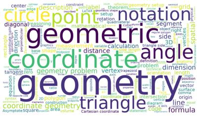  
Expert 1

Figure 9 Explanation word clouds of experts 0 and 1 of layer 30. Each cloud is built from the explanations of the latents sampled from that expert’s dominant set, and the size of a word is its frequency among those explanations.

Expert 9  
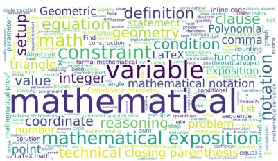  
Expert 2

  
Expert 3

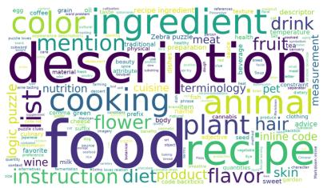  
Expert 4

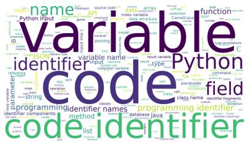  
Expert 5

  
Expert 6  
Expert 7

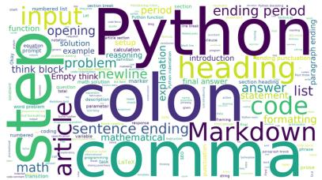  
Expert 8

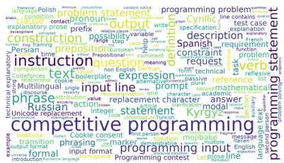

  
Expert 10

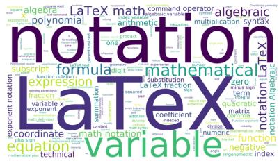  
Expert 11

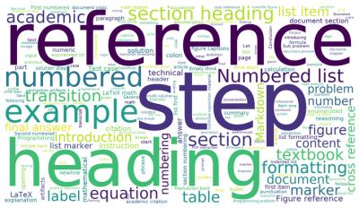  
Expert 12

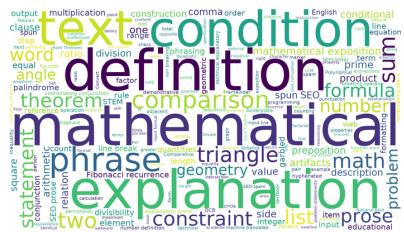  
Expert 13

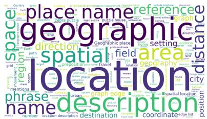  
Expert 14

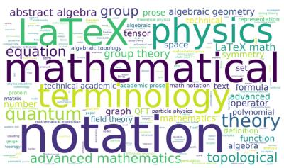  
Expert 15

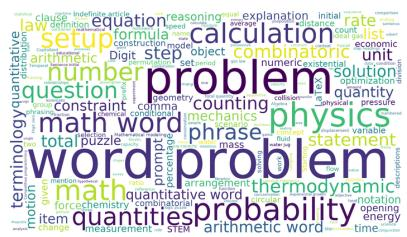

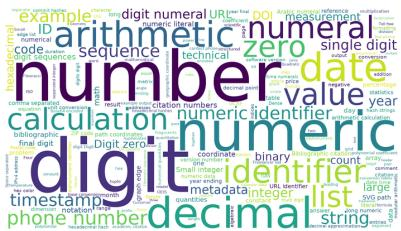  
Expert 16  
Expert 17

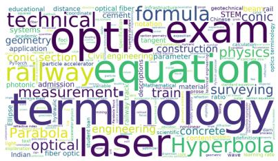  
Expert 18

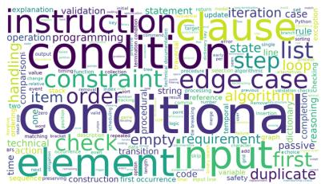  
Expert 19

Figure 10 Explanation word clouds of experts 2 to 19 of layer 30, continued from Figure 9.

Expert 29  
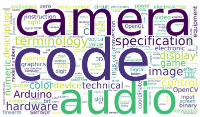  
Expert 20

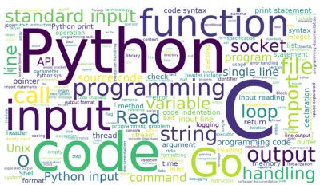  
Expert 21

  
Expert 22

  
Expert 23

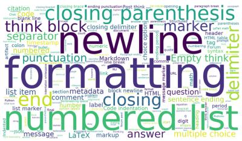

  
Expert 24  
Expert 25

  
Expert 26

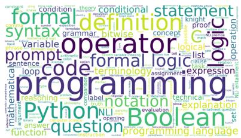  
Expert 27

  
Expert 28

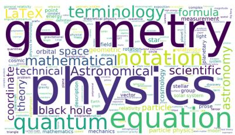

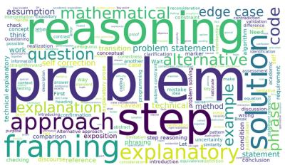  
Expert 30

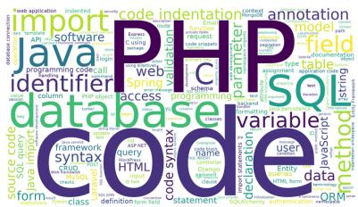  
Expert 31

  
Expert 32

  
Expert 33

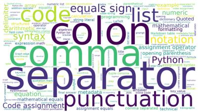  
Expert 34  
Expert 35

  
Expert 36

  
Expert 37

Figure 11 Explanation word clouds of experts 20 to 37 of layer 30, continued from Figure 9.

Expert 45

Expert 42

Expert 48

  
Expert 38

  
Expert 39

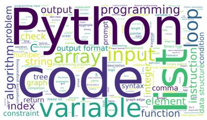  
Expert 40

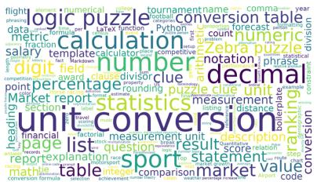  
Expert 41

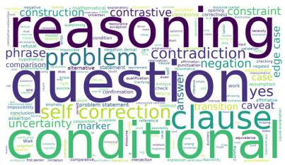

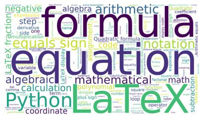  
Expert 43

  
Expert 44

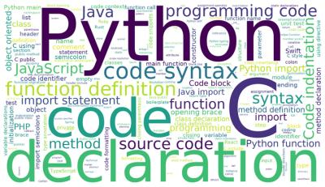

  
Expert 46

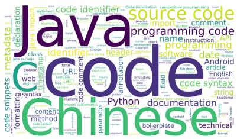  
Expert 47

  
Expert 49

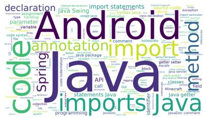  
Expert 50

  
Expert 51

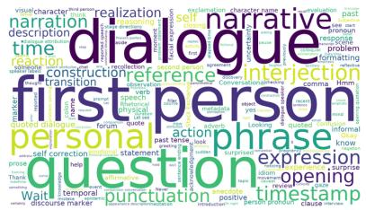  
Expert 52

  
Expert 53

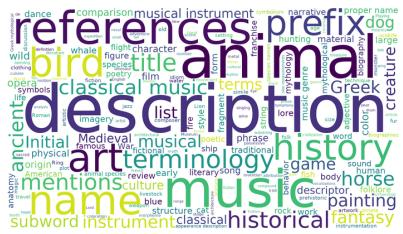  
Expert 54

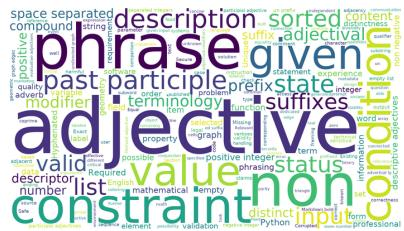  
Expert 55

Figure 12 Explanation word clouds of experts 38 to 55 of layer 30, continued from Figure 9.

  
Expert 56

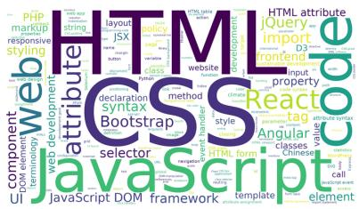  
Expert 57

  
Expert 58

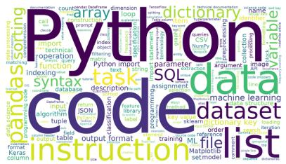  
Expert 59

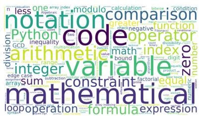

  
Expert 60  
Expert 61

  
Expert 62

  
Expert 63

  
Expert 64

  
Expert 65

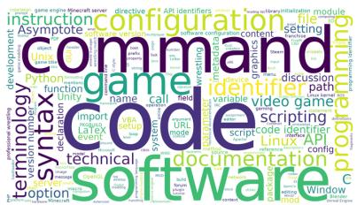  
Expert 66

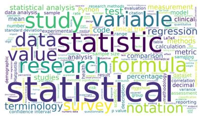  
Expert 67

  
Expert 68

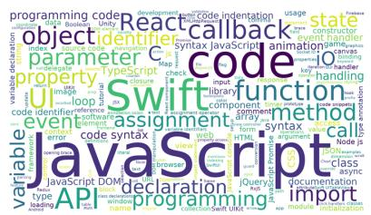  
Expert 69

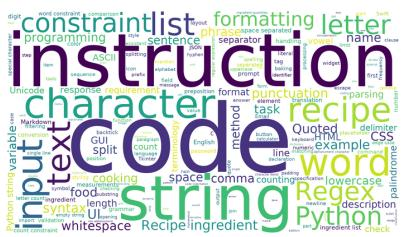  
Expert 70

  
Expert 71

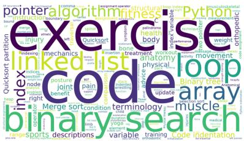  
Expert 72

  
Expert 73

Figure 13 Explanation word clouds of experts 56 to 73 of layer 30, continued from Figure 9.

  
Expert 74

  
Expert 75

  
Expert 76

  
Expert 77

  
Expert 79

Expert 78  
  
Expert 80

  
Expert 81

  
Expert 82

  
Expert 83

  
Expert 84

  
Expert 85

  
Expert 86

  
Expert 87

  
Expert 88  
Expert 89

  
Expert 90

  
Expert 91

Figure 14 Explanation word clouds of experts 74 to 91 of layer 30, continued from Figure 9.

  
Expert 92

  
Expert 93

  
Expert 94

  
Expert 95

  
Expert 96

  
Expert 97

  
Expert 98

  
Expert 99

  
Expert 100

  
Expert 102

  
Expert 103

  
Expert 104

  
Expert 105

  
Expert 107

  
Expert 106  
Expert 108

  
Expert 109

Figure 15 Explanation word clouds of experts 92 to 109 of layer 30, continued from Figure 9.

  
Expert 110

  
Expert 111

  
Expert 112

  
Expert 113

  
Expert 115

Expert 114  
  
Expert 116

  
Expert 117

  
Expert 118

  
Expert 119

  
Expert 120

  
Expert 121

  
Expert 122

  
Expert 123

  
Expert 125

  
Expert 126  
Expert 124

  
Expert 127  
Figure 16 Explanation word clouds of experts 110 to 127 of layer 30, continued from Figure 9.